# 29 Advanced-control timers (TIM1/TIM8/TIM20)

## 29.1 TIM1/TIM8/TIM20 introduction

The advanced-control timers (TIM1/TIM8/TIM20) consist of a 16-bit autoreload counter driven by a programmable prescaler.

It may be used for a variety of purposes, including measuring the pulse lengths of input signals (input capture) or generating output waveforms (output compare, PWM, complementary PWM with dead-time insertion).

Pulse lengths and waveform periods can be modulated from a few microseconds to several milliseconds using the timer prescaler and the RCC clock controller prescalers.

The advanced-control (TIM1/TIM8/TIM20) and general-purpose (TIMy) timers are completely independent, and do not share any resources. They can be synchronized together as described in [Section 29.3.30: Timer synchronization](#XREF_50306__12_4_19_TIM1_and_external_trigger_synchronization21).

## 29.2 TIM1/TIM8/TIM20 main features

TIM1/TIM8/TIM20 timer features include:

- 16-bit up, down, up/down autoreload counter.
- 16-bit programmable prescaler allowing dividing (also “on the fly”) the counter clock frequency by any factor from 1 to 65536.
- Up to six independent channels for:
 - Input capture (but channels 5 and 6)
 - Output compare
 - PWM generation (edge and center-aligned mode)
 - One-pulse mode output
- Complementary outputs with programmable dead-time
- Synchronization circuit to control the timer with external signals and to interconnect several timers together.
- Repetition counter to update the timer registers only after a given number of cycles of the counter.
- 2 break inputs to put the timer’s output signals in a safe user selectable configuration.
- Interrupt/DMA generation on the following events:
 - Update: counter overflow/underflow, counter initialization (by software or internal/external trigger)
 - Trigger event (counter start, stop, initialization, or count by internal/external trigger)
 - Input capture
 - Output compare
- Supports incremental (quadrature) encoder and hall-sensor circuitry for positioning purposes
- Trigger input for external clock or cycle-by-cycle current management

## 29.3 TIM1/TIM8/TIM20 functional description

### 29.3.1 Block diagram

#### Figure 296. Advanced-control timer block diagram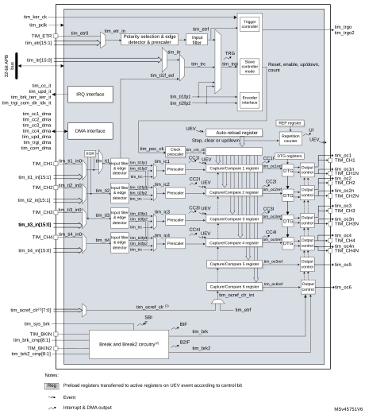

1.This feature is not available on all timers, refer to [Section 29.3.2: TIM1/TIM8/TIM20 pins and internal signals](#XREF_43687__27_3_TIM1/TIM8/TIM20_pins_and_internal_signals21).

2.See[Figure 343: Break and Break2 circuitry overview](#XREF_33435__Figure_172__Break_and_Break2_circuitry_overview21) for details.

### 29.3.2 TIM1/TIM8/TIM20 pins and internal signals

The tables in this section summarize the TIM inputs and outputs

 

<table class="TableTitle"><caption class="TableCap"><h4 class="TableCap" id="16207612">Table 261. TIM input/output pins</h4></caption><col width="148.01px"/><col width="148.01px"/><col width="242.55px"/><thead><tr height="28.00px"><th>
Pin name
</th><th>
Signal type
</th><th>
Description
</th></tr></thead><tr height="162.67px"><td>
TIM_CH1

TIM_CH2

TIM_CH3

TIM_CH4
</td><td>
Input/output
</td><td>
Timer multi-purpose channels.

Each channel can be used for capture, compare or PWM.

TIM_CH1 and TIM_CH2 can also be used as external clock (below 1/4 of the tim_ker_ck clock), external trigger and quadrature encoder inputs.

TIM_CH1, TIM_CH2 and TIM_CH3 can be used to interface with digital hall effect sensors.
</td></tr><tr height="74.67px"><td>
TIM_CH1N

TIM_CH2N

TIM_CH3N

TIM_CH4N
</td><td>
Output
</td><td>
Timer complementary outputs, derived from TIM_CHx outputs with the possibility to have deadtime insertion.
</td></tr><tr height="81.33px"><td>
TIM_ETR
</td><td>
Input
</td><td>
External trigger input. This input can be used as external trigger or as external clock source. This input can receive a clock with a frequency higher than the tim_ker_ck if the tim_etr_in prescaler is used.
</td></tr><tr height="40.00px"><td>
TIM_BKIN

TIM_BKIN2
</td><td>
Input/output 
</td><td>
Break and Break2 inputs. These inputs can also be configured in bidirectional mode.
</td></tr></table>

 

<table class="TableTitle"><caption class="TableCap"><h4 class="TableCap" id="16207663">Table 262. <a id="(continued)21" name="XREF_39919__Table_407__TIM_internal_input_output_signals_(continued)21">TIM internal input/output signals</a></h4></caption><col width="148.01px"/><col width="148.01px"/><col width="242.55px"/><thead><tr height="28.00px"><th>
Internal signal name
</th><th>
Signal type
</th><th>
Description
</th></tr></thead><tr height="81.33px"><td>
tim_ti1_in[15:0]

tim_ti2_in[15:0]

tim_ti3_in[15:0]

tim_ti4_in[15:0]
</td><td>
Input
</td><td>
Internal timer inputs bus. The tim_ti1_in[15:0] and tim_ti2_in[15:0] inputs can be used for capture or as external clock (below 1/4 of the tim_ker_ck clock) and for quadrature encoder signals.
</td></tr><tr height="96.00px"><td>
tim_etr[15:0]
</td><td>
Input
</td><td>
External trigger internal input bus. These inputs can be used as trigger, external clock or for hardware cycle-by-cycle pulsewidth control. These inputs can receive clock with a frequency higher than the tim_ker_ck if the tim_etr_in prescaler is used.
</td></tr><tr height="66.67px"><td>
tim_itr[15:0]
</td><td>
Input
</td><td>
Internal trigger input bus. These inputs can be used for the slave mode controller or as a input clock (below 1/4 of the tim_ker_ck clock).
</td></tr><tr height="52.00px"><td>
tim_trgo/tim_trgo2
</td><td>
Output
</td><td>
Internal trigger outputs. These triggers are used by other timers and /or other peripherals.
</td></tr><tr height="66.67px"><td>
tim_ocref_clr[7:0]
</td><td>
Input
</td><td>
Timer tim_ocref_clr input bus. These inputs can be used to clear the tim ocxref signals, typically for hardware cycle-by-cycle pulsewidth control.
</td></tr><tr height="22.67px"><td>
tim_brk_cmp[8:1]
</td><td>
Input
</td><td>
Break input for internal signals
</td></tr><tr height="22.67px"><td>
tim_brk2_cmp[8:1]
</td><td>
Input
</td><td>
Break2 input for internal signals
</td></tr><tr height="37.33px"><td>
tim_sys_brk[n:0]
</td><td>
Input
</td><td>
System break input. This input gathers the MCU’s system level errors.
</td></tr><tr height="22.67px"><td>
tim_pclk
</td><td>
Input
</td><td>
Timer APB clock
</td></tr><tr height="22.67px"><td>
tim_ker_ck
</td><td>
Input
</td><td>
Timer kernel clock
</td></tr><tr height="22.67px"><td>
tim_cc_it
</td><td>
Output
</td><td>
Timer capture/compare interrupt
</td></tr><tr height="22.67px"><td>
tim_upd_it
</td><td>
Output
</td><td>
Timer update event interrupt
</td></tr><tr height="37.33px"><td>
tim_brk_terr_ierr_it
</td><td>
Output
</td><td>
Timer break, break2, transition error and index error interrupt
</td></tr><tr height="37.33px"><td>
tim_trgi_com_dir_idx_it
</td><td>
Output
</td><td>
Timer trigger, commutation, direction and index interrupt
</td></tr><tr height="74.67px"><td>
tim_cc1_dma

tim_cc2_dma

tim_cc3_dma

tim_cc4_dma
</td><td>
Output
</td><td>
Timer capture / compare 1..4 dma requests
</td></tr><tr height="22.67px"><td>
tim_upd_dma
</td><td>
Output
</td><td>
Timer update dma request
</td></tr><tr height="22.67px"><td>
tim_trgi_dma
</td><td>
Output
</td><td>
Timer trigger dma request
</td></tr><tr height="22.67px"><td>
tim_com_dma
</td><td>
Output
</td><td>
Timer commutation dma request
</td></tr></table>

[Table 263](#XREF_17303__Table_46__Interconnect_4_(continued)21), [Table 264](#XREF_95083__Table_47__Interconnect_5%1121), [Table 265](#XREF_18183__Table_48__Interconnect_6%1121) and [Table 266](#XREF_22002__Table_49__Interconnect_7%1121) list the sources connected to the tim\_ti[4:1] input multiplexers.

<table class="TableTitle"><caption class="Body"><h4 class="TableCap" id="36713363">Table 263. <a id="(continued)21" name="XREF_17303__Table_46__Interconnect_4_(continued)21">Interconnect to the tim_ti1 input multiplexer</a></h4></caption><col width="134.65px"/><col width="134.65px"/><col width="134.65px"/><col width="134.65px"/><thead><tr height="28.00px"><th rowspan="2">
tim_ti1 inputs
</th><th colspan="3">
Sources
</th></tr><tr height="28.00px"><th>
TIM1
</th><th>
TIM8
</th><th>
TIM20
</th></tr></thead><tr height="22.67px"><td>
tim_ti1_in0
</td><td>
TIM1_CH1
</td><td>
TIM8_CH1
</td><td>
TIM20_CH1
</td></tr><tr height="22.67px"><td>
tim_ti1_in1
</td><td>
comp1_out
</td><td>
comp1_out
</td><td>
comp1_out
</td></tr><tr height="22.67px"><td>
tim_ti1_in2
</td><td>
comp2_out
</td><td>
comp2_out
</td><td>
comp2_out
</td></tr><tr height="22.67px"><td>
tim_ti1_in3
</td><td>
comp3_out
</td><td>
comp3_out
</td><td>
comp3_out
</td></tr><tr height="22.67px"><td>
tim_ti1_in4
</td><td>
comp4_out
</td><td>
comp4_out
</td><td>
comp4_out
</td></tr><tr height="22.67px"><td>
tim_ti1_in[15:5]
</td><td colspan="3">
Reserved
</td></tr></table>

<table class="TableTitle"><caption class="Body"><h4 class="TableCap" id="36713441">Table 264. <a id="5%1121" name="XREF_95083__Table_47__Interconnect_5%1121">Interconnect to the tim_ti2 input multiplexer</a></h4></caption><col width="120.44px"/><col width="139.38px"/><col width="139.38px"/><col width="139.38px"/><thead><tr height="28.00px"><th rowspan="2">
tim_ti2 inputs
</th><th colspan="3">
Sources
</th></tr><tr height="28.00px"><th>
TIM1
</th><th>
TIM8
</th><th>
TIM20
</th></tr></thead><tr height="22.67px"><td>
tim_ti2_in0
</td><td>
TIM1_CH2
</td><td>
TIM8_CH2
</td><td>
TIM20_CH2
</td></tr><tr height="22.67px"><td>
tim_ti2_in[15:1]
</td><td colspan="3">
Reserved
</td></tr></table>

<table class="TableTitle"><caption class="Body"><h4 class="TableCap" id="36713487">Table 265. <a id="6%1121" name="XREF_18183__Table_48__Interconnect_6%1121">Interconnect to the tim_ti3 input multiplexer</a></h4></caption><col width="134.65px"/><col width="134.65px"/><col width="134.65px"/><col width="134.65px"/><thead><tr height="28.00px"><th rowspan="2">
tim_ti3 inputs
</th><th colspan="3">
Sources
</th></tr><tr height="28.00px"><th>
TIM1
</th><th>
TIM8
</th><th>
TIM20
</th></tr></thead><tr height="22.67px"><td>
tim_ti3_in0
</td><td>
TIM1_CH3
</td><td>
TIM8_CH3
</td><td>
TIM20_CH3
</td></tr><tr height="22.67px"><td>
tim_ti3_in[15:1]
</td><td colspan="3">
Reserved
</td></tr></table>

<table class="TableTitle"><caption class="Body"><h4 class="TableCap" id="36713533">Table 266. <a id="7%1121" name="XREF_22002__Table_49__Interconnect_7%1121">Interconnect to the tim_ti4 input multiplexer</a></h4></caption><col width="134.65px"/><col width="134.65px"/><col width="134.65px"/><col width="134.65px"/><thead><tr height="28.00px"><th rowspan="2">
tim_ti4 inputs
</th><th colspan="3">
Sources
</th></tr><tr height="28.00px"><th>
TIM1
</th><th>
TIM8
</th><th>
TIM20
</th></tr></thead><tr height="22.67px"><td>
tim_ti4_in0
</td><td>
TIM1_CH4
</td><td>
TIM8_CH4
</td><td>
TIM20_CH4
</td></tr><tr height="22.67px"><td>
tim_ti4_in[15:1]
</td><td colspan="3">
Reserved
</td></tr></table>

[Table 267](#XREF_52337__Table_248__TIMx_internal_trigger_connection%1121) lists the internal sources connected to the tim\_itr input multiplexer.

<table class="TableTitle"><caption class="SoftTableCap"><h4 class="TableCap" id="36713583">Table 267. <a id="connection%1121" name="XREF_52337__Table_248__TIMx_internal_trigger_connection%1121">Internal trigger connection</a></h4></caption><col width="112.98px"/><col width="142.77px"/><col width="143.68px"/><col width="139.15px"/><thead><tr height="57.33px"><th>
Timer internal trigger input signal
</th><th>
TIM1
</th><th>
TIM8
</th><th>
TIM20
</th></tr></thead><tr height="22.67px"><td>
tim_itr0
</td><td>
Reserved
</td><td>
tim1_trgo
</td><td>
tim1_trgo
</td></tr><tr height="22.67px"><td>
tim_itr1
</td><td>
tim2_trgo
</td><td>
tim2_trgo
</td><td>
tim2_trgo
</td></tr><tr height="22.67px"><td>
tim_itr2
</td><td>
tim3_trgo
</td><td>
tim3_trgo
</td><td>
tim3_trgo
</td></tr><tr height="22.67px"><td>
tim_itr3
</td><td>
tim4_trgo
</td><td>
tim4_trgo
</td><td>
tim4_trgo
</td></tr><tr height="22.67px"><td>
tim_itr4
</td><td>
tim5_trgo
</td><td>
tim5_trgo
</td><td>
tim5_trgo
</td></tr><tr height="22.67px"><td>
tim_itr5
</td><td>
tim8_trgo
</td><td>
Reserved
</td><td>
tim8_trgo
</td></tr><tr height="22.67px"><td>
tim_itr6
</td><td>
tim15_trgo
</td><td>
tim15_trgo
</td><td>
tim15_trgo
</td></tr><tr height="22.67px"><td>
tim_itr7
</td><td>
tim16_oc1
</td><td>
tim16_oc1
</td><td>
tim16_oc1
</td></tr><tr height="22.67px"><td>
tim_itr8
</td><td>
tim17_oc1
</td><td>
tim17_oc1
</td><td>
tim17_oc1
</td></tr><tr height="22.67px"><td>
tim_itr9
</td><td>
tim20_trgo
</td><td>
tim20_trgo
</td><td>
Reserved
</td></tr><tr height="22.67px"><td>
tim_itr10
</td><td>
hrtim_out_sync2
</td><td>
hrtim_out_sync2
</td><td>
hrtim_out_sync2
</td></tr><tr height="22.67px"><td>
tim_itr[15:11]
</td><td colspan="3">
Reserved
</td></tr></table>

[Table 268](#XREF_97119__Table_44__Interconnect_2_(continued)21) lists the internal sources connected to the tim\_etr input multiplexer.

<table class="TableTitle"><caption class="Body"><h4 class="TableCap" id="36713705">Table 268. <a id="(continued)21" name="XREF_97119__Table_44__Interconnect_2_(continued)21">Interconnect to the tim_etr input multiplexer</a></h4></caption><col width="143.11px"/><col width="130.39px"/><col width="128.62px"/><col width="136.46px"/><thead><tr height="28.00px"><th rowspan="2">
Timer external trigger input signal
</th><th colspan="3">
Timer external trigger signals assignment
</th></tr><tr height="28.00px"><th>
TIM1
</th><th>
TIM8
</th><th>
TIM20
</th></tr></thead><tr height="22.67px"><td>
tim_etr0
</td><td>
TIM1_ETR
</td><td>
TIM8_ETR
</td><td>
TIM20_ETR
</td></tr><tr height="22.67px"><td>
tim_etr1
</td><td>
comp1_out
</td><td>
comp1_out
</td><td>
comp1_out
</td></tr><tr height="22.67px"><td>
tim_etr2
</td><td>
comp2_out
</td><td>
comp2_out
</td><td>
comp2_out
</td></tr><tr height="22.67px"><td>
tim_etr3
</td><td>
comp3_out
</td><td>
comp3_out
</td><td>
comp3_out
</td></tr><tr height="22.67px"><td>
tim_etr4
</td><td>
comp4_out
</td><td>
comp4_out
</td><td>
comp4_out
</td></tr><tr height="22.67px"><td>
tim_etr5
</td><td>
comp5_out
</td><td>
comp5_out
</td><td>
comp5_out
</td></tr><tr height="22.67px"><td>
tim_etr6
</td><td>
comp6_out
</td><td>
comp6_out
</td><td>
comp6_out
</td></tr><tr height="22.67px"><td>
tim_etr7
</td><td>
comp7_out
</td><td>
comp7_out
</td><td>
comp7_out
</td></tr><tr height="22.67px"><td>
tim_etr8
</td><td>
adc1_awd1
</td><td>
adc2_awd1
</td><td>
adc3_awd1
</td></tr><tr height="22.67px"><td>
tim_etr9
</td><td>
adc1_awd2
</td><td>
adc2_awd2
</td><td>
adc3_awd2
</td></tr><tr height="22.67px"><td>
tim_etr10
</td><td>
adc1_awd3
</td><td>
adc2_awd3
</td><td>
adc3_awd3
</td></tr><tr height="22.67px"><td>
tim_etr11
</td><td>
adc4_awd1
</td><td>
adc3_awd1
</td><td>
adc5_awd1
</td></tr><tr height="22.67px"><td>
tim_etr12
</td><td>
adc4_awd2
</td><td>
adc3_awd2
</td><td>
adc5_awd2
</td></tr><tr height="22.67px"><td>
tim_etr13
</td><td>
adc4_awd3
</td><td>
adc3_awd3
</td><td>
adc5_awd3
</td></tr><tr height="22.67px"><td>
tim_etr[15:14]
</td><td colspan="3">
Reserved
</td></tr></table>

[Table 269](#XREF_71657__Table_12__%11Timer_break_interconnect%1121), [Table 270](#XREF_72547__Table_51__Interconnect_9%1121) and [Table 271](#XREF_27558__Table_14__System_break_interconnect%1121) list the sources connected to the tim\_brk and tim\_brk2inputs.

<table class="TableTitle"><caption class="Body"><h4 class="TableCap" id="36713865">Table 269. <a id="interconnect%1121" name="XREF_71657__Table_12__%11Timer_break_interconnect%1121">Timer break interconnect</a></h4></caption><col width="134.65px"/><col width="134.65px"/><col width="134.65px"/><col width="134.65px"/><thead><tr height="28.00px"><th>
tim_brk inputs
</th><th>
TIM1
</th><th>
TIM8
</th><th>
TIM20
</th></tr></thead><tr height="22.67px"><td>
TIM_BKIN
</td><td>
TIM1_BKIN pin
</td><td>
TIM8_BKIN pin
</td><td>
TIM20_BKIN pin
</td></tr><tr height="22.67px"><td>
tim_brk_cmp1
</td><td>
comp1_out
</td><td>
comp1_out
</td><td>
comp1_out
</td></tr><tr height="22.67px"><td>
tim_brk_cmp2
</td><td>
comp2_out
</td><td>
comp2_out
</td><td>
comp2_out
</td></tr><tr height="22.67px"><td>
tim_brk_cmp3
</td><td>
comp3_out
</td><td>
comp3_out
</td><td>
comp3_out
</td></tr><tr height="22.67px"><td>
tim_brk_cmp4
</td><td>
comp4_out
</td><td>
comp4_out
</td><td>
comp4_out
</td></tr><tr height="22.67px"><td>
tim_brk_cmp5
</td><td>
comp5_out
</td><td>
comp5_out
</td><td>
comp5_out
</td></tr><tr height="22.67px"><td>
tim_brk_cmp6
</td><td>
comp6_out
</td><td>
comp6_out
</td><td>
comp6_out
</td></tr><tr height="22.67px"><td>
tim_brk_cmp7
</td><td>
comp7_out
</td><td>
comp7_out
</td><td>
comp7_out
</td></tr><tr height="22.67px"><td>
tim_brk_cmp8
</td><td colspan="3">
Reserved
</td></tr></table>

<table class="TableTitle"><caption class="Body"><h4 class="TableCap" id="36713959">Table 270. <a id="9%1121" name="XREF_72547__Table_51__Interconnect_9%1121">Timer break2 interconnect</a></h4></caption><col width="122.83px"/><col width="138.58px"/><col width="138.58px"/><col width="138.58px"/><thead><tr height="28.00px"><th>
tim_brk2 inputs
</th><th>
TIM1
</th><th>
TIM8
</th><th>
TIM20
</th></tr></thead><tr height="22.67px"><td>
TIM_BKIN2
</td><td>
TIM1_BKIN2 pin
</td><td>
TIM8_BKIN2 pin
</td><td>
TIM20_BKIN2 pin
</td></tr><tr height="22.67px"><td>
tim_brk2_cmp1
</td><td>
comp1_out
</td><td>
comp1_out
</td><td>
comp1_out
</td></tr><tr height="22.67px"><td>
tim_brk2_cmp2
</td><td>
comp2_out
</td><td>
comp2_out
</td><td>
comp2_out
</td></tr><tr height="22.67px"><td>
tim_brk2_cmp3
</td><td>
comp3_out
</td><td>
comp3_out
</td><td>
comp3_out
</td></tr><tr height="22.67px"><td>
tim_brk2_cmp4
</td><td>
comp4_out
</td><td>
comp4_out
</td><td>
comp4_out
</td></tr><tr height="22.67px"><td>
tim_brk2_cmp5
</td><td>
comp5_out
</td><td>
comp5_out
</td><td>
comp5_out
</td></tr><tr height="22.67px"><td>
tim_brk2_cmp6
</td><td>
comp6_out
</td><td>
comp6_out
</td><td>
comp6_out
</td></tr><tr height="22.67px"><td>
tim_brk2_cmp7
</td><td>
comp7_out
</td><td>
comp7_out
</td><td>
comp7_out
</td></tr><tr height="22.67px"><td>
tim_brk2_cmp8
</td><td colspan="3">
Reserved
</td></tr></table>

<table class="TableTitle"><caption class="Body"><h4 class="TableCap" id="36714053">Table 271. <a id="interconnect%1121" name="XREF_27558__Table_14__System_break_interconnect%1121">System break interconnect</a></h4></caption><col width="108.14px"/><col width="215.22px"/><col width="215.22px"/><thead><tr height="42.67px"><th>
tim_sys_brk inputs
</th><th>
TIM1 / TIM8 / TIM20
</th><th>
Enable bit in SYSCFG_CFGR2 register
</th></tr></thead><tr height="22.67px"><td>
tim_sys_brk0
</td><td>
Cortex®-M4 with FPU LOCKUP
</td><td>
CLL
</td></tr><tr height="22.67px"><td>
tim_sys_brk1
</td><td>
Programmable Voltage Detector (PVD)
</td><td>
PVDL
</td></tr><tr height="22.67px"><td>
tim_sys_brk2
</td><td>
SRAM parity error
</td><td>
SPL
</td></tr><tr height="22.67px"><td>
tim_sys_brk3
</td><td>
Flash memory double ECC error
</td><td>
ECCL
</td></tr><tr height="22.67px"><td>
tim_sys_brk4
</td><td>
Clock Security System (CSS)
</td><td>
None (always enabled)
</td></tr></table>

[Table 272](#XREF_35979__Table_45__Interconnect_3%1121) lists the internal sources connected to the tim\_ocref\_clr input multiplexer.

<table class="TableTitle"><caption class="Body"><h4 class="TableCap" id="36714108">Table 272. <a id="3%1121" name="XREF_35979__Table_45__Interconnect_3%1121">Interconnect to the ocref_clr input multiplexer</a></h4></caption><col width="141.91px"/><col width="132.22px"/><col width="132.22px"/><col width="132.22px"/><thead><tr height="28.00px"><th rowspan="2">
Timer OCREF clear signal
</th><th colspan="3">
Timer OCREF clear signals assignment
</th></tr><tr height="28.00px"><th>
TIM1
</th><th>
TIM8
</th><th>
TIM20
</th></tr></thead><tr height="22.67px"><td>
tim_ocref_clr0
</td><td>
comp1_out
</td><td>
comp1_out
</td><td>
comp1_out
</td></tr><tr height="22.67px"><td>
tim_ocref_clr1
</td><td>
comp2_out
</td><td>
comp2_out
</td><td>
comp2_out
</td></tr><tr height="22.67px"><td>
tim_ocref_clr2
</td><td>
comp3_out
</td><td>
comp3_out
</td><td>
comp3_out
</td></tr><tr height="22.67px"><td>
tim_ocref_clr3
</td><td>
comp4_out
</td><td>
comp4_out
</td><td>
comp4_out
</td></tr><tr height="22.67px"><td>
tim_ocref_clr4
</td><td>
comp5_out
</td><td>
comp5_out
</td><td>
comp5_out
</td></tr><tr height="22.67px"><td>
tim_ocref_clr5
</td><td>
comp6_out
</td><td>
comp6_out
</td><td>
comp6_out
</td></tr><tr height="22.67px"><td>
tim_ocref_clr6
</td><td>
comp7_out
</td><td>
comp7_out
</td><td>
comp7_out
</td></tr><tr height="22.67px"><td>
tim_ocref_clr7
</td><td colspan="3">
Reserved
</td></tr></table>

### 29.3.3 Time-base unit

The main block of the programmable advanced-control timer is a 16-bit counter with its related autoreload register. The counter can count up, down or both up and down. The counter clock can be divided by a prescaler.

The counter, the autoreload register and the prescaler register can be written or read by software, even when the counter is running.

The time-base unit includes:

- Counter register (TIMx\_CNT)
- Prescaler register (TIMx\_PSC)
- Autoreload register (TIMx\_ARR)
- Repetition counter register (TIMx\_RCR)

The autoreload register is preloaded. Writing to or reading from the autoreload register accesses the preload register. The content of the preload register are transferred into the shadow register permanently or at each update event (UEV), depending on the autoreload preload enable bit (ARPE) in TIMx\_CR1 register. The update event is sent when the counter reaches the overflow (or underflow when downcounting) and if the UDIS bit equals 0 in the TIMx\_CR1 register. It can also be generated by software. The generation of the update event is described in detailed for each configuration.

The counter is clocked by the prescaler output tim\_cnt\_ck, which is enabled only when the counter enable bit (CEN) in TIMx\_CR1 register is set (refer also to the slave mode controller description to get more details on counter enabling).

**Note:**

The counter starts counting 1 clock cycle after setting the CEN bit in the TIMx\_CR1 register.

#### Prescaler description

The prescaler divides the counter clock frequency by any factor from 1 to 65536. It is based on a 16-bit counter controlled through a 16-bit register (in the TIMx\_PSC register). It can be changed on the fly as this control register is buffered. The new prescaler ratio is taken into account at the next update event.

[Figure 297](#XREF_83150__Figure_26__Counter_timing_diagram_with_prescaler_division_change_from_1_to_221) and [Figure 298](#XREF_79501__Figure_27__Counter_timing_diagram_with_prescaler_division_change_from_1_to_421) give some examples of the counter behavior when the prescaler ratio is changed on the fly.

#### Figure 297. Counter timing diagram with prescaler division change from 1 to 2

#### Figure 298. Counter timing diagram with prescaler division change from 1 to 4

### 29.3.4 Counter modes

#### Upcounting mode

In upcounting mode, the counter counts from 0 to the autoreload value (content of the TIMx\_ARR register), then restarts from 0 and generates a counter overflow event.

If the repetition counter is used, the update event (UEV) is generated after upcounting is repeated for the number of times programmed in the repetition counter register (TIMx\_RCR) + 1. Else the update event is generated at each counter overflow.

Setting the UG bit in the TIMx\_EGR register (by software or by using the slave mode controller) also generates an update event.

The UEV event can be disabled by software by setting the UDIS bit in the TIMx\_CR1 register. This is to avoid updating the shadow registers while writing new values in the preload registers. Then no update event occurs until the UDIS bit has been written to 0. However, the counter restarts from 0, as well as the counter of the prescaler (but the prescale rate does not change). In addition, if the URS bit (update request selection) in TIMx\_CR1 register is set, setting the UG bit generates an update event UEV but without setting the UIF flag (thus no interrupt or DMA request is sent). This is to avoid generating both update and capture interrupts when clearing the counter on the capture event.

When an update event occurs, all the registers are updated and the update flag (UIF bit in TIMx\_SR register) is set (depending on the URS bit):

- The repetition counter is reloaded with the content of TIMx\_RCR register,
- The autoreload shadow register is updated with the preload value (TIMx\_ARR),
- The buffer of the prescaler is reloaded with the preload value (content of the TIMx\_PSC register).

The following figures show some examples of the counter behavior for different clock frequencies when TIMx\_ARR = 0x36.

#### Figure 299. Counter timing diagram, internal clock divided by 1

#### Figure 300. Counter timing diagram, internal clock divided by 2

#### Figure 301. Counter timing diagram, internal clock divided by 4

#### Figure 302. Counter timing diagram, internal clock divided by N

#### Figure 303. Counter timing diagram, update event when ARPE = 0    (TIMx\_ARR not preloaded)

#### Figure 304. Counter timing diagram, update event when ARPE = 1    (TIMx\_ARR preloaded)

#### Downcounting mode

In downcounting mode, the counter counts from the autoreload value (content of the TIMx\_ARR register) down to 0, then restarts from the autoreload value and generates a counter underflow event.

If the repetition counter is used, the update event (UEV) is generated after downcounting is repeated for the number of times programmed in the repetition counter register (TIMx\_RCR) + 1. Else the update event is generated at each counter underflow.

Setting the UG bit in the TIMx\_EGR register (by software or by using the slave mode controller) also generates an update event.

The UEV update event can be disabled by software by setting the UDIS bit in TIMx\_CR1 register. This is to avoid updating the shadow registers while writing new values in the preload registers. Then no update event occurs until UDIS bit has been written to 0. However, the counter restarts from the current autoreload value, whereas the counter of the prescaler restarts from 0 (but the prescale rate doesn’t change).

In addition, if the URS bit (update request selection) in TIMx\_CR1 register is set, setting the UG bit generates an update event UEV but without setting the UIF flag (thus no interrupt or DMA request is sent). This is to avoid generating both update and capture interrupts when clearing the counter on the capture event.

When an update event occurs, all the registers are updated and the update flag (UIF bit in TIMx\_SR register) is set (depending on the URS bit):

- The repetition counter is reloaded with the content of TIMx\_RCR register.
- The buffer of the prescaler is reloaded with the preload value (content of the TIMx\_PSC register).
- The autoreload active register is updated with the preload value (content of the TIMx\_ARR register). Note that the autoreload is updated before the counter is reloaded, so that the next period is the expected one.

The following figures show some examples of the counter behavior for different clock frequencies when TIMx\_ARR = 0x36.

#### Figure 305. Counter timing diagram, internal clock divided by 1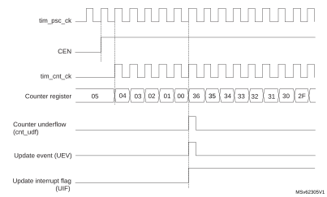

#### Figure 306. Counter timing diagram, internal clock divided by 2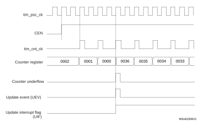

#### Figure 307. Counter timing diagram, internal clock divided by 4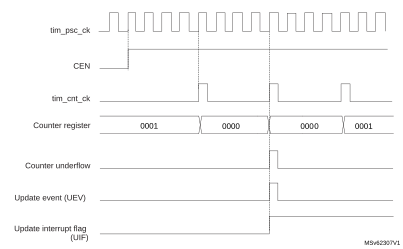

#### Figure 308. Counter timing diagram, internal clock divided by N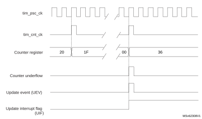

#### Figure 309. Counter timing diagram, update event when repetition counter is not used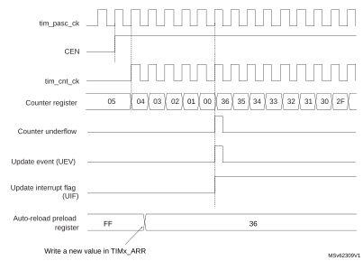

#### Center-aligned mode (up/down counting)

In center-aligned mode, the counter counts from 0 to the autoreload value (content of the TIMx\_ARR register) – 1, generates a counter overflow event, then counts from the autoreload value down to 1 and generates a counter underflow event. Then it restarts counting from 0.

Center-aligned mode is active when the CMS bits in TIMx\_CR1 register are not equal to 00. The Output compare interrupt flag of channels configured in output is set when: the counter counts down (Center aligned mode 1, CMS = 01), the counter counts up (Center aligned mode 2, CMS = 10) the counter counts up and down (Center aligned mode 3, CMS = 11).

In this mode, the DIR direction bit in the TIMx\_CR1 register cannot be written. It is updated by hardware and gives the current direction of the counter.

The update event can be generated at each counter overflow and at each counter underflow or by setting the UG bit in the TIMx\_EGR register (by software or by using the slave mode controller) also generates an update event. In this case, the counter restarts counting from 0, as well as the counter of the prescaler.

The UEV update event can be disabled by software by setting the UDIS bit in the TIMx\_CR1 register. This is to avoid updating the shadow registers while writing new values in the preload registers. Then no update event occurs until UDIS bit has been written to 0. However, the counter continues counting up and down, based on the current autoreload value.

In addition, if the URS bit (update request selection) in TIMx\_CR1 register is set, setting the UG bit generates an UEV update event but without setting the UIF flag (thus no interrupt or DMA request is sent). This is to avoid generating both update and capture interrupts when clearing the counter on the capture event.

When an update event occurs, all the registers are updated and the update flag (UIF bit in TIMx\_SR register) is set (depending on the URS bit):

- The repetition counter is reloaded with the content of TIMx\_RCR register
- The buffer of the prescaler is reloaded with the preload value (content of the TIMx\_PSC register)
- The autoreload active register is updated with the preload value (content of the TIMx\_ARR register). Note that if the update source is a counter overflow, the autoreload is updated before the counter is reloaded, so that the next period is the expected one (the counter is loaded with the new value).

The following figures show some examples of the counter behavior for different clock frequencies.

#### Figure 310. Counter timing diagram, internal clock divided by 1, TIMx\_ARR = 0x6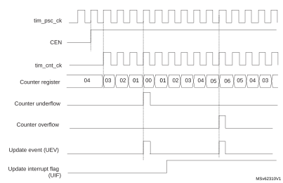

1.Here, center-aligned mode 1 is used (for more details refer to [Section 29.6: TIM1/TIM8/TIM20 registers](#XREF_38604__3_4_TIM1/TIM8/TIM20_registers21)).

#### Figure 311. Counter timing diagram, internal clock divided by 2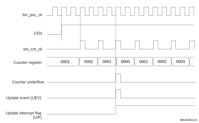

#### Figure 312. Counter timing diagram, internal clock divided by 4, TIMx\_ARR = 0x36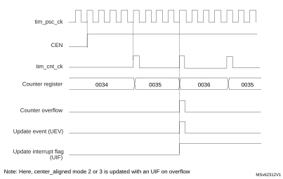

#### Figure 313. Counter timing diagram, internal clock divided by N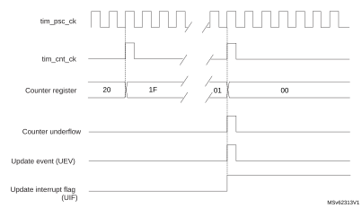

#### Figure 314. Counter timing diagram, update event with ARPE = 1 (counter underflow)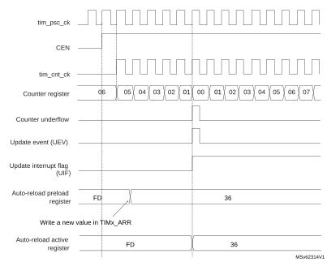

#### Figure 315. Counter timing diagram, Update event with ARPE = 1 (counter overflow)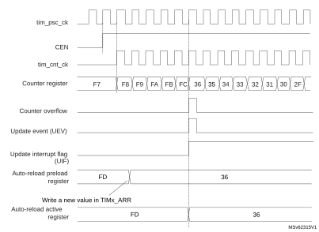

### 29.3.5 Repetition counter

[Section 29.3.3: Time-base unit](#XREF_47156__1_3_1_Time_Base_Unit21) describes how the update event (UEV) is generated with respect to the counter overflows/underflows. It is actually generated only when the repetition counter has reached zero. This can be useful when generating PWM signals.

This means that data are transferred from the preload registers to the shadow registers (TIMx\_ARR autoreload register, TIMx\_PSC prescaler register, but also TIMx\_CCRx capture/compare registers in compare mode) every N+1 counter overflows or underflows, where N is the value in the TIMx\_RCR repetition counter register.

The repetition counter is decremented:

- At each counter overflow in upcounting mode,
- At each counter underflow in downcounting mode,
- At each counter overflow and at each counter underflow in center-aligned mode. Although this limits the maximum number of repetition to 32768 PWM cycles, it makes it possible to update the duty cycle twice per PWM period. When refreshing compare registers only once per PWM period in center-aligned mode, maximum resolution is 2xTck, due to the symmetry of the pattern.

The repetition counter is an autoreload type; the repetition rate is maintained as defined by the TIMx\_RCR register value (refer to [Figure 316](#XREF_15848__Figure_28__Update_rate_examples_depending_on_mode_and_GPT_RCR_register_settings21)). When the update event is generated by software (by setting the UG bit in TIMx\_EGR register) or by hardware through the slave mode controller, it occurs immediately whatever the value of the repetition counter is and the repetition counter is reloaded with the content of the TIMx\_RCR register.

In Center aligned mode, for odd values of RCR, the update event occurs either on the overflow or on the underflow depending on when the RCR register was written and when the counter was launched: if the RCR was written before launching the counter, the UEV occurs on the underflow. If the RCR was written after launching the counter, the UEV occurs on the overflow.

For example, for RCR = 3, the UEV is generated each 4th overflow or underflow event depending on when the RCR was written.

#### Figure 316. Update rate examples depending on mode and TIMx\_RCR register settings

### 29.3.6 External trigger input

The timer features an external trigger input tim\_etr\_in. It can be used as:

- external clock (external clock mode 2, see [Section 29.3.7](#XREF_24690__16_3_4_Clock_selection21))
- trigger for the slave mode (see [Section 29.3.30](#XREF_50306__12_4_19_TIM1_and_external_trigger_synchronization21))
- PWM reset input for cycle-by-cycle current regulation (see [Section 29.3.9](#XREF_40403__12_4_6_Input_capture_mode21))

[Figure 317](#XREF_16136__Figure_22__External_trigger_input_block21) below describes the tim\_etr\_in input conditioning. The input polarity is defined with the ETP bit in TIMxSMCR register. The trigger can be prescaled with the divider programmed by the ETPS[1:0] bitfield and digitally filtered with the ETF[3:0] bitfield. The resulting signal (tim\_etrf) is available for three purposes: as an external clock, to condition the output (typically to reset a PWM output for a current limitation), and as a trigger for the Slave mode controller.

Figure 317. External trigger input block

The tim\_etr\_in input comes from multiple sources: input pins (default configuration), or internal sources. The selection is done with the ETRSEL[3:0] bitfield in the TIMx\_AF1 register.

Refer to [Section 29.3.2: TIM1/TIM8/TIM20 pins and internal signals](#XREF_43687__27_3_TIM1/TIM8/TIM20_pins_and_internal_signals21) for the list of sources connected to the etr\_in input in the product.

### 29.3.7 Clock selection

The counter clock can be provided by the following clock sources:

- Internal clock (tim\_ker\_ck)
- External clock mode1: external input pin (tim\_ti1 or tim\_ti2)
- External clock mode2: external trigger input (tim\_etr\_in)
- Encoder mode

#### Internal clock source (tim\_ker\_ck)

If the slave mode controller is disabled (SMS = 000), then the CEN, DIR (in the TIMx\_CR1 register) and UG bits (in the TIMx\_EGR register) are actual control bits and can be changed only by software (except UG which remains cleared automatically). As soon as the CEN bit is written to 1, the prescaler is clocked by the internal clock tim\_ker\_ck.

[Figure 318](#XREF_16645__Figure_22__Control_circuit_in_normal_mode%2C_internal_clock_divided_by_121) shows the behavior of the control circuit and the upcounter in normal mode, without prescaler.

#### Figure 318. Control circuit in normal mode, internal clock divided by 1

#### External clock source mode 1

This mode is selected when SMS = 111 in the TIMx\_SMCR register. The counter can count at each rising or falling edge on a selected input.

#### Figure 319. tim\_ti2 external clock connection example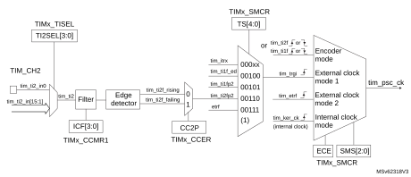

1.Codes ranging from 01000 to 11111 are reserved.

For example, to configure the upcounter to count in response to a rising edge on the tim\_ti2 input, use the following procedure:

1. Configure channel 2 to detect rising edges on the tim\_ti2 input by writing CC2S = 01 in the TIMx\_CCMR1 register.
2. Configure the input filter duration by writing the IC2F[3:0] bits in the TIMx\_CCMR1 register (if no filter is needed, keep IC2F = 0000).
3. Select rising edge polarity by writing CC2P = 0 and CC2NP = 0 in the TIMx\_CCER register.
4. Configure the timer in external clock mode 1 by writing SMS = 111 in the TIMx\_SMCR register.
5. Select tim\_ti2 as the trigger input source by writing TS = 00110 in the TIMx\_SMCR register.
6. Enable the counter by writing CEN = 1 in the TIMx\_CR1 register.

**Note:**

The capture prescaler is not used for triggering, it is not necessary to configure it.

When a rising edge occurs on tim\_ti2, the counter counts once and the TIF flag is set.

The delay between the rising edge on tim\_ti2 and the actual clock of the counter is due to the resynchronization circuit on tim\_ti2 input.

#### Figure 320. Control circuit in external clock mode 1

#### External clock source mode 2

This mode is selected by writing ECE = 1 in the TIMx\_SMCR register.

The counter counts at each rising or falling edge on the external trigger input tim\_etr\_in.

The [Figure 321](#XREF_69683__Figure_19__External_Trigger_Input_Block21) gives an overview of the external trigger input block.

#### Figure 321. External trigger input block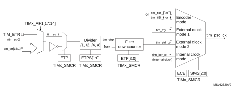

1.Refer to [Section 29.3.2: TIM1/TIM8/TIM20 pins and internal signals](#XREF_43687__27_3_TIM1/TIM8/TIM20_pins_and_internal_signals21).

For example, to configure the upcounter to count each 2 rising edges on tim\_etr\_in, use the following procedure:

1. As no filter is needed in this example, write ETF[3:0] = 0000 in the TIMx\_SMCR register.
2. Set the prescaler by writing ETPS[1:0] = 01 in the TIMx\_SMCR register
3. Select rising edge detection on the tim\_etr\_in input by writing ETP = 0 in the TIMx\_SMCR register
4. Enable external clock mode 2 by writing ECE = 1 in the TIMx\_SMCR register.
5. Enable the counter by writing CEN = 1 in the TIMx\_CR1 register.

The counter counts once each 2 tim\_etr\_in rising edges.

The delay between the rising edge on tim\_etr\_in and the actual clock of the counter is due to the resynchronization circuit on the tim\_etrp signal. As a consequence, the maximum frequency which can be correctly captured by the counter is at most ¼ of tim\_ker\_ck frequency. When the ETRP signal is faster, the user must apply a division of the external signal by a proper ETPS prescaler setting.

#### Figure 322. Control circuit in external clock mode 2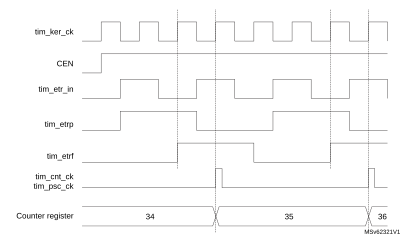

### 29.3.8 Capture/compare channels

Each capture/compare channel is built around a capture/compare register (including a shadow register), an input stage for capture (with digital filter, multiplexing, and prescaler, except for channels 5 and 6) and an output stage (with comparator and output control).

[Figure 323](#XREF_21775__channel_1_Input_stage)21) to [Figure 326](#XREF_55715__Figure_72__Output_stage_of_capture/compare_channel_(channel_5%2C_idem_ch__6)21) give an overview of one capture/compare channel.

The input stage samples the corresponding tim\_tix input to generate a filtered signal tim\_tixf. Then, an edge detector with polarity selection generates a signal (tim\_tixfpy) which can be used as trigger input by the slave mode controller or as the capture command. It is prescaled before the capture register (ICxPS).

#### Figure 323. Capture/compare channel (example: channel 1 input stage)

The output stage generates an intermediate waveform which is then used for reference: tim\_ocxref (active high). The polarity acts at the end of the chain.

#### Figure 324. Capture/compare channel 1 main circuit

#### Figure 325. Output stage of capture/compare channel (channel 1, idem ch. 2, 3 and 4)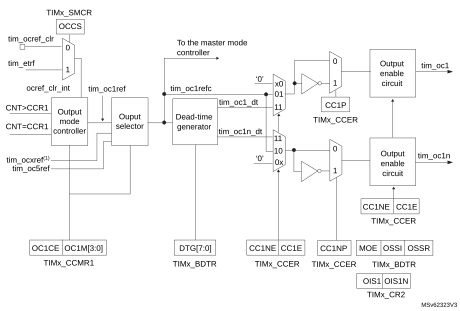

1.tim\_ocxref, where x is the rank of the complementary channel

#### Figure 326. Output stage of capture/compare channel (channel 5, idem ch. 6)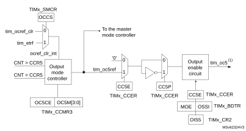

1.Not available externally.

The capture/compare block is made of one preload register and one shadow register. Write and read always access the preload register.

In capture mode, captures are actually done in the shadow register, which is copied into the preload register.

In compare mode, the content of the preload register is copied into the shadow register which is compared to the counter.

### 29.3.9 Input capture mode

In Input capture mode, the capture/compare registers (TIMx\_CCRx) are used to latch the value of the counter after a transition detected by the corresponding ICx signal. When a capture occurs, the corresponding CCXIF flag (TIMx\_SR register) is set and an interrupt or a DMA request can be sent if they are enabled. If a capture occurs while the CCxIF flag was already high, then the overcapture flag CCxOF (TIMx\_SR register) is set. CCxIF can be cleared by software by writing it to 0 or by reading the captured data stored in the TIMx\_CCRx register. CCxOF is cleared when it is written with 0.

The following example shows how to capture the counter value in TIMx\_CCR1 when tim\_ti1 input rises. To do this, use the following procedure:

- Select the active input: TIMx\_CCR1 must be linked to the tim\_ti1 input, so write the CC1S bits to 01 in the TIMx\_CCMR1 register. As soon as CC1S becomes different from 00, the channel is configured in input, and the TIMx\_CCR1 register becomes read-only.
- Program the appropriate input filter duration in relation with the signal connected to the timer (when the input is one of the tim\_tix (ICxF bits in the TIMx\_CCMRx register). Let’s imagine that, when toggling, the input signal is not stable during at must five internal clock cycles. We must program a filter duration longer than these five clock cycles. We can validate a transition on tim\_ti1 when eight consecutive samples with the new level have been detected (sampled at fDTS frequency). Then write IC1F bits to 0011 in the TIMx\_CCMR1 register.
- Select the edge of the active transition on the tim\_ti1 channel by writing CC1P and CC1NP bits to 0 in the TIMx\_CCER register (rising edge in this case).
- Program the input prescaler. In our example, we wish the capture to be performed at each valid transition, so the prescaler is disabled (write IC1PS bits to 00 in the TIMx\_CCMR1 register).
- Enable capture from the counter into the capture register by setting the CC1E bit in the TIMx\_CCER register.
- If needed, enable the related interrupt request by setting the CC1IE bit in the TIMx\_DIER register, and/or the DMA request by setting the CC1DE bit in the TIMx\_DIER register.

When an input capture occurs:

- The TIMx\_CCR1 register gets the value of the counter on the active transition.
- CC1IF flag is set (interrupt flag). CC1OF is also set if at least two consecutive captures occurred whereas the flag was not cleared.
- An interrupt is generated depending on the CC1IE bit.
- A DMA request is generated depending on the CC1DE bit.

In order to handle the overcapture, it is recommended to read the data before the overcapture flag. This is to avoid missing an overcapture which may happen after reading the flag and before reading the data.

**Note:**

IC interrupt and/or DMA requests can be generated by software by setting the corresponding CCxG bit in the TIMx\_EGR register.

### 29.3.10 PWM input mode

This mode is used to measure both the period and the duty cycle of a PWM signal connected to single tim\_tix input:

- The TIMx\_CCR1 register holds the period value (interval between two consecutive rising edges).
- The TIM\_CCR2 register holds the pulsewidth (interval between two consecutive rising and falling edges.

This mode is a particular case of input capture mode. The set-up procedure is similar with the following differences:

- Two ICx signals are mapped on the same tim\_tixfp1 input.
- These two ICx signals are active on edges with opposite polarity.
- One of the two tim\_tixfp signals is selected as trigger input and the slave mode controller is configured in reset mode.

The period and the pulsewidth of a PWM signal applied on tim\_ti1 can be measured using the following procedure:

- Select the active input for TIMx\_CCR1: write the CC1S bits to 01 in the TIMx\_CCMR1 register (tim\_ti1 selected).
- Select the active polarity for tim\_ti1fp1 (used both for capture in TIMx\_CCR1 and counter clear): write the CC1P and CC1NP bits to 0 (active on rising edge).
- Select the active input for TIMx\_CCR2: write the CC2S bits to 10 in the TIMx\_CCMR1 register (tim\_ti1 selected).
- Select the active polarity for tim\_ti1fp2 (used for capture in TIMx\_CCR2): write the CC2P and CC2NP bits to CC2P/CC2NP = 10 (active on falling edge).
- Select the valid trigger input: write the TS bits to 00101 in the TIMx\_SMCR register (tim\_ti1fp1 selected).
- Configure the slave mode controller in reset mode: write the SMS bits to 0100 in the TIMx\_SMCR register.
- Enable the captures: write the CC1E and CC2E bits to 1 in the TIMx\_CCER register.

#### Figure 327. PWM input mode timing

### 29.3.11 Forced output mode

In output mode (CCxS bits = 00 in the TIMx\_CCMRx register), each output compare signal (tim\_ocxref and then tim\_ocx/tim\_ocxn) can be forced to active or inactive level directly by software, independently of any comparison between the output compare register and the counter.

To force an output compare signal (tim\_ocxref/tim\_ocx) to its active level, user just needs to write 0101 in the OCxM bits in the corresponding TIMx\_CCMRx register. Thus tim\_ocxref is forced high (tim\_ocxref is always active high) and tim\_ocx get opposite value to CCxP polarity bit.

For example: CCxP = 0 (tim\_ocx active high) => tim\_ocx is forced to high level.

The tim\_ocxref signal can be forced low by writing the OCxM bits to 0100 in the TIMx\_CCMRx register.

Anyway, the comparison between the TIMx\_CCRx shadow register and the counter is still performed and allows the flag to be set. Interrupt and DMA requests can be sent accordingly. This is described in the output compare mode section below.

### 29.3.12 Output compare mode

This function is used to control an output waveform or indicate when a period of time has elapsed. Channels 1 to 4 can be output, while channel 5 and 6 are only available inside the microcontroller (for instance, for compound waveform generation or for ADC triggering).

When a match is found between the capture/compare register and the counter, the output compare function:

- Assigns the corresponding output pin to a programmable value defined by the output compare mode (OCxM bits in the TIMx\_CCMRx register) and the output polarity (CCxP bit in the TIMx\_CCER register). The output pin can keep its level (OCXM = 0000), be set active (OCxM = 0001), be set inactive (OCxM = 0010) or can toggle (OCxM = 0011) on match.
- Sets a flag in the interrupt status register (CCxIF bit in the TIMx\_SR register).
- Generates an interrupt if the corresponding interrupt mask is set (CCXIE bit in the TIMx\_DIER register).
- Sends a DMA request if the corresponding enable bit is set (CCxDE bit in the TIMx\_DIER register, CCDS bit in the TIMx\_CR2 register for the DMA request selection).

The TIMx\_CCRx registers can be programmed with or without preload registers using the OCxPE bit in the TIMx\_CCMRx register.

In output compare mode, the update event UEV has no effect on tim\_ocxref and tim\_ocx output. The timing resolution is one count of the counter. Output compare mode can also be used to output a single pulse (in One-pulse mode).

#### Procedure

1. Select the counter clock (internal, external, prescaler).
2. Write the desired data in the TIMx\_ARR and TIMx\_CCRx registers.
3. Set the CCxIE bit if an interrupt request is to be generated.
4. Select the output mode. For example:
 - Write OCxM = 0011 to toggle tim\_ocx output pin when CNT matches CCRx
 - Write OCxPE = 0 to disable preload register
 - Write CCxP = 0 to select active high polarity
 - Write CCxE = 1 to enable the output
5. Enable the counter by setting the CEN bit in the TIMx\_CR1 register.

The TIMx\_CCRx register can be updated at any time by software to control the output waveform, provided that the preload register is not enabled (OCxPE = 0, else TIMx\_CCRx shadow register is updated only at the next update event UEV). An example is given in [Figure 328](#XREF_75466__Figure_45__Output_Compare_Mode%2C_Toggle_on_OC1_21).

#### Figure 328. Output compare mode, toggle on tim\_oc1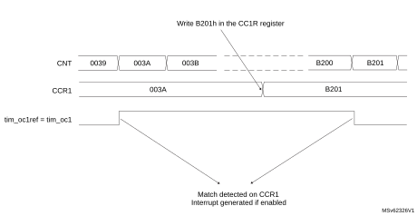

### 29.3.13 PWM mode

Pulse width modulation mode is used to generate a signal with a frequency determined by the value of the TIMx\_ARR register and a duty cycle determined by the value of the TIMx\_CCRx register.

The PWM mode can be selected independently on each channel (one PWM per tim\_ocx output) by writing 0110 (PWM mode 1) or 0111 (PWM mode 2) in the OCxM bits in the TIMx\_CCMRx register. The corresponding preload register must be enabled by setting the OCxPE bit in the TIMx\_CCMRx register, and eventually the autoreload preload register (in upcounting or center-aligned modes) by setting the ARPE bit in the TIMx\_CR1 register.

As the preload registers are transferred to the shadow registers only when an update event occurs, before starting the counter, all registers must be initialized by setting the UG bit in the TIMx\_EGR register.

tim\_ocx polarity is software programmable using the CCxP bit in the TIMx\_CCER register. It can be programmed as active high or active low. tim\_ocx output is enabled by a combination of the CCxE, CCxNE, MOE, OSSI, and OSSR bits (TIMx\_CCER and TIMx\_BDTR registers). Refer to the TIMx\_CCER register description for more details.

In PWM mode (1 or 2), TIMx\_CNT and TIMx\_CCRx are always compared to determine whether TIMx\_CCRx ≤ TIMx\_CNT or TIMx\_CNT ≤ TIMx\_CCRx (depending on the direction of the counter).

The timer is able to generate PWM in edge-aligned mode or center-aligned mode depending on the CMS bits in the TIMx\_CR1 register.

#### PWM edge-aligned mode

- Upcounting configuration

Upcounting is active when the DIR bit in the TIMx\_CR1 register is low. Refer to [Upcounting mode](#XREF_81227__Counter_behaviour_when_up-counting_only21).

In the following example, the mode is PWM mode 1. The reference PWM signal tim\_ocxref is high as long as TIMx\_CNT < TIMx\_CCRx else it becomes low. If the compare value in TIMx\_CCRx is greater than the autoreload value (in TIMx\_ARR) then tim\_ocxref is held at 1. If the compare value is zero then tim\_ocxref is held at 0. [Figure 329](#XREF_67642__Figure_46__Edge-aligned_PWM_waveforms21) shows some edge-aligned PWM waveforms in an example where TIMx\_ARR = 8.

#### Figure 329. Edge-aligned PWM waveforms (ARR = 8)

- Downcounting configuration

Downcounting is active when DIR bit in TIMx\_CR1 register is high. Refer to the [Downcounting mode](#XREF_59333__Down-counting_mode21)

In PWM mode 1, the reference signal tim\_ocxref is low as long as TIMx\_CNT > TIMx\_CCRx else it becomes high. If the compare value in TIMx\_CCRx is greater than the autoreload value in TIMx\_ARR, then tim\_ocxref is held at 1. 0% PWM is not possible in this mode.

#### PWM center-aligned mode

Center-aligned mode is active when the CMS bits in TIMx\_CR1 register are different from 00 (all the remaining configurations having the same effect on the tim\_ocxref/tim\_ocx signals). The compare flag is set when the counter counts up, when it counts down or both when it counts up and down depending on the CMS bits configuration. The direction bit (DIR) in the TIMx\_CR1 register is updated by hardware and must not be changed by software. Refer to [Center-aligned mode (up/down counting)](#XREF_25728__Counter_behaviour_in_center-aligned_mode_(up/down_counting)21).

[Figure 330](#XREF_83086__Figure_47__Center-aligned_PWM_waveforms_(ARR=8)21) shows some center-aligned PWM waveforms in an example where:

- TIMx\_ARR = 8
- PWM mode is the PWM mode 1
- The flag is set when the counter counts down corresponding to the center-aligned mode 1 selected for CMS = 01 in TIMx\_CR1 register.

#### Figure 330. Center-aligned PWM waveforms (ARR = 8)

Hints on using center-aligned mode:

- When starting in center-aligned mode, the current up-down configuration is used. It means that the counter counts up or down depending on the value written in the DIR bit in the TIMx\_CR1 register. Moreover, the DIR and CMS bits must not be changed at the same time by the software.
- Writing to the counter while running in center-aligned mode is not recommended as it can lead to unexpected results. In particular:
 - The direction is not updated if a value greater than the autoreload value is written in the counter (TIMx\_CNT > TIMx\_ARR). For example, if the counter was counting up, it continues to count up.
 - The direction is updated if 0 or the TIMx\_ARR value is written in the counter but no update event UEV is generated.
- The safest way to use center-aligned mode is to generate an update by software (setting the UG bit in the TIMx\_EGR register) just before starting the counter and not to write the counter while it is running.

#### Dithering mode

The PWM mode effective resolution can be increased by enabling the dithering mode, using the DITHEN bit in the TIMx\_CR1 register. This applies to both the CCR (for duty cycle resolution increase) and ARR (for PWM frequency resolution increase).

The operating principle is to have the actual CCR (or ARR) value slightly changed (adding or not one timer clock period) over 16 consecutive PWM periods, with predefined patterns. This allows a 16-fold resolution increase, considering the average duty cycle or PWM period. [Figure 331](#XREF_76202__Figure_169__Dithering_principle21) presents the dithering principle applied to four consecutive PWM cycles.

#### Figure 331. Dithering principle

When the dithering mode is enabled, the register coding is changed as follows (see [Figure 332](#XREF_41612__Figure_170__Data_format_and_register_coding_in_dithering_mode21) for example):

- The four LSBs are coding for the enhanced resolution part (fractional part).
- The MSBs are left-shifted to the bits 19:4 and are coding for the base value.

**Note:**

The ARR and CCR values will be updated automatically if the DITHEN bit is set / reset (for instance, if ARR= 0x05 with DITHEN = 0, it will be updated to ARR = 0x50 with DITHEN = 1).
The following sequence must be followed when resetting the DITHEN bit:

1. CEN and ARPE bits must be reset.

2. The ARR[3:0] bits must be reset.

3. The DITHEN bit must be reset.

4. The CCIF flags must be cleared.

5. The CEN bit can be set ( eventually with ARPE = 1).

#### Figure 332. Data format and register coding in dithering mode

The minimum frequency is given by the following formula:

**Note:**

The maximum TIMx\_ARR and TIMxCCRy values are limited to 0xFFFEF in dithering mode (corresponds to 65534 for the integer part and 15 for the dithered part).

As shown on [Figure 333](#XREF_81490__Figure_171__PWM_resolution_vs_frequency21), the dithering mode is used to increase the PWM resolution whatever the PWM frequency.

#### Figure 333. PWM resolution vs frequency

The duty cycle and/or period changes are spread over 16 consecutive periods, as described in [Figure 334](#XREF_22045__Figure_171__PWM_dithering_pattern21).

#### Figure 334. PWM dithering pattern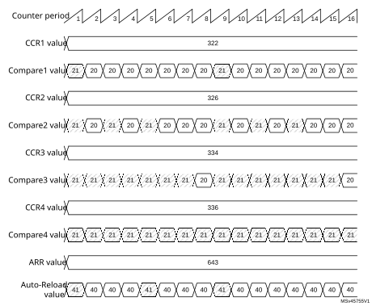

The autoreload and compare values increments are spread following specific patterns described in [Table 273](#XREF_12462__Table_116__CCR_and_ARR_register_change_dithering_pattern21). The dithering sequence is done to have increments distributed as evenly as possible and minimize the overall ripple.

 

<table class="TableTitle"><caption class="TableCap"><h4 class="TableCap" id="14244082">Table 273. <a id="pattern21" name="XREF_12462__Table_116__CCR_and_ARR_register_change_dithering_pattern21">CCR and ARR register change dithering pattern</a></h4></caption><col width="80.39px"/><col width="28.64px"/><col width="28.64px"/><col width="28.64px"/><col width="28.64px"/><col width="28.64px"/><col width="28.64px"/><col width="28.64px"/><col width="28.64px"/><col width="28.64px"/><col width="28.64px"/><col width="28.64px"/><col width="28.64px"/><col width="28.64px"/><col width="28.64px"/><col width="28.64px"/><col width="28.64px"/><thead><tr height="28.00px"><th rowspan="2">
LSB value
</th><th colspan="16">
PWM period
</th></tr><tr height="28.00px"><th>
1
</th><th>
2
</th><th>
3
</th><th>
4
</th><th>
5
</th><th>
6
</th><th>
7
</th><th>
8
</th><th>
9
</th><th>
10
</th><th>
11
</th><th>
12
</th><th>
13
</th><th>
14
</th><th>
15
</th><th>
16
</th></tr></thead><tr height="22.67px"><td>
0000
</td><td>
-
</td><td>
-
</td><td>
-
</td><td>
-
</td><td>
-
</td><td>
-
</td><td>
-
</td><td>
-
</td><td>
-
</td><td>
-
</td><td>
-
</td><td>
-
</td><td>
-
</td><td>
-
</td><td>
-
</td><td>
-
</td></tr><tr height="22.67px"><td>
0001
</td><td>
+1
</td><td>
-
</td><td>
-
</td><td>
-
</td><td>
-
</td><td>
-
</td><td>
-
</td><td>
-
</td><td>
-
</td><td>
-
</td><td>
-
</td><td>
-
</td><td>
-
</td><td>
-
</td><td>
-
</td><td>
-
</td></tr><tr height="22.67px"><td>
0010
</td><td>
+1
</td><td>
-
</td><td>
-
</td><td>
-
</td><td>
-
</td><td>
-
</td><td>
-
</td><td>
-
</td><td>
+1
</td><td>
-
</td><td>
-
</td><td>
-
</td><td>
-
</td><td>
-
</td><td>
-
</td><td>
-
</td></tr><tr height="22.67px"><td>
0011
</td><td>
+1
</td><td>
-
</td><td>
-
</td><td>
-
</td><td>
+1
</td><td>
-
</td><td>
-
</td><td>
-
</td><td>
+1
</td><td>
-
</td><td>
-
</td><td>
-
</td><td>
-
</td><td>
-
</td><td>
-
</td><td>
-
</td></tr><tr height="22.67px"><td>
0100
</td><td>
+1
</td><td>
-
</td><td>
-
</td><td>
-
</td><td>
+1
</td><td>
-
</td><td>
-
</td><td>
-
</td><td>
+1
</td><td>
-
</td><td>
-
</td><td>
-
</td><td>
+1
</td><td>
-
</td><td>
-
</td><td>
-
</td></tr><tr height="22.67px"><td>
0101
</td><td>
+1
</td><td>
-
</td><td>
+1
</td><td>
-
</td><td>
+1
</td><td>
-
</td><td>
-
</td><td>
-
</td><td>
+1
</td><td>
-
</td><td>
-
</td><td>
-
</td><td>
+1
</td><td>
-
</td><td>
-
</td><td>
-
</td></tr><tr height="22.67px"><td>
0110
</td><td>
+1
</td><td>
-
</td><td>
+1
</td><td>
-
</td><td>
+1
</td><td>
-
</td><td>
-
</td><td>
-
</td><td>
+1
</td><td>
-
</td><td>
+1
</td><td>
-
</td><td>
+1
</td><td>
-
</td><td>
-
</td><td>
-
</td></tr><tr height="22.67px"><td>
0111
</td><td>
+1
</td><td>
-
</td><td>
+1
</td><td>
-
</td><td>
+1
</td><td>
-
</td><td>
+1
</td><td>
-
</td><td>
+1
</td><td>
-
</td><td>
+1
</td><td>
-
</td><td>
+1
</td><td>
-
</td><td>
-
</td><td>
-
</td></tr><tr height="22.67px"><td>
1000
</td><td>
+1
</td><td>
-
</td><td>
+1
</td><td>
-
</td><td>
+1
</td><td>
-
</td><td>
+1
</td><td>
-
</td><td>
+1
</td><td>
-
</td><td>
+1
</td><td>
-
</td><td>
+1
</td><td>
-
</td><td>
+1
</td><td>
-
</td></tr><tr height="22.67px"><td>
1001
</td><td>
+1
</td><td>
+1
</td><td>
+1
</td><td>
-
</td><td>
+1
</td><td>
-
</td><td>
+1
</td><td>
-
</td><td>
+1
</td><td>
-
</td><td>
+1
</td><td>
-
</td><td>
+1
</td><td>
-
</td><td>
+1
</td><td>
-
</td></tr><tr height="22.67px"><td>
1010
</td><td>
+1
</td><td>
+1
</td><td>
+1
</td><td>
-
</td><td>
+1
</td><td>
-
</td><td>
+1
</td><td>
-
</td><td>
+1
</td><td>
+1
</td><td>
+1
</td><td>
-
</td><td>
+1
</td><td>
-
</td><td>
+1
</td><td>
-
</td></tr><tr height="22.67px"><td>
1011
</td><td>
+1
</td><td>
+1
</td><td>
+1
</td><td>
-
</td><td>
+1
</td><td>
+1
</td><td>
+1
</td><td>
-
</td><td>
+1
</td><td>
+1
</td><td>
+1
</td><td>
-
</td><td>
+1
</td><td>
-
</td><td>
+1
</td><td>
-
</td></tr><tr height="22.67px"><td>
1100
</td><td>
+1
</td><td>
+1
</td><td>
+1
</td><td>
-
</td><td>
+1
</td><td>
+1
</td><td>
+1
</td><td>
-
</td><td>
+1
</td><td>
+1
</td><td>
+1
</td><td>
-
</td><td>
+1
</td><td>
+1
</td><td>
+1
</td><td>
-
</td></tr><tr height="22.67px"><td>
1101
</td><td>
+1
</td><td>
+1
</td><td>
+1
</td><td>
+1
</td><td>
+1
</td><td>
+1
</td><td>
+1
</td><td>
-
</td><td>
+1
</td><td>
+1
</td><td>
+1
</td><td>
-
</td><td>
+1
</td><td>
+1
</td><td>
+1
</td><td>
-
</td></tr><tr height="22.67px"><td>
1110
</td><td>
+1
</td><td>
+1
</td><td>
+1
</td><td>
+1
</td><td>
+1
</td><td>
+1
</td><td>
+1
</td><td>
-
</td><td>
+1
</td><td>
+1
</td><td>
+1
</td><td>
+1
</td><td>
+1
</td><td>
+1
</td><td>
+1
</td><td>
-
</td></tr><tr height="22.67px"><td>
1111
</td><td>
+1
</td><td>
+1
</td><td>
+1
</td><td>
+1
</td><td>
+1
</td><td>
+1
</td><td>
+1
</td><td>
+1
</td><td>
+1
</td><td>
+1
</td><td>
+1
</td><td>
+1
</td><td>
+1
</td><td>
+1
</td><td>
+1
</td><td>
-
</td></tr></table>

The dithering mode is also available in center-aligned PWM mode (CMS bits in TIMx\_CR1 register are not equal to 00). In this case, the dithering pattern is applied over eight consecutive PWM periods, considering the up and down counting phases as shown in [Figure 335](#XREF_24690__Figure_301__Dithering_effect_on_duty_cycle_in_center-aligned_P21).

#### Figure 335. Dithering effect on duty cycle in center-aligned PWM mode

[Table 274](#XREF_86475__Table_229__CCR_register_change_dithering_pattern_in_center-al21) shows how the dithering pattern is added in center-aligned PWM mode.

 

<table class="TableTitle"><caption class="Body"><h4 class="TableCap" id="15739009">Table 274. <a id="center-al21" name="XREF_86475__Table_229__CCR_register_change_dithering_pattern_in_center-al21">CCR register change dithering pattern in center-aligned PWM mode</a></h4></caption><col width="55.73px"/><col width="34.90px"/><col width="34.90px"/><col width="34.90px"/><col width="34.90px"/><col width="34.90px"/><col width="34.90px"/><col width="34.90px"/><col width="34.90px"/><col width="34.90px"/><col width="34.90px"/><col width="34.90px"/><col width="34.90px"/><col width="34.90px"/><col width="34.90px"/><col width="34.90px"/><col width="34.90px"/><thead><tr height="28.00px"><th rowspan="3">
LSB value
</th><th colspan="16">
PWM period
</th></tr><tr height="28.00px"><th colspan="2">
1
</th><th colspan="2">
2
</th><th colspan="2">
3
</th><th colspan="2">
4
</th><th colspan="2">
5
</th><th colspan="2">
6
</th><th colspan="2">
7
</th><th colspan="2">
8
</th></tr><tr height="28.00px"><th>
Up 
</th><th>
Dn
</th><th>
Up
</th><th>
Dn
</th><th>
Up
</th><th>
Dn
</th><th>
Up
</th><th>
Dn
</th><th>
Up
</th><th>
Dn
</th><th>
Up
</th><th>
Dn
</th><th>
Up
</th><th>
Dn
</th><th>
Up
</th><th>
Dn
</th></tr></thead><tr height="22.67px"><td>
0000
</td><td>
-
</td><td>
-
</td><td>
-
</td><td>
-
</td><td>
-
</td><td>
-
</td><td>
-
</td><td>
-
</td><td>
-
</td><td>
-
</td><td>
-
</td><td>
-
</td><td>
-
</td><td>
-
</td><td>
-
</td><td>
-
</td></tr><tr height="22.67px"><td>
0001
</td><td>
+1
</td><td>
-
</td><td>
-
</td><td>
-
</td><td>
-
</td><td>
-
</td><td>
-
</td><td>
-
</td><td>
-
</td><td>
-
</td><td>
-
</td><td>
-
</td><td>
-
</td><td>
-
</td><td>
-
</td><td>
-
</td></tr><tr height="22.67px"><td>
0010
</td><td>
+1
</td><td>
-
</td><td>
-
</td><td>
-
</td><td>
-
</td><td>
-
</td><td>
-
</td><td>
-
</td><td>
+1
</td><td>
-
</td><td>
-
</td><td>
-
</td><td>
-
</td><td>
-
</td><td>
-
</td><td>
-
</td></tr><tr height="22.67px"><td>
0011
</td><td>
+1
</td><td>
-
</td><td>
-
</td><td>
-
</td><td>
+1
</td><td>
-
</td><td>
-
</td><td>
-
</td><td>
+1
</td><td>
-
</td><td>
-
</td><td>
-
</td><td>
-
</td><td>
-
</td><td>
-
</td><td>
-
</td></tr><tr height="22.67px"><td>
0100
</td><td>
+1
</td><td>
-
</td><td>
-
</td><td>
-
</td><td>
+1
</td><td>
-
</td><td>
-
</td><td>
-
</td><td>
+1
</td><td>
-
</td><td>
-
</td><td>
-
</td><td>
+1
</td><td>
-
</td><td>
-
</td><td>
-
</td></tr><tr height="22.67px"><td>
0101
</td><td>
+1
</td><td>
-
</td><td>
+1
</td><td>
-
</td><td>
+1
</td><td>
-
</td><td>
-
</td><td>
-
</td><td>
+1
</td><td>
-
</td><td>
-
</td><td>
-
</td><td>
+1
</td><td>
-
</td><td>
-
</td><td>
-
</td></tr><tr height="22.67px"><td>
0110
</td><td>
+1
</td><td>
-
</td><td>
+1
</td><td>
-
</td><td>
+1
</td><td>
-
</td><td>
-
</td><td>
-
</td><td>
+1
</td><td>
-
</td><td>
+1
</td><td>
-
</td><td>
+1
</td><td>
-
</td><td>
-
</td><td>
-
</td></tr><tr height="22.67px"><td>
0111
</td><td>
+1
</td><td>
-
</td><td>
+1
</td><td>
-
</td><td>
+1
</td><td>
-
</td><td>
+1
</td><td>
-
</td><td>
+1
</td><td>
-
</td><td>
+1
</td><td>
-
</td><td>
+1
</td><td>
-
</td><td>
-
</td><td>
-
</td></tr><tr height="22.67px"><td>
1000
</td><td>
+1
</td><td>
-
</td><td>
+1
</td><td>
-
</td><td>
+1
</td><td>
-
</td><td>
+1
</td><td>
-
</td><td>
+1
</td><td>
-
</td><td>
+1
</td><td>
-
</td><td>
+1
</td><td>
-
</td><td>
+1
</td><td>
-
</td></tr><tr height="22.67px"><td>
1001
</td><td>
+1
</td><td>
+1
</td><td>
+1
</td><td>
-
</td><td>
+1
</td><td>
-
</td><td>
+1
</td><td>
-
</td><td>
+1
</td><td>
-
</td><td>
+1
</td><td>
-
</td><td>
+1
</td><td>
-
</td><td>
+1
</td><td>
-
</td></tr><tr height="22.67px"><td>
1010
</td><td>
+1
</td><td>
+1
</td><td>
+1
</td><td>
-
</td><td>
+1
</td><td>
-
</td><td>
+1
</td><td>
-
</td><td>
+1
</td><td>
+1
</td><td>
+1
</td><td>
-
</td><td>
+1
</td><td>
-
</td><td>
+1
</td><td>
-
</td></tr><tr height="22.67px"><td>
1011
</td><td>
+1
</td><td>
+1
</td><td>
+1
</td><td>
-
</td><td>
+1
</td><td>
+1
</td><td>
+1
</td><td>
-
</td><td>
+1
</td><td>
+1
</td><td>
+1
</td><td>
-
</td><td>
+1
</td><td>
-
</td><td>
+1
</td><td>
-
</td></tr><tr height="22.67px"><td>
1100
</td><td>
+1
</td><td>
+1
</td><td>
+1
</td><td>
-
</td><td>
+1
</td><td>
+1
</td><td>
+1
</td><td>
-
</td><td>
+1
</td><td>
+1
</td><td>
+1
</td><td>
-
</td><td>
+1
</td><td>
+1
</td><td>
+1
</td><td>
-
</td></tr><tr height="22.67px"><td>
1101
</td><td>
+1
</td><td>
+1
</td><td>
+1
</td><td>
+1
</td><td>
+1
</td><td>
+1
</td><td>
+1
</td><td>
-
</td><td>
+1
</td><td>
+1
</td><td>
+1
</td><td>
-
</td><td>
+1
</td><td>
+1
</td><td>
+1
</td><td>
-
</td></tr><tr height="22.67px"><td>
1110
</td><td>
+1
</td><td>
+1
</td><td>
+1
</td><td>
+1
</td><td>
+1
</td><td>
+1
</td><td>
+1
</td><td>
-
</td><td>
+1
</td><td>
+1
</td><td>
+1
</td><td>
+1
</td><td>
+1
</td><td>
+1
</td><td>
+1
</td><td>
-
</td></tr><tr height="22.67px"><td>
1111
</td><td>
+1
</td><td>
+1
</td><td>
+1
</td><td>
+1
</td><td>
+1
</td><td>
+1
</td><td>
+1
</td><td>
+1
</td><td>
+1
</td><td>
+1
</td><td>
+1
</td><td>
+1
</td><td>
+1
</td><td>
+1
</td><td>
+1
</td><td>
-
</td></tr></table>

### 29.3.14 Asymmetric PWM mode

Asymmetric mode allows two center-aligned PWM signals to be generated with a programmable phase shift. While the frequency is determined by the value of the TIMx\_ARR register, the duty cycle and the phase-shift are determined by a pair of TIMx\_CCRx register. One register controls the PWM during up-counting, the second during down counting, so that PWM is adjusted every half PWM cycle:

 - tim\_oc1refc (or tim\_oc2refc) is controlled by TIMx\_CCR1 and TIMx\_CCR2
 - tim\_oc3refc (or tim\_oc4refc) is controlled by TIMx\_CCR3 and TIMx\_CCR4

Asymmetric PWM mode can be selected independently on two channel (one tim\_ocx output per pair of CCR registers) by writing 1110 (Asymmetric PWM mode 1) or 1111 (Asymmetric PWM mode 2) in the OCxM bits in the TIMx\_CCMRx register.

**Note:**

The OCxM[3:0] bitfield is split into two parts for compatibility reasons, the most significant bit is not contiguous with the three least significant ones.

When a given channel is used as asymmetric PWM channel, its complementary channel can also be used. For instance, if an tim\_oc1refc signal is generated on channel 1 (Asymmetric PWM mode 1), it is possible to output either the tim\_oc2ref signal on channel 2, or an tim\_oc2refc signal resulting from asymmetric PWM mode 1.

[Figure 336](#XREF_43811__Figure_36__Generation_of_2_phase-shifted_PWM_signals_with_50%_duty_cycle21) represents an example of signals that can be generated using asymmetric PWM mode (channels 1 to 4 are configured in asymmetric PWM mode 2). Together with the deadtime generator, this allows a full-bridge phase-shifted DC to DC converter to be controlled.

#### Figure 336. 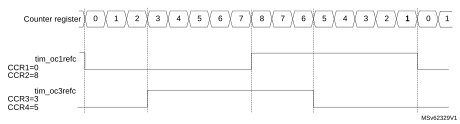Generation of 2 phase-shifted PWM signals with 50% duty cycle

### 29.3.15 Combined PWM mode

Combined PWM mode allows two edge or center-aligned PWM signals to be generated with programmable delay and phase shift between respective pulses. While the frequency is determined by the value of the TIMx\_ARR register, the duty cycle and delay are determined by the two TIMx\_CCRx registers. The resulting signals, tim\_ocxrefc, are made of an OR or AND logical combination of two reference PWMs:

- tim\_oc1refc (or tim\_oc2refc) is controlled by TIMx\_CCR1 and TIMx\_CCR2
- tim\_oc3refc (or tim\_oc4refc) is controlled by TIMx\_CCR3 and TIMx\_CCR4

Combined PWM mode can be selected independently on two channels (one tim\_ocx output per pair of CCR registers) by writing 1100 (Combined PWM mode 1) or 1101 (Combined PWM mode 2) in the OCxM bits in the TIMx\_CCMRx register.

When a given channel is used as combined PWM channel, its complementary channel must be configured in the opposite PWM mode (for instance, one in Combined PWM mode 1 and the other in Combined PWM mode 2).

**Note:**

The OCxM[3:0] bitfield is split into two parts for compatibility reasons, the most significant bit is not contiguous with the three least significant ones.

[Figure 337](#XREF_58244__Figure_37__Combined_PWM_mode_on_channel_1_and_321) represents an example of signals that can be generated using combined PWM mode, obtained with the following configuration:

- Channel 1 is configured in Combined PWM mode 2.
- Channel 2 is configured in PWM mode 1.
- Channel 3 is configured in Combined PWM mode 2.
- Channel 4 is configured in PWM mode 1.

#### Figure 337. Combined PWM mode on channel 1 and 3

### 29.3.16 Combined 3-phase PWM mode

Combined 3-phase PWM mode allows one to three center-aligned PWM signals to be generated with a single programmable signal ANDed in the middle of the pulses. The tim\_oc5ref signal is used to define the resulting combined signal. The 3-bits GC5C[3:1] in the TIMx\_CCR5 allow selection on which reference signal the tim\_oc5ref is combined. The resulting signals, tim\_ocxrefc, are made of an AND logical combination of two reference PWMs:

- If GC5C1 is set, tim\_oc1refc is controlled by TIMx\_CCR1 and TIMx\_CCR5.
- If GC5C2 is set, tim\_oc2refc is controlled by TIMx\_CCR2 and TIMx\_CCR5.
- If GC5C3 is set, tim\_oc3refc is controlled by TIMx\_CCR3 and TIMx\_CCR5.

Combined 3-phase PWM mode can be selected independently on channels 1 to 3 by setting at least one of the 3-bits GC5C[3:1].

#### Figure 338. 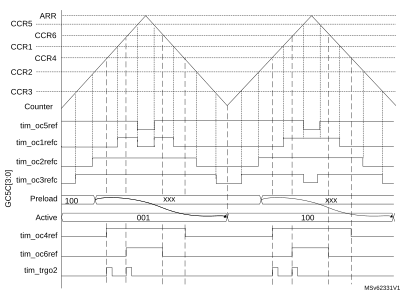3-phase combined PWM signals with multiple trigger pulses per period

The tim\_trgo2 waveform shows how the ADC can be synchronized on given 3-phase PWM signals. Refer to [Section 29.3.31: ADC triggers](#XREF_19651__1_4_18_Timer_synchronization21) for more details.

### 29.3.17 Complementary outputs and dead-time insertion

The advanced-control timers (TIM1/TIM8/TIM20) can output two complementary signals and manage the switching-off and the switching-on instants of the outputs.

This time is generally known as dead-time and it has to be adjusted depending on the devices that are connected to the outputs and their characteristics (such as intrinsic delays of level-shifters, or delays due to power switches).

The polarity of the outputs (main output tim\_ocx or complementary tim\_ocxn) can be selected independently for each output. This is done by writing to the CCxP and CCxNP bits in the TIMx\_CCER register.

The complementary signals tim\_ocx and tim\_ocxn are activated by a combination of several control bits: the CCxE and CCxNE bits in the TIMx\_CCER register and the MOE, OISx, OISxN, OSSI, and OSSR bits in the TIMx\_BDTR and TIMx\_CR2 registers. Refer to [Table 282: Output control bits for complementary tim\_ocx and tim\_ocxn channels with break feature](#XREF_94940__Table_2__Output_Control_bits_for_complementary_OCx_and_OCxN_Channels_with21) for more details. In particular, the dead-time is activated when switching to the idle state (MOE falling down to 0).

Dead-time insertion is enabled by setting both CCxE and CCxNE bits, and the MOE bit if the break circuit is present. There is one 10-bit dead-time generator for each channel. From a reference waveform tim\_ocxref, it generates two outputs tim\_ocx and tim\_ocxn. If tim\_ocx and tim\_ocxn are active high:

- The tim\_ocx output signal is the same as the reference signal except for the rising edge, which is delayed relative to the reference rising edge.
- The tim\_ocxn output signal is the opposite of the reference signal except for the rising edge, which is delayed relative to the reference falling edge.

If the delay is greater than the width of the active output (tim\_ocx or tim\_ocxn) then the corresponding pulse is not generated.

The following figures show the relationships between the output signals of the dead-time generator and the reference signal tim\_ocxref considering CCxP = 0, CCxNP = 0, MOE = 1, CCxE = 1 and CCxNE = 1 in these examples.

#### Figure 339. Complementary output with symmetrical dead-time insertion

The DTAE bit in the TIMx\_DTR2 is used to differentiate the deadtime values for rising and falling edges of the reference signal, as shown on [Figure 340](#XREF_34289__Figure_177__Asymmetrical_deadtime21).

In asymmetrical mode (DTAE = 1), the rising edge-referred deadtime is defined by the DTG[7:0] bitfield in the TIMx\_BDTR register, while the falling edge-referred is defined by the DTGF[7:0] bitfield in the TIMx\_DTR2 register. The DTAE bit must be written before enabling the counter and must not be modified while CEN = 1.

It is possible to have the deadtime value updated on-the-fly during pwm operation, using a preload mechanism. The deadtime bitfield DTG[7:0] and DTGF[7:0] are preloaded when the DTPE bit is set, in the TIMX\_DTR2 register. The preload value is loaded in the active register on the next update event.

**Note:**

If the DTPE bit is enabled while the counter is enabled, any new value written since last update is discarded and previous value is used.

#### Figure 340. Asymmetrical deadtime

#### Figure 341. Dead-time waveforms with delay greater than the negative pulse

#### Figure 342. Dead-time waveforms with delay greater than the positive pulse

The dead-time delay is the same for each of the channels and is programmable with the DTG bits in the TIMx\_BDTR register. Refer to [Section 29.6.20: TIMx break and dead-time register (TIMx\_BDTR)(x = 1, 8, 20)](#XREF_37586__28_6_20_TIMx_break_and_dead-time_register_(TIM1_BDTR)(TIMx_BDTR)(x_=_1%2C_8)21) for delay calculation.

#### Redirecting tim\_ocxref to tim\_ocx or tim\_ocxn

In output mode (forced, output compare or PWM), tim\_ocxref can be redirected to the tim\_ocx output or to tim\_ocxn output by configuring the CCxE and CCxNE bits in the TIMx\_CCER register.

This is used to send a specific waveform (such as PWM or static active level) on one output while the complementary remains at its inactive level. Other alternative possibilities are to have both outputs at inactive level or both outputs active and complementary with dead-time.

**Note:**

When only tim\_ocxn is enabled (CCxE = 0, CCxNE = 1), it is not complemented and becomes active as soon as tim\_ocxref is high. For example, if CCxNP = 0 then tim\_ocxn = tim\_ocxref. On the other hand, when both tim\_ocx and tim\_ocxn are enabled (CCxE = CCxNE = 1) tim\_ocx becomes active when tim\_ocxref is high whereas tim\_ocxn is complemented and becomes active when tim\_ocxref is low.

### 29.3.18 Using the break function

The purpose of the break function is to protect power switches driven by PWM signals generated with the timers. The two break inputs are usually connected to fault outputs of power stages and 3-phase inverters. When activated, the break circuitry shuts down the PWM outputs and forces them to a predefined safe state. A number of internal MCU events can also be selected to trigger an output shut-down.

The break features two channels. A break channel which gathers both system-level fault (clock failure, ECC/parity errors,...) and application fault (from input pins and built-in comparator), and can force the outputs to a predefined level (either active or inactive) after a deadtime duration. A break2 channel which only includes application faults and is able to force the outputs to an inactive state.

The output enable signal and output levels during break are depending on several control bits:

- The MOE bit in TIMx\_BDTR register is used to enable/disable the outputs by software and is reset in case of break or break2 event.
- The OSSI bit in the TIMx\_BDTR register defines whether the timer controls the output in inactive state or releases the control to the GPIO controller (typically to have it in Hi-Z mode)
- The OISx and OISxN bits in the TIMx\_CR2 register which are setting the output shut-down level, either active or inactive. The tim\_ocx and tim\_ocxn outputs cannot be set both to active level at a given time, whatever the OISx and OISxN values. Refer to [Table 282: Output control bits for complementary tim\_ocx and tim\_ocxn channels with break feature](#XREF_94940__Table_2__Output_Control_bits_for_complementary_OCx_and_OCxN_Channels_with21) for more details.

When exiting from reset, the break circuit is disabled and the MOE bit is low. The break functions can be enabled by setting the BKE and BK2E bits in the TIMx\_BDTR register. The break input polarities can be selected by configuring the BKP and BK2P bits in the same register. BKEx and BKPx can be modified at the same time. When the BKEx and BKPx bits are written, a delay of one APB clock cycle is applied before the writing is effective. Consequently, it is necessary to wait one APB clock period to correctly read back the bit after the write operation.

Because MOE falling edge can be asynchronous, a resynchronization circuit has been inserted between the actual signal (acting on the outputs) and the synchronous control bit (accessed in the TIMx\_BDTR register). It results in some delays between the asynchronous and the synchronous signals. In particular, if MOE is set to 1 whereas it was low, a delay must be inserted (dummy instruction) before reading it correctly. This is because the write acts on the asynchronous signal whereas the read reflects the synchronous signal.

The sources for break (tim\_brk) channel are:

- External sources connected to one of the TIMx\_BKIN pin (as per selection done in the GPIO alternate function selection registers), with polarity selection and optional digital filtering
- Internal sources:
 - coming from a tim\_brk\_cmpx input (refer to [Section 29.3.2: TIM1/TIM8/TIM20 pins and internal signals](#XREF_43687__27_3_TIM1/TIM8/TIM20_pins_and_internal_signals21) for product specific implementation)
 - coming from a system break request (refer to [Section 29.3.2: TIM1/TIM8/TIM20 pins and internal signals](#XREF_43687__27_3_TIM1/TIM8/TIM20_pins_and_internal_signals21) for product specific implementation)

The sources for break2 (tim\_brk2) are:

- External sources connected to one of the TIMx\_BKIN2 pin (as per selection done in the GPIO alternate function selection registers), with polarity selection and optional digital filtering
- Internal sources coming from a tim\_brk2\_cmpx input (refer to [Section 29.3.2: TIM1/TIM8/TIM20 pins and internal signals](#XREF_43687__27_3_TIM1/TIM8/TIM20_pins_and_internal_signals21) for product specific implementation)

Break events can also be generated by software using BG and B2G bits in the TIMx\_EGR register.

All sources are ORed before entering the timer tim\_brk or tim\_brk2 inputs, as per [Figure 343](#XREF_61467__Figure_145__Break_and_Break2_circuitry_overview21) below.

#### Figure 343. Break and Break2 circuitry overview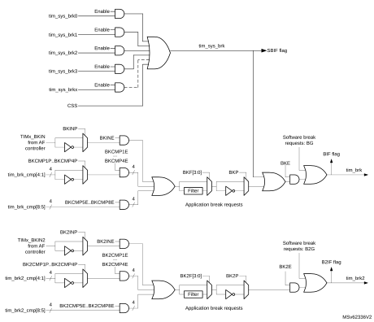

**Note:**

An asynchronous (clockless) operation is only guaranteed when the programmable filter is disabled. If it is enabled, a fail safe clock mode (for example by using the internal PLL and/or the CSS) must be used to guarantee that break events are handled.

When one of the breaks occurs (selected level on one of the break inputs):

- The MOE bit is cleared asynchronously, putting the outputs in inactive state, idle state, or even releasing the control to the GPIO controller (selected by the OSSI bit). This feature is enabled even if the MCU oscillator is off.
- Each output channel is driven with the level programmed in the OISx bit in the TIMx\_CR2 register as soon as MOE = 0. If OSSI = 0, the timer releases the output control (taken over by the GPIO controller), otherwise the enable output remains high.
- When complementary outputs are used:
 - The outputs are first put in inactive state (depending on the polarity). This is done asynchronously so that it works even if no clock is provided to the timer.
 - If the timer clock is still present, then the dead-time generator is reactivated in order to drive the outputs with the level programmed in the OISx and OISxN bits after a dead-time. Even in this case, tim\_ocx and tim\_ocxn cannot be driven to their active level together. Note that because of the resynchronization on MOE, the dead-time duration is slightly longer than usual (around 2 tim\_ker\_ck clock cycles).
 - If OSSI = 0, the timer releases the output control (taken over by the GPIO controller which forces a Hi-Z state), otherwise the enable outputs remain or become high as soon as one of the CCxE or CCxNE bits is high.
- The break status flag (SBIF, BIF, and B2IF bits in the TIMx\_SR register) is set. An interrupt is generated if the BIE bit in the TIMx\_DIER register is set. A DMA request can be sent if the BDE bit in the TIMx\_DIER register is set.
- If the AOE bit in the TIMx\_BDTR register is set, the MOE bit is automatically set again at the next update event (UEV). As an example, this can be used to perform a regulation. Otherwise, MOE remains low until the application sets it to 1 again. In this case, it can be used for security and the break input can be connected to an alarm from power drivers, thermal sensors, or any security components.

**Note:**

If the MOE is reset by the CPU while the AOE bit is set, the outputs are in idle state and forced to inactive level or Hi-Z depending on OSSI value. If both the MOE and AOE bits are reset by the CPU, the outputs are in disabled state and driven with the level programmed in the OISx bit in the TIMx\_CR2 register.

The break inputs are active on level. Thus, the MOE cannot be set while the break input is active (neither automatically nor by software). In the meantime, the status flag BIF and B2IF cannot be cleared.

In addition to the break input and the output management, a write protection has been implemented inside the break circuit to safeguard the application. It is used to freeze the configuration of several parameters (dead-time duration, tim\_ocx/tim\_ocxn polarities and state when disabled, OCxM configurations, break enable, and polarity). The application can choose from three levels of protection selected by the LOCK bits in the TIMx\_BDTR register. Refer to [Section 29.6.20](#XREF_37586__28_6_20_TIMx_break_and_dead-time_register_(TIM1_BDTR)(TIMx_BDTR)(x_=_1%2C_8)21). The LOCK bits can be written only once after an MCU reset.

[Figure 344](#XREF_25892__Figure_55__Outputs_behaviour_in_response_to_a_break_21) shows an example of behavior of the outputs in response to a break.

#### Figure 344. Various output behavior in response to a break event on tim\_brk (OSSI = 1)

The two break inputs have different behaviors on timer outputs:

- The tim\_brk input can either disable (inactive state) or force the PWM outputs to a predefined safe state.
- tim\_brk2 can only disable (inactive state) the PWM outputs.

The tim\_brk has a higher priority than tim\_brk2 input, as described in [Table 275](#XREF_95309__Table_4__Behaviour_of_timer_outputs_versus_BRKIN/BKIN2_inputs21).

**Note:**

tim\_brk2 must only be used with OSSR = OSSI = 1.

 

<table class="TableTitle"><caption class="SoftTableCap"><h4 class="TableCap" id="1018349">Table 275. <a id="inputs21" name="XREF_95309__Table_4__Behaviour_of_timer_outputs_versus_BRKIN_BKIN2_inputs21">Behavior of timer outputs versus tim_brk/tim_brk2 inputs</a></h4></caption><col width="79.04px"/><col width="76.81px"/><col width="115.29px"/><col width="134.19px"/><col width="133.25px"/><thead><tr height="28.00px"><th rowspan="2">
tim_brk
</th><th rowspan="2">
tim_brk2
</th><th rowspan="2">
Timer outputs state
</th><th colspan="2">
Typical use case
</th></tr><tr height="42.67px"><th>
tim_ocxn output (low side switches)
</th><th>
tim_ocx output (high side switches)
</th></tr></thead><tr height="142.67px"><td>
Active
</td><td>
X
</td><td><li class="TableBullet" id="1018383">–​Inactive then forced output state (after a deadtime)</li><li class="TableBullet" id="1018384">–​Outputs disabled if OSSI = 0 (control taken over by GPIO logic)</li></td><td>
ON after deadtime insertion
</td><td>
OFF
</td></tr><tr height="22.67px"><td>
Inactive
</td><td>
Active
</td><td>
Inactive
</td><td>
OFF
</td><td>
OFF
</td></tr></table>

[Figure 345](#XREF_51597__Figure_148__PWM_output_state_following_BRK_and_BRK2_pins_asser21) gives an example of tim\_ocx and tim\_ocxn output behavior in case of active signals on tim\_brk and tim\_brk2 inputs. In this case, both outputs have active high polarities (CCxP = CCxNP = 0 in TIMx\_CCER register).

#### Figure 345. PWM output state following tim\_brk and tim\_brk2 assertion (OSSI = 1)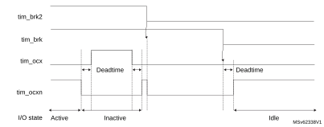

#### Figure 346. 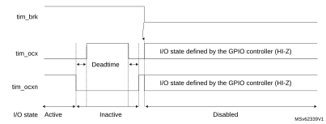PWM output state following tim\_brk assertion (OSSI = 0)

### 29.3.19 Bidirectional break inputs

The TIM1/TIM8/TIM20 feature bidirectional break I/Os, as represented on [Figure 347](#XREF_18520__Figure_217__Output_redirection21).

This provides support for:

- A board-level global break signal available for signaling faults to external MCUs or gate drivers, with a unique pin being both an input and an output status pin.
- Internal break sources and multiple external open drain sources ORed together to trigger a unique break event, when multiple internal and external break sources must be merged.

The tim\_brk and tim\_brk2 inputs are configured in bidirectional mode using the BKBID and BK2BID bits in the TIMxBDTR register. The BKBID programming bits can be locked in read-only mode using the LOCK bits in the TIMxBDTR register (in LOCK level 1 or above).

The bidirectional mode is available for both the tim\_brk and tim\_brk2 inputs, and require the I/O to be configured in open-drain mode with active low polarity (using BKINP, BKP, BK2INP and BK2P bits). Any break request coming either from system (for example CSS), from on-chip peripherals, or from break inputs forces a low level on the break input to signal the fault event. The bidirectional mode is inhibited if the polarity bits are not correctly set (active high polarity), for safety purposes.

The break software events (BG and B2G) also cause the break I/O to be forced to 0 to indicate to the external components that the timer is entered in break state. However, this is valid only if the break is enabled (BKE or B2KE = 1). When a software break event is generated with BKE or B2KE = 0), the outputs are put in safe state and the break flag is set, but there is no effect on the TIMx\_BKIN and TIMx\_BKIN2 I/Os.

A safe disarming mechanism prevents the system to be definitively locked-up (a low level on the break input triggers a break which enforces a low level on the same input).

When the BKDSRM (BK2DSRM) bit is set to 1, this releases the break output to clear a fault signal and to give the possibility to re-arm the system.

At no point the break protection circuitry can be disabled:

- The break input path is always active: a break event is active even if the BKDSRM (BK2DSRM) bit is set and the open drain control is released. This prevents the PWM output to be restarted as long as the break condition is present.
- The BKDSRM (BK2DSRM) bit cannot disarm the break protection as long as the outputs are enabled (MOE bit is set) (see [Table 276](#XREF_40734__Table_113__Break_protection_disarming_conditions21)).

 

<table class="TableTitle"><caption class="TableCap"><h4 class="TableCap" id="14494533">Table 276. <a id="conditions21" name="XREF_40734__Table_113__Break_protection_disarming_conditions21">Break protection disarming conditions</a></h4></caption><col width="134.65px"/><col width="134.65px"/><col width="134.65px"/><col width="134.65px"/><thead><tr height="46.67px"><th>
MOE
</th><th>
BKBID

(BK2BID)
</th><th>
BKDSRM

(BK2DSRM)
</th><th>
Break protection state
</th></tr></thead><tr height="22.67px"><td>
0
</td><td>
0
</td><td>
X
</td><td>
Armed
</td></tr><tr height="22.67px"><td>
0
</td><td>
1
</td><td>
0
</td><td>
Armed
</td></tr><tr height="22.67px"><td>
0
</td><td>
1
</td><td>
1
</td><td>
Disarmed
</td></tr><tr height="22.67px"><td>
1
</td><td>
X
</td><td>
X
</td><td>
Armed
</td></tr></table>

#### Arming and rearming break circuitry

The break circuitry (in input or bidirectional mode) is armed by default (peripheral reset configuration).

The following procedure must be followed to re-arm the protection after a break (break2) event:

- The BKDSRM (BK2DSRM) bit must be set to release the output control.
- The software must wait until the system break condition disappears (if any) and clear the SBIF status flag (or clear it systematically before rearming).
- The software must poll the BKDSRM (BK2DSRM) bit until it is cleared by hardware (when the application break condition disappears).

From this point, the break circuitry is armed and active, and the MOE bit can be set to re-enable the PWM outputs.

#### Figure 347. Output redirection (tim\_brk2 request not represented)

### 29.3.20 Clearing the tim\_ocxref signal on an external event

The tim\_ocxref signal of a given channel can be cleared when a high level is applied on the tim\_ocref\_clr\_int input (OCxCE enable bit in the corresponding TIMx\_CCMRx register set to 1). tim\_ocxref remains low until the next transition to the active state, on the following PWM cycle. This function can only be used in Output compare and PWM modes. It does not work in Forced mode. tim\_ocref\_clr\_int input can be selected between the tim\_ocref\_clr input and tim\_etrf (tim\_etr\_in after the filter) by configuring the OCCS bit in the TIMx\_SMCR register.

The tim\_ocref\_clr input can be selected among several inputs, using the OCRSEL[2:0] bitfield in the TIMx\_AF2 register, as shown on the [Figure 348](#XREF_72598__Figure_187__OCREF_CLR_input_selection_multiplexer21) below. Refer to [Section 29.3.2: TIM1/TIM8/TIM20 pins and internal signals](#XREF_43687__27_3_TIM1/TIM8/TIM20_pins_and_internal_signals21) for a list of sources available in the product.

#### Figure 348. tim\_ocref\_clr input selection multiplexer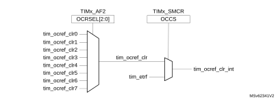

When tim\_etrf is chosen, tim\_etr\_in must be configured as follows:

1. The external trigger prescaler must be kept off: bits ETPS[1:0] of the TIMx\_SMCR register set to 00.
2. The external clock mode 2 must be disabled: bit ECE of the TIMx\_SMCR register set to 0.
3. The external trigger polarity (ETP) and the external trigger filter (ETF) can be configured according to application needs (as per polarity of the source connected to the trigger and eventual need to remove noise using the filter).

[Figure 349](#XREF_59784__Figure_63__TIM1_OCREF_Clear_activation_21) shows the behavior of the tim\_ocxref signal when the tim\_etrf input becomes high, for both values of the enable bit OCxCE. In this example, the timer TIMx is programmed in PWM mode.

#### Figure 349. TIMx tim\_ocxrefClearing 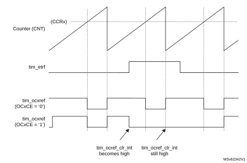

**Note:**

In case of a PWM with a 100% duty cycle (if CCRx>ARR), then tim\_ocxref is enabled again at the next counter overflow.

### 29.3.21 6-step PWM generation

When complementary outputs are used on a channel, preload bits are available on the OCxM, CCxE, and CCxNE bits. The preload bits are transferred to the shadow bits at the COM commutation event. Thus one can program in advance the configuration for the next step and change the configuration of all the channels at the same time. COM can be generated by software by setting the COM bit in the TIMx\_EGR register or by hardware (on tim\_trgi rising edge).

A flag is set when the COM event occurs (COMIF bit in the TIMx\_SR register), which can generate an interrupt (if the COMIE bit is set in the TIMx\_DIER register) or a DMA request (if the COMDE bit is set in the TIMx\_DIER register).

[Figure 350](#XREF_34273__Figure_55__6-step_generation%2C_CC-update_example_(OSSR=1)21) describes the behavior of the tim\_ocx and tim\_ocxn outputs when a COM event occurs, in three different examples of programmed configurations.

#### Figure 350. 6-step generation, COM example (OSSR = 1)

### 29.3.22 One-pulse mode

One-pulse mode (OPM) is a particular case of the previous modes. It allows the counter to be started in response to a stimulus and to generate a pulse with a programmable length after a programmable delay.

Starting the counter can be controlled through the slave mode controller. Generating the waveform can be done in output compare mode or PWM mode. One-pulse mode is selected by setting the OPM bit in the TIMx\_CR1 register. This makes the counter stop automatically at the next update event UEV.

A pulse can be correctly generated only if the compare value is different from the counter initial value. Before starting (when the timer is waiting for the trigger), the configuration must be:

- In upcounting: CNT < CCRx ≤ ARR (in particular, 0 < CCRx)
- In downcounting: CNT > CCRx

#### Figure 351. Example of one pulse mode.

In the following example, the user wants to generate a positive pulse on tim\_oc1 with a length of tPULSE and after a delay of tDELAY as soon as a positive edge is detected on the tim\_ti2 input pin.

Use tim\_ti2fp2 as trigger 1:

- Map tim\_ti2fp2 to tim\_ti2 by writing CC2S = 01 in the TIMx\_CCMR1 register.
- tim\_ti2fp2 must detect a rising edge, write CC2P = 0 and CC2NP = 0 in the TIMx\_CCER register.
- Configure tim\_ti2fp2 as trigger for the slave mode controller (tim\_trgi) by writing TS = 00110 in the TIMx\_SMCR register.
- tim\_ti2fp2 is used to start the counter by writing SMS to 110 in the TIMx\_SMCR register (trigger mode).

The OPM waveform is defined by writing the compare registers (taking into account the clock frequency and the counter prescaler).

- The tDELAY is defined by the value written in the TIMx\_CCR1 register.
- The tPULSE is defined by the difference between the autoreload value and the compare value (TIMx\_ARR - TIMx\_CCR1).
- Suppose the user wants to build a waveform with a transition from 0 to 1 when a compare match occurs and a transition from 1 to 0 when the counter reaches the auto-reload value. This is achieved by enabling PWM mode 2 (OC1M = 111 in TIMx\_CCMR1). Optionally the preload registers can be enabled by writing OC1PE = 1 in the TIMx\_CCMR1 register and ARPE in the TIMx\_CR1 register. In this case one has to write the compare value in the TIMx\_CCR1 register, the autoreload value in the TIMx\_ARR register, generate an update by setting the UG bit and wait for external trigger event on tim\_ti2. CC1P is written to 0 in this example.

In this example, the DIR and CMS bits in the TIMx\_CR1 register must be low.

Since only one pulse (Single mode) is needed, a 1 must be written in the OPM bit in the TIMx\_CR1 register to stop the counter at the next update event (when the counter rolls over from the autoreload value back to 0). When OPM bit in the TIMx\_CR1 register is set to 0, so the Repetitive mode is selected.

Particular case: tim\_ocx fast enable:

In One-pulse mode, the edge detection on tim\_tix input set the CEN bit which enables the counter. Then the comparison between the counter and the compare value makes the output toggle. But several clock cycles are needed for these operations and it limits the minimum delay tDELAY min that can be achieved.

To output a waveform with the minimum delay, the OCxFE bit can be set in the TIMx\_CCMRx register. Then tim\_ocxref (and tim\_ocx) are forced in response to the stimulus, without taking in account the comparison. Its new level is the same as if a compare match had occurred. OCxFE acts only if the channel is configured in PWM1 or PWM2 mode.

### 29.3.23 Retriggerable One-pulse mode

This mode allows the counter to be started in response to a stimulus and to generate a pulse with a programmable length, but with the following differences with nonretriggerable one-pulse mode described in [Section 29.3.22](#XREF_66232__1_3_18_One-pulse_mode21):

- The pulse starts as soon as the trigger occurs (no programmable delay).
- The pulse is extended if a new trigger occurs before the previous one is completed.

The timer must be in Slave mode, with the bits SMS[3:0] = 1000 (Combined Reset + trigger mode) in the TIMx\_SMCR register, and the OCxM[3:0] bits set to 1000 or 1001 for retriggerable OPM mode 1 or 2.

If the timer is configured in Up-counting mode, the corresponding CCRx must be set to 0 (the ARR register sets the pulse length). If the timer is configured in Down-counting mode, CCRx must be above or equal to ARR.

**Note:**

The OCxM[3:0] and SMS[3:0] bitfields are split into two parts for compatibility reasons, the most significant bit are not contiguous with the three least significant ones.

This mode must not be used with center-aligned PWM modes. It is mandatory to have CMS[1:0] = 00 in TIMx\_CR1.

#### Figure 352. Retriggerable one-pulse mode

### 29.3.24 Pulse on compare mode

A pulse can be generated upon compare match event. A signal with a programmable pulsewidth generated when the counter value equals a given compare value, for debugging or synchronization purposes.

This mode is available for any slave mode selection, including encoder modes, in edge and center aligned counting modes. It is solely available for channel 3 and channel 4. The pulse generator is unique and is shared by the two channels, as shown on [Figure 353](#XREF_56509__Figure_191__Pulse_generator_circuitry21).

#### Figure 353. Pulse generator circuitry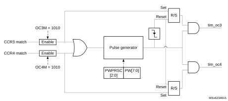

[Figure 354](#XREF_16677__Figure_192__Pulse_generation_on_compare_event%2C_for_edge-aligned_a21) shows how the pulse is generated for edge-aligned and encoder operating modes.

#### Figure 354. Pulse generation on compare event, for edge-aligned and encoder modes

This output compare mode is selected using the OC3M[3:0] and OC4M[3:0] bitfields in TIMx\_CCMR2 register.

The pulsewidth is programmed using the PW[7:0] bitfield in the register, using a specific clock prescaled according to PWPRSC[2:0] bits, as follows:

tPW = PW[7:0] x tPWG

where tPWG = (2(PWPRSC[2:0])) x ttim\_ker\_ck

gives the resolution and maximum values depending on the prescaler value.

The pulse is retriggerable: a new trigger while the pulse is ongoing, causes the pulse to be extended.

**Note:**

If the two channels are enabled simultaneously, the pulses are issued independently as long as the trigger on one channel is not overlapping the pulse generated on the concurrent output. On the opposite, if the two triggers are overlapping, the pulse width related to the first arriving trigger is extended (because of the retrigger), while the pulse width of the last arriving trigger is correct (as shown on [Figure 355](#XREF_32178__Figure_193__Extended_pulsewidth_in_case_of_concurrent_triggers21)).

#### Figure 355. Extended pulsewidth in case of concurrent triggers

### 29.3.25 Encoder interface mode

#### Quadrature encoder

To select Encoder Interface mode write SMS = 0001 in the TIMx\_SMCR register if the counter is counting on tim\_ti1 edges only, SMS = 0010 if it is counting on tim\_ti2 edges only and SMS = 0011 if it is counting on both tim\_ti1 and tim\_ti2 edges.

Select the tim\_ti1 and tim\_ti2 polarity by programming the CC1P and CC2P bits in the TIMx\_CCER register. When needed, the input filter can be programmed as well. CC1NP and CC2NP must be kept low.

The two inputs tim\_ti1 and tim\_ti2 are used to interface to an quadrature encoder. Refer to [Table 277](#XREF_26426__Table_37__Counting_direction_versus_encoder_signals21). The counter is clocked by each valid transition on tim\_ti1fp1 or tim\_ti2fp2 (tim\_ti1 and tim\_ti2 after input filter and polarity selection, tim\_ti1fp1 = tim\_ti1 if not filtered and not inverted, tim\_ti2fp2 = tim\_ti2 if not filtered and not inverted) assuming that it is enabled (CEN bit in TIMx\_CR1 register written to 1). The sequence of transitions of the two inputs is evaluated and generates count pulses as well as the direction signal. Depending on the sequence the counter counts up or down, the DIR bit in the TIMx\_CR1 register is modified by hardware accordingly. The DIR bit is calculated at each transition on any input (tim\_ti1 or tim\_ti2), whatever the counter is counting on tim\_ti1 only, tim\_ti2 only or both tim\_ti1 and tim\_ti2.

Encoder interface mode acts simply as an external clock with direction selection. This means that the counter just counts continuously between 0 and the autoreload value in the TIMx\_ARR register (0 to ARR or ARR down to 0 depending on the direction). So the TIMx\_ARR must be configured before starting. In the same way, the capture, compare, prescaler, repetition counter, trigger output features continue to work as normal. Encoder mode and External clock mode 2 are not compatible and must not be selected together.

In this mode, the counter is modified automatically following the speed and the direction of the quadrature encoder and its content, therefore, always represents the encoder’s position. The count direction correspond to the rotation direction of the connected sensor. The table summarizes the possible combinations, assuming tim\_ti1 and tim\_ti2 do not switch at the same time.

<table class="TableTitle"><caption class="~TableHeading"><h4 class="TableCap" id="14983598">Table 277. <a id="signals21" name="XREF_26426__Table_37__Counting_direction_versus_encoder_signals21">Counting direction versus encoder signals (CC1P = CC2P = 0)</a></h4></caption><col width="89.32px"/><col width="78.24px"/><col width="89.32px"/><col width="89.32px"/><col width="89.32px"/><col width="89.32px"/><col width="89.32px"/><thead><tr height="28.00px"><th rowspan="2">
Active edge
</th><th rowspan="2">
SMS[3:0]
</th><th rowspan="2">
Level on opposite signal (tim_ti1fp1 for tim_ti2, tim_ti2fp2 for tim_ti1)
</th><th colspan="2">
tim_ti1fp1 signal
</th><th colspan="2">
tim_ti2fp2 signal
</th></tr><tr height="88.00px"><th>
Rising
</th><th>
Falling
</th><th>
Rising
</th><th>
Falling
</th></tr></thead><tr height="22.67px"><td rowspan="2">
Counting on tim_ti1 only

x1 mode
</td><td rowspan="2">
1110
</td><td>
High
</td><td>
Down
</td><td>
Up
</td><td>
No count
</td><td>
No count
</td></tr><tr height="32.00px"><td>
Low
</td><td>
No count
</td><td>
No count
</td><td>
No count
</td><td>
No count
</td></tr><tr height="22.67px"><td rowspan="2">
Counting on tim_ti2 only

x1 mode
</td><td rowspan="2">
1111
</td><td>
High
</td><td>
No count
</td><td>
No count
</td><td>
Up
</td><td>
Down
</td></tr><tr height="32.00px"><td>
Low
</td><td>
No count
</td><td>
No count
</td><td>
No count
</td><td>
No count
</td></tr><tr height="22.67px"><td rowspan="2">
Counting on tim_ti1 only

x2 mode
</td><td rowspan="2">
0001
</td><td>
High
</td><td>
Down
</td><td>
Up
</td><td>
No count
</td><td>
No count
</td></tr><tr height="32.00px"><td>
Low
</td><td>
Up
</td><td>
Down
</td><td>
No count
</td><td>
No count
</td></tr><tr height="22.67px"><td rowspan="2">
Counting on tim_ti2 only

x2 mode
</td><td rowspan="2">
0010
</td><td>
High
</td><td>
No count
</td><td>
No count
</td><td>
Up
</td><td>
Down
</td></tr><tr height="32.00px"><td>
Low
</td><td>
No count
</td><td>
No count
</td><td>
Down
</td><td>
Up
</td></tr><tr height="22.67px"><td rowspan="2">
Counting on tim_ti1 and tim_ti2

x4 mode
</td><td rowspan="2">
0011
</td><td>
High
</td><td>
Down
</td><td>
Up
</td><td>
Up
</td><td>
Down
</td></tr><tr height="46.67px"><td>
Low
</td><td>
Up
</td><td>
Down
</td><td>
Down
</td><td>
Up
</td></tr></table>

A quadrature encoder can be connected directly to the MCU without external interface logic. However, comparators are normally be used to convert the encoder’s differential outputs to digital signals. This greatly increases noise immunity. The third encoder output which indicate the mechanical zero position, may be connected to the external trigger input and trigger a counter reset.

[Figure 356](#XREF_13085__Figure_43__Example_of_counter_operation_in_encoder_interface_mode_21) gives an example of counter operation, showing count signal generation and direction control. It also shows how input jitter is compensated where both edges are selected. This might occur if the sensor is positioned near to one of the switching points. For this example the configuration is the following:

- CC1S = 01 (TIMx\_CCMR1 register, tim\_ti1fp1 mapped on tim\_ti1).
- CC2S = 01 (TIMx\_CCMR1 register, tim\_ti2fp2 mapped on tim\_ti2).
- CC1P = 0 and CC1NP = 0 (TIMx\_CCER register, tim\_ti1fp1 noninverted, tim\_ti1fp1 = tim\_ti1).
- CC2P = 0 and CC2NP = 0 (TIMx\_CCER register, tim\_ti1fp2 noninverted, tim\_ti1fp2= tim\_ti2).
- SMS = 0011 (TIMx\_SMCR register, both inputs are active on both rising and falling edges).
- CEN = 1 (TIMx\_CR1 register, Counter enabled).

#### Figure 356. Example of counter operation in encoder interface mode.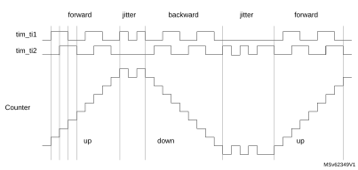

[Figure 357](#XREF_80656__Figure_44__Example_of_counter_operation_in_encoder_interface_mode_21) gives an example of counter behavior when tim\_ti1fp1 polarity is inverted (same configuration as above except CC1P = 1).

#### Figure 357. Example of encoder interface mode with tim\_ti1fp1 polarity inverted.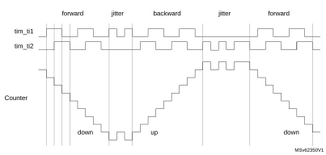

[Figure 358](#XREF_33535__Figure_190__Quadrature_encoder_counting_modes21) shows the timer counter value during a speed reversal, for various counting modes.

#### Figure 358. Quadrature encoder counting modes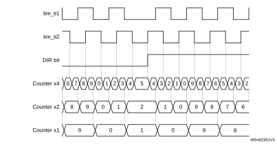

The timer, when configured in Encoder Interface mode provides information on the sensor’s current position. Dynamic information can be obtained (speed, acceleration, deceleration) by measuring the period between two encoder events using a second timer configured in capture mode. The output of the encoder which indicates the mechanical zero can be used for this purpose. Depending on the time between two events, the counter can also be read at regular times. This can be done by latching the counter value into a third input capture register if available (then the capture signal must be periodic and can be generated by another timer). When available, it is also possible to read its value through a DMA request.

The IUFREMAP bit in the TIMx\_CR1 register forces a continuous copy of the update interrupt flag (UIF) into the timer counter register’s bit 31 (TIMxCNT[31]). This allows both the counter value and a potential roll-over condition signaled by the UIFCPY flag to be read in an atomic way. It eases the calculation of angular speed by avoiding race conditions caused, for instance, by a processing shared between a background task (counter reading) and an interrupt (update interrupt).

There is no latency between the UIF and UIFCPY flag assertions.

In 32-bit timer implementations, when the IUFREMAP bit is set, bit 31 of the counter is overwritten by the UIFCPY flag upon read access (the counter’s most significant bit is only accessible in write mode).

#### Clock plus direction encoder mode

In addition to the quadrature encoder mode, the timer offers support for other types of encoders.

In the clock plus direction mode shown on [Figure 359](#XREF_50552__Figure_191__Direction_plus_clock_encoder_mode21), the clock is provided on a single line, on tim\_ti2, while the direction is forced using the tim\_ti1 input.

This mode is enabled with the SMS[3:0] bitfield in the TIMx\_SMCR register, as following:

- 1010: x2 mode, the counter is updated on both rising and falling edges of the clock
- 1011: x1 mode, the counter is updated on a single clock edge, as per CC2P bit value: CC2P = 0 corresponds to rising edge sensitivity and CC2P = 1 corresponds to falling edge sensitivity

The polarity of the direction signal on tim\_ti1 is set with the CC1P bit: 0 corresponds to positive polarity (up-counting when tim\_ti1 is high and down-counting when tim\_ti1 is low) and CC1P = 1 corresponds to negative polarity (up-counting when tim\_ti1 is low).

#### Figure 359. Direction plus clock encoder mode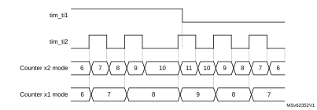

#### Directional clock encoder mode

In the directional clock mode on [Figure 360](#XREF_55995__Figure_192__Directional_clock_encode_mode21), the clocks are provided on two lines, with a single one at once, depending on the direction, so as to have one up-counting clock line and one down-counting clock line.

This mode is enabled with the SMS[3:0] bitfield in the TIMx\_SMCR register, as following:

- 1100: x2 mode, the counter is updated on both rising and falling edges of any of the two clock line. The CC1P and CC2P bits are coding for the clock idle state. CCxP = 0 corresponds to high-level idle state (refer to [Figure 360](#XREF_55995__Figure_192__Directional_clock_encode_mode21)) and CCxP = 1 corresponds to low-level idle state (refer to [Figure 361](#XREF_26952__Figure_195__Directional_clock_encode_mode_(CC1P_=_CC2P_=_1)21)).
- 1101: x1 mode, the counter is updated on a single clock edge, as per CC1P and CC2P bit value. CCxP = 0 corresponds to falling edge sensitivity and high-level idle state (refer to [Figure 360](#XREF_55995__Figure_192__Directional_clock_encode_mode21)), CCxP = 1 corresponds to rising edge sensitivity and low-level idle state (refer to [Figure 361](#XREF_26952__Figure_195__Directional_clock_encode_mode_(CC1P_=_CC2P_=_1)21)).

#### Figure 360. Directional clock encoder mode (CC1P = CC2P = 0)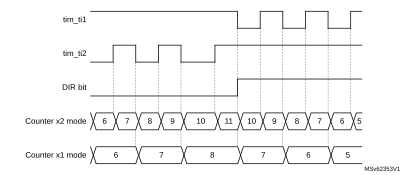

#### Figure 361. Directional clock encoder mode (CC1P = CC2P = 1)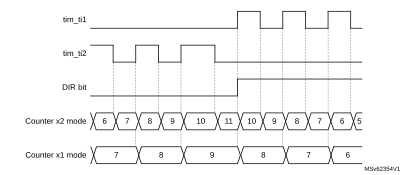

[Table 278](#XREF_59598__Table_120__Counting_direction_versus_encoder_signals_(CC1P_=_CC2P21) here-below details how the directional clock mode operates, for any input transition.

 

<table class="TableTitle"><caption class="~TableHeading"><h4 class="TableCap" id="14547088">Table 278. <a id="CC2P21" name="XREF_59598__Table_120__Counting_direction_versus_encoder_signals_(CC1P_=_CC2P21">Counting direction versus encoder signals and polarity settings</a></h4></caption><col width="89.32px"/><col width="78.24px"/><col width="89.32px"/><col width="89.32px"/><col width="89.32px"/><col width="89.32px"/><col width="89.32px"/><thead><tr height="28.00px"><th rowspan="2">
Directional clock mode
</th><th rowspan="2">
SMS[3:0]
</th><th rowspan="2">
Level on opposite signal (tim_ti1fp1 for tim_ti2, tim_ti2fp2 for tim_ti1)
</th><th colspan="2">
tim_ti1fp1 signal
</th><th colspan="2">
tim_ti2fp2 signal
</th></tr><tr height="88.00px"><th>
Rising
</th><th>
Falling
</th><th>
Rising
</th><th>
Falling
</th></tr></thead><tr height="22.67px"><td rowspan="2">
x2 mode

CCxP = 0
</td><td rowspan="2">
1100
</td><td>
High
</td><td>
Down
</td><td>
Down
</td><td>
Up
</td><td>
Up
</td></tr><tr height="22.67px"><td>
Low
</td><td>
No count
</td><td>
No count
</td><td>
No count
</td><td>
No count
</td></tr><tr height="22.67px"><td rowspan="2">
x2 mode

CCxP = 1
</td><td rowspan="2">
1100
</td><td>
High
</td><td>
No count
</td><td>
No count
</td><td>
No count
</td><td>
No count
</td></tr><tr height="22.67px"><td>
Low
</td><td>
Down
</td><td>
Down
</td><td>
Up
</td><td>
Up
</td></tr><tr height="22.67px"><td rowspan="2">
x1 mode

CCxP = 0
</td><td rowspan="2">
1101
</td><td>
High
</td><td>
No count
</td><td>
Down
</td><td>
No count
</td><td>
Up
</td></tr><tr height="22.67px"><td>
Low
</td><td>
No count
</td><td>
No count
</td><td>
No count
</td><td>
No count
</td></tr><tr height="22.67px"><td rowspan="2">
x1 mode

CCxP = 1
</td><td rowspan="2">
1101
</td><td>
High
</td><td>
No count
</td><td>
No count
</td><td>
No count
</td><td>
No count
</td></tr><tr height="22.67px"><td>
Low
</td><td>
Down
</td><td>
No count
</td><td>
Up
</td><td>
No count
</td></tr></table>

#### Index input

The counter can be reset by an index signal coming from the encoder, indicating an absolute reference position. The index signal must be connected to the tim\_etr\_in input. It can be filtered using the digital input filter.

The index functionality is enabled with the IE bit in the TIMX\_ECR register. The IE bit must be set only in encoder mode, when the SMS[3:0] bitfield has the following values: 0001, 0010, 011, 1010, 1011, 1100, 1101, 1110, 1111.

Available encoders are proposed with several options for index pulse conditioning, as per [Figure 362](#XREF_47987__Figure_199__Index_gating_options21):

- gated with A and B: the pulsewidth is 1/4 of one channel period, aligned with both A and B edges
- gated with A (or gated with B): the pulsewidth is 1/2 of one channel period, aligned with the two edges on channel A (resp. channel B)
- ungated: the pulsewidth is up to one channel period, without any alignment to the edges

#### Figure 362. Index gating options

The circuitry tolerates jitter on index signal, whatever the gating mode, as show on [Figure 363](#XREF_65150__Figure_193_21).

In ungated mode, the signal must be strictly below two encoder periods. If the pulsewidth is greater or equal to two encoder period, the counter is reset multiple times.

#### Figure 363. Jittered Index signals

The timer supports the three gating options identically, without any specific programming needed. It is only necessary to define on which encoder state (for example channel A and channel B state combination) the index must be synchronized, using the IPOS[1:0] bitfield in the TIMx\_ECR register.

The index detection event acts differently depending on counting direction to ensure symmetrical operation during speed reversal:

- The counter is reset during up-counting (DIR bit = 0).
- The counter is set to TIMx\_ARR when down counting.

This allows the index to be generated on the very same mechanical angular position whatever the counting direction. [Figure 364](#XREF_69382_0%5D%13=_1121) shows at which position is the index generated, for a simplistic example (an encoder providing four edges par mechanical rotation).

#### Figure 364. Index generation for IPOS[1:0] = 11

[Figure 365](#XREF_52830__Figure_190__Counter_reading_with_index_gated_on_channel_A21) presents waveforms and corresponding values for IPOS[1:0] = 11. It shows that the instant at which the counter value is forced is automatically adjusted depending on the counting direction:

- Counter set to 0 when encoder state is 11 (ChA = 1, ChB = 1), when up-counting (DIR bit = 0).
- Counter set to TIMx\_ARR when exiting the 11 state, when down-counting (DIR bit = 1).

An interrupt can be issued upon index detection event.

The arrows are indicating on which transition is the index event interrupt generated.

#### Figure 365. Counter reading with index gated on channel A (IPOS[1:0] = 11)

[Figure 366.](#XREF_31732__Figure_191__Counter_reading_with_index_ungated21) presents waveforms and corresponding values for the ungated mode. The arrows are indicating on which transition is the index event generated.

#### Figure 366. Counter reading with index ungated (IPOS[1:0] = 00)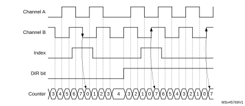

[Figure 367.](#XREF_69040__Figure_192_21) shows how the ‘gated on A & B’ mode is handled, for various pulse alignment scenario. The arrows are indicating on which transition is the index event generated.

#### Figure 367. Counter reading with index gated on channel A and B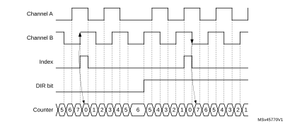

[Figure 368](#XREF_73550__Figure_194__Narrow_index_pulse_following_a_detection_on_Channel_B21) and [Figure 369](#XREF_42832__Figure_196__Counter_reset_Narrow_index_pulse_(closer_view)21) detail the case where the subsequent index pulse may be narrower than one quarter of the encoder clock period.

#### Figure 368. narrow index pulse (IPOS[1:0] = 11)Encoder mode behavior in case of 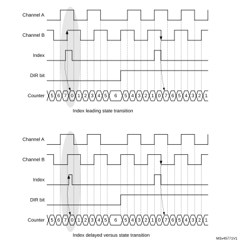

#### Figure 369. Counter reset Narrow index pulse (closer view, ARR = 0x07)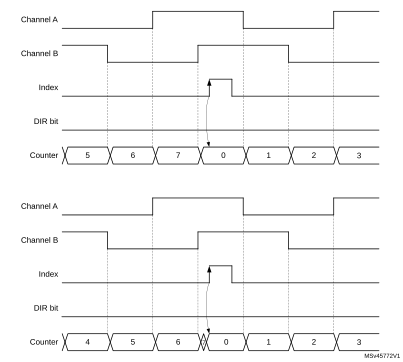

[Figure 370](#XREF_92120__Figure_197__Index_behavior_in_x1_and_x2_mode21) shows how the index is managed in x1 and x2 modes.

#### Figure 370. Index behavior in x1 and x2 mode (IPOS[1:0] = 01)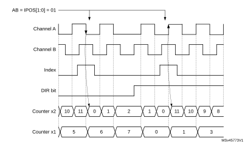

#### Directional index sensitivity

The IDIR[1:0] bitfield in the TIMx\_ECR register allows the index to be active only in a selected counting direction.

[Figure 371](#XREF_24064__Figure_197__Directional_index_sensitivity21) shows the relationship between index and counter reset events, depending on IDIR[1:0] value.

**Note:**

The IDR[1:0] bitfield must be written when IE bit is reset (index mode disabled).

**Note:**

The directional index sensitivity is not supported in clock + direction mode. When SMS[3:0] = 1010 or 1011, the IDIR[1:0] must be set to 00.

#### Figure 371. Directional index sensitivity

#### Special first index event management

The FIDX bit in the TIMx\_ECR register allows the index to be taken only once, as shown on [Figure 372](#XREF_10344__Figure_198__Counter_reset_as_function_of_FIDX_bit_setting21). Once the first index has arrived, any subsequent index is ignored. If needed, the circuitry can be rearmed by writing the FIDX bit to 0 and setting it again to 1.

**Note:**

When FIDX = 1, the index can be issued twice (IDXF flag set) if the direction changes at position 0 (index active).

#### Figure 372. Counter reset as function of FIDX bit setting

#### Index management in nonquadrature mode

[Figure 373](#XREF_81356__Figure_201__Index_behavior_in_clock_+_direction_mode21) and [Figure 374](#XREF_24012__Figure_202__Index_behavior_in_directional_clock_mode21) detail how the index is managed in directional clock mode and clock plus direction mode, when the SMS[3:0] bitfield is equal to 1010, 1011, 1100, 1101.

For both of these modes, the index sensitivity is set with the IPOS[0] bit as following:

- IPOS[0] = 0: Index is detected on clock low level
- IPOS[0] = 1: Index is detected on clock high level

The IPOS[1] bit is not-significant.

#### Figure 373. Index behavior in clock + direction mode, IPOS[0] = 1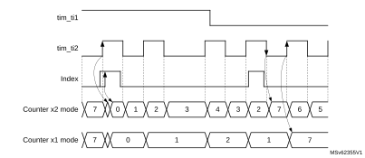

#### Figure 374. Index behavior in directional clock mode, IPOS[0] = 1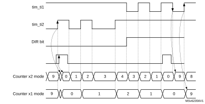

#### Encoder error management

For encoder configurations where two quadrature signals are available, it is possible to detect transition errors. The reading on the two inputs corresponds to a 2-bit gray code which can be represented as a state diagram, on [Figure 375.](#XREF_76719__Figure_2__State_diagram_for_quadrature_encoded_signals21). A single bit is expected to change at once. An erroneous transition sets the TERRF interrupt flag in the TIMx\_SR status register. A transition error interrupt is generated if the TERRIE bit is set in the TIMx\_DIER register.

#### Figure 375. State diagram for quadrature encoded signals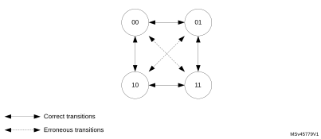

For encoder having an index signal, it is possible to detect abnormal operation resulting in an excess of pulses per revolution. An encoder with N pulses per revolution provides 4xN counts per revolution. The index signal resets the counter every 4xN clock periods.

If the counter value is incremented from TIMx\_ARR to 0 or decremented from 0 to TIMxARR value without any index event, this is reported as an index position error.

The overflow threshold is programmed using the TIMx\_ARR register. A 1000 lines encoder results in a counter value being between 0 and 3999 (in 4x reading mode). The overflow detection threshold must be programmed by setting TIMx\_ARR = 3999 + 1 = 4000.

The error assertion is delayed to the transition 0 to 1 when in up-counting. This is cope with narrow index pulses in gated A and B mode, as shown on [Figure 376](#XREF_65387__Figure_211__Error_detection21).

#### Figure 376. Up-counting encoder error detection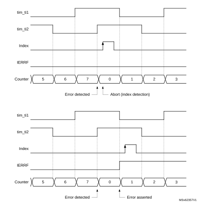

In down-counting mode, the detection is conditioned by a preliminary transition from 1 to 0. This is to cope with narrow index pulses in gated A and B mode, as shown on [Figure 377](#XREF_61725__Figure_212__Encode_error_detection21), to avoid any false error detection in case the encoder dithers between TIMx\_ARR and 0 immediately after the index detection.

#### Figure 377. Down-counting encode error detection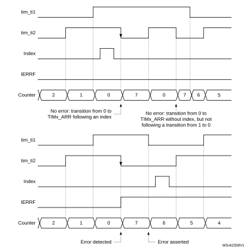

An index error sets the IERRF interrupt flag in the TIMx\_SR status register. An index error interrupt is generated if the IERRIE bit is set in the TIMx\_DIER register.

#### Functional encoder interrupts

The following interrupts are also available in encoder mode

- Direction change: any change of the counting direction in encoder mode causes the DIR bit in the TIMx\_CR1 register to toggle. The direction change sets the DIRF interrupt flag in the TIMx\_SR status register. A direction change interrupt is generated if the DIRIE bit is set in the TIMx\_DIER register.
- Index event: the index event sets the IDXF interrupt flag in the TIMx\_SR status register. An index interrupt is generated if the IDXIE bit is set in the TIMx\_DIER register.

#### Slave mode selection preload for run-time encoder mode update

It may be necessary to switch from one encoder mode to another during run-time. This is typically done at high-speed to decrease the update interrupt rate, by switching from x4 to x2 to x1 mode, as shown on [Figure 378](#XREF_73988__Figure_195__Encoder_mode_change_with_preload_enable21).

For this purpose, the SMS[3:0] bit can be preloaded. This is enabled by setting the SMSPE enable bit in the TIMx\_SMCR register. The trigger for the transfer from SMS[3:0] preload to active value can be selected with the SMSPS bit in the TIMx\_SMCR register.

- SMSPS = 0: the transfer is triggered by the update event (UEV) occurring when the counter overflows when upcounting, and underflows when downcounting. This mode must be used only when index is disabled (bit IE = 0).
- SMSPS = 1: the transfer is triggered by the index event.

#### Figure 378. Encoder mode change with preload transferred on update (SMSPS = 0)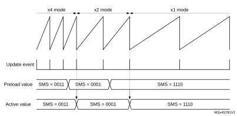

#### Encoder clock output

The encoder mode operating principle is not perfectly suited for high-resolution velocity measurements, at low speed, as it requires a relatively long integration time to have a sufficient number of clock edges and a precise measurement.

At low speed, a better solution is to do an edge-to-edge clock period measurement. This can be achieved using a slave timer. The timer can output the encoder clock information on the tim\_trgo output. The slave timer can then perform a period measurement and provide velocity information for each and every encoder clock edge.

This mode is enabled by setting the MMS[3:0] bitfield to 1000, in the TIMx\_CR2 register.It is valid for the following SMS[3:0] values: 0001, 0010, 0011, 1010, 1011, 1100, 1101, 1110, 1111. Any other SMS[3:0] code is not allowed and may lead to unexpected behavior.

### 29.3.26 Direction bit output

Its is possible to output a direction signal out of the timer, on the tim\_oc3n and tim\_oc4 output signals (copy of the DIR bit in the TIMx\_CR1 register). This is achieved by setting the OC3M[3:0] or the OC4M[3:0] bitfield to 1011 in the TIMx\_CCMR2 register.

This feature can be used for monitoring the counting direction (or rotation direction) in encoder mode, or to have a signal indicating the up/down phases in center-aligned PWM mode.

### 29.3.27 UIF bit remapping

The IUFREMAP bit in the TIMx\_CR1 register forces a continuous copy of the update interrupt flag UIF into the timer counter register’s bit 31 (TIMxCNT[31]). This allows both the counter value and a potential roll-over condition signaled by the UIFCPY flag to be read in an atomic way. In particular cases, it can ease the calculations by avoiding race conditions, caused for instance by a processing shared between a background task (counter reading) and an interrupt (update interrupt).

There is no latency between the UIF and UIFCPY flags assertion.

### 29.3.28 Timer input XOR function

The TI1S bit in the TIMx\_CR2 register, allows the input filter of channel 1 to be connected to the output of an XOR gate, combining the three input pins tim\_ti1, tim\_ti2 and tim\_ti3.

The XOR output can be used with all the timer input functions such as trigger or input capture. It is convenient to measure the interval between edges on two input signals, as per [Figure 379](#XREF_28669__Figure_54__Measuring_time_interval_between_edges_on_2_signals21).

#### Figure 379. Measuring time interval between edges on three signals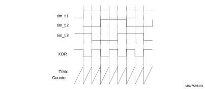

### 29.3.29 Interfacing with Hall sensors

This is done using the advanced-control timers to generate PWM signals to drive the motor and another timer TIMx referred to as “interfacing timer” in [Figure 380](#XREF_55655__Figure_56__Example_of_Hall_Sensors_Interface21). The “interfacing timer” captures the three timer input pins (tim\_ti1, tim\_ti2 and tim\_ti3) connected through a XOR to the tim\_ti1 input channel (selected by setting the TI1S bit in the TIMx\_CR2 register).

The slave mode controller is configured in reset mode; the slave input is tim\_ti1f\_ed. Thus, each time one of the three inputs toggles, the counter restarts counting from 0. This creates a time base triggered by any change on the Hall inputs.

On the “interfacing timer”, capture/compare channel 1 is configured in capture mode, capture signal is tim\_trc (See [Figure 323](#XREF_21775__channel_1_Input_stage)21)). The captured value, which corresponds to the time elapsed between two changes on the inputs, gives information about motor speed.

The “interfacing timer” can be used in output mode to generate a pulse which changes the configuration of the channels of the advanced-control timer (by triggering a COM event). The advanced-control timer is used to generate PWM signals to drive the motor. To do this, the interfacing timer channel must be programmed so that a positive pulse is generated after a programmed delay (in output compare or PWM mode). This pulse is sent to the advanced-control timer through the tim\_trgo output.

In this example the user wants to change the PWM configuration of the advanced-control timer after a programmed delay each time a change occurs on the Hall inputs connected to one of the TIMx timers.

- Configure three timer inputs ORed to the tim\_ti1 input channel by writing the TI1S bit in the TIMx\_CR2 register to 1.
- Program the time base: write the TIMx\_ARR to the max value (the counter must be cleared by the tim\_ti1 change. Set the prescaler to get a maximum counter period longer than the time between two changes on the sensors.
- Program the channel 1 in capture mode (tim\_trc selected): write the CC1S bits in the TIMx\_CCMR1 register to 01. The digital filter can also be programmed if needed.
- Program the channel 2 in PWM 2 mode with the desired delay: write the OC2M bits to 111 and the CC2S bits to 00 in the TIMx\_CCMR1 register.
- Select tim\_oc2ref as trigger output on tim\_trgo: write the MMS bits in the TIMx\_CR2 register to 101.

In the advanced-control timer, the right tim\_itrx input must be selected as trigger input, the timer is programmed to generate PWM signals, the capture/compare control signals are preloaded (CCPC = 1 in the TIMx\_CR2 register) and the COM event is controlled by the trigger input (CCUS = 1 in the TIMx\_CR2 register). The PWM control bits (CCxE, OCxM) are written after a COM event for the next step (this can be done in an interrupt subroutine generated by the rising edge of tim\_oc2ref).

[Figure 380](#XREF_55655__Figure_56__Example_of_Hall_Sensors_Interface21) describes this example.

#### Figure 380. Example of Hall sensor interface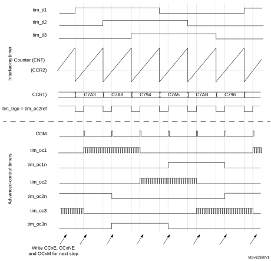

### 29.3.30 Timer synchronization

The TIMx timers are linked together internally for timer synchronization or chaining. Refer to [Section 30.4.23: Timer synchronization](General-purpose_timers_%28TIM2__47_TIM3__47_TIM4__47_TIM5%29.md#XREF_17049__12_4_14_Timer_synchronization41) for details. They can be synchronized in several modes: Reset mode, Gated mode, Trigger mode, Reset + trigger, and gated + reset modes.

#### Slave mode: Reset mode

The counter and its prescaler can be reinitialized in response to an event on a trigger input. Moreover, if the URS bit from the TIMx\_CR1 register is low, an update event UEV is generated. Then all the preloaded registers (TIMx\_ARR, TIMx\_CCRx) are updated.

In the following example, the upcounter is cleared in response to a rising edge on tim\_ti1 input:

- Configure the channel 1 to detect rising edges on tim\_ti1. Configure the input filter duration (in this example, we do not need any filter, so we keep IC1F = 0000). The capture prescaler is not used for triggering, so it does not need to be configured. The CC1S bits select the input capture source only, CC1S = 01 in the TIMx\_CCMR1 register. Write CC1P = 0 and CC1NP = 0 in TIMx\_CCER register to validate the polarity (and detect rising edges only).
- Configure the timer in reset mode by writing SMS = 100 in TIMx\_SMCR register. Select tim\_ti1 as the input source by writing TS = 00101 in TIMx\_SMCR register.
- Start the counter by writing CEN = 1 in the TIMx\_CR1 register.

The counter starts counting on the internal clock, then behaves normally until tim\_ti1 rising edge. When tim\_ti1 rises, the counter is cleared and restarts from 0. In the meantime, the trigger flag is set (TIF bit in the TIMx\_SR register) and an interrupt request, or a DMA request can be sent if enabled (depending on the TIE and TDE bits in TIMx\_DIER register).

The following figure shows this behavior when the autoreload register TIMx\_ARR = 0x36. The delay between the rising edge on tim\_ti1 and the actual reset of the counter is due to the resynchronization circuit on tim\_ti1 input.

#### Figure 381. Control circuit in reset mode

#### Slave mode: Gated mode

The counter can be enabled depending on the level of a selected input.

In the following example, the upcounter counts only when tim\_ti1 input is low:

- Configure the channel 1 to detect low levels on tim\_ti1. Configure the input filter duration (in this example, we do not need any filter, so we keep IC1F = 0000). The capture prescaler is not used for triggering, so it does not need to be configured. The CC1S bits select the input capture source only, CC1S = 01 in TIMx\_CCMR1 register. Write CC1P = 1 and CC1NP = 0 in TIMx\_CCER register to validate the polarity (and detect low level only).
- Configure the timer in gated mode by writing SMS = 101 in TIMx\_SMCR register. Select tim\_ti1 as the input source by writing TS = 00101 in TIMx\_SMCR register.
- Enable the counter by writing CEN = 1 in the TIMx\_CR1 register (in gated mode, the counter does not start if CEN = 0, whatever is the trigger input level).

The counter starts counting on the internal clock as long as tim\_ti1 is low and stops as soon as tim\_ti1 becomes high. The TIF flag in the TIMx\_SR register is set both when the counter starts or stops.

The delay between the rising edge on tim\_ti1 and the actual stop of the counter is due to the resynchronization circuit on tim\_ti1 input.

#### Figure 382. Control circuit in Gated mode

#### Slave mode: Trigger mode

The counter can start in response to an event on a selected input.

In the following example, the upcounter starts in response to a rising edge on tim\_ti2 input:

- Configure the channel 2 to detect rising edges on tim\_ti2. Configure the input filter duration (in this example, we do not need any filter, so we keep IC2F = 0000). The capture prescaler is not used for triggering, so it does not need to be configured. The CC2S bits are configured to select the input capture source only, CC2S = 01 in TIMx\_CCMR1 register. Write CC2P = 1 and CC2NP = 0 in TIMx\_CCER register to validate the polarity (and detect low level only).
- Configure the timer in trigger mode by writing SMS = 110 in TIMx\_SMCR register. Select tim\_ti2 as the input source by writing TS = 00110 in TIMx\_SMCR register.

When a rising edge occurs on tim\_ti2, the counter starts counting on the internal clock and the TIF flag is set.

The delay between the rising edge on tim\_ti2 and the actual start of the counter is due to the resynchronization circuit on tim\_ti2 input.

#### Figure 383. Control circuit in trigger mode

#### Slave mode: Combined reset + trigger mode

In this case, a rising edge of the selected trigger input (tim\_trgi) reinitializes the counter, generates an update of the registers, and starts the counter.

This mode is used for One-pulse mode.

#### Slave mode: Combined gated + reset mode

The counter clock is enabled when the trigger input (tim\_trgi) is high. The counter stops and is reset) as soon as the trigger becomes low. Both start and stop of the counter are controlled.

This mode is used to detect out-of-range PWM signal (duty cycle exceeding a maximum expected value).

#### Slave mode: external clock mode 2 + trigger mode

The external clock mode 2 can be used in addition to another slave mode (except external clock mode 1 and encoder mode). In this case, the tim\_etr\_in signal is used as external clock input, and another input can be selected as trigger input (in reset mode, gated mode or trigger mode). It is recommended not to select tim\_etr\_in as tim\_trgi through the TS bits of TIMx\_SMCR register.

In the following example, the upcounter is incremented at each rising edge of the tim\_etr\_in signal as soon as a rising edge of tim\_ti1 occurs:

1. Configure the external trigger input circuit by programming the TIMx\_SMCR register as follows:
 - ETF = 0000: no filter
 - ETPS = 00: prescaler disabled
 - ETP = 0: detection of rising edges on tim\_etr\_in and ECE = 1 to enable the external clock mode 2.
2. Configure the channel 1 as follows, to detect rising edges on TI:
 - IC1F = 0000: no filter.
 - The capture prescaler is not used for triggering and does not need to be configured.
 - CC1S = 01in TIMx\_CCMR1 register to select only the input capture source
 - CC1P = 0 and CC1NP = 0 in TIMx\_CCER register to validate the polarity (and detect rising edge only).
3. Configure the timer in trigger mode by writing SMS = 110 in TIMx\_SMCR register. Select tim\_ti1 as the input source by writing TS = 00101 in TIMx\_SMCR register.

A rising edge on tim\_ti1 enables the counter and sets the TIF flag. The counter then counts on tim\_etr\_in rising edges.

The delay between the rising edge of the tim\_etr\_in signal and the actual reset of the counter is due to the resynchronization circuit on tim\_etrp input.

#### Figure 384. Control circuit in external clock mode 2 + trigger mode

**Note:**

The clock of the slave peripherals (such as timer, ADC) receiving the tim\_trgo or the tim\_trgo2 signals must be enabled prior to receive events from the master timer, and the clock frequency (prescaler) must not be changed on-the-fly while triggers are received from the master timer.

### 29.3.31 ADC triggers

The timer can generate an ADC triggering event with various internal signals, such as reset, enable or compare events. It is also possible to generate a pulse issued by internal edge detectors, such as:

- Rising and falling edges of OC4ref
- Rising edge on OC5ref or falling edge on OC6ref

The triggers are issued on the tim\_trgo2 internal line which is redirected to the ADC. There is a total of 16 possible events, which can be selected using the MMS2[3:0] bits in the TIMx\_CR2 register.

An example of an application for 3-phase motor drives is given in [Figure 338](#XREF_80227__Figure_38__3-phase_combined_PWM_signals_with_multiple_trigger_pulses_per_period21).

**Note:**

The clock of the slave peripherals (timer, ADC, ...) receiving the tim\_trgo or the tim\_trgo2 signals must be enabled prior to receive events from the master timer, and the clock frequency (prescaler) must not be changed on-the-fly while triggers are received from the master timer.

The clock of the ADC must be enabled prior to receive events from the master timer, and must not be changed on-the-fly while triggers are received from the timer.

### 29.3.32 DMA burst mode

The TIMx timers have the capability to generate multiple DMA requests upon a single event. The main purpose is to be able to reprogram part of the timer multiple times without software overhead, but it can also be used to read several registers in a row, at regular intervals.

The DMA controller destination is unique and must point to the virtual register TIMx\_DMAR. On a given timer event, the timer launches a sequence of DMA requests (burst). Each write into the TIMx\_DMAR register is actually redirected to one of the timer registers.

The DBL[4:0] bits in the TIMx\_DCR register set the DMA burst length. The timer recognizes a burst transfer when a read or a write access is done to the TIMx\_DMAR address), i.e. the number of transfers (either in half-words or in bytes).

The DBA[4:0] bits in the TIMx\_DCR register define the DMA base address for DMA transfers (when read/write access are done through the TIMx\_DMAR address). DBA is defined as an offset starting from the address of the TIMx\_CR1 register:

Example:

00000: TIMx\_CR1

00001: TIMx\_CR2

00010: TIMx\_SMCR

As an example, the timer DMA burst feature is used to update the contents of the CCRx registers (x = 2, 3, 4) upon an update event, with the DMA transferring half words into the CCRx registers.

This is done in the following steps:

1. Configure the corresponding DMA channel as follows:
 - DMA channel peripheral address is the DMAR register address.
 - DMA channel memory address is the address of the buffer in the RAM containing the data to be transferred by DMA into CCRx registers.
 - Number of data to transfer = 3 (see note below).
 - Circular mode disabled.
2. Configure the DCR register by configuring the DBA and DBL bitfields as follows:
  DBL = 3 transfers, DBA = 0xE.
3. Enable the TIMx update DMA request (set the UDE bit in the DIER register).
4. Enable TIMx.
5. Enable the DMA channel.

This example is for the case where every CCRx register to be updated once. If every CCRx register is to be updated twice for example, the number of data to transfer must be 6. Let’s take the example of a buffer in the RAM containing data1, data2, data3, data4, data5, and data6. The data is transferred to the CCRx registers as follows: on the first update DMA request, data1 is transferred to CCR2, data2 is transferred to CCR3, data3 is transferred to CCR4 and on the second update DMA request, data4 is transferred to CCR2, data5 is transferred to CCR3, and data6 is transferred to CCR4.

**Note:**

A null value can be written to the reserved registers.

### 29.3.33 TIM1/TIM8/TIM20 DMA requests

The TIM1/TIM8/TIM20 can generate a DMA request, as shown in the table below.

<table class="TableTitle"><caption class="TableTitle"><h4 class="TableCap" id="36722001">Table 279. <a id="request%1121" name="XREF_60008__Table_34__DMA_request%1121">DMA request</a></h4></caption><col width="134.65px"/><col width="134.65px"/><col width="134.65px"/><col width="134.65px"/><thead><tr height="28.00px"><th>
 DMA request signal
</th><th>
DMA acronym
</th><th>
DMA request
</th><th>
Enable control bit
</th></tr></thead><tr height="22.67px"><td>
tim_upd_dma
</td><td>
TIM_UP
</td><td>
Update
</td><td>
UDE
</td></tr><tr height="22.67px"><td>
tim_cc1_dma
</td><td>
TIM_CH1
</td><td>
Capture/compare 1
</td><td>
CC1DE
</td></tr><tr height="22.67px"><td>
tim_cc2_dma
</td><td>
TIM_CH2
</td><td>
Capture/compare 2
</td><td>
CC2DE
</td></tr><tr height="22.67px"><td>
tim_cc3_dma
</td><td>
TIM_CH3
</td><td>
Capture/compare 3
</td><td>
CC3DE
</td></tr><tr height="22.67px"><td>
tim_cc4_dma
</td><td>
TIM_CH4
</td><td>
Capture/compare 4
</td><td>
CC4DE
</td></tr><tr height="22.67px"><td>
tim_com_dma
</td><td>
TIM_COM
</td><td>
Commutation (COM)
</td><td>
COMDE
</td></tr><tr height="22.67px"><td>
tim_trgi_dma
</td><td>
TIM_TRIG
</td><td>
Trigger
</td><td>
TDE
</td></tr></table>

### 29.3.34 Debug mode

When the microcontroller enters debug mode (Cortex®-M4 with FPU core halted), the TIMx counter can either continue to work normally or stop, depending on DBG\_TIMx\_STOP configuration bit in DBG module.

The behavior in debug mode can be programmed with a dedicated configuration bit per timer in the Debug support (DBG) module.

For safety purposes, when the counter is stopped, the outputs are disabled (as if the MOE bit was reset). The outputs can either be forced to an inactive state (OSSI bit = 1), or have their control taken over by the GPIO controller (OSSI bit = 0), typically to force a Hi-Z.

For more details, refer to section Debug support (DBG).

## 29.4 TIM1/TIM8/TIM20 low-power modes

 

<table class="TableTitle"><caption class="TableTitle"><h4 class="TableCap" id="16287786">Table 280. <a id="RTC21" name="XREF_78061__Table_69__Effect_of_low_power_modes_on_RTC21">Effect of low-power modes on </a>TIM1/TIM8/TIM20</h4></caption><col width="67.45px"/><col width="471.13px"/><thead><tr height="28.00px"><th>
Mode 
</th><th>
Description 
</th></tr></thead><tr data-conditional="rm0456_cobra,rm0457_panther,rm0477_viper,rm0481_mustang,rm0486_python,rm0487_habu,rm0492_littlemustang,rm0493_tinybluefish,rm0499_coyote,rm0506_tinypanther,rm0517_mustang4m,rm0523_habu,rm0526_cheetah,rm0539_mustang,RM0440" height="37.33px"><td data-conditional="rm0456_cobra,rm0457_panther,rm0477_viper,rm0481_mustang,rm0486_python,rm0487_habu,rm0492_littlemustang,rm0493_tinybluefish,rm0499_coyote,rm0506_tinypanther,rm0517_mustang4m,rm0523_habu,rm0526_cheetah,rm0539_mustang,RM0440">
Sleep
</td><td data-conditional="rm0456_cobra,rm0457_panther,rm0477_viper,rm0481_mustang,rm0486_python,rm0487_habu,rm0492_littlemustang,rm0493_tinybluefish,rm0499_coyote,rm0506_tinypanther,rm0517_mustang4m,rm0523_habu,rm0526_cheetah,rm0539_mustang,RM0440">
No effect, peripheral is active. The interrupts can cause the device to exit from Sleep mode.
</td></tr><tr data-conditional="rm0456_cobra,rm0457_panther,rm0477_viper,rm0481_mustang,rm0486_python,rm0487_habu,rm0492_littlemustang,rm0493_tinybluefish,rm0499_coyote,rm0506_tinypanther,rm0517_mustang4m,rm0523_habu,rm0526_cheetah,rm0539_mustang,RM0440" height="37.33px"><td data-conditional="rm0456_cobra,rm0457_panther,rm0477_viper,rm0481_mustang,rm0486_python,rm0487_habu,rm0492_littlemustang,rm0493_tinybluefish,rm0499_coyote,rm0506_tinypanther,rm0517_mustang4m,rm0523_habu,rm0526_cheetah,rm0539_mustang,RM0440">
Stop
</td><td data-conditional="rm0456_cobra,rm0457_panther,rm0477_viper,rm0481_mustang,rm0486_python,rm0487_habu,rm0492_littlemustang,rm0493_tinybluefish,rm0499_coyote,rm0506_tinypanther,rm0517_mustang4m,rm0523_habu,rm0526_cheetah,rm0539_mustang,RM0440">
The timer operation is stopped and the register content is kept. No interrupt can be generated.
</td></tr><tr data-conditional="rm0456_cobra,rm0457_panther,rm0477_viper,rm0481_mustang,rm0486_python,rm0487_habu,rm0492_littlemustang,rm0493_tinybluefish,rm0499_coyote,rm0506_tinypanther,rm0517_mustang4m,rm0523_habu,rm0526_cheetah,rm0539_mustang,RM0440" height="22.67px"><td data-conditional="rm0456_cobra,rm0457_panther,rm0477_viper,rm0481_mustang,rm0486_python,rm0487_habu,rm0492_littlemustang,rm0493_tinybluefish,rm0499_coyote,rm0506_tinypanther,rm0517_mustang4m,rm0523_habu,rm0526_cheetah,rm0539_mustang,RM0440">
Standby
</td><td data-conditional="rm0456_cobra,rm0457_panther,rm0477_viper,rm0481_mustang,rm0486_python,rm0487_habu,rm0492_littlemustang,rm0493_tinybluefish,rm0499_coyote,rm0506_tinypanther,rm0517_mustang4m,rm0523_habu,rm0526_cheetah,rm0539_mustang,RM0440">
The timer is powered-down and must be reinitialized after exiting the Standby mode.
</td></tr><tr data-conditional="rm0515_wba6" height="37.33px" style="display: none"><td data-conditional="rm0515_wba6" style="display: none">
Sleep
</td><td data-conditional="rm0515_wba6" style="display: none">
No effect, peripheral is active. The interrupts can cause the device to exit from Sleep mode.
</td></tr><tr data-conditional="rm0515_wba6" height="37.33px" style="display: none"><td data-conditional="rm0515_wba6" style="display: none">
Stop 0 and Stop 1
</td><td data-conditional="rm0515_wba6" style="display: none">
The timer operation is stopped and the register content is kept. No interrupt can be generated.
</td></tr><tr data-conditional="rm0515_wba6" height="22.67px" style="display: none"><td data-conditional="rm0515_wba6" style="display: none">
Stop 2
</td><td data-conditional="rm0515_wba6" rowspan="2" style="display: none">
The timer is powered-down and must be reinitialized after exiting the mode.
</td></tr><tr data-conditional="rm0515_wba6" height="22.67px" style="display: none"><td data-conditional="rm0515_wba6" style="display: none">
Standby
</td></tr></table>

## 29.5 TIM1/TIM8/TIM20 interrupts

The TIM1/TIM8/TIM20 can generate multiple interrupts, as shown in [Table 281](#XREF_11599__Table_290__Interrupt_requests%1121).

 

<table class="TableTitle"><caption class="TableTitle"><h4 class="TableCap" id="16315757">Table 281. <a id="requests%1121" name="XREF_11599__Table_290__Interrupt_requests%1121">Interrupt requests</a></h4></caption><col width="119.77px"/><col width="68.64px"/><col width="119.67px"/><col width="51.54px"/><col width="53.47px"/><col width="99.36px"/><col width="43.65px"/><col width="58.08px"/><thead><tr height="101.33px"><th colspan="2">
Interrupt acronym
</th><th>
Interrupt event
</th><th>
Event flag
</th><th>
Enable  control bit
</th><th>
Interrupt clear method
</th><th>
Exit from Sleep mode
</th><th>
Exit from Stop and Standby mode
</th></tr></thead><tr height="22.67px"><td colspan="2">
TIM_UPD
</td><td>
Update
</td><td>
UIF
</td><td>
UIE
</td><td>
write 0 in UIF
</td><td>
Yes
</td><td>
No
</td></tr><tr height="22.67px"><td colspan="2" rowspan="4">
TIM_CC
</td><td>
Capture/compare 1
</td><td>
CC1IF
</td><td>
CC1IE
</td><td>
write 0 in CC1IF
</td><td>
Yes
</td><td>
No
</td></tr><tr height="22.67px"><td>
Capture/compare 2
</td><td>
CC2IF
</td><td>
CC2IE
</td><td>
write 0 in CC2IF
</td><td>
Yes
</td><td>
No
</td></tr><tr height="22.67px"><td>
Capture/compare 3
</td><td>
CC3IF
</td><td>
CC3IE
</td><td>
write 0 in CC3IF
</td><td>
Yes
</td><td>
No
</td></tr><tr height="22.67px"><td>
Capture/compare 4
</td><td>
CC4IF
</td><td>
CC4IE
</td><td>
write 0 in CC4IF
</td><td>
Yes
</td><td>
No
</td></tr><tr height="22.67px"><td rowspan="4">
TIM_TRGI_COM_ DIR_IDX
</td><td>
TIM_COM
</td><td>
Commutation (COM)
</td><td>
COMIF
</td><td>
COMIE
</td><td>
write 0 in COMIF
</td><td>
Yes
</td><td>
No
</td></tr><tr height="22.67px"><td>
TIM_TRGI
</td><td>
Trigger
</td><td>
TIF
</td><td>
TIE
</td><td>
write 0 in TIF
</td><td>
Yes
</td><td>
No
</td></tr><tr height="22.67px"><td>
TIM_IDX
</td><td>
Index
</td><td>
IDXF
</td><td>
IDXIE
</td><td>
write 0 in IDXF
</td><td>
Yes
</td><td>
No
</td></tr><tr height="22.67px"><td>
TIM_DIR
</td><td>
Direction
</td><td>
DIRF
</td><td>
DIRIE
</td><td>
write 0 in DIRF
</td><td>
Yes
</td><td>
No
</td></tr><tr height="22.67px"><td rowspan="5">
TIM_BRK_TERR_ IERR
</td><td rowspan="3">
TIM_BRK
</td><td>
Break
</td><td>
BIF
</td><td rowspan="3">
BIE
</td><td>
write 0 in BIF
</td><td>
Yes
</td><td>
No
</td></tr><tr height="22.67px"><td>
Break2
</td><td>
B2IF
</td><td>
write 0 in B2IF
</td><td>
Yes
</td><td>
No
</td></tr><tr height="22.67px"><td>
System Break
</td><td>
SBIF
</td><td>
write 0 in SBIF
</td><td>
Yes
</td><td>
No
</td></tr><tr height="22.67px"><td>
TIM_IERR
</td><td>
Index Error
</td><td>
IERRF
</td><td>
IERRIE
</td><td>
write 0 in IERRF
</td><td>
Yes
</td><td>
No
</td></tr><tr height="22.67px"><td>
TIM_TERR
</td><td>
Transition Error
</td><td>
TERRF
</td><td>
TERRIE
</td><td>
write 0 in TERRF
</td><td>
Yes
</td><td>
No
</td></tr></table>

## 29.6 TIM1/TIM8/TIM20 registers

Refer to [Section 1.2](Documentation_conventions.md#XREF_82797__1_1_List_of_abbreviations_for_registers1) for a list of abbreviations used in register descriptions.

The peripheral registers can be accessed by half-words (16-bit) or words (32-bit).

### 29.6.1 TIMx control register 1 (TIMx\_CR1)(x = 1, 8, 20)

Address offset: 0x000

Reset value: 0x0000

 

<table class="RegBitMap"><col width="38.39px"/><col width="38.39px"/><col width="38.39px"/><col width="38.39px"/><col width="38.39px"/><col width="38.39px"/><col width="38.39px"/><col width="38.39px"/><col width="38.39px"/><col width="38.39px"/><col width="38.39px"/><col width="38.39px"/><col width="38.39px"/><col width="38.39px"/><col width="38.39px"/><col width="38.39px"/><tr height="17.33px"><td style="border-bottom-width:0;border-bottom-style:hidden;border-bottom-color:0;">
15
</td><td style="border-bottom-width:0;border-bottom-style:hidden;border-bottom-color:0;">
14
</td><td style="border-bottom-width:0;border-bottom-style:hidden;border-bottom-color:0;">
13
</td><td style="border-bottom-width:0;border-bottom-style:hidden;border-bottom-color:0;">
12
</td><td style="border-bottom-width:0;border-bottom-style:hidden;border-bottom-color:0;">
11
</td><td style="border-bottom-width:0;border-bottom-style:hidden;border-bottom-color:0;">
10
</td><td style="border-bottom-width:0;border-bottom-style:hidden;border-bottom-color:0;">
9
</td><td style="border-bottom-width:0;border-bottom-style:hidden;border-bottom-color:0;">
8
</td><td style="border-bottom-width:0;border-bottom-style:hidden;border-bottom-color:0;">
7
</td><td style="border-bottom-width:0;border-bottom-style:hidden;border-bottom-color:0;">
6
</td><td style="border-bottom-width:0;border-bottom-style:hidden;border-bottom-color:0;">
5
</td><td style="border-bottom-width:0;border-bottom-style:hidden;border-bottom-color:0;">
4
</td><td style="border-bottom-width:0;border-bottom-style:hidden;border-bottom-color:0;">
3
</td><td style="border-bottom-width:0;border-bottom-style:hidden;border-bottom-color:0;">
2
</td><td style="border-bottom-width:0;border-bottom-style:hidden;border-bottom-color:0;">
1
</td><td style="border-bottom-width:0;border-bottom-style:hidden;border-bottom-color:0;">
0
</td></tr><tr height="28.00px"><td style="border-left-width:0.5pt;border-left-style:solid;border-left-color:#000000;border-bottom-width:0.5pt;border-bottom-style:solid;border-bottom-color:#000000;border-right-width:0.5pt;border-right-style:solid;border-right-color:#000000;border-top-width:0.5pt;border-top-style:solid;border-top-color:#000000;">
Res.
</td><td style="border-left-width:0.5pt;border-left-style:solid;border-left-color:#000000;border-bottom-width:0.5pt;border-bottom-style:solid;border-bottom-color:#000000;border-right-width:0.5pt;border-right-style:solid;border-right-color:#000000;border-top-width:0.5pt;border-top-style:solid;border-top-color:#000000;">
Res.
</td><td style="border-left-width:0.5pt;border-left-style:solid;border-left-color:#000000;border-bottom-width:0.5pt;border-bottom-style:solid;border-bottom-color:#000000;border-right-width:0.5pt;border-right-style:solid;border-right-color:#000000;border-top-width:0.5pt;border-top-style:solid;border-top-color:#000000;">
Res.
</td><td style="border-left-width:0.5pt;border-left-style:solid;border-left-color:#000000;border-bottom-width:0.5pt;border-bottom-style:solid;border-bottom-color:#000000;border-right-width:0.5pt;border-right-style:solid;border-right-color:#000000;border-top-width:0.5pt;border-top-style:solid;border-top-color:#000000;">
DITH EN
</td><td style="border-left-width:0.5pt;border-left-style:solid;border-left-color:#000000;border-bottom-width:0.5pt;border-bottom-style:solid;border-bottom-color:#000000;border-right-width:0.5pt;border-right-style:solid;border-right-color:#000000;border-top-width:0.5pt;border-top-style:solid;border-top-color:#000000;">
UIFREMAP
</td><td style="border-left-width:0.5pt;border-left-style:solid;border-left-color:#000000;border-bottom-width:0.5pt;border-bottom-style:solid;border-bottom-color:#000000;border-right-width:0.5pt;border-right-style:solid;border-right-color:#000000;border-top-width:0.5pt;border-top-style:solid;border-top-color:#000000;">
Res.
</td><td colspan="2" style="border-left-width:0.5pt;border-left-style:solid;border-left-color:#000000;border-bottom-width:0.5pt;border-bottom-style:solid;border-bottom-color:#000000;border-right-width:0.5pt;border-right-style:solid;border-right-color:#000000;border-top-width:0.5pt;border-top-style:solid;border-top-color:#000000;">
CKD[1:0]
</td><td style="border-left-width:0.5pt;border-left-style:solid;border-left-color:#000000;border-bottom-width:0.5pt;border-bottom-style:solid;border-bottom-color:#000000;border-right-width:0.5pt;border-right-style:solid;border-right-color:#000000;border-top-width:0.5pt;border-top-style:solid;border-top-color:#000000;">
ARPE
</td><td colspan="2" style="border-left-width:0.5pt;border-left-style:solid;border-left-color:#000000;border-bottom-width:0.5pt;border-bottom-style:solid;border-bottom-color:#000000;border-right-width:0.5pt;border-right-style:solid;border-right-color:#000000;border-top-width:0.5pt;border-top-style:solid;border-top-color:#000000;">
CMS[1:0]
</td><td style="border-left-width:0.5pt;border-left-style:solid;border-left-color:#000000;border-bottom-width:0.5pt;border-bottom-style:solid;border-bottom-color:#000000;border-right-width:0.5pt;border-right-style:solid;border-right-color:#000000;border-top-width:0.5pt;border-top-style:solid;border-top-color:#000000;">
DIR
</td><td style="border-left-width:0.5pt;border-left-style:solid;border-left-color:#000000;border-bottom-width:0.5pt;border-bottom-style:solid;border-bottom-color:#000000;border-right-width:0.5pt;border-right-style:solid;border-right-color:#000000;border-top-width:0.5pt;border-top-style:solid;border-top-color:#000000;">
OPM
</td><td style="border-left-width:0.5pt;border-left-style:solid;border-left-color:#000000;border-bottom-width:0.5pt;border-bottom-style:solid;border-bottom-color:#000000;border-right-width:0.5pt;border-right-style:solid;border-right-color:#000000;border-top-width:0.5pt;border-top-style:solid;border-top-color:#000000;">
URS
</td><td style="border-left-width:0.5pt;border-left-style:solid;border-left-color:#000000;border-bottom-width:0.5pt;border-bottom-style:solid;border-bottom-color:#000000;border-right-width:0.5pt;border-right-style:solid;border-right-color:#000000;border-top-width:0.5pt;border-top-style:solid;border-top-color:#000000;">
UDIS
</td><td style="border-left-width:0.5pt;border-left-style:solid;border-left-color:#000000;border-bottom-width:0.5pt;border-bottom-style:solid;border-bottom-color:#000000;border-right-width:0.5pt;border-right-style:solid;border-right-color:#000000;border-top-width:0.5pt;border-top-style:solid;border-top-color:#000000;">
CEN
</td></tr><tr height="17.33px"><td style="border-left-width:0.5pt;border-left-style:solid;border-left-color:#000000;border-bottom-width:0.5pt;border-bottom-style:solid;border-bottom-color:#000000;border-right-width:0.5pt;border-right-style:solid;border-right-color:#000000;border-top-width:0.5pt;border-top-style:solid;border-top-color:#000000;"></td><td style="border-left-width:0.5pt;border-left-style:solid;border-left-color:#000000;border-bottom-width:0.5pt;border-bottom-style:solid;border-bottom-color:#000000;border-right-width:0.5pt;border-right-style:solid;border-right-color:#000000;border-top-width:0.5pt;border-top-style:solid;border-top-color:#000000;"></td><td style="border-left-width:0.5pt;border-left-style:solid;border-left-color:#000000;border-bottom-width:0.5pt;border-bottom-style:solid;border-bottom-color:#000000;border-right-width:0.5pt;border-right-style:solid;border-right-color:#000000;border-top-width:0.5pt;border-top-style:solid;border-top-color:#000000;"></td><td style="border-left-width:0.5pt;border-left-style:solid;border-left-color:#000000;border-bottom-width:0.5pt;border-bottom-style:solid;border-bottom-color:#000000;border-right-width:0.5pt;border-right-style:solid;border-right-color:#000000;border-top-width:0.5pt;border-top-style:solid;border-top-color:#000000;">
rw
</td><td style="border-left-width:0.5pt;border-left-style:solid;border-left-color:#000000;border-bottom-width:0.5pt;border-bottom-style:solid;border-bottom-color:#000000;border-right-width:0.5pt;border-right-style:solid;border-right-color:#000000;border-top-width:0.5pt;border-top-style:solid;border-top-color:#000000;">
rw
</td><td style="border-left-width:0.5pt;border-left-style:solid;border-left-color:#000000;border-bottom-width:0.5pt;border-bottom-style:solid;border-bottom-color:#000000;border-right-width:0.5pt;border-right-style:solid;border-right-color:#000000;border-top-width:0.5pt;border-top-style:solid;border-top-color:#000000;"></td><td style="border-left-width:0.5pt;border-left-style:solid;border-left-color:#000000;border-bottom-width:0.5pt;border-bottom-style:solid;border-bottom-color:#000000;border-right-width:0.5pt;border-right-style:solid;border-right-color:#000000;border-top-width:0.5pt;border-top-style:solid;border-top-color:#000000;">
rw
</td><td style="border-left-width:0.5pt;border-left-style:solid;border-left-color:#000000;border-bottom-width:0.5pt;border-bottom-style:solid;border-bottom-color:#000000;border-right-width:0.5pt;border-right-style:solid;border-right-color:#000000;border-top-width:0.5pt;border-top-style:solid;border-top-color:#000000;">
rw
</td><td style="border-left-width:0.5pt;border-left-style:solid;border-left-color:#000000;border-bottom-width:0.5pt;border-bottom-style:solid;border-bottom-color:#000000;border-right-width:0.5pt;border-right-style:solid;border-right-color:#000000;border-top-width:0.5pt;border-top-style:solid;border-top-color:#000000;">
rw
</td><td style="border-left-width:0.5pt;border-left-style:solid;border-left-color:#000000;border-bottom-width:0.5pt;border-bottom-style:solid;border-bottom-color:#000000;border-right-width:0.5pt;border-right-style:solid;border-right-color:#000000;border-top-width:0.5pt;border-top-style:solid;border-top-color:#000000;">
rw
</td><td style="border-left-width:0.5pt;border-left-style:solid;border-left-color:#000000;border-bottom-width:0.5pt;border-bottom-style:solid;border-bottom-color:#000000;border-right-width:0.5pt;border-right-style:solid;border-right-color:#000000;border-top-width:0.5pt;border-top-style:solid;border-top-color:#000000;">
rw
</td><td style="border-left-width:0.5pt;border-left-style:solid;border-left-color:#000000;border-bottom-width:0.5pt;border-bottom-style:solid;border-bottom-color:#000000;border-right-width:0.5pt;border-right-style:solid;border-right-color:#000000;border-top-width:0.5pt;border-top-style:solid;border-top-color:#000000;">
rw
</td><td style="border-left-width:0.5pt;border-left-style:solid;border-left-color:#000000;border-bottom-width:0.5pt;border-bottom-style:solid;border-bottom-color:#000000;border-right-width:0.5pt;border-right-style:solid;border-right-color:#000000;border-top-width:0.5pt;border-top-style:solid;border-top-color:#000000;">
rw
</td><td style="border-left-width:0.5pt;border-left-style:solid;border-left-color:#000000;border-bottom-width:0.5pt;border-bottom-style:solid;border-bottom-color:#000000;border-right-width:0.5pt;border-right-style:solid;border-right-color:#000000;border-top-width:0.5pt;border-top-style:solid;border-top-color:#000000;">
rw
</td><td style="border-left-width:0.5pt;border-left-style:solid;border-left-color:#000000;border-bottom-width:0.5pt;border-bottom-style:solid;border-bottom-color:#000000;border-right-width:0.5pt;border-right-style:solid;border-right-color:#000000;border-top-width:0.5pt;border-top-style:solid;border-top-color:#000000;">
rw
</td><td style="border-left-width:0.5pt;border-left-style:solid;border-left-color:#000000;border-bottom-width:0.5pt;border-bottom-style:solid;border-bottom-color:#000000;border-right-width:0.5pt;border-right-style:solid;border-right-color:#000000;border-top-width:0.5pt;border-top-style:solid;border-top-color:#000000;">
rw
</td></tr></table>

 

<table class="RegBitDef"><col width="114.77px"/><col width="496.81px"/><tr height="22.67px"><td>
Bits 15:13
</td><td>
Reserved, must be kept at reset value.
</td></tr><tr height="72.00px"><td>
Bit 12
</td><td>
DITHEN: Dithering enable

0: Dithering disabled 1: Dithering enabled

Note:​The DITHEN bit can only be modified when CEN bit is reset.
</td></tr><tr height="54.67px"><td>
Bit 11
</td><td>
UIFREMAP: UIF status bit remapping

0: No remapping. UIF status bit is not copied to TIMx_CNT register bit 31. 1: Remapping enabled. UIF status bit is copied to TIMx_CNT register bit 31.
</td></tr><tr height="22.67px"><td>
Bit 10
</td><td>
Reserved, must be kept at reset value.
</td></tr><tr height="129.33px"><td>
Bits 9:8
</td><td>
CKD[1:0]: Clock division

This bitfield indicates the division ratio between the timer clock (tim_ker_ck) frequency and the dead-time and sampling clock (tDTS)used by the dead-time generators and the digital filters (tim_etr_in, tim_tix),

00: tDTS = ttim_ker_ck 01: tDTS = 2*ttim_ker_ck 10: tDTS = 4*ttim_ker_ck 11: Reserved, do not program this value
</td></tr><tr height="54.67px"><td>
Bit 7
</td><td>
ARPE: Autoreload preload enable

0: TIMx_ARR register is not buffered 1: TIMx_ARR register is buffered
</td></tr><tr height="222.67px"><td>
Bits 6:5
</td><td>
CMS[1:0]: Center-aligned mode selection

00:   Edge-aligned mode. The counter counts up or down depending on the direction bit (DIR).

01:   Center-aligned mode 1. The counter counts up and down alternatively. Output compare interrupt flags of channels configured in output (CCxS = 00 in TIMx_CCMRx register) are set only when the counter is counting down.

10:   Center-aligned mode 2. The counter counts up and down alternatively. Output compare interrupt flags of channels configured in output (CCxS = 00 in TIMx_CCMRx register) are set only when the counter is counting up.

11:   Center-aligned mode 3. The counter counts up and down alternatively. Output compare interrupt flags of channels configured in output (CCxS = 00 in TIMx_CCMRx register) are set both when the counter is counting up or down.

Note:​It is not allowed to switch from edge-aligned mode to center-aligned mode as long as the counter is enabled (CEN = 1)
</td></tr><tr height="86.67px"><td>
Bit 4
</td><td>
DIR: Direction

0: Counter used as upcounter 1: Counter used as downcounter

Note:​This bit is read only when the timer is configured in Center-aligned mode or Encoder mode.
</td></tr><tr height="54.67px"><td>
Bit 3
</td><td>
OPM: One-pulse mode

0: Counter is not stopped at update event 1: Counter stops counting at the next update event (clearing the bit CEN)
</td></tr><tr height="138.67px"><td>
Bit 2
</td><td>
URS: Update request source

This bit is set and cleared by software to select the UEV event sources.

0:   Any of the following events generate an update interrupt or DMA request if enabled. These events can be: 

–​Counter overflow/underflow

–​Setting the UG bit

–​Update generation through the slave mode controller

1:   Only counter overflow/underflow generates an update interrupt or DMA request if enabled.
</td></tr><tr height="169.33px"><td>
Bit 1
</td><td>
UDIS: Update disable

This bit is set and cleared by software to enable/disable UEV event generation.

0:   UEV enabled. The Update (UEV) event is generated by one of the following events:

–​Counter overflow/underflow

–​Setting the UG bit

–​Update generation through the slave mode controller

Buffered registers are then loaded with their preload values.

1:   UEV disabled. The Update event is not generated, shadow registers keep their value (ARR, PSC, CCRx). However the counter and the prescaler are reinitialized if the UG bit is set or if a hardware reset is received from the slave mode controller.
</td></tr><tr height="101.33px"><td>
Bit 0
</td><td>
CEN: Counter enable

0: Counter disabled 1: Counter enabled

Note:​External clock, gated mode and encoder mode can work only if the CEN bit has been previously set by software. However trigger mode can set the CEN bit automatically by hardware.
</td></tr></table>

### 29.6.2 TIMx control register 2 (TIMx\_CR2)(x = 1, 8, 20)

Address offset: 0x004

Reset value: 0x0000 0000

 

<table class="RegBitMap"><col width="38.39px"/><col width="38.39px"/><col width="38.39px"/><col width="38.39px"/><col width="38.39px"/><col width="38.39px"/><col width="38.39px"/><col width="38.39px"/><col width="38.39px"/><col width="38.39px"/><col width="38.39px"/><col width="38.39px"/><col width="38.39px"/><col width="38.39px"/><col width="38.39px"/><col width="38.39px"/><tr height="17.33px"><td style="border-bottom-width:0;border-bottom-style:hidden;border-bottom-color:0;">
31
</td><td style="border-bottom-width:0;border-bottom-style:hidden;border-bottom-color:0;">
30
</td><td style="border-bottom-width:0;border-bottom-style:hidden;border-bottom-color:0;">
29
</td><td style="border-bottom-width:0;border-bottom-style:hidden;border-bottom-color:0;">
28
</td><td style="border-bottom-width:0;border-bottom-style:hidden;border-bottom-color:0;">
27
</td><td style="border-bottom-width:0;border-bottom-style:hidden;border-bottom-color:0;">
26
</td><td style="border-bottom-width:0;border-bottom-style:hidden;border-bottom-color:0;">
25
</td><td style="border-bottom-width:0;border-bottom-style:hidden;border-bottom-color:0;">
24
</td><td style="border-bottom-width:0;border-bottom-style:hidden;border-bottom-color:0;">
23
</td><td style="border-bottom-width:0;border-bottom-style:hidden;border-bottom-color:0;">
22
</td><td style="border-bottom-width:0;border-bottom-style:hidden;border-bottom-color:0;">
21
</td><td style="border-bottom-width:0;border-bottom-style:hidden;border-bottom-color:0;">
20
</td><td style="border-bottom-width:0;border-bottom-style:hidden;border-bottom-color:0;">
19
</td><td style="border-bottom-width:0;border-bottom-style:hidden;border-bottom-color:0;">
18
</td><td style="border-bottom-width:0;border-bottom-style:hidden;border-bottom-color:0;">
17
</td><td style="border-bottom-width:0;border-bottom-style:hidden;border-bottom-color:0;">
16
</td></tr><tr height="17.33px"><td style="border-left-width:0.5pt;border-left-style:solid;border-left-color:#000000;border-bottom-width:0.5pt;border-bottom-style:solid;border-bottom-color:#000000;border-right-width:0.5pt;border-right-style:solid;border-right-color:#000000;border-top-width:0.5pt;border-top-style:solid;border-top-color:#000000;">
Res.
</td><td style="border-left-width:0.5pt;border-left-style:solid;border-left-color:#000000;border-bottom-width:0.5pt;border-bottom-style:solid;border-bottom-color:#000000;border-right-width:0.5pt;border-right-style:solid;border-right-color:#000000;border-top-width:0.5pt;border-top-style:solid;border-top-color:#000000;">
Res.
</td><td style="border-left-width:0.5pt;border-left-style:solid;border-left-color:#000000;border-bottom-width:0.5pt;border-bottom-style:solid;border-bottom-color:#000000;border-right-width:0.5pt;border-right-style:solid;border-right-color:#000000;border-top-width:0.5pt;border-top-style:solid;border-top-color:#000000;">
Res.
</td><td style="border-left-width:0.5pt;border-left-style:solid;border-left-color:#000000;border-bottom-width:0.5pt;border-bottom-style:solid;border-bottom-color:#000000;border-right-width:0.5pt;border-right-style:solid;border-right-color:#000000;border-top-width:0.5pt;border-top-style:solid;border-top-color:#000000;">
Res.
</td><td style="border-left-width:0.5pt;border-left-style:solid;border-left-color:#000000;border-bottom-width:0.5pt;border-bottom-style:solid;border-bottom-color:#000000;border-right-width:0.5pt;border-right-style:solid;border-right-color:#000000;border-top-width:0.5pt;border-top-style:solid;border-top-color:#000000;">
Res.
</td><td style="border-left-width:0.5pt;border-left-style:solid;border-left-color:#000000;border-bottom-width:0.5pt;border-bottom-style:solid;border-bottom-color:#000000;border-right-width:0.5pt;border-right-style:solid;border-right-color:#000000;border-top-width:0.5pt;border-top-style:solid;border-top-color:#000000;">
Res.
</td><td style="border-left-width:0.5pt;border-left-style:solid;border-left-color:#000000;border-bottom-width:0.5pt;border-bottom-style:solid;border-bottom-color:#000000;border-right-width:0.5pt;border-right-style:solid;border-right-color:#000000;border-top-width:0.5pt;border-top-style:solid;border-top-color:#000000;">
MMS[3]
</td><td style="border-left-width:0.5pt;border-left-style:solid;border-left-color:#000000;border-bottom-width:0.5pt;border-bottom-style:solid;border-bottom-color:#000000;border-right-width:0.5pt;border-right-style:solid;border-right-color:#000000;border-top-width:0.5pt;border-top-style:solid;border-top-color:#000000;">
Res.
</td><td colspan="4" style="border-left-width:0.5pt;border-left-style:solid;border-left-color:#000000;border-bottom-width:0.5pt;border-bottom-style:solid;border-bottom-color:#000000;border-right-width:0.5pt;border-right-style:solid;border-right-color:#000000;border-top-width:0.5pt;border-top-style:solid;border-top-color:#000000;">
MMS2[3:0]
</td><td style="border-left-width:0.5pt;border-left-style:solid;border-left-color:#000000;border-bottom-width:0.5pt;border-bottom-style:solid;border-bottom-color:#000000;border-right-width:0.5pt;border-right-style:solid;border-right-color:#000000;border-top-width:0.5pt;border-top-style:solid;border-top-color:#000000;">
Res.
</td><td style="border-left-width:0.5pt;border-left-style:solid;border-left-color:#000000;border-bottom-width:0.5pt;border-bottom-style:solid;border-bottom-color:#000000;border-right-width:0.5pt;border-right-style:solid;border-right-color:#000000;border-top-width:0.5pt;border-top-style:solid;border-top-color:#000000;">
OIS6
</td><td style="border-left-width:0.5pt;border-left-style:solid;border-left-color:#000000;border-bottom-width:0.5pt;border-bottom-style:solid;border-bottom-color:#000000;border-right-width:0.5pt;border-right-style:solid;border-right-color:#000000;border-top-width:0.5pt;border-top-style:solid;border-top-color:#000000;">
Res.
</td><td style="border-left-width:0.5pt;border-left-style:solid;border-left-color:#000000;border-bottom-width:0.5pt;border-bottom-style:solid;border-bottom-color:#000000;border-right-width:0.5pt;border-right-style:solid;border-right-color:#000000;border-top-width:0.5pt;border-top-style:solid;border-top-color:#000000;">
OIS5
</td></tr><tr height="17.33px"><td style="border-left-width:0.5pt;border-left-style:solid;border-left-color:#000000;border-bottom-width:0.5pt;border-bottom-style:solid;border-bottom-color:#000000;border-right-width:0.5pt;border-right-style:solid;border-right-color:#000000;border-top-width:0.5pt;border-top-style:solid;border-top-color:#000000;"></td><td style="border-left-width:0.5pt;border-left-style:solid;border-left-color:#000000;border-bottom-width:0.5pt;border-bottom-style:solid;border-bottom-color:#000000;border-right-width:0.5pt;border-right-style:solid;border-right-color:#000000;border-top-width:0.5pt;border-top-style:solid;border-top-color:#000000;"></td><td style="border-left-width:0.5pt;border-left-style:solid;border-left-color:#000000;border-bottom-width:0.5pt;border-bottom-style:solid;border-bottom-color:#000000;border-right-width:0.5pt;border-right-style:solid;border-right-color:#000000;border-top-width:0.5pt;border-top-style:solid;border-top-color:#000000;"></td><td style="border-left-width:0.5pt;border-left-style:solid;border-left-color:#000000;border-bottom-width:0.5pt;border-bottom-style:solid;border-bottom-color:#000000;border-right-width:0.5pt;border-right-style:solid;border-right-color:#000000;border-top-width:0.5pt;border-top-style:solid;border-top-color:#000000;"></td><td style="border-left-width:0.5pt;border-left-style:solid;border-left-color:#000000;border-bottom-width:0.5pt;border-bottom-style:solid;border-bottom-color:#000000;border-right-width:0.5pt;border-right-style:solid;border-right-color:#000000;border-top-width:0.5pt;border-top-style:solid;border-top-color:#000000;"></td><td style="border-left-width:0.5pt;border-left-style:solid;border-left-color:#000000;border-bottom-width:0.5pt;border-bottom-style:solid;border-bottom-color:#000000;border-right-width:0.5pt;border-right-style:solid;border-right-color:#000000;border-top-width:0.5pt;border-top-style:solid;border-top-color:#000000;"></td><td style="border-left-width:0.5pt;border-left-style:solid;border-left-color:#000000;border-bottom-width:0.5pt;border-bottom-style:solid;border-bottom-color:#000000;border-right-width:0.5pt;border-right-style:solid;border-right-color:#000000;border-top-width:0.5pt;border-top-style:solid;border-top-color:#000000;">
rw
</td><td style="border-left-width:0.5pt;border-left-style:solid;border-left-color:#000000;border-bottom-width:0.5pt;border-bottom-style:solid;border-bottom-color:#000000;border-right-width:0.5pt;border-right-style:solid;border-right-color:#000000;border-top-width:0.5pt;border-top-style:solid;border-top-color:#000000;"></td><td style="border-left-width:0.5pt;border-left-style:solid;border-left-color:#000000;border-bottom-width:0.5pt;border-bottom-style:solid;border-bottom-color:#000000;border-right-width:0.5pt;border-right-style:solid;border-right-color:#000000;border-top-width:0.5pt;border-top-style:solid;border-top-color:#000000;">
rw
</td><td style="border-left-width:0.5pt;border-left-style:solid;border-left-color:#000000;border-bottom-width:0.5pt;border-bottom-style:solid;border-bottom-color:#000000;border-right-width:0.5pt;border-right-style:solid;border-right-color:#000000;border-top-width:0.5pt;border-top-style:solid;border-top-color:#000000;">
rw
</td><td style="border-left-width:0.5pt;border-left-style:solid;border-left-color:#000000;border-bottom-width:0.5pt;border-bottom-style:solid;border-bottom-color:#000000;border-right-width:0.5pt;border-right-style:solid;border-right-color:#000000;border-top-width:0.5pt;border-top-style:solid;border-top-color:#000000;">
rw
</td><td style="border-left-width:0.5pt;border-left-style:solid;border-left-color:#000000;border-bottom-width:0.5pt;border-bottom-style:solid;border-bottom-color:#000000;border-right-width:0.5pt;border-right-style:solid;border-right-color:#000000;border-top-width:0.5pt;border-top-style:solid;border-top-color:#000000;">
rw
</td><td style="border-left-width:0.5pt;border-left-style:solid;border-left-color:#000000;border-bottom-width:0.5pt;border-bottom-style:solid;border-bottom-color:#000000;border-right-width:0.5pt;border-right-style:solid;border-right-color:#000000;border-top-width:0.5pt;border-top-style:solid;border-top-color:#000000;"></td><td style="border-left-width:0.5pt;border-left-style:solid;border-left-color:#000000;border-bottom-width:0.5pt;border-bottom-style:solid;border-bottom-color:#000000;border-right-width:0.5pt;border-right-style:solid;border-right-color:#000000;border-top-width:0.5pt;border-top-style:solid;border-top-color:#000000;">
rw
</td><td style="border-left-width:0.5pt;border-left-style:solid;border-left-color:#000000;border-bottom-width:0.5pt;border-bottom-style:solid;border-bottom-color:#000000;border-right-width:0.5pt;border-right-style:solid;border-right-color:#000000;border-top-width:0.5pt;border-top-style:solid;border-top-color:#000000;"></td><td style="border-left-width:0.5pt;border-left-style:solid;border-left-color:#000000;border-bottom-width:0.5pt;border-bottom-style:solid;border-bottom-color:#000000;border-right-width:0.5pt;border-right-style:solid;border-right-color:#000000;border-top-width:0.5pt;border-top-style:solid;border-top-color:#000000;">
rw
</td></tr><tr height="17.33px"><td style="border-bottom-width:0;border-bottom-style:hidden;border-bottom-color:0;border-top-width:0;border-top-style:hidden;border-top-color:0;">
15
</td><td style="border-bottom-width:0;border-bottom-style:hidden;border-bottom-color:0;border-top-width:0;border-top-style:hidden;border-top-color:0;">
14
</td><td style="border-bottom-width:0;border-bottom-style:hidden;border-bottom-color:0;border-top-width:0;border-top-style:hidden;border-top-color:0;">
13
</td><td style="border-bottom-width:0;border-bottom-style:hidden;border-bottom-color:0;border-top-width:0;border-top-style:hidden;border-top-color:0;">
12
</td><td style="border-bottom-width:0;border-bottom-style:hidden;border-bottom-color:0;border-top-width:0;border-top-style:hidden;border-top-color:0;">
11
</td><td style="border-bottom-width:0;border-bottom-style:hidden;border-bottom-color:0;border-top-width:0;border-top-style:hidden;border-top-color:0;">
10
</td><td style="border-bottom-width:0;border-bottom-style:hidden;border-bottom-color:0;border-top-width:0;border-top-style:hidden;border-top-color:0;">
9
</td><td style="border-bottom-width:0;border-bottom-style:hidden;border-bottom-color:0;border-top-width:0;border-top-style:hidden;border-top-color:0;">
8
</td><td style="border-bottom-width:0;border-bottom-style:hidden;border-bottom-color:0;border-top-width:0;border-top-style:hidden;border-top-color:0;">
7
</td><td style="border-bottom-width:0;border-bottom-style:hidden;border-bottom-color:0;border-top-width:0;border-top-style:hidden;border-top-color:0;">
6
</td><td style="border-bottom-width:0;border-bottom-style:hidden;border-bottom-color:0;border-top-width:0;border-top-style:hidden;border-top-color:0;">
5
</td><td style="border-bottom-width:0;border-bottom-style:hidden;border-bottom-color:0;border-top-width:0;border-top-style:hidden;border-top-color:0;">
4
</td><td style="border-bottom-width:0;border-bottom-style:hidden;border-bottom-color:0;border-top-width:0;border-top-style:hidden;border-top-color:0;">
3
</td><td style="border-bottom-width:0;border-bottom-style:hidden;border-bottom-color:0;border-top-width:0;border-top-style:hidden;border-top-color:0;">
2
</td><td style="border-bottom-width:0;border-bottom-style:hidden;border-bottom-color:0;border-top-width:0;border-top-style:hidden;border-top-color:0;">
1
</td><td style="border-bottom-width:0;border-bottom-style:hidden;border-bottom-color:0;border-top-width:0;border-top-style:hidden;border-top-color:0;">
0
</td></tr><tr height="17.33px"><td style="border-left-width:0.5pt;border-left-style:solid;border-left-color:#000000;border-bottom-width:0.5pt;border-bottom-style:solid;border-bottom-color:#000000;border-right-width:0.5pt;border-right-style:solid;border-right-color:#000000;border-top-width:0.5pt;border-top-style:solid;border-top-color:#000000;">
OIS4N
</td><td style="border-left-width:0.5pt;border-left-style:solid;border-left-color:#000000;border-bottom-width:0.5pt;border-bottom-style:solid;border-bottom-color:#000000;border-right-width:0.5pt;border-right-style:solid;border-right-color:#000000;border-top-width:0.5pt;border-top-style:solid;border-top-color:#000000;">
OIS4
</td><td style="border-left-width:0.5pt;border-left-style:solid;border-left-color:#000000;border-bottom-width:0.5pt;border-bottom-style:solid;border-bottom-color:#000000;border-right-width:0.5pt;border-right-style:solid;border-right-color:#000000;border-top-width:0.5pt;border-top-style:solid;border-top-color:#000000;">
OIS3N
</td><td style="border-left-width:0.5pt;border-left-style:solid;border-left-color:#000000;border-bottom-width:0.5pt;border-bottom-style:solid;border-bottom-color:#000000;border-right-width:0.5pt;border-right-style:solid;border-right-color:#000000;border-top-width:0.5pt;border-top-style:solid;border-top-color:#000000;">
OIS3
</td><td style="border-left-width:0.5pt;border-left-style:solid;border-left-color:#000000;border-bottom-width:0.5pt;border-bottom-style:solid;border-bottom-color:#000000;border-right-width:0.5pt;border-right-style:solid;border-right-color:#000000;border-top-width:0.5pt;border-top-style:solid;border-top-color:#000000;">
OIS2N
</td><td style="border-left-width:0.5pt;border-left-style:solid;border-left-color:#000000;border-bottom-width:0.5pt;border-bottom-style:solid;border-bottom-color:#000000;border-right-width:0.5pt;border-right-style:solid;border-right-color:#000000;border-top-width:0.5pt;border-top-style:solid;border-top-color:#000000;">
OIS2
</td><td style="border-left-width:0.5pt;border-left-style:solid;border-left-color:#000000;border-bottom-width:0.5pt;border-bottom-style:solid;border-bottom-color:#000000;border-right-width:0.5pt;border-right-style:solid;border-right-color:#000000;border-top-width:0.5pt;border-top-style:solid;border-top-color:#000000;">
OIS1N
</td><td style="border-left-width:0.5pt;border-left-style:solid;border-left-color:#000000;border-bottom-width:0.5pt;border-bottom-style:solid;border-bottom-color:#000000;border-right-width:0.5pt;border-right-style:solid;border-right-color:#000000;border-top-width:0.5pt;border-top-style:solid;border-top-color:#000000;">
OIS1
</td><td style="border-left-width:0.5pt;border-left-style:solid;border-left-color:#000000;border-bottom-width:0.5pt;border-bottom-style:solid;border-bottom-color:#000000;border-right-width:0.5pt;border-right-style:solid;border-right-color:#000000;border-top-width:0.5pt;border-top-style:solid;border-top-color:#000000;">
TI1S
</td><td colspan="3" style="border-left-width:0.5pt;border-left-style:solid;border-left-color:#000000;border-bottom-width:0.5pt;border-bottom-style:solid;border-bottom-color:#000000;border-right-width:0.5pt;border-right-style:solid;border-right-color:#000000;border-top-width:0.5pt;border-top-style:solid;border-top-color:#000000;">
MMS[2:0]
</td><td style="border-left-width:0.5pt;border-left-style:solid;border-left-color:#000000;border-bottom-width:0.5pt;border-bottom-style:solid;border-bottom-color:#000000;border-right-width:0.5pt;border-right-style:solid;border-right-color:#000000;border-top-width:0.5pt;border-top-style:solid;border-top-color:#000000;">
CCDS
</td><td style="border-left-width:0.5pt;border-left-style:solid;border-left-color:#000000;border-bottom-width:0.5pt;border-bottom-style:solid;border-bottom-color:#000000;border-right-width:0.5pt;border-right-style:solid;border-right-color:#000000;border-top-width:0.5pt;border-top-style:solid;border-top-color:#000000;">
CCUS
</td><td style="border-left-width:0.5pt;border-left-style:solid;border-left-color:#000000;border-bottom-width:0.5pt;border-bottom-style:solid;border-bottom-color:#000000;border-right-width:0.5pt;border-right-style:solid;border-right-color:#000000;border-top-width:0.5pt;border-top-style:solid;border-top-color:#000000;">
Res.
</td><td style="border-left-width:0.5pt;border-left-style:solid;border-left-color:#000000;border-bottom-width:0.5pt;border-bottom-style:solid;border-bottom-color:#000000;border-right-width:0.5pt;border-right-style:solid;border-right-color:#000000;border-top-width:0.5pt;border-top-style:solid;border-top-color:#000000;">
CCPC
</td></tr><tr height="17.33px"><td style="border-left-width:0.5pt;border-left-style:solid;border-left-color:#000000;border-bottom-width:0.5pt;border-bottom-style:solid;border-bottom-color:#000000;border-right-width:0.5pt;border-right-style:solid;border-right-color:#000000;border-top-width:0.5pt;border-top-style:solid;border-top-color:#000000;">
rw
</td><td style="border-left-width:0.5pt;border-left-style:solid;border-left-color:#000000;border-bottom-width:0.5pt;border-bottom-style:solid;border-bottom-color:#000000;border-right-width:0.5pt;border-right-style:solid;border-right-color:#000000;border-top-width:0.5pt;border-top-style:solid;border-top-color:#000000;">
rw
</td><td style="border-left-width:0.5pt;border-left-style:solid;border-left-color:#000000;border-bottom-width:0.5pt;border-bottom-style:solid;border-bottom-color:#000000;border-right-width:0.5pt;border-right-style:solid;border-right-color:#000000;border-top-width:0.5pt;border-top-style:solid;border-top-color:#000000;">
rw
</td><td style="border-left-width:0.5pt;border-left-style:solid;border-left-color:#000000;border-bottom-width:0.5pt;border-bottom-style:solid;border-bottom-color:#000000;border-right-width:0.5pt;border-right-style:solid;border-right-color:#000000;border-top-width:0.5pt;border-top-style:solid;border-top-color:#000000;">
rw
</td><td style="border-left-width:0.5pt;border-left-style:solid;border-left-color:#000000;border-bottom-width:0.5pt;border-bottom-style:solid;border-bottom-color:#000000;border-right-width:0.5pt;border-right-style:solid;border-right-color:#000000;border-top-width:0.5pt;border-top-style:solid;border-top-color:#000000;">
rw
</td><td style="border-left-width:0.5pt;border-left-style:solid;border-left-color:#000000;border-bottom-width:0.5pt;border-bottom-style:solid;border-bottom-color:#000000;border-right-width:0.5pt;border-right-style:solid;border-right-color:#000000;border-top-width:0.5pt;border-top-style:solid;border-top-color:#000000;">
rw
</td><td style="border-left-width:0.5pt;border-left-style:solid;border-left-color:#000000;border-bottom-width:0.5pt;border-bottom-style:solid;border-bottom-color:#000000;border-right-width:0.5pt;border-right-style:solid;border-right-color:#000000;border-top-width:0.5pt;border-top-style:solid;border-top-color:#000000;">
rw
</td><td style="border-left-width:0.5pt;border-left-style:solid;border-left-color:#000000;border-bottom-width:0.5pt;border-bottom-style:solid;border-bottom-color:#000000;border-right-width:0.5pt;border-right-style:solid;border-right-color:#000000;border-top-width:0.5pt;border-top-style:solid;border-top-color:#000000;">
rw
</td><td style="border-left-width:0.5pt;border-left-style:solid;border-left-color:#000000;border-bottom-width:0.5pt;border-bottom-style:solid;border-bottom-color:#000000;border-right-width:0.5pt;border-right-style:solid;border-right-color:#000000;border-top-width:0.5pt;border-top-style:solid;border-top-color:#000000;">
rw
</td><td style="border-left-width:0.5pt;border-left-style:solid;border-left-color:#000000;border-bottom-width:0.5pt;border-bottom-style:solid;border-bottom-color:#000000;border-right-width:0.5pt;border-right-style:solid;border-right-color:#000000;border-top-width:0.5pt;border-top-style:solid;border-top-color:#000000;">
rw
</td><td style="border-left-width:0.5pt;border-left-style:solid;border-left-color:#000000;border-bottom-width:0.5pt;border-bottom-style:solid;border-bottom-color:#000000;border-right-width:0.5pt;border-right-style:solid;border-right-color:#000000;border-top-width:0.5pt;border-top-style:solid;border-top-color:#000000;">
rw
</td><td style="border-left-width:0.5pt;border-left-style:solid;border-left-color:#000000;border-bottom-width:0.5pt;border-bottom-style:solid;border-bottom-color:#000000;border-right-width:0.5pt;border-right-style:solid;border-right-color:#000000;border-top-width:0.5pt;border-top-style:solid;border-top-color:#000000;">
rw
</td><td style="border-left-width:0.5pt;border-left-style:solid;border-left-color:#000000;border-bottom-width:0.5pt;border-bottom-style:solid;border-bottom-color:#000000;border-right-width:0.5pt;border-right-style:solid;border-right-color:#000000;border-top-width:0.5pt;border-top-style:solid;border-top-color:#000000;">
rw
</td><td style="border-left-width:0.5pt;border-left-style:solid;border-left-color:#000000;border-bottom-width:0.5pt;border-bottom-style:solid;border-bottom-color:#000000;border-right-width:0.5pt;border-right-style:solid;border-right-color:#000000;border-top-width:0.5pt;border-top-style:solid;border-top-color:#000000;">
rw
</td><td style="border-left-width:0.5pt;border-left-style:solid;border-left-color:#000000;border-bottom-width:0.5pt;border-bottom-style:solid;border-bottom-color:#000000;border-right-width:0.5pt;border-right-style:solid;border-right-color:#000000;border-top-width:0.5pt;border-top-style:solid;border-top-color:#000000;"></td><td style="border-left-width:0.5pt;border-left-style:solid;border-left-color:#000000;border-bottom-width:0.5pt;border-bottom-style:solid;border-bottom-color:#000000;border-right-width:0.5pt;border-right-style:solid;border-right-color:#000000;border-top-width:0.5pt;border-top-style:solid;border-top-color:#000000;">
rw
</td></tr></table>

 

<table class="RegBitDef"><col width="113.32px"/><col width="497.45px"/><tr data-conditional="_gpt2acv4_0,_gpt2acv4_1,_gpt2acv4_2,_gpt2acv4_3" height="22.67px"><td data-conditional="_gpt2acv4_0,_gpt2acv4_1,_gpt2acv4_2,_gpt2acv4_3">
Bits 31:26
</td><td data-conditional="_gpt2acv4_0,_gpt2acv4_1,_gpt2acv4_2,_gpt2acv4_3">
Reserved, must be kept at reset value.
</td></tr><tr data-conditional="_gpt2acv4_4,_gpt2acv4_5,_gpt2acv5_0" height="22.67px" style="display: none"><td data-conditional="_gpt2acv4_4,_gpt2acv4_5,_gpt2acv5_0" style="display: none">
Bits 31:29
</td><td data-conditional="_gpt2acv4_4,_gpt2acv4_5,_gpt2acv5_0" style="display: none">
Reserved, must be kept at reset value.
</td></tr><tr data-conditional="_gpt2acv4_4,_gpt2acv4_5,_gpt2acv5_0" height="101.33px" style="display: none"><td data-conditional="_gpt2acv4_4,_gpt2acv4_5,_gpt2acv5_0" style="display: none">
Bit 28
</td><td data-conditional="_gpt2acv4_4,_gpt2acv4_5,_gpt2acv5_0" style="display: none">
ADSYNC: ADC synchronization

0: The timer operates independently from the ADC

1: The timer operation is synchronized with the ADC clock to provide jitter-free sampling point. This mode can be enabled only with specific ADC / timer clock relationship. Refer to <a href="#XREF_40016__26_3_32_ADC_synchronization" style="font-family : Arial ; font-weight:normal;font-style:Italic;font-size : 9.00pt;font-kerning:normal;font-stretch:normal;color:#0000ff;background-color:transparent;letter-spacing : 0.00em;">Section 29.3.33</a> for requirements.

The ADSYNC must not modified when the counter is enabled (CEN bit is set).
</td></tr><tr data-conditional="_gpt2acv4_4,_gpt2acv4_5,_gpt2acv5_0" height="22.67px" style="display: none"><td data-conditional="_gpt2acv4_4,_gpt2acv4_5,_gpt2acv5_0" style="display: none">
Bits 27:26
</td><td data-conditional="_gpt2acv4_4,_gpt2acv4_5,_gpt2acv5_0" style="display: none">
Reserved, must be kept at reset value.
</td></tr><tr height="22.67px"><td>
Bit 24
</td><td>
Reserved, must be kept at reset value.
</td></tr><tr height="577.33px"><td>
Bits 23:20
</td><td>
MMS2[3:0]: Master mode selection 2

These bits allow the information to be sent to ADC for synchronization (tim_trgo2) to be selected. The combination is as follows:

0000:   Reset - the UG bit from the TIMx_EGR register is used as trigger output (tim_trgo2). If the reset is generated by the trigger input (slave mode controller configured in reset mode), the signal on tim_trgo2 is delayed compared to the actual reset.

0001:   Enable - the Counter Enable signal CNT_EN is used as trigger output (tim_trgo2). It is useful to start several timers at the same time or to control a window in which a slave timer is enabled. The Counter Enable signal is generated by a logic AND between the CEN control bit and the trigger input when configured in Gated mode. When the Counter Enable signal is controlled by the trigger input, there is a delay on tim_trgo2, except if the Master/Slave mode is selected (see the MSM bit description in TIMx_SMCR register).

0010:   Update - the update event is selected as trigger output (tim_trgo2). For instance, a master timer can then be used as a prescaler for a slave timer.

0011:   Compare pulse - the trigger output sends a positive pulse when the CC1IF flag is to be set (even if it was already high), as soon as a capture or compare match occurs (tim_trgo2).

0100:   Compare - tim_oc1refc signal is used as trigger output (tim_trgo2)

0101:   Compare - tim_oc2refc signal is used as trigger output (tim_trgo2)

0110:   Compare - tim_oc3refc signal is used as trigger output (tim_trgo2)

0111:   Compare - tim_oc4refc signal is used as trigger output (tim_trgo2)

1000:   Compare - tim_oc5refc signal is used as trigger output (tim_trgo2)

1001:   Compare - tim_oc6refc signal is used as trigger output (tim_trgo2)

1010:   Compare Pulse - tim_oc4refc rising or falling edges generate pulses on tim_trgo2

1011:   Compare pulse - tim_oc6refc rising or falling edges generate pulses on tim_trgo2

1100:   Compare pulse - tim_oc4refc or tim_oc6refc rising edges generate pulses on tim_trgo2

1101:   Compare pulse - tim_oc4refc rising or tim_oc6refc falling edges generate pulses on tim_trgo2

1110:   Compare pulse - tim_oc5refc or tim_oc6refc rising edges generate pulses on tim_trgo2

1111:   Compare pulse - tim_oc5refc rising or tim_oc6refc falling edges generate pulses on tim_trgo2

Note:​The clock of the slave timer or ADC must be enabled prior to receive events from the master timer, and must not be changed on-the-fly while triggers are received from the master timer.
</td></tr><tr height="22.67px"><td>
Bit 19
</td><td>
Reserved, must be kept at reset value.
</td></tr><tr height="40.00px"><td>
Bit 18
</td><td>
OIS6: Output idle state 6 (tim_oc6 output)

Refer to OIS1 bit
</td></tr><tr height="22.67px"><td>
Bit 17
</td><td>
Reserved, must be kept at reset value.
</td></tr><tr height="40.00px"><td>
Bit 16
</td><td>
OIS5: Output idle state 5 (tim_oc5 output)

Refer to OIS1 bit
</td></tr><tr height="40.00px"><td>
Bit 15
</td><td>
OIS4N: Output idle state 4 (tim_oc4n output)

Refer to OIS1N bit
</td></tr><tr height="40.00px"><td>
Bit 14
</td><td>
OIS4: Output idle state 4 (tim_oc4 output)

Refer to OIS1 bit
</td></tr><tr height="40.00px"><td>
Bit 13
</td><td>
OIS3N: Output idle state 3 (tim_oc3n output)

Refer to OIS1N bit
</td></tr><tr height="40.00px"><td>
Bit 12
</td><td>
OIS3: Output idle state 3 (tim_oc3n output)

Refer to OIS1 bit
</td></tr><tr height="40.00px"><td>
Bit 11
</td><td>
OIS2N: Output idle state 2 (tim_oc2n output)

Refer to OIS1N bit
</td></tr><tr height="40.00px"><td>
Bit 10
</td><td>
OIS2: Output idle state 2 (tim_oc2 output)

Refer to OIS1 bit
</td></tr><tr height="86.67px"><td>
Bit 9
</td><td>
OIS1N: Output idle state 1 (tim_oc1n output)

0: tim_oc1n = 0 after a dead-time when MOE = 0 1: tim_oc1n = 1 after a dead-time when MOE = 0

Note:​This bit can not be modified as long as LOCK level 1, 2 or 3 has been programmed (LOCK bits in TIMx_BDTR register).
</td></tr><tr height="86.67px"><td>
Bit 8
</td><td>
OIS1: Output idle state 1 (tim_oc1 output)

0: tim_oc1 = 0 (after a dead-time) when MOE = 0 1: tim_oc1 = 1 (after a dead-time) when MOE = 0

Note:​This bit can not be modified as long as LOCK level 1, 2 or 3 has been programmed (LOCK bits in TIMx_BDTR register).
</td></tr><tr height="70.67px"><td>
Bit 7
</td><td>
TI1S: tim_ti1 selection

0: The tim_ti1_in[15:0] multiplexer output is connected to tim_ti1 input

1: tim_ti1_in[15:0], tim_ti2_in[15:0] and tim_ti3_in[15:0] multiplexers outputs are XORed and connected to the tim_ti1 input
</td></tr><tr height="466.67px"><td>
Bits 25, 6:4
</td><td>
MMS[3:0]: Master mode selection

These bits select the information to be sent in master mode to slave timers for synchronization (tim_trgo). The combination is as follows: 

0000:   Reset - the UG bit from the TIMx_EGR register is used as trigger output (tim_trgo). If the reset is generated by the trigger input (slave mode controller configured in reset mode) then the signal on tim_trgo is delayed compared to the actual reset.

0001:   Enable - the Counter Enable signal CNT_EN is used as trigger output (tim_trgo). It is useful to start several timers at the same time or to control a window in which a slave timer is enable. The Counter Enable signal is generated by a logic AND between CEN control bit and the trigger input when configured in gated mode. When the Counter Enable signal is controlled by the trigger input, there is a delay on tim_trgo, except if the master/slave mode is selected (see the MSM bit description in TIMx_SMCR register).

0010:   Update - The update event is selected as trigger output (tim_trgo). For instance a master timer can then be used as a prescaler for a slave timer.

0011:   Compare Pulse - The trigger output send a positive pulse when the CC1IF flag is to be set (even if it was already high), as soon as a capture or a compare match occurred. (tim_trgo).

0100:   Compare - tim_oc1refc signal is used as trigger output (tim_trgo)

0101:   Compare - tim_oc2refc signal is used as trigger output (tim_trgo)

0110:   Compare - tim_oc3refc signal is used as trigger output (tim_trgo)

0111:    Compare - tim_oc4refc signal is used as trigger output (tim_trgo)

1000:   Encoder Clock output - The encoder clock signal is used as trigger output (tim_trgo). This code is valid for the following SMS[3:0] values: 0001, 0010, 0011, 1010, 1011, 1100, 1101, 1110, 1111. Any other SMS[3:0] code is not allowed and may lead to unexpected behavior.

Other codes reserved

Note:​The clock of the slave timer or ADC must be enabled prior to receive events from the master timer, and must not be changed on-the-fly while triggers are received from the master timer.
</td></tr><tr height="54.67px"><td>
Bit 3
</td><td>
CCDS: Capture/compare DMA selection

0: CCx DMA request sent when CCx event occurs 1: CCx DMA requests sent when update event occurs
</td></tr><tr height="102.67px"><td>
Bit 2
</td><td>
CCUS: Capture/compare control update selection

0:   When capture/compare control bits are preloaded (CCPC = 1), they are updated by setting the COMG bit only

1:   When capture/compare control bits are preloaded (CCPC = 1), they are updated by setting the COMG bit or when an rising edge occurs on tim_trgi

Note:​This bit acts only on channels that have a complementary output.
</td></tr><tr height="22.67px"><td>
Bit 1
</td><td>
Reserved, must be kept at reset value.
</td></tr><tr height="102.67px"><td>
Bit 0
</td><td>
CCPC: Capture/compare preloaded control

0:   CCxE, CCxNE and OCxM bits are not preloaded

1:   CCxE, CCxNE and OCxM bits are preloaded, after having been written, they are updated only when a commutation event (COM) occurs (COMG bit set or rising edge detected on tim_trgi, depending on the CCUS bit).

Note:​This bit acts only on channels that have a complementary output.
</td></tr></table>

### 29.6.3 TIMx slave mode control register (TIMx\_SMCR)(x = 1, 8, 20)

Address offset: 0x008

Reset value: 0x0000 0000

 

<table class="RegBitMap"><col width="38.12px"/><col width="38.12px"/><col width="38.12px"/><col width="38.12px"/><col width="38.12px"/><col width="38.12px"/><col width="38.12px"/><col width="38.12px"/><col width="38.12px"/><col width="38.12px"/><col width="38.12px"/><col width="38.12px"/><col width="38.12px"/><col width="38.12px"/><col width="38.12px"/><col width="42.32px"/><tr height="17.33px"><td style="border-bottom-width:0;border-bottom-style:hidden;border-bottom-color:0;">
31
</td><td style="border-bottom-width:0;border-bottom-style:hidden;border-bottom-color:0;">
30
</td><td style="border-bottom-width:0;border-bottom-style:hidden;border-bottom-color:0;">
29
</td><td style="border-bottom-width:0;border-bottom-style:hidden;border-bottom-color:0;">
28
</td><td style="border-bottom-width:0;border-bottom-style:hidden;border-bottom-color:0;">
27
</td><td style="border-bottom-width:0;border-bottom-style:hidden;border-bottom-color:0;">
26
</td><td style="border-bottom-width:0;border-bottom-style:hidden;border-bottom-color:0;">
25
</td><td style="border-bottom-width:0;border-bottom-style:hidden;border-bottom-color:0;">
24
</td><td style="border-bottom-width:0;border-bottom-style:hidden;border-bottom-color:0;">
23
</td><td style="border-bottom-width:0;border-bottom-style:hidden;border-bottom-color:0;">
22
</td><td style="border-bottom-width:0;border-bottom-style:hidden;border-bottom-color:0;">
21
</td><td style="border-bottom-width:0;border-bottom-style:hidden;border-bottom-color:0;">
20
</td><td style="border-bottom-width:0;border-bottom-style:hidden;border-bottom-color:0;">
19
</td><td style="border-bottom-width:0;border-bottom-style:hidden;border-bottom-color:0;">
18
</td><td style="border-bottom-width:0;border-bottom-style:hidden;border-bottom-color:0;">
17
</td><td style="border-bottom-width:0;border-bottom-style:hidden;border-bottom-color:0;">
16
</td></tr><tr height="17.33px"><td style="border-left-width:0.5pt;border-left-style:solid;border-left-color:#000000;border-bottom-width:0.5pt;border-bottom-style:solid;border-bottom-color:#000000;border-right-width:0.5pt;border-right-style:solid;border-right-color:#000000;border-top-width:0.5pt;border-top-style:solid;border-top-color:#000000;">
Res.
</td><td style="border-left-width:0.5pt;border-left-style:solid;border-left-color:#000000;border-bottom-width:0.5pt;border-bottom-style:solid;border-bottom-color:#000000;border-right-width:0.5pt;border-right-style:solid;border-right-color:#000000;border-top-width:0.5pt;border-top-style:solid;border-top-color:#000000;">
Res.
</td><td style="border-left-width:0.5pt;border-left-style:solid;border-left-color:#000000;border-bottom-width:0.5pt;border-bottom-style:solid;border-bottom-color:#000000;border-right-width:0.5pt;border-right-style:solid;border-right-color:#000000;border-top-width:0.5pt;border-top-style:solid;border-top-color:#000000;">
Res.
</td><td style="border-left-width:0.5pt;border-left-style:solid;border-left-color:#000000;border-bottom-width:0.5pt;border-bottom-style:solid;border-bottom-color:#000000;border-right-width:0.5pt;border-right-style:solid;border-right-color:#000000;border-top-width:0.5pt;border-top-style:solid;border-top-color:#000000;">
Res.
</td><td style="border-left-width:0.5pt;border-left-style:solid;border-left-color:#000000;border-bottom-width:0.5pt;border-bottom-style:solid;border-bottom-color:#000000;border-right-width:0.5pt;border-right-style:solid;border-right-color:#000000;border-top-width:0.5pt;border-top-style:solid;border-top-color:#000000;">
Res.
</td><td style="border-left-width:0.5pt;border-left-style:solid;border-left-color:#000000;border-bottom-width:0.5pt;border-bottom-style:solid;border-bottom-color:#000000;border-right-width:0.5pt;border-right-style:solid;border-right-color:#000000;border-top-width:0.5pt;border-top-style:solid;border-top-color:#000000;">
Res.
</td><td style="border-left-width:0.5pt;border-left-style:solid;border-left-color:#000000;border-bottom-width:0.5pt;border-bottom-style:solid;border-bottom-color:#000000;border-right-width:0.5pt;border-right-style:solid;border-right-color:#000000;border-top-width:0.5pt;border-top-style:solid;border-top-color:#000000;">
SMSPS
</td><td style="border-left-width:0.5pt;border-left-style:solid;border-left-color:#000000;border-bottom-width:0.5pt;border-bottom-style:solid;border-bottom-color:#000000;border-right-width:0.5pt;border-right-style:solid;border-right-color:#000000;border-top-width:0.5pt;border-top-style:solid;border-top-color:#000000;">
SMSPE
</td><td style="border-left-width:0.5pt;border-left-style:solid;border-left-color:#000000;border-bottom-width:0.5pt;border-bottom-style:solid;border-bottom-color:#000000;border-right-width:0.5pt;border-right-style:solid;border-right-color:#000000;border-top-width:0.5pt;border-top-style:solid;border-top-color:#000000;">
Res.
</td><td style="border-left-width:0.5pt;border-left-style:solid;border-left-color:#000000;border-bottom-width:0.5pt;border-bottom-style:solid;border-bottom-color:#000000;border-right-width:0.5pt;border-right-style:solid;border-right-color:#000000;border-top-width:0.5pt;border-top-style:solid;border-top-color:#000000;">
Res.
</td><td colspan="2" style="border-left-width:0.5pt;border-left-style:solid;border-left-color:#000000;border-bottom-width:0.5pt;border-bottom-style:solid;border-bottom-color:#000000;border-right-width:0.5pt;border-right-style:solid;border-right-color:#000000;border-top-width:0.5pt;border-top-style:solid;border-top-color:#000000;">
TS[4:3]
</td><td style="border-left-width:0.5pt;border-left-style:solid;border-left-color:#000000;border-bottom-width:0.5pt;border-bottom-style:solid;border-bottom-color:#000000;border-right-width:0.5pt;border-right-style:solid;border-right-color:#000000;border-top-width:0.5pt;border-top-style:solid;border-top-color:#000000;">
Res.
</td><td style="border-left-width:0.5pt;border-left-style:solid;border-left-color:#000000;border-bottom-width:0.5pt;border-bottom-style:solid;border-bottom-color:#000000;border-right-width:0.5pt;border-right-style:solid;border-right-color:#000000;border-top-width:0.5pt;border-top-style:solid;border-top-color:#000000;">
Res.
</td><td style="border-left-width:0.5pt;border-left-style:solid;border-left-color:#000000;border-bottom-width:0.5pt;border-bottom-style:solid;border-bottom-color:#000000;border-right-width:0.5pt;border-right-style:solid;border-right-color:#000000;border-top-width:0.5pt;border-top-style:solid;border-top-color:#000000;">
Res.
</td><td style="border-left-width:0.5pt;border-left-style:solid;border-left-color:#000000;border-bottom-width:0.5pt;border-bottom-style:solid;border-bottom-color:#000000;border-right-width:0.5pt;border-right-style:solid;border-right-color:#000000;border-top-width:0.5pt;border-top-style:solid;border-top-color:#000000;">
SMS[3]
</td></tr><tr height="17.33px"><td style="border-left-width:0.5pt;border-left-style:solid;border-left-color:#000000;border-bottom-width:0.5pt;border-bottom-style:solid;border-bottom-color:#000000;border-right-width:0.5pt;border-right-style:solid;border-right-color:#000000;border-top-width:0.5pt;border-top-style:solid;border-top-color:#000000;"></td><td style="border-left-width:0.5pt;border-left-style:solid;border-left-color:#000000;border-bottom-width:0.5pt;border-bottom-style:solid;border-bottom-color:#000000;border-right-width:0.5pt;border-right-style:solid;border-right-color:#000000;border-top-width:0.5pt;border-top-style:solid;border-top-color:#000000;"></td><td style="border-left-width:0.5pt;border-left-style:solid;border-left-color:#000000;border-bottom-width:0.5pt;border-bottom-style:solid;border-bottom-color:#000000;border-right-width:0.5pt;border-right-style:solid;border-right-color:#000000;border-top-width:0.5pt;border-top-style:solid;border-top-color:#000000;"></td><td style="border-left-width:0.5pt;border-left-style:solid;border-left-color:#000000;border-bottom-width:0.5pt;border-bottom-style:solid;border-bottom-color:#000000;border-right-width:0.5pt;border-right-style:solid;border-right-color:#000000;border-top-width:0.5pt;border-top-style:solid;border-top-color:#000000;"></td><td style="border-left-width:0.5pt;border-left-style:solid;border-left-color:#000000;border-bottom-width:0.5pt;border-bottom-style:solid;border-bottom-color:#000000;border-right-width:0.5pt;border-right-style:solid;border-right-color:#000000;border-top-width:0.5pt;border-top-style:solid;border-top-color:#000000;"></td><td style="border-left-width:0.5pt;border-left-style:solid;border-left-color:#000000;border-bottom-width:0.5pt;border-bottom-style:solid;border-bottom-color:#000000;border-right-width:0.5pt;border-right-style:solid;border-right-color:#000000;border-top-width:0.5pt;border-top-style:solid;border-top-color:#000000;"></td><td style="border-left-width:0.5pt;border-left-style:solid;border-left-color:#000000;border-bottom-width:0.5pt;border-bottom-style:solid;border-bottom-color:#000000;border-right-width:0.5pt;border-right-style:solid;border-right-color:#000000;border-top-width:0.5pt;border-top-style:solid;border-top-color:#000000;">
rw
</td><td style="border-left-width:0.5pt;border-left-style:solid;border-left-color:#000000;border-bottom-width:0.5pt;border-bottom-style:solid;border-bottom-color:#000000;border-right-width:0.5pt;border-right-style:solid;border-right-color:#000000;border-top-width:0.5pt;border-top-style:solid;border-top-color:#000000;">
rw
</td><td style="border-left-width:0.5pt;border-left-style:solid;border-left-color:#000000;border-bottom-width:0.5pt;border-bottom-style:solid;border-bottom-color:#000000;border-right-width:0.5pt;border-right-style:solid;border-right-color:#000000;border-top-width:0.5pt;border-top-style:solid;border-top-color:#000000;"></td><td style="border-left-width:0.5pt;border-left-style:solid;border-left-color:#000000;border-bottom-width:0.5pt;border-bottom-style:solid;border-bottom-color:#000000;border-right-width:0.5pt;border-right-style:solid;border-right-color:#000000;border-top-width:0.5pt;border-top-style:solid;border-top-color:#000000;"></td><td style="border-left-width:0.5pt;border-left-style:solid;border-left-color:#000000;border-bottom-width:0.5pt;border-bottom-style:solid;border-bottom-color:#000000;border-right-width:0.5pt;border-right-style:solid;border-right-color:#000000;border-top-width:0.5pt;border-top-style:solid;border-top-color:#000000;">
rw
</td><td style="border-left-width:0.5pt;border-left-style:solid;border-left-color:#000000;border-bottom-width:0.5pt;border-bottom-style:solid;border-bottom-color:#000000;border-right-width:0.5pt;border-right-style:solid;border-right-color:#000000;border-top-width:0.5pt;border-top-style:solid;border-top-color:#000000;">
rw
</td><td style="border-left-width:0.5pt;border-left-style:solid;border-left-color:#000000;border-bottom-width:0.5pt;border-bottom-style:solid;border-bottom-color:#000000;border-right-width:0.5pt;border-right-style:solid;border-right-color:#000000;border-top-width:0.5pt;border-top-style:solid;border-top-color:#000000;"></td><td style="border-left-width:0.5pt;border-left-style:solid;border-left-color:#000000;border-bottom-width:0.5pt;border-bottom-style:solid;border-bottom-color:#000000;border-right-width:0.5pt;border-right-style:solid;border-right-color:#000000;border-top-width:0.5pt;border-top-style:solid;border-top-color:#000000;"></td><td style="border-left-width:0.5pt;border-left-style:solid;border-left-color:#000000;border-bottom-width:0.5pt;border-bottom-style:solid;border-bottom-color:#000000;border-right-width:0.5pt;border-right-style:solid;border-right-color:#000000;border-top-width:0.5pt;border-top-style:solid;border-top-color:#000000;"></td><td style="border-left-width:0.5pt;border-left-style:solid;border-left-color:#000000;border-bottom-width:0.5pt;border-bottom-style:solid;border-bottom-color:#000000;border-right-width:0.5pt;border-right-style:solid;border-right-color:#000000;border-top-width:0.5pt;border-top-style:solid;border-top-color:#000000;">
rw
</td></tr><tr height="17.33px"><td style="border-bottom-width:0;border-bottom-style:hidden;border-bottom-color:0;border-top-width:0;border-top-style:hidden;border-top-color:0;">
15
</td><td style="border-bottom-width:0;border-bottom-style:hidden;border-bottom-color:0;border-top-width:0;border-top-style:hidden;border-top-color:0;">
14
</td><td style="border-bottom-width:0;border-bottom-style:hidden;border-bottom-color:0;border-top-width:0;border-top-style:hidden;border-top-color:0;">
13
</td><td style="border-bottom-width:0;border-bottom-style:hidden;border-bottom-color:0;border-top-width:0;border-top-style:hidden;border-top-color:0;">
12
</td><td style="border-bottom-width:0;border-bottom-style:hidden;border-bottom-color:0;border-top-width:0;border-top-style:hidden;border-top-color:0;">
11
</td><td style="border-bottom-width:0;border-bottom-style:hidden;border-bottom-color:0;border-top-width:0;border-top-style:hidden;border-top-color:0;">
10
</td><td style="border-bottom-width:0;border-bottom-style:hidden;border-bottom-color:0;border-top-width:0;border-top-style:hidden;border-top-color:0;">
9
</td><td style="border-bottom-width:0;border-bottom-style:hidden;border-bottom-color:0;border-top-width:0;border-top-style:hidden;border-top-color:0;">
8
</td><td style="border-bottom-width:0;border-bottom-style:hidden;border-bottom-color:0;border-top-width:0;border-top-style:hidden;border-top-color:0;">
7
</td><td style="border-bottom-width:0;border-bottom-style:hidden;border-bottom-color:0;border-top-width:0;border-top-style:hidden;border-top-color:0;">
6
</td><td style="border-bottom-width:0;border-bottom-style:hidden;border-bottom-color:0;border-top-width:0;border-top-style:hidden;border-top-color:0;">
5
</td><td style="border-bottom-width:0;border-bottom-style:hidden;border-bottom-color:0;border-top-width:0;border-top-style:hidden;border-top-color:0;">
4
</td><td style="border-bottom-width:0;border-bottom-style:hidden;border-bottom-color:0;border-top-width:0;border-top-style:hidden;border-top-color:0;">
3
</td><td style="border-bottom-width:0;border-bottom-style:hidden;border-bottom-color:0;border-top-width:0;border-top-style:hidden;border-top-color:0;">
2
</td><td style="border-bottom-width:0;border-bottom-style:hidden;border-bottom-color:0;border-top-width:0;border-top-style:hidden;border-top-color:0;">
1
</td><td style="border-bottom-width:0;border-bottom-style:hidden;border-bottom-color:0;border-top-width:0;border-top-style:hidden;border-top-color:0;">
0
</td></tr><tr data-conditional="_gpt2acv4_occs" height="17.33px"><td data-conditional="_gpt2acv4_occs" style="border-left-width:0.5pt;border-left-style:solid;border-left-color:#000000;border-bottom-width:0.5pt;border-bottom-style:solid;border-bottom-color:#000000;border-right-width:0.5pt;border-right-style:solid;border-right-color:#000000;border-top-width:0.5pt;border-top-style:solid;border-top-color:#000000;">
ETP
</td><td data-conditional="_gpt2acv4_occs" style="border-left-width:0.5pt;border-left-style:solid;border-left-color:#000000;border-bottom-width:0.5pt;border-bottom-style:solid;border-bottom-color:#000000;border-right-width:0.5pt;border-right-style:solid;border-right-color:#000000;border-top-width:0.5pt;border-top-style:solid;border-top-color:#000000;">
ECE
</td><td colspan="2" data-conditional="_gpt2acv4_occs" style="border-left-width:0.5pt;border-left-style:solid;border-left-color:#000000;border-bottom-width:0.5pt;border-bottom-style:solid;border-bottom-color:#000000;border-right-width:0.5pt;border-right-style:solid;border-right-color:#000000;border-top-width:0.5pt;border-top-style:solid;border-top-color:#000000;">
ETPS[1:0]
</td><td colspan="4" data-conditional="_gpt2acv4_occs" style="border-left-width:0.5pt;border-left-style:solid;border-left-color:#000000;border-bottom-width:0.5pt;border-bottom-style:solid;border-bottom-color:#000000;border-right-width:0.5pt;border-right-style:solid;border-right-color:#000000;border-top-width:0.5pt;border-top-style:solid;border-top-color:#000000;">
ETF[3:0]
</td><td data-conditional="_gpt2acv4_occs" style="border-left-width:0.5pt;border-left-style:solid;border-left-color:#000000;border-bottom-width:0.5pt;border-bottom-style:solid;border-bottom-color:#000000;border-right-width:0.5pt;border-right-style:solid;border-right-color:#000000;border-top-width:0.5pt;border-top-style:solid;border-top-color:#000000;">
MSM
</td><td colspan="3" data-conditional="_gpt2acv4_occs" style="border-left-width:0.5pt;border-left-style:solid;border-left-color:#000000;border-bottom-width:0.5pt;border-bottom-style:solid;border-bottom-color:#000000;border-right-width:0.5pt;border-right-style:solid;border-right-color:#000000;border-top-width:0.5pt;border-top-style:solid;border-top-color:#000000;">
TS[2:0]
</td><td data-conditional="_gpt2acv4_occs" style="border-left-width:0.5pt;border-left-style:solid;border-left-color:#000000;border-bottom-width:0.5pt;border-bottom-style:solid;border-bottom-color:#000000;border-right-width:0.5pt;border-right-style:solid;border-right-color:#000000;border-top-width:0.5pt;border-top-style:solid;border-top-color:#000000;">
OCCS
</td><td colspan="3" data-conditional="_gpt2acv4_occs" style="border-left-width:0.5pt;border-left-style:solid;border-left-color:#000000;border-bottom-width:0.5pt;border-bottom-style:solid;border-bottom-color:#000000;border-right-width:0.5pt;border-right-style:solid;border-right-color:#000000;border-top-width:0.5pt;border-top-style:solid;border-top-color:#000000;">
SMS[2:0]
</td></tr><tr data-conditional="_gpt2acv4_occs" height="17.33px"><td data-conditional="_gpt2acv4_occs" style="border-left-width:0.5pt;border-left-style:solid;border-left-color:#000000;border-bottom-width:0.5pt;border-bottom-style:solid;border-bottom-color:#000000;border-right-width:0.5pt;border-right-style:solid;border-right-color:#000000;border-top-width:0.5pt;border-top-style:solid;border-top-color:#000000;">
rw
</td><td data-conditional="_gpt2acv4_occs" style="border-left-width:0.5pt;border-left-style:solid;border-left-color:#000000;border-bottom-width:0.5pt;border-bottom-style:solid;border-bottom-color:#000000;border-right-width:0.5pt;border-right-style:solid;border-right-color:#000000;border-top-width:0.5pt;border-top-style:solid;border-top-color:#000000;">
rw
</td><td data-conditional="_gpt2acv4_occs" style="border-left-width:0.5pt;border-left-style:solid;border-left-color:#000000;border-bottom-width:0.5pt;border-bottom-style:solid;border-bottom-color:#000000;border-right-width:0.5pt;border-right-style:solid;border-right-color:#000000;border-top-width:0.5pt;border-top-style:solid;border-top-color:#000000;">
rw
</td><td data-conditional="_gpt2acv4_occs" style="border-left-width:0.5pt;border-left-style:solid;border-left-color:#000000;border-bottom-width:0.5pt;border-bottom-style:solid;border-bottom-color:#000000;border-right-width:0.5pt;border-right-style:solid;border-right-color:#000000;border-top-width:0.5pt;border-top-style:solid;border-top-color:#000000;">
rw
</td><td data-conditional="_gpt2acv4_occs" style="border-left-width:0.5pt;border-left-style:solid;border-left-color:#000000;border-bottom-width:0.5pt;border-bottom-style:solid;border-bottom-color:#000000;border-right-width:0.5pt;border-right-style:solid;border-right-color:#000000;border-top-width:0.5pt;border-top-style:solid;border-top-color:#000000;">
rw
</td><td data-conditional="_gpt2acv4_occs" style="border-left-width:0.5pt;border-left-style:solid;border-left-color:#000000;border-bottom-width:0.5pt;border-bottom-style:solid;border-bottom-color:#000000;border-right-width:0.5pt;border-right-style:solid;border-right-color:#000000;border-top-width:0.5pt;border-top-style:solid;border-top-color:#000000;">
rw
</td><td data-conditional="_gpt2acv4_occs" style="border-left-width:0.5pt;border-left-style:solid;border-left-color:#000000;border-bottom-width:0.5pt;border-bottom-style:solid;border-bottom-color:#000000;border-right-width:0.5pt;border-right-style:solid;border-right-color:#000000;border-top-width:0.5pt;border-top-style:solid;border-top-color:#000000;">
rw
</td><td data-conditional="_gpt2acv4_occs" style="border-left-width:0.5pt;border-left-style:solid;border-left-color:#000000;border-bottom-width:0.5pt;border-bottom-style:solid;border-bottom-color:#000000;border-right-width:0.5pt;border-right-style:solid;border-right-color:#000000;border-top-width:0.5pt;border-top-style:solid;border-top-color:#000000;">
rw
</td><td data-conditional="_gpt2acv4_occs" style="border-left-width:0.5pt;border-left-style:solid;border-left-color:#000000;border-bottom-width:0.5pt;border-bottom-style:solid;border-bottom-color:#000000;border-right-width:0.5pt;border-right-style:solid;border-right-color:#000000;border-top-width:0.5pt;border-top-style:solid;border-top-color:#000000;">
rw
</td><td data-conditional="_gpt2acv4_occs" style="border-left-width:0.5pt;border-left-style:solid;border-left-color:#000000;border-bottom-width:0.5pt;border-bottom-style:solid;border-bottom-color:#000000;border-right-width:0.5pt;border-right-style:solid;border-right-color:#000000;border-top-width:0.5pt;border-top-style:solid;border-top-color:#000000;">
rw
</td><td data-conditional="_gpt2acv4_occs" style="border-left-width:0.5pt;border-left-style:solid;border-left-color:#000000;border-bottom-width:0.5pt;border-bottom-style:solid;border-bottom-color:#000000;border-right-width:0.5pt;border-right-style:solid;border-right-color:#000000;border-top-width:0.5pt;border-top-style:solid;border-top-color:#000000;">
rw
</td><td data-conditional="_gpt2acv4_occs" style="border-left-width:0.5pt;border-left-style:solid;border-left-color:#000000;border-bottom-width:0.5pt;border-bottom-style:solid;border-bottom-color:#000000;border-right-width:0.5pt;border-right-style:solid;border-right-color:#000000;border-top-width:0.5pt;border-top-style:solid;border-top-color:#000000;">
rw
</td><td data-conditional="_gpt2acv4_occs" style="border-left-width:0.5pt;border-left-style:solid;border-left-color:#000000;border-bottom-width:0.5pt;border-bottom-style:solid;border-bottom-color:#000000;border-right-width:0.5pt;border-right-style:solid;border-right-color:#000000;border-top-width:0.5pt;border-top-style:solid;border-top-color:#000000;">
rw
</td><td data-conditional="_gpt2acv4_occs" style="border-left-width:0.5pt;border-left-style:solid;border-left-color:#000000;border-bottom-width:0.5pt;border-bottom-style:solid;border-bottom-color:#000000;border-right-width:0.5pt;border-right-style:solid;border-right-color:#000000;border-top-width:0.5pt;border-top-style:solid;border-top-color:#000000;">
rw
</td><td data-conditional="_gpt2acv4_occs" style="border-left-width:0.5pt;border-left-style:solid;border-left-color:#000000;border-bottom-width:0.5pt;border-bottom-style:solid;border-bottom-color:#000000;border-right-width:0.5pt;border-right-style:solid;border-right-color:#000000;border-top-width:0.5pt;border-top-style:solid;border-top-color:#000000;">
rw
</td><td data-conditional="_gpt2acv4_occs" style="border-left-width:0.5pt;border-left-style:solid;border-left-color:#000000;border-bottom-width:0.5pt;border-bottom-style:solid;border-bottom-color:#000000;border-right-width:0.5pt;border-right-style:solid;border-right-color:#000000;border-top-width:0.5pt;border-top-style:solid;border-top-color:#000000;">
rw
</td></tr><tr data-conditional="_nogpt2acv4_occs" height="17.33px" style="display: none"><td data-conditional="_nogpt2acv4_occs" style="border-left-width:0.5pt;border-left-style:solid;border-left-color:#000000;border-bottom-width:0.5pt;border-bottom-style:solid;border-bottom-color:#000000;border-right-width:0.5pt;border-right-style:solid;border-right-color:#000000;border-top-width:0.5pt;border-top-style:solid;border-top-color:#000000;display: none">
ETP
</td><td data-conditional="_nogpt2acv4_occs" style="border-left-width:0.5pt;border-left-style:solid;border-left-color:#000000;border-bottom-width:0.5pt;border-bottom-style:solid;border-bottom-color:#000000;border-right-width:0.5pt;border-right-style:solid;border-right-color:#000000;border-top-width:0.5pt;border-top-style:solid;border-top-color:#000000;display: none">
ECE
</td><td colspan="2" data-conditional="_nogpt2acv4_occs" style="border-left-width:0.5pt;border-left-style:solid;border-left-color:#000000;border-bottom-width:0.5pt;border-bottom-style:solid;border-bottom-color:#000000;border-right-width:0.5pt;border-right-style:solid;border-right-color:#000000;border-top-width:0.5pt;border-top-style:solid;border-top-color:#000000;display: none">
ETPS[1:0]
</td><td colspan="4" data-conditional="_nogpt2acv4_occs" style="border-left-width:0.5pt;border-left-style:solid;border-left-color:#000000;border-bottom-width:0.5pt;border-bottom-style:solid;border-bottom-color:#000000;border-right-width:0.5pt;border-right-style:solid;border-right-color:#000000;border-top-width:0.5pt;border-top-style:solid;border-top-color:#000000;display: none">
ETF[3:0]
</td><td data-conditional="_nogpt2acv4_occs" style="border-left-width:0.5pt;border-left-style:solid;border-left-color:#000000;border-bottom-width:0.5pt;border-bottom-style:solid;border-bottom-color:#000000;border-right-width:0.5pt;border-right-style:solid;border-right-color:#000000;border-top-width:0.5pt;border-top-style:solid;border-top-color:#000000;display: none">
MSM
</td><td colspan="3" data-conditional="_nogpt2acv4_occs" style="border-left-width:0.5pt;border-left-style:solid;border-left-color:#000000;border-bottom-width:0.5pt;border-bottom-style:solid;border-bottom-color:#000000;border-right-width:0.5pt;border-right-style:solid;border-right-color:#000000;border-top-width:0.5pt;border-top-style:solid;border-top-color:#000000;display: none">
TS[2:0]
</td><td data-conditional="_nogpt2acv4_occs" style="border-left-width:0.5pt;border-left-style:solid;border-left-color:#000000;border-bottom-width:0.5pt;border-bottom-style:solid;border-bottom-color:#000000;border-right-width:0.5pt;border-right-style:solid;border-right-color:#000000;border-top-width:0.5pt;border-top-style:solid;border-top-color:#000000;display: none">
Res.
</td><td colspan="3" data-conditional="_nogpt2acv4_occs" style="border-left-width:0.5pt;border-left-style:solid;border-left-color:#000000;border-bottom-width:0.5pt;border-bottom-style:solid;border-bottom-color:#000000;border-right-width:0.5pt;border-right-style:solid;border-right-color:#000000;border-top-width:0.5pt;border-top-style:solid;border-top-color:#000000;display: none">
SMS[2:0]
</td></tr><tr data-conditional="_nogpt2acv4_occs" height="17.33px" style="display: none"><td data-conditional="_nogpt2acv4_occs" style="border-left-width:0.5pt;border-left-style:solid;border-left-color:#000000;border-bottom-width:0.5pt;border-bottom-style:solid;border-bottom-color:#000000;border-right-width:0.5pt;border-right-style:solid;border-right-color:#000000;border-top-width:0.5pt;border-top-style:solid;border-top-color:#000000;display: none">
rw
</td><td data-conditional="_nogpt2acv4_occs" style="border-left-width:0.5pt;border-left-style:solid;border-left-color:#000000;border-bottom-width:0.5pt;border-bottom-style:solid;border-bottom-color:#000000;border-right-width:0.5pt;border-right-style:solid;border-right-color:#000000;border-top-width:0.5pt;border-top-style:solid;border-top-color:#000000;display: none">
rw
</td><td data-conditional="_nogpt2acv4_occs" style="border-left-width:0.5pt;border-left-style:solid;border-left-color:#000000;border-bottom-width:0.5pt;border-bottom-style:solid;border-bottom-color:#000000;border-right-width:0.5pt;border-right-style:solid;border-right-color:#000000;border-top-width:0.5pt;border-top-style:solid;border-top-color:#000000;display: none">
rw
</td><td data-conditional="_nogpt2acv4_occs" style="border-left-width:0.5pt;border-left-style:solid;border-left-color:#000000;border-bottom-width:0.5pt;border-bottom-style:solid;border-bottom-color:#000000;border-right-width:0.5pt;border-right-style:solid;border-right-color:#000000;border-top-width:0.5pt;border-top-style:solid;border-top-color:#000000;display: none">
rw
</td><td data-conditional="_nogpt2acv4_occs" style="border-left-width:0.5pt;border-left-style:solid;border-left-color:#000000;border-bottom-width:0.5pt;border-bottom-style:solid;border-bottom-color:#000000;border-right-width:0.5pt;border-right-style:solid;border-right-color:#000000;border-top-width:0.5pt;border-top-style:solid;border-top-color:#000000;display: none">
rw
</td><td data-conditional="_nogpt2acv4_occs" style="border-left-width:0.5pt;border-left-style:solid;border-left-color:#000000;border-bottom-width:0.5pt;border-bottom-style:solid;border-bottom-color:#000000;border-right-width:0.5pt;border-right-style:solid;border-right-color:#000000;border-top-width:0.5pt;border-top-style:solid;border-top-color:#000000;display: none">
rw
</td><td data-conditional="_nogpt2acv4_occs" style="border-left-width:0.5pt;border-left-style:solid;border-left-color:#000000;border-bottom-width:0.5pt;border-bottom-style:solid;border-bottom-color:#000000;border-right-width:0.5pt;border-right-style:solid;border-right-color:#000000;border-top-width:0.5pt;border-top-style:solid;border-top-color:#000000;display: none">
rw
</td><td data-conditional="_nogpt2acv4_occs" style="border-left-width:0.5pt;border-left-style:solid;border-left-color:#000000;border-bottom-width:0.5pt;border-bottom-style:solid;border-bottom-color:#000000;border-right-width:0.5pt;border-right-style:solid;border-right-color:#000000;border-top-width:0.5pt;border-top-style:solid;border-top-color:#000000;display: none">
rw
</td><td data-conditional="_nogpt2acv4_occs" style="border-left-width:0.5pt;border-left-style:solid;border-left-color:#000000;border-bottom-width:0.5pt;border-bottom-style:solid;border-bottom-color:#000000;border-right-width:0.5pt;border-right-style:solid;border-right-color:#000000;border-top-width:0.5pt;border-top-style:solid;border-top-color:#000000;display: none">
rw
</td><td data-conditional="_nogpt2acv4_occs" style="border-left-width:0.5pt;border-left-style:solid;border-left-color:#000000;border-bottom-width:0.5pt;border-bottom-style:solid;border-bottom-color:#000000;border-right-width:0.5pt;border-right-style:solid;border-right-color:#000000;border-top-width:0.5pt;border-top-style:solid;border-top-color:#000000;display: none">
rw
</td><td data-conditional="_nogpt2acv4_occs" style="border-left-width:0.5pt;border-left-style:solid;border-left-color:#000000;border-bottom-width:0.5pt;border-bottom-style:solid;border-bottom-color:#000000;border-right-width:0.5pt;border-right-style:solid;border-right-color:#000000;border-top-width:0.5pt;border-top-style:solid;border-top-color:#000000;display: none">
rw
</td><td data-conditional="_nogpt2acv4_occs" style="border-left-width:0.5pt;border-left-style:solid;border-left-color:#000000;border-bottom-width:0.5pt;border-bottom-style:solid;border-bottom-color:#000000;border-right-width:0.5pt;border-right-style:solid;border-right-color:#000000;border-top-width:0.5pt;border-top-style:solid;border-top-color:#000000;display: none">
rw
</td><td data-conditional="_nogpt2acv4_occs" style="border-left-width:0.5pt;border-left-style:solid;border-left-color:#000000;border-bottom-width:0.5pt;border-bottom-style:solid;border-bottom-color:#000000;border-right-width:0.5pt;border-right-style:solid;border-right-color:#000000;border-top-width:0.5pt;border-top-style:solid;border-top-color:#000000;display: none"></td><td data-conditional="_nogpt2acv4_occs" style="border-left-width:0.5pt;border-left-style:solid;border-left-color:#000000;border-bottom-width:0.5pt;border-bottom-style:solid;border-bottom-color:#000000;border-right-width:0.5pt;border-right-style:solid;border-right-color:#000000;border-top-width:0.5pt;border-top-style:solid;border-top-color:#000000;display: none">
rw
</td><td data-conditional="_nogpt2acv4_occs" style="border-left-width:0.5pt;border-left-style:solid;border-left-color:#000000;border-bottom-width:0.5pt;border-bottom-style:solid;border-bottom-color:#000000;border-right-width:0.5pt;border-right-style:solid;border-right-color:#000000;border-top-width:0.5pt;border-top-style:solid;border-top-color:#000000;display: none">
rw
</td><td data-conditional="_nogpt2acv4_occs" style="border-left-width:0.5pt;border-left-style:solid;border-left-color:#000000;border-bottom-width:0.5pt;border-bottom-style:solid;border-bottom-color:#000000;border-right-width:0.5pt;border-right-style:solid;border-right-color:#000000;border-top-width:0.5pt;border-top-style:solid;border-top-color:#000000;display: none">
rw
</td></tr></table>

 

<table class="RegBitDef"><col width="113.59px"/><col width="496.24px"/><tr height="22.67px"><td>
Bits 31:26
</td><td>
Reserved, must be kept at reset value.
</td></tr><tr height="85.33px"><td>
Bit 25
</td><td>
SMSPS: SMS preload source

This bit selects whether the events that triggers the SMS[3:0] bitfield transfer from preload to active

0: The transfer is triggered by the Timer’s Update event 1: The transfer is triggered by the Index event
</td></tr><tr height="70.67px"><td>
Bit 24
</td><td>
SMSPE: SMS preload enable

This bit selects whether the SMS[3:0] bitfield is preloaded

0: SMS[3:0] bitfield is not preloaded 1: SMS[3:0] preload is enabled
</td></tr><tr height="22.67px"><td>
Bits 23:22
</td><td>
Reserved, must be kept at reset value.
</td></tr><tr height="40.00px"><td>
Bits 21:20
</td><td>
TS[4:3]: Trigger selection - bit 4:3

Refer to TS[2:0] description - bits 6:4
</td></tr><tr height="22.67px"><td>
Bits 19:17
</td><td>
Reserved, must be kept at reset value.
</td></tr><tr height="70.67px"><td>
Bit 15
</td><td>
ETP: External trigger polarity

This bit selects whether tim_etr_in or tim_etr_in is used for trigger operations 

0: tim_etr_in is non-inverted, active at high level or rising edge. 1: tim_etr_in is inverted, active at low level or falling edge.
</td></tr><tr height="194.67px"><td>
Bit 14
</td><td>
ECE: External clock enable

This bit enables External clock mode 2. 

0:   External clock mode 2 disabled

1:   External clock mode 2 enabled. The counter is clocked by any active edge on the tim_etrf signal.

Note:​Setting the ECE bit has the same effect as selecting external clock mode 1 with tim_trgi connected to tim_etrf (SMS = 111 and TS = 00111).

It is possible to simultaneously use external clock mode 2 with the following slave modes: reset mode, gated mode and trigger mode. Nevertheless, tim_trgi must not be connected to tim_etrf in this case (TS bits must not be 00111). If external clock mode 1 and external clock mode 2 are enabled at the same time, the external clock input is tim_etrf.
</td></tr><tr height="129.33px"><td>
Bits 13:12
</td><td>
ETPS[1:0]: External trigger prescaler

External trigger signal tim_etrp frequency must be at most 1/4 of TIMxCLK frequency. A prescaler can be enabled to reduce tim_etrp frequency. It is useful when inputting fast external clocks on tim_etr_in.

00: Prescaler OFF 01: tim_etr_in frequency divided by 2 10: tim_etr_in frequency divided by 4 11: tim_etr_in frequency divided by 8
</td></tr><tr height="325.33px"><td>
Bits 11:8
</td><td>
ETF[3:0]: External trigger filter

This bitfield then defines the frequency used to sample tim_etrp signal and the length of the digital filter applied to tim_etrp. The digital filter is made of an event counter in which N consecutive events are needed to validate a transition on the output:

0000:   No filter, sampling is done at fDTS

0001:   fSAMPLING = ftim_ker_ck, N = 2

0010:   fSAMPLING = ftim_ker_ck, N = 4

0011:   fSAMPLING = ftim_ker_ck, N = 8

0100:   fSAMPLING = fDTS/2, N = 6

0101:   fSAMPLING = fDTS/2, N = 8

0110:   fSAMPLING = fDTS/4, N = 6

0111:   fSAMPLING = fDTS/4, N = 8

1000:   fSAMPLING = fDTS/8, N = 6

1001:   fSAMPLING = fDTS/8, N = 8

1010:   fSAMPLING = fDTS/16, N = 5

1011:   fSAMPLING = fDTS/16, N = 6

1100:   fSAMPLING = fDTS/16, N = 8

1101:   fSAMPLING = fDTS/32, N = 5

1110:   fSAMPLING = fDTS/32, N = 6

1111:   fSAMPLING = fDTS/32, N = 8
</td></tr><tr height="85.33px"><td>
Bit 7
</td><td>
MSM: Master/slave mode

0:   No action

1:   The effect of an event on the trigger input (tim_trgi) is delayed to allow a perfect synchronization between the current timer and its slaves (through tim_trgo). It is useful if we want to synchronize several timers on a single external event.
</td></tr><tr height="454.67px"><td>
Bits 6:4
</td><td>
TS[2:0]: Trigger selection

This bitfield is combined with TS[4:3] bits.

This bitfield selects the trigger input to be used to synchronize the counter. 

00000:   Internal Trigger 0 (tim_itr0)

00001:   Internal Trigger 1 (tim_itr1)

00010:   Internal Trigger 2 (tim_itr2)

00011:   Internal Trigger 3 (tim_itr3)

00100:   tim_ti1 Edge Detector (tim_ti1f_ed)

00101:   Filtered Timer Input 1 (tim_ti1fp1)

00110:   Filtered Timer Input 2 (tim_ti2fp2)

00111:   External Trigger input (tim_etrf)

01000:   Internal Trigger 4 (tim_itr4)

01001:   Internal Trigger 5 (tim_itr5)

01010:   Internal Trigger 6 (tim_itr6)

01011:   Internal Trigger 7 (tim_itr7)

01100:   Internal Trigger 8 (tim_itr8)

01101:   Internal Trigger 9 (tim_itr9)

01110:   Internal Trigger 10 (tim_itr10)

01111: Internal trigger 11 (tim_itr11)

10000: Internal trigger 12 (tim_itr12)

10001: Internal trigger 13 (tim_itr13)

10010: Internal trigger 14 (tim_itr14)

10011: Internal trigger 15 (tim_itr15)

Others: Reserved

See <a href="#XREF_52337__Table_248__TIMx_internal_trigger_connection%1121" style="font-family : Arial ; font-weight:normal;font-style:Italic;font-size : 9.00pt;font-kerning:normal;font-stretch:normal;color:#0000ff;background-color:transparent;letter-spacing : 0.00em;">Table 267: Internal trigger connection</a> for more details on tim_itrx meaning for each Timer.

Note:​These bits must be changed only when they are not used (for example when SMS = 000) to avoid wrong edge detections at the transition.
</td></tr><tr data-conditional="_gpt2acv4_occs" height="70.67px"><td data-conditional="_gpt2acv4_occs">
Bit 3
</td><td data-conditional="_gpt2acv4_occs">
OCCS: OCREF clear selection

This bit is used to select the OCREF clear source. 

0: tim_ocref_clr_int is connected to the tim_ocref_clr input  1: tim_ocref_clr_int is connected to tim_etrf
</td></tr><tr data-conditional="_nogpt2acv4_occs" height="22.67px" style="display: none"><td data-conditional="_nogpt2acv4_occs" style="display: none">
Bit 3
</td><td data-conditional="_nogpt2acv4_occs" style="display: none">
Reserved, must be kept at reset value.
</td></tr><tr height="668.00px"><td>
Bits 16, 2:0
</td><td>
SMS[3:0]: Slave mode selection

When external signals are selected the active edge of the trigger signal (tim_trgi) is linked to the polarity selected on the external input (refer to ETP bit in TIMx_SMCR for tim_etr_in and CCxP/CCxNP bits in TIMx_CCER register for tim_ti1fp1 and tim_ti2fp2).

0000:   Slave mode disabled - if CEN = 1 then the prescaler is clocked directly by the internal clock.

0001:   Quadrature encoder mode 1, x2 mode- Counter counts up/down on tim_ti1fp1 edge depending on tim_ti2fp2 level.

0010:   Quadrature encoder mode 2, x2 mode - Counter counts up/down on tim_ti2fp2 edge depending on tim_ti1fp1 level.

0011:   Quadrature encoder mode 3, x4 mode - Counter counts up/down on both tim_ti1fp1 and tim_ti2fp2 edges depending on the level of the other input.

0100:   Reset mode - Rising edge of the selected trigger input (tim_trgi) reinitializes the counter and generates an update of the registers.

0101:   Gated mode - The counter clock is enabled when the trigger input (tim_trgi) is high. The counter stops (but is not reset) as soon as the trigger becomes low. Both start and stop of the counter are controlled.

0110:   Trigger mode - The counter starts at a rising edge of the trigger tim_trgi (but it is not reset). Only the start of the counter is controlled.

0111:   External Clock mode 1 - Rising edges of the selected trigger (tim_trgi) clock the counter.

1000:   Combined reset + trigger mode - Rising edge of the selected trigger input (tim_trgi) reinitializes the counter, generates an update of the registers and starts the counter.

1001:   Combined gated + reset mode - The counter clock is enabled when the trigger input (tim_trgi) is high. The counter stops and is reset) as soon as the trigger becomes low. Both start and stop of the counter are controlled.

1010:   Encoder mode: Clock plus direction, x2 mode.

1011:   Encoder mode: Clock plus direction, x1 mode, tim_ti2fp2 edge sensitivity is set by CC2P

1100:   Encoder mode: Directional Clock, x2 mode.

1101:   Encoder mode: Directional Clock, x1 mode, tim_ti1fp1 and tim_ti2fp2 edge sensitivity is set by CC1P and CC2P.

1110:   Quadrature encoder mode: x1 mode, counting on tim_ti1fp1 edges only, edge sensitivity is set by CC1P.

1111:   Quadrature encoder mode: x1 mode, counting on tim_ti2fp2 edges only, edge sensitivity is set by CC2P.

Note:​The gated mode must not be used if tim_ti1f_ed is selected as the trigger input (TS = 00100). Indeed, tim_ti1f_ed outputs 1 pulse for each transition on TI1F, whereas the gated mode checks the level of the trigger signal.

Note:​The clock of the slave peripherals (timer, ADC, ...) receiving the tim_trgo or the tim_trgo2 signals must be enabled prior to receive events from the master timer, and the clock frequency (prescaler) must not be changed on-the-fly while triggers are received from the master timer.
</td></tr></table>

### 29.6.4 TIMx DMA/interrupt enable register (TIMx\_DIER)(x = 1, 8, 20)

Address offset: 0x00C

Reset value: 0x0000 0000

 

<table class="RegBitMap"><col width="38.39px"/><col width="36.79px"/><col width="40.79px"/><col width="38.07px"/><col width="38.07px"/><col width="38.07px"/><col width="38.07px"/><col width="38.07px"/><col width="38.39px"/><col width="38.39px"/><col width="38.39px"/><col width="38.39px"/><col width="38.39px"/><col width="38.39px"/><col width="38.39px"/><col width="38.39px"/><tr height="17.33px"><td style="border-bottom-width:0;border-bottom-style:hidden;border-bottom-color:0;">
31
</td><td style="border-bottom-width:0;border-bottom-style:hidden;border-bottom-color:0;">
30
</td><td style="border-bottom-width:0;border-bottom-style:hidden;border-bottom-color:0;">
29
</td><td style="border-bottom-width:0;border-bottom-style:hidden;border-bottom-color:0;">
28
</td><td style="border-bottom-width:0;border-bottom-style:hidden;border-bottom-color:0;">
27
</td><td style="border-bottom-width:0;border-bottom-style:hidden;border-bottom-color:0;">
26
</td><td style="border-bottom-width:0;border-bottom-style:hidden;border-bottom-color:0;">
25
</td><td style="border-bottom-width:0;border-bottom-style:hidden;border-bottom-color:0;">
24
</td><td style="border-bottom-width:0;border-bottom-style:hidden;border-bottom-color:0;">
23
</td><td style="border-bottom-width:0;border-bottom-style:hidden;border-bottom-color:0;">
22
</td><td style="border-bottom-width:0;border-bottom-style:hidden;border-bottom-color:0;">
21
</td><td style="border-bottom-width:0;border-bottom-style:hidden;border-bottom-color:0;">
20
</td><td style="border-bottom-width:0;border-bottom-style:hidden;border-bottom-color:0;">
19
</td><td style="border-bottom-width:0;border-bottom-style:hidden;border-bottom-color:0;">
18
</td><td style="border-bottom-width:0;border-bottom-style:hidden;border-bottom-color:0;">
17
</td><td style="border-bottom-width:0;border-bottom-style:hidden;border-bottom-color:0;">
16
</td></tr><tr height="28.00px"><td style="border-left-width:0.5pt;border-left-style:solid;border-left-color:#000000;border-bottom-width:0.5pt;border-bottom-style:solid;border-bottom-color:#000000;border-right-width:0.5pt;border-right-style:solid;border-right-color:#000000;border-top-width:0.5pt;border-top-style:solid;border-top-color:#000000;">
Res.
</td><td style="border-left-width:0.5pt;border-left-style:solid;border-left-color:#000000;border-bottom-width:0.5pt;border-bottom-style:solid;border-bottom-color:#000000;border-right-width:0.5pt;border-right-style:solid;border-right-color:#000000;border-top-width:0.5pt;border-top-style:solid;border-top-color:#000000;">
Res.
</td><td style="border-left-width:0.5pt;border-left-style:solid;border-left-color:#000000;border-bottom-width:0.5pt;border-bottom-style:solid;border-bottom-color:#000000;border-right-width:0.5pt;border-right-style:solid;border-right-color:#000000;border-top-width:0.5pt;border-top-style:solid;border-top-color:#000000;">
Res.
</td><td style="border-left-width:0.5pt;border-left-style:solid;border-left-color:#000000;border-bottom-width:0.5pt;border-bottom-style:solid;border-bottom-color:#000000;border-right-width:0.5pt;border-right-style:solid;border-right-color:#000000;border-top-width:0.5pt;border-top-style:solid;border-top-color:#000000;">
Res.
</td><td style="border-left-width:0.5pt;border-left-style:solid;border-left-color:#000000;border-bottom-width:0.5pt;border-bottom-style:solid;border-bottom-color:#000000;border-right-width:0.5pt;border-right-style:solid;border-right-color:#000000;border-top-width:0.5pt;border-top-style:solid;border-top-color:#000000;">
Res.
</td><td style="border-left-width:0.5pt;border-left-style:solid;border-left-color:#000000;border-bottom-width:0.5pt;border-bottom-style:solid;border-bottom-color:#000000;border-right-width:0.5pt;border-right-style:solid;border-right-color:#000000;border-top-width:0.5pt;border-top-style:solid;border-top-color:#000000;">
Res.
</td><td style="border-left-width:0.5pt;border-left-style:solid;border-left-color:#000000;border-bottom-width:0.5pt;border-bottom-style:solid;border-bottom-color:#000000;border-right-width:0.5pt;border-right-style:solid;border-right-color:#000000;border-top-width:0.5pt;border-top-style:solid;border-top-color:#000000;">
Res.
</td><td style="border-left-width:0.5pt;border-left-style:solid;border-left-color:#000000;border-bottom-width:0.5pt;border-bottom-style:solid;border-bottom-color:#000000;border-right-width:0.5pt;border-right-style:solid;border-right-color:#000000;border-top-width:0.5pt;border-top-style:solid;border-top-color:#000000;">
Res.
</td><td style="border-left-width:0.5pt;border-left-style:solid;border-left-color:#000000;border-bottom-width:0.5pt;border-bottom-style:solid;border-bottom-color:#000000;border-right-width:0.5pt;border-right-style:solid;border-right-color:#000000;border-top-width:0.5pt;border-top-style:solid;border-top-color:#000000;">
TERR IE
</td><td style="border-left-width:0.5pt;border-left-style:solid;border-left-color:#000000;border-bottom-width:0.5pt;border-bottom-style:solid;border-bottom-color:#000000;border-right-width:0.5pt;border-right-style:solid;border-right-color:#000000;border-top-width:0.5pt;border-top-style:solid;border-top-color:#000000;">
IERRIE
</td><td style="border-left-width:0.5pt;border-left-style:solid;border-left-color:#000000;border-bottom-width:0.5pt;border-bottom-style:solid;border-bottom-color:#000000;border-right-width:0.5pt;border-right-style:solid;border-right-color:#000000;border-top-width:0.5pt;border-top-style:solid;border-top-color:#000000;">
DIRIE
</td><td style="border-left-width:0.5pt;border-left-style:solid;border-left-color:#000000;border-bottom-width:0.5pt;border-bottom-style:solid;border-bottom-color:#000000;border-right-width:0.5pt;border-right-style:solid;border-right-color:#000000;border-top-width:0.5pt;border-top-style:solid;border-top-color:#000000;">
IDXIE
</td><td style="border-left-width:0.5pt;border-left-style:solid;border-left-color:#000000;border-bottom-width:0.5pt;border-bottom-style:solid;border-bottom-color:#000000;border-right-width:0.5pt;border-right-style:solid;border-right-color:#000000;border-top-width:0.5pt;border-top-style:solid;border-top-color:#000000;">
Res.
</td><td style="border-left-width:0.5pt;border-left-style:solid;border-left-color:#000000;border-bottom-width:0.5pt;border-bottom-style:solid;border-bottom-color:#000000;border-right-width:0.5pt;border-right-style:solid;border-right-color:#000000;border-top-width:0.5pt;border-top-style:solid;border-top-color:#000000;">
Res.
</td><td style="border-left-width:0.5pt;border-left-style:solid;border-left-color:#000000;border-bottom-width:0.5pt;border-bottom-style:solid;border-bottom-color:#000000;border-right-width:0.5pt;border-right-style:solid;border-right-color:#000000;border-top-width:0.5pt;border-top-style:solid;border-top-color:#000000;">
Res.
</td><td style="border-left-width:0.5pt;border-left-style:solid;border-left-color:#000000;border-bottom-width:0.5pt;border-bottom-style:solid;border-bottom-color:#000000;border-right-width:0.5pt;border-right-style:solid;border-right-color:#000000;border-top-width:0.5pt;border-top-style:solid;border-top-color:#000000;">
Res.
</td></tr><tr height="17.33px"><td style="border-left-width:0.5pt;border-left-style:solid;border-left-color:#000000;border-bottom-width:0.5pt;border-bottom-style:solid;border-bottom-color:#000000;border-right-width:0.5pt;border-right-style:solid;border-right-color:#000000;border-top-width:0.5pt;border-top-style:solid;border-top-color:#000000;"></td><td style="border-left-width:0.5pt;border-left-style:solid;border-left-color:#000000;border-bottom-width:0.5pt;border-bottom-style:solid;border-bottom-color:#000000;border-right-width:0.5pt;border-right-style:solid;border-right-color:#000000;border-top-width:0.5pt;border-top-style:solid;border-top-color:#000000;"></td><td style="border-left-width:0.5pt;border-left-style:solid;border-left-color:#000000;border-bottom-width:0.5pt;border-bottom-style:solid;border-bottom-color:#000000;border-right-width:0.5pt;border-right-style:solid;border-right-color:#000000;border-top-width:0.5pt;border-top-style:solid;border-top-color:#000000;"></td><td style="border-left-width:0.5pt;border-left-style:solid;border-left-color:#000000;border-bottom-width:0.5pt;border-bottom-style:solid;border-bottom-color:#000000;border-right-width:0.5pt;border-right-style:solid;border-right-color:#000000;border-top-width:0.5pt;border-top-style:solid;border-top-color:#000000;"></td><td style="border-left-width:0.5pt;border-left-style:solid;border-left-color:#000000;border-bottom-width:0.5pt;border-bottom-style:solid;border-bottom-color:#000000;border-right-width:0.5pt;border-right-style:solid;border-right-color:#000000;border-top-width:0.5pt;border-top-style:solid;border-top-color:#000000;"></td><td style="border-left-width:0.5pt;border-left-style:solid;border-left-color:#000000;border-bottom-width:0.5pt;border-bottom-style:solid;border-bottom-color:#000000;border-right-width:0.5pt;border-right-style:solid;border-right-color:#000000;border-top-width:0.5pt;border-top-style:solid;border-top-color:#000000;"></td><td style="border-left-width:0.5pt;border-left-style:solid;border-left-color:#000000;border-bottom-width:0.5pt;border-bottom-style:solid;border-bottom-color:#000000;border-right-width:0.5pt;border-right-style:solid;border-right-color:#000000;border-top-width:0.5pt;border-top-style:solid;border-top-color:#000000;"></td><td style="border-left-width:0.5pt;border-left-style:solid;border-left-color:#000000;border-bottom-width:0.5pt;border-bottom-style:solid;border-bottom-color:#000000;border-right-width:0.5pt;border-right-style:solid;border-right-color:#000000;border-top-width:0.5pt;border-top-style:solid;border-top-color:#000000;"></td><td style="border-left-width:0.5pt;border-left-style:solid;border-left-color:#000000;border-bottom-width:0.5pt;border-bottom-style:solid;border-bottom-color:#000000;border-right-width:0.5pt;border-right-style:solid;border-right-color:#000000;border-top-width:0.5pt;border-top-style:solid;border-top-color:#000000;">
rw
</td><td style="border-left-width:0.5pt;border-left-style:solid;border-left-color:#000000;border-bottom-width:0.5pt;border-bottom-style:solid;border-bottom-color:#000000;border-right-width:0.5pt;border-right-style:solid;border-right-color:#000000;border-top-width:0.5pt;border-top-style:solid;border-top-color:#000000;">
rw
</td><td style="border-left-width:0.5pt;border-left-style:solid;border-left-color:#000000;border-bottom-width:0.5pt;border-bottom-style:solid;border-bottom-color:#000000;border-right-width:0.5pt;border-right-style:solid;border-right-color:#000000;border-top-width:0.5pt;border-top-style:solid;border-top-color:#000000;">
rw
</td><td style="border-left-width:0.5pt;border-left-style:solid;border-left-color:#000000;border-bottom-width:0.5pt;border-bottom-style:solid;border-bottom-color:#000000;border-right-width:0.5pt;border-right-style:solid;border-right-color:#000000;border-top-width:0.5pt;border-top-style:solid;border-top-color:#000000;">
rw
</td><td style="border-left-width:0.5pt;border-left-style:solid;border-left-color:#000000;border-bottom-width:0.5pt;border-bottom-style:solid;border-bottom-color:#000000;border-right-width:0.5pt;border-right-style:solid;border-right-color:#000000;border-top-width:0.5pt;border-top-style:solid;border-top-color:#000000;"></td><td style="border-left-width:0.5pt;border-left-style:solid;border-left-color:#000000;border-bottom-width:0.5pt;border-bottom-style:solid;border-bottom-color:#000000;border-right-width:0.5pt;border-right-style:solid;border-right-color:#000000;border-top-width:0.5pt;border-top-style:solid;border-top-color:#000000;"></td><td style="border-left-width:0.5pt;border-left-style:solid;border-left-color:#000000;border-bottom-width:0.5pt;border-bottom-style:solid;border-bottom-color:#000000;border-right-width:0.5pt;border-right-style:solid;border-right-color:#000000;border-top-width:0.5pt;border-top-style:solid;border-top-color:#000000;"></td><td style="border-left-width:0.5pt;border-left-style:solid;border-left-color:#000000;border-bottom-width:0.5pt;border-bottom-style:solid;border-bottom-color:#000000;border-right-width:0.5pt;border-right-style:solid;border-right-color:#000000;border-top-width:0.5pt;border-top-style:solid;border-top-color:#000000;"></td></tr><tr height="17.33px"><td style="border-bottom-width:0;border-bottom-style:hidden;border-bottom-color:0;border-top-width:0;border-top-style:hidden;border-top-color:0;">
15
</td><td style="border-bottom-width:0;border-bottom-style:hidden;border-bottom-color:0;border-top-width:0;border-top-style:hidden;border-top-color:0;">
14
</td><td style="border-bottom-width:0;border-bottom-style:hidden;border-bottom-color:0;border-top-width:0;border-top-style:hidden;border-top-color:0;">
13
</td><td style="border-bottom-width:0;border-bottom-style:hidden;border-bottom-color:0;border-top-width:0;border-top-style:hidden;border-top-color:0;">
12
</td><td style="border-bottom-width:0;border-bottom-style:hidden;border-bottom-color:0;border-top-width:0;border-top-style:hidden;border-top-color:0;">
11
</td><td style="border-bottom-width:0;border-bottom-style:hidden;border-bottom-color:0;border-top-width:0;border-top-style:hidden;border-top-color:0;">
10
</td><td style="border-bottom-width:0;border-bottom-style:hidden;border-bottom-color:0;border-top-width:0;border-top-style:hidden;border-top-color:0;">
9
</td><td style="border-bottom-width:0;border-bottom-style:hidden;border-bottom-color:0;border-top-width:0;border-top-style:hidden;border-top-color:0;">
8
</td><td style="border-bottom-width:0;border-bottom-style:hidden;border-bottom-color:0;border-top-width:0;border-top-style:hidden;border-top-color:0;">
7
</td><td style="border-bottom-width:0;border-bottom-style:hidden;border-bottom-color:0;border-top-width:0;border-top-style:hidden;border-top-color:0;">
6
</td><td style="border-bottom-width:0;border-bottom-style:hidden;border-bottom-color:0;border-top-width:0;border-top-style:hidden;border-top-color:0;">
5
</td><td style="border-bottom-width:0;border-bottom-style:hidden;border-bottom-color:0;border-top-width:0;border-top-style:hidden;border-top-color:0;">
4
</td><td style="border-bottom-width:0;border-bottom-style:hidden;border-bottom-color:0;border-top-width:0;border-top-style:hidden;border-top-color:0;">
3
</td><td style="border-bottom-width:0;border-bottom-style:hidden;border-bottom-color:0;border-top-width:0;border-top-style:hidden;border-top-color:0;">
2
</td><td style="border-bottom-width:0;border-bottom-style:hidden;border-bottom-color:0;border-top-width:0;border-top-style:hidden;border-top-color:0;">
1
</td><td style="border-bottom-width:0;border-bottom-style:hidden;border-bottom-color:0;border-top-width:0;border-top-style:hidden;border-top-color:0;">
0
</td></tr><tr height="17.33px"><td style="border-left-width:0.5pt;border-left-style:solid;border-left-color:#000000;border-bottom-width:0.5pt;border-bottom-style:solid;border-bottom-color:#000000;border-right-width:0.5pt;border-right-style:solid;border-right-color:#000000;border-top-width:0.5pt;border-top-style:solid;border-top-color:#000000;">
Res.
</td><td style="border-left-width:0.5pt;border-left-style:solid;border-left-color:#000000;border-bottom-width:0.5pt;border-bottom-style:solid;border-bottom-color:#000000;border-right-width:0.5pt;border-right-style:solid;border-right-color:#000000;border-top-width:0.5pt;border-top-style:solid;border-top-color:#000000;">
TDE
</td><td style="border-left-width:0.5pt;border-left-style:solid;border-left-color:#000000;border-bottom-width:0.5pt;border-bottom-style:solid;border-bottom-color:#000000;border-right-width:0.5pt;border-right-style:solid;border-right-color:#000000;border-top-width:0.5pt;border-top-style:solid;border-top-color:#000000;">
COMDE
</td><td style="border-left-width:0.5pt;border-left-style:solid;border-left-color:#000000;border-bottom-width:0.5pt;border-bottom-style:solid;border-bottom-color:#000000;border-right-width:0.5pt;border-right-style:solid;border-right-color:#000000;border-top-width:0.5pt;border-top-style:solid;border-top-color:#000000;">
CC4DE
</td><td style="border-left-width:0.5pt;border-left-style:solid;border-left-color:#000000;border-bottom-width:0.5pt;border-bottom-style:solid;border-bottom-color:#000000;border-right-width:0.5pt;border-right-style:solid;border-right-color:#000000;border-top-width:0.5pt;border-top-style:solid;border-top-color:#000000;">
CC3DE
</td><td style="border-left-width:0.5pt;border-left-style:solid;border-left-color:#000000;border-bottom-width:0.5pt;border-bottom-style:solid;border-bottom-color:#000000;border-right-width:0.5pt;border-right-style:solid;border-right-color:#000000;border-top-width:0.5pt;border-top-style:solid;border-top-color:#000000;">
CC2DE
</td><td style="border-left-width:0.5pt;border-left-style:solid;border-left-color:#000000;border-bottom-width:0.5pt;border-bottom-style:solid;border-bottom-color:#000000;border-right-width:0.5pt;border-right-style:solid;border-right-color:#000000;border-top-width:0.5pt;border-top-style:solid;border-top-color:#000000;">
CC1DE
</td><td style="border-left-width:0.5pt;border-left-style:solid;border-left-color:#000000;border-bottom-width:0.5pt;border-bottom-style:solid;border-bottom-color:#000000;border-right-width:0.5pt;border-right-style:solid;border-right-color:#000000;border-top-width:0.5pt;border-top-style:solid;border-top-color:#000000;">
UDE
</td><td style="border-left-width:0.5pt;border-left-style:solid;border-left-color:#000000;border-bottom-width:0.5pt;border-bottom-style:solid;border-bottom-color:#000000;border-right-width:0.5pt;border-right-style:solid;border-right-color:#000000;border-top-width:0.5pt;border-top-style:solid;border-top-color:#000000;">
BIE
</td><td style="border-left-width:0.5pt;border-left-style:solid;border-left-color:#000000;border-bottom-width:0.5pt;border-bottom-style:solid;border-bottom-color:#000000;border-right-width:0.5pt;border-right-style:solid;border-right-color:#000000;border-top-width:0.5pt;border-top-style:solid;border-top-color:#000000;">
TIE
</td><td style="border-left-width:0.5pt;border-left-style:solid;border-left-color:#000000;border-bottom-width:0.5pt;border-bottom-style:solid;border-bottom-color:#000000;border-right-width:0.5pt;border-right-style:solid;border-right-color:#000000;border-top-width:0.5pt;border-top-style:solid;border-top-color:#000000;">
COMIE
</td><td style="border-left-width:0.5pt;border-left-style:solid;border-left-color:#000000;border-bottom-width:0.5pt;border-bottom-style:solid;border-bottom-color:#000000;border-right-width:0.5pt;border-right-style:solid;border-right-color:#000000;border-top-width:0.5pt;border-top-style:solid;border-top-color:#000000;">
CC4IE
</td><td style="border-left-width:0.5pt;border-left-style:solid;border-left-color:#000000;border-bottom-width:0.5pt;border-bottom-style:solid;border-bottom-color:#000000;border-right-width:0.5pt;border-right-style:solid;border-right-color:#000000;border-top-width:0.5pt;border-top-style:solid;border-top-color:#000000;">
CC3IE
</td><td style="border-left-width:0.5pt;border-left-style:solid;border-left-color:#000000;border-bottom-width:0.5pt;border-bottom-style:solid;border-bottom-color:#000000;border-right-width:0.5pt;border-right-style:solid;border-right-color:#000000;border-top-width:0.5pt;border-top-style:solid;border-top-color:#000000;">
CC2IE
</td><td style="border-left-width:0.5pt;border-left-style:solid;border-left-color:#000000;border-bottom-width:0.5pt;border-bottom-style:solid;border-bottom-color:#000000;border-right-width:0.5pt;border-right-style:solid;border-right-color:#000000;border-top-width:0.5pt;border-top-style:solid;border-top-color:#000000;">
CC1IE
</td><td style="border-left-width:0.5pt;border-left-style:solid;border-left-color:#000000;border-bottom-width:0.5pt;border-bottom-style:solid;border-bottom-color:#000000;border-right-width:0.5pt;border-right-style:solid;border-right-color:#000000;border-top-width:0.5pt;border-top-style:solid;border-top-color:#000000;">
UIE
</td></tr><tr height="17.33px"><td style="border-left-width:0.5pt;border-left-style:solid;border-left-color:#000000;border-bottom-width:0.5pt;border-bottom-style:solid;border-bottom-color:#000000;border-right-width:0.5pt;border-right-style:solid;border-right-color:#000000;border-top-width:0.5pt;border-top-style:solid;border-top-color:#000000;"></td><td style="border-left-width:0.5pt;border-left-style:solid;border-left-color:#000000;border-bottom-width:0.5pt;border-bottom-style:solid;border-bottom-color:#000000;border-right-width:0.5pt;border-right-style:solid;border-right-color:#000000;border-top-width:0.5pt;border-top-style:solid;border-top-color:#000000;">
rw
</td><td style="border-left-width:0.5pt;border-left-style:solid;border-left-color:#000000;border-bottom-width:0.5pt;border-bottom-style:solid;border-bottom-color:#000000;border-right-width:0.5pt;border-right-style:solid;border-right-color:#000000;border-top-width:0.5pt;border-top-style:solid;border-top-color:#000000;">
rw
</td><td style="border-left-width:0.5pt;border-left-style:solid;border-left-color:#000000;border-bottom-width:0.5pt;border-bottom-style:solid;border-bottom-color:#000000;border-right-width:0.5pt;border-right-style:solid;border-right-color:#000000;border-top-width:0.5pt;border-top-style:solid;border-top-color:#000000;">
rw
</td><td style="border-left-width:0.5pt;border-left-style:solid;border-left-color:#000000;border-bottom-width:0.5pt;border-bottom-style:solid;border-bottom-color:#000000;border-right-width:0.5pt;border-right-style:solid;border-right-color:#000000;border-top-width:0.5pt;border-top-style:solid;border-top-color:#000000;">
rw
</td><td style="border-left-width:0.5pt;border-left-style:solid;border-left-color:#000000;border-bottom-width:0.5pt;border-bottom-style:solid;border-bottom-color:#000000;border-right-width:0.5pt;border-right-style:solid;border-right-color:#000000;border-top-width:0.5pt;border-top-style:solid;border-top-color:#000000;">
rw
</td><td style="border-left-width:0.5pt;border-left-style:solid;border-left-color:#000000;border-bottom-width:0.5pt;border-bottom-style:solid;border-bottom-color:#000000;border-right-width:0.5pt;border-right-style:solid;border-right-color:#000000;border-top-width:0.5pt;border-top-style:solid;border-top-color:#000000;">
rw
</td><td style="border-left-width:0.5pt;border-left-style:solid;border-left-color:#000000;border-bottom-width:0.5pt;border-bottom-style:solid;border-bottom-color:#000000;border-right-width:0.5pt;border-right-style:solid;border-right-color:#000000;border-top-width:0.5pt;border-top-style:solid;border-top-color:#000000;">
rw
</td><td style="border-left-width:0.5pt;border-left-style:solid;border-left-color:#000000;border-bottom-width:0.5pt;border-bottom-style:solid;border-bottom-color:#000000;border-right-width:0.5pt;border-right-style:solid;border-right-color:#000000;border-top-width:0.5pt;border-top-style:solid;border-top-color:#000000;">
rw
</td><td style="border-left-width:0.5pt;border-left-style:solid;border-left-color:#000000;border-bottom-width:0.5pt;border-bottom-style:solid;border-bottom-color:#000000;border-right-width:0.5pt;border-right-style:solid;border-right-color:#000000;border-top-width:0.5pt;border-top-style:solid;border-top-color:#000000;">
rw
</td><td style="border-left-width:0.5pt;border-left-style:solid;border-left-color:#000000;border-bottom-width:0.5pt;border-bottom-style:solid;border-bottom-color:#000000;border-right-width:0.5pt;border-right-style:solid;border-right-color:#000000;border-top-width:0.5pt;border-top-style:solid;border-top-color:#000000;">
rw
</td><td style="border-left-width:0.5pt;border-left-style:solid;border-left-color:#000000;border-bottom-width:0.5pt;border-bottom-style:solid;border-bottom-color:#000000;border-right-width:0.5pt;border-right-style:solid;border-right-color:#000000;border-top-width:0.5pt;border-top-style:solid;border-top-color:#000000;">
rw
</td><td style="border-left-width:0.5pt;border-left-style:solid;border-left-color:#000000;border-bottom-width:0.5pt;border-bottom-style:solid;border-bottom-color:#000000;border-right-width:0.5pt;border-right-style:solid;border-right-color:#000000;border-top-width:0.5pt;border-top-style:solid;border-top-color:#000000;">
rw
</td><td style="border-left-width:0.5pt;border-left-style:solid;border-left-color:#000000;border-bottom-width:0.5pt;border-bottom-style:solid;border-bottom-color:#000000;border-right-width:0.5pt;border-right-style:solid;border-right-color:#000000;border-top-width:0.5pt;border-top-style:solid;border-top-color:#000000;">
rw
</td><td style="border-left-width:0.5pt;border-left-style:solid;border-left-color:#000000;border-bottom-width:0.5pt;border-bottom-style:solid;border-bottom-color:#000000;border-right-width:0.5pt;border-right-style:solid;border-right-color:#000000;border-top-width:0.5pt;border-top-style:solid;border-top-color:#000000;">
rw
</td><td style="border-left-width:0.5pt;border-left-style:solid;border-left-color:#000000;border-bottom-width:0.5pt;border-bottom-style:solid;border-bottom-color:#000000;border-right-width:0.5pt;border-right-style:solid;border-right-color:#000000;border-top-width:0.5pt;border-top-style:solid;border-top-color:#000000;">
rw
</td></tr></table>

 

<table class="RegBitDef"><col width="114.23px"/><col width="498.17px"/><tr height="22.67px"><td>
Bits 31:24
</td><td>
Reserved, must be kept at reset value.
</td></tr><tr height="54.67px"><td>
Bit 23
</td><td>
TERRIE: Transition error interrupt enable

0: Transition error interrupt disabled 1: Transition error interrupt enabled
</td></tr><tr height="54.67px"><td>
Bit 22
</td><td>
IERRIE: Index error interrupt enable

0: Index error interrupt disabled 1: Index error interrupt enabled
</td></tr><tr height="54.67px"><td>
Bit 21
</td><td>
DIRIE: Direction change interrupt enable

0: Direction Change interrupt disabled 1: Direction Change interrupt enabled
</td></tr><tr height="54.67px"><td>
Bit 20
</td><td>
IDXIE: Index interrupt enable

0: Index interrupt disabled 1: Index Change interrupt enabled
</td></tr><tr height="22.67px"><td>
Bits 19:15
</td><td>
Reserved, must be kept at reset value.
</td></tr><tr height="54.67px"><td>
Bit 14
</td><td>
TDE: Trigger DMA request enable

0: Trigger DMA request disabled 1: Trigger DMA request enabled
</td></tr><tr height="54.67px"><td>
Bit 13
</td><td>
COMDE: COM DMA request enable

0: COM DMA request disabled 1: COM DMA request enabled
</td></tr><tr height="54.67px"><td>
Bit 12
</td><td>
CC4DE: Capture/compare 4 DMA request enable

0: CC4 DMA request disabled 1: CC4 DMA request enabled
</td></tr><tr height="54.67px"><td>
Bit 11
</td><td>
CC3DE: Capture/compare 3 DMA request enable

0: CC3 DMA request disabled 1: CC3 DMA request enabled
</td></tr><tr height="54.67px"><td>
Bit 10
</td><td>
CC2DE: Capture/compare 2 DMA request enable

0: CC2 DMA request disabled 1: CC2 DMA request enabled
</td></tr><tr height="54.67px"><td>
Bit 9
</td><td>
CC1DE: Capture/compare 1 DMA request enable

0: CC1 DMA request disabled 1: CC1 DMA request enabled
</td></tr><tr height="54.67px"><td>
Bit 8
</td><td>
UDE: Update DMA request enable

0: Update DMA request disabled 1: Update DMA request enabled
</td></tr><tr height="54.67px"><td>
Bit 7
</td><td>
BIE: Break interrupt enable

0: Break interrupt disabled 1: Break interrupt enabled
</td></tr><tr height="54.67px"><td>
Bit 6
</td><td>
TIE: Trigger interrupt enable

0: Trigger interrupt disabled 1: Trigger interrupt enabled
</td></tr><tr height="54.67px"><td>
Bit 5
</td><td>
COMIE: COM interrupt enable

0: COM interrupt disabled 1: COM interrupt enabled
</td></tr><tr height="54.67px"><td>
Bit 4
</td><td>
CC4IE: Capture/compare 4 interrupt enable

0: CC4 interrupt disabled 1: CC4 interrupt enabled
</td></tr><tr height="54.67px"><td>
Bit 3
</td><td>
CC3IE: Capture/compare 3 interrupt enable

0: CC3 interrupt disabled 1: CC3 interrupt enabled
</td></tr><tr height="54.67px"><td>
Bit 2
</td><td>
CC2IE: Capture/compare 2 interrupt enable

0: CC2 interrupt disabled 1: CC2 interrupt enabled
</td></tr><tr height="54.67px"><td>
Bit 1
</td><td>
CC1IE: Capture/compare 1 interrupt enable

0: CC1 interrupt disabled 1: CC1 interrupt enabled
</td></tr><tr height="54.67px"><td>
Bit 0
</td><td>
UIE: Update interrupt enable

0: Update interrupt disabled 1: Update interrupt enabled
</td></tr></table>

### 29.6.5 TIMx status register (TIMx\_SR)(x = 1, 8, 20)

Address offset: 0x010

Reset value: 0x0000 0000

 

<table class="RegBitMap"><col width="38.39px"/><col width="38.39px"/><col width="38.39px"/><col width="38.39px"/><col width="38.39px"/><col width="38.39px"/><col width="38.39px"/><col width="38.39px"/><col width="38.39px"/><col width="38.39px"/><col width="38.39px"/><col width="38.39px"/><col width="38.39px"/><col width="38.39px"/><col width="38.39px"/><col width="38.39px"/><tr height="17.33px"><td style="border-bottom-width:0;border-bottom-style:hidden;border-bottom-color:0;">
31
</td><td style="border-bottom-width:0;border-bottom-style:hidden;border-bottom-color:0;">
30
</td><td style="border-bottom-width:0;border-bottom-style:hidden;border-bottom-color:0;">
29
</td><td style="border-bottom-width:0;border-bottom-style:hidden;border-bottom-color:0;">
28
</td><td style="border-bottom-width:0;border-bottom-style:hidden;border-bottom-color:0;">
27
</td><td style="border-bottom-width:0;border-bottom-style:hidden;border-bottom-color:0;">
26
</td><td style="border-bottom-width:0;border-bottom-style:hidden;border-bottom-color:0;">
25
</td><td style="border-bottom-width:0;border-bottom-style:hidden;border-bottom-color:0;">
24
</td><td style="border-bottom-width:0;border-bottom-style:hidden;border-bottom-color:0;">
23
</td><td style="border-bottom-width:0;border-bottom-style:hidden;border-bottom-color:0;">
22
</td><td style="border-bottom-width:0;border-bottom-style:hidden;border-bottom-color:0;">
21
</td><td style="border-bottom-width:0;border-bottom-style:hidden;border-bottom-color:0;">
20
</td><td style="border-bottom-width:0;border-bottom-style:hidden;border-bottom-color:0;">
19
</td><td style="border-bottom-width:0;border-bottom-style:hidden;border-bottom-color:0;">
18
</td><td style="border-bottom-width:0;border-bottom-style:hidden;border-bottom-color:0;">
17
</td><td style="border-bottom-width:0;border-bottom-style:hidden;border-bottom-color:0;">
16
</td></tr><tr height="17.33px"><td style="border-left-width:0.5pt;border-left-style:solid;border-left-color:#000000;border-bottom-width:0.5pt;border-bottom-style:solid;border-bottom-color:#000000;border-right-width:0.5pt;border-right-style:solid;border-right-color:#000000;border-top-width:0.5pt;border-top-style:solid;border-top-color:#000000;">
Res.
</td><td style="border-left-width:0.5pt;border-left-style:solid;border-left-color:#000000;border-bottom-width:0.5pt;border-bottom-style:solid;border-bottom-color:#000000;border-right-width:0.5pt;border-right-style:solid;border-right-color:#000000;border-top-width:0.5pt;border-top-style:solid;border-top-color:#000000;">
Res.
</td><td style="border-left-width:0.5pt;border-left-style:solid;border-left-color:#000000;border-bottom-width:0.5pt;border-bottom-style:solid;border-bottom-color:#000000;border-right-width:0.5pt;border-right-style:solid;border-right-color:#000000;border-top-width:0.5pt;border-top-style:solid;border-top-color:#000000;">
Res.
</td><td style="border-left-width:0.5pt;border-left-style:solid;border-left-color:#000000;border-bottom-width:0.5pt;border-bottom-style:solid;border-bottom-color:#000000;border-right-width:0.5pt;border-right-style:solid;border-right-color:#000000;border-top-width:0.5pt;border-top-style:solid;border-top-color:#000000;">
Res.
</td><td style="border-left-width:0.5pt;border-left-style:solid;border-left-color:#000000;border-bottom-width:0.5pt;border-bottom-style:solid;border-bottom-color:#000000;border-right-width:0.5pt;border-right-style:solid;border-right-color:#000000;border-top-width:0.5pt;border-top-style:solid;border-top-color:#000000;">
Res.
</td><td style="border-left-width:0.5pt;border-left-style:solid;border-left-color:#000000;border-bottom-width:0.5pt;border-bottom-style:solid;border-bottom-color:#000000;border-right-width:0.5pt;border-right-style:solid;border-right-color:#000000;border-top-width:0.5pt;border-top-style:solid;border-top-color:#000000;">
Res.
</td><td style="border-left-width:0.5pt;border-left-style:solid;border-left-color:#000000;border-bottom-width:0.5pt;border-bottom-style:solid;border-bottom-color:#000000;border-right-width:0.5pt;border-right-style:solid;border-right-color:#000000;border-top-width:0.5pt;border-top-style:solid;border-top-color:#000000;">
Res.
</td><td style="border-left-width:0.5pt;border-left-style:solid;border-left-color:#000000;border-bottom-width:0.5pt;border-bottom-style:solid;border-bottom-color:#000000;border-right-width:0.5pt;border-right-style:solid;border-right-color:#000000;border-top-width:0.5pt;border-top-style:solid;border-top-color:#000000;">
Res.
</td><td style="border-left-width:0.5pt;border-left-style:solid;border-left-color:#000000;border-bottom-width:0.5pt;border-bottom-style:solid;border-bottom-color:#000000;border-right-width:0.5pt;border-right-style:solid;border-right-color:#000000;border-top-width:0.5pt;border-top-style:solid;border-top-color:#000000;">
TERRF
</td><td style="border-left-width:0.5pt;border-left-style:solid;border-left-color:#000000;border-bottom-width:0.5pt;border-bottom-style:solid;border-bottom-color:#000000;border-right-width:0.5pt;border-right-style:solid;border-right-color:#000000;border-top-width:0.5pt;border-top-style:solid;border-top-color:#000000;">
IERRF
</td><td style="border-left-width:0.5pt;border-left-style:solid;border-left-color:#000000;border-bottom-width:0.5pt;border-bottom-style:solid;border-bottom-color:#000000;border-right-width:0.5pt;border-right-style:solid;border-right-color:#000000;border-top-width:0.5pt;border-top-style:solid;border-top-color:#000000;">
DIRF
</td><td style="border-left-width:0.5pt;border-left-style:solid;border-left-color:#000000;border-bottom-width:0.5pt;border-bottom-style:solid;border-bottom-color:#000000;border-right-width:0.5pt;border-right-style:solid;border-right-color:#000000;border-top-width:0.5pt;border-top-style:solid;border-top-color:#000000;">
IDXF
</td><td style="border-left-width:0.5pt;border-left-style:solid;border-left-color:#000000;border-bottom-width:0.5pt;border-bottom-style:solid;border-bottom-color:#000000;border-right-width:0.5pt;border-right-style:solid;border-right-color:#000000;border-top-width:0.5pt;border-top-style:solid;border-top-color:#000000;">
Res.
</td><td style="border-left-width:0.5pt;border-left-style:solid;border-left-color:#000000;border-bottom-width:0.5pt;border-bottom-style:solid;border-bottom-color:#000000;border-right-width:0.5pt;border-right-style:solid;border-right-color:#000000;border-top-width:0.5pt;border-top-style:solid;border-top-color:#000000;">
Res.
</td><td style="border-left-width:0.5pt;border-left-style:solid;border-left-color:#000000;border-bottom-width:0.5pt;border-bottom-style:solid;border-bottom-color:#000000;border-right-width:0.5pt;border-right-style:solid;border-right-color:#000000;border-top-width:0.5pt;border-top-style:solid;border-top-color:#000000;">
CC6IF
</td><td style="border-left-width:0.5pt;border-left-style:solid;border-left-color:#000000;border-bottom-width:0.5pt;border-bottom-style:solid;border-bottom-color:#000000;border-right-width:0.5pt;border-right-style:solid;border-right-color:#000000;border-top-width:0.5pt;border-top-style:solid;border-top-color:#000000;">
CC5IF
</td></tr><tr height="17.33px"><td style="border-left-width:0.5pt;border-left-style:solid;border-left-color:#000000;border-bottom-width:0.5pt;border-bottom-style:solid;border-bottom-color:#000000;border-right-width:0.5pt;border-right-style:solid;border-right-color:#000000;border-top-width:0.5pt;border-top-style:solid;border-top-color:#000000;"></td><td style="border-left-width:0.5pt;border-left-style:solid;border-left-color:#000000;border-bottom-width:0.5pt;border-bottom-style:solid;border-bottom-color:#000000;border-right-width:0.5pt;border-right-style:solid;border-right-color:#000000;border-top-width:0.5pt;border-top-style:solid;border-top-color:#000000;"></td><td style="border-left-width:0.5pt;border-left-style:solid;border-left-color:#000000;border-bottom-width:0.5pt;border-bottom-style:solid;border-bottom-color:#000000;border-right-width:0.5pt;border-right-style:solid;border-right-color:#000000;border-top-width:0.5pt;border-top-style:solid;border-top-color:#000000;"></td><td style="border-left-width:0.5pt;border-left-style:solid;border-left-color:#000000;border-bottom-width:0.5pt;border-bottom-style:solid;border-bottom-color:#000000;border-right-width:0.5pt;border-right-style:solid;border-right-color:#000000;border-top-width:0.5pt;border-top-style:solid;border-top-color:#000000;"></td><td style="border-left-width:0.5pt;border-left-style:solid;border-left-color:#000000;border-bottom-width:0.5pt;border-bottom-style:solid;border-bottom-color:#000000;border-right-width:0.5pt;border-right-style:solid;border-right-color:#000000;border-top-width:0.5pt;border-top-style:solid;border-top-color:#000000;"></td><td style="border-left-width:0.5pt;border-left-style:solid;border-left-color:#000000;border-bottom-width:0.5pt;border-bottom-style:solid;border-bottom-color:#000000;border-right-width:0.5pt;border-right-style:solid;border-right-color:#000000;border-top-width:0.5pt;border-top-style:solid;border-top-color:#000000;"></td><td style="border-left-width:0.5pt;border-left-style:solid;border-left-color:#000000;border-bottom-width:0.5pt;border-bottom-style:solid;border-bottom-color:#000000;border-right-width:0.5pt;border-right-style:solid;border-right-color:#000000;border-top-width:0.5pt;border-top-style:solid;border-top-color:#000000;"></td><td style="border-left-width:0.5pt;border-left-style:solid;border-left-color:#000000;border-bottom-width:0.5pt;border-bottom-style:solid;border-bottom-color:#000000;border-right-width:0.5pt;border-right-style:solid;border-right-color:#000000;border-top-width:0.5pt;border-top-style:solid;border-top-color:#000000;"></td><td style="border-left-width:0.5pt;border-left-style:solid;border-left-color:#000000;border-bottom-width:0.5pt;border-bottom-style:solid;border-bottom-color:#000000;border-right-width:0.5pt;border-right-style:solid;border-right-color:#000000;border-top-width:0.5pt;border-top-style:solid;border-top-color:#000000;">
rc_w0
</td><td style="border-left-width:0.5pt;border-left-style:solid;border-left-color:#000000;border-bottom-width:0.5pt;border-bottom-style:solid;border-bottom-color:#000000;border-right-width:0.5pt;border-right-style:solid;border-right-color:#000000;border-top-width:0.5pt;border-top-style:solid;border-top-color:#000000;">
rc_w0
</td><td style="border-left-width:0.5pt;border-left-style:solid;border-left-color:#000000;border-bottom-width:0.5pt;border-bottom-style:solid;border-bottom-color:#000000;border-right-width:0.5pt;border-right-style:solid;border-right-color:#000000;border-top-width:0.5pt;border-top-style:solid;border-top-color:#000000;">
rc_w0
</td><td style="border-left-width:0.5pt;border-left-style:solid;border-left-color:#000000;border-bottom-width:0.5pt;border-bottom-style:solid;border-bottom-color:#000000;border-right-width:0.5pt;border-right-style:solid;border-right-color:#000000;border-top-width:0.5pt;border-top-style:solid;border-top-color:#000000;">
rc_w0
</td><td style="border-left-width:0.5pt;border-left-style:solid;border-left-color:#000000;border-bottom-width:0.5pt;border-bottom-style:solid;border-bottom-color:#000000;border-right-width:0.5pt;border-right-style:solid;border-right-color:#000000;border-top-width:0.5pt;border-top-style:solid;border-top-color:#000000;"></td><td style="border-left-width:0.5pt;border-left-style:solid;border-left-color:#000000;border-bottom-width:0.5pt;border-bottom-style:solid;border-bottom-color:#000000;border-right-width:0.5pt;border-right-style:solid;border-right-color:#000000;border-top-width:0.5pt;border-top-style:solid;border-top-color:#000000;"></td><td style="border-left-width:0.5pt;border-left-style:solid;border-left-color:#000000;border-bottom-width:0.5pt;border-bottom-style:solid;border-bottom-color:#000000;border-right-width:0.5pt;border-right-style:solid;border-right-color:#000000;border-top-width:0.5pt;border-top-style:solid;border-top-color:#000000;">
rc_w0
</td><td style="border-left-width:0.5pt;border-left-style:solid;border-left-color:#000000;border-bottom-width:0.5pt;border-bottom-style:solid;border-bottom-color:#000000;border-right-width:0.5pt;border-right-style:solid;border-right-color:#000000;border-top-width:0.5pt;border-top-style:solid;border-top-color:#000000;">
rc_w0
</td></tr><tr height="17.33px"><td style="border-bottom-width:0;border-bottom-style:hidden;border-bottom-color:0;border-top-width:0;border-top-style:hidden;border-top-color:0;">
15
</td><td style="border-bottom-width:0;border-bottom-style:hidden;border-bottom-color:0;border-top-width:0;border-top-style:hidden;border-top-color:0;">
14
</td><td style="border-bottom-width:0;border-bottom-style:hidden;border-bottom-color:0;border-top-width:0;border-top-style:hidden;border-top-color:0;">
13
</td><td style="border-bottom-width:0;border-bottom-style:hidden;border-bottom-color:0;border-top-width:0;border-top-style:hidden;border-top-color:0;">
12
</td><td style="border-bottom-width:0;border-bottom-style:hidden;border-bottom-color:0;border-top-width:0;border-top-style:hidden;border-top-color:0;">
11
</td><td style="border-bottom-width:0;border-bottom-style:hidden;border-bottom-color:0;border-top-width:0;border-top-style:hidden;border-top-color:0;">
10
</td><td style="border-bottom-width:0;border-bottom-style:hidden;border-bottom-color:0;border-top-width:0;border-top-style:hidden;border-top-color:0;">
9
</td><td style="border-bottom-width:0;border-bottom-style:hidden;border-bottom-color:0;border-top-width:0;border-top-style:hidden;border-top-color:0;">
8
</td><td style="border-bottom-width:0;border-bottom-style:hidden;border-bottom-color:0;border-top-width:0;border-top-style:hidden;border-top-color:0;">
7
</td><td style="border-bottom-width:0;border-bottom-style:hidden;border-bottom-color:0;border-top-width:0;border-top-style:hidden;border-top-color:0;">
6
</td><td style="border-bottom-width:0;border-bottom-style:hidden;border-bottom-color:0;border-top-width:0;border-top-style:hidden;border-top-color:0;">
5
</td><td style="border-bottom-width:0;border-bottom-style:hidden;border-bottom-color:0;border-top-width:0;border-top-style:hidden;border-top-color:0;">
4
</td><td style="border-bottom-width:0;border-bottom-style:hidden;border-bottom-color:0;border-top-width:0;border-top-style:hidden;border-top-color:0;">
3
</td><td style="border-bottom-width:0;border-bottom-style:hidden;border-bottom-color:0;border-top-width:0;border-top-style:hidden;border-top-color:0;">
2
</td><td style="border-bottom-width:0;border-bottom-style:hidden;border-bottom-color:0;border-top-width:0;border-top-style:hidden;border-top-color:0;">
1
</td><td style="border-bottom-width:0;border-bottom-style:hidden;border-bottom-color:0;border-top-width:0;border-top-style:hidden;border-top-color:0;">
0
</td></tr><tr height="17.33px"><td style="border-left-width:0.5pt;border-left-style:solid;border-left-color:#000000;border-bottom-width:0.5pt;border-bottom-style:solid;border-bottom-color:#000000;border-right-width:0.5pt;border-right-style:solid;border-right-color:#000000;border-top-width:0.5pt;border-top-style:solid;border-top-color:#000000;">
Res.
</td><td style="border-left-width:0.5pt;border-left-style:solid;border-left-color:#000000;border-bottom-width:0.5pt;border-bottom-style:solid;border-bottom-color:#000000;border-right-width:0.5pt;border-right-style:solid;border-right-color:#000000;border-top-width:0.5pt;border-top-style:solid;border-top-color:#000000;">
Res.
</td><td style="border-left-width:0.5pt;border-left-style:solid;border-left-color:#000000;border-bottom-width:0.5pt;border-bottom-style:solid;border-bottom-color:#000000;border-right-width:0.5pt;border-right-style:solid;border-right-color:#000000;border-top-width:0.5pt;border-top-style:solid;border-top-color:#000000;">
SBIF
</td><td style="border-left-width:0.5pt;border-left-style:solid;border-left-color:#000000;border-bottom-width:0.5pt;border-bottom-style:solid;border-bottom-color:#000000;border-right-width:0.5pt;border-right-style:solid;border-right-color:#000000;border-top-width:0.5pt;border-top-style:solid;border-top-color:#000000;">
CC4OF
</td><td style="border-left-width:0.5pt;border-left-style:solid;border-left-color:#000000;border-bottom-width:0.5pt;border-bottom-style:solid;border-bottom-color:#000000;border-right-width:0.5pt;border-right-style:solid;border-right-color:#000000;border-top-width:0.5pt;border-top-style:solid;border-top-color:#000000;">
CC3OF
</td><td style="border-left-width:0.5pt;border-left-style:solid;border-left-color:#000000;border-bottom-width:0.5pt;border-bottom-style:solid;border-bottom-color:#000000;border-right-width:0.5pt;border-right-style:solid;border-right-color:#000000;border-top-width:0.5pt;border-top-style:solid;border-top-color:#000000;">
CC2OF
</td><td style="border-left-width:0.5pt;border-left-style:solid;border-left-color:#000000;border-bottom-width:0.5pt;border-bottom-style:solid;border-bottom-color:#000000;border-right-width:0.5pt;border-right-style:solid;border-right-color:#000000;border-top-width:0.5pt;border-top-style:solid;border-top-color:#000000;">
CC1OF
</td><td style="border-left-width:0.5pt;border-left-style:solid;border-left-color:#000000;border-bottom-width:0.5pt;border-bottom-style:solid;border-bottom-color:#000000;border-right-width:0.5pt;border-right-style:solid;border-right-color:#000000;border-top-width:0.5pt;border-top-style:solid;border-top-color:#000000;">
B2IF
</td><td style="border-left-width:0.5pt;border-left-style:solid;border-left-color:#000000;border-bottom-width:0.5pt;border-bottom-style:solid;border-bottom-color:#000000;border-right-width:0.5pt;border-right-style:solid;border-right-color:#000000;border-top-width:0.5pt;border-top-style:solid;border-top-color:#000000;">
BIF
</td><td style="border-left-width:0.5pt;border-left-style:solid;border-left-color:#000000;border-bottom-width:0.5pt;border-bottom-style:solid;border-bottom-color:#000000;border-right-width:0.5pt;border-right-style:solid;border-right-color:#000000;border-top-width:0.5pt;border-top-style:solid;border-top-color:#000000;">
TIF
</td><td style="border-left-width:0.5pt;border-left-style:solid;border-left-color:#000000;border-bottom-width:0.5pt;border-bottom-style:solid;border-bottom-color:#000000;border-right-width:0.5pt;border-right-style:solid;border-right-color:#000000;border-top-width:0.5pt;border-top-style:solid;border-top-color:#000000;">
COMIF
</td><td style="border-left-width:0.5pt;border-left-style:solid;border-left-color:#000000;border-bottom-width:0.5pt;border-bottom-style:solid;border-bottom-color:#000000;border-right-width:0.5pt;border-right-style:solid;border-right-color:#000000;border-top-width:0.5pt;border-top-style:solid;border-top-color:#000000;">
CC4IF
</td><td style="border-left-width:0.5pt;border-left-style:solid;border-left-color:#000000;border-bottom-width:0.5pt;border-bottom-style:solid;border-bottom-color:#000000;border-right-width:0.5pt;border-right-style:solid;border-right-color:#000000;border-top-width:0.5pt;border-top-style:solid;border-top-color:#000000;">
CC3IF
</td><td style="border-left-width:0.5pt;border-left-style:solid;border-left-color:#000000;border-bottom-width:0.5pt;border-bottom-style:solid;border-bottom-color:#000000;border-right-width:0.5pt;border-right-style:solid;border-right-color:#000000;border-top-width:0.5pt;border-top-style:solid;border-top-color:#000000;">
CC2IF
</td><td style="border-left-width:0.5pt;border-left-style:solid;border-left-color:#000000;border-bottom-width:0.5pt;border-bottom-style:solid;border-bottom-color:#000000;border-right-width:0.5pt;border-right-style:solid;border-right-color:#000000;border-top-width:0.5pt;border-top-style:solid;border-top-color:#000000;">
CC1IF
</td><td style="border-left-width:0.5pt;border-left-style:solid;border-left-color:#000000;border-bottom-width:0.5pt;border-bottom-style:solid;border-bottom-color:#000000;border-right-width:0.5pt;border-right-style:solid;border-right-color:#000000;border-top-width:0.5pt;border-top-style:solid;border-top-color:#000000;">
UIF
</td></tr><tr height="17.33px"><td style="border-left-width:0.5pt;border-left-style:solid;border-left-color:#000000;border-bottom-width:0.5pt;border-bottom-style:solid;border-bottom-color:#000000;border-right-width:0.5pt;border-right-style:solid;border-right-color:#000000;border-top-width:0.5pt;border-top-style:solid;border-top-color:#000000;"></td><td style="border-left-width:0.5pt;border-left-style:solid;border-left-color:#000000;border-bottom-width:0.5pt;border-bottom-style:solid;border-bottom-color:#000000;border-right-width:0.5pt;border-right-style:solid;border-right-color:#000000;border-top-width:0.5pt;border-top-style:solid;border-top-color:#000000;"></td><td style="border-left-width:0.5pt;border-left-style:solid;border-left-color:#000000;border-bottom-width:0.5pt;border-bottom-style:solid;border-bottom-color:#000000;border-right-width:0.5pt;border-right-style:solid;border-right-color:#000000;border-top-width:0.5pt;border-top-style:solid;border-top-color:#000000;">
rc_w0
</td><td style="border-left-width:0.5pt;border-left-style:solid;border-left-color:#000000;border-bottom-width:0.5pt;border-bottom-style:solid;border-bottom-color:#000000;border-right-width:0.5pt;border-right-style:solid;border-right-color:#000000;border-top-width:0.5pt;border-top-style:solid;border-top-color:#000000;">
rc_w0
</td><td style="border-left-width:0.5pt;border-left-style:solid;border-left-color:#000000;border-bottom-width:0.5pt;border-bottom-style:solid;border-bottom-color:#000000;border-right-width:0.5pt;border-right-style:solid;border-right-color:#000000;border-top-width:0.5pt;border-top-style:solid;border-top-color:#000000;">
rc_w0
</td><td style="border-left-width:0.5pt;border-left-style:solid;border-left-color:#000000;border-bottom-width:0.5pt;border-bottom-style:solid;border-bottom-color:#000000;border-right-width:0.5pt;border-right-style:solid;border-right-color:#000000;border-top-width:0.5pt;border-top-style:solid;border-top-color:#000000;">
rc_w0
</td><td style="border-left-width:0.5pt;border-left-style:solid;border-left-color:#000000;border-bottom-width:0.5pt;border-bottom-style:solid;border-bottom-color:#000000;border-right-width:0.5pt;border-right-style:solid;border-right-color:#000000;border-top-width:0.5pt;border-top-style:solid;border-top-color:#000000;">
rc_w0
</td><td style="border-left-width:0.5pt;border-left-style:solid;border-left-color:#000000;border-bottom-width:0.5pt;border-bottom-style:solid;border-bottom-color:#000000;border-right-width:0.5pt;border-right-style:solid;border-right-color:#000000;border-top-width:0.5pt;border-top-style:solid;border-top-color:#000000;">
rc_w0
</td><td style="border-left-width:0.5pt;border-left-style:solid;border-left-color:#000000;border-bottom-width:0.5pt;border-bottom-style:solid;border-bottom-color:#000000;border-right-width:0.5pt;border-right-style:solid;border-right-color:#000000;border-top-width:0.5pt;border-top-style:solid;border-top-color:#000000;">
rc_w0
</td><td style="border-left-width:0.5pt;border-left-style:solid;border-left-color:#000000;border-bottom-width:0.5pt;border-bottom-style:solid;border-bottom-color:#000000;border-right-width:0.5pt;border-right-style:solid;border-right-color:#000000;border-top-width:0.5pt;border-top-style:solid;border-top-color:#000000;">
rc_w0
</td><td style="border-left-width:0.5pt;border-left-style:solid;border-left-color:#000000;border-bottom-width:0.5pt;border-bottom-style:solid;border-bottom-color:#000000;border-right-width:0.5pt;border-right-style:solid;border-right-color:#000000;border-top-width:0.5pt;border-top-style:solid;border-top-color:#000000;">
rc_w0
</td><td style="border-left-width:0.5pt;border-left-style:solid;border-left-color:#000000;border-bottom-width:0.5pt;border-bottom-style:solid;border-bottom-color:#000000;border-right-width:0.5pt;border-right-style:solid;border-right-color:#000000;border-top-width:0.5pt;border-top-style:solid;border-top-color:#000000;">
rc_w0
</td><td style="border-left-width:0.5pt;border-left-style:solid;border-left-color:#000000;border-bottom-width:0.5pt;border-bottom-style:solid;border-bottom-color:#000000;border-right-width:0.5pt;border-right-style:solid;border-right-color:#000000;border-top-width:0.5pt;border-top-style:solid;border-top-color:#000000;">
rc_w0
</td><td style="border-left-width:0.5pt;border-left-style:solid;border-left-color:#000000;border-bottom-width:0.5pt;border-bottom-style:solid;border-bottom-color:#000000;border-right-width:0.5pt;border-right-style:solid;border-right-color:#000000;border-top-width:0.5pt;border-top-style:solid;border-top-color:#000000;">
rc_w0
</td><td style="border-left-width:0.5pt;border-left-style:solid;border-left-color:#000000;border-bottom-width:0.5pt;border-bottom-style:solid;border-bottom-color:#000000;border-right-width:0.5pt;border-right-style:solid;border-right-color:#000000;border-top-width:0.5pt;border-top-style:solid;border-top-color:#000000;">
rc_w0
</td><td style="border-left-width:0.5pt;border-left-style:solid;border-left-color:#000000;border-bottom-width:0.5pt;border-bottom-style:solid;border-bottom-color:#000000;border-right-width:0.5pt;border-right-style:solid;border-right-color:#000000;border-top-width:0.5pt;border-top-style:solid;border-top-color:#000000;">
rc_w0
</td></tr></table>

 

<table class="RegBitDef"><col width="114.50px"/><col width="495.27px"/><tr height="22.67px"><td>
Bits 31:24
</td><td>
Reserved, must be kept at reset value.
</td></tr><tr height="85.33px"><td>
Bit 23
</td><td>
TERRF: Transition error interrupt flag

This flag is set by hardware when a transition error is detected in encoder mode. It is cleared by software by writing it to 0. 

0: No encoder transition error has been detected. 1: An encoder transition error has been detected
</td></tr><tr height="85.33px"><td>
Bit 22
</td><td>
IERRF: Index error interrupt flag

This flag is set by hardware when an index error is detected. It is cleared by software by writing it to 0. 

0: No index error has been detected. 1: An index error has been detected
</td></tr><tr height="85.33px"><td>
Bit 21
</td><td>
DIRF: Direction change interrupt flag

This flag is set by hardware when the direction changes in encoder mode (DIR bit value in TIMx_CR is changing). It is cleared by software by writing it to 0. 

0: No direction change 1: Direction change
</td></tr><tr height="85.33px"><td>
Bit 20
</td><td>
IDXF: Index interrupt flag

This flag is set by hardware when an index event is detected. It is cleared by software by writing it to 0. 

0: No index event occurred. 1: An index event has occurred
</td></tr><tr height="22.67px"><td>
Bits 19:18
</td><td>
Reserved, must be kept at reset value.
</td></tr><tr height="57.33px"><td>
Bit 17
</td><td>
CC6IF: Compare 6 interrupt flag

Refer to CC1IF description

Note:​Channel 6 can only be configured as output.
</td></tr><tr height="57.33px"><td>
Bit 16
</td><td>
CC5IF: Compare 5 interrupt flag

Refer to CC1IF description

Note:​Channel 5 can only be configured as output.
</td></tr><tr height="22.67px"><td>
Bits 15:14
</td><td>
Reserved, must be kept at reset value.
</td></tr><tr height="117.33px"><td>
Bit 13
</td><td>
SBIF: System break interrupt flag

This flag is set by hardware as soon as the system break input goes active. It can be cleared by software if the system break input is not active.

This flag must be reset to re-start PWM operation.

0:   No break event occurred.

1:   An active level has been detected on the system break input. An interrupt is generated if BIE = 1 in the TIMx_DIER register.
</td></tr><tr height="40.00px"><td>
Bit 12
</td><td>
CC4OF: Capture/compare 4 overcapture flag

Refer to CC1OF description
</td></tr><tr height="40.00px"><td>
Bit 11
</td><td>
CC3OF: Capture/compare 3 overcapture flag

Refer to CC1OF description
</td></tr><tr height="40.00px"><td>
Bit 10
</td><td>
CC2OF: Capture/compare 2 overcapture flag

Refer to CC1OF description
</td></tr><tr height="101.33px"><td>
Bit 9
</td><td>
CC1OF: Capture/compare 1 overcapture flag

This flag is set by hardware only when the corresponding channel is configured in input capture mode. It is cleared by software by writing it to 0. 

0:   No overcapture has been detected.

1:   The counter value has been captured in TIMx_CCR1 register while CC1IF flag was already set
</td></tr><tr height="101.33px"><td>
Bit 8
</td><td>
B2IF: Break 2 interrupt flag

This flag is set by hardware as soon as the break 2 input goes active. It can be cleared by software if the break 2 input is not active.

0:   No break event occurred.

1:   An active level has been detected on the break 2 input. An interrupt is generated if BIE = 1 in the TIMx_DIER register.
</td></tr><tr height="101.33px"><td>
Bit 7
</td><td>
BIF: Break interrupt flag

This flag is set by hardware as soon as the break input goes active. It can be cleared by software if the break input is not active.

0:   No break event occurred.

1:   An active level has been detected on the break input. An interrupt is generated if BIE = 1 in the TIMx_DIER register.
</td></tr><tr height="100.00px"><td>
Bit 6
</td><td>
TIF: Trigger interrupt flag

This flag is set by hardware on the TRG trigger event (active edge detected on tim_trgi input when the slave mode controller is enabled in all modes but gated mode. It is set when the counter starts or stops when gated mode is selected. It is cleared by software.

0: No trigger event occurred. 1: Trigger interrupt pending.
</td></tr><tr height="85.33px"><td>
Bit 5
</td><td>
COMIF: COM interrupt flag

This flag is set by hardware on COM event (when capture/compare Control bits - CCxE, CCxNE, OCxM - have been updated). It is cleared by software.

0: No COM event occurred. 1: COM interrupt pending.
</td></tr><tr height="40.00px"><td>
Bit 4
</td><td>
CC4IF: Capture/compare 4 interrupt flag

Refer to CC1IF description
</td></tr><tr height="40.00px"><td>
Bit 3
</td><td>
CC3IF: Capture/compare 3 interrupt flag

Refer to CC1IF description
</td></tr><tr height="40.00px"><td>
Bit 2
</td><td>
CC2IF: Capture/compare 2 interrupt flag

Refer to CC1IF description
</td></tr><tr height="221.33px"><td>
Bit 1
</td><td>
CC1IF: Capture/compare 1 interrupt flag

This flag is set by hardware. It is cleared by software (input capture or output compare mode) or by reading the TIMx_CCR1 register (input capture mode only).

0: No compare match / No input capture occurred

1: A compare match or an input capture occurred

If channel CC1 is configured as output: this flag is set when the content of the counter TIMx_CNT matches the content of the TIMx_CCR1 register. When the content of TIMx_CCR1 is greater than the content of TIMx_ARR, the CC1IF bit goes high on the counter overflow (in up-counting and up/down-counting modes) or underflow (in downcounting mode). There are 3 possible options for flag setting in center-aligned mode, refer to the CMS bits in the TIMx_CR1 register for the full description.

If channel CC1 is configured as input: this bit is set when counter value has been captured in TIMx_CCR1 register (an edge has been detected on IC1, as per the edge sensitivity defined with the CC1P and CC1NP bits setting, in TIMx_CCER).
</td></tr><tr height="181.33px"><td>
Bit 0
</td><td>
UIF: Update interrupt flag

This bit is set by hardware on an update event. It is cleared by software. 

0: No update occurred. 1: Update interrupt pending. This bit is set by hardware when the registers are updated:
<li class="TableBullet" id="1020043" style="margin-left : 17.01pt;text-indent : -8.50pt;">–At overflow or underflow regarding the repetition counter value (update if repetition counter = 0) and if the UDIS = 0 in the TIMx_CR1 register.</li><li class="TableBullet" id="1020044" style="margin-left : 17.01pt;text-indent : -8.50pt;">–When CNT is reinitialized by software using the UG bit in TIMx_EGR register, if URS = 0 and UDIS = 0 in the TIMx_CR1 register.</li><li class="TableBullet" id="1020047" style="margin-left : 17.01pt;text-indent : -8.50pt;">–When CNT is reinitialized by a trigger event (refer to <a href="#XREF_35064__20_4_3_TIM1/TIM8_slave_mode_control_register_(TIMx_SMCR)21" style="font-family : Arial ; font-weight:normal;font-style:Italic;font-size : 9.00pt;font-kerning:normal;font-stretch:normal;color:#0000ff;background-color:transparent;letter-spacing : 0.00em;">Section 29.6.3: TIMx slave mode control register (TIMx_SMCR)(x = 1, 8, 20)</a>), if URS = 0 and UDIS = 0 in the TIMx_CR1 register.</li></td></tr></table>

### 29.6.6 TIMx event generation register (TIMx\_EGR)(x = 1, 8, 20)

Address offset: 0x014

Reset value: 0x0000

 

<table class="RegBitMap"><col width="38.39px"/><col width="38.39px"/><col width="38.39px"/><col width="38.39px"/><col width="38.39px"/><col width="38.39px"/><col width="38.39px"/><col width="38.39px"/><col width="38.39px"/><col width="38.39px"/><col width="38.39px"/><col width="38.39px"/><col width="38.39px"/><col width="38.39px"/><col width="38.39px"/><col width="38.39px"/><tr height="17.33px"><td style="border-bottom-width:0;border-bottom-style:hidden;border-bottom-color:0;">
15
</td><td style="border-bottom-width:0;border-bottom-style:hidden;border-bottom-color:0;">
14
</td><td style="border-bottom-width:0;border-bottom-style:hidden;border-bottom-color:0;">
13
</td><td style="border-bottom-width:0;border-bottom-style:hidden;border-bottom-color:0;">
12
</td><td style="border-bottom-width:0;border-bottom-style:hidden;border-bottom-color:0;">
11
</td><td style="border-bottom-width:0;border-bottom-style:hidden;border-bottom-color:0;">
10
</td><td style="border-bottom-width:0;border-bottom-style:hidden;border-bottom-color:0;">
9
</td><td style="border-bottom-width:0;border-bottom-style:hidden;border-bottom-color:0;">
8
</td><td style="border-bottom-width:0;border-bottom-style:hidden;border-bottom-color:0;">
7
</td><td style="border-bottom-width:0;border-bottom-style:hidden;border-bottom-color:0;">
6
</td><td style="border-bottom-width:0;border-bottom-style:hidden;border-bottom-color:0;">
5
</td><td style="border-bottom-width:0;border-bottom-style:hidden;border-bottom-color:0;">
4
</td><td style="border-bottom-width:0;border-bottom-style:hidden;border-bottom-color:0;">
3
</td><td style="border-bottom-width:0;border-bottom-style:hidden;border-bottom-color:0;">
2
</td><td style="border-bottom-width:0;border-bottom-style:hidden;border-bottom-color:0;">
1
</td><td style="border-bottom-width:0;border-bottom-style:hidden;border-bottom-color:0;">
0
</td></tr><tr height="17.33px"><td style="border-left-width:0.5pt;border-left-style:solid;border-left-color:#000000;border-bottom-width:0.5pt;border-bottom-style:solid;border-bottom-color:#000000;border-right-width:0.5pt;border-right-style:solid;border-right-color:#000000;border-top-width:0.5pt;border-top-style:solid;border-top-color:#000000;">
Res.
</td><td style="border-left-width:0.5pt;border-left-style:solid;border-left-color:#000000;border-bottom-width:0.5pt;border-bottom-style:solid;border-bottom-color:#000000;border-right-width:0.5pt;border-right-style:solid;border-right-color:#000000;border-top-width:0.5pt;border-top-style:solid;border-top-color:#000000;">
Res.
</td><td style="border-left-width:0.5pt;border-left-style:solid;border-left-color:#000000;border-bottom-width:0.5pt;border-bottom-style:solid;border-bottom-color:#000000;border-right-width:0.5pt;border-right-style:solid;border-right-color:#000000;border-top-width:0.5pt;border-top-style:solid;border-top-color:#000000;">
Res.
</td><td style="border-left-width:0.5pt;border-left-style:solid;border-left-color:#000000;border-bottom-width:0.5pt;border-bottom-style:solid;border-bottom-color:#000000;border-right-width:0.5pt;border-right-style:solid;border-right-color:#000000;border-top-width:0.5pt;border-top-style:solid;border-top-color:#000000;">
Res.
</td><td style="border-left-width:0.5pt;border-left-style:solid;border-left-color:#000000;border-bottom-width:0.5pt;border-bottom-style:solid;border-bottom-color:#000000;border-right-width:0.5pt;border-right-style:solid;border-right-color:#000000;border-top-width:0.5pt;border-top-style:solid;border-top-color:#000000;">
Res.
</td><td style="border-left-width:0.5pt;border-left-style:solid;border-left-color:#000000;border-bottom-width:0.5pt;border-bottom-style:solid;border-bottom-color:#000000;border-right-width:0.5pt;border-right-style:solid;border-right-color:#000000;border-top-width:0.5pt;border-top-style:solid;border-top-color:#000000;">
Res.
</td><td style="border-left-width:0.5pt;border-left-style:solid;border-left-color:#000000;border-bottom-width:0.5pt;border-bottom-style:solid;border-bottom-color:#000000;border-right-width:0.5pt;border-right-style:solid;border-right-color:#000000;border-top-width:0.5pt;border-top-style:solid;border-top-color:#000000;">
Res.
</td><td style="border-left-width:0.5pt;border-left-style:solid;border-left-color:#000000;border-bottom-width:0.5pt;border-bottom-style:solid;border-bottom-color:#000000;border-right-width:0.5pt;border-right-style:solid;border-right-color:#000000;border-top-width:0.5pt;border-top-style:solid;border-top-color:#000000;">
B2G
</td><td style="border-left-width:0.5pt;border-left-style:solid;border-left-color:#000000;border-bottom-width:0.5pt;border-bottom-style:solid;border-bottom-color:#000000;border-right-width:0.5pt;border-right-style:solid;border-right-color:#000000;border-top-width:0.5pt;border-top-style:solid;border-top-color:#000000;">
BG
</td><td style="border-left-width:0.5pt;border-left-style:solid;border-left-color:#000000;border-bottom-width:0.5pt;border-bottom-style:solid;border-bottom-color:#000000;border-right-width:0.5pt;border-right-style:solid;border-right-color:#000000;border-top-width:0.5pt;border-top-style:solid;border-top-color:#000000;">
TG
</td><td style="border-left-width:0.5pt;border-left-style:solid;border-left-color:#000000;border-bottom-width:0.5pt;border-bottom-style:solid;border-bottom-color:#000000;border-right-width:0.5pt;border-right-style:solid;border-right-color:#000000;border-top-width:0.5pt;border-top-style:solid;border-top-color:#000000;">
COMG
</td><td style="border-left-width:0.5pt;border-left-style:solid;border-left-color:#000000;border-bottom-width:0.5pt;border-bottom-style:solid;border-bottom-color:#000000;border-right-width:0.5pt;border-right-style:solid;border-right-color:#000000;border-top-width:0.5pt;border-top-style:solid;border-top-color:#000000;">
CC4G
</td><td style="border-left-width:0.5pt;border-left-style:solid;border-left-color:#000000;border-bottom-width:0.5pt;border-bottom-style:solid;border-bottom-color:#000000;border-right-width:0.5pt;border-right-style:solid;border-right-color:#000000;border-top-width:0.5pt;border-top-style:solid;border-top-color:#000000;">
CC3G
</td><td style="border-left-width:0.5pt;border-left-style:solid;border-left-color:#000000;border-bottom-width:0.5pt;border-bottom-style:solid;border-bottom-color:#000000;border-right-width:0.5pt;border-right-style:solid;border-right-color:#000000;border-top-width:0.5pt;border-top-style:solid;border-top-color:#000000;">
CC2G
</td><td style="border-left-width:0.5pt;border-left-style:solid;border-left-color:#000000;border-bottom-width:0.5pt;border-bottom-style:solid;border-bottom-color:#000000;border-right-width:0.5pt;border-right-style:solid;border-right-color:#000000;border-top-width:0.5pt;border-top-style:solid;border-top-color:#000000;">
CC1G
</td><td style="border-left-width:0.5pt;border-left-style:solid;border-left-color:#000000;border-bottom-width:0.5pt;border-bottom-style:solid;border-bottom-color:#000000;border-right-width:0.5pt;border-right-style:solid;border-right-color:#000000;border-top-width:0.5pt;border-top-style:solid;border-top-color:#000000;">
UG
</td></tr><tr height="17.33px"><td style="border-left-width:0.5pt;border-left-style:solid;border-left-color:#000000;border-bottom-width:0.5pt;border-bottom-style:solid;border-bottom-color:#000000;border-right-width:0.5pt;border-right-style:solid;border-right-color:#000000;border-top-width:0.5pt;border-top-style:solid;border-top-color:#000000;"></td><td style="border-left-width:0.5pt;border-left-style:solid;border-left-color:#000000;border-bottom-width:0.5pt;border-bottom-style:solid;border-bottom-color:#000000;border-right-width:0.5pt;border-right-style:solid;border-right-color:#000000;border-top-width:0.5pt;border-top-style:solid;border-top-color:#000000;"></td><td style="border-left-width:0.5pt;border-left-style:solid;border-left-color:#000000;border-bottom-width:0.5pt;border-bottom-style:solid;border-bottom-color:#000000;border-right-width:0.5pt;border-right-style:solid;border-right-color:#000000;border-top-width:0.5pt;border-top-style:solid;border-top-color:#000000;"></td><td style="border-left-width:0.5pt;border-left-style:solid;border-left-color:#000000;border-bottom-width:0.5pt;border-bottom-style:solid;border-bottom-color:#000000;border-right-width:0.5pt;border-right-style:solid;border-right-color:#000000;border-top-width:0.5pt;border-top-style:solid;border-top-color:#000000;"></td><td style="border-left-width:0.5pt;border-left-style:solid;border-left-color:#000000;border-bottom-width:0.5pt;border-bottom-style:solid;border-bottom-color:#000000;border-right-width:0.5pt;border-right-style:solid;border-right-color:#000000;border-top-width:0.5pt;border-top-style:solid;border-top-color:#000000;"></td><td style="border-left-width:0.5pt;border-left-style:solid;border-left-color:#000000;border-bottom-width:0.5pt;border-bottom-style:solid;border-bottom-color:#000000;border-right-width:0.5pt;border-right-style:solid;border-right-color:#000000;border-top-width:0.5pt;border-top-style:solid;border-top-color:#000000;"></td><td style="border-left-width:0.5pt;border-left-style:solid;border-left-color:#000000;border-bottom-width:0.5pt;border-bottom-style:solid;border-bottom-color:#000000;border-right-width:0.5pt;border-right-style:solid;border-right-color:#000000;border-top-width:0.5pt;border-top-style:solid;border-top-color:#000000;"></td><td style="border-left-width:0.5pt;border-left-style:solid;border-left-color:#000000;border-bottom-width:0.5pt;border-bottom-style:solid;border-bottom-color:#000000;border-right-width:0.5pt;border-right-style:solid;border-right-color:#000000;border-top-width:0.5pt;border-top-style:solid;border-top-color:#000000;">
w
</td><td style="border-left-width:0.5pt;border-left-style:solid;border-left-color:#000000;border-bottom-width:0.5pt;border-bottom-style:solid;border-bottom-color:#000000;border-right-width:0.5pt;border-right-style:solid;border-right-color:#000000;border-top-width:0.5pt;border-top-style:solid;border-top-color:#000000;">
w
</td><td style="border-left-width:0.5pt;border-left-style:solid;border-left-color:#000000;border-bottom-width:0.5pt;border-bottom-style:solid;border-bottom-color:#000000;border-right-width:0.5pt;border-right-style:solid;border-right-color:#000000;border-top-width:0.5pt;border-top-style:solid;border-top-color:#000000;">
w
</td><td style="border-left-width:0.5pt;border-left-style:solid;border-left-color:#000000;border-bottom-width:0.5pt;border-bottom-style:solid;border-bottom-color:#000000;border-right-width:0.5pt;border-right-style:solid;border-right-color:#000000;border-top-width:0.5pt;border-top-style:solid;border-top-color:#000000;">
w
</td><td style="border-left-width:0.5pt;border-left-style:solid;border-left-color:#000000;border-bottom-width:0.5pt;border-bottom-style:solid;border-bottom-color:#000000;border-right-width:0.5pt;border-right-style:solid;border-right-color:#000000;border-top-width:0.5pt;border-top-style:solid;border-top-color:#000000;">
w
</td><td style="border-left-width:0.5pt;border-left-style:solid;border-left-color:#000000;border-bottom-width:0.5pt;border-bottom-style:solid;border-bottom-color:#000000;border-right-width:0.5pt;border-right-style:solid;border-right-color:#000000;border-top-width:0.5pt;border-top-style:solid;border-top-color:#000000;">
w
</td><td style="border-left-width:0.5pt;border-left-style:solid;border-left-color:#000000;border-bottom-width:0.5pt;border-bottom-style:solid;border-bottom-color:#000000;border-right-width:0.5pt;border-right-style:solid;border-right-color:#000000;border-top-width:0.5pt;border-top-style:solid;border-top-color:#000000;">
w
</td><td style="border-left-width:0.5pt;border-left-style:solid;border-left-color:#000000;border-bottom-width:0.5pt;border-bottom-style:solid;border-bottom-color:#000000;border-right-width:0.5pt;border-right-style:solid;border-right-color:#000000;border-top-width:0.5pt;border-top-style:solid;border-top-color:#000000;">
w
</td><td style="border-left-width:0.5pt;border-left-style:solid;border-left-color:#000000;border-bottom-width:0.5pt;border-bottom-style:solid;border-bottom-color:#000000;border-right-width:0.5pt;border-right-style:solid;border-right-color:#000000;border-top-width:0.5pt;border-top-style:solid;border-top-color:#000000;">
w
</td></tr></table>

 

<table class="RegBitDef"><col width="113.79px"/><col width="497.21px"/><tr height="22.67px"><td>
Bits 15:9
</td><td>
Reserved, must be kept at reset value.
</td></tr><tr height="101.33px"><td>
Bit 8
</td><td>
B2G: Break 2 generation

This bit is set by software in order to generate an event, it is automatically cleared by hardware.

0:   No action

1:   A break 2 event is generated. MOE bit is cleared and B2IF flag is set. Related interrupt can occur if enabled.
</td></tr><tr height="101.33px"><td>
Bit 7
</td><td>
BG: Break generation

This bit is set by software in order to generate an event, it is automatically cleared by hardware.

0:   No action

1:   A break event is generated. MOE bit is cleared and BIF flag is set. Related interrupt or DMA transfer can occur if enabled.
</td></tr><tr height="101.33px"><td>
Bit 6
</td><td>
TG: Trigger generation

This bit is set by software in order to generate an event, it is automatically cleared by hardware.

0:   No action

1:   The TIF flag is set in TIMx_SR register. Related interrupt or DMA transfer can occur if enabled.
</td></tr><tr height="89.33px"><td>
Bit 5
</td><td>
COMG: Capture/compare control update generation

This bit can be set by software, it is automatically cleared by hardware

0: No action

1: CCxE, CCxNE and OCxM bits update (providing CCPC bit is set)

Note:​This bit acts only on channels having a complementary output.
</td></tr><tr height="40.00px"><td>
Bit 4
</td><td>
CC4G: Capture/compare 4 generation

Refer to CC1G description
</td></tr><tr height="40.00px"><td>
Bit 3
</td><td>
CC3G: Capture/compare 3 generation

Refer to CC1G description
</td></tr><tr height="40.00px"><td>
Bit 2
</td><td>
CC2G: Capture/compare 2 generation

Refer to CC1G description
</td></tr><tr height="173.33px"><td>
Bit 1
</td><td>
CC1G: Capture/compare 1 generation

This bit is set by software in order to generate an event, it is automatically cleared by hardware. 

0: No action 1: A capture/compare event is generated on channel 1: If channel CC1 is configured as output: CC1IF flag is set, Corresponding interrupt or DMA request is sent if enabled. If channel CC1 is configured as input: The current value of the counter is captured in TIMx_CCR1 register. The CC1IF flag is set, the corresponding interrupt or DMA request is sent if enabled. The CC1OF flag is set if the CC1IF flag was already high.
</td></tr><tr height="116.00px"><td>
Bit 0
</td><td>
UG: Update generation

This bit can be set by software, it is automatically cleared by hardware.

0:   No action

1:   Reinitialize the counter and generates an update of the registers. Note that the prescaler counter is cleared too (anyway the prescaler ratio is not affected). The counter is cleared if the center-aligned mode is selected or if DIR = 0 (upcounting), else it takes the autoreload value (TIMx_ARR) if DIR = 1 (downcounting).
</td></tr></table>

### 29.6.7 TIMx capture/compare mode register 1 (TIMx\_CCMR1)    (x = 1, 8, 20)

Address offset: 0x018

Reset value: 0x0000 0000

The same register can be used for input capture mode (this section) or for output compare mode (next section). The direction of a channel is defined by configuring the corresponding CCxS bits. All the other bits of this register have a different function for input capture and for output compare modes. It is possible to combine both modes independently (for example channel 1 in input capture mode and channel 2 in output compare mode).

 

<table class="RegBitMap"><col width="37.76px"/><col width="37.76px"/><col width="37.76px"/><col width="37.76px"/><col width="37.76px"/><col width="37.76px"/><col width="37.76px"/><col width="44.79px"/><col width="37.28px"/><col width="37.28px"/><col width="37.28px"/><col width="37.28px"/><col width="37.28px"/><col width="37.28px"/><col width="37.28px"/><col width="44.11px"/><tr height="17.33px"><td style="border-bottom-width:0;border-bottom-style:hidden;border-bottom-color:0;">
31
</td><td style="border-bottom-width:0;border-bottom-style:hidden;border-bottom-color:0;">
30
</td><td style="border-bottom-width:0;border-bottom-style:hidden;border-bottom-color:0;">
29
</td><td style="border-bottom-width:0;border-bottom-style:hidden;border-bottom-color:0;">
28
</td><td style="border-bottom-width:0;border-bottom-style:hidden;border-bottom-color:0;">
27
</td><td style="border-bottom-width:0;border-bottom-style:hidden;border-bottom-color:0;">
26
</td><td style="border-bottom-width:0;border-bottom-style:hidden;border-bottom-color:0;">
25
</td><td style="border-bottom-width:0;border-bottom-style:hidden;border-bottom-color:0;">
24
</td><td style="border-bottom-width:0;border-bottom-style:hidden;border-bottom-color:0;">
23
</td><td style="border-bottom-width:0;border-bottom-style:hidden;border-bottom-color:0;">
22
</td><td style="border-bottom-width:0;border-bottom-style:hidden;border-bottom-color:0;">
21
</td><td style="border-bottom-width:0;border-bottom-style:hidden;border-bottom-color:0;">
20
</td><td style="border-bottom-width:0;border-bottom-style:hidden;border-bottom-color:0;">
19
</td><td style="border-bottom-width:0;border-bottom-style:hidden;border-bottom-color:0;">
18
</td><td style="border-bottom-width:0;border-bottom-style:hidden;border-bottom-color:0;">
17
</td><td style="border-bottom-width:0;border-bottom-style:hidden;border-bottom-color:0;">
16
</td></tr><tr height="17.33px"><td style="border-left-width:0.5pt;border-left-style:solid;border-left-color:#000000;border-bottom-width:0.5pt;border-bottom-style:solid;border-bottom-color:#000000;border-right-width:0.5pt;border-right-style:solid;border-right-color:#000000;border-top-width:0.5pt;border-top-style:solid;border-top-color:#000000;">
Res.
</td><td style="border-left-width:0.5pt;border-left-style:solid;border-left-color:#000000;border-bottom-width:0.5pt;border-bottom-style:solid;border-bottom-color:#000000;border-right-width:0.5pt;border-right-style:solid;border-right-color:#000000;border-top-width:0.5pt;border-top-style:solid;border-top-color:#000000;">
Res.
</td><td style="border-left-width:0.5pt;border-left-style:solid;border-left-color:#000000;border-bottom-width:0.5pt;border-bottom-style:solid;border-bottom-color:#000000;border-right-width:0.5pt;border-right-style:solid;border-right-color:#000000;border-top-width:0.5pt;border-top-style:solid;border-top-color:#000000;">
Res.
</td><td style="border-left-width:0.5pt;border-left-style:solid;border-left-color:#000000;border-bottom-width:0.5pt;border-bottom-style:solid;border-bottom-color:#000000;border-right-width:0.5pt;border-right-style:solid;border-right-color:#000000;border-top-width:0.5pt;border-top-style:solid;border-top-color:#000000;">
Res.
</td><td style="border-left-width:0.5pt;border-left-style:solid;border-left-color:#000000;border-bottom-width:0.5pt;border-bottom-style:solid;border-bottom-color:#000000;border-right-width:0.5pt;border-right-style:solid;border-right-color:#000000;border-top-width:0.5pt;border-top-style:solid;border-top-color:#000000;">
Res.
</td><td style="border-left-width:0.5pt;border-left-style:solid;border-left-color:#000000;border-bottom-width:0.5pt;border-bottom-style:solid;border-bottom-color:#000000;border-right-width:0.5pt;border-right-style:solid;border-right-color:#000000;border-top-width:0.5pt;border-top-style:solid;border-top-color:#000000;">
Res.
</td><td style="border-left-width:0.5pt;border-left-style:solid;border-left-color:#000000;border-bottom-width:0.5pt;border-bottom-style:solid;border-bottom-color:#000000;border-right-width:0.5pt;border-right-style:solid;border-right-color:#000000;border-top-width:0.5pt;border-top-style:solid;border-top-color:#000000;">
Res.
</td><td style="border-left-width:0.5pt;border-left-style:solid;border-left-color:#000000;border-bottom-width:0.5pt;border-bottom-style:solid;border-bottom-color:#000000;border-right-width:0.5pt;border-right-style:solid;border-right-color:#000000;border-top-width:0.5pt;border-top-style:solid;border-top-color:#000000;">
Res.
</td><td style="border-left-width:0.5pt;border-left-style:solid;border-left-color:#000000;border-bottom-width:0.5pt;border-bottom-style:solid;border-bottom-color:#000000;border-right-width:0.5pt;border-right-style:solid;border-right-color:#000000;border-top-width:0.5pt;border-top-style:solid;border-top-color:#000000;">
Res.
</td><td style="border-left-width:0.5pt;border-left-style:solid;border-left-color:#000000;border-bottom-width:0.5pt;border-bottom-style:solid;border-bottom-color:#000000;border-right-width:0.5pt;border-right-style:solid;border-right-color:#000000;border-top-width:0.5pt;border-top-style:solid;border-top-color:#000000;">
Res.
</td><td style="border-left-width:0.5pt;border-left-style:solid;border-left-color:#000000;border-bottom-width:0.5pt;border-bottom-style:solid;border-bottom-color:#000000;border-right-width:0.5pt;border-right-style:solid;border-right-color:#000000;border-top-width:0.5pt;border-top-style:solid;border-top-color:#000000;">
Res.
</td><td style="border-left-width:0.5pt;border-left-style:solid;border-left-color:#000000;border-bottom-width:0.5pt;border-bottom-style:solid;border-bottom-color:#000000;border-right-width:0.5pt;border-right-style:solid;border-right-color:#000000;border-top-width:0.5pt;border-top-style:solid;border-top-color:#000000;">
Res.
</td><td style="border-left-width:0.5pt;border-left-style:solid;border-left-color:#000000;border-bottom-width:0.5pt;border-bottom-style:solid;border-bottom-color:#000000;border-right-width:0.5pt;border-right-style:solid;border-right-color:#000000;border-top-width:0.5pt;border-top-style:solid;border-top-color:#000000;">
Res.
</td><td style="border-left-width:0.5pt;border-left-style:solid;border-left-color:#000000;border-bottom-width:0.5pt;border-bottom-style:solid;border-bottom-color:#000000;border-right-width:0.5pt;border-right-style:solid;border-right-color:#000000;border-top-width:0.5pt;border-top-style:solid;border-top-color:#000000;">
Res.
</td><td style="border-left-width:0.5pt;border-left-style:solid;border-left-color:#000000;border-bottom-width:0.5pt;border-bottom-style:solid;border-bottom-color:#000000;border-right-width:0.5pt;border-right-style:solid;border-right-color:#000000;border-top-width:0.5pt;border-top-style:solid;border-top-color:#000000;">
Res.
</td><td style="border-left-width:0.5pt;border-left-style:solid;border-left-color:#000000;border-bottom-width:0.5pt;border-bottom-style:solid;border-bottom-color:#000000;border-right-width:0.5pt;border-right-style:solid;border-right-color:#000000;border-top-width:0.5pt;border-top-style:solid;border-top-color:#000000;">
Res.
</td></tr><tr height="17.33px"><td style="border-left-width:0.5pt;border-left-style:solid;border-left-color:#000000;border-bottom-width:0.5pt;border-bottom-style:solid;border-bottom-color:#000000;border-right-width:0.5pt;border-right-style:solid;border-right-color:#000000;border-top-width:0.5pt;border-top-style:solid;border-top-color:#000000;"></td><td style="border-left-width:0.5pt;border-left-style:solid;border-left-color:#000000;border-bottom-width:0.5pt;border-bottom-style:solid;border-bottom-color:#000000;border-right-width:0.5pt;border-right-style:solid;border-right-color:#000000;border-top-width:0.5pt;border-top-style:solid;border-top-color:#000000;"></td><td style="border-left-width:0.5pt;border-left-style:solid;border-left-color:#000000;border-bottom-width:0.5pt;border-bottom-style:solid;border-bottom-color:#000000;border-right-width:0.5pt;border-right-style:solid;border-right-color:#000000;border-top-width:0.5pt;border-top-style:solid;border-top-color:#000000;"></td><td style="border-left-width:0.5pt;border-left-style:solid;border-left-color:#000000;border-bottom-width:0.5pt;border-bottom-style:solid;border-bottom-color:#000000;border-right-width:0.5pt;border-right-style:solid;border-right-color:#000000;border-top-width:0.5pt;border-top-style:solid;border-top-color:#000000;"></td><td style="border-left-width:0.5pt;border-left-style:solid;border-left-color:#000000;border-bottom-width:0.5pt;border-bottom-style:solid;border-bottom-color:#000000;border-right-width:0.5pt;border-right-style:solid;border-right-color:#000000;border-top-width:0.5pt;border-top-style:solid;border-top-color:#000000;"></td><td style="border-left-width:0.5pt;border-left-style:solid;border-left-color:#000000;border-bottom-width:0.5pt;border-bottom-style:solid;border-bottom-color:#000000;border-right-width:0.5pt;border-right-style:solid;border-right-color:#000000;border-top-width:0.5pt;border-top-style:solid;border-top-color:#000000;"></td><td style="border-left-width:0.5pt;border-left-style:solid;border-left-color:#000000;border-bottom-width:0.5pt;border-bottom-style:solid;border-bottom-color:#000000;border-right-width:0.5pt;border-right-style:solid;border-right-color:#000000;border-top-width:0.5pt;border-top-style:solid;border-top-color:#000000;"></td><td style="border-left-width:0.5pt;border-left-style:solid;border-left-color:#000000;border-bottom-width:0.5pt;border-bottom-style:solid;border-bottom-color:#000000;border-right-width:0.5pt;border-right-style:solid;border-right-color:#000000;border-top-width:0.5pt;border-top-style:solid;border-top-color:#000000;"></td><td style="border-left-width:0.5pt;border-left-style:solid;border-left-color:#000000;border-bottom-width:0.5pt;border-bottom-style:solid;border-bottom-color:#000000;border-right-width:0.5pt;border-right-style:solid;border-right-color:#000000;border-top-width:0.5pt;border-top-style:solid;border-top-color:#000000;"></td><td style="border-left-width:0.5pt;border-left-style:solid;border-left-color:#000000;border-bottom-width:0.5pt;border-bottom-style:solid;border-bottom-color:#000000;border-right-width:0.5pt;border-right-style:solid;border-right-color:#000000;border-top-width:0.5pt;border-top-style:solid;border-top-color:#000000;"></td><td style="border-left-width:0.5pt;border-left-style:solid;border-left-color:#000000;border-bottom-width:0.5pt;border-bottom-style:solid;border-bottom-color:#000000;border-right-width:0.5pt;border-right-style:solid;border-right-color:#000000;border-top-width:0.5pt;border-top-style:solid;border-top-color:#000000;"></td><td style="border-left-width:0.5pt;border-left-style:solid;border-left-color:#000000;border-bottom-width:0.5pt;border-bottom-style:solid;border-bottom-color:#000000;border-right-width:0.5pt;border-right-style:solid;border-right-color:#000000;border-top-width:0.5pt;border-top-style:solid;border-top-color:#000000;"></td><td style="border-left-width:0.5pt;border-left-style:solid;border-left-color:#000000;border-bottom-width:0.5pt;border-bottom-style:solid;border-bottom-color:#000000;border-right-width:0.5pt;border-right-style:solid;border-right-color:#000000;border-top-width:0.5pt;border-top-style:solid;border-top-color:#000000;"></td><td style="border-left-width:0.5pt;border-left-style:solid;border-left-color:#000000;border-bottom-width:0.5pt;border-bottom-style:solid;border-bottom-color:#000000;border-right-width:0.5pt;border-right-style:solid;border-right-color:#000000;border-top-width:0.5pt;border-top-style:solid;border-top-color:#000000;"></td><td style="border-left-width:0.5pt;border-left-style:solid;border-left-color:#000000;border-bottom-width:0.5pt;border-bottom-style:solid;border-bottom-color:#000000;border-right-width:0.5pt;border-right-style:solid;border-right-color:#000000;border-top-width:0.5pt;border-top-style:solid;border-top-color:#000000;"></td><td style="border-left-width:0.5pt;border-left-style:solid;border-left-color:#000000;border-bottom-width:0.5pt;border-bottom-style:solid;border-bottom-color:#000000;border-right-width:0.5pt;border-right-style:solid;border-right-color:#000000;border-top-width:0.5pt;border-top-style:solid;border-top-color:#000000;"></td></tr><tr height="17.33px"><td style="border-bottom-width:0;border-bottom-style:hidden;border-bottom-color:0;border-top-width:0;border-top-style:hidden;border-top-color:0;">
15
</td><td style="border-bottom-width:0;border-bottom-style:hidden;border-bottom-color:0;border-top-width:0;border-top-style:hidden;border-top-color:0;">
14
</td><td style="border-bottom-width:0;border-bottom-style:hidden;border-bottom-color:0;border-top-width:0;border-top-style:hidden;border-top-color:0;">
13
</td><td style="border-bottom-width:0;border-bottom-style:hidden;border-bottom-color:0;border-top-width:0;border-top-style:hidden;border-top-color:0;">
12
</td><td style="border-bottom-width:0;border-bottom-style:hidden;border-bottom-color:0;border-top-width:0;border-top-style:hidden;border-top-color:0;">
11
</td><td style="border-bottom-width:0;border-bottom-style:hidden;border-bottom-color:0;border-top-width:0;border-top-style:hidden;border-top-color:0;">
10
</td><td style="border-bottom-width:0;border-bottom-style:hidden;border-bottom-color:0;border-top-width:0;border-top-style:hidden;border-top-color:0;">
9
</td><td style="border-bottom-width:0;border-bottom-style:hidden;border-bottom-color:0;border-top-width:0;border-top-style:hidden;border-top-color:0;">
8
</td><td style="border-bottom-width:0;border-bottom-style:hidden;border-bottom-color:0;border-top-width:0;border-top-style:hidden;border-top-color:0;">
7
</td><td style="border-bottom-width:0;border-bottom-style:hidden;border-bottom-color:0;border-top-width:0;border-top-style:hidden;border-top-color:0;">
6
</td><td style="border-bottom-width:0;border-bottom-style:hidden;border-bottom-color:0;border-top-width:0;border-top-style:hidden;border-top-color:0;">
5
</td><td style="border-bottom-width:0;border-bottom-style:hidden;border-bottom-color:0;border-top-width:0;border-top-style:hidden;border-top-color:0;">
4
</td><td style="border-bottom-width:0;border-bottom-style:hidden;border-bottom-color:0;border-top-width:0;border-top-style:hidden;border-top-color:0;">
3
</td><td style="border-bottom-width:0;border-bottom-style:hidden;border-bottom-color:0;border-top-width:0;border-top-style:hidden;border-top-color:0;">
2
</td><td style="border-bottom-width:0;border-bottom-style:hidden;border-bottom-color:0;border-top-width:0;border-top-style:hidden;border-top-color:0;">
1
</td><td style="border-bottom-width:0;border-bottom-style:hidden;border-bottom-color:0;border-top-width:0;border-top-style:hidden;border-top-color:0;">
0
</td></tr><tr height="17.33px"><td colspan="4" style="border-left-width:0.5pt;border-left-style:solid;border-left-color:#000000;border-bottom-width:0.5pt;border-bottom-style:solid;border-bottom-color:#000000;border-right-width:0.5pt;border-right-style:solid;border-right-color:#000000;border-top-width:0.5pt;border-top-style:solid;border-top-color:#000000;">
IC2F[3:0]
</td><td colspan="2" style="border-left-width:0.5pt;border-left-style:solid;border-left-color:#000000;border-bottom-width:0.5pt;border-bottom-style:solid;border-bottom-color:#000000;border-right-width:0.5pt;border-right-style:solid;border-right-color:#000000;border-top-width:0.5pt;border-top-style:solid;border-top-color:#000000;">
IC2PSC[1:0]
</td><td colspan="2" style="border-left-width:0.5pt;border-left-style:solid;border-left-color:#000000;border-bottom-width:0.5pt;border-bottom-style:solid;border-bottom-color:#000000;border-right-width:0.5pt;border-right-style:solid;border-right-color:#000000;border-top-width:0.5pt;border-top-style:solid;border-top-color:#000000;">
CC2S[1:0]
</td><td colspan="4" style="border-left-width:0.5pt;border-left-style:solid;border-left-color:#000000;border-bottom-width:0.5pt;border-bottom-style:solid;border-bottom-color:#000000;border-right-width:0.5pt;border-right-style:solid;border-right-color:#000000;border-top-width:0.5pt;border-top-style:solid;border-top-color:#000000;">
IC1F[3:0]
</td><td colspan="2" style="border-left-width:0.5pt;border-left-style:solid;border-left-color:#000000;border-bottom-width:0.5pt;border-bottom-style:solid;border-bottom-color:#000000;border-right-width:0.5pt;border-right-style:solid;border-right-color:#000000;border-top-width:0.5pt;border-top-style:solid;border-top-color:#000000;">
IC1PSC[1:0]
</td><td colspan="2" style="border-left-width:0.5pt;border-left-style:solid;border-left-color:#000000;border-bottom-width:0.5pt;border-bottom-style:solid;border-bottom-color:#000000;border-right-width:0.5pt;border-right-style:solid;border-right-color:#000000;border-top-width:0.5pt;border-top-style:solid;border-top-color:#000000;">
CC1S[1:0]
</td></tr><tr height="17.33px"><td style="border-left-width:0.5pt;border-left-style:solid;border-left-color:#000000;border-bottom-width:0.5pt;border-bottom-style:solid;border-bottom-color:#000000;border-right-width:0.5pt;border-right-style:solid;border-right-color:#000000;border-top-width:0.5pt;border-top-style:solid;border-top-color:#000000;">
rw
</td><td style="border-left-width:0.5pt;border-left-style:solid;border-left-color:#000000;border-bottom-width:0.5pt;border-bottom-style:solid;border-bottom-color:#000000;border-right-width:0.5pt;border-right-style:solid;border-right-color:#000000;border-top-width:0.5pt;border-top-style:solid;border-top-color:#000000;">
rw
</td><td style="border-left-width:0.5pt;border-left-style:solid;border-left-color:#000000;border-bottom-width:0.5pt;border-bottom-style:solid;border-bottom-color:#000000;border-right-width:0.5pt;border-right-style:solid;border-right-color:#000000;border-top-width:0.5pt;border-top-style:solid;border-top-color:#000000;">
rw
</td><td style="border-left-width:0.5pt;border-left-style:solid;border-left-color:#000000;border-bottom-width:0.5pt;border-bottom-style:solid;border-bottom-color:#000000;border-right-width:0.5pt;border-right-style:solid;border-right-color:#000000;border-top-width:0.5pt;border-top-style:solid;border-top-color:#000000;">
rw
</td><td style="border-left-width:0.5pt;border-left-style:solid;border-left-color:#000000;border-bottom-width:0.5pt;border-bottom-style:solid;border-bottom-color:#000000;border-right-width:0.5pt;border-right-style:solid;border-right-color:#000000;border-top-width:0.5pt;border-top-style:solid;border-top-color:#000000;">
rw
</td><td style="border-left-width:0.5pt;border-left-style:solid;border-left-color:#000000;border-bottom-width:0.5pt;border-bottom-style:solid;border-bottom-color:#000000;border-right-width:0.5pt;border-right-style:solid;border-right-color:#000000;border-top-width:0.5pt;border-top-style:solid;border-top-color:#000000;">
rw
</td><td style="border-left-width:0.5pt;border-left-style:solid;border-left-color:#000000;border-bottom-width:0.5pt;border-bottom-style:solid;border-bottom-color:#000000;border-right-width:0.5pt;border-right-style:solid;border-right-color:#000000;border-top-width:0.5pt;border-top-style:solid;border-top-color:#000000;">
rw
</td><td style="border-left-width:0.5pt;border-left-style:solid;border-left-color:#000000;border-bottom-width:0.5pt;border-bottom-style:solid;border-bottom-color:#000000;border-right-width:0.5pt;border-right-style:solid;border-right-color:#000000;border-top-width:0.5pt;border-top-style:solid;border-top-color:#000000;">
rw
</td><td style="border-left-width:0.5pt;border-left-style:solid;border-left-color:#000000;border-bottom-width:0.5pt;border-bottom-style:solid;border-bottom-color:#000000;border-right-width:0.5pt;border-right-style:solid;border-right-color:#000000;border-top-width:0.5pt;border-top-style:solid;border-top-color:#000000;">
rw
</td><td style="border-left-width:0.5pt;border-left-style:solid;border-left-color:#000000;border-bottom-width:0.5pt;border-bottom-style:solid;border-bottom-color:#000000;border-right-width:0.5pt;border-right-style:solid;border-right-color:#000000;border-top-width:0.5pt;border-top-style:solid;border-top-color:#000000;">
rw
</td><td style="border-left-width:0.5pt;border-left-style:solid;border-left-color:#000000;border-bottom-width:0.5pt;border-bottom-style:solid;border-bottom-color:#000000;border-right-width:0.5pt;border-right-style:solid;border-right-color:#000000;border-top-width:0.5pt;border-top-style:solid;border-top-color:#000000;">
rw
</td><td style="border-left-width:0.5pt;border-left-style:solid;border-left-color:#000000;border-bottom-width:0.5pt;border-bottom-style:solid;border-bottom-color:#000000;border-right-width:0.5pt;border-right-style:solid;border-right-color:#000000;border-top-width:0.5pt;border-top-style:solid;border-top-color:#000000;">
rw
</td><td style="border-left-width:0.5pt;border-left-style:solid;border-left-color:#000000;border-bottom-width:0.5pt;border-bottom-style:solid;border-bottom-color:#000000;border-right-width:0.5pt;border-right-style:solid;border-right-color:#000000;border-top-width:0.5pt;border-top-style:solid;border-top-color:#000000;">
rw
</td><td style="border-left-width:0.5pt;border-left-style:solid;border-left-color:#000000;border-bottom-width:0.5pt;border-bottom-style:solid;border-bottom-color:#000000;border-right-width:0.5pt;border-right-style:solid;border-right-color:#000000;border-top-width:0.5pt;border-top-style:solid;border-top-color:#000000;">
rw
</td><td style="border-left-width:0.5pt;border-left-style:solid;border-left-color:#000000;border-bottom-width:0.5pt;border-bottom-style:solid;border-bottom-color:#000000;border-right-width:0.5pt;border-right-style:solid;border-right-color:#000000;border-top-width:0.5pt;border-top-style:solid;border-top-color:#000000;">
rw
</td><td style="border-left-width:0.5pt;border-left-style:solid;border-left-color:#000000;border-bottom-width:0.5pt;border-bottom-style:solid;border-bottom-color:#000000;border-right-width:0.5pt;border-right-style:solid;border-right-color:#000000;border-top-width:0.5pt;border-top-style:solid;border-top-color:#000000;">
rw
</td></tr></table>

Input capture mode:

 

<table class="RegBitDef"><col width="70.59px"/><col width="542.67px"/><tr height="22.67px"><td>
Bits 31:16
</td><td>
Reserved, must be kept at reset value.
</td></tr><tr height="22.67px"><td>
Bits 15:12
</td><td>
IC2F[3:0]: Input capture 2 filter
</td></tr><tr height="22.67px"><td>
Bits 11:10
</td><td>
IC2PSC[1:0]: Input capture 2 prescaler
</td></tr><tr height="136.00px"><td>
Bits 9:8
</td><td>
CC2S[1:0]: Capture/compare 2 selection

This bitfield defines the direction of the channel (input/output) as well as the used input. 

00:   CC2 channel is configured as output

01:   CC2 channel is configured as input, tim_ic2 is mapped on tim_ti2

10:   CC2 channel is configured as input, tim_ic2 is mapped on tim_ti1

11:   CC2 channel is configured as input, tim_ic2 is mapped on tim_trc. This mode is working only if an internal trigger input is selected through TS bit (TIMx_SMCR register)

Note:​CC2S bits are writable only when the channel is OFF (CC2E = 0 in TIMx_CCER).
</td></tr><tr height="325.33px"><td>
Bits 7:4
</td><td>
IC1F[3:0]: Input capture 1 filter

This bitfield defines the frequency used to sample tim_ti1 input and the length of the digital filter applied to tim_ti1. The digital filter is made of an event counter in which N consecutive events are needed to validate a transition on the output:

0000:   No filter, sampling is done at fDTS

0001:   fSAMPLING = ftim_ker_ck, N = 2

0010:   fSAMPLING = ftim_ker_ck, N = 4

0011:   fSAMPLING = ftim_ker_ck, N = 8

0100:   fSAMPLING = fDTS/2, N = 6

0101:   fSAMPLING = fDTS/2, N = 8

0110:   fSAMPLING = fDTS/4, N = 6

0111:   fSAMPLING = fDTS/4, N = 8

1000:   fSAMPLING = fDTS/8, N = 6

1001:   fSAMPLING = fDTS/8, N = 8

1010:   fSAMPLING = fDTS/16, N = 5

1011:   fSAMPLING = fDTS/16, N = 6

1100:   fSAMPLING = fDTS/16, N = 8

1101:   fSAMPLING = fDTS/32, N = 5

1110:   fSAMPLING = fDTS/32, N = 6

1111:   fSAMPLING = fDTS/32, N = 8
</td></tr><tr height="114.67px"><td>
Bits 3:2
</td><td>
IC1PSC[1:0]: Input capture 1 prescaler

This bitfield defines the ratio of the prescaler acting on CC1 input (tim_ic1). The prescaler is reset as soon as CC1E = 0 (TIMx_CCER register). 

00: no prescaler, capture is done each time an edge is detected on the capture input 01: capture is done once every 2 events 10: capture is done once every 4 events 11: capture is done once every 8 events
</td></tr><tr height="136.00px"><td>
Bits 1:0
</td><td>
CC1S[1:0]: Capture/compare 1 Selection

This bitfield defines the direction of the channel (input/output) as well as the used input. 

00:   CC1 channel is configured as output

01:   CC1 channel is configured as input, tim_ic1 is mapped on tim_ti1

10:   CC1 channel is configured as input, tim_ic1 is mapped on tim_ti2

11:   CC1 channel is configured as input, tim_ic1 is mapped on tim_trc. This mode is working only if an internal trigger input is selected through TS bit (TIMx_SMCR register)

Note:​CC1S bits are writable only when the channel is OFF (CC1E = 0 in TIMx_CCER).
</td></tr></table>

### 29.6.8 TIMx capture/compare mode register 1 [alternate]    (TIMx\_CCMR1)(x = 1, 8, 20)

Address offset: 0x018

Reset value: 0x0000 0000

The same register can be used for output compare mode (this section) or for input capture mode (previous section). The direction of a channel is defined by configuring the corresponding CCxS bits. All the other bits of this register have a different function for input capture and for output compare modes. It is possible to combine both modes independently (for example channel 1 in input capture mode and channel 2 in output compare mode).

 

<table class="RegBitMap"><col width="37.76px"/><col width="37.76px"/><col width="37.76px"/><col width="37.76px"/><col width="37.76px"/><col width="37.76px"/><col width="37.76px"/><col width="44.79px"/><col width="37.28px"/><col width="37.28px"/><col width="37.28px"/><col width="37.28px"/><col width="37.28px"/><col width="37.28px"/><col width="37.28px"/><col width="44.11px"/><tr height="17.33px"><td style="border-bottom-width:0;border-bottom-style:hidden;border-bottom-color:0;">
31
</td><td style="border-bottom-width:0;border-bottom-style:hidden;border-bottom-color:0;">
30
</td><td style="border-bottom-width:0;border-bottom-style:hidden;border-bottom-color:0;">
29
</td><td style="border-bottom-width:0;border-bottom-style:hidden;border-bottom-color:0;">
28
</td><td style="border-bottom-width:0;border-bottom-style:hidden;border-bottom-color:0;">
27
</td><td style="border-bottom-width:0;border-bottom-style:hidden;border-bottom-color:0;">
26
</td><td style="border-bottom-width:0;border-bottom-style:hidden;border-bottom-color:0;">
25
</td><td style="border-bottom-width:0;border-bottom-style:hidden;border-bottom-color:0;">
24
</td><td style="border-bottom-width:0;border-bottom-style:hidden;border-bottom-color:0;">
23
</td><td style="border-bottom-width:0;border-bottom-style:hidden;border-bottom-color:0;">
22
</td><td style="border-bottom-width:0;border-bottom-style:hidden;border-bottom-color:0;">
21
</td><td style="border-bottom-width:0;border-bottom-style:hidden;border-bottom-color:0;">
20
</td><td style="border-bottom-width:0;border-bottom-style:hidden;border-bottom-color:0;">
19
</td><td style="border-bottom-width:0;border-bottom-style:hidden;border-bottom-color:0;">
18
</td><td style="border-bottom-width:0;border-bottom-style:hidden;border-bottom-color:0;">
17
</td><td style="border-bottom-width:0;border-bottom-style:hidden;border-bottom-color:0;">
16
</td></tr><tr height="17.33px"><td style="border-left-width:0.5pt;border-left-style:solid;border-left-color:#000000;border-bottom-width:0.5pt;border-bottom-style:solid;border-bottom-color:#000000;border-right-width:0.5pt;border-right-style:solid;border-right-color:#000000;border-top-width:0.5pt;border-top-style:solid;border-top-color:#000000;">
Res.
</td><td style="border-left-width:0.5pt;border-left-style:solid;border-left-color:#000000;border-bottom-width:0.5pt;border-bottom-style:solid;border-bottom-color:#000000;border-right-width:0.5pt;border-right-style:solid;border-right-color:#000000;border-top-width:0.5pt;border-top-style:solid;border-top-color:#000000;">
Res.
</td><td style="border-left-width:0.5pt;border-left-style:solid;border-left-color:#000000;border-bottom-width:0.5pt;border-bottom-style:solid;border-bottom-color:#000000;border-right-width:0.5pt;border-right-style:solid;border-right-color:#000000;border-top-width:0.5pt;border-top-style:solid;border-top-color:#000000;">
Res.
</td><td style="border-left-width:0.5pt;border-left-style:solid;border-left-color:#000000;border-bottom-width:0.5pt;border-bottom-style:solid;border-bottom-color:#000000;border-right-width:0.5pt;border-right-style:solid;border-right-color:#000000;border-top-width:0.5pt;border-top-style:solid;border-top-color:#000000;">
Res.
</td><td style="border-left-width:0.5pt;border-left-style:solid;border-left-color:#000000;border-bottom-width:0.5pt;border-bottom-style:solid;border-bottom-color:#000000;border-right-width:0.5pt;border-right-style:solid;border-right-color:#000000;border-top-width:0.5pt;border-top-style:solid;border-top-color:#000000;">
Res.
</td><td style="border-left-width:0.5pt;border-left-style:solid;border-left-color:#000000;border-bottom-width:0.5pt;border-bottom-style:solid;border-bottom-color:#000000;border-right-width:0.5pt;border-right-style:solid;border-right-color:#000000;border-top-width:0.5pt;border-top-style:solid;border-top-color:#000000;">
Res.
</td><td style="border-left-width:0.5pt;border-left-style:solid;border-left-color:#000000;border-bottom-width:0.5pt;border-bottom-style:solid;border-bottom-color:#000000;border-right-width:0.5pt;border-right-style:solid;border-right-color:#000000;border-top-width:0.5pt;border-top-style:solid;border-top-color:#000000;">
Res.
</td><td style="border-left-width:0.5pt;border-left-style:solid;border-left-color:#000000;border-bottom-width:0.5pt;border-bottom-style:solid;border-bottom-color:#000000;border-right-width:0.5pt;border-right-style:solid;border-right-color:#000000;border-top-width:0.5pt;border-top-style:solid;border-top-color:#000000;">
OC2M[3]
</td><td style="border-left-width:0.5pt;border-left-style:solid;border-left-color:#000000;border-bottom-width:0.5pt;border-bottom-style:solid;border-bottom-color:#000000;border-right-width:0.5pt;border-right-style:solid;border-right-color:#000000;border-top-width:0.5pt;border-top-style:solid;border-top-color:#000000;">
Res.
</td><td style="border-left-width:0.5pt;border-left-style:solid;border-left-color:#000000;border-bottom-width:0.5pt;border-bottom-style:solid;border-bottom-color:#000000;border-right-width:0.5pt;border-right-style:solid;border-right-color:#000000;border-top-width:0.5pt;border-top-style:solid;border-top-color:#000000;">
Res.
</td><td style="border-left-width:0.5pt;border-left-style:solid;border-left-color:#000000;border-bottom-width:0.5pt;border-bottom-style:solid;border-bottom-color:#000000;border-right-width:0.5pt;border-right-style:solid;border-right-color:#000000;border-top-width:0.5pt;border-top-style:solid;border-top-color:#000000;">
Res.
</td><td style="border-left-width:0.5pt;border-left-style:solid;border-left-color:#000000;border-bottom-width:0.5pt;border-bottom-style:solid;border-bottom-color:#000000;border-right-width:0.5pt;border-right-style:solid;border-right-color:#000000;border-top-width:0.5pt;border-top-style:solid;border-top-color:#000000;">
Res.
</td><td style="border-left-width:0.5pt;border-left-style:solid;border-left-color:#000000;border-bottom-width:0.5pt;border-bottom-style:solid;border-bottom-color:#000000;border-right-width:0.5pt;border-right-style:solid;border-right-color:#000000;border-top-width:0.5pt;border-top-style:solid;border-top-color:#000000;">
Res.
</td><td style="border-left-width:0.5pt;border-left-style:solid;border-left-color:#000000;border-bottom-width:0.5pt;border-bottom-style:solid;border-bottom-color:#000000;border-right-width:0.5pt;border-right-style:solid;border-right-color:#000000;border-top-width:0.5pt;border-top-style:solid;border-top-color:#000000;">
Res.
</td><td style="border-left-width:0.5pt;border-left-style:solid;border-left-color:#000000;border-bottom-width:0.5pt;border-bottom-style:solid;border-bottom-color:#000000;border-right-width:0.5pt;border-right-style:solid;border-right-color:#000000;border-top-width:0.5pt;border-top-style:solid;border-top-color:#000000;">
Res.
</td><td style="border-left-width:0.5pt;border-left-style:solid;border-left-color:#000000;border-bottom-width:0.5pt;border-bottom-style:solid;border-bottom-color:#000000;border-right-width:0.5pt;border-right-style:solid;border-right-color:#000000;border-top-width:0.5pt;border-top-style:solid;border-top-color:#000000;">
OC1M[3]
</td></tr><tr height="17.33px"><td style="border-left-width:0.5pt;border-left-style:solid;border-left-color:#000000;border-bottom-width:0.5pt;border-bottom-style:solid;border-bottom-color:#000000;border-right-width:0.5pt;border-right-style:solid;border-right-color:#000000;border-top-width:0.5pt;border-top-style:solid;border-top-color:#000000;"></td><td style="border-left-width:0.5pt;border-left-style:solid;border-left-color:#000000;border-bottom-width:0.5pt;border-bottom-style:solid;border-bottom-color:#000000;border-right-width:0.5pt;border-right-style:solid;border-right-color:#000000;border-top-width:0.5pt;border-top-style:solid;border-top-color:#000000;"></td><td style="border-left-width:0.5pt;border-left-style:solid;border-left-color:#000000;border-bottom-width:0.5pt;border-bottom-style:solid;border-bottom-color:#000000;border-right-width:0.5pt;border-right-style:solid;border-right-color:#000000;border-top-width:0.5pt;border-top-style:solid;border-top-color:#000000;"></td><td style="border-left-width:0.5pt;border-left-style:solid;border-left-color:#000000;border-bottom-width:0.5pt;border-bottom-style:solid;border-bottom-color:#000000;border-right-width:0.5pt;border-right-style:solid;border-right-color:#000000;border-top-width:0.5pt;border-top-style:solid;border-top-color:#000000;"></td><td style="border-left-width:0.5pt;border-left-style:solid;border-left-color:#000000;border-bottom-width:0.5pt;border-bottom-style:solid;border-bottom-color:#000000;border-right-width:0.5pt;border-right-style:solid;border-right-color:#000000;border-top-width:0.5pt;border-top-style:solid;border-top-color:#000000;"></td><td style="border-left-width:0.5pt;border-left-style:solid;border-left-color:#000000;border-bottom-width:0.5pt;border-bottom-style:solid;border-bottom-color:#000000;border-right-width:0.5pt;border-right-style:solid;border-right-color:#000000;border-top-width:0.5pt;border-top-style:solid;border-top-color:#000000;"></td><td style="border-left-width:0.5pt;border-left-style:solid;border-left-color:#000000;border-bottom-width:0.5pt;border-bottom-style:solid;border-bottom-color:#000000;border-right-width:0.5pt;border-right-style:solid;border-right-color:#000000;border-top-width:0.5pt;border-top-style:solid;border-top-color:#000000;"></td><td style="border-left-width:0.5pt;border-left-style:solid;border-left-color:#000000;border-bottom-width:0.5pt;border-bottom-style:solid;border-bottom-color:#000000;border-right-width:0.5pt;border-right-style:solid;border-right-color:#000000;border-top-width:0.5pt;border-top-style:solid;border-top-color:#000000;">
rw
</td><td style="border-left-width:0.5pt;border-left-style:solid;border-left-color:#000000;border-bottom-width:0.5pt;border-bottom-style:solid;border-bottom-color:#000000;border-right-width:0.5pt;border-right-style:solid;border-right-color:#000000;border-top-width:0.5pt;border-top-style:solid;border-top-color:#000000;"></td><td style="border-left-width:0.5pt;border-left-style:solid;border-left-color:#000000;border-bottom-width:0.5pt;border-bottom-style:solid;border-bottom-color:#000000;border-right-width:0.5pt;border-right-style:solid;border-right-color:#000000;border-top-width:0.5pt;border-top-style:solid;border-top-color:#000000;"></td><td style="border-left-width:0.5pt;border-left-style:solid;border-left-color:#000000;border-bottom-width:0.5pt;border-bottom-style:solid;border-bottom-color:#000000;border-right-width:0.5pt;border-right-style:solid;border-right-color:#000000;border-top-width:0.5pt;border-top-style:solid;border-top-color:#000000;"></td><td style="border-left-width:0.5pt;border-left-style:solid;border-left-color:#000000;border-bottom-width:0.5pt;border-bottom-style:solid;border-bottom-color:#000000;border-right-width:0.5pt;border-right-style:solid;border-right-color:#000000;border-top-width:0.5pt;border-top-style:solid;border-top-color:#000000;"></td><td style="border-left-width:0.5pt;border-left-style:solid;border-left-color:#000000;border-bottom-width:0.5pt;border-bottom-style:solid;border-bottom-color:#000000;border-right-width:0.5pt;border-right-style:solid;border-right-color:#000000;border-top-width:0.5pt;border-top-style:solid;border-top-color:#000000;"></td><td style="border-left-width:0.5pt;border-left-style:solid;border-left-color:#000000;border-bottom-width:0.5pt;border-bottom-style:solid;border-bottom-color:#000000;border-right-width:0.5pt;border-right-style:solid;border-right-color:#000000;border-top-width:0.5pt;border-top-style:solid;border-top-color:#000000;"></td><td style="border-left-width:0.5pt;border-left-style:solid;border-left-color:#000000;border-bottom-width:0.5pt;border-bottom-style:solid;border-bottom-color:#000000;border-right-width:0.5pt;border-right-style:solid;border-right-color:#000000;border-top-width:0.5pt;border-top-style:solid;border-top-color:#000000;"></td><td style="border-left-width:0.5pt;border-left-style:solid;border-left-color:#000000;border-bottom-width:0.5pt;border-bottom-style:solid;border-bottom-color:#000000;border-right-width:0.5pt;border-right-style:solid;border-right-color:#000000;border-top-width:0.5pt;border-top-style:solid;border-top-color:#000000;">
rw
</td></tr><tr height="17.33px"><td style="border-bottom-width:0;border-bottom-style:hidden;border-bottom-color:0;border-top-width:0;border-top-style:hidden;border-top-color:0;">
15
</td><td style="border-bottom-width:0;border-bottom-style:hidden;border-bottom-color:0;border-top-width:0;border-top-style:hidden;border-top-color:0;">
14
</td><td style="border-bottom-width:0;border-bottom-style:hidden;border-bottom-color:0;border-top-width:0;border-top-style:hidden;border-top-color:0;">
13
</td><td style="border-bottom-width:0;border-bottom-style:hidden;border-bottom-color:0;border-top-width:0;border-top-style:hidden;border-top-color:0;">
12
</td><td style="border-bottom-width:0;border-bottom-style:hidden;border-bottom-color:0;border-top-width:0;border-top-style:hidden;border-top-color:0;">
11
</td><td style="border-bottom-width:0;border-bottom-style:hidden;border-bottom-color:0;border-top-width:0;border-top-style:hidden;border-top-color:0;">
10
</td><td style="border-bottom-width:0;border-bottom-style:hidden;border-bottom-color:0;border-top-width:0;border-top-style:hidden;border-top-color:0;">
9
</td><td style="border-bottom-width:0;border-bottom-style:hidden;border-bottom-color:0;border-top-width:0;border-top-style:hidden;border-top-color:0;">
8
</td><td style="border-bottom-width:0;border-bottom-style:hidden;border-bottom-color:0;border-top-width:0;border-top-style:hidden;border-top-color:0;">
7
</td><td style="border-bottom-width:0;border-bottom-style:hidden;border-bottom-color:0;border-top-width:0;border-top-style:hidden;border-top-color:0;">
6
</td><td style="border-bottom-width:0;border-bottom-style:hidden;border-bottom-color:0;border-top-width:0;border-top-style:hidden;border-top-color:0;">
5
</td><td style="border-bottom-width:0;border-bottom-style:hidden;border-bottom-color:0;border-top-width:0;border-top-style:hidden;border-top-color:0;">
4
</td><td style="border-bottom-width:0;border-bottom-style:hidden;border-bottom-color:0;border-top-width:0;border-top-style:hidden;border-top-color:0;">
3
</td><td style="border-bottom-width:0;border-bottom-style:hidden;border-bottom-color:0;border-top-width:0;border-top-style:hidden;border-top-color:0;">
2
</td><td style="border-bottom-width:0;border-bottom-style:hidden;border-bottom-color:0;border-top-width:0;border-top-style:hidden;border-top-color:0;">
1
</td><td style="border-bottom-width:0;border-bottom-style:hidden;border-bottom-color:0;border-top-width:0;border-top-style:hidden;border-top-color:0;">
0
</td></tr><tr height="28.00px"><td style="border-left-width:0.5pt;border-left-style:solid;border-left-color:#000000;border-bottom-width:0.5pt;border-bottom-style:solid;border-bottom-color:#000000;border-right-width:0.5pt;border-right-style:solid;border-right-color:#000000;border-top-width:0.5pt;border-top-style:solid;border-top-color:#000000;">
OC2 CE
</td><td colspan="3" style="border-left-width:0.5pt;border-left-style:solid;border-left-color:#000000;border-bottom-width:0.5pt;border-bottom-style:solid;border-bottom-color:#000000;border-right-width:0.5pt;border-right-style:solid;border-right-color:#000000;border-top-width:0.5pt;border-top-style:solid;border-top-color:#000000;">
OC2M[2:0]
</td><td style="border-left-width:0.5pt;border-left-style:solid;border-left-color:#000000;border-bottom-width:0.5pt;border-bottom-style:solid;border-bottom-color:#000000;border-right-width:0.5pt;border-right-style:solid;border-right-color:#000000;border-top-width:0.5pt;border-top-style:solid;border-top-color:#000000;">
OC2 PE
</td><td style="border-left-width:0.5pt;border-left-style:solid;border-left-color:#000000;border-bottom-width:0.5pt;border-bottom-style:solid;border-bottom-color:#000000;border-right-width:0.5pt;border-right-style:solid;border-right-color:#000000;border-top-width:0.5pt;border-top-style:solid;border-top-color:#000000;">
OC2 FE
</td><td colspan="2" style="border-left-width:0.5pt;border-left-style:solid;border-left-color:#000000;border-bottom-width:0.5pt;border-bottom-style:solid;border-bottom-color:#000000;border-right-width:0.5pt;border-right-style:solid;border-right-color:#000000;border-top-width:0.5pt;border-top-style:solid;border-top-color:#000000;">
CC2S[1:0]
</td><td style="border-left-width:0.5pt;border-left-style:solid;border-left-color:#000000;border-bottom-width:0.5pt;border-bottom-style:solid;border-bottom-color:#000000;border-right-width:0.5pt;border-right-style:solid;border-right-color:#000000;border-top-width:0.5pt;border-top-style:solid;border-top-color:#000000;">
OC1 CE
</td><td colspan="3" style="border-left-width:0.5pt;border-left-style:solid;border-left-color:#000000;border-bottom-width:0.5pt;border-bottom-style:solid;border-bottom-color:#000000;border-right-width:0.5pt;border-right-style:solid;border-right-color:#000000;border-top-width:0.5pt;border-top-style:solid;border-top-color:#000000;">
OC1M[2:0]
</td><td style="border-left-width:0.5pt;border-left-style:solid;border-left-color:#000000;border-bottom-width:0.5pt;border-bottom-style:solid;border-bottom-color:#000000;border-right-width:0.5pt;border-right-style:solid;border-right-color:#000000;border-top-width:0.5pt;border-top-style:solid;border-top-color:#000000;">
OC1 PE
</td><td style="border-left-width:0.5pt;border-left-style:solid;border-left-color:#000000;border-bottom-width:0.5pt;border-bottom-style:solid;border-bottom-color:#000000;border-right-width:0.5pt;border-right-style:solid;border-right-color:#000000;border-top-width:0.5pt;border-top-style:solid;border-top-color:#000000;">
OC1 FE
</td><td colspan="2" style="border-left-width:0.5pt;border-left-style:solid;border-left-color:#000000;border-bottom-width:0.5pt;border-bottom-style:solid;border-bottom-color:#000000;border-right-width:0.5pt;border-right-style:solid;border-right-color:#000000;border-top-width:0.5pt;border-top-style:solid;border-top-color:#000000;">
CC1S[1:0]
</td></tr><tr height="17.33px"><td style="border-left-width:0.5pt;border-left-style:solid;border-left-color:#000000;border-bottom-width:0.5pt;border-bottom-style:solid;border-bottom-color:#000000;border-right-width:0.5pt;border-right-style:solid;border-right-color:#000000;border-top-width:0.5pt;border-top-style:solid;border-top-color:#000000;">
rw
</td><td style="border-left-width:0.5pt;border-left-style:solid;border-left-color:#000000;border-bottom-width:0.5pt;border-bottom-style:solid;border-bottom-color:#000000;border-right-width:0.5pt;border-right-style:solid;border-right-color:#000000;border-top-width:0.5pt;border-top-style:solid;border-top-color:#000000;">
rw
</td><td style="border-left-width:0.5pt;border-left-style:solid;border-left-color:#000000;border-bottom-width:0.5pt;border-bottom-style:solid;border-bottom-color:#000000;border-right-width:0.5pt;border-right-style:solid;border-right-color:#000000;border-top-width:0.5pt;border-top-style:solid;border-top-color:#000000;">
rw
</td><td style="border-left-width:0.5pt;border-left-style:solid;border-left-color:#000000;border-bottom-width:0.5pt;border-bottom-style:solid;border-bottom-color:#000000;border-right-width:0.5pt;border-right-style:solid;border-right-color:#000000;border-top-width:0.5pt;border-top-style:solid;border-top-color:#000000;">
rw
</td><td style="border-left-width:0.5pt;border-left-style:solid;border-left-color:#000000;border-bottom-width:0.5pt;border-bottom-style:solid;border-bottom-color:#000000;border-right-width:0.5pt;border-right-style:solid;border-right-color:#000000;border-top-width:0.5pt;border-top-style:solid;border-top-color:#000000;">
rw
</td><td style="border-left-width:0.5pt;border-left-style:solid;border-left-color:#000000;border-bottom-width:0.5pt;border-bottom-style:solid;border-bottom-color:#000000;border-right-width:0.5pt;border-right-style:solid;border-right-color:#000000;border-top-width:0.5pt;border-top-style:solid;border-top-color:#000000;">
rw
</td><td style="border-left-width:0.5pt;border-left-style:solid;border-left-color:#000000;border-bottom-width:0.5pt;border-bottom-style:solid;border-bottom-color:#000000;border-right-width:0.5pt;border-right-style:solid;border-right-color:#000000;border-top-width:0.5pt;border-top-style:solid;border-top-color:#000000;">
rw
</td><td style="border-left-width:0.5pt;border-left-style:solid;border-left-color:#000000;border-bottom-width:0.5pt;border-bottom-style:solid;border-bottom-color:#000000;border-right-width:0.5pt;border-right-style:solid;border-right-color:#000000;border-top-width:0.5pt;border-top-style:solid;border-top-color:#000000;">
rw
</td><td style="border-left-width:0.5pt;border-left-style:solid;border-left-color:#000000;border-bottom-width:0.5pt;border-bottom-style:solid;border-bottom-color:#000000;border-right-width:0.5pt;border-right-style:solid;border-right-color:#000000;border-top-width:0.5pt;border-top-style:solid;border-top-color:#000000;">
rw
</td><td style="border-left-width:0.5pt;border-left-style:solid;border-left-color:#000000;border-bottom-width:0.5pt;border-bottom-style:solid;border-bottom-color:#000000;border-right-width:0.5pt;border-right-style:solid;border-right-color:#000000;border-top-width:0.5pt;border-top-style:solid;border-top-color:#000000;">
rw
</td><td style="border-left-width:0.5pt;border-left-style:solid;border-left-color:#000000;border-bottom-width:0.5pt;border-bottom-style:solid;border-bottom-color:#000000;border-right-width:0.5pt;border-right-style:solid;border-right-color:#000000;border-top-width:0.5pt;border-top-style:solid;border-top-color:#000000;">
rw
</td><td style="border-left-width:0.5pt;border-left-style:solid;border-left-color:#000000;border-bottom-width:0.5pt;border-bottom-style:solid;border-bottom-color:#000000;border-right-width:0.5pt;border-right-style:solid;border-right-color:#000000;border-top-width:0.5pt;border-top-style:solid;border-top-color:#000000;">
rw
</td><td style="border-left-width:0.5pt;border-left-style:solid;border-left-color:#000000;border-bottom-width:0.5pt;border-bottom-style:solid;border-bottom-color:#000000;border-right-width:0.5pt;border-right-style:solid;border-right-color:#000000;border-top-width:0.5pt;border-top-style:solid;border-top-color:#000000;">
rw
</td><td style="border-left-width:0.5pt;border-left-style:solid;border-left-color:#000000;border-bottom-width:0.5pt;border-bottom-style:solid;border-bottom-color:#000000;border-right-width:0.5pt;border-right-style:solid;border-right-color:#000000;border-top-width:0.5pt;border-top-style:solid;border-top-color:#000000;">
rw
</td><td style="border-left-width:0.5pt;border-left-style:solid;border-left-color:#000000;border-bottom-width:0.5pt;border-bottom-style:solid;border-bottom-color:#000000;border-right-width:0.5pt;border-right-style:solid;border-right-color:#000000;border-top-width:0.5pt;border-top-style:solid;border-top-color:#000000;">
rw
</td><td style="border-left-width:0.5pt;border-left-style:solid;border-left-color:#000000;border-bottom-width:0.5pt;border-bottom-style:solid;border-bottom-color:#000000;border-right-width:0.5pt;border-right-style:solid;border-right-color:#000000;border-top-width:0.5pt;border-top-style:solid;border-top-color:#000000;">
rw
</td></tr></table>

Output compare mode:

 

<table class="RegBitDef"><col width="115.41px"/><col width="495.21px"/><tr height="22.67px"><td>
Bits 31:25
</td><td>
Reserved, must be kept at reset value.
</td></tr><tr height="22.67px"><td>
Bits 23:17
</td><td>
Reserved, must be kept at reset value.
</td></tr><tr height="22.67px"><td>
Bit 15
</td><td>
OC2CE: Output compare 2 clear enable
</td></tr><tr height="22.67px"><td>
Bits 24, 14:12
</td><td>
OC2M[3:0]: Output compare 2 mode
</td></tr><tr height="22.67px"><td>
Bit 11
</td><td>
OC2PE: Output compare 2 preload enable
</td></tr><tr height="22.67px"><td>
Bit 10
</td><td>
OC2FE: Output compare 2 fast enable
</td></tr><tr height="136.00px"><td>
Bits 9:8
</td><td>
CC2S[1:0]: Capture/compare 2 selection

This bitfield defines the direction of the channel (input/output) as well as the used input. 

00:   CC2 channel is configured as output

01:   CC2 channel is configured as input, tim_ic2 is mapped on tim_ti2

10:   CC2 channel is configured as input, tim_ic2 is mapped on tim_ti1

11:   CC2 channel is configured as input, tim_ic2 is mapped on tim_trc. This mode is working only if an internal trigger input is selected through the TS bit (TIMx_SMCR register)

Note:​CC2S bits are writable only when the channel is OFF (CC2E = 0 in TIMx_CCER).
</td></tr><tr height="70.67px"><td>
Bit 7
</td><td>
OC1CE: Output compare 1 clear enable

0: tim_oc1ref is not affected by the tim_ocref_clr_int signal

1: tim_oc1ref is cleared as soon as a High level is detected on tim_ocref_clr_int signal (tim_ocref_clr input or tim_etrf input)
</td></tr><tr height="846.67px"><td>
Bits 16, 6:4
</td><td>
OC1M[3:0]: Output compare 1 mode

These bits define the behavior of the output reference signal tim_oc1ref from which tim_oc1 and tim_oc1n are derived. tim_oc1ref is active high whereas tim_oc1 and tim_oc1n active level depends on CC1P and CC1NP bits.

0000:   Frozen - The comparison between the output compare register TIMx_CCR1 and the counter TIMx_CNT has no effect on the outputs.This mode can be used when the timer serves as a software timebase. When the frozen mode is enabled during timer operation, the ouput keeps the state (active or inactive) it had before entering the frozen state.

0001:   Set channel 1 to active level on match. tim_oc1ref signal is forced high when the counter TIMx_CNT matches the capture/compare register 1 (TIMx_CCR1).

0010:   Set channel 1 to inactive level on match. tim_oc1ref signal is forced low when the counter TIMx_CNT matches the capture/compare register 1 (TIMx_CCR1).

0011:   Toggle - tim_oc1ref toggles when TIMx_CNT = TIMx_CCR1.

0100:   Force inactive level - tim_oc1ref is forced low.

0101:   Force active level - tim_oc1ref is forced high.

0110:   PWM mode 1 - In upcounting, channel 1 is active as long as TIMx_CNT&lt;TIMx_CCR1 else inactive. In downcounting, channel 1 is inactive (tim_oc1ref = 0) as long as TIMx_CNT&gt;TIMx_CCR1 else active (tim_oc1ref = 1).

0111:   PWM mode 2 - In upcounting, channel 1 is inactive as long as TIMx_CNT&lt;TIMx_CCR1 else active. In downcounting, channel 1 is active as long as TIMx_CNT&gt;TIMx_CCR1 else inactive.

1000:   Retrigerrable OPM mode 1 - In up-counting mode, the channel is active until a trigger event is detected (on tim_trgi signal). Then, a comparison is performed as in PWM mode 1 and the channels becomes active again at the next update. In down-counting mode, the channel is inactive until a trigger event is detected (on tim_trgi signal). Then, a comparison is performed as in PWM mode 1 and the channels becomes inactive again at the next update.

1001:   Retrigerrable OPM mode 2 - In up-counting mode, the channel is inactive until a trigger event is detected (on tim_trgi signal). Then, a comparison is performed as in PWM mode 2 and the channels becomes inactive again at the next update. In down-counting mode, the channel is active until a trigger event is detected (on tim_trgi signal). Then, a comparison is performed as in PWM mode 1 and the channels becomes active again at the next update.

1010:   Reserved,

1011:   Reserved,

1100:   Combined PWM mode 1 - tim_oc1ref has the same behavior as in PWM mode 1. tim_oc1refc is the logical OR between tim_oc1ref and tim_oc2ref.

1101:   Combined PWM mode 2 - tim_oc1ref has the same behavior as in PWM mode 2. tim_oc1refc is the logical AND between tim_oc1ref and tim_oc2ref.

1110:   Asymmetric PWM mode 1 - tim_oc1ref has the same behavior as in PWM mode 1. tim_oc1refc outputs tim_oc1ref when the counter is counting up, tim_oc2ref when it is counting down.

1111:   Asymmetric PWM mode 2 - tim_oc1ref has the same behavior as in PWM mode 2. tim_oc1refc outputs tim_oc1ref when the counter is counting up, tim_oc2ref when it is counting down.

Note:​These bits can not be modified as long as LOCK level 3 has been programmed (LOCK bits in TIMx_BDTR register) and CC1S = 00 (the channel is configured in output).

Note:​In PWM mode, the OCREF level changes when the result of the comparison changes, when the output compare mode switches from “frozen” mode to “PWM” mode and when the output compare mode switches from “force active/inactive” mode to “PWM” mode.

Note:​On channels having a complementary output, this bitfield is preloaded. If the CCPC bit is set in the TIMx_CR2 register then the OC1M active bits take the new value from the preloaded bits only when a COM event is generated.
</td></tr><tr height="117.33px"><td>
Bit 3
</td><td>
OC1PE: Output compare 1 preload enable

0:   Preload register on TIMx_CCR1 disabled. TIMx_CCR1 can be written at anytime, the new value is taken in account immediately.

1:   Preload register on TIMx_CCR1 enabled. Read/Write operations access the preload register. TIMx_CCR1 preload value is loaded in the active register at each update event.

Note:​These bits can not be modified as long as LOCK level 3 has been programmed (LOCK bits in TIMx_BDTR register) and CC1S = 00 (the channel is configured in output).
</td></tr><tr height="174.67px"><td>
Bit 2
</td><td>
OC1FE: Output compare 1 fast enable

This bit decreases the latency between a trigger event and a transition on the timer output. It must be used in one-pulse mode (OPM bit set in TIMx_CR1 register), to have the output pulse starting as soon as possible after the starting trigger.

0:   CC1 behaves normally depending on counter and CCR1 values even when the trigger is ON. The minimum delay to activate CC1 output when an edge occurs on the trigger input is 5 clock cycles.

1:   An active edge on the trigger input acts like a compare match on CC1 output. Then, OC is set to the compare level independently from the result of the comparison. Delay to sample the trigger input and to activate CC1 output is reduced to 3 clock cycles. OCFE acts only if the channel is configured in PWM1 or PWM2 mode.
</td></tr><tr height="132.00px"><td>
Bits 1:0
</td><td>
CC1S[1:0]: Capture/compare 1 selection

This bitfield defines the direction of the channel (input/output) as well as the used input. 

00: CC1 channel is configured as output 01: CC1 channel is configured as input, tim_ic1 is mapped on tim_ti1 10: CC1 channel is configured as input, tim_ic1 is mapped on tim_ti2 11: CC1 channel is configured as input, tim_ic1 is mapped on tim_trc. This mode is working only if an internal trigger input is selected through TS bit (TIMx_SMCR register)

Note:​CC1S bits are writable only when the channel is OFF (CC1E = 0 in TIMx_CCER).
</td></tr></table>

### 29.6.9 TIMx capture/compare mode register 2 (TIMx\_CCMR2)    (x = 1, 8, 20)

Address offset: 0x01C

Reset value: 0x0000 0000

The same register can be used for input capture mode (this section) or for output compare mode (next section). The direction of a channel is defined by configuring the corresponding CCxS bits. All the other bits of this register have a different function for input capture and for output compare modes. It is possible to combine both modes independently (for example channel 3 in input capture mode and channel 4 in output compare mode).

 

<table class="RegBitMap"><col width="37.21px"/><col width="37.21px"/><col width="37.21px"/><col width="37.21px"/><col width="37.21px"/><col width="37.21px"/><col width="37.21px"/><col width="44.59px"/><col width="37.79px"/><col width="37.79px"/><col width="37.79px"/><col width="37.79px"/><col width="37.79px"/><col width="37.79px"/><col width="37.79px"/><col width="44.59px"/><tr height="17.33px"><td style="border-bottom-width:0;border-bottom-style:hidden;border-bottom-color:0;">
31
</td><td style="border-bottom-width:0;border-bottom-style:hidden;border-bottom-color:0;">
30
</td><td style="border-bottom-width:0;border-bottom-style:hidden;border-bottom-color:0;">
29
</td><td style="border-bottom-width:0;border-bottom-style:hidden;border-bottom-color:0;">
28
</td><td style="border-bottom-width:0;border-bottom-style:hidden;border-bottom-color:0;">
27
</td><td style="border-bottom-width:0;border-bottom-style:hidden;border-bottom-color:0;">
26
</td><td style="border-bottom-width:0;border-bottom-style:hidden;border-bottom-color:0;">
25
</td><td style="border-bottom-width:0;border-bottom-style:hidden;border-bottom-color:0;">
24
</td><td style="border-bottom-width:0;border-bottom-style:hidden;border-bottom-color:0;">
23
</td><td style="border-bottom-width:0;border-bottom-style:hidden;border-bottom-color:0;">
22
</td><td style="border-bottom-width:0;border-bottom-style:hidden;border-bottom-color:0;">
21
</td><td style="border-bottom-width:0;border-bottom-style:hidden;border-bottom-color:0;">
20
</td><td style="border-bottom-width:0;border-bottom-style:hidden;border-bottom-color:0;">
19
</td><td style="border-bottom-width:0;border-bottom-style:hidden;border-bottom-color:0;">
18
</td><td style="border-bottom-width:0;border-bottom-style:hidden;border-bottom-color:0;">
17
</td><td style="border-bottom-width:0;border-bottom-style:hidden;border-bottom-color:0;">
16
</td></tr><tr height="17.33px"><td style="border-left-width:0.5pt;border-left-style:solid;border-left-color:#000000;border-bottom-width:0.5pt;border-bottom-style:solid;border-bottom-color:#000000;border-right-width:0.5pt;border-right-style:solid;border-right-color:#000000;border-top-width:0.5pt;border-top-style:solid;border-top-color:#000000;">
Res.
</td><td style="border-left-width:0.5pt;border-left-style:solid;border-left-color:#000000;border-bottom-width:0.5pt;border-bottom-style:solid;border-bottom-color:#000000;border-right-width:0.5pt;border-right-style:solid;border-right-color:#000000;border-top-width:0.5pt;border-top-style:solid;border-top-color:#000000;">
Res.
</td><td style="border-left-width:0.5pt;border-left-style:solid;border-left-color:#000000;border-bottom-width:0.5pt;border-bottom-style:solid;border-bottom-color:#000000;border-right-width:0.5pt;border-right-style:solid;border-right-color:#000000;border-top-width:0.5pt;border-top-style:solid;border-top-color:#000000;">
Res.
</td><td style="border-left-width:0.5pt;border-left-style:solid;border-left-color:#000000;border-bottom-width:0.5pt;border-bottom-style:solid;border-bottom-color:#000000;border-right-width:0.5pt;border-right-style:solid;border-right-color:#000000;border-top-width:0.5pt;border-top-style:solid;border-top-color:#000000;">
Res.
</td><td style="border-left-width:0.5pt;border-left-style:solid;border-left-color:#000000;border-bottom-width:0.5pt;border-bottom-style:solid;border-bottom-color:#000000;border-right-width:0.5pt;border-right-style:solid;border-right-color:#000000;border-top-width:0.5pt;border-top-style:solid;border-top-color:#000000;">
Res.
</td><td style="border-left-width:0.5pt;border-left-style:solid;border-left-color:#000000;border-bottom-width:0.5pt;border-bottom-style:solid;border-bottom-color:#000000;border-right-width:0.5pt;border-right-style:solid;border-right-color:#000000;border-top-width:0.5pt;border-top-style:solid;border-top-color:#000000;">
Res.
</td><td style="border-left-width:0.5pt;border-left-style:solid;border-left-color:#000000;border-bottom-width:0.5pt;border-bottom-style:solid;border-bottom-color:#000000;border-right-width:0.5pt;border-right-style:solid;border-right-color:#000000;border-top-width:0.5pt;border-top-style:solid;border-top-color:#000000;">
Res.
</td><td style="border-left-width:0.5pt;border-left-style:solid;border-left-color:#000000;border-bottom-width:0.5pt;border-bottom-style:solid;border-bottom-color:#000000;border-right-width:0.5pt;border-right-style:solid;border-right-color:#000000;border-top-width:0.5pt;border-top-style:solid;border-top-color:#000000;">
Res.
</td><td style="border-left-width:0.5pt;border-left-style:solid;border-left-color:#000000;border-bottom-width:0.5pt;border-bottom-style:solid;border-bottom-color:#000000;border-right-width:0.5pt;border-right-style:solid;border-right-color:#000000;border-top-width:0.5pt;border-top-style:solid;border-top-color:#000000;">
Res.
</td><td style="border-left-width:0.5pt;border-left-style:solid;border-left-color:#000000;border-bottom-width:0.5pt;border-bottom-style:solid;border-bottom-color:#000000;border-right-width:0.5pt;border-right-style:solid;border-right-color:#000000;border-top-width:0.5pt;border-top-style:solid;border-top-color:#000000;">
Res.
</td><td style="border-left-width:0.5pt;border-left-style:solid;border-left-color:#000000;border-bottom-width:0.5pt;border-bottom-style:solid;border-bottom-color:#000000;border-right-width:0.5pt;border-right-style:solid;border-right-color:#000000;border-top-width:0.5pt;border-top-style:solid;border-top-color:#000000;">
Res.
</td><td style="border-left-width:0.5pt;border-left-style:solid;border-left-color:#000000;border-bottom-width:0.5pt;border-bottom-style:solid;border-bottom-color:#000000;border-right-width:0.5pt;border-right-style:solid;border-right-color:#000000;border-top-width:0.5pt;border-top-style:solid;border-top-color:#000000;">
Res.
</td><td style="border-left-width:0.5pt;border-left-style:solid;border-left-color:#000000;border-bottom-width:0.5pt;border-bottom-style:solid;border-bottom-color:#000000;border-right-width:0.5pt;border-right-style:solid;border-right-color:#000000;border-top-width:0.5pt;border-top-style:solid;border-top-color:#000000;">
Res.
</td><td style="border-left-width:0.5pt;border-left-style:solid;border-left-color:#000000;border-bottom-width:0.5pt;border-bottom-style:solid;border-bottom-color:#000000;border-right-width:0.5pt;border-right-style:solid;border-right-color:#000000;border-top-width:0.5pt;border-top-style:solid;border-top-color:#000000;">
Res.
</td><td style="border-left-width:0.5pt;border-left-style:solid;border-left-color:#000000;border-bottom-width:0.5pt;border-bottom-style:solid;border-bottom-color:#000000;border-right-width:0.5pt;border-right-style:solid;border-right-color:#000000;border-top-width:0.5pt;border-top-style:solid;border-top-color:#000000;">
Res.
</td><td style="border-left-width:0.5pt;border-left-style:solid;border-left-color:#000000;border-bottom-width:0.5pt;border-bottom-style:solid;border-bottom-color:#000000;border-right-width:0.5pt;border-right-style:solid;border-right-color:#000000;border-top-width:0.5pt;border-top-style:solid;border-top-color:#000000;">
Res.
</td></tr><tr height="17.33px"><td style="border-left-width:0.5pt;border-left-style:solid;border-left-color:#000000;border-bottom-width:0.5pt;border-bottom-style:solid;border-bottom-color:#000000;border-right-width:0.5pt;border-right-style:solid;border-right-color:#000000;border-top-width:0.5pt;border-top-style:solid;border-top-color:#000000;"></td><td style="border-left-width:0.5pt;border-left-style:solid;border-left-color:#000000;border-bottom-width:0.5pt;border-bottom-style:solid;border-bottom-color:#000000;border-right-width:0.5pt;border-right-style:solid;border-right-color:#000000;border-top-width:0.5pt;border-top-style:solid;border-top-color:#000000;"></td><td style="border-left-width:0.5pt;border-left-style:solid;border-left-color:#000000;border-bottom-width:0.5pt;border-bottom-style:solid;border-bottom-color:#000000;border-right-width:0.5pt;border-right-style:solid;border-right-color:#000000;border-top-width:0.5pt;border-top-style:solid;border-top-color:#000000;"></td><td style="border-left-width:0.5pt;border-left-style:solid;border-left-color:#000000;border-bottom-width:0.5pt;border-bottom-style:solid;border-bottom-color:#000000;border-right-width:0.5pt;border-right-style:solid;border-right-color:#000000;border-top-width:0.5pt;border-top-style:solid;border-top-color:#000000;"></td><td style="border-left-width:0.5pt;border-left-style:solid;border-left-color:#000000;border-bottom-width:0.5pt;border-bottom-style:solid;border-bottom-color:#000000;border-right-width:0.5pt;border-right-style:solid;border-right-color:#000000;border-top-width:0.5pt;border-top-style:solid;border-top-color:#000000;"></td><td style="border-left-width:0.5pt;border-left-style:solid;border-left-color:#000000;border-bottom-width:0.5pt;border-bottom-style:solid;border-bottom-color:#000000;border-right-width:0.5pt;border-right-style:solid;border-right-color:#000000;border-top-width:0.5pt;border-top-style:solid;border-top-color:#000000;"></td><td style="border-left-width:0.5pt;border-left-style:solid;border-left-color:#000000;border-bottom-width:0.5pt;border-bottom-style:solid;border-bottom-color:#000000;border-right-width:0.5pt;border-right-style:solid;border-right-color:#000000;border-top-width:0.5pt;border-top-style:solid;border-top-color:#000000;"></td><td style="border-left-width:0.5pt;border-left-style:solid;border-left-color:#000000;border-bottom-width:0.5pt;border-bottom-style:solid;border-bottom-color:#000000;border-right-width:0.5pt;border-right-style:solid;border-right-color:#000000;border-top-width:0.5pt;border-top-style:solid;border-top-color:#000000;"></td><td style="border-left-width:0.5pt;border-left-style:solid;border-left-color:#000000;border-bottom-width:0.5pt;border-bottom-style:solid;border-bottom-color:#000000;border-right-width:0.5pt;border-right-style:solid;border-right-color:#000000;border-top-width:0.5pt;border-top-style:solid;border-top-color:#000000;"></td><td style="border-left-width:0.5pt;border-left-style:solid;border-left-color:#000000;border-bottom-width:0.5pt;border-bottom-style:solid;border-bottom-color:#000000;border-right-width:0.5pt;border-right-style:solid;border-right-color:#000000;border-top-width:0.5pt;border-top-style:solid;border-top-color:#000000;"></td><td style="border-left-width:0.5pt;border-left-style:solid;border-left-color:#000000;border-bottom-width:0.5pt;border-bottom-style:solid;border-bottom-color:#000000;border-right-width:0.5pt;border-right-style:solid;border-right-color:#000000;border-top-width:0.5pt;border-top-style:solid;border-top-color:#000000;"></td><td style="border-left-width:0.5pt;border-left-style:solid;border-left-color:#000000;border-bottom-width:0.5pt;border-bottom-style:solid;border-bottom-color:#000000;border-right-width:0.5pt;border-right-style:solid;border-right-color:#000000;border-top-width:0.5pt;border-top-style:solid;border-top-color:#000000;"></td><td style="border-left-width:0.5pt;border-left-style:solid;border-left-color:#000000;border-bottom-width:0.5pt;border-bottom-style:solid;border-bottom-color:#000000;border-right-width:0.5pt;border-right-style:solid;border-right-color:#000000;border-top-width:0.5pt;border-top-style:solid;border-top-color:#000000;"></td><td style="border-left-width:0.5pt;border-left-style:solid;border-left-color:#000000;border-bottom-width:0.5pt;border-bottom-style:solid;border-bottom-color:#000000;border-right-width:0.5pt;border-right-style:solid;border-right-color:#000000;border-top-width:0.5pt;border-top-style:solid;border-top-color:#000000;"></td><td style="border-left-width:0.5pt;border-left-style:solid;border-left-color:#000000;border-bottom-width:0.5pt;border-bottom-style:solid;border-bottom-color:#000000;border-right-width:0.5pt;border-right-style:solid;border-right-color:#000000;border-top-width:0.5pt;border-top-style:solid;border-top-color:#000000;"></td><td style="border-left-width:0.5pt;border-left-style:solid;border-left-color:#000000;border-bottom-width:0.5pt;border-bottom-style:solid;border-bottom-color:#000000;border-right-width:0.5pt;border-right-style:solid;border-right-color:#000000;border-top-width:0.5pt;border-top-style:solid;border-top-color:#000000;"></td></tr><tr height="17.33px"><td style="border-bottom-width:0;border-bottom-style:hidden;border-bottom-color:0;border-top-width:0;border-top-style:hidden;border-top-color:0;">
15
</td><td style="border-bottom-width:0;border-bottom-style:hidden;border-bottom-color:0;border-top-width:0;border-top-style:hidden;border-top-color:0;">
14
</td><td style="border-bottom-width:0;border-bottom-style:hidden;border-bottom-color:0;border-top-width:0;border-top-style:hidden;border-top-color:0;">
13
</td><td style="border-bottom-width:0;border-bottom-style:hidden;border-bottom-color:0;border-top-width:0;border-top-style:hidden;border-top-color:0;">
12
</td><td style="border-bottom-width:0;border-bottom-style:hidden;border-bottom-color:0;border-top-width:0;border-top-style:hidden;border-top-color:0;">
11
</td><td style="border-bottom-width:0;border-bottom-style:hidden;border-bottom-color:0;border-top-width:0;border-top-style:hidden;border-top-color:0;">
10
</td><td style="border-bottom-width:0;border-bottom-style:hidden;border-bottom-color:0;border-top-width:0;border-top-style:hidden;border-top-color:0;">
9
</td><td style="border-bottom-width:0;border-bottom-style:hidden;border-bottom-color:0;border-top-width:0;border-top-style:hidden;border-top-color:0;">
8
</td><td style="border-bottom-width:0;border-bottom-style:hidden;border-bottom-color:0;border-top-width:0;border-top-style:hidden;border-top-color:0;">
7
</td><td style="border-bottom-width:0;border-bottom-style:hidden;border-bottom-color:0;border-top-width:0;border-top-style:hidden;border-top-color:0;">
6
</td><td style="border-bottom-width:0;border-bottom-style:hidden;border-bottom-color:0;border-top-width:0;border-top-style:hidden;border-top-color:0;">
5
</td><td style="border-bottom-width:0;border-bottom-style:hidden;border-bottom-color:0;border-top-width:0;border-top-style:hidden;border-top-color:0;">
4
</td><td style="border-bottom-width:0;border-bottom-style:hidden;border-bottom-color:0;border-top-width:0;border-top-style:hidden;border-top-color:0;">
3
</td><td style="border-bottom-width:0;border-bottom-style:hidden;border-bottom-color:0;border-top-width:0;border-top-style:hidden;border-top-color:0;">
2
</td><td style="border-bottom-width:0;border-bottom-style:hidden;border-bottom-color:0;border-top-width:0;border-top-style:hidden;border-top-color:0;">
1
</td><td style="border-bottom-width:0;border-bottom-style:hidden;border-bottom-color:0;border-top-width:0;border-top-style:hidden;border-top-color:0;">
0
</td></tr><tr height="17.33px"><td colspan="4" style="border-left-width:0.5pt;border-left-style:solid;border-left-color:#000000;border-bottom-width:0.5pt;border-bottom-style:solid;border-bottom-color:#000000;border-right-width:0.5pt;border-right-style:solid;border-right-color:#000000;border-top-width:0.5pt;border-top-style:solid;border-top-color:#000000;">
IC4F[3:0]
</td><td colspan="2" style="border-left-width:0.5pt;border-left-style:solid;border-left-color:#000000;border-bottom-width:0.5pt;border-bottom-style:solid;border-bottom-color:#000000;border-right-width:0.5pt;border-right-style:solid;border-right-color:#000000;border-top-width:0.5pt;border-top-style:solid;border-top-color:#000000;">
IC4PSC[1:0]
</td><td colspan="2" style="border-left-width:0.5pt;border-left-style:solid;border-left-color:#000000;border-bottom-width:0.5pt;border-bottom-style:solid;border-bottom-color:#000000;border-right-width:0.5pt;border-right-style:solid;border-right-color:#000000;border-top-width:0.5pt;border-top-style:solid;border-top-color:#000000;">
CC4S[1:0]
</td><td colspan="4" style="border-left-width:0.5pt;border-left-style:solid;border-left-color:#000000;border-bottom-width:0.5pt;border-bottom-style:solid;border-bottom-color:#000000;border-right-width:0.5pt;border-right-style:solid;border-right-color:#000000;border-top-width:0.5pt;border-top-style:solid;border-top-color:#000000;">
IC3F[3:0]
</td><td colspan="2" style="border-left-width:0.5pt;border-left-style:solid;border-left-color:#000000;border-bottom-width:0.5pt;border-bottom-style:solid;border-bottom-color:#000000;border-right-width:0.5pt;border-right-style:solid;border-right-color:#000000;border-top-width:0.5pt;border-top-style:solid;border-top-color:#000000;">
IC3PSC[1:0]
</td><td colspan="2" style="border-left-width:0.5pt;border-left-style:solid;border-left-color:#000000;border-bottom-width:0.5pt;border-bottom-style:solid;border-bottom-color:#000000;border-right-width:0.5pt;border-right-style:solid;border-right-color:#000000;border-top-width:0.5pt;border-top-style:solid;border-top-color:#000000;">
CC3S[1:0]
</td></tr><tr height="17.33px"><td style="border-left-width:0.5pt;border-left-style:solid;border-left-color:#000000;border-bottom-width:0.5pt;border-bottom-style:solid;border-bottom-color:#000000;border-right-width:0.5pt;border-right-style:solid;border-right-color:#000000;border-top-width:0.5pt;border-top-style:solid;border-top-color:#000000;">
rw
</td><td style="border-left-width:0.5pt;border-left-style:solid;border-left-color:#000000;border-bottom-width:0.5pt;border-bottom-style:solid;border-bottom-color:#000000;border-right-width:0.5pt;border-right-style:solid;border-right-color:#000000;border-top-width:0.5pt;border-top-style:solid;border-top-color:#000000;">
rw
</td><td style="border-left-width:0.5pt;border-left-style:solid;border-left-color:#000000;border-bottom-width:0.5pt;border-bottom-style:solid;border-bottom-color:#000000;border-right-width:0.5pt;border-right-style:solid;border-right-color:#000000;border-top-width:0.5pt;border-top-style:solid;border-top-color:#000000;">
rw
</td><td style="border-left-width:0.5pt;border-left-style:solid;border-left-color:#000000;border-bottom-width:0.5pt;border-bottom-style:solid;border-bottom-color:#000000;border-right-width:0.5pt;border-right-style:solid;border-right-color:#000000;border-top-width:0.5pt;border-top-style:solid;border-top-color:#000000;">
rw
</td><td style="border-left-width:0.5pt;border-left-style:solid;border-left-color:#000000;border-bottom-width:0.5pt;border-bottom-style:solid;border-bottom-color:#000000;border-right-width:0.5pt;border-right-style:solid;border-right-color:#000000;border-top-width:0.5pt;border-top-style:solid;border-top-color:#000000;">
rw
</td><td style="border-left-width:0.5pt;border-left-style:solid;border-left-color:#000000;border-bottom-width:0.5pt;border-bottom-style:solid;border-bottom-color:#000000;border-right-width:0.5pt;border-right-style:solid;border-right-color:#000000;border-top-width:0.5pt;border-top-style:solid;border-top-color:#000000;">
rw
</td><td style="border-left-width:0.5pt;border-left-style:solid;border-left-color:#000000;border-bottom-width:0.5pt;border-bottom-style:solid;border-bottom-color:#000000;border-right-width:0.5pt;border-right-style:solid;border-right-color:#000000;border-top-width:0.5pt;border-top-style:solid;border-top-color:#000000;">
rw
</td><td style="border-left-width:0.5pt;border-left-style:solid;border-left-color:#000000;border-bottom-width:0.5pt;border-bottom-style:solid;border-bottom-color:#000000;border-right-width:0.5pt;border-right-style:solid;border-right-color:#000000;border-top-width:0.5pt;border-top-style:solid;border-top-color:#000000;">
rw
</td><td style="border-left-width:0.5pt;border-left-style:solid;border-left-color:#000000;border-bottom-width:0.5pt;border-bottom-style:solid;border-bottom-color:#000000;border-right-width:0.5pt;border-right-style:solid;border-right-color:#000000;border-top-width:0.5pt;border-top-style:solid;border-top-color:#000000;">
rw
</td><td style="border-left-width:0.5pt;border-left-style:solid;border-left-color:#000000;border-bottom-width:0.5pt;border-bottom-style:solid;border-bottom-color:#000000;border-right-width:0.5pt;border-right-style:solid;border-right-color:#000000;border-top-width:0.5pt;border-top-style:solid;border-top-color:#000000;">
rw
</td><td style="border-left-width:0.5pt;border-left-style:solid;border-left-color:#000000;border-bottom-width:0.5pt;border-bottom-style:solid;border-bottom-color:#000000;border-right-width:0.5pt;border-right-style:solid;border-right-color:#000000;border-top-width:0.5pt;border-top-style:solid;border-top-color:#000000;">
rw
</td><td style="border-left-width:0.5pt;border-left-style:solid;border-left-color:#000000;border-bottom-width:0.5pt;border-bottom-style:solid;border-bottom-color:#000000;border-right-width:0.5pt;border-right-style:solid;border-right-color:#000000;border-top-width:0.5pt;border-top-style:solid;border-top-color:#000000;">
rw
</td><td style="border-left-width:0.5pt;border-left-style:solid;border-left-color:#000000;border-bottom-width:0.5pt;border-bottom-style:solid;border-bottom-color:#000000;border-right-width:0.5pt;border-right-style:solid;border-right-color:#000000;border-top-width:0.5pt;border-top-style:solid;border-top-color:#000000;">
rw
</td><td style="border-left-width:0.5pt;border-left-style:solid;border-left-color:#000000;border-bottom-width:0.5pt;border-bottom-style:solid;border-bottom-color:#000000;border-right-width:0.5pt;border-right-style:solid;border-right-color:#000000;border-top-width:0.5pt;border-top-style:solid;border-top-color:#000000;">
rw
</td><td style="border-left-width:0.5pt;border-left-style:solid;border-left-color:#000000;border-bottom-width:0.5pt;border-bottom-style:solid;border-bottom-color:#000000;border-right-width:0.5pt;border-right-style:solid;border-right-color:#000000;border-top-width:0.5pt;border-top-style:solid;border-top-color:#000000;">
rw
</td><td style="border-left-width:0.5pt;border-left-style:solid;border-left-color:#000000;border-bottom-width:0.5pt;border-bottom-style:solid;border-bottom-color:#000000;border-right-width:0.5pt;border-right-style:solid;border-right-color:#000000;border-top-width:0.5pt;border-top-style:solid;border-top-color:#000000;">
rw
</td></tr></table>

Input capture mode

 

<table class="RegBitDef"><col width="115.50px"/><col width="494.03px"/><tr height="22.67px"><td>
Bits 31:16
</td><td>
Reserved, must be kept at reset value.
</td></tr><tr height="22.67px"><td>
Bits 15:12
</td><td>
IC4F[3:0]: Input capture 4 filter
</td></tr><tr height="22.67px"><td>
Bits 11:10
</td><td>
IC4PSC[1:0]: Input capture 4 prescaler
</td></tr><tr height="132.00px"><td>
Bits 9:8
</td><td>
CC4S[1:0]: Capture/compare 4 selection

This bitfield defines the direction of the channel (input/output) as well as the used input. 

00: CC4 channel is configured as output 01: CC4 channel is configured as input, tim_ic4 is mapped on tim_ti4 10: CC4 channel is configured as input, tim_ic4 is mapped on tim_ti3 11: CC4 channel is configured as input, tim_ic4 is mapped on tim_trc. This mode is working only if an internal trigger input is selected through TS bit (TIMx_SMCR register)

Note:​CC4S bits are writable only when the channel is OFF (CC4E = 0 in TIMx_CCER).
</td></tr><tr height="22.67px"><td>
Bits 7:4
</td><td>
IC3F[3:0]: Input capture 3 filter
</td></tr><tr height="22.67px"><td>
Bits 3:2
</td><td>
IC3PSC[1:0]: Input capture 3 prescaler
</td></tr><tr height="132.00px"><td>
Bits 1:0
</td><td>
CC3S[1:0]: Capture/compare 3 selection

This bitfield defines the direction of the channel (input/output) as well as the used input. 

00: CC3 channel is configured as output 01: CC3 channel is configured as input, tim_ic3 is mapped on tim_ti3 10: CC3 channel is configured as input, tim_ic3 is mapped on tim_ti4 11: CC3 channel is configured as input, tim_ic3 is mapped on tim_trc. This mode is working only if an internal trigger input is selected through TS bit (TIMx_SMCR register)

Note:​CC3S bits are writable only when the channel is OFF (CC3E = 0 in TIMx_CCER).
</td></tr></table>

### 29.6.10 TIMx capture/compare mode register 2 [alternate]    (TIMx\_CCMR2)(x = 1, 8, 20)

Address offset: 0x01C

Reset value: 0x0000 0000

The same register can be used for output compare mode (this section) or for input capture mode (previous section). The direction of a channel is defined by configuring the corresponding CCxS bits. All the other bits of this register have a different function for input capture and for output compare modes. It is possible to combine both modes independently (for example channel 3 in input capture mode and channel 4 in output compare mode).

 

<table class="RegBitMap"><col width="37.21px"/><col width="37.21px"/><col width="37.21px"/><col width="37.21px"/><col width="37.21px"/><col width="37.21px"/><col width="37.21px"/><col width="44.59px"/><col width="37.79px"/><col width="37.79px"/><col width="37.79px"/><col width="37.79px"/><col width="37.79px"/><col width="37.79px"/><col width="37.79px"/><col width="44.59px"/><tr height="17.33px"><td style="border-bottom-width:0;border-bottom-style:hidden;border-bottom-color:0;">
31
</td><td style="border-bottom-width:0;border-bottom-style:hidden;border-bottom-color:0;">
30
</td><td style="border-bottom-width:0;border-bottom-style:hidden;border-bottom-color:0;">
29
</td><td style="border-bottom-width:0;border-bottom-style:hidden;border-bottom-color:0;">
28
</td><td style="border-bottom-width:0;border-bottom-style:hidden;border-bottom-color:0;">
27
</td><td style="border-bottom-width:0;border-bottom-style:hidden;border-bottom-color:0;">
26
</td><td style="border-bottom-width:0;border-bottom-style:hidden;border-bottom-color:0;">
25
</td><td style="border-bottom-width:0;border-bottom-style:hidden;border-bottom-color:0;">
24
</td><td style="border-bottom-width:0;border-bottom-style:hidden;border-bottom-color:0;">
23
</td><td style="border-bottom-width:0;border-bottom-style:hidden;border-bottom-color:0;">
22
</td><td style="border-bottom-width:0;border-bottom-style:hidden;border-bottom-color:0;">
21
</td><td style="border-bottom-width:0;border-bottom-style:hidden;border-bottom-color:0;">
20
</td><td style="border-bottom-width:0;border-bottom-style:hidden;border-bottom-color:0;">
19
</td><td style="border-bottom-width:0;border-bottom-style:hidden;border-bottom-color:0;">
18
</td><td style="border-bottom-width:0;border-bottom-style:hidden;border-bottom-color:0;">
17
</td><td style="border-bottom-width:0;border-bottom-style:hidden;border-bottom-color:0;">
16
</td></tr><tr height="17.33px"><td style="border-left-width:0.5pt;border-left-style:solid;border-left-color:#000000;border-bottom-width:0.5pt;border-bottom-style:solid;border-bottom-color:#000000;border-right-width:0.5pt;border-right-style:solid;border-right-color:#000000;border-top-width:0.5pt;border-top-style:solid;border-top-color:#000000;">
Res.
</td><td style="border-left-width:0.5pt;border-left-style:solid;border-left-color:#000000;border-bottom-width:0.5pt;border-bottom-style:solid;border-bottom-color:#000000;border-right-width:0.5pt;border-right-style:solid;border-right-color:#000000;border-top-width:0.5pt;border-top-style:solid;border-top-color:#000000;">
Res.
</td><td style="border-left-width:0.5pt;border-left-style:solid;border-left-color:#000000;border-bottom-width:0.5pt;border-bottom-style:solid;border-bottom-color:#000000;border-right-width:0.5pt;border-right-style:solid;border-right-color:#000000;border-top-width:0.5pt;border-top-style:solid;border-top-color:#000000;">
Res.
</td><td style="border-left-width:0.5pt;border-left-style:solid;border-left-color:#000000;border-bottom-width:0.5pt;border-bottom-style:solid;border-bottom-color:#000000;border-right-width:0.5pt;border-right-style:solid;border-right-color:#000000;border-top-width:0.5pt;border-top-style:solid;border-top-color:#000000;">
Res.
</td><td style="border-left-width:0.5pt;border-left-style:solid;border-left-color:#000000;border-bottom-width:0.5pt;border-bottom-style:solid;border-bottom-color:#000000;border-right-width:0.5pt;border-right-style:solid;border-right-color:#000000;border-top-width:0.5pt;border-top-style:solid;border-top-color:#000000;">
Res.
</td><td style="border-left-width:0.5pt;border-left-style:solid;border-left-color:#000000;border-bottom-width:0.5pt;border-bottom-style:solid;border-bottom-color:#000000;border-right-width:0.5pt;border-right-style:solid;border-right-color:#000000;border-top-width:0.5pt;border-top-style:solid;border-top-color:#000000;">
Res.
</td><td style="border-left-width:0.5pt;border-left-style:solid;border-left-color:#000000;border-bottom-width:0.5pt;border-bottom-style:solid;border-bottom-color:#000000;border-right-width:0.5pt;border-right-style:solid;border-right-color:#000000;border-top-width:0.5pt;border-top-style:solid;border-top-color:#000000;">
Res.
</td><td style="border-left-width:0.5pt;border-left-style:solid;border-left-color:#000000;border-bottom-width:0.5pt;border-bottom-style:solid;border-bottom-color:#000000;border-right-width:0.5pt;border-right-style:solid;border-right-color:#000000;border-top-width:0.5pt;border-top-style:solid;border-top-color:#000000;">
OC4M[3]
</td><td style="border-left-width:0.5pt;border-left-style:solid;border-left-color:#000000;border-bottom-width:0.5pt;border-bottom-style:solid;border-bottom-color:#000000;border-right-width:0.5pt;border-right-style:solid;border-right-color:#000000;border-top-width:0.5pt;border-top-style:solid;border-top-color:#000000;">
Res.
</td><td style="border-left-width:0.5pt;border-left-style:solid;border-left-color:#000000;border-bottom-width:0.5pt;border-bottom-style:solid;border-bottom-color:#000000;border-right-width:0.5pt;border-right-style:solid;border-right-color:#000000;border-top-width:0.5pt;border-top-style:solid;border-top-color:#000000;">
Res.
</td><td style="border-left-width:0.5pt;border-left-style:solid;border-left-color:#000000;border-bottom-width:0.5pt;border-bottom-style:solid;border-bottom-color:#000000;border-right-width:0.5pt;border-right-style:solid;border-right-color:#000000;border-top-width:0.5pt;border-top-style:solid;border-top-color:#000000;">
Res.
</td><td style="border-left-width:0.5pt;border-left-style:solid;border-left-color:#000000;border-bottom-width:0.5pt;border-bottom-style:solid;border-bottom-color:#000000;border-right-width:0.5pt;border-right-style:solid;border-right-color:#000000;border-top-width:0.5pt;border-top-style:solid;border-top-color:#000000;">
Res.
</td><td style="border-left-width:0.5pt;border-left-style:solid;border-left-color:#000000;border-bottom-width:0.5pt;border-bottom-style:solid;border-bottom-color:#000000;border-right-width:0.5pt;border-right-style:solid;border-right-color:#000000;border-top-width:0.5pt;border-top-style:solid;border-top-color:#000000;">
Res.
</td><td style="border-left-width:0.5pt;border-left-style:solid;border-left-color:#000000;border-bottom-width:0.5pt;border-bottom-style:solid;border-bottom-color:#000000;border-right-width:0.5pt;border-right-style:solid;border-right-color:#000000;border-top-width:0.5pt;border-top-style:solid;border-top-color:#000000;">
Res.
</td><td style="border-left-width:0.5pt;border-left-style:solid;border-left-color:#000000;border-bottom-width:0.5pt;border-bottom-style:solid;border-bottom-color:#000000;border-right-width:0.5pt;border-right-style:solid;border-right-color:#000000;border-top-width:0.5pt;border-top-style:solid;border-top-color:#000000;">
Res.
</td><td style="border-left-width:0.5pt;border-left-style:solid;border-left-color:#000000;border-bottom-width:0.5pt;border-bottom-style:solid;border-bottom-color:#000000;border-right-width:0.5pt;border-right-style:solid;border-right-color:#000000;border-top-width:0.5pt;border-top-style:solid;border-top-color:#000000;">
OC3M[3]
</td></tr><tr height="17.33px"><td style="border-left-width:0.5pt;border-left-style:solid;border-left-color:#000000;border-bottom-width:0.5pt;border-bottom-style:solid;border-bottom-color:#000000;border-right-width:0.5pt;border-right-style:solid;border-right-color:#000000;border-top-width:0.5pt;border-top-style:solid;border-top-color:#000000;"></td><td style="border-left-width:0.5pt;border-left-style:solid;border-left-color:#000000;border-bottom-width:0.5pt;border-bottom-style:solid;border-bottom-color:#000000;border-right-width:0.5pt;border-right-style:solid;border-right-color:#000000;border-top-width:0.5pt;border-top-style:solid;border-top-color:#000000;"></td><td style="border-left-width:0.5pt;border-left-style:solid;border-left-color:#000000;border-bottom-width:0.5pt;border-bottom-style:solid;border-bottom-color:#000000;border-right-width:0.5pt;border-right-style:solid;border-right-color:#000000;border-top-width:0.5pt;border-top-style:solid;border-top-color:#000000;"></td><td style="border-left-width:0.5pt;border-left-style:solid;border-left-color:#000000;border-bottom-width:0.5pt;border-bottom-style:solid;border-bottom-color:#000000;border-right-width:0.5pt;border-right-style:solid;border-right-color:#000000;border-top-width:0.5pt;border-top-style:solid;border-top-color:#000000;"></td><td style="border-left-width:0.5pt;border-left-style:solid;border-left-color:#000000;border-bottom-width:0.5pt;border-bottom-style:solid;border-bottom-color:#000000;border-right-width:0.5pt;border-right-style:solid;border-right-color:#000000;border-top-width:0.5pt;border-top-style:solid;border-top-color:#000000;"></td><td style="border-left-width:0.5pt;border-left-style:solid;border-left-color:#000000;border-bottom-width:0.5pt;border-bottom-style:solid;border-bottom-color:#000000;border-right-width:0.5pt;border-right-style:solid;border-right-color:#000000;border-top-width:0.5pt;border-top-style:solid;border-top-color:#000000;"></td><td style="border-left-width:0.5pt;border-left-style:solid;border-left-color:#000000;border-bottom-width:0.5pt;border-bottom-style:solid;border-bottom-color:#000000;border-right-width:0.5pt;border-right-style:solid;border-right-color:#000000;border-top-width:0.5pt;border-top-style:solid;border-top-color:#000000;"></td><td style="border-left-width:0.5pt;border-left-style:solid;border-left-color:#000000;border-bottom-width:0.5pt;border-bottom-style:solid;border-bottom-color:#000000;border-right-width:0.5pt;border-right-style:solid;border-right-color:#000000;border-top-width:0.5pt;border-top-style:solid;border-top-color:#000000;">
rw
</td><td style="border-left-width:0.5pt;border-left-style:solid;border-left-color:#000000;border-bottom-width:0.5pt;border-bottom-style:solid;border-bottom-color:#000000;border-right-width:0.5pt;border-right-style:solid;border-right-color:#000000;border-top-width:0.5pt;border-top-style:solid;border-top-color:#000000;"></td><td style="border-left-width:0.5pt;border-left-style:solid;border-left-color:#000000;border-bottom-width:0.5pt;border-bottom-style:solid;border-bottom-color:#000000;border-right-width:0.5pt;border-right-style:solid;border-right-color:#000000;border-top-width:0.5pt;border-top-style:solid;border-top-color:#000000;"></td><td style="border-left-width:0.5pt;border-left-style:solid;border-left-color:#000000;border-bottom-width:0.5pt;border-bottom-style:solid;border-bottom-color:#000000;border-right-width:0.5pt;border-right-style:solid;border-right-color:#000000;border-top-width:0.5pt;border-top-style:solid;border-top-color:#000000;"></td><td style="border-left-width:0.5pt;border-left-style:solid;border-left-color:#000000;border-bottom-width:0.5pt;border-bottom-style:solid;border-bottom-color:#000000;border-right-width:0.5pt;border-right-style:solid;border-right-color:#000000;border-top-width:0.5pt;border-top-style:solid;border-top-color:#000000;"></td><td style="border-left-width:0.5pt;border-left-style:solid;border-left-color:#000000;border-bottom-width:0.5pt;border-bottom-style:solid;border-bottom-color:#000000;border-right-width:0.5pt;border-right-style:solid;border-right-color:#000000;border-top-width:0.5pt;border-top-style:solid;border-top-color:#000000;"></td><td style="border-left-width:0.5pt;border-left-style:solid;border-left-color:#000000;border-bottom-width:0.5pt;border-bottom-style:solid;border-bottom-color:#000000;border-right-width:0.5pt;border-right-style:solid;border-right-color:#000000;border-top-width:0.5pt;border-top-style:solid;border-top-color:#000000;"></td><td style="border-left-width:0.5pt;border-left-style:solid;border-left-color:#000000;border-bottom-width:0.5pt;border-bottom-style:solid;border-bottom-color:#000000;border-right-width:0.5pt;border-right-style:solid;border-right-color:#000000;border-top-width:0.5pt;border-top-style:solid;border-top-color:#000000;"></td><td style="border-left-width:0.5pt;border-left-style:solid;border-left-color:#000000;border-bottom-width:0.5pt;border-bottom-style:solid;border-bottom-color:#000000;border-right-width:0.5pt;border-right-style:solid;border-right-color:#000000;border-top-width:0.5pt;border-top-style:solid;border-top-color:#000000;">
rw
</td></tr><tr height="17.33px"><td style="border-bottom-width:0;border-bottom-style:hidden;border-bottom-color:0;border-top-width:0;border-top-style:hidden;border-top-color:0;">
15
</td><td style="border-bottom-width:0;border-bottom-style:hidden;border-bottom-color:0;border-top-width:0;border-top-style:hidden;border-top-color:0;">
14
</td><td style="border-bottom-width:0;border-bottom-style:hidden;border-bottom-color:0;border-top-width:0;border-top-style:hidden;border-top-color:0;">
13
</td><td style="border-bottom-width:0;border-bottom-style:hidden;border-bottom-color:0;border-top-width:0;border-top-style:hidden;border-top-color:0;">
12
</td><td style="border-bottom-width:0;border-bottom-style:hidden;border-bottom-color:0;border-top-width:0;border-top-style:hidden;border-top-color:0;">
11
</td><td style="border-bottom-width:0;border-bottom-style:hidden;border-bottom-color:0;border-top-width:0;border-top-style:hidden;border-top-color:0;">
10
</td><td style="border-bottom-width:0;border-bottom-style:hidden;border-bottom-color:0;border-top-width:0;border-top-style:hidden;border-top-color:0;">
9
</td><td style="border-bottom-width:0;border-bottom-style:hidden;border-bottom-color:0;border-top-width:0;border-top-style:hidden;border-top-color:0;">
8
</td><td style="border-bottom-width:0;border-bottom-style:hidden;border-bottom-color:0;border-top-width:0;border-top-style:hidden;border-top-color:0;">
7
</td><td style="border-bottom-width:0;border-bottom-style:hidden;border-bottom-color:0;border-top-width:0;border-top-style:hidden;border-top-color:0;">
6
</td><td style="border-bottom-width:0;border-bottom-style:hidden;border-bottom-color:0;border-top-width:0;border-top-style:hidden;border-top-color:0;">
5
</td><td style="border-bottom-width:0;border-bottom-style:hidden;border-bottom-color:0;border-top-width:0;border-top-style:hidden;border-top-color:0;">
4
</td><td style="border-bottom-width:0;border-bottom-style:hidden;border-bottom-color:0;border-top-width:0;border-top-style:hidden;border-top-color:0;">
3
</td><td style="border-bottom-width:0;border-bottom-style:hidden;border-bottom-color:0;border-top-width:0;border-top-style:hidden;border-top-color:0;">
2
</td><td style="border-bottom-width:0;border-bottom-style:hidden;border-bottom-color:0;border-top-width:0;border-top-style:hidden;border-top-color:0;">
1
</td><td style="border-bottom-width:0;border-bottom-style:hidden;border-bottom-color:0;border-top-width:0;border-top-style:hidden;border-top-color:0;">
0
</td></tr><tr height="28.00px"><td style="border-left-width:0.5pt;border-left-style:solid;border-left-color:#000000;border-bottom-width:0.5pt;border-bottom-style:solid;border-bottom-color:#000000;border-right-width:0.5pt;border-right-style:solid;border-right-color:#000000;border-top-width:0.5pt;border-top-style:solid;border-top-color:#000000;">
OC4 CE
</td><td colspan="3" style="border-left-width:0.5pt;border-left-style:solid;border-left-color:#000000;border-bottom-width:0.5pt;border-bottom-style:solid;border-bottom-color:#000000;border-right-width:0.5pt;border-right-style:solid;border-right-color:#000000;border-top-width:0.5pt;border-top-style:solid;border-top-color:#000000;">
OC4M[2:0]
</td><td style="border-left-width:0.5pt;border-left-style:solid;border-left-color:#000000;border-bottom-width:0.5pt;border-bottom-style:solid;border-bottom-color:#000000;border-right-width:0.5pt;border-right-style:solid;border-right-color:#000000;border-top-width:0.5pt;border-top-style:solid;border-top-color:#000000;">
OC4 PE
</td><td style="border-left-width:0.5pt;border-left-style:solid;border-left-color:#000000;border-bottom-width:0.5pt;border-bottom-style:solid;border-bottom-color:#000000;border-right-width:0.5pt;border-right-style:solid;border-right-color:#000000;border-top-width:0.5pt;border-top-style:solid;border-top-color:#000000;">
OC4 FE
</td><td colspan="2" style="border-left-width:0.5pt;border-left-style:solid;border-left-color:#000000;border-bottom-width:0.5pt;border-bottom-style:solid;border-bottom-color:#000000;border-right-width:0.5pt;border-right-style:solid;border-right-color:#000000;border-top-width:0.5pt;border-top-style:solid;border-top-color:#000000;">
CC4S[1:0]
</td><td style="border-left-width:0.5pt;border-left-style:solid;border-left-color:#000000;border-bottom-width:0.5pt;border-bottom-style:solid;border-bottom-color:#000000;border-right-width:0.5pt;border-right-style:solid;border-right-color:#000000;border-top-width:0.5pt;border-top-style:solid;border-top-color:#000000;">
OC3 CE
</td><td colspan="3" style="border-left-width:0.5pt;border-left-style:solid;border-left-color:#000000;border-bottom-width:0.5pt;border-bottom-style:solid;border-bottom-color:#000000;border-right-width:0.5pt;border-right-style:solid;border-right-color:#000000;border-top-width:0.5pt;border-top-style:solid;border-top-color:#000000;">
OC3M[2:0]
</td><td style="border-left-width:0.5pt;border-left-style:solid;border-left-color:#000000;border-bottom-width:0.5pt;border-bottom-style:solid;border-bottom-color:#000000;border-right-width:0.5pt;border-right-style:solid;border-right-color:#000000;border-top-width:0.5pt;border-top-style:solid;border-top-color:#000000;">
OC3 PE
</td><td style="border-left-width:0.5pt;border-left-style:solid;border-left-color:#000000;border-bottom-width:0.5pt;border-bottom-style:solid;border-bottom-color:#000000;border-right-width:0.5pt;border-right-style:solid;border-right-color:#000000;border-top-width:0.5pt;border-top-style:solid;border-top-color:#000000;">
OC3 FE
</td><td colspan="2" style="border-left-width:0.5pt;border-left-style:solid;border-left-color:#000000;border-bottom-width:0.5pt;border-bottom-style:solid;border-bottom-color:#000000;border-right-width:0.5pt;border-right-style:solid;border-right-color:#000000;border-top-width:0.5pt;border-top-style:solid;border-top-color:#000000;">
CC3S[1:0]
</td></tr><tr height="17.33px"><td style="border-left-width:0.5pt;border-left-style:solid;border-left-color:#000000;border-bottom-width:0.5pt;border-bottom-style:solid;border-bottom-color:#000000;border-right-width:0.5pt;border-right-style:solid;border-right-color:#000000;border-top-width:0.5pt;border-top-style:solid;border-top-color:#000000;">
rw
</td><td style="border-left-width:0.5pt;border-left-style:solid;border-left-color:#000000;border-bottom-width:0.5pt;border-bottom-style:solid;border-bottom-color:#000000;border-right-width:0.5pt;border-right-style:solid;border-right-color:#000000;border-top-width:0.5pt;border-top-style:solid;border-top-color:#000000;">
rw
</td><td style="border-left-width:0.5pt;border-left-style:solid;border-left-color:#000000;border-bottom-width:0.5pt;border-bottom-style:solid;border-bottom-color:#000000;border-right-width:0.5pt;border-right-style:solid;border-right-color:#000000;border-top-width:0.5pt;border-top-style:solid;border-top-color:#000000;">
rw
</td><td style="border-left-width:0.5pt;border-left-style:solid;border-left-color:#000000;border-bottom-width:0.5pt;border-bottom-style:solid;border-bottom-color:#000000;border-right-width:0.5pt;border-right-style:solid;border-right-color:#000000;border-top-width:0.5pt;border-top-style:solid;border-top-color:#000000;">
rw
</td><td style="border-left-width:0.5pt;border-left-style:solid;border-left-color:#000000;border-bottom-width:0.5pt;border-bottom-style:solid;border-bottom-color:#000000;border-right-width:0.5pt;border-right-style:solid;border-right-color:#000000;border-top-width:0.5pt;border-top-style:solid;border-top-color:#000000;">
rw
</td><td style="border-left-width:0.5pt;border-left-style:solid;border-left-color:#000000;border-bottom-width:0.5pt;border-bottom-style:solid;border-bottom-color:#000000;border-right-width:0.5pt;border-right-style:solid;border-right-color:#000000;border-top-width:0.5pt;border-top-style:solid;border-top-color:#000000;">
rw
</td><td style="border-left-width:0.5pt;border-left-style:solid;border-left-color:#000000;border-bottom-width:0.5pt;border-bottom-style:solid;border-bottom-color:#000000;border-right-width:0.5pt;border-right-style:solid;border-right-color:#000000;border-top-width:0.5pt;border-top-style:solid;border-top-color:#000000;">
rw
</td><td style="border-left-width:0.5pt;border-left-style:solid;border-left-color:#000000;border-bottom-width:0.5pt;border-bottom-style:solid;border-bottom-color:#000000;border-right-width:0.5pt;border-right-style:solid;border-right-color:#000000;border-top-width:0.5pt;border-top-style:solid;border-top-color:#000000;">
rw
</td><td style="border-left-width:0.5pt;border-left-style:solid;border-left-color:#000000;border-bottom-width:0.5pt;border-bottom-style:solid;border-bottom-color:#000000;border-right-width:0.5pt;border-right-style:solid;border-right-color:#000000;border-top-width:0.5pt;border-top-style:solid;border-top-color:#000000;">
rw
</td><td style="border-left-width:0.5pt;border-left-style:solid;border-left-color:#000000;border-bottom-width:0.5pt;border-bottom-style:solid;border-bottom-color:#000000;border-right-width:0.5pt;border-right-style:solid;border-right-color:#000000;border-top-width:0.5pt;border-top-style:solid;border-top-color:#000000;">
rw
</td><td style="border-left-width:0.5pt;border-left-style:solid;border-left-color:#000000;border-bottom-width:0.5pt;border-bottom-style:solid;border-bottom-color:#000000;border-right-width:0.5pt;border-right-style:solid;border-right-color:#000000;border-top-width:0.5pt;border-top-style:solid;border-top-color:#000000;">
rw
</td><td style="border-left-width:0.5pt;border-left-style:solid;border-left-color:#000000;border-bottom-width:0.5pt;border-bottom-style:solid;border-bottom-color:#000000;border-right-width:0.5pt;border-right-style:solid;border-right-color:#000000;border-top-width:0.5pt;border-top-style:solid;border-top-color:#000000;">
rw
</td><td style="border-left-width:0.5pt;border-left-style:solid;border-left-color:#000000;border-bottom-width:0.5pt;border-bottom-style:solid;border-bottom-color:#000000;border-right-width:0.5pt;border-right-style:solid;border-right-color:#000000;border-top-width:0.5pt;border-top-style:solid;border-top-color:#000000;">
rw
</td><td style="border-left-width:0.5pt;border-left-style:solid;border-left-color:#000000;border-bottom-width:0.5pt;border-bottom-style:solid;border-bottom-color:#000000;border-right-width:0.5pt;border-right-style:solid;border-right-color:#000000;border-top-width:0.5pt;border-top-style:solid;border-top-color:#000000;">
rw
</td><td style="border-left-width:0.5pt;border-left-style:solid;border-left-color:#000000;border-bottom-width:0.5pt;border-bottom-style:solid;border-bottom-color:#000000;border-right-width:0.5pt;border-right-style:solid;border-right-color:#000000;border-top-width:0.5pt;border-top-style:solid;border-top-color:#000000;">
rw
</td><td style="border-left-width:0.5pt;border-left-style:solid;border-left-color:#000000;border-bottom-width:0.5pt;border-bottom-style:solid;border-bottom-color:#000000;border-right-width:0.5pt;border-right-style:solid;border-right-color:#000000;border-top-width:0.5pt;border-top-style:solid;border-top-color:#000000;">
rw
</td></tr></table>

Output compare mode

 

<table class="RegBitDef"><col width="113.68px"/><col width="497.85px"/><tr height="22.67px"><td>
Bits 31:25
</td><td>
Reserved, must be kept at reset value.
</td></tr><tr height="22.67px"><td>
Bits 23:17
</td><td>
Reserved, must be kept at reset value.
</td></tr><tr height="22.67px"><td>
Bit 15
</td><td>
OC4CE: Output compare 4 clear enable
</td></tr><tr height="40.00px"><td>
Bits 24, 14:12
</td><td>
OC4M[3:0]: Output compare 4 mode

Refer to OC3M[3:0] bit description
</td></tr><tr height="22.67px"><td>
Bit 11
</td><td>
OC4PE: Output compare 4 preload enable
</td></tr><tr height="22.67px"><td>
Bit 10
</td><td>
OC4FE: Output compare 4 fast enable
</td></tr><tr height="132.00px"><td>
Bits 9:8
</td><td>
CC4S[1:0]: Capture/compare 4 selection

This bitfield defines the direction of the channel (input/output) as well as the used input. 

00: CC4 channel is configured as output 01: CC4 channel is configured as input, tim_ic4 is mapped on tim_ti4 10: CC4 channel is configured as input, tim_ic4 is mapped on tim_ti3 11: CC4 channel is configured as input, tim_ic4 is mapped on tim_trc. This mode is working only if an internal trigger input is selected through TS bit (TIMx_SMCR register)

Note:​CC4S bits are writable only when the channel is OFF (CC4E = 0 in TIMx_CCER).
</td></tr><tr height="22.67px"><td>
Bit 7
</td><td>
OC3CE: Output compare 3 clear enable
</td></tr><tr height="817.33px"><td>
Bits 16, 6:4
</td><td>
OC3M[3:0]: Output compare 3 mode

These bits define the behavior of the output reference signal tim_oc3ref from which tim_oc3 and tim_oc3n are derived. tim_oc3ref is active high whereas tim_oc3 and tim_oc3n active level depends on CC3P and CC3NP bits.

0000:   Frozen - The comparison between the output compare register TIMx_CCR3 and the counter TIMx_CNT has no effect on the outputs.(this mode is used to generate a timing base).

0001:   Set channel 3 to active level on match. tim_oc3ref signal is forced high when the counter TIMx_CNT matches the capture/compare register 3 (TIMx_CCR3).

0010:   Set channel 3 to inactive level on match. tim_oc3ref signal is forced low when the counter TIMx_CNT matches the capture/compare register 3 (TIMx_CCR3).

0011:   Toggle - tim_oc3ref toggles when TIMx_CNT = TIMx_CCR3.

0100:   Force inactive level - tim_oc3ref is forced low.

0101:   Force active level - tim_oc3ref is forced high.

0110:   PWM mode 1 - In upcounting, channel 3 is active as long as TIMx_CNT&lt;TIMx_CCR3 else inactive. In downcounting, channel 3 is inactive (tim_oc3ref = 0) as long as TIMx_CNT&gt;TIMx_CCR3 else active (tim_oc3ref = 1).

0111:   PWM mode 2 - In upcounting, channel 3 is inactive as long as TIMx_CNT&lt;TIMx_CCR3 else active. In downcounting, channel 3 is active as long as TIMx_CNT&gt;TIMx_CCR3 else inactive.

1000:   Retrigerrable OPM mode 1 - In up-counting mode, the channel is active until a trigger event is detected (on tim_trgi signal). Then, a comparison is performed as in PWM mode 1 and the channels becomes active again at the next update. In down-counting mode, the channel is inactive until a trigger event is detected (on tim_trgi signal). Then, a comparison is performed as in PWM mode 1 and the channels becomes inactive again at the next update.

1001:   Retrigerrable OPM mode 2 - In up-counting mode, the channel is inactive until a trigger event is detected (on tim_trgi signal). Then, a comparison is performed as in PWM mode 2 and the channels becomes inactive again at the next update. In down-counting mode, the channel is active until a trigger event is detected (on tim_trgi signal). Then, a comparison is performed as in PWM mode 1 and the channels becomes active again at the next update.

1010:   Pulse on compare: a pulse is generated on tim_oc3ref upon CCR3 match event, as per PWPRSC[2:0] and PW[7:0] bitfields programming in TIMxECR.

1011:   Direction output. The tim_oc3ref signal is overridden by a copy of the DIR bit.

1100:   Combined PWM mode 1 - tim_oc3ref has the same behavior as in PWM mode 1. tim_oc3refc is the logical OR between tim_oc3ref and tim_oc4ref.

1101: Combined PWM mode 2 - tim_oc3ref has the same behavior as in PWM mode 2. tim_oc3refc is the logical AND between tim_oc3ref and tim_oc4ref.

1110:   Asymmetric PWM mode 1 - tim_oc3ref has the same behavior as in PWM mode 1. tim_oc3refc outputs tim_oc3ref when the counter is counting up, tim_oc4ref when it is counting down.

1111:   Asymmetric PWM mode 2 - tim_oc3ref has the same behavior as in PWM mode 2. tim_oc3refc outputs tim_oc3ref when the counter is counting up, tim_oc4ref when it is counting down.

Note:​These bits can not be modified as long as LOCK level 3 has been programmed (LOCK bits in TIMx_BDTR register) and CC1S = 00 (the channel is configured in output).

Note:​In PWM mode, the OCREF level changes only when the result of the comparison changes or when the output compare mode switches from “frozen” mode to “PWM” mode.

On channels having a complementary output, this bitfield is preloaded. If the CCPC bit is set in the TIMx_CR2 register then the OC3M active bits take the new value from the preloaded bits only when a COM event is generated.
</td></tr><tr height="22.67px"><td>
Bit 3
</td><td>
OC3PE: Output compare 3 preload enable
</td></tr><tr height="22.67px"><td>
Bit 2
</td><td>
OC3FE: Output compare 3 fast enable
</td></tr><tr height="136.00px"><td>
Bits 1:0
</td><td>
CC3S[1:0]: Capture/compare 3 selection

This bitfield defines the direction of the channel (input/output) as well as the used input. 

00:   CC3 channel is configured as output

01:   CC3 channel is configured as input, tim_ic3 is mapped on tim_ti3

10:   CC3 channel is configured as input, tim_ic3 is mapped on tim_ti4

11:   CC3 channel is configured as input, tim_ic3 is mapped on tim_trc. This mode is working only if an internal trigger input is selected through TS bit (TIMx_SMCR register)

Note:​CC3S bits are writable only when the channel is OFF (CC3E = 0 in TIMx_CCER).
</td></tr></table>

### 29.6.11 TIMx capture/compare enable register (TIMx\_CCER)(x = 1, 8, 20)

Address offset: 0x020

Reset value: 0x0000 0000

 

<table class="RegBitMap"><col width="38.39px"/><col width="38.39px"/><col width="38.39px"/><col width="38.39px"/><col width="38.39px"/><col width="38.39px"/><col width="38.39px"/><col width="38.39px"/><col width="38.39px"/><col width="38.39px"/><col width="38.39px"/><col width="38.39px"/><col width="38.39px"/><col width="38.39px"/><col width="38.39px"/><col width="38.39px"/><tr height="17.33px"><td style="border-bottom-width:0;border-bottom-style:hidden;border-bottom-color:0;">
31
</td><td style="border-bottom-width:0;border-bottom-style:hidden;border-bottom-color:0;">
30
</td><td style="border-bottom-width:0;border-bottom-style:hidden;border-bottom-color:0;">
29
</td><td style="border-bottom-width:0;border-bottom-style:hidden;border-bottom-color:0;">
28
</td><td style="border-bottom-width:0;border-bottom-style:hidden;border-bottom-color:0;">
27
</td><td style="border-bottom-width:0;border-bottom-style:hidden;border-bottom-color:0;">
26
</td><td style="border-bottom-width:0;border-bottom-style:hidden;border-bottom-color:0;">
25
</td><td style="border-bottom-width:0;border-bottom-style:hidden;border-bottom-color:0;">
24
</td><td style="border-bottom-width:0;border-bottom-style:hidden;border-bottom-color:0;">
23
</td><td style="border-bottom-width:0;border-bottom-style:hidden;border-bottom-color:0;">
22
</td><td style="border-bottom-width:0;border-bottom-style:hidden;border-bottom-color:0;">
21
</td><td style="border-bottom-width:0;border-bottom-style:hidden;border-bottom-color:0;">
20
</td><td style="border-bottom-width:0;border-bottom-style:hidden;border-bottom-color:0;">
19
</td><td style="border-bottom-width:0;border-bottom-style:hidden;border-bottom-color:0;">
18
</td><td style="border-bottom-width:0;border-bottom-style:hidden;border-bottom-color:0;">
17
</td><td style="border-bottom-width:0;border-bottom-style:hidden;border-bottom-color:0;">
16
</td></tr><tr height="17.33px"><td style="border-left-width:0.5pt;border-left-style:solid;border-left-color:#000000;border-bottom-width:0.5pt;border-bottom-style:solid;border-bottom-color:#000000;border-right-width:0.5pt;border-right-style:solid;border-right-color:#000000;border-top-width:0.5pt;border-top-style:solid;border-top-color:#000000;">
Res.
</td><td style="border-left-width:0.5pt;border-left-style:solid;border-left-color:#000000;border-bottom-width:0.5pt;border-bottom-style:solid;border-bottom-color:#000000;border-right-width:0.5pt;border-right-style:solid;border-right-color:#000000;border-top-width:0.5pt;border-top-style:solid;border-top-color:#000000;">
Res.
</td><td style="border-left-width:0.5pt;border-left-style:solid;border-left-color:#000000;border-bottom-width:0.5pt;border-bottom-style:solid;border-bottom-color:#000000;border-right-width:0.5pt;border-right-style:solid;border-right-color:#000000;border-top-width:0.5pt;border-top-style:solid;border-top-color:#000000;">
Res.
</td><td style="border-left-width:0.5pt;border-left-style:solid;border-left-color:#000000;border-bottom-width:0.5pt;border-bottom-style:solid;border-bottom-color:#000000;border-right-width:0.5pt;border-right-style:solid;border-right-color:#000000;border-top-width:0.5pt;border-top-style:solid;border-top-color:#000000;">
Res.
</td><td style="border-left-width:0.5pt;border-left-style:solid;border-left-color:#000000;border-bottom-width:0.5pt;border-bottom-style:solid;border-bottom-color:#000000;border-right-width:0.5pt;border-right-style:solid;border-right-color:#000000;border-top-width:0.5pt;border-top-style:solid;border-top-color:#000000;">
Res.
</td><td style="border-left-width:0.5pt;border-left-style:solid;border-left-color:#000000;border-bottom-width:0.5pt;border-bottom-style:solid;border-bottom-color:#000000;border-right-width:0.5pt;border-right-style:solid;border-right-color:#000000;border-top-width:0.5pt;border-top-style:solid;border-top-color:#000000;">
Res.
</td><td style="border-left-width:0.5pt;border-left-style:solid;border-left-color:#000000;border-bottom-width:0.5pt;border-bottom-style:solid;border-bottom-color:#000000;border-right-width:0.5pt;border-right-style:solid;border-right-color:#000000;border-top-width:0.5pt;border-top-style:solid;border-top-color:#000000;">
Res.
</td><td style="border-left-width:0.5pt;border-left-style:solid;border-left-color:#000000;border-bottom-width:0.5pt;border-bottom-style:solid;border-bottom-color:#000000;border-right-width:0.5pt;border-right-style:solid;border-right-color:#000000;border-top-width:0.5pt;border-top-style:solid;border-top-color:#000000;">
Res.
</td><td style="border-left-width:0.5pt;border-left-style:solid;border-left-color:#000000;border-bottom-width:0.5pt;border-bottom-style:solid;border-bottom-color:#000000;border-right-width:0.5pt;border-right-style:solid;border-right-color:#000000;border-top-width:0.5pt;border-top-style:solid;border-top-color:#000000;">
Res.
</td><td style="border-left-width:0.5pt;border-left-style:solid;border-left-color:#000000;border-bottom-width:0.5pt;border-bottom-style:solid;border-bottom-color:#000000;border-right-width:0.5pt;border-right-style:solid;border-right-color:#000000;border-top-width:0.5pt;border-top-style:solid;border-top-color:#000000;">
Res.
</td><td style="border-left-width:0.5pt;border-left-style:solid;border-left-color:#000000;border-bottom-width:0.5pt;border-bottom-style:solid;border-bottom-color:#000000;border-right-width:0.5pt;border-right-style:solid;border-right-color:#000000;border-top-width:0.5pt;border-top-style:solid;border-top-color:#000000;">
CC6P
</td><td style="border-left-width:0.5pt;border-left-style:solid;border-left-color:#000000;border-bottom-width:0.5pt;border-bottom-style:solid;border-bottom-color:#000000;border-right-width:0.5pt;border-right-style:solid;border-right-color:#000000;border-top-width:0.5pt;border-top-style:solid;border-top-color:#000000;">
CC6E
</td><td style="border-left-width:0.5pt;border-left-style:solid;border-left-color:#000000;border-bottom-width:0.5pt;border-bottom-style:solid;border-bottom-color:#000000;border-right-width:0.5pt;border-right-style:solid;border-right-color:#000000;border-top-width:0.5pt;border-top-style:solid;border-top-color:#000000;">
Res.
</td><td style="border-left-width:0.5pt;border-left-style:solid;border-left-color:#000000;border-bottom-width:0.5pt;border-bottom-style:solid;border-bottom-color:#000000;border-right-width:0.5pt;border-right-style:solid;border-right-color:#000000;border-top-width:0.5pt;border-top-style:solid;border-top-color:#000000;">
Res.
</td><td style="border-left-width:0.5pt;border-left-style:solid;border-left-color:#000000;border-bottom-width:0.5pt;border-bottom-style:solid;border-bottom-color:#000000;border-right-width:0.5pt;border-right-style:solid;border-right-color:#000000;border-top-width:0.5pt;border-top-style:solid;border-top-color:#000000;">
CC5P
</td><td style="border-left-width:0.5pt;border-left-style:solid;border-left-color:#000000;border-bottom-width:0.5pt;border-bottom-style:solid;border-bottom-color:#000000;border-right-width:0.5pt;border-right-style:solid;border-right-color:#000000;border-top-width:0.5pt;border-top-style:solid;border-top-color:#000000;">
CC5E
</td></tr><tr height="20.00px"><td style="border-left-width:0.5pt;border-left-style:solid;border-left-color:#000000;border-bottom-width:0.5pt;border-bottom-style:solid;border-bottom-color:#000000;border-right-width:0.5pt;border-right-style:solid;border-right-color:#000000;border-top-width:0.5pt;border-top-style:solid;border-top-color:#000000;"></td><td style="border-left-width:0.5pt;border-left-style:solid;border-left-color:#000000;border-bottom-width:0.5pt;border-bottom-style:solid;border-bottom-color:#000000;border-right-width:0.5pt;border-right-style:solid;border-right-color:#000000;border-top-width:0.5pt;border-top-style:solid;border-top-color:#000000;"></td><td style="border-left-width:0.5pt;border-left-style:solid;border-left-color:#000000;border-bottom-width:0.5pt;border-bottom-style:solid;border-bottom-color:#000000;border-right-width:0.5pt;border-right-style:solid;border-right-color:#000000;border-top-width:0.5pt;border-top-style:solid;border-top-color:#000000;"></td><td style="border-left-width:0.5pt;border-left-style:solid;border-left-color:#000000;border-bottom-width:0.5pt;border-bottom-style:solid;border-bottom-color:#000000;border-right-width:0.5pt;border-right-style:solid;border-right-color:#000000;border-top-width:0.5pt;border-top-style:solid;border-top-color:#000000;"></td><td style="border-left-width:0.5pt;border-left-style:solid;border-left-color:#000000;border-bottom-width:0.5pt;border-bottom-style:solid;border-bottom-color:#000000;border-right-width:0.5pt;border-right-style:solid;border-right-color:#000000;border-top-width:0.5pt;border-top-style:solid;border-top-color:#000000;"></td><td style="border-left-width:0.5pt;border-left-style:solid;border-left-color:#000000;border-bottom-width:0.5pt;border-bottom-style:solid;border-bottom-color:#000000;border-right-width:0.5pt;border-right-style:solid;border-right-color:#000000;border-top-width:0.5pt;border-top-style:solid;border-top-color:#000000;"></td><td style="border-left-width:0.5pt;border-left-style:solid;border-left-color:#000000;border-bottom-width:0.5pt;border-bottom-style:solid;border-bottom-color:#000000;border-right-width:0.5pt;border-right-style:solid;border-right-color:#000000;border-top-width:0.5pt;border-top-style:solid;border-top-color:#000000;"></td><td style="border-left-width:0.5pt;border-left-style:solid;border-left-color:#000000;border-bottom-width:0.5pt;border-bottom-style:solid;border-bottom-color:#000000;border-right-width:0.5pt;border-right-style:solid;border-right-color:#000000;border-top-width:0.5pt;border-top-style:solid;border-top-color:#000000;"></td><td style="border-left-width:0.5pt;border-left-style:solid;border-left-color:#000000;border-bottom-width:0.5pt;border-bottom-style:solid;border-bottom-color:#000000;border-right-width:0.5pt;border-right-style:solid;border-right-color:#000000;border-top-width:0.5pt;border-top-style:solid;border-top-color:#000000;"></td><td style="border-left-width:0.5pt;border-left-style:solid;border-left-color:#000000;border-bottom-width:0.5pt;border-bottom-style:solid;border-bottom-color:#000000;border-right-width:0.5pt;border-right-style:solid;border-right-color:#000000;border-top-width:0.5pt;border-top-style:solid;border-top-color:#000000;"></td><td style="border-left-width:0.5pt;border-left-style:solid;border-left-color:#000000;border-bottom-width:0.5pt;border-bottom-style:solid;border-bottom-color:#000000;border-right-width:0.5pt;border-right-style:solid;border-right-color:#000000;border-top-width:0.5pt;border-top-style:solid;border-top-color:#000000;">
rw
</td><td style="border-left-width:0.5pt;border-left-style:solid;border-left-color:#000000;border-bottom-width:0.5pt;border-bottom-style:solid;border-bottom-color:#000000;border-right-width:0.5pt;border-right-style:solid;border-right-color:#000000;border-top-width:0.5pt;border-top-style:solid;border-top-color:#000000;">
rw
</td><td style="border-left-width:0.5pt;border-left-style:solid;border-left-color:#000000;border-bottom-width:0.5pt;border-bottom-style:solid;border-bottom-color:#000000;border-right-width:0.5pt;border-right-style:solid;border-right-color:#000000;border-top-width:0.5pt;border-top-style:solid;border-top-color:#000000;"></td><td style="border-left-width:0.5pt;border-left-style:solid;border-left-color:#000000;border-bottom-width:0.5pt;border-bottom-style:solid;border-bottom-color:#000000;border-right-width:0.5pt;border-right-style:solid;border-right-color:#000000;border-top-width:0.5pt;border-top-style:solid;border-top-color:#000000;"></td><td style="border-left-width:0.5pt;border-left-style:solid;border-left-color:#000000;border-bottom-width:0.5pt;border-bottom-style:solid;border-bottom-color:#000000;border-right-width:0.5pt;border-right-style:solid;border-right-color:#000000;border-top-width:0.5pt;border-top-style:solid;border-top-color:#000000;">
rw
</td><td style="border-left-width:0.5pt;border-left-style:solid;border-left-color:#000000;border-bottom-width:0.5pt;border-bottom-style:solid;border-bottom-color:#000000;border-right-width:0.5pt;border-right-style:solid;border-right-color:#000000;border-top-width:0.5pt;border-top-style:solid;border-top-color:#000000;">
rw
</td></tr><tr height="17.33px"><td style="border-bottom-width:0;border-bottom-style:hidden;border-bottom-color:0;border-top-width:0;border-top-style:hidden;border-top-color:0;">
15
</td><td style="border-bottom-width:0;border-bottom-style:hidden;border-bottom-color:0;border-top-width:0;border-top-style:hidden;border-top-color:0;">
14
</td><td style="border-bottom-width:0;border-bottom-style:hidden;border-bottom-color:0;border-top-width:0;border-top-style:hidden;border-top-color:0;">
13
</td><td style="border-bottom-width:0;border-bottom-style:hidden;border-bottom-color:0;border-top-width:0;border-top-style:hidden;border-top-color:0;">
12
</td><td style="border-bottom-width:0;border-bottom-style:hidden;border-bottom-color:0;border-top-width:0;border-top-style:hidden;border-top-color:0;">
11
</td><td style="border-bottom-width:0;border-bottom-style:hidden;border-bottom-color:0;border-top-width:0;border-top-style:hidden;border-top-color:0;">
10
</td><td style="border-bottom-width:0;border-bottom-style:hidden;border-bottom-color:0;border-top-width:0;border-top-style:hidden;border-top-color:0;">
9
</td><td style="border-bottom-width:0;border-bottom-style:hidden;border-bottom-color:0;border-top-width:0;border-top-style:hidden;border-top-color:0;">
8
</td><td style="border-bottom-width:0;border-bottom-style:hidden;border-bottom-color:0;border-top-width:0;border-top-style:hidden;border-top-color:0;">
7
</td><td style="border-bottom-width:0;border-bottom-style:hidden;border-bottom-color:0;border-top-width:0;border-top-style:hidden;border-top-color:0;">
6
</td><td style="border-bottom-width:0;border-bottom-style:hidden;border-bottom-color:0;border-top-width:0;border-top-style:hidden;border-top-color:0;">
5
</td><td style="border-bottom-width:0;border-bottom-style:hidden;border-bottom-color:0;border-top-width:0;border-top-style:hidden;border-top-color:0;">
4
</td><td style="border-bottom-width:0;border-bottom-style:hidden;border-bottom-color:0;border-top-width:0;border-top-style:hidden;border-top-color:0;">
3
</td><td style="border-bottom-width:0;border-bottom-style:hidden;border-bottom-color:0;border-top-width:0;border-top-style:hidden;border-top-color:0;">
2
</td><td style="border-bottom-width:0;border-bottom-style:hidden;border-bottom-color:0;border-top-width:0;border-top-style:hidden;border-top-color:0;">
1
</td><td style="border-bottom-width:0;border-bottom-style:hidden;border-bottom-color:0;border-top-width:0;border-top-style:hidden;border-top-color:0;">
0
</td></tr><tr height="17.33px"><td style="border-left-width:0.5pt;border-left-style:solid;border-left-color:#000000;border-bottom-width:0.5pt;border-bottom-style:solid;border-bottom-color:#000000;border-right-width:0.5pt;border-right-style:solid;border-right-color:#000000;border-top-width:0.5pt;border-top-style:solid;border-top-color:#000000;">
CC4NP
</td><td style="border-left-width:0.5pt;border-left-style:solid;border-left-color:#000000;border-bottom-width:0.5pt;border-bottom-style:solid;border-bottom-color:#000000;border-right-width:0.5pt;border-right-style:solid;border-right-color:#000000;border-top-width:0.5pt;border-top-style:solid;border-top-color:#000000;">
CC4NE
</td><td style="border-left-width:0.5pt;border-left-style:solid;border-left-color:#000000;border-bottom-width:0.5pt;border-bottom-style:solid;border-bottom-color:#000000;border-right-width:0.5pt;border-right-style:solid;border-right-color:#000000;border-top-width:0.5pt;border-top-style:solid;border-top-color:#000000;">
CC4P
</td><td style="border-left-width:0.5pt;border-left-style:solid;border-left-color:#000000;border-bottom-width:0.5pt;border-bottom-style:solid;border-bottom-color:#000000;border-right-width:0.5pt;border-right-style:solid;border-right-color:#000000;border-top-width:0.5pt;border-top-style:solid;border-top-color:#000000;">
CC4E
</td><td style="border-left-width:0.5pt;border-left-style:solid;border-left-color:#000000;border-bottom-width:0.5pt;border-bottom-style:solid;border-bottom-color:#000000;border-right-width:0.5pt;border-right-style:solid;border-right-color:#000000;border-top-width:0.5pt;border-top-style:solid;border-top-color:#000000;">
CC3NP
</td><td style="border-left-width:0.5pt;border-left-style:solid;border-left-color:#000000;border-bottom-width:0.5pt;border-bottom-style:solid;border-bottom-color:#000000;border-right-width:0.5pt;border-right-style:solid;border-right-color:#000000;border-top-width:0.5pt;border-top-style:solid;border-top-color:#000000;">
CC3NE
</td><td style="border-left-width:0.5pt;border-left-style:solid;border-left-color:#000000;border-bottom-width:0.5pt;border-bottom-style:solid;border-bottom-color:#000000;border-right-width:0.5pt;border-right-style:solid;border-right-color:#000000;border-top-width:0.5pt;border-top-style:solid;border-top-color:#000000;">
CC3P
</td><td style="border-left-width:0.5pt;border-left-style:solid;border-left-color:#000000;border-bottom-width:0.5pt;border-bottom-style:solid;border-bottom-color:#000000;border-right-width:0.5pt;border-right-style:solid;border-right-color:#000000;border-top-width:0.5pt;border-top-style:solid;border-top-color:#000000;">
CC3E
</td><td style="border-left-width:0.5pt;border-left-style:solid;border-left-color:#000000;border-bottom-width:0.5pt;border-bottom-style:solid;border-bottom-color:#000000;border-right-width:0.5pt;border-right-style:solid;border-right-color:#000000;border-top-width:0.5pt;border-top-style:solid;border-top-color:#000000;">
CC2NP
</td><td style="border-left-width:0.5pt;border-left-style:solid;border-left-color:#000000;border-bottom-width:0.5pt;border-bottom-style:solid;border-bottom-color:#000000;border-right-width:0.5pt;border-right-style:solid;border-right-color:#000000;border-top-width:0.5pt;border-top-style:solid;border-top-color:#000000;">
CC2NE
</td><td style="border-left-width:0.5pt;border-left-style:solid;border-left-color:#000000;border-bottom-width:0.5pt;border-bottom-style:solid;border-bottom-color:#000000;border-right-width:0.5pt;border-right-style:solid;border-right-color:#000000;border-top-width:0.5pt;border-top-style:solid;border-top-color:#000000;">
CC2P
</td><td style="border-left-width:0.5pt;border-left-style:solid;border-left-color:#000000;border-bottom-width:0.5pt;border-bottom-style:solid;border-bottom-color:#000000;border-right-width:0.5pt;border-right-style:solid;border-right-color:#000000;border-top-width:0.5pt;border-top-style:solid;border-top-color:#000000;">
CC2E
</td><td style="border-left-width:0.5pt;border-left-style:solid;border-left-color:#000000;border-bottom-width:0.5pt;border-bottom-style:solid;border-bottom-color:#000000;border-right-width:0.5pt;border-right-style:solid;border-right-color:#000000;border-top-width:0.5pt;border-top-style:solid;border-top-color:#000000;">
CC1NP
</td><td style="border-left-width:0.5pt;border-left-style:solid;border-left-color:#000000;border-bottom-width:0.5pt;border-bottom-style:solid;border-bottom-color:#000000;border-right-width:0.5pt;border-right-style:solid;border-right-color:#000000;border-top-width:0.5pt;border-top-style:solid;border-top-color:#000000;">
CC1NE
</td><td style="border-left-width:0.5pt;border-left-style:solid;border-left-color:#000000;border-bottom-width:0.5pt;border-bottom-style:solid;border-bottom-color:#000000;border-right-width:0.5pt;border-right-style:solid;border-right-color:#000000;border-top-width:0.5pt;border-top-style:solid;border-top-color:#000000;">
CC1P
</td><td style="border-left-width:0.5pt;border-left-style:solid;border-left-color:#000000;border-bottom-width:0.5pt;border-bottom-style:solid;border-bottom-color:#000000;border-right-width:0.5pt;border-right-style:solid;border-right-color:#000000;border-top-width:0.5pt;border-top-style:solid;border-top-color:#000000;">
CC1E
</td></tr><tr height="17.33px"><td style="border-left-width:0.5pt;border-left-style:solid;border-left-color:#000000;border-bottom-width:0.5pt;border-bottom-style:solid;border-bottom-color:#000000;border-right-width:0.5pt;border-right-style:solid;border-right-color:#000000;border-top-width:0.5pt;border-top-style:solid;border-top-color:#000000;">
rw
</td><td style="border-left-width:0.5pt;border-left-style:solid;border-left-color:#000000;border-bottom-width:0.5pt;border-bottom-style:solid;border-bottom-color:#000000;border-right-width:0.5pt;border-right-style:solid;border-right-color:#000000;border-top-width:0.5pt;border-top-style:solid;border-top-color:#000000;">
rw
</td><td style="border-left-width:0.5pt;border-left-style:solid;border-left-color:#000000;border-bottom-width:0.5pt;border-bottom-style:solid;border-bottom-color:#000000;border-right-width:0.5pt;border-right-style:solid;border-right-color:#000000;border-top-width:0.5pt;border-top-style:solid;border-top-color:#000000;">
rw
</td><td style="border-left-width:0.5pt;border-left-style:solid;border-left-color:#000000;border-bottom-width:0.5pt;border-bottom-style:solid;border-bottom-color:#000000;border-right-width:0.5pt;border-right-style:solid;border-right-color:#000000;border-top-width:0.5pt;border-top-style:solid;border-top-color:#000000;">
rw
</td><td style="border-left-width:0.5pt;border-left-style:solid;border-left-color:#000000;border-bottom-width:0.5pt;border-bottom-style:solid;border-bottom-color:#000000;border-right-width:0.5pt;border-right-style:solid;border-right-color:#000000;border-top-width:0.5pt;border-top-style:solid;border-top-color:#000000;">
rw
</td><td style="border-left-width:0.5pt;border-left-style:solid;border-left-color:#000000;border-bottom-width:0.5pt;border-bottom-style:solid;border-bottom-color:#000000;border-right-width:0.5pt;border-right-style:solid;border-right-color:#000000;border-top-width:0.5pt;border-top-style:solid;border-top-color:#000000;">
rw
</td><td style="border-left-width:0.5pt;border-left-style:solid;border-left-color:#000000;border-bottom-width:0.5pt;border-bottom-style:solid;border-bottom-color:#000000;border-right-width:0.5pt;border-right-style:solid;border-right-color:#000000;border-top-width:0.5pt;border-top-style:solid;border-top-color:#000000;">
rw
</td><td style="border-left-width:0.5pt;border-left-style:solid;border-left-color:#000000;border-bottom-width:0.5pt;border-bottom-style:solid;border-bottom-color:#000000;border-right-width:0.5pt;border-right-style:solid;border-right-color:#000000;border-top-width:0.5pt;border-top-style:solid;border-top-color:#000000;">
rw
</td><td style="border-left-width:0.5pt;border-left-style:solid;border-left-color:#000000;border-bottom-width:0.5pt;border-bottom-style:solid;border-bottom-color:#000000;border-right-width:0.5pt;border-right-style:solid;border-right-color:#000000;border-top-width:0.5pt;border-top-style:solid;border-top-color:#000000;">
rw
</td><td style="border-left-width:0.5pt;border-left-style:solid;border-left-color:#000000;border-bottom-width:0.5pt;border-bottom-style:solid;border-bottom-color:#000000;border-right-width:0.5pt;border-right-style:solid;border-right-color:#000000;border-top-width:0.5pt;border-top-style:solid;border-top-color:#000000;">
rw
</td><td style="border-left-width:0.5pt;border-left-style:solid;border-left-color:#000000;border-bottom-width:0.5pt;border-bottom-style:solid;border-bottom-color:#000000;border-right-width:0.5pt;border-right-style:solid;border-right-color:#000000;border-top-width:0.5pt;border-top-style:solid;border-top-color:#000000;">
rw
</td><td style="border-left-width:0.5pt;border-left-style:solid;border-left-color:#000000;border-bottom-width:0.5pt;border-bottom-style:solid;border-bottom-color:#000000;border-right-width:0.5pt;border-right-style:solid;border-right-color:#000000;border-top-width:0.5pt;border-top-style:solid;border-top-color:#000000;">
rw
</td><td style="border-left-width:0.5pt;border-left-style:solid;border-left-color:#000000;border-bottom-width:0.5pt;border-bottom-style:solid;border-bottom-color:#000000;border-right-width:0.5pt;border-right-style:solid;border-right-color:#000000;border-top-width:0.5pt;border-top-style:solid;border-top-color:#000000;">
rw
</td><td style="border-left-width:0.5pt;border-left-style:solid;border-left-color:#000000;border-bottom-width:0.5pt;border-bottom-style:solid;border-bottom-color:#000000;border-right-width:0.5pt;border-right-style:solid;border-right-color:#000000;border-top-width:0.5pt;border-top-style:solid;border-top-color:#000000;">
rw
</td><td style="border-left-width:0.5pt;border-left-style:solid;border-left-color:#000000;border-bottom-width:0.5pt;border-bottom-style:solid;border-bottom-color:#000000;border-right-width:0.5pt;border-right-style:solid;border-right-color:#000000;border-top-width:0.5pt;border-top-style:solid;border-top-color:#000000;">
rw
</td><td style="border-left-width:0.5pt;border-left-style:solid;border-left-color:#000000;border-bottom-width:0.5pt;border-bottom-style:solid;border-bottom-color:#000000;border-right-width:0.5pt;border-right-style:solid;border-right-color:#000000;border-top-width:0.5pt;border-top-style:solid;border-top-color:#000000;">
rw
</td></tr></table>

 

<table class="RegBitDef"><col width="115.50px"/><col width="496.90px"/><tr height="22.67px"><td>
Bits 31:22
</td><td>
Reserved, must be kept at reset value.
</td></tr><tr height="40.00px"><td>
Bit 21
</td><td>
CC6P: Capture/compare 6 output polarity

Refer to CC1P description
</td></tr><tr height="40.00px"><td>
Bit 20
</td><td>
CC6E: Capture/compare 6 output enable

Refer to CC1E description
</td></tr><tr height="22.67px"><td>
Bits 19:18
</td><td>
Reserved, must be kept at reset value.
</td></tr><tr height="40.00px"><td>
Bit 17
</td><td>
CC5P: Capture/compare 5 output polarity

Refer to CC1P description
</td></tr><tr height="40.00px"><td>
Bit 16
</td><td>
CC5E: Capture/compare 5 output enable

Refer to CC1E description
</td></tr><tr height="40.00px"><td>
Bit 15
</td><td>
CC4NP: Capture/compare 4 complementary output polarity

Refer to CC1NP description
</td></tr><tr height="40.00px"><td>
Bit 14
</td><td>
CC4NE: Capture/compare 4 complementary output enable

Refer to CC1NE description
</td></tr><tr height="40.00px"><td>
Bit 13
</td><td>
CC4P: Capture/compare 4 output polarity

Refer to CC1P description
</td></tr><tr height="40.00px"><td>
Bit 12
</td><td>
CC4E: Capture/compare 4 output enable

Refer to CC1E description
</td></tr><tr height="40.00px"><td>
Bit 11
</td><td>
CC3NP: Capture/compare 3 complementary output polarity

Refer to CC1NP description
</td></tr><tr height="40.00px"><td>
Bit 10
</td><td>
CC3NE: Capture/compare 3 complementary output enable

Refer to CC1NE description
</td></tr><tr height="40.00px"><td>
Bit 9
</td><td>
CC3P: Capture/compare 3 output polarity

Refer to CC1P description
</td></tr><tr height="40.00px"><td>
Bit 8
</td><td>
CC3E: Capture/compare 3 output enable

Refer to CC1E description
</td></tr><tr height="40.00px"><td>
Bit 7
</td><td>
CC2NP: Capture/compare 2 complementary output polarity

Refer to CC1NP description
</td></tr><tr height="40.00px"><td>
Bit 6
</td><td>
CC2NE: Capture/compare 2 complementary output enable

Refer to CC1NE description
</td></tr><tr height="40.00px"><td>
Bit 5
</td><td>
CC2P: Capture/compare 2 output polarity

Refer to CC1P description
</td></tr><tr height="40.00px"><td>
Bit 4
</td><td>
CC2E: Capture/compare 2 output enable

Refer to CC1E description
</td></tr><tr height="198.67px"><td>
Bit 3
</td><td>
CC1NP: Capture/compare 1 complementary output polarity

CC1 channel configured as output:

0: tim_oc1n active high.

1: tim_oc1n active low.

CC1 channel configured as input:

This bit is used in conjunction with CC1P to define the polarity of tim_ti1fp1 and tim_ti2fp1. Refer to CC1P description.

Note:​This bit is not writable as soon as LOCK level 2 or 3 has been programmed (LOCK bits in TIMx_BDTR register) and CC1S = 00 (channel configured as output).

Note:​On channels having a complementary output, this bit is preloaded. If the CCPC bit is set in the TIMx_CR2 register then the CC1NP active bit takes the new value from the preloaded bit only when a Commutation event is generated.
</td></tr><tr height="132.00px"><td>
Bit 2
</td><td>
CC1NE: Capture/compare 1 complementary output enable

0:   Off - tim_oc1n is not active. tim_oc1n level is then function of MOE, OSSI, OSSR, OIS1, OIS1N and CC1E bits.

1:   On - tim_oc1n signal is output on the corresponding output pin depending on MOE, OSSI, OSSR, OIS1, OIS1N and CC1E bits.

Note:​On channels having a complementary output, this bit is preloaded. If the CCPC bit is set in the TIMx_CR2 register then the CC1NE active bit takes the new value from the preloaded bit only when a Commutation event is generated.
</td></tr><tr height="376.00px"><td>
Bit 1
</td><td>
CC1P: Capture/compare 1 output polarity

0: OC1 active high (output mode) / Edge sensitivity selection (input mode, see below)

1: OC1 active low (output mode) / Edge sensitivity selection (input mode, see below)

When CC1 channel is configured as input, both CC1NP/CC1P bits select the active polarity of TI1FP1 and TI2FP1 for trigger or capture operations.

CC1NP = 0, CC1P = 0:   non-inverted/rising edge. The circuit is sensitive to TIxFP1 rising edge (capture or trigger operations in reset, external clock or trigger mode), TIxFP1 is not inverted (trigger operation in gated mode or encoder mode).

CC1NP = 0, CC1P = 1:   inverted/falling edge. The circuit is sensitive to TIxFP1 falling edge (capture or trigger operations in reset, external clock or trigger mode), TIxFP1 is inverted (trigger operation in gated mode or encoder mode).

CC1NP = 1, CC1P = 1:   non-inverted/both edges/ The circuit is sensitive to both TIxFP1 rising and falling edges (capture or trigger operations in reset, external clock or trigger mode), TIxFP1is not inverted (trigger operation in gated mode). This configuration must not be used in encoder mode.

CC1NP = 1, CC1P = 0:   the configuration is reserved, it must not be used.

Note:​This bit is not writable as soon as LOCK level 2 or 3 has been programmed (LOCK bits in TIMx_BDTR register).

Note:​On channels having a complementary output, this bit is preloaded. If the CCPC bit is set in the TIMx_CR2 register then the CC1P active bit takes the new value from the preloaded bit only when a Commutation event is generated.
</td></tr><tr height="148.00px"><td>
Bit 0
</td><td>
CC1E: Capture/compare 1 output enable

0: Capture mode disabled / OC1 is not active (see below)

1: Capture mode enabled / OC1 signal is output on the corresponding output pin

When CC1 channel is configured as output, the OC1 level depends on MOE, OSSI, OSSR, OIS1, OIS1N and CC1NE bits, regardless of the CC1E bits state. Refer to <a href="#XREF_94940__Table_2__Output_Control_bits_for_complementary_OCx_and_OCxN_Channels_with21" style="font-family : Arial ; font-weight:normal;font-style:Italic;font-size : 9.00pt;font-kerning:normal;font-stretch:normal;color:#0000ff;background-color:transparent;letter-spacing : 0.00em;">Table 282</a> for details.

Note:​On channels having a complementary output, this bit is preloaded. If the CCPC bit is set in the TIMx_CR2 register then the CC1E active bit takes the new value from the preloaded bit only when a Commutation event is generated.
</td></tr></table>

 

<table class="TableTitle"><caption class="~TableHeading"><h4 class="TableCap" id="1021285">Table 282.  <a id="with21" name="XREF_94940__Table_2__Output_Control_bits_for_complementary_OCx_and_OCxN_Channels_with21">Output control bits for complementary tim_ocx and tim_ocxn channels</a>   with break feature</h4></caption><col width="52.30px"/><col width="52.32px"/><col width="57.09px"/><col width="55.93px"/><col width="65.40px"/><col width="152.62px"/><col width="177.10px"/><thead><tr height="28.00px"><th colspan="5" style="padding-left:2.00pt;padding-right:2.00pt;">
Control bits
</th><th colspan="2" style="padding-left:2.00pt;padding-right:2.00pt;">
Output states<a href="#c7amba%20gptimer2%20AdvCfg%20v4%20UserSpec_c7amba%20gptimer2%20AdvCfg%20v4%20UserSpec_FTH_1">1</a>
</th></tr><tr height="28.00px"><th style="padding-left:2.00pt;padding-right:2.00pt;">
MOE bit
</th><th style="padding-left:2.00pt;padding-right:2.00pt;">
OSSI bit
</th><th style="padding-left:2.00pt;padding-right:2.00pt;">
OSSR bit
</th><th style="padding-left:2.00pt;padding-right:2.00pt;">
CCxE bit
</th><th style="padding-left:2.00pt;padding-right:2.00pt;">
CCxNE bit
</th><th style="padding-left:2.00pt;padding-right:2.00pt;">
tim_ocx output state
</th><th style="padding-left:2.00pt;padding-right:2.00pt;">
tim_ocxn output state
</th></tr></thead><tr height="37.33px"><td rowspan="6" style="padding-left:2.00pt;padding-right:2.00pt;">
1
</td><td rowspan="6" style="padding-left:2.00pt;padding-right:2.00pt;">
X
</td><td style="padding-left:2.00pt;padding-right:2.00pt;">
X
</td><td style="padding-left:2.00pt;padding-right:2.00pt;">
0
</td><td style="padding-left:2.00pt;padding-right:2.00pt;">
0
</td><td colspan="2" style="padding-left:2.00pt;padding-right:2.00pt;">
Output disabled (not driven by the timer: Hi-Z) tim_ocx = 0, tim_ocxn = 0
</td></tr><tr height="52.00px"><td style="padding-left:2.00pt;padding-right:2.00pt;">
0
</td><td style="padding-left:2.00pt;padding-right:2.00pt;">
0
</td><td style="padding-left:2.00pt;padding-right:2.00pt;">
1
</td><td style="padding-left:2.00pt;padding-right:2.00pt;">
Output disabled (not driven by the timer: Hi-Z) tim_ocx = 0
</td><td style="padding-left:2.00pt;padding-right:2.00pt;">
tim_ocxref + Polarity tim_ocxn  =  tim_ocxref xor CCxNP
</td></tr><tr height="52.00px"><td style="padding-left:2.00pt;padding-right:2.00pt;">
0
</td><td style="padding-left:2.00pt;padding-right:2.00pt;">
1
</td><td style="padding-left:2.00pt;padding-right:2.00pt;">
0
</td><td style="padding-left:2.00pt;padding-right:2.00pt;">
tim_ocxref + Polarity tim_ocx = tim_ocxref xor CCxP
</td><td style="padding-left:2.00pt;padding-right:2.00pt;">
Output Disabled (not driven by the timer: Hi-Z) tim_ocxn = 0
</td></tr><tr height="37.33px"><td style="padding-left:2.00pt;padding-right:2.00pt;">
X
</td><td style="padding-left:2.00pt;padding-right:2.00pt;">
1
</td><td style="padding-left:2.00pt;padding-right:2.00pt;">
1
</td><td style="padding-left:2.00pt;padding-right:2.00pt;">
OCREF + Polarity + dead-time
</td><td style="padding-left:2.00pt;padding-right:2.00pt;">
Complementary to OCREF (not OCREF) + Polarity + dead-time
</td></tr><tr height="52.00px"><td style="padding-left:2.00pt;padding-right:2.00pt;">
1
</td><td style="padding-left:2.00pt;padding-right:2.00pt;">
0
</td><td style="padding-left:2.00pt;padding-right:2.00pt;">
1
</td><td style="padding-left:2.00pt;padding-right:2.00pt;">
Off-State (output enabled with inactive state) tim_ocx = CCxP
</td><td style="padding-left:2.00pt;padding-right:2.00pt;">
tim_ocxref + Polarity tim_ocxn = tim_ocxref x or CCxNP
</td></tr><tr height="52.00px"><td style="padding-left:2.00pt;padding-right:2.00pt;">
1
</td><td style="padding-left:2.00pt;padding-right:2.00pt;">
1
</td><td style="padding-left:2.00pt;padding-right:2.00pt;">
0
</td><td style="padding-left:2.00pt;padding-right:2.00pt;">
tim_ocxref + Polarity tim_ocx = tim_ocxref xor CCxP
</td><td style="padding-left:2.00pt;padding-right:2.00pt;">
Off-State (output enabled with inactive state) tim_ocxn = CCxNP
</td></tr><tr height="22.67px"><td rowspan="5" style="padding-left:2.00pt;padding-right:2.00pt;">
0
</td><td style="padding-left:2.00pt;padding-right:2.00pt;">
0
</td><td rowspan="5" style="padding-left:2.00pt;padding-right:2.00pt;">
X
</td><td style="padding-left:2.00pt;padding-right:2.00pt;">
X
</td><td style="padding-left:2.00pt;padding-right:2.00pt;">
X
</td><td colspan="2" rowspan="2" style="padding-left:2.00pt;padding-right:2.00pt;">
Output disabled (not driven by the timer: Hi-Z).
</td></tr><tr height="22.67px"><td rowspan="4" style="padding-left:2.00pt;padding-right:2.00pt;">
1
</td><td style="padding-left:2.00pt;padding-right:2.00pt;">
0
</td><td style="padding-left:2.00pt;padding-right:2.00pt;">
0
</td></tr><tr height="22.67px"><td style="padding-left:2.00pt;padding-right:2.00pt;">
0
</td><td style="padding-left:2.00pt;padding-right:2.00pt;">
1
</td><td colspan="2" rowspan="3" style="padding-left:2.00pt;padding-right:2.00pt;">
Off-State (output enabled with inactive state) Asynchronously: tim_ocx = CCxP, tim_ocxn = CCxNP (if tim_brk or tim_brk2 is triggered).

Then (this is valid only if tim_brk is triggered), if the clock is present: tim_ocx = OISx and tim_ocxn = OISxN after a dead-time, assuming that OISx and OISxN do not correspond to OCX and tim_ocxn both in active state (may cause a short circuit when driving switches in half-bridge configuration).

Note:​tim_brk2 can only be used if OSSI = OSSR = 1.
</td></tr><tr height="22.67px"><td style="padding-left:2.00pt;padding-right:2.00pt;">
1
</td><td style="padding-left:2.00pt;padding-right:2.00pt;">
0
</td></tr><tr height="100.00px"><td style="padding-left:2.00pt;padding-right:2.00pt;">
1
</td><td style="padding-left:2.00pt;padding-right:2.00pt;">
1
</td></tr></table>

<a href="#c7amba%20gptimer2%20AdvCfg%20v4%20UserSpec_c7amba%20gptimer2%20AdvCfg%20v4%20UserSpec_FTB_1">1.</a>When both outputs of a channel are not used (control taken over by GPIO), the OISx, OISxN, CCxP and CCxNP bits must be kept cleared.

**Note:**

The state of the external I/O pins connected to the complementary tim\_ocx and tim\_ocxn channels depends on the tim\_ocx and tim\_ocxn channel state and the GPIO registers.

### 29.6.12 TIMx counter (TIMx\_CNT)(x = 1, 8, 20)

Address offset: 0x024

Reset value: 0x0000 0000

 

<table class="RegBitMap"><col width="38.39px"/><col width="38.39px"/><col width="38.39px"/><col width="38.39px"/><col width="38.39px"/><col width="38.39px"/><col width="38.39px"/><col width="38.39px"/><col width="38.39px"/><col width="38.39px"/><col width="38.39px"/><col width="38.39px"/><col width="38.39px"/><col width="38.39px"/><col width="38.39px"/><col width="38.39px"/><tr height="17.33px"><td style="border-bottom-width:0;border-bottom-style:hidden;border-bottom-color:0;">
31
</td><td style="border-bottom-width:0;border-bottom-style:hidden;border-bottom-color:0;">
30
</td><td style="border-bottom-width:0;border-bottom-style:hidden;border-bottom-color:0;">
29
</td><td style="border-bottom-width:0;border-bottom-style:hidden;border-bottom-color:0;">
28
</td><td style="border-bottom-width:0;border-bottom-style:hidden;border-bottom-color:0;">
27
</td><td style="border-bottom-width:0;border-bottom-style:hidden;border-bottom-color:0;">
26
</td><td style="border-bottom-width:0;border-bottom-style:hidden;border-bottom-color:0;">
25
</td><td style="border-bottom-width:0;border-bottom-style:hidden;border-bottom-color:0;">
24
</td><td style="border-bottom-width:0;border-bottom-style:hidden;border-bottom-color:0;">
23
</td><td style="border-bottom-width:0;border-bottom-style:hidden;border-bottom-color:0;">
22
</td><td style="border-bottom-width:0;border-bottom-style:hidden;border-bottom-color:0;">
21
</td><td style="border-bottom-width:0;border-bottom-style:hidden;border-bottom-color:0;">
20
</td><td style="border-bottom-width:0;border-bottom-style:hidden;border-bottom-color:0;">
19
</td><td style="border-bottom-width:0;border-bottom-style:hidden;border-bottom-color:0;">
18
</td><td style="border-bottom-width:0;border-bottom-style:hidden;border-bottom-color:0;">
17
</td><td style="border-bottom-width:0;border-bottom-style:hidden;border-bottom-color:0;">
16
</td></tr><tr height="28.00px"><td style="border-left-width:0.5pt;border-left-style:solid;border-left-color:#000000;border-bottom-width:0.5pt;border-bottom-style:solid;border-bottom-color:#000000;border-right-width:0.5pt;border-right-style:solid;border-right-color:#000000;border-top-width:0.5pt;border-top-style:solid;border-top-color:#000000;">
UIF CPY
</td><td style="border-left-width:0.5pt;border-left-style:solid;border-left-color:#000000;border-bottom-width:0.5pt;border-bottom-style:solid;border-bottom-color:#000000;border-right-width:0.5pt;border-right-style:solid;border-right-color:#000000;border-top-width:0.5pt;border-top-style:solid;border-top-color:#000000;">
Res.
</td><td style="border-left-width:0.5pt;border-left-style:solid;border-left-color:#000000;border-bottom-width:0.5pt;border-bottom-style:solid;border-bottom-color:#000000;border-right-width:0.5pt;border-right-style:solid;border-right-color:#000000;border-top-width:0.5pt;border-top-style:solid;border-top-color:#000000;">
Res.
</td><td style="border-left-width:0.5pt;border-left-style:solid;border-left-color:#000000;border-bottom-width:0.5pt;border-bottom-style:solid;border-bottom-color:#000000;border-right-width:0.5pt;border-right-style:solid;border-right-color:#000000;border-top-width:0.5pt;border-top-style:solid;border-top-color:#000000;">
Res.
</td><td style="border-left-width:0.5pt;border-left-style:solid;border-left-color:#000000;border-bottom-width:0.5pt;border-bottom-style:solid;border-bottom-color:#000000;border-right-width:0.5pt;border-right-style:solid;border-right-color:#000000;border-top-width:0.5pt;border-top-style:solid;border-top-color:#000000;">
Res.
</td><td style="border-left-width:0.5pt;border-left-style:solid;border-left-color:#000000;border-bottom-width:0.5pt;border-bottom-style:solid;border-bottom-color:#000000;border-right-width:0.5pt;border-right-style:solid;border-right-color:#000000;border-top-width:0.5pt;border-top-style:solid;border-top-color:#000000;">
Res.
</td><td style="border-left-width:0.5pt;border-left-style:solid;border-left-color:#000000;border-bottom-width:0.5pt;border-bottom-style:solid;border-bottom-color:#000000;border-right-width:0.5pt;border-right-style:solid;border-right-color:#000000;border-top-width:0.5pt;border-top-style:solid;border-top-color:#000000;">
Res.
</td><td style="border-left-width:0.5pt;border-left-style:solid;border-left-color:#000000;border-bottom-width:0.5pt;border-bottom-style:solid;border-bottom-color:#000000;border-right-width:0.5pt;border-right-style:solid;border-right-color:#000000;border-top-width:0.5pt;border-top-style:solid;border-top-color:#000000;">
Res.
</td><td style="border-left-width:0.5pt;border-left-style:solid;border-left-color:#000000;border-bottom-width:0.5pt;border-bottom-style:solid;border-bottom-color:#000000;border-right-width:0.5pt;border-right-style:solid;border-right-color:#000000;border-top-width:0.5pt;border-top-style:solid;border-top-color:#000000;">
Res.
</td><td style="border-left-width:0.5pt;border-left-style:solid;border-left-color:#000000;border-bottom-width:0.5pt;border-bottom-style:solid;border-bottom-color:#000000;border-right-width:0.5pt;border-right-style:solid;border-right-color:#000000;border-top-width:0.5pt;border-top-style:solid;border-top-color:#000000;">
Res.
</td><td style="border-left-width:0.5pt;border-left-style:solid;border-left-color:#000000;border-bottom-width:0.5pt;border-bottom-style:solid;border-bottom-color:#000000;border-right-width:0.5pt;border-right-style:solid;border-right-color:#000000;border-top-width:0.5pt;border-top-style:solid;border-top-color:#000000;">
Res.
</td><td style="border-left-width:0.5pt;border-left-style:solid;border-left-color:#000000;border-bottom-width:0.5pt;border-bottom-style:solid;border-bottom-color:#000000;border-right-width:0.5pt;border-right-style:solid;border-right-color:#000000;border-top-width:0.5pt;border-top-style:solid;border-top-color:#000000;">
Res.
</td><td style="border-left-width:0.5pt;border-left-style:solid;border-left-color:#000000;border-bottom-width:0.5pt;border-bottom-style:solid;border-bottom-color:#000000;border-right-width:0.5pt;border-right-style:solid;border-right-color:#000000;border-top-width:0.5pt;border-top-style:solid;border-top-color:#000000;">
Res.
</td><td style="border-left-width:0.5pt;border-left-style:solid;border-left-color:#000000;border-bottom-width:0.5pt;border-bottom-style:solid;border-bottom-color:#000000;border-right-width:0.5pt;border-right-style:solid;border-right-color:#000000;border-top-width:0.5pt;border-top-style:solid;border-top-color:#000000;">
Res.
</td><td style="border-left-width:0.5pt;border-left-style:solid;border-left-color:#000000;border-bottom-width:0.5pt;border-bottom-style:solid;border-bottom-color:#000000;border-right-width:0.5pt;border-right-style:solid;border-right-color:#000000;border-top-width:0.5pt;border-top-style:solid;border-top-color:#000000;">
Res.
</td><td style="border-left-width:0.5pt;border-left-style:solid;border-left-color:#000000;border-bottom-width:0.5pt;border-bottom-style:solid;border-bottom-color:#000000;border-right-width:0.5pt;border-right-style:solid;border-right-color:#000000;border-top-width:0.5pt;border-top-style:solid;border-top-color:#000000;">
Res.
</td></tr><tr height="17.33px"><td style="border-left-width:0.5pt;border-left-style:solid;border-left-color:#000000;border-bottom-width:0.5pt;border-bottom-style:solid;border-bottom-color:#000000;border-right-width:0.5pt;border-right-style:solid;border-right-color:#000000;border-top-width:0.5pt;border-top-style:solid;border-top-color:#000000;">
r
</td><td style="border-left-width:0.5pt;border-left-style:solid;border-left-color:#000000;border-bottom-width:0.5pt;border-bottom-style:solid;border-bottom-color:#000000;border-right-width:0.5pt;border-right-style:solid;border-right-color:#000000;border-top-width:0.5pt;border-top-style:solid;border-top-color:#000000;"></td><td style="border-left-width:0.5pt;border-left-style:solid;border-left-color:#000000;border-bottom-width:0.5pt;border-bottom-style:solid;border-bottom-color:#000000;border-right-width:0.5pt;border-right-style:solid;border-right-color:#000000;border-top-width:0.5pt;border-top-style:solid;border-top-color:#000000;"></td><td style="border-left-width:0.5pt;border-left-style:solid;border-left-color:#000000;border-bottom-width:0.5pt;border-bottom-style:solid;border-bottom-color:#000000;border-right-width:0.5pt;border-right-style:solid;border-right-color:#000000;border-top-width:0.5pt;border-top-style:solid;border-top-color:#000000;"></td><td style="border-left-width:0.5pt;border-left-style:solid;border-left-color:#000000;border-bottom-width:0.5pt;border-bottom-style:solid;border-bottom-color:#000000;border-right-width:0.5pt;border-right-style:solid;border-right-color:#000000;border-top-width:0.5pt;border-top-style:solid;border-top-color:#000000;"></td><td style="border-left-width:0.5pt;border-left-style:solid;border-left-color:#000000;border-bottom-width:0.5pt;border-bottom-style:solid;border-bottom-color:#000000;border-right-width:0.5pt;border-right-style:solid;border-right-color:#000000;border-top-width:0.5pt;border-top-style:solid;border-top-color:#000000;"></td><td style="border-left-width:0.5pt;border-left-style:solid;border-left-color:#000000;border-bottom-width:0.5pt;border-bottom-style:solid;border-bottom-color:#000000;border-right-width:0.5pt;border-right-style:solid;border-right-color:#000000;border-top-width:0.5pt;border-top-style:solid;border-top-color:#000000;"></td><td style="border-left-width:0.5pt;border-left-style:solid;border-left-color:#000000;border-bottom-width:0.5pt;border-bottom-style:solid;border-bottom-color:#000000;border-right-width:0.5pt;border-right-style:solid;border-right-color:#000000;border-top-width:0.5pt;border-top-style:solid;border-top-color:#000000;"></td><td style="border-left-width:0.5pt;border-left-style:solid;border-left-color:#000000;border-bottom-width:0.5pt;border-bottom-style:solid;border-bottom-color:#000000;border-right-width:0.5pt;border-right-style:solid;border-right-color:#000000;border-top-width:0.5pt;border-top-style:solid;border-top-color:#000000;"></td><td style="border-left-width:0.5pt;border-left-style:solid;border-left-color:#000000;border-bottom-width:0.5pt;border-bottom-style:solid;border-bottom-color:#000000;border-right-width:0.5pt;border-right-style:solid;border-right-color:#000000;border-top-width:0.5pt;border-top-style:solid;border-top-color:#000000;"></td><td style="border-left-width:0.5pt;border-left-style:solid;border-left-color:#000000;border-bottom-width:0.5pt;border-bottom-style:solid;border-bottom-color:#000000;border-right-width:0.5pt;border-right-style:solid;border-right-color:#000000;border-top-width:0.5pt;border-top-style:solid;border-top-color:#000000;"></td><td style="border-left-width:0.5pt;border-left-style:solid;border-left-color:#000000;border-bottom-width:0.5pt;border-bottom-style:solid;border-bottom-color:#000000;border-right-width:0.5pt;border-right-style:solid;border-right-color:#000000;border-top-width:0.5pt;border-top-style:solid;border-top-color:#000000;"></td><td style="border-left-width:0.5pt;border-left-style:solid;border-left-color:#000000;border-bottom-width:0.5pt;border-bottom-style:solid;border-bottom-color:#000000;border-right-width:0.5pt;border-right-style:solid;border-right-color:#000000;border-top-width:0.5pt;border-top-style:solid;border-top-color:#000000;"></td><td style="border-left-width:0.5pt;border-left-style:solid;border-left-color:#000000;border-bottom-width:0.5pt;border-bottom-style:solid;border-bottom-color:#000000;border-right-width:0.5pt;border-right-style:solid;border-right-color:#000000;border-top-width:0.5pt;border-top-style:solid;border-top-color:#000000;"></td><td style="border-left-width:0.5pt;border-left-style:solid;border-left-color:#000000;border-bottom-width:0.5pt;border-bottom-style:solid;border-bottom-color:#000000;border-right-width:0.5pt;border-right-style:solid;border-right-color:#000000;border-top-width:0.5pt;border-top-style:solid;border-top-color:#000000;"></td><td style="border-left-width:0.5pt;border-left-style:solid;border-left-color:#000000;border-bottom-width:0.5pt;border-bottom-style:solid;border-bottom-color:#000000;border-right-width:0.5pt;border-right-style:solid;border-right-color:#000000;border-top-width:0.5pt;border-top-style:solid;border-top-color:#000000;"></td></tr><tr height="17.33px"><td style="border-bottom-width:0;border-bottom-style:hidden;border-bottom-color:0;border-top-width:0;border-top-style:hidden;border-top-color:0;">
15
</td><td style="border-bottom-width:0;border-bottom-style:hidden;border-bottom-color:0;border-top-width:0;border-top-style:hidden;border-top-color:0;">
14
</td><td style="border-bottom-width:0;border-bottom-style:hidden;border-bottom-color:0;border-top-width:0;border-top-style:hidden;border-top-color:0;">
13
</td><td style="border-bottom-width:0;border-bottom-style:hidden;border-bottom-color:0;border-top-width:0;border-top-style:hidden;border-top-color:0;">
12
</td><td style="border-bottom-width:0;border-bottom-style:hidden;border-bottom-color:0;border-top-width:0;border-top-style:hidden;border-top-color:0;">
11
</td><td style="border-bottom-width:0;border-bottom-style:hidden;border-bottom-color:0;border-top-width:0;border-top-style:hidden;border-top-color:0;">
10
</td><td style="border-bottom-width:0;border-bottom-style:hidden;border-bottom-color:0;border-top-width:0;border-top-style:hidden;border-top-color:0;">
9
</td><td style="border-bottom-width:0;border-bottom-style:hidden;border-bottom-color:0;border-top-width:0;border-top-style:hidden;border-top-color:0;">
8
</td><td style="border-bottom-width:0;border-bottom-style:hidden;border-bottom-color:0;border-top-width:0;border-top-style:hidden;border-top-color:0;">
7
</td><td style="border-bottom-width:0;border-bottom-style:hidden;border-bottom-color:0;border-top-width:0;border-top-style:hidden;border-top-color:0;">
6
</td><td style="border-bottom-width:0;border-bottom-style:hidden;border-bottom-color:0;border-top-width:0;border-top-style:hidden;border-top-color:0;">
5
</td><td style="border-bottom-width:0;border-bottom-style:hidden;border-bottom-color:0;border-top-width:0;border-top-style:hidden;border-top-color:0;">
4
</td><td style="border-bottom-width:0;border-bottom-style:hidden;border-bottom-color:0;border-top-width:0;border-top-style:hidden;border-top-color:0;">
3
</td><td style="border-bottom-width:0;border-bottom-style:hidden;border-bottom-color:0;border-top-width:0;border-top-style:hidden;border-top-color:0;">
2
</td><td style="border-bottom-width:0;border-bottom-style:hidden;border-bottom-color:0;border-top-width:0;border-top-style:hidden;border-top-color:0;">
1
</td><td style="border-bottom-width:0;border-bottom-style:hidden;border-bottom-color:0;border-top-width:0;border-top-style:hidden;border-top-color:0;">
0
</td></tr><tr height="17.33px"><td colspan="16" style="border-left-width:0.5pt;border-left-style:solid;border-left-color:#000000;border-bottom-width:0.5pt;border-bottom-style:solid;border-bottom-color:#000000;border-right-width:0.5pt;border-right-style:solid;border-right-color:#000000;border-top-width:0.5pt;border-top-style:solid;border-top-color:#000000;">
CNT[15:0]
</td></tr><tr height="17.33px"><td style="border-left-width:0.5pt;border-left-style:solid;border-left-color:#000000;border-bottom-width:0.5pt;border-bottom-style:solid;border-bottom-color:#000000;border-right-width:0.5pt;border-right-style:solid;border-right-color:#000000;border-top-width:0.5pt;border-top-style:solid;border-top-color:#000000;">
rw
</td><td style="border-left-width:0.5pt;border-left-style:solid;border-left-color:#000000;border-bottom-width:0.5pt;border-bottom-style:solid;border-bottom-color:#000000;border-right-width:0.5pt;border-right-style:solid;border-right-color:#000000;border-top-width:0.5pt;border-top-style:solid;border-top-color:#000000;">
rw
</td><td style="border-left-width:0.5pt;border-left-style:solid;border-left-color:#000000;border-bottom-width:0.5pt;border-bottom-style:solid;border-bottom-color:#000000;border-right-width:0.5pt;border-right-style:solid;border-right-color:#000000;border-top-width:0.5pt;border-top-style:solid;border-top-color:#000000;">
rw
</td><td style="border-left-width:0.5pt;border-left-style:solid;border-left-color:#000000;border-bottom-width:0.5pt;border-bottom-style:solid;border-bottom-color:#000000;border-right-width:0.5pt;border-right-style:solid;border-right-color:#000000;border-top-width:0.5pt;border-top-style:solid;border-top-color:#000000;">
rw
</td><td style="border-left-width:0.5pt;border-left-style:solid;border-left-color:#000000;border-bottom-width:0.5pt;border-bottom-style:solid;border-bottom-color:#000000;border-right-width:0.5pt;border-right-style:solid;border-right-color:#000000;border-top-width:0.5pt;border-top-style:solid;border-top-color:#000000;">
rw
</td><td style="border-left-width:0.5pt;border-left-style:solid;border-left-color:#000000;border-bottom-width:0.5pt;border-bottom-style:solid;border-bottom-color:#000000;border-right-width:0.5pt;border-right-style:solid;border-right-color:#000000;border-top-width:0.5pt;border-top-style:solid;border-top-color:#000000;">
rw
</td><td style="border-left-width:0.5pt;border-left-style:solid;border-left-color:#000000;border-bottom-width:0.5pt;border-bottom-style:solid;border-bottom-color:#000000;border-right-width:0.5pt;border-right-style:solid;border-right-color:#000000;border-top-width:0.5pt;border-top-style:solid;border-top-color:#000000;">
rw
</td><td style="border-left-width:0.5pt;border-left-style:solid;border-left-color:#000000;border-bottom-width:0.5pt;border-bottom-style:solid;border-bottom-color:#000000;border-right-width:0.5pt;border-right-style:solid;border-right-color:#000000;border-top-width:0.5pt;border-top-style:solid;border-top-color:#000000;">
rw
</td><td style="border-left-width:0.5pt;border-left-style:solid;border-left-color:#000000;border-bottom-width:0.5pt;border-bottom-style:solid;border-bottom-color:#000000;border-right-width:0.5pt;border-right-style:solid;border-right-color:#000000;border-top-width:0.5pt;border-top-style:solid;border-top-color:#000000;">
rw
</td><td style="border-left-width:0.5pt;border-left-style:solid;border-left-color:#000000;border-bottom-width:0.5pt;border-bottom-style:solid;border-bottom-color:#000000;border-right-width:0.5pt;border-right-style:solid;border-right-color:#000000;border-top-width:0.5pt;border-top-style:solid;border-top-color:#000000;">
rw
</td><td style="border-left-width:0.5pt;border-left-style:solid;border-left-color:#000000;border-bottom-width:0.5pt;border-bottom-style:solid;border-bottom-color:#000000;border-right-width:0.5pt;border-right-style:solid;border-right-color:#000000;border-top-width:0.5pt;border-top-style:solid;border-top-color:#000000;">
rw
</td><td style="border-left-width:0.5pt;border-left-style:solid;border-left-color:#000000;border-bottom-width:0.5pt;border-bottom-style:solid;border-bottom-color:#000000;border-right-width:0.5pt;border-right-style:solid;border-right-color:#000000;border-top-width:0.5pt;border-top-style:solid;border-top-color:#000000;">
rw
</td><td style="border-left-width:0.5pt;border-left-style:solid;border-left-color:#000000;border-bottom-width:0.5pt;border-bottom-style:solid;border-bottom-color:#000000;border-right-width:0.5pt;border-right-style:solid;border-right-color:#000000;border-top-width:0.5pt;border-top-style:solid;border-top-color:#000000;">
rw
</td><td style="border-left-width:0.5pt;border-left-style:solid;border-left-color:#000000;border-bottom-width:0.5pt;border-bottom-style:solid;border-bottom-color:#000000;border-right-width:0.5pt;border-right-style:solid;border-right-color:#000000;border-top-width:0.5pt;border-top-style:solid;border-top-color:#000000;">
rw
</td><td style="border-left-width:0.5pt;border-left-style:solid;border-left-color:#000000;border-bottom-width:0.5pt;border-bottom-style:solid;border-bottom-color:#000000;border-right-width:0.5pt;border-right-style:solid;border-right-color:#000000;border-top-width:0.5pt;border-top-style:solid;border-top-color:#000000;">
rw
</td><td style="border-left-width:0.5pt;border-left-style:solid;border-left-color:#000000;border-bottom-width:0.5pt;border-bottom-style:solid;border-bottom-color:#000000;border-right-width:0.5pt;border-right-style:solid;border-right-color:#000000;border-top-width:0.5pt;border-top-style:solid;border-top-color:#000000;">
rw
</td></tr></table>

 

<table class="RegBitDef"><col width="115.59px"/><col width="495.62px"/><tr height="54.67px"><td>
Bit 31
</td><td>
UIFCPY: UIF copy

This bit is a read-only copy of the UIF bit of the TIMx_ISR register. If the UIFREMAP bit in the TIMxCR1 is reset, bit 31 is reserved and read at 0.
</td></tr><tr height="22.67px"><td>
Bits 30:16
</td><td>
Reserved, must be kept at reset value.
</td></tr><tr height="102.67px"><td>
Bits 15:0
</td><td>
CNT[15:0]: Counter value

Non-dithering mode (DITHEN = 0)

The register holds the counter value.

Dithering mode (DITHEN = 1)

The register only holds the non-dithered part in CNT[15:0]. The fractional part is not available.
</td></tr></table>

### 29.6.13 TIMx prescaler (TIMx\_PSC)(x = 1, 8, 20)

Address offset: 0x028

Reset value: 0x0000

 

<table class="RegBitMap"><col width="38.39px"/><col width="38.39px"/><col width="38.39px"/><col width="38.39px"/><col width="38.39px"/><col width="38.39px"/><col width="38.39px"/><col width="38.39px"/><col width="38.39px"/><col width="38.39px"/><col width="38.39px"/><col width="38.39px"/><col width="38.39px"/><col width="38.39px"/><col width="38.39px"/><col width="38.39px"/><tr height="17.33px"><td style="border-bottom-width:0;border-bottom-style:hidden;border-bottom-color:0;">
15
</td><td style="border-bottom-width:0;border-bottom-style:hidden;border-bottom-color:0;">
14
</td><td style="border-bottom-width:0;border-bottom-style:hidden;border-bottom-color:0;">
13
</td><td style="border-bottom-width:0;border-bottom-style:hidden;border-bottom-color:0;">
12
</td><td style="border-bottom-width:0;border-bottom-style:hidden;border-bottom-color:0;">
11
</td><td style="border-bottom-width:0;border-bottom-style:hidden;border-bottom-color:0;">
10
</td><td style="border-bottom-width:0;border-bottom-style:hidden;border-bottom-color:0;">
9
</td><td style="border-bottom-width:0;border-bottom-style:hidden;border-bottom-color:0;">
8
</td><td style="border-bottom-width:0;border-bottom-style:hidden;border-bottom-color:0;">
7
</td><td style="border-bottom-width:0;border-bottom-style:hidden;border-bottom-color:0;">
6
</td><td style="border-bottom-width:0;border-bottom-style:hidden;border-bottom-color:0;">
5
</td><td style="border-bottom-width:0;border-bottom-style:hidden;border-bottom-color:0;">
4
</td><td style="border-bottom-width:0;border-bottom-style:hidden;border-bottom-color:0;">
3
</td><td style="border-bottom-width:0;border-bottom-style:hidden;border-bottom-color:0;">
2
</td><td style="border-bottom-width:0;border-bottom-style:hidden;border-bottom-color:0;">
1
</td><td style="border-bottom-width:0;border-bottom-style:hidden;border-bottom-color:0;">
0
</td></tr><tr height="17.33px"><td colspan="16" style="border-left-width:0.5pt;border-left-style:solid;border-left-color:#000000;border-bottom-width:0.5pt;border-bottom-style:solid;border-bottom-color:#000000;border-right-width:0.5pt;border-right-style:solid;border-right-color:#000000;border-top-width:0.5pt;border-top-style:solid;border-top-color:#000000;">
PSC[15:0]
</td></tr><tr height="17.33px"><td style="border-left-width:0.5pt;border-left-style:solid;border-left-color:#000000;border-bottom-width:0.5pt;border-bottom-style:solid;border-bottom-color:#000000;border-right-width:0.5pt;border-right-style:solid;border-right-color:#000000;border-top-width:0.5pt;border-top-style:solid;border-top-color:#000000;">
rw
</td><td style="border-left-width:0.5pt;border-left-style:solid;border-left-color:#000000;border-bottom-width:0.5pt;border-bottom-style:solid;border-bottom-color:#000000;border-right-width:0.5pt;border-right-style:solid;border-right-color:#000000;border-top-width:0.5pt;border-top-style:solid;border-top-color:#000000;">
rw
</td><td style="border-left-width:0.5pt;border-left-style:solid;border-left-color:#000000;border-bottom-width:0.5pt;border-bottom-style:solid;border-bottom-color:#000000;border-right-width:0.5pt;border-right-style:solid;border-right-color:#000000;border-top-width:0.5pt;border-top-style:solid;border-top-color:#000000;">
rw
</td><td style="border-left-width:0.5pt;border-left-style:solid;border-left-color:#000000;border-bottom-width:0.5pt;border-bottom-style:solid;border-bottom-color:#000000;border-right-width:0.5pt;border-right-style:solid;border-right-color:#000000;border-top-width:0.5pt;border-top-style:solid;border-top-color:#000000;">
rw
</td><td style="border-left-width:0.5pt;border-left-style:solid;border-left-color:#000000;border-bottom-width:0.5pt;border-bottom-style:solid;border-bottom-color:#000000;border-right-width:0.5pt;border-right-style:solid;border-right-color:#000000;border-top-width:0.5pt;border-top-style:solid;border-top-color:#000000;">
rw
</td><td style="border-left-width:0.5pt;border-left-style:solid;border-left-color:#000000;border-bottom-width:0.5pt;border-bottom-style:solid;border-bottom-color:#000000;border-right-width:0.5pt;border-right-style:solid;border-right-color:#000000;border-top-width:0.5pt;border-top-style:solid;border-top-color:#000000;">
rw
</td><td style="border-left-width:0.5pt;border-left-style:solid;border-left-color:#000000;border-bottom-width:0.5pt;border-bottom-style:solid;border-bottom-color:#000000;border-right-width:0.5pt;border-right-style:solid;border-right-color:#000000;border-top-width:0.5pt;border-top-style:solid;border-top-color:#000000;">
rw
</td><td style="border-left-width:0.5pt;border-left-style:solid;border-left-color:#000000;border-bottom-width:0.5pt;border-bottom-style:solid;border-bottom-color:#000000;border-right-width:0.5pt;border-right-style:solid;border-right-color:#000000;border-top-width:0.5pt;border-top-style:solid;border-top-color:#000000;">
rw
</td><td style="border-left-width:0.5pt;border-left-style:solid;border-left-color:#000000;border-bottom-width:0.5pt;border-bottom-style:solid;border-bottom-color:#000000;border-right-width:0.5pt;border-right-style:solid;border-right-color:#000000;border-top-width:0.5pt;border-top-style:solid;border-top-color:#000000;">
rw
</td><td style="border-left-width:0.5pt;border-left-style:solid;border-left-color:#000000;border-bottom-width:0.5pt;border-bottom-style:solid;border-bottom-color:#000000;border-right-width:0.5pt;border-right-style:solid;border-right-color:#000000;border-top-width:0.5pt;border-top-style:solid;border-top-color:#000000;">
rw
</td><td style="border-left-width:0.5pt;border-left-style:solid;border-left-color:#000000;border-bottom-width:0.5pt;border-bottom-style:solid;border-bottom-color:#000000;border-right-width:0.5pt;border-right-style:solid;border-right-color:#000000;border-top-width:0.5pt;border-top-style:solid;border-top-color:#000000;">
rw
</td><td style="border-left-width:0.5pt;border-left-style:solid;border-left-color:#000000;border-bottom-width:0.5pt;border-bottom-style:solid;border-bottom-color:#000000;border-right-width:0.5pt;border-right-style:solid;border-right-color:#000000;border-top-width:0.5pt;border-top-style:solid;border-top-color:#000000;">
rw
</td><td style="border-left-width:0.5pt;border-left-style:solid;border-left-color:#000000;border-bottom-width:0.5pt;border-bottom-style:solid;border-bottom-color:#000000;border-right-width:0.5pt;border-right-style:solid;border-right-color:#000000;border-top-width:0.5pt;border-top-style:solid;border-top-color:#000000;">
rw
</td><td style="border-left-width:0.5pt;border-left-style:solid;border-left-color:#000000;border-bottom-width:0.5pt;border-bottom-style:solid;border-bottom-color:#000000;border-right-width:0.5pt;border-right-style:solid;border-right-color:#000000;border-top-width:0.5pt;border-top-style:solid;border-top-color:#000000;">
rw
</td><td style="border-left-width:0.5pt;border-left-style:solid;border-left-color:#000000;border-bottom-width:0.5pt;border-bottom-style:solid;border-bottom-color:#000000;border-right-width:0.5pt;border-right-style:solid;border-right-color:#000000;border-top-width:0.5pt;border-top-style:solid;border-top-color:#000000;">
rw
</td><td style="border-left-width:0.5pt;border-left-style:solid;border-left-color:#000000;border-bottom-width:0.5pt;border-bottom-style:solid;border-bottom-color:#000000;border-right-width:0.5pt;border-right-style:solid;border-right-color:#000000;border-top-width:0.5pt;border-top-style:solid;border-top-color:#000000;">
rw
</td></tr></table>

 

<table class="RegBitDef"><col width="115.41px"/><col width="495.75px"/><tr height="85.33px"><td>
Bits 15:0
</td><td>
PSC[15:0]: Prescaler value

The counter clock frequency (ftim_cnt_ck) is equal to ftim_psc_ck / (PSC[15:0] + 1).

PSC contains the value to be loaded in the active prescaler register at each update event (including when the counter is cleared through UG bit of TIMx_EGR register or through trigger controller when configured in “reset mode”).
</td></tr></table>

### 29.6.14 TIMx autoreload register (TIMx\_ARR)(x = 1, 8, 20)

Address offset: 0x02C

Reset value: 0x0000 FFFF

 

<table class="RegBitMap"><col width="38.39px"/><col width="38.39px"/><col width="38.39px"/><col width="38.39px"/><col width="38.39px"/><col width="38.39px"/><col width="38.39px"/><col width="38.39px"/><col width="38.39px"/><col width="38.39px"/><col width="38.39px"/><col width="38.39px"/><col width="38.39px"/><col width="38.39px"/><col width="38.39px"/><col width="38.39px"/><tr height="17.33px"><td style="border-bottom-width:0;border-bottom-style:hidden;border-bottom-color:0;">
31
</td><td style="border-bottom-width:0;border-bottom-style:hidden;border-bottom-color:0;">
30
</td><td style="border-bottom-width:0;border-bottom-style:hidden;border-bottom-color:0;">
29
</td><td style="border-bottom-width:0;border-bottom-style:hidden;border-bottom-color:0;">
28
</td><td style="border-bottom-width:0;border-bottom-style:hidden;border-bottom-color:0;">
27
</td><td style="border-bottom-width:0;border-bottom-style:hidden;border-bottom-color:0;">
26
</td><td style="border-bottom-width:0;border-bottom-style:hidden;border-bottom-color:0;">
25
</td><td style="border-bottom-width:0;border-bottom-style:hidden;border-bottom-color:0;">
24
</td><td style="border-bottom-width:0;border-bottom-style:hidden;border-bottom-color:0;">
23
</td><td style="border-bottom-width:0;border-bottom-style:hidden;border-bottom-color:0;">
22
</td><td style="border-bottom-width:0;border-bottom-style:hidden;border-bottom-color:0;">
21
</td><td style="border-bottom-width:0;border-bottom-style:hidden;border-bottom-color:0;">
20
</td><td style="border-bottom-width:0;border-bottom-style:hidden;border-bottom-color:0;">
19
</td><td style="border-bottom-width:0;border-bottom-style:hidden;border-bottom-color:0;">
18
</td><td style="border-bottom-width:0;border-bottom-style:hidden;border-bottom-color:0;">
17
</td><td style="border-bottom-width:0;border-bottom-style:hidden;border-bottom-color:0;">
16
</td></tr><tr height="17.33px"><td style="border-left-width:0.5pt;border-left-style:solid;border-left-color:#000000;border-bottom-width:0.5pt;border-bottom-style:solid;border-bottom-color:#000000;border-right-width:0.5pt;border-right-style:solid;border-right-color:#000000;border-top-width:0.5pt;border-top-style:solid;border-top-color:#000000;">
Res.
</td><td style="border-left-width:0.5pt;border-left-style:solid;border-left-color:#000000;border-bottom-width:0.5pt;border-bottom-style:solid;border-bottom-color:#000000;border-right-width:0.5pt;border-right-style:solid;border-right-color:#000000;border-top-width:0.5pt;border-top-style:solid;border-top-color:#000000;">
Res.
</td><td style="border-left-width:0.5pt;border-left-style:solid;border-left-color:#000000;border-bottom-width:0.5pt;border-bottom-style:solid;border-bottom-color:#000000;border-right-width:0.5pt;border-right-style:solid;border-right-color:#000000;border-top-width:0.5pt;border-top-style:solid;border-top-color:#000000;">
Res.
</td><td style="border-left-width:0.5pt;border-left-style:solid;border-left-color:#000000;border-bottom-width:0.5pt;border-bottom-style:solid;border-bottom-color:#000000;border-right-width:0.5pt;border-right-style:solid;border-right-color:#000000;border-top-width:0.5pt;border-top-style:solid;border-top-color:#000000;">
Res.
</td><td style="border-left-width:0.5pt;border-left-style:solid;border-left-color:#000000;border-bottom-width:0.5pt;border-bottom-style:solid;border-bottom-color:#000000;border-right-width:0.5pt;border-right-style:solid;border-right-color:#000000;border-top-width:0.5pt;border-top-style:solid;border-top-color:#000000;">
Res.
</td><td style="border-left-width:0.5pt;border-left-style:solid;border-left-color:#000000;border-bottom-width:0.5pt;border-bottom-style:solid;border-bottom-color:#000000;border-right-width:0.5pt;border-right-style:solid;border-right-color:#000000;border-top-width:0.5pt;border-top-style:solid;border-top-color:#000000;">
Res.
</td><td style="border-left-width:0.5pt;border-left-style:solid;border-left-color:#000000;border-bottom-width:0.5pt;border-bottom-style:solid;border-bottom-color:#000000;border-right-width:0.5pt;border-right-style:solid;border-right-color:#000000;border-top-width:0.5pt;border-top-style:solid;border-top-color:#000000;">
Res.
</td><td style="border-left-width:0.5pt;border-left-style:solid;border-left-color:#000000;border-bottom-width:0.5pt;border-bottom-style:solid;border-bottom-color:#000000;border-right-width:0.5pt;border-right-style:solid;border-right-color:#000000;border-top-width:0.5pt;border-top-style:solid;border-top-color:#000000;">
Res.
</td><td style="border-left-width:0.5pt;border-left-style:solid;border-left-color:#000000;border-bottom-width:0.5pt;border-bottom-style:solid;border-bottom-color:#000000;border-right-width:0.5pt;border-right-style:solid;border-right-color:#000000;border-top-width:0.5pt;border-top-style:solid;border-top-color:#000000;">
Res.
</td><td style="border-left-width:0.5pt;border-left-style:solid;border-left-color:#000000;border-bottom-width:0.5pt;border-bottom-style:solid;border-bottom-color:#000000;border-right-width:0.5pt;border-right-style:solid;border-right-color:#000000;border-top-width:0.5pt;border-top-style:solid;border-top-color:#000000;">
Res.
</td><td style="border-left-width:0.5pt;border-left-style:solid;border-left-color:#000000;border-bottom-width:0.5pt;border-bottom-style:solid;border-bottom-color:#000000;border-right-width:0.5pt;border-right-style:solid;border-right-color:#000000;border-top-width:0.5pt;border-top-style:solid;border-top-color:#000000;">
Res.
</td><td style="border-left-width:0.5pt;border-left-style:solid;border-left-color:#000000;border-bottom-width:0.5pt;border-bottom-style:solid;border-bottom-color:#000000;border-right-width:0.5pt;border-right-style:solid;border-right-color:#000000;border-top-width:0.5pt;border-top-style:solid;border-top-color:#000000;">
Res.
</td><td colspan="4" style="border-left-width:0.5pt;border-left-style:solid;border-left-color:#000000;border-bottom-width:0.5pt;border-bottom-style:solid;border-bottom-color:#000000;border-right-width:0.5pt;border-right-style:solid;border-right-color:#000000;border-top-width:0.5pt;border-top-style:solid;border-top-color:#000000;">
ARR[19:16]
</td></tr><tr height="17.33px"><td style="border-left-width:0.5pt;border-left-style:solid;border-left-color:#000000;border-bottom-width:0.5pt;border-bottom-style:solid;border-bottom-color:#000000;border-right-width:0.5pt;border-right-style:solid;border-right-color:#000000;border-top-width:0.5pt;border-top-style:solid;border-top-color:#000000;"></td><td style="border-left-width:0.5pt;border-left-style:solid;border-left-color:#000000;border-bottom-width:0.5pt;border-bottom-style:solid;border-bottom-color:#000000;border-right-width:0.5pt;border-right-style:solid;border-right-color:#000000;border-top-width:0.5pt;border-top-style:solid;border-top-color:#000000;"></td><td style="border-left-width:0.5pt;border-left-style:solid;border-left-color:#000000;border-bottom-width:0.5pt;border-bottom-style:solid;border-bottom-color:#000000;border-right-width:0.5pt;border-right-style:solid;border-right-color:#000000;border-top-width:0.5pt;border-top-style:solid;border-top-color:#000000;"></td><td style="border-left-width:0.5pt;border-left-style:solid;border-left-color:#000000;border-bottom-width:0.5pt;border-bottom-style:solid;border-bottom-color:#000000;border-right-width:0.5pt;border-right-style:solid;border-right-color:#000000;border-top-width:0.5pt;border-top-style:solid;border-top-color:#000000;"></td><td style="border-left-width:0.5pt;border-left-style:solid;border-left-color:#000000;border-bottom-width:0.5pt;border-bottom-style:solid;border-bottom-color:#000000;border-right-width:0.5pt;border-right-style:solid;border-right-color:#000000;border-top-width:0.5pt;border-top-style:solid;border-top-color:#000000;"></td><td style="border-left-width:0.5pt;border-left-style:solid;border-left-color:#000000;border-bottom-width:0.5pt;border-bottom-style:solid;border-bottom-color:#000000;border-right-width:0.5pt;border-right-style:solid;border-right-color:#000000;border-top-width:0.5pt;border-top-style:solid;border-top-color:#000000;"></td><td style="border-left-width:0.5pt;border-left-style:solid;border-left-color:#000000;border-bottom-width:0.5pt;border-bottom-style:solid;border-bottom-color:#000000;border-right-width:0.5pt;border-right-style:solid;border-right-color:#000000;border-top-width:0.5pt;border-top-style:solid;border-top-color:#000000;"></td><td style="border-left-width:0.5pt;border-left-style:solid;border-left-color:#000000;border-bottom-width:0.5pt;border-bottom-style:solid;border-bottom-color:#000000;border-right-width:0.5pt;border-right-style:solid;border-right-color:#000000;border-top-width:0.5pt;border-top-style:solid;border-top-color:#000000;"></td><td style="border-left-width:0.5pt;border-left-style:solid;border-left-color:#000000;border-bottom-width:0.5pt;border-bottom-style:solid;border-bottom-color:#000000;border-right-width:0.5pt;border-right-style:solid;border-right-color:#000000;border-top-width:0.5pt;border-top-style:solid;border-top-color:#000000;"></td><td style="border-left-width:0.5pt;border-left-style:solid;border-left-color:#000000;border-bottom-width:0.5pt;border-bottom-style:solid;border-bottom-color:#000000;border-right-width:0.5pt;border-right-style:solid;border-right-color:#000000;border-top-width:0.5pt;border-top-style:solid;border-top-color:#000000;"></td><td style="border-left-width:0.5pt;border-left-style:solid;border-left-color:#000000;border-bottom-width:0.5pt;border-bottom-style:solid;border-bottom-color:#000000;border-right-width:0.5pt;border-right-style:solid;border-right-color:#000000;border-top-width:0.5pt;border-top-style:solid;border-top-color:#000000;"></td><td style="border-left-width:0.5pt;border-left-style:solid;border-left-color:#000000;border-bottom-width:0.5pt;border-bottom-style:solid;border-bottom-color:#000000;border-right-width:0.5pt;border-right-style:solid;border-right-color:#000000;border-top-width:0.5pt;border-top-style:solid;border-top-color:#000000;"></td><td style="border-left-width:0.5pt;border-left-style:solid;border-left-color:#000000;border-bottom-width:0.5pt;border-bottom-style:solid;border-bottom-color:#000000;border-right-width:0.5pt;border-right-style:solid;border-right-color:#000000;border-top-width:0.5pt;border-top-style:solid;border-top-color:#000000;">
rw
</td><td style="border-left-width:0.5pt;border-left-style:solid;border-left-color:#000000;border-bottom-width:0.5pt;border-bottom-style:solid;border-bottom-color:#000000;border-right-width:0.5pt;border-right-style:solid;border-right-color:#000000;border-top-width:0.5pt;border-top-style:solid;border-top-color:#000000;">
rw
</td><td style="border-left-width:0.5pt;border-left-style:solid;border-left-color:#000000;border-bottom-width:0.5pt;border-bottom-style:solid;border-bottom-color:#000000;border-right-width:0.5pt;border-right-style:solid;border-right-color:#000000;border-top-width:0.5pt;border-top-style:solid;border-top-color:#000000;">
rw
</td><td style="border-left-width:0.5pt;border-left-style:solid;border-left-color:#000000;border-bottom-width:0.5pt;border-bottom-style:solid;border-bottom-color:#000000;border-right-width:0.5pt;border-right-style:solid;border-right-color:#000000;border-top-width:0.5pt;border-top-style:solid;border-top-color:#000000;">
rw
</td></tr><tr height="17.33px"><td style="border-bottom-width:0;border-bottom-style:hidden;border-bottom-color:0;">
15
</td><td style="border-bottom-width:0;border-bottom-style:hidden;border-bottom-color:0;">
14
</td><td style="border-bottom-width:0;border-bottom-style:hidden;border-bottom-color:0;">
13
</td><td style="border-bottom-width:0;border-bottom-style:hidden;border-bottom-color:0;">
12
</td><td style="border-bottom-width:0;border-bottom-style:hidden;border-bottom-color:0;">
11
</td><td style="border-bottom-width:0;border-bottom-style:hidden;border-bottom-color:0;">
10
</td><td style="border-bottom-width:0;border-bottom-style:hidden;border-bottom-color:0;">
9
</td><td style="border-bottom-width:0;border-bottom-style:hidden;border-bottom-color:0;">
8
</td><td style="border-bottom-width:0;border-bottom-style:hidden;border-bottom-color:0;">
7
</td><td style="border-bottom-width:0;border-bottom-style:hidden;border-bottom-color:0;">
6
</td><td style="border-bottom-width:0;border-bottom-style:hidden;border-bottom-color:0;">
5
</td><td style="border-bottom-width:0;border-bottom-style:hidden;border-bottom-color:0;">
4
</td><td style="border-bottom-width:0;border-bottom-style:hidden;border-bottom-color:0;">
3
</td><td style="border-bottom-width:0;border-bottom-style:hidden;border-bottom-color:0;">
2
</td><td style="border-bottom-width:0;border-bottom-style:hidden;border-bottom-color:0;">
1
</td><td style="border-bottom-width:0;border-bottom-style:hidden;border-bottom-color:0;">
0
</td></tr><tr height="17.33px"><td colspan="16" style="border-left-width:0.5pt;border-left-style:solid;border-left-color:#000000;border-bottom-width:0.5pt;border-bottom-style:solid;border-bottom-color:#000000;border-right-width:0.5pt;border-right-style:solid;border-right-color:#000000;border-top-width:0.5pt;border-top-style:solid;border-top-color:#000000;">
ARR[15:0]
</td></tr><tr height="17.33px"><td style="border-left-width:0.5pt;border-left-style:solid;border-left-color:#000000;border-bottom-width:0.5pt;border-bottom-style:solid;border-bottom-color:#000000;border-right-width:0.5pt;border-right-style:solid;border-right-color:#000000;border-top-width:0.5pt;border-top-style:solid;border-top-color:#000000;">
rw
</td><td style="border-left-width:0.5pt;border-left-style:solid;border-left-color:#000000;border-bottom-width:0.5pt;border-bottom-style:solid;border-bottom-color:#000000;border-right-width:0.5pt;border-right-style:solid;border-right-color:#000000;border-top-width:0.5pt;border-top-style:solid;border-top-color:#000000;">
rw
</td><td style="border-left-width:0.5pt;border-left-style:solid;border-left-color:#000000;border-bottom-width:0.5pt;border-bottom-style:solid;border-bottom-color:#000000;border-right-width:0.5pt;border-right-style:solid;border-right-color:#000000;border-top-width:0.5pt;border-top-style:solid;border-top-color:#000000;">
rw
</td><td style="border-left-width:0.5pt;border-left-style:solid;border-left-color:#000000;border-bottom-width:0.5pt;border-bottom-style:solid;border-bottom-color:#000000;border-right-width:0.5pt;border-right-style:solid;border-right-color:#000000;border-top-width:0.5pt;border-top-style:solid;border-top-color:#000000;">
rw
</td><td style="border-left-width:0.5pt;border-left-style:solid;border-left-color:#000000;border-bottom-width:0.5pt;border-bottom-style:solid;border-bottom-color:#000000;border-right-width:0.5pt;border-right-style:solid;border-right-color:#000000;border-top-width:0.5pt;border-top-style:solid;border-top-color:#000000;">
rw
</td><td style="border-left-width:0.5pt;border-left-style:solid;border-left-color:#000000;border-bottom-width:0.5pt;border-bottom-style:solid;border-bottom-color:#000000;border-right-width:0.5pt;border-right-style:solid;border-right-color:#000000;border-top-width:0.5pt;border-top-style:solid;border-top-color:#000000;">
rw
</td><td style="border-left-width:0.5pt;border-left-style:solid;border-left-color:#000000;border-bottom-width:0.5pt;border-bottom-style:solid;border-bottom-color:#000000;border-right-width:0.5pt;border-right-style:solid;border-right-color:#000000;border-top-width:0.5pt;border-top-style:solid;border-top-color:#000000;">
rw
</td><td style="border-left-width:0.5pt;border-left-style:solid;border-left-color:#000000;border-bottom-width:0.5pt;border-bottom-style:solid;border-bottom-color:#000000;border-right-width:0.5pt;border-right-style:solid;border-right-color:#000000;border-top-width:0.5pt;border-top-style:solid;border-top-color:#000000;">
rw
</td><td style="border-left-width:0.5pt;border-left-style:solid;border-left-color:#000000;border-bottom-width:0.5pt;border-bottom-style:solid;border-bottom-color:#000000;border-right-width:0.5pt;border-right-style:solid;border-right-color:#000000;border-top-width:0.5pt;border-top-style:solid;border-top-color:#000000;">
rw
</td><td style="border-left-width:0.5pt;border-left-style:solid;border-left-color:#000000;border-bottom-width:0.5pt;border-bottom-style:solid;border-bottom-color:#000000;border-right-width:0.5pt;border-right-style:solid;border-right-color:#000000;border-top-width:0.5pt;border-top-style:solid;border-top-color:#000000;">
rw
</td><td style="border-left-width:0.5pt;border-left-style:solid;border-left-color:#000000;border-bottom-width:0.5pt;border-bottom-style:solid;border-bottom-color:#000000;border-right-width:0.5pt;border-right-style:solid;border-right-color:#000000;border-top-width:0.5pt;border-top-style:solid;border-top-color:#000000;">
rw
</td><td style="border-left-width:0.5pt;border-left-style:solid;border-left-color:#000000;border-bottom-width:0.5pt;border-bottom-style:solid;border-bottom-color:#000000;border-right-width:0.5pt;border-right-style:solid;border-right-color:#000000;border-top-width:0.5pt;border-top-style:solid;border-top-color:#000000;">
rw
</td><td style="border-left-width:0.5pt;border-left-style:solid;border-left-color:#000000;border-bottom-width:0.5pt;border-bottom-style:solid;border-bottom-color:#000000;border-right-width:0.5pt;border-right-style:solid;border-right-color:#000000;border-top-width:0.5pt;border-top-style:solid;border-top-color:#000000;">
rw
</td><td style="border-left-width:0.5pt;border-left-style:solid;border-left-color:#000000;border-bottom-width:0.5pt;border-bottom-style:solid;border-bottom-color:#000000;border-right-width:0.5pt;border-right-style:solid;border-right-color:#000000;border-top-width:0.5pt;border-top-style:solid;border-top-color:#000000;">
rw
</td><td style="border-left-width:0.5pt;border-left-style:solid;border-left-color:#000000;border-bottom-width:0.5pt;border-bottom-style:solid;border-bottom-color:#000000;border-right-width:0.5pt;border-right-style:solid;border-right-color:#000000;border-top-width:0.5pt;border-top-style:solid;border-top-color:#000000;">
rw
</td><td style="border-left-width:0.5pt;border-left-style:solid;border-left-color:#000000;border-bottom-width:0.5pt;border-bottom-style:solid;border-bottom-color:#000000;border-right-width:0.5pt;border-right-style:solid;border-right-color:#000000;border-top-width:0.5pt;border-top-style:solid;border-top-color:#000000;">
rw
</td></tr></table>

 

<table class="RegBitDef"><col width="115.50px"/><col width="495.48px"/><tr height="22.67px"><td>
Bits 31:20
</td><td>
Reserved, must be kept at reset value.
</td></tr><tr height="165.33px"><td>
Bits 19:0
</td><td>
ARR[19:0]: Autoreload value

ARR is the value to be loaded in the actual autoreload register.

Refer to the <a href="#XREF_47156__1_3_1_Time_Base_Unit21" style="font-family : Arial ; font-weight:normal;font-style:Italic;font-size : 9.00pt;font-kerning:normal;font-stretch:normal;color:#0000ff;background-color:transparent;letter-spacing : 0.00em;">Section 29.3.3: Time-base unit</a> for more details about ARR update and behavior.

The counter is blocked while the autoreload value is null.

Non-dithering mode (DITHEN = 0)

The register holds the autoreload value.

Dithering mode (DITHEN = 1)

The register holds the integer part in ARR[19:4]. The ARR[3:0] bitfield contains the dithered part.
</td></tr></table>

### 29.6.15 TIMx repetition counter register (TIMx\_RCR)(x = 1, 8, 20)

Address offset: 0x030

Reset value: 0x0000

 

<table class="RegBitMap"><col width="38.39px"/><col width="38.39px"/><col width="38.39px"/><col width="38.39px"/><col width="38.39px"/><col width="38.39px"/><col width="38.39px"/><col width="38.39px"/><col width="38.39px"/><col width="38.39px"/><col width="38.39px"/><col width="38.39px"/><col width="38.39px"/><col width="38.39px"/><col width="38.39px"/><col width="38.39px"/><tr height="17.33px"><td style="border-bottom-width:0;border-bottom-style:hidden;border-bottom-color:0;">
15
</td><td style="border-bottom-width:0;border-bottom-style:hidden;border-bottom-color:0;">
14
</td><td style="border-bottom-width:0;border-bottom-style:hidden;border-bottom-color:0;">
13
</td><td style="border-bottom-width:0;border-bottom-style:hidden;border-bottom-color:0;">
12
</td><td style="border-bottom-width:0;border-bottom-style:hidden;border-bottom-color:0;">
11
</td><td style="border-bottom-width:0;border-bottom-style:hidden;border-bottom-color:0;">
10
</td><td style="border-bottom-width:0;border-bottom-style:hidden;border-bottom-color:0;">
9
</td><td style="border-bottom-width:0;border-bottom-style:hidden;border-bottom-color:0;">
8
</td><td style="border-bottom-width:0;border-bottom-style:hidden;border-bottom-color:0;">
7
</td><td style="border-bottom-width:0;border-bottom-style:hidden;border-bottom-color:0;">
6
</td><td style="border-bottom-width:0;border-bottom-style:hidden;border-bottom-color:0;">
5
</td><td style="border-bottom-width:0;border-bottom-style:hidden;border-bottom-color:0;">
4
</td><td style="border-bottom-width:0;border-bottom-style:hidden;border-bottom-color:0;">
3
</td><td style="border-bottom-width:0;border-bottom-style:hidden;border-bottom-color:0;">
2
</td><td style="border-bottom-width:0;border-bottom-style:hidden;border-bottom-color:0;">
1
</td><td style="border-bottom-width:0;border-bottom-style:hidden;border-bottom-color:0;">
0
</td></tr><tr height="17.33px"><td colspan="16" style="border-left-width:0.5pt;border-left-style:solid;border-left-color:#000000;border-bottom-width:0.5pt;border-bottom-style:solid;border-bottom-color:#000000;border-right-width:0.5pt;border-right-style:solid;border-right-color:#000000;border-top-width:0.5pt;border-top-style:solid;border-top-color:#000000;">
REP[15:0]
</td></tr><tr height="17.33px"><td style="border-left-width:0.5pt;border-left-style:solid;border-left-color:#000000;border-bottom-width:0.5pt;border-bottom-style:solid;border-bottom-color:#000000;border-right-width:0.5pt;border-right-style:solid;border-right-color:#000000;border-top-width:0.5pt;border-top-style:solid;border-top-color:#000000;">
rw
</td><td style="border-left-width:0.5pt;border-left-style:solid;border-left-color:#000000;border-bottom-width:0.5pt;border-bottom-style:solid;border-bottom-color:#000000;border-right-width:0.5pt;border-right-style:solid;border-right-color:#000000;border-top-width:0.5pt;border-top-style:solid;border-top-color:#000000;">
rw
</td><td style="border-left-width:0.5pt;border-left-style:solid;border-left-color:#000000;border-bottom-width:0.5pt;border-bottom-style:solid;border-bottom-color:#000000;border-right-width:0.5pt;border-right-style:solid;border-right-color:#000000;border-top-width:0.5pt;border-top-style:solid;border-top-color:#000000;">
rw
</td><td style="border-left-width:0.5pt;border-left-style:solid;border-left-color:#000000;border-bottom-width:0.5pt;border-bottom-style:solid;border-bottom-color:#000000;border-right-width:0.5pt;border-right-style:solid;border-right-color:#000000;border-top-width:0.5pt;border-top-style:solid;border-top-color:#000000;">
rw
</td><td style="border-left-width:0.5pt;border-left-style:solid;border-left-color:#000000;border-bottom-width:0.5pt;border-bottom-style:solid;border-bottom-color:#000000;border-right-width:0.5pt;border-right-style:solid;border-right-color:#000000;border-top-width:0.5pt;border-top-style:solid;border-top-color:#000000;">
rw
</td><td style="border-left-width:0.5pt;border-left-style:solid;border-left-color:#000000;border-bottom-width:0.5pt;border-bottom-style:solid;border-bottom-color:#000000;border-right-width:0.5pt;border-right-style:solid;border-right-color:#000000;border-top-width:0.5pt;border-top-style:solid;border-top-color:#000000;">
rw
</td><td style="border-left-width:0.5pt;border-left-style:solid;border-left-color:#000000;border-bottom-width:0.5pt;border-bottom-style:solid;border-bottom-color:#000000;border-right-width:0.5pt;border-right-style:solid;border-right-color:#000000;border-top-width:0.5pt;border-top-style:solid;border-top-color:#000000;">
rw
</td><td style="border-left-width:0.5pt;border-left-style:solid;border-left-color:#000000;border-bottom-width:0.5pt;border-bottom-style:solid;border-bottom-color:#000000;border-right-width:0.5pt;border-right-style:solid;border-right-color:#000000;border-top-width:0.5pt;border-top-style:solid;border-top-color:#000000;">
rw
</td><td style="border-left-width:0.5pt;border-left-style:solid;border-left-color:#000000;border-bottom-width:0.5pt;border-bottom-style:solid;border-bottom-color:#000000;border-right-width:0.5pt;border-right-style:solid;border-right-color:#000000;border-top-width:0.5pt;border-top-style:solid;border-top-color:#000000;">
rw
</td><td style="border-left-width:0.5pt;border-left-style:solid;border-left-color:#000000;border-bottom-width:0.5pt;border-bottom-style:solid;border-bottom-color:#000000;border-right-width:0.5pt;border-right-style:solid;border-right-color:#000000;border-top-width:0.5pt;border-top-style:solid;border-top-color:#000000;">
rw
</td><td style="border-left-width:0.5pt;border-left-style:solid;border-left-color:#000000;border-bottom-width:0.5pt;border-bottom-style:solid;border-bottom-color:#000000;border-right-width:0.5pt;border-right-style:solid;border-right-color:#000000;border-top-width:0.5pt;border-top-style:solid;border-top-color:#000000;">
rw
</td><td style="border-left-width:0.5pt;border-left-style:solid;border-left-color:#000000;border-bottom-width:0.5pt;border-bottom-style:solid;border-bottom-color:#000000;border-right-width:0.5pt;border-right-style:solid;border-right-color:#000000;border-top-width:0.5pt;border-top-style:solid;border-top-color:#000000;">
rw
</td><td style="border-left-width:0.5pt;border-left-style:solid;border-left-color:#000000;border-bottom-width:0.5pt;border-bottom-style:solid;border-bottom-color:#000000;border-right-width:0.5pt;border-right-style:solid;border-right-color:#000000;border-top-width:0.5pt;border-top-style:solid;border-top-color:#000000;">
rw
</td><td style="border-left-width:0.5pt;border-left-style:solid;border-left-color:#000000;border-bottom-width:0.5pt;border-bottom-style:solid;border-bottom-color:#000000;border-right-width:0.5pt;border-right-style:solid;border-right-color:#000000;border-top-width:0.5pt;border-top-style:solid;border-top-color:#000000;">
rw
</td><td style="border-left-width:0.5pt;border-left-style:solid;border-left-color:#000000;border-bottom-width:0.5pt;border-bottom-style:solid;border-bottom-color:#000000;border-right-width:0.5pt;border-right-style:solid;border-right-color:#000000;border-top-width:0.5pt;border-top-style:solid;border-top-color:#000000;">
rw
</td><td style="border-left-width:0.5pt;border-left-style:solid;border-left-color:#000000;border-bottom-width:0.5pt;border-bottom-style:solid;border-bottom-color:#000000;border-right-width:0.5pt;border-right-style:solid;border-right-color:#000000;border-top-width:0.5pt;border-top-style:solid;border-top-color:#000000;">
rw
</td></tr></table>

 

<table class="RegBitDef"><col width="115.14px"/><col width="496.84px"/><tr height="180.00px"><td>
Bits 15:0
</td><td>
REP[15:0]: Repetition counter reload value

This bitfield defines the update rate of the compare registers (i.e. periodic transfers from preload to active registers) when preload registers are enable. It also defines the update interrupt generation rate, if this interrupt is enable.

When the repetition down-counter reaches zero, an update event is generated and it restarts counting from REP value. As the repetition counter is reloaded with REP value only at the repetition update event UEV, any write to the TIMx_RCR register is not taken in account until the next repetition update event.

It means in PWM mode (REP+1) corresponds to:
<li class="TableBullet" id="1022037" style="margin-left : 17.01pt;text-indent : -8.50pt;">–​the number of PWM periods in edge-aligned mode</li><li class="TableBullet" id="1022038" style="margin-left : 17.01pt;text-indent : -8.50pt;">–​the number of half PWM period in center-aligned mode.</li></td></tr></table>

### 29.6.16 TIMx capture/compare register 1 (TIMx\_CCR1)(x = 1, 8, 20)

Address offset: 0x034

Reset value: 0x0000 0000

 

<table class="RegBitMap"><col width="38.39px"/><col width="38.39px"/><col width="38.39px"/><col width="38.39px"/><col width="38.39px"/><col width="38.39px"/><col width="38.39px"/><col width="38.39px"/><col width="38.39px"/><col width="38.39px"/><col width="38.39px"/><col width="38.39px"/><col width="38.39px"/><col width="38.39px"/><col width="38.39px"/><col width="38.39px"/><tr height="17.33px"><td style="border-bottom-width:0;border-bottom-style:hidden;border-bottom-color:0;">
31
</td><td style="border-bottom-width:0;border-bottom-style:hidden;border-bottom-color:0;">
30
</td><td style="border-bottom-width:0;border-bottom-style:hidden;border-bottom-color:0;">
29
</td><td style="border-bottom-width:0;border-bottom-style:hidden;border-bottom-color:0;">
28
</td><td style="border-bottom-width:0;border-bottom-style:hidden;border-bottom-color:0;">
27
</td><td style="border-bottom-width:0;border-bottom-style:hidden;border-bottom-color:0;">
26
</td><td style="border-bottom-width:0;border-bottom-style:hidden;border-bottom-color:0;">
25
</td><td style="border-bottom-width:0;border-bottom-style:hidden;border-bottom-color:0;">
24
</td><td style="border-bottom-width:0;border-bottom-style:hidden;border-bottom-color:0;">
23
</td><td style="border-bottom-width:0;border-bottom-style:hidden;border-bottom-color:0;">
22
</td><td style="border-bottom-width:0;border-bottom-style:hidden;border-bottom-color:0;">
21
</td><td style="border-bottom-width:0;border-bottom-style:hidden;border-bottom-color:0;">
20
</td><td style="border-bottom-width:0;border-bottom-style:hidden;border-bottom-color:0;">
19
</td><td style="border-bottom-width:0;border-bottom-style:hidden;border-bottom-color:0;">
18
</td><td style="border-bottom-width:0;border-bottom-style:hidden;border-bottom-color:0;">
17
</td><td style="border-bottom-width:0;border-bottom-style:hidden;border-bottom-color:0;">
16
</td></tr><tr height="17.33px"><td style="border-left-width:0.5pt;border-left-style:solid;border-left-color:#000000;border-bottom-width:0.5pt;border-bottom-style:solid;border-bottom-color:#000000;border-right-width:0.5pt;border-right-style:solid;border-right-color:#000000;border-top-width:0.5pt;border-top-style:solid;border-top-color:#000000;">
Res.
</td><td style="border-left-width:0.5pt;border-left-style:solid;border-left-color:#000000;border-bottom-width:0.5pt;border-bottom-style:solid;border-bottom-color:#000000;border-right-width:0.5pt;border-right-style:solid;border-right-color:#000000;border-top-width:0.5pt;border-top-style:solid;border-top-color:#000000;">
Res.
</td><td style="border-left-width:0.5pt;border-left-style:solid;border-left-color:#000000;border-bottom-width:0.5pt;border-bottom-style:solid;border-bottom-color:#000000;border-right-width:0.5pt;border-right-style:solid;border-right-color:#000000;border-top-width:0.5pt;border-top-style:solid;border-top-color:#000000;">
Res.
</td><td style="border-left-width:0.5pt;border-left-style:solid;border-left-color:#000000;border-bottom-width:0.5pt;border-bottom-style:solid;border-bottom-color:#000000;border-right-width:0.5pt;border-right-style:solid;border-right-color:#000000;border-top-width:0.5pt;border-top-style:solid;border-top-color:#000000;">
Res.
</td><td style="border-left-width:0.5pt;border-left-style:solid;border-left-color:#000000;border-bottom-width:0.5pt;border-bottom-style:solid;border-bottom-color:#000000;border-right-width:0.5pt;border-right-style:solid;border-right-color:#000000;border-top-width:0.5pt;border-top-style:solid;border-top-color:#000000;">
Res.
</td><td style="border-left-width:0.5pt;border-left-style:solid;border-left-color:#000000;border-bottom-width:0.5pt;border-bottom-style:solid;border-bottom-color:#000000;border-right-width:0.5pt;border-right-style:solid;border-right-color:#000000;border-top-width:0.5pt;border-top-style:solid;border-top-color:#000000;">
Res.
</td><td style="border-left-width:0.5pt;border-left-style:solid;border-left-color:#000000;border-bottom-width:0.5pt;border-bottom-style:solid;border-bottom-color:#000000;border-right-width:0.5pt;border-right-style:solid;border-right-color:#000000;border-top-width:0.5pt;border-top-style:solid;border-top-color:#000000;">
Res.
</td><td style="border-left-width:0.5pt;border-left-style:solid;border-left-color:#000000;border-bottom-width:0.5pt;border-bottom-style:solid;border-bottom-color:#000000;border-right-width:0.5pt;border-right-style:solid;border-right-color:#000000;border-top-width:0.5pt;border-top-style:solid;border-top-color:#000000;">
Res.
</td><td style="border-left-width:0.5pt;border-left-style:solid;border-left-color:#000000;border-bottom-width:0.5pt;border-bottom-style:solid;border-bottom-color:#000000;border-right-width:0.5pt;border-right-style:solid;border-right-color:#000000;border-top-width:0.5pt;border-top-style:solid;border-top-color:#000000;">
Res.
</td><td style="border-left-width:0.5pt;border-left-style:solid;border-left-color:#000000;border-bottom-width:0.5pt;border-bottom-style:solid;border-bottom-color:#000000;border-right-width:0.5pt;border-right-style:solid;border-right-color:#000000;border-top-width:0.5pt;border-top-style:solid;border-top-color:#000000;">
Res.
</td><td style="border-left-width:0.5pt;border-left-style:solid;border-left-color:#000000;border-bottom-width:0.5pt;border-bottom-style:solid;border-bottom-color:#000000;border-right-width:0.5pt;border-right-style:solid;border-right-color:#000000;border-top-width:0.5pt;border-top-style:solid;border-top-color:#000000;">
Res.
</td><td style="border-left-width:0.5pt;border-left-style:solid;border-left-color:#000000;border-bottom-width:0.5pt;border-bottom-style:solid;border-bottom-color:#000000;border-right-width:0.5pt;border-right-style:solid;border-right-color:#000000;border-top-width:0.5pt;border-top-style:solid;border-top-color:#000000;">
Res.
</td><td colspan="4" style="border-left-width:0.5pt;border-left-style:solid;border-left-color:#000000;border-bottom-width:0.5pt;border-bottom-style:solid;border-bottom-color:#000000;border-right-width:0.5pt;border-right-style:solid;border-right-color:#000000;border-top-width:0.5pt;border-top-style:solid;border-top-color:#000000;">
CCR1[19:16]
</td></tr><tr height="17.33px"><td style="border-left-width:0.5pt;border-left-style:solid;border-left-color:#000000;border-bottom-width:0.5pt;border-bottom-style:solid;border-bottom-color:#000000;border-right-width:0.5pt;border-right-style:solid;border-right-color:#000000;border-top-width:0.5pt;border-top-style:solid;border-top-color:#000000;"></td><td style="border-left-width:0.5pt;border-left-style:solid;border-left-color:#000000;border-bottom-width:0.5pt;border-bottom-style:solid;border-bottom-color:#000000;border-right-width:0.5pt;border-right-style:solid;border-right-color:#000000;border-top-width:0.5pt;border-top-style:solid;border-top-color:#000000;"></td><td style="border-left-width:0.5pt;border-left-style:solid;border-left-color:#000000;border-bottom-width:0.5pt;border-bottom-style:solid;border-bottom-color:#000000;border-right-width:0.5pt;border-right-style:solid;border-right-color:#000000;border-top-width:0.5pt;border-top-style:solid;border-top-color:#000000;"></td><td style="border-left-width:0.5pt;border-left-style:solid;border-left-color:#000000;border-bottom-width:0.5pt;border-bottom-style:solid;border-bottom-color:#000000;border-right-width:0.5pt;border-right-style:solid;border-right-color:#000000;border-top-width:0.5pt;border-top-style:solid;border-top-color:#000000;"></td><td style="border-left-width:0.5pt;border-left-style:solid;border-left-color:#000000;border-bottom-width:0.5pt;border-bottom-style:solid;border-bottom-color:#000000;border-right-width:0.5pt;border-right-style:solid;border-right-color:#000000;border-top-width:0.5pt;border-top-style:solid;border-top-color:#000000;"></td><td style="border-left-width:0.5pt;border-left-style:solid;border-left-color:#000000;border-bottom-width:0.5pt;border-bottom-style:solid;border-bottom-color:#000000;border-right-width:0.5pt;border-right-style:solid;border-right-color:#000000;border-top-width:0.5pt;border-top-style:solid;border-top-color:#000000;"></td><td style="border-left-width:0.5pt;border-left-style:solid;border-left-color:#000000;border-bottom-width:0.5pt;border-bottom-style:solid;border-bottom-color:#000000;border-right-width:0.5pt;border-right-style:solid;border-right-color:#000000;border-top-width:0.5pt;border-top-style:solid;border-top-color:#000000;"></td><td style="border-left-width:0.5pt;border-left-style:solid;border-left-color:#000000;border-bottom-width:0.5pt;border-bottom-style:solid;border-bottom-color:#000000;border-right-width:0.5pt;border-right-style:solid;border-right-color:#000000;border-top-width:0.5pt;border-top-style:solid;border-top-color:#000000;"></td><td style="border-left-width:0.5pt;border-left-style:solid;border-left-color:#000000;border-bottom-width:0.5pt;border-bottom-style:solid;border-bottom-color:#000000;border-right-width:0.5pt;border-right-style:solid;border-right-color:#000000;border-top-width:0.5pt;border-top-style:solid;border-top-color:#000000;"></td><td style="border-left-width:0.5pt;border-left-style:solid;border-left-color:#000000;border-bottom-width:0.5pt;border-bottom-style:solid;border-bottom-color:#000000;border-right-width:0.5pt;border-right-style:solid;border-right-color:#000000;border-top-width:0.5pt;border-top-style:solid;border-top-color:#000000;"></td><td style="border-left-width:0.5pt;border-left-style:solid;border-left-color:#000000;border-bottom-width:0.5pt;border-bottom-style:solid;border-bottom-color:#000000;border-right-width:0.5pt;border-right-style:solid;border-right-color:#000000;border-top-width:0.5pt;border-top-style:solid;border-top-color:#000000;"></td><td style="border-left-width:0.5pt;border-left-style:solid;border-left-color:#000000;border-bottom-width:0.5pt;border-bottom-style:solid;border-bottom-color:#000000;border-right-width:0.5pt;border-right-style:solid;border-right-color:#000000;border-top-width:0.5pt;border-top-style:solid;border-top-color:#000000;"></td><td style="border-left-width:0.5pt;border-left-style:solid;border-left-color:#000000;border-bottom-width:0.5pt;border-bottom-style:solid;border-bottom-color:#000000;border-right-width:0.5pt;border-right-style:solid;border-right-color:#000000;border-top-width:0.5pt;border-top-style:solid;border-top-color:#000000;">
rw
</td><td style="border-left-width:0.5pt;border-left-style:solid;border-left-color:#000000;border-bottom-width:0.5pt;border-bottom-style:solid;border-bottom-color:#000000;border-right-width:0.5pt;border-right-style:solid;border-right-color:#000000;border-top-width:0.5pt;border-top-style:solid;border-top-color:#000000;">
rw
</td><td style="border-left-width:0.5pt;border-left-style:solid;border-left-color:#000000;border-bottom-width:0.5pt;border-bottom-style:solid;border-bottom-color:#000000;border-right-width:0.5pt;border-right-style:solid;border-right-color:#000000;border-top-width:0.5pt;border-top-style:solid;border-top-color:#000000;">
rw
</td><td style="border-left-width:0.5pt;border-left-style:solid;border-left-color:#000000;border-bottom-width:0.5pt;border-bottom-style:solid;border-bottom-color:#000000;border-right-width:0.5pt;border-right-style:solid;border-right-color:#000000;border-top-width:0.5pt;border-top-style:solid;border-top-color:#000000;">
rw
</td></tr><tr height="17.33px"><td style="border-bottom-width:0;border-bottom-style:hidden;border-bottom-color:0;">
15
</td><td style="border-bottom-width:0;border-bottom-style:hidden;border-bottom-color:0;">
14
</td><td style="border-bottom-width:0;border-bottom-style:hidden;border-bottom-color:0;">
13
</td><td style="border-bottom-width:0;border-bottom-style:hidden;border-bottom-color:0;">
12
</td><td style="border-bottom-width:0;border-bottom-style:hidden;border-bottom-color:0;">
11
</td><td style="border-bottom-width:0;border-bottom-style:hidden;border-bottom-color:0;">
10
</td><td style="border-bottom-width:0;border-bottom-style:hidden;border-bottom-color:0;">
9
</td><td style="border-bottom-width:0;border-bottom-style:hidden;border-bottom-color:0;">
8
</td><td style="border-bottom-width:0;border-bottom-style:hidden;border-bottom-color:0;">
7
</td><td style="border-bottom-width:0;border-bottom-style:hidden;border-bottom-color:0;">
6
</td><td style="border-bottom-width:0;border-bottom-style:hidden;border-bottom-color:0;">
5
</td><td style="border-bottom-width:0;border-bottom-style:hidden;border-bottom-color:0;">
4
</td><td style="border-bottom-width:0;border-bottom-style:hidden;border-bottom-color:0;">
3
</td><td style="border-bottom-width:0;border-bottom-style:hidden;border-bottom-color:0;">
2
</td><td style="border-bottom-width:0;border-bottom-style:hidden;border-bottom-color:0;">
1
</td><td style="border-bottom-width:0;border-bottom-style:hidden;border-bottom-color:0;">
0
</td></tr><tr height="17.33px"><td colspan="16" style="border-left-width:0.5pt;border-left-style:solid;border-left-color:#000000;border-bottom-width:0.5pt;border-bottom-style:solid;border-bottom-color:#000000;border-right-width:0.5pt;border-right-style:solid;border-right-color:#000000;border-top-width:0.5pt;border-top-style:solid;border-top-color:#000000;">
CCR1[15:0]
</td></tr><tr height="17.33px"><td style="border-left-width:0.5pt;border-left-style:solid;border-left-color:#000000;border-bottom-width:0.5pt;border-bottom-style:solid;border-bottom-color:#000000;border-right-width:0.5pt;border-right-style:solid;border-right-color:#000000;border-top-width:0.5pt;border-top-style:solid;border-top-color:#000000;">
rw
</td><td style="border-left-width:0.5pt;border-left-style:solid;border-left-color:#000000;border-bottom-width:0.5pt;border-bottom-style:solid;border-bottom-color:#000000;border-right-width:0.5pt;border-right-style:solid;border-right-color:#000000;border-top-width:0.5pt;border-top-style:solid;border-top-color:#000000;">
rw
</td><td style="border-left-width:0.5pt;border-left-style:solid;border-left-color:#000000;border-bottom-width:0.5pt;border-bottom-style:solid;border-bottom-color:#000000;border-right-width:0.5pt;border-right-style:solid;border-right-color:#000000;border-top-width:0.5pt;border-top-style:solid;border-top-color:#000000;">
rw
</td><td style="border-left-width:0.5pt;border-left-style:solid;border-left-color:#000000;border-bottom-width:0.5pt;border-bottom-style:solid;border-bottom-color:#000000;border-right-width:0.5pt;border-right-style:solid;border-right-color:#000000;border-top-width:0.5pt;border-top-style:solid;border-top-color:#000000;">
rw
</td><td style="border-left-width:0.5pt;border-left-style:solid;border-left-color:#000000;border-bottom-width:0.5pt;border-bottom-style:solid;border-bottom-color:#000000;border-right-width:0.5pt;border-right-style:solid;border-right-color:#000000;border-top-width:0.5pt;border-top-style:solid;border-top-color:#000000;">
rw
</td><td style="border-left-width:0.5pt;border-left-style:solid;border-left-color:#000000;border-bottom-width:0.5pt;border-bottom-style:solid;border-bottom-color:#000000;border-right-width:0.5pt;border-right-style:solid;border-right-color:#000000;border-top-width:0.5pt;border-top-style:solid;border-top-color:#000000;">
rw
</td><td style="border-left-width:0.5pt;border-left-style:solid;border-left-color:#000000;border-bottom-width:0.5pt;border-bottom-style:solid;border-bottom-color:#000000;border-right-width:0.5pt;border-right-style:solid;border-right-color:#000000;border-top-width:0.5pt;border-top-style:solid;border-top-color:#000000;">
rw
</td><td style="border-left-width:0.5pt;border-left-style:solid;border-left-color:#000000;border-bottom-width:0.5pt;border-bottom-style:solid;border-bottom-color:#000000;border-right-width:0.5pt;border-right-style:solid;border-right-color:#000000;border-top-width:0.5pt;border-top-style:solid;border-top-color:#000000;">
rw
</td><td style="border-left-width:0.5pt;border-left-style:solid;border-left-color:#000000;border-bottom-width:0.5pt;border-bottom-style:solid;border-bottom-color:#000000;border-right-width:0.5pt;border-right-style:solid;border-right-color:#000000;border-top-width:0.5pt;border-top-style:solid;border-top-color:#000000;">
rw
</td><td style="border-left-width:0.5pt;border-left-style:solid;border-left-color:#000000;border-bottom-width:0.5pt;border-bottom-style:solid;border-bottom-color:#000000;border-right-width:0.5pt;border-right-style:solid;border-right-color:#000000;border-top-width:0.5pt;border-top-style:solid;border-top-color:#000000;">
rw
</td><td style="border-left-width:0.5pt;border-left-style:solid;border-left-color:#000000;border-bottom-width:0.5pt;border-bottom-style:solid;border-bottom-color:#000000;border-right-width:0.5pt;border-right-style:solid;border-right-color:#000000;border-top-width:0.5pt;border-top-style:solid;border-top-color:#000000;">
rw
</td><td style="border-left-width:0.5pt;border-left-style:solid;border-left-color:#000000;border-bottom-width:0.5pt;border-bottom-style:solid;border-bottom-color:#000000;border-right-width:0.5pt;border-right-style:solid;border-right-color:#000000;border-top-width:0.5pt;border-top-style:solid;border-top-color:#000000;">
rw
</td><td style="border-left-width:0.5pt;border-left-style:solid;border-left-color:#000000;border-bottom-width:0.5pt;border-bottom-style:solid;border-bottom-color:#000000;border-right-width:0.5pt;border-right-style:solid;border-right-color:#000000;border-top-width:0.5pt;border-top-style:solid;border-top-color:#000000;">
rw
</td><td style="border-left-width:0.5pt;border-left-style:solid;border-left-color:#000000;border-bottom-width:0.5pt;border-bottom-style:solid;border-bottom-color:#000000;border-right-width:0.5pt;border-right-style:solid;border-right-color:#000000;border-top-width:0.5pt;border-top-style:solid;border-top-color:#000000;">
rw
</td><td style="border-left-width:0.5pt;border-left-style:solid;border-left-color:#000000;border-bottom-width:0.5pt;border-bottom-style:solid;border-bottom-color:#000000;border-right-width:0.5pt;border-right-style:solid;border-right-color:#000000;border-top-width:0.5pt;border-top-style:solid;border-top-color:#000000;">
rw
</td><td style="border-left-width:0.5pt;border-left-style:solid;border-left-color:#000000;border-bottom-width:0.5pt;border-bottom-style:solid;border-bottom-color:#000000;border-right-width:0.5pt;border-right-style:solid;border-right-color:#000000;border-top-width:0.5pt;border-top-style:solid;border-top-color:#000000;">
rw
</td></tr></table>

 

<table class="RegBitDef"><col width="115.14px"/><col width="495.93px"/><tr height="22.67px"><td>
Bits 31:20
</td><td>
Reserved, must be kept at reset value.
</td></tr><tr height="317.33px"><td>
Bits 19:0
</td><td>
CCR1[19:0]: Capture/compare 1 value

If channel CC1 is configured as output: CCR1 is the value to be loaded in the actual capture/compare 1 register (preload value).

It is loaded permanently if the preload feature is not selected in the TIMx_CCMR1 register (bit OC1PE). Else the preload value is copied in the active capture/compare 1 register when an update event occurs.

The active capture/compare register contains the value to be compared to the counter TIMx_CNT and signaled on tim_oc1 output.

Non-dithering mode (DITHEN = 0)

The register holds the compare value in CCR1[15:0]. The CCR1[19:16] bits are reset.

Dithering mode (DITHEN = 1)

The register holds the integer part in CCR1[19:4]. The CCR1[3:0] bitfield contains the dithered part. If channel CC1 is configured as input: CR1 is the counter value transferred by the last input capture 1 event (tim_ic1). The TIMx_CCR1 register is read-only and cannot be programmed.

Non-dithering mode (DITHEN = 0)

The register holds the capture value in CCR1[15:0]. The CCR1[19:16] bits are reset.

Dithering mode (DITHEN = 1)

The register holds the capture in CCR1[19:4]. The CCR1[3:0] bits are reset.
</td></tr></table>

### 29.6.17 TIMx capture/compare register 2 (TIMx\_CCR2)(x = 1, 8, 20)

Address offset: 0x038

Reset value: 0x0000 0000

 

<table class="RegBitMap"><col width="38.39px"/><col width="38.39px"/><col width="38.39px"/><col width="38.39px"/><col width="38.39px"/><col width="38.39px"/><col width="38.39px"/><col width="38.39px"/><col width="38.39px"/><col width="38.39px"/><col width="38.39px"/><col width="38.39px"/><col width="38.39px"/><col width="38.39px"/><col width="38.39px"/><col width="38.39px"/><tr height="17.33px"><td style="border-bottom-width:0;border-bottom-style:hidden;border-bottom-color:0;">
31
</td><td style="border-bottom-width:0;border-bottom-style:hidden;border-bottom-color:0;">
30
</td><td style="border-bottom-width:0;border-bottom-style:hidden;border-bottom-color:0;">
29
</td><td style="border-bottom-width:0;border-bottom-style:hidden;border-bottom-color:0;">
28
</td><td style="border-bottom-width:0;border-bottom-style:hidden;border-bottom-color:0;">
27
</td><td style="border-bottom-width:0;border-bottom-style:hidden;border-bottom-color:0;">
26
</td><td style="border-bottom-width:0;border-bottom-style:hidden;border-bottom-color:0;">
25
</td><td style="border-bottom-width:0;border-bottom-style:hidden;border-bottom-color:0;">
24
</td><td style="border-bottom-width:0;border-bottom-style:hidden;border-bottom-color:0;">
23
</td><td style="border-bottom-width:0;border-bottom-style:hidden;border-bottom-color:0;">
22
</td><td style="border-bottom-width:0;border-bottom-style:hidden;border-bottom-color:0;">
21
</td><td style="border-bottom-width:0;border-bottom-style:hidden;border-bottom-color:0;">
20
</td><td style="border-bottom-width:0;border-bottom-style:hidden;border-bottom-color:0;">
19
</td><td style="border-bottom-width:0;border-bottom-style:hidden;border-bottom-color:0;">
18
</td><td style="border-bottom-width:0;border-bottom-style:hidden;border-bottom-color:0;">
17
</td><td style="border-bottom-width:0;border-bottom-style:hidden;border-bottom-color:0;">
16
</td></tr><tr height="17.33px"><td style="border-left-width:0.5pt;border-left-style:solid;border-left-color:#000000;border-bottom-width:0.5pt;border-bottom-style:solid;border-bottom-color:#000000;border-right-width:0.5pt;border-right-style:solid;border-right-color:#000000;border-top-width:0.5pt;border-top-style:solid;border-top-color:#000000;">
Res.
</td><td style="border-left-width:0.5pt;border-left-style:solid;border-left-color:#000000;border-bottom-width:0.5pt;border-bottom-style:solid;border-bottom-color:#000000;border-right-width:0.5pt;border-right-style:solid;border-right-color:#000000;border-top-width:0.5pt;border-top-style:solid;border-top-color:#000000;">
Res.
</td><td style="border-left-width:0.5pt;border-left-style:solid;border-left-color:#000000;border-bottom-width:0.5pt;border-bottom-style:solid;border-bottom-color:#000000;border-right-width:0.5pt;border-right-style:solid;border-right-color:#000000;border-top-width:0.5pt;border-top-style:solid;border-top-color:#000000;">
Res.
</td><td style="border-left-width:0.5pt;border-left-style:solid;border-left-color:#000000;border-bottom-width:0.5pt;border-bottom-style:solid;border-bottom-color:#000000;border-right-width:0.5pt;border-right-style:solid;border-right-color:#000000;border-top-width:0.5pt;border-top-style:solid;border-top-color:#000000;">
Res.
</td><td style="border-left-width:0.5pt;border-left-style:solid;border-left-color:#000000;border-bottom-width:0.5pt;border-bottom-style:solid;border-bottom-color:#000000;border-right-width:0.5pt;border-right-style:solid;border-right-color:#000000;border-top-width:0.5pt;border-top-style:solid;border-top-color:#000000;">
Res.
</td><td style="border-left-width:0.5pt;border-left-style:solid;border-left-color:#000000;border-bottom-width:0.5pt;border-bottom-style:solid;border-bottom-color:#000000;border-right-width:0.5pt;border-right-style:solid;border-right-color:#000000;border-top-width:0.5pt;border-top-style:solid;border-top-color:#000000;">
Res.
</td><td style="border-left-width:0.5pt;border-left-style:solid;border-left-color:#000000;border-bottom-width:0.5pt;border-bottom-style:solid;border-bottom-color:#000000;border-right-width:0.5pt;border-right-style:solid;border-right-color:#000000;border-top-width:0.5pt;border-top-style:solid;border-top-color:#000000;">
Res.
</td><td style="border-left-width:0.5pt;border-left-style:solid;border-left-color:#000000;border-bottom-width:0.5pt;border-bottom-style:solid;border-bottom-color:#000000;border-right-width:0.5pt;border-right-style:solid;border-right-color:#000000;border-top-width:0.5pt;border-top-style:solid;border-top-color:#000000;">
Res.
</td><td style="border-left-width:0.5pt;border-left-style:solid;border-left-color:#000000;border-bottom-width:0.5pt;border-bottom-style:solid;border-bottom-color:#000000;border-right-width:0.5pt;border-right-style:solid;border-right-color:#000000;border-top-width:0.5pt;border-top-style:solid;border-top-color:#000000;">
Res.
</td><td style="border-left-width:0.5pt;border-left-style:solid;border-left-color:#000000;border-bottom-width:0.5pt;border-bottom-style:solid;border-bottom-color:#000000;border-right-width:0.5pt;border-right-style:solid;border-right-color:#000000;border-top-width:0.5pt;border-top-style:solid;border-top-color:#000000;">
Res.
</td><td style="border-left-width:0.5pt;border-left-style:solid;border-left-color:#000000;border-bottom-width:0.5pt;border-bottom-style:solid;border-bottom-color:#000000;border-right-width:0.5pt;border-right-style:solid;border-right-color:#000000;border-top-width:0.5pt;border-top-style:solid;border-top-color:#000000;">
Res.
</td><td style="border-left-width:0.5pt;border-left-style:solid;border-left-color:#000000;border-bottom-width:0.5pt;border-bottom-style:solid;border-bottom-color:#000000;border-right-width:0.5pt;border-right-style:solid;border-right-color:#000000;border-top-width:0.5pt;border-top-style:solid;border-top-color:#000000;">
Res.
</td><td colspan="4" style="border-left-width:0.5pt;border-left-style:solid;border-left-color:#000000;border-bottom-width:0.5pt;border-bottom-style:solid;border-bottom-color:#000000;border-right-width:0.5pt;border-right-style:solid;border-right-color:#000000;border-top-width:0.5pt;border-top-style:solid;border-top-color:#000000;">
CCR2[19:16]
</td></tr><tr height="17.33px"><td style="border-left-width:0.5pt;border-left-style:solid;border-left-color:#000000;border-bottom-width:0.5pt;border-bottom-style:solid;border-bottom-color:#000000;border-right-width:0.5pt;border-right-style:solid;border-right-color:#000000;border-top-width:0.5pt;border-top-style:solid;border-top-color:#000000;"></td><td style="border-left-width:0.5pt;border-left-style:solid;border-left-color:#000000;border-bottom-width:0.5pt;border-bottom-style:solid;border-bottom-color:#000000;border-right-width:0.5pt;border-right-style:solid;border-right-color:#000000;border-top-width:0.5pt;border-top-style:solid;border-top-color:#000000;"></td><td style="border-left-width:0.5pt;border-left-style:solid;border-left-color:#000000;border-bottom-width:0.5pt;border-bottom-style:solid;border-bottom-color:#000000;border-right-width:0.5pt;border-right-style:solid;border-right-color:#000000;border-top-width:0.5pt;border-top-style:solid;border-top-color:#000000;"></td><td style="border-left-width:0.5pt;border-left-style:solid;border-left-color:#000000;border-bottom-width:0.5pt;border-bottom-style:solid;border-bottom-color:#000000;border-right-width:0.5pt;border-right-style:solid;border-right-color:#000000;border-top-width:0.5pt;border-top-style:solid;border-top-color:#000000;"></td><td style="border-left-width:0.5pt;border-left-style:solid;border-left-color:#000000;border-bottom-width:0.5pt;border-bottom-style:solid;border-bottom-color:#000000;border-right-width:0.5pt;border-right-style:solid;border-right-color:#000000;border-top-width:0.5pt;border-top-style:solid;border-top-color:#000000;"></td><td style="border-left-width:0.5pt;border-left-style:solid;border-left-color:#000000;border-bottom-width:0.5pt;border-bottom-style:solid;border-bottom-color:#000000;border-right-width:0.5pt;border-right-style:solid;border-right-color:#000000;border-top-width:0.5pt;border-top-style:solid;border-top-color:#000000;"></td><td style="border-left-width:0.5pt;border-left-style:solid;border-left-color:#000000;border-bottom-width:0.5pt;border-bottom-style:solid;border-bottom-color:#000000;border-right-width:0.5pt;border-right-style:solid;border-right-color:#000000;border-top-width:0.5pt;border-top-style:solid;border-top-color:#000000;"></td><td style="border-left-width:0.5pt;border-left-style:solid;border-left-color:#000000;border-bottom-width:0.5pt;border-bottom-style:solid;border-bottom-color:#000000;border-right-width:0.5pt;border-right-style:solid;border-right-color:#000000;border-top-width:0.5pt;border-top-style:solid;border-top-color:#000000;"></td><td style="border-left-width:0.5pt;border-left-style:solid;border-left-color:#000000;border-bottom-width:0.5pt;border-bottom-style:solid;border-bottom-color:#000000;border-right-width:0.5pt;border-right-style:solid;border-right-color:#000000;border-top-width:0.5pt;border-top-style:solid;border-top-color:#000000;"></td><td style="border-left-width:0.5pt;border-left-style:solid;border-left-color:#000000;border-bottom-width:0.5pt;border-bottom-style:solid;border-bottom-color:#000000;border-right-width:0.5pt;border-right-style:solid;border-right-color:#000000;border-top-width:0.5pt;border-top-style:solid;border-top-color:#000000;"></td><td style="border-left-width:0.5pt;border-left-style:solid;border-left-color:#000000;border-bottom-width:0.5pt;border-bottom-style:solid;border-bottom-color:#000000;border-right-width:0.5pt;border-right-style:solid;border-right-color:#000000;border-top-width:0.5pt;border-top-style:solid;border-top-color:#000000;"></td><td style="border-left-width:0.5pt;border-left-style:solid;border-left-color:#000000;border-bottom-width:0.5pt;border-bottom-style:solid;border-bottom-color:#000000;border-right-width:0.5pt;border-right-style:solid;border-right-color:#000000;border-top-width:0.5pt;border-top-style:solid;border-top-color:#000000;"></td><td style="border-left-width:0.5pt;border-left-style:solid;border-left-color:#000000;border-bottom-width:0.5pt;border-bottom-style:solid;border-bottom-color:#000000;border-right-width:0.5pt;border-right-style:solid;border-right-color:#000000;border-top-width:0.5pt;border-top-style:solid;border-top-color:#000000;">
rw
</td><td style="border-left-width:0.5pt;border-left-style:solid;border-left-color:#000000;border-bottom-width:0.5pt;border-bottom-style:solid;border-bottom-color:#000000;border-right-width:0.5pt;border-right-style:solid;border-right-color:#000000;border-top-width:0.5pt;border-top-style:solid;border-top-color:#000000;">
rw
</td><td style="border-left-width:0.5pt;border-left-style:solid;border-left-color:#000000;border-bottom-width:0.5pt;border-bottom-style:solid;border-bottom-color:#000000;border-right-width:0.5pt;border-right-style:solid;border-right-color:#000000;border-top-width:0.5pt;border-top-style:solid;border-top-color:#000000;">
rw
</td><td style="border-left-width:0.5pt;border-left-style:solid;border-left-color:#000000;border-bottom-width:0.5pt;border-bottom-style:solid;border-bottom-color:#000000;border-right-width:0.5pt;border-right-style:solid;border-right-color:#000000;border-top-width:0.5pt;border-top-style:solid;border-top-color:#000000;">
rw
</td></tr><tr height="17.33px"><td style="border-bottom-width:0;border-bottom-style:hidden;border-bottom-color:0;">
15
</td><td style="border-bottom-width:0;border-bottom-style:hidden;border-bottom-color:0;">
14
</td><td style="border-bottom-width:0;border-bottom-style:hidden;border-bottom-color:0;">
13
</td><td style="border-bottom-width:0;border-bottom-style:hidden;border-bottom-color:0;">
12
</td><td style="border-bottom-width:0;border-bottom-style:hidden;border-bottom-color:0;">
11
</td><td style="border-bottom-width:0;border-bottom-style:hidden;border-bottom-color:0;">
10
</td><td style="border-bottom-width:0;border-bottom-style:hidden;border-bottom-color:0;">
9
</td><td style="border-bottom-width:0;border-bottom-style:hidden;border-bottom-color:0;">
8
</td><td style="border-bottom-width:0;border-bottom-style:hidden;border-bottom-color:0;">
7
</td><td style="border-bottom-width:0;border-bottom-style:hidden;border-bottom-color:0;">
6
</td><td style="border-bottom-width:0;border-bottom-style:hidden;border-bottom-color:0;">
5
</td><td style="border-bottom-width:0;border-bottom-style:hidden;border-bottom-color:0;">
4
</td><td style="border-bottom-width:0;border-bottom-style:hidden;border-bottom-color:0;">
3
</td><td style="border-bottom-width:0;border-bottom-style:hidden;border-bottom-color:0;">
2
</td><td style="border-bottom-width:0;border-bottom-style:hidden;border-bottom-color:0;">
1
</td><td style="border-bottom-width:0;border-bottom-style:hidden;border-bottom-color:0;">
0
</td></tr><tr height="17.33px"><td colspan="16" style="border-left-width:0.5pt;border-left-style:solid;border-left-color:#000000;border-bottom-width:0.5pt;border-bottom-style:solid;border-bottom-color:#000000;border-right-width:0.5pt;border-right-style:solid;border-right-color:#000000;border-top-width:0.5pt;border-top-style:solid;border-top-color:#000000;">
CCR2[15:0]
</td></tr><tr height="17.33px"><td style="border-left-width:0.5pt;border-left-style:solid;border-left-color:#000000;border-bottom-width:0.5pt;border-bottom-style:solid;border-bottom-color:#000000;border-right-width:0.5pt;border-right-style:solid;border-right-color:#000000;border-top-width:0.5pt;border-top-style:solid;border-top-color:#000000;">
rw
</td><td style="border-left-width:0.5pt;border-left-style:solid;border-left-color:#000000;border-bottom-width:0.5pt;border-bottom-style:solid;border-bottom-color:#000000;border-right-width:0.5pt;border-right-style:solid;border-right-color:#000000;border-top-width:0.5pt;border-top-style:solid;border-top-color:#000000;">
rw
</td><td style="border-left-width:0.5pt;border-left-style:solid;border-left-color:#000000;border-bottom-width:0.5pt;border-bottom-style:solid;border-bottom-color:#000000;border-right-width:0.5pt;border-right-style:solid;border-right-color:#000000;border-top-width:0.5pt;border-top-style:solid;border-top-color:#000000;">
rw
</td><td style="border-left-width:0.5pt;border-left-style:solid;border-left-color:#000000;border-bottom-width:0.5pt;border-bottom-style:solid;border-bottom-color:#000000;border-right-width:0.5pt;border-right-style:solid;border-right-color:#000000;border-top-width:0.5pt;border-top-style:solid;border-top-color:#000000;">
rw
</td><td style="border-left-width:0.5pt;border-left-style:solid;border-left-color:#000000;border-bottom-width:0.5pt;border-bottom-style:solid;border-bottom-color:#000000;border-right-width:0.5pt;border-right-style:solid;border-right-color:#000000;border-top-width:0.5pt;border-top-style:solid;border-top-color:#000000;">
rw
</td><td style="border-left-width:0.5pt;border-left-style:solid;border-left-color:#000000;border-bottom-width:0.5pt;border-bottom-style:solid;border-bottom-color:#000000;border-right-width:0.5pt;border-right-style:solid;border-right-color:#000000;border-top-width:0.5pt;border-top-style:solid;border-top-color:#000000;">
rw
</td><td style="border-left-width:0.5pt;border-left-style:solid;border-left-color:#000000;border-bottom-width:0.5pt;border-bottom-style:solid;border-bottom-color:#000000;border-right-width:0.5pt;border-right-style:solid;border-right-color:#000000;border-top-width:0.5pt;border-top-style:solid;border-top-color:#000000;">
rw
</td><td style="border-left-width:0.5pt;border-left-style:solid;border-left-color:#000000;border-bottom-width:0.5pt;border-bottom-style:solid;border-bottom-color:#000000;border-right-width:0.5pt;border-right-style:solid;border-right-color:#000000;border-top-width:0.5pt;border-top-style:solid;border-top-color:#000000;">
rw
</td><td style="border-left-width:0.5pt;border-left-style:solid;border-left-color:#000000;border-bottom-width:0.5pt;border-bottom-style:solid;border-bottom-color:#000000;border-right-width:0.5pt;border-right-style:solid;border-right-color:#000000;border-top-width:0.5pt;border-top-style:solid;border-top-color:#000000;">
rw
</td><td style="border-left-width:0.5pt;border-left-style:solid;border-left-color:#000000;border-bottom-width:0.5pt;border-bottom-style:solid;border-bottom-color:#000000;border-right-width:0.5pt;border-right-style:solid;border-right-color:#000000;border-top-width:0.5pt;border-top-style:solid;border-top-color:#000000;">
rw
</td><td style="border-left-width:0.5pt;border-left-style:solid;border-left-color:#000000;border-bottom-width:0.5pt;border-bottom-style:solid;border-bottom-color:#000000;border-right-width:0.5pt;border-right-style:solid;border-right-color:#000000;border-top-width:0.5pt;border-top-style:solid;border-top-color:#000000;">
rw
</td><td style="border-left-width:0.5pt;border-left-style:solid;border-left-color:#000000;border-bottom-width:0.5pt;border-bottom-style:solid;border-bottom-color:#000000;border-right-width:0.5pt;border-right-style:solid;border-right-color:#000000;border-top-width:0.5pt;border-top-style:solid;border-top-color:#000000;">
rw
</td><td style="border-left-width:0.5pt;border-left-style:solid;border-left-color:#000000;border-bottom-width:0.5pt;border-bottom-style:solid;border-bottom-color:#000000;border-right-width:0.5pt;border-right-style:solid;border-right-color:#000000;border-top-width:0.5pt;border-top-style:solid;border-top-color:#000000;">
rw
</td><td style="border-left-width:0.5pt;border-left-style:solid;border-left-color:#000000;border-bottom-width:0.5pt;border-bottom-style:solid;border-bottom-color:#000000;border-right-width:0.5pt;border-right-style:solid;border-right-color:#000000;border-top-width:0.5pt;border-top-style:solid;border-top-color:#000000;">
rw
</td><td style="border-left-width:0.5pt;border-left-style:solid;border-left-color:#000000;border-bottom-width:0.5pt;border-bottom-style:solid;border-bottom-color:#000000;border-right-width:0.5pt;border-right-style:solid;border-right-color:#000000;border-top-width:0.5pt;border-top-style:solid;border-top-color:#000000;">
rw
</td><td style="border-left-width:0.5pt;border-left-style:solid;border-left-color:#000000;border-bottom-width:0.5pt;border-bottom-style:solid;border-bottom-color:#000000;border-right-width:0.5pt;border-right-style:solid;border-right-color:#000000;border-top-width:0.5pt;border-top-style:solid;border-top-color:#000000;">
rw
</td></tr></table>

 

<table class="RegBitDef"><col width="115.14px"/><col width="496.84px"/><tr height="22.67px"><td>
Bits 31:20
</td><td>
Reserved, must be kept at reset value.
</td></tr><tr height="317.33px"><td>
Bits 19:0
</td><td>
CCR2[19:0]: Capture/compare 2 value

If channel CC2 is configured as output: CCR2 is the value to be loaded in the actual capture/compare 2 register (preload value).

It is loaded permanently if the preload feature is not selected in the TIMx_CCMR1 register (bit OC2PE). Else the preload value is copied in the active capture/compare 2 register when an update event occurs.

The active capture/compare register contains the value to be compared to the counter TIMx_CNT and signaled on tim_oc2 output.

Non-dithering mode (DITHEN = 0)

The register holds the compare value in CCR2[15:0]. The CCR2[19:16] bits are reset.

Dithering mode (DITHEN = 1)

The register holds the integer part in CCR2[19:4]. The CCR2[3:0] bitfield contains the dithered part. If channel CC2 is configured as input: CCR2 is the counter value transferred by the last input capture 2 event (tim_ic2). The TIMx_CCR2 register is read-only and cannot be programmed.

Non-dithering mode (DITHEN = 0)

The register holds the capture value in CCR2[15:0]. The CCR2[19:16] bits are reset.

Dithering mode (DITHEN = 1)

The register holds the capture in CCR2[19:4]. The CCR2[3:0] bits are reset.
</td></tr></table>

### 29.6.18 TIMx capture/compare register 3 (TIMx\_CCR3)(x = 1, 8, 20)

Address offset: 0x03C

Reset value: 0x0000 0000

 

<table class="RegBitMap"><col width="38.39px"/><col width="38.39px"/><col width="38.39px"/><col width="38.39px"/><col width="38.39px"/><col width="38.39px"/><col width="38.39px"/><col width="38.39px"/><col width="38.39px"/><col width="38.39px"/><col width="38.39px"/><col width="38.39px"/><col width="38.39px"/><col width="38.39px"/><col width="38.39px"/><col width="38.39px"/><tr height="17.33px"><td style="border-bottom-width:0;border-bottom-style:hidden;border-bottom-color:0;">
31
</td><td style="border-bottom-width:0;border-bottom-style:hidden;border-bottom-color:0;">
30
</td><td style="border-bottom-width:0;border-bottom-style:hidden;border-bottom-color:0;">
29
</td><td style="border-bottom-width:0;border-bottom-style:hidden;border-bottom-color:0;">
28
</td><td style="border-bottom-width:0;border-bottom-style:hidden;border-bottom-color:0;">
27
</td><td style="border-bottom-width:0;border-bottom-style:hidden;border-bottom-color:0;">
26
</td><td style="border-bottom-width:0;border-bottom-style:hidden;border-bottom-color:0;">
25
</td><td style="border-bottom-width:0;border-bottom-style:hidden;border-bottom-color:0;">
24
</td><td style="border-bottom-width:0;border-bottom-style:hidden;border-bottom-color:0;">
23
</td><td style="border-bottom-width:0;border-bottom-style:hidden;border-bottom-color:0;">
22
</td><td style="border-bottom-width:0;border-bottom-style:hidden;border-bottom-color:0;">
21
</td><td style="border-bottom-width:0;border-bottom-style:hidden;border-bottom-color:0;">
20
</td><td style="border-bottom-width:0;border-bottom-style:hidden;border-bottom-color:0;">
19
</td><td style="border-bottom-width:0;border-bottom-style:hidden;border-bottom-color:0;">
18
</td><td style="border-bottom-width:0;border-bottom-style:hidden;border-bottom-color:0;">
17
</td><td style="border-bottom-width:0;border-bottom-style:hidden;border-bottom-color:0;">
16
</td></tr><tr height="17.33px"><td style="border-left-width:0.5pt;border-left-style:solid;border-left-color:#000000;border-bottom-width:0.5pt;border-bottom-style:solid;border-bottom-color:#000000;border-right-width:0.5pt;border-right-style:solid;border-right-color:#000000;border-top-width:0.5pt;border-top-style:solid;border-top-color:#000000;">
Res.
</td><td style="border-left-width:0.5pt;border-left-style:solid;border-left-color:#000000;border-bottom-width:0.5pt;border-bottom-style:solid;border-bottom-color:#000000;border-right-width:0.5pt;border-right-style:solid;border-right-color:#000000;border-top-width:0.5pt;border-top-style:solid;border-top-color:#000000;">
Res.
</td><td style="border-left-width:0.5pt;border-left-style:solid;border-left-color:#000000;border-bottom-width:0.5pt;border-bottom-style:solid;border-bottom-color:#000000;border-right-width:0.5pt;border-right-style:solid;border-right-color:#000000;border-top-width:0.5pt;border-top-style:solid;border-top-color:#000000;">
Res.
</td><td style="border-left-width:0.5pt;border-left-style:solid;border-left-color:#000000;border-bottom-width:0.5pt;border-bottom-style:solid;border-bottom-color:#000000;border-right-width:0.5pt;border-right-style:solid;border-right-color:#000000;border-top-width:0.5pt;border-top-style:solid;border-top-color:#000000;">
Res.
</td><td style="border-left-width:0.5pt;border-left-style:solid;border-left-color:#000000;border-bottom-width:0.5pt;border-bottom-style:solid;border-bottom-color:#000000;border-right-width:0.5pt;border-right-style:solid;border-right-color:#000000;border-top-width:0.5pt;border-top-style:solid;border-top-color:#000000;">
Res.
</td><td style="border-left-width:0.5pt;border-left-style:solid;border-left-color:#000000;border-bottom-width:0.5pt;border-bottom-style:solid;border-bottom-color:#000000;border-right-width:0.5pt;border-right-style:solid;border-right-color:#000000;border-top-width:0.5pt;border-top-style:solid;border-top-color:#000000;">
Res.
</td><td style="border-left-width:0.5pt;border-left-style:solid;border-left-color:#000000;border-bottom-width:0.5pt;border-bottom-style:solid;border-bottom-color:#000000;border-right-width:0.5pt;border-right-style:solid;border-right-color:#000000;border-top-width:0.5pt;border-top-style:solid;border-top-color:#000000;">
Res.
</td><td style="border-left-width:0.5pt;border-left-style:solid;border-left-color:#000000;border-bottom-width:0.5pt;border-bottom-style:solid;border-bottom-color:#000000;border-right-width:0.5pt;border-right-style:solid;border-right-color:#000000;border-top-width:0.5pt;border-top-style:solid;border-top-color:#000000;">
Res.
</td><td style="border-left-width:0.5pt;border-left-style:solid;border-left-color:#000000;border-bottom-width:0.5pt;border-bottom-style:solid;border-bottom-color:#000000;border-right-width:0.5pt;border-right-style:solid;border-right-color:#000000;border-top-width:0.5pt;border-top-style:solid;border-top-color:#000000;">
Res.
</td><td style="border-left-width:0.5pt;border-left-style:solid;border-left-color:#000000;border-bottom-width:0.5pt;border-bottom-style:solid;border-bottom-color:#000000;border-right-width:0.5pt;border-right-style:solid;border-right-color:#000000;border-top-width:0.5pt;border-top-style:solid;border-top-color:#000000;">
Res.
</td><td style="border-left-width:0.5pt;border-left-style:solid;border-left-color:#000000;border-bottom-width:0.5pt;border-bottom-style:solid;border-bottom-color:#000000;border-right-width:0.5pt;border-right-style:solid;border-right-color:#000000;border-top-width:0.5pt;border-top-style:solid;border-top-color:#000000;">
Res.
</td><td style="border-left-width:0.5pt;border-left-style:solid;border-left-color:#000000;border-bottom-width:0.5pt;border-bottom-style:solid;border-bottom-color:#000000;border-right-width:0.5pt;border-right-style:solid;border-right-color:#000000;border-top-width:0.5pt;border-top-style:solid;border-top-color:#000000;">
Res.
</td><td colspan="4" style="border-left-width:0.5pt;border-left-style:solid;border-left-color:#000000;border-bottom-width:0.5pt;border-bottom-style:solid;border-bottom-color:#000000;border-right-width:0.5pt;border-right-style:solid;border-right-color:#000000;border-top-width:0.5pt;border-top-style:solid;border-top-color:#000000;">
CCR3[19:16]
</td></tr><tr height="17.33px"><td style="border-left-width:0.5pt;border-left-style:solid;border-left-color:#000000;border-bottom-width:0.5pt;border-bottom-style:solid;border-bottom-color:#000000;border-right-width:0.5pt;border-right-style:solid;border-right-color:#000000;border-top-width:0.5pt;border-top-style:solid;border-top-color:#000000;"></td><td style="border-left-width:0.5pt;border-left-style:solid;border-left-color:#000000;border-bottom-width:0.5pt;border-bottom-style:solid;border-bottom-color:#000000;border-right-width:0.5pt;border-right-style:solid;border-right-color:#000000;border-top-width:0.5pt;border-top-style:solid;border-top-color:#000000;"></td><td style="border-left-width:0.5pt;border-left-style:solid;border-left-color:#000000;border-bottom-width:0.5pt;border-bottom-style:solid;border-bottom-color:#000000;border-right-width:0.5pt;border-right-style:solid;border-right-color:#000000;border-top-width:0.5pt;border-top-style:solid;border-top-color:#000000;"></td><td style="border-left-width:0.5pt;border-left-style:solid;border-left-color:#000000;border-bottom-width:0.5pt;border-bottom-style:solid;border-bottom-color:#000000;border-right-width:0.5pt;border-right-style:solid;border-right-color:#000000;border-top-width:0.5pt;border-top-style:solid;border-top-color:#000000;"></td><td style="border-left-width:0.5pt;border-left-style:solid;border-left-color:#000000;border-bottom-width:0.5pt;border-bottom-style:solid;border-bottom-color:#000000;border-right-width:0.5pt;border-right-style:solid;border-right-color:#000000;border-top-width:0.5pt;border-top-style:solid;border-top-color:#000000;"></td><td style="border-left-width:0.5pt;border-left-style:solid;border-left-color:#000000;border-bottom-width:0.5pt;border-bottom-style:solid;border-bottom-color:#000000;border-right-width:0.5pt;border-right-style:solid;border-right-color:#000000;border-top-width:0.5pt;border-top-style:solid;border-top-color:#000000;"></td><td style="border-left-width:0.5pt;border-left-style:solid;border-left-color:#000000;border-bottom-width:0.5pt;border-bottom-style:solid;border-bottom-color:#000000;border-right-width:0.5pt;border-right-style:solid;border-right-color:#000000;border-top-width:0.5pt;border-top-style:solid;border-top-color:#000000;"></td><td style="border-left-width:0.5pt;border-left-style:solid;border-left-color:#000000;border-bottom-width:0.5pt;border-bottom-style:solid;border-bottom-color:#000000;border-right-width:0.5pt;border-right-style:solid;border-right-color:#000000;border-top-width:0.5pt;border-top-style:solid;border-top-color:#000000;"></td><td style="border-left-width:0.5pt;border-left-style:solid;border-left-color:#000000;border-bottom-width:0.5pt;border-bottom-style:solid;border-bottom-color:#000000;border-right-width:0.5pt;border-right-style:solid;border-right-color:#000000;border-top-width:0.5pt;border-top-style:solid;border-top-color:#000000;"></td><td style="border-left-width:0.5pt;border-left-style:solid;border-left-color:#000000;border-bottom-width:0.5pt;border-bottom-style:solid;border-bottom-color:#000000;border-right-width:0.5pt;border-right-style:solid;border-right-color:#000000;border-top-width:0.5pt;border-top-style:solid;border-top-color:#000000;"></td><td style="border-left-width:0.5pt;border-left-style:solid;border-left-color:#000000;border-bottom-width:0.5pt;border-bottom-style:solid;border-bottom-color:#000000;border-right-width:0.5pt;border-right-style:solid;border-right-color:#000000;border-top-width:0.5pt;border-top-style:solid;border-top-color:#000000;"></td><td style="border-left-width:0.5pt;border-left-style:solid;border-left-color:#000000;border-bottom-width:0.5pt;border-bottom-style:solid;border-bottom-color:#000000;border-right-width:0.5pt;border-right-style:solid;border-right-color:#000000;border-top-width:0.5pt;border-top-style:solid;border-top-color:#000000;"></td><td style="border-left-width:0.5pt;border-left-style:solid;border-left-color:#000000;border-bottom-width:0.5pt;border-bottom-style:solid;border-bottom-color:#000000;border-right-width:0.5pt;border-right-style:solid;border-right-color:#000000;border-top-width:0.5pt;border-top-style:solid;border-top-color:#000000;">
rw
</td><td style="border-left-width:0.5pt;border-left-style:solid;border-left-color:#000000;border-bottom-width:0.5pt;border-bottom-style:solid;border-bottom-color:#000000;border-right-width:0.5pt;border-right-style:solid;border-right-color:#000000;border-top-width:0.5pt;border-top-style:solid;border-top-color:#000000;">
rw
</td><td style="border-left-width:0.5pt;border-left-style:solid;border-left-color:#000000;border-bottom-width:0.5pt;border-bottom-style:solid;border-bottom-color:#000000;border-right-width:0.5pt;border-right-style:solid;border-right-color:#000000;border-top-width:0.5pt;border-top-style:solid;border-top-color:#000000;">
rw
</td><td style="border-left-width:0.5pt;border-left-style:solid;border-left-color:#000000;border-bottom-width:0.5pt;border-bottom-style:solid;border-bottom-color:#000000;border-right-width:0.5pt;border-right-style:solid;border-right-color:#000000;border-top-width:0.5pt;border-top-style:solid;border-top-color:#000000;">
rw
</td></tr><tr height="17.33px"><td style="border-bottom-width:0;border-bottom-style:hidden;border-bottom-color:0;">
15
</td><td style="border-bottom-width:0;border-bottom-style:hidden;border-bottom-color:0;">
14
</td><td style="border-bottom-width:0;border-bottom-style:hidden;border-bottom-color:0;">
13
</td><td style="border-bottom-width:0;border-bottom-style:hidden;border-bottom-color:0;">
12
</td><td style="border-bottom-width:0;border-bottom-style:hidden;border-bottom-color:0;">
11
</td><td style="border-bottom-width:0;border-bottom-style:hidden;border-bottom-color:0;">
10
</td><td style="border-bottom-width:0;border-bottom-style:hidden;border-bottom-color:0;">
9
</td><td style="border-bottom-width:0;border-bottom-style:hidden;border-bottom-color:0;">
8
</td><td style="border-bottom-width:0;border-bottom-style:hidden;border-bottom-color:0;">
7
</td><td style="border-bottom-width:0;border-bottom-style:hidden;border-bottom-color:0;">
6
</td><td style="border-bottom-width:0;border-bottom-style:hidden;border-bottom-color:0;">
5
</td><td style="border-bottom-width:0;border-bottom-style:hidden;border-bottom-color:0;">
4
</td><td style="border-bottom-width:0;border-bottom-style:hidden;border-bottom-color:0;">
3
</td><td style="border-bottom-width:0;border-bottom-style:hidden;border-bottom-color:0;">
2
</td><td style="border-bottom-width:0;border-bottom-style:hidden;border-bottom-color:0;">
1
</td><td style="border-bottom-width:0;border-bottom-style:hidden;border-bottom-color:0;">
0
</td></tr><tr height="17.33px"><td colspan="16" style="border-left-width:0.5pt;border-left-style:solid;border-left-color:#000000;border-bottom-width:0.5pt;border-bottom-style:solid;border-bottom-color:#000000;border-right-width:0.5pt;border-right-style:solid;border-right-color:#000000;border-top-width:0.5pt;border-top-style:solid;border-top-color:#000000;">
CCR3[15:0]
</td></tr><tr height="17.33px"><td style="border-left-width:0.5pt;border-left-style:solid;border-left-color:#000000;border-bottom-width:0.5pt;border-bottom-style:solid;border-bottom-color:#000000;border-right-width:0.5pt;border-right-style:solid;border-right-color:#000000;border-top-width:0.5pt;border-top-style:solid;border-top-color:#000000;">
rw
</td><td style="border-left-width:0.5pt;border-left-style:solid;border-left-color:#000000;border-bottom-width:0.5pt;border-bottom-style:solid;border-bottom-color:#000000;border-right-width:0.5pt;border-right-style:solid;border-right-color:#000000;border-top-width:0.5pt;border-top-style:solid;border-top-color:#000000;">
rw
</td><td style="border-left-width:0.5pt;border-left-style:solid;border-left-color:#000000;border-bottom-width:0.5pt;border-bottom-style:solid;border-bottom-color:#000000;border-right-width:0.5pt;border-right-style:solid;border-right-color:#000000;border-top-width:0.5pt;border-top-style:solid;border-top-color:#000000;">
rw
</td><td style="border-left-width:0.5pt;border-left-style:solid;border-left-color:#000000;border-bottom-width:0.5pt;border-bottom-style:solid;border-bottom-color:#000000;border-right-width:0.5pt;border-right-style:solid;border-right-color:#000000;border-top-width:0.5pt;border-top-style:solid;border-top-color:#000000;">
rw
</td><td style="border-left-width:0.5pt;border-left-style:solid;border-left-color:#000000;border-bottom-width:0.5pt;border-bottom-style:solid;border-bottom-color:#000000;border-right-width:0.5pt;border-right-style:solid;border-right-color:#000000;border-top-width:0.5pt;border-top-style:solid;border-top-color:#000000;">
rw
</td><td style="border-left-width:0.5pt;border-left-style:solid;border-left-color:#000000;border-bottom-width:0.5pt;border-bottom-style:solid;border-bottom-color:#000000;border-right-width:0.5pt;border-right-style:solid;border-right-color:#000000;border-top-width:0.5pt;border-top-style:solid;border-top-color:#000000;">
rw
</td><td style="border-left-width:0.5pt;border-left-style:solid;border-left-color:#000000;border-bottom-width:0.5pt;border-bottom-style:solid;border-bottom-color:#000000;border-right-width:0.5pt;border-right-style:solid;border-right-color:#000000;border-top-width:0.5pt;border-top-style:solid;border-top-color:#000000;">
rw
</td><td style="border-left-width:0.5pt;border-left-style:solid;border-left-color:#000000;border-bottom-width:0.5pt;border-bottom-style:solid;border-bottom-color:#000000;border-right-width:0.5pt;border-right-style:solid;border-right-color:#000000;border-top-width:0.5pt;border-top-style:solid;border-top-color:#000000;">
rw
</td><td style="border-left-width:0.5pt;border-left-style:solid;border-left-color:#000000;border-bottom-width:0.5pt;border-bottom-style:solid;border-bottom-color:#000000;border-right-width:0.5pt;border-right-style:solid;border-right-color:#000000;border-top-width:0.5pt;border-top-style:solid;border-top-color:#000000;">
rw
</td><td style="border-left-width:0.5pt;border-left-style:solid;border-left-color:#000000;border-bottom-width:0.5pt;border-bottom-style:solid;border-bottom-color:#000000;border-right-width:0.5pt;border-right-style:solid;border-right-color:#000000;border-top-width:0.5pt;border-top-style:solid;border-top-color:#000000;">
rw
</td><td style="border-left-width:0.5pt;border-left-style:solid;border-left-color:#000000;border-bottom-width:0.5pt;border-bottom-style:solid;border-bottom-color:#000000;border-right-width:0.5pt;border-right-style:solid;border-right-color:#000000;border-top-width:0.5pt;border-top-style:solid;border-top-color:#000000;">
rw
</td><td style="border-left-width:0.5pt;border-left-style:solid;border-left-color:#000000;border-bottom-width:0.5pt;border-bottom-style:solid;border-bottom-color:#000000;border-right-width:0.5pt;border-right-style:solid;border-right-color:#000000;border-top-width:0.5pt;border-top-style:solid;border-top-color:#000000;">
rw
</td><td style="border-left-width:0.5pt;border-left-style:solid;border-left-color:#000000;border-bottom-width:0.5pt;border-bottom-style:solid;border-bottom-color:#000000;border-right-width:0.5pt;border-right-style:solid;border-right-color:#000000;border-top-width:0.5pt;border-top-style:solid;border-top-color:#000000;">
rw
</td><td style="border-left-width:0.5pt;border-left-style:solid;border-left-color:#000000;border-bottom-width:0.5pt;border-bottom-style:solid;border-bottom-color:#000000;border-right-width:0.5pt;border-right-style:solid;border-right-color:#000000;border-top-width:0.5pt;border-top-style:solid;border-top-color:#000000;">
rw
</td><td style="border-left-width:0.5pt;border-left-style:solid;border-left-color:#000000;border-bottom-width:0.5pt;border-bottom-style:solid;border-bottom-color:#000000;border-right-width:0.5pt;border-right-style:solid;border-right-color:#000000;border-top-width:0.5pt;border-top-style:solid;border-top-color:#000000;">
rw
</td><td style="border-left-width:0.5pt;border-left-style:solid;border-left-color:#000000;border-bottom-width:0.5pt;border-bottom-style:solid;border-bottom-color:#000000;border-right-width:0.5pt;border-right-style:solid;border-right-color:#000000;border-top-width:0.5pt;border-top-style:solid;border-top-color:#000000;">
rw
</td></tr></table>

 

<table class="RegBitDef"><col width="113.32px"/><col width="497.75px"/><tr height="22.67px"><td>
Bits 31:20
</td><td>
Reserved, must be kept at reset value.
</td></tr><tr height="317.33px"><td>
Bits 19:0
</td><td>
CCR3[19:0]: Capture/compare value

If channel CC3 is configured as output: CCR3 is the value to be loaded in the actual capture/compare 3 register (preload value).

It is loaded permanently if the preload feature is not selected in the TIMx_CCMR2 register (bit OC3PE). Else the preload value is copied in the active capture/compare 3 register when an update event occurs.

The active capture/compare register contains the value to be compared to the counter TIMx_CNT and signaled on tim_oc3 output.

Non-dithering mode (DITHEN = 0)

The register holds the compare value in CCR3[15:0]. The CCR3[19:16] bits are reset.

Dithering mode (DITHEN = 1)

The register holds the integer part in CCR3[19:4]. The CCR3[3:0] bitfield contains the dithered part. If channel CC3 is configured as input: CCR3 is the counter value transferred by the last input capture 3 event (tim_ic3). The TIMx_CCR3 register is read-only and cannot be programmed.

Non-dithering mode (DITHEN = 0)

The register holds the capture value in CCR3[15:0]. The CCR3[19:16] bits are reset.

Dithering mode (DITHEN = 1)

The register holds the capture in CCR3[19:4]. The CCR3[3:0] bits are reset.
</td></tr></table>

### 29.6.19 TIMx capture/compare register 4 (TIMx\_CCR4)(x = 1, 8, 20)

Address offset: 0x040

Reset value: 0x0000 0000

 

<table class="RegBitMap"><col width="38.39px"/><col width="38.39px"/><col width="38.39px"/><col width="38.39px"/><col width="38.39px"/><col width="38.39px"/><col width="38.39px"/><col width="38.39px"/><col width="38.39px"/><col width="38.39px"/><col width="38.39px"/><col width="38.39px"/><col width="38.39px"/><col width="38.39px"/><col width="38.39px"/><col width="38.39px"/><tr height="17.33px"><td style="border-bottom-width:0;border-bottom-style:hidden;border-bottom-color:0;">
31
</td><td style="border-bottom-width:0;border-bottom-style:hidden;border-bottom-color:0;">
30
</td><td style="border-bottom-width:0;border-bottom-style:hidden;border-bottom-color:0;">
29
</td><td style="border-bottom-width:0;border-bottom-style:hidden;border-bottom-color:0;">
28
</td><td style="border-bottom-width:0;border-bottom-style:hidden;border-bottom-color:0;">
27
</td><td style="border-bottom-width:0;border-bottom-style:hidden;border-bottom-color:0;">
26
</td><td style="border-bottom-width:0;border-bottom-style:hidden;border-bottom-color:0;">
25
</td><td style="border-bottom-width:0;border-bottom-style:hidden;border-bottom-color:0;">
24
</td><td style="border-bottom-width:0;border-bottom-style:hidden;border-bottom-color:0;">
23
</td><td style="border-bottom-width:0;border-bottom-style:hidden;border-bottom-color:0;">
22
</td><td style="border-bottom-width:0;border-bottom-style:hidden;border-bottom-color:0;">
21
</td><td style="border-bottom-width:0;border-bottom-style:hidden;border-bottom-color:0;">
20
</td><td style="border-bottom-width:0;border-bottom-style:hidden;border-bottom-color:0;">
19
</td><td style="border-bottom-width:0;border-bottom-style:hidden;border-bottom-color:0;">
18
</td><td style="border-bottom-width:0;border-bottom-style:hidden;border-bottom-color:0;">
17
</td><td style="border-bottom-width:0;border-bottom-style:hidden;border-bottom-color:0;">
16
</td></tr><tr height="17.33px"><td style="border-left-width:0.5pt;border-left-style:solid;border-left-color:#000000;border-bottom-width:0.5pt;border-bottom-style:solid;border-bottom-color:#000000;border-right-width:0.5pt;border-right-style:solid;border-right-color:#000000;border-top-width:0.5pt;border-top-style:solid;border-top-color:#000000;">
Res.
</td><td style="border-left-width:0.5pt;border-left-style:solid;border-left-color:#000000;border-bottom-width:0.5pt;border-bottom-style:solid;border-bottom-color:#000000;border-right-width:0.5pt;border-right-style:solid;border-right-color:#000000;border-top-width:0.5pt;border-top-style:solid;border-top-color:#000000;">
Res.
</td><td style="border-left-width:0.5pt;border-left-style:solid;border-left-color:#000000;border-bottom-width:0.5pt;border-bottom-style:solid;border-bottom-color:#000000;border-right-width:0.5pt;border-right-style:solid;border-right-color:#000000;border-top-width:0.5pt;border-top-style:solid;border-top-color:#000000;">
Res.
</td><td style="border-left-width:0.5pt;border-left-style:solid;border-left-color:#000000;border-bottom-width:0.5pt;border-bottom-style:solid;border-bottom-color:#000000;border-right-width:0.5pt;border-right-style:solid;border-right-color:#000000;border-top-width:0.5pt;border-top-style:solid;border-top-color:#000000;">
Res.
</td><td style="border-left-width:0.5pt;border-left-style:solid;border-left-color:#000000;border-bottom-width:0.5pt;border-bottom-style:solid;border-bottom-color:#000000;border-right-width:0.5pt;border-right-style:solid;border-right-color:#000000;border-top-width:0.5pt;border-top-style:solid;border-top-color:#000000;">
Res.
</td><td style="border-left-width:0.5pt;border-left-style:solid;border-left-color:#000000;border-bottom-width:0.5pt;border-bottom-style:solid;border-bottom-color:#000000;border-right-width:0.5pt;border-right-style:solid;border-right-color:#000000;border-top-width:0.5pt;border-top-style:solid;border-top-color:#000000;">
Res.
</td><td style="border-left-width:0.5pt;border-left-style:solid;border-left-color:#000000;border-bottom-width:0.5pt;border-bottom-style:solid;border-bottom-color:#000000;border-right-width:0.5pt;border-right-style:solid;border-right-color:#000000;border-top-width:0.5pt;border-top-style:solid;border-top-color:#000000;">
Res.
</td><td style="border-left-width:0.5pt;border-left-style:solid;border-left-color:#000000;border-bottom-width:0.5pt;border-bottom-style:solid;border-bottom-color:#000000;border-right-width:0.5pt;border-right-style:solid;border-right-color:#000000;border-top-width:0.5pt;border-top-style:solid;border-top-color:#000000;">
Res.
</td><td style="border-left-width:0.5pt;border-left-style:solid;border-left-color:#000000;border-bottom-width:0.5pt;border-bottom-style:solid;border-bottom-color:#000000;border-right-width:0.5pt;border-right-style:solid;border-right-color:#000000;border-top-width:0.5pt;border-top-style:solid;border-top-color:#000000;">
Res.
</td><td style="border-left-width:0.5pt;border-left-style:solid;border-left-color:#000000;border-bottom-width:0.5pt;border-bottom-style:solid;border-bottom-color:#000000;border-right-width:0.5pt;border-right-style:solid;border-right-color:#000000;border-top-width:0.5pt;border-top-style:solid;border-top-color:#000000;">
Res.
</td><td style="border-left-width:0.5pt;border-left-style:solid;border-left-color:#000000;border-bottom-width:0.5pt;border-bottom-style:solid;border-bottom-color:#000000;border-right-width:0.5pt;border-right-style:solid;border-right-color:#000000;border-top-width:0.5pt;border-top-style:solid;border-top-color:#000000;">
Res.
</td><td style="border-left-width:0.5pt;border-left-style:solid;border-left-color:#000000;border-bottom-width:0.5pt;border-bottom-style:solid;border-bottom-color:#000000;border-right-width:0.5pt;border-right-style:solid;border-right-color:#000000;border-top-width:0.5pt;border-top-style:solid;border-top-color:#000000;">
Res.
</td><td colspan="4" style="border-left-width:0.5pt;border-left-style:solid;border-left-color:#000000;border-bottom-width:0.5pt;border-bottom-style:solid;border-bottom-color:#000000;border-right-width:0.5pt;border-right-style:solid;border-right-color:#000000;border-top-width:0.5pt;border-top-style:solid;border-top-color:#000000;">
CCR4[19:16]
</td></tr><tr height="17.33px"><td style="border-left-width:0.5pt;border-left-style:solid;border-left-color:#000000;border-bottom-width:0.5pt;border-bottom-style:solid;border-bottom-color:#000000;border-right-width:0.5pt;border-right-style:solid;border-right-color:#000000;border-top-width:0.5pt;border-top-style:solid;border-top-color:#000000;"></td><td style="border-left-width:0.5pt;border-left-style:solid;border-left-color:#000000;border-bottom-width:0.5pt;border-bottom-style:solid;border-bottom-color:#000000;border-right-width:0.5pt;border-right-style:solid;border-right-color:#000000;border-top-width:0.5pt;border-top-style:solid;border-top-color:#000000;"></td><td style="border-left-width:0.5pt;border-left-style:solid;border-left-color:#000000;border-bottom-width:0.5pt;border-bottom-style:solid;border-bottom-color:#000000;border-right-width:0.5pt;border-right-style:solid;border-right-color:#000000;border-top-width:0.5pt;border-top-style:solid;border-top-color:#000000;"></td><td style="border-left-width:0.5pt;border-left-style:solid;border-left-color:#000000;border-bottom-width:0.5pt;border-bottom-style:solid;border-bottom-color:#000000;border-right-width:0.5pt;border-right-style:solid;border-right-color:#000000;border-top-width:0.5pt;border-top-style:solid;border-top-color:#000000;"></td><td style="border-left-width:0.5pt;border-left-style:solid;border-left-color:#000000;border-bottom-width:0.5pt;border-bottom-style:solid;border-bottom-color:#000000;border-right-width:0.5pt;border-right-style:solid;border-right-color:#000000;border-top-width:0.5pt;border-top-style:solid;border-top-color:#000000;"></td><td style="border-left-width:0.5pt;border-left-style:solid;border-left-color:#000000;border-bottom-width:0.5pt;border-bottom-style:solid;border-bottom-color:#000000;border-right-width:0.5pt;border-right-style:solid;border-right-color:#000000;border-top-width:0.5pt;border-top-style:solid;border-top-color:#000000;"></td><td style="border-left-width:0.5pt;border-left-style:solid;border-left-color:#000000;border-bottom-width:0.5pt;border-bottom-style:solid;border-bottom-color:#000000;border-right-width:0.5pt;border-right-style:solid;border-right-color:#000000;border-top-width:0.5pt;border-top-style:solid;border-top-color:#000000;"></td><td style="border-left-width:0.5pt;border-left-style:solid;border-left-color:#000000;border-bottom-width:0.5pt;border-bottom-style:solid;border-bottom-color:#000000;border-right-width:0.5pt;border-right-style:solid;border-right-color:#000000;border-top-width:0.5pt;border-top-style:solid;border-top-color:#000000;"></td><td style="border-left-width:0.5pt;border-left-style:solid;border-left-color:#000000;border-bottom-width:0.5pt;border-bottom-style:solid;border-bottom-color:#000000;border-right-width:0.5pt;border-right-style:solid;border-right-color:#000000;border-top-width:0.5pt;border-top-style:solid;border-top-color:#000000;"></td><td style="border-left-width:0.5pt;border-left-style:solid;border-left-color:#000000;border-bottom-width:0.5pt;border-bottom-style:solid;border-bottom-color:#000000;border-right-width:0.5pt;border-right-style:solid;border-right-color:#000000;border-top-width:0.5pt;border-top-style:solid;border-top-color:#000000;"></td><td style="border-left-width:0.5pt;border-left-style:solid;border-left-color:#000000;border-bottom-width:0.5pt;border-bottom-style:solid;border-bottom-color:#000000;border-right-width:0.5pt;border-right-style:solid;border-right-color:#000000;border-top-width:0.5pt;border-top-style:solid;border-top-color:#000000;"></td><td style="border-left-width:0.5pt;border-left-style:solid;border-left-color:#000000;border-bottom-width:0.5pt;border-bottom-style:solid;border-bottom-color:#000000;border-right-width:0.5pt;border-right-style:solid;border-right-color:#000000;border-top-width:0.5pt;border-top-style:solid;border-top-color:#000000;"></td><td style="border-left-width:0.5pt;border-left-style:solid;border-left-color:#000000;border-bottom-width:0.5pt;border-bottom-style:solid;border-bottom-color:#000000;border-right-width:0.5pt;border-right-style:solid;border-right-color:#000000;border-top-width:0.5pt;border-top-style:solid;border-top-color:#000000;">
rw
</td><td style="border-left-width:0.5pt;border-left-style:solid;border-left-color:#000000;border-bottom-width:0.5pt;border-bottom-style:solid;border-bottom-color:#000000;border-right-width:0.5pt;border-right-style:solid;border-right-color:#000000;border-top-width:0.5pt;border-top-style:solid;border-top-color:#000000;">
rw
</td><td style="border-left-width:0.5pt;border-left-style:solid;border-left-color:#000000;border-bottom-width:0.5pt;border-bottom-style:solid;border-bottom-color:#000000;border-right-width:0.5pt;border-right-style:solid;border-right-color:#000000;border-top-width:0.5pt;border-top-style:solid;border-top-color:#000000;">
rw
</td><td style="border-left-width:0.5pt;border-left-style:solid;border-left-color:#000000;border-bottom-width:0.5pt;border-bottom-style:solid;border-bottom-color:#000000;border-right-width:0.5pt;border-right-style:solid;border-right-color:#000000;border-top-width:0.5pt;border-top-style:solid;border-top-color:#000000;">
rw
</td></tr><tr height="17.33px"><td style="border-bottom-width:0;border-bottom-style:hidden;border-bottom-color:0;">
15
</td><td style="border-bottom-width:0;border-bottom-style:hidden;border-bottom-color:0;">
14
</td><td style="border-bottom-width:0;border-bottom-style:hidden;border-bottom-color:0;">
13
</td><td style="border-bottom-width:0;border-bottom-style:hidden;border-bottom-color:0;">
12
</td><td style="border-bottom-width:0;border-bottom-style:hidden;border-bottom-color:0;">
11
</td><td style="border-bottom-width:0;border-bottom-style:hidden;border-bottom-color:0;">
10
</td><td style="border-bottom-width:0;border-bottom-style:hidden;border-bottom-color:0;">
9
</td><td style="border-bottom-width:0;border-bottom-style:hidden;border-bottom-color:0;">
8
</td><td style="border-bottom-width:0;border-bottom-style:hidden;border-bottom-color:0;">
7
</td><td style="border-bottom-width:0;border-bottom-style:hidden;border-bottom-color:0;">
6
</td><td style="border-bottom-width:0;border-bottom-style:hidden;border-bottom-color:0;">
5
</td><td style="border-bottom-width:0;border-bottom-style:hidden;border-bottom-color:0;">
4
</td><td style="border-bottom-width:0;border-bottom-style:hidden;border-bottom-color:0;">
3
</td><td style="border-bottom-width:0;border-bottom-style:hidden;border-bottom-color:0;">
2
</td><td style="border-bottom-width:0;border-bottom-style:hidden;border-bottom-color:0;">
1
</td><td style="border-bottom-width:0;border-bottom-style:hidden;border-bottom-color:0;">
0
</td></tr><tr height="17.33px"><td colspan="16" style="border-left-width:0.5pt;border-left-style:solid;border-left-color:#000000;border-bottom-width:0.5pt;border-bottom-style:solid;border-bottom-color:#000000;border-right-width:0.5pt;border-right-style:solid;border-right-color:#000000;border-top-width:0.5pt;border-top-style:solid;border-top-color:#000000;">
CCR4[15:0]
</td></tr><tr height="17.33px"><td style="border-left-width:0.5pt;border-left-style:solid;border-left-color:#000000;border-bottom-width:0.5pt;border-bottom-style:solid;border-bottom-color:#000000;border-right-width:0.5pt;border-right-style:solid;border-right-color:#000000;border-top-width:0.5pt;border-top-style:solid;border-top-color:#000000;">
rw
</td><td style="border-left-width:0.5pt;border-left-style:solid;border-left-color:#000000;border-bottom-width:0.5pt;border-bottom-style:solid;border-bottom-color:#000000;border-right-width:0.5pt;border-right-style:solid;border-right-color:#000000;border-top-width:0.5pt;border-top-style:solid;border-top-color:#000000;">
rw
</td><td style="border-left-width:0.5pt;border-left-style:solid;border-left-color:#000000;border-bottom-width:0.5pt;border-bottom-style:solid;border-bottom-color:#000000;border-right-width:0.5pt;border-right-style:solid;border-right-color:#000000;border-top-width:0.5pt;border-top-style:solid;border-top-color:#000000;">
rw
</td><td style="border-left-width:0.5pt;border-left-style:solid;border-left-color:#000000;border-bottom-width:0.5pt;border-bottom-style:solid;border-bottom-color:#000000;border-right-width:0.5pt;border-right-style:solid;border-right-color:#000000;border-top-width:0.5pt;border-top-style:solid;border-top-color:#000000;">
rw
</td><td style="border-left-width:0.5pt;border-left-style:solid;border-left-color:#000000;border-bottom-width:0.5pt;border-bottom-style:solid;border-bottom-color:#000000;border-right-width:0.5pt;border-right-style:solid;border-right-color:#000000;border-top-width:0.5pt;border-top-style:solid;border-top-color:#000000;">
rw
</td><td style="border-left-width:0.5pt;border-left-style:solid;border-left-color:#000000;border-bottom-width:0.5pt;border-bottom-style:solid;border-bottom-color:#000000;border-right-width:0.5pt;border-right-style:solid;border-right-color:#000000;border-top-width:0.5pt;border-top-style:solid;border-top-color:#000000;">
rw
</td><td style="border-left-width:0.5pt;border-left-style:solid;border-left-color:#000000;border-bottom-width:0.5pt;border-bottom-style:solid;border-bottom-color:#000000;border-right-width:0.5pt;border-right-style:solid;border-right-color:#000000;border-top-width:0.5pt;border-top-style:solid;border-top-color:#000000;">
rw
</td><td style="border-left-width:0.5pt;border-left-style:solid;border-left-color:#000000;border-bottom-width:0.5pt;border-bottom-style:solid;border-bottom-color:#000000;border-right-width:0.5pt;border-right-style:solid;border-right-color:#000000;border-top-width:0.5pt;border-top-style:solid;border-top-color:#000000;">
rw
</td><td style="border-left-width:0.5pt;border-left-style:solid;border-left-color:#000000;border-bottom-width:0.5pt;border-bottom-style:solid;border-bottom-color:#000000;border-right-width:0.5pt;border-right-style:solid;border-right-color:#000000;border-top-width:0.5pt;border-top-style:solid;border-top-color:#000000;">
rw
</td><td style="border-left-width:0.5pt;border-left-style:solid;border-left-color:#000000;border-bottom-width:0.5pt;border-bottom-style:solid;border-bottom-color:#000000;border-right-width:0.5pt;border-right-style:solid;border-right-color:#000000;border-top-width:0.5pt;border-top-style:solid;border-top-color:#000000;">
rw
</td><td style="border-left-width:0.5pt;border-left-style:solid;border-left-color:#000000;border-bottom-width:0.5pt;border-bottom-style:solid;border-bottom-color:#000000;border-right-width:0.5pt;border-right-style:solid;border-right-color:#000000;border-top-width:0.5pt;border-top-style:solid;border-top-color:#000000;">
rw
</td><td style="border-left-width:0.5pt;border-left-style:solid;border-left-color:#000000;border-bottom-width:0.5pt;border-bottom-style:solid;border-bottom-color:#000000;border-right-width:0.5pt;border-right-style:solid;border-right-color:#000000;border-top-width:0.5pt;border-top-style:solid;border-top-color:#000000;">
rw
</td><td style="border-left-width:0.5pt;border-left-style:solid;border-left-color:#000000;border-bottom-width:0.5pt;border-bottom-style:solid;border-bottom-color:#000000;border-right-width:0.5pt;border-right-style:solid;border-right-color:#000000;border-top-width:0.5pt;border-top-style:solid;border-top-color:#000000;">
rw
</td><td style="border-left-width:0.5pt;border-left-style:solid;border-left-color:#000000;border-bottom-width:0.5pt;border-bottom-style:solid;border-bottom-color:#000000;border-right-width:0.5pt;border-right-style:solid;border-right-color:#000000;border-top-width:0.5pt;border-top-style:solid;border-top-color:#000000;">
rw
</td><td style="border-left-width:0.5pt;border-left-style:solid;border-left-color:#000000;border-bottom-width:0.5pt;border-bottom-style:solid;border-bottom-color:#000000;border-right-width:0.5pt;border-right-style:solid;border-right-color:#000000;border-top-width:0.5pt;border-top-style:solid;border-top-color:#000000;">
rw
</td><td style="border-left-width:0.5pt;border-left-style:solid;border-left-color:#000000;border-bottom-width:0.5pt;border-bottom-style:solid;border-bottom-color:#000000;border-right-width:0.5pt;border-right-style:solid;border-right-color:#000000;border-top-width:0.5pt;border-top-style:solid;border-top-color:#000000;">
rw
</td></tr></table>

 

<table class="RegBitDef"><col width="114.23px"/><col width="496.93px"/><tr height="22.67px"><td>
Bits 31:20
</td><td>
Reserved, must be kept at reset value.
</td></tr><tr height="318.67px"><td>
Bits 19:0
</td><td>
CCR4[19:0]: Capture/compare value

If channel CC4 is configured as output: CCR4 is the value to be loaded in the actual capture/compare 4 register (preload value).

It is loaded permanently if the preload feature is not selected in the TIMx_CCMR2 register (bit OC4PE). Else the preload value is copied in the active capture/compare 4 register when an update event occurs.

The active capture/compare register contains the value to be compared to the counter TIMx_CNT and signalled on tim_oc4 output.

Non-dithering mode (DITHEN = 0)

The register holds the compare value in CCR4[15:0]. The CCR4[19:16] bits are reset.

Dithering mode (DITHEN = 1)

The register holds the integer part in CCR4[19:4]. The CCR4[3:0] bitfield contains the dithered part.

If channel CC4 is configured as input: CCR4 is the counter value transferred by the last input capture 4 event (tim_ic4). The TIMx_CCR4 register is read-only and cannot be programmed.

Non-dithering mode (DITHEN = 0)

The register holds the capture value in CCR4[15:0]. The CCR4[19:16] bits are reset.

Dithering mode (DITHEN = 1)

The register holds the capture in CCR4[19:4]. The CCR4[3:0] bits are reset.
</td></tr></table>

### 29.6.20 TIMx break and dead-time register (TIMx\_BDTR)(x = 1, 8, 20)

Address offset: 0x044

Reset value: 0x0000 0000

<table class="RegBitMap"><col width="38.39px"/><col width="38.39px"/><col width="39.10px"/><col width="38.39px"/><col width="41.24px"/><col width="41.24px"/><col width="38.39px"/><col width="38.39px"/><col width="36.96px"/><col width="36.96px"/><col width="36.96px"/><col width="36.96px"/><col width="38.39px"/><col width="38.39px"/><col width="38.39px"/><col width="38.39px"/><tr height="17.33px"><td style="border-bottom-width:0;border-bottom-style:hidden;border-bottom-color:0;">
31
</td><td style="border-bottom-width:0;border-bottom-style:hidden;border-bottom-color:0;">
30
</td><td style="border-bottom-width:0;border-bottom-style:hidden;border-bottom-color:0;">
29
</td><td style="border-bottom-width:0;border-bottom-style:hidden;border-bottom-color:0;">
28
</td><td style="border-bottom-width:0;border-bottom-style:hidden;border-bottom-color:0;">
27
</td><td style="border-bottom-width:0;border-bottom-style:hidden;border-bottom-color:0;">
26
</td><td style="border-bottom-width:0;border-bottom-style:hidden;border-bottom-color:0;">
25
</td><td style="border-bottom-width:0;border-bottom-style:hidden;border-bottom-color:0;">
24
</td><td style="border-bottom-width:0;border-bottom-style:hidden;border-bottom-color:0;">
23
</td><td style="border-bottom-width:0;border-bottom-style:hidden;border-bottom-color:0;">
22
</td><td style="border-bottom-width:0;border-bottom-style:hidden;border-bottom-color:0;">
21
</td><td style="border-bottom-width:0;border-bottom-style:hidden;border-bottom-color:0;">
20
</td><td style="border-bottom-width:0;border-bottom-style:hidden;border-bottom-color:0;">
19
</td><td style="border-bottom-width:0;border-bottom-style:hidden;border-bottom-color:0;">
18
</td><td style="border-bottom-width:0;border-bottom-style:hidden;border-bottom-color:0;">
17
</td><td style="border-bottom-width:0;border-bottom-style:hidden;border-bottom-color:0;">
16
</td></tr><tr height="28.00px"><td style="border-left-width:0.5pt;border-left-style:solid;border-left-color:#000000;border-bottom-width:0.5pt;border-bottom-style:solid;border-bottom-color:#000000;border-right-width:0.5pt;border-right-style:solid;border-right-color:#000000;border-top-width:0.5pt;border-top-style:solid;border-top-color:#000000;">
Res.
</td><td style="border-left-width:0.5pt;border-left-style:solid;border-left-color:#000000;border-bottom-width:0.5pt;border-bottom-style:solid;border-bottom-color:#000000;border-right-width:0.5pt;border-right-style:solid;border-right-color:#000000;border-top-width:0.5pt;border-top-style:solid;border-top-color:#000000;">
Res.
</td><td style="border-left-width:0.5pt;border-left-style:solid;border-left-color:#000000;border-bottom-width:0.5pt;border-bottom-style:solid;border-bottom-color:#000000;border-right-width:0.5pt;border-right-style:solid;border-right-color:#000000;border-top-width:0.5pt;border-top-style:solid;border-top-color:#000000;">
BK2BID
</td><td style="border-left-width:0.5pt;border-left-style:solid;border-left-color:#000000;border-bottom-width:0.5pt;border-bottom-style:solid;border-bottom-color:#000000;border-right-width:0.5pt;border-right-style:solid;border-right-color:#000000;border-top-width:0.5pt;border-top-style:solid;border-top-color:#000000;">
BKBID
</td><td style="border-left-width:0.5pt;border-left-style:solid;border-left-color:#000000;border-bottom-width:0.5pt;border-bottom-style:solid;border-bottom-color:#000000;border-right-width:0.5pt;border-right-style:solid;border-right-color:#000000;border-top-width:0.5pt;border-top-style:solid;border-top-color:#000000;">
BK2 DSRM
</td><td style="border-left-width:0.5pt;border-left-style:solid;border-left-color:#000000;border-bottom-width:0.5pt;border-bottom-style:solid;border-bottom-color:#000000;border-right-width:0.5pt;border-right-style:solid;border-right-color:#000000;border-top-width:0.5pt;border-top-style:solid;border-top-color:#000000;">
BK DSRM
</td><td style="border-left-width:0.5pt;border-left-style:solid;border-left-color:#000000;border-bottom-width:0.5pt;border-bottom-style:solid;border-bottom-color:#000000;border-right-width:0.5pt;border-right-style:solid;border-right-color:#000000;border-top-width:0.5pt;border-top-style:solid;border-top-color:#000000;">
BK2P
</td><td style="border-left-width:0.5pt;border-left-style:solid;border-left-color:#000000;border-bottom-width:0.5pt;border-bottom-style:solid;border-bottom-color:#000000;border-right-width:0.5pt;border-right-style:solid;border-right-color:#000000;border-top-width:0.5pt;border-top-style:solid;border-top-color:#000000;">
BK2E
</td><td colspan="4" style="border-left-width:0.5pt;border-left-style:solid;border-left-color:#000000;border-bottom-width:0.5pt;border-bottom-style:solid;border-bottom-color:#000000;border-right-width:0.5pt;border-right-style:solid;border-right-color:#000000;border-top-width:0.5pt;border-top-style:solid;border-top-color:#000000;">
BK2F[3:0]
</td><td colspan="4" style="border-left-width:0.5pt;border-left-style:solid;border-left-color:#000000;border-bottom-width:0.5pt;border-bottom-style:solid;border-bottom-color:#000000;border-right-width:0.5pt;border-right-style:solid;border-right-color:#000000;border-top-width:0.5pt;border-top-style:solid;border-top-color:#000000;">
BKF[3:0]
</td></tr><tr height="17.33px"><td style="border-left-width:0.5pt;border-left-style:solid;border-left-color:#000000;border-bottom-width:0.5pt;border-bottom-style:solid;border-bottom-color:#000000;border-right-width:0.5pt;border-right-style:solid;border-right-color:#000000;border-top-width:0.5pt;border-top-style:solid;border-top-color:#000000;"></td><td style="border-left-width:0.5pt;border-left-style:solid;border-left-color:#000000;border-bottom-width:0.5pt;border-bottom-style:solid;border-bottom-color:#000000;border-right-width:0.5pt;border-right-style:solid;border-right-color:#000000;border-top-width:0.5pt;border-top-style:solid;border-top-color:#000000;"></td><td style="border-left-width:0.5pt;border-left-style:solid;border-left-color:#000000;border-bottom-width:0.5pt;border-bottom-style:solid;border-bottom-color:#000000;border-right-width:0.5pt;border-right-style:solid;border-right-color:#000000;border-top-width:0.5pt;border-top-style:solid;border-top-color:#000000;">
rw
</td><td style="border-left-width:0.5pt;border-left-style:solid;border-left-color:#000000;border-bottom-width:0.5pt;border-bottom-style:solid;border-bottom-color:#000000;border-right-width:0.5pt;border-right-style:solid;border-right-color:#000000;border-top-width:0.5pt;border-top-style:solid;border-top-color:#000000;">
rw
</td><td style="border-left-width:0.5pt;border-left-style:solid;border-left-color:#000000;border-bottom-width:0.5pt;border-bottom-style:solid;border-bottom-color:#000000;border-right-width:0.5pt;border-right-style:solid;border-right-color:#000000;border-top-width:0.5pt;border-top-style:solid;border-top-color:#000000;">
rw
</td><td style="border-left-width:0.5pt;border-left-style:solid;border-left-color:#000000;border-bottom-width:0.5pt;border-bottom-style:solid;border-bottom-color:#000000;border-right-width:0.5pt;border-right-style:solid;border-right-color:#000000;border-top-width:0.5pt;border-top-style:solid;border-top-color:#000000;">
rw
</td><td style="border-left-width:0.5pt;border-left-style:solid;border-left-color:#000000;border-bottom-width:0.5pt;border-bottom-style:solid;border-bottom-color:#000000;border-right-width:0.5pt;border-right-style:solid;border-right-color:#000000;border-top-width:0.5pt;border-top-style:solid;border-top-color:#000000;">
rw
</td><td style="border-left-width:0.5pt;border-left-style:solid;border-left-color:#000000;border-bottom-width:0.5pt;border-bottom-style:solid;border-bottom-color:#000000;border-right-width:0.5pt;border-right-style:solid;border-right-color:#000000;border-top-width:0.5pt;border-top-style:solid;border-top-color:#000000;">
rw
</td><td style="border-left-width:0.5pt;border-left-style:solid;border-left-color:#000000;border-bottom-width:0.5pt;border-bottom-style:solid;border-bottom-color:#000000;border-right-width:0.5pt;border-right-style:solid;border-right-color:#000000;border-top-width:0.5pt;border-top-style:solid;border-top-color:#000000;">
rw
</td><td style="border-left-width:0.5pt;border-left-style:solid;border-left-color:#000000;border-bottom-width:0.5pt;border-bottom-style:solid;border-bottom-color:#000000;border-right-width:0.5pt;border-right-style:solid;border-right-color:#000000;border-top-width:0.5pt;border-top-style:solid;border-top-color:#000000;">
rw
</td><td style="border-left-width:0.5pt;border-left-style:solid;border-left-color:#000000;border-bottom-width:0.5pt;border-bottom-style:solid;border-bottom-color:#000000;border-right-width:0.5pt;border-right-style:solid;border-right-color:#000000;border-top-width:0.5pt;border-top-style:solid;border-top-color:#000000;">
rw
</td><td style="border-left-width:0.5pt;border-left-style:solid;border-left-color:#000000;border-bottom-width:0.5pt;border-bottom-style:solid;border-bottom-color:#000000;border-right-width:0.5pt;border-right-style:solid;border-right-color:#000000;border-top-width:0.5pt;border-top-style:solid;border-top-color:#000000;">
rw
</td><td style="border-left-width:0.5pt;border-left-style:solid;border-left-color:#000000;border-bottom-width:0.5pt;border-bottom-style:solid;border-bottom-color:#000000;border-right-width:0.5pt;border-right-style:solid;border-right-color:#000000;border-top-width:0.5pt;border-top-style:solid;border-top-color:#000000;">
rw
</td><td style="border-left-width:0.5pt;border-left-style:solid;border-left-color:#000000;border-bottom-width:0.5pt;border-bottom-style:solid;border-bottom-color:#000000;border-right-width:0.5pt;border-right-style:solid;border-right-color:#000000;border-top-width:0.5pt;border-top-style:solid;border-top-color:#000000;">
rw
</td><td style="border-left-width:0.5pt;border-left-style:solid;border-left-color:#000000;border-bottom-width:0.5pt;border-bottom-style:solid;border-bottom-color:#000000;border-right-width:0.5pt;border-right-style:solid;border-right-color:#000000;border-top-width:0.5pt;border-top-style:solid;border-top-color:#000000;">
rw
</td><td style="border-left-width:0.5pt;border-left-style:solid;border-left-color:#000000;border-bottom-width:0.5pt;border-bottom-style:solid;border-bottom-color:#000000;border-right-width:0.5pt;border-right-style:solid;border-right-color:#000000;border-top-width:0.5pt;border-top-style:solid;border-top-color:#000000;">
rw
</td></tr><tr height="17.33px"><td style="border-bottom-width:0;border-bottom-style:hidden;border-bottom-color:0;border-top-width:0;border-top-style:hidden;border-top-color:0;">
15
</td><td style="border-bottom-width:0;border-bottom-style:hidden;border-bottom-color:0;border-top-width:0;border-top-style:hidden;border-top-color:0;">
14
</td><td style="border-bottom-width:0;border-bottom-style:hidden;border-bottom-color:0;border-top-width:0;border-top-style:hidden;border-top-color:0;">
13
</td><td style="border-bottom-width:0;border-bottom-style:hidden;border-bottom-color:0;border-top-width:0;border-top-style:hidden;border-top-color:0;">
12
</td><td style="border-bottom-width:0;border-bottom-style:hidden;border-bottom-color:0;border-top-width:0;border-top-style:hidden;border-top-color:0;">
11
</td><td style="border-bottom-width:0;border-bottom-style:hidden;border-bottom-color:0;border-top-width:0;border-top-style:hidden;border-top-color:0;">
10
</td><td style="border-bottom-width:0;border-bottom-style:hidden;border-bottom-color:0;border-top-width:0;border-top-style:hidden;border-top-color:0;">
9
</td><td style="border-bottom-width:0;border-bottom-style:hidden;border-bottom-color:0;border-top-width:0;border-top-style:hidden;border-top-color:0;">
8
</td><td style="border-bottom-width:0;border-bottom-style:hidden;border-bottom-color:0;border-top-width:0;border-top-style:hidden;border-top-color:0;">
7
</td><td style="border-bottom-width:0;border-bottom-style:hidden;border-bottom-color:0;border-top-width:0;border-top-style:hidden;border-top-color:0;">
6
</td><td style="border-bottom-width:0;border-bottom-style:hidden;border-bottom-color:0;border-top-width:0;border-top-style:hidden;border-top-color:0;">
5
</td><td style="border-bottom-width:0;border-bottom-style:hidden;border-bottom-color:0;border-top-width:0;border-top-style:hidden;border-top-color:0;">
4
</td><td style="border-bottom-width:0;border-bottom-style:hidden;border-bottom-color:0;border-top-width:0;border-top-style:hidden;border-top-color:0;">
3
</td><td style="border-bottom-width:0;border-bottom-style:hidden;border-bottom-color:0;border-top-width:0;border-top-style:hidden;border-top-color:0;">
2
</td><td style="border-bottom-width:0;border-bottom-style:hidden;border-bottom-color:0;border-top-width:0;border-top-style:hidden;border-top-color:0;">
1
</td><td style="border-bottom-width:0;border-bottom-style:hidden;border-bottom-color:0;border-top-width:0;border-top-style:hidden;border-top-color:0;">
0
</td></tr><tr height="17.33px"><td style="border-left-width:0.5pt;border-left-style:solid;border-left-color:#000000;border-bottom-width:0.5pt;border-bottom-style:solid;border-bottom-color:#000000;border-right-width:0.5pt;border-right-style:solid;border-right-color:#000000;border-top-width:0.5pt;border-top-style:solid;border-top-color:#000000;">
MOE
</td><td style="border-left-width:0.5pt;border-left-style:solid;border-left-color:#000000;border-bottom-width:0.5pt;border-bottom-style:solid;border-bottom-color:#000000;border-right-width:0.5pt;border-right-style:solid;border-right-color:#000000;border-top-width:0.5pt;border-top-style:solid;border-top-color:#000000;">
AOE
</td><td style="border-left-width:0.5pt;border-left-style:solid;border-left-color:#000000;border-bottom-width:0.5pt;border-bottom-style:solid;border-bottom-color:#000000;border-right-width:0.5pt;border-right-style:solid;border-right-color:#000000;border-top-width:0.5pt;border-top-style:solid;border-top-color:#000000;">
BKP
</td><td style="border-left-width:0.5pt;border-left-style:solid;border-left-color:#000000;border-bottom-width:0.5pt;border-bottom-style:solid;border-bottom-color:#000000;border-right-width:0.5pt;border-right-style:solid;border-right-color:#000000;border-top-width:0.5pt;border-top-style:solid;border-top-color:#000000;">
BKE
</td><td style="border-left-width:0.5pt;border-left-style:solid;border-left-color:#000000;border-bottom-width:0.5pt;border-bottom-style:solid;border-bottom-color:#000000;border-right-width:0.5pt;border-right-style:solid;border-right-color:#000000;border-top-width:0.5pt;border-top-style:solid;border-top-color:#000000;">
OSSR
</td><td style="border-left-width:0.5pt;border-left-style:solid;border-left-color:#000000;border-bottom-width:0.5pt;border-bottom-style:solid;border-bottom-color:#000000;border-right-width:0.5pt;border-right-style:solid;border-right-color:#000000;border-top-width:0.5pt;border-top-style:solid;border-top-color:#000000;">
OSSI
</td><td colspan="2" style="border-left-width:0.5pt;border-left-style:solid;border-left-color:#000000;border-bottom-width:0.5pt;border-bottom-style:solid;border-bottom-color:#000000;border-right-width:0.5pt;border-right-style:solid;border-right-color:#000000;border-top-width:0.5pt;border-top-style:solid;border-top-color:#000000;">
LOCK[1:0]
</td><td colspan="8" style="border-left-width:0.5pt;border-left-style:solid;border-left-color:#000000;border-bottom-width:0.5pt;border-bottom-style:solid;border-bottom-color:#000000;border-right-width:0.5pt;border-right-style:solid;border-right-color:#000000;border-top-width:0.5pt;border-top-style:solid;border-top-color:#000000;">
DTG[7:0]
</td></tr><tr height="17.33px"><td style="border-left-width:0.5pt;border-left-style:solid;border-left-color:#000000;border-bottom-width:0.5pt;border-bottom-style:solid;border-bottom-color:#000000;border-right-width:0.5pt;border-right-style:solid;border-right-color:#000000;border-top-width:0.5pt;border-top-style:solid;border-top-color:#000000;">
rw
</td><td style="border-left-width:0.5pt;border-left-style:solid;border-left-color:#000000;border-bottom-width:0.5pt;border-bottom-style:solid;border-bottom-color:#000000;border-right-width:0.5pt;border-right-style:solid;border-right-color:#000000;border-top-width:0.5pt;border-top-style:solid;border-top-color:#000000;">
rw
</td><td style="border-left-width:0.5pt;border-left-style:solid;border-left-color:#000000;border-bottom-width:0.5pt;border-bottom-style:solid;border-bottom-color:#000000;border-right-width:0.5pt;border-right-style:solid;border-right-color:#000000;border-top-width:0.5pt;border-top-style:solid;border-top-color:#000000;">
rw
</td><td style="border-left-width:0.5pt;border-left-style:solid;border-left-color:#000000;border-bottom-width:0.5pt;border-bottom-style:solid;border-bottom-color:#000000;border-right-width:0.5pt;border-right-style:solid;border-right-color:#000000;border-top-width:0.5pt;border-top-style:solid;border-top-color:#000000;">
rw
</td><td style="border-left-width:0.5pt;border-left-style:solid;border-left-color:#000000;border-bottom-width:0.5pt;border-bottom-style:solid;border-bottom-color:#000000;border-right-width:0.5pt;border-right-style:solid;border-right-color:#000000;border-top-width:0.5pt;border-top-style:solid;border-top-color:#000000;">
rw
</td><td style="border-left-width:0.5pt;border-left-style:solid;border-left-color:#000000;border-bottom-width:0.5pt;border-bottom-style:solid;border-bottom-color:#000000;border-right-width:0.5pt;border-right-style:solid;border-right-color:#000000;border-top-width:0.5pt;border-top-style:solid;border-top-color:#000000;">
rw
</td><td style="border-left-width:0.5pt;border-left-style:solid;border-left-color:#000000;border-bottom-width:0.5pt;border-bottom-style:solid;border-bottom-color:#000000;border-right-width:0.5pt;border-right-style:solid;border-right-color:#000000;border-top-width:0.5pt;border-top-style:solid;border-top-color:#000000;">
rw
</td><td style="border-left-width:0.5pt;border-left-style:solid;border-left-color:#000000;border-bottom-width:0.5pt;border-bottom-style:solid;border-bottom-color:#000000;border-right-width:0.5pt;border-right-style:solid;border-right-color:#000000;border-top-width:0.5pt;border-top-style:solid;border-top-color:#000000;">
rw
</td><td style="border-left-width:0.5pt;border-left-style:solid;border-left-color:#000000;border-bottom-width:0.5pt;border-bottom-style:solid;border-bottom-color:#000000;border-right-width:0.5pt;border-right-style:solid;border-right-color:#000000;border-top-width:0.5pt;border-top-style:solid;border-top-color:#000000;">
rw
</td><td style="border-left-width:0.5pt;border-left-style:solid;border-left-color:#000000;border-bottom-width:0.5pt;border-bottom-style:solid;border-bottom-color:#000000;border-right-width:0.5pt;border-right-style:solid;border-right-color:#000000;border-top-width:0.5pt;border-top-style:solid;border-top-color:#000000;">
rw
</td><td style="border-left-width:0.5pt;border-left-style:solid;border-left-color:#000000;border-bottom-width:0.5pt;border-bottom-style:solid;border-bottom-color:#000000;border-right-width:0.5pt;border-right-style:solid;border-right-color:#000000;border-top-width:0.5pt;border-top-style:solid;border-top-color:#000000;">
rw
</td><td style="border-left-width:0.5pt;border-left-style:solid;border-left-color:#000000;border-bottom-width:0.5pt;border-bottom-style:solid;border-bottom-color:#000000;border-right-width:0.5pt;border-right-style:solid;border-right-color:#000000;border-top-width:0.5pt;border-top-style:solid;border-top-color:#000000;">
rw
</td><td style="border-left-width:0.5pt;border-left-style:solid;border-left-color:#000000;border-bottom-width:0.5pt;border-bottom-style:solid;border-bottom-color:#000000;border-right-width:0.5pt;border-right-style:solid;border-right-color:#000000;border-top-width:0.5pt;border-top-style:solid;border-top-color:#000000;">
rw
</td><td style="border-left-width:0.5pt;border-left-style:solid;border-left-color:#000000;border-bottom-width:0.5pt;border-bottom-style:solid;border-bottom-color:#000000;border-right-width:0.5pt;border-right-style:solid;border-right-color:#000000;border-top-width:0.5pt;border-top-style:solid;border-top-color:#000000;">
rw
</td><td style="border-left-width:0.5pt;border-left-style:solid;border-left-color:#000000;border-bottom-width:0.5pt;border-bottom-style:solid;border-bottom-color:#000000;border-right-width:0.5pt;border-right-style:solid;border-right-color:#000000;border-top-width:0.5pt;border-top-style:solid;border-top-color:#000000;">
rw
</td><td style="border-left-width:0.5pt;border-left-style:solid;border-left-color:#000000;border-bottom-width:0.5pt;border-bottom-style:solid;border-bottom-color:#000000;border-right-width:0.5pt;border-right-style:solid;border-right-color:#000000;border-top-width:0.5pt;border-top-style:solid;border-top-color:#000000;">
rw
</td></tr></table>

**Note:**

As the bits BKBID/BK2BID/BK2P, BK2E, BK2F[3:0], BKF[3:0], AOE, BKP, BKE, OSSI, OSSR, and DTG[7:0] can be write-locked depending on the LOCK configuration, it can be necessary to configure all of them during the first write access to the TIMx\_BDTR register.

 

<table class="RegBitDef"><col width="113.32px"/><col width="499.69px"/><tr height="22.67px"><td>
Bits 31:30
</td><td>
Reserved, must be kept at reset value.
</td></tr><tr height="40.00px"><td>
Bit 29
</td><td>
BK2BID: Break2 bidirectional

Refer to BKBID description
</td></tr><tr height="150.67px"><td>
Bit 28
</td><td>
BKBID: Break bidirectional

0: Break input tim_brk in input mode

1: Break input tim_brk in bidirectional mode

In the bidirectional mode (BKBID bit set to 1), the break input is configured both in input mode and in open drain output mode. Any active break event asserts a low logic level on the Break input to indicate an internal break event to external devices.

Note:​This bit cannot be modified as long as LOCK level 1 has been programmed (LOCK bits in TIMx_BDTR register).

Note:​Any write operation to this bit takes a delay of 1 APB clock cycle to become effective.
</td></tr><tr height="40.00px"><td>
Bit 27
</td><td>
BK2DSRM: Break2 disarm

Refer to BKDSRM description
</td></tr><tr height="134.67px"><td>
Bit 26
</td><td>
BKDSRM: Break disarm

0: Break input tim_brk is armed

1: Break input tim_brk is disarmed

This bit is cleared by hardware when no break source is active.

The BKDSRM bit must be set by software to release the bidirectional output control (open-drain output in Hi-Z state) and then be polled it until it is reset by hardware, indicating that the fault condition has disappeared.

Note:​Any write operation to this bit takes a delay of 1 APB clock cycle to become effective.
</td></tr><tr height="104.00px"><td>
Bit 25
</td><td>
BK2P: Break 2 polarity

0: Break input tim_brk2 is active low 1: Break input tim_brk2 is active high

Note:​This bit cannot be modified as long as LOCK level 1 has been programmed (LOCK bits in TIMx_BDTR register).

Note:​Any write operation to this bit takes a delay of 1 APB clock cycle to become effective.
</td></tr><tr height="152.00px"><td>
Bit 24
</td><td>
BK2E: Break 2 enable

This bit enables the complete break 2 protection, see <a href="#XREF_61467__Figure_145__Break_and_Break2_circuitry_overview21" style="font-family : Arial ; font-weight:normal;font-style:Italic;font-size : 9.00pt;font-kerning:normal;font-stretch:normal;color:#0000ff;background-color:transparent;letter-spacing : 0.00em;">Figure 343: Break and Break2 circuitry overview</a>).

0: Break2 function disabled 1: Break2 function enabled

Note:​The BRKIN2 must only be used with OSSR = OSSI = 1.

Note:​This bit cannot be modified when LOCK level 1 has been programmed (LOCK bits in TIMx_BDTR register).

Note:​Any write operation to this bit takes a delay of 1 APB clock cycle to become effective.
</td></tr><tr height="357.33px"><td>
Bits 23:20
</td><td>
BK2F[3:0]: Break 2 filter

This bitfield defines the frequency used to sample tim_brk2 input and the length of the digital filter applied to tim_brk2. The digital filter is made of an event counter in which N consecutive events are needed to validate a transition on the output:

0000:   No filter, tim_brk2 acts asynchronously

0001:   fSAMPLING = ftim_ker_ck, N = 2

0010:   fSAMPLING = ftim_ker_ck, N = 4

0011:   fSAMPLING = ftim_ker_ck, N = 8

0100:   fSAMPLING = fDTS/2, N = 6

0101:   fSAMPLING = fDTS/2, N = 8

0110:   fSAMPLING = fDTS/4, N = 6

0111:   fSAMPLING = fDTS/4, N = 8

1000:   fSAMPLING = fDTS/8, N = 6

1001:   fSAMPLING = fDTS/8, N = 8

1010:   fSAMPLING = fDTS/16, N = 5

1011:   fSAMPLING = fDTS/16, N = 6

1100:   fSAMPLING = fDTS/16, N = 8

1101:   fSAMPLING = fDTS/32, N = 5

1110:   fSAMPLING = fDTS/32, N = 6

1111:   fSAMPLING = fDTS/32, N = 8

Note:​This bit cannot be modified when LOCK level 1 has been programmed (LOCK bits in TIMx_BDTR register).
</td></tr><tr height="357.33px"><td>
Bits 19:16
</td><td>
BKF[3:0]: Break filter

This bitfield defines the frequency used to sample tim_brk input and the length of the digital filter applied to tim_brk. The digital filter is made of an event counter in which N consecutive events are needed to validate a transition on the output:

0000:   No filter, tim_brk acts asynchronously

0001:   fSAMPLING = ftim_ker_ck, N = 2

0010:   fSAMPLING = ftim_ker_ck, N = 4

0011:   fSAMPLING = ftim_ker_ck, N = 8

0100:   fSAMPLING = fDTS/2, N = 6

0101:   fSAMPLING = fDTS/2, N = 8

0110:   fSAMPLING = fDTS/4, N = 6

0111:   fSAMPLING = fDTS/4, N = 8

1000:   fSAMPLING = fDTS/8, N = 6

1001:   fSAMPLING = fDTS/8, N = 8

1010:   fSAMPLING = fDTS/16, N = 5

1011:   fSAMPLING = fDTS/16, N = 6

1100:   fSAMPLING = fDTS/16, N = 8

1101:   fSAMPLING = fDTS/32, N = 5

1110:   fSAMPLING = fDTS/32, N = 6

1111:   fSAMPLING = fDTS/32, N = 8

Note:​This bit cannot be modified when LOCK level 1 has been programmed (LOCK bits in TIMx_BDTR register).
</td></tr><tr height="174.67px"><td>
Bit 15
</td><td>
MOE: Main output enable

This bit is cleared asynchronously by hardware as soon as one of the break inputs is active (tim_brk or tim_brk2). It is set by software or automatically depending on the AOE bit. It is acting only on the channels which are configured in output. 

0:   In response to a break 2 event. OC and OCN outputs are disabled In response to a break event or if MOE is written to 0: OC and OCN outputs are disabled or forced to idle state depending on the OSSI bit.

1:   OC and OCN outputs are enabled if their respective enable bits are set (CCxE, CCxNE in TIMx_CCER register). See OC/OCN enable description for more details (<a href="#XREF_94197__28_6_11_TIMx_capture/compare_enable_register_(TIM1_CCER)(TIMx_CCER)(x21" style="font-family : Arial ; font-weight:normal;font-style:Italic;font-size : 9.00pt;font-kerning:normal;font-stretch:normal;color:#0000ff;background-color:transparent;letter-spacing : 0.00em;">Section 29.6.11: TIMx capture/compare enable register (TIMx_CCER)(x = 1, 8, 20)</a>).
</td></tr><tr height="102.67px"><td>
Bit 14
</td><td>
AOE: Automatic output enable

0:   MOE can be set only by software

1:   MOE can be set by software or automatically at the next update event (if none of the break inputs tim_brk and tim_brk2 is active)

Note:​This bit can not be modified as long as LOCK level 1 has been programmed (LOCK bits in TIMx_BDTR register).
</td></tr><tr height="104.00px"><td>
Bit 13
</td><td>
BKP: Break polarity

0: Break input tim_brk is active low 1: Break input tim_brk is active high

Note:​This bit can not be modified as long as LOCK level 1 has been programmed (LOCK bits in TIMx_BDTR register).

Note:​Any write operation to this bit takes a delay of 1 APB clock cycle to become effective.
</td></tr><tr height="134.67px"><td>
Bit 12
</td><td>
BKE: Break enable

This bit enables the complete break protection (including all sources connected to tim_sys_brk and BKIN sources, as per <a href="#XREF_61467__Figure_145__Break_and_Break2_circuitry_overview21" style="font-family : Arial ; font-weight:normal;font-style:Italic;font-size : 9.00pt;font-kerning:normal;font-stretch:normal;color:#0000ff;background-color:transparent;letter-spacing : 0.00em;">Figure 343: Break and Break2 circuitry overview</a>).

0: Break function disabled 1: Break function enabled

Note:​This bit cannot be modified when LOCK level 1 has been programmed (LOCK bits in TIMx_BDTR register).

Note:​Any write operation to this bit takes a delay of 1 APB clock cycle to become effective.
</td></tr><tr height="193.33px"><td>
Bit 11
</td><td>
OSSR: Off-state selection for Run mode

This bit is used when MOE = 1 on channels having a complementary output which are configured as outputs. OSSR is not implemented if no complementary output is implemented in the timer.

See OC/OCN enable description for more details (<a href="#XREF_94197__28_6_11_TIMx_capture/compare_enable_register_(TIM1_CCER)(TIMx_CCER)(x21" style="font-family : Arial ; font-weight:normal;font-style:Italic;font-size : 9.00pt;font-kerning:normal;font-stretch:normal;color:#0000ff;background-color:transparent;letter-spacing : 0.00em;">Section 29.6.11: TIMx capture/compare enable register (TIMx_CCER)(x = 1, 8, 20)</a>).

0:   When inactive, OC/OCN outputs are disabled (the timer releases the output control which is taken over by the GPIO logic, which forces a Hi-Z state).

1:   When inactive, OC/OCN outputs are enabled with their inactive level as soon as CCxE = 1 or CCxNE = 1 (the output is still controlled by the timer).

Note:​This bit can not be modified as soon as the LOCK level 2 has been programmed (LOCK bits in TIMx_BDTR register).
</td></tr><tr height="177.33px"><td>
Bit 10
</td><td>
OSSI: Off-state selection for idle mode

This bit is used when MOE = 0 due to a break event or by a software write, on channels configured as outputs. See OC/OCN enable description for more details (<a href="#XREF_94197__28_6_11_TIMx_capture/compare_enable_register_(TIM1_CCER)(TIMx_CCER)(x21" style="font-family : Arial ; font-weight:normal;font-style:Italic;font-size : 9.00pt;font-kerning:normal;font-stretch:normal;color:#0000ff;background-color:transparent;letter-spacing : 0.00em;">Section 29.6.11: TIMx capture/compare enable register (TIMx_CCER)(x = 1, 8, 20)</a>).

0:   When inactive, OC/OCN outputs are disabled (the timer releases the output control which is taken over by the GPIO logic and which imposes a Hi-Z state). 

1:   When inactive, OC/OCN outputs are first forced with their inactive level then forced to their idle level after the deadtime. The timer maintains its control over the output.

Note:​This bit can not be modified as soon as the LOCK level 2 has been programmed (LOCK bits in TIMx_BDTR register).
</td></tr><tr height="224.00px"><td>
Bits 9:8
</td><td>
LOCK[1:0]: Lock configuration

These bits offer a write protection against software errors.

00:   LOCK OFF - No bit is write protected.

01:   LOCK Level 1 = DTG bits in TIMx_BDTR register, OISx and OISxN bits in TIMx_CR2 register and BKBID/BK2BID/BKE/BKP/AOE bits in TIMx_BDTR register can no longer be written.

10:   LOCK Level 2 = LOCK Level 1 + CC Polarity bits (CCxP/CCxNP bits in TIMx_CCER register, as long as the related channel is configured in output through the CCxS bits) as well as OSSR and OSSI bits can no longer be written.

11:   LOCK Level 3 = LOCK Level 2 + CC Control bits (OCxM and OCxPE bits in TIMx_CCMRx registers, as long as the related channel is configured in output through the CCxS bits) can no longer be written.

Note:​The LOCK bits can be written only once after the reset. Once the TIMx_BDTR register has been written, their content is frozen until the next reset.
</td></tr><tr height="220.00px"><td>
Bits 7:0
</td><td>
DTG[7:0]: Dead-time generator setup

This bitfield defines the duration of the dead-time inserted between the complementary outputs. DT correspond to this duration.

DTG[7:5] = 0xx =&gt; DT = DTG[7:0]x tdtg with tdtg = tDTS. DTG[7:5] = 10x =&gt; DT = (64+DTG[5:0])xtdtg with Tdtg = 2xtDTS. DTG[7:5] = 110 =&gt; DT = (32+DTG[4:0])xtdtg with Tdtg = 8xtDTS. DTG[7:5] = 111 =&gt; DT = (32+DTG[4:0])xtdtg with Tdtg = 16xtDTS. Example if TDTS = 125 ns (8 MHz), dead-time possible values are: 0 to 15875 ns by 125 ns steps, 16 μs to 31750 ns by 250 ns steps, 32 μs to 63 μs by 1 μs steps, 64 μs to 126 μs by 2 μs steps

Note:​This bitfield can not be modified as long as LOCK level 1, 2 or 3 has been programmed (LOCK bits in TIMx_BDTR register).
</td></tr></table>

### 29.6.21 TIMx capture/compare register 5 (TIMx\_CCR5)(x = 1, 8, 20)

Address offset: 0x048

Reset value: 0x0000 0000

 

<table class="RegBitMap"><col width="38.39px"/><col width="38.39px"/><col width="38.39px"/><col width="38.39px"/><col width="38.39px"/><col width="38.39px"/><col width="38.39px"/><col width="38.39px"/><col width="38.39px"/><col width="38.39px"/><col width="38.39px"/><col width="38.39px"/><col width="38.39px"/><col width="38.39px"/><col width="38.39px"/><col width="38.39px"/><tr height="17.33px"><td style="border-bottom-width:0;border-bottom-style:hidden;border-bottom-color:0;">
31
</td><td style="border-bottom-width:0;border-bottom-style:hidden;border-bottom-color:0;">
30
</td><td style="border-bottom-width:0;border-bottom-style:hidden;border-bottom-color:0;">
29
</td><td style="border-bottom-width:0;border-bottom-style:hidden;border-bottom-color:0;">
28
</td><td style="border-bottom-width:0;border-bottom-style:hidden;border-bottom-color:0;">
27
</td><td style="border-bottom-width:0;border-bottom-style:hidden;border-bottom-color:0;">
26
</td><td style="border-bottom-width:0;border-bottom-style:hidden;border-bottom-color:0;">
25
</td><td style="border-bottom-width:0;border-bottom-style:hidden;border-bottom-color:0;">
24
</td><td style="border-bottom-width:0;border-bottom-style:hidden;border-bottom-color:0;">
23
</td><td style="border-bottom-width:0;border-bottom-style:hidden;border-bottom-color:0;">
22
</td><td style="border-bottom-width:0;border-bottom-style:hidden;border-bottom-color:0;">
21
</td><td style="border-bottom-width:0;border-bottom-style:hidden;border-bottom-color:0;">
20
</td><td style="border-bottom-width:0;border-bottom-style:hidden;border-bottom-color:0;">
19
</td><td style="border-bottom-width:0;border-bottom-style:hidden;border-bottom-color:0;">
18
</td><td style="border-bottom-width:0;border-bottom-style:hidden;border-bottom-color:0;">
17
</td><td style="border-bottom-width:0;border-bottom-style:hidden;border-bottom-color:0;">
16
</td></tr><tr height="17.33px"><td style="border-left-width:0.5pt;border-left-style:solid;border-left-color:#000000;border-bottom-width:0.5pt;border-bottom-style:solid;border-bottom-color:#000000;border-right-width:0.5pt;border-right-style:solid;border-right-color:#000000;border-top-width:0.5pt;border-top-style:solid;border-top-color:#000000;">
GC5C3
</td><td style="border-left-width:0.5pt;border-left-style:solid;border-left-color:#000000;border-bottom-width:0.5pt;border-bottom-style:solid;border-bottom-color:#000000;border-right-width:0.5pt;border-right-style:solid;border-right-color:#000000;border-top-width:0.5pt;border-top-style:solid;border-top-color:#000000;">
GC5C2
</td><td style="border-left-width:0.5pt;border-left-style:solid;border-left-color:#000000;border-bottom-width:0.5pt;border-bottom-style:solid;border-bottom-color:#000000;border-right-width:0.5pt;border-right-style:solid;border-right-color:#000000;border-top-width:0.5pt;border-top-style:solid;border-top-color:#000000;">
GC5C1
</td><td style="border-left-width:0.5pt;border-left-style:solid;border-left-color:#000000;border-bottom-width:0.5pt;border-bottom-style:solid;border-bottom-color:#000000;border-right-width:0.5pt;border-right-style:solid;border-right-color:#000000;border-top-width:0.5pt;border-top-style:solid;border-top-color:#000000;">
Res.
</td><td style="border-left-width:0.5pt;border-left-style:solid;border-left-color:#000000;border-bottom-width:0.5pt;border-bottom-style:solid;border-bottom-color:#000000;border-right-width:0.5pt;border-right-style:solid;border-right-color:#000000;border-top-width:0.5pt;border-top-style:solid;border-top-color:#000000;">
Res.
</td><td style="border-left-width:0.5pt;border-left-style:solid;border-left-color:#000000;border-bottom-width:0.5pt;border-bottom-style:solid;border-bottom-color:#000000;border-right-width:0.5pt;border-right-style:solid;border-right-color:#000000;border-top-width:0.5pt;border-top-style:solid;border-top-color:#000000;">
Res.
</td><td style="border-left-width:0.5pt;border-left-style:solid;border-left-color:#000000;border-bottom-width:0.5pt;border-bottom-style:solid;border-bottom-color:#000000;border-right-width:0.5pt;border-right-style:solid;border-right-color:#000000;border-top-width:0.5pt;border-top-style:solid;border-top-color:#000000;">
Res.
</td><td style="border-left-width:0.5pt;border-left-style:solid;border-left-color:#000000;border-bottom-width:0.5pt;border-bottom-style:solid;border-bottom-color:#000000;border-right-width:0.5pt;border-right-style:solid;border-right-color:#000000;border-top-width:0.5pt;border-top-style:solid;border-top-color:#000000;">
Res.
</td><td style="border-left-width:0.5pt;border-left-style:solid;border-left-color:#000000;border-bottom-width:0.5pt;border-bottom-style:solid;border-bottom-color:#000000;border-right-width:0.5pt;border-right-style:solid;border-right-color:#000000;border-top-width:0.5pt;border-top-style:solid;border-top-color:#000000;">
Res.
</td><td style="border-left-width:0.5pt;border-left-style:solid;border-left-color:#000000;border-bottom-width:0.5pt;border-bottom-style:solid;border-bottom-color:#000000;border-right-width:0.5pt;border-right-style:solid;border-right-color:#000000;border-top-width:0.5pt;border-top-style:solid;border-top-color:#000000;">
Res.
</td><td style="border-left-width:0.5pt;border-left-style:solid;border-left-color:#000000;border-bottom-width:0.5pt;border-bottom-style:solid;border-bottom-color:#000000;border-right-width:0.5pt;border-right-style:solid;border-right-color:#000000;border-top-width:0.5pt;border-top-style:solid;border-top-color:#000000;">
Res.
</td><td style="border-left-width:0.5pt;border-left-style:solid;border-left-color:#000000;border-bottom-width:0.5pt;border-bottom-style:solid;border-bottom-color:#000000;border-right-width:0.5pt;border-right-style:solid;border-right-color:#000000;border-top-width:0.5pt;border-top-style:solid;border-top-color:#000000;">
Res.
</td><td colspan="4" style="border-left-width:0.5pt;border-left-style:solid;border-left-color:#000000;border-bottom-width:0.5pt;border-bottom-style:solid;border-bottom-color:#000000;border-right-width:0.5pt;border-right-style:solid;border-right-color:#000000;border-top-width:0.5pt;border-top-style:solid;border-top-color:#000000;">
CCR5[19:16]
</td></tr><tr height="17.33px"><td style="border-left-width:0.5pt;border-left-style:solid;border-left-color:#000000;border-bottom-width:0.5pt;border-bottom-style:solid;border-bottom-color:#000000;border-right-width:0.5pt;border-right-style:solid;border-right-color:#000000;border-top-width:0.5pt;border-top-style:solid;border-top-color:#000000;">
rw
</td><td style="border-left-width:0.5pt;border-left-style:solid;border-left-color:#000000;border-bottom-width:0.5pt;border-bottom-style:solid;border-bottom-color:#000000;border-right-width:0.5pt;border-right-style:solid;border-right-color:#000000;border-top-width:0.5pt;border-top-style:solid;border-top-color:#000000;">
rw
</td><td style="border-left-width:0.5pt;border-left-style:solid;border-left-color:#000000;border-bottom-width:0.5pt;border-bottom-style:solid;border-bottom-color:#000000;border-right-width:0.5pt;border-right-style:solid;border-right-color:#000000;border-top-width:0.5pt;border-top-style:solid;border-top-color:#000000;">
rw
</td><td style="border-left-width:0.5pt;border-left-style:solid;border-left-color:#000000;border-bottom-width:0.5pt;border-bottom-style:solid;border-bottom-color:#000000;border-right-width:0.5pt;border-right-style:solid;border-right-color:#000000;border-top-width:0.5pt;border-top-style:solid;border-top-color:#000000;"></td><td style="border-left-width:0.5pt;border-left-style:solid;border-left-color:#000000;border-bottom-width:0.5pt;border-bottom-style:solid;border-bottom-color:#000000;border-right-width:0.5pt;border-right-style:solid;border-right-color:#000000;border-top-width:0.5pt;border-top-style:solid;border-top-color:#000000;"></td><td style="border-left-width:0.5pt;border-left-style:solid;border-left-color:#000000;border-bottom-width:0.5pt;border-bottom-style:solid;border-bottom-color:#000000;border-right-width:0.5pt;border-right-style:solid;border-right-color:#000000;border-top-width:0.5pt;border-top-style:solid;border-top-color:#000000;"></td><td style="border-left-width:0.5pt;border-left-style:solid;border-left-color:#000000;border-bottom-width:0.5pt;border-bottom-style:solid;border-bottom-color:#000000;border-right-width:0.5pt;border-right-style:solid;border-right-color:#000000;border-top-width:0.5pt;border-top-style:solid;border-top-color:#000000;"></td><td style="border-left-width:0.5pt;border-left-style:solid;border-left-color:#000000;border-bottom-width:0.5pt;border-bottom-style:solid;border-bottom-color:#000000;border-right-width:0.5pt;border-right-style:solid;border-right-color:#000000;border-top-width:0.5pt;border-top-style:solid;border-top-color:#000000;"></td><td style="border-left-width:0.5pt;border-left-style:solid;border-left-color:#000000;border-bottom-width:0.5pt;border-bottom-style:solid;border-bottom-color:#000000;border-right-width:0.5pt;border-right-style:solid;border-right-color:#000000;border-top-width:0.5pt;border-top-style:solid;border-top-color:#000000;"></td><td style="border-left-width:0.5pt;border-left-style:solid;border-left-color:#000000;border-bottom-width:0.5pt;border-bottom-style:solid;border-bottom-color:#000000;border-right-width:0.5pt;border-right-style:solid;border-right-color:#000000;border-top-width:0.5pt;border-top-style:solid;border-top-color:#000000;"></td><td style="border-left-width:0.5pt;border-left-style:solid;border-left-color:#000000;border-bottom-width:0.5pt;border-bottom-style:solid;border-bottom-color:#000000;border-right-width:0.5pt;border-right-style:solid;border-right-color:#000000;border-top-width:0.5pt;border-top-style:solid;border-top-color:#000000;"></td><td style="border-left-width:0.5pt;border-left-style:solid;border-left-color:#000000;border-bottom-width:0.5pt;border-bottom-style:solid;border-bottom-color:#000000;border-right-width:0.5pt;border-right-style:solid;border-right-color:#000000;border-top-width:0.5pt;border-top-style:solid;border-top-color:#000000;"></td><td style="border-left-width:0.5pt;border-left-style:solid;border-left-color:#000000;border-bottom-width:0.5pt;border-bottom-style:solid;border-bottom-color:#000000;border-right-width:0.5pt;border-right-style:solid;border-right-color:#000000;border-top-width:0.5pt;border-top-style:solid;border-top-color:#000000;">
rw
</td><td style="border-left-width:0.5pt;border-left-style:solid;border-left-color:#000000;border-bottom-width:0.5pt;border-bottom-style:solid;border-bottom-color:#000000;border-right-width:0.5pt;border-right-style:solid;border-right-color:#000000;border-top-width:0.5pt;border-top-style:solid;border-top-color:#000000;">
rw
</td><td style="border-left-width:0.5pt;border-left-style:solid;border-left-color:#000000;border-bottom-width:0.5pt;border-bottom-style:solid;border-bottom-color:#000000;border-right-width:0.5pt;border-right-style:solid;border-right-color:#000000;border-top-width:0.5pt;border-top-style:solid;border-top-color:#000000;">
rw
</td><td style="border-left-width:0.5pt;border-left-style:solid;border-left-color:#000000;border-bottom-width:0.5pt;border-bottom-style:solid;border-bottom-color:#000000;border-right-width:0.5pt;border-right-style:solid;border-right-color:#000000;border-top-width:0.5pt;border-top-style:solid;border-top-color:#000000;">
rw
</td></tr><tr height="17.33px"><td style="border-bottom-width:0;border-bottom-style:hidden;border-bottom-color:0;border-top-width:0;border-top-style:hidden;border-top-color:0;">
15
</td><td style="border-bottom-width:0;border-bottom-style:hidden;border-bottom-color:0;border-top-width:0;border-top-style:hidden;border-top-color:0;">
14
</td><td style="border-bottom-width:0;border-bottom-style:hidden;border-bottom-color:0;border-top-width:0;border-top-style:hidden;border-top-color:0;">
13
</td><td style="border-bottom-width:0;border-bottom-style:hidden;border-bottom-color:0;border-top-width:0;border-top-style:hidden;border-top-color:0;">
12
</td><td style="border-bottom-width:0;border-bottom-style:hidden;border-bottom-color:0;border-top-width:0;border-top-style:hidden;border-top-color:0;">
11
</td><td style="border-bottom-width:0;border-bottom-style:hidden;border-bottom-color:0;border-top-width:0;border-top-style:hidden;border-top-color:0;">
10
</td><td style="border-bottom-width:0;border-bottom-style:hidden;border-bottom-color:0;border-top-width:0;border-top-style:hidden;border-top-color:0;">
9
</td><td style="border-bottom-width:0;border-bottom-style:hidden;border-bottom-color:0;border-top-width:0;border-top-style:hidden;border-top-color:0;">
8
</td><td style="border-bottom-width:0;border-bottom-style:hidden;border-bottom-color:0;border-top-width:0;border-top-style:hidden;border-top-color:0;">
7
</td><td style="border-bottom-width:0;border-bottom-style:hidden;border-bottom-color:0;border-top-width:0;border-top-style:hidden;border-top-color:0;">
6
</td><td style="border-bottom-width:0;border-bottom-style:hidden;border-bottom-color:0;border-top-width:0;border-top-style:hidden;border-top-color:0;">
5
</td><td style="border-bottom-width:0;border-bottom-style:hidden;border-bottom-color:0;border-top-width:0;border-top-style:hidden;border-top-color:0;">
4
</td><td style="border-bottom-width:0;border-bottom-style:hidden;border-bottom-color:0;border-top-width:0;border-top-style:hidden;border-top-color:0;">
3
</td><td style="border-bottom-width:0;border-bottom-style:hidden;border-bottom-color:0;border-top-width:0;border-top-style:hidden;border-top-color:0;">
2
</td><td style="border-bottom-width:0;border-bottom-style:hidden;border-bottom-color:0;border-top-width:0;border-top-style:hidden;border-top-color:0;">
1
</td><td style="border-bottom-width:0;border-bottom-style:hidden;border-bottom-color:0;border-top-width:0;border-top-style:hidden;border-top-color:0;">
0
</td></tr><tr height="17.33px"><td colspan="16" style="border-left-width:0.5pt;border-left-style:solid;border-left-color:#000000;border-bottom-width:0.5pt;border-bottom-style:solid;border-bottom-color:#000000;border-right-width:0.5pt;border-right-style:solid;border-right-color:#000000;border-top-width:0.5pt;border-top-style:solid;border-top-color:#000000;">
CCR5[15:0]
</td></tr><tr height="17.33px"><td style="border-left-width:0.5pt;border-left-style:solid;border-left-color:#000000;border-bottom-width:0.5pt;border-bottom-style:solid;border-bottom-color:#000000;border-right-width:0.5pt;border-right-style:solid;border-right-color:#000000;border-top-width:0.5pt;border-top-style:solid;border-top-color:#000000;">
rw
</td><td style="border-left-width:0.5pt;border-left-style:solid;border-left-color:#000000;border-bottom-width:0.5pt;border-bottom-style:solid;border-bottom-color:#000000;border-right-width:0.5pt;border-right-style:solid;border-right-color:#000000;border-top-width:0.5pt;border-top-style:solid;border-top-color:#000000;">
rw
</td><td style="border-left-width:0.5pt;border-left-style:solid;border-left-color:#000000;border-bottom-width:0.5pt;border-bottom-style:solid;border-bottom-color:#000000;border-right-width:0.5pt;border-right-style:solid;border-right-color:#000000;border-top-width:0.5pt;border-top-style:solid;border-top-color:#000000;">
rw
</td><td style="border-left-width:0.5pt;border-left-style:solid;border-left-color:#000000;border-bottom-width:0.5pt;border-bottom-style:solid;border-bottom-color:#000000;border-right-width:0.5pt;border-right-style:solid;border-right-color:#000000;border-top-width:0.5pt;border-top-style:solid;border-top-color:#000000;">
rw
</td><td style="border-left-width:0.5pt;border-left-style:solid;border-left-color:#000000;border-bottom-width:0.5pt;border-bottom-style:solid;border-bottom-color:#000000;border-right-width:0.5pt;border-right-style:solid;border-right-color:#000000;border-top-width:0.5pt;border-top-style:solid;border-top-color:#000000;">
rw
</td><td style="border-left-width:0.5pt;border-left-style:solid;border-left-color:#000000;border-bottom-width:0.5pt;border-bottom-style:solid;border-bottom-color:#000000;border-right-width:0.5pt;border-right-style:solid;border-right-color:#000000;border-top-width:0.5pt;border-top-style:solid;border-top-color:#000000;">
rw
</td><td style="border-left-width:0.5pt;border-left-style:solid;border-left-color:#000000;border-bottom-width:0.5pt;border-bottom-style:solid;border-bottom-color:#000000;border-right-width:0.5pt;border-right-style:solid;border-right-color:#000000;border-top-width:0.5pt;border-top-style:solid;border-top-color:#000000;">
rw
</td><td style="border-left-width:0.5pt;border-left-style:solid;border-left-color:#000000;border-bottom-width:0.5pt;border-bottom-style:solid;border-bottom-color:#000000;border-right-width:0.5pt;border-right-style:solid;border-right-color:#000000;border-top-width:0.5pt;border-top-style:solid;border-top-color:#000000;">
rw
</td><td style="border-left-width:0.5pt;border-left-style:solid;border-left-color:#000000;border-bottom-width:0.5pt;border-bottom-style:solid;border-bottom-color:#000000;border-right-width:0.5pt;border-right-style:solid;border-right-color:#000000;border-top-width:0.5pt;border-top-style:solid;border-top-color:#000000;">
rw
</td><td style="border-left-width:0.5pt;border-left-style:solid;border-left-color:#000000;border-bottom-width:0.5pt;border-bottom-style:solid;border-bottom-color:#000000;border-right-width:0.5pt;border-right-style:solid;border-right-color:#000000;border-top-width:0.5pt;border-top-style:solid;border-top-color:#000000;">
rw
</td><td style="border-left-width:0.5pt;border-left-style:solid;border-left-color:#000000;border-bottom-width:0.5pt;border-bottom-style:solid;border-bottom-color:#000000;border-right-width:0.5pt;border-right-style:solid;border-right-color:#000000;border-top-width:0.5pt;border-top-style:solid;border-top-color:#000000;">
rw
</td><td style="border-left-width:0.5pt;border-left-style:solid;border-left-color:#000000;border-bottom-width:0.5pt;border-bottom-style:solid;border-bottom-color:#000000;border-right-width:0.5pt;border-right-style:solid;border-right-color:#000000;border-top-width:0.5pt;border-top-style:solid;border-top-color:#000000;">
rw
</td><td style="border-left-width:0.5pt;border-left-style:solid;border-left-color:#000000;border-bottom-width:0.5pt;border-bottom-style:solid;border-bottom-color:#000000;border-right-width:0.5pt;border-right-style:solid;border-right-color:#000000;border-top-width:0.5pt;border-top-style:solid;border-top-color:#000000;">
rw
</td><td style="border-left-width:0.5pt;border-left-style:solid;border-left-color:#000000;border-bottom-width:0.5pt;border-bottom-style:solid;border-bottom-color:#000000;border-right-width:0.5pt;border-right-style:solid;border-right-color:#000000;border-top-width:0.5pt;border-top-style:solid;border-top-color:#000000;">
rw
</td><td style="border-left-width:0.5pt;border-left-style:solid;border-left-color:#000000;border-bottom-width:0.5pt;border-bottom-style:solid;border-bottom-color:#000000;border-right-width:0.5pt;border-right-style:solid;border-right-color:#000000;border-top-width:0.5pt;border-top-style:solid;border-top-color:#000000;">
rw
</td><td style="border-left-width:0.5pt;border-left-style:solid;border-left-color:#000000;border-bottom-width:0.5pt;border-bottom-style:solid;border-bottom-color:#000000;border-right-width:0.5pt;border-right-style:solid;border-right-color:#000000;border-top-width:0.5pt;border-top-style:solid;border-top-color:#000000;">
rw
</td></tr></table>

 

<table class="RegBitDef"><col width="115.72px"/><col width="498.45px"/><tr height="120.00px"><td>
Bit 31
</td><td>
GC5C3: Group channel 5 and channel 3

Distortion on channel 3 output:

0: No effect of tim_oc5ref on tim_oc3refc

1: tim_oc3refc is the logical AND of tim_oc3ref and tim_oc5ref

This bit can either have immediate effect or be preloaded and taken into account after an update event (if preload feature is selected in TIMxCCMR2).

Note:​it is also possible to apply this distortion on combined PWM signals.
</td></tr><tr height="120.00px"><td>
Bit 30
</td><td>
GC5C2: Group channel 5 and channel 2

Distortion on channel 2 output:

0: No effect of tim_oc5ref on tim_oc2refc

1: tim_oc2refc is the logical AND of tim_oc2ref and tim_oc5ref

This bit can either have immediate effect or be preloaded and taken into account after an update event (if preload feature is selected in TIMxCCMR1).

Note:​it is also possible to apply this distortion on combined PWM signals.
</td></tr><tr height="120.00px"><td>
Bit 29
</td><td>
GC5C1: Group channel 5 and channel 1

Distortion on channel 1 output:

0: No effect of oc5ref on oc1refc

1: oc1refc is the logical AND of oc1ref and oc5ref

This bit can either have immediate effect or be preloaded and taken into account after an update event (if preload feature is selected in TIMxCCMR1).

Note:​it is also possible to apply this distortion on combined PWM signals.
</td></tr><tr height="22.67px"><td>
Bits 28:20
</td><td>
Reserved, must be kept at reset value.
</td></tr><tr height="194.67px"><td>
Bits 19:0
</td><td>
CCR5[19:0]: Capture/compare 5 value

CCR5 is the value to be loaded in the actual capture/compare 5 register (preload value).

It is loaded permanently if the preload feature is not selected in the TIMx_CCMR3 register (bit OC5PE). Else the preload value is copied in the active capture/compare 5 register when an update event occurs.

The active capture/compare register contains the value to be compared to the counter TIMx_CNT and signaled on tim_oc5 output.

Non-dithering mode (DITHEN = 0)

The register holds the compare value in CCR5[15:0]. The CCR5[19:16] bits are reset.

Dithering mode (DITHEN = 1)

The register holds the integer part in CCR5[19:4]. The CCR5[3:0] bitfield contains the dithered part.
</td></tr></table>

### 29.6.22 TIMx capture/compare register 6 (TIMx\_CCR6)(x = 1, 8, 20)

Address offset: 0x04C

Reset value: 0x0000 0000

 

<table class="RegBitMap"><col width="38.39px"/><col width="38.39px"/><col width="38.39px"/><col width="38.39px"/><col width="38.39px"/><col width="38.39px"/><col width="38.39px"/><col width="38.39px"/><col width="38.39px"/><col width="38.39px"/><col width="38.39px"/><col width="38.39px"/><col width="38.39px"/><col width="38.39px"/><col width="38.39px"/><col width="38.39px"/><tr height="17.33px"><td style="border-bottom-width:0;border-bottom-style:hidden;border-bottom-color:0;">
31
</td><td style="border-bottom-width:0;border-bottom-style:hidden;border-bottom-color:0;">
30
</td><td style="border-bottom-width:0;border-bottom-style:hidden;border-bottom-color:0;">
29
</td><td style="border-bottom-width:0;border-bottom-style:hidden;border-bottom-color:0;">
28
</td><td style="border-bottom-width:0;border-bottom-style:hidden;border-bottom-color:0;">
27
</td><td style="border-bottom-width:0;border-bottom-style:hidden;border-bottom-color:0;">
26
</td><td style="border-bottom-width:0;border-bottom-style:hidden;border-bottom-color:0;">
25
</td><td style="border-bottom-width:0;border-bottom-style:hidden;border-bottom-color:0;">
24
</td><td style="border-bottom-width:0;border-bottom-style:hidden;border-bottom-color:0;">
23
</td><td style="border-bottom-width:0;border-bottom-style:hidden;border-bottom-color:0;">
22
</td><td style="border-bottom-width:0;border-bottom-style:hidden;border-bottom-color:0;">
21
</td><td style="border-bottom-width:0;border-bottom-style:hidden;border-bottom-color:0;">
20
</td><td style="border-bottom-width:0;border-bottom-style:hidden;border-bottom-color:0;">
19
</td><td style="border-bottom-width:0;border-bottom-style:hidden;border-bottom-color:0;">
18
</td><td style="border-bottom-width:0;border-bottom-style:hidden;border-bottom-color:0;">
17
</td><td style="border-bottom-width:0;border-bottom-style:hidden;border-bottom-color:0;">
16
</td></tr><tr height="17.33px"><td style="border-left-width:0.5pt;border-left-style:solid;border-left-color:#000000;border-bottom-width:0.5pt;border-bottom-style:solid;border-bottom-color:#000000;border-right-width:0.5pt;border-right-style:solid;border-right-color:#000000;border-top-width:0.5pt;border-top-style:solid;border-top-color:#000000;">
Res.
</td><td style="border-left-width:0.5pt;border-left-style:solid;border-left-color:#000000;border-bottom-width:0.5pt;border-bottom-style:solid;border-bottom-color:#000000;border-right-width:0.5pt;border-right-style:solid;border-right-color:#000000;border-top-width:0.5pt;border-top-style:solid;border-top-color:#000000;">
Res.
</td><td style="border-left-width:0.5pt;border-left-style:solid;border-left-color:#000000;border-bottom-width:0.5pt;border-bottom-style:solid;border-bottom-color:#000000;border-right-width:0.5pt;border-right-style:solid;border-right-color:#000000;border-top-width:0.5pt;border-top-style:solid;border-top-color:#000000;">
Res.
</td><td style="border-left-width:0.5pt;border-left-style:solid;border-left-color:#000000;border-bottom-width:0.5pt;border-bottom-style:solid;border-bottom-color:#000000;border-right-width:0.5pt;border-right-style:solid;border-right-color:#000000;border-top-width:0.5pt;border-top-style:solid;border-top-color:#000000;">
Res.
</td><td style="border-left-width:0.5pt;border-left-style:solid;border-left-color:#000000;border-bottom-width:0.5pt;border-bottom-style:solid;border-bottom-color:#000000;border-right-width:0.5pt;border-right-style:solid;border-right-color:#000000;border-top-width:0.5pt;border-top-style:solid;border-top-color:#000000;">
Res.
</td><td style="border-left-width:0.5pt;border-left-style:solid;border-left-color:#000000;border-bottom-width:0.5pt;border-bottom-style:solid;border-bottom-color:#000000;border-right-width:0.5pt;border-right-style:solid;border-right-color:#000000;border-top-width:0.5pt;border-top-style:solid;border-top-color:#000000;">
Res.
</td><td style="border-left-width:0.5pt;border-left-style:solid;border-left-color:#000000;border-bottom-width:0.5pt;border-bottom-style:solid;border-bottom-color:#000000;border-right-width:0.5pt;border-right-style:solid;border-right-color:#000000;border-top-width:0.5pt;border-top-style:solid;border-top-color:#000000;">
Res.
</td><td style="border-left-width:0.5pt;border-left-style:solid;border-left-color:#000000;border-bottom-width:0.5pt;border-bottom-style:solid;border-bottom-color:#000000;border-right-width:0.5pt;border-right-style:solid;border-right-color:#000000;border-top-width:0.5pt;border-top-style:solid;border-top-color:#000000;">
Res.
</td><td style="border-left-width:0.5pt;border-left-style:solid;border-left-color:#000000;border-bottom-width:0.5pt;border-bottom-style:solid;border-bottom-color:#000000;border-right-width:0.5pt;border-right-style:solid;border-right-color:#000000;border-top-width:0.5pt;border-top-style:solid;border-top-color:#000000;">
Res.
</td><td style="border-left-width:0.5pt;border-left-style:solid;border-left-color:#000000;border-bottom-width:0.5pt;border-bottom-style:solid;border-bottom-color:#000000;border-right-width:0.5pt;border-right-style:solid;border-right-color:#000000;border-top-width:0.5pt;border-top-style:solid;border-top-color:#000000;">
Res.
</td><td style="border-left-width:0.5pt;border-left-style:solid;border-left-color:#000000;border-bottom-width:0.5pt;border-bottom-style:solid;border-bottom-color:#000000;border-right-width:0.5pt;border-right-style:solid;border-right-color:#000000;border-top-width:0.5pt;border-top-style:solid;border-top-color:#000000;">
Res.
</td><td style="border-left-width:0.5pt;border-left-style:solid;border-left-color:#000000;border-bottom-width:0.5pt;border-bottom-style:solid;border-bottom-color:#000000;border-right-width:0.5pt;border-right-style:solid;border-right-color:#000000;border-top-width:0.5pt;border-top-style:solid;border-top-color:#000000;">
Res.
</td><td colspan="4" style="border-left-width:0.5pt;border-left-style:solid;border-left-color:#000000;border-bottom-width:0.5pt;border-bottom-style:solid;border-bottom-color:#000000;border-right-width:0.5pt;border-right-style:solid;border-right-color:#000000;border-top-width:0.5pt;border-top-style:solid;border-top-color:#000000;">
CCR6[19:16]
</td></tr><tr height="17.33px"><td style="border-left-width:0.5pt;border-left-style:solid;border-left-color:#000000;border-bottom-width:0.5pt;border-bottom-style:solid;border-bottom-color:#000000;border-right-width:0.5pt;border-right-style:solid;border-right-color:#000000;border-top-width:0.5pt;border-top-style:solid;border-top-color:#000000;"></td><td style="border-left-width:0.5pt;border-left-style:solid;border-left-color:#000000;border-bottom-width:0.5pt;border-bottom-style:solid;border-bottom-color:#000000;border-right-width:0.5pt;border-right-style:solid;border-right-color:#000000;border-top-width:0.5pt;border-top-style:solid;border-top-color:#000000;"></td><td style="border-left-width:0.5pt;border-left-style:solid;border-left-color:#000000;border-bottom-width:0.5pt;border-bottom-style:solid;border-bottom-color:#000000;border-right-width:0.5pt;border-right-style:solid;border-right-color:#000000;border-top-width:0.5pt;border-top-style:solid;border-top-color:#000000;"></td><td style="border-left-width:0.5pt;border-left-style:solid;border-left-color:#000000;border-bottom-width:0.5pt;border-bottom-style:solid;border-bottom-color:#000000;border-right-width:0.5pt;border-right-style:solid;border-right-color:#000000;border-top-width:0.5pt;border-top-style:solid;border-top-color:#000000;"></td><td style="border-left-width:0.5pt;border-left-style:solid;border-left-color:#000000;border-bottom-width:0.5pt;border-bottom-style:solid;border-bottom-color:#000000;border-right-width:0.5pt;border-right-style:solid;border-right-color:#000000;border-top-width:0.5pt;border-top-style:solid;border-top-color:#000000;"></td><td style="border-left-width:0.5pt;border-left-style:solid;border-left-color:#000000;border-bottom-width:0.5pt;border-bottom-style:solid;border-bottom-color:#000000;border-right-width:0.5pt;border-right-style:solid;border-right-color:#000000;border-top-width:0.5pt;border-top-style:solid;border-top-color:#000000;"></td><td style="border-left-width:0.5pt;border-left-style:solid;border-left-color:#000000;border-bottom-width:0.5pt;border-bottom-style:solid;border-bottom-color:#000000;border-right-width:0.5pt;border-right-style:solid;border-right-color:#000000;border-top-width:0.5pt;border-top-style:solid;border-top-color:#000000;"></td><td style="border-left-width:0.5pt;border-left-style:solid;border-left-color:#000000;border-bottom-width:0.5pt;border-bottom-style:solid;border-bottom-color:#000000;border-right-width:0.5pt;border-right-style:solid;border-right-color:#000000;border-top-width:0.5pt;border-top-style:solid;border-top-color:#000000;"></td><td style="border-left-width:0.5pt;border-left-style:solid;border-left-color:#000000;border-bottom-width:0.5pt;border-bottom-style:solid;border-bottom-color:#000000;border-right-width:0.5pt;border-right-style:solid;border-right-color:#000000;border-top-width:0.5pt;border-top-style:solid;border-top-color:#000000;"></td><td style="border-left-width:0.5pt;border-left-style:solid;border-left-color:#000000;border-bottom-width:0.5pt;border-bottom-style:solid;border-bottom-color:#000000;border-right-width:0.5pt;border-right-style:solid;border-right-color:#000000;border-top-width:0.5pt;border-top-style:solid;border-top-color:#000000;"></td><td style="border-left-width:0.5pt;border-left-style:solid;border-left-color:#000000;border-bottom-width:0.5pt;border-bottom-style:solid;border-bottom-color:#000000;border-right-width:0.5pt;border-right-style:solid;border-right-color:#000000;border-top-width:0.5pt;border-top-style:solid;border-top-color:#000000;"></td><td style="border-left-width:0.5pt;border-left-style:solid;border-left-color:#000000;border-bottom-width:0.5pt;border-bottom-style:solid;border-bottom-color:#000000;border-right-width:0.5pt;border-right-style:solid;border-right-color:#000000;border-top-width:0.5pt;border-top-style:solid;border-top-color:#000000;"></td><td style="border-left-width:0.5pt;border-left-style:solid;border-left-color:#000000;border-bottom-width:0.5pt;border-bottom-style:solid;border-bottom-color:#000000;border-right-width:0.5pt;border-right-style:solid;border-right-color:#000000;border-top-width:0.5pt;border-top-style:solid;border-top-color:#000000;">
rw
</td><td style="border-left-width:0.5pt;border-left-style:solid;border-left-color:#000000;border-bottom-width:0.5pt;border-bottom-style:solid;border-bottom-color:#000000;border-right-width:0.5pt;border-right-style:solid;border-right-color:#000000;border-top-width:0.5pt;border-top-style:solid;border-top-color:#000000;">
rw
</td><td style="border-left-width:0.5pt;border-left-style:solid;border-left-color:#000000;border-bottom-width:0.5pt;border-bottom-style:solid;border-bottom-color:#000000;border-right-width:0.5pt;border-right-style:solid;border-right-color:#000000;border-top-width:0.5pt;border-top-style:solid;border-top-color:#000000;">
rw
</td><td style="border-left-width:0.5pt;border-left-style:solid;border-left-color:#000000;border-bottom-width:0.5pt;border-bottom-style:solid;border-bottom-color:#000000;border-right-width:0.5pt;border-right-style:solid;border-right-color:#000000;border-top-width:0.5pt;border-top-style:solid;border-top-color:#000000;">
rw
</td></tr><tr height="17.33px"><td style="border-bottom-width:0;border-bottom-style:hidden;border-bottom-color:0;">
15
</td><td style="border-bottom-width:0;border-bottom-style:hidden;border-bottom-color:0;">
14
</td><td style="border-bottom-width:0;border-bottom-style:hidden;border-bottom-color:0;">
13
</td><td style="border-bottom-width:0;border-bottom-style:hidden;border-bottom-color:0;">
12
</td><td style="border-bottom-width:0;border-bottom-style:hidden;border-bottom-color:0;">
11
</td><td style="border-bottom-width:0;border-bottom-style:hidden;border-bottom-color:0;">
10
</td><td style="border-bottom-width:0;border-bottom-style:hidden;border-bottom-color:0;">
9
</td><td style="border-bottom-width:0;border-bottom-style:hidden;border-bottom-color:0;">
8
</td><td style="border-bottom-width:0;border-bottom-style:hidden;border-bottom-color:0;">
7
</td><td style="border-bottom-width:0;border-bottom-style:hidden;border-bottom-color:0;">
6
</td><td style="border-bottom-width:0;border-bottom-style:hidden;border-bottom-color:0;">
5
</td><td style="border-bottom-width:0;border-bottom-style:hidden;border-bottom-color:0;">
4
</td><td style="border-bottom-width:0;border-bottom-style:hidden;border-bottom-color:0;">
3
</td><td style="border-bottom-width:0;border-bottom-style:hidden;border-bottom-color:0;">
2
</td><td style="border-bottom-width:0;border-bottom-style:hidden;border-bottom-color:0;">
1
</td><td style="border-bottom-width:0;border-bottom-style:hidden;border-bottom-color:0;">
0
</td></tr><tr height="17.33px"><td colspan="16" style="border-left-width:0.5pt;border-left-style:solid;border-left-color:#000000;border-bottom-width:0.5pt;border-bottom-style:solid;border-bottom-color:#000000;border-right-width:0.5pt;border-right-style:solid;border-right-color:#000000;border-top-width:0.5pt;border-top-style:solid;border-top-color:#000000;">
CCR6[15:0]
</td></tr><tr height="17.33px"><td style="border-left-width:0.5pt;border-left-style:solid;border-left-color:#000000;border-bottom-width:0.5pt;border-bottom-style:solid;border-bottom-color:#000000;border-right-width:0.5pt;border-right-style:solid;border-right-color:#000000;border-top-width:0.5pt;border-top-style:solid;border-top-color:#000000;">
rw
</td><td style="border-left-width:0.5pt;border-left-style:solid;border-left-color:#000000;border-bottom-width:0.5pt;border-bottom-style:solid;border-bottom-color:#000000;border-right-width:0.5pt;border-right-style:solid;border-right-color:#000000;border-top-width:0.5pt;border-top-style:solid;border-top-color:#000000;">
rw
</td><td style="border-left-width:0.5pt;border-left-style:solid;border-left-color:#000000;border-bottom-width:0.5pt;border-bottom-style:solid;border-bottom-color:#000000;border-right-width:0.5pt;border-right-style:solid;border-right-color:#000000;border-top-width:0.5pt;border-top-style:solid;border-top-color:#000000;">
rw
</td><td style="border-left-width:0.5pt;border-left-style:solid;border-left-color:#000000;border-bottom-width:0.5pt;border-bottom-style:solid;border-bottom-color:#000000;border-right-width:0.5pt;border-right-style:solid;border-right-color:#000000;border-top-width:0.5pt;border-top-style:solid;border-top-color:#000000;">
rw
</td><td style="border-left-width:0.5pt;border-left-style:solid;border-left-color:#000000;border-bottom-width:0.5pt;border-bottom-style:solid;border-bottom-color:#000000;border-right-width:0.5pt;border-right-style:solid;border-right-color:#000000;border-top-width:0.5pt;border-top-style:solid;border-top-color:#000000;">
rw
</td><td style="border-left-width:0.5pt;border-left-style:solid;border-left-color:#000000;border-bottom-width:0.5pt;border-bottom-style:solid;border-bottom-color:#000000;border-right-width:0.5pt;border-right-style:solid;border-right-color:#000000;border-top-width:0.5pt;border-top-style:solid;border-top-color:#000000;">
rw
</td><td style="border-left-width:0.5pt;border-left-style:solid;border-left-color:#000000;border-bottom-width:0.5pt;border-bottom-style:solid;border-bottom-color:#000000;border-right-width:0.5pt;border-right-style:solid;border-right-color:#000000;border-top-width:0.5pt;border-top-style:solid;border-top-color:#000000;">
rw
</td><td style="border-left-width:0.5pt;border-left-style:solid;border-left-color:#000000;border-bottom-width:0.5pt;border-bottom-style:solid;border-bottom-color:#000000;border-right-width:0.5pt;border-right-style:solid;border-right-color:#000000;border-top-width:0.5pt;border-top-style:solid;border-top-color:#000000;">
rw
</td><td style="border-left-width:0.5pt;border-left-style:solid;border-left-color:#000000;border-bottom-width:0.5pt;border-bottom-style:solid;border-bottom-color:#000000;border-right-width:0.5pt;border-right-style:solid;border-right-color:#000000;border-top-width:0.5pt;border-top-style:solid;border-top-color:#000000;">
rw
</td><td style="border-left-width:0.5pt;border-left-style:solid;border-left-color:#000000;border-bottom-width:0.5pt;border-bottom-style:solid;border-bottom-color:#000000;border-right-width:0.5pt;border-right-style:solid;border-right-color:#000000;border-top-width:0.5pt;border-top-style:solid;border-top-color:#000000;">
rw
</td><td style="border-left-width:0.5pt;border-left-style:solid;border-left-color:#000000;border-bottom-width:0.5pt;border-bottom-style:solid;border-bottom-color:#000000;border-right-width:0.5pt;border-right-style:solid;border-right-color:#000000;border-top-width:0.5pt;border-top-style:solid;border-top-color:#000000;">
rw
</td><td style="border-left-width:0.5pt;border-left-style:solid;border-left-color:#000000;border-bottom-width:0.5pt;border-bottom-style:solid;border-bottom-color:#000000;border-right-width:0.5pt;border-right-style:solid;border-right-color:#000000;border-top-width:0.5pt;border-top-style:solid;border-top-color:#000000;">
rw
</td><td style="border-left-width:0.5pt;border-left-style:solid;border-left-color:#000000;border-bottom-width:0.5pt;border-bottom-style:solid;border-bottom-color:#000000;border-right-width:0.5pt;border-right-style:solid;border-right-color:#000000;border-top-width:0.5pt;border-top-style:solid;border-top-color:#000000;">
rw
</td><td style="border-left-width:0.5pt;border-left-style:solid;border-left-color:#000000;border-bottom-width:0.5pt;border-bottom-style:solid;border-bottom-color:#000000;border-right-width:0.5pt;border-right-style:solid;border-right-color:#000000;border-top-width:0.5pt;border-top-style:solid;border-top-color:#000000;">
rw
</td><td style="border-left-width:0.5pt;border-left-style:solid;border-left-color:#000000;border-bottom-width:0.5pt;border-bottom-style:solid;border-bottom-color:#000000;border-right-width:0.5pt;border-right-style:solid;border-right-color:#000000;border-top-width:0.5pt;border-top-style:solid;border-top-color:#000000;">
rw
</td><td style="border-left-width:0.5pt;border-left-style:solid;border-left-color:#000000;border-bottom-width:0.5pt;border-bottom-style:solid;border-bottom-color:#000000;border-right-width:0.5pt;border-right-style:solid;border-right-color:#000000;border-top-width:0.5pt;border-top-style:solid;border-top-color:#000000;">
rw
</td></tr></table>

 

<table class="RegBitDef"><col width="115.72px"/><col width="498.45px"/><tr height="22.67px"><td>
Bits 31:20
</td><td>
Reserved, must be kept at reset value.
</td></tr><tr height="194.67px"><td>
Bits 19:0
</td><td>
CCR6[19:0]: Capture/compare 6 value

CCR6 is the value to be loaded in the actual capture/compare 6 register (preload value).

It is loaded permanently if the preload feature is not selected in the TIMx_CCMR3 register (bit OC6PE). Else the preload value is copied in the active capture/compare 6 register when an update event occurs.

The active capture/compare register contains the value to be compared to the counter TIMx_CNT and signaled on tim_oc6 output.

Non-dithering mode (DITHEN = 0)

The register holds the compare value in CCR6[15:0]. The CCR6[19:16] bits are reset.

Dithering mode (DITHEN = 1)

The register holds the integer part in CCR6[19:4]. The CCR6[3:0] bitfield contains the dithered part.
</td></tr></table>

### 29.6.23 TIMx capture/compare mode register 3 (TIMx\_CCMR3)    (x = 1, 8, 20)

Address offset: 0x050

Reset value: 0x0000 0000

Refer to the above CCMR1 register description. Channels 5 and 6 can only be configured in output.

 

<table class="RegBitMap"><col width="37.83px"/><col width="37.83px"/><col width="37.83px"/><col width="37.83px"/><col width="37.83px"/><col width="37.83px"/><col width="37.83px"/><col width="46.32px"/><col width="37.06px"/><col width="37.06px"/><col width="37.06px"/><col width="37.06px"/><col width="37.06px"/><col width="37.06px"/><col width="37.06px"/><col width="43.62px"/><tr height="17.33px"><td style="border-bottom-width:0;border-bottom-style:hidden;border-bottom-color:0;">
31
</td><td style="border-bottom-width:0;border-bottom-style:hidden;border-bottom-color:0;">
30
</td><td style="border-bottom-width:0;border-bottom-style:hidden;border-bottom-color:0;">
29
</td><td style="border-bottom-width:0;border-bottom-style:hidden;border-bottom-color:0;">
28
</td><td style="border-bottom-width:0;border-bottom-style:hidden;border-bottom-color:0;">
27
</td><td style="border-bottom-width:0;border-bottom-style:hidden;border-bottom-color:0;">
26
</td><td style="border-bottom-width:0;border-bottom-style:hidden;border-bottom-color:0;">
25
</td><td style="border-bottom-width:0;border-bottom-style:hidden;border-bottom-color:0;">
24
</td><td style="border-bottom-width:0;border-bottom-style:hidden;border-bottom-color:0;">
23
</td><td style="border-bottom-width:0;border-bottom-style:hidden;border-bottom-color:0;">
22
</td><td style="border-bottom-width:0;border-bottom-style:hidden;border-bottom-color:0;">
21
</td><td style="border-bottom-width:0;border-bottom-style:hidden;border-bottom-color:0;">
20
</td><td style="border-bottom-width:0;border-bottom-style:hidden;border-bottom-color:0;">
19
</td><td style="border-bottom-width:0;border-bottom-style:hidden;border-bottom-color:0;">
18
</td><td style="border-bottom-width:0;border-bottom-style:hidden;border-bottom-color:0;">
17
</td><td style="border-bottom-width:0;border-bottom-style:hidden;border-bottom-color:0;">
16
</td></tr><tr height="17.33px"><td style="border-left-width:0.5pt;border-left-style:solid;border-left-color:#000000;border-bottom-width:0.5pt;border-bottom-style:solid;border-bottom-color:#000000;border-right-width:0.5pt;border-right-style:solid;border-right-color:#000000;border-top-width:0.5pt;border-top-style:solid;border-top-color:#000000;">
Res.
</td><td style="border-left-width:0.5pt;border-left-style:solid;border-left-color:#000000;border-bottom-width:0.5pt;border-bottom-style:solid;border-bottom-color:#000000;border-right-width:0.5pt;border-right-style:solid;border-right-color:#000000;border-top-width:0.5pt;border-top-style:solid;border-top-color:#000000;">
Res.
</td><td style="border-left-width:0.5pt;border-left-style:solid;border-left-color:#000000;border-bottom-width:0.5pt;border-bottom-style:solid;border-bottom-color:#000000;border-right-width:0.5pt;border-right-style:solid;border-right-color:#000000;border-top-width:0.5pt;border-top-style:solid;border-top-color:#000000;">
Res.
</td><td style="border-left-width:0.5pt;border-left-style:solid;border-left-color:#000000;border-bottom-width:0.5pt;border-bottom-style:solid;border-bottom-color:#000000;border-right-width:0.5pt;border-right-style:solid;border-right-color:#000000;border-top-width:0.5pt;border-top-style:solid;border-top-color:#000000;">
Res.
</td><td style="border-left-width:0.5pt;border-left-style:solid;border-left-color:#000000;border-bottom-width:0.5pt;border-bottom-style:solid;border-bottom-color:#000000;border-right-width:0.5pt;border-right-style:solid;border-right-color:#000000;border-top-width:0.5pt;border-top-style:solid;border-top-color:#000000;">
Res.
</td><td style="border-left-width:0.5pt;border-left-style:solid;border-left-color:#000000;border-bottom-width:0.5pt;border-bottom-style:solid;border-bottom-color:#000000;border-right-width:0.5pt;border-right-style:solid;border-right-color:#000000;border-top-width:0.5pt;border-top-style:solid;border-top-color:#000000;">
Res.
</td><td style="border-left-width:0.5pt;border-left-style:solid;border-left-color:#000000;border-bottom-width:0.5pt;border-bottom-style:solid;border-bottom-color:#000000;border-right-width:0.5pt;border-right-style:solid;border-right-color:#000000;border-top-width:0.5pt;border-top-style:solid;border-top-color:#000000;">
Res.
</td><td style="border-left-width:0.5pt;border-left-style:solid;border-left-color:#000000;border-bottom-width:0.5pt;border-bottom-style:solid;border-bottom-color:#000000;border-right-width:0.5pt;border-right-style:solid;border-right-color:#000000;border-top-width:0.5pt;border-top-style:solid;border-top-color:#000000;">
OC6M[3]
</td><td style="border-left-width:0.5pt;border-left-style:solid;border-left-color:#000000;border-bottom-width:0.5pt;border-bottom-style:solid;border-bottom-color:#000000;border-right-width:0.5pt;border-right-style:solid;border-right-color:#000000;border-top-width:0.5pt;border-top-style:solid;border-top-color:#000000;">
Res.
</td><td style="border-left-width:0.5pt;border-left-style:solid;border-left-color:#000000;border-bottom-width:0.5pt;border-bottom-style:solid;border-bottom-color:#000000;border-right-width:0.5pt;border-right-style:solid;border-right-color:#000000;border-top-width:0.5pt;border-top-style:solid;border-top-color:#000000;">
Res.
</td><td style="border-left-width:0.5pt;border-left-style:solid;border-left-color:#000000;border-bottom-width:0.5pt;border-bottom-style:solid;border-bottom-color:#000000;border-right-width:0.5pt;border-right-style:solid;border-right-color:#000000;border-top-width:0.5pt;border-top-style:solid;border-top-color:#000000;">
Res.
</td><td style="border-left-width:0.5pt;border-left-style:solid;border-left-color:#000000;border-bottom-width:0.5pt;border-bottom-style:solid;border-bottom-color:#000000;border-right-width:0.5pt;border-right-style:solid;border-right-color:#000000;border-top-width:0.5pt;border-top-style:solid;border-top-color:#000000;">
Res.
</td><td style="border-left-width:0.5pt;border-left-style:solid;border-left-color:#000000;border-bottom-width:0.5pt;border-bottom-style:solid;border-bottom-color:#000000;border-right-width:0.5pt;border-right-style:solid;border-right-color:#000000;border-top-width:0.5pt;border-top-style:solid;border-top-color:#000000;">
Res.
</td><td style="border-left-width:0.5pt;border-left-style:solid;border-left-color:#000000;border-bottom-width:0.5pt;border-bottom-style:solid;border-bottom-color:#000000;border-right-width:0.5pt;border-right-style:solid;border-right-color:#000000;border-top-width:0.5pt;border-top-style:solid;border-top-color:#000000;">
Res.
</td><td style="border-left-width:0.5pt;border-left-style:solid;border-left-color:#000000;border-bottom-width:0.5pt;border-bottom-style:solid;border-bottom-color:#000000;border-right-width:0.5pt;border-right-style:solid;border-right-color:#000000;border-top-width:0.5pt;border-top-style:solid;border-top-color:#000000;">
Res.
</td><td style="border-left-width:0.5pt;border-left-style:solid;border-left-color:#000000;border-bottom-width:0.5pt;border-bottom-style:solid;border-bottom-color:#000000;border-right-width:0.5pt;border-right-style:solid;border-right-color:#000000;border-top-width:0.5pt;border-top-style:solid;border-top-color:#000000;">
OC5M[3]
</td></tr><tr height="17.33px"><td style="border-left-width:0.5pt;border-left-style:solid;border-left-color:#000000;border-bottom-width:0.5pt;border-bottom-style:solid;border-bottom-color:#000000;border-right-width:0.5pt;border-right-style:solid;border-right-color:#000000;border-top-width:0.5pt;border-top-style:solid;border-top-color:#000000;"></td><td style="border-left-width:0.5pt;border-left-style:solid;border-left-color:#000000;border-bottom-width:0.5pt;border-bottom-style:solid;border-bottom-color:#000000;border-right-width:0.5pt;border-right-style:solid;border-right-color:#000000;border-top-width:0.5pt;border-top-style:solid;border-top-color:#000000;"></td><td style="border-left-width:0.5pt;border-left-style:solid;border-left-color:#000000;border-bottom-width:0.5pt;border-bottom-style:solid;border-bottom-color:#000000;border-right-width:0.5pt;border-right-style:solid;border-right-color:#000000;border-top-width:0.5pt;border-top-style:solid;border-top-color:#000000;"></td><td style="border-left-width:0.5pt;border-left-style:solid;border-left-color:#000000;border-bottom-width:0.5pt;border-bottom-style:solid;border-bottom-color:#000000;border-right-width:0.5pt;border-right-style:solid;border-right-color:#000000;border-top-width:0.5pt;border-top-style:solid;border-top-color:#000000;"></td><td style="border-left-width:0.5pt;border-left-style:solid;border-left-color:#000000;border-bottom-width:0.5pt;border-bottom-style:solid;border-bottom-color:#000000;border-right-width:0.5pt;border-right-style:solid;border-right-color:#000000;border-top-width:0.5pt;border-top-style:solid;border-top-color:#000000;"></td><td style="border-left-width:0.5pt;border-left-style:solid;border-left-color:#000000;border-bottom-width:0.5pt;border-bottom-style:solid;border-bottom-color:#000000;border-right-width:0.5pt;border-right-style:solid;border-right-color:#000000;border-top-width:0.5pt;border-top-style:solid;border-top-color:#000000;"></td><td style="border-left-width:0.5pt;border-left-style:solid;border-left-color:#000000;border-bottom-width:0.5pt;border-bottom-style:solid;border-bottom-color:#000000;border-right-width:0.5pt;border-right-style:solid;border-right-color:#000000;border-top-width:0.5pt;border-top-style:solid;border-top-color:#000000;"></td><td style="border-left-width:0.5pt;border-left-style:solid;border-left-color:#000000;border-bottom-width:0.5pt;border-bottom-style:solid;border-bottom-color:#000000;border-right-width:0.5pt;border-right-style:solid;border-right-color:#000000;border-top-width:0.5pt;border-top-style:solid;border-top-color:#000000;">
rw
</td><td style="border-left-width:0.5pt;border-left-style:solid;border-left-color:#000000;border-bottom-width:0.5pt;border-bottom-style:solid;border-bottom-color:#000000;border-right-width:0.5pt;border-right-style:solid;border-right-color:#000000;border-top-width:0.5pt;border-top-style:solid;border-top-color:#000000;"></td><td style="border-left-width:0.5pt;border-left-style:solid;border-left-color:#000000;border-bottom-width:0.5pt;border-bottom-style:solid;border-bottom-color:#000000;border-right-width:0.5pt;border-right-style:solid;border-right-color:#000000;border-top-width:0.5pt;border-top-style:solid;border-top-color:#000000;"></td><td style="border-left-width:0.5pt;border-left-style:solid;border-left-color:#000000;border-bottom-width:0.5pt;border-bottom-style:solid;border-bottom-color:#000000;border-right-width:0.5pt;border-right-style:solid;border-right-color:#000000;border-top-width:0.5pt;border-top-style:solid;border-top-color:#000000;"></td><td style="border-left-width:0.5pt;border-left-style:solid;border-left-color:#000000;border-bottom-width:0.5pt;border-bottom-style:solid;border-bottom-color:#000000;border-right-width:0.5pt;border-right-style:solid;border-right-color:#000000;border-top-width:0.5pt;border-top-style:solid;border-top-color:#000000;"></td><td style="border-left-width:0.5pt;border-left-style:solid;border-left-color:#000000;border-bottom-width:0.5pt;border-bottom-style:solid;border-bottom-color:#000000;border-right-width:0.5pt;border-right-style:solid;border-right-color:#000000;border-top-width:0.5pt;border-top-style:solid;border-top-color:#000000;"></td><td style="border-left-width:0.5pt;border-left-style:solid;border-left-color:#000000;border-bottom-width:0.5pt;border-bottom-style:solid;border-bottom-color:#000000;border-right-width:0.5pt;border-right-style:solid;border-right-color:#000000;border-top-width:0.5pt;border-top-style:solid;border-top-color:#000000;"></td><td style="border-left-width:0.5pt;border-left-style:solid;border-left-color:#000000;border-bottom-width:0.5pt;border-bottom-style:solid;border-bottom-color:#000000;border-right-width:0.5pt;border-right-style:solid;border-right-color:#000000;border-top-width:0.5pt;border-top-style:solid;border-top-color:#000000;"></td><td style="border-left-width:0.5pt;border-left-style:solid;border-left-color:#000000;border-bottom-width:0.5pt;border-bottom-style:solid;border-bottom-color:#000000;border-right-width:0.5pt;border-right-style:solid;border-right-color:#000000;border-top-width:0.5pt;border-top-style:solid;border-top-color:#000000;">
rw
</td></tr><tr height="17.33px"><td style="border-bottom-width:0;border-bottom-style:hidden;border-bottom-color:0;border-top-width:0;border-top-style:hidden;border-top-color:0;">
15
</td><td style="border-bottom-width:0;border-bottom-style:hidden;border-bottom-color:0;border-top-width:0;border-top-style:hidden;border-top-color:0;">
14
</td><td style="border-bottom-width:0;border-bottom-style:hidden;border-bottom-color:0;border-top-width:0;border-top-style:hidden;border-top-color:0;">
13
</td><td style="border-bottom-width:0;border-bottom-style:hidden;border-bottom-color:0;border-top-width:0;border-top-style:hidden;border-top-color:0;">
12
</td><td style="border-bottom-width:0;border-bottom-style:hidden;border-bottom-color:0;border-top-width:0;border-top-style:hidden;border-top-color:0;">
11
</td><td style="border-bottom-width:0;border-bottom-style:hidden;border-bottom-color:0;border-top-width:0;border-top-style:hidden;border-top-color:0;">
10
</td><td style="border-bottom-width:0;border-bottom-style:hidden;border-bottom-color:0;border-top-width:0;border-top-style:hidden;border-top-color:0;">
9
</td><td style="border-bottom-width:0;border-bottom-style:hidden;border-bottom-color:0;border-top-width:0;border-top-style:hidden;border-top-color:0;">
8
</td><td style="border-bottom-width:0;border-bottom-style:hidden;border-bottom-color:0;border-top-width:0;border-top-style:hidden;border-top-color:0;">
7
</td><td style="border-bottom-width:0;border-bottom-style:hidden;border-bottom-color:0;border-top-width:0;border-top-style:hidden;border-top-color:0;">
6
</td><td style="border-bottom-width:0;border-bottom-style:hidden;border-bottom-color:0;border-top-width:0;border-top-style:hidden;border-top-color:0;">
5
</td><td style="border-bottom-width:0;border-bottom-style:hidden;border-bottom-color:0;border-top-width:0;border-top-style:hidden;border-top-color:0;">
4
</td><td style="border-bottom-width:0;border-bottom-style:hidden;border-bottom-color:0;border-top-width:0;border-top-style:hidden;border-top-color:0;">
3
</td><td style="border-bottom-width:0;border-bottom-style:hidden;border-bottom-color:0;border-top-width:0;border-top-style:hidden;border-top-color:0;">
2
</td><td style="border-bottom-width:0;border-bottom-style:hidden;border-bottom-color:0;border-top-width:0;border-top-style:hidden;border-top-color:0;">
1
</td><td style="border-bottom-width:0;border-bottom-style:hidden;border-bottom-color:0;border-top-width:0;border-top-style:hidden;border-top-color:0;">
0
</td></tr><tr height="28.00px"><td style="border-left-width:0.5pt;border-left-style:solid;border-left-color:#000000;border-bottom-width:0.5pt;border-bottom-style:solid;border-bottom-color:#000000;border-right-width:0.5pt;border-right-style:solid;border-right-color:#000000;border-top-width:0.5pt;border-top-style:solid;border-top-color:#000000;">
OC6 CE
</td><td colspan="3" style="border-left-width:0.5pt;border-left-style:solid;border-left-color:#000000;border-bottom-width:0.5pt;border-bottom-style:solid;border-bottom-color:#000000;border-right-width:0.5pt;border-right-style:solid;border-right-color:#000000;border-top-width:0.5pt;border-top-style:solid;border-top-color:#000000;">
OC6M[2:0]
</td><td style="border-left-width:0.5pt;border-left-style:solid;border-left-color:#000000;border-bottom-width:0.5pt;border-bottom-style:solid;border-bottom-color:#000000;border-right-width:0.5pt;border-right-style:solid;border-right-color:#000000;border-top-width:0.5pt;border-top-style:solid;border-top-color:#000000;">
OC6 PE
</td><td style="border-left-width:0.5pt;border-left-style:solid;border-left-color:#000000;border-bottom-width:0.5pt;border-bottom-style:solid;border-bottom-color:#000000;border-right-width:0.5pt;border-right-style:solid;border-right-color:#000000;border-top-width:0.5pt;border-top-style:solid;border-top-color:#000000;">
OC6FE
</td><td style="border-left-width:0.5pt;border-left-style:solid;border-left-color:#000000;border-bottom-width:0.5pt;border-bottom-style:solid;border-bottom-color:#000000;border-right-width:0.5pt;border-right-style:solid;border-right-color:#000000;border-top-width:0.5pt;border-top-style:solid;border-top-color:#000000;">
Res.
</td><td style="border-left-width:0.5pt;border-left-style:solid;border-left-color:#000000;border-bottom-width:0.5pt;border-bottom-style:solid;border-bottom-color:#000000;border-right-width:0.5pt;border-right-style:solid;border-right-color:#000000;border-top-width:0.5pt;border-top-style:solid;border-top-color:#000000;">
Res.
</td><td style="border-left-width:0.5pt;border-left-style:solid;border-left-color:#000000;border-bottom-width:0.5pt;border-bottom-style:solid;border-bottom-color:#000000;border-right-width:0.5pt;border-right-style:solid;border-right-color:#000000;border-top-width:0.5pt;border-top-style:solid;border-top-color:#000000;">
OC5 CE
</td><td colspan="3" style="border-left-width:0.5pt;border-left-style:solid;border-left-color:#000000;border-bottom-width:0.5pt;border-bottom-style:solid;border-bottom-color:#000000;border-right-width:0.5pt;border-right-style:solid;border-right-color:#000000;border-top-width:0.5pt;border-top-style:solid;border-top-color:#000000;">
OC5M[2:0]
</td><td style="border-left-width:0.5pt;border-left-style:solid;border-left-color:#000000;border-bottom-width:0.5pt;border-bottom-style:solid;border-bottom-color:#000000;border-right-width:0.5pt;border-right-style:solid;border-right-color:#000000;border-top-width:0.5pt;border-top-style:solid;border-top-color:#000000;">
OC5PE
</td><td style="border-left-width:0.5pt;border-left-style:solid;border-left-color:#000000;border-bottom-width:0.5pt;border-bottom-style:solid;border-bottom-color:#000000;border-right-width:0.5pt;border-right-style:solid;border-right-color:#000000;border-top-width:0.5pt;border-top-style:solid;border-top-color:#000000;">
OC5FE
</td><td style="border-left-width:0.5pt;border-left-style:solid;border-left-color:#000000;border-bottom-width:0.5pt;border-bottom-style:solid;border-bottom-color:#000000;border-right-width:0.5pt;border-right-style:solid;border-right-color:#000000;border-top-width:0.5pt;border-top-style:solid;border-top-color:#000000;">
Res.
</td><td style="border-left-width:0.5pt;border-left-style:solid;border-left-color:#000000;border-bottom-width:0.5pt;border-bottom-style:solid;border-bottom-color:#000000;border-right-width:0.5pt;border-right-style:solid;border-right-color:#000000;border-top-width:0.5pt;border-top-style:solid;border-top-color:#000000;">
Res.
</td></tr><tr height="17.33px"><td style="border-left-width:0.5pt;border-left-style:solid;border-left-color:#000000;border-bottom-width:0.5pt;border-bottom-style:solid;border-bottom-color:#000000;border-right-width:0.5pt;border-right-style:solid;border-right-color:#000000;border-top-width:0.5pt;border-top-style:solid;border-top-color:#000000;">
rw
</td><td style="border-left-width:0.5pt;border-left-style:solid;border-left-color:#000000;border-bottom-width:0.5pt;border-bottom-style:solid;border-bottom-color:#000000;border-right-width:0.5pt;border-right-style:solid;border-right-color:#000000;border-top-width:0.5pt;border-top-style:solid;border-top-color:#000000;">
rw
</td><td style="border-left-width:0.5pt;border-left-style:solid;border-left-color:#000000;border-bottom-width:0.5pt;border-bottom-style:solid;border-bottom-color:#000000;border-right-width:0.5pt;border-right-style:solid;border-right-color:#000000;border-top-width:0.5pt;border-top-style:solid;border-top-color:#000000;">
rw
</td><td style="border-left-width:0.5pt;border-left-style:solid;border-left-color:#000000;border-bottom-width:0.5pt;border-bottom-style:solid;border-bottom-color:#000000;border-right-width:0.5pt;border-right-style:solid;border-right-color:#000000;border-top-width:0.5pt;border-top-style:solid;border-top-color:#000000;">
rw
</td><td style="border-left-width:0.5pt;border-left-style:solid;border-left-color:#000000;border-bottom-width:0.5pt;border-bottom-style:solid;border-bottom-color:#000000;border-right-width:0.5pt;border-right-style:solid;border-right-color:#000000;border-top-width:0.5pt;border-top-style:solid;border-top-color:#000000;">
rw
</td><td style="border-left-width:0.5pt;border-left-style:solid;border-left-color:#000000;border-bottom-width:0.5pt;border-bottom-style:solid;border-bottom-color:#000000;border-right-width:0.5pt;border-right-style:solid;border-right-color:#000000;border-top-width:0.5pt;border-top-style:solid;border-top-color:#000000;">
rw
</td><td style="border-left-width:0.5pt;border-left-style:solid;border-left-color:#000000;border-bottom-width:0.5pt;border-bottom-style:solid;border-bottom-color:#000000;border-right-width:0.5pt;border-right-style:solid;border-right-color:#000000;border-top-width:0.5pt;border-top-style:solid;border-top-color:#000000;"></td><td style="border-left-width:0.5pt;border-left-style:solid;border-left-color:#000000;border-bottom-width:0.5pt;border-bottom-style:solid;border-bottom-color:#000000;border-right-width:0.5pt;border-right-style:solid;border-right-color:#000000;border-top-width:0.5pt;border-top-style:solid;border-top-color:#000000;"></td><td style="border-left-width:0.5pt;border-left-style:solid;border-left-color:#000000;border-bottom-width:0.5pt;border-bottom-style:solid;border-bottom-color:#000000;border-right-width:0.5pt;border-right-style:solid;border-right-color:#000000;border-top-width:0.5pt;border-top-style:solid;border-top-color:#000000;">
rw
</td><td style="border-left-width:0.5pt;border-left-style:solid;border-left-color:#000000;border-bottom-width:0.5pt;border-bottom-style:solid;border-bottom-color:#000000;border-right-width:0.5pt;border-right-style:solid;border-right-color:#000000;border-top-width:0.5pt;border-top-style:solid;border-top-color:#000000;">
rw
</td><td style="border-left-width:0.5pt;border-left-style:solid;border-left-color:#000000;border-bottom-width:0.5pt;border-bottom-style:solid;border-bottom-color:#000000;border-right-width:0.5pt;border-right-style:solid;border-right-color:#000000;border-top-width:0.5pt;border-top-style:solid;border-top-color:#000000;">
rw
</td><td style="border-left-width:0.5pt;border-left-style:solid;border-left-color:#000000;border-bottom-width:0.5pt;border-bottom-style:solid;border-bottom-color:#000000;border-right-width:0.5pt;border-right-style:solid;border-right-color:#000000;border-top-width:0.5pt;border-top-style:solid;border-top-color:#000000;">
rw
</td><td style="border-left-width:0.5pt;border-left-style:solid;border-left-color:#000000;border-bottom-width:0.5pt;border-bottom-style:solid;border-bottom-color:#000000;border-right-width:0.5pt;border-right-style:solid;border-right-color:#000000;border-top-width:0.5pt;border-top-style:solid;border-top-color:#000000;">
rw
</td><td style="border-left-width:0.5pt;border-left-style:solid;border-left-color:#000000;border-bottom-width:0.5pt;border-bottom-style:solid;border-bottom-color:#000000;border-right-width:0.5pt;border-right-style:solid;border-right-color:#000000;border-top-width:0.5pt;border-top-style:solid;border-top-color:#000000;">
rw
</td><td style="border-left-width:0.5pt;border-left-style:solid;border-left-color:#000000;border-bottom-width:0.5pt;border-bottom-style:solid;border-bottom-color:#000000;border-right-width:0.5pt;border-right-style:solid;border-right-color:#000000;border-top-width:0.5pt;border-top-style:solid;border-top-color:#000000;"></td><td style="border-left-width:0.5pt;border-left-style:solid;border-left-color:#000000;border-bottom-width:0.5pt;border-bottom-style:solid;border-bottom-color:#000000;border-right-width:0.5pt;border-right-style:solid;border-right-color:#000000;border-top-width:0.5pt;border-top-style:solid;border-top-color:#000000;"></td></tr></table>

 

<table class="RegBitDef"><col width="114.17px"/><col width="500.00px"/><tr height="22.67px"><td>
Bits 31:25
</td><td>
Reserved, must be kept at reset value.
</td></tr><tr height="22.67px"><td>
Bits 23:17
</td><td>
Reserved, must be kept at reset value.
</td></tr><tr height="22.67px"><td>
Bit 15
</td><td>
OC6CE: Output compare 6 clear enable
</td></tr><tr height="22.67px"><td>
Bits 24, 14:12
</td><td>
OC6M[3:0]: Output compare 6 mode
</td></tr><tr height="22.67px"><td>
Bit 11
</td><td>
OC6PE: Output compare 6 preload enable
</td></tr><tr height="22.67px"><td>
Bit 10
</td><td>
OC6FE: Output compare 6 fast enable
</td></tr><tr height="22.67px"><td>
Bits 9:8
</td><td>
Reserved, must be kept at reset value.
</td></tr><tr height="22.67px"><td>
Bit 7
</td><td>
OC5CE: Output compare 5 clear enable
</td></tr><tr height="22.67px"><td>
Bits 16, 6:4
</td><td>
OC5M[3:0]: Output compare 5 mode
</td></tr><tr height="22.67px"><td>
Bit 3
</td><td>
OC5PE: Output compare 5 preload enable
</td></tr><tr height="22.67px"><td>
Bit 2
</td><td>
OC5FE: Output compare 5 fast enable
</td></tr><tr height="22.67px"><td>
Bits 1:0
</td><td>
Reserved, must be kept at reset value.
</td></tr></table>

### 29.6.24 TIMx timer deadtime register 2 (TIMx\_DTR2)(x = 1, 8, 20)

Address offset: 0x054

Reset value: 0x0000 0000

 

<table class="RegBitMap"><col width="38.39px"/><col width="38.39px"/><col width="38.39px"/><col width="38.39px"/><col width="38.39px"/><col width="38.39px"/><col width="38.39px"/><col width="38.39px"/><col width="38.39px"/><col width="38.39px"/><col width="38.39px"/><col width="38.39px"/><col width="38.39px"/><col width="38.39px"/><col width="38.39px"/><col width="38.39px"/><tr height="17.33px"><td style="border-bottom-width:0;border-bottom-style:hidden;border-bottom-color:0;">
31
</td><td style="border-bottom-width:0;border-bottom-style:hidden;border-bottom-color:0;">
30
</td><td style="border-bottom-width:0;border-bottom-style:hidden;border-bottom-color:0;">
29
</td><td style="border-bottom-width:0;border-bottom-style:hidden;border-bottom-color:0;">
28
</td><td style="border-bottom-width:0;border-bottom-style:hidden;border-bottom-color:0;">
27
</td><td style="border-bottom-width:0;border-bottom-style:hidden;border-bottom-color:0;">
26
</td><td style="border-bottom-width:0;border-bottom-style:hidden;border-bottom-color:0;">
25
</td><td style="border-bottom-width:0;border-bottom-style:hidden;border-bottom-color:0;">
24
</td><td style="border-bottom-width:0;border-bottom-style:hidden;border-bottom-color:0;">
23
</td><td style="border-bottom-width:0;border-bottom-style:hidden;border-bottom-color:0;">
22
</td><td style="border-bottom-width:0;border-bottom-style:hidden;border-bottom-color:0;">
21
</td><td style="border-bottom-width:0;border-bottom-style:hidden;border-bottom-color:0;">
20
</td><td style="border-bottom-width:0;border-bottom-style:hidden;border-bottom-color:0;">
19
</td><td style="border-bottom-width:0;border-bottom-style:hidden;border-bottom-color:0;">
18
</td><td style="border-bottom-width:0;border-bottom-style:hidden;border-bottom-color:0;">
17
</td><td style="border-bottom-width:0;border-bottom-style:hidden;border-bottom-color:0;">
16
</td></tr><tr height="17.33px"><td style="border-left-width:0.5pt;border-left-style:solid;border-left-color:#000000;border-bottom-width:0.5pt;border-bottom-style:solid;border-bottom-color:#000000;border-right-width:0.5pt;border-right-style:solid;border-right-color:#000000;border-top-width:0.5pt;border-top-style:solid;border-top-color:#000000;">
Res.
</td><td style="border-left-width:0.5pt;border-left-style:solid;border-left-color:#000000;border-bottom-width:0.5pt;border-bottom-style:solid;border-bottom-color:#000000;border-right-width:0.5pt;border-right-style:solid;border-right-color:#000000;border-top-width:0.5pt;border-top-style:solid;border-top-color:#000000;">
Res.
</td><td style="border-left-width:0.5pt;border-left-style:solid;border-left-color:#000000;border-bottom-width:0.5pt;border-bottom-style:solid;border-bottom-color:#000000;border-right-width:0.5pt;border-right-style:solid;border-right-color:#000000;border-top-width:0.5pt;border-top-style:solid;border-top-color:#000000;">
Res.
</td><td style="border-left-width:0.5pt;border-left-style:solid;border-left-color:#000000;border-bottom-width:0.5pt;border-bottom-style:solid;border-bottom-color:#000000;border-right-width:0.5pt;border-right-style:solid;border-right-color:#000000;border-top-width:0.5pt;border-top-style:solid;border-top-color:#000000;">
Res.
</td><td style="border-left-width:0.5pt;border-left-style:solid;border-left-color:#000000;border-bottom-width:0.5pt;border-bottom-style:solid;border-bottom-color:#000000;border-right-width:0.5pt;border-right-style:solid;border-right-color:#000000;border-top-width:0.5pt;border-top-style:solid;border-top-color:#000000;">
Res.
</td><td style="border-left-width:0.5pt;border-left-style:solid;border-left-color:#000000;border-bottom-width:0.5pt;border-bottom-style:solid;border-bottom-color:#000000;border-right-width:0.5pt;border-right-style:solid;border-right-color:#000000;border-top-width:0.5pt;border-top-style:solid;border-top-color:#000000;">
Res.
</td><td style="border-left-width:0.5pt;border-left-style:solid;border-left-color:#000000;border-bottom-width:0.5pt;border-bottom-style:solid;border-bottom-color:#000000;border-right-width:0.5pt;border-right-style:solid;border-right-color:#000000;border-top-width:0.5pt;border-top-style:solid;border-top-color:#000000;">
Res.
</td><td style="border-left-width:0.5pt;border-left-style:solid;border-left-color:#000000;border-bottom-width:0.5pt;border-bottom-style:solid;border-bottom-color:#000000;border-right-width:0.5pt;border-right-style:solid;border-right-color:#000000;border-top-width:0.5pt;border-top-style:solid;border-top-color:#000000;">
Res.
</td><td style="border-left-width:0.5pt;border-left-style:solid;border-left-color:#000000;border-bottom-width:0.5pt;border-bottom-style:solid;border-bottom-color:#000000;border-right-width:0.5pt;border-right-style:solid;border-right-color:#000000;border-top-width:0.5pt;border-top-style:solid;border-top-color:#000000;">
Res.
</td><td style="border-left-width:0.5pt;border-left-style:solid;border-left-color:#000000;border-bottom-width:0.5pt;border-bottom-style:solid;border-bottom-color:#000000;border-right-width:0.5pt;border-right-style:solid;border-right-color:#000000;border-top-width:0.5pt;border-top-style:solid;border-top-color:#000000;">
Res.
</td><td style="border-left-width:0.5pt;border-left-style:solid;border-left-color:#000000;border-bottom-width:0.5pt;border-bottom-style:solid;border-bottom-color:#000000;border-right-width:0.5pt;border-right-style:solid;border-right-color:#000000;border-top-width:0.5pt;border-top-style:solid;border-top-color:#000000;">
Res.
</td><td style="border-left-width:0.5pt;border-left-style:solid;border-left-color:#000000;border-bottom-width:0.5pt;border-bottom-style:solid;border-bottom-color:#000000;border-right-width:0.5pt;border-right-style:solid;border-right-color:#000000;border-top-width:0.5pt;border-top-style:solid;border-top-color:#000000;">
Res.
</td><td style="border-left-width:0.5pt;border-left-style:solid;border-left-color:#000000;border-bottom-width:0.5pt;border-bottom-style:solid;border-bottom-color:#000000;border-right-width:0.5pt;border-right-style:solid;border-right-color:#000000;border-top-width:0.5pt;border-top-style:solid;border-top-color:#000000;">
Res.
</td><td style="border-left-width:0.5pt;border-left-style:solid;border-left-color:#000000;border-bottom-width:0.5pt;border-bottom-style:solid;border-bottom-color:#000000;border-right-width:0.5pt;border-right-style:solid;border-right-color:#000000;border-top-width:0.5pt;border-top-style:solid;border-top-color:#000000;">
Res.
</td><td style="border-left-width:0.5pt;border-left-style:solid;border-left-color:#000000;border-bottom-width:0.5pt;border-bottom-style:solid;border-bottom-color:#000000;border-right-width:0.5pt;border-right-style:solid;border-right-color:#000000;border-top-width:0.5pt;border-top-style:solid;border-top-color:#000000;">
DTPE
</td><td style="border-left-width:0.5pt;border-left-style:solid;border-left-color:#000000;border-bottom-width:0.5pt;border-bottom-style:solid;border-bottom-color:#000000;border-right-width:0.5pt;border-right-style:solid;border-right-color:#000000;border-top-width:0.5pt;border-top-style:solid;border-top-color:#000000;">
DTAE
</td></tr><tr height="17.33px"><td style="border-left-width:0.5pt;border-left-style:solid;border-left-color:#000000;border-bottom-width:0.5pt;border-bottom-style:solid;border-bottom-color:#000000;border-right-width:0.5pt;border-right-style:solid;border-right-color:#000000;border-top-width:0.5pt;border-top-style:solid;border-top-color:#000000;"></td><td style="border-left-width:0.5pt;border-left-style:solid;border-left-color:#000000;border-bottom-width:0.5pt;border-bottom-style:solid;border-bottom-color:#000000;border-right-width:0.5pt;border-right-style:solid;border-right-color:#000000;border-top-width:0.5pt;border-top-style:solid;border-top-color:#000000;"></td><td style="border-left-width:0.5pt;border-left-style:solid;border-left-color:#000000;border-bottom-width:0.5pt;border-bottom-style:solid;border-bottom-color:#000000;border-right-width:0.5pt;border-right-style:solid;border-right-color:#000000;border-top-width:0.5pt;border-top-style:solid;border-top-color:#000000;"></td><td style="border-left-width:0.5pt;border-left-style:solid;border-left-color:#000000;border-bottom-width:0.5pt;border-bottom-style:solid;border-bottom-color:#000000;border-right-width:0.5pt;border-right-style:solid;border-right-color:#000000;border-top-width:0.5pt;border-top-style:solid;border-top-color:#000000;"></td><td style="border-left-width:0.5pt;border-left-style:solid;border-left-color:#000000;border-bottom-width:0.5pt;border-bottom-style:solid;border-bottom-color:#000000;border-right-width:0.5pt;border-right-style:solid;border-right-color:#000000;border-top-width:0.5pt;border-top-style:solid;border-top-color:#000000;"></td><td style="border-left-width:0.5pt;border-left-style:solid;border-left-color:#000000;border-bottom-width:0.5pt;border-bottom-style:solid;border-bottom-color:#000000;border-right-width:0.5pt;border-right-style:solid;border-right-color:#000000;border-top-width:0.5pt;border-top-style:solid;border-top-color:#000000;"></td><td style="border-left-width:0.5pt;border-left-style:solid;border-left-color:#000000;border-bottom-width:0.5pt;border-bottom-style:solid;border-bottom-color:#000000;border-right-width:0.5pt;border-right-style:solid;border-right-color:#000000;border-top-width:0.5pt;border-top-style:solid;border-top-color:#000000;"></td><td style="border-left-width:0.5pt;border-left-style:solid;border-left-color:#000000;border-bottom-width:0.5pt;border-bottom-style:solid;border-bottom-color:#000000;border-right-width:0.5pt;border-right-style:solid;border-right-color:#000000;border-top-width:0.5pt;border-top-style:solid;border-top-color:#000000;"></td><td style="border-left-width:0.5pt;border-left-style:solid;border-left-color:#000000;border-bottom-width:0.5pt;border-bottom-style:solid;border-bottom-color:#000000;border-right-width:0.5pt;border-right-style:solid;border-right-color:#000000;border-top-width:0.5pt;border-top-style:solid;border-top-color:#000000;"></td><td style="border-left-width:0.5pt;border-left-style:solid;border-left-color:#000000;border-bottom-width:0.5pt;border-bottom-style:solid;border-bottom-color:#000000;border-right-width:0.5pt;border-right-style:solid;border-right-color:#000000;border-top-width:0.5pt;border-top-style:solid;border-top-color:#000000;"></td><td style="border-left-width:0.5pt;border-left-style:solid;border-left-color:#000000;border-bottom-width:0.5pt;border-bottom-style:solid;border-bottom-color:#000000;border-right-width:0.5pt;border-right-style:solid;border-right-color:#000000;border-top-width:0.5pt;border-top-style:solid;border-top-color:#000000;"></td><td style="border-left-width:0.5pt;border-left-style:solid;border-left-color:#000000;border-bottom-width:0.5pt;border-bottom-style:solid;border-bottom-color:#000000;border-right-width:0.5pt;border-right-style:solid;border-right-color:#000000;border-top-width:0.5pt;border-top-style:solid;border-top-color:#000000;"></td><td style="border-left-width:0.5pt;border-left-style:solid;border-left-color:#000000;border-bottom-width:0.5pt;border-bottom-style:solid;border-bottom-color:#000000;border-right-width:0.5pt;border-right-style:solid;border-right-color:#000000;border-top-width:0.5pt;border-top-style:solid;border-top-color:#000000;"></td><td style="border-left-width:0.5pt;border-left-style:solid;border-left-color:#000000;border-bottom-width:0.5pt;border-bottom-style:solid;border-bottom-color:#000000;border-right-width:0.5pt;border-right-style:solid;border-right-color:#000000;border-top-width:0.5pt;border-top-style:solid;border-top-color:#000000;"></td><td style="border-left-width:0.5pt;border-left-style:solid;border-left-color:#000000;border-bottom-width:0.5pt;border-bottom-style:solid;border-bottom-color:#000000;border-right-width:0.5pt;border-right-style:solid;border-right-color:#000000;border-top-width:0.5pt;border-top-style:solid;border-top-color:#000000;">
rw
</td><td style="border-left-width:0.5pt;border-left-style:solid;border-left-color:#000000;border-bottom-width:0.5pt;border-bottom-style:solid;border-bottom-color:#000000;border-right-width:0.5pt;border-right-style:solid;border-right-color:#000000;border-top-width:0.5pt;border-top-style:solid;border-top-color:#000000;">
rw
</td></tr><tr height="17.33px"><td style="border-bottom-width:0;border-bottom-style:hidden;border-bottom-color:0;border-top-width:0;border-top-style:hidden;border-top-color:0;">
15
</td><td style="border-bottom-width:0;border-bottom-style:hidden;border-bottom-color:0;border-top-width:0;border-top-style:hidden;border-top-color:0;">
14
</td><td style="border-bottom-width:0;border-bottom-style:hidden;border-bottom-color:0;border-top-width:0;border-top-style:hidden;border-top-color:0;">
13
</td><td style="border-bottom-width:0;border-bottom-style:hidden;border-bottom-color:0;border-top-width:0;border-top-style:hidden;border-top-color:0;">
12
</td><td style="border-bottom-width:0;border-bottom-style:hidden;border-bottom-color:0;border-top-width:0;border-top-style:hidden;border-top-color:0;">
11
</td><td style="border-bottom-width:0;border-bottom-style:hidden;border-bottom-color:0;border-top-width:0;border-top-style:hidden;border-top-color:0;">
10
</td><td style="border-bottom-width:0;border-bottom-style:hidden;border-bottom-color:0;border-top-width:0;border-top-style:hidden;border-top-color:0;">
9
</td><td style="border-bottom-width:0;border-bottom-style:hidden;border-bottom-color:0;border-top-width:0;border-top-style:hidden;border-top-color:0;">
8
</td><td style="border-bottom-width:0;border-bottom-style:hidden;border-bottom-color:0;border-top-width:0;border-top-style:hidden;border-top-color:0;">
7
</td><td style="border-bottom-width:0;border-bottom-style:hidden;border-bottom-color:0;border-top-width:0;border-top-style:hidden;border-top-color:0;">
6
</td><td style="border-bottom-width:0;border-bottom-style:hidden;border-bottom-color:0;border-top-width:0;border-top-style:hidden;border-top-color:0;">
5
</td><td style="border-bottom-width:0;border-bottom-style:hidden;border-bottom-color:0;border-top-width:0;border-top-style:hidden;border-top-color:0;">
4
</td><td style="border-bottom-width:0;border-bottom-style:hidden;border-bottom-color:0;border-top-width:0;border-top-style:hidden;border-top-color:0;">
3
</td><td style="border-bottom-width:0;border-bottom-style:hidden;border-bottom-color:0;border-top-width:0;border-top-style:hidden;border-top-color:0;">
2
</td><td style="border-bottom-width:0;border-bottom-style:hidden;border-bottom-color:0;border-top-width:0;border-top-style:hidden;border-top-color:0;">
1
</td><td style="border-bottom-width:0;border-bottom-style:hidden;border-bottom-color:0;border-top-width:0;border-top-style:hidden;border-top-color:0;">
0
</td></tr><tr height="17.33px"><td style="border-left-width:0.5pt;border-left-style:solid;border-left-color:#000000;border-bottom-width:0.5pt;border-bottom-style:solid;border-bottom-color:#000000;border-right-width:0.5pt;border-right-style:solid;border-right-color:#000000;border-top-width:0.5pt;border-top-style:solid;border-top-color:#000000;">
Res.
</td><td style="border-left-width:0.5pt;border-left-style:solid;border-left-color:#000000;border-bottom-width:0.5pt;border-bottom-style:solid;border-bottom-color:#000000;border-right-width:0.5pt;border-right-style:solid;border-right-color:#000000;border-top-width:0.5pt;border-top-style:solid;border-top-color:#000000;">
Res.
</td><td style="border-left-width:0.5pt;border-left-style:solid;border-left-color:#000000;border-bottom-width:0.5pt;border-bottom-style:solid;border-bottom-color:#000000;border-right-width:0.5pt;border-right-style:solid;border-right-color:#000000;border-top-width:0.5pt;border-top-style:solid;border-top-color:#000000;">
Res.
</td><td style="border-left-width:0.5pt;border-left-style:solid;border-left-color:#000000;border-bottom-width:0.5pt;border-bottom-style:solid;border-bottom-color:#000000;border-right-width:0.5pt;border-right-style:solid;border-right-color:#000000;border-top-width:0.5pt;border-top-style:solid;border-top-color:#000000;">
Res.
</td><td style="border-left-width:0.5pt;border-left-style:solid;border-left-color:#000000;border-bottom-width:0.5pt;border-bottom-style:solid;border-bottom-color:#000000;border-right-width:0.5pt;border-right-style:solid;border-right-color:#000000;border-top-width:0.5pt;border-top-style:solid;border-top-color:#000000;">
Res.
</td><td style="border-left-width:0.5pt;border-left-style:solid;border-left-color:#000000;border-bottom-width:0.5pt;border-bottom-style:solid;border-bottom-color:#000000;border-right-width:0.5pt;border-right-style:solid;border-right-color:#000000;border-top-width:0.5pt;border-top-style:solid;border-top-color:#000000;">
Res.
</td><td style="border-left-width:0.5pt;border-left-style:solid;border-left-color:#000000;border-bottom-width:0.5pt;border-bottom-style:solid;border-bottom-color:#000000;border-right-width:0.5pt;border-right-style:solid;border-right-color:#000000;border-top-width:0.5pt;border-top-style:solid;border-top-color:#000000;">
Res.
</td><td style="border-left-width:0.5pt;border-left-style:solid;border-left-color:#000000;border-bottom-width:0.5pt;border-bottom-style:solid;border-bottom-color:#000000;border-right-width:0.5pt;border-right-style:solid;border-right-color:#000000;border-top-width:0.5pt;border-top-style:solid;border-top-color:#000000;">
Res.
</td><td colspan="8" style="border-left-width:0.5pt;border-left-style:solid;border-left-color:#000000;border-bottom-width:0.5pt;border-bottom-style:solid;border-bottom-color:#000000;border-right-width:0.5pt;border-right-style:solid;border-right-color:#000000;border-top-width:0.5pt;border-top-style:solid;border-top-color:#000000;">
DTGF[7:0]
</td></tr><tr height="17.33px"><td style="border-left-width:0.5pt;border-left-style:solid;border-left-color:#000000;border-bottom-width:0.5pt;border-bottom-style:solid;border-bottom-color:#000000;border-right-width:0.5pt;border-right-style:solid;border-right-color:#000000;border-top-width:0.5pt;border-top-style:solid;border-top-color:#000000;"></td><td style="border-left-width:0.5pt;border-left-style:solid;border-left-color:#000000;border-bottom-width:0.5pt;border-bottom-style:solid;border-bottom-color:#000000;border-right-width:0.5pt;border-right-style:solid;border-right-color:#000000;border-top-width:0.5pt;border-top-style:solid;border-top-color:#000000;"></td><td style="border-left-width:0.5pt;border-left-style:solid;border-left-color:#000000;border-bottom-width:0.5pt;border-bottom-style:solid;border-bottom-color:#000000;border-right-width:0.5pt;border-right-style:solid;border-right-color:#000000;border-top-width:0.5pt;border-top-style:solid;border-top-color:#000000;"></td><td style="border-left-width:0.5pt;border-left-style:solid;border-left-color:#000000;border-bottom-width:0.5pt;border-bottom-style:solid;border-bottom-color:#000000;border-right-width:0.5pt;border-right-style:solid;border-right-color:#000000;border-top-width:0.5pt;border-top-style:solid;border-top-color:#000000;"></td><td style="border-left-width:0.5pt;border-left-style:solid;border-left-color:#000000;border-bottom-width:0.5pt;border-bottom-style:solid;border-bottom-color:#000000;border-right-width:0.5pt;border-right-style:solid;border-right-color:#000000;border-top-width:0.5pt;border-top-style:solid;border-top-color:#000000;"></td><td style="border-left-width:0.5pt;border-left-style:solid;border-left-color:#000000;border-bottom-width:0.5pt;border-bottom-style:solid;border-bottom-color:#000000;border-right-width:0.5pt;border-right-style:solid;border-right-color:#000000;border-top-width:0.5pt;border-top-style:solid;border-top-color:#000000;"></td><td style="border-left-width:0.5pt;border-left-style:solid;border-left-color:#000000;border-bottom-width:0.5pt;border-bottom-style:solid;border-bottom-color:#000000;border-right-width:0.5pt;border-right-style:solid;border-right-color:#000000;border-top-width:0.5pt;border-top-style:solid;border-top-color:#000000;"></td><td style="border-left-width:0.5pt;border-left-style:solid;border-left-color:#000000;border-bottom-width:0.5pt;border-bottom-style:solid;border-bottom-color:#000000;border-right-width:0.5pt;border-right-style:solid;border-right-color:#000000;border-top-width:0.5pt;border-top-style:solid;border-top-color:#000000;"></td><td style="border-left-width:0.5pt;border-left-style:solid;border-left-color:#000000;border-bottom-width:0.5pt;border-bottom-style:solid;border-bottom-color:#000000;border-right-width:0.5pt;border-right-style:solid;border-right-color:#000000;border-top-width:0.5pt;border-top-style:solid;border-top-color:#000000;">
rw
</td><td style="border-left-width:0.5pt;border-left-style:solid;border-left-color:#000000;border-bottom-width:0.5pt;border-bottom-style:solid;border-bottom-color:#000000;border-right-width:0.5pt;border-right-style:solid;border-right-color:#000000;border-top-width:0.5pt;border-top-style:solid;border-top-color:#000000;">
rw
</td><td style="border-left-width:0.5pt;border-left-style:solid;border-left-color:#000000;border-bottom-width:0.5pt;border-bottom-style:solid;border-bottom-color:#000000;border-right-width:0.5pt;border-right-style:solid;border-right-color:#000000;border-top-width:0.5pt;border-top-style:solid;border-top-color:#000000;">
rw
</td><td style="border-left-width:0.5pt;border-left-style:solid;border-left-color:#000000;border-bottom-width:0.5pt;border-bottom-style:solid;border-bottom-color:#000000;border-right-width:0.5pt;border-right-style:solid;border-right-color:#000000;border-top-width:0.5pt;border-top-style:solid;border-top-color:#000000;">
rw
</td><td style="border-left-width:0.5pt;border-left-style:solid;border-left-color:#000000;border-bottom-width:0.5pt;border-bottom-style:solid;border-bottom-color:#000000;border-right-width:0.5pt;border-right-style:solid;border-right-color:#000000;border-top-width:0.5pt;border-top-style:solid;border-top-color:#000000;">
rw
</td><td style="border-left-width:0.5pt;border-left-style:solid;border-left-color:#000000;border-bottom-width:0.5pt;border-bottom-style:solid;border-bottom-color:#000000;border-right-width:0.5pt;border-right-style:solid;border-right-color:#000000;border-top-width:0.5pt;border-top-style:solid;border-top-color:#000000;">
rw
</td><td style="border-left-width:0.5pt;border-left-style:solid;border-left-color:#000000;border-bottom-width:0.5pt;border-bottom-style:solid;border-bottom-color:#000000;border-right-width:0.5pt;border-right-style:solid;border-right-color:#000000;border-top-width:0.5pt;border-top-style:solid;border-top-color:#000000;">
rw
</td><td style="border-left-width:0.5pt;border-left-style:solid;border-left-color:#000000;border-bottom-width:0.5pt;border-bottom-style:solid;border-bottom-color:#000000;border-right-width:0.5pt;border-right-style:solid;border-right-color:#000000;border-top-width:0.5pt;border-top-style:solid;border-top-color:#000000;">
rw
</td></tr></table>

 

<table class="RegBitDef"><col width="115.72px"/><col width="498.45px"/><tr height="22.67px"><td>
Bits 31:18
</td><td>
Reserved, must be kept at reset value.
</td></tr><tr height="88.00px"><td>
Bit 17
</td><td>
DTPE: Deadtime preload enable

0: Deadtime value is not preloaded

1: Deadtime value preload is enabled

Note:​This bit can not be modified as long as LOCK level 1, 2 or 3 has been programmed (LOCK bits in TIMx_BDTR register).
</td></tr><tr height="102.67px"><td>
Bit 16
</td><td>
DTAE: Deadtime asymmetric enable

0: Deadtime on rising and falling edges are identical, and defined with DTG[7:0] register

1: Deadtime on rising edge is defined with DTG[7:0] register and deadtime on falling edge is defined with DTGF[7:0] bits.

Note:​This bit can not be modified as long as LOCK level 1, 2 or 3 has been programmed (LOCK bits in TIMx_BDTR register).
</td></tr><tr height="22.67px"><td>
Bits 15:8
</td><td>
Reserved, must be kept at reset value.
</td></tr><tr height="220.00px"><td>
Bits 7:0
</td><td>
DTGF[7:0]: Dead-time falling edge generator setup

This bitfield defines the duration of the dead-time inserted between the complementary outputs, on the falling edge.

DTGF[7:5] = 0xx =&gt; DTF = DTGF[7:0]x tdtg with tdtg = tDTS. DTGF[7:5] = 10x =&gt; DTF = (64+DTGF[5:0])xtdtg with Tdtg = 2xtDTS. DTGF[7:5] = 110 =&gt; DTF = (32+DTGF[4:0])xtdtg with Tdtg = 8xtDTS. DTGF[7:5] = 111 =&gt; DTF = (32+DTGF[4:0])xtdtg with Tdtg = 16xtDTS. Example if TDTS = 125 ns (8 MHz), dead-time possible values are: 0 to 15875 ns by 125 ns steps, 16 μs to 31750 ns by 250 ns steps, 32 μs to 63 μs by 1 μs steps, 64 μs to 126 μs by 2 μs steps

Note:​This bitfield can not be modified as long as LOCK level 1, 2 or 3 has been programmed (LOCK bits in TIMx_BDTR register).
</td></tr></table>

### 29.6.25 TIMx timer encoder control register (TIMx\_ECR)(x = 1, 8, 20)

Address offset: 0x058

Reset value: 0x0000 0000

 

<table class="RegBitMap"><col width="38.39px"/><col width="38.39px"/><col width="38.39px"/><col width="38.39px"/><col width="38.39px"/><col width="38.39px"/><col width="38.39px"/><col width="38.39px"/><col width="38.39px"/><col width="38.39px"/><col width="38.39px"/><col width="38.39px"/><col width="38.39px"/><col width="38.39px"/><col width="38.39px"/><col width="38.39px"/><tr height="17.33px"><td style="border-bottom-width:0;border-bottom-style:hidden;border-bottom-color:0;">
31
</td><td style="border-bottom-width:0;border-bottom-style:hidden;border-bottom-color:0;">
30
</td><td style="border-bottom-width:0;border-bottom-style:hidden;border-bottom-color:0;">
29
</td><td style="border-bottom-width:0;border-bottom-style:hidden;border-bottom-color:0;">
28
</td><td style="border-bottom-width:0;border-bottom-style:hidden;border-bottom-color:0;">
27
</td><td style="border-bottom-width:0;border-bottom-style:hidden;border-bottom-color:0;">
26
</td><td style="border-bottom-width:0;border-bottom-style:hidden;border-bottom-color:0;">
25
</td><td style="border-bottom-width:0;border-bottom-style:hidden;border-bottom-color:0;">
24
</td><td style="border-bottom-width:0;border-bottom-style:hidden;border-bottom-color:0;">
23
</td><td style="border-bottom-width:0;border-bottom-style:hidden;border-bottom-color:0;">
22
</td><td style="border-bottom-width:0;border-bottom-style:hidden;border-bottom-color:0;">
21
</td><td style="border-bottom-width:0;border-bottom-style:hidden;border-bottom-color:0;">
20
</td><td style="border-bottom-width:0;border-bottom-style:hidden;border-bottom-color:0;">
19
</td><td style="border-bottom-width:0;border-bottom-style:hidden;border-bottom-color:0;">
18
</td><td style="border-bottom-width:0;border-bottom-style:hidden;border-bottom-color:0;">
17
</td><td style="border-bottom-width:0;border-bottom-style:hidden;border-bottom-color:0;">
16
</td></tr><tr height="17.33px"><td style="border-left-width:0.5pt;border-left-style:solid;border-left-color:#000000;border-bottom-width:0.5pt;border-bottom-style:solid;border-bottom-color:#000000;border-right-width:0.5pt;border-right-style:solid;border-right-color:#000000;border-top-width:0.5pt;border-top-style:solid;border-top-color:#000000;">
Res.
</td><td style="border-left-width:0.5pt;border-left-style:solid;border-left-color:#000000;border-bottom-width:0.5pt;border-bottom-style:solid;border-bottom-color:#000000;border-right-width:0.5pt;border-right-style:solid;border-right-color:#000000;border-top-width:0.5pt;border-top-style:solid;border-top-color:#000000;">
Res.
</td><td style="border-left-width:0.5pt;border-left-style:solid;border-left-color:#000000;border-bottom-width:0.5pt;border-bottom-style:solid;border-bottom-color:#000000;border-right-width:0.5pt;border-right-style:solid;border-right-color:#000000;border-top-width:0.5pt;border-top-style:solid;border-top-color:#000000;">
Res.
</td><td style="border-left-width:0.5pt;border-left-style:solid;border-left-color:#000000;border-bottom-width:0.5pt;border-bottom-style:solid;border-bottom-color:#000000;border-right-width:0.5pt;border-right-style:solid;border-right-color:#000000;border-top-width:0.5pt;border-top-style:solid;border-top-color:#000000;">
Res.
</td><td style="border-left-width:0.5pt;border-left-style:solid;border-left-color:#000000;border-bottom-width:0.5pt;border-bottom-style:solid;border-bottom-color:#000000;border-right-width:0.5pt;border-right-style:solid;border-right-color:#000000;border-top-width:0.5pt;border-top-style:solid;border-top-color:#000000;">
Res.
</td><td colspan="3" style="border-left-width:0.5pt;border-left-style:solid;border-left-color:#000000;border-bottom-width:0.5pt;border-bottom-style:solid;border-bottom-color:#000000;border-right-width:0.5pt;border-right-style:solid;border-right-color:#000000;border-top-width:0.5pt;border-top-style:solid;border-top-color:#000000;">
PWPRSC[2:0]
</td><td colspan="8" style="border-left-width:0.5pt;border-left-style:solid;border-left-color:#000000;border-bottom-width:0.5pt;border-bottom-style:solid;border-bottom-color:#000000;border-right-width:0.5pt;border-right-style:solid;border-right-color:#000000;border-top-width:0.5pt;border-top-style:solid;border-top-color:#000000;">
PW[7:0]
</td></tr><tr height="17.33px"><td style="border-left-width:0.5pt;border-left-style:solid;border-left-color:#000000;border-bottom-width:0.5pt;border-bottom-style:solid;border-bottom-color:#000000;border-right-width:0.5pt;border-right-style:solid;border-right-color:#000000;border-top-width:0.5pt;border-top-style:solid;border-top-color:#000000;"></td><td style="border-left-width:0.5pt;border-left-style:solid;border-left-color:#000000;border-bottom-width:0.5pt;border-bottom-style:solid;border-bottom-color:#000000;border-right-width:0.5pt;border-right-style:solid;border-right-color:#000000;border-top-width:0.5pt;border-top-style:solid;border-top-color:#000000;"></td><td style="border-left-width:0.5pt;border-left-style:solid;border-left-color:#000000;border-bottom-width:0.5pt;border-bottom-style:solid;border-bottom-color:#000000;border-right-width:0.5pt;border-right-style:solid;border-right-color:#000000;border-top-width:0.5pt;border-top-style:solid;border-top-color:#000000;"></td><td style="border-left-width:0.5pt;border-left-style:solid;border-left-color:#000000;border-bottom-width:0.5pt;border-bottom-style:solid;border-bottom-color:#000000;border-right-width:0.5pt;border-right-style:solid;border-right-color:#000000;border-top-width:0.5pt;border-top-style:solid;border-top-color:#000000;"></td><td style="border-left-width:0.5pt;border-left-style:solid;border-left-color:#000000;border-bottom-width:0.5pt;border-bottom-style:solid;border-bottom-color:#000000;border-right-width:0.5pt;border-right-style:solid;border-right-color:#000000;border-top-width:0.5pt;border-top-style:solid;border-top-color:#000000;"></td><td style="border-left-width:0.5pt;border-left-style:solid;border-left-color:#000000;border-bottom-width:0.5pt;border-bottom-style:solid;border-bottom-color:#000000;border-right-width:0.5pt;border-right-style:solid;border-right-color:#000000;border-top-width:0.5pt;border-top-style:solid;border-top-color:#000000;">
rw
</td><td style="border-left-width:0.5pt;border-left-style:solid;border-left-color:#000000;border-bottom-width:0.5pt;border-bottom-style:solid;border-bottom-color:#000000;border-right-width:0.5pt;border-right-style:solid;border-right-color:#000000;border-top-width:0.5pt;border-top-style:solid;border-top-color:#000000;">
rw
</td><td style="border-left-width:0.5pt;border-left-style:solid;border-left-color:#000000;border-bottom-width:0.5pt;border-bottom-style:solid;border-bottom-color:#000000;border-right-width:0.5pt;border-right-style:solid;border-right-color:#000000;border-top-width:0.5pt;border-top-style:solid;border-top-color:#000000;">
rw
</td><td style="border-left-width:0.5pt;border-left-style:solid;border-left-color:#000000;border-bottom-width:0.5pt;border-bottom-style:solid;border-bottom-color:#000000;border-right-width:0.5pt;border-right-style:solid;border-right-color:#000000;border-top-width:0.5pt;border-top-style:solid;border-top-color:#000000;">
rw
</td><td style="border-left-width:0.5pt;border-left-style:solid;border-left-color:#000000;border-bottom-width:0.5pt;border-bottom-style:solid;border-bottom-color:#000000;border-right-width:0.5pt;border-right-style:solid;border-right-color:#000000;border-top-width:0.5pt;border-top-style:solid;border-top-color:#000000;">
rw
</td><td style="border-left-width:0.5pt;border-left-style:solid;border-left-color:#000000;border-bottom-width:0.5pt;border-bottom-style:solid;border-bottom-color:#000000;border-right-width:0.5pt;border-right-style:solid;border-right-color:#000000;border-top-width:0.5pt;border-top-style:solid;border-top-color:#000000;">
rw
</td><td style="border-left-width:0.5pt;border-left-style:solid;border-left-color:#000000;border-bottom-width:0.5pt;border-bottom-style:solid;border-bottom-color:#000000;border-right-width:0.5pt;border-right-style:solid;border-right-color:#000000;border-top-width:0.5pt;border-top-style:solid;border-top-color:#000000;">
rw
</td><td style="border-left-width:0.5pt;border-left-style:solid;border-left-color:#000000;border-bottom-width:0.5pt;border-bottom-style:solid;border-bottom-color:#000000;border-right-width:0.5pt;border-right-style:solid;border-right-color:#000000;border-top-width:0.5pt;border-top-style:solid;border-top-color:#000000;">
rw
</td><td style="border-left-width:0.5pt;border-left-style:solid;border-left-color:#000000;border-bottom-width:0.5pt;border-bottom-style:solid;border-bottom-color:#000000;border-right-width:0.5pt;border-right-style:solid;border-right-color:#000000;border-top-width:0.5pt;border-top-style:solid;border-top-color:#000000;">
rw
</td><td style="border-left-width:0.5pt;border-left-style:solid;border-left-color:#000000;border-bottom-width:0.5pt;border-bottom-style:solid;border-bottom-color:#000000;border-right-width:0.5pt;border-right-style:solid;border-right-color:#000000;border-top-width:0.5pt;border-top-style:solid;border-top-color:#000000;">
rw
</td><td style="border-left-width:0.5pt;border-left-style:solid;border-left-color:#000000;border-bottom-width:0.5pt;border-bottom-style:solid;border-bottom-color:#000000;border-right-width:0.5pt;border-right-style:solid;border-right-color:#000000;border-top-width:0.5pt;border-top-style:solid;border-top-color:#000000;">
rw
</td></tr><tr height="17.33px"><td style="border-bottom-width:0;border-bottom-style:hidden;border-bottom-color:0;border-top-width:0;border-top-style:hidden;border-top-color:0;">
15
</td><td style="border-bottom-width:0;border-bottom-style:hidden;border-bottom-color:0;border-top-width:0;border-top-style:hidden;border-top-color:0;">
14
</td><td style="border-bottom-width:0;border-bottom-style:hidden;border-bottom-color:0;border-top-width:0;border-top-style:hidden;border-top-color:0;">
13
</td><td style="border-bottom-width:0;border-bottom-style:hidden;border-bottom-color:0;border-top-width:0;border-top-style:hidden;border-top-color:0;">
12
</td><td style="border-bottom-width:0;border-bottom-style:hidden;border-bottom-color:0;border-top-width:0;border-top-style:hidden;border-top-color:0;">
11
</td><td style="border-bottom-width:0;border-bottom-style:hidden;border-bottom-color:0;border-top-width:0;border-top-style:hidden;border-top-color:0;">
10
</td><td style="border-bottom-width:0;border-bottom-style:hidden;border-bottom-color:0;border-top-width:0;border-top-style:hidden;border-top-color:0;">
9
</td><td style="border-bottom-width:0;border-bottom-style:hidden;border-bottom-color:0;border-top-width:0;border-top-style:hidden;border-top-color:0;">
8
</td><td style="border-bottom-width:0;border-bottom-style:hidden;border-bottom-color:0;border-top-width:0;border-top-style:hidden;border-top-color:0;">
7
</td><td style="border-bottom-width:0;border-bottom-style:hidden;border-bottom-color:0;border-top-width:0;border-top-style:hidden;border-top-color:0;">
6
</td><td style="border-bottom-width:0;border-bottom-style:hidden;border-bottom-color:0;border-top-width:0;border-top-style:hidden;border-top-color:0;">
5
</td><td style="border-bottom-width:0;border-bottom-style:hidden;border-bottom-color:0;border-top-width:0;border-top-style:hidden;border-top-color:0;">
4
</td><td style="border-bottom-width:0;border-bottom-style:hidden;border-bottom-color:0;border-top-width:0;border-top-style:hidden;border-top-color:0;">
3
</td><td style="border-bottom-width:0;border-bottom-style:hidden;border-bottom-color:0;border-top-width:0;border-top-style:hidden;border-top-color:0;">
2
</td><td style="border-bottom-width:0;border-bottom-style:hidden;border-bottom-color:0;border-top-width:0;border-top-style:hidden;border-top-color:0;">
1
</td><td style="border-bottom-width:0;border-bottom-style:hidden;border-bottom-color:0;border-top-width:0;border-top-style:hidden;border-top-color:0;">
0
</td></tr><tr data-conditional="_gpt2acv4_0,_gpt2acv4_1" height="17.33px"><td data-conditional="_gpt2acv4_0,_gpt2acv4_1" style="border-left-width:0.5pt;border-left-style:solid;border-left-color:#000000;border-bottom-width:0.5pt;border-bottom-style:solid;border-bottom-color:#000000;border-right-width:0.5pt;border-right-style:solid;border-right-color:#000000;border-top-width:0.5pt;border-top-style:solid;border-top-color:#000000;">
Res.
</td><td data-conditional="_gpt2acv4_0,_gpt2acv4_1" style="border-left-width:0.5pt;border-left-style:solid;border-left-color:#000000;border-bottom-width:0.5pt;border-bottom-style:solid;border-bottom-color:#000000;border-right-width:0.5pt;border-right-style:solid;border-right-color:#000000;border-top-width:0.5pt;border-top-style:solid;border-top-color:#000000;">
Res.
</td><td data-conditional="_gpt2acv4_0,_gpt2acv4_1" style="border-left-width:0.5pt;border-left-style:solid;border-left-color:#000000;border-bottom-width:0.5pt;border-bottom-style:solid;border-bottom-color:#000000;border-right-width:0.5pt;border-right-style:solid;border-right-color:#000000;border-top-width:0.5pt;border-top-style:solid;border-top-color:#000000;">
Res.
</td><td data-conditional="_gpt2acv4_0,_gpt2acv4_1" style="border-left-width:0.5pt;border-left-style:solid;border-left-color:#000000;border-bottom-width:0.5pt;border-bottom-style:solid;border-bottom-color:#000000;border-right-width:0.5pt;border-right-style:solid;border-right-color:#000000;border-top-width:0.5pt;border-top-style:solid;border-top-color:#000000;">
Res.
</td><td data-conditional="_gpt2acv4_0,_gpt2acv4_1" style="border-left-width:0.5pt;border-left-style:solid;border-left-color:#000000;border-bottom-width:0.5pt;border-bottom-style:solid;border-bottom-color:#000000;border-right-width:0.5pt;border-right-style:solid;border-right-color:#000000;border-top-width:0.5pt;border-top-style:solid;border-top-color:#000000;">
Res.
</td><td data-conditional="_gpt2acv4_0,_gpt2acv4_1" style="border-left-width:0.5pt;border-left-style:solid;border-left-color:#000000;border-bottom-width:0.5pt;border-bottom-style:solid;border-bottom-color:#000000;border-right-width:0.5pt;border-right-style:solid;border-right-color:#000000;border-top-width:0.5pt;border-top-style:solid;border-top-color:#000000;">
Res.
</td><td data-conditional="_gpt2acv4_0,_gpt2acv4_1" style="border-left-width:0.5pt;border-left-style:solid;border-left-color:#000000;border-bottom-width:0.5pt;border-bottom-style:solid;border-bottom-color:#000000;border-right-width:0.5pt;border-right-style:solid;border-right-color:#000000;border-top-width:0.5pt;border-top-style:solid;border-top-color:#000000;">
Res.
</td><td data-conditional="_gpt2acv4_0,_gpt2acv4_1" style="border-left-width:0.5pt;border-left-style:solid;border-left-color:#000000;border-bottom-width:0.5pt;border-bottom-style:solid;border-bottom-color:#000000;border-right-width:0.5pt;border-right-style:solid;border-right-color:#000000;border-top-width:0.5pt;border-top-style:solid;border-top-color:#000000;">
Res.
</td><td colspan="2" data-conditional="_gpt2acv4_0,_gpt2acv4_1" style="border-left-width:0.5pt;border-left-style:solid;border-left-color:#000000;border-bottom-width:0.5pt;border-bottom-style:solid;border-bottom-color:#000000;border-right-width:0.5pt;border-right-style:solid;border-right-color:#000000;border-top-width:0.5pt;border-top-style:solid;border-top-color:#000000;">
IPOS[1:0]
</td><td data-conditional="_gpt2acv4_0,_gpt2acv4_1" style="border-left-width:0.5pt;border-left-style:solid;border-left-color:#000000;border-bottom-width:0.5pt;border-bottom-style:solid;border-bottom-color:#000000;border-right-width:0.5pt;border-right-style:solid;border-right-color:#000000;border-top-width:0.5pt;border-top-style:solid;border-top-color:#000000;">
FIDX
</td><td data-conditional="_gpt2acv4_0,_gpt2acv4_1" style="border-left-width:0.5pt;border-left-style:solid;border-left-color:#000000;border-bottom-width:0.5pt;border-bottom-style:solid;border-bottom-color:#000000;border-right-width:0.5pt;border-right-style:solid;border-right-color:#000000;border-top-width:0.5pt;border-top-style:solid;border-top-color:#000000;">
Res.
</td><td data-conditional="_gpt2acv4_0,_gpt2acv4_1" style="border-left-width:0.5pt;border-left-style:solid;border-left-color:#000000;border-bottom-width:0.5pt;border-bottom-style:solid;border-bottom-color:#000000;border-right-width:0.5pt;border-right-style:solid;border-right-color:#000000;border-top-width:0.5pt;border-top-style:solid;border-top-color:#000000;">
Res.
</td><td colspan="2" data-conditional="_gpt2acv4_0,_gpt2acv4_1" style="border-left-width:0.5pt;border-left-style:solid;border-left-color:#000000;border-bottom-width:0.5pt;border-bottom-style:solid;border-bottom-color:#000000;border-right-width:0.5pt;border-right-style:solid;border-right-color:#000000;border-top-width:0.5pt;border-top-style:solid;border-top-color:#000000;">
IDIR[1:0]
</td><td data-conditional="_gpt2acv4_0,_gpt2acv4_1" style="border-left-width:0.5pt;border-left-style:solid;border-left-color:#000000;border-bottom-width:0.5pt;border-bottom-style:solid;border-bottom-color:#000000;border-right-width:0.5pt;border-right-style:solid;border-right-color:#000000;border-top-width:0.5pt;border-top-style:solid;border-top-color:#000000;">
IE
</td></tr><tr data-conditional="_gpt2acv4_0,_gpt2acv4_1" height="17.33px"><td data-conditional="_gpt2acv4_0,_gpt2acv4_1" style="border-left-width:0.5pt;border-left-style:solid;border-left-color:#000000;border-bottom-width:0.5pt;border-bottom-style:solid;border-bottom-color:#000000;border-right-width:0.5pt;border-right-style:solid;border-right-color:#000000;border-top-width:0.5pt;border-top-style:solid;border-top-color:#000000;"></td><td data-conditional="_gpt2acv4_0,_gpt2acv4_1" style="border-left-width:0.5pt;border-left-style:solid;border-left-color:#000000;border-bottom-width:0.5pt;border-bottom-style:solid;border-bottom-color:#000000;border-right-width:0.5pt;border-right-style:solid;border-right-color:#000000;border-top-width:0.5pt;border-top-style:solid;border-top-color:#000000;"></td><td data-conditional="_gpt2acv4_0,_gpt2acv4_1" style="border-left-width:0.5pt;border-left-style:solid;border-left-color:#000000;border-bottom-width:0.5pt;border-bottom-style:solid;border-bottom-color:#000000;border-right-width:0.5pt;border-right-style:solid;border-right-color:#000000;border-top-width:0.5pt;border-top-style:solid;border-top-color:#000000;"></td><td data-conditional="_gpt2acv4_0,_gpt2acv4_1" style="border-left-width:0.5pt;border-left-style:solid;border-left-color:#000000;border-bottom-width:0.5pt;border-bottom-style:solid;border-bottom-color:#000000;border-right-width:0.5pt;border-right-style:solid;border-right-color:#000000;border-top-width:0.5pt;border-top-style:solid;border-top-color:#000000;"></td><td data-conditional="_gpt2acv4_0,_gpt2acv4_1" style="border-left-width:0.5pt;border-left-style:solid;border-left-color:#000000;border-bottom-width:0.5pt;border-bottom-style:solid;border-bottom-color:#000000;border-right-width:0.5pt;border-right-style:solid;border-right-color:#000000;border-top-width:0.5pt;border-top-style:solid;border-top-color:#000000;"></td><td data-conditional="_gpt2acv4_0,_gpt2acv4_1" style="border-left-width:0.5pt;border-left-style:solid;border-left-color:#000000;border-bottom-width:0.5pt;border-bottom-style:solid;border-bottom-color:#000000;border-right-width:0.5pt;border-right-style:solid;border-right-color:#000000;border-top-width:0.5pt;border-top-style:solid;border-top-color:#000000;"></td><td data-conditional="_gpt2acv4_0,_gpt2acv4_1" style="border-left-width:0.5pt;border-left-style:solid;border-left-color:#000000;border-bottom-width:0.5pt;border-bottom-style:solid;border-bottom-color:#000000;border-right-width:0.5pt;border-right-style:solid;border-right-color:#000000;border-top-width:0.5pt;border-top-style:solid;border-top-color:#000000;"></td><td data-conditional="_gpt2acv4_0,_gpt2acv4_1" style="border-left-width:0.5pt;border-left-style:solid;border-left-color:#000000;border-bottom-width:0.5pt;border-bottom-style:solid;border-bottom-color:#000000;border-right-width:0.5pt;border-right-style:solid;border-right-color:#000000;border-top-width:0.5pt;border-top-style:solid;border-top-color:#000000;"></td><td data-conditional="_gpt2acv4_0,_gpt2acv4_1" style="border-left-width:0.5pt;border-left-style:solid;border-left-color:#000000;border-bottom-width:0.5pt;border-bottom-style:solid;border-bottom-color:#000000;border-right-width:0.5pt;border-right-style:solid;border-right-color:#000000;border-top-width:0.5pt;border-top-style:solid;border-top-color:#000000;">
rw
</td><td data-conditional="_gpt2acv4_0,_gpt2acv4_1" style="border-left-width:0.5pt;border-left-style:solid;border-left-color:#000000;border-bottom-width:0.5pt;border-bottom-style:solid;border-bottom-color:#000000;border-right-width:0.5pt;border-right-style:solid;border-right-color:#000000;border-top-width:0.5pt;border-top-style:solid;border-top-color:#000000;">
rw
</td><td data-conditional="_gpt2acv4_0,_gpt2acv4_1" style="border-left-width:0.5pt;border-left-style:solid;border-left-color:#000000;border-bottom-width:0.5pt;border-bottom-style:solid;border-bottom-color:#000000;border-right-width:0.5pt;border-right-style:solid;border-right-color:#000000;border-top-width:0.5pt;border-top-style:solid;border-top-color:#000000;">
rw
</td><td data-conditional="_gpt2acv4_0,_gpt2acv4_1" style="border-left-width:0.5pt;border-left-style:solid;border-left-color:#000000;border-bottom-width:0.5pt;border-bottom-style:solid;border-bottom-color:#000000;border-right-width:0.5pt;border-right-style:solid;border-right-color:#000000;border-top-width:0.5pt;border-top-style:solid;border-top-color:#000000;"></td><td data-conditional="_gpt2acv4_0,_gpt2acv4_1" style="border-left-width:0.5pt;border-left-style:solid;border-left-color:#000000;border-bottom-width:0.5pt;border-bottom-style:solid;border-bottom-color:#000000;border-right-width:0.5pt;border-right-style:solid;border-right-color:#000000;border-top-width:0.5pt;border-top-style:solid;border-top-color:#000000;"></td><td data-conditional="_gpt2acv4_0,_gpt2acv4_1" style="border-left-width:0.5pt;border-left-style:solid;border-left-color:#000000;border-bottom-width:0.5pt;border-bottom-style:solid;border-bottom-color:#000000;border-right-width:0.5pt;border-right-style:solid;border-right-color:#000000;border-top-width:0.5pt;border-top-style:solid;border-top-color:#000000;">
rw
</td><td data-conditional="_gpt2acv4_0,_gpt2acv4_1" style="border-left-width:0.5pt;border-left-style:solid;border-left-color:#000000;border-bottom-width:0.5pt;border-bottom-style:solid;border-bottom-color:#000000;border-right-width:0.5pt;border-right-style:solid;border-right-color:#000000;border-top-width:0.5pt;border-top-style:solid;border-top-color:#000000;">
rw
</td><td data-conditional="_gpt2acv4_0,_gpt2acv4_1" style="border-left-width:0.5pt;border-left-style:solid;border-left-color:#000000;border-bottom-width:0.5pt;border-bottom-style:solid;border-bottom-color:#000000;border-right-width:0.5pt;border-right-style:solid;border-right-color:#000000;border-top-width:0.5pt;border-top-style:solid;border-top-color:#000000;">
rw
</td></tr><tr data-conditional="_gpt2acv4_2,_gpt2acv4_3,_gpt2acv4_4,_gpt2acv4_5,_gpt2acv5_0" height="17.33px" style="display: none"><td data-conditional="_gpt2acv4_2,_gpt2acv4_3,_gpt2acv4_4,_gpt2acv4_5,_gpt2acv5_0" style="border-left-width:0.5pt;border-left-style:solid;border-left-color:#000000;border-bottom-width:0.5pt;border-bottom-style:solid;border-bottom-color:#000000;border-right-width:0.5pt;border-right-style:solid;border-right-color:#000000;border-top-width:0.5pt;border-top-style:solid;border-top-color:#000000;display: none">
Res.
</td><td data-conditional="_gpt2acv4_2,_gpt2acv4_3,_gpt2acv4_4,_gpt2acv4_5,_gpt2acv5_0" style="border-left-width:0.5pt;border-left-style:solid;border-left-color:#000000;border-bottom-width:0.5pt;border-bottom-style:solid;border-bottom-color:#000000;border-right-width:0.5pt;border-right-style:solid;border-right-color:#000000;border-top-width:0.5pt;border-top-style:solid;border-top-color:#000000;display: none">
Res.
</td><td data-conditional="_gpt2acv4_2,_gpt2acv4_3,_gpt2acv4_4,_gpt2acv4_5,_gpt2acv5_0" style="border-left-width:0.5pt;border-left-style:solid;border-left-color:#000000;border-bottom-width:0.5pt;border-bottom-style:solid;border-bottom-color:#000000;border-right-width:0.5pt;border-right-style:solid;border-right-color:#000000;border-top-width:0.5pt;border-top-style:solid;border-top-color:#000000;display: none">
Res.
</td><td data-conditional="_gpt2acv4_2,_gpt2acv4_3,_gpt2acv4_4,_gpt2acv4_5,_gpt2acv5_0" style="border-left-width:0.5pt;border-left-style:solid;border-left-color:#000000;border-bottom-width:0.5pt;border-bottom-style:solid;border-bottom-color:#000000;border-right-width:0.5pt;border-right-style:solid;border-right-color:#000000;border-top-width:0.5pt;border-top-style:solid;border-top-color:#000000;display: none">
Res.
</td><td data-conditional="_gpt2acv4_2,_gpt2acv4_3,_gpt2acv4_4,_gpt2acv4_5,_gpt2acv5_0" style="border-left-width:0.5pt;border-left-style:solid;border-left-color:#000000;border-bottom-width:0.5pt;border-bottom-style:solid;border-bottom-color:#000000;border-right-width:0.5pt;border-right-style:solid;border-right-color:#000000;border-top-width:0.5pt;border-top-style:solid;border-top-color:#000000;display: none">
Res.
</td><td data-conditional="_gpt2acv4_2,_gpt2acv4_3,_gpt2acv4_4,_gpt2acv4_5,_gpt2acv5_0" style="border-left-width:0.5pt;border-left-style:solid;border-left-color:#000000;border-bottom-width:0.5pt;border-bottom-style:solid;border-bottom-color:#000000;border-right-width:0.5pt;border-right-style:solid;border-right-color:#000000;border-top-width:0.5pt;border-top-style:solid;border-top-color:#000000;display: none">
Res.
</td><td data-conditional="_gpt2acv4_2,_gpt2acv4_3,_gpt2acv4_4,_gpt2acv4_5,_gpt2acv5_0" style="border-left-width:0.5pt;border-left-style:solid;border-left-color:#000000;border-bottom-width:0.5pt;border-bottom-style:solid;border-bottom-color:#000000;border-right-width:0.5pt;border-right-style:solid;border-right-color:#000000;border-top-width:0.5pt;border-top-style:solid;border-top-color:#000000;display: none">
Res.
</td><td data-conditional="_gpt2acv4_2,_gpt2acv4_3,_gpt2acv4_4,_gpt2acv4_5,_gpt2acv5_0" style="border-left-width:0.5pt;border-left-style:solid;border-left-color:#000000;border-bottom-width:0.5pt;border-bottom-style:solid;border-bottom-color:#000000;border-right-width:0.5pt;border-right-style:solid;border-right-color:#000000;border-top-width:0.5pt;border-top-style:solid;border-top-color:#000000;display: none">
Res.
</td><td colspan="2" data-conditional="_gpt2acv4_2,_gpt2acv4_3,_gpt2acv4_4,_gpt2acv4_5,_gpt2acv5_0" style="border-left-width:0.5pt;border-left-style:solid;border-left-color:#000000;border-bottom-width:0.5pt;border-bottom-style:solid;border-bottom-color:#000000;border-right-width:0.5pt;border-right-style:solid;border-right-color:#000000;border-top-width:0.5pt;border-top-style:solid;border-top-color:#000000;display: none">
IPOS[1:0]
</td><td data-conditional="_gpt2acv4_2,_gpt2acv4_3,_gpt2acv4_4,_gpt2acv4_5,_gpt2acv5_0" style="border-left-width:0.5pt;border-left-style:solid;border-left-color:#000000;border-bottom-width:0.5pt;border-bottom-style:solid;border-bottom-color:#000000;border-right-width:0.5pt;border-right-style:solid;border-right-color:#000000;border-top-width:0.5pt;border-top-style:solid;border-top-color:#000000;display: none">
FIDX
</td><td colspan="2" data-conditional="_gpt2acv4_2,_gpt2acv4_3,_gpt2acv4_4,_gpt2acv4_5,_gpt2acv5_0" style="border-left-width:0.5pt;border-left-style:solid;border-left-color:#000000;border-bottom-width:0.5pt;border-bottom-style:solid;border-bottom-color:#000000;border-right-width:0.5pt;border-right-style:solid;border-right-color:#000000;border-top-width:0.5pt;border-top-style:solid;border-top-color:#000000;display: none">
IBLK[1:0]
</td><td colspan="2" data-conditional="_gpt2acv4_2,_gpt2acv4_3,_gpt2acv4_4,_gpt2acv4_5,_gpt2acv5_0" style="border-left-width:0.5pt;border-left-style:solid;border-left-color:#000000;border-bottom-width:0.5pt;border-bottom-style:solid;border-bottom-color:#000000;border-right-width:0.5pt;border-right-style:solid;border-right-color:#000000;border-top-width:0.5pt;border-top-style:solid;border-top-color:#000000;display: none">
IDIR[1:0]
</td><td data-conditional="_gpt2acv4_2,_gpt2acv4_3,_gpt2acv4_4,_gpt2acv4_5,_gpt2acv5_0" style="border-left-width:0.5pt;border-left-style:solid;border-left-color:#000000;border-bottom-width:0.5pt;border-bottom-style:solid;border-bottom-color:#000000;border-right-width:0.5pt;border-right-style:solid;border-right-color:#000000;border-top-width:0.5pt;border-top-style:solid;border-top-color:#000000;display: none">
IE
</td></tr><tr data-conditional="_gpt2acv4_2,_gpt2acv4_3,_gpt2acv4_4,_gpt2acv4_5,_gpt2acv5_0" height="17.33px" style="display: none"><td data-conditional="_gpt2acv4_2,_gpt2acv4_3,_gpt2acv4_4,_gpt2acv4_5,_gpt2acv5_0" style="border-left-width:0.5pt;border-left-style:solid;border-left-color:#000000;border-bottom-width:0.5pt;border-bottom-style:solid;border-bottom-color:#000000;border-right-width:0.5pt;border-right-style:solid;border-right-color:#000000;border-top-width:0.5pt;border-top-style:solid;border-top-color:#000000;display: none"></td><td data-conditional="_gpt2acv4_2,_gpt2acv4_3,_gpt2acv4_4,_gpt2acv4_5,_gpt2acv5_0" style="border-left-width:0.5pt;border-left-style:solid;border-left-color:#000000;border-bottom-width:0.5pt;border-bottom-style:solid;border-bottom-color:#000000;border-right-width:0.5pt;border-right-style:solid;border-right-color:#000000;border-top-width:0.5pt;border-top-style:solid;border-top-color:#000000;display: none"></td><td data-conditional="_gpt2acv4_2,_gpt2acv4_3,_gpt2acv4_4,_gpt2acv4_5,_gpt2acv5_0" style="border-left-width:0.5pt;border-left-style:solid;border-left-color:#000000;border-bottom-width:0.5pt;border-bottom-style:solid;border-bottom-color:#000000;border-right-width:0.5pt;border-right-style:solid;border-right-color:#000000;border-top-width:0.5pt;border-top-style:solid;border-top-color:#000000;display: none"></td><td data-conditional="_gpt2acv4_2,_gpt2acv4_3,_gpt2acv4_4,_gpt2acv4_5,_gpt2acv5_0" style="border-left-width:0.5pt;border-left-style:solid;border-left-color:#000000;border-bottom-width:0.5pt;border-bottom-style:solid;border-bottom-color:#000000;border-right-width:0.5pt;border-right-style:solid;border-right-color:#000000;border-top-width:0.5pt;border-top-style:solid;border-top-color:#000000;display: none"></td><td data-conditional="_gpt2acv4_2,_gpt2acv4_3,_gpt2acv4_4,_gpt2acv4_5,_gpt2acv5_0" style="border-left-width:0.5pt;border-left-style:solid;border-left-color:#000000;border-bottom-width:0.5pt;border-bottom-style:solid;border-bottom-color:#000000;border-right-width:0.5pt;border-right-style:solid;border-right-color:#000000;border-top-width:0.5pt;border-top-style:solid;border-top-color:#000000;display: none"></td><td data-conditional="_gpt2acv4_2,_gpt2acv4_3,_gpt2acv4_4,_gpt2acv4_5,_gpt2acv5_0" style="border-left-width:0.5pt;border-left-style:solid;border-left-color:#000000;border-bottom-width:0.5pt;border-bottom-style:solid;border-bottom-color:#000000;border-right-width:0.5pt;border-right-style:solid;border-right-color:#000000;border-top-width:0.5pt;border-top-style:solid;border-top-color:#000000;display: none"></td><td data-conditional="_gpt2acv4_2,_gpt2acv4_3,_gpt2acv4_4,_gpt2acv4_5,_gpt2acv5_0" style="border-left-width:0.5pt;border-left-style:solid;border-left-color:#000000;border-bottom-width:0.5pt;border-bottom-style:solid;border-bottom-color:#000000;border-right-width:0.5pt;border-right-style:solid;border-right-color:#000000;border-top-width:0.5pt;border-top-style:solid;border-top-color:#000000;display: none"></td><td data-conditional="_gpt2acv4_2,_gpt2acv4_3,_gpt2acv4_4,_gpt2acv4_5,_gpt2acv5_0" style="border-left-width:0.5pt;border-left-style:solid;border-left-color:#000000;border-bottom-width:0.5pt;border-bottom-style:solid;border-bottom-color:#000000;border-right-width:0.5pt;border-right-style:solid;border-right-color:#000000;border-top-width:0.5pt;border-top-style:solid;border-top-color:#000000;display: none"></td><td data-conditional="_gpt2acv4_2,_gpt2acv4_3,_gpt2acv4_4,_gpt2acv4_5,_gpt2acv5_0" style="border-left-width:0.5pt;border-left-style:solid;border-left-color:#000000;border-bottom-width:0.5pt;border-bottom-style:solid;border-bottom-color:#000000;border-right-width:0.5pt;border-right-style:solid;border-right-color:#000000;border-top-width:0.5pt;border-top-style:solid;border-top-color:#000000;display: none">
rw
</td><td data-conditional="_gpt2acv4_2,_gpt2acv4_3,_gpt2acv4_4,_gpt2acv4_5,_gpt2acv5_0" style="border-left-width:0.5pt;border-left-style:solid;border-left-color:#000000;border-bottom-width:0.5pt;border-bottom-style:solid;border-bottom-color:#000000;border-right-width:0.5pt;border-right-style:solid;border-right-color:#000000;border-top-width:0.5pt;border-top-style:solid;border-top-color:#000000;display: none">
rw
</td><td data-conditional="_gpt2acv4_2,_gpt2acv4_3,_gpt2acv4_4,_gpt2acv4_5,_gpt2acv5_0" style="border-left-width:0.5pt;border-left-style:solid;border-left-color:#000000;border-bottom-width:0.5pt;border-bottom-style:solid;border-bottom-color:#000000;border-right-width:0.5pt;border-right-style:solid;border-right-color:#000000;border-top-width:0.5pt;border-top-style:solid;border-top-color:#000000;display: none">
rw
</td><td data-conditional="_gpt2acv4_2,_gpt2acv4_3,_gpt2acv4_4,_gpt2acv4_5,_gpt2acv5_0" style="border-left-width:0.5pt;border-left-style:solid;border-left-color:#000000;border-bottom-width:0.5pt;border-bottom-style:solid;border-bottom-color:#000000;border-right-width:0.5pt;border-right-style:solid;border-right-color:#000000;border-top-width:0.5pt;border-top-style:solid;border-top-color:#000000;display: none">
rw
</td><td data-conditional="_gpt2acv4_2,_gpt2acv4_3,_gpt2acv4_4,_gpt2acv4_5,_gpt2acv5_0" style="border-left-width:0.5pt;border-left-style:solid;border-left-color:#000000;border-bottom-width:0.5pt;border-bottom-style:solid;border-bottom-color:#000000;border-right-width:0.5pt;border-right-style:solid;border-right-color:#000000;border-top-width:0.5pt;border-top-style:solid;border-top-color:#000000;display: none">
rw
</td><td data-conditional="_gpt2acv4_2,_gpt2acv4_3,_gpt2acv4_4,_gpt2acv4_5,_gpt2acv5_0" style="border-left-width:0.5pt;border-left-style:solid;border-left-color:#000000;border-bottom-width:0.5pt;border-bottom-style:solid;border-bottom-color:#000000;border-right-width:0.5pt;border-right-style:solid;border-right-color:#000000;border-top-width:0.5pt;border-top-style:solid;border-top-color:#000000;display: none">
rw
</td><td data-conditional="_gpt2acv4_2,_gpt2acv4_3,_gpt2acv4_4,_gpt2acv4_5,_gpt2acv5_0" style="border-left-width:0.5pt;border-left-style:solid;border-left-color:#000000;border-bottom-width:0.5pt;border-bottom-style:solid;border-bottom-color:#000000;border-right-width:0.5pt;border-right-style:solid;border-right-color:#000000;border-top-width:0.5pt;border-top-style:solid;border-top-color:#000000;display: none">
rw
</td><td data-conditional="_gpt2acv4_2,_gpt2acv4_3,_gpt2acv4_4,_gpt2acv4_5,_gpt2acv5_0" style="border-left-width:0.5pt;border-left-style:solid;border-left-color:#000000;border-bottom-width:0.5pt;border-bottom-style:solid;border-bottom-color:#000000;border-right-width:0.5pt;border-right-style:solid;border-right-color:#000000;border-top-width:0.5pt;border-top-style:solid;border-top-color:#000000;display: none">
rw
</td></tr></table>

 

<table class="RegBitDef"><col width="115.72px"/><col width="498.45px"/><tr height="22.67px"><td>
Bits 31:27
</td><td>
Reserved, must be kept at reset value.
</td></tr><tr height="70.67px"><td>
Bits 26:24
</td><td>
PWPRSC[2:0]: Pulse width prescaler

This bitfield sets the clock prescaler for the pulse generator, as following:

tPWG = (2(PWPRSC[2:0])) x ttim_ker_ck
</td></tr><tr height="64.00px"><td>
Bits 23:16
</td><td>
PW[7:0]: Pulse width

This bitfield defines the pulse duration, as following:

tPW = PW[7:0] x tPWG
</td></tr><tr height="22.67px"><td>
Bits 15:8
</td><td>
Reserved, must be kept at reset value.
</td></tr><tr height="233.33px"><td>
Bits 7:6
</td><td>
IPOS[1:0]: Index positioning

In quadrature encoder mode (SMS[3:0] = 0001, 0010, 0011, 1110, 1111), this bit indicates in which AB input configuration the Index event resets the counter.

00: Index resets the counter when AB = 00

01: Index resets the counter when AB = 01

10: Index resets the counter when AB = 10

11: Index resets the counter when AB = 11

 

In directional clock mode or clock plus direction mode (SMS[3:0] = 1010, 1011, 1100, 1101), these bits indicates on which level the Index event resets the counter. In bidirectional clock mode, this applies for both clock inputs.

x0: Index resets the counter when clock is 0

x1: Index resets the counter when clock is 1

Note:​IPOS[1] bit is not significant
</td></tr><tr height="73.33px"><td>
Bit 5
</td><td>
FIDX: First index 

This bit indicates if the first index only is taken into account

0: Index is always active

1: the first Index only resets the counter
</td></tr><tr data-conditional="_gpt2acv4_2,_gpt2acv4_3,_gpt2acv4_4,_gpt2acv4_5,_gpt2acv5_0" height="105.33px" style="display: none"><td data-conditional="_gpt2acv4_2,_gpt2acv4_3,_gpt2acv4_4,_gpt2acv4_5,_gpt2acv5_0" style="display: none">
Bits 4:3
</td><td data-conditional="_gpt2acv4_2,_gpt2acv4_3,_gpt2acv4_4,_gpt2acv4_5,_gpt2acv5_0" style="display: none">
IBLK[1:0]: Index blanking

This bit indicates if the Index event is conditioned by the tim_ti3 or tim_ti4 input

00: Index always active

01: Index disabled when tim_ti3 input is active, as per CC3P bitfield

10: Index disabled when tim_ti4 input is active, as per CC4P bitfield

11: Reserved
</td></tr><tr data-conditional="_gpt2acv4_0,_gpt2acv4_1" height="22.67px"><td data-conditional="_gpt2acv4_0,_gpt2acv4_1">
Bits 4:3
</td><td data-conditional="_gpt2acv4_0,_gpt2acv4_1">
Reserved, must be kept at reset value.
</td></tr><tr height="122.67px"><td>
Bits 2:1
</td><td>
IDIR[1:0]: Index direction

This bit indicates in which direction the Index event resets the counter.

00: Index resets the counter whatever the direction

01: Index resets the counter when up-counting only

10: Index resets the counter when down-counting only

11: Reserved

Note:​The IDR[1:0] bitfield must be written when IE bit is reset (index disabled).
</td></tr><tr height="73.33px"><td>
Bit 0
</td><td>
IE: Index enable

This bit indicates if the Index event resets the counter.

0: Index disabled

1: Index enabled
</td></tr></table>

### 29.6.26 TIMx timer input selection register (TIMx\_TISEL)(x = 1, 8, 20)

Address offset: 0x05C

Reset value: 0x0000 0000

 

<table class="RegBitMap"><col width="38.39px"/><col width="38.39px"/><col width="38.39px"/><col width="38.39px"/><col width="38.39px"/><col width="38.39px"/><col width="38.39px"/><col width="38.39px"/><col width="38.39px"/><col width="38.39px"/><col width="38.39px"/><col width="38.39px"/><col width="38.39px"/><col width="38.39px"/><col width="38.39px"/><col width="38.39px"/><tr height="17.33px"><td style="border-bottom-width:0;border-bottom-style:hidden;border-bottom-color:0;">
31
</td><td style="border-bottom-width:0;border-bottom-style:hidden;border-bottom-color:0;">
30
</td><td style="border-bottom-width:0;border-bottom-style:hidden;border-bottom-color:0;">
29
</td><td style="border-bottom-width:0;border-bottom-style:hidden;border-bottom-color:0;">
28
</td><td style="border-bottom-width:0;border-bottom-style:hidden;border-bottom-color:0;">
27
</td><td style="border-bottom-width:0;border-bottom-style:hidden;border-bottom-color:0;">
26
</td><td style="border-bottom-width:0;border-bottom-style:hidden;border-bottom-color:0;">
25
</td><td style="border-bottom-width:0;border-bottom-style:hidden;border-bottom-color:0;">
24
</td><td style="border-bottom-width:0;border-bottom-style:hidden;border-bottom-color:0;">
23
</td><td style="border-bottom-width:0;border-bottom-style:hidden;border-bottom-color:0;">
22
</td><td style="border-bottom-width:0;border-bottom-style:hidden;border-bottom-color:0;">
21
</td><td style="border-bottom-width:0;border-bottom-style:hidden;border-bottom-color:0;">
20
</td><td style="border-bottom-width:0;border-bottom-style:hidden;border-bottom-color:0;">
19
</td><td style="border-bottom-width:0;border-bottom-style:hidden;border-bottom-color:0;">
18
</td><td style="border-bottom-width:0;border-bottom-style:hidden;border-bottom-color:0;">
17
</td><td style="border-bottom-width:0;border-bottom-style:hidden;border-bottom-color:0;">
16
</td></tr><tr height="17.33px"><td style="border-left-width:0.5pt;border-left-style:solid;border-left-color:#000000;border-bottom-width:0.5pt;border-bottom-style:solid;border-bottom-color:#000000;border-right-width:0.5pt;border-right-style:solid;border-right-color:#000000;border-top-width:0.5pt;border-top-style:solid;border-top-color:#000000;">
Res.
</td><td style="border-left-width:0.5pt;border-left-style:solid;border-left-color:#000000;border-bottom-width:0.5pt;border-bottom-style:solid;border-bottom-color:#000000;border-right-width:0.5pt;border-right-style:solid;border-right-color:#000000;border-top-width:0.5pt;border-top-style:solid;border-top-color:#000000;">
Res.
</td><td style="border-left-width:0.5pt;border-left-style:solid;border-left-color:#000000;border-bottom-width:0.5pt;border-bottom-style:solid;border-bottom-color:#000000;border-right-width:0.5pt;border-right-style:solid;border-right-color:#000000;border-top-width:0.5pt;border-top-style:solid;border-top-color:#000000;">
Res.
</td><td style="border-left-width:0.5pt;border-left-style:solid;border-left-color:#000000;border-bottom-width:0.5pt;border-bottom-style:solid;border-bottom-color:#000000;border-right-width:0.5pt;border-right-style:solid;border-right-color:#000000;border-top-width:0.5pt;border-top-style:solid;border-top-color:#000000;">
Res.
</td><td colspan="4" style="border-left-width:0.5pt;border-left-style:solid;border-left-color:#000000;border-bottom-width:0.5pt;border-bottom-style:solid;border-bottom-color:#000000;border-right-width:0.5pt;border-right-style:solid;border-right-color:#000000;border-top-width:0.5pt;border-top-style:solid;border-top-color:#000000;">
TI4SEL[3:0]
</td><td style="border-left-width:0.5pt;border-left-style:solid;border-left-color:#000000;border-bottom-width:0.5pt;border-bottom-style:solid;border-bottom-color:#000000;border-right-width:0.5pt;border-right-style:solid;border-right-color:#000000;border-top-width:0.5pt;border-top-style:solid;border-top-color:#000000;">
Res.
</td><td style="border-left-width:0.5pt;border-left-style:solid;border-left-color:#000000;border-bottom-width:0.5pt;border-bottom-style:solid;border-bottom-color:#000000;border-right-width:0.5pt;border-right-style:solid;border-right-color:#000000;border-top-width:0.5pt;border-top-style:solid;border-top-color:#000000;">
Res.
</td><td style="border-left-width:0.5pt;border-left-style:solid;border-left-color:#000000;border-bottom-width:0.5pt;border-bottom-style:solid;border-bottom-color:#000000;border-right-width:0.5pt;border-right-style:solid;border-right-color:#000000;border-top-width:0.5pt;border-top-style:solid;border-top-color:#000000;">
Res.
</td><td style="border-left-width:0.5pt;border-left-style:solid;border-left-color:#000000;border-bottom-width:0.5pt;border-bottom-style:solid;border-bottom-color:#000000;border-right-width:0.5pt;border-right-style:solid;border-right-color:#000000;border-top-width:0.5pt;border-top-style:solid;border-top-color:#000000;">
Res.
</td><td colspan="4" style="border-left-width:0.5pt;border-left-style:solid;border-left-color:#000000;border-bottom-width:0.5pt;border-bottom-style:solid;border-bottom-color:#000000;border-right-width:0.5pt;border-right-style:solid;border-right-color:#000000;border-top-width:0.5pt;border-top-style:solid;border-top-color:#000000;">
TI3SEL[3:0]
</td></tr><tr height="17.33px"><td style="border-left-width:0.5pt;border-left-style:solid;border-left-color:#000000;border-bottom-width:0.5pt;border-bottom-style:solid;border-bottom-color:#000000;border-right-width:0.5pt;border-right-style:solid;border-right-color:#000000;border-top-width:0.5pt;border-top-style:solid;border-top-color:#000000;"></td><td style="border-left-width:0.5pt;border-left-style:solid;border-left-color:#000000;border-bottom-width:0.5pt;border-bottom-style:solid;border-bottom-color:#000000;border-right-width:0.5pt;border-right-style:solid;border-right-color:#000000;border-top-width:0.5pt;border-top-style:solid;border-top-color:#000000;"></td><td style="border-left-width:0.5pt;border-left-style:solid;border-left-color:#000000;border-bottom-width:0.5pt;border-bottom-style:solid;border-bottom-color:#000000;border-right-width:0.5pt;border-right-style:solid;border-right-color:#000000;border-top-width:0.5pt;border-top-style:solid;border-top-color:#000000;"></td><td style="border-left-width:0.5pt;border-left-style:solid;border-left-color:#000000;border-bottom-width:0.5pt;border-bottom-style:solid;border-bottom-color:#000000;border-right-width:0.5pt;border-right-style:solid;border-right-color:#000000;border-top-width:0.5pt;border-top-style:solid;border-top-color:#000000;"></td><td style="border-left-width:0.5pt;border-left-style:solid;border-left-color:#000000;border-bottom-width:0.5pt;border-bottom-style:solid;border-bottom-color:#000000;border-right-width:0.5pt;border-right-style:solid;border-right-color:#000000;border-top-width:0.5pt;border-top-style:solid;border-top-color:#000000;">
rw
</td><td style="border-left-width:0.5pt;border-left-style:solid;border-left-color:#000000;border-bottom-width:0.5pt;border-bottom-style:solid;border-bottom-color:#000000;border-right-width:0.5pt;border-right-style:solid;border-right-color:#000000;border-top-width:0.5pt;border-top-style:solid;border-top-color:#000000;">
rw
</td><td style="border-left-width:0.5pt;border-left-style:solid;border-left-color:#000000;border-bottom-width:0.5pt;border-bottom-style:solid;border-bottom-color:#000000;border-right-width:0.5pt;border-right-style:solid;border-right-color:#000000;border-top-width:0.5pt;border-top-style:solid;border-top-color:#000000;">
rw
</td><td style="border-left-width:0.5pt;border-left-style:solid;border-left-color:#000000;border-bottom-width:0.5pt;border-bottom-style:solid;border-bottom-color:#000000;border-right-width:0.5pt;border-right-style:solid;border-right-color:#000000;border-top-width:0.5pt;border-top-style:solid;border-top-color:#000000;">
rw
</td><td style="border-left-width:0.5pt;border-left-style:solid;border-left-color:#000000;border-bottom-width:0.5pt;border-bottom-style:solid;border-bottom-color:#000000;border-right-width:0.5pt;border-right-style:solid;border-right-color:#000000;border-top-width:0.5pt;border-top-style:solid;border-top-color:#000000;"></td><td style="border-left-width:0.5pt;border-left-style:solid;border-left-color:#000000;border-bottom-width:0.5pt;border-bottom-style:solid;border-bottom-color:#000000;border-right-width:0.5pt;border-right-style:solid;border-right-color:#000000;border-top-width:0.5pt;border-top-style:solid;border-top-color:#000000;"></td><td style="border-left-width:0.5pt;border-left-style:solid;border-left-color:#000000;border-bottom-width:0.5pt;border-bottom-style:solid;border-bottom-color:#000000;border-right-width:0.5pt;border-right-style:solid;border-right-color:#000000;border-top-width:0.5pt;border-top-style:solid;border-top-color:#000000;"></td><td style="border-left-width:0.5pt;border-left-style:solid;border-left-color:#000000;border-bottom-width:0.5pt;border-bottom-style:solid;border-bottom-color:#000000;border-right-width:0.5pt;border-right-style:solid;border-right-color:#000000;border-top-width:0.5pt;border-top-style:solid;border-top-color:#000000;"></td><td style="border-left-width:0.5pt;border-left-style:solid;border-left-color:#000000;border-bottom-width:0.5pt;border-bottom-style:solid;border-bottom-color:#000000;border-right-width:0.5pt;border-right-style:solid;border-right-color:#000000;border-top-width:0.5pt;border-top-style:solid;border-top-color:#000000;">
rw
</td><td style="border-left-width:0.5pt;border-left-style:solid;border-left-color:#000000;border-bottom-width:0.5pt;border-bottom-style:solid;border-bottom-color:#000000;border-right-width:0.5pt;border-right-style:solid;border-right-color:#000000;border-top-width:0.5pt;border-top-style:solid;border-top-color:#000000;">
rw
</td><td style="border-left-width:0.5pt;border-left-style:solid;border-left-color:#000000;border-bottom-width:0.5pt;border-bottom-style:solid;border-bottom-color:#000000;border-right-width:0.5pt;border-right-style:solid;border-right-color:#000000;border-top-width:0.5pt;border-top-style:solid;border-top-color:#000000;">
rw
</td><td style="border-left-width:0.5pt;border-left-style:solid;border-left-color:#000000;border-bottom-width:0.5pt;border-bottom-style:solid;border-bottom-color:#000000;border-right-width:0.5pt;border-right-style:solid;border-right-color:#000000;border-top-width:0.5pt;border-top-style:solid;border-top-color:#000000;">
rw
</td></tr><tr height="17.33px"><td style="border-bottom-width:0;border-bottom-style:hidden;border-bottom-color:0;border-top-width:0;border-top-style:hidden;border-top-color:0;">
15
</td><td style="border-bottom-width:0;border-bottom-style:hidden;border-bottom-color:0;border-top-width:0;border-top-style:hidden;border-top-color:0;">
14
</td><td style="border-bottom-width:0;border-bottom-style:hidden;border-bottom-color:0;border-top-width:0;border-top-style:hidden;border-top-color:0;">
13
</td><td style="border-bottom-width:0;border-bottom-style:hidden;border-bottom-color:0;border-top-width:0;border-top-style:hidden;border-top-color:0;">
12
</td><td style="border-bottom-width:0;border-bottom-style:hidden;border-bottom-color:0;border-top-width:0;border-top-style:hidden;border-top-color:0;">
11
</td><td style="border-bottom-width:0;border-bottom-style:hidden;border-bottom-color:0;border-top-width:0;border-top-style:hidden;border-top-color:0;">
10
</td><td style="border-bottom-width:0;border-bottom-style:hidden;border-bottom-color:0;border-top-width:0;border-top-style:hidden;border-top-color:0;">
9
</td><td style="border-bottom-width:0;border-bottom-style:hidden;border-bottom-color:0;border-top-width:0;border-top-style:hidden;border-top-color:0;">
8
</td><td style="border-bottom-width:0;border-bottom-style:hidden;border-bottom-color:0;border-top-width:0;border-top-style:hidden;border-top-color:0;">
7
</td><td style="border-bottom-width:0;border-bottom-style:hidden;border-bottom-color:0;border-top-width:0;border-top-style:hidden;border-top-color:0;">
6
</td><td style="border-bottom-width:0;border-bottom-style:hidden;border-bottom-color:0;border-top-width:0;border-top-style:hidden;border-top-color:0;">
5
</td><td style="border-bottom-width:0;border-bottom-style:hidden;border-bottom-color:0;border-top-width:0;border-top-style:hidden;border-top-color:0;">
4
</td><td style="border-bottom-width:0;border-bottom-style:hidden;border-bottom-color:0;border-top-width:0;border-top-style:hidden;border-top-color:0;">
3
</td><td style="border-bottom-width:0;border-bottom-style:hidden;border-bottom-color:0;border-top-width:0;border-top-style:hidden;border-top-color:0;">
2
</td><td style="border-bottom-width:0;border-bottom-style:hidden;border-bottom-color:0;border-top-width:0;border-top-style:hidden;border-top-color:0;">
1
</td><td style="border-bottom-width:0;border-bottom-style:hidden;border-bottom-color:0;border-top-width:0;border-top-style:hidden;border-top-color:0;">
0
</td></tr><tr height="17.33px"><td style="border-left-width:0.5pt;border-left-style:solid;border-left-color:#000000;border-bottom-width:0.5pt;border-bottom-style:solid;border-bottom-color:#000000;border-right-width:0.5pt;border-right-style:solid;border-right-color:#000000;border-top-width:0.5pt;border-top-style:solid;border-top-color:#000000;">
Res.
</td><td style="border-left-width:0.5pt;border-left-style:solid;border-left-color:#000000;border-bottom-width:0.5pt;border-bottom-style:solid;border-bottom-color:#000000;border-right-width:0.5pt;border-right-style:solid;border-right-color:#000000;border-top-width:0.5pt;border-top-style:solid;border-top-color:#000000;">
Res.
</td><td style="border-left-width:0.5pt;border-left-style:solid;border-left-color:#000000;border-bottom-width:0.5pt;border-bottom-style:solid;border-bottom-color:#000000;border-right-width:0.5pt;border-right-style:solid;border-right-color:#000000;border-top-width:0.5pt;border-top-style:solid;border-top-color:#000000;">
Res.
</td><td style="border-left-width:0.5pt;border-left-style:solid;border-left-color:#000000;border-bottom-width:0.5pt;border-bottom-style:solid;border-bottom-color:#000000;border-right-width:0.5pt;border-right-style:solid;border-right-color:#000000;border-top-width:0.5pt;border-top-style:solid;border-top-color:#000000;">
Res.
</td><td colspan="4" style="border-left-width:0.5pt;border-left-style:solid;border-left-color:#000000;border-bottom-width:0.5pt;border-bottom-style:solid;border-bottom-color:#000000;border-right-width:0.5pt;border-right-style:solid;border-right-color:#000000;border-top-width:0.5pt;border-top-style:solid;border-top-color:#000000;">
TI2SEL[3:0]
</td><td style="border-left-width:0.5pt;border-left-style:solid;border-left-color:#000000;border-bottom-width:0.5pt;border-bottom-style:solid;border-bottom-color:#000000;border-right-width:0.5pt;border-right-style:solid;border-right-color:#000000;border-top-width:0.5pt;border-top-style:solid;border-top-color:#000000;">
Res.
</td><td style="border-left-width:0.5pt;border-left-style:solid;border-left-color:#000000;border-bottom-width:0.5pt;border-bottom-style:solid;border-bottom-color:#000000;border-right-width:0.5pt;border-right-style:solid;border-right-color:#000000;border-top-width:0.5pt;border-top-style:solid;border-top-color:#000000;">
Res.
</td><td style="border-left-width:0.5pt;border-left-style:solid;border-left-color:#000000;border-bottom-width:0.5pt;border-bottom-style:solid;border-bottom-color:#000000;border-right-width:0.5pt;border-right-style:solid;border-right-color:#000000;border-top-width:0.5pt;border-top-style:solid;border-top-color:#000000;">
Res.
</td><td style="border-left-width:0.5pt;border-left-style:solid;border-left-color:#000000;border-bottom-width:0.5pt;border-bottom-style:solid;border-bottom-color:#000000;border-right-width:0.5pt;border-right-style:solid;border-right-color:#000000;border-top-width:0.5pt;border-top-style:solid;border-top-color:#000000;">
Res.
</td><td colspan="4" style="border-left-width:0.5pt;border-left-style:solid;border-left-color:#000000;border-bottom-width:0.5pt;border-bottom-style:solid;border-bottom-color:#000000;border-right-width:0.5pt;border-right-style:solid;border-right-color:#000000;border-top-width:0.5pt;border-top-style:solid;border-top-color:#000000;">
TI1SEL[3:0]
</td></tr><tr height="17.33px"><td style="border-left-width:0.5pt;border-left-style:solid;border-left-color:#000000;border-bottom-width:0.5pt;border-bottom-style:solid;border-bottom-color:#000000;border-right-width:0.5pt;border-right-style:solid;border-right-color:#000000;border-top-width:0.5pt;border-top-style:solid;border-top-color:#000000;"></td><td style="border-left-width:0.5pt;border-left-style:solid;border-left-color:#000000;border-bottom-width:0.5pt;border-bottom-style:solid;border-bottom-color:#000000;border-right-width:0.5pt;border-right-style:solid;border-right-color:#000000;border-top-width:0.5pt;border-top-style:solid;border-top-color:#000000;"></td><td style="border-left-width:0.5pt;border-left-style:solid;border-left-color:#000000;border-bottom-width:0.5pt;border-bottom-style:solid;border-bottom-color:#000000;border-right-width:0.5pt;border-right-style:solid;border-right-color:#000000;border-top-width:0.5pt;border-top-style:solid;border-top-color:#000000;"></td><td style="border-left-width:0.5pt;border-left-style:solid;border-left-color:#000000;border-bottom-width:0.5pt;border-bottom-style:solid;border-bottom-color:#000000;border-right-width:0.5pt;border-right-style:solid;border-right-color:#000000;border-top-width:0.5pt;border-top-style:solid;border-top-color:#000000;"></td><td style="border-left-width:0.5pt;border-left-style:solid;border-left-color:#000000;border-bottom-width:0.5pt;border-bottom-style:solid;border-bottom-color:#000000;border-right-width:0.5pt;border-right-style:solid;border-right-color:#000000;border-top-width:0.5pt;border-top-style:solid;border-top-color:#000000;">
rw
</td><td style="border-left-width:0.5pt;border-left-style:solid;border-left-color:#000000;border-bottom-width:0.5pt;border-bottom-style:solid;border-bottom-color:#000000;border-right-width:0.5pt;border-right-style:solid;border-right-color:#000000;border-top-width:0.5pt;border-top-style:solid;border-top-color:#000000;">
rw
</td><td style="border-left-width:0.5pt;border-left-style:solid;border-left-color:#000000;border-bottom-width:0.5pt;border-bottom-style:solid;border-bottom-color:#000000;border-right-width:0.5pt;border-right-style:solid;border-right-color:#000000;border-top-width:0.5pt;border-top-style:solid;border-top-color:#000000;">
rw
</td><td style="border-left-width:0.5pt;border-left-style:solid;border-left-color:#000000;border-bottom-width:0.5pt;border-bottom-style:solid;border-bottom-color:#000000;border-right-width:0.5pt;border-right-style:solid;border-right-color:#000000;border-top-width:0.5pt;border-top-style:solid;border-top-color:#000000;">
rw
</td><td style="border-left-width:0.5pt;border-left-style:solid;border-left-color:#000000;border-bottom-width:0.5pt;border-bottom-style:solid;border-bottom-color:#000000;border-right-width:0.5pt;border-right-style:solid;border-right-color:#000000;border-top-width:0.5pt;border-top-style:solid;border-top-color:#000000;"></td><td style="border-left-width:0.5pt;border-left-style:solid;border-left-color:#000000;border-bottom-width:0.5pt;border-bottom-style:solid;border-bottom-color:#000000;border-right-width:0.5pt;border-right-style:solid;border-right-color:#000000;border-top-width:0.5pt;border-top-style:solid;border-top-color:#000000;"></td><td style="border-left-width:0.5pt;border-left-style:solid;border-left-color:#000000;border-bottom-width:0.5pt;border-bottom-style:solid;border-bottom-color:#000000;border-right-width:0.5pt;border-right-style:solid;border-right-color:#000000;border-top-width:0.5pt;border-top-style:solid;border-top-color:#000000;"></td><td style="border-left-width:0.5pt;border-left-style:solid;border-left-color:#000000;border-bottom-width:0.5pt;border-bottom-style:solid;border-bottom-color:#000000;border-right-width:0.5pt;border-right-style:solid;border-right-color:#000000;border-top-width:0.5pt;border-top-style:solid;border-top-color:#000000;"></td><td style="border-left-width:0.5pt;border-left-style:solid;border-left-color:#000000;border-bottom-width:0.5pt;border-bottom-style:solid;border-bottom-color:#000000;border-right-width:0.5pt;border-right-style:solid;border-right-color:#000000;border-top-width:0.5pt;border-top-style:solid;border-top-color:#000000;">
rw
</td><td style="border-left-width:0.5pt;border-left-style:solid;border-left-color:#000000;border-bottom-width:0.5pt;border-bottom-style:solid;border-bottom-color:#000000;border-right-width:0.5pt;border-right-style:solid;border-right-color:#000000;border-top-width:0.5pt;border-top-style:solid;border-top-color:#000000;">
rw
</td><td style="border-left-width:0.5pt;border-left-style:solid;border-left-color:#000000;border-bottom-width:0.5pt;border-bottom-style:solid;border-bottom-color:#000000;border-right-width:0.5pt;border-right-style:solid;border-right-color:#000000;border-top-width:0.5pt;border-top-style:solid;border-top-color:#000000;">
rw
</td><td style="border-left-width:0.5pt;border-left-style:solid;border-left-color:#000000;border-bottom-width:0.5pt;border-bottom-style:solid;border-bottom-color:#000000;border-right-width:0.5pt;border-right-style:solid;border-right-color:#000000;border-top-width:0.5pt;border-top-style:solid;border-top-color:#000000;">
rw
</td></tr></table>

 

<table class="RegBitDef"><col width="115.72px"/><col width="498.45px"/><tr height="22.67px"><td>
Bits 31:28
</td><td>
Reserved, must be kept at reset value.
</td></tr><tr height="104.00px"><td>
Bits 27:24
</td><td>
TI4SEL[3:0]: Selects tim_ti4[15:0] input

0000:   tim_ti4_in0: TIMx_CH4

0001:   tim_ti4_in1

...

1111:   tim_ti4_in15

Refer to <a href="#XREF_43687__27_3_TIM1/TIM8/TIM20_pins_and_internal_signals21" style="font-family : Arial ; font-weight:normal;font-style:Italic;font-size : 9.00pt;font-kerning:normal;font-stretch:normal;color:#0000ff;background-color:transparent;letter-spacing : 0.00em;">Section 29.3.2: TIM1/TIM8/TIM20 pins and internal signals</a> for interconnects list.
</td></tr><tr height="22.67px"><td>
Bits 23:20
</td><td>
Reserved, must be kept at reset value.
</td></tr><tr height="104.00px"><td>
Bits 19:16
</td><td>
TI3SEL[3:0]: Selects tim_ti3[15:0] input

0000:   tim_ti3_in0: TIMx_CH2

0001:   tim_ti3_in1

...

1111:   tim_ti3_in15

Refer to <a href="#XREF_43687__27_3_TIM1/TIM8/TIM20_pins_and_internal_signals21" style="font-family : Arial ; font-weight:normal;font-style:Italic;font-size : 9.00pt;font-kerning:normal;font-stretch:normal;color:#0000ff;background-color:transparent;letter-spacing : 0.00em;">Section 29.3.2: TIM1/TIM8/TIM20 pins and internal signals</a> for interconnects list.
</td></tr><tr height="22.67px"><td>
Bits 15:12
</td><td>
Reserved, must be kept at reset value.
</td></tr><tr height="104.00px"><td>
Bits 11:8
</td><td>
TI2SEL[3:0]: Selects tim_ti2[15:0] input

0000:   tim_ti2_in0: TIMx_CH2

0001:   tim_ti2_in1

...

1111:   tim_ti2_in15

Refer to <a href="#XREF_43687__27_3_TIM1/TIM8/TIM20_pins_and_internal_signals21" style="font-family : Arial ; font-weight:normal;font-style:Italic;font-size : 9.00pt;font-kerning:normal;font-stretch:normal;color:#0000ff;background-color:transparent;letter-spacing : 0.00em;">Section 29.3.2: TIM1/TIM8/TIM20 pins and internal signals</a> for interconnects list.
</td></tr><tr height="22.67px"><td>
Bits 7:4
</td><td>
Reserved, must be kept at reset value.
</td></tr><tr height="104.00px"><td>
Bits 3:0
</td><td>
TI1SEL[3:0]: Selects tim_ti1[15:0] input

0000:   tim_ti1_in0: TIMx_CH1

0001:   tim_ti1_in1

...

1111:   tim_ti1_in15

Refer to <a href="#XREF_43687__27_3_TIM1/TIM8/TIM20_pins_and_internal_signals21" style="font-family : Arial ; font-weight:normal;font-style:Italic;font-size : 9.00pt;font-kerning:normal;font-stretch:normal;color:#0000ff;background-color:transparent;letter-spacing : 0.00em;">Section 29.3.2: TIM1/TIM8/TIM20 pins and internal signals</a> for interconnects list.
</td></tr></table>

### 29.6.27 TIMx alternate function option register 1 (TIMx\_AF1)(x = 1, 8, 20)

Address offset: 0x060

Reset value: 0x0000 0001

 

<table class="RegBitMap"><col width="38.39px"/><col width="38.39px"/><col width="38.39px"/><col width="38.39px"/><col width="38.39px"/><col width="38.39px"/><col width="38.39px"/><col width="38.39px"/><col width="38.39px"/><col width="38.39px"/><col width="38.39px"/><col width="38.39px"/><col width="38.39px"/><col width="38.39px"/><col width="38.39px"/><col width="38.39px"/><tr height="17.33px"><td style="border-bottom-width:0;border-bottom-style:hidden;border-bottom-color:0;">
31
</td><td style="border-bottom-width:0;border-bottom-style:hidden;border-bottom-color:0;">
30
</td><td style="border-bottom-width:0;border-bottom-style:hidden;border-bottom-color:0;">
29
</td><td style="border-bottom-width:0;border-bottom-style:hidden;border-bottom-color:0;">
28
</td><td style="border-bottom-width:0;border-bottom-style:hidden;border-bottom-color:0;">
27
</td><td style="border-bottom-width:0;border-bottom-style:hidden;border-bottom-color:0;">
26
</td><td style="border-bottom-width:0;border-bottom-style:hidden;border-bottom-color:0;">
25
</td><td style="border-bottom-width:0;border-bottom-style:hidden;border-bottom-color:0;">
24
</td><td style="border-bottom-width:0;border-bottom-style:hidden;border-bottom-color:0;">
23
</td><td style="border-bottom-width:0;border-bottom-style:hidden;border-bottom-color:0;">
22
</td><td style="border-bottom-width:0;border-bottom-style:hidden;border-bottom-color:0;">
21
</td><td style="border-bottom-width:0;border-bottom-style:hidden;border-bottom-color:0;">
20
</td><td style="border-bottom-width:0;border-bottom-style:hidden;border-bottom-color:0;">
19
</td><td style="border-bottom-width:0;border-bottom-style:hidden;border-bottom-color:0;">
18
</td><td style="border-bottom-width:0;border-bottom-style:hidden;border-bottom-color:0;">
17
</td><td style="border-bottom-width:0;border-bottom-style:hidden;border-bottom-color:0;">
16
</td></tr><tr height="17.33px"><td style="border-left-width:0.5pt;border-left-style:solid;border-left-color:#000000;border-bottom-width:0.5pt;border-bottom-style:solid;border-bottom-color:#000000;border-right-width:0.5pt;border-right-style:solid;border-right-color:#000000;border-top-width:0.5pt;border-top-style:solid;border-top-color:#000000;">
Res.
</td><td style="border-left-width:0.5pt;border-left-style:solid;border-left-color:#000000;border-bottom-width:0.5pt;border-bottom-style:solid;border-bottom-color:#000000;border-right-width:0.5pt;border-right-style:solid;border-right-color:#000000;border-top-width:0.5pt;border-top-style:solid;border-top-color:#000000;">
Res.
</td><td style="border-left-width:0.5pt;border-left-style:solid;border-left-color:#000000;border-bottom-width:0.5pt;border-bottom-style:solid;border-bottom-color:#000000;border-right-width:0.5pt;border-right-style:solid;border-right-color:#000000;border-top-width:0.5pt;border-top-style:solid;border-top-color:#000000;">
Res.
</td><td style="border-left-width:0.5pt;border-left-style:solid;border-left-color:#000000;border-bottom-width:0.5pt;border-bottom-style:solid;border-bottom-color:#000000;border-right-width:0.5pt;border-right-style:solid;border-right-color:#000000;border-top-width:0.5pt;border-top-style:solid;border-top-color:#000000;">
Res.
</td><td style="border-left-width:0.5pt;border-left-style:solid;border-left-color:#000000;border-bottom-width:0.5pt;border-bottom-style:solid;border-bottom-color:#000000;border-right-width:0.5pt;border-right-style:solid;border-right-color:#000000;border-top-width:0.5pt;border-top-style:solid;border-top-color:#000000;">
Res.
</td><td style="border-left-width:0.5pt;border-left-style:solid;border-left-color:#000000;border-bottom-width:0.5pt;border-bottom-style:solid;border-bottom-color:#000000;border-right-width:0.5pt;border-right-style:solid;border-right-color:#000000;border-top-width:0.5pt;border-top-style:solid;border-top-color:#000000;">
Res.
</td><td style="border-left-width:0.5pt;border-left-style:solid;border-left-color:#000000;border-bottom-width:0.5pt;border-bottom-style:solid;border-bottom-color:#000000;border-right-width:0.5pt;border-right-style:solid;border-right-color:#000000;border-top-width:0.5pt;border-top-style:solid;border-top-color:#000000;">
Res.
</td><td style="border-left-width:0.5pt;border-left-style:solid;border-left-color:#000000;border-bottom-width:0.5pt;border-bottom-style:solid;border-bottom-color:#000000;border-right-width:0.5pt;border-right-style:solid;border-right-color:#000000;border-top-width:0.5pt;border-top-style:solid;border-top-color:#000000;">
Res.
</td><td style="border-left-width:0.5pt;border-left-style:solid;border-left-color:#000000;border-bottom-width:0.5pt;border-bottom-style:solid;border-bottom-color:#000000;border-right-width:0.5pt;border-right-style:solid;border-right-color:#000000;border-top-width:0.5pt;border-top-style:solid;border-top-color:#000000;">
Res.
</td><td style="border-left-width:0.5pt;border-left-style:solid;border-left-color:#000000;border-bottom-width:0.5pt;border-bottom-style:solid;border-bottom-color:#000000;border-right-width:0.5pt;border-right-style:solid;border-right-color:#000000;border-top-width:0.5pt;border-top-style:solid;border-top-color:#000000;">
Res.
</td><td style="border-left-width:0.5pt;border-left-style:solid;border-left-color:#000000;border-bottom-width:0.5pt;border-bottom-style:solid;border-bottom-color:#000000;border-right-width:0.5pt;border-right-style:solid;border-right-color:#000000;border-top-width:0.5pt;border-top-style:solid;border-top-color:#000000;">
Res.
</td><td style="border-left-width:0.5pt;border-left-style:solid;border-left-color:#000000;border-bottom-width:0.5pt;border-bottom-style:solid;border-bottom-color:#000000;border-right-width:0.5pt;border-right-style:solid;border-right-color:#000000;border-top-width:0.5pt;border-top-style:solid;border-top-color:#000000;">
Res.
</td><td style="border-left-width:0.5pt;border-left-style:solid;border-left-color:#000000;border-bottom-width:0.5pt;border-bottom-style:solid;border-bottom-color:#000000;border-right-width:0.5pt;border-right-style:solid;border-right-color:#000000;border-top-width:0.5pt;border-top-style:solid;border-top-color:#000000;">
Res.
</td><td style="border-left-width:0.5pt;border-left-style:solid;border-left-color:#000000;border-bottom-width:0.5pt;border-bottom-style:solid;border-bottom-color:#000000;border-right-width:0.5pt;border-right-style:solid;border-right-color:#000000;border-top-width:0.5pt;border-top-style:solid;border-top-color:#000000;">
Res.
</td><td colspan="2" style="border-left-width:0.5pt;border-left-style:solid;border-left-color:#000000;border-bottom-width:0.5pt;border-bottom-style:solid;border-bottom-color:#000000;border-right-width:0.5pt;border-right-style:solid;border-right-color:#000000;border-top-width:0.5pt;border-top-style:solid;border-top-color:#000000;">
ETRSEL[3:2]
</td></tr><tr height="17.33px"><td style="border-left-width:0.5pt;border-left-style:solid;border-left-color:#000000;border-bottom-width:0.5pt;border-bottom-style:solid;border-bottom-color:#000000;border-right-width:0.5pt;border-right-style:solid;border-right-color:#000000;border-top-width:0.5pt;border-top-style:solid;border-top-color:#000000;"></td><td style="border-left-width:0.5pt;border-left-style:solid;border-left-color:#000000;border-bottom-width:0.5pt;border-bottom-style:solid;border-bottom-color:#000000;border-right-width:0.5pt;border-right-style:solid;border-right-color:#000000;border-top-width:0.5pt;border-top-style:solid;border-top-color:#000000;"></td><td style="border-left-width:0.5pt;border-left-style:solid;border-left-color:#000000;border-bottom-width:0.5pt;border-bottom-style:solid;border-bottom-color:#000000;border-right-width:0.5pt;border-right-style:solid;border-right-color:#000000;border-top-width:0.5pt;border-top-style:solid;border-top-color:#000000;"></td><td style="border-left-width:0.5pt;border-left-style:solid;border-left-color:#000000;border-bottom-width:0.5pt;border-bottom-style:solid;border-bottom-color:#000000;border-right-width:0.5pt;border-right-style:solid;border-right-color:#000000;border-top-width:0.5pt;border-top-style:solid;border-top-color:#000000;"></td><td style="border-left-width:0.5pt;border-left-style:solid;border-left-color:#000000;border-bottom-width:0.5pt;border-bottom-style:solid;border-bottom-color:#000000;border-right-width:0.5pt;border-right-style:solid;border-right-color:#000000;border-top-width:0.5pt;border-top-style:solid;border-top-color:#000000;"></td><td style="border-left-width:0.5pt;border-left-style:solid;border-left-color:#000000;border-bottom-width:0.5pt;border-bottom-style:solid;border-bottom-color:#000000;border-right-width:0.5pt;border-right-style:solid;border-right-color:#000000;border-top-width:0.5pt;border-top-style:solid;border-top-color:#000000;"></td><td style="border-left-width:0.5pt;border-left-style:solid;border-left-color:#000000;border-bottom-width:0.5pt;border-bottom-style:solid;border-bottom-color:#000000;border-right-width:0.5pt;border-right-style:solid;border-right-color:#000000;border-top-width:0.5pt;border-top-style:solid;border-top-color:#000000;"></td><td style="border-left-width:0.5pt;border-left-style:solid;border-left-color:#000000;border-bottom-width:0.5pt;border-bottom-style:solid;border-bottom-color:#000000;border-right-width:0.5pt;border-right-style:solid;border-right-color:#000000;border-top-width:0.5pt;border-top-style:solid;border-top-color:#000000;"></td><td style="border-left-width:0.5pt;border-left-style:solid;border-left-color:#000000;border-bottom-width:0.5pt;border-bottom-style:solid;border-bottom-color:#000000;border-right-width:0.5pt;border-right-style:solid;border-right-color:#000000;border-top-width:0.5pt;border-top-style:solid;border-top-color:#000000;"></td><td style="border-left-width:0.5pt;border-left-style:solid;border-left-color:#000000;border-bottom-width:0.5pt;border-bottom-style:solid;border-bottom-color:#000000;border-right-width:0.5pt;border-right-style:solid;border-right-color:#000000;border-top-width:0.5pt;border-top-style:solid;border-top-color:#000000;"></td><td style="border-left-width:0.5pt;border-left-style:solid;border-left-color:#000000;border-bottom-width:0.5pt;border-bottom-style:solid;border-bottom-color:#000000;border-right-width:0.5pt;border-right-style:solid;border-right-color:#000000;border-top-width:0.5pt;border-top-style:solid;border-top-color:#000000;"></td><td style="border-left-width:0.5pt;border-left-style:solid;border-left-color:#000000;border-bottom-width:0.5pt;border-bottom-style:solid;border-bottom-color:#000000;border-right-width:0.5pt;border-right-style:solid;border-right-color:#000000;border-top-width:0.5pt;border-top-style:solid;border-top-color:#000000;"></td><td style="border-left-width:0.5pt;border-left-style:solid;border-left-color:#000000;border-bottom-width:0.5pt;border-bottom-style:solid;border-bottom-color:#000000;border-right-width:0.5pt;border-right-style:solid;border-right-color:#000000;border-top-width:0.5pt;border-top-style:solid;border-top-color:#000000;"></td><td style="border-left-width:0.5pt;border-left-style:solid;border-left-color:#000000;border-bottom-width:0.5pt;border-bottom-style:solid;border-bottom-color:#000000;border-right-width:0.5pt;border-right-style:solid;border-right-color:#000000;border-top-width:0.5pt;border-top-style:solid;border-top-color:#000000;"></td><td style="border-left-width:0.5pt;border-left-style:solid;border-left-color:#000000;border-bottom-width:0.5pt;border-bottom-style:solid;border-bottom-color:#000000;border-right-width:0.5pt;border-right-style:solid;border-right-color:#000000;border-top-width:0.5pt;border-top-style:solid;border-top-color:#000000;">
rw
</td><td style="border-left-width:0.5pt;border-left-style:solid;border-left-color:#000000;border-bottom-width:0.5pt;border-bottom-style:solid;border-bottom-color:#000000;border-right-width:0.5pt;border-right-style:solid;border-right-color:#000000;border-top-width:0.5pt;border-top-style:solid;border-top-color:#000000;">
rw
</td></tr><tr height="17.33px"><td style="border-bottom-width:0;border-bottom-style:hidden;border-bottom-color:0;border-top-width:0;border-top-style:hidden;border-top-color:0;">
15
</td><td style="border-bottom-width:0;border-bottom-style:hidden;border-bottom-color:0;border-top-width:0;border-top-style:hidden;border-top-color:0;">
14
</td><td style="border-bottom-width:0;border-bottom-style:hidden;border-bottom-color:0;border-top-width:0;border-top-style:hidden;border-top-color:0;">
13
</td><td style="border-bottom-width:0;border-bottom-style:hidden;border-bottom-color:0;border-top-width:0;border-top-style:hidden;border-top-color:0;">
12
</td><td style="border-bottom-width:0;border-bottom-style:hidden;border-bottom-color:0;border-top-width:0;border-top-style:hidden;border-top-color:0;">
11
</td><td style="border-bottom-width:0;border-bottom-style:hidden;border-bottom-color:0;border-top-width:0;border-top-style:hidden;border-top-color:0;">
10
</td><td style="border-bottom-width:0;border-bottom-style:hidden;border-bottom-color:0;border-top-width:0;border-top-style:hidden;border-top-color:0;">
9
</td><td style="border-bottom-width:0;border-bottom-style:hidden;border-bottom-color:0;border-top-width:0;border-top-style:hidden;border-top-color:0;">
8
</td><td style="border-bottom-width:0;border-bottom-style:hidden;border-bottom-color:0;border-top-width:0;border-top-style:hidden;border-top-color:0;">
7
</td><td style="border-bottom-width:0;border-bottom-style:hidden;border-bottom-color:0;border-top-width:0;border-top-style:hidden;border-top-color:0;">
6
</td><td style="border-bottom-width:0;border-bottom-style:hidden;border-bottom-color:0;border-top-width:0;border-top-style:hidden;border-top-color:0;">
5
</td><td style="border-bottom-width:0;border-bottom-style:hidden;border-bottom-color:0;border-top-width:0;border-top-style:hidden;border-top-color:0;">
4
</td><td style="border-bottom-width:0;border-bottom-style:hidden;border-bottom-color:0;border-top-width:0;border-top-style:hidden;border-top-color:0;">
3
</td><td style="border-bottom-width:0;border-bottom-style:hidden;border-bottom-color:0;border-top-width:0;border-top-style:hidden;border-top-color:0;">
2
</td><td style="border-bottom-width:0;border-bottom-style:hidden;border-bottom-color:0;border-top-width:0;border-top-style:hidden;border-top-color:0;">
1
</td><td style="border-bottom-width:0;border-bottom-style:hidden;border-bottom-color:0;border-top-width:0;border-top-style:hidden;border-top-color:0;">
0
</td></tr><tr height="28.00px"><td colspan="2" style="border-left-width:0.5pt;border-left-style:solid;border-left-color:#000000;border-bottom-width:0.5pt;border-bottom-style:solid;border-bottom-color:#000000;border-right-width:0.5pt;border-right-style:solid;border-right-color:#000000;border-top-width:0.5pt;border-top-style:solid;border-top-color:#000000;">
ETRSEL[1:0]
</td><td style="border-left-width:0.5pt;border-left-style:solid;border-left-color:#000000;border-bottom-width:0.5pt;border-bottom-style:solid;border-bottom-color:#000000;border-right-width:0.5pt;border-right-style:solid;border-right-color:#000000;border-top-width:0.5pt;border-top-style:solid;border-top-color:#000000;">
BK CMP4P
</td><td style="border-left-width:0.5pt;border-left-style:solid;border-left-color:#000000;border-bottom-width:0.5pt;border-bottom-style:solid;border-bottom-color:#000000;border-right-width:0.5pt;border-right-style:solid;border-right-color:#000000;border-top-width:0.5pt;border-top-style:solid;border-top-color:#000000;">
BK CMP3P
</td><td style="border-left-width:0.5pt;border-left-style:solid;border-left-color:#000000;border-bottom-width:0.5pt;border-bottom-style:solid;border-bottom-color:#000000;border-right-width:0.5pt;border-right-style:solid;border-right-color:#000000;border-top-width:0.5pt;border-top-style:solid;border-top-color:#000000;">
BK CMP2P
</td><td style="border-left-width:0.5pt;border-left-style:solid;border-left-color:#000000;border-bottom-width:0.5pt;border-bottom-style:solid;border-bottom-color:#000000;border-right-width:0.5pt;border-right-style:solid;border-right-color:#000000;border-top-width:0.5pt;border-top-style:solid;border-top-color:#000000;">
BK CMP1P
</td><td style="border-left-width:0.5pt;border-left-style:solid;border-left-color:#000000;border-bottom-width:0.5pt;border-bottom-style:solid;border-bottom-color:#000000;border-right-width:0.5pt;border-right-style:solid;border-right-color:#000000;border-top-width:0.5pt;border-top-style:solid;border-top-color:#000000;">
BKINP
</td><td style="border-left-width:0.5pt;border-left-style:solid;border-left-color:#000000;border-bottom-width:0.5pt;border-bottom-style:solid;border-bottom-color:#000000;border-right-width:0.5pt;border-right-style:solid;border-right-color:#000000;border-top-width:0.5pt;border-top-style:solid;border-top-color:#000000;">
BK CMP8E
</td><td style="border-left-width:0.5pt;border-left-style:solid;border-left-color:#000000;border-bottom-width:0.5pt;border-bottom-style:solid;border-bottom-color:#000000;border-right-width:0.5pt;border-right-style:solid;border-right-color:#000000;border-top-width:0.5pt;border-top-style:solid;border-top-color:#000000;">
BK CMP7E
</td><td style="border-left-width:0.5pt;border-left-style:solid;border-left-color:#000000;border-bottom-width:0.5pt;border-bottom-style:solid;border-bottom-color:#000000;border-right-width:0.5pt;border-right-style:solid;border-right-color:#000000;border-top-width:0.5pt;border-top-style:solid;border-top-color:#000000;">
BK CMP6E
</td><td style="border-left-width:0.5pt;border-left-style:solid;border-left-color:#000000;border-bottom-width:0.5pt;border-bottom-style:solid;border-bottom-color:#000000;border-right-width:0.5pt;border-right-style:solid;border-right-color:#000000;border-top-width:0.5pt;border-top-style:solid;border-top-color:#000000;">
BK CMP5E
</td><td style="border-left-width:0.5pt;border-left-style:solid;border-left-color:#000000;border-bottom-width:0.5pt;border-bottom-style:solid;border-bottom-color:#000000;border-right-width:0.5pt;border-right-style:solid;border-right-color:#000000;border-top-width:0.5pt;border-top-style:solid;border-top-color:#000000;">
BK CMP4E
</td><td style="border-left-width:0.5pt;border-left-style:solid;border-left-color:#000000;border-bottom-width:0.5pt;border-bottom-style:solid;border-bottom-color:#000000;border-right-width:0.5pt;border-right-style:solid;border-right-color:#000000;border-top-width:0.5pt;border-top-style:solid;border-top-color:#000000;">
BK CMP3E
</td><td style="border-left-width:0.5pt;border-left-style:solid;border-left-color:#000000;border-bottom-width:0.5pt;border-bottom-style:solid;border-bottom-color:#000000;border-right-width:0.5pt;border-right-style:solid;border-right-color:#000000;border-top-width:0.5pt;border-top-style:solid;border-top-color:#000000;">
BK CMP2E
</td><td style="border-left-width:0.5pt;border-left-style:solid;border-left-color:#000000;border-bottom-width:0.5pt;border-bottom-style:solid;border-bottom-color:#000000;border-right-width:0.5pt;border-right-style:solid;border-right-color:#000000;border-top-width:0.5pt;border-top-style:solid;border-top-color:#000000;">
BK CMP1E
</td><td style="border-left-width:0.5pt;border-left-style:solid;border-left-color:#000000;border-bottom-width:0.5pt;border-bottom-style:solid;border-bottom-color:#000000;border-right-width:0.5pt;border-right-style:solid;border-right-color:#000000;border-top-width:0.5pt;border-top-style:solid;border-top-color:#000000;">
BKINE
</td></tr><tr height="17.33px"><td style="border-left-width:0.5pt;border-left-style:solid;border-left-color:#000000;border-bottom-width:0.5pt;border-bottom-style:solid;border-bottom-color:#000000;border-right-width:0.5pt;border-right-style:solid;border-right-color:#000000;border-top-width:0.5pt;border-top-style:solid;border-top-color:#000000;">
rw
</td><td style="border-left-width:0.5pt;border-left-style:solid;border-left-color:#000000;border-bottom-width:0.5pt;border-bottom-style:solid;border-bottom-color:#000000;border-right-width:0.5pt;border-right-style:solid;border-right-color:#000000;border-top-width:0.5pt;border-top-style:solid;border-top-color:#000000;">
rw
</td><td style="border-left-width:0.5pt;border-left-style:solid;border-left-color:#000000;border-bottom-width:0.5pt;border-bottom-style:solid;border-bottom-color:#000000;border-right-width:0.5pt;border-right-style:solid;border-right-color:#000000;border-top-width:0.5pt;border-top-style:solid;border-top-color:#000000;">
rw
</td><td style="border-left-width:0.5pt;border-left-style:solid;border-left-color:#000000;border-bottom-width:0.5pt;border-bottom-style:solid;border-bottom-color:#000000;border-right-width:0.5pt;border-right-style:solid;border-right-color:#000000;border-top-width:0.5pt;border-top-style:solid;border-top-color:#000000;">
rw
</td><td style="border-left-width:0.5pt;border-left-style:solid;border-left-color:#000000;border-bottom-width:0.5pt;border-bottom-style:solid;border-bottom-color:#000000;border-right-width:0.5pt;border-right-style:solid;border-right-color:#000000;border-top-width:0.5pt;border-top-style:solid;border-top-color:#000000;">
rw
</td><td style="border-left-width:0.5pt;border-left-style:solid;border-left-color:#000000;border-bottom-width:0.5pt;border-bottom-style:solid;border-bottom-color:#000000;border-right-width:0.5pt;border-right-style:solid;border-right-color:#000000;border-top-width:0.5pt;border-top-style:solid;border-top-color:#000000;">
rw
</td><td style="border-left-width:0.5pt;border-left-style:solid;border-left-color:#000000;border-bottom-width:0.5pt;border-bottom-style:solid;border-bottom-color:#000000;border-right-width:0.5pt;border-right-style:solid;border-right-color:#000000;border-top-width:0.5pt;border-top-style:solid;border-top-color:#000000;">
rw
</td><td style="border-left-width:0.5pt;border-left-style:solid;border-left-color:#000000;border-bottom-width:0.5pt;border-bottom-style:solid;border-bottom-color:#000000;border-right-width:0.5pt;border-right-style:solid;border-right-color:#000000;border-top-width:0.5pt;border-top-style:solid;border-top-color:#000000;">
rw
</td><td style="border-left-width:0.5pt;border-left-style:solid;border-left-color:#000000;border-bottom-width:0.5pt;border-bottom-style:solid;border-bottom-color:#000000;border-right-width:0.5pt;border-right-style:solid;border-right-color:#000000;border-top-width:0.5pt;border-top-style:solid;border-top-color:#000000;">
rw
</td><td style="border-left-width:0.5pt;border-left-style:solid;border-left-color:#000000;border-bottom-width:0.5pt;border-bottom-style:solid;border-bottom-color:#000000;border-right-width:0.5pt;border-right-style:solid;border-right-color:#000000;border-top-width:0.5pt;border-top-style:solid;border-top-color:#000000;">
rw
</td><td style="border-left-width:0.5pt;border-left-style:solid;border-left-color:#000000;border-bottom-width:0.5pt;border-bottom-style:solid;border-bottom-color:#000000;border-right-width:0.5pt;border-right-style:solid;border-right-color:#000000;border-top-width:0.5pt;border-top-style:solid;border-top-color:#000000;">
rw
</td><td style="border-left-width:0.5pt;border-left-style:solid;border-left-color:#000000;border-bottom-width:0.5pt;border-bottom-style:solid;border-bottom-color:#000000;border-right-width:0.5pt;border-right-style:solid;border-right-color:#000000;border-top-width:0.5pt;border-top-style:solid;border-top-color:#000000;">
rw
</td><td style="border-left-width:0.5pt;border-left-style:solid;border-left-color:#000000;border-bottom-width:0.5pt;border-bottom-style:solid;border-bottom-color:#000000;border-right-width:0.5pt;border-right-style:solid;border-right-color:#000000;border-top-width:0.5pt;border-top-style:solid;border-top-color:#000000;">
rw
</td><td style="border-left-width:0.5pt;border-left-style:solid;border-left-color:#000000;border-bottom-width:0.5pt;border-bottom-style:solid;border-bottom-color:#000000;border-right-width:0.5pt;border-right-style:solid;border-right-color:#000000;border-top-width:0.5pt;border-top-style:solid;border-top-color:#000000;">
rw
</td><td style="border-left-width:0.5pt;border-left-style:solid;border-left-color:#000000;border-bottom-width:0.5pt;border-bottom-style:solid;border-bottom-color:#000000;border-right-width:0.5pt;border-right-style:solid;border-right-color:#000000;border-top-width:0.5pt;border-top-style:solid;border-top-color:#000000;">
rw
</td><td style="border-left-width:0.5pt;border-left-style:solid;border-left-color:#000000;border-bottom-width:0.5pt;border-bottom-style:solid;border-bottom-color:#000000;border-right-width:0.5pt;border-right-style:solid;border-right-color:#000000;border-top-width:0.5pt;border-top-style:solid;border-top-color:#000000;">
rw
</td></tr></table>

 

<table class="RegBitDef"><col width="115.72px"/><col width="498.45px"/><tr height="22.67px"><td>
Bits 31:18
</td><td>
Reserved, must be kept at reset value.
</td></tr><tr height="166.67px"><td>
Bits 17:14
</td><td>
ETRSEL[3:0]: etr_in source selection

These bits select the etr_in input source.

0000:   tim_etr0: TIMx_ETR input

0001:   tim_etr1

...

1111:   tim_etr15

Refer to <a href="#XREF_43687__27_3_TIM1/TIM8/TIM20_pins_and_internal_signals21" style="font-family : Arial ; font-weight:normal;font-style:Italic;font-size : 9.00pt;font-kerning:normal;font-stretch:normal;color:#0000ff;background-color:transparent;letter-spacing : 0.00em;">Section 29.3.2: TIM1/TIM8/TIM20 pins and internal signals</a> for product specific implementation.

Note:​These bits can not be modified as long as LOCK level 1 has been programmed (LOCK bits in TIMx_BDTR register).
</td></tr><tr height="118.67px"><td>
Bit 13
</td><td>
BKCMP4P: tim_brk_cmp4 input polarity

This bit selects the tim_brk_cmp4 input sensitivity. It must be programmed together with the BKP polarity bit.

0: tim_brk_cmp4 input polarity is not inverted (active low if BKP = 0, active high if BKP = 1)

1: tim_brk_cmp4 input polarity is inverted (active high if BKP = 0, active low if BKP = 1)

Note:​This bit can not be modified as long as LOCK level 1 has been programmed (LOCK bits in TIMx_BDTR register).
</td></tr><tr height="118.67px"><td>
Bit 12
</td><td>
BKCMP3P: tim_brk_cmp3 input polarity

This bit selects the tim_brk_cmp3 input sensitivity. It must be programmed together with the BKP polarity bit.

0: tim_brk_cmp3 input polarity is not inverted (active low if BKP = 0, active high if BKP = 1)

1: tim_brk_cmp3 input polarity is inverted (active high if BKP = 0, active low if BKP = 1)

Note:​This bit can not be modified as long as LOCK level 1 has been programmed (LOCK bits in TIMx_BDTR register).
</td></tr><tr height="118.67px"><td>
Bit 11
</td><td>
BKCMP2P: tim_brk_cmp2 input polarity

This bit selects the tim_brk_cmp2 input sensitivity. It must be programmed together with the BKP polarity bit.

0: tim_brk_cmp2 input polarity is not inverted (active low if BKP = 0, active high if BKP = 1)

1: tim_brk_cmp2 input polarity is inverted (active high if BKP = 0, active low if BKP = 1)

Note:​This bit can not be modified as long as LOCK level 1 has been programmed (LOCK bits in TIMx_BDTR register).
</td></tr><tr height="118.67px"><td>
Bit 10
</td><td>
BKCMP1P: tim_brk_cmp1 input polarity

This bit selects the tim_brk_cmp1 input sensitivity. It must be programmed together with the BKP polarity bit.

0: tim_brk_cmp1 input polarity is not inverted (active low if BKP = 0, active high if BKP = 1)

1: tim_brk_cmp1 input polarity is inverted (active high if BKP = 0, active low if BKP = 1)

Note:​This bit can not be modified as long as LOCK level 1 has been programmed (LOCK bits in TIMx_BDTR register).
</td></tr><tr height="118.67px"><td>
Bit 9
</td><td>
BKINP: TIMx_BKIN input polarity

This bit selects the TIMx_BKIN alternate function input sensitivity. It must be programmed together with the BKP polarity bit.

0: TIMx_BKIN input polarity is not inverted (active low if BKP = 0, active high if BKP = 1)

1: TIMx_BKIN input polarity is inverted (active high if BKP = 0, active low if BKP = 1)

Note:​This bit can not be modified as long as LOCK level 1 has been programmed (LOCK bits in TIMx_BDTR register).
</td></tr><tr height="117.33px"><td>
Bit 8
</td><td>
BKCMP8E: tim_brk_cmp8 enable

This bit enables the tim_brk_cmp8 for the timer’s tim_brk input. tim_brk_cmp8 output is ‘ORed’ with the other tim_brk sources.

0: tim_brk_cmp8 input disabled 1: tim_brk_cmp8 input enabled

Note:​This bit can not be modified as long as LOCK level 1 has been programmed (LOCK bits in TIMx_BDTR register).
</td></tr><tr height="117.33px"><td>
Bit 7
</td><td>
BKCMP7E: tim_brk_cmp7 enable

This bit enables the tim_brk_cmp7 for the timer’s tim_brk input. tim_brk_cmp7 output is ‘ORed’ with the other tim_brk sources.

0: tim_brk_cmp7 input disabled 1: tim_brk_cmp7 input enabled

Note:​This bit can not be modified as long as LOCK level 1 has been programmed (LOCK bits in TIMx_BDTR register).
</td></tr><tr height="117.33px"><td>
Bit 6
</td><td>
BKCMP6E: tim_brk_cmp6 enable

This bit enables the tim_brk_cmp6 for the timer’s tim_brk input. tim_brk_cmp6 output is ‘ORed’ with the other tim_brk sources.

0: tim_brk_cmp6 input disabled 1: tim_brk_cmp6 input enabled

Note:​This bit can not be modified as long as LOCK level 1 has been programmed (LOCK bits in TIMx_BDTR register).
</td></tr><tr height="117.33px"><td>
Bit 5
</td><td>
BKCMP5E: tim_brk_cmp5 enable

This bit enables the tim_brk_cmp5 for the timer’s tim_brk input. tim_brk_cmp5 output is ‘ORed’ with the other tim_brk sources.

0: tim_brk_cmp5 input disabled 1: tim_brk_cmp5 input enabled

Note:​This bit can not be modified as long as LOCK level 1 has been programmed (LOCK bits in TIMx_BDTR register).
</td></tr><tr height="117.33px"><td>
Bit 4
</td><td>
BKCMP4E: tim_brk_cmp4 enable

This bit enables the tim_brk_cmp4 for the timer’s tim_brk input. tim_brk_cmp4 output is ‘ORed’ with the other tim_brk sources.

0: tim_brk_cmp4 input disabled 1: tim_brk_cmp4 input enabled

Note:​This bit can not be modified as long as LOCK level 1 has been programmed (LOCK bits in TIMx_BDTR register).
</td></tr><tr height="117.33px"><td>
Bit 3
</td><td>
BKCMP3E: tim_brk_cmp3 enable

This bit enables the tim_brk_cmp3 for the timer’s tim_brk input. tim_brk_cmp3 output is ‘ORed’ with the other tim_brk sources.

0: tim_brk_cmp3 input disabled 1: tim_brk_cmp3 input enabled

Note:​This bit can not be modified as long as LOCK level 1 has been programmed (LOCK bits in TIMx_BDTR register).
</td></tr><tr height="117.33px"><td>
Bit 2
</td><td>
BKCMP2E: tim_brk_cmp2 enable

This bit enables the tim_brk_cmp2 for the timer’s tim_brk input. tim_brk_cmp2 output is ‘ORed’ with the other tim_brk sources.

0: tim_brk_cmp2 input disabled 1: tim_brk_cmp2 input enabled

Note:​This bit can not be modified as long as LOCK level 1 has been programmed (LOCK bits in TIMx_BDTR register).
</td></tr><tr height="117.33px"><td>
Bit 1
</td><td>
BKCMP1E: tim_brk_cmp1 enable

This bit enables the tim_brk_cmp1 for the timer’s tim_brk input. tim_brk_cmp1 output is ‘ORed’ with the other tim_brk sources.

0: tim_brk_cmp1 input disabled 1: tim_brk_cmp1 input enabled

Note:​This bit can not be modified as long as LOCK level 1 has been programmed (LOCK bits in TIMx_BDTR register).
</td></tr><tr height="118.67px"><td>
Bit 0
</td><td>
BKINE: TIMx_BKIN input enable

This bit enables the TIMx_BKIN alternate function input for the timer’s tim_brk input. TIMx_BKIN input is ‘ORed’ with the other tim_brk sources.

0: TIMx_BKIN input disabled

1: TIMx_BKIN input enabled

Note:​This bit can not be modified as long as LOCK level 1 has been programmed (LOCK bits in TIMx_BDTR register).
</td></tr></table>

**Note:**

Refer to [Section 29.3.2: TIM1/TIM8/TIM20 pins and internal signals](#XREF_43687__27_3_TIM1/TIM8/TIM20_pins_and_internal_signals21) for product specific implementation.

### 29.6.28 TIMx alternate function register 2 (TIMx\_AF2)(x = 1, 8, 20)

Address offset: 0x064

Reset value: 0x0000 0001

 

<table class="RegBitMap"><col width="35.58px"/><col width="35.58px"/><col width="35.58px"/><col width="35.58px"/><col width="35.58px"/><col width="35.58px"/><col width="35.58px"/><col width="43.57px"/><col width="34.86px"/><col width="34.86px"/><col width="34.86px"/><col width="34.86px"/><col width="46.18px"/><col width="46.18px"/><col width="41.22px"/><col width="48.52px"/><tr height="17.33px"><td style="border-bottom-width:0;border-bottom-style:hidden;border-bottom-color:0;">
31
</td><td style="border-bottom-width:0;border-bottom-style:hidden;border-bottom-color:0;">
30
</td><td style="border-bottom-width:0;border-bottom-style:hidden;border-bottom-color:0;">
29
</td><td style="border-bottom-width:0;border-bottom-style:hidden;border-bottom-color:0;">
28
</td><td style="border-bottom-width:0;border-bottom-style:hidden;border-bottom-color:0;">
27
</td><td style="border-bottom-width:0;border-bottom-style:hidden;border-bottom-color:0;">
26
</td><td style="border-bottom-width:0;border-bottom-style:hidden;border-bottom-color:0;">
25
</td><td style="border-bottom-width:0;border-bottom-style:hidden;border-bottom-color:0;">
24
</td><td style="border-bottom-width:0;border-bottom-style:hidden;border-bottom-color:0;">
23
</td><td style="border-bottom-width:0;border-bottom-style:hidden;border-bottom-color:0;">
22
</td><td style="border-bottom-width:0;border-bottom-style:hidden;border-bottom-color:0;">
21
</td><td style="border-bottom-width:0;border-bottom-style:hidden;border-bottom-color:0;">
20
</td><td style="border-bottom-width:0;border-bottom-style:hidden;border-bottom-color:0;">
19
</td><td style="border-bottom-width:0;border-bottom-style:hidden;border-bottom-color:0;">
18
</td><td style="border-bottom-width:0;border-bottom-style:hidden;border-bottom-color:0;">
17
</td><td style="border-bottom-width:0;border-bottom-style:hidden;border-bottom-color:0;">
16
</td></tr><tr height="17.33px"><td style="border-left-width:0.5pt;border-left-style:solid;border-left-color:#000000;border-bottom-width:0.5pt;border-bottom-style:solid;border-bottom-color:#000000;border-right-width:0.5pt;border-right-style:solid;border-right-color:#000000;border-top-width:0.5pt;border-top-style:solid;border-top-color:#000000;">
Res.
</td><td style="border-left-width:0.5pt;border-left-style:solid;border-left-color:#000000;border-bottom-width:0.5pt;border-bottom-style:solid;border-bottom-color:#000000;border-right-width:0.5pt;border-right-style:solid;border-right-color:#000000;border-top-width:0.5pt;border-top-style:solid;border-top-color:#000000;">
Res.
</td><td style="border-left-width:0.5pt;border-left-style:solid;border-left-color:#000000;border-bottom-width:0.5pt;border-bottom-style:solid;border-bottom-color:#000000;border-right-width:0.5pt;border-right-style:solid;border-right-color:#000000;border-top-width:0.5pt;border-top-style:solid;border-top-color:#000000;">
Res.
</td><td style="border-left-width:0.5pt;border-left-style:solid;border-left-color:#000000;border-bottom-width:0.5pt;border-bottom-style:solid;border-bottom-color:#000000;border-right-width:0.5pt;border-right-style:solid;border-right-color:#000000;border-top-width:0.5pt;border-top-style:solid;border-top-color:#000000;">
Res.
</td><td style="border-left-width:0.5pt;border-left-style:solid;border-left-color:#000000;border-bottom-width:0.5pt;border-bottom-style:solid;border-bottom-color:#000000;border-right-width:0.5pt;border-right-style:solid;border-right-color:#000000;border-top-width:0.5pt;border-top-style:solid;border-top-color:#000000;">
Res.
</td><td style="border-left-width:0.5pt;border-left-style:solid;border-left-color:#000000;border-bottom-width:0.5pt;border-bottom-style:solid;border-bottom-color:#000000;border-right-width:0.5pt;border-right-style:solid;border-right-color:#000000;border-top-width:0.5pt;border-top-style:solid;border-top-color:#000000;">
Res.
</td><td style="border-left-width:0.5pt;border-left-style:solid;border-left-color:#000000;border-bottom-width:0.5pt;border-bottom-style:solid;border-bottom-color:#000000;border-right-width:0.5pt;border-right-style:solid;border-right-color:#000000;border-top-width:0.5pt;border-top-style:solid;border-top-color:#000000;">
Res.
</td><td style="border-left-width:0.5pt;border-left-style:solid;border-left-color:#000000;border-bottom-width:0.5pt;border-bottom-style:solid;border-bottom-color:#000000;border-right-width:0.5pt;border-right-style:solid;border-right-color:#000000;border-top-width:0.5pt;border-top-style:solid;border-top-color:#000000;">
Res.
</td><td style="border-left-width:0.5pt;border-left-style:solid;border-left-color:#000000;border-bottom-width:0.5pt;border-bottom-style:solid;border-bottom-color:#000000;border-right-width:0.5pt;border-right-style:solid;border-right-color:#000000;border-top-width:0.5pt;border-top-style:solid;border-top-color:#000000;">
Res.
</td><td style="border-left-width:0.5pt;border-left-style:solid;border-left-color:#000000;border-bottom-width:0.5pt;border-bottom-style:solid;border-bottom-color:#000000;border-right-width:0.5pt;border-right-style:solid;border-right-color:#000000;border-top-width:0.5pt;border-top-style:solid;border-top-color:#000000;">
Res.
</td><td style="border-left-width:0.5pt;border-left-style:solid;border-left-color:#000000;border-bottom-width:0.5pt;border-bottom-style:solid;border-bottom-color:#000000;border-right-width:0.5pt;border-right-style:solid;border-right-color:#000000;border-top-width:0.5pt;border-top-style:solid;border-top-color:#000000;">
Res.
</td><td style="border-left-width:0.5pt;border-left-style:solid;border-left-color:#000000;border-bottom-width:0.5pt;border-bottom-style:solid;border-bottom-color:#000000;border-right-width:0.5pt;border-right-style:solid;border-right-color:#000000;border-top-width:0.5pt;border-top-style:solid;border-top-color:#000000;">
Res.
</td><td style="border-left-width:0.5pt;border-left-style:solid;border-left-color:#000000;border-bottom-width:0.5pt;border-bottom-style:solid;border-bottom-color:#000000;border-right-width:0.5pt;border-right-style:solid;border-right-color:#000000;border-top-width:0.5pt;border-top-style:solid;border-top-color:#000000;">
Res.
</td><td colspan="3" style="border-left-width:0.5pt;border-left-style:solid;border-left-color:#000000;border-bottom-width:0.5pt;border-bottom-style:solid;border-bottom-color:#000000;border-right-width:0.5pt;border-right-style:solid;border-right-color:#000000;border-top-width:0.5pt;border-top-style:solid;border-top-color:#000000;">
OCRSEL[2:0]
</td></tr><tr height="17.33px"><td style="border-left-width:0.5pt;border-left-style:solid;border-left-color:#000000;border-bottom-width:0.5pt;border-bottom-style:solid;border-bottom-color:#000000;border-right-width:0.5pt;border-right-style:solid;border-right-color:#000000;border-top-width:0.5pt;border-top-style:solid;border-top-color:#000000;"></td><td style="border-left-width:0.5pt;border-left-style:solid;border-left-color:#000000;border-bottom-width:0.5pt;border-bottom-style:solid;border-bottom-color:#000000;border-right-width:0.5pt;border-right-style:solid;border-right-color:#000000;border-top-width:0.5pt;border-top-style:solid;border-top-color:#000000;"></td><td style="border-left-width:0.5pt;border-left-style:solid;border-left-color:#000000;border-bottom-width:0.5pt;border-bottom-style:solid;border-bottom-color:#000000;border-right-width:0.5pt;border-right-style:solid;border-right-color:#000000;border-top-width:0.5pt;border-top-style:solid;border-top-color:#000000;"></td><td style="border-left-width:0.5pt;border-left-style:solid;border-left-color:#000000;border-bottom-width:0.5pt;border-bottom-style:solid;border-bottom-color:#000000;border-right-width:0.5pt;border-right-style:solid;border-right-color:#000000;border-top-width:0.5pt;border-top-style:solid;border-top-color:#000000;"></td><td style="border-left-width:0.5pt;border-left-style:solid;border-left-color:#000000;border-bottom-width:0.5pt;border-bottom-style:solid;border-bottom-color:#000000;border-right-width:0.5pt;border-right-style:solid;border-right-color:#000000;border-top-width:0.5pt;border-top-style:solid;border-top-color:#000000;"></td><td style="border-left-width:0.5pt;border-left-style:solid;border-left-color:#000000;border-bottom-width:0.5pt;border-bottom-style:solid;border-bottom-color:#000000;border-right-width:0.5pt;border-right-style:solid;border-right-color:#000000;border-top-width:0.5pt;border-top-style:solid;border-top-color:#000000;"></td><td style="border-left-width:0.5pt;border-left-style:solid;border-left-color:#000000;border-bottom-width:0.5pt;border-bottom-style:solid;border-bottom-color:#000000;border-right-width:0.5pt;border-right-style:solid;border-right-color:#000000;border-top-width:0.5pt;border-top-style:solid;border-top-color:#000000;"></td><td style="border-left-width:0.5pt;border-left-style:solid;border-left-color:#000000;border-bottom-width:0.5pt;border-bottom-style:solid;border-bottom-color:#000000;border-right-width:0.5pt;border-right-style:solid;border-right-color:#000000;border-top-width:0.5pt;border-top-style:solid;border-top-color:#000000;"></td><td style="border-left-width:0.5pt;border-left-style:solid;border-left-color:#000000;border-bottom-width:0.5pt;border-bottom-style:solid;border-bottom-color:#000000;border-right-width:0.5pt;border-right-style:solid;border-right-color:#000000;border-top-width:0.5pt;border-top-style:solid;border-top-color:#000000;"></td><td style="border-left-width:0.5pt;border-left-style:solid;border-left-color:#000000;border-bottom-width:0.5pt;border-bottom-style:solid;border-bottom-color:#000000;border-right-width:0.5pt;border-right-style:solid;border-right-color:#000000;border-top-width:0.5pt;border-top-style:solid;border-top-color:#000000;"></td><td style="border-left-width:0.5pt;border-left-style:solid;border-left-color:#000000;border-bottom-width:0.5pt;border-bottom-style:solid;border-bottom-color:#000000;border-right-width:0.5pt;border-right-style:solid;border-right-color:#000000;border-top-width:0.5pt;border-top-style:solid;border-top-color:#000000;"></td><td style="border-left-width:0.5pt;border-left-style:solid;border-left-color:#000000;border-bottom-width:0.5pt;border-bottom-style:solid;border-bottom-color:#000000;border-right-width:0.5pt;border-right-style:solid;border-right-color:#000000;border-top-width:0.5pt;border-top-style:solid;border-top-color:#000000;"></td><td style="border-left-width:0.5pt;border-left-style:solid;border-left-color:#000000;border-bottom-width:0.5pt;border-bottom-style:solid;border-bottom-color:#000000;border-right-width:0.5pt;border-right-style:solid;border-right-color:#000000;border-top-width:0.5pt;border-top-style:solid;border-top-color:#000000;"></td><td style="border-left-width:0.5pt;border-left-style:solid;border-left-color:#000000;border-bottom-width:0.5pt;border-bottom-style:solid;border-bottom-color:#000000;border-right-width:0.5pt;border-right-style:solid;border-right-color:#000000;border-top-width:0.5pt;border-top-style:solid;border-top-color:#000000;">
rw
</td><td style="border-left-width:0.5pt;border-left-style:solid;border-left-color:#000000;border-bottom-width:0.5pt;border-bottom-style:solid;border-bottom-color:#000000;border-right-width:0.5pt;border-right-style:solid;border-right-color:#000000;border-top-width:0.5pt;border-top-style:solid;border-top-color:#000000;">
rw
</td><td style="border-left-width:0.5pt;border-left-style:solid;border-left-color:#000000;border-bottom-width:0.5pt;border-bottom-style:solid;border-bottom-color:#000000;border-right-width:0.5pt;border-right-style:solid;border-right-color:#000000;border-top-width:0.5pt;border-top-style:solid;border-top-color:#000000;">
rw
</td></tr><tr height="17.33px"><td style="border-bottom-width:0;border-bottom-style:hidden;border-bottom-color:0;border-top-width:0;border-top-style:hidden;border-top-color:0;">
15
</td><td style="border-bottom-width:0;border-bottom-style:hidden;border-bottom-color:0;border-top-width:0;border-top-style:hidden;border-top-color:0;">
14
</td><td style="border-bottom-width:0;border-bottom-style:hidden;border-bottom-color:0;border-top-width:0;border-top-style:hidden;border-top-color:0;">
13
</td><td style="border-bottom-width:0;border-bottom-style:hidden;border-bottom-color:0;border-top-width:0;border-top-style:hidden;border-top-color:0;">
12
</td><td style="border-bottom-width:0;border-bottom-style:hidden;border-bottom-color:0;border-top-width:0;border-top-style:hidden;border-top-color:0;">
11
</td><td style="border-bottom-width:0;border-bottom-style:hidden;border-bottom-color:0;border-top-width:0;border-top-style:hidden;border-top-color:0;">
10
</td><td style="border-bottom-width:0;border-bottom-style:hidden;border-bottom-color:0;border-top-width:0;border-top-style:hidden;border-top-color:0;">
9
</td><td style="border-bottom-width:0;border-bottom-style:hidden;border-bottom-color:0;border-top-width:0;border-top-style:hidden;border-top-color:0;">
8
</td><td style="border-bottom-width:0;border-bottom-style:hidden;border-bottom-color:0;border-top-width:0;border-top-style:hidden;border-top-color:0;">
7
</td><td style="border-bottom-width:0;border-bottom-style:hidden;border-bottom-color:0;border-top-width:0;border-top-style:hidden;border-top-color:0;">
6
</td><td style="border-bottom-width:0;border-bottom-style:hidden;border-bottom-color:0;border-top-width:0;border-top-style:hidden;border-top-color:0;">
5
</td><td style="border-bottom-width:0;border-bottom-style:hidden;border-bottom-color:0;border-top-width:0;border-top-style:hidden;border-top-color:0;">
4
</td><td style="border-bottom-width:0;border-bottom-style:hidden;border-bottom-color:0;border-top-width:0;border-top-style:hidden;border-top-color:0;">
3
</td><td style="border-bottom-width:0;border-bottom-style:hidden;border-bottom-color:0;border-top-width:0;border-top-style:hidden;border-top-color:0;">
2
</td><td style="border-bottom-width:0;border-bottom-style:hidden;border-bottom-color:0;border-top-width:0;border-top-style:hidden;border-top-color:0;">
1
</td><td style="border-bottom-width:0;border-bottom-style:hidden;border-bottom-color:0;border-top-width:0;border-top-style:hidden;border-top-color:0;">
0
</td></tr><tr height="28.00px"><td style="border-left-width:0.5pt;border-left-style:solid;border-left-color:#000000;border-bottom-width:0.5pt;border-bottom-style:solid;border-bottom-color:#000000;border-right-width:0.5pt;border-right-style:solid;border-right-color:#000000;border-top-width:0.5pt;border-top-style:solid;border-top-color:#000000;">
Res.
</td><td style="border-left-width:0.5pt;border-left-style:solid;border-left-color:#000000;border-bottom-width:0.5pt;border-bottom-style:solid;border-bottom-color:#000000;border-right-width:0.5pt;border-right-style:solid;border-right-color:#000000;border-top-width:0.5pt;border-top-style:solid;border-top-color:#000000;">
Res.
</td><td style="border-left-width:0.5pt;border-left-style:solid;border-left-color:#000000;border-bottom-width:0.5pt;border-bottom-style:solid;border-bottom-color:#000000;border-right-width:0.5pt;border-right-style:solid;border-right-color:#000000;border-top-width:0.5pt;border-top-style:solid;border-top-color:#000000;">
BK2CMP4P
</td><td style="border-left-width:0.5pt;border-left-style:solid;border-left-color:#000000;border-bottom-width:0.5pt;border-bottom-style:solid;border-bottom-color:#000000;border-right-width:0.5pt;border-right-style:solid;border-right-color:#000000;border-top-width:0.5pt;border-top-style:solid;border-top-color:#000000;">
BK2CMP3P
</td><td style="border-left-width:0.5pt;border-left-style:solid;border-left-color:#000000;border-bottom-width:0.5pt;border-bottom-style:solid;border-bottom-color:#000000;border-right-width:0.5pt;border-right-style:solid;border-right-color:#000000;border-top-width:0.5pt;border-top-style:solid;border-top-color:#000000;">
BK2CMP2P
</td><td style="border-left-width:0.5pt;border-left-style:solid;border-left-color:#000000;border-bottom-width:0.5pt;border-bottom-style:solid;border-bottom-color:#000000;border-right-width:0.5pt;border-right-style:solid;border-right-color:#000000;border-top-width:0.5pt;border-top-style:solid;border-top-color:#000000;">
BK2CMP1P
</td><td style="border-left-width:0.5pt;border-left-style:solid;border-left-color:#000000;border-bottom-width:0.5pt;border-bottom-style:solid;border-bottom-color:#000000;border-right-width:0.5pt;border-right-style:solid;border-right-color:#000000;border-top-width:0.5pt;border-top-style:solid;border-top-color:#000000;">
BK2INP
</td><td style="border-left-width:0.5pt;border-left-style:solid;border-left-color:#000000;border-bottom-width:0.5pt;border-bottom-style:solid;border-bottom-color:#000000;border-right-width:0.5pt;border-right-style:solid;border-right-color:#000000;border-top-width:0.5pt;border-top-style:solid;border-top-color:#000000;">
BK2CMP8E
</td><td style="border-left-width:0.5pt;border-left-style:solid;border-left-color:#000000;border-bottom-width:0.5pt;border-bottom-style:solid;border-bottom-color:#000000;border-right-width:0.5pt;border-right-style:solid;border-right-color:#000000;border-top-width:0.5pt;border-top-style:solid;border-top-color:#000000;">
BK2CMP7E
</td><td style="border-left-width:0.5pt;border-left-style:solid;border-left-color:#000000;border-bottom-width:0.5pt;border-bottom-style:solid;border-bottom-color:#000000;border-right-width:0.5pt;border-right-style:solid;border-right-color:#000000;border-top-width:0.5pt;border-top-style:solid;border-top-color:#000000;">
BK2CMP6E
</td><td style="border-left-width:0.5pt;border-left-style:solid;border-left-color:#000000;border-bottom-width:0.5pt;border-bottom-style:solid;border-bottom-color:#000000;border-right-width:0.5pt;border-right-style:solid;border-right-color:#000000;border-top-width:0.5pt;border-top-style:solid;border-top-color:#000000;">
BK2CMP5E
</td><td style="border-left-width:0.5pt;border-left-style:solid;border-left-color:#000000;border-bottom-width:0.5pt;border-bottom-style:solid;border-bottom-color:#000000;border-right-width:0.5pt;border-right-style:solid;border-right-color:#000000;border-top-width:0.5pt;border-top-style:solid;border-top-color:#000000;">
BK2CMP4E
</td><td style="border-left-width:0.5pt;border-left-style:solid;border-left-color:#000000;border-bottom-width:0.5pt;border-bottom-style:solid;border-bottom-color:#000000;border-right-width:0.5pt;border-right-style:solid;border-right-color:#000000;border-top-width:0.5pt;border-top-style:solid;border-top-color:#000000;">
BK2CMP3E
</td><td style="border-left-width:0.5pt;border-left-style:solid;border-left-color:#000000;border-bottom-width:0.5pt;border-bottom-style:solid;border-bottom-color:#000000;border-right-width:0.5pt;border-right-style:solid;border-right-color:#000000;border-top-width:0.5pt;border-top-style:solid;border-top-color:#000000;">
BK2CMP2E
</td><td style="border-left-width:0.5pt;border-left-style:solid;border-left-color:#000000;border-bottom-width:0.5pt;border-bottom-style:solid;border-bottom-color:#000000;border-right-width:0.5pt;border-right-style:solid;border-right-color:#000000;border-top-width:0.5pt;border-top-style:solid;border-top-color:#000000;">
BK2CMP1E
</td><td style="border-left-width:0.5pt;border-left-style:solid;border-left-color:#000000;border-bottom-width:0.5pt;border-bottom-style:solid;border-bottom-color:#000000;border-right-width:0.5pt;border-right-style:solid;border-right-color:#000000;border-top-width:0.5pt;border-top-style:solid;border-top-color:#000000;">
BK2INE
</td></tr><tr height="17.33px"><td style="border-left-width:0.5pt;border-left-style:solid;border-left-color:#000000;border-bottom-width:0.5pt;border-bottom-style:solid;border-bottom-color:#000000;border-right-width:0.5pt;border-right-style:solid;border-right-color:#000000;border-top-width:0.5pt;border-top-style:solid;border-top-color:#000000;"></td><td style="border-left-width:0.5pt;border-left-style:solid;border-left-color:#000000;border-bottom-width:0.5pt;border-bottom-style:solid;border-bottom-color:#000000;border-right-width:0.5pt;border-right-style:solid;border-right-color:#000000;border-top-width:0.5pt;border-top-style:solid;border-top-color:#000000;"></td><td style="border-left-width:0.5pt;border-left-style:solid;border-left-color:#000000;border-bottom-width:0.5pt;border-bottom-style:solid;border-bottom-color:#000000;border-right-width:0.5pt;border-right-style:solid;border-right-color:#000000;border-top-width:0.5pt;border-top-style:solid;border-top-color:#000000;">
rw
</td><td style="border-left-width:0.5pt;border-left-style:solid;border-left-color:#000000;border-bottom-width:0.5pt;border-bottom-style:solid;border-bottom-color:#000000;border-right-width:0.5pt;border-right-style:solid;border-right-color:#000000;border-top-width:0.5pt;border-top-style:solid;border-top-color:#000000;">
rw
</td><td style="border-left-width:0.5pt;border-left-style:solid;border-left-color:#000000;border-bottom-width:0.5pt;border-bottom-style:solid;border-bottom-color:#000000;border-right-width:0.5pt;border-right-style:solid;border-right-color:#000000;border-top-width:0.5pt;border-top-style:solid;border-top-color:#000000;">
rw
</td><td style="border-left-width:0.5pt;border-left-style:solid;border-left-color:#000000;border-bottom-width:0.5pt;border-bottom-style:solid;border-bottom-color:#000000;border-right-width:0.5pt;border-right-style:solid;border-right-color:#000000;border-top-width:0.5pt;border-top-style:solid;border-top-color:#000000;">
rw
</td><td style="border-left-width:0.5pt;border-left-style:solid;border-left-color:#000000;border-bottom-width:0.5pt;border-bottom-style:solid;border-bottom-color:#000000;border-right-width:0.5pt;border-right-style:solid;border-right-color:#000000;border-top-width:0.5pt;border-top-style:solid;border-top-color:#000000;">
rw
</td><td style="border-left-width:0.5pt;border-left-style:solid;border-left-color:#000000;border-bottom-width:0.5pt;border-bottom-style:solid;border-bottom-color:#000000;border-right-width:0.5pt;border-right-style:solid;border-right-color:#000000;border-top-width:0.5pt;border-top-style:solid;border-top-color:#000000;">
rw
</td><td style="border-left-width:0.5pt;border-left-style:solid;border-left-color:#000000;border-bottom-width:0.5pt;border-bottom-style:solid;border-bottom-color:#000000;border-right-width:0.5pt;border-right-style:solid;border-right-color:#000000;border-top-width:0.5pt;border-top-style:solid;border-top-color:#000000;">
rw
</td><td style="border-left-width:0.5pt;border-left-style:solid;border-left-color:#000000;border-bottom-width:0.5pt;border-bottom-style:solid;border-bottom-color:#000000;border-right-width:0.5pt;border-right-style:solid;border-right-color:#000000;border-top-width:0.5pt;border-top-style:solid;border-top-color:#000000;">
rw
</td><td style="border-left-width:0.5pt;border-left-style:solid;border-left-color:#000000;border-bottom-width:0.5pt;border-bottom-style:solid;border-bottom-color:#000000;border-right-width:0.5pt;border-right-style:solid;border-right-color:#000000;border-top-width:0.5pt;border-top-style:solid;border-top-color:#000000;">
rw
</td><td style="border-left-width:0.5pt;border-left-style:solid;border-left-color:#000000;border-bottom-width:0.5pt;border-bottom-style:solid;border-bottom-color:#000000;border-right-width:0.5pt;border-right-style:solid;border-right-color:#000000;border-top-width:0.5pt;border-top-style:solid;border-top-color:#000000;">
rw
</td><td style="border-left-width:0.5pt;border-left-style:solid;border-left-color:#000000;border-bottom-width:0.5pt;border-bottom-style:solid;border-bottom-color:#000000;border-right-width:0.5pt;border-right-style:solid;border-right-color:#000000;border-top-width:0.5pt;border-top-style:solid;border-top-color:#000000;">
rw
</td><td style="border-left-width:0.5pt;border-left-style:solid;border-left-color:#000000;border-bottom-width:0.5pt;border-bottom-style:solid;border-bottom-color:#000000;border-right-width:0.5pt;border-right-style:solid;border-right-color:#000000;border-top-width:0.5pt;border-top-style:solid;border-top-color:#000000;">
rw
</td><td style="border-left-width:0.5pt;border-left-style:solid;border-left-color:#000000;border-bottom-width:0.5pt;border-bottom-style:solid;border-bottom-color:#000000;border-right-width:0.5pt;border-right-style:solid;border-right-color:#000000;border-top-width:0.5pt;border-top-style:solid;border-top-color:#000000;">
rw
</td><td style="border-left-width:0.5pt;border-left-style:solid;border-left-color:#000000;border-bottom-width:0.5pt;border-bottom-style:solid;border-bottom-color:#000000;border-right-width:0.5pt;border-right-style:solid;border-right-color:#000000;border-top-width:0.5pt;border-top-style:solid;border-top-color:#000000;">
rw
</td></tr></table>

 

<table class="RegBitDef"><col width="115.72px"/><col width="498.45px"/><tr height="22.67px"><td>
Bits 31:19
</td><td>
Reserved, must be kept at reset value.
</td></tr><tr height="166.67px"><td>
Bits 18:16
</td><td>
OCRSEL[2:0]: ocref_clr source selection

These bits select the ocref_clr input source.

000:   tim_ocref_clr0

001:   tim_ocref_clr1

...

111:   tim_ocref_clr7

Refer to <a href="#XREF_43687__27_3_TIM1/TIM8/TIM20_pins_and_internal_signals21" style="font-family : Arial ; font-weight:normal;font-style:Italic;font-size : 9.00pt;font-kerning:normal;font-stretch:normal;color:#0000ff;background-color:transparent;letter-spacing : 0.00em;">Section 29.3.2: TIM1/TIM8/TIM20 pins and internal signals</a> for product specific information.

Note:​These bits can not be modified as long as LOCK level 1 has been programmed (LOCK bits in TIMx_BDTR register).
</td></tr><tr height="22.67px"><td>
Bits 15:14
</td><td>
Reserved, must be kept at reset value.
</td></tr><tr height="133.33px"><td>
Bit 13
</td><td>
BK2CMP4P: tim_brk2_cmp4 input polarity

This bit selects the tim_brk2_cmp4 input sensitivity. It must be programmed together with the BK2P polarity bit.

0:   tim_brk2_cmp4 input polarity is not inverted (active low if BK2P = 0, active high if BK2P = 1)

1:   tim_brk2_cmp4 input polarity is inverted (active high if BK2P = 0, active low if BK2P = 1)

Note:​This bit can not be modified as long as LOCK level 1 has been programmed (LOCK bits in TIMx_BDTR register).
</td></tr><tr height="133.33px"><td>
Bit 12
</td><td>
BK2CMP3P: tim_brk2_cmp3 input polarity

This bit selects the tim_brk2_cmp3 input sensitivity. It must be programmed together with the BK2P polarity bit.

0:   tim_brk2_cmp3 input polarity is not inverted (active low if BK2P = 0, active high if BK2P = 1)

1:   tim_brk2_cmp3 input polarity is inverted (active high if BK2P = 0, active low if BK2P = 1)

Note:​This bit can not be modified as long as LOCK level 1 has been programmed (LOCK bits in TIMx_BDTR register).
</td></tr><tr height="133.33px"><td>
Bit 11
</td><td>
BK2CMP2P: tim_brk2_cmp2 input polarity

This bit selects the tim_brk2_cmp2 input sensitivity. It must be programmed together with the BK2P polarity bit.

0:   tim_brk2_cmp2 input polarity is not inverted (active low if BK2P = 0, active high if BK2P = 1)

1:   tim_brk2_cmp2 input polarity is inverted (active high if BK2P = 0, active low if BK2P = 1)

Note:​This bit can not be modified as long as LOCK level 1 has been programmed (LOCK bits in TIMx_BDTR register).
</td></tr><tr height="133.33px"><td>
Bit 10
</td><td>
BK2CMP1P: tim_brk2_cmp1 input polarity

This bit selects the tim_brk2_cmp1 input sensitivity. It must be programmed together with the BK2P polarity bit.

0:   tim_brk2_cmp1 input polarity is not inverted (active low if BK2P = 0, active high if BK2P = 1)

1:   tim_brk2_cmp1 input polarity is inverted (active high if BK2P = 0, active low if BK2P = 1)

Note:​This bit can not be modified as long as LOCK level 1 has been programmed (LOCK bits in TIMx_BDTR register).
</td></tr><tr height="118.67px"><td>
Bit 9
</td><td>
BK2INP: TIMx_BKIN2 input polarity

This bit selects the TIMx_BKIN2 alternate function input sensitivity. It must be programmed together with the BK2P polarity bit.

0: TIMx_BKIN2 input polarity is not inverted (active low if BK2P = 0, active high if BK2P = 1)

1: TIMx_BKIN2 input polarity is inverted (active high if BK2P = 0, active low if BK2P = 1)

Note:​This bit can not be modified as long as LOCK level 1 has been programmed (LOCK bits in TIMx_BDTR register).
</td></tr><tr height="117.33px"><td>
Bit 8
</td><td>
BK2CMP8E: tim_brk2_cmp8 enable

This bit enables the tim_brk2_cmp8 for the timer’s tim_brk2 input. tim_brk2_cmp8 output is ‘ORed’ with the other tim_brk2 sources.

0: tim_brk2_cmp8 input disabled 1: tim_brk2_cmp8 input enabled

Note:​This bit can not be modified as long as LOCK level 1 has been programmed (LOCK bits in TIMx_BDTR register).
</td></tr><tr height="117.33px"><td>
Bit 7
</td><td>
BK2CMP7E: tim_brk2_cmp7 enable

This bit enables the tim_brk2_cmp7 for the timer’s tim_brk2 input. tim_brk2_cmp7 output is ‘ORed’ with the other tim_brk2 sources.

0: tim_brk2_cmp7 input disabled 1: tim_brk2_cmp7 input enabled

Note:​This bit can not be modified as long as LOCK level 1 has been programmed (LOCK bits in TIMx_BDTR register).
</td></tr><tr height="117.33px"><td>
Bit 6
</td><td>
BK2CMP6E: tim_brk2_cmp6 enable

This bit enables the tim_brk2_cmp6 for the timer’s tim_brk2 input. tim_brk2_cmp6 output is ‘ORed’ with the other tim_brk2 sources.

0: tim_brk2_cmp6 input disabled 1: tim_brk2_cmp6 input enabled

Note:​This bit can not be modified as long as LOCK level 1 has been programmed (LOCK bits in TIMx_BDTR register).
</td></tr><tr height="117.33px"><td>
Bit 5
</td><td>
BK2CMP5E: tim_brk2_cmp5 enable

This bit enables the tim_brk2_cmp5 for the timer’s tim_brk2 input. tim_brk2_cmp5 output is ‘ORed’ with the other tim_brk2 sources.

0: tim_brk2_cmp5 input disabled 1: tim_brk2_cmp5 input enabled

Note:​This bit can not be modified as long as LOCK level 1 has been programmed (LOCK bits in TIMx_BDTR register).
</td></tr><tr height="117.33px"><td>
Bit 4
</td><td>
BK2CMP4E: tim_brk2_cmp4 enable

This bit enables the tim_brk2_cmp4 for the timer’s tim_brk2 input. tim_brk2_cmp4 output is ‘ORed’ with the other tim_brk2 sources.

0: tim_brk2_cmp4 input disabled 1: tim_brk2_cmp4 input enabled

Note:​This bit can not be modified as long as LOCK level 1 has been programmed (LOCK bits in TIMx_BDTR register).
</td></tr><tr height="117.33px"><td>
Bit 3
</td><td>
BK2CMP3E: tim_brk2_cmp3 enable

This bit enables the tim_brk2_cmp3 for the timer’s tim_brk2 input. tim_brk2_cmp3 output is ‘ORed’ with the other tim_brk2 sources.

0: tim_brk2_cmp3 input disabled 1: tim_brk2_cmp3 input enabled

Note:​This bit can not be modified as long as LOCK level 1 has been programmed (LOCK bits in TIMx_BDTR register).
</td></tr><tr height="117.33px"><td>
Bit 2
</td><td>
BK2CMP2E: tim_brk2_cmp2 enable

This bit enables the tim_brk2_cmp2 for the timer’s tim_brk2 input. tim_brk2_cmp2 output is ‘ORed’ with the other tim_brk2 sources.

0: tim_brk2_cmp2 input disabled 1: tim_brk2_cmp2 input enabled

Note:​This bit can not be modified as long as LOCK level 1 has been programmed (LOCK bits in TIMx_BDTR register).
</td></tr><tr height="117.33px"><td>
Bit 1
</td><td>
BK2CMP1E: tim_brk2_cmp1 enable

This bit enables the tim_brk2_cmp1 for the timer’s tim_brk2 input. tim_brk2_cmp1 output is ‘ORed’ with the other tim_brk2 sources.

0: tim_brk2_cmp1 input disabled 1: tim_brk2_cmp1 input enabled

Note:​This bit can not be modified as long as LOCK level 1 has been programmed (LOCK bits in TIMx_BDTR register).
</td></tr><tr height="117.33px"><td>
Bit 0
</td><td>
BK2INE: TIMx_BKIN2 input enable

This bit enables the TIMx_BKIN2 alternate function input for the timer’s tim_brk2 input. TIMx_BKIN2 input is ‘ORed’ with the other tim_brk2 sources.

0: TIMx_BKIN2 input disabled 1: TIMx_BKIN2 input enabled

Note:​This bit can not be modified as long as LOCK level 1 has been programmed (LOCK bits in TIMx_BDTR register).
</td></tr></table>

**Note:**

Refer to [Section 29.3.2: TIM1/TIM8/TIM20 pins and internal signals](#XREF_43687__27_3_TIM1/TIM8/TIM20_pins_and_internal_signals21) for product specific implementation.

### 29.6.29 TIMx DMA control register (TIMx\_DCR)(x = 1, 8, 20)

Address offset: 0x3DC

Reset value: 0x0000 0000

 

<table class="RegBitMap"><col width="38.39px"/><col width="38.39px"/><col width="38.39px"/><col width="38.39px"/><col width="38.39px"/><col width="38.39px"/><col width="38.39px"/><col width="38.39px"/><col width="38.39px"/><col width="38.39px"/><col width="38.39px"/><col width="38.39px"/><col width="38.39px"/><col width="38.39px"/><col width="38.39px"/><col width="38.39px"/><tr height="17.33px"><td style="border-bottom-width:0;border-bottom-style:hidden;border-bottom-color:0;">
31
</td><td style="border-bottom-width:0;border-bottom-style:hidden;border-bottom-color:0;">
30
</td><td style="border-bottom-width:0;border-bottom-style:hidden;border-bottom-color:0;">
29
</td><td style="border-bottom-width:0;border-bottom-style:hidden;border-bottom-color:0;">
28
</td><td style="border-bottom-width:0;border-bottom-style:hidden;border-bottom-color:0;">
27
</td><td style="border-bottom-width:0;border-bottom-style:hidden;border-bottom-color:0;">
26
</td><td style="border-bottom-width:0;border-bottom-style:hidden;border-bottom-color:0;">
25
</td><td style="border-bottom-width:0;border-bottom-style:hidden;border-bottom-color:0;">
24
</td><td style="border-bottom-width:0;border-bottom-style:hidden;border-bottom-color:0;">
23
</td><td style="border-bottom-width:0;border-bottom-style:hidden;border-bottom-color:0;">
22
</td><td style="border-bottom-width:0;border-bottom-style:hidden;border-bottom-color:0;">
21
</td><td style="border-bottom-width:0;border-bottom-style:hidden;border-bottom-color:0;">
20
</td><td style="border-bottom-width:0;border-bottom-style:hidden;border-bottom-color:0;">
19
</td><td style="border-bottom-width:0;border-bottom-style:hidden;border-bottom-color:0;">
18
</td><td style="border-bottom-width:0;border-bottom-style:hidden;border-bottom-color:0;">
17
</td><td style="border-bottom-width:0;border-bottom-style:hidden;border-bottom-color:0;">
16
</td></tr><tr data-conditional="_gpt2acv4_1,_gpt2acv4_2,_gpt2acv4_3,_gpt2acv4_4,_gpt2acv4_5,_gpt2acv5_0" height="17.33px" style="display: none"><td data-conditional="_gpt2acv4_1,_gpt2acv4_2,_gpt2acv4_3,_gpt2acv4_4,_gpt2acv4_5,_gpt2acv5_0" style="border-left-width:0.5pt;border-left-style:solid;border-left-color:#000000;border-bottom-width:0.5pt;border-bottom-style:solid;border-bottom-color:#000000;border-right-width:0.5pt;border-right-style:solid;border-right-color:#000000;border-top-width:0.5pt;border-top-style:solid;border-top-color:#000000;display: none"></td><td data-conditional="_gpt2acv4_1,_gpt2acv4_2,_gpt2acv4_3,_gpt2acv4_4,_gpt2acv4_5,_gpt2acv5_0" style="border-left-width:0.5pt;border-left-style:solid;border-left-color:#000000;border-bottom-width:0.5pt;border-bottom-style:solid;border-bottom-color:#000000;border-right-width:0.5pt;border-right-style:solid;border-right-color:#000000;border-top-width:0.5pt;border-top-style:solid;border-top-color:#000000;display: none"></td><td data-conditional="_gpt2acv4_1,_gpt2acv4_2,_gpt2acv4_3,_gpt2acv4_4,_gpt2acv4_5,_gpt2acv5_0" style="border-left-width:0.5pt;border-left-style:solid;border-left-color:#000000;border-bottom-width:0.5pt;border-bottom-style:solid;border-bottom-color:#000000;border-right-width:0.5pt;border-right-style:solid;border-right-color:#000000;border-top-width:0.5pt;border-top-style:solid;border-top-color:#000000;display: none"></td><td data-conditional="_gpt2acv4_1,_gpt2acv4_2,_gpt2acv4_3,_gpt2acv4_4,_gpt2acv4_5,_gpt2acv5_0" style="border-left-width:0.5pt;border-left-style:solid;border-left-color:#000000;border-bottom-width:0.5pt;border-bottom-style:solid;border-bottom-color:#000000;border-right-width:0.5pt;border-right-style:solid;border-right-color:#000000;border-top-width:0.5pt;border-top-style:solid;border-top-color:#000000;display: none"></td><td data-conditional="_gpt2acv4_1,_gpt2acv4_2,_gpt2acv4_3,_gpt2acv4_4,_gpt2acv4_5,_gpt2acv5_0" style="border-left-width:0.5pt;border-left-style:solid;border-left-color:#000000;border-bottom-width:0.5pt;border-bottom-style:solid;border-bottom-color:#000000;border-right-width:0.5pt;border-right-style:solid;border-right-color:#000000;border-top-width:0.5pt;border-top-style:solid;border-top-color:#000000;display: none"></td><td data-conditional="_gpt2acv4_1,_gpt2acv4_2,_gpt2acv4_3,_gpt2acv4_4,_gpt2acv4_5,_gpt2acv5_0" style="border-left-width:0.5pt;border-left-style:solid;border-left-color:#000000;border-bottom-width:0.5pt;border-bottom-style:solid;border-bottom-color:#000000;border-right-width:0.5pt;border-right-style:solid;border-right-color:#000000;border-top-width:0.5pt;border-top-style:solid;border-top-color:#000000;display: none"></td><td data-conditional="_gpt2acv4_1,_gpt2acv4_2,_gpt2acv4_3,_gpt2acv4_4,_gpt2acv4_5,_gpt2acv5_0" style="border-left-width:0.5pt;border-left-style:solid;border-left-color:#000000;border-bottom-width:0.5pt;border-bottom-style:solid;border-bottom-color:#000000;border-right-width:0.5pt;border-right-style:solid;border-right-color:#000000;border-top-width:0.5pt;border-top-style:solid;border-top-color:#000000;display: none"></td><td data-conditional="_gpt2acv4_1,_gpt2acv4_2,_gpt2acv4_3,_gpt2acv4_4,_gpt2acv4_5,_gpt2acv5_0" style="border-left-width:0.5pt;border-left-style:solid;border-left-color:#000000;border-bottom-width:0.5pt;border-bottom-style:solid;border-bottom-color:#000000;border-right-width:0.5pt;border-right-style:solid;border-right-color:#000000;border-top-width:0.5pt;border-top-style:solid;border-top-color:#000000;display: none"></td><td data-conditional="_gpt2acv4_1,_gpt2acv4_2,_gpt2acv4_3,_gpt2acv4_4,_gpt2acv4_5,_gpt2acv5_0" style="border-left-width:0.5pt;border-left-style:solid;border-left-color:#000000;border-bottom-width:0.5pt;border-bottom-style:solid;border-bottom-color:#000000;border-right-width:0.5pt;border-right-style:solid;border-right-color:#000000;border-top-width:0.5pt;border-top-style:solid;border-top-color:#000000;display: none"></td><td data-conditional="_gpt2acv4_1,_gpt2acv4_2,_gpt2acv4_3,_gpt2acv4_4,_gpt2acv4_5,_gpt2acv5_0" style="border-left-width:0.5pt;border-left-style:solid;border-left-color:#000000;border-bottom-width:0.5pt;border-bottom-style:solid;border-bottom-color:#000000;border-right-width:0.5pt;border-right-style:solid;border-right-color:#000000;border-top-width:0.5pt;border-top-style:solid;border-top-color:#000000;display: none"></td><td data-conditional="_gpt2acv4_1,_gpt2acv4_2,_gpt2acv4_3,_gpt2acv4_4,_gpt2acv4_5,_gpt2acv5_0" style="border-left-width:0.5pt;border-left-style:solid;border-left-color:#000000;border-bottom-width:0.5pt;border-bottom-style:solid;border-bottom-color:#000000;border-right-width:0.5pt;border-right-style:solid;border-right-color:#000000;border-top-width:0.5pt;border-top-style:solid;border-top-color:#000000;display: none"></td><td data-conditional="_gpt2acv4_1,_gpt2acv4_2,_gpt2acv4_3,_gpt2acv4_4,_gpt2acv4_5,_gpt2acv5_0" style="border-left-width:0.5pt;border-left-style:solid;border-left-color:#000000;border-bottom-width:0.5pt;border-bottom-style:solid;border-bottom-color:#000000;border-right-width:0.5pt;border-right-style:solid;border-right-color:#000000;border-top-width:0.5pt;border-top-style:solid;border-top-color:#000000;display: none"></td><td colspan="4" data-conditional="_gpt2acv4_1,_gpt2acv4_2,_gpt2acv4_3,_gpt2acv4_4,_gpt2acv4_5,_gpt2acv5_0" style="border-left-width:0.5pt;border-left-style:solid;border-left-color:#000000;border-bottom-width:0.5pt;border-bottom-style:solid;border-bottom-color:#000000;border-right-width:0.5pt;border-right-style:solid;border-right-color:#000000;border-top-width:0.5pt;border-top-style:solid;border-top-color:#000000;display: none"></td></tr><tr data-conditional="_gpt2acv4_1,_gpt2acv4_2,_gpt2acv4_3,_gpt2acv4_4,_gpt2acv4_5,_gpt2acv5_0" height="17.33px" style="display: none"><td data-conditional="_gpt2acv4_1,_gpt2acv4_2,_gpt2acv4_3,_gpt2acv4_4,_gpt2acv4_5,_gpt2acv5_0" style="border-left-width:0.5pt;border-left-style:solid;border-left-color:#000000;border-bottom-width:0.5pt;border-bottom-style:solid;border-bottom-color:#000000;border-right-width:0.5pt;border-right-style:solid;border-right-color:#000000;border-top-width:0.5pt;border-top-style:solid;border-top-color:#000000;display: none"></td><td data-conditional="_gpt2acv4_1,_gpt2acv4_2,_gpt2acv4_3,_gpt2acv4_4,_gpt2acv4_5,_gpt2acv5_0" style="border-left-width:0.5pt;border-left-style:solid;border-left-color:#000000;border-bottom-width:0.5pt;border-bottom-style:solid;border-bottom-color:#000000;border-right-width:0.5pt;border-right-style:solid;border-right-color:#000000;border-top-width:0.5pt;border-top-style:solid;border-top-color:#000000;display: none"></td><td data-conditional="_gpt2acv4_1,_gpt2acv4_2,_gpt2acv4_3,_gpt2acv4_4,_gpt2acv4_5,_gpt2acv5_0" style="border-left-width:0.5pt;border-left-style:solid;border-left-color:#000000;border-bottom-width:0.5pt;border-bottom-style:solid;border-bottom-color:#000000;border-right-width:0.5pt;border-right-style:solid;border-right-color:#000000;border-top-width:0.5pt;border-top-style:solid;border-top-color:#000000;display: none"></td><td data-conditional="_gpt2acv4_1,_gpt2acv4_2,_gpt2acv4_3,_gpt2acv4_4,_gpt2acv4_5,_gpt2acv5_0" style="border-left-width:0.5pt;border-left-style:solid;border-left-color:#000000;border-bottom-width:0.5pt;border-bottom-style:solid;border-bottom-color:#000000;border-right-width:0.5pt;border-right-style:solid;border-right-color:#000000;border-top-width:0.5pt;border-top-style:solid;border-top-color:#000000;display: none"></td><td data-conditional="_gpt2acv4_1,_gpt2acv4_2,_gpt2acv4_3,_gpt2acv4_4,_gpt2acv4_5,_gpt2acv5_0" style="border-left-width:0.5pt;border-left-style:solid;border-left-color:#000000;border-bottom-width:0.5pt;border-bottom-style:solid;border-bottom-color:#000000;border-right-width:0.5pt;border-right-style:solid;border-right-color:#000000;border-top-width:0.5pt;border-top-style:solid;border-top-color:#000000;display: none"></td><td data-conditional="_gpt2acv4_1,_gpt2acv4_2,_gpt2acv4_3,_gpt2acv4_4,_gpt2acv4_5,_gpt2acv5_0" style="border-left-width:0.5pt;border-left-style:solid;border-left-color:#000000;border-bottom-width:0.5pt;border-bottom-style:solid;border-bottom-color:#000000;border-right-width:0.5pt;border-right-style:solid;border-right-color:#000000;border-top-width:0.5pt;border-top-style:solid;border-top-color:#000000;display: none"></td><td data-conditional="_gpt2acv4_1,_gpt2acv4_2,_gpt2acv4_3,_gpt2acv4_4,_gpt2acv4_5,_gpt2acv5_0" style="border-left-width:0.5pt;border-left-style:solid;border-left-color:#000000;border-bottom-width:0.5pt;border-bottom-style:solid;border-bottom-color:#000000;border-right-width:0.5pt;border-right-style:solid;border-right-color:#000000;border-top-width:0.5pt;border-top-style:solid;border-top-color:#000000;display: none"></td><td data-conditional="_gpt2acv4_1,_gpt2acv4_2,_gpt2acv4_3,_gpt2acv4_4,_gpt2acv4_5,_gpt2acv5_0" style="border-left-width:0.5pt;border-left-style:solid;border-left-color:#000000;border-bottom-width:0.5pt;border-bottom-style:solid;border-bottom-color:#000000;border-right-width:0.5pt;border-right-style:solid;border-right-color:#000000;border-top-width:0.5pt;border-top-style:solid;border-top-color:#000000;display: none"></td><td data-conditional="_gpt2acv4_1,_gpt2acv4_2,_gpt2acv4_3,_gpt2acv4_4,_gpt2acv4_5,_gpt2acv5_0" style="border-left-width:0.5pt;border-left-style:solid;border-left-color:#000000;border-bottom-width:0.5pt;border-bottom-style:solid;border-bottom-color:#000000;border-right-width:0.5pt;border-right-style:solid;border-right-color:#000000;border-top-width:0.5pt;border-top-style:solid;border-top-color:#000000;display: none"></td><td data-conditional="_gpt2acv4_1,_gpt2acv4_2,_gpt2acv4_3,_gpt2acv4_4,_gpt2acv4_5,_gpt2acv5_0" style="border-left-width:0.5pt;border-left-style:solid;border-left-color:#000000;border-bottom-width:0.5pt;border-bottom-style:solid;border-bottom-color:#000000;border-right-width:0.5pt;border-right-style:solid;border-right-color:#000000;border-top-width:0.5pt;border-top-style:solid;border-top-color:#000000;display: none"></td><td data-conditional="_gpt2acv4_1,_gpt2acv4_2,_gpt2acv4_3,_gpt2acv4_4,_gpt2acv4_5,_gpt2acv5_0" style="border-left-width:0.5pt;border-left-style:solid;border-left-color:#000000;border-bottom-width:0.5pt;border-bottom-style:solid;border-bottom-color:#000000;border-right-width:0.5pt;border-right-style:solid;border-right-color:#000000;border-top-width:0.5pt;border-top-style:solid;border-top-color:#000000;display: none"></td><td data-conditional="_gpt2acv4_1,_gpt2acv4_2,_gpt2acv4_3,_gpt2acv4_4,_gpt2acv4_5,_gpt2acv5_0" style="border-left-width:0.5pt;border-left-style:solid;border-left-color:#000000;border-bottom-width:0.5pt;border-bottom-style:solid;border-bottom-color:#000000;border-right-width:0.5pt;border-right-style:solid;border-right-color:#000000;border-top-width:0.5pt;border-top-style:solid;border-top-color:#000000;display: none"></td><td data-conditional="_gpt2acv4_1,_gpt2acv4_2,_gpt2acv4_3,_gpt2acv4_4,_gpt2acv4_5,_gpt2acv5_0" style="border-left-width:0.5pt;border-left-style:solid;border-left-color:#000000;border-bottom-width:0.5pt;border-bottom-style:solid;border-bottom-color:#000000;border-right-width:0.5pt;border-right-style:solid;border-right-color:#000000;border-top-width:0.5pt;border-top-style:solid;border-top-color:#000000;display: none"></td><td data-conditional="_gpt2acv4_1,_gpt2acv4_2,_gpt2acv4_3,_gpt2acv4_4,_gpt2acv4_5,_gpt2acv5_0" style="border-left-width:0.5pt;border-left-style:solid;border-left-color:#000000;border-bottom-width:0.5pt;border-bottom-style:solid;border-bottom-color:#000000;border-right-width:0.5pt;border-right-style:solid;border-right-color:#000000;border-top-width:0.5pt;border-top-style:solid;border-top-color:#000000;display: none"></td><td data-conditional="_gpt2acv4_1,_gpt2acv4_2,_gpt2acv4_3,_gpt2acv4_4,_gpt2acv4_5,_gpt2acv5_0" style="border-left-width:0.5pt;border-left-style:solid;border-left-color:#000000;border-bottom-width:0.5pt;border-bottom-style:solid;border-bottom-color:#000000;border-right-width:0.5pt;border-right-style:solid;border-right-color:#000000;border-top-width:0.5pt;border-top-style:solid;border-top-color:#000000;display: none"></td><td data-conditional="_gpt2acv4_1,_gpt2acv4_2,_gpt2acv4_3,_gpt2acv4_4,_gpt2acv4_5,_gpt2acv5_0" style="border-left-width:0.5pt;border-left-style:solid;border-left-color:#000000;border-bottom-width:0.5pt;border-bottom-style:solid;border-bottom-color:#000000;border-right-width:0.5pt;border-right-style:solid;border-right-color:#000000;border-top-width:0.5pt;border-top-style:solid;border-top-color:#000000;display: none"></td></tr><tr data-conditional="_gpt2acv4_0" height="17.33px"><td data-conditional="_gpt2acv4_0" style="border-left-width:0.5pt;border-left-style:solid;border-left-color:#000000;border-bottom-width:0.5pt;border-bottom-style:solid;border-bottom-color:#000000;border-right-width:0.5pt;border-right-style:solid;border-right-color:#000000;border-top-width:0.5pt;border-top-style:solid;border-top-color:#000000;">
Res.
</td><td data-conditional="_gpt2acv4_0" style="border-left-width:0.5pt;border-left-style:solid;border-left-color:#000000;border-bottom-width:0.5pt;border-bottom-style:solid;border-bottom-color:#000000;border-right-width:0.5pt;border-right-style:solid;border-right-color:#000000;border-top-width:0.5pt;border-top-style:solid;border-top-color:#000000;">
Res.
</td><td data-conditional="_gpt2acv4_0" style="border-left-width:0.5pt;border-left-style:solid;border-left-color:#000000;border-bottom-width:0.5pt;border-bottom-style:solid;border-bottom-color:#000000;border-right-width:0.5pt;border-right-style:solid;border-right-color:#000000;border-top-width:0.5pt;border-top-style:solid;border-top-color:#000000;">
Res.
</td><td data-conditional="_gpt2acv4_0" style="border-left-width:0.5pt;border-left-style:solid;border-left-color:#000000;border-bottom-width:0.5pt;border-bottom-style:solid;border-bottom-color:#000000;border-right-width:0.5pt;border-right-style:solid;border-right-color:#000000;border-top-width:0.5pt;border-top-style:solid;border-top-color:#000000;">
Res.
</td><td data-conditional="_gpt2acv4_0" style="border-left-width:0.5pt;border-left-style:solid;border-left-color:#000000;border-bottom-width:0.5pt;border-bottom-style:solid;border-bottom-color:#000000;border-right-width:0.5pt;border-right-style:solid;border-right-color:#000000;border-top-width:0.5pt;border-top-style:solid;border-top-color:#000000;">
Res.
</td><td data-conditional="_gpt2acv4_0" style="border-left-width:0.5pt;border-left-style:solid;border-left-color:#000000;border-bottom-width:0.5pt;border-bottom-style:solid;border-bottom-color:#000000;border-right-width:0.5pt;border-right-style:solid;border-right-color:#000000;border-top-width:0.5pt;border-top-style:solid;border-top-color:#000000;">
Res.
</td><td data-conditional="_gpt2acv4_0" style="border-left-width:0.5pt;border-left-style:solid;border-left-color:#000000;border-bottom-width:0.5pt;border-bottom-style:solid;border-bottom-color:#000000;border-right-width:0.5pt;border-right-style:solid;border-right-color:#000000;border-top-width:0.5pt;border-top-style:solid;border-top-color:#000000;">
Res.
</td><td data-conditional="_gpt2acv4_0" style="border-left-width:0.5pt;border-left-style:solid;border-left-color:#000000;border-bottom-width:0.5pt;border-bottom-style:solid;border-bottom-color:#000000;border-right-width:0.5pt;border-right-style:solid;border-right-color:#000000;border-top-width:0.5pt;border-top-style:solid;border-top-color:#000000;">
Res.
</td><td data-conditional="_gpt2acv4_0" style="border-left-width:0.5pt;border-left-style:solid;border-left-color:#000000;border-bottom-width:0.5pt;border-bottom-style:solid;border-bottom-color:#000000;border-right-width:0.5pt;border-right-style:solid;border-right-color:#000000;border-top-width:0.5pt;border-top-style:solid;border-top-color:#000000;">
Res.
</td><td data-conditional="_gpt2acv4_0" style="border-left-width:0.5pt;border-left-style:solid;border-left-color:#000000;border-bottom-width:0.5pt;border-bottom-style:solid;border-bottom-color:#000000;border-right-width:0.5pt;border-right-style:solid;border-right-color:#000000;border-top-width:0.5pt;border-top-style:solid;border-top-color:#000000;">
Res.
</td><td data-conditional="_gpt2acv4_0" style="border-left-width:0.5pt;border-left-style:solid;border-left-color:#000000;border-bottom-width:0.5pt;border-bottom-style:solid;border-bottom-color:#000000;border-right-width:0.5pt;border-right-style:solid;border-right-color:#000000;border-top-width:0.5pt;border-top-style:solid;border-top-color:#000000;">
Res.
</td><td data-conditional="_gpt2acv4_0" style="border-left-width:0.5pt;border-left-style:solid;border-left-color:#000000;border-bottom-width:0.5pt;border-bottom-style:solid;border-bottom-color:#000000;border-right-width:0.5pt;border-right-style:solid;border-right-color:#000000;border-top-width:0.5pt;border-top-style:solid;border-top-color:#000000;">
Res.
</td><td data-conditional="_gpt2acv4_0" style="border-left-width:0.5pt;border-left-style:solid;border-left-color:#000000;border-bottom-width:0.5pt;border-bottom-style:solid;border-bottom-color:#000000;border-right-width:0.5pt;border-right-style:solid;border-right-color:#000000;border-top-width:0.5pt;border-top-style:solid;border-top-color:#000000;">
Res.
</td><td data-conditional="_gpt2acv4_0" style="border-left-width:0.5pt;border-left-style:solid;border-left-color:#000000;border-bottom-width:0.5pt;border-bottom-style:solid;border-bottom-color:#000000;border-right-width:0.5pt;border-right-style:solid;border-right-color:#000000;border-top-width:0.5pt;border-top-style:solid;border-top-color:#000000;">
Res.
</td><td data-conditional="_gpt2acv4_0" style="border-left-width:0.5pt;border-left-style:solid;border-left-color:#000000;border-bottom-width:0.5pt;border-bottom-style:solid;border-bottom-color:#000000;border-right-width:0.5pt;border-right-style:solid;border-right-color:#000000;border-top-width:0.5pt;border-top-style:solid;border-top-color:#000000;">
Res.
</td><td data-conditional="_gpt2acv4_0" style="border-left-width:0.5pt;border-left-style:solid;border-left-color:#000000;border-bottom-width:0.5pt;border-bottom-style:solid;border-bottom-color:#000000;border-right-width:0.5pt;border-right-style:solid;border-right-color:#000000;border-top-width:0.5pt;border-top-style:solid;border-top-color:#000000;">
Res.
</td></tr><tr data-conditional="_gpt2acv4_0" height="17.33px"><td data-conditional="_gpt2acv4_0" style="border-left-width:0.5pt;border-left-style:solid;border-left-color:#000000;border-bottom-width:0.5pt;border-bottom-style:solid;border-bottom-color:#000000;border-right-width:0.5pt;border-right-style:solid;border-right-color:#000000;border-top-width:0.5pt;border-top-style:solid;border-top-color:#000000;"></td><td data-conditional="_gpt2acv4_0" style="border-left-width:0.5pt;border-left-style:solid;border-left-color:#000000;border-bottom-width:0.5pt;border-bottom-style:solid;border-bottom-color:#000000;border-right-width:0.5pt;border-right-style:solid;border-right-color:#000000;border-top-width:0.5pt;border-top-style:solid;border-top-color:#000000;"></td><td data-conditional="_gpt2acv4_0" style="border-left-width:0.5pt;border-left-style:solid;border-left-color:#000000;border-bottom-width:0.5pt;border-bottom-style:solid;border-bottom-color:#000000;border-right-width:0.5pt;border-right-style:solid;border-right-color:#000000;border-top-width:0.5pt;border-top-style:solid;border-top-color:#000000;"></td><td data-conditional="_gpt2acv4_0" style="border-left-width:0.5pt;border-left-style:solid;border-left-color:#000000;border-bottom-width:0.5pt;border-bottom-style:solid;border-bottom-color:#000000;border-right-width:0.5pt;border-right-style:solid;border-right-color:#000000;border-top-width:0.5pt;border-top-style:solid;border-top-color:#000000;"></td><td data-conditional="_gpt2acv4_0" style="border-left-width:0.5pt;border-left-style:solid;border-left-color:#000000;border-bottom-width:0.5pt;border-bottom-style:solid;border-bottom-color:#000000;border-right-width:0.5pt;border-right-style:solid;border-right-color:#000000;border-top-width:0.5pt;border-top-style:solid;border-top-color:#000000;"></td><td data-conditional="_gpt2acv4_0" style="border-left-width:0.5pt;border-left-style:solid;border-left-color:#000000;border-bottom-width:0.5pt;border-bottom-style:solid;border-bottom-color:#000000;border-right-width:0.5pt;border-right-style:solid;border-right-color:#000000;border-top-width:0.5pt;border-top-style:solid;border-top-color:#000000;"></td><td data-conditional="_gpt2acv4_0" style="border-left-width:0.5pt;border-left-style:solid;border-left-color:#000000;border-bottom-width:0.5pt;border-bottom-style:solid;border-bottom-color:#000000;border-right-width:0.5pt;border-right-style:solid;border-right-color:#000000;border-top-width:0.5pt;border-top-style:solid;border-top-color:#000000;"></td><td data-conditional="_gpt2acv4_0" style="border-left-width:0.5pt;border-left-style:solid;border-left-color:#000000;border-bottom-width:0.5pt;border-bottom-style:solid;border-bottom-color:#000000;border-right-width:0.5pt;border-right-style:solid;border-right-color:#000000;border-top-width:0.5pt;border-top-style:solid;border-top-color:#000000;"></td><td data-conditional="_gpt2acv4_0" style="border-left-width:0.5pt;border-left-style:solid;border-left-color:#000000;border-bottom-width:0.5pt;border-bottom-style:solid;border-bottom-color:#000000;border-right-width:0.5pt;border-right-style:solid;border-right-color:#000000;border-top-width:0.5pt;border-top-style:solid;border-top-color:#000000;"></td><td data-conditional="_gpt2acv4_0" style="border-left-width:0.5pt;border-left-style:solid;border-left-color:#000000;border-bottom-width:0.5pt;border-bottom-style:solid;border-bottom-color:#000000;border-right-width:0.5pt;border-right-style:solid;border-right-color:#000000;border-top-width:0.5pt;border-top-style:solid;border-top-color:#000000;"></td><td data-conditional="_gpt2acv4_0" style="border-left-width:0.5pt;border-left-style:solid;border-left-color:#000000;border-bottom-width:0.5pt;border-bottom-style:solid;border-bottom-color:#000000;border-right-width:0.5pt;border-right-style:solid;border-right-color:#000000;border-top-width:0.5pt;border-top-style:solid;border-top-color:#000000;"></td><td data-conditional="_gpt2acv4_0" style="border-left-width:0.5pt;border-left-style:solid;border-left-color:#000000;border-bottom-width:0.5pt;border-bottom-style:solid;border-bottom-color:#000000;border-right-width:0.5pt;border-right-style:solid;border-right-color:#000000;border-top-width:0.5pt;border-top-style:solid;border-top-color:#000000;"></td><td data-conditional="_gpt2acv4_0" style="border-left-width:0.5pt;border-left-style:solid;border-left-color:#000000;border-bottom-width:0.5pt;border-bottom-style:solid;border-bottom-color:#000000;border-right-width:0.5pt;border-right-style:solid;border-right-color:#000000;border-top-width:0.5pt;border-top-style:solid;border-top-color:#000000;"></td><td data-conditional="_gpt2acv4_0" style="border-left-width:0.5pt;border-left-style:solid;border-left-color:#000000;border-bottom-width:0.5pt;border-bottom-style:solid;border-bottom-color:#000000;border-right-width:0.5pt;border-right-style:solid;border-right-color:#000000;border-top-width:0.5pt;border-top-style:solid;border-top-color:#000000;"></td><td data-conditional="_gpt2acv4_0" style="border-left-width:0.5pt;border-left-style:solid;border-left-color:#000000;border-bottom-width:0.5pt;border-bottom-style:solid;border-bottom-color:#000000;border-right-width:0.5pt;border-right-style:solid;border-right-color:#000000;border-top-width:0.5pt;border-top-style:solid;border-top-color:#000000;"></td><td data-conditional="_gpt2acv4_0" style="border-left-width:0.5pt;border-left-style:solid;border-left-color:#000000;border-bottom-width:0.5pt;border-bottom-style:solid;border-bottom-color:#000000;border-right-width:0.5pt;border-right-style:solid;border-right-color:#000000;border-top-width:0.5pt;border-top-style:solid;border-top-color:#000000;"></td></tr><tr height="17.33px"><td style="border-bottom-width:0;border-bottom-style:hidden;border-bottom-color:0;">
15
</td><td style="border-bottom-width:0;border-bottom-style:hidden;border-bottom-color:0;">
14
</td><td style="border-bottom-width:0;border-bottom-style:hidden;border-bottom-color:0;">
13
</td><td style="border-bottom-width:0;border-bottom-style:hidden;border-bottom-color:0;">
12
</td><td style="border-bottom-width:0;border-bottom-style:hidden;border-bottom-color:0;">
11
</td><td style="border-bottom-width:0;border-bottom-style:hidden;border-bottom-color:0;">
10
</td><td style="border-bottom-width:0;border-bottom-style:hidden;border-bottom-color:0;">
9
</td><td style="border-bottom-width:0;border-bottom-style:hidden;border-bottom-color:0;">
8
</td><td style="border-bottom-width:0;border-bottom-style:hidden;border-bottom-color:0;">
7
</td><td style="border-bottom-width:0;border-bottom-style:hidden;border-bottom-color:0;">
6
</td><td style="border-bottom-width:0;border-bottom-style:hidden;border-bottom-color:0;">
5
</td><td style="border-bottom-width:0;border-bottom-style:hidden;border-bottom-color:0;">
4
</td><td style="border-bottom-width:0;border-bottom-style:hidden;border-bottom-color:0;">
3
</td><td style="border-bottom-width:0;border-bottom-style:hidden;border-bottom-color:0;">
2
</td><td style="border-bottom-width:0;border-bottom-style:hidden;border-bottom-color:0;">
1
</td><td style="border-bottom-width:0;border-bottom-style:hidden;border-bottom-color:0;">
0
</td></tr><tr height="17.33px"><td style="border-left-width:0.5pt;border-left-style:solid;border-left-color:#000000;border-bottom-width:0.5pt;border-bottom-style:solid;border-bottom-color:#000000;border-right-width:0.5pt;border-right-style:solid;border-right-color:#000000;border-top-width:0.5pt;border-top-style:solid;border-top-color:#000000;">
Res.
</td><td style="border-left-width:0.5pt;border-left-style:solid;border-left-color:#000000;border-bottom-width:0.5pt;border-bottom-style:solid;border-bottom-color:#000000;border-right-width:0.5pt;border-right-style:solid;border-right-color:#000000;border-top-width:0.5pt;border-top-style:solid;border-top-color:#000000;">
Res.
</td><td style="border-left-width:0.5pt;border-left-style:solid;border-left-color:#000000;border-bottom-width:0.5pt;border-bottom-style:solid;border-bottom-color:#000000;border-right-width:0.5pt;border-right-style:solid;border-right-color:#000000;border-top-width:0.5pt;border-top-style:solid;border-top-color:#000000;">
Res.
</td><td colspan="5" style="border-left-width:0.5pt;border-left-style:solid;border-left-color:#000000;border-bottom-width:0.5pt;border-bottom-style:solid;border-bottom-color:#000000;border-right-width:0.5pt;border-right-style:solid;border-right-color:#000000;border-top-width:0.5pt;border-top-style:solid;border-top-color:#000000;">
DBL[4:0]
</td><td style="border-left-width:0.5pt;border-left-style:solid;border-left-color:#000000;border-bottom-width:0.5pt;border-bottom-style:solid;border-bottom-color:#000000;border-right-width:0.5pt;border-right-style:solid;border-right-color:#000000;border-top-width:0.5pt;border-top-style:solid;border-top-color:#000000;">
Res.
</td><td style="border-left-width:0.5pt;border-left-style:solid;border-left-color:#000000;border-bottom-width:0.5pt;border-bottom-style:solid;border-bottom-color:#000000;border-right-width:0.5pt;border-right-style:solid;border-right-color:#000000;border-top-width:0.5pt;border-top-style:solid;border-top-color:#000000;">
Res.
</td><td style="border-left-width:0.5pt;border-left-style:solid;border-left-color:#000000;border-bottom-width:0.5pt;border-bottom-style:solid;border-bottom-color:#000000;border-right-width:0.5pt;border-right-style:solid;border-right-color:#000000;border-top-width:0.5pt;border-top-style:solid;border-top-color:#000000;">
Res.
</td><td colspan="5" style="border-left-width:0.5pt;border-left-style:solid;border-left-color:#000000;border-bottom-width:0.5pt;border-bottom-style:solid;border-bottom-color:#000000;border-right-width:0.5pt;border-right-style:solid;border-right-color:#000000;border-top-width:0.5pt;border-top-style:solid;border-top-color:#000000;">
DBA[4:0]
</td></tr><tr height="20.00px"><td style="border-left-width:0.5pt;border-left-style:solid;border-left-color:#000000;border-bottom-width:0.5pt;border-bottom-style:solid;border-bottom-color:#000000;border-right-width:0.5pt;border-right-style:solid;border-right-color:#000000;border-top-width:0.5pt;border-top-style:solid;border-top-color:#000000;"></td><td style="border-left-width:0.5pt;border-left-style:solid;border-left-color:#000000;border-bottom-width:0.5pt;border-bottom-style:solid;border-bottom-color:#000000;border-right-width:0.5pt;border-right-style:solid;border-right-color:#000000;border-top-width:0.5pt;border-top-style:solid;border-top-color:#000000;"></td><td style="border-left-width:0.5pt;border-left-style:solid;border-left-color:#000000;border-bottom-width:0.5pt;border-bottom-style:solid;border-bottom-color:#000000;border-right-width:0.5pt;border-right-style:solid;border-right-color:#000000;border-top-width:0.5pt;border-top-style:solid;border-top-color:#000000;"></td><td style="border-left-width:0.5pt;border-left-style:solid;border-left-color:#000000;border-bottom-width:0.5pt;border-bottom-style:solid;border-bottom-color:#000000;border-right-width:0.5pt;border-right-style:solid;border-right-color:#000000;border-top-width:0.5pt;border-top-style:solid;border-top-color:#000000;">
rw
</td><td style="border-left-width:0.5pt;border-left-style:solid;border-left-color:#000000;border-bottom-width:0.5pt;border-bottom-style:solid;border-bottom-color:#000000;border-right-width:0.5pt;border-right-style:solid;border-right-color:#000000;border-top-width:0.5pt;border-top-style:solid;border-top-color:#000000;">
rw
</td><td style="border-left-width:0.5pt;border-left-style:solid;border-left-color:#000000;border-bottom-width:0.5pt;border-bottom-style:solid;border-bottom-color:#000000;border-right-width:0.5pt;border-right-style:solid;border-right-color:#000000;border-top-width:0.5pt;border-top-style:solid;border-top-color:#000000;">
rw
</td><td style="border-left-width:0.5pt;border-left-style:solid;border-left-color:#000000;border-bottom-width:0.5pt;border-bottom-style:solid;border-bottom-color:#000000;border-right-width:0.5pt;border-right-style:solid;border-right-color:#000000;border-top-width:0.5pt;border-top-style:solid;border-top-color:#000000;">
rw
</td><td style="border-left-width:0.5pt;border-left-style:solid;border-left-color:#000000;border-bottom-width:0.5pt;border-bottom-style:solid;border-bottom-color:#000000;border-right-width:0.5pt;border-right-style:solid;border-right-color:#000000;border-top-width:0.5pt;border-top-style:solid;border-top-color:#000000;">
rw
</td><td style="border-left-width:0.5pt;border-left-style:solid;border-left-color:#000000;border-bottom-width:0.5pt;border-bottom-style:solid;border-bottom-color:#000000;border-right-width:0.5pt;border-right-style:solid;border-right-color:#000000;border-top-width:0.5pt;border-top-style:solid;border-top-color:#000000;"></td><td style="border-left-width:0.5pt;border-left-style:solid;border-left-color:#000000;border-bottom-width:0.5pt;border-bottom-style:solid;border-bottom-color:#000000;border-right-width:0.5pt;border-right-style:solid;border-right-color:#000000;border-top-width:0.5pt;border-top-style:solid;border-top-color:#000000;"></td><td style="border-left-width:0.5pt;border-left-style:solid;border-left-color:#000000;border-bottom-width:0.5pt;border-bottom-style:solid;border-bottom-color:#000000;border-right-width:0.5pt;border-right-style:solid;border-right-color:#000000;border-top-width:0.5pt;border-top-style:solid;border-top-color:#000000;"></td><td style="border-left-width:0.5pt;border-left-style:solid;border-left-color:#000000;border-bottom-width:0.5pt;border-bottom-style:solid;border-bottom-color:#000000;border-right-width:0.5pt;border-right-style:solid;border-right-color:#000000;border-top-width:0.5pt;border-top-style:solid;border-top-color:#000000;">
rw
</td><td style="border-left-width:0.5pt;border-left-style:solid;border-left-color:#000000;border-bottom-width:0.5pt;border-bottom-style:solid;border-bottom-color:#000000;border-right-width:0.5pt;border-right-style:solid;border-right-color:#000000;border-top-width:0.5pt;border-top-style:solid;border-top-color:#000000;">
rw
</td><td style="border-left-width:0.5pt;border-left-style:solid;border-left-color:#000000;border-bottom-width:0.5pt;border-bottom-style:solid;border-bottom-color:#000000;border-right-width:0.5pt;border-right-style:solid;border-right-color:#000000;border-top-width:0.5pt;border-top-style:solid;border-top-color:#000000;">
rw
</td><td style="border-left-width:0.5pt;border-left-style:solid;border-left-color:#000000;border-bottom-width:0.5pt;border-bottom-style:solid;border-bottom-color:#000000;border-right-width:0.5pt;border-right-style:solid;border-right-color:#000000;border-top-width:0.5pt;border-top-style:solid;border-top-color:#000000;">
rw
</td><td style="border-left-width:0.5pt;border-left-style:solid;border-left-color:#000000;border-bottom-width:0.5pt;border-bottom-style:solid;border-bottom-color:#000000;border-right-width:0.5pt;border-right-style:solid;border-right-color:#000000;border-top-width:0.5pt;border-top-style:solid;border-top-color:#000000;">
rw
</td></tr></table>

 

<table class="RegBitDef"><col width="114.77px"/><col width="499.41px"/><tr data-conditional="_gpt2acv4_0" height="22.67px"><td data-conditional="_gpt2acv4_0">
Bits 31:13
</td><td data-conditional="_gpt2acv4_0">
Reserved, must be kept at reset value.
</td></tr><tr data-conditional="_gpt2acv4_1,_gpt2acv4_2,_gpt2acv4_3,_gpt2acv4_4,_gpt2acv4_5,_gpt2acv5_0" height="22.67px" style="display: none"><td data-conditional="_gpt2acv4_1,_gpt2acv4_2,_gpt2acv4_3,_gpt2acv4_4,_gpt2acv4_5,_gpt2acv5_0" style="display: none"></td><td data-conditional="_gpt2acv4_1,_gpt2acv4_2,_gpt2acv4_3,_gpt2acv4_4,_gpt2acv4_5,_gpt2acv5_0" style="display: none"></td></tr><tr data-conditional="_gpt2acv4_1,_gpt2acv4_2,_gpt2acv4_3,_gpt2acv4_4,_gpt2acv4_5,_gpt2acv5_0" height="244.00px" style="display: none"><td data-conditional="_gpt2acv4_1,_gpt2acv4_2,_gpt2acv4_3,_gpt2acv4_4,_gpt2acv4_5,_gpt2acv5_0" style="display: none"></td><td data-conditional="_gpt2acv4_1,_gpt2acv4_2,_gpt2acv4_3,_gpt2acv4_4,_gpt2acv4_5,_gpt2acv5_0" style="display: none"></td></tr><tr data-conditional="_gpt2acv4_1,_gpt2acv4_2,_gpt2acv4_3,_gpt2acv4_4,_gpt2acv4_5,_gpt2acv5_0" height="22.67px" style="display: none"><td data-conditional="_gpt2acv4_1,_gpt2acv4_2,_gpt2acv4_3,_gpt2acv4_4,_gpt2acv4_5,_gpt2acv5_0" style="display: none"></td><td data-conditional="_gpt2acv4_1,_gpt2acv4_2,_gpt2acv4_3,_gpt2acv4_4,_gpt2acv4_5,_gpt2acv5_0" style="display: none"></td></tr><tr height="354.67px"><td>
Bits 12:8
</td><td>
DBL[4:0]: DMA burst length

This 5-bit vector defines the length of DMA transfers (the timer recognizes a burst transfer when a read or a write access is done to the TIMx_DMAR address), i.e. the number of transfers. Transfers can be in half-words or in bytes (see example below).

00000:   1 transfer

00001:   2 transfers

00010:   3 transfers

...

11010:   26 transfers

Example: Let us consider the following transfer: DBL = 7 bytes &amp; DBA = TIM2_CR1.
<li class="TableBullet" id="14843976" style="margin-left : 17.01pt;text-indent : -8.50pt;">–If DBL = 7 bytes and DBA = TIM2_CR1 represents the address of the byte to be transferred, the address of the transfer is given by the following equation:</li>
(TIMx_CR1 address) + DBA + (DMA index), where DMA index = DBL

In this example, 7 bytes are added to (TIMx_CR1 address) + DBA, which gives us the address from/to which the data are copied. In this case, the transfer is done to 7 registers starting from the following address: (TIMx_CR1 address) + DBA

According to the configuration of the DMA Data Size, several cases may occur:
<li class="TableBullet" id="14843980" style="margin-left : 17.01pt;text-indent : -8.50pt;">–If the DMA Data Size is configured in half-words, 16-bit data are transferred to each of the 7 registers.</li><li class="TableBullet" id="14843981" style="margin-left : 17.01pt;text-indent : -8.50pt;">–If the DMA Data Size is configured in bytes, the data are also transferred to 7 registers: the first register contains the first MSB byte, the second register, the first LSB byte and so on. So with the transfer Timer, one also has to specify the size of data transferred by DMA.</li></td></tr><tr height="22.67px"><td>
Bits 7:5
</td><td>
Reserved, must be kept at reset value.
</td></tr><tr height="148.00px"><td>
Bits 4:0
</td><td>
DBA[4:0]: DMA base address

This 5-bits vector defines the base-address for DMA transfers (when read/write access are done through the TIMx_DMAR address). DBA is defined as an offset starting from the address of the TIMx_CR1 register. Example:

00000:   TIMx_CR1

00001:   TIMx_CR2

00010:   TIMx_SMCR

...
</td></tr></table>

### 29.6.30 TIMx DMA address for full transfer (TIMx\_DMAR)(x = 1, 8, 20)

Address offset: 0x3E0

Reset value: 0x0000 0000

 

<table class="RegBitMap"><col width="38.39px"/><col width="38.39px"/><col width="38.39px"/><col width="38.39px"/><col width="38.39px"/><col width="38.39px"/><col width="38.39px"/><col width="38.39px"/><col width="38.39px"/><col width="38.39px"/><col width="38.39px"/><col width="38.39px"/><col width="38.39px"/><col width="38.39px"/><col width="38.39px"/><col width="38.39px"/><tr height="17.33px"><td style="border-bottom-width:0;border-bottom-style:hidden;border-bottom-color:0;">
31
</td><td style="border-bottom-width:0;border-bottom-style:hidden;border-bottom-color:0;">
30
</td><td style="border-bottom-width:0;border-bottom-style:hidden;border-bottom-color:0;">
29
</td><td style="border-bottom-width:0;border-bottom-style:hidden;border-bottom-color:0;">
28
</td><td style="border-bottom-width:0;border-bottom-style:hidden;border-bottom-color:0;">
27
</td><td style="border-bottom-width:0;border-bottom-style:hidden;border-bottom-color:0;">
26
</td><td style="border-bottom-width:0;border-bottom-style:hidden;border-bottom-color:0;">
25
</td><td style="border-bottom-width:0;border-bottom-style:hidden;border-bottom-color:0;">
24
</td><td style="border-bottom-width:0;border-bottom-style:hidden;border-bottom-color:0;">
23
</td><td style="border-bottom-width:0;border-bottom-style:hidden;border-bottom-color:0;">
22
</td><td style="border-bottom-width:0;border-bottom-style:hidden;border-bottom-color:0;">
21
</td><td style="border-bottom-width:0;border-bottom-style:hidden;border-bottom-color:0;">
20
</td><td style="border-bottom-width:0;border-bottom-style:hidden;border-bottom-color:0;">
19
</td><td style="border-bottom-width:0;border-bottom-style:hidden;border-bottom-color:0;">
18
</td><td style="border-bottom-width:0;border-bottom-style:hidden;border-bottom-color:0;">
17
</td><td style="border-bottom-width:0;border-bottom-style:hidden;border-bottom-color:0;">
16
</td></tr><tr height="17.33px"><td colspan="16" style="border-left-width:0.5pt;border-left-style:solid;border-left-color:#000000;border-bottom-width:0.5pt;border-bottom-style:solid;border-bottom-color:#000000;border-right-width:0.5pt;border-right-style:solid;border-right-color:#000000;border-top-width:0.5pt;border-top-style:solid;border-top-color:#000000;">
DMAB[31:16]
</td></tr><tr height="17.33px"><td style="border-left-width:0.5pt;border-left-style:solid;border-left-color:#000000;border-bottom-width:0.5pt;border-bottom-style:solid;border-bottom-color:#000000;border-right-width:0.5pt;border-right-style:solid;border-right-color:#000000;border-top-width:0.5pt;border-top-style:solid;border-top-color:#000000;">
rw
</td><td style="border-left-width:0.5pt;border-left-style:solid;border-left-color:#000000;border-bottom-width:0.5pt;border-bottom-style:solid;border-bottom-color:#000000;border-right-width:0.5pt;border-right-style:solid;border-right-color:#000000;border-top-width:0.5pt;border-top-style:solid;border-top-color:#000000;">
rw
</td><td style="border-left-width:0.5pt;border-left-style:solid;border-left-color:#000000;border-bottom-width:0.5pt;border-bottom-style:solid;border-bottom-color:#000000;border-right-width:0.5pt;border-right-style:solid;border-right-color:#000000;border-top-width:0.5pt;border-top-style:solid;border-top-color:#000000;">
rw
</td><td style="border-left-width:0.5pt;border-left-style:solid;border-left-color:#000000;border-bottom-width:0.5pt;border-bottom-style:solid;border-bottom-color:#000000;border-right-width:0.5pt;border-right-style:solid;border-right-color:#000000;border-top-width:0.5pt;border-top-style:solid;border-top-color:#000000;">
rw
</td><td style="border-left-width:0.5pt;border-left-style:solid;border-left-color:#000000;border-bottom-width:0.5pt;border-bottom-style:solid;border-bottom-color:#000000;border-right-width:0.5pt;border-right-style:solid;border-right-color:#000000;border-top-width:0.5pt;border-top-style:solid;border-top-color:#000000;">
rw
</td><td style="border-left-width:0.5pt;border-left-style:solid;border-left-color:#000000;border-bottom-width:0.5pt;border-bottom-style:solid;border-bottom-color:#000000;border-right-width:0.5pt;border-right-style:solid;border-right-color:#000000;border-top-width:0.5pt;border-top-style:solid;border-top-color:#000000;">
rw
</td><td style="border-left-width:0.5pt;border-left-style:solid;border-left-color:#000000;border-bottom-width:0.5pt;border-bottom-style:solid;border-bottom-color:#000000;border-right-width:0.5pt;border-right-style:solid;border-right-color:#000000;border-top-width:0.5pt;border-top-style:solid;border-top-color:#000000;">
rw
</td><td style="border-left-width:0.5pt;border-left-style:solid;border-left-color:#000000;border-bottom-width:0.5pt;border-bottom-style:solid;border-bottom-color:#000000;border-right-width:0.5pt;border-right-style:solid;border-right-color:#000000;border-top-width:0.5pt;border-top-style:solid;border-top-color:#000000;">
rw
</td><td style="border-left-width:0.5pt;border-left-style:solid;border-left-color:#000000;border-bottom-width:0.5pt;border-bottom-style:solid;border-bottom-color:#000000;border-right-width:0.5pt;border-right-style:solid;border-right-color:#000000;border-top-width:0.5pt;border-top-style:solid;border-top-color:#000000;">
rw
</td><td style="border-left-width:0.5pt;border-left-style:solid;border-left-color:#000000;border-bottom-width:0.5pt;border-bottom-style:solid;border-bottom-color:#000000;border-right-width:0.5pt;border-right-style:solid;border-right-color:#000000;border-top-width:0.5pt;border-top-style:solid;border-top-color:#000000;">
rw
</td><td style="border-left-width:0.5pt;border-left-style:solid;border-left-color:#000000;border-bottom-width:0.5pt;border-bottom-style:solid;border-bottom-color:#000000;border-right-width:0.5pt;border-right-style:solid;border-right-color:#000000;border-top-width:0.5pt;border-top-style:solid;border-top-color:#000000;">
rw
</td><td style="border-left-width:0.5pt;border-left-style:solid;border-left-color:#000000;border-bottom-width:0.5pt;border-bottom-style:solid;border-bottom-color:#000000;border-right-width:0.5pt;border-right-style:solid;border-right-color:#000000;border-top-width:0.5pt;border-top-style:solid;border-top-color:#000000;">
rw
</td><td style="border-left-width:0.5pt;border-left-style:solid;border-left-color:#000000;border-bottom-width:0.5pt;border-bottom-style:solid;border-bottom-color:#000000;border-right-width:0.5pt;border-right-style:solid;border-right-color:#000000;border-top-width:0.5pt;border-top-style:solid;border-top-color:#000000;">
rw
</td><td style="border-left-width:0.5pt;border-left-style:solid;border-left-color:#000000;border-bottom-width:0.5pt;border-bottom-style:solid;border-bottom-color:#000000;border-right-width:0.5pt;border-right-style:solid;border-right-color:#000000;border-top-width:0.5pt;border-top-style:solid;border-top-color:#000000;">
rw
</td><td style="border-left-width:0.5pt;border-left-style:solid;border-left-color:#000000;border-bottom-width:0.5pt;border-bottom-style:solid;border-bottom-color:#000000;border-right-width:0.5pt;border-right-style:solid;border-right-color:#000000;border-top-width:0.5pt;border-top-style:solid;border-top-color:#000000;">
rw
</td><td style="border-left-width:0.5pt;border-left-style:solid;border-left-color:#000000;border-bottom-width:0.5pt;border-bottom-style:solid;border-bottom-color:#000000;border-right-width:0.5pt;border-right-style:solid;border-right-color:#000000;border-top-width:0.5pt;border-top-style:solid;border-top-color:#000000;">
rw
</td></tr><tr height="17.33px"><td style="border-bottom-width:0;border-bottom-style:hidden;border-bottom-color:0;border-top-width:0;border-top-style:hidden;border-top-color:0;">
15
</td><td style="border-bottom-width:0;border-bottom-style:hidden;border-bottom-color:0;border-top-width:0;border-top-style:hidden;border-top-color:0;">
14
</td><td style="border-bottom-width:0;border-bottom-style:hidden;border-bottom-color:0;border-top-width:0;border-top-style:hidden;border-top-color:0;">
13
</td><td style="border-bottom-width:0;border-bottom-style:hidden;border-bottom-color:0;border-top-width:0;border-top-style:hidden;border-top-color:0;">
12
</td><td style="border-bottom-width:0;border-bottom-style:hidden;border-bottom-color:0;border-top-width:0;border-top-style:hidden;border-top-color:0;">
11
</td><td style="border-bottom-width:0;border-bottom-style:hidden;border-bottom-color:0;border-top-width:0;border-top-style:hidden;border-top-color:0;">
10
</td><td style="border-bottom-width:0;border-bottom-style:hidden;border-bottom-color:0;border-top-width:0;border-top-style:hidden;border-top-color:0;">
9
</td><td style="border-bottom-width:0;border-bottom-style:hidden;border-bottom-color:0;border-top-width:0;border-top-style:hidden;border-top-color:0;">
8
</td><td style="border-bottom-width:0;border-bottom-style:hidden;border-bottom-color:0;border-top-width:0;border-top-style:hidden;border-top-color:0;">
7
</td><td style="border-bottom-width:0;border-bottom-style:hidden;border-bottom-color:0;border-top-width:0;border-top-style:hidden;border-top-color:0;">
6
</td><td style="border-bottom-width:0;border-bottom-style:hidden;border-bottom-color:0;border-top-width:0;border-top-style:hidden;border-top-color:0;">
5
</td><td style="border-bottom-width:0;border-bottom-style:hidden;border-bottom-color:0;border-top-width:0;border-top-style:hidden;border-top-color:0;">
4
</td><td style="border-bottom-width:0;border-bottom-style:hidden;border-bottom-color:0;border-top-width:0;border-top-style:hidden;border-top-color:0;">
3
</td><td style="border-bottom-width:0;border-bottom-style:hidden;border-bottom-color:0;border-top-width:0;border-top-style:hidden;border-top-color:0;">
2
</td><td style="border-bottom-width:0;border-bottom-style:hidden;border-bottom-color:0;border-top-width:0;border-top-style:hidden;border-top-color:0;">
1
</td><td style="border-bottom-width:0;border-bottom-style:hidden;border-bottom-color:0;border-top-width:0;border-top-style:hidden;border-top-color:0;">
0
</td></tr><tr height="17.33px"><td colspan="16" style="border-left-width:0.5pt;border-left-style:solid;border-left-color:#000000;border-bottom-width:0.5pt;border-bottom-style:solid;border-bottom-color:#000000;border-right-width:0.5pt;border-right-style:solid;border-right-color:#000000;border-top-width:0.5pt;border-top-style:solid;border-top-color:#000000;">
DMAB[15:0]
</td></tr><tr height="17.33px"><td style="border-left-width:0.5pt;border-left-style:solid;border-left-color:#000000;border-bottom-width:0.5pt;border-bottom-style:solid;border-bottom-color:#000000;border-right-width:0.5pt;border-right-style:solid;border-right-color:#000000;border-top-width:0.5pt;border-top-style:solid;border-top-color:#000000;">
rw
</td><td style="border-left-width:0.5pt;border-left-style:solid;border-left-color:#000000;border-bottom-width:0.5pt;border-bottom-style:solid;border-bottom-color:#000000;border-right-width:0.5pt;border-right-style:solid;border-right-color:#000000;border-top-width:0.5pt;border-top-style:solid;border-top-color:#000000;">
rw
</td><td style="border-left-width:0.5pt;border-left-style:solid;border-left-color:#000000;border-bottom-width:0.5pt;border-bottom-style:solid;border-bottom-color:#000000;border-right-width:0.5pt;border-right-style:solid;border-right-color:#000000;border-top-width:0.5pt;border-top-style:solid;border-top-color:#000000;">
rw
</td><td style="border-left-width:0.5pt;border-left-style:solid;border-left-color:#000000;border-bottom-width:0.5pt;border-bottom-style:solid;border-bottom-color:#000000;border-right-width:0.5pt;border-right-style:solid;border-right-color:#000000;border-top-width:0.5pt;border-top-style:solid;border-top-color:#000000;">
rw
</td><td style="border-left-width:0.5pt;border-left-style:solid;border-left-color:#000000;border-bottom-width:0.5pt;border-bottom-style:solid;border-bottom-color:#000000;border-right-width:0.5pt;border-right-style:solid;border-right-color:#000000;border-top-width:0.5pt;border-top-style:solid;border-top-color:#000000;">
rw
</td><td style="border-left-width:0.5pt;border-left-style:solid;border-left-color:#000000;border-bottom-width:0.5pt;border-bottom-style:solid;border-bottom-color:#000000;border-right-width:0.5pt;border-right-style:solid;border-right-color:#000000;border-top-width:0.5pt;border-top-style:solid;border-top-color:#000000;">
rw
</td><td style="border-left-width:0.5pt;border-left-style:solid;border-left-color:#000000;border-bottom-width:0.5pt;border-bottom-style:solid;border-bottom-color:#000000;border-right-width:0.5pt;border-right-style:solid;border-right-color:#000000;border-top-width:0.5pt;border-top-style:solid;border-top-color:#000000;">
rw
</td><td style="border-left-width:0.5pt;border-left-style:solid;border-left-color:#000000;border-bottom-width:0.5pt;border-bottom-style:solid;border-bottom-color:#000000;border-right-width:0.5pt;border-right-style:solid;border-right-color:#000000;border-top-width:0.5pt;border-top-style:solid;border-top-color:#000000;">
rw
</td><td style="border-left-width:0.5pt;border-left-style:solid;border-left-color:#000000;border-bottom-width:0.5pt;border-bottom-style:solid;border-bottom-color:#000000;border-right-width:0.5pt;border-right-style:solid;border-right-color:#000000;border-top-width:0.5pt;border-top-style:solid;border-top-color:#000000;">
rw
</td><td style="border-left-width:0.5pt;border-left-style:solid;border-left-color:#000000;border-bottom-width:0.5pt;border-bottom-style:solid;border-bottom-color:#000000;border-right-width:0.5pt;border-right-style:solid;border-right-color:#000000;border-top-width:0.5pt;border-top-style:solid;border-top-color:#000000;">
rw
</td><td style="border-left-width:0.5pt;border-left-style:solid;border-left-color:#000000;border-bottom-width:0.5pt;border-bottom-style:solid;border-bottom-color:#000000;border-right-width:0.5pt;border-right-style:solid;border-right-color:#000000;border-top-width:0.5pt;border-top-style:solid;border-top-color:#000000;">
rw
</td><td style="border-left-width:0.5pt;border-left-style:solid;border-left-color:#000000;border-bottom-width:0.5pt;border-bottom-style:solid;border-bottom-color:#000000;border-right-width:0.5pt;border-right-style:solid;border-right-color:#000000;border-top-width:0.5pt;border-top-style:solid;border-top-color:#000000;">
rw
</td><td style="border-left-width:0.5pt;border-left-style:solid;border-left-color:#000000;border-bottom-width:0.5pt;border-bottom-style:solid;border-bottom-color:#000000;border-right-width:0.5pt;border-right-style:solid;border-right-color:#000000;border-top-width:0.5pt;border-top-style:solid;border-top-color:#000000;">
rw
</td><td style="border-left-width:0.5pt;border-left-style:solid;border-left-color:#000000;border-bottom-width:0.5pt;border-bottom-style:solid;border-bottom-color:#000000;border-right-width:0.5pt;border-right-style:solid;border-right-color:#000000;border-top-width:0.5pt;border-top-style:solid;border-top-color:#000000;">
rw
</td><td style="border-left-width:0.5pt;border-left-style:solid;border-left-color:#000000;border-bottom-width:0.5pt;border-bottom-style:solid;border-bottom-color:#000000;border-right-width:0.5pt;border-right-style:solid;border-right-color:#000000;border-top-width:0.5pt;border-top-style:solid;border-top-color:#000000;">
rw
</td><td style="border-left-width:0.5pt;border-left-style:solid;border-left-color:#000000;border-bottom-width:0.5pt;border-bottom-style:solid;border-bottom-color:#000000;border-right-width:0.5pt;border-right-style:solid;border-right-color:#000000;border-top-width:0.5pt;border-top-style:solid;border-top-color:#000000;">
rw
</td></tr></table>

 

<table class="RegBitDef"><col width="114.64px"/><col width="499.53px"/><tr height="100.00px"><td>
Bits 31:0
</td><td>
DMAB[31:0]: DMA register for burst accesses

A read or write operation to the DMAR register accesses the register located at the address (TIMx_CR1 address) + (DBA + DMA index) x 4 

where TIMx_CR1 address is the address of the control register 1, DBA is the DMA base address configured in TIMx_DCR register, DMA index is automatically controlled by the DMA transfer, and ranges from 0 to DBL (DBL configured in TIMx_DCR).
</td></tr></table>

### 29.6.31 TIMx register map

TIMx registers are mapped as 16-bit addressable registers as described in the table below:

 

<table class="TableTitle"><caption class="TableCap"><h4 class="TableCap" id="14472981">Table 283. TIMx register map and reset values</h4></caption><col width="43.38px"/><col width="74.92px"/><col width="15.50px"/><col width="15.50px"/><col width="15.50px"/><col width="15.50px"/><col width="15.50px"/><col width="15.50px"/><col width="15.50px"/><col width="15.50px"/><col width="15.50px"/><col width="15.50px"/><col width="15.50px"/><col width="15.50px"/><col width="15.50px"/><col width="15.50px"/><col width="15.50px"/><col width="15.50px"/><col width="15.50px"/><col width="15.50px"/><col width="15.50px"/><col width="15.50px"/><col width="15.50px"/><col width="15.50px"/><col width="15.50px"/><col width="15.50px"/><col width="15.50px"/><col width="15.50px"/><col width="15.50px"/><col width="15.50px"/><col width="15.50px"/><col width="15.50px"/><col width="15.50px"/><col width="15.48px"/><thead><tr height="26.46px"><th>
Offset
</th><th>
Register name
</th><th>
31
</th><th>
30
</th><th>
29
</th><th>
28
</th><th>
27
</th><th>
26
</th><th>
25
</th><th>
24
</th><th>
23
</th><th>
22
</th><th>
21
</th><th>
20
</th><th>
19
</th><th>
18
</th><th>
17
</th><th>
16
</th><th>
15
</th><th>
14
</th><th>
13
</th><th>
12
</th><th>
11
</th><th>
10
</th><th>
9
</th><th>
8
</th><th>
7
</th><th>
6
</th><th>
5
</th><th>
4
</th><th>
3
</th><th>
2
</th><th>
1
</th><th>
0
</th></tr></thead><tr height="56.00px"><td rowspan="2">
0x000
</td><td>
TIMx_CR1
</td><td>
Res.
</td><td>
Res.
</td><td>
Res.
</td><td>
Res.
</td><td>
Res.
</td><td>
Res.
</td><td>
Res.
</td><td>
Res.
</td><td>
Res.
</td><td>
Res.
</td><td>
Res.
</td><td>
Res.
</td><td>
Res.
</td><td>
Res.
</td><td>
Res.
</td><td>
Res.
</td><td>
Res.
</td><td>
Res.
</td><td>
Res.
</td><td>
DITHEN
</td><td>
UIFREMAP
</td><td>
Res.
</td><td colspan="2">
CKD [1:0]
</td><td>
ARPE
</td><td colspan="2">
CMS [1:0]
</td><td>
DIR
</td><td>
OPM
</td><td>
URS
</td><td>
UDIS
</td><td>
CEN
</td></tr><tr height="17.33px"><td>
Reset value
</td><td></td><td></td><td></td><td></td><td></td><td></td><td></td><td></td><td></td><td></td><td></td><td></td><td></td><td></td><td></td><td></td><td></td><td></td><td></td><td>
0
</td><td>
0
</td><td></td><td>
0
</td><td>
0
</td><td>
0
</td><td>
0
</td><td>
0
</td><td>
0
</td><td>
0
</td><td>
0
</td><td>
0
</td><td>
0
</td></tr><tr height="41.33px"><td rowspan="2">
0x004
</td><td>
TIMx_CR2
</td><td>
Res.
</td><td>
Res.
</td><td>
Res.
</td><td>
Res.
</td><td>
Res.
</td><td>
Res.
</td><td>
MMS[3]
</td><td>
Res.
</td><td colspan="4">
MMS2[3:0]
</td><td>
Res.
</td><td>
OIS6
</td><td>
Res.
</td><td>
OIS5
</td><td>
OIS4N
</td><td>
OIS4
</td><td>
OIS3N
</td><td>
OIS3
</td><td>
OIS2N
</td><td>
OIS2
</td><td>
OIS1N
</td><td>
OIS1
</td><td>
TI1S
</td><td colspan="3">
MMS [2:0]
</td><td>
CCDS
</td><td>
CCUS
</td><td>
Res.
</td><td>
CCPC
</td></tr><tr height="17.33px"><td>
Reset value
</td><td></td><td></td><td></td><td></td><td></td><td></td><td>
0
</td><td></td><td>
0
</td><td>
0
</td><td>
0
</td><td>
0
</td><td></td><td>
0
</td><td></td><td>
0
</td><td>
0
</td><td>
0
</td><td>
0
</td><td>
0
</td><td>
0
</td><td>
0
</td><td>
0
</td><td>
0
</td><td>
0
</td><td>
0
</td><td>
0
</td><td>
0
</td><td>
0
</td><td>
0
</td><td></td><td>
0
</td></tr><tr data-conditional="_gpt2acv4_occs" height="41.33px"><td data-conditional="_gpt2acv4_occs" rowspan="2">
0x008
</td><td data-conditional="_gpt2acv4_occs">
TIMx_SMCR
</td><td data-conditional="_gpt2acv4_occs">
Res.
</td><td data-conditional="_gpt2acv4_occs">
Res.
</td><td data-conditional="_gpt2acv4_occs">
Res.
</td><td data-conditional="_gpt2acv4_occs">
Res.
</td><td data-conditional="_gpt2acv4_occs">
Res.
</td><td data-conditional="_gpt2acv4_occs">
Res.
</td><td data-conditional="_gpt2acv4_occs">
SMSPS
</td><td data-conditional="_gpt2acv4_occs">
SMSPE
</td><td data-conditional="_gpt2acv4_occs">
Res.
</td><td data-conditional="_gpt2acv4_occs">
Res.
</td><td colspan="2" data-conditional="_gpt2acv4_occs">
TS [4:3]
</td><td data-conditional="_gpt2acv4_occs">
Res.
</td><td data-conditional="_gpt2acv4_occs">
Res.
</td><td data-conditional="_gpt2acv4_occs">
Res.
</td><td data-conditional="_gpt2acv4_occs">
SMS[3]
</td><td data-conditional="_gpt2acv4_occs">
ETP
</td><td data-conditional="_gpt2acv4_occs">
ECE
</td><td colspan="2" data-conditional="_gpt2acv4_occs">
ETPS [1:0]
</td><td colspan="4" data-conditional="_gpt2acv4_occs">
ETF[3:0]
</td><td data-conditional="_gpt2acv4_occs">
MSM
</td><td colspan="3" data-conditional="_gpt2acv4_occs">
TS[2:0]
</td><td data-conditional="_gpt2acv4_occs">
OCCS
</td><td colspan="3" data-conditional="_gpt2acv4_occs">
SMS[2:0]
</td></tr><tr data-conditional="_gpt2acv4_occs" height="17.33px"><td data-conditional="_gpt2acv4_occs">
Reset value
</td><td data-conditional="_gpt2acv4_occs"></td><td data-conditional="_gpt2acv4_occs"></td><td data-conditional="_gpt2acv4_occs"></td><td data-conditional="_gpt2acv4_occs"></td><td data-conditional="_gpt2acv4_occs"></td><td data-conditional="_gpt2acv4_occs"></td><td data-conditional="_gpt2acv4_occs">
0
</td><td data-conditional="_gpt2acv4_occs">
0
</td><td data-conditional="_gpt2acv4_occs"></td><td data-conditional="_gpt2acv4_occs"></td><td data-conditional="_gpt2acv4_occs">
0
</td><td data-conditional="_gpt2acv4_occs">
0
</td><td data-conditional="_gpt2acv4_occs"></td><td data-conditional="_gpt2acv4_occs"></td><td data-conditional="_gpt2acv4_occs"></td><td data-conditional="_gpt2acv4_occs">
0
</td><td data-conditional="_gpt2acv4_occs">
0
</td><td data-conditional="_gpt2acv4_occs">
0
</td><td data-conditional="_gpt2acv4_occs">
0
</td><td data-conditional="_gpt2acv4_occs">
0
</td><td data-conditional="_gpt2acv4_occs">
0
</td><td data-conditional="_gpt2acv4_occs">
0
</td><td data-conditional="_gpt2acv4_occs">
0
</td><td data-conditional="_gpt2acv4_occs">
0
</td><td data-conditional="_gpt2acv4_occs">
0
</td><td data-conditional="_gpt2acv4_occs">
0
</td><td data-conditional="_gpt2acv4_occs">
0
</td><td data-conditional="_gpt2acv4_occs">
0
</td><td data-conditional="_gpt2acv4_occs">
0
</td><td data-conditional="_gpt2acv4_occs">
0
</td><td data-conditional="_gpt2acv4_occs">
0
</td><td data-conditional="_gpt2acv4_occs">
0
</td></tr><tr data-conditional="_nogpt2acv4_occs" height="41.33px" style="display: none"><td data-conditional="_nogpt2acv4_occs" rowspan="2" style="display: none"></td><td data-conditional="_nogpt2acv4_occs" style="display: none"></td><td data-conditional="_nogpt2acv4_occs" style="display: none"></td><td data-conditional="_nogpt2acv4_occs" style="display: none"></td><td data-conditional="_nogpt2acv4_occs" style="display: none"></td><td data-conditional="_nogpt2acv4_occs" style="display: none"></td><td data-conditional="_nogpt2acv4_occs" style="display: none"></td><td data-conditional="_nogpt2acv4_occs" style="display: none"></td><td data-conditional="_nogpt2acv4_occs" style="display: none"></td><td data-conditional="_nogpt2acv4_occs" style="display: none"></td><td data-conditional="_nogpt2acv4_occs" style="display: none"></td><td data-conditional="_nogpt2acv4_occs" style="display: none"></td><td colspan="2" data-conditional="_nogpt2acv4_occs" style="display: none"></td><td data-conditional="_nogpt2acv4_occs" style="display: none"></td><td data-conditional="_nogpt2acv4_occs" style="display: none"></td><td data-conditional="_nogpt2acv4_occs" style="display: none"></td><td data-conditional="_nogpt2acv4_occs" style="display: none"></td><td data-conditional="_nogpt2acv4_occs" style="display: none"></td><td data-conditional="_nogpt2acv4_occs" style="display: none"></td><td colspan="2" data-conditional="_nogpt2acv4_occs" style="display: none"></td><td colspan="4" data-conditional="_nogpt2acv4_occs" style="display: none"></td><td data-conditional="_nogpt2acv4_occs" style="display: none"></td><td colspan="3" data-conditional="_nogpt2acv4_occs" style="display: none"></td><td data-conditional="_nogpt2acv4_occs" style="display: none"></td><td colspan="3" data-conditional="_nogpt2acv4_occs" style="display: none"></td></tr><tr data-conditional="_nogpt2acv4_occs" height="17.33px" style="display: none"><td data-conditional="_nogpt2acv4_occs" style="display: none"></td><td data-conditional="_nogpt2acv4_occs" style="display: none"></td><td data-conditional="_nogpt2acv4_occs" style="display: none"></td><td data-conditional="_nogpt2acv4_occs" style="display: none"></td><td data-conditional="_nogpt2acv4_occs" style="display: none"></td><td data-conditional="_nogpt2acv4_occs" style="display: none"></td><td data-conditional="_nogpt2acv4_occs" style="display: none"></td><td data-conditional="_nogpt2acv4_occs" style="display: none"></td><td data-conditional="_nogpt2acv4_occs" style="display: none"></td><td data-conditional="_nogpt2acv4_occs" style="display: none"></td><td data-conditional="_nogpt2acv4_occs" style="display: none"></td><td data-conditional="_nogpt2acv4_occs" style="display: none"></td><td data-conditional="_nogpt2acv4_occs" style="display: none"></td><td data-conditional="_nogpt2acv4_occs" style="display: none"></td><td data-conditional="_nogpt2acv4_occs" style="display: none"></td><td data-conditional="_nogpt2acv4_occs" style="display: none"></td><td data-conditional="_nogpt2acv4_occs" style="display: none"></td><td data-conditional="_nogpt2acv4_occs" style="display: none"></td><td data-conditional="_nogpt2acv4_occs" style="display: none"></td><td data-conditional="_nogpt2acv4_occs" style="display: none"></td><td data-conditional="_nogpt2acv4_occs" style="display: none"></td><td data-conditional="_nogpt2acv4_occs" style="display: none"></td><td data-conditional="_nogpt2acv4_occs" style="display: none"></td><td data-conditional="_nogpt2acv4_occs" style="display: none"></td><td data-conditional="_nogpt2acv4_occs" style="display: none"></td><td data-conditional="_nogpt2acv4_occs" style="display: none"></td><td data-conditional="_nogpt2acv4_occs" style="display: none"></td><td data-conditional="_nogpt2acv4_occs" style="display: none"></td><td data-conditional="_nogpt2acv4_occs" style="display: none"></td><td data-conditional="_nogpt2acv4_occs" style="display: none"></td><td data-conditional="_nogpt2acv4_occs" style="display: none"></td><td data-conditional="_nogpt2acv4_occs" style="display: none"></td><td data-conditional="_nogpt2acv4_occs" style="display: none"></td></tr><tr height="44.00px"><td rowspan="2">
0x00C
</td><td>
TIMx_DIER
</td><td>
Res.
</td><td>
Res.
</td><td>
Res.
</td><td>
Res.
</td><td>
Res.
</td><td>
Res.
</td><td>
Res.
</td><td>
Res.
</td><td>
TERRIE
</td><td>
IERRIE
</td><td>
DIRIE
</td><td>
IDXIE
</td><td>
Res.
</td><td>
Res.
</td><td>
Res.
</td><td>
Res.
</td><td>
Res.
</td><td>
TDE
</td><td>
COMDE
</td><td>
CC4DE
</td><td>
CC3DE
</td><td>
CC2DE
</td><td>
CC1DE
</td><td>
UDE
</td><td>
BIE
</td><td>
TIE
</td><td>
COMIE
</td><td>
CC4IE
</td><td>
CC3IE
</td><td>
CC2IE
</td><td>
CC1IE
</td><td>
UIE
</td></tr><tr height="17.33px"><td>
Reset value
</td><td></td><td></td><td></td><td></td><td></td><td></td><td></td><td></td><td>
0
</td><td>
0
</td><td>
0
</td><td>
0
</td><td></td><td></td><td></td><td></td><td></td><td>
0
</td><td>
0
</td><td>
0
</td><td>
0
</td><td>
0
</td><td>
0
</td><td>
0
</td><td>
0
</td><td>
0
</td><td>
0
</td><td>
0
</td><td>
0
</td><td>
0
</td><td>
0
</td><td>
0
</td></tr><tr height="40.00px"><td rowspan="2">
0x010
</td><td>
TIMx_SR
</td><td>
Res.
</td><td>
Res.
</td><td>
Res.
</td><td>
Res.
</td><td>
Res.
</td><td>
Res.
</td><td>
Res.
</td><td>
Res.
</td><td>
TERRF
</td><td>
IERRF
</td><td>
DIRF
</td><td>
IDXF
</td><td>
Res.
</td><td>
Res.
</td><td>
CC6IF
</td><td>
CC5IF
</td><td>
Res.
</td><td>
Res.
</td><td>
SBIF
</td><td>
CC4OF
</td><td>
CC3OF
</td><td>
CC2OF
</td><td>
CC1OF
</td><td>
B2IF
</td><td>
BIF
</td><td>
TIF
</td><td>
COMIF
</td><td>
CC4IF
</td><td>
CC3IF
</td><td>
CC2IF
</td><td>
CC1IF
</td><td>
UIF
</td></tr><tr height="17.33px"><td>
Reset value
</td><td></td><td></td><td></td><td></td><td></td><td></td><td></td><td></td><td>
0
</td><td>
0
</td><td>
0
</td><td>
0
</td><td></td><td></td><td>
0
</td><td>
0
</td><td></td><td></td><td>
0
</td><td>
0
</td><td>
0
</td><td>
0
</td><td>
0
</td><td>
0
</td><td>
0
</td><td>
0
</td><td>
0
</td><td>
0
</td><td>
0
</td><td>
0
</td><td>
0
</td><td>
0
</td></tr><tr height="37.33px"><td rowspan="2">
0x014
</td><td>
TIMx_EGR
</td><td>
Res.
</td><td>
Res.
</td><td>
Res.
</td><td>
Res.
</td><td>
Res.
</td><td>
Res.
</td><td>
Res.
</td><td>
Res.
</td><td>
Res.
</td><td>
Res.
</td><td>
Res.
</td><td>
Res.
</td><td>
Res.
</td><td>
Res.
</td><td>
Res.
</td><td>
Res.
</td><td>
Res.
</td><td>
Res.
</td><td>
Res.
</td><td>
Res.
</td><td>
Res.
</td><td>
Res.
</td><td>
Res.
</td><td>
B2G
</td><td>
BG
</td><td>
TG
</td><td>
COMG
</td><td>
CC4G
</td><td>
CC3G
</td><td>
CC2G
</td><td>
CC1G
</td><td>
UG
</td></tr><tr height="17.33px"><td>
Reset value
</td><td></td><td></td><td></td><td></td><td></td><td></td><td></td><td></td><td></td><td></td><td></td><td></td><td></td><td></td><td></td><td></td><td></td><td></td><td></td><td></td><td></td><td></td><td></td><td>
0
</td><td>
0
</td><td>
0
</td><td>
0
</td><td>
0
</td><td>
0
</td><td>
0
</td><td>
0
</td><td>
0
</td></tr><tr height="40.00px"><td rowspan="4">
0x018
</td><td>
TIMx_CCMR1

Input Capture mode
</td><td>
Res.
</td><td>
Res.
</td><td>
Res.
</td><td>
Res.
</td><td>
Res.
</td><td>
Res.
</td><td>
Res.
</td><td>
Res.
</td><td>
Res.
</td><td>
Res.
</td><td>
Res.
</td><td>
Res.
</td><td>
Res.
</td><td>
Res.
</td><td>
Res.
</td><td>
Res.
</td><td colspan="4">
IC2F[3:0]
</td><td colspan="2">
IC2 PSC [1:0]
</td><td colspan="2">
CC2S [1:0]
</td><td colspan="4">
IC1F[3:0]
</td><td colspan="2">
IC1 PSC [1:0]
</td><td colspan="2">
CC1S [1:0]
</td></tr><tr height="17.33px"><td>
Reset value
</td><td></td><td></td><td></td><td></td><td></td><td></td><td></td><td></td><td></td><td></td><td></td><td></td><td></td><td></td><td></td><td></td><td>
0
</td><td>
0
</td><td>
0
</td><td>
0
</td><td>
0
</td><td>
0
</td><td>
0
</td><td>
0
</td><td>
0
</td><td>
0
</td><td>
0
</td><td>
0
</td><td>
0
</td><td>
0
</td><td>
0
</td><td>
0
</td></tr><tr height="45.33px"><td>
TIMx_CCMR1

Output Compare mode
</td><td>
Res.
</td><td>
Res.
</td><td>
Res.
</td><td>
Res.
</td><td>
Res.
</td><td>
Res.
</td><td>
Res.
</td><td>
OC2M[3]
</td><td>
Res.
</td><td>
Res.
</td><td>
Res.
</td><td>
Res.
</td><td>
Res.
</td><td>
Res.
</td><td>
Res.
</td><td>
OC1M[3]
</td><td>
OC2CE
</td><td colspan="3">
OC2M [2:0]
</td><td>
OC2PE
</td><td>
OC2FE
</td><td colspan="2">
CC2S [1:0]
</td><td>
OC1CE
</td><td colspan="3">
OC1M [2:0]
</td><td>
OC1PE
</td><td>
OC1FE
</td><td colspan="2">
CC1S [1:0]
</td></tr><tr height="17.33px"><td>
Reset value
</td><td></td><td></td><td></td><td></td><td></td><td></td><td></td><td>
0
</td><td></td><td></td><td></td><td></td><td></td><td></td><td></td><td>
0
</td><td>
0
</td><td>
0
</td><td>
0
</td><td>
0
</td><td>
0
</td><td>
0
</td><td>
0
</td><td>
0
</td><td>
0
</td><td>
0
</td><td>
0
</td><td>
0
</td><td>
0
</td><td>
0
</td><td>
0
</td><td>
0
</td></tr><tr height="45.33px"><td rowspan="4">
0x01C
</td><td>
TIMx_CCMR2
</td><td>
Res.
</td><td>
Res.
</td><td>
Res.
</td><td>
Res.
</td><td>
Res.
</td><td>
Res.
</td><td>
Res.
</td><td>
OC4M[3]
</td><td>
Res.
</td><td>
Res.
</td><td>
Res.
</td><td>
Res.
</td><td>
Res.
</td><td>
Res.
</td><td>
Res.
</td><td>
OC3M[3]
</td><td>
OC4CE
</td><td colspan="3">
OC4M [2:0]
</td><td>
OC4PE
</td><td>
OC4FE
</td><td colspan="2">
CC4S [1:0]
</td><td>
OC3CE
</td><td colspan="3">
OC3M [2:0]
</td><td>
OC3PE
</td><td>
OC3FE
</td><td colspan="2">
CC3S [1:0]
</td></tr><tr height="17.33px"><td>
Reset value
</td><td></td><td></td><td></td><td></td><td></td><td></td><td></td><td>
0
</td><td></td><td></td><td></td><td></td><td></td><td></td><td></td><td>
0
</td><td>
0
</td><td>
0
</td><td>
0
</td><td>
0
</td><td>
0
</td><td>
0
</td><td>
0
</td><td>
0
</td><td>
0
</td><td>
0
</td><td>
0
</td><td>
0
</td><td>
0
</td><td>
0
</td><td>
0
</td><td>
0
</td></tr><tr height="36.00px"><td>
TIMx_CCMR2
</td><td>
Res.
</td><td>
Res.
</td><td>
Res.
</td><td>
Res.
</td><td>
Res.
</td><td>
Res.
</td><td>
Res.
</td><td>
Res.
</td><td>
Res.
</td><td>
Res.
</td><td>
Res.
</td><td>
Res.
</td><td>
Res.
</td><td>
Res.
</td><td>
Res.
</td><td>
Res.
</td><td colspan="4">
IC4F[3:0]
</td><td colspan="2">
IC4 PSC [1:0]
</td><td colspan="2">
CC4S [1:0]
</td><td colspan="4">
IC3F[3:0]
</td><td colspan="2">
IC3 PSC [1:0]
</td><td colspan="2">
CC3S [1:0]
</td></tr><tr height="17.33px"><td>
Reset value
</td><td></td><td></td><td></td><td></td><td></td><td></td><td></td><td></td><td></td><td></td><td></td><td></td><td></td><td></td><td></td><td></td><td>
0
</td><td>
0
</td><td>
0
</td><td>
0
</td><td>
0
</td><td>
0
</td><td>
0
</td><td>
0
</td><td>
0
</td><td>
0
</td><td>
0
</td><td>
0
</td><td>
0
</td><td>
0
</td><td>
0
</td><td>
0
</td></tr><tr height="40.00px"><td rowspan="2">
0x020
</td><td>
TIMx_CCER
</td><td>
Res.
</td><td>
Res.
</td><td>
Res.
</td><td>
Res.
</td><td>
Res.
</td><td>
Res.
</td><td>
Res.
</td><td>
Res.
</td><td>
Res.
</td><td>
Res.
</td><td>
CC6P
</td><td>
CC6E
</td><td>
Res.
</td><td>
Res.
</td><td>
CC5P
</td><td>
CC5E
</td><td>
CC4NP
</td><td>
CC4NE
</td><td>
CC4P
</td><td>
CC4E
</td><td>
CC3NP
</td><td>
CC3NE
</td><td>
CC3P
</td><td>
CC3E
</td><td>
CC2NP
</td><td>
CC2NE
</td><td>
CC2P
</td><td>
CC2E
</td><td>
CC1NP
</td><td>
CC1NE
</td><td>
CC1P
</td><td>
CC1E
</td></tr><tr height="17.33px"><td>
Reset value
</td><td></td><td></td><td></td><td></td><td></td><td></td><td></td><td></td><td></td><td></td><td>
0
</td><td>
0
</td><td></td><td></td><td>
0
</td><td>
0
</td><td>
0
</td><td>
0
</td><td>
0
</td><td>
0
</td><td>
0
</td><td>
0
</td><td>
0
</td><td>
0
</td><td>
0
</td><td>
0
</td><td>
0
</td><td>
0
</td><td>
0
</td><td>
0
</td><td>
0
</td><td>
0
</td></tr><tr height="42.67px"><td rowspan="2">
0x024
</td><td>
TIMx_CNT
</td><td>
UIFCPY
</td><td>
Res.
</td><td>
Res.
</td><td>
Res.
</td><td>
Res.
</td><td>
Res.
</td><td>
Res.
</td><td>
Res.
</td><td>
Res.
</td><td>
Res.
</td><td>
Res.
</td><td>
Res.
</td><td>
Res.
</td><td>
Res.
</td><td>
Res.
</td><td>
Res.
</td><td colspan="16">
CNT[15:0]
</td></tr><tr height="17.33px"><td>
Reset value
</td><td>
0
</td><td></td><td></td><td></td><td></td><td></td><td></td><td></td><td></td><td></td><td></td><td></td><td></td><td></td><td></td><td></td><td>
0
</td><td>
0
</td><td>
0
</td><td>
0
</td><td>
0
</td><td>
0
</td><td>
0
</td><td>
0
</td><td>
0
</td><td>
0
</td><td>
0
</td><td>
0
</td><td>
0
</td><td>
0
</td><td>
0
</td><td>
0
</td></tr><tr height="34.02px"><td rowspan="2">
0x028
</td><td>
TIMx_PSC
</td><td>
Res.
</td><td>
Res.
</td><td>
Res.
</td><td>
Res.
</td><td>
Res.
</td><td>
Res.
</td><td>
Res.
</td><td>
Res.
</td><td>
Res.
</td><td>
Res.
</td><td>
Res.
</td><td>
Res.
</td><td>
Res.
</td><td>
Res.
</td><td>
Res.
</td><td>
Res.
</td><td colspan="16">
PSC[15:0]
</td></tr><tr height="17.33px"><td>
Reset value
</td><td></td><td></td><td></td><td></td><td></td><td></td><td></td><td></td><td></td><td></td><td></td><td></td><td></td><td></td><td></td><td></td><td>
0
</td><td>
0
</td><td>
0
</td><td>
0
</td><td>
0
</td><td>
0
</td><td>
0
</td><td>
0
</td><td>
0
</td><td>
0
</td><td>
0
</td><td>
0
</td><td>
0
</td><td>
0
</td><td>
0
</td><td>
0
</td></tr><tr height="34.02px"><td rowspan="2">
0x02C
</td><td>
TIMx_ARR
</td><td>
Res.
</td><td>
Res.
</td><td>
Res.
</td><td>
Res.
</td><td>
Res.
</td><td>
Res.
</td><td>
Res.
</td><td>
Res.
</td><td>
Res.
</td><td>
Res.
</td><td>
Res.
</td><td>
Res.
</td><td colspan="20">
ARR[19:0]
</td></tr><tr height="17.33px"><td>
Reset value
</td><td></td><td></td><td></td><td></td><td></td><td></td><td></td><td></td><td></td><td></td><td></td><td></td><td>
0
</td><td>
0
</td><td>
0
</td><td>
0
</td><td>
1
</td><td>
1
</td><td>
1
</td><td>
1
</td><td>
1
</td><td>
1
</td><td>
1
</td><td>
1
</td><td>
1
</td><td>
1
</td><td>
1
</td><td>
1
</td><td>
1
</td><td>
1
</td><td>
1
</td><td>
1
</td></tr><tr height="34.02px"><td rowspan="2">
0x030
</td><td>
TIMx_RCR
</td><td>
Res.
</td><td>
Res.
</td><td>
Res.
</td><td>
Res.
</td><td>
Res.
</td><td>
Res.
</td><td>
Res.
</td><td>
Res.
</td><td>
Res.
</td><td>
Res.
</td><td>
Res.
</td><td>
Res.
</td><td>
Res.
</td><td>
Res.
</td><td>
Res.
</td><td>
Res.
</td><td colspan="16">
REP[15:0]
</td></tr><tr height="17.33px"><td>
Reset value
</td><td></td><td></td><td></td><td></td><td></td><td></td><td></td><td></td><td></td><td></td><td></td><td></td><td></td><td></td><td></td><td></td><td>
0
</td><td>
0
</td><td>
0
</td><td>
0
</td><td>
0
</td><td>
0
</td><td>
0
</td><td>
0
</td><td>
0
</td><td>
0
</td><td>
0
</td><td>
0
</td><td>
0
</td><td>
0
</td><td>
0
</td><td>
0
</td></tr><tr height="34.02px"><td rowspan="2">
0x034
</td><td>
TIMx_CCR1
</td><td>
Res.
</td><td>
Res.
</td><td>
Res.
</td><td>
Res.
</td><td>
Res.
</td><td>
Res.
</td><td>
Res.
</td><td>
Res.
</td><td>
Res.
</td><td>
Res.
</td><td>
Res.
</td><td>
Res.
</td><td colspan="20">
CCR1[19:0]
</td></tr><tr height="17.33px"><td>
Reset value
</td><td></td><td></td><td></td><td></td><td></td><td></td><td></td><td></td><td></td><td></td><td></td><td></td><td>
0
</td><td>
0
</td><td>
0
</td><td>
0
</td><td>
0
</td><td>
0
</td><td>
0
</td><td>
0
</td><td>
0
</td><td>
0
</td><td>
0
</td><td>
0
</td><td>
0
</td><td>
0
</td><td>
0
</td><td>
0
</td><td>
0
</td><td>
0
</td><td>
0
</td><td>
0
</td></tr><tr height="34.02px"><td rowspan="2">
0x038
</td><td>
TIMx_CCR2
</td><td>
Res.
</td><td>
Res.
</td><td>
Res.
</td><td>
Res.
</td><td>
Res.
</td><td>
Res.
</td><td>
Res.
</td><td>
Res.
</td><td>
Res.
</td><td>
Res.
</td><td>
Res.
</td><td>
Res.
</td><td colspan="20">
CCR2[19:0]
</td></tr><tr height="17.33px"><td>
Reset value
</td><td></td><td></td><td></td><td></td><td></td><td></td><td></td><td></td><td></td><td></td><td></td><td></td><td>
0
</td><td>
0
</td><td>
0
</td><td>
0
</td><td>
0
</td><td>
0
</td><td>
0
</td><td>
0
</td><td>
0
</td><td>
0
</td><td>
0
</td><td>
0
</td><td>
0
</td><td>
0
</td><td>
0
</td><td>
0
</td><td>
0
</td><td>
0
</td><td>
0
</td><td>
0
</td></tr><tr height="34.02px"><td rowspan="2">
0x03C
</td><td>
TIMx_CCR3
</td><td>
Res.
</td><td>
Res.
</td><td>
Res.
</td><td>
Res.
</td><td>
Res.
</td><td>
Res.
</td><td>
Res.
</td><td>
Res.
</td><td>
Res.
</td><td>
Res.
</td><td>
Res.
</td><td>
Res.
</td><td colspan="20">
CCR3[19:0]
</td></tr><tr height="17.33px"><td>
Reset value
</td><td></td><td></td><td></td><td></td><td></td><td></td><td></td><td></td><td></td><td></td><td></td><td></td><td>
0
</td><td>
0
</td><td>
0
</td><td>
0
</td><td>
0
</td><td>
0
</td><td>
0
</td><td>
0
</td><td>
0
</td><td>
0
</td><td>
0
</td><td>
0
</td><td>
0
</td><td>
0
</td><td>
0
</td><td>
0
</td><td>
0
</td><td>
0
</td><td>
0
</td><td>
0
</td></tr><tr height="34.02px"><td rowspan="2">
0x040
</td><td>
TIMx_CCR4
</td><td>
Res.
</td><td>
Res.
</td><td>
Res.
</td><td>
Res.
</td><td>
Res.
</td><td>
Res.
</td><td>
Res.
</td><td>
Res.
</td><td>
Res.
</td><td>
Res.
</td><td>
Res.
</td><td>
Res.
</td><td colspan="20">
CCR4[19:0]
</td></tr><tr height="17.33px"><td>
Reset value
</td><td></td><td></td><td></td><td></td><td></td><td></td><td></td><td></td><td></td><td></td><td></td><td></td><td>
0
</td><td>
0
</td><td>
0
</td><td>
0
</td><td>
0
</td><td>
0
</td><td>
0
</td><td>
0
</td><td>
0
</td><td>
0
</td><td>
0
</td><td>
0
</td><td>
0
</td><td>
0
</td><td>
0
</td><td>
0
</td><td>
0
</td><td>
0
</td><td>
0
</td><td>
0
</td></tr><tr height="53.33px"><td rowspan="2">
0x044
</td><td>
TIMx_BDTR
</td><td>
Res.
</td><td>
Res.
</td><td>
.BK2BID
</td><td>
.BKBID
</td><td>
BK2DSRM
</td><td>
BKDSRM
</td><td>
BK2P
</td><td>
BK2E
</td><td colspan="4">
BK2F[3:0]
</td><td colspan="4">
BKF[3:0]
</td><td>
MOE
</td><td>
AOE
</td><td>
BKP
</td><td>
BKE
</td><td>
OSSR
</td><td>
OSSI
</td><td colspan="2">
LOCK [1:0]
</td><td colspan="8">
DT[7:0]
</td></tr><tr height="17.33px"><td>
Reset value
</td><td></td><td></td><td>
0
</td><td>
0
</td><td>
0
</td><td>
0
</td><td>
0
</td><td>
0
</td><td>
0
</td><td>
0
</td><td>
0
</td><td>
0
</td><td>
0
</td><td>
0
</td><td>
0
</td><td>
0
</td><td>
0
</td><td>
0
</td><td>
0
</td><td>
0
</td><td>
0
</td><td>
0
</td><td>
0
</td><td>
0
</td><td>
0
</td><td>
0
</td><td>
0
</td><td>
0
</td><td>
0
</td><td>
0
</td><td>
0
</td><td>
0
</td></tr><tr height="40.00px"><td rowspan="2">
0x048
</td><td>
TIMx_CCR5
</td><td>
GC5C3
</td><td>
GC5C2
</td><td>
GC5C1
</td><td>
Res.
</td><td>
Res.
</td><td>
Res.
</td><td>
Res.
</td><td>
Res.
</td><td>
Res.
</td><td>
Res.
</td><td>
Res.
</td><td>
Res.
</td><td colspan="20">
CCR5[19:0]
</td></tr><tr height="17.33px"><td>
Reset value
</td><td>
0
</td><td>
0
</td><td>
0
</td><td></td><td></td><td></td><td></td><td></td><td></td><td></td><td></td><td></td><td>
0
</td><td>
0
</td><td>
0
</td><td>
0
</td><td>
0
</td><td>
0
</td><td>
0
</td><td>
0
</td><td>
0
</td><td>
0
</td><td>
0
</td><td>
0
</td><td>
0
</td><td>
0
</td><td>
0
</td><td>
0
</td><td>
0
</td><td>
0
</td><td>
0
</td><td>
0
</td></tr><tr height="34.02px"><td rowspan="2">
0x04C
</td><td>
TIMx_CCR6
</td><td>
Res.
</td><td>
Res.
</td><td>
Res.
</td><td>
Res.
</td><td>
Res.
</td><td>
Res.
</td><td>
Res.
</td><td>
Res.
</td><td>
Res.
</td><td>
Res.
</td><td>
Res.
</td><td>
Res.
</td><td colspan="20">
CCR6[19:0]
</td></tr><tr height="17.33px"><td>
Reset value
</td><td></td><td></td><td></td><td></td><td></td><td></td><td></td><td></td><td></td><td></td><td></td><td></td><td>
0
</td><td>
0
</td><td>
0
</td><td>
0
</td><td>
0
</td><td>
0
</td><td>
0
</td><td>
0
</td><td>
0
</td><td>
0
</td><td>
0
</td><td>
0
</td><td>
0
</td><td>
0
</td><td>
0
</td><td>
0
</td><td>
0
</td><td>
0
</td><td>
0
</td><td>
0
</td></tr><tr height="45.33px"><td rowspan="2">
0x050
</td><td>
TIMx_CCMR3
</td><td>
Res.
</td><td>
Res.
</td><td>
Res.
</td><td>
Res.
</td><td>
Res.
</td><td>
Res.
</td><td>
Res.
</td><td>
OC6M[3]
</td><td>
Res.
</td><td>
Res.
</td><td>
Res.
</td><td>
Res.
</td><td>
Res.
</td><td>
Res.
</td><td>
Res.
</td><td>
OC5M[3]
</td><td>
OC6CE
</td><td colspan="3">
OC6M [2:0]
</td><td>
OC6PE
</td><td>
OC6FE
</td><td>
Res.
</td><td>
Res.
</td><td>
OC5CE
</td><td colspan="3">
OC5M [2:0]
</td><td>
OC5PE
</td><td>
OC5FE
</td><td>
Res.
</td><td>
Res.
</td></tr><tr height="17.33px"><td>
Reset value
</td><td></td><td></td><td></td><td></td><td></td><td></td><td></td><td>
0
</td><td></td><td></td><td></td><td></td><td></td><td></td><td></td><td>
0
</td><td>
0
</td><td>
0
</td><td>
0
</td><td>
0
</td><td>
0
</td><td>
0
</td><td></td><td></td><td>
0
</td><td>
0
</td><td>
0
</td><td>
0
</td><td>
0
</td><td>
0
</td><td></td><td></td></tr><tr height="34.02px"><td rowspan="2">
0x054
</td><td>
TIMx_DTR2
</td><td>
Res.
</td><td>
Res.
</td><td>
Res.
</td><td>
Res.
</td><td>
Res.
</td><td>
Res.
</td><td>
Res.
</td><td>
Res.
</td><td>
Res.
</td><td>
Res.
</td><td>
Res.
</td><td>
Res.
</td><td>
Res.
</td><td>
Res.
</td><td>
DTPE
</td><td>
DTAE
</td><td>
Res.
</td><td>
Res.
</td><td>
Res.
</td><td>
Res.
</td><td>
Res.
</td><td>
Res.
</td><td>
Res.
</td><td>
Res.
</td><td colspan="8">
DTGF[7:0]
</td></tr><tr height="17.33px"><td>
Reset value
</td><td></td><td></td><td></td><td></td><td></td><td></td><td></td><td></td><td></td><td></td><td></td><td></td><td></td><td></td><td>
0
</td><td>
0
</td><td></td><td></td><td></td><td></td><td></td><td></td><td></td><td></td><td>
0
</td><td>
0
</td><td>
0
</td><td>
0
</td><td>
0
</td><td>
0
</td><td>
0
</td><td>
0
</td></tr><tr data-conditional="_gpt2acv4_0,_gpt2acv4_1" height="34.02px"><td data-conditional="_gpt2acv4_0,_gpt2acv4_1" rowspan="2">
0x058
</td><td data-conditional="_gpt2acv4_0,_gpt2acv4_1">
TIMx_ECR
</td><td data-conditional="_gpt2acv4_0,_gpt2acv4_1">
Res.
</td><td data-conditional="_gpt2acv4_0,_gpt2acv4_1">
Res.
</td><td data-conditional="_gpt2acv4_0,_gpt2acv4_1">
Res.
</td><td data-conditional="_gpt2acv4_0,_gpt2acv4_1">
Res.
</td><td data-conditional="_gpt2acv4_0,_gpt2acv4_1">
Res.
</td><td colspan="3" data-conditional="_gpt2acv4_0,_gpt2acv4_1">
PWPRSC[2:0]
</td><td colspan="8" data-conditional="_gpt2acv4_0,_gpt2acv4_1">
PW[7:0]
</td><td data-conditional="_gpt2acv4_0,_gpt2acv4_1">
Res.
</td><td data-conditional="_gpt2acv4_0,_gpt2acv4_1">
Res.
</td><td data-conditional="_gpt2acv4_0,_gpt2acv4_1">
Res.
</td><td data-conditional="_gpt2acv4_0,_gpt2acv4_1">
Res.
</td><td data-conditional="_gpt2acv4_0,_gpt2acv4_1">
Res.
</td><td data-conditional="_gpt2acv4_0,_gpt2acv4_1">
Res.
</td><td data-conditional="_gpt2acv4_0,_gpt2acv4_1">
Res.
</td><td data-conditional="_gpt2acv4_0,_gpt2acv4_1">
Res.
</td><td colspan="2" data-conditional="_gpt2acv4_0,_gpt2acv4_1">
IPOS[1:0]
</td><td data-conditional="_gpt2acv4_0,_gpt2acv4_1">
FIDX
</td><td data-conditional="_gpt2acv4_0,_gpt2acv4_1">
Res.
</td><td data-conditional="_gpt2acv4_0,_gpt2acv4_1">
Res.
</td><td colspan="2" data-conditional="_gpt2acv4_0,_gpt2acv4_1">
IDIR [1:0]
</td><td data-conditional="_gpt2acv4_0,_gpt2acv4_1">
IE
</td></tr><tr data-conditional="_gpt2acv4_0,_gpt2acv4_1" height="17.33px"><td data-conditional="_gpt2acv4_0,_gpt2acv4_1">
Reset value
</td><td data-conditional="_gpt2acv4_0,_gpt2acv4_1"></td><td data-conditional="_gpt2acv4_0,_gpt2acv4_1"></td><td data-conditional="_gpt2acv4_0,_gpt2acv4_1"></td><td data-conditional="_gpt2acv4_0,_gpt2acv4_1"></td><td data-conditional="_gpt2acv4_0,_gpt2acv4_1"></td><td data-conditional="_gpt2acv4_0,_gpt2acv4_1">
0
</td><td data-conditional="_gpt2acv4_0,_gpt2acv4_1">
0
</td><td data-conditional="_gpt2acv4_0,_gpt2acv4_1">
0
</td><td data-conditional="_gpt2acv4_0,_gpt2acv4_1">
0
</td><td data-conditional="_gpt2acv4_0,_gpt2acv4_1">
0
</td><td data-conditional="_gpt2acv4_0,_gpt2acv4_1">
0
</td><td data-conditional="_gpt2acv4_0,_gpt2acv4_1">
0
</td><td data-conditional="_gpt2acv4_0,_gpt2acv4_1">
0
</td><td data-conditional="_gpt2acv4_0,_gpt2acv4_1">
0
</td><td data-conditional="_gpt2acv4_0,_gpt2acv4_1">
0
</td><td data-conditional="_gpt2acv4_0,_gpt2acv4_1">
0
</td><td data-conditional="_gpt2acv4_0,_gpt2acv4_1"></td><td data-conditional="_gpt2acv4_0,_gpt2acv4_1"></td><td data-conditional="_gpt2acv4_0,_gpt2acv4_1"></td><td data-conditional="_gpt2acv4_0,_gpt2acv4_1"></td><td data-conditional="_gpt2acv4_0,_gpt2acv4_1"></td><td data-conditional="_gpt2acv4_0,_gpt2acv4_1"></td><td data-conditional="_gpt2acv4_0,_gpt2acv4_1"></td><td data-conditional="_gpt2acv4_0,_gpt2acv4_1"></td><td data-conditional="_gpt2acv4_0,_gpt2acv4_1">
0
</td><td data-conditional="_gpt2acv4_0,_gpt2acv4_1">
0
</td><td data-conditional="_gpt2acv4_0,_gpt2acv4_1">
0
</td><td data-conditional="_gpt2acv4_0,_gpt2acv4_1"></td><td data-conditional="_gpt2acv4_0,_gpt2acv4_1"></td><td data-conditional="_gpt2acv4_0,_gpt2acv4_1">
0
</td><td data-conditional="_gpt2acv4_0,_gpt2acv4_1">
0
</td><td data-conditional="_gpt2acv4_0,_gpt2acv4_1">
0
</td></tr><tr data-conditional="_gpt2acv4_2,_gpt2acv4_3,_gpt2acv4_4,_gpt2acv4_5,_gpt2acv5_0" height="34.02px" style="display: none"><td data-conditional="_gpt2acv4_2,_gpt2acv4_3,_gpt2acv4_4,_gpt2acv4_5,_gpt2acv5_0" rowspan="2" style="display: none"></td><td data-conditional="_gpt2acv4_2,_gpt2acv4_3,_gpt2acv4_4,_gpt2acv4_5,_gpt2acv5_0" style="display: none"></td><td data-conditional="_gpt2acv4_2,_gpt2acv4_3,_gpt2acv4_4,_gpt2acv4_5,_gpt2acv5_0" style="display: none"></td><td data-conditional="_gpt2acv4_2,_gpt2acv4_3,_gpt2acv4_4,_gpt2acv4_5,_gpt2acv5_0" style="display: none"></td><td data-conditional="_gpt2acv4_2,_gpt2acv4_3,_gpt2acv4_4,_gpt2acv4_5,_gpt2acv5_0" style="display: none"></td><td data-conditional="_gpt2acv4_2,_gpt2acv4_3,_gpt2acv4_4,_gpt2acv4_5,_gpt2acv5_0" style="display: none"></td><td data-conditional="_gpt2acv4_2,_gpt2acv4_3,_gpt2acv4_4,_gpt2acv4_5,_gpt2acv5_0" style="display: none"></td><td colspan="3" data-conditional="_gpt2acv4_2,_gpt2acv4_3,_gpt2acv4_4,_gpt2acv4_5,_gpt2acv5_0" style="display: none"></td><td colspan="8" data-conditional="_gpt2acv4_2,_gpt2acv4_3,_gpt2acv4_4,_gpt2acv4_5,_gpt2acv5_0" style="display: none"></td><td data-conditional="_gpt2acv4_2,_gpt2acv4_3,_gpt2acv4_4,_gpt2acv4_5,_gpt2acv5_0" style="display: none"></td><td data-conditional="_gpt2acv4_2,_gpt2acv4_3,_gpt2acv4_4,_gpt2acv4_5,_gpt2acv5_0" style="display: none"></td><td data-conditional="_gpt2acv4_2,_gpt2acv4_3,_gpt2acv4_4,_gpt2acv4_5,_gpt2acv5_0" style="display: none"></td><td data-conditional="_gpt2acv4_2,_gpt2acv4_3,_gpt2acv4_4,_gpt2acv4_5,_gpt2acv5_0" style="display: none"></td><td data-conditional="_gpt2acv4_2,_gpt2acv4_3,_gpt2acv4_4,_gpt2acv4_5,_gpt2acv5_0" style="display: none"></td><td data-conditional="_gpt2acv4_2,_gpt2acv4_3,_gpt2acv4_4,_gpt2acv4_5,_gpt2acv5_0" style="display: none"></td><td data-conditional="_gpt2acv4_2,_gpt2acv4_3,_gpt2acv4_4,_gpt2acv4_5,_gpt2acv5_0" style="display: none"></td><td data-conditional="_gpt2acv4_2,_gpt2acv4_3,_gpt2acv4_4,_gpt2acv4_5,_gpt2acv5_0" style="display: none"></td><td colspan="2" data-conditional="_gpt2acv4_2,_gpt2acv4_3,_gpt2acv4_4,_gpt2acv4_5,_gpt2acv5_0" style="display: none"></td><td data-conditional="_gpt2acv4_2,_gpt2acv4_3,_gpt2acv4_4,_gpt2acv4_5,_gpt2acv5_0" style="display: none"></td><td colspan="2" data-conditional="_gpt2acv4_2,_gpt2acv4_3,_gpt2acv4_4,_gpt2acv4_5,_gpt2acv5_0" style="display: none"></td><td colspan="2" data-conditional="_gpt2acv4_2,_gpt2acv4_3,_gpt2acv4_4,_gpt2acv4_5,_gpt2acv5_0" style="display: none"></td><td data-conditional="_gpt2acv4_2,_gpt2acv4_3,_gpt2acv4_4,_gpt2acv4_5,_gpt2acv5_0" style="display: none"></td></tr><tr data-conditional="_gpt2acv4_2,_gpt2acv4_3,_gpt2acv4_4,_gpt2acv4_5,_gpt2acv5_0" height="17.33px" style="display: none"><td data-conditional="_gpt2acv4_2,_gpt2acv4_3,_gpt2acv4_4,_gpt2acv4_5,_gpt2acv5_0" style="display: none"></td><td data-conditional="_gpt2acv4_2,_gpt2acv4_3,_gpt2acv4_4,_gpt2acv4_5,_gpt2acv5_0" style="display: none"></td><td data-conditional="_gpt2acv4_2,_gpt2acv4_3,_gpt2acv4_4,_gpt2acv4_5,_gpt2acv5_0" style="display: none"></td><td data-conditional="_gpt2acv4_2,_gpt2acv4_3,_gpt2acv4_4,_gpt2acv4_5,_gpt2acv5_0" style="display: none"></td><td data-conditional="_gpt2acv4_2,_gpt2acv4_3,_gpt2acv4_4,_gpt2acv4_5,_gpt2acv5_0" style="display: none"></td><td data-conditional="_gpt2acv4_2,_gpt2acv4_3,_gpt2acv4_4,_gpt2acv4_5,_gpt2acv5_0" style="display: none"></td><td data-conditional="_gpt2acv4_2,_gpt2acv4_3,_gpt2acv4_4,_gpt2acv4_5,_gpt2acv5_0" style="display: none"></td><td data-conditional="_gpt2acv4_2,_gpt2acv4_3,_gpt2acv4_4,_gpt2acv4_5,_gpt2acv5_0" style="display: none"></td><td data-conditional="_gpt2acv4_2,_gpt2acv4_3,_gpt2acv4_4,_gpt2acv4_5,_gpt2acv5_0" style="display: none"></td><td data-conditional="_gpt2acv4_2,_gpt2acv4_3,_gpt2acv4_4,_gpt2acv4_5,_gpt2acv5_0" style="display: none"></td><td data-conditional="_gpt2acv4_2,_gpt2acv4_3,_gpt2acv4_4,_gpt2acv4_5,_gpt2acv5_0" style="display: none"></td><td data-conditional="_gpt2acv4_2,_gpt2acv4_3,_gpt2acv4_4,_gpt2acv4_5,_gpt2acv5_0" style="display: none"></td><td data-conditional="_gpt2acv4_2,_gpt2acv4_3,_gpt2acv4_4,_gpt2acv4_5,_gpt2acv5_0" style="display: none"></td><td data-conditional="_gpt2acv4_2,_gpt2acv4_3,_gpt2acv4_4,_gpt2acv4_5,_gpt2acv5_0" style="display: none"></td><td data-conditional="_gpt2acv4_2,_gpt2acv4_3,_gpt2acv4_4,_gpt2acv4_5,_gpt2acv5_0" style="display: none"></td><td data-conditional="_gpt2acv4_2,_gpt2acv4_3,_gpt2acv4_4,_gpt2acv4_5,_gpt2acv5_0" style="display: none"></td><td data-conditional="_gpt2acv4_2,_gpt2acv4_3,_gpt2acv4_4,_gpt2acv4_5,_gpt2acv5_0" style="display: none"></td><td data-conditional="_gpt2acv4_2,_gpt2acv4_3,_gpt2acv4_4,_gpt2acv4_5,_gpt2acv5_0" style="display: none"></td><td data-conditional="_gpt2acv4_2,_gpt2acv4_3,_gpt2acv4_4,_gpt2acv4_5,_gpt2acv5_0" style="display: none"></td><td data-conditional="_gpt2acv4_2,_gpt2acv4_3,_gpt2acv4_4,_gpt2acv4_5,_gpt2acv5_0" style="display: none"></td><td data-conditional="_gpt2acv4_2,_gpt2acv4_3,_gpt2acv4_4,_gpt2acv4_5,_gpt2acv5_0" style="display: none"></td><td data-conditional="_gpt2acv4_2,_gpt2acv4_3,_gpt2acv4_4,_gpt2acv4_5,_gpt2acv5_0" style="display: none"></td><td data-conditional="_gpt2acv4_2,_gpt2acv4_3,_gpt2acv4_4,_gpt2acv4_5,_gpt2acv5_0" style="display: none"></td><td data-conditional="_gpt2acv4_2,_gpt2acv4_3,_gpt2acv4_4,_gpt2acv4_5,_gpt2acv5_0" style="display: none"></td><td data-conditional="_gpt2acv4_2,_gpt2acv4_3,_gpt2acv4_4,_gpt2acv4_5,_gpt2acv5_0" style="display: none"></td><td data-conditional="_gpt2acv4_2,_gpt2acv4_3,_gpt2acv4_4,_gpt2acv4_5,_gpt2acv5_0" style="display: none"></td><td data-conditional="_gpt2acv4_2,_gpt2acv4_3,_gpt2acv4_4,_gpt2acv4_5,_gpt2acv5_0" style="display: none"></td><td data-conditional="_gpt2acv4_2,_gpt2acv4_3,_gpt2acv4_4,_gpt2acv4_5,_gpt2acv5_0" style="display: none"></td><td data-conditional="_gpt2acv4_2,_gpt2acv4_3,_gpt2acv4_4,_gpt2acv4_5,_gpt2acv5_0" style="display: none"></td><td data-conditional="_gpt2acv4_2,_gpt2acv4_3,_gpt2acv4_4,_gpt2acv4_5,_gpt2acv5_0" style="display: none"></td><td data-conditional="_gpt2acv4_2,_gpt2acv4_3,_gpt2acv4_4,_gpt2acv4_5,_gpt2acv5_0" style="display: none"></td><td data-conditional="_gpt2acv4_2,_gpt2acv4_3,_gpt2acv4_4,_gpt2acv4_5,_gpt2acv5_0" style="display: none"></td><td data-conditional="_gpt2acv4_2,_gpt2acv4_3,_gpt2acv4_4,_gpt2acv4_5,_gpt2acv5_0" style="display: none"></td></tr><tr height="34.02px"><td rowspan="2">
0x05C
</td><td>
TIMx_TISEL
</td><td>
Res.
</td><td>
Res.
</td><td>
Res.
</td><td>
Res.
</td><td colspan="4">
TI4SEL[3:0]
</td><td>
Res.
</td><td>
Res.
</td><td>
Res.
</td><td>
Res.
</td><td colspan="4">
TI3SEL[3:0]
</td><td>
Res.
</td><td>
Res.
</td><td>
Res.
</td><td>
Res.
</td><td colspan="4">
TI2SEL[3:0]
</td><td>
Res.
</td><td>
Res.
</td><td>
Res.
</td><td>
Res.
</td><td colspan="4">
TI1SEL[3:0]
</td></tr><tr height="17.33px"><td>
Reset value
</td><td></td><td></td><td></td><td></td><td>
0
</td><td>
0
</td><td>
0
</td><td>
0
</td><td></td><td></td><td></td><td></td><td>
0
</td><td>
0
</td><td>
0
</td><td>
0
</td><td></td><td></td><td></td><td></td><td>
0
</td><td>
0
</td><td>
0
</td><td>
0
</td><td></td><td></td><td></td><td></td><td>
0
</td><td>
0
</td><td>
0
</td><td>
0
</td></tr><tr height="53.33px"><td rowspan="2">
0x060
</td><td>
TIMx_AF1
</td><td>
Res.
</td><td>
Res.
</td><td>
Res.
</td><td>
Res.
</td><td>
Res.
</td><td>
Res.
</td><td>
Res.
</td><td>
Res.
</td><td>
Res.
</td><td>
Res.
</td><td>
Res.
</td><td>
Res.
</td><td>
Res.
</td><td>
Res.
</td><td colspan="4">
Res

ETRSEL [3:0]
</td><td>
BKCMP4P
</td><td>
BKCMP3P
</td><td>
BKCMP2P
</td><td>
BKCMP1P
</td><td>
BKINP
</td><td>
BKCMP8E
</td><td>
BKCMP7E
</td><td>
BKCMP6E
</td><td>
BKCMP5E
</td><td>
BKCMP4E
</td><td>
BKCMP3E
</td><td>
BKCMP2E
</td><td>
BKCMP1E
</td><td>
BKINE
</td></tr><tr height="17.33px"><td>
Reset value
</td><td></td><td></td><td></td><td></td><td></td><td></td><td></td><td></td><td></td><td></td><td></td><td></td><td></td><td></td><td>
0
</td><td>
0
</td><td>
0
</td><td>
0
</td><td>
0
</td><td>
0
</td><td>
0
</td><td>
0
</td><td>
0
</td><td>
0
</td><td>
0
</td><td>
0
</td><td>
0
</td><td>
0
</td><td>
0
</td><td>
0
</td><td>
0
</td><td>
1
</td></tr><tr height="58.67px"><td rowspan="2">
0x064
</td><td>
TIMx_AF2
</td><td>
Res.
</td><td>
Res.
</td><td>
Res.
</td><td>
Res.
</td><td>
Res.
</td><td>
Res.
</td><td>
Res.
</td><td>
Res.
</td><td>
Res.
</td><td>
Res.
</td><td>
Res.
</td><td>
Res.
</td><td>
Res.
</td><td colspan="3">
OCRSEL[2:0]
</td><td>
Res.
</td><td>
Res.
</td><td>
BK2CMP4P
</td><td>
BK2CMP3P
</td><td>
BK2CMP2P
</td><td>
BK2CMP1P
</td><td>
BK2INP
</td><td>
BK2CMP8E
</td><td>
BK2CMP7E
</td><td>
BK2CMP6E
</td><td>
BK2CMP5E
</td><td>
BK2CMP4E
</td><td>
BK2CMP3E
</td><td>
BK2CMP2E
</td><td>
BK2CMP1E
</td><td>
BK2INE
</td></tr><tr height="17.33px"><td>
Reset value
</td><td></td><td></td><td></td><td></td><td></td><td></td><td></td><td></td><td></td><td></td><td></td><td></td><td></td><td>
0
</td><td>
0
</td><td>
0
</td><td></td><td></td><td>
0
</td><td>
0
</td><td>
0
</td><td>
0
</td><td>
0
</td><td>
0
</td><td>
0
</td><td>
0
</td><td>
0
</td><td>
0
</td><td>
0
</td><td>
0
</td><td>
0
</td><td>
1
</td></tr><tr height="34.02px"><td>
0x068.. 0x3D8
</td><td>
Reserved
</td><td colspan="32">
Res.
</td></tr><tr data-conditional="_gpt2acv4_0" height="34.02px"><td data-conditional="_gpt2acv4_0" rowspan="2">
0x3DC
</td><td data-conditional="_gpt2acv4_0">
TIMx_DCR
</td><td data-conditional="_gpt2acv4_0">
Res.
</td><td data-conditional="_gpt2acv4_0">
Res.
</td><td data-conditional="_gpt2acv4_0">
Res.
</td><td data-conditional="_gpt2acv4_0">
Res.
</td><td data-conditional="_gpt2acv4_0">
Res.
</td><td data-conditional="_gpt2acv4_0">
Res.
</td><td data-conditional="_gpt2acv4_0">
Res.
</td><td data-conditional="_gpt2acv4_0">
Res.
</td><td data-conditional="_gpt2acv4_0">
Res.
</td><td data-conditional="_gpt2acv4_0">
Res.
</td><td data-conditional="_gpt2acv4_0">
Res.
</td><td data-conditional="_gpt2acv4_0">
Res.
</td><td data-conditional="_gpt2acv4_0">
Res.
</td><td data-conditional="_gpt2acv4_0">
Res.
</td><td data-conditional="_gpt2acv4_0">
Res.
</td><td data-conditional="_gpt2acv4_0">
Res.
</td><td data-conditional="_gpt2acv4_0">
Res.
</td><td data-conditional="_gpt2acv4_0">
Res.
</td><td data-conditional="_gpt2acv4_0">
Res.
</td><td colspan="5" data-conditional="_gpt2acv4_0">
DBL[4:0]
</td><td data-conditional="_gpt2acv4_0">
Res.
</td><td data-conditional="_gpt2acv4_0">
Res.
</td><td data-conditional="_gpt2acv4_0">
Res.
</td><td colspan="5" data-conditional="_gpt2acv4_0">
DBA[4:0]
</td></tr><tr data-conditional="_gpt2acv4_0" height="17.33px"><td data-conditional="_gpt2acv4_0">
Reset value
</td><td data-conditional="_gpt2acv4_0"></td><td data-conditional="_gpt2acv4_0"></td><td data-conditional="_gpt2acv4_0"></td><td data-conditional="_gpt2acv4_0"></td><td data-conditional="_gpt2acv4_0"></td><td data-conditional="_gpt2acv4_0"></td><td data-conditional="_gpt2acv4_0"></td><td data-conditional="_gpt2acv4_0"></td><td data-conditional="_gpt2acv4_0"></td><td data-conditional="_gpt2acv4_0"></td><td data-conditional="_gpt2acv4_0"></td><td data-conditional="_gpt2acv4_0"></td><td data-conditional="_gpt2acv4_0"></td><td data-conditional="_gpt2acv4_0"></td><td data-conditional="_gpt2acv4_0"></td><td data-conditional="_gpt2acv4_0"></td><td data-conditional="_gpt2acv4_0"></td><td data-conditional="_gpt2acv4_0"></td><td data-conditional="_gpt2acv4_0"></td><td data-conditional="_gpt2acv4_0">
0
</td><td data-conditional="_gpt2acv4_0">
0
</td><td data-conditional="_gpt2acv4_0">
0
</td><td data-conditional="_gpt2acv4_0">
0
</td><td data-conditional="_gpt2acv4_0">
0
</td><td data-conditional="_gpt2acv4_0"></td><td data-conditional="_gpt2acv4_0"></td><td data-conditional="_gpt2acv4_0"></td><td data-conditional="_gpt2acv4_0">
0
</td><td data-conditional="_gpt2acv4_0">
0
</td><td data-conditional="_gpt2acv4_0">
0
</td><td data-conditional="_gpt2acv4_0">
0
</td><td data-conditional="_gpt2acv4_0">
0
</td></tr><tr data-conditional="_gpt2acv4_1,_gpt2acv4_2,_gpt2acv4_3,_gpt2acv4_4,_gpt2acv4_5,_gpt2acv5_0" height="34.02px" style="display: none"><td data-conditional="_gpt2acv4_1,_gpt2acv4_2,_gpt2acv4_3,_gpt2acv4_4,_gpt2acv4_5,_gpt2acv5_0" rowspan="2" style="display: none"></td><td data-conditional="_gpt2acv4_1,_gpt2acv4_2,_gpt2acv4_3,_gpt2acv4_4,_gpt2acv4_5,_gpt2acv5_0" style="display: none"></td><td data-conditional="_gpt2acv4_1,_gpt2acv4_2,_gpt2acv4_3,_gpt2acv4_4,_gpt2acv4_5,_gpt2acv5_0" style="display: none"></td><td data-conditional="_gpt2acv4_1,_gpt2acv4_2,_gpt2acv4_3,_gpt2acv4_4,_gpt2acv4_5,_gpt2acv5_0" style="display: none"></td><td data-conditional="_gpt2acv4_1,_gpt2acv4_2,_gpt2acv4_3,_gpt2acv4_4,_gpt2acv4_5,_gpt2acv5_0" style="display: none"></td><td data-conditional="_gpt2acv4_1,_gpt2acv4_2,_gpt2acv4_3,_gpt2acv4_4,_gpt2acv4_5,_gpt2acv5_0" style="display: none"></td><td data-conditional="_gpt2acv4_1,_gpt2acv4_2,_gpt2acv4_3,_gpt2acv4_4,_gpt2acv4_5,_gpt2acv5_0" style="display: none"></td><td data-conditional="_gpt2acv4_1,_gpt2acv4_2,_gpt2acv4_3,_gpt2acv4_4,_gpt2acv4_5,_gpt2acv5_0" style="display: none"></td><td data-conditional="_gpt2acv4_1,_gpt2acv4_2,_gpt2acv4_3,_gpt2acv4_4,_gpt2acv4_5,_gpt2acv5_0" style="display: none"></td><td data-conditional="_gpt2acv4_1,_gpt2acv4_2,_gpt2acv4_3,_gpt2acv4_4,_gpt2acv4_5,_gpt2acv5_0" style="display: none"></td><td data-conditional="_gpt2acv4_1,_gpt2acv4_2,_gpt2acv4_3,_gpt2acv4_4,_gpt2acv4_5,_gpt2acv5_0" style="display: none"></td><td data-conditional="_gpt2acv4_1,_gpt2acv4_2,_gpt2acv4_3,_gpt2acv4_4,_gpt2acv4_5,_gpt2acv5_0" style="display: none"></td><td data-conditional="_gpt2acv4_1,_gpt2acv4_2,_gpt2acv4_3,_gpt2acv4_4,_gpt2acv4_5,_gpt2acv5_0" style="display: none"></td><td data-conditional="_gpt2acv4_1,_gpt2acv4_2,_gpt2acv4_3,_gpt2acv4_4,_gpt2acv4_5,_gpt2acv5_0" style="display: none"></td><td colspan="4" data-conditional="_gpt2acv4_1,_gpt2acv4_2,_gpt2acv4_3,_gpt2acv4_4,_gpt2acv4_5,_gpt2acv5_0" style="display: none"></td><td data-conditional="_gpt2acv4_1,_gpt2acv4_2,_gpt2acv4_3,_gpt2acv4_4,_gpt2acv4_5,_gpt2acv5_0" style="display: none"></td><td data-conditional="_gpt2acv4_1,_gpt2acv4_2,_gpt2acv4_3,_gpt2acv4_4,_gpt2acv4_5,_gpt2acv5_0" style="display: none"></td><td data-conditional="_gpt2acv4_1,_gpt2acv4_2,_gpt2acv4_3,_gpt2acv4_4,_gpt2acv4_5,_gpt2acv5_0" style="display: none"></td><td colspan="5" data-conditional="_gpt2acv4_1,_gpt2acv4_2,_gpt2acv4_3,_gpt2acv4_4,_gpt2acv4_5,_gpt2acv5_0" style="display: none"></td><td data-conditional="_gpt2acv4_1,_gpt2acv4_2,_gpt2acv4_3,_gpt2acv4_4,_gpt2acv4_5,_gpt2acv5_0" style="display: none"></td><td data-conditional="_gpt2acv4_1,_gpt2acv4_2,_gpt2acv4_3,_gpt2acv4_4,_gpt2acv4_5,_gpt2acv5_0" style="display: none"></td><td data-conditional="_gpt2acv4_1,_gpt2acv4_2,_gpt2acv4_3,_gpt2acv4_4,_gpt2acv4_5,_gpt2acv5_0" style="display: none"></td><td colspan="5" data-conditional="_gpt2acv4_1,_gpt2acv4_2,_gpt2acv4_3,_gpt2acv4_4,_gpt2acv4_5,_gpt2acv5_0" style="display: none"></td></tr><tr data-conditional="_gpt2acv4_1,_gpt2acv4_2,_gpt2acv4_3,_gpt2acv4_4,_gpt2acv4_5,_gpt2acv5_0" height="17.33px" style="display: none"><td data-conditional="_gpt2acv4_1,_gpt2acv4_2,_gpt2acv4_3,_gpt2acv4_4,_gpt2acv4_5,_gpt2acv5_0" style="display: none"></td><td data-conditional="_gpt2acv4_1,_gpt2acv4_2,_gpt2acv4_3,_gpt2acv4_4,_gpt2acv4_5,_gpt2acv5_0" style="display: none"></td><td data-conditional="_gpt2acv4_1,_gpt2acv4_2,_gpt2acv4_3,_gpt2acv4_4,_gpt2acv4_5,_gpt2acv5_0" style="display: none"></td><td data-conditional="_gpt2acv4_1,_gpt2acv4_2,_gpt2acv4_3,_gpt2acv4_4,_gpt2acv4_5,_gpt2acv5_0" style="display: none"></td><td data-conditional="_gpt2acv4_1,_gpt2acv4_2,_gpt2acv4_3,_gpt2acv4_4,_gpt2acv4_5,_gpt2acv5_0" style="display: none"></td><td data-conditional="_gpt2acv4_1,_gpt2acv4_2,_gpt2acv4_3,_gpt2acv4_4,_gpt2acv4_5,_gpt2acv5_0" style="display: none"></td><td data-conditional="_gpt2acv4_1,_gpt2acv4_2,_gpt2acv4_3,_gpt2acv4_4,_gpt2acv4_5,_gpt2acv5_0" style="display: none"></td><td data-conditional="_gpt2acv4_1,_gpt2acv4_2,_gpt2acv4_3,_gpt2acv4_4,_gpt2acv4_5,_gpt2acv5_0" style="display: none"></td><td data-conditional="_gpt2acv4_1,_gpt2acv4_2,_gpt2acv4_3,_gpt2acv4_4,_gpt2acv4_5,_gpt2acv5_0" style="display: none"></td><td data-conditional="_gpt2acv4_1,_gpt2acv4_2,_gpt2acv4_3,_gpt2acv4_4,_gpt2acv4_5,_gpt2acv5_0" style="display: none"></td><td data-conditional="_gpt2acv4_1,_gpt2acv4_2,_gpt2acv4_3,_gpt2acv4_4,_gpt2acv4_5,_gpt2acv5_0" style="display: none"></td><td data-conditional="_gpt2acv4_1,_gpt2acv4_2,_gpt2acv4_3,_gpt2acv4_4,_gpt2acv4_5,_gpt2acv5_0" style="display: none"></td><td data-conditional="_gpt2acv4_1,_gpt2acv4_2,_gpt2acv4_3,_gpt2acv4_4,_gpt2acv4_5,_gpt2acv5_0" style="display: none"></td><td data-conditional="_gpt2acv4_1,_gpt2acv4_2,_gpt2acv4_3,_gpt2acv4_4,_gpt2acv4_5,_gpt2acv5_0" style="display: none"></td><td data-conditional="_gpt2acv4_1,_gpt2acv4_2,_gpt2acv4_3,_gpt2acv4_4,_gpt2acv4_5,_gpt2acv5_0" style="display: none"></td><td data-conditional="_gpt2acv4_1,_gpt2acv4_2,_gpt2acv4_3,_gpt2acv4_4,_gpt2acv4_5,_gpt2acv5_0" style="display: none"></td><td data-conditional="_gpt2acv4_1,_gpt2acv4_2,_gpt2acv4_3,_gpt2acv4_4,_gpt2acv4_5,_gpt2acv5_0" style="display: none"></td><td data-conditional="_gpt2acv4_1,_gpt2acv4_2,_gpt2acv4_3,_gpt2acv4_4,_gpt2acv4_5,_gpt2acv5_0" style="display: none"></td><td data-conditional="_gpt2acv4_1,_gpt2acv4_2,_gpt2acv4_3,_gpt2acv4_4,_gpt2acv4_5,_gpt2acv5_0" style="display: none"></td><td data-conditional="_gpt2acv4_1,_gpt2acv4_2,_gpt2acv4_3,_gpt2acv4_4,_gpt2acv4_5,_gpt2acv5_0" style="display: none"></td><td data-conditional="_gpt2acv4_1,_gpt2acv4_2,_gpt2acv4_3,_gpt2acv4_4,_gpt2acv4_5,_gpt2acv5_0" style="display: none"></td><td data-conditional="_gpt2acv4_1,_gpt2acv4_2,_gpt2acv4_3,_gpt2acv4_4,_gpt2acv4_5,_gpt2acv5_0" style="display: none"></td><td data-conditional="_gpt2acv4_1,_gpt2acv4_2,_gpt2acv4_3,_gpt2acv4_4,_gpt2acv4_5,_gpt2acv5_0" style="display: none"></td><td data-conditional="_gpt2acv4_1,_gpt2acv4_2,_gpt2acv4_3,_gpt2acv4_4,_gpt2acv4_5,_gpt2acv5_0" style="display: none"></td><td data-conditional="_gpt2acv4_1,_gpt2acv4_2,_gpt2acv4_3,_gpt2acv4_4,_gpt2acv4_5,_gpt2acv5_0" style="display: none"></td><td data-conditional="_gpt2acv4_1,_gpt2acv4_2,_gpt2acv4_3,_gpt2acv4_4,_gpt2acv4_5,_gpt2acv5_0" style="display: none"></td><td data-conditional="_gpt2acv4_1,_gpt2acv4_2,_gpt2acv4_3,_gpt2acv4_4,_gpt2acv4_5,_gpt2acv5_0" style="display: none"></td><td data-conditional="_gpt2acv4_1,_gpt2acv4_2,_gpt2acv4_3,_gpt2acv4_4,_gpt2acv4_5,_gpt2acv5_0" style="display: none"></td><td data-conditional="_gpt2acv4_1,_gpt2acv4_2,_gpt2acv4_3,_gpt2acv4_4,_gpt2acv4_5,_gpt2acv5_0" style="display: none"></td><td data-conditional="_gpt2acv4_1,_gpt2acv4_2,_gpt2acv4_3,_gpt2acv4_4,_gpt2acv4_5,_gpt2acv5_0" style="display: none"></td><td data-conditional="_gpt2acv4_1,_gpt2acv4_2,_gpt2acv4_3,_gpt2acv4_4,_gpt2acv4_5,_gpt2acv5_0" style="display: none"></td><td data-conditional="_gpt2acv4_1,_gpt2acv4_2,_gpt2acv4_3,_gpt2acv4_4,_gpt2acv4_5,_gpt2acv5_0" style="display: none"></td><td data-conditional="_gpt2acv4_1,_gpt2acv4_2,_gpt2acv4_3,_gpt2acv4_4,_gpt2acv4_5,_gpt2acv5_0" style="display: none"></td></tr><tr height="34.02px"><td rowspan="2">
0x3E0
</td><td>
TIMx_DMAR
</td><td colspan="32">
DMAB[31:0]
</td></tr><tr height="17.33px"><td>
Reset value
</td><td>
0
</td><td>
0
</td><td>
0
</td><td>
0
</td><td>
0
</td><td>
0
</td><td>
0
</td><td>
0
</td><td>
0
</td><td>
0
</td><td>
0
</td><td>
0
</td><td>
0
</td><td>
0
</td><td>
0
</td><td>
0
</td><td>
0
</td><td>
0
</td><td>
0
</td><td>
0
</td><td>
0
</td><td>
0
</td><td>
0
</td><td>
0
</td><td>
0
</td><td>
0
</td><td>
0
</td><td>
0
</td><td>
0
</td><td>
0
</td><td>
0
</td><td>
0
</td></tr><tr data-conditional="_gpt2acv4_idreg" height="41.33px" style="display: none"><td data-conditional="_gpt2acv4_idreg" rowspan="2" style="display: none"></td><td data-conditional="_gpt2acv4_idreg" style="display: none"></td><td data-conditional="_gpt2acv4_idreg" style="display: none"></td><td data-conditional="_gpt2acv4_idreg" style="display: none"></td><td data-conditional="_gpt2acv4_idreg" style="display: none"></td><td data-conditional="_gpt2acv4_idreg" style="display: none"></td><td data-conditional="_gpt2acv4_idreg" style="display: none"></td><td data-conditional="_gpt2acv4_idreg" style="display: none"></td><td data-conditional="_gpt2acv4_idreg" style="display: none"></td><td data-conditional="_gpt2acv4_idreg" style="display: none"></td><td colspan="8" data-conditional="_gpt2acv4_idreg" style="border-left-width:0.299988pt;border-left-style:solid;border-left-color:#000000;border-bottom-width:0.299988pt;border-bottom-style:solid;border-bottom-color:#000000;border-right-width:0.299988pt;border-right-style:solid;border-right-color:#000000;border-top-width:0.299988pt;border-top-style:solid;border-top-color:#000000;display: none"></td><td colspan="8" data-conditional="_gpt2acv4_idreg" style="border-left-width:0.299988pt;border-left-style:solid;border-left-color:#000000;border-bottom-width:0.299988pt;border-bottom-style:solid;border-bottom-color:#000000;border-right-width:0.299988pt;border-right-style:solid;border-right-color:#000000;border-top-width:0.299988pt;border-top-style:solid;border-top-color:#000000;display: none"></td><td colspan="4" data-conditional="_gpt2acv4_idreg" style="border-left-width:0.299988pt;border-left-style:solid;border-left-color:#000000;border-bottom-width:0.299988pt;border-bottom-style:solid;border-bottom-color:#000000;border-right-width:0.299988pt;border-right-style:solid;border-right-color:#000000;border-top-width:0.299988pt;border-top-style:solid;border-top-color:#000000;display: none"></td><td colspan="4" data-conditional="_gpt2acv4_idreg" style="border-left-width:0.299988pt;border-left-style:solid;border-left-color:#000000;border-bottom-width:0.299988pt;border-bottom-style:solid;border-bottom-color:#000000;border-right-width:0.299988pt;border-right-style:solid;border-right-color:#000000;border-top-width:0.299988pt;border-top-style:solid;border-top-color:#000000;display: none"></td></tr><tr data-conditional="_gpt2acv4_idreg" height="20.00px" style="display: none"><td data-conditional="_gpt2acv4_idreg" style="display: none"></td><td data-conditional="_gpt2acv4_idreg" style="display: none"></td><td data-conditional="_gpt2acv4_idreg" style="display: none"></td><td data-conditional="_gpt2acv4_idreg" style="display: none"></td><td data-conditional="_gpt2acv4_idreg" style="display: none"></td><td data-conditional="_gpt2acv4_idreg" style="display: none"></td><td data-conditional="_gpt2acv4_idreg" style="display: none"></td><td data-conditional="_gpt2acv4_idreg" style="display: none"></td><td data-conditional="_gpt2acv4_idreg" style="display: none"></td><td data-conditional="_gpt2acv4_idreg" style="display: none"></td><td data-conditional="_gpt2acv4_idreg" style="display: none"></td><td data-conditional="_gpt2acv4_idreg" style="display: none"></td><td data-conditional="_gpt2acv4_idreg" style="display: none"></td><td data-conditional="_gpt2acv4_idreg" style="display: none"></td><td data-conditional="_gpt2acv4_idreg" style="display: none"></td><td data-conditional="_gpt2acv4_idreg" style="display: none"></td><td data-conditional="_gpt2acv4_idreg" style="display: none"></td><td data-conditional="_gpt2acv4_idreg" style="display: none"></td><td data-conditional="_gpt2acv4_idreg" style="display: none"></td><td data-conditional="_gpt2acv4_idreg" style="display: none"></td><td data-conditional="_gpt2acv4_idreg" style="display: none"></td><td data-conditional="_gpt2acv4_idreg" style="display: none"></td><td data-conditional="_gpt2acv4_idreg" style="display: none"></td><td data-conditional="_gpt2acv4_idreg" style="display: none"></td><td data-conditional="_gpt2acv4_idreg" style="display: none"></td><td data-conditional="_gpt2acv4_idreg" style="display: none"></td><td data-conditional="_gpt2acv4_idreg" style="display: none"></td><td data-conditional="_gpt2acv4_idreg" style="display: none"></td><td data-conditional="_gpt2acv4_idreg" style="display: none"></td><td data-conditional="_gpt2acv4_idreg" style="display: none"></td><td data-conditional="_gpt2acv4_idreg" style="display: none"></td><td data-conditional="_gpt2acv4_idreg" style="display: none"></td><td data-conditional="_gpt2acv4_idreg" style="display: none"></td></tr><tr data-conditional="_gpt2acv4_idreg" height="30.67px" style="display: none"><td data-conditional="_gpt2acv4_idreg" rowspan="2" style="display: none"></td><td data-conditional="_gpt2acv4_idreg" style="display: none"></td><td colspan="4" data-conditional="_gpt2acv4_idreg" style="border-left-width:0.299988pt;border-left-style:solid;border-left-color:#000000;border-bottom-width:0.299988pt;border-bottom-style:solid;border-bottom-color:#000000;border-right-width:0.299988pt;border-right-style:solid;border-right-color:#000000;border-top-width:0.299988pt;border-top-style:solid;border-top-color:#000000;display: none"></td><td colspan="4" data-conditional="_gpt2acv4_idreg" style="border-left-width:0.299988pt;border-left-style:solid;border-left-color:#000000;border-bottom-width:0.299988pt;border-bottom-style:solid;border-bottom-color:#000000;border-right-width:0.299988pt;border-right-style:solid;border-right-color:#000000;border-top-width:0.299988pt;border-top-style:solid;border-top-color:#000000;display: none"></td><td colspan="4" data-conditional="_gpt2acv4_idreg" style="border-left-width:0.299988pt;border-left-style:solid;border-left-color:#000000;border-bottom-width:0.299988pt;border-bottom-style:solid;border-bottom-color:#000000;border-right-width:0.299988pt;border-right-style:solid;border-right-color:#000000;border-top-width:0.299988pt;border-top-style:solid;border-top-color:#000000;display: none"></td><td colspan="4" data-conditional="_gpt2acv4_idreg" style="border-left-width:0.299988pt;border-left-style:solid;border-left-color:#000000;border-bottom-width:0.299988pt;border-bottom-style:solid;border-bottom-color:#000000;border-right-width:0.299988pt;border-right-style:solid;border-right-color:#000000;border-top-width:0.299988pt;border-top-style:solid;border-top-color:#000000;display: none"></td><td colspan="4" data-conditional="_gpt2acv4_idreg" style="border-left-width:0.299988pt;border-left-style:solid;border-left-color:#000000;border-bottom-width:0.299988pt;border-bottom-style:solid;border-bottom-color:#000000;border-right-width:0.299988pt;border-right-style:solid;border-right-color:#000000;border-top-width:0.299988pt;border-top-style:solid;border-top-color:#000000;display: none"></td><td colspan="4" data-conditional="_gpt2acv4_idreg" style="border-left-width:0.299988pt;border-left-style:solid;border-left-color:#000000;border-bottom-width:0.299988pt;border-bottom-style:solid;border-bottom-color:#000000;border-right-width:0.299988pt;border-right-style:solid;border-right-color:#000000;border-top-width:0.299988pt;border-top-style:solid;border-top-color:#000000;display: none"></td><td colspan="4" data-conditional="_gpt2acv4_idreg" style="border-left-width:0.299988pt;border-left-style:solid;border-left-color:#000000;border-bottom-width:0.299988pt;border-bottom-style:solid;border-bottom-color:#000000;border-right-width:0.299988pt;border-right-style:solid;border-right-color:#000000;border-top-width:0.299988pt;border-top-style:solid;border-top-color:#000000;display: none"></td><td colspan="4" data-conditional="_gpt2acv4_idreg" style="border-left-width:0.299988pt;border-left-style:solid;border-left-color:#000000;border-bottom-width:0.299988pt;border-bottom-style:solid;border-bottom-color:#000000;border-right-width:0.299988pt;border-right-style:solid;border-right-color:#000000;border-top-width:0.299988pt;border-top-style:solid;border-top-color:#000000;display: none"></td></tr><tr data-conditional="_gpt2acv4_idreg" height="20.00px" style="display: none"><td data-conditional="_gpt2acv4_idreg" style="display: none"></td><td data-conditional="_gpt2acv4_idreg" style="display: none"></td><td data-conditional="_gpt2acv4_idreg" style="display: none"></td><td data-conditional="_gpt2acv4_idreg" style="display: none"></td><td data-conditional="_gpt2acv4_idreg" style="display: none"></td><td data-conditional="_gpt2acv4_idreg" style="display: none"></td><td data-conditional="_gpt2acv4_idreg" style="display: none"></td><td data-conditional="_gpt2acv4_idreg" style="display: none"></td><td data-conditional="_gpt2acv4_idreg" style="display: none"></td><td data-conditional="_gpt2acv4_idreg" style="display: none"></td><td data-conditional="_gpt2acv4_idreg" style="display: none"></td><td data-conditional="_gpt2acv4_idreg" style="display: none"></td><td data-conditional="_gpt2acv4_idreg" style="display: none"></td><td data-conditional="_gpt2acv4_idreg" style="display: none"></td><td data-conditional="_gpt2acv4_idreg" style="display: none"></td><td data-conditional="_gpt2acv4_idreg" style="display: none"></td><td data-conditional="_gpt2acv4_idreg" style="display: none"></td><td data-conditional="_gpt2acv4_idreg" style="display: none"></td><td data-conditional="_gpt2acv4_idreg" style="display: none"></td><td data-conditional="_gpt2acv4_idreg" style="display: none"></td><td data-conditional="_gpt2acv4_idreg" style="display: none"></td><td data-conditional="_gpt2acv4_idreg" style="display: none"></td><td data-conditional="_gpt2acv4_idreg" style="display: none"></td><td data-conditional="_gpt2acv4_idreg" style="display: none"></td><td data-conditional="_gpt2acv4_idreg" style="display: none"></td><td data-conditional="_gpt2acv4_idreg" style="display: none"></td><td data-conditional="_gpt2acv4_idreg" style="display: none"></td><td data-conditional="_gpt2acv4_idreg" style="display: none"></td><td data-conditional="_gpt2acv4_idreg" style="display: none"></td><td data-conditional="_gpt2acv4_idreg" style="display: none"></td><td data-conditional="_gpt2acv4_idreg" style="display: none"></td><td data-conditional="_gpt2acv4_idreg" style="display: none"></td><td data-conditional="_gpt2acv4_idreg" style="display: none"></td></tr><tr data-conditional="_gpt2acv4_idreg" height="30.67px" style="display: none"><td data-conditional="_gpt2acv4_idreg" rowspan="2" style="display: none"></td><td data-conditional="_gpt2acv4_idreg" style="display: none"></td><td data-conditional="_gpt2acv4_idreg" style="display: none"></td><td data-conditional="_gpt2acv4_idreg" style="display: none"></td><td data-conditional="_gpt2acv4_idreg" style="display: none"></td><td data-conditional="_gpt2acv4_idreg" style="display: none"></td><td data-conditional="_gpt2acv4_idreg" style="display: none"></td><td data-conditional="_gpt2acv4_idreg" style="display: none"></td><td data-conditional="_gpt2acv4_idreg" style="display: none"></td><td data-conditional="_gpt2acv4_idreg" style="display: none"></td><td data-conditional="_gpt2acv4_idreg" style="display: none"></td><td data-conditional="_gpt2acv4_idreg" style="display: none"></td><td data-conditional="_gpt2acv4_idreg" style="display: none"></td><td data-conditional="_gpt2acv4_idreg" style="display: none"></td><td data-conditional="_gpt2acv4_idreg" style="display: none"></td><td data-conditional="_gpt2acv4_idreg" style="display: none"></td><td data-conditional="_gpt2acv4_idreg" style="display: none"></td><td data-conditional="_gpt2acv4_idreg" style="display: none"></td><td data-conditional="_gpt2acv4_idreg" style="display: none"></td><td data-conditional="_gpt2acv4_idreg" style="display: none"></td><td data-conditional="_gpt2acv4_idreg" style="display: none"></td><td data-conditional="_gpt2acv4_idreg" style="display: none"></td><td data-conditional="_gpt2acv4_idreg" style="display: none"></td><td data-conditional="_gpt2acv4_idreg" style="display: none"></td><td data-conditional="_gpt2acv4_idreg" style="display: none"></td><td data-conditional="_gpt2acv4_idreg" style="display: none"></td><td colspan="4" data-conditional="_gpt2acv4_idreg" style="border-left-width:0.299988pt;border-left-style:solid;border-left-color:#000000;border-bottom-width:0.299988pt;border-bottom-style:solid;border-bottom-color:#000000;border-right-width:0.299988pt;border-right-style:solid;border-right-color:#000000;border-top-width:0.299988pt;border-top-style:solid;border-top-color:#000000;display: none"></td><td colspan="4" data-conditional="_gpt2acv4_idreg" style="border-left-width:0.299988pt;border-left-style:solid;border-left-color:#000000;border-bottom-width:0.299988pt;border-bottom-style:solid;border-bottom-color:#000000;border-right-width:0.299988pt;border-right-style:solid;border-right-color:#000000;border-top-width:0.299988pt;border-top-style:solid;border-top-color:#000000;display: none"></td></tr><tr data-conditional="_gpt2acv4_idreg" height="30.67px" style="display: none"><td data-conditional="_gpt2acv4_idreg" style="display: none"></td><td data-conditional="_gpt2acv4_idreg" style="display: none"></td><td data-conditional="_gpt2acv4_idreg" style="display: none"></td><td data-conditional="_gpt2acv4_idreg" style="display: none"></td><td data-conditional="_gpt2acv4_idreg" style="display: none"></td><td data-conditional="_gpt2acv4_idreg" style="display: none"></td><td data-conditional="_gpt2acv4_idreg" style="display: none"></td><td data-conditional="_gpt2acv4_idreg" style="display: none"></td><td data-conditional="_gpt2acv4_idreg" style="display: none"></td><td data-conditional="_gpt2acv4_idreg" style="display: none"></td><td data-conditional="_gpt2acv4_idreg" style="display: none"></td><td data-conditional="_gpt2acv4_idreg" style="display: none"></td><td data-conditional="_gpt2acv4_idreg" style="display: none"></td><td data-conditional="_gpt2acv4_idreg" style="display: none"></td><td data-conditional="_gpt2acv4_idreg" style="display: none"></td><td data-conditional="_gpt2acv4_idreg" style="display: none"></td><td data-conditional="_gpt2acv4_idreg" style="display: none"></td><td data-conditional="_gpt2acv4_idreg" style="display: none"></td><td data-conditional="_gpt2acv4_idreg" style="display: none"></td><td data-conditional="_gpt2acv4_idreg" style="display: none"></td><td data-conditional="_gpt2acv4_idreg" style="display: none"></td><td data-conditional="_gpt2acv4_idreg" style="display: none"></td><td data-conditional="_gpt2acv4_idreg" style="display: none"></td><td data-conditional="_gpt2acv4_idreg" style="display: none"></td><td data-conditional="_gpt2acv4_idreg" style="display: none"></td><td data-conditional="_gpt2acv4_idreg" style="display: none"></td><td data-conditional="_gpt2acv4_idreg" style="display: none"></td><td data-conditional="_gpt2acv4_idreg" style="display: none"></td><td data-conditional="_gpt2acv4_idreg" style="display: none"></td><td data-conditional="_gpt2acv4_idreg" style="display: none"></td><td data-conditional="_gpt2acv4_idreg" style="display: none"></td><td data-conditional="_gpt2acv4_idreg" style="display: none"></td><td data-conditional="_gpt2acv4_idreg" style="display: none"></td></tr><tr data-conditional="_gpt2acv4_idreg" height="20.00px" style="display: none"><td data-conditional="_gpt2acv4_idreg" rowspan="2" style="display: none"></td><td data-conditional="_gpt2acv4_idreg" style="display: none"></td><td colspan="32" data-conditional="_gpt2acv4_idreg" style="display: none"></td></tr><tr data-conditional="_gpt2acv4_idreg" height="20.00px" style="display: none"><td data-conditional="_gpt2acv4_idreg" style="display: none"></td><td data-conditional="_gpt2acv4_idreg" style="display: none"></td><td data-conditional="_gpt2acv4_idreg" style="display: none"></td><td data-conditional="_gpt2acv4_idreg" style="display: none"></td><td data-conditional="_gpt2acv4_idreg" style="display: none"></td><td data-conditional="_gpt2acv4_idreg" style="display: none"></td><td data-conditional="_gpt2acv4_idreg" style="display: none"></td><td data-conditional="_gpt2acv4_idreg" style="display: none"></td><td data-conditional="_gpt2acv4_idreg" style="display: none"></td><td data-conditional="_gpt2acv4_idreg" style="display: none"></td><td data-conditional="_gpt2acv4_idreg" style="display: none"></td><td data-conditional="_gpt2acv4_idreg" style="display: none"></td><td data-conditional="_gpt2acv4_idreg" style="display: none"></td><td data-conditional="_gpt2acv4_idreg" style="display: none"></td><td data-conditional="_gpt2acv4_idreg" style="display: none"></td><td data-conditional="_gpt2acv4_idreg" style="display: none"></td><td data-conditional="_gpt2acv4_idreg" style="display: none"></td><td data-conditional="_gpt2acv4_idreg" style="display: none"></td><td data-conditional="_gpt2acv4_idreg" style="display: none"></td><td data-conditional="_gpt2acv4_idreg" style="display: none"></td><td data-conditional="_gpt2acv4_idreg" style="display: none"></td><td data-conditional="_gpt2acv4_idreg" style="display: none"></td><td data-conditional="_gpt2acv4_idreg" style="display: none"></td><td data-conditional="_gpt2acv4_idreg" style="display: none"></td><td data-conditional="_gpt2acv4_idreg" style="display: none"></td><td data-conditional="_gpt2acv4_idreg" style="display: none"></td><td data-conditional="_gpt2acv4_idreg" style="display: none"></td><td data-conditional="_gpt2acv4_idreg" style="display: none"></td><td data-conditional="_gpt2acv4_idreg" style="display: none"></td><td data-conditional="_gpt2acv4_idreg" style="display: none"></td><td data-conditional="_gpt2acv4_idreg" style="display: none"></td><td data-conditional="_gpt2acv4_idreg" style="display: none"></td><td data-conditional="_gpt2acv4_idreg" style="display: none"></td></tr><tr data-conditional="_gpt2acv4_idreg" height="20.00px" style="display: none"><td data-conditional="_gpt2acv4_idreg" rowspan="2" style="display: none"></td><td data-conditional="_gpt2acv4_idreg" style="display: none"></td><td colspan="32" data-conditional="_gpt2acv4_idreg" style="display: none"></td></tr><tr data-conditional="_gpt2acv4_idreg" height="20.00px" style="display: none"><td data-conditional="_gpt2acv4_idreg" style="display: none"></td><td data-conditional="_gpt2acv4_idreg" style="border-left-width:0.299988pt;border-left-style:solid;border-left-color:#000000;border-bottom-width:0.299988pt;border-bottom-style:solid;border-bottom-color:#000000;border-right-width:0.299988pt;border-right-style:solid;border-right-color:#000000;border-top-width:0.299988pt;border-top-style:solid;border-top-color:#000000;display: none"></td><td data-conditional="_gpt2acv4_idreg" style="border-left-width:0.299988pt;border-left-style:solid;border-left-color:#000000;border-bottom-width:0.299988pt;border-bottom-style:solid;border-bottom-color:#000000;border-right-width:0.299988pt;border-right-style:solid;border-right-color:#000000;border-top-width:0.299988pt;border-top-style:solid;border-top-color:#000000;display: none"></td><td data-conditional="_gpt2acv4_idreg" style="border-left-width:0.299988pt;border-left-style:solid;border-left-color:#000000;border-bottom-width:0.299988pt;border-bottom-style:solid;border-bottom-color:#000000;border-right-width:0.299988pt;border-right-style:solid;border-right-color:#000000;border-top-width:0.299988pt;border-top-style:solid;border-top-color:#000000;display: none"></td><td data-conditional="_gpt2acv4_idreg" style="border-left-width:0.299988pt;border-left-style:solid;border-left-color:#000000;border-bottom-width:0.299988pt;border-bottom-style:solid;border-bottom-color:#000000;border-right-width:0.299988pt;border-right-style:solid;border-right-color:#000000;border-top-width:0.299988pt;border-top-style:solid;border-top-color:#000000;display: none"></td><td data-conditional="_gpt2acv4_idreg" style="border-left-width:0.299988pt;border-left-style:solid;border-left-color:#000000;border-bottom-width:0.299988pt;border-bottom-style:solid;border-bottom-color:#000000;border-right-width:0.299988pt;border-right-style:solid;border-right-color:#000000;border-top-width:0.299988pt;border-top-style:solid;border-top-color:#000000;display: none"></td><td data-conditional="_gpt2acv4_idreg" style="border-left-width:0.299988pt;border-left-style:solid;border-left-color:#000000;border-bottom-width:0.299988pt;border-bottom-style:solid;border-bottom-color:#000000;border-right-width:0.299988pt;border-right-style:solid;border-right-color:#000000;border-top-width:0.299988pt;border-top-style:solid;border-top-color:#000000;display: none"></td><td data-conditional="_gpt2acv4_idreg" style="border-left-width:0.299988pt;border-left-style:solid;border-left-color:#000000;border-bottom-width:0.299988pt;border-bottom-style:solid;border-bottom-color:#000000;border-right-width:0.299988pt;border-right-style:solid;border-right-color:#000000;border-top-width:0.299988pt;border-top-style:solid;border-top-color:#000000;display: none"></td><td data-conditional="_gpt2acv4_idreg" style="border-left-width:0.299988pt;border-left-style:solid;border-left-color:#000000;border-bottom-width:0.299988pt;border-bottom-style:solid;border-bottom-color:#000000;border-right-width:0.299988pt;border-right-style:solid;border-right-color:#000000;border-top-width:0.299988pt;border-top-style:solid;border-top-color:#000000;display: none"></td><td data-conditional="_gpt2acv4_idreg" style="border-left-width:0.299988pt;border-left-style:solid;border-left-color:#000000;border-bottom-width:0.299988pt;border-bottom-style:solid;border-bottom-color:#000000;border-right-width:0.299988pt;border-right-style:solid;border-right-color:#000000;border-top-width:0.299988pt;border-top-style:solid;border-top-color:#000000;display: none"></td><td data-conditional="_gpt2acv4_idreg" style="border-left-width:0.299988pt;border-left-style:solid;border-left-color:#000000;border-bottom-width:0.299988pt;border-bottom-style:solid;border-bottom-color:#000000;border-right-width:0.299988pt;border-right-style:solid;border-right-color:#000000;border-top-width:0.299988pt;border-top-style:solid;border-top-color:#000000;display: none"></td><td data-conditional="_gpt2acv4_idreg" style="border-left-width:0.299988pt;border-left-style:solid;border-left-color:#000000;border-bottom-width:0.299988pt;border-bottom-style:solid;border-bottom-color:#000000;border-right-width:0.299988pt;border-right-style:solid;border-right-color:#000000;border-top-width:0.299988pt;border-top-style:solid;border-top-color:#000000;display: none"></td><td data-conditional="_gpt2acv4_idreg" style="border-left-width:0.299988pt;border-left-style:solid;border-left-color:#000000;border-bottom-width:0.299988pt;border-bottom-style:solid;border-bottom-color:#000000;border-right-width:0.299988pt;border-right-style:solid;border-right-color:#000000;border-top-width:0.299988pt;border-top-style:solid;border-top-color:#000000;display: none"></td><td data-conditional="_gpt2acv4_idreg" style="border-left-width:0.299988pt;border-left-style:solid;border-left-color:#000000;border-bottom-width:0.299988pt;border-bottom-style:solid;border-bottom-color:#000000;border-right-width:0.299988pt;border-right-style:solid;border-right-color:#000000;border-top-width:0.299988pt;border-top-style:solid;border-top-color:#000000;display: none"></td><td data-conditional="_gpt2acv4_idreg" style="border-left-width:0.299988pt;border-left-style:solid;border-left-color:#000000;border-bottom-width:0.299988pt;border-bottom-style:solid;border-bottom-color:#000000;border-right-width:0.299988pt;border-right-style:solid;border-right-color:#000000;border-top-width:0.299988pt;border-top-style:solid;border-top-color:#000000;display: none"></td><td data-conditional="_gpt2acv4_idreg" style="border-left-width:0.299988pt;border-left-style:solid;border-left-color:#000000;border-bottom-width:0.299988pt;border-bottom-style:solid;border-bottom-color:#000000;border-right-width:0.299988pt;border-right-style:solid;border-right-color:#000000;border-top-width:0.299988pt;border-top-style:solid;border-top-color:#000000;display: none"></td><td data-conditional="_gpt2acv4_idreg" style="border-left-width:0.299988pt;border-left-style:solid;border-left-color:#000000;border-bottom-width:0.299988pt;border-bottom-style:solid;border-bottom-color:#000000;border-right-width:0.299988pt;border-right-style:solid;border-right-color:#000000;border-top-width:0.299988pt;border-top-style:solid;border-top-color:#000000;display: none"></td><td data-conditional="_gpt2acv4_idreg" style="border-left-width:0.299988pt;border-left-style:solid;border-left-color:#000000;border-bottom-width:0.299988pt;border-bottom-style:solid;border-bottom-color:#000000;border-right-width:0.299988pt;border-right-style:solid;border-right-color:#000000;border-top-width:0.299988pt;border-top-style:solid;border-top-color:#000000;display: none"></td><td data-conditional="_gpt2acv4_idreg" style="border-left-width:0.299988pt;border-left-style:solid;border-left-color:#000000;border-bottom-width:0.299988pt;border-bottom-style:solid;border-bottom-color:#000000;border-right-width:0.299988pt;border-right-style:solid;border-right-color:#000000;border-top-width:0.299988pt;border-top-style:solid;border-top-color:#000000;display: none"></td><td data-conditional="_gpt2acv4_idreg" style="border-left-width:0.299988pt;border-left-style:solid;border-left-color:#000000;border-bottom-width:0.299988pt;border-bottom-style:solid;border-bottom-color:#000000;border-right-width:0.299988pt;border-right-style:solid;border-right-color:#000000;border-top-width:0.299988pt;border-top-style:solid;border-top-color:#000000;display: none"></td><td data-conditional="_gpt2acv4_idreg" style="border-left-width:0.299988pt;border-left-style:solid;border-left-color:#000000;border-bottom-width:0.299988pt;border-bottom-style:solid;border-bottom-color:#000000;border-right-width:0.299988pt;border-right-style:solid;border-right-color:#000000;border-top-width:0.299988pt;border-top-style:solid;border-top-color:#000000;display: none"></td><td data-conditional="_gpt2acv4_idreg" style="border-left-width:0.299988pt;border-left-style:solid;border-left-color:#000000;border-bottom-width:0.299988pt;border-bottom-style:solid;border-bottom-color:#000000;border-right-width:0.299988pt;border-right-style:solid;border-right-color:#000000;border-top-width:0.299988pt;border-top-style:solid;border-top-color:#000000;display: none"></td><td data-conditional="_gpt2acv4_idreg" style="border-left-width:0.299988pt;border-left-style:solid;border-left-color:#000000;border-bottom-width:0.299988pt;border-bottom-style:solid;border-bottom-color:#000000;border-right-width:0.299988pt;border-right-style:solid;border-right-color:#000000;border-top-width:0.299988pt;border-top-style:solid;border-top-color:#000000;display: none"></td><td data-conditional="_gpt2acv4_idreg" style="border-left-width:0.299988pt;border-left-style:solid;border-left-color:#000000;border-bottom-width:0.299988pt;border-bottom-style:solid;border-bottom-color:#000000;border-right-width:0.299988pt;border-right-style:solid;border-right-color:#000000;border-top-width:0.299988pt;border-top-style:solid;border-top-color:#000000;display: none"></td><td data-conditional="_gpt2acv4_idreg" style="border-left-width:0.299988pt;border-left-style:solid;border-left-color:#000000;border-bottom-width:0.299988pt;border-bottom-style:solid;border-bottom-color:#000000;border-right-width:0.299988pt;border-right-style:solid;border-right-color:#000000;border-top-width:0.299988pt;border-top-style:solid;border-top-color:#000000;display: none"></td><td data-conditional="_gpt2acv4_idreg" style="border-left-width:0.299988pt;border-left-style:solid;border-left-color:#000000;border-bottom-width:0.299988pt;border-bottom-style:solid;border-bottom-color:#000000;border-right-width:0.299988pt;border-right-style:solid;border-right-color:#000000;border-top-width:0.299988pt;border-top-style:solid;border-top-color:#000000;display: none"></td><td data-conditional="_gpt2acv4_idreg" style="border-left-width:0.299988pt;border-left-style:solid;border-left-color:#000000;border-bottom-width:0.299988pt;border-bottom-style:solid;border-bottom-color:#000000;border-right-width:0.299988pt;border-right-style:solid;border-right-color:#000000;border-top-width:0.299988pt;border-top-style:solid;border-top-color:#000000;display: none"></td><td data-conditional="_gpt2acv4_idreg" style="border-left-width:0.299988pt;border-left-style:solid;border-left-color:#000000;border-bottom-width:0.299988pt;border-bottom-style:solid;border-bottom-color:#000000;border-right-width:0.299988pt;border-right-style:solid;border-right-color:#000000;border-top-width:0.299988pt;border-top-style:solid;border-top-color:#000000;display: none"></td><td data-conditional="_gpt2acv4_idreg" style="border-left-width:0.299988pt;border-left-style:solid;border-left-color:#000000;border-bottom-width:0.299988pt;border-bottom-style:solid;border-bottom-color:#000000;border-right-width:0.299988pt;border-right-style:solid;border-right-color:#000000;border-top-width:0.299988pt;border-top-style:solid;border-top-color:#000000;display: none"></td><td data-conditional="_gpt2acv4_idreg" style="border-left-width:0.299988pt;border-left-style:solid;border-left-color:#000000;border-bottom-width:0.299988pt;border-bottom-style:solid;border-bottom-color:#000000;border-right-width:0.299988pt;border-right-style:solid;border-right-color:#000000;border-top-width:0.299988pt;border-top-style:solid;border-top-color:#000000;display: none"></td><td data-conditional="_gpt2acv4_idreg" style="border-left-width:0.299988pt;border-left-style:solid;border-left-color:#000000;border-bottom-width:0.299988pt;border-bottom-style:solid;border-bottom-color:#000000;border-right-width:0.299988pt;border-right-style:solid;border-right-color:#000000;border-top-width:0.299988pt;border-top-style:solid;border-top-color:#000000;display: none"></td><td data-conditional="_gpt2acv4_idreg" style="border-left-width:0.299988pt;border-left-style:solid;border-left-color:#000000;border-bottom-width:0.299988pt;border-bottom-style:solid;border-bottom-color:#000000;border-right-width:0.299988pt;border-right-style:solid;border-right-color:#000000;border-top-width:0.299988pt;border-top-style:solid;border-top-color:#000000;display: none"></td><td data-conditional="_gpt2acv4_idreg" style="border-left-width:0.299988pt;border-left-style:solid;border-left-color:#000000;border-bottom-width:0.299988pt;border-bottom-style:solid;border-bottom-color:#000000;border-right-width:0.299988pt;border-right-style:solid;border-right-color:#000000;border-top-width:0.299988pt;border-top-style:solid;border-top-color:#000000;display: none"></td></tr></table>

Refer to [Section 2.2: Memory organization](MMAP_UserSpec.md#XREF_74896__2_2_Memory_organization4) for the register boundary addresses.