# 21 Analog-to-digital converters (ADC)

## 21.1 Introduction

This section describes the implementation of up to 5 ADCs:

- ADC1 and ADC2 are tightly coupled and can operate in dual mode (ADC1 is master).
- ADC3 and ADC4 are tightly coupled and can operate in dual mode (ADC3 is master).
- ADC5 is controlled independently.

Each ADC consists of a 12-bit successive approximation analog-to-digital converter.

Each ADC has up to 19 multiplexed channels. A/D conversion of the various channels can be performed in single, continuous, scan or discontinuous mode. The result of the ADC is stored in a left-aligned or right-aligned 16-bit data register.

The ADCs are mapped on the AHB bus to allow fast data handling.

The analog watchdog features allow the application to detect if the input voltage goes outside the user-defined high or low thresholds.

A built-in hardware oversampler allows to improve analog performance while off-loading the related computational burden from the CPU.

An efficient low-power mode is implemented to allow very low consumption at low frequency.

## 21.2 ADC main features

- High-performance features
 - Up to 5 ADCs, out of which four of them ((in pairs) can operate in dual mode:

ADC1 is connected to 14 external channels + 4 internal channels

ADC2 is connected to 16 external channels + 2 internal channels

ADC3 is connected to 15 external channels + 3 internal channels

ADC4 is connected to 16 external channels + 2 internal channels

ADC5 is connected to 13 external channels + 5 internal channels

 - 12, 10, 8 or 6-bit configurable resolution
 - ADC conversion time is independent from the AHB bus clock frequency
 - Faster conversion time by lowering resolution
 - Manage single-ended or differential inputs
 - AHB slave bus interface to allow fast data handling
 - Self-calibration
 - Channel-wise programmable sampling time
 - Flexible sampling time control
 - Up to four injected channels (analog inputs assignment to regular or injected channels is fully configurable)
 - Hardware assistant to prepare the context of the injected channels to allow fast context switching
 - Data alignment with in-built data coherency
 - Data can be managed by DMA for regular channel conversions
 - 4 dedicated data registers for the injected channels
- Oversampler
 - 16-bit data register
 - Oversampling ratio adjustable from 2 to 256
 - Programmable data shift up to 8-bit
- Data preconditioning
 - Gain compensation
 - Offset compensation
- Low-power features
 - Speed adaptive low-power mode to reduce ADC consumption when operating at low frequency
 - Allows slow bus frequency application while keeping optimum ADC performance
 - Provides automatic control to avoid ADC overrun in low AHB bus clock frequency application (auto-delayed mode)
- Number of external analog input channels per ADC
 - Up to 5 fast channels from GPIO pads
 - Up to 13 slow channels from GPIO pads
- In addition, there are several internal dedicated channels
 - The internal reference voltage (VREFINT), connected to ADC1, 3, 4 and 5
 - The internal temperature sensor (VTS), connected to ADC1 and 5
 - The VBAT monitoring channel (VBAT/3), connected to ADC1, 3 (for category 3 devices only) and 5
 - The OPAMP1 internal output connected to ADC1
 - The OPAMP2 and OPAMP3 internal outputs connected to ADC2
 - The OPAMP3 internal output connected to ADC3
 - The OPAMP6 internal output connected to ADC4 (for category 3 devices) or ADC3 (for category 4 devices)
 - The OPAMP4 and OPAMP5 internal outputs connected to ADC5
- Start-of-conversion can be initiated:
 - By software for both regular and injected conversions
 - By hardware triggers with configurable polarity (internal timers events or GPIO input events) for both regular and injected conversions
- Conversion modes
 - Each ADC can convert a single channel or can scan a sequence of channels
 - Single mode converts selected inputs once per trigger
 - Continuous mode converts selected inputs continuously
 - Discontinuous mode
- Dual ADC mode for ADC1, ADC2, ADC3 and ADC4
- Interrupt generation at ADC ready, the end of sampling, the end of conversion (regular or injected), end of sequence conversion (regular or injected), analog watchdog 1, 2 or 3 or overrun events
- 3 analog watchdogs per ADC
 - Watchdog can perform filtering to ignore out-of-range data
- ADC input range: VREF– ≤ VIN ≤ VREF+

[Figure 82](#XREF_69048__Figure_1__ADC_block_diagram10) shows the block diagram of one ADC.

Refer to the OPAMP electrical characteristics section of the product datasheet for the ADC sampling time value to be applied when converting the OPAMP output voltage.

## 21.3 ADC implementation

  

<table class="TableTitle"><caption class="TableCap"><h4 class="TableCap" id="34403327">Table 161. <a id="features%1110" name="XREF_65445__Table_116__Main_ADC_features%1110">ADC features</a></h4></caption><col width="247.11px"/><col width="58.15px"/><col width="58.15px"/><col width="58.15px"/><col width="58.15px"/><col width="55.86px"/><thead><tr height="28.00px"><th>
ADC modes/features
</th><th>
ADC1
</th><th>
ADC2
</th><th>
ADC3
</th><th>
ADC4
</th><th>
ADC5
</th></tr></thead><tr height="22.67px"><td>
Dual mode
</td><td colspan="2">
X (coupled together)
</td><td colspan="2">
X (coupled together)
</td><td>
-
</td></tr></table>

 

## 21.4 ADC functional description

### 21.4.1 ADC block diagram

[Figure 82](#XREF_69048__Figure_1__ADC_block_diagram10) shows the ADC block diagram and [Table 163](#XREF_88997__Table_65__ADC_pins10) gives the ADC pin description.

#### Figure 82. ADC blockdiagram 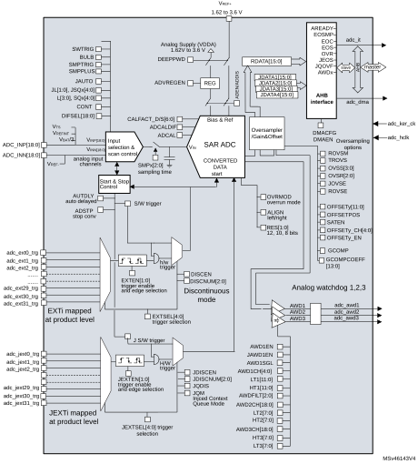

### 21.4.2 ADC pins and internal signals

 

<table class="TableTitle" style="margin-bottom:10.00pt;"><caption class="TableCap"><h4 class="TableCap" id="1017864">Table 162. <a id="%1110" name="XREF_78112__Table_75__ADC_input_output_signals_%1110">ADC internal input/output signals </a></h4></caption><col width="185.04px"/><col width="62.30px"/><col width="291.25px"/><thead><tr height="42.67px"><th>
Internal signal name
</th><th>
Signal type
</th><th>
Description
</th></tr></thead><tr height="69.33px"><td>
adc_ext_trg[31:0]
</td><td>
Inputs
</td><td>
Up to 32 external trigger inputs for the regular conversions (can be connected to on-chip timers).

These inputs are shared between the ADC master and the ADC slave.
</td></tr><tr height="69.33px"><td>
adc_jext_trg[31:0]
</td><td>
Inputs
</td><td>
Up to 31 external trigger inputs for the injected conversions (can be connected to on-chip timers).

These inputs are shared between the ADC master and the ADC slave.
</td></tr><tr height="37.33px"><td>
adc_awdx_out
</td><td>
Output
</td><td>
Internal analog watchdog output signal connected to on-chip timers (x = Analog watchdog number 1,2,3)
</td></tr><tr data-conditional="_adc_new_naming" height="22.67px"><td data-conditional="_adc_new_naming">
adc_ker_ck
</td><td data-conditional="_adc_new_naming">
Output
</td><td data-conditional="_adc_new_naming">
ADC kernel clock
</td></tr><tr data-conditional="_adc_new_naming" height="22.67px"><td data-conditional="_adc_new_naming">
adc_hclk
</td><td data-conditional="_adc_new_naming">
Input
</td><td data-conditional="_adc_new_naming">
ADC peripheral clock
</td></tr><tr data-conditional="_adc_new_naming" height="22.67px"><td data-conditional="_adc_new_naming">
adc_it
</td><td data-conditional="_adc_new_naming">
Output
</td><td data-conditional="_adc_new_naming">
ADC interrupt
</td></tr><tr data-conditional="_adc_new_naming" height="22.67px"><td data-conditional="_adc_new_naming">
adc_dma
</td><td data-conditional="_adc_new_naming">
Output
</td><td data-conditional="_adc_new_naming">
ADC DMA request
</td></tr><tr height="22.67px"><td>
VTS
</td><td>
Input
</td><td>
Output voltage from internal temperature sensor
</td></tr><tr data-conditional="stm32l43_44_45_46,stm32l4_orca_" height="22.67px" style="display: none"><td data-conditional="stm32l43_44_45_46,stm32l4_orca_" style="display: none">
dac_out1
</td><td data-conditional="stm32l43_44_45_46,stm32l4_orca_" style="display: none">
Input
</td><td data-conditional="stm32l43_44_45_46,stm32l4_orca_" style="display: none">
DAC internal channel 1
</td></tr><tr height="22.67px"><td>
VREFINT
</td><td>
Input
</td><td>
Output voltage from internal reference voltage
</td></tr><tr data-conditional="stm32l43_44_45_46,stm32l4_orca_" height="22.67px" style="display: none"><td data-conditional="stm32l43_44_45_46,stm32l4_orca_" style="display: none">
dac_out2
</td><td data-conditional="stm32l43_44_45_46,stm32l4_orca_" style="display: none">
Input
</td><td data-conditional="stm32l43_44_45_46,stm32l4_orca_" style="display: none">
DAC internal channel 2
</td></tr><tr height="37.33px"><td>
VBAT
</td><td>
Input supply
</td><td>
External battery voltage supply
</td></tr></table>

 

<table class="TableTitle" style="margin-bottom:10.00pt;"><caption class="~TableHeading"><h4 class="TableCap" id="22073437">Table 163. <a id="pins10" name="XREF_88997__Table_65__ADC_pins10">ADC input/output pins</a></h4></caption><col width="104.28px"/><col width="141.99px"/><col width="292.31px"/><thead><tr height="28.00px"><th>
Pin name
</th><th>
Signal type
</th><th>
Comments
</th></tr></thead><tr data-conditional="_adc_vref_" height="37.33px"><td data-conditional="_adc_vref_">
VREF+
</td><td data-conditional="_adc_vref_">
Input, analog reference positive
</td><td data-conditional="_adc_vref_">
The higher/positive reference voltage for the ADC
</td></tr><tr height="22.67px"><td>
VDDA
</td><td>
Input, analog supply
</td><td>
Analog power supply equal VDDA
</td></tr><tr data-conditional="_adc_vref_" height="37.33px"><td data-conditional="_adc_vref_">
VREF−
</td><td data-conditional="_adc_vref_">
Input, analog reference negative
</td><td data-conditional="_adc_vref_">
The lower/negative reference voltage for the ADC. VREF− is internally connected to VSSA
</td></tr><tr height="52.00px"><td>
VSSA
</td><td>
Input, analog supply ground
</td><td>
Ground for analog power supply. On device package which do not have a dedicated VSSA pin, VSSA is internally connected to VSS.
</td></tr><tr height="52.00px"><td>
VINPi
</td><td>
Positive analog input channels for each ADC
</td><td>
Connected either to ADCx_INPi external channels or to internal channels. This input is converted in single-ended mode
</td></tr><tr height="37.33px"><td>
VINNi
</td><td>
Negative analog input channels for each ADC
</td><td>
Connected either to VREF− or to external channels: ADCx_INNi and ADCx_INP[i+1].
</td></tr><tr height="69.33px"><td>
ADCx_INNi
</td><td>
Negative external analog input signals
</td><td>
Up to 19 analog input channels (x = ADC number = 1, 2, 3, 4 or 5).

Refer to <a href="#XREF_68119__18_4_4_ADC1/2/3_connectivity10" style="font-family : Arial ; font-weight:normal;font-style:Italic;font-size : 9.00pt;font-kerning:normal;font-stretch:normal;color:#0000ff;background-color:transparent;letter-spacing : 0.00em;">Section 21.4.4: ADC1/2/3/4/5 connectivity</a> for details.
</td></tr><tr height="69.33px"><td>
ADCx_INPi
</td><td>
Positive external analog input signals
</td><td>
Up to 19 analog input channels (x = ADC number = 1, 2, 3, 4 or 5).

Refer to <a href="#XREF_68119__18_4_4_ADC1/2/3_connectivity10" style="font-family : Arial ; font-weight:normal;font-style:Italic;font-size : 9.00pt;font-kerning:normal;font-stretch:normal;color:#0000ff;background-color:transparent;letter-spacing : 0.00em;">Section 21.4.4: ADC1/2/3/4/5 connectivity</a> for details
</td></tr></table>

### 21.4.3 ADC clocks

#### Dual clock domain architecture

The dual clock-domain architecture means that the ADC clock is independent from the AHB bus clock.

The input clock is the same for all ADCs and can be selected between two different clock sources (see [Figure 83: ADC clock scheme](#XREF_26447__Figure_52__ADC_clock_scheme10)):

1. The ADC clock can be a specific clock source, derived from the following clock sources:
 - The system clock
 - PLL “P” clock

Refer to RCC Section for more information on how to generate ADC dedicated clock. To select this scheme, bits CKMODE[1:0] of the ADCx\_CCR register must be reset.

2. The ADC clock can be derived from the AHB clock of the ADC bus interface, divided by a programmable factor (1, 2 or 4). In this mode, a programmable divider factor can be selected (/1, 2 or 4 according to bits CKMODE[1:0]).

To select this scheme, bits CKMODE[1:0] of the ADCx\_CCR register must be different from 00.

**Note:**

For option 2), a prescaling factor of 1 (CKMODE[1:0] = 01) can be used only if the AHB prescaler is set (HPRE[3:0] = 0xxx in RCC\_CFGR register).

Option 1) has the advantage of reaching the maximum ADC clock frequency whatever the AHB clock scheme selected. The ADC clock can eventually be divided by the following ratio: 1, 2, 4, 6, 8, 12, 16, 32, 64, 128, 256; using the prescaler configured with bits PRESC[3:0] in the ADCx\_CCR register.

Option 2) has the advantage of bypassing the clock domain resynchronizations. This can be useful when the ADC is triggered by a timer and if the application requires that the ADC is precisely triggered without any uncertainty (otherwise, an uncertainty of the trigger instant time is added by the resynchronizations between the two clock domains).

 

<table class="FigureDouble"><col width="535.88px"/><tr height="17.33px"><td style="border-left-width:0;border-left-style:hidden;border-left-color:0;border-bottom-width:0.5pt;border-bottom-style:solid;border-bottom-color:#000000;border-right-width:0;border-right-style:hidden;border-right-color:0;border-top-width:0;border-top-style:hidden;border-top-color:0;"><h4 class="FigCap" id="2387498">Figure 83. <a id="scheme10" name="XREF_26447__Figure_52__ADC_clock_scheme10">ADC clock scheme</a></h4></td></tr><tr data-conditional="_adc_5adc" height="353.24px"><td data-conditional="_adc_5adc">
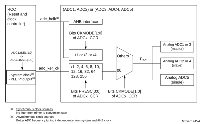
</td></tr><tr data-conditional="_adc_3adc" height="317.07px" style="display: none"><td data-conditional="_adc_3adc" style="display: none"></td></tr><tr data-conditional="_adc_2adc" height="328.20px" style="display: none"><td data-conditional="_adc_2adc" style="display: none"></td></tr><tr data-conditional="_adc_1adc" height="334.10px" style="display: none"><td data-conditional="_adc_1adc" style="display: none"></td></tr></table>

#### Clock ratio constraint between ADC clock and AHB clock

There are generally no constraints to be respected for the ratio between the ADC clock and the AHB clock except if some injected channels are programmed. In this case, it is mandatory to respect the following ratio:

- Fadc\_hclk ≥ FADC / 4 if the resolution of all channels are 12-bit or 10-bit
- Fadc\_hclk ≥ FADC / 3 if there are some channels with resolutions equal to 8-bit (and none with lower resolution)
- Fadc\_hclk ≥ FADC / 2 if there are some channels with resolutions equal to 6-bit

### 21.4.4 ADC1/2/3/4/5 connectivity

ADC1, ADC2, ADC3, ADC4 and ADC5 are tightly coupled and share some external channels as described in the below figures.

ADCy\_INPx correspond to ADCy\_INx pins defined in the product datasheet.

#### Figure 84. ADC1 connectivity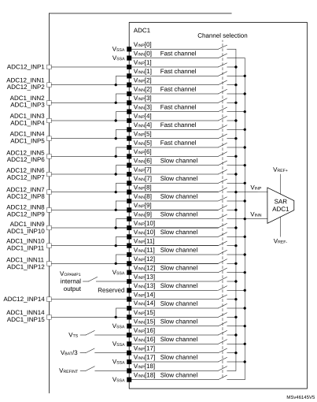

#### Figure 85. ADC2 connectivity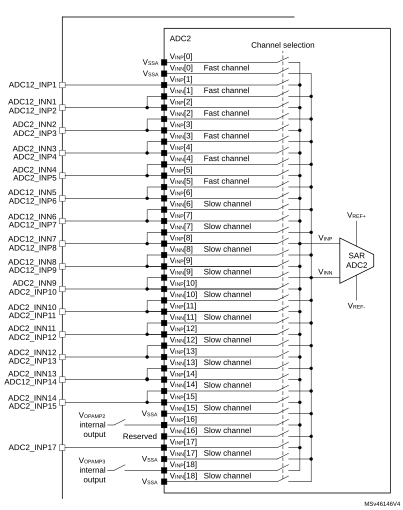

#### Figure 86. ADC3 connectivity 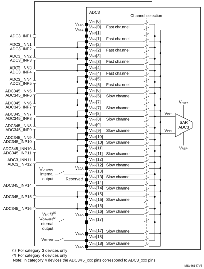

#### Figure 87. ADC4 connectivity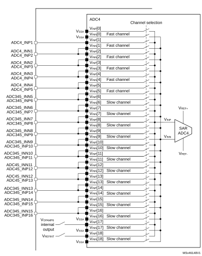

#### Figure 88. ADC5 connectivity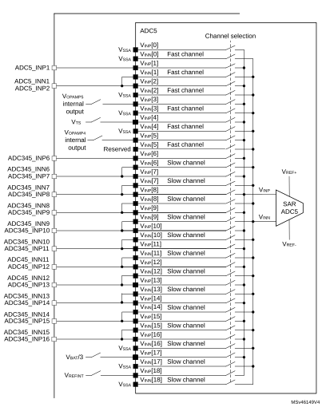

### 21.4.5 Slave AHB interface

The ADCs implement an AHB slave port for control/status register and data access. The features of the AHB interface are listed below:

- Word (32-bit) accesses
- Single cycle response
- Response to all read/write accesses to the registers with zero wait states.

The AHB slave interface does not support split/retry requests, and never generates AHB errors.

### 21.4.6  ADC Deep-power-down mode (DEEPPWD) and ADC voltage regulator   (ADVREGEN)

By default, the ADC is in Deep-power-down mode where its supply is internally switched off to reduce the leakage currents (the reset state of bit DEEPPWD is 1 in the ADC\_CR register).

To start ADC operations, follow the sequence below:

1. Exit Deep-power-down mode by clearing DEEPPWD bit.
2. Enable the ADC voltage regulator by setting ADVREGEN.
3. Wait for the startup time to configure the ADC (refer to the device datasheet for the value of the startup time).

When ADC operations are complete, the ADC can be disabled (ADEN = 0). It is possible to save power by also disabling the ADC voltage regulator. This is done by writing bit ADVREGEN = 0.

Then, to save more power by reducing the leakage currents, it is also possible to re-enter in ADC Deep-power-down mode by setting bit DEEPPWD = 1 into ADC\_CR register. This is particularly interesting before entering Stop mode.

**Note:**

Writing DEEPPWD = 1 automatically disables the ADC voltage regulator and bit ADVREGEN is automatically cleared.

When the internal voltage regulator is disabled (ADVREGEN = 0), the internal analog calibration is kept.

In ADC Deep-power-down mode (DEEPPWD = 1), the internal analog calibration is lost and it is necessary to either relaunch a calibration or re-apply the calibration factor which was previously saved (refer to [Section 21.4.8: Calibration (ADCAL, ADCALDIF, ADC\_CALFACT)](#XREF_19824__1_4_6_Calibration_(ADCAL%2C_ADCALDIF%2C_ADC_CALFACT)10)).

### 21.4.7 Single-ended and differential input channels

Channels can be configured to be either single-ended input or differential input by programming DIFSEL[i] bits in the ADC\_DIFSEL register. This configuration must be written while the ADC is disabled (ADEN = 0). Note that the DIFSEL[i] bits corresponding to single-ended channels are always programmed at 0.

In single-ended input mode, the analog voltage to be converted for channel “i” is the difference between the ADCy\_INPx external voltage equal to VINP[i] (positive input) and VREF− (negative input).

In differential input mode, the analog voltage to be converted for channel “i” is the difference between the ADCy\_INPx external voltage positive input equal to VINP[i], and the ADCy\_INNx negative input equal to VINN[i].

The input voltage in differential mode ranges from VREF- to VREF+, which makes a full scale range of 2xVREF+. When VINP[i] equals VREF-, VINN[i] equals VREF+and the maximum negative input differential voltage (VREF-) corresponds to 0x000 ADC output. When VINP[i] equals VREF+, VINN[i] equals VREF- and the maximum positive input differential voltage (VREF+) corresponds to 0xFFF ADC output. When VINP[i] and VINN[i] are connected together, the zero input differential voltage corresponds to 0x800 ADC output.

The ADC sensitivity in differential mode is twice smaller than in single-ended mode.

When ADC is configured as differential mode, both inputs should be biased at (VREF+) / 2 voltage. Refer to the device datasheet for the allowed common mode input voltage VCMIN.

The input signals are supposed to be differential (common mode voltage should be fixed).

Internal channels (such as VTS and VREFINT) are used in single-ended mode only.

For a complete description of how the input channels are connected for each ADC, refer to [Section 21.4.4: ADC1/2/3/4/5 connectivity](#XREF_68119__18_4_4_ADC1/2/3_connectivity10).

Caution:When configuring the channel “i” in differential input mode, its negative input voltage VINN[i] is connected to another channel. As a consequence, this channel is no longer usable in single-ended mode or in differential mode and must never be configured to be converted.  Some channels are shared between ADC1/ADC2/ADC3/ADC4/ADC5: this can make the channel on the other ADC unusable. The only exception is when ADC master and the slave operate in interleaved mode.

### 21.4.8 Calibration (ADCAL, ADCALDIF, ADC\_CALFACT)

Each ADC provides an automatic calibration procedure which drives all the calibration sequence including the power-on/off sequence of the ADC. During the procedure, the ADC calculates a calibration factor which is 7-bit wide and which is applied internally to the ADC until the next ADC power-off. During the calibration procedure, the application must not use the ADC and must wait until calibration is complete.

Calibration is preliminary to any ADC operation. It removes the offset error which may vary from chip to chip due to process or bandgap variation.

The calibration factor to be applied for single-ended input conversions is different from the factor to be applied for differential input conversions:

- Write ADCALDIF = 0 before launching a calibration to be applied for single-ended input conversions.
- Write ADCALDIF = 1 before launching a calibration to be applied for differential input conversions.

The calibration is then initiated by software by setting bit ADCAL = 1. Calibration can only be initiated when the ADC is disabled (when ADEN = 0). ADCAL bit stays at 1 during all the calibration sequence. It is then cleared by hardware as soon the calibration completes. At this time, the associated calibration factor is stored internally in the analog ADC and also in the bits CALFACT\_S[6:0] or CALFACT\_D[6:0] of ADC\_CALFACT register (depending on single-ended or differential input calibration)

The internal analog calibration is kept if the ADC is disabled (ADEN = 0). However, if the ADC is disabled for extended periods, then it is recommended that a new calibration cycle is run before re-enabling the ADC.

The internal analog calibration is lost each time the power of the ADC is removed (example, when the product enters in Standby or VBAT mode). In this case, to avoid spending time recalibrating the ADC, it is possible to re-write the calibration factor into the ADC\_CALFACT register without recalibrating, supposing that the software has previously saved the calibration factor delivered during the previous calibration.

The calibration factor can be written if the ADC is enabled but not converting (ADEN = 1 and ADSTART = 0 and JADSTART = 0). Then, at the next start of conversion, the calibration factor is automatically injected into the analog ADC. This loading is transparent and does not add any cycle latency to the start of the conversion. It is recommended to recalibrate when VREF+ voltage changed more than 10%.

#### Software procedure to calibrate the ADC

1. Ensure DEEPPWD = 0, ADVREGEN = 1 and that ADC voltage regulator startup time has elapsed.
2. Ensure that ADEN = 0.
3. Select the input mode for this calibration by setting ADCALDIF = 0 (single-ended input) or ADCALDIF = 1 (differential input).
4. Set ADCAL.
5. Wait until ADCAL = 0.
6. The calibration factor can be read from ADC\_CALFACT register.

#### Figure 89. ADC calibration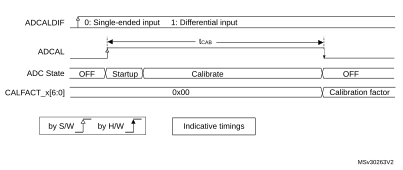

#### Software procedure to re-inject a calibration factor into the ADC

1. Ensure ADEN = 1 and ADSTART = 0 and JADSTART = 0 (ADC enabled and no conversion is ongoing).
2. Write CALFACT\_S and CALFACT\_D with the new calibration factors.
3. When a conversion is launched, the calibration factor is injected into the analog ADC only if the internal analog calibration factor differs from the one stored in bits CALFACT\_S for single-ended input channel or bits CALFACT\_D for differential input channel.

#### Figure 90. Updating the ADC calibration factor

#### Converting single-ended and differential analog inputs with a single ADC

If the ADC is supposed to convert both differential and single-ended inputs, two calibrations must be performed, one with ADCALDIF = 0 and one with ADCALDIF = 1. The procedure is the following:

1. Disable the ADC.
2. Calibrate the ADC in single-ended input mode (with ADCALDIF = 0). This updates the register CALFACT\_S[6:0].
3. Calibrate the ADC in differential input modes (with ADCALDIF = 1). This updates the register CALFACT\_D[6:0].
4. Enable the ADC, configure the channels and launch the conversions. Each time there is a switch from a single-ended to a differential inputs channel (and vice-versa), the calibration is automatically injected into the analog ADC.

#### Figure 91. Mixing single-ended and differential channels

### 21.4.9 ADC on-off control (ADEN, ADDIS, ADRDY)

First of all, follow the procedure explained in [Section 21.4.6: ADC Deep-power-down mode (DEEPPWD) and ADC voltage regulator (ADVREGEN)](#XREF_61594__12_4_5_ADC_Deep-Power-Down_Mode_(DEEPPWD)_&_ADC_Voltage_R10)).

Once DEEPPWD = 0 and ADVREGEN = 1, the ADC can be enabled and the ADC needs a stabilization time of tSTAB before it starts converting accurately, as shown in [Figure 92](#XREF_70746__Figure_3__Enabling/Disabling_the_ADC10). Two control bits enable or disable the ADC:

- ADEN = 1 enables the ADC. The flag ADRDY is set once the ADC is ready for operation.
- ADDIS = 1 disables the ADC. ADEN and ADDIS are then automatically cleared by hardware as soon as the analog ADC is effectively disabled.

Regular conversion can then start either by setting ADSTART = 1 (refer to [Section 21.4.18: Conversion on external trigger and trigger polarity (EXTSEL, EXTEN, JEXTSEL, JEXTEN)](#XREF_37535__1_5_Conversion_on_external_trigger_and_trigger_polarity_(EXTSEL%2C10)) or when an external trigger event occurs, if triggers are enabled.

Injected conversions start by setting JADSTART = 1 or when an external injected trigger event occurs, if injected triggers are enabled.

#### Software procedure to enable the ADC

1. Clear the ADRDY bit in the ADC\_ISR register by writing 1.
2. Set ADEN.
3. Wait until ADRDY = 1 (ADRDY is set after the ADC startup time). This can be done using the associated interrupt (setting ADRDYIE = 1).
4. Clear the ADRDY bit in the ADC\_ISR register by writing 1 (optional).

Caution:ADEN bit cannot be set when ADCAL is set and during four ADC clock cycles after the ADCAL bit is cleared by hardware (end of the calibration).

#### Software procedure to disable the ADC

1. Check that both ADSTART = 0 and JADSTART = 0 to ensure that no conversion is ongoing. If required, stop any regular and injected conversion ongoing by setting ADSTP = 1 and JADSTP = 1 and then wait until ADSTP = 0 and JADSTP = 0.
2. Set ADDIS.
3. If required by the application, wait until ADEN = 0, until the analog ADC is effectively disabled (ADDIS is automatically reset once ADEN = 0).

#### Figure 92. Enabling / disabling the ADC

### 21.4.10 Constraints when writing the ADC control bits

The software is allowed to write the RCC control bits to configure and enable the ADC clock (refer to RCC Section), the DIFSEL[i] control bits in the ADC\_DIFSEL register and the control bits ADCAL and ADEN in the ADC\_CR register, only if the ADC is disabled (ADEN must be equal to 0).

The software is then allowed to write the control bits ADSTART, JADSTART and ADDIS of the ADC\_CR register only if the ADC is enabled and there is no pending request to disable the ADC (ADEN must be equal to 1 and ADDIS to 0).

For all the other control bits of the ADC\_CFGR, ADC\_SMPRx, ADC\_TRy, ADC\_SQRy, ADC\_JDRy, ADC\_OFRy, ADC\_OFCHRy and ADC\_IER registers:

- For control bits related to configuration of regular conversions, the software is allowed to write them only if the ADC is enabled (ADEN = 1) and if there is no regular conversion ongoing (ADSTART must be equal to 0).
- For control bits related to configuration of injected conversions, the software is allowed to write them only if the ADC is enabled (ADEN = 1) and if there is no injected conversion ongoing (JADSTART must be equal to 0).
- ADC\_TRy registers can be modified when an analog-to-digital conversion is ongoing (refer to [Section 21.4.28: Analog window watchdog (AWD1EN, JAWD1EN, AWD1SGL, AWD1CH, AWD2CH, AWD3CH, AWD\_HTx, AWD\_LTx, AWDx)](#XREF_35523__1_7_Analog_window_watchdog_(AWDxEN%2C_JAWDxEN%2C_AWDxSGL%2C10)for details).

The software is allowed to write the ADSTP or JADSTP control bits of the ADC\_CR register only if the ADC is enabled, possibly converting, and if there is no pending request to disable the ADC (ADSTART or JADSTART must be equal to 1 and ADDIS to 0).

The software can write the register ADC\_JSQR at any time, when the ADC is enabled (ADEN = 1) and JADSTART is cleared. The software is allowed to modify on-the-fly the ADC\_JSQR register when JADSTART is set (injected conversions are ongoing) only when the context queue is enabled (JQDIS = 0 in the ADC\_CFGR register). Refer to [Section 21.7.16: ADC injected sequence register (ADC\_JSQR)](#XREF_75143__20_13_15_ADC_injected_sequence_register_(ADCx_JSQR%2C_x=1__4)10) for additional details.

**Note:**

There is no hardware protection to prevent these forbidden write accesses and ADC behavior may become in an unknown state. To recover from this situation, the ADC must be disabled (clear ADEN as well as all the bits of ADC\_CR register).

### 21.4.11 Channel selection (ADC\_SQRy, ADC\_JSQR)

There are up to 19 multiplexed channels per ADC:

- Up to 13 slow analog inputs coming from GPIO pads (ADCx\_INP/INN[6:18])

Depending on the products, not all of them are available on GPIO pads.

- The ADCs are connected to the following internal analog inputs:
 - The internal reference voltage (VREFINT) is connected to ADC1\_INP18, ADC3\_INP18, ADC4\_INP18 and ADC5\_INP18.
 - The internal temperature sensor (VTS) is connected to ADC1\_INP16 and ADC5\_INP4.
 - The VBAT monitoring channel (VBAT/3) is connected to ADC1\_INP17, ADC3\_INP17 and ADC5\_INP17.

**Note:**

To convert one of the internal analog channels, the corresponding analog sources must first be enabled by programming bits VREFEN, VBATSEL or VSENSESEL in the ADCx\_CCR registers.

It is possible to organize the conversions in two groups: regular and injected. A group consists of a sequence of conversions that can be done on any channel and in any order. For instance, it is possible to implement the conversion sequence in the following order: ADCx\_INP/INN3, ADCx\_INP/INN8, ADCx\_INP/INN2, ADCx\_INN/INP2, ADCx\_INP/INN0, ADCx\_INP/INN2, ADCx\_INP/INN2, ADCx\_INP/INN15.

- A regular group is composed of up to 16 conversions. The regular channels and their order in the conversion sequence must be selected in the ADC\_SQRy registers. The total number of conversions in the regular group must be written in the L[3:0] bits in the ADC\_SQR1 register.
- An injected group is composed of up to 4 conversions. The injected channels and their order in the conversion sequence must be selected in the ADC\_JSQR register. The total number of conversions in the injected group must be written in the L[1:0] bits in the ADC\_JSQR register.

ADC\_SQRy registers must not be modified while regular conversions can occur. For this, the ADC regular conversions must be first stopped by writing ADSTP = 1 (refer to [Section 21.4.17: Stopping an ongoing conversion (ADSTP, JADSTP)](#XREF_21599__1_4_10_Stoping_a_on-going_conversion_(ADSTP)10)).

The software is allowed to modify on-the-fly the ADC\_JSQR register when JADSTART is set (injected conversions ongoing) only when the context queue is enabled (JQDIS = 0 in ADC\_CFGR register). Refer to [Section 21.4.21: Queue of context for injected conversions](#XREF_40313__1_4_15_Queue_of_Context_for_Injected_Conversions10)

### 21.4.12 Channel-wise programmable sampling time (SMPR1, SMPR2)

Before starting a conversion, the ADC must establish a direct connection between the voltage source under measurement and the embedded sampling capacitor of the ADC. This sampling time must be enough for the input voltage source to charge the embedded capacitor to the input voltage level.

Each channel can be sampled with a different sampling time which is programmable using the SMP[2:0] bits in the ADC\_SMPR1 and ADC registers. It is therefore possible to select among the following sampling time values:

- SMP = 000: 2.5 ADC clock cycles
- SMP = 001: 6.5 ADC clock cycles
- SMP = 010: 12.5 ADC clock cycles
- SMP = 011: 24.5 ADC clock cycles
- SMP = 100: 47.5 ADC clock cycles
- SMP = 101: 92.5 ADC clock cycles
- SMP = 110: 247.5 ADC clock cycles
- SMP = 111: 640.5 ADC clock cycles

The total conversion time is calculated as follows:

TCONV = Sampling time + 12.5 ADC clock cycles

Example:

With Fadc\_ker\_ck = 30 MHz and a sampling time of 2.5 ADC clock cycles:

TCONV = (2.5 + 12.5) ADC clock cycles = 15 ADC clock cycles = 500 ns

The ADC notifies the end of the sampling phase by setting the status bit EOSMP (only for regular conversion).

#### Constraints on the sampling time

For each channel, SMP[2:0] bits must be programmed to respect a minimum sampling time as specified in the ADC characteristics section of the datasheets.

#### Bulb sampling mode

When the BULB bit is set in ADC register, the sampling period starts immediately after the last ADC conversion. A hardware or software trigger starts the conversion after the sampling time has been programmed in ADC\_SMPR1 register. The very first ADC conversion, after the ADC is enabled, is performed with the sampling time programmed in SMP bits. The Bulb mode is effective starting from the second conversion.

The maximum sampling time is limited (refer to the ADC characteristics section of the datasheet).

The Bulb mode is neither compatible with the continuous conversion mode nor with the injected channel conversion.

When the BULB bit is set, it is not allowed to set SMPTRIG bit in ADC\_CFGR2.

#### Figure 93. Bulb mode timing diagram

#### Sampling time control trigger mode

When the SMPTRIG bit is set, the sampling time programmed though SMPx bits is not applicable. The sampling time is controlled by the trigger signal edge.

When a hardware trigger is selected, each rising edge of the trigger signal starts the sampling period. A falling edge ends the sampling period and starts the conversion. The EXTEN[1:0] bits must be set to 01. Hardware triggers with not defined rising and falling edges (one pulse event) cannot be used in Bulb mode.

When a software trigger is selected, the software trigger is not the ADSTART bit in ADC\_CR but the SWTRIG bit. SWTRIG bit has to be set to start the sampling period, and the SWTRIG bit has to be cleared to end the sampling period and start the conversion. EXTEN[1:0] bits must be set to 00.

The maximum sampling time is limited (refer to the ADC characteristics section of the datasheet).

This mode is neither compatible with the continuous conversion mode, nor with the injected channel conversion.

When SMPTRIG bit is set, it is not allowed to set BULB bit.

#### I/O analog switch voltage booster

The resistance of the I/O analog switches increases when the VDDA voltage is too low. The sampling time must consequently be adapted accordingly (refer to the device datasheet for the corresponding electrical characteristics). This resistance can be minimized at low VDDA voltage by enabling an internal voltage booster through the BOOSTEN bit of the SYSCFG\_CFGR1 register.

#### SMPPLUS control bit

When a sampling time of 2.5 ADC clock cycles is selected, the total conversion time becomes 15 cycles in 12-bit mode. If the dual interleaved mode is used (see [Section : Interleaved mode with independent injected](#XREF_76940__1_9_3_Interleaved_mode10)), the sampling interval cannot be equal to the value specified since an even number of cycles is required for the conversion. The SMPPLUS bit can be used to change the sampling time 2.5 ADC clock cycles into 3.5 ADC clock cycles. In this way, the total conversion time becomes 16 clock cycles, thus making possible to interleave every 8 cycles.

### 21.4.13 Single conversion mode (CONT = 0)

In Single conversion mode, the ADC performs once all the conversions of the channels. This mode is started with the CONT bit at 0 by either:

- Setting the ADSTART bit in the ADC\_CR register (for a regular channel)
- Setting the JADSTART bit in the ADC\_CR register (for an injected channel)
- External hardware trigger event (for a regular or injected channel)

Inside the regular sequence, after each conversion is complete:

- The converted data are stored into the 16-bit ADC\_DR register
- The EOC (end of regular conversion) flag is set
- An interrupt is generated if the EOCIE bit is set

Inside the injected sequence, after each conversion is complete:

- The converted data are stored into one of the four 16-bit ADC\_JDRy registers
- The JEOC (end of injected conversion) flag is set
- An interrupt is generated if the JEOCIE bit is set

After the regular sequence is complete:

- The EOS (end of regular sequence) flag is set
- An interrupt is generated if the EOSIE bit is set

After the injected sequence is complete:

- The JEOS (end of injected sequence) flag is set
- An interrupt is generated if the JEOSIE bit is set

Then the ADC stops until a new external regular or injected trigger occurs or until bit ADSTART or JADSTART is set again.

**Note:**

To convert a single channel, program a sequence with a length of 1.

### 21.4.14 Continuous conversion mode (CONT = 1)

This mode applies to regular channels only.

In continuous conversion mode, when a software or hardware regular trigger event occurs, the ADC performs once all the regular conversions of the channels and then automatically restarts and continuously converts each conversions of the sequence. This mode is started with the CONT bit at 1 either by external trigger or by setting the ADSTART bit in the ADC\_CR register.

Inside the regular sequence, after each conversion is complete:

- The converted data are stored into the 16-bit ADC\_DR register
- The EOC (end of conversion) flag is set
- An interrupt is generated if the EOCIE bit is set

After the sequence of conversions is complete:

- The EOS (end of sequence) flag is set
- An interrupt is generated if the EOSIE bit is set

Then, a new sequence restarts immediately and the ADC continuously repeats the conversion sequence.

**Note:**

To convert a single channel, program a sequence with a length of 1.

It is not possible to have both discontinuous mode and continuous mode enabled: it is forbidden to set both DISCEN = 1 and CONT = 1.

Injected channels cannot be converted continuously. The only exception is when an injected channel is configured to be converted automatically after regular channels in continuous mode (using JAUTO bit), refer to [Auto-injection mode](#XREF_13256__Auto-injection10) section).

### 21.4.15 Starting conversions (ADSTART, JADSTART)

Software starts ADC regular conversions by setting ADSTART = 1.

When ADSTART is set, the conversion starts:

- Immediately: if EXTEN[1:0] = 00 (software trigger)
- At the next active edge of the selected regular hardware trigger: if EXTEN[1:0] is not equal to 00

Software starts ADC injected conversions by setting JADSTART = 1.

When JADSTART is set, the conversion starts:

- Immediately, if JEXTEN[1:0] = 00 (software trigger)
- At the next active edge of the selected injected hardware trigger: if JEXTEN[1:0] is not equal to 00

**Note:**

In auto-injection mode (JAUTO = 1), use ADSTART bit to start the regular conversions followed by the auto-injected conversions (JADSTART must be kept cleared).

ADSTART and JADSTART also provide information on whether any ADC operation is currently ongoing. It is possible to re-configure the ADC while ADSTART = 0 and JADSTART = 0 are both true, indicating that the ADC is idle.

ADSTART is cleared by hardware:

- In single mode with software regular trigger (CONT = 0, EXTSEL = 0x0)
 - At any end of regular conversion sequence (EOS assertion) or at any end of subgroup processing if DISCEN = 1
- In all cases (CONT=x, EXTSEL=x)
 - After execution of the ADSTP procedure asserted by the software.

**Note:**

In continuous mode (CONT = 1), ADSTART is not cleared by hardware with the assertion of EOS because the sequence is automatically relaunched.

When a hardware trigger is selected in single mode (CONT = 0 and EXTSEL≠0x00), ADSTART is not cleared by hardware with the assertion of EOS to help the software which does not need to reset ADSTART again for the next hardware trigger event. This ensures that no further hardware triggers are missed.

JADSTART is cleared by hardware:

- In single mode with software injected trigger (JEXTSEL = 0x0)
 - At any end of injected conversion sequence (JEOS assertion) or at any end of subgroup processing if JDISCEN = 1
- in all cases (JEXTSEL=x)
 - After execution of the JADSTP procedure asserted by the software.

**Note:**

When the software trigger is selected, ADSTART bit should not be set if the EOC flag is still high.

### 21.4.16 ADC timing

The elapsed time between the start of a conversion and the end of conversion is the sum of the configured sampling time plus the successive approximation time depending on data resolution: 

#### Figure 94. Analog-to-digital conversion time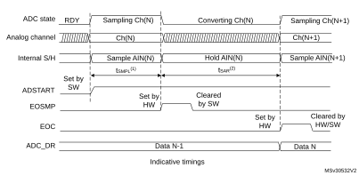

1.tSMPL depends on SMP[2:0].

2.tSAR depends on RES[2:0].

### 21.4.17 Stopping an ongoing conversion (ADSTP, JADSTP)

The software can decide to stop regular conversions ongoing by setting ADSTP = 1 and injected conversions ongoing by setting JADSTP = 1.

Stopping conversions resets the ongoing ADC operation. Then the ADC can be reconfigured (ex: changing the channel selection or the trigger) ready for a new operation.

Note that it is possible to stop injected conversions while regular conversions are still operating and vice-versa. This allows, for instance, re-configuration of the injected conversion sequence and triggers while regular conversions are still operating (and vice-versa).

When the ADSTP bit is set by software, any ongoing regular conversion is aborted with partial result discarded (ADC\_DR register is not updated with the current conversion).

When the JADSTP bit is set by software, any ongoing injected conversion is aborted with partial result discarded (ADC\_JDRy register is not updated with the current conversion). The scan sequence is also aborted and reset (meaning that relaunching the ADC would restart a new sequence).

Once this procedure is complete, bits ADSTP/ADSTART (in case of regular conversion), or JADSTP/JADSTART (in case of injected conversion) are cleared by hardware and the software must poll ADSTART (or JADSTART) until the bit is reset before assuming the ADC is completely stopped.

**Note:**

In auto-injection mode (JAUTO = 1), setting ADSTP bit aborts both regular and injected conversions (JADSTP must not be used).

#### Figure 95. Stopping ongoing regular conversions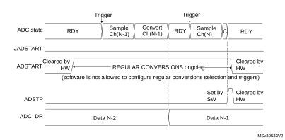

#### Figure 96. Stopping ongoing regular and injected conversions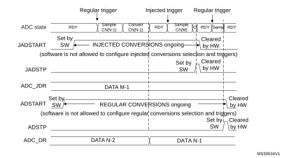

### 21.4.18  Conversion on external trigger and trigger polarity   (EXTSEL, EXTEN, JEXTSEL, JEXTEN)

A conversion or a sequence of conversions can be triggered either by software or by an external event (e.g. timer capture, input pins). If the EXTEN[1:0] control bits (for a regular conversion) or JEXTEN[1:0] bits (for an injected conversion) are different from 00, then external events are able to trigger a conversion with the selected polarity.

When the Injected Queue is enabled (bit JQDIS = 0), injected software triggers are not possible.

The regular trigger selection is effective once software has set bit ADSTART = 1 and the injected trigger selection is effective once software has set bit JADSTART = 1.

Any hardware triggers which occur while a conversion is ongoing are ignored.

- If bit ADSTART = 0, any regular hardware triggers which occur are ignored.
- If bit JADSTART = 0, any injected hardware triggers which occur are ignored.

[Table 164](#XREF_73644__Table_32__Configuring_the_trigger_polarity_for_regular_exter10) provides the correspondence between the EXTEN[1:0] and JEXTEN[1:0] values and the trigger polarity.

 

<table class="TableTitle"><caption class="TableCap"><h4 class="TableCap" id="1018475">Table 164. <a id="exter10" name="XREF_73644__Table_32__Configuring_the_trigger_polarity_for_regular_exter10">Configuring the trigger polarity for regular external triggers</a></h4></caption><col width="100.12px"/><col width="438.46px"/><thead><tr height="28.00px"><th>
EXTEN[1:0]
</th><th>
Source
</th></tr></thead><tr height="22.67px"><td>
00
</td><td>
Hardware Trigger detection disabled, software trigger detection enabled
</td></tr><tr height="22.67px"><td>
01
</td><td>
Hardware Trigger with detection on the rising edge
</td></tr><tr height="22.67px"><td>
10
</td><td>
Hardware Trigger with detection on the falling edge
</td></tr><tr height="22.67px"><td>
11
</td><td>
Hardware Trigger with detection on both the rising and falling edges
</td></tr></table>

**Note:**

The polarity of the regular trigger cannot be changed on-the-fly.

 

<table class="TableTitle"><caption class="TableCap"><h4 class="TableCap" id="2249918">Table 165. <a id="exte10" name="XREF_82472__Table_4__Configuring_the_trigger_polarity_for_injected_exte10">Configuring the trigger polarity for injected external triggers</a></h4></caption><col width="101.18px"/><col width="436.86px"/><thead><tr height="28.00px"><th>
JEXTEN[1:0]
</th><th>
Source
</th></tr></thead><tr height="69.33px"><td>
00
</td><td><li class="TableBullet" id="2249928">–​If JQDIS = 1 (Queue disabled): Hardware trigger detection disabled, software trigger detection enabled</li><li class="TableBullet" id="2249929">–​If JQDIS = 0 (Queue enabled), Hardware and software trigger detection disabled</li></td></tr><tr height="22.67px"><td>
01
</td><td>
Hardware Trigger with detection on the rising edge
</td></tr><tr height="22.67px"><td>
10
</td><td>
Hardware Trigger with detection on the falling edge
</td></tr><tr height="22.67px"><td>
11
</td><td>
Hardware Trigger with detection on both the rising and falling edges
</td></tr></table>

**Note:**

The polarity of the injected trigger can be anticipated and changed on-the-fly when the queue is enabled (JQDIS = 0). Refer to [Section 21.4.21: Queue of context for injected conversions](#XREF_40313__1_4_15_Queue_of_Context_for_Injected_Conversions10).

The EXTSEL and JEXTSEL control bits select which out of 32 possible events can trigger conversion for the regular and injected groups.

A regular group conversion can be interrupted by an injected trigger.

**Note:**

The regular trigger selection cannot be changed on-the-fly.
The injected trigger selection can be anticipated and changed on-the-fly. Refer to [Section 21.4.21: Queue of context for injected conversions on page 624](#XREF_40313__1_4_15_Queue_of_Context_for_Injected_Conversions10)

Each ADC master shares the same input triggers with its ADC slave as described in [Figure 97](#XREF_63079__Figure_90__Triggers_sharing_between_ADC_master_and_ADC_slave10).

#### Figure 97. Triggers sharing between ADC master and ADC slave 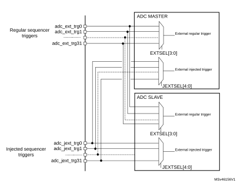

[Table 166](#XREF_41663__Table_78__ADC1/2_-_External_triggers_for_regular_channels%1110) to [Table 169](#XREF_87819__Table_81__ADC3/4/5_-_External_triggers_for_injected_channels10) give all the possible external triggers of the three ADCs for regular and injected conversions.

<table class="TableTitle"><caption class="Body"><h4 class="TableCap" id="34403888">Table 166. <a id="channels%1110" name="XREF_41663__Table_78__ADC1_2_-_External_triggers_for_regular_channels%1110">ADC1/2 - External triggers for regular channels</a></h4></caption><col width="104.94px"/><col width="193.99px"/><col width="206.12px"/><col width="109.12px"/><thead><tr height="28.00px"><th>
Name
</th><th>
Source
</th><th>
Type
</th><th>
EXTSEL[4:0]
</th></tr></thead><tr height="22.67px"><td>
adc_ext_trg
</td><td>
tim1_oc1
</td><td>
Internal signal from on-chip timers
</td><td>
00000
</td></tr><tr height="22.67px"><td>
adc_ext_trg1
</td><td>
tim1_oc2
</td><td>
Internal signal from on-chip timers
</td><td>
00001
</td></tr><tr height="22.67px"><td>
adc_ext_trg2
</td><td>
tim1_oc3
</td><td>
Internal signal from on-chip timers
</td><td>
00010
</td></tr><tr height="22.67px"><td>
adc_ext_trg3
</td><td>
tim2_oc2
</td><td>
Internal signal from on-chip timers
</td><td>
00011
</td></tr><tr height="22.67px"><td>
adc_ext_trg4
</td><td>
tim3_trgo
</td><td>
Internal signal from on-chip timers
</td><td>
00100
</td></tr><tr height="22.67px"><td>
adc_ext_trg5
</td><td>
tim4_oc4
</td><td>
Internal signal from on-chip timers
</td><td>
00101
</td></tr><tr height="22.67px"><td>
adc_ext_trg6
</td><td>
EXTI line 11
</td><td>
External pin
</td><td>
00110
</td></tr><tr height="22.67px"><td>
adc_ext_trg7
</td><td>
tim8_trgo
</td><td>
Internal signal from on-chip timers
</td><td>
00111
</td></tr><tr height="22.67px"><td>
adc_ext_trg8
</td><td>
tim8_trgo2
</td><td>
Internal signal from on-chip timers
</td><td>
01000
</td></tr><tr height="22.67px"><td>
adc_ext_trg9
</td><td>
tim1_trgo
</td><td>
Internal signal from on-chip timers
</td><td>
01001
</td></tr><tr height="22.67px"><td>
adc_ext_trg10
</td><td>
tim1_trgo2 
</td><td>
Internal signal from on-chip timers
</td><td>
01010
</td></tr><tr height="22.67px"><td>
adc_ext_trg11
</td><td>
tim2_trgo 
</td><td>
Internal signal from on-chip timers
</td><td>
01011
</td></tr><tr height="22.67px"><td>
adc_ext_trg12
</td><td>
tim4_trgo
</td><td>
Internal signal from on-chip timers
</td><td>
01100
</td></tr><tr height="22.67px"><td>
adc_ext_trg13
</td><td>
tim6_trgo 
</td><td>
Internal signal from on-chip timers
</td><td>
01101
</td></tr><tr height="22.67px"><td>
adc_ext_trg14
</td><td>
tim15_trgo 
</td><td>
Internal signal from on-chip timers
</td><td>
01110
</td></tr><tr height="22.67px"><td>
adc_ext_trg15
</td><td>
tim3_oc4
</td><td>
Internal signal from on-chip timers
</td><td>
01111
</td></tr><tr height="22.67px"><td>
adc_ext_trg16
</td><td>
tim20_trgo
</td><td>
Internal signal from on-chip timers
</td><td>
10000
</td></tr><tr height="22.67px"><td>
adc_ext_trg17
</td><td>
tim20_trgo2
</td><td>
Internal signal from on-chip timers
</td><td>
10001
</td></tr><tr height="22.67px"><td>
adc_ext_trg18
</td><td>
tim20_oc1
</td><td>
Internal signal from on-chip timers
</td><td>
10010
</td></tr><tr height="22.67px"><td>
adc_ext_trg19
</td><td>
tim20_oc2
</td><td>
Internal signal from on-chip timers
</td><td>
10011
</td></tr><tr height="22.67px"><td>
adc_ext_trg20
</td><td>
tim20_oc3
</td><td>
Internal signal from on-chip timers
</td><td>
10100
</td></tr><tr height="22.67px"><td>
adc_ext_trg21
</td><td>
hrtim_adc_trg1
</td><td>
Internal signal from on-chip timers
</td><td>
10101
</td></tr><tr height="22.67px"><td>
adc_ext_trg22
</td><td>
hrtim_adc_trg3
</td><td>
Internal signal from on-chip timers
</td><td>
10110
</td></tr><tr height="22.67px"><td>
adc_ext_trg23
</td><td>
hrtim_adc_trg5
</td><td>
Internal signal from on-chip timers
</td><td>
10111
</td></tr><tr height="22.67px"><td>
adc_ext_trg24
</td><td>
hrtim_adc_trg6
</td><td>
Internal signal from on-chip timers
</td><td>
11000
</td></tr><tr height="22.67px"><td>
adc_ext_trg25
</td><td>
hrtim_adc_trg7
</td><td>
Internal signal from on-chip timers
</td><td>
11001
</td></tr><tr height="22.67px"><td>
adc_ext_trg26
</td><td>
hrtim_adc_trg8
</td><td>
Internal signal from on-chip timers
</td><td>
11010
</td></tr><tr height="22.67px"><td>
adc_ext_trg27
</td><td>
hrtim_adc_trg9
</td><td>
Internal signal from on-chip timers
</td><td>
11011
</td></tr><tr height="22.67px"><td>
adc_ext_trg28
</td><td>
hrtim_adc_trg10
</td><td>
Internal signal from on-chip timers
</td><td>
11100
</td></tr><tr height="22.67px"><td>
adc_ext_trg29
</td><td>
lptim_out
</td><td>
Internal signal from on-chip timers
</td><td>
11101
</td></tr><tr height="22.67px"><td>
adc_ext_trg30
</td><td>
tim7_trgo
</td><td>
Internal signal from on-chip timers
</td><td>
11110
</td></tr><tr height="22.67px"><td>
adc_ext_trg31
</td><td>
reserved
</td><td>
-
</td><td>
11111
</td></tr></table>

<table class="TableTitle"><caption class="Body"><h4 class="TableCap" id="34404166">Table 167. <a id="channels%1110" name="XREF_82634__Table_137__ADC1_2_-_External_trigger_for_injected_channels%1110">ADC1/2 - External trigger for injected channels</a></h4></caption><col width="104.94px"/><col width="193.99px"/><col width="206.12px"/><col width="109.12px"/><thead><tr height="28.00px"><th>
Name
</th><th>
Source
</th><th>
Type
</th><th>
JEXTSEL[4:0]
</th></tr></thead><tr height="22.67px"><td>
adc_jext_trg0
</td><td>
tim1_trgo 
</td><td>
Internal signal from on-chip timers
</td><td>
00000
</td></tr><tr height="22.67px"><td>
adc_jext_trg1
</td><td>
tim1_oc4 
</td><td>
Internal signal from on-chip timers
</td><td>
00001
</td></tr><tr height="22.67px"><td>
adc_jext_trg2
</td><td>
tim2_trgo
</td><td>
Internal signal from on-chip timers
</td><td>
00010
</td></tr><tr height="22.67px"><td>
adc_jext_trg3
</td><td>
tim2_oc1 
</td><td>
Internal signal from on-chip timers
</td><td>
00011
</td></tr><tr height="22.67px"><td>
adc_jext_trg4
</td><td>
tim3_oc4
</td><td>
Internal signal from on-chip timers
</td><td>
00100
</td></tr><tr height="22.67px"><td>
adc_jext_trg5
</td><td>
tim4_trgo
</td><td>
Internal signal from on-chip timers
</td><td>
00101
</td></tr><tr height="22.67px"><td>
adc_jext_trg6
</td><td>
EXTI line 15
</td><td>
External pin
</td><td>
00110
</td></tr><tr height="22.67px"><td>
adc_jext_trg7
</td><td>
tim8_oc4
</td><td>
Internal signal from on-chip timers
</td><td>
00111
</td></tr><tr height="22.67px"><td>
adc_jext_trg8
</td><td>
tim1_trgo2 
</td><td>
Internal signal from on-chip timers
</td><td>
01000
</td></tr><tr height="22.67px"><td>
adc_jext_trg9
</td><td>
tim8_trgo
</td><td>
Internal signal from on-chip timers
</td><td>
01001
</td></tr><tr height="22.67px"><td>
adc_jext_trg10
</td><td>
tim8_trgo2
</td><td>
Internal signal from on-chip timers
</td><td>
01010
</td></tr><tr height="22.67px"><td>
adc_jext_trg11
</td><td>
tim3_oc3
</td><td>
Internal signal from on-chip timers
</td><td>
01011
</td></tr><tr height="22.67px"><td>
adc_jext_trg12
</td><td>
tim3_trgo
</td><td>
Internal signal from on-chip timers
</td><td>
01100
</td></tr><tr height="22.67px"><td>
adc_jext_trg13
</td><td>
tim3_oc1
</td><td>
Internal signal from on-chip timers
</td><td>
01101
</td></tr><tr height="22.67px"><td>
adc_jext_trg14
</td><td>
tim6_trgo 
</td><td>
Internal signal from on-chip timers
</td><td>
01110
</td></tr><tr height="22.67px"><td>
adc_jext_trg15
</td><td>
tim15_trgo 
</td><td>
Internal signal from on-chip timers
</td><td>
01111
</td></tr><tr height="22.67px"><td>
adc_jext_trg16
</td><td>
tim20_trgo
</td><td>
Internal signal from on-chip timers
</td><td>
10000
</td></tr><tr height="22.67px"><td>
adc_jext_trg17
</td><td>
tim20_trgo2
</td><td>
Internal signal from on-chip timers
</td><td>
10001
</td></tr><tr height="22.67px"><td>
adc_jext_trg18
</td><td>
tim20_oc4
</td><td>
Internal signal from on-chip timers
</td><td>
10010
</td></tr><tr height="22.67px"><td>
adc_jext_trg19
</td><td>
hrtim_adc_trg2
</td><td>
Internal signal from on-chip timers
</td><td>
10011
</td></tr><tr height="22.67px"><td>
adc_jext_trg20
</td><td>
hrtim_adc_trg4
</td><td>
Internal signal from on-chip timers
</td><td>
10100
</td></tr><tr height="22.67px"><td>
adc_jext_trg21
</td><td>
hrtim_adc_trg5
</td><td>
Internal signal from on-chip timers
</td><td>
10101
</td></tr><tr height="22.67px"><td>
adc_jext_trg22
</td><td>
hrtim_adc_trg6
</td><td>
Internal signal from on-chip timers
</td><td>
10110
</td></tr><tr height="22.67px"><td>
adc_jext_trg23
</td><td>
hrtim_adc_trg7
</td><td>
Internal signal from on-chip timers
</td><td>
10111
</td></tr><tr height="22.67px"><td>
adc_jext_trg24
</td><td>
hrtim_adc_trg8
</td><td>
Internal signal from on-chip timers
</td><td>
11000
</td></tr><tr height="22.67px"><td>
adc_jext_trg25
</td><td>
hrtim_adc_trg9
</td><td>
Internal signal from on-chip timers
</td><td>
11001
</td></tr><tr height="22.67px"><td>
adc_jext_trg26
</td><td>
hrtim_adc_trg10
</td><td>
Internal signal from on-chip timers
</td><td>
11010
</td></tr><tr height="22.67px"><td>
adc_jext_trg27
</td><td>
tim16_oc1
</td><td>
Internal signal from on-chip timers
</td><td>
11011
</td></tr><tr height="22.67px"><td>
adc_jext_trg28
</td><td>
reserved
</td><td>
-
</td><td>
11100
</td></tr><tr height="22.67px"><td>
adc_jext_trg29
</td><td>
lptim_out
</td><td>
Internal signal from on-chip timers
</td><td>
11101
</td></tr><tr height="22.67px"><td>
adc_jext_trg30
</td><td>
tim7_trgo
</td><td>
Internal signal from on-chip timers
</td><td>
11110
</td></tr><tr height="22.67px"><td>
adc_jext_trg31
</td><td>
reserved
</td><td>
-
</td><td>
11111
</td></tr></table>

<table class="TableTitle"><caption class="Body"><h4 class="TableCap" id="34404444">Table 168. <a id="channels%1110" name="XREF_24988__Table_144__ADC3_4_5_-_External_triggers_for_regular_channels%1110">ADC3/4/5 - External triggers for regular channels</a></h4></caption><col width="104.94px"/><col width="193.99px"/><col width="206.12px"/><col width="109.12px"/><thead><tr height="28.00px"><th>
Name
</th><th>
Source
</th><th>
Type
</th><th>
EXTSEL[4:0]
</th></tr></thead><tr height="22.67px"><td>
adc_ext_trg0
</td><td>
tim3_oc1
</td><td>
Internal signal from on-chip timers
</td><td>
00000
</td></tr><tr height="22.67px"><td>
adc_ext_trg1
</td><td>
tim2_oc3
</td><td>
Internal signal from on-chip timers
</td><td>
00001
</td></tr><tr height="22.67px"><td>
adc_ext_trg2
</td><td>
tim1_oc3
</td><td>
Internal signal from on-chip timers
</td><td>
00010
</td></tr><tr height="22.67px"><td>
adc_ext_trg3
</td><td>
tim8_oc1
</td><td>
Internal signal from on-chip timers
</td><td>
00011
</td></tr><tr height="22.67px"><td>
adc_ext_trg4
</td><td>
tim3_trgo
</td><td>
Internal signal from on-chip timers
</td><td>
00100
</td></tr><tr height="22.67px"><td>
adc_ext_trg5
</td><td>
EXTI line 2
</td><td>
External pin
</td><td>
00101
</td></tr><tr height="22.67px"><td>
adc_ext_trg6
</td><td>
tim4_oc1
</td><td>
Internal signal from on-chip timers
</td><td>
00110
</td></tr><tr height="22.67px"><td>
adc_ext_trg7
</td><td>
tim8_trgo
</td><td>
Internal signal from on-chip timers
</td><td>
00111
</td></tr><tr height="22.67px"><td>
adc_ext_trg8
</td><td>
tim8_trgo2
</td><td>
Internal signal from on-chip timers
</td><td>
01000
</td></tr><tr height="22.67px"><td>
adc_ext_trg9
</td><td>
tim1_trgo
</td><td>
Internal signal from on-chip timers
</td><td>
01001
</td></tr><tr height="22.67px"><td>
adc_ext_trg10
</td><td>
tim1_trgo2 
</td><td>
Internal signal from on-chip timers
</td><td>
01010
</td></tr><tr height="22.67px"><td>
adc_ext_trg11
</td><td>
tim2_trgo 
</td><td>
Internal signal from on-chip timers
</td><td>
01011
</td></tr><tr height="22.67px"><td>
adc_ext_trg12
</td><td>
tim4_trgo
</td><td>
Internal signal from on-chip timers
</td><td>
01100
</td></tr><tr height="22.67px"><td>
adc_ext_trg13
</td><td>
tim6_trgo 
</td><td>
Internal signal from on-chip timers
</td><td>
01101
</td></tr><tr height="22.67px"><td>
adc_ext_trg14
</td><td>
tim15_trgo 
</td><td>
Internal signal from on-chip timers
</td><td>
01110
</td></tr><tr height="22.67px"><td>
adc_ext_trg15
</td><td>
tim2_oc1
</td><td>
Internal signal from on-chip timers
</td><td>
01111
</td></tr><tr height="22.67px"><td>
adc_ext_trg16
</td><td>
tim20_trgo
</td><td>
Internal signal from on-chip timers
</td><td>
10000
</td></tr><tr height="22.67px"><td>
adc_ext_trg17
</td><td>
tim20_trgo2
</td><td>
Internal signal from on-chip timers
</td><td>
10001
</td></tr><tr height="22.67px"><td>
adc_ext_trg18
</td><td>
tim20_oc1
</td><td>
Internal signal from on-chip timers
</td><td>
10010
</td></tr><tr height="22.67px"><td>
adc_ext_trg19
</td><td>
hrtim_adc_trg2
</td><td>
Internal signal from on-chip timers
</td><td>
10011
</td></tr><tr height="22.67px"><td>
adc_ext_trg20
</td><td>
hrtim_adc_trg4
</td><td>
Internal signal from on-chip timers
</td><td>
10100
</td></tr><tr height="22.67px"><td>
adc_ext_trg21
</td><td>
hrtim_adc_trg1
</td><td>
Internal signal from on-chip timers
</td><td>
10101
</td></tr><tr height="22.67px"><td>
adc_ext_trg22
</td><td>
hrtim_adc_trg3
</td><td>
Internal signal from on-chip timers
</td><td>
10110
</td></tr><tr height="22.67px"><td>
adc_ext_trg23
</td><td>
hrtim_adc_trg5
</td><td>
Internal signal from on-chip timers
</td><td>
10111
</td></tr><tr height="22.67px"><td>
adc_ext_trg24
</td><td>
hrtim_adc_trg6
</td><td>
Internal signal from on-chip timers
</td><td>
11000
</td></tr><tr height="22.67px"><td>
adc_ext_trg25
</td><td>
hrtim_adc_trg7
</td><td>
Internal signal from on-chip timers
</td><td>
11001
</td></tr><tr height="22.67px"><td>
adc_ext_trg26
</td><td>
hrtim_adc_trg8
</td><td>
Internal signal from on-chip timers
</td><td>
11010
</td></tr><tr height="22.67px"><td>
adc_ext_trg27
</td><td>
hrtim_adc_trg9
</td><td>
Internal signal from on-chip timers
</td><td>
11011
</td></tr><tr height="22.67px"><td>
adc_ext_trg28
</td><td>
hrtim_adc_trg10
</td><td>
Internal signal from on-chip timers
</td><td>
11100
</td></tr><tr height="22.67px"><td>
adc_ext_trg29
</td><td>
lptim_out
</td><td>
Internal signal from on-chip timers
</td><td>
11101
</td></tr><tr height="22.67px"><td>
adc_ext_trg30
</td><td>
tim7_trgo
</td><td>
Internal signal from on-chip timers
</td><td>
11110
</td></tr><tr height="22.67px"><td>
adc_ext_trg31
</td><td>
reserved
</td><td>
-
</td><td>
11111
</td></tr></table>

<table class="TableTitle"><caption class="Body"><h4 class="TableCap" id="34404722">Table 169. <a id="channels10" name="XREF_87819__Table_81__ADC3_4_5_-_External_triggers_for_injected_channels10">ADC3/4/5 - External triggers for injected channels</a></h4></caption><col width="104.94px"/><col width="193.99px"/><col width="206.12px"/><col width="109.12px"/><thead><tr height="28.00px"><th>
Name
</th><th>
Source
</th><th>
Type
</th><th>
JEXTSEL[4:0]
</th></tr></thead><tr height="22.67px"><td>
adc_jext_trg0
</td><td>
tim1_trgo
</td><td>
Internal signal from on-chip timers
</td><td>
00000
</td></tr><tr height="22.67px"><td>
adc_jext_trg1
</td><td>
tim1_oc4
</td><td>
Internal signal from on-chip timers
</td><td>
00001
</td></tr><tr height="22.67px"><td>
adc_jext_trg2
</td><td>
tim2_trgo
</td><td>
Internal signal from on-chip timers
</td><td>
00010
</td></tr><tr height="22.67px"><td>
adc_jext_trg3
</td><td>
tim8_oc2
</td><td>
Internal signal from on-chip timers
</td><td>
00011
</td></tr><tr height="22.67px"><td>
adc_jext_trg4
</td><td>
tim4_oc3
</td><td>
Internal signal from on-chip timers
</td><td>
00100
</td></tr><tr height="22.67px"><td>
adc_jext_trg5
</td><td>
tim4_trgo
</td><td>
Internal signal from on-chip timers
</td><td>
00101
</td></tr><tr height="22.67px"><td>
adc_jext_trg6
</td><td>
tim4_oc4
</td><td>
Internal signal from on-chip timers
</td><td>
00110
</td></tr><tr height="22.67px"><td>
adc_jext_trg7
</td><td>
tim8_oc4
</td><td>
Internal signal from on-chip timers
</td><td>
00111
</td></tr><tr height="22.67px"><td>
adc_jext_trg8
</td><td>
tim1_trgo2
</td><td>
Internal signal from on-chip timers
</td><td>
01000
</td></tr><tr height="22.67px"><td>
adc_jext_trg9
</td><td>
tim8_trgo
</td><td>
Internal signal from on-chip timers
</td><td>
01001
</td></tr><tr height="22.67px"><td>
adc_jext_trg10
</td><td>
tim8_trgo2 
</td><td>
Internal signal from on-chip timers
</td><td>
01010
</td></tr><tr height="22.67px"><td>
adc_jext_trg11
</td><td>
tim1_oc3
</td><td>
Internal signal from on-chip timers
</td><td>
01011
</td></tr><tr height="22.67px"><td>
adc_jext_trg12
</td><td>
tim3_trgo
</td><td>
Internal signal from on-chip timers
</td><td>
01100
</td></tr><tr height="22.67px"><td>
adc_jext_trg13
</td><td>
EXTI line 3
</td><td>
External pin
</td><td>
01101
</td></tr><tr height="22.67px"><td>
adc_jext_trg14
</td><td>
tim6_trgo 
</td><td>
Internal signal from on-chip timers
</td><td>
01110
</td></tr><tr height="22.67px"><td>
adc_jext_trg15
</td><td>
tim15_trgo
</td><td>
Internal signal from on-chip timers
</td><td>
01111
</td></tr><tr height="22.67px"><td>
adc_jext_trg16
</td><td>
tim20_trgo
</td><td>
Internal signal from on-chip timers
</td><td>
10000
</td></tr><tr height="22.67px"><td>
adc_jext_trg17
</td><td>
tim20_trgo2
</td><td>
Internal signal from on-chip timers
</td><td>
10001
</td></tr><tr height="22.67px"><td>
adc_jext_trg18
</td><td>
tim20_oc2
</td><td>
Internal signal from on-chip timers
</td><td>
10010
</td></tr><tr height="22.67px"><td>
adc_jext_trg19
</td><td>
hrtim_adc_trg2
</td><td>
Internal signal from on-chip timers
</td><td>
10011
</td></tr><tr height="22.67px"><td>
adc_jext_trg20
</td><td>
hrtim_adc_trg4
</td><td>
Internal signal from on-chip timers
</td><td>
10100
</td></tr><tr height="22.67px"><td>
adc_jext_trg21
</td><td>
hrtim_adc_trg5
</td><td>
Internal signal from on-chip timers
</td><td>
10101
</td></tr><tr height="22.67px"><td>
adc_jext_trg22
</td><td>
hrtim_adc_trg6
</td><td>
Internal signal from on-chip timers
</td><td>
10110
</td></tr><tr height="22.67px"><td>
adc_jext_trg23
</td><td>
hrtim_adc_trg7
</td><td>
Internal signal from on-chip timers
</td><td>
10111
</td></tr><tr height="22.67px"><td>
adc_jext_trg24
</td><td>
hrtim_adc_trg8
</td><td>
Internal signal from on-chip timers
</td><td>
11000
</td></tr><tr height="22.67px"><td>
adc_jext_trg25
</td><td>
hrtim_adc_trg9
</td><td>
Internal signal from on-chip timers
</td><td>
11001
</td></tr><tr height="22.67px"><td>
adc_jext_trg26
</td><td>
hrtim_adc_trg10
</td><td>
Internal signal from on-chip timers
</td><td>
11010
</td></tr><tr height="22.67px"><td>
adc_jext_trg27
</td><td>
hrtim_adc_trg1
</td><td>
Internal signal from on-chip timers
</td><td>
11011
</td></tr><tr height="22.67px"><td>
adc_jext_trg28
</td><td>
hrtim_adc_trg3
</td><td>
Internal signal from on-chip timers
</td><td>
11100
</td></tr><tr height="22.67px"><td>
adc_jext_trg29
</td><td>
lptim_out
</td><td>
Internal signal from on-chip timers
</td><td>
11101
</td></tr><tr height="22.67px"><td>
adc_jext_trg30
</td><td>
tim7_trgo
</td><td>
Internal signal from on-chip timers
</td><td>
11110
</td></tr><tr height="22.67px"><td>
adc_jext_trg31
</td><td>
reserved
</td><td>
-
</td><td>
11111
</td></tr></table>

### 21.4.19 Injected channel management

#### Triggered injection mode

To use triggered injection, the JAUTO bit in the ADC\_CFGR register must be cleared.

1. Start the conversion of a group of regular channels either by an external trigger or by setting the ADSTART bit in the ADC\_CR register.
2. If an external injected trigger occurs, or if the JADSTART bit in the ADC\_CR register is set during the conversion of a regular group of channels, the current conversion is reset and the injected channel sequence switches are launched (all the injected channels are converted once).
3. Then, the regular conversion of the regular group of channels is resumed from the last interrupted regular conversion.
4. If a regular event occurs during an injected conversion, the injected conversion is not interrupted but the regular sequence is executed at the end of the injected sequence. [Figure 98](#XREF_87709__Figure_4__Injected_conversion_latency10) shows the corresponding timing diagram.

**Note:**

When using triggered injection, one must ensure that the interval between trigger events is longer than the injection sequence. For instance, if the sequence length is 30 ADC clock cycles (that is two conversions with a sampling time of 2.5 clock periods), the minimum interval between triggers must be 31 ADC clock cycles.

#### Auto-injection mode

If the JAUTO bit in the ADC\_CFGR register is set, then the channels in the injected group are automatically converted after the regular group of channels. This can be used to convert a sequence of up to 20 conversions programmed in the ADC\_SQRy and ADC\_JSQR registers.

In this mode, the ADSTART bit in the ADC\_CR register must be set to start regular conversions, followed by injected conversions (JADSTART must be kept cleared). Setting the ADSTP bit aborts both regular and injected conversions (JADSTP bit must not be used).

In this mode, external trigger on injected channels must be disabled.

If the CONT bit is also set in addition to the JAUTO bit, regular channels followed by injected channels are continuously converted.

**Note:**

It is not possible to use both the auto-injected and discontinuous modes simultaneously.

When the DMA is used for exporting regular sequencer’s data in JAUTO mode, it is necessary to program it in circular mode. If the single-shot mode is selected, the JAUTO sequence is stopped upon DMA Transfer Complete event.

#### Figure 98. Injected conversion latency

1.The maximum latency value can be found in the electrical characteristics of the device datasheet.

### 21.4.20 Discontinuous mode (DISCEN, DISCNUM, JDISCEN)

#### Regular group mode

This mode is enabled by setting the DISCEN bit in the ADC\_CFGR register.

It is used to convert a short sequence (subgroup) of n conversions (n ≤ 8) that is part of the sequence of conversions selected in the ADC\_SQRy registers. The value of n is specified by writing to the DISCNUM[2:0] bits in the ADC\_CFGR register.

When an external trigger occurs, it starts the next n conversions selected in the ADC\_SQRy registers until all the conversions in the sequence are done. The total sequence length is defined by the L[3:0] bits in the ADC\_SQR1 register.

Example:

- DISCEN = 1, n = 3, channels to be converted = 1, 2, 3, 6, 7, 8, 9, 10, 11
 - first trigger: channels converted are 1, 2, 3 (an EOC event is generated at each conversion).
 - second trigger: channels converted are 6, 7, 8 (an EOC event is generated at each conversion).
 - third trigger: channels converted are 9, 10, 11 (an EOC event is generated at each conversion) and an EOS event is generated after the conversion of channel 11.
 - fourth trigger: channels converted are 1, 2, 3 (an EOC event is generated at each conversion).
 - ...
- DISCEN = 0, channels to be converted = 1, 2, 3, 6, 7, 8, 9, 10,11
 - first trigger: the complete sequence is converted: channel 1, then 2, 3, 6, 7, 8, 9, 10 and 11. Each conversion generates an EOC event and the last one also generates an EOS event.
 - All the next trigger events relaunch the complete sequence.

**Note:**

The channel numbers referred to in the above example might not be available on all microcontrollers.

When a regular group is converted in discontinuous mode, no rollover occurs (the last subgroup of the sequence can have less than n conversions).

When all subgroups are converted, the next trigger starts the conversion of the first subgroup. In the example above, the fourth trigger reconverts the channels 1, 2 and 3 in the first subgroup.

It is not possible to have both discontinuous mode and continuous mode enabled. In this case (if DISCEN = 1, CONT = 1), the ADC behaves as if continuous mode was disabled.

#### Injected group mode

This mode is enabled by setting the JDISCEN bit in the ADC\_CFGR register. It converts the sequence selected in the ADC\_JSQR register, channel by channel, after an external injected trigger event. This is equivalent to discontinuous mode for regular channels where ‘n’ is fixed to 1.

When an external trigger occurs, it starts the next channel conversions selected in the ADC\_JSQR registers until all the conversions in the sequence are done. The total sequence length is defined by the JL[1:0] bits in the ADC\_JSQR register.

Example:

- JDISCEN = 1, channels to be converted = 1, 2, 3
 - first trigger: channel 1 converted (a JEOC event is generated)
 - second trigger: channel 2 converted (a JEOC event is generated)
 - third trigger: channel 3 converted and a JEOC event + a JEOS event are generated
 - ...

**Note:**

The channel numbers referred to in the above example might not be available on all microcontrollers.

When all injected channels have been converted, the next trigger starts the conversion of the first injected channel. In the example above, the fourth trigger reconverts the first injected channel 1.

It is not possible to use both auto-injected mode and discontinuous mode simultaneously: the bits DISCEN and JDISCEN must be kept cleared by software when JAUTO is set.

### 21.4.21 Queue of context for injected conversions

A queue of context is implemented to anticipate up to 2 contexts for the next injected sequence of conversions. JQDIS bit of ADC\_CFGR register must be reset to enable this feature. Only hardware-triggered conversions are possible when the context queue is enabled.

This context consists of:

- Configuration of the injected triggers (bits JEXTEN[1:0] and JEXTSEL bits in ADC\_JSQR register)
- Definition of the injected sequence (bits JSQx[4:0] and JL[1:0] in ADC\_JSQR register)

All the parameters of the context are defined into a single register ADC\_JSQR and this register implements a queue of 2 buffers, allowing the bufferization of up to 2 sets of parameters:

- The ADC\_JSQR register can be written at any moment even when injected conversions are ongoing.
- Each data written into the ADC\_JSQR register is stored into the Queue of context.
- At the beginning, the Queue is empty and the first write access into the ADC\_JSQR register immediately changes the context and the ADC is ready to receive injected triggers.
- Once an injected sequence is complete, the Queue is consumed and the context changes according to the next ADC\_JSQR parameters stored in the Queue. This new context is applied for the next injected sequence of conversions.
- A Queue overflow occurs when writing into register ADC\_JSQR while the Queue is full. This overflow is signaled by the assertion of the flag JQOVF. When an overflow occurs, the write access of ADC\_JSQR register which has created the overflow is ignored and the queue of context is unchanged. An interrupt can be generated if bit JQOVFIE is set.
- Two possible behaviors are possible when the Queue becomes empty, depending on the value of the control bit JQM of register ADC\_CFGR:
 - If JQM = 0, the Queue is empty just after enabling the ADC, but then it can never be empty during run operations: the Queue always maintains the last active context and any further valid start of injected sequence is served according to the last active context.
 - If JQM = 1, the Queue can be empty after the end of an injected sequence or if the Queue is flushed. When this occurs, there is no more context in the queue and hardware triggers are disabled. Therefore, any further hardware injected triggers are ignored until the software re-writes a new injected context into ADC\_JSQR register.
- Reading ADC\_JSQR register returns the current ADC\_JSQR context which is active at that moment. When the ADC\_JSQR context is empty, JSQi is read as 0x00.
- The Queue is flushed when stopping injected conversions by setting JADSTP = 1 or when disabling the ADC by setting ADDIS = 1:
 - If JQM = 0, the Queue is maintained with the last active context.
 - If JQM = 1, the Queue becomes empty and triggers are ignored.

**Note:**

When configured in discontinuous mode (bit JDISCEN = 1), only the last trigger of the injected sequence changes the context and consumes the Queue.The first trigger only consumes the queue but others are still valid triggers as shown by the discontinuous mode example below (length = 3 for both contexts):

- 1st trigger, discontinuous. Sequence 1: context 1 consumed, 1st conversion carried out
- 2nd trigger, discontinuous. Sequence 1: 2nd conversion.
- 3rd trigger, discontinuous. Sequence 1: 3rd conversion.
- 4th trigger, discontinuous. Sequence 2: context 2 consumed, 1st conversion carried out.
- 5th trigger, discontinuous. Sequence 2: 2nd conversion.
- 6th trigger, discontinuous. Sequence 2: 3rd conversion.

#### Behavior when changing the trigger or sequence context

The [Figure 99](#XREF_53369__Figure_14__Example_of_JSQR_Queue_of_Context_(sequence_change)10) and [Figure 100](#XREF_54123__Figure_15__Example_of_JSQR_Queue_of_Context_(trigger_change)10) show the behavior of the context Queue when changing the sequence or the triggers.

#### Figure 99. Example of ADC\_JSQR queue of context (sequence change)

1.Parameters:  
P1: sequence of 3 conversions, hardware trigger 1  
P2: sequence of 1 conversion, hardware trigger 1  
P3: sequence of 4 conversions, hardware trigger 1

#### Figure 100. Example of ADC\_JSQR queue of context (trigger change)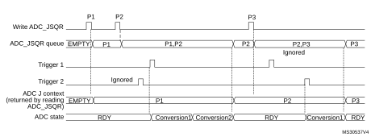

1.Parameters:  
P1: sequence of 2 conversions, hardware trigger 1  
P2: sequence of 1 conversion, hardware trigger 2  
P3: sequence of 4 conversions, hardware trigger 1

#### Queue of context: Behavior when a queue overflow occurs

The [Figure 101](#XREF_92631__Figure_16__Example_of_JSQR_Queue_of_Context_with_Overflow_before_conversion10) and [Figure 102](#XREF_69654__Figure_17__Example_of_JSQR_Queue_of_Context_with_Overflow_during_conversion10) show the behavior of the context Queue if an overflow occurs before or during a conversion.

#### Figure 101. Example of ADC\_JSQR queue of context with overflow before conversion

1.Parameters:  
P1: sequence of 2 conversions, hardware trigger 1  
P2: sequence of 1 conversion, hardware trigger 2  
P3: sequence of 3 conversions, hardware trigger 1  
P4: sequence of 4 conversions, hardware trigger 1

#### Figure 102. Example of ADC\_JSQR queue of context with overflow during conversion

1.Parameters:  
P1: sequence of 2 conversions, hardware trigger 1  
P2: sequence of 1 conversion, hardware trigger 2  
P3: sequence of 3 conversions, hardware trigger 1  
P4: sequence of 4 conversions, hardware trigger 1

It is recommended to manage the queue overflows as described below:

- After each P context write into ADC\_JSQR register, flag JQOVF shows if the write has been ignored or not (an interrupt can be generated).
- Avoid Queue overflows by writing the third context (P3) only once the flag JEOS of the previous context P2 has been set. This ensures that the previous context has been consumed and that the queue is not full.

#### Queue of context: Behavior when the queue becomes empty

[Figure 103](#XREF_79123__Figure_18__Example_of_JSQR_Queue_of_Context_with_Empty_Queue_(case_JQM=0)10) and [Figure 104](#XREF_50745__Figure_19__Example_of_JSQR_Queue_of_Context_with_Empty_Queue_(case_JQM=1)10) show the behavior of the context Queue when the Queue becomes empty in both cases JQM = 0 or 1.

#### Figure 103. Example of ADC\_JSQR queue of context with empty queue (case JQM = 0)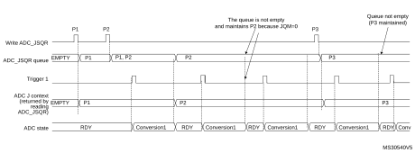

1.Parameters:  
P1: sequence of 1 conversion, hardware trigger 1  
P2: sequence of 1 conversion, hardware trigger 1  
P3: sequence of 1 conversion, hardware trigger 1

**Note:**

When writing P3, the context changes immediately. However, because of internal resynchronization, there is a latency and if    a trigger occurs just after or before writing P3, it can happen that the conversion is launched considering the context P2. To avoid this situation, the user must ensure that there is no ADC trigger happening when writing a new context that applies immediately.

#### Figure 104. Example of ADC\_JSQR queue of context with empty queue (case JQM = 1)

1.Parameters:  
P1: sequence of 1 conversion, hardware trigger 1  
P2: sequence of 1 conversion, hardware trigger 1  
P3: sequence of 1 conversion, hardware trigger 1

#### Flushing the queue of context

The figures below show the behavior of the context Queue in various situations when the queue is flushed.

#### Figure 105. Flushing ADC\_JSQR queue of context by setting JADSTP = 1 (JQM = 0)   Case when JADSTP occurs during an ongoing conversion

1.Parameters:  
P1: sequence of 1 conversion, hardware trigger 1  
P2: sequence of 1 conversion, hardware trigger 1  
P3: sequence of 1 conversion, hardware trigger 1

#### Figure 106. Flushing ADC\_JSQR queue of context by setting JADSTP = 1 (JQM = 0)    Case when JADSTP occurs during an ongoing conversion and a new    trigger occurs.

1.Parameters:  
P1: sequence of 1 conversion, hardware trigger 1  
P2: sequence of 1 conversion, hardware trigger 1  
P3: sequence of 1 conversion, hardware trigger 1

#### Figure 107. Flushing ADC\_JSQR queue of context by setting JADSTP = 1 (JQM = 0)   Case when JADSTP occurs outside an ongoing conversion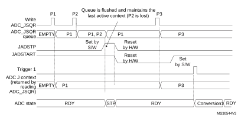

1.Parameters:  
P1: sequence of 1 conversion, hardware trigger 1  
P2: sequence of 1 conversion, hardware trigger 1  
P3: sequence of 1 conversion, hardware trigger 1

#### Figure 108. Flushing ADC\_JSQR queue of context by setting JADSTP = 1 (JQM = 1)

1.Parameters:  
P1: sequence of 1 conversion, hardware trigger 1  
P2: sequence of 1 conversion, hardware trigger 1  
P3: sequence of 1 conversion, hardware trigger 1

#### Figure 109. Flushing ADC\_JSQR queue of context by setting ADDIS = 1 (JQM = 0)

1.Parameters:  
P1: sequence of 1 conversion, hardware trigger 1  
P2: sequence of 1 conversion, hardware trigger 1  
P3: sequence of 1 conversion, hardware trigger 1

#### Figure 110. Flushing ADC\_JSQR queue of context by setting ADDIS = 1 (JQM = 1)

1.Parameters:  
P1: sequence of 1 conversion, hardware trigger 1  
P2: sequence of 1 conversion, hardware trigger 1  
P3: sequence of 1 conversion, hardware trigger 1

#### Queue of context: Starting the ADC with an empty queue

The following procedure must be followed to start ADC operation with an empty queue, in case the first context is not known at the time the ADC is initialized. This procedure is only applicable when JQM bit is reset:

5. Write a dummy ADC\_JSQR with JEXTEN[1:0] not equal to 00 (otherwise triggering a software conversion).
6. Set JADSTART.
7. Set JADSTP.
8. Wait until JADSTART is reset.
9. Set JADSTART.

#### Disabling the queue

It is possible to disable the queue by setting bit JQDIS = 1 into the ADC\_CFGR register.

### 21.4.22 Programmable resolution (RES) - Fast conversion mode

It is possible to perform faster conversion by reducing the ADC resolution.

The resolution can be configured to be either 12, 10, 8, or 6 bits by programming the control bits RES[1:0]. [Figure 115](#XREF_33990__Figure_18__Right_alignment_(Offset_disabled_-_unsigned_value)10), [Figure 116](#XREF_23193__Figure_19__Right_alignment_(Offset_enabled_-_signed_value)10), [Figure 117](#XREF_94198__Figure_20__Left_alignment_(Offset_disabled_-_unsigned_value)10) and [Figure 118](#XREF_85679__Figure_19__Left_alignment10) show the conversion result format with respect to the resolution as well as to the data alignment.

Lower resolution allows faster conversion time for applications where high-data precision is not required. It reduces the conversion time spent by the successive approximation steps according to [Table 170](#XREF_34433__Table_128__TSAR_timings_depending_on_resolution10).

 

<table class="TableTitle" style="margin-top:10.00pt;margin-bottom:10.00pt;"><caption class="TableCap"><h4 class="TableCap" id="19790823">Table 170. <a id="resolution10" name="XREF_34433__Table_128__TSAR_timings_depending_on_resolution10">T</a>SAR timings depending on resolution</h4></caption><col width="49.98px"/><col width="131.07px"/><col width="93.98px"/><col width="162.60px"/><col width="100.46px"/><thead><tr height="61.33px"><th>
RES (bits)
</th><th>
TSAR 

(ADC clock cycles)
</th><th>
TSAR (ns) at FADC= 30 MHz
</th><th>
TCONV (ADC clock cycles) 

(with Sampling Time= 2.5 ADC clock cycles)
</th><th>
TCONV (ns) at FADC= 30 MHz
</th></tr></thead><tr height="22.67px"><td>
12
</td><td>
12.5 ADC clock cycles
</td><td>
416.67 ns
</td><td>
15 ADC clock cycles
</td><td>
500.0 ns
</td></tr><tr height="22.67px"><td>
10
</td><td>
10.5 ADC clock cycles
</td><td>
350.0 ns
</td><td>
13 ADC clock cycles
</td><td>
433.33 ns
</td></tr><tr height="22.67px"><td>
8
</td><td>
8.5 ADC clock cycles
</td><td>
203.33 ns
</td><td>
11 ADC clock cycles
</td><td>
366.67 ns
</td></tr><tr height="22.67px"><td>
6
</td><td>
6.5 ADC clock cycles
</td><td>
216.67 ns
</td><td>
9 ADC clock cycles
</td><td>
300.0 ns
</td></tr></table>

### 21.4.23 End of conversion, end of sampling phase (EOC, JEOC, EOSMP)

The ADC notifies the application for each end of regular conversion (EOC) event and each injected conversion (JEOC) event.

The ADC sets the EOC flag as soon as a new regular conversion data is available in the ADC\_DR register. An interrupt can be generated if bit EOCIE is set. EOC flag is cleared by the software either by writing 1 to it or by reading ADC\_DR.

The ADC sets the JEOC flag as soon as a new injected conversion data is available in one of the ADC\_JDRy register. An interrupt can be generated if bit JEOCIE is set. JEOC flag is cleared by the software either by writing 1 to it or by reading the corresponding ADC\_JDRy register.

The ADC also notifies the end of Sampling phase by setting the status bit EOSMP (for regular conversions only). EOSMP flag is cleared by software by writing 1 to it. An interrupt can be generated if bit EOSMPIE is set.

### 21.4.24 End of conversion sequence (EOS, JEOS)

The ADC notifies the application for each end of regular sequence (EOS) and for each end of injected sequence (JEOS) event.

The ADC sets the EOS flag as soon as the last data of the regular conversion sequence is available in the ADC\_DR register. An interrupt can be generated if bit EOSIE is set. EOS flag is cleared by the software either by writing 1 to it.

The ADC sets the JEOS flag as soon as the last data of the injected conversion sequence is complete. An interrupt can be generated if bit JEOSIE is set. JEOS flag is cleared by the software either by writing 1 to it.

### 21.4.25 Timing diagrams example (single/continuous modes,    hardware/software triggers)

#### Figure 111. Single conversions of a sequence, software trigger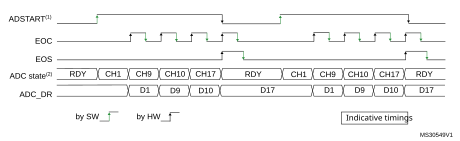

1.EXTEN[1:0] = 00, CONT = 0

2.Channels selected = 1,9, 10, 17; AUTDLY = 0.

#### Figure 112. Continuous conversion of a sequence, software trigger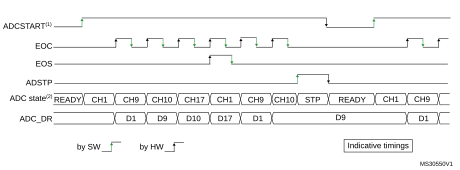

1.EXTEN[1:0] = 00, CONT = 1

2.Channels selected = 1,9, 10, 17; AUTDLY = 0.

#### Figure 113. Single conversions of a sequence, hardware trigger

1.TRGx (over-frequency) is selected as trigger source, EXTEN[1:0] = 01, CONT = 0

2.Channels selected = 1, 2, 3, 4; AUTDLY = 0.

#### Figure 114. Continuous conversions of a sequence, hardware trigger

1.TRGx is selected as trigger source, EXTEN[1:0] = 10, CONT = 1

2.Channels selected = 1, 2, 3, 4; AUTDLY = 0.

### 21.4.26 Data management

#### Data register, data alignment and offset (ADC\_DR, OFFSETy, OFFSETy\_CH, ALIGN)

#### Data and alignment

At the end of each regular conversion channel (when EOC event occurs), the result of the converted data is stored into the ADC\_DR data register which is 16 bits wide.

At the end of each injected conversion channel (when JEOC event occurs), the result of the converted data is stored into the corresponding ADC\_JDRy data register which is 16 bits wide.

The ALIGN bit in the ADC\_CFGR register selects the alignment of the data stored after conversion. Data can be right- or left-aligned as shown in [Figure 115](#XREF_33990__Figure_18__Right_alignment_(Offset_disabled_-_unsigned_value)10), [Figure 116](#XREF_23193__Figure_19__Right_alignment_(Offset_enabled_-_signed_value)10), [Figure 117](#XREF_94198__Figure_20__Left_alignment_(Offset_disabled_-_unsigned_value)10) and [Figure 118](#XREF_85679__Figure_19__Left_alignment10).

Special case: when left-aligned, the data are aligned on a half-word basis except when the resolution is set to 6-bit. In that case, the data are aligned on a byte basis as shown in [Figure 117](#XREF_94198__Figure_20__Left_alignment_(Offset_disabled_-_unsigned_value)10) and [Figure 118](#XREF_85679__Figure_19__Left_alignment10).

**Note:**

Left-alignment is not supported in oversampling mode. When ROVSE and/or JOVSE bit is set, the ALIGN bit value is ignored and the ADC only provides right-aligned data.

#### Offset

An offset y (y = 1,2,3,4) can be applied to a channel by setting the bit OFFSETy\_EN = 1 into ADC\_OFRy register. The channel to which the offset is applied is programmed into the bits OFFSETy\_CH[4:0] of ADC\_OFRy register. In this case, the converted value is decreased by the user-defined offset written in the bits OFFSETy[11:0]. The result may be a negative value so the read data is signed and the SEXT bit represents the extended sign value.

**Note:**

Offset correction is not supported in oversampling mode. When ROVSE and/or JOVSE bit is set, the value of the OFFSETy\_EN bit in ADC\_OFRy register is ignored (considered as reset).

[Table 173](#XREF_38830__Table_11__Analog_Watchod_1_Comparison10) describes how the comparison is performed for all the possible resolutions for analog watchdog 1.

 

<table class="TableTitle"><caption class="TableCap"><h4 class="TableCap" id="9758377">Table 171. <a id="resolution%1110" name="XREF_69471__Table_138__Offset_computation_versus_data_resolution%1110">Offset computation versus data resolution</a></h4></caption><col width="71.23px"/><col width="88.05px"/><col width="85.66px"/><col width="81.77px"/><col width="210.82px"/><thead><tr height="42.67px"><th rowspan="2">
Resolution(bits RES[1:0])
</th><th colspan="2">
Subtraction between raw converted data and offset
</th><th rowspan="2">
Result
</th><th rowspan="2">
Comments
</th></tr><tr height="72.00px"><th>
Raw converted Data, left aligned
</th><th>
Offset
</th></tr></thead><tr height="37.33px"><td>
00: 12-bit
</td><td>
DATA[11:0]
</td><td>
OFFSET[11:0]
</td><td>
Signed 12-bit data
</td><td>
-
</td></tr><tr height="37.33px"><td>
01: 10-bit
</td><td>
DATA[11:2],00
</td><td>
OFFSET[11:0]
</td><td>
Signed 10-bit data
</td><td>
The user must configure OFFSET[1:0] to 00
</td></tr><tr height="37.33px"><td>
10: 8-bit
</td><td>
DATA[11:4],0000
</td><td>
OFFSET[11:0]
</td><td>
Signed  8-bit data
</td><td>
The user must configure OFFSET[3:0] to 0000
</td></tr><tr height="37.33px"><td>
11: 6-bit
</td><td>
DATA[11:6],000000
</td><td>
OFFSET[11:0]
</td><td>
Signed  6-bit data
</td><td>
The user must configure OFFSET[5:0] to 000000
</td></tr></table>

When reading data from ADC\_DR (regular channel) or from ADC\_JDRy (injected channel, y = 1,2,3,4) corresponding to the channel “i”:

- If one of the offsets is enabled (bit OFFSETy\_EN = 1) for the corresponding channel, the read data is signed.
- If none of the four offsets is enabled for this channel, the read data is not signed.

[Figure 115](#XREF_33990__Figure_18__Right_alignment_(Offset_disabled_-_unsigned_value)10), [Figure 116](#XREF_23193__Figure_19__Right_alignment_(Offset_enabled_-_signed_value)10), [Figure 117](#XREF_94198__Figure_20__Left_alignment_(Offset_disabled_-_unsigned_value)10) and [Figure 118](#XREF_85679__Figure_19__Left_alignment10) show alignments for signed and unsigned data.

#### Figure 115. Right alignment (offset disabled, unsigned value)

#### Figure 116. Right alignment (offset enabled, signed value)

#### Figure 117. Left alignment (offset disabled, unsigned value)

#### Figure 118. Left alignment (offset enabled, signed value)

#### Gain compensation

When GCOMP bit is set in ADC\_CFGR2 register, the gain compensation is activated on all the converted data. After each conversion, data is calculated with the following formula.

As GCOMPCOEFF can be programmed from 0 to 16383, the actual gain compensation factor can range from 0 to 3.999756.

Before storing the resulting data in RDATA or JDATAx registers, the LSB−1 value is evaluated to round up the data and minimize the error.

The gain compensation is also effective for the oversampling. When the gain compensation is used for the oversampling mode, the gain calculation is performed after the accumulation and right-shift operations to minimize the power consumption (the gain calculation is done only once instead of at each conversion).

#### Offset compensation

When SATEN bit is set in ADC\_OFRy register during offset operation, data are unsigned. All the offset data saturate at 0x000 (in 12-bit mode). When OFFSETPOS bit is set, the offset direction is positive and the data saturate at 0xFFF (in 12-bit mode). In 8-bit mode, data saturate at 0x00 and 0xFF, respectively.

The analog watchdog comparison is performed on unsigned values, after offset and gain compensation. For correct watchdog operation, the data after offset compensation must be in unsigned format (SATEN bit set in ADC\_OFRy register).

#### ADC overrun (OVR, OVRMOD)

The overrun flag (OSR) notifies of that a buffer overrun event occurred when the regular converted data has not been read (by the CPU or the DMA) before new converted data became available.

The OVR flag is set if the EOC flag is still 1 at the time when a new conversion completes. An interrupt can be generated if bit OVRIE = 1.

When an overrun condition occurs, the ADC is still operating and can continue converting unless the software decides to stop and reset the sequence by setting bit ADSTP = 1.

OVR flag is cleared by software by writing 1 to it.

It is possible to configure if data is preserved or overwritten when an overrun event occurs by programming the control bit OVRMOD:

- OVRMOD = 0: The overrun event preserves the data register from being overrun: the old data is maintained and the new conversion is discarded and lost. If OVR remains at 1, any further conversions occur but the result data is also discarded.
- OVRMOD = 1: The data register is overwritten with the last conversion result and the previous unread data is lost. If OVR remains at 1, any further conversions operate normally and the ADC\_DR register always contains the latest converted data.

#### Figure 119. Example of overrun (OVR)

**Note:**

There is no overrun detection on the injected channels since there is a dedicated data register for each of the four injected channels.

#### Managing a sequence of conversions without using the DMA

If the conversions are slow enough, the conversion sequence can be handled by the software. In this case the software must use the EOC flag and its associated interrupt to handle each data. Each time a conversion is complete, EOC is set and the ADC\_DR register can be read. OVRMOD should be configured to 0 to manage overrun events as an error.

#### Managing conversions without using the DMA and without overrun

It may be useful to let the ADC convert one or more channels without reading the data each time (if there is an analog watchdog for instance). In this case, the OVRMOD bit must be configured to 1 and OVR flag should be ignored by the software. An overrun event does not prevent the ADC from continuing to convert and the ADC\_DR register always contains the latest conversion.

#### Managing conversions using the DMA

Since converted channel values are stored into a unique data register, it is useful to use DMA for conversion of more than one channel. This avoids the loss of the data already stored in the ADC\_DR register.

When the DMA mode is enabled (DMAEN bit set in the ADC\_CFGR register in single ADC mode or MDMA different from 00 in dual ADC mode), a DMA request is generated after each conversion of a channel. This allows the transfer of the converted data from the ADC\_DR register to the destination location selected by the software.

Despite this, if an overrun occurs (OVR = 1) because the DMA could not serve the DMA transfer request in time, the ADC stops generating DMA requests and the data corresponding to the new conversion is not transferred by the DMA. Which means that all the data transferred to the RAM can be considered as valid.

Depending on the configuration of OVRMOD bit, the data is either preserved or overwritten (refer to [Section : ADC overrun (OVR, OVRMOD)](#XREF_93637__1_6_2_ADC_Overrun_(OVR%2C_OVREN)10)).

The DMA transfer requests are blocked until the software clears the OVR bit.

Two different DMA modes are proposed depending on the application use and are configured with bit DMACFG of the ADC\_CFGR register in single ADC mode, or with bit DMACFG of the ADC\_CCR register in dual ADC mode:

- DMA one shot mode (DMACFG = 0).   
  This mode is suitable when the DMA is programmed to transfer a fixed number of data.
- DMA circular mode (DMACFG = 1)  
  This mode is suitable when programming the DMA in circular mode.

#### DMA one shot mode (DMACFG = 0)

In this mode, the ADC generates a DMA transfer request each time a new conversion data is available and stops generating DMA requests once the DMA has reached the last DMA transfer (when a transfer complete interrupt occurs - refer to DMA section) even if a conversion has been started again.

When the DMA transfer is complete (all the transfers configured in the DMA controller have been done):

- The content of the ADC data register is frozen.
- Any ongoing conversion is aborted with partial result discarded.
- No new DMA request is issued to the DMA controller. This avoids generating an overrun error if there are still conversions which are started.
- Scan sequence is stopped and reset.
- The DMA is stopped.

#### DMA circular mode (DMACFG = 1)

In this mode, the ADC generates a DMA transfer request each time a new conversion data is available in the data register, even if the DMA has reached the last DMA transfer. This allows configuring the DMA in circular mode to handle a continuous analog input data stream.

### 21.4.27 Dynamic low-power features

#### Auto-delayed conversion mode (AUTDLY)

The ADC implements an auto-delayed conversion mode controlled by the AUTDLY configuration bit. Auto-delayed conversions are useful to simplify the software as well as to optimize performance of an application clocked at low frequency where there would be risk of encountering an ADC overrun.

When AUTDLY = 1, a new conversion can start only if all the previous data of the same group has been treated:

- For a regular conversion: once the ADC\_DR register has been read or if the EOC bit has been cleared (see [Figure 120](#XREF_35794__Figure_27__AUTODLY=1%2C_regular_conversion_in_continous_mode%2C_software_trigger10)).
- For an injected conversion: when the JEOS bit has been cleared (see [Figure 121](#XREF_85607__Figure_28__AUTODLY=1%2C_regular_HW_conversions_interrupted_by_injected_conversions10)).

This is a way to automatically adapt the speed of the ADC to the speed of the system which reads the data.

The delay is inserted after each regular conversion (whatever DISCEN = 0 or 1) and after each sequence of injected conversions (whatever JDISCEN = 0 or 1).

**Note:**

There is no delay inserted between each conversions of the injected sequence, except after the last one.

During a conversion, a hardware trigger event (for the same group of conversions) occurring during this delay is ignored.

**Note:**

This is not true for software triggers where it remains possible during this delay to set the bits ADSTART or JADSTART to restart a conversion: it is up to the software to read the data before launching a new conversion.

No delay is inserted between conversions of different groups (a regular conversion followed by an injected conversion or conversely):

- If an injected trigger occurs during the automatic delay of a regular conversion, the injected conversion starts immediately (see [Figure 121](#XREF_85607__Figure_28__AUTODLY=1%2C_regular_HW_conversions_interrupted_by_injected_conversions10)).
- Once the injected sequence is complete, the ADC waits for the delay (if not ended) of the previous regular conversion before launching a new regular conversion (see [Figure 123](#XREF_78658__Figure_28__AUTODLY=1_when_injected_conversions_interrupts_regular_conversions10)).

The behavior is slightly different in auto-injected mode (JAUTO = 1) where a new regular conversion can start only when the automatic delay of the previous injected sequence of conversion has ended (when JEOS has been cleared). This is to ensure that the software can read all the data of a given sequence before starting a new sequence (see [Figure 124](#XREF_38915__Figure_29__AUTODLY=1_in_auto-_injected_mode_(JAUTO=1)10)).

To stop a conversion in continuous auto-injection mode combined with autodelay mode (JAUTO = 1, CONT = 1 and AUTDLY = 1), follow the following procedure:

1. Wait until JEOS = 1 (no more conversions are restarted)
2. Clear JEOS.
3. Set ADSTP.
4. Read the regular data.

If this procedure is not respected, a new regular sequence can restart if JEOS is cleared after ADSTP has been set.

In AUTDLY mode, a hardware regular trigger event is ignored if it occurs during an already ongoing regular sequence or during the delay that follows the last regular conversion of the sequence. It is however considered pending if it occurs after this delay, even if it occurs during an injected sequence of the delay that follows it. The conversion then starts at the end of the delay of the injected sequence.

In AUTDLY mode, a hardware injected trigger event is ignored if it occurs during an already ongoing injected sequence or during the delay that follows the last injected conversion of the sequence.

#### Figure 120. AUTODLY = 1, regular conversion in continuous mode, software trigger

1.AUTDLY = 1.

2.Regular configuration: EXTEN[1:0] = 00 (SW trigger), CONT = 1, CHANNELS = 1,2,3.

3.Injected configuration DISABLED.

#### Figure 121. AUTODLY = 1, regular HW conversions interrupted by injected conversions   (DISCEN = 0; JDISCEN = 0)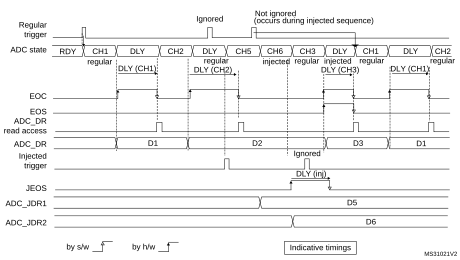

1.AUTDLY = 1

2.Regular configuration: EXTEN[1:0] = 01 (HW trigger), CONT = 0, DISCEN = 0, CHANNELS = 1, 2, 3

3.Injected configuration: JEXTEN[1:0] = 01 (HW Trigger), JDISCEN = 0, CHANNELS = 5,6

#### Figure 122. AUTODLY = 1, regular HW conversions interrupted by injected conversions   (DISCEN = 1, JDISCEN = 1)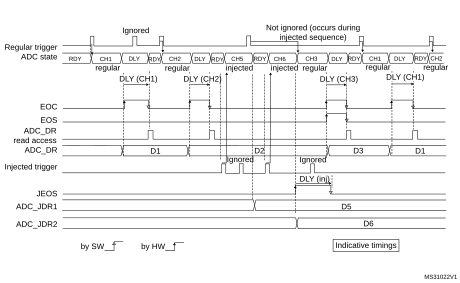

1.AUTDLY = 1

2.Regular configuration: EXTEN[1:0] = 01 (HW trigger), CONT = 0, DISCEN = 1, DISCNUM = 1, CHANNELS = 1, 2, 3.

3.Injected configuration: JEXTEN[1:0] = 01 (HW Trigger), JDISCEN = 1, CHANNELS = 5,6

#### Figure 123. AUTODLY = 1, regular continuous conversions interrupted by injected conversions

1.AUTDLY = 1

2.Regular configuration: EXTEN[1:0] = 00 (SW trigger), CONT = 1, DISCEN = 0, CHANNELS = 1, 2, 3

3.Injected configuration: JEXTEN[1:0] = 01 (HW Trigger), JDISCEN = 0, CHANNELS = 5,6

#### Figure 124. AUTODLY = 1 in auto- injected mode (JAUTO = 1)

1.AUTDLY = 1

2.Regular configuration: EXTEN[1:0] = 00 (SW trigger), CONT = 1, DISCEN = 0, CHANNELS = 1, 2

3.Injected configuration: JAUTO = 1, CHANNELS = 5,6

### 21.4.28  Analog window watchdog (AWD1EN, JAWD1EN, AWD1SGL,   AWD1CH, AWD2CH, AWD3CH, AWD\_HTx, AWD\_LTx, AWDx)

The three AWD analog watchdogs monitor whether some channels remain within a configured voltage range (window).

#### Figure 125. Analog watchdog guarded area

#### AWDx flag and interrupt

An interrupt can be enabled for each of the 3 analog watchdogs by setting AWDxIE in the ADC\_IER register (x = 1,2,3).

AWDx (x = 1,2,3) flag is cleared by software by writing 1 to it.

The ADC conversion result is compared to the lower and higher thresholds before alignment.

Description of analog watchdog 1

The AWD analog watchdog 1 is enabled by setting the AWD1EN bit in the ADC\_CFGR register. This watchdog monitors whether either one selected channel or all enabled channels(1)remain within a configured voltage range (window).

[Table 172](#XREF_60436__Table_11__Analog_watchdog_1_channel_selection%1110) shows how the ADC\_CFGR registers should be configured to enable the analog watchdog on one or more channels.

#### Table 172. Analog watchdog channel selection 

<table class="TableTitle"><col width="213.40px"/><col width="108.40px"/><col width="108.40px"/><col width="108.40px"/><thead><tr height="42.67px"><th rowspan="2">
Channels guarded by the analog watchdog
</th><th rowspan="2">
AWD1SGL bit
</th><th rowspan="2">
AWD1EN bit
</th><th rowspan="2">
JAWD1EN bit
</th></tr><tr height="0.00px"></tr></thead><tr height="22.67px"><td>
None
</td><td>
x
</td><td>
0
</td><td>
0
</td></tr><tr height="22.67px"><td>
All injected channels
</td><td>
0
</td><td>
0
</td><td>
1
</td></tr><tr height="22.67px"><td>
All regular channels
</td><td>
0
</td><td>
1
</td><td>
0
</td></tr><tr height="22.67px"><td>
All regular and injected channels
</td><td>
0
</td><td>
1
</td><td>
1
</td></tr><tr height="22.67px"><td>
Single<a href="#c7amba%20aditf5%2090%20UserSpec_c7amba%20aditf5%2090%20UserSpec_FTH_1">1</a> injected channel
</td><td>
1
</td><td>
0
</td><td>
1
</td></tr><tr height="22.67px"><td>
Single<a href="#XREF_28568_0%5D_bits__The_channels_must_also_be_programmed_to_be_converted_in_the10" style="font-family : Arial ; font-weight:normal;font-style:normal;font-size : 9.00pt;text-decoration:none;font-kerning:normal;text-transform:none;font-stretch:normal;color:#000000;background-color:transparent;letter-spacing : 0.00em;">(1)</a> regular channel
</td><td>
1
</td><td>
1
</td><td>
0
</td></tr><tr height="22.67px"><td>
Single<a href="#XREF_28568_0%5D_bits__The_channels_must_also_be_programmed_to_be_converted_in_the10" style="font-family : Arial ; font-weight:normal;font-style:normal;font-size : 9.00pt;text-decoration:none;font-kerning:normal;text-transform:none;font-stretch:normal;color:#000000;background-color:transparent;letter-spacing : 0.00em;">(1)</a> regular or injected channel
</td><td>
1
</td><td>
1
</td><td>
1
</td></tr></table>

<a href="#c7amba%20aditf5%2090%20UserSpec_c7amba%20aditf5%2090%20UserSpec_FTB_1">1.</a>Selected by the AWD1CH[4:0] bits. The channels must also be programmed to be converted in the appropriate regular or injected sequence.

The AWD1 analog watchdog status bit is set if the analog voltage converted by the ADC is below a lower threshold or above a higher threshold.

These thresholds are programmed in bits HT1[11:0] and LT1[11:0] of the ADC\_TR1 register for the analog watchdog 1. When converting data with a resolution of less than 12 bits (according to bits RES[1:0]), the LSB of the programmed thresholds must be kept cleared because the internal comparison is always performed on the full 12-bit raw converted data (left aligned).

[Table 173](#XREF_38830__Table_11__Analog_Watchod_1_Comparison10) describes how the comparison is performed for all the possible resolutions for analog watchdog 1.

 

<table class="TableTitle"><caption class="TableCap"><h4 class="TableCap" id="1019911">Table 173. <a id="Comparison10" name="XREF_38830__Table_11__Analog_Watchod_1_Comparison10">Analog watchdog 1 comparison</a></h4></caption><col width="78.76px"/><col width="129.14px"/><col width="87.85px"/><col width="242.83px"/><thead><tr height="42.67px"><th rowspan="2">
Resolution(bit RES[1:0])
</th><th colspan="2">
Analog watchdog comparison between:
</th><th rowspan="2">
Comments
</th></tr><tr height="42.67px"><th>
Raw converted data, left aligned<a href="#c7amba%20aditf5%2090%20UserSpec_c7amba%20aditf5%2090%20UserSpec_FTH_1">1</a>
</th><th>
Thresholds
</th></tr></thead><tr height="37.33px"><td>
00: 12-bit
</td><td>
DATA[11:0]
</td><td>
LT1[11:0] and HT1[11:0]
</td><td>
-
</td></tr><tr height="37.33px"><td>
01: 10-bit
</td><td>
DATA[11:2],00
</td><td>
LT1[11:0] and HT1[11:0] 
</td><td>
User must configure LT1[1:0] and HT1[1:0] to 00
</td></tr><tr height="37.33px"><td>
10: 8-bit
</td><td>
DATA[11:4],0000
</td><td>
LT1[11:0] and HT1[11:0] 
</td><td>
User must configure LT1[3:0] and HT1[3:0] to 0000
</td></tr><tr height="37.33px"><td>
11: 6-bit
</td><td>
DATA[11:6],000000
</td><td>
LT1[11:0] and HT1[11:0] 
</td><td>
User must configure LT1[5:0] and HT1[5:0] to 000000
</td></tr></table>

<a href="#c7amba%20aditf5%2090%20UserSpec_c7amba%20aditf5%2090%20UserSpec_FTB_1">1.</a>Refer to <a href="#XREF_85301__Gain_compensation10" style="font-family : Arial ; font-weight:normal;font-style:Italic;font-size : 8.00pt;font-kerning:normal;font-stretch:normal;color:#0000ff;background-color:transparent;letter-spacing : 0.00em;">Section : Gain compensation</a> for additional details on analog watchdog comparison. 

#### Analog watchdog filter for watchdog 1

When an ADC is configured with only one input channel (selecting several channels in Scan mode not allowed), a valid ADC conversion data filter can be configured:

- When converted data belong to the interval defined in ADC\_TR1, the AWD1 flag remains cleared.
- If data are out-of-range a number of times higher than the value specified in AWDFILT bit of ADC\_TR1, the AWD1 flag is set an the corresponding interrupt is issued.

#### Description of analog watchdog 2 and 3

The second and third analog watchdogs are more flexible and can guard several selected channels by programming the corresponding bits in AWDxCH[18:0] (x=2,3).

The corresponding watchdog is enabled when any bit of AWDxCH[18:0] (x=2,3) is set.

They are limited to a resolution of 8 bits and only the 8 MSBs of the thresholds can be programmed into HTx[7:0] and LTx[7:0]. [Table 174](#XREF_99741__Table_12__Analog_Watchod_2_and_3_Comparison10) describes how the comparison is performed for all the possible resolutions.

 

<table class="TableTitle"><caption class="TableCap"><h4 class="TableCap" id="1019981">Table 174. <a id="Comparison10" name="XREF_99741__Table_12__Analog_Watchod_2_and_3_Comparison10">Analog watchdog 2 and 3 comparison</a></h4></caption><col width="92.96px"/><col width="131.23px"/><col width="125.81px"/><col width="264.17px"/><thead><tr height="28.00px"><th rowspan="2">
Resolution (bits RES[1:0])
</th><th colspan="2">
Analog watchdog comparison between:
</th><th rowspan="2">
Comments
</th></tr><tr height="42.67px"><th>
Raw converted data, left aligned<a href="#c7amba%20aditf5%2090%20UserSpec_c7amba%20aditf5%2090%20UserSpec_FTH_1">1</a>
</th><th>
Thresholds
</th></tr></thead><tr height="22.67px"><td>
00: 12-bit
</td><td>
DATA[11:4]
</td><td>
LTx[7:0] and HTx[7:0]
</td><td>
DATA[3:0] are not relevant for the comparison
</td></tr><tr height="22.67px"><td>
01: 10-bit
</td><td>
DATA[11:4]
</td><td>
LTx[7:0] and HTx[7:0]
</td><td>
DATA[3:2] are not relevant for the comparison
</td></tr><tr height="22.67px"><td>
10: 8-bit
</td><td>
DATA[11:4]
</td><td>
LTx[7:0] and HTx[7:0]
</td><td>
-
</td></tr><tr height="22.67px"><td>
11: 6-bit
</td><td>
DATA[11:6],00
</td><td>
LTx[7:0] and HTx[7:0]
</td><td>
User must configure LTx[1:0] and HTx[1:0] to 00
</td></tr></table>

<a href="#c7amba%20aditf5%2090%20UserSpec_c7amba%20aditf5%2090%20UserSpec_FTB_1">1.</a>Refer to <a href="#XREF_85301__Gain_compensation10" style="font-family : Arial ; font-weight:normal;font-style:Italic;font-size : 8.00pt;font-kerning:normal;font-stretch:normal;color:#0000ff;background-color:transparent;letter-spacing : 0.00em;">Section : Gain compensation</a> for additional details on analog watchdog comparison. 

#### ADCy\_AWDx\_OUT signal output generation

Each analog watchdog is associated to an internal hardware signal ADCy\_AWDx\_OUT (y=ADC number, x=watchdog number) which is directly connected to the ETR input (external trigger) of some on-chip timers. Refer to the on-chip timers section to understand how to select the ADCy\_AWDx\_OUT signal as ETR.

ADCy\_AWDx\_OUT is activated when the associated analog watchdog is enabled:

- ADCy\_AWDx\_OUT is set when a guarded conversion is outside the programmed thresholds.
- ADCy\_AWDx\_OUT is reset after the end of the next guarded conversion which is inside the programmed thresholds (It remains at 1 if the next guarded conversions are still outside the programmed thresholds).
- ADCy\_AWDx\_OUT is also reset when disabling the ADC (when setting ADDIS = 1). Note that stopping regular or injected conversions (setting ADSTP = 1 or JADSTP = 1) has no influence on the generation of ADCy\_AWDx\_OUT.

**Note:**

AWDx flag is set by hardware and reset by software: AWDx flag has no influence on the generation of ADCy\_AWDx\_OUT (ex: ADCy\_AWDx\_OUT can toggle while AWDx flag remains at 1 if the software did not clear the flag).

#### Figure 126. ADCy\_AWDx\_OUT signal generation (on all regular channels)

#### Figure 127. ADCy\_AWDx\_OUT signal generation (AWDx flag not cleared by software)

#### Figure 128. ADCy\_AWDx\_OUT signal generation (on a single regular channel)

#### Figure 129. ADCy\_AWDx\_OUT signal generation (on all injected channels)

#### Analog watchdog threshold control

LTx[11:0] and HTx[11:0] can be changed when an analog-to-digital conversion is ongoing (that is between the start of conversion and the end of conversion of the ADC internal state). If LTx[11:0] and HTx[11:0] are updated during the ADC conversion of the ADC guarded channel, the watchdog function is masked for this conversion. This masking is removed at the next start of conversion, resulting in a analog watchdog thresholds to be applied from the next ADC conversion. The analog watchdog comparison is performed at each end of conversion. If the current ADC data is out of the new interval, no interrupt and AWDx\_OUT signal are issued. The Interrupt and the AWD generation only happen at the end of the conversion which started after the threshold update. If AWD\_xOUT is already asserted, programming the new thresholds does not deassert the AWDx\_OUT signal.

#### Analog watchdog with gain and offset compensation

When gain and offset compensation are enabled, the analog watchdog compares the threshold after the compensated data.

**Note:**

When the offset compensation is enabled (OFFSETy\_EN set in ADC\_OFRy register), data overflow or underflow can result in a wrong watchdog result. When the saturation is enabled (SATEN set in ADC\_OFRy), the watchdog provides a correct result. However this prevents from using the signed data format.

### 21.4.29 Oversampler

The oversampling unit performs data pre-processing to offload the CPU. It is able to handle multiple conversions and average them into a single data with increased data width, up to 16-bit.

It provides a result with the following form, where N and M can be adjusted:

It allows to perform by hardware the following functions: averaging, data rate reduction, SNR improvement, basic filtering.

The oversampling ratio N is defined using the OVFS[2:0] bits in the ADC\_CFGR2 register, and can range from 2x to 256x. The division coefficient M consists of a right bit shift up to 8 bits, and is defined using the OVSS[3:0] bits in the ADC\_CFGR2 register.

The summation unit can yield a result up to 20 bits (256x 12-bit results), which is first shifted right. It is then truncated to the 16 least significant bits, rounded to the nearest value using the least significant bits left apart by the shifting, before being finally transferred into the ADC\_DR data register.

**Note:**

If the intermediary result after the shifting exceeds 16-bit, the result is truncated as is, without saturation.

#### Figure 130. 20-bit to 16-bit result truncation

[Figure 131](#XREF_69854__Figure_16_10) gives a numerical example of the processing, from a raw 20-bit accumulated data to the final 16-bit result.

#### Figure 131. Numerical example with 5-bit shift and rounding

[Table 175](#XREF_29802__Table_13__Maximum_output_results_vs_N_and_M__Greyed_values_indicates_truncation_10) gives the data format for the various N and M combinations, for a raw conversion data equal to 0xFFF.

 

<table class="TableTitle"><caption class="TableCap"><h4 class="TableCap" id="2301526">Table 175. <a id="10" name="XREF_29802__Table_13__Maximum_output_results_vs_N_and_M__Greyed_values_indicates_truncation_10">Maximum output results versus N and M (gray cells indicate truncation)</a></h4></caption><col width="61.04px"/><col width="62.94px"/><col width="55.31px"/><col width="54.36px"/><col width="54.36px"/><col width="54.36px"/><col width="54.36px"/><col width="54.36px"/><col width="54.36px"/><col width="54.36px"/><col width="54.36px"/><thead><tr height="73.60px"><th>
Over sampling ratio
</th><th>
Max Raw data
</th><th>
No-shift 

OVSS = 0000
</th><th>
1-bit shift

OVSS = 0001
</th><th>
2-bit shift

OVSS = 0010
</th><th>
3-bit shift

OVSS = 0011
</th><th>
4-bit shift

OVSS = 0100
</th><th>
5-bit shift

OVSS = 0101
</th><th>
6-bit shift

OVSS = 0110
</th><th>
7-bit shift

OVSS = 0111
</th><th>
8-bit shift

OVSS = 1000
</th></tr></thead><tr height="22.67px"><td>
2x
</td><td>
0x1FFE
</td><td>
0x1FFE
</td><td>
0x0FFF
</td><td>
0x0800
</td><td>
0x0400
</td><td>
0x0200
</td><td>
0x0100
</td><td>
0x0080
</td><td>
0x0040
</td><td>
0x020
</td></tr><tr height="22.67px"><td>
4x
</td><td>
0x3FFC
</td><td>
0x3FFC
</td><td>
0x1FFE
</td><td>
0x0FFF
</td><td>
0x0800
</td><td>
0x0400
</td><td>
0x0200
</td><td>
0x0100
</td><td>
0x0080
</td><td>
0x0040
</td></tr><tr height="22.67px"><td>
8x
</td><td>
0x7FF8
</td><td>
0x7FF8
</td><td>
0x3FFC
</td><td>
0x1FFE
</td><td>
0x0FFF
</td><td>
0x0800
</td><td>
0x0400
</td><td>
0x0200
</td><td>
0x0100
</td><td>
0x0080
</td></tr><tr height="22.67px"><td>
16x
</td><td>
0xFFF0
</td><td>
0xFFF0
</td><td>
0x7FF8
</td><td>
0x3FFC
</td><td>
0x1FFE
</td><td>
0x0FFF
</td><td>
0x0800
</td><td>
0x0400
</td><td>
0x0200
</td><td>
0x0100
</td></tr><tr height="22.67px"><td>
32x
</td><td>
0x1FFE0
</td><td>
0xFFE0
</td><td>
0xFFF0
</td><td>
0x7FF8
</td><td>
0x3FFC
</td><td>
0x1FFE
</td><td>
0x0FFF
</td><td>
0x0800
</td><td>
0x0400
</td><td>
0x0200
</td></tr><tr height="22.67px"><td>
64x
</td><td>
0x3FFC0
</td><td>
0xFFC0
</td><td>
0xFFE0
</td><td>
0xFFF0
</td><td>
0x7FF8
</td><td>
0x3FFC
</td><td>
0x1FFE
</td><td>
0x0FFF
</td><td>
0x0800
</td><td>
0x0400
</td></tr><tr height="22.67px"><td>
128x
</td><td>
0x7FF80
</td><td>
0xFF80
</td><td>
0xFFC0
</td><td>
0xFFE0
</td><td>
0xFFF0
</td><td>
0x7FF8
</td><td>
0x3FFC
</td><td>
0x1FFE
</td><td>
0x0FFF
</td><td>
0x0800
</td></tr><tr height="22.67px"><td>
256x
</td><td>
0xFFF00
</td><td>
0xFF00
</td><td>
0xFF80
</td><td>
0xFFC0
</td><td>
0xFFE0
</td><td>
0xFFF0
</td><td>
0x7FF8
</td><td>
0x3FFC
</td><td>
0x1FFE
</td><td>
0x0FFF
</td></tr></table>

There are no changes for conversion timings in oversampled mode: the sample time is maintained equal during the whole oversampling sequence. A new data is provided every N conversions, with an equivalent delay equal to N x TCONV = N x (tSMPL + tSAR). The flags are set as follows:

- The end of the sampling phase (EOSMP) is set after each sampling phase
- The end of conversion (EOC) occurs once every N conversions, when the oversampled result is available
- The end of sequence (EOS) occurs once the sequence of oversampled data is completed (i.e. after N x sequence length conversions total)

#### ADC operating modes supported when oversampling (single ADC mode)

In oversampling mode, most of the ADC operating modes are maintained:

- Single or continuous mode conversions
- ADC conversions start either by software or with triggers
- ADC stop during a conversion (abort)
- Data read via CPU or DMA with overrun detection
- Low-power modes (AUTDLY)
- Programmable resolution: in this case, the reduced conversion values (as per RES[1:0] bits in ADC\_CFGR1 register) are accumulated, truncated, rounded and shifted in the same way as 12-bit conversions are

**Note:**

The alignment mode is not available when working with oversampled data. The ALIGN bit in ADC\_CFGR1 is ignored and the data are always provided right-aligned.

Offset correction is not supported in oversampling mode. When ROVSE and/or JOVSE bit is set, the value of the OFFSETy\_EN bit in ADC\_OFRy register is ignored (considered as reset).

#### Analog watchdog

The analog watchdog functionality is maintained, with the following difference:

- The RES[1:0] bits are ignored, comparison is always done using the full 12-bit values HT[11:0] and LT[11:0]
- the comparison is performed on the most significant 12-bit of the 16-bit oversampled results ADC\_DR[15:4]

**Note:**

Care must be taken when using high shifting values, since this reduces the comparison range. For instance, if the oversampled result is shifted by 4 bits, thus yielding a 12-bit data right-aligned, the effective analog watchdog comparison can only be performed on 8 bits. The comparison is done between ADC\_DR[11:4] and HT[0:7] / LT[[0:7], and HT[11:8] / LT[11:8] must be kept reset.

#### Triggered mode

The averager can also be used for basic filtering purpose. Although not a very powerful filter (slow roll-off and limited stop band attenuation), it can be used as a notch filter to reject constant parasitic frequencies (typically coming from the mains or from a switched mode power supply). For this purpose, a specific discontinuous mode can be enabled with TROVS bit in ADC\_CFGR2, to be able to have an oversampling frequency defined by a user and independent from the conversion time itself.

[Figure 132](#XREF_92500__Figure_18__Discontinuous_oversampling_mode10) below shows how conversions are started in response to triggers during discontinuous mode.

If the TROVS bit is set, the content of the DISCEN bit is ignored and considered as 1.

#### Figure 132. Triggered regular oversampling mode (TROVS bit = 1)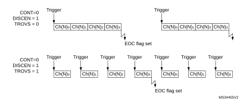

#### Injected and regular sequencer management when oversampling

In oversampling mode, it is possible to have differentiated behavior for injected and regular sequencers. The oversampling can be enabled for both sequencers with some limitations if they have to be used simultaneously (this is related to a unique accumulation unit).

#### Oversampling regular channels only

The regular oversampling mode bit ROVSM defines how the regular oversampling sequence is resumed if it is interrupted by injected conversion:

- In continued mode, the accumulation restarts from the last valid data (prior to the conversion abort request due to the injected trigger). This ensures that oversampling is complete whatever the injection frequency (providing at least one regular conversion can be complete between triggers);
- In resumed mode, the accumulation restarts from 0 (previous conversion results are ignored). This mode allows to guarantee that all data used for oversampling were converted back-to-back within a single timeslot. Care must be taken to have a injection trigger period above the oversampling period length. If this condition is not respected, the oversampling cannot be complete and the regular sequencer is blocked.

[Figure 133](#XREF_97648__Figure_72__Regular_oversampling_modes_(4x_ratio)10) gives examples for a 4x oversampling ratio.

#### Figure 133. Regular oversampling modes (4x ratio)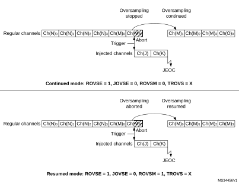

#### Oversampling Injected channels only

The Injected oversampling mode bit JOVSE enables oversampling solely for conversions in the injected sequencer.

#### Oversampling regular and Injected channels

It is possible to have both ROVSE and JOVSE bits set. In this case, the regular oversampling mode is forced to resumed mode (ROVSM bit ignored), as represented on [Figure 134](#XREF_87527__Figure_73__Regular_and_injected_oversampling_modes_used_simultnaeously10) below.

#### Figure 134. Regular and injected oversampling modes used simultaneously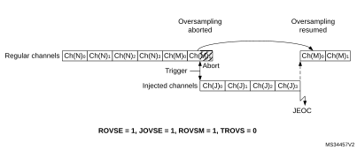

#### Triggered regular oversampling with injected conversions

It is possible to have triggered regular mode with injected conversions. In this case, the injected mode oversampling mode must be disabled, and the ROVSM bit is ignored (resumed mode is forced). The JOVSE bit must be reset. The behavior is represented on [Figure 135](#XREF_70056__Figure_51__Triggered_regular_oversampling_with_injection10) below.

#### Figure 135. Triggered regular oversampling with injection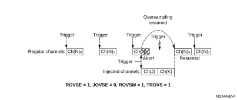

#### Auto-injected mode

It is possible to oversample auto-injected sequences and have all conversions results stored in registers to save a DMA resource. This mode is available only with both regular and injected oversampling active: JAUTO = 1, ROVSE = 1 and JOVSE = 1, other combinations are not supported. The ROVSM bit is ignored in auto-injected mode. The [Figure 136](#XREF_44891__Figure_75_10) below shows how the conversions are sequenced.

#### Figure 136. Oversampling in auto-injected mode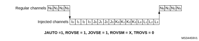

It is possible to have also the triggered mode enabled, using the TROVS bit. In this case, the ADC must be configured as following: JAUTO = 1, DISCEN = 0, JDISCEN = 0, ROVSE = 1, JOVSE = 1 and TROVSE = 1.

#### Dual ADC modes supported when oversampling

It is possible to have oversampling enabled when working in dual ADC configuration, for the injected simultaneous mode and regular simultaneous mode. In this case, the two ADCs must be programmed with the very same settings (including oversampling).

All other dual ADC modes are not supported when either regular or injected oversampling is enabled (ROVSE = 1 or JOVSE = 1).

#### Combined modes summary

The [Table 176](#XREF_58190__Table_48_10) below summarizes all combinations, including modes not supported.

<table class="TableTitle"><caption class="TableCap"><h4 class="TableCap" id="34406026">Table 176. <a id="10" name="XREF_58190__Table_48_10">Oversampler operating modes summary</a></h4></caption><col width="89.05px"/><col width="89.05px"/><col width="89.05px"/><col width="89.06px"/><col width="181.42px"/><thead><tr height="98.67px"><th>
Regular Oversampling

ROVSE
</th><th>
Injected Oversampling

JOVSE
</th><th>
Oversampler mode

ROVSM

0 = continued

1 = resumed
</th><th>
Triggered Regular mode

TROVS
</th><th>
Comment
</th></tr></thead><tr height="22.67px"><td>
1
</td><td>
0
</td><td>
0
</td><td>
0
</td><td>
Regular continued mode
</td></tr><tr height="22.67px"><td>
1
</td><td>
0
</td><td>
0
</td><td>
1
</td><td>
Not supported
</td></tr><tr height="22.67px"><td>
1
</td><td>
0
</td><td>
1
</td><td>
0
</td><td>
Regular resumed mode
</td></tr><tr height="37.33px"><td>
1
</td><td>
0
</td><td>
1
</td><td>
1
</td><td>
Triggered regular resumed mode
</td></tr><tr height="22.67px"><td>
1
</td><td>
1
</td><td>
0
</td><td>
X
</td><td>
Not supported
</td></tr><tr height="37.33px"><td>
1
</td><td>
1
</td><td>
1
</td><td>
0
</td><td>
Injected and regular resumed mode
</td></tr><tr height="22.67px"><td>
1
</td><td>
1
</td><td>
1
</td><td>
1
</td><td>
Not supported
</td></tr><tr height="22.67px"><td>
0
</td><td>
1
</td><td>
X
</td><td>
X
</td><td>
Injected oversampling
</td></tr></table>

### 21.4.30 Dual ADC modes

Dual ADC modes can be used in devices with two ADCs or more (see [Figure 137](#XREF_41500__Figure_166__Dual_ADC_block_diagram10)).

In dual ADC mode the start of conversion is triggered alternately or simultaneously by the ADCx master to the ADC slave, depending on the mode selected by the bits DUAL[4:0] in the ADCx\_CCR register.

Four possible modes are implemented:

- Injected simultaneous mode
- Regular simultaneous mode
- Interleaved mode
- Alternate trigger mode

It is also possible to use these modes combined in the following ways:

- Injected simultaneous mode + Regular simultaneous mode
- Regular simultaneous mode + Alternate trigger mode
- Injected simultaneous mode + Interleaved mode

In dual ADC mode (when bits DUAL[4:0] in ADCx\_CCR register are not equal to zero), the bits CONT, AUTDLY, DISCEN, DISCNUM[2:0], JDISCEN, JQM, JAUTO of the ADC\_CFGR register are shared between the master and slave ADC: the bits in the slave ADC are always equal to the corresponding bits of the master ADC.

To start a conversion in dual mode, the user must program the bits EXTEN[1:0], EXTSEL, JEXTEN[1:0], JEXTSEL of the master ADC only, to configure a software or hardware trigger, and a regular or injected trigger. (the bits EXTEN[1:0] and JEXTEN[1:0] of the slave ADC are don’t care).

In regular simultaneous or interleaved modes: once the user sets bit ADSTART or bit ADSTP of the master ADC, the corresponding bit of the slave ADC is also automatically set. However, bit ADSTART or bit ADSTP of the slave ADC is not necessary cleared at the same time as the master ADC bit.

In injected simultaneous or alternate trigger modes: once the user sets bit JADSTART or bit JADSTP of the master ADC, the corresponding bit of the slave ADC is also automatically set. However, bit JADSTART or bit JADSTP of the slave ADC is not necessary cleared at the same time as the master ADC bit.

In dual ADC mode, the converted data of the master and slave ADC can be read in parallel, by reading the ADC common data register (ADCx\_CDR). The status bits can be also read in parallel by reading the dual-mode status register (ADCx\_CSR).

#### Figure 137. Dual ADC block diagram(1)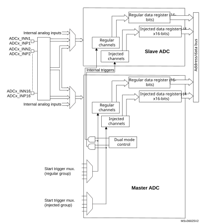

1.External triggers also exist on slave ADC but are not shown for the purposes of this diagram.

2.The ADC common data register (ADCx\_CDR) contains both the master and slave ADC regular converted data.

#### Injected simultaneous mode

This mode is selected by programming bits DUAL[4:0] = 00101

This mode converts an injected group of channels. The external trigger source comes from the injected group multiplexer of the master ADC (selected by the JEXTSEL bits in the ADC\_JSQR register).

**Note:**

Do not convert the same channel on the two ADCs (no overlapping sampling times for the two ADCs when converting the same channel).

In simultaneous mode, one must convert sequences with the same length or ensure that the interval between triggers is longer than the longer of the 2 sequences. Otherwise, the ADC with the shortest sequence may restart while the ADC with the longest sequence is completing the previous conversions.

Regular conversions can be performed on one or all ADCs. In that case, they are independent of each other and are interrupted when an injected event occurs. They are resumed at the end of the injected conversion group.

- At the end of injected sequence of conversion event (JEOS) on the master ADC, the converted data is stored into the master ADC\_JDRy registers and a JEOS interrupt is generated (if enabled)
- At the end of injected sequence of conversion event (JEOS) on the slave ADC, the converted data is stored into the slave ADC\_JDRy registers and a JEOS interrupt is generated (if enabled)
- If the duration of the master injected sequence is equal to the duration of the slave injected one (like in [Figure 138](#XREF_52991__dual_ADC_mode10)), it is possible for the software to enable only one of the two JEOS interrupt (ex: master JEOS) and read both converted data (from master ADC\_JDRy and slave ADC\_JDRy registers).

#### Figure 138. Injected simultaneous mode on 4 channels: dual ADC mode

If JDISCEN = 1, each simultaneous conversion of the injected sequence requires an injected trigger event to occur.

This mode can be combined with AUTDLY mode:

- Once a simultaneous injected sequence of conversions has ended, a new injected trigger event is accepted only if both JEOS bits of the master and the slave ADC have been cleared (delay phase). Any new injected trigger events occurring during the ongoing injected sequence and the associated delay phase are ignored.
- Once a regular sequence of conversions of the master ADC has ended, a new regular trigger event of the master ADC is accepted only if the master data register (ADC\_DR) has been read. Any new regular trigger events occurring for the master ADC during the ongoing regular sequence and the associated delay phases are ignored.  
  There is the same behavior for regular sequences occurring on the slave ADC.

#### Regular simultaneous mode with independent injected

This mode is selected by programming bits DUAL[4:0] = 00110.

This mode is performed on a regular group of channels. The external trigger source comes from the regular group multiplexer of the master ADC (selected by the EXTSEL bits in the ADC\_CFGR register). A simultaneous trigger is provided to the slave ADC.

In this mode, independent injected conversions are supported. An injection request (either on master or on the slave) aborts the current simultaneous conversions, which are restarted once the injected conversion is completed.

**Note:**

Do not convert the same channel on the two ADCs (no overlapping sampling times for the two ADCs when converting the same channel).

In regular simultaneous mode, one must convert sequences with the same length or ensure that the interval between triggers is longer than the longer conversion time of the 2 sequences. Otherwise, the ADC with the shortest sequence may restart while the ADC with the longest sequence is completing the previous conversions.

Software is notified by interrupts when it can read the data:

- At the end of each conversion event (EOC) on the master ADC, a master EOC interrupt is generated (if EOCIE is enabled) and software can read the ADC\_DR of the master ADC.
- At the end of each conversion event (EOC) on the slave ADC, a slave EOC interrupt is generated (if EOCIE is enabled) and software can read the ADC\_DR of the slave ADC.
- If the duration of the master regular sequence is equal to the duration of the slave one (like in [Figure 139](#XREF_50042__dual_ADC_mode10)), it is possible for the software to enable only one of the two EOC interrupt (ex: master EOC) and read both converted data from the Common Data register (ADCx\_CDR).

It is also possible to read the regular data using the DMA. Two methods are possible:

- Using two DMA channels (one for the master and one for the slave). In this case bits MDMA[1:0] must be kept cleared.
 - Configure the DMA master ADC channel to read ADC\_DR from the master. DMA requests are generated at each EOC event of the master ADC.
 - Configure the DMA slave ADC channel to read ADC\_DR from the slave. DMA requests are generated at each EOC event of the slave ADC.
- Using MDMA mode, which leaves one DMA channel free for other uses:
 - Configure MDMA[1:0] = 10 or 11 (depending on resolution).
 - A single DMA channel is used (the one of the master). Configure the DMA master ADC channel to read the common ADC register (ADCx\_CDR)
 - A single DMA request is generated each time both master and slave EOC events have occurred. At that time, the slave ADC converted data is available in the upper half-word of the ADCx\_CDR 32-bit register and the master ADC converted data is available in the lower half-word of ADCx\_CDR register.
 - Both EOC flags are cleared when the DMA reads the ADCx\_CDR register.

**Note:**

In MDMA mode (MDMA[1:0] = 10 or 11), the user must program the same number of conversions in the master’s sequence as in the slave’s sequence. Otherwise, the remaining conversions does not generate a DMA request.

#### Figure 139. Regular simultaneous mode on 16 channels: dual ADC mode

If DISCEN = 1 then each “n” simultaneous conversions of the regular sequence require a regular trigger event to occur (“n” is defined by DISCNUM).

This mode can be combined with AUTDLY mode:

- Once a simultaneous conversion of the sequence has ended, the next conversion in the sequence is started only if the common data register, ADCx\_CDR (or the regular data register of the master ADC) has been read (delay phase).
- Once a simultaneous regular sequence of conversions has ended, a new regular trigger event is accepted only if the common data register (ADCx\_CDR) has been read (delay phase). Any new regular trigger events occurring during the ongoing regular sequence and the associated delay phases are ignored.

It is possible to use the DMA to handle data in regular simultaneous mode combined with AUTDLY mode, assuming that multiple-DMA mode is used: bits MDMA must be set to 10 or 11.

When regular simultaneous mode is combined with AUTDLY mode, it is mandatory for the user to ensure that:

- The number of conversions in the master’s sequence is equal to the number of conversions in the slave’s.
- For each simultaneous conversions of the sequence, the length of the conversion of the slave ADC is inferior to the length of the conversion of the master ADC. Note that the length of the sequence depends on the number of channels to convert and the sampling time and the resolution of each channels.

**Note:**

This combination of regular simultaneous mode and AUTDLY mode is restricted to the use case when only regular channels are programmed: it is forbidden to program injected channels in this combined mode.

#### Interleaved mode with independent injected

This mode is selected by programming bits DUAL[4:0] = 00111.

This mode can be started only on a regular group (usually one channel). The external trigger source comes from the regular channel multiplexer of the master ADC.

After an external trigger occurs:

- The master ADC starts immediately.
- The slave ADC starts after a delay of several ADC clock cycles after the sampling phase of the master ADC has complete.

The minimum delay which separates two conversions in interleaved mode is configured in the DELAY bits in the ADCx\_CCR register. This delay starts counting one half cycle after the end of the sampling phase of the master conversion. This way, an ADC cannot start a conversion if the complementary ADC is still sampling its input (only one ADC can sample the input signal at a given time).

- The minimum possible DELAY is 1 to ensure that there is at least one cycle time between the opening of the analog switch of the master ADC sampling phase and the closing of the analog switch of the slave ADC sampling phase.
- The maximum DELAY is equal to the number of cycles corresponding to the selected resolution. However the user must properly calculate this delay to ensure that an ADC does not start a conversion while the other ADC is still sampling its input.

If the CONT bit is set on both master and slave ADCs, the selected regular channels of both ADCs are continuously converted.

The software is notified by interrupts when it can read the data at the end of each conversion event (EOC) on the slave ADC. A slave and master EOC interrupts are generated (if EOCIE is enabled) and the software can read the ADC\_DR of the slave/master ADC.

**Note:**

It is possible to enable only the EOC interrupt of the slave and read the common data register (ADCx\_CDR). But in this case, the user must ensure that the duration of the conversions are compatible to ensure that inside the sequence, a master conversion is always followed by a slave conversion before a new master conversion restarts. It is recommended to use the MDMA mode.

It is also possible to have the regular data transferred by DMA. In this case, individual DMA requests on each ADC cannot be used and it is mandatory to use the MDMA mode, as following:

- Configure MDMA[1:0] = 10 or 11 (depending on resolution).
- A single DMA channel is used (the one of the master). Configure the DMA master ADC channel to read the common ADC register (ADCx\_CDR).
- A single DMA request is generated each time both master and slave EOC events have occurred. At that time, the slave ADC converted data is available in the upper half-word of the ADCx\_CDR 32-bit register and the master ADC converted data is available in the lower half-word of ADCx\_CCR register.
- Both EOC flags are cleared when the DMA reads the ADCx\_CCR register.

#### Figure 140. Interleaved mode on 1 channel in continuous conversion mode: dual ADC mode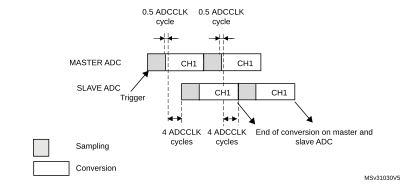

#### Figure 141. Interleaved mode on 1 channel in single conversion mode: dual ADC mode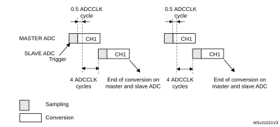

If DISCEN = 1, each “n” simultaneous conversions (“n” is defined by DISCNUM) of the regular sequence require a regular trigger event to occur.

In this mode, injected conversions are supported. When injection is done (either on master or on slave), both the master and the slave regular conversions are aborted and the sequence is restarted from the master (see [Figure 142](#XREF_RTF39323537383a20466967436110) below).

#### Figure 142. Interleaved conversion with injection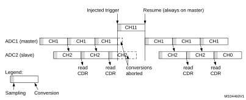

#### Alternate trigger mode

This mode is selected by programming bits DUAL[4:0] = 01001.

This mode can be started only on an injected group. The source of external trigger comes from the injected group multiplexer of the master ADC.

This mode is only possible when selecting hardware triggers: JEXTEN[1:0] must not be 00.

Injected discontinuous mode disabled (JDISCEN = 0 for both ADC)

1. When the first trigger occurs, all injected master ADC channels in the group are converted.
2. When the second trigger occurs, all injected slave ADC channels in the group are converted.
3. And so on.

A JEOS interrupt, if enabled, is generated after all injected channels of the master ADC in the group have been converted.

A JEOS interrupt, if enabled, is generated after all injected channels of the slave ADC in the group have been converted.

JEOC interrupts, if enabled, can also be generated after each injected conversion.

If another external trigger occurs after all injected channels in the group have been converted then the alternate trigger process restarts by converting the injected channels of the master ADC in the group.

#### Figure 143. Alternate trigger: injected group of each ADC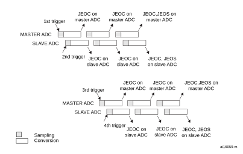

**Note:**

Regular conversions can be enabled on one or all ADCs. In this case the regular conversions are independent of each other. A regular conversion is interrupted when the ADC has to perform an injected conversion. It is resumed when the injected conversion is finished.

The time interval between 2 trigger events must be greater than or equal to 1 ADC clock period. The minimum time interval between 2 trigger events that start conversions on the same ADC is the same as in the single ADC mode.

Injected discontinuous mode enabled (JDISCEN = 1 for both ADC)

If the injected discontinuous mode is enabled for both master and slave ADCs:

- When the first trigger occurs, the first injected channel of the master ADC is converted.
- When the second trigger occurs, the first injected channel of the slave ADC is converted.
- And so on.

A JEOS interrupt, if enabled, is generated after all injected channels of the master ADC in the group have been converted.

A JEOS interrupt, if enabled, is generated after all injected channels of the slave ADC in the group have been converted.

JEOC interrupts, if enabled, can also be generated after each injected conversions.

If another external trigger occurs after all injected channels in the group have been converted then the alternate trigger process restarts.

#### Figure 144. Alternate trigger: 4 injected channels (each ADC) in discontinuous mode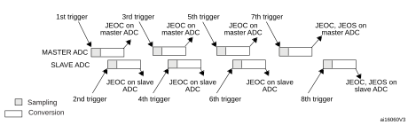

#### Combined regular/injected simultaneous mode

This mode is selected by programming bits DUAL[4:0] = 00001.

It is possible to interrupt the simultaneous conversion of a regular group to start the simultaneous conversion of an injected group.

**Note:**

In combined regular/injected simultaneous mode, one must convert sequences with the same length or ensure that the interval between triggers is longer than the long conversion time of the 2 sequences. Otherwise, the ADC with the shortest sequence may restart while the ADC with the longest sequence is completing the previous conversions.

#### Combined regular simultaneous + alternate trigger mode

This mode is selected by programming bits DUAL[4:0] = 00010.

It is possible to interrupt the simultaneous conversion of a regular group to start the alternate trigger conversion of an injected group. [Figure 145](#XREF_67696__Figure_18__Alternate_+_regular_simultaneous10) shows the behavior of an alternate trigger interrupting a simultaneous regular conversion.

The injected alternate conversion is immediately started after the injected event. If a regular conversion is already running, in order to ensure synchronization after the injected conversion, the regular conversion of all (master/slave) ADCs is stopped and resumed synchronously at the end of the injected conversion.

**Note:**

In combined regular simultaneous + alternate trigger mode, one must convert sequences with the same length or ensure that the interval between triggers is longer than the long conversion time of the 2 sequences. Otherwise, the ADC with the shortest sequence may restart while the ADC with the longest sequence is completing the previous conversions.

#### Figure 145. Alternate + regular simultaneous

If a trigger occurs during an injected conversion that has interrupted a regular conversion, the alternate trigger is served. [Figure 146](#XREF_43425__Figure_19__Case_of_trigger_occurring_during_injected_conversion10) shows the behavior in this case (note that the 6th trigger is ignored because the associated alternate conversion is not complete).

#### Figure 146. Case of trigger occurring during injected conversion

#### Combined injected simultaneous plus interleaved

This mode is selected by programming bits DUAL[4:0] = 00011

It is possible to interrupt an interleaved conversion with a simultaneous injected event.

In this case the interleaved conversion is interrupted immediately and the simultaneous injected conversion starts. At the end of the injected sequence the interleaved conversion is resumed. When the interleaved regular conversion resumes, the first regular conversion which is performed is alway the master’s one. [Figure 147](#XREF_RTF39353331373a20466967436110), [Figure 148](#XREF_RTF32353735323a20466967436110) and [Figure 149](#XREF_65671__Figure_122__Two_Interleaved_channels_(CH1%2C_CH2)_with_injected10) show the behavior using an example.

Caution:In this mode, it is mandatory to use the Common Data Register to read the regular data with a single read access. On the contrary, master-slave data coherency is not guaranteed.

#### Figure 147. Interleaved single channel CH0 with injected sequence CH11, CH12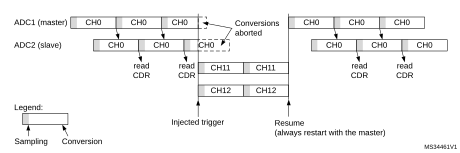

#### Figure 148. Two Interleaved channels (CH1, CH2) with injected sequence CH11, CH12   - case 1: Master interrupted first 

#### Figure 149. Two Interleaved channels (CH1, CH2) with injected sequence CH11, CH12   - case 2: Slave interrupted first 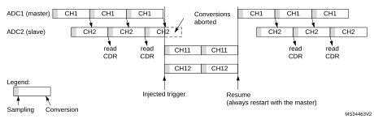

#### DMA requests in dual ADC mode

In all dual ADC modes, it is possible to use two DMA channels (one for the master, one for the slave) to transfer the data, like in single mode (refer to [Figure 150: DMA Requests in regular simultaneous mode when MDMA = 00](#XREF_73362__Figure_47__DMA_Requests_in_regular_simultaneous_mode_when_MDMA=0b0010)).

#### Figure 150. DMA Requests in regular simultaneous mode when MDMA = 00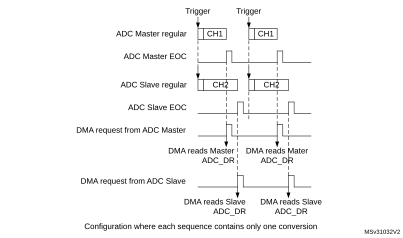

In simultaneous regular and interleaved modes, it is also possible to save one DMA channel and transfer both data using a single DMA channel. For this MDMA bits must be configured in the ADCx\_CCR register:

- MDMA = 10: A single DMA request is generated each time both master and slave EOC events have occurred. At that time, two data items are available and the 32-bit register ADCx\_CDR contains the two half-words representing two ADC-converted data items. The slave ADC data take the upper half-word and the master ADC data take the lower half-word.  
  This mode is used in interleaved mode and in regular simultaneous mode when resolution is 10-bit or 12-bit.

Example:

Interleaved dual mode: a DMA request is generated each time 2 data items are available:

first DMA request: ADCx\_CDR[31:0] = SLV\_ADC\_DR[15:0] | MST\_ADC\_DR[15:0]

second DMA request: ADCx\_CDR[31:0] = SLV\_ADC\_DR[15:0] | MST\_ADC\_DR[15:0]

#### Figure 151. DMA requests in regular simultaneous mode when MDMA = 10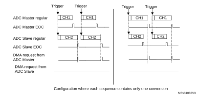

#### Figure 152. DMA requests in interleaved mode when MDMA = 10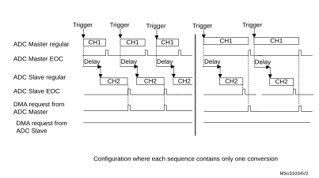

**Note:**

When using MDMA mode, the user must take care to configure properly the duration of the master and slave conversions so that a DMA request is generated and served for reading both data (master + slave) before a new conversion is available.

- MDMA = 11: This mode is similar to the MDMA = 10. The only differences are that on each DMA request (two data items are available), two bytes representing two ADC converted data items are transferred as a half-word.

This mode is used in interleaved and regular simultaneous mode when resolution is 6-bit or when resolution is 8-bit and data is not signed (offsets must be disabled for all the involved channels).

Example:

Interleaved dual mode: a DMA request is generated each time 2 data items are available:

first DMA request: ADCx\_CDR[15:0] = SLV\_ADC\_DR[7:0] | MST\_ADC\_DR[7:0]

second DMA request: ADCx\_CDR[15:0] = SLV\_ADC\_DR[7:0] | MST\_ADC\_DR[7:0]

#### Overrun detection

In dual ADC mode (when DUAL[4:0] is not equal to 00000), if an overrun is detected on one of the ADCs, the DMA requests are no longer issued to ensure that all the data transferred to the RAM are valid (this behavior occurs whatever the MDMA configuration). It may happen that the EOC bit corresponding to one ADC remains set because the data register of this ADC contains valid data.

#### DMA one shot mode/ DMA circular mode when MDMA mode is selected

When MDMA mode is selected (10 or 11), bit DMACFG of the ADCx\_CCR register must also be configured to select between DMA one shot mode and circular mode, as explained in section [Section : Managing conversions using the DMA](#XREF_53109__1_6_5_Using_the_DMA10) (bits DMACFG of master and slave ADC\_CFGR are not relevant).

#### Stopping the conversions in dual ADC modes

The user must set the control bits ADSTP/JADSTP of the master ADC to stop the conversions of both ADC in dual ADC mode. The other ADSTP control bit of the slave ADC has no effect in dual ADC mode.

Once both ADC are effectively stopped, the bits ADSTART/JADSTART of the master and slave ADCs are both cleared by hardware.

### 21.4.31 Temperature sensor

The temperature sensor can be used to measure the junction temperature (Tj) of the device. The temperature sensor is internally connected to the ADC input channels which are used to convert the sensor output voltage to a digital value. When not in use, the sensor can be put in power down mode. It support the temperature range –40 to 125 °C.

[Figure 153](#XREF_52656__Figure_21__Temperature_sensor_and_VREFINT_channel_block_diagram10) shows the block diagram of connections between the temperature sensor and the ADC.

The temperature sensor output voltage changes linearly with temperature. The offset of this line varies from chip to chip due to process variation (up to 45 °C from one chip to another).

The uncalibrated internal temperature sensor is more suited for applications that detect temperature variations instead of absolute temperatures. To improve the accuracy of the temperature sensor measurement, calibration values are stored in system memory for each device by ST during production.

During the manufacturing process, the calibration data of the temperature sensor and the internal voltage reference are stored in the system memory area. The user application can then read them and use them to improve the accuracy of the temperature sensor or the internal reference (refer to the datasheet for additional information).

The temperature sensor is internally connected to the ADC input channel which is used to convert the sensor’s output voltage to a digital value. Refer to the electrical characteristics section of the device datasheet for the sampling time value to be applied when converting the internal temperature sensor.

When not in use, the sensor can be put in power-down mode.

[Figure 153](#XREF_52656__Figure_21__Temperature_sensor_and_VREFINT_channel_block_diagram10) shows the block diagram of the temperature sensor.

#### Figure 153. Temperature sensor channel block diagram

#### Reading the temperature

To use the sensor:

1. Select the ADC input channels that is connected to VTS.
2. Program with the appropriate sampling time (refer to electrical characteristics section of the device datasheet).
3. Set the VSENSESEL bit in the ADCx\_CCR register to wake up the temperature sensor from power-down mode.
4. Start the ADC conversion.
5. Read the resulting VTS data in the ADC data register.
6. Calculate the actual temperature using the following formula: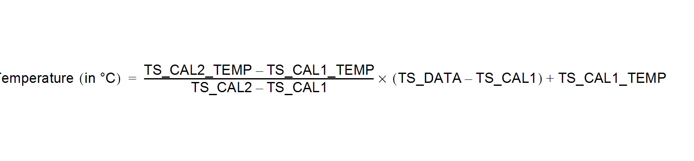

Where:

- TS\_CAL2 is the temperature sensor calibration value acquired at TS\_CAL2\_TEMP.
- TS\_CAL1 is the temperature sensor calibration value acquired at TS\_CAL1\_TEMP.
- TS\_DATA is the actual temperature sensor output value converted by ADC.

Refer to the device datasheet for more information about TS\_CAL1 and TS\_CAL2 calibration points.

**Note:**

The sensor has a startup time after waking from power-down mode before it can output VTS at the correct level. The ADC also has a startup time after power-on, so to minimize the delay, the ADEN and VSENSESEL bits should be set at the same time.

The above formula is given for TS\_DATA measurement done with the same VREF+voltage as TS\_CAL1/TS\_CAL2 values. If VREF+ is different, the formula must be adapted. For example if VREF+ = 3.3 V and TS\_CAL data are acquired at VREF+= 3.0 V, TS\_DATA must be replaced by TS\_DATA x (3.3/3.0).

### 21.4.32 VBAT supply monitoring

The VBATSEL bit in the ADCx\_CCR register is used to switch to the battery voltage. As the VBAT voltage could be higher than VDDA, to ensure the correct operation of the ADC, the VBAT pin is internally connected to a bridge divider by 3. This bridge is automatically enabled when VBATSEL is set, to connect VBAT/3 to the ADC input channels. As a consequence, the converted digital value is one third of the VBAT voltage. To prevent any unwanted consumption on the battery, it is recommended to enable the bridge divider only when needed, for ADC conversion.

Refer to the electrical characteristics of the device datasheet for the sampling time value to be applied when converting the VBAT/3 voltage.

The figure below shows the block diagram of the VBAT sensing feature.

#### Figure 154. VBAT channel block diagram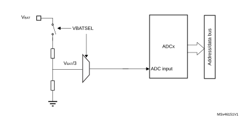

1.The VBATSEL bit must be set to enable the conversion of internal channel for VBAT/3.

### 21.4.33 Monitoring the internal voltage reference

It is possible to monitor the internal voltage reference (VREFINT) to have a reference point for evaluating the ADC VREF+ voltage level.

The internal reference voltage (VREFINT) is internally connected to ADC1\_INP18, ADC3\_INP18, ADC4\_INP18 and ADC5\_INP18.

Refer to the electrical characteristics section of the product datasheet for the sampling time value to be applied when converting the internal voltage reference voltage.

[Figure 155](#XREF_87776__Figure_129__VREFINT_channel_block_diagram10) shows the block diagram of the VREFINT sensing feature.

#### Figure 155. VREFINT channel block diagram

1.The VREFEN bit into ADCx\_CCR register must be set to enable the conversion of internal channels (VREFINT).

#### Calculating the actualVREF+ voltage using the internal reference voltage

The power supply voltage applied to the device may be subject to variations or not precisely known. When VDDA is connected to VREF+, it is possible to compute the actual VDDA voltage using the embedded internal reference voltage (VREFINT). VREFINT and its calibration data, acquired by the ADC during the manufacturing process at VDDA\_Charac, can be used to evaluate the actual VDDA voltage level.

The following formula gives the actual VREF+ voltage supplying the device: 

Where:

- VREF+\_Charac is the value of VREF+ voltage characterized at VREFINT during the manufacturing process. It is specified in the device datasheet.
- VREFINT\_CAL is the VREFINT calibration value
- VREFINT\_DATA is the actual VREFINT output value converted by ADC

#### Converting a supply-relative ADC measurement to an absolute voltage value

The ADC is designed to deliver a digital value corresponding to the ratio between VREF+ and the voltage applied on the converted channel.

For most applications VDDA value is unknown and ADC converted values are right-aligned. In this case, it is necessary to convert this ratio into a voltage independent from VDDA:  

By replacing VREF+ by the formula provided above, the absolute voltage value is given by the following formula

For applications where VREF+ is known and ADC converted values are right-aligned, the absolute voltage value can be obtained by using the following formula: 

Where:

 - VREF+\_Charac is the value of VREF+ voltage characterized at VREFINT during the manufacturing process.
 - VREFINT\_CAL is the VREFINT calibration value
 - ADC\_DATA is the value measured by the ADC on channel x (right-aligned)
 - VREFINT\_DATA is the actual VREFINT output value converted by the ADC
 - FULL\_SCALE is the maximum digital value of the ADC output. For example with 12-bit resolution, it is 212 - 1 = 4095 or with 8-bit resolution, 28 - 1 = 255.

**Note:**

If ADC measurements are done using an output format other than 16-bit right-aligned, all the parameters must first be converted to a compatible format before the calculation is done.

## 21.5 ADC in low-power mode

 

<table class="TableTitle"><caption class="TableCap"><h4 class="TableCap" id="31140410">Table 177. <a id="ADC%1110" name="XREF_87624__Table_174__Effect_of_low-power_modes_on_the_ADC%1110">Effect of low-power modes on the ADC</a></h4></caption><col width="133.23px"/><col width="405.35px"/><thead><tr height="28.00px"><th>
Mode
</th><th>
Description
</th></tr></thead><tr height="40.00px"><td>
Sleep
</td><td>
No effect. 

DMA requests are functional. 
</td></tr><tr height="22.67px"><td>
Low-power run
</td><td>
No effect.
</td></tr><tr height="40.00px"><td>
Low-power sleep
</td><td>
No effect. 

DMA requests are functional. 
</td></tr><tr height="54.67px"><td>
Stop 0/Stop 1
</td><td>
The ADC is not operational. Its state is kept. 

The ADC consumes the static current recommended to disable the peripheral in advance in order to reduce power consumption.
</td></tr><tr data-conditional="_adc_stop2,_adc_vref_" height="57.33px" style="display: none"><td data-conditional="_adc_stop2,_adc_vref_" style="display: none">
Stop 2
</td><td data-conditional="_adc_stop2,_adc_vref_" style="display: none">
The ADC is not operational. Its state is kept. 

The ADC regulator is disabled by hardware.

ADC and regulator must be disabled before entering Stop 2 mode.
</td></tr><tr height="22.67px"><td>
Standby
</td><td rowspan="2">
The ADC is powered down and must be reinitialized after exiting Standby or Shutdown mode.
</td></tr><tr height="22.67px"><td>
Shutdown
</td></tr></table>

## 21.6 ADC interrupts

For each ADC, an interrupt can be generated:

- After ADC power-up, when the ADC is ready (flag ADRDY)
- On the end of any conversion for regular groups (flag EOC)
- On the end of a sequence of conversion for regular groups (flag EOS)
- On the end of any conversion for injected groups (flag JEOC)
- On the end of a sequence of conversion for injected groups (flag JEOS)
- When an analog watchdog detection occurs (flag AWD1, AWD2 and AWD3)
- When the end of sampling phase occurs (flag EOSMP)
- When the data overrun occurs (flag OVR)
- When the injected sequence context queue overflows (flag JQOVF)

Separate interrupt enable bits are available for flexibility.

 

<table class="TableTitle"><caption class="TableTitle"><h4 class="TableCap" id="1020987">Table 178. ADC interrupts per each ADC</h4></caption><col width="330.30px"/><col width="88.87px"/><col width="118.46px"/><thead><tr height="28.00px"><th>
Interrupt event
</th><th>
Event flag
</th><th>
Enable control bit
</th></tr></thead><tr height="22.67px"><td>
ADC ready
</td><td>
ADRDY
</td><td>
ADRDYIE
</td></tr><tr height="22.67px"><td>
End of conversion of a regular group
</td><td>
EOC
</td><td>
EOCIE
</td></tr><tr height="22.67px"><td>
End of sequence of conversions of a regular group
</td><td>
EOS
</td><td>
EOSIE
</td></tr><tr height="22.67px"><td>
End of conversion of a injected group
</td><td>
JEOC
</td><td>
JEOCIE
</td></tr><tr height="22.67px"><td>
End of sequence of conversions of an injected group
</td><td>
JEOS
</td><td>
JEOSIE
</td></tr><tr height="22.67px"><td>
Analog watchdog 1 status bit is set
</td><td>
AWD1
</td><td>
AWD1IE
</td></tr><tr height="22.67px"><td>
Analog watchdog 2 status bit is set
</td><td>
AWD2
</td><td>
AWD2IE
</td></tr><tr height="22.67px"><td>
Analog watchdog 3 status bit is set
</td><td>
AWD3
</td><td>
AWD3IE
</td></tr><tr height="22.67px"><td>
End of sampling phase
</td><td>
EOSMP
</td><td>
EOSMPIE
</td></tr><tr height="22.67px"><td>
Overrun
</td><td>
OVR
</td><td>
OVRIE
</td></tr><tr height="22.67px"><td>
Injected context queue overflows
</td><td>
JQOVF
</td><td>
JQOVFIE
</td></tr></table>

## 21.7 ADC registers (for each ADC)

Refer to [Section 1.2 on page 74](Documentation_conventions.md#XREF_82797__1_1_List_of_abbreviations_for_registers1) for a list of abbreviations used in register descriptions.

### 21.7.1 ADC interrupt and status register (ADC\_ISR)

Address offset: 0x00

Reset value: 0x0000 0000

 

<table class="RegBitMap"><col width="37.90px"/><col width="37.90px"/><col width="37.90px"/><col width="37.90px"/><col width="37.90px"/><col width="37.90px"/><col width="37.90px"/><col width="37.90px"/><col width="37.90px"/><col width="39.19px"/><col width="39.19px"/><col width="39.19px"/><col width="39.19px"/><col width="39.19px"/><col width="39.19px"/><col width="39.19px"/><tr height="17.33px"><td style="border-left-width:0;border-left-style:hidden;border-left-color:0;border-right-width:0;border-right-style:hidden;border-right-color:0;border-top-width:0;border-top-style:hidden;border-top-color:0;">
31
</td><td style="border-left-width:0;border-left-style:hidden;border-left-color:0;border-right-width:0;border-right-style:hidden;border-right-color:0;border-top-width:0;border-top-style:hidden;border-top-color:0;">
30
</td><td style="border-left-width:0;border-left-style:hidden;border-left-color:0;border-right-width:0;border-right-style:hidden;border-right-color:0;border-top-width:0;border-top-style:hidden;border-top-color:0;">
29
</td><td style="border-left-width:0;border-left-style:hidden;border-left-color:0;border-right-width:0;border-right-style:hidden;border-right-color:0;border-top-width:0;border-top-style:hidden;border-top-color:0;">
28
</td><td style="border-left-width:0;border-left-style:hidden;border-left-color:0;border-right-width:0;border-right-style:hidden;border-right-color:0;border-top-width:0;border-top-style:hidden;border-top-color:0;">
27
</td><td style="border-left-width:0;border-left-style:hidden;border-left-color:0;border-right-width:0;border-right-style:hidden;border-right-color:0;border-top-width:0;border-top-style:hidden;border-top-color:0;">
26
</td><td style="border-left-width:0;border-left-style:hidden;border-left-color:0;border-right-width:0;border-right-style:hidden;border-right-color:0;border-top-width:0;border-top-style:hidden;border-top-color:0;">
25
</td><td style="border-left-width:0;border-left-style:hidden;border-left-color:0;border-right-width:0;border-right-style:hidden;border-right-color:0;border-top-width:0;border-top-style:hidden;border-top-color:0;">
24
</td><td style="border-left-width:0;border-left-style:hidden;border-left-color:0;border-right-width:0;border-right-style:hidden;border-right-color:0;border-top-width:0;border-top-style:hidden;border-top-color:0;">
23
</td><td style="border-left-width:0;border-left-style:hidden;border-left-color:0;border-right-width:0;border-right-style:hidden;border-right-color:0;border-top-width:0;border-top-style:hidden;border-top-color:0;">
22
</td><td style="border-left-width:0;border-left-style:hidden;border-left-color:0;border-right-width:0;border-right-style:hidden;border-right-color:0;border-top-width:0;border-top-style:hidden;border-top-color:0;">
21
</td><td style="border-left-width:0;border-left-style:hidden;border-left-color:0;border-right-width:0;border-right-style:hidden;border-right-color:0;border-top-width:0;border-top-style:hidden;border-top-color:0;">
20
</td><td style="border-left-width:0;border-left-style:hidden;border-left-color:0;border-right-width:0;border-right-style:hidden;border-right-color:0;border-top-width:0;border-top-style:hidden;border-top-color:0;">
19
</td><td style="border-left-width:0;border-left-style:hidden;border-left-color:0;border-right-width:0;border-right-style:hidden;border-right-color:0;border-top-width:0;border-top-style:hidden;border-top-color:0;">
18
</td><td style="border-left-width:0;border-left-style:hidden;border-left-color:0;border-right-width:0;border-right-style:hidden;border-right-color:0;border-top-width:0;border-top-style:hidden;border-top-color:0;">
17
</td><td style="border-left-width:0;border-left-style:hidden;border-left-color:0;border-right-width:0;border-right-style:hidden;border-right-color:0;border-top-width:0;border-top-style:hidden;border-top-color:0;">
16
</td></tr><tr height="26.46px"><td style="border-left-width:0.5pt;border-left-style:solid;border-left-color:#000000;border-bottom-width:0.5pt;border-bottom-style:solid;border-bottom-color:#000000;border-right-width:0.5pt;border-right-style:solid;border-right-color:#000000;border-top-width:0.5pt;border-top-style:solid;border-top-color:#000000;">
Res.
</td><td style="border-left-width:0.5pt;border-left-style:solid;border-left-color:#000000;border-bottom-width:0.5pt;border-bottom-style:solid;border-bottom-color:#000000;border-right-width:0.5pt;border-right-style:solid;border-right-color:#000000;border-top-width:0.5pt;border-top-style:solid;border-top-color:#000000;">
Res.
</td><td style="border-left-width:0.5pt;border-left-style:solid;border-left-color:#000000;border-bottom-width:0.5pt;border-bottom-style:solid;border-bottom-color:#000000;border-right-width:0.5pt;border-right-style:solid;border-right-color:#000000;border-top-width:0.5pt;border-top-style:solid;border-top-color:#000000;">
Res.
</td><td style="border-left-width:0.5pt;border-left-style:solid;border-left-color:#000000;border-bottom-width:0.5pt;border-bottom-style:solid;border-bottom-color:#000000;border-right-width:0.5pt;border-right-style:solid;border-right-color:#000000;border-top-width:0.5pt;border-top-style:solid;border-top-color:#000000;">
Res.
</td><td style="border-left-width:0.5pt;border-left-style:solid;border-left-color:#000000;border-bottom-width:0.5pt;border-bottom-style:solid;border-bottom-color:#000000;border-right-width:0.5pt;border-right-style:solid;border-right-color:#000000;border-top-width:0.5pt;border-top-style:solid;border-top-color:#000000;">
Res.
</td><td style="border-left-width:0.5pt;border-left-style:solid;border-left-color:#000000;border-bottom-width:0.5pt;border-bottom-style:solid;border-bottom-color:#000000;border-right-width:0.5pt;border-right-style:solid;border-right-color:#000000;border-top-width:0.5pt;border-top-style:solid;border-top-color:#000000;">
Res.
</td><td style="border-left-width:0.5pt;border-left-style:solid;border-left-color:#000000;border-bottom-width:0.5pt;border-bottom-style:solid;border-bottom-color:#000000;border-right-width:0.5pt;border-right-style:solid;border-right-color:#000000;border-top-width:0.5pt;border-top-style:solid;border-top-color:#000000;">
Res.
</td><td style="border-left-width:0.5pt;border-left-style:solid;border-left-color:#000000;border-bottom-width:0.5pt;border-bottom-style:solid;border-bottom-color:#000000;border-right-width:0.5pt;border-right-style:solid;border-right-color:#000000;border-top-width:0.5pt;border-top-style:solid;border-top-color:#000000;">
Res.
</td><td style="border-left-width:0.5pt;border-left-style:solid;border-left-color:#000000;border-bottom-width:0.5pt;border-bottom-style:solid;border-bottom-color:#000000;border-right-width:0.5pt;border-right-style:solid;border-right-color:#000000;border-top-width:0.5pt;border-top-style:solid;border-top-color:#000000;">
Res.
</td><td style="border-left-width:0.5pt;border-left-style:solid;border-left-color:#000000;border-bottom-width:0.5pt;border-bottom-style:solid;border-bottom-color:#000000;border-right-width:0.5pt;border-right-style:solid;border-right-color:#000000;border-top-width:0.5pt;border-top-style:solid;border-top-color:#000000;">
Res.
</td><td style="border-left-width:0.5pt;border-left-style:solid;border-left-color:#000000;border-bottom-width:0.5pt;border-bottom-style:solid;border-bottom-color:#000000;border-right-width:0.5pt;border-right-style:solid;border-right-color:#000000;border-top-width:0.5pt;border-top-style:solid;border-top-color:#000000;">
Res.
</td><td style="border-left-width:0.5pt;border-left-style:solid;border-left-color:#000000;border-bottom-width:0.5pt;border-bottom-style:solid;border-bottom-color:#000000;border-right-width:0.5pt;border-right-style:solid;border-right-color:#000000;border-top-width:0.5pt;border-top-style:solid;border-top-color:#000000;">
Res.
</td><td style="border-left-width:0.5pt;border-left-style:solid;border-left-color:#000000;border-bottom-width:0.5pt;border-bottom-style:solid;border-bottom-color:#000000;border-right-width:0.5pt;border-right-style:solid;border-right-color:#000000;border-top-width:0.5pt;border-top-style:solid;border-top-color:#000000;">
Res.
</td><td style="border-left-width:0.5pt;border-left-style:solid;border-left-color:#000000;border-bottom-width:0.5pt;border-bottom-style:solid;border-bottom-color:#000000;border-right-width:0.5pt;border-right-style:solid;border-right-color:#000000;border-top-width:0.5pt;border-top-style:solid;border-top-color:#000000;">
Res.
</td><td style="border-left-width:0.5pt;border-left-style:solid;border-left-color:#000000;border-bottom-width:0.5pt;border-bottom-style:solid;border-bottom-color:#000000;border-right-width:0.5pt;border-right-style:solid;border-right-color:#000000;border-top-width:0.5pt;border-top-style:solid;border-top-color:#000000;">
Res.
</td><td style="border-left-width:0.5pt;border-left-style:solid;border-left-color:#000000;border-bottom-width:0.5pt;border-bottom-style:solid;border-bottom-color:#000000;border-right-width:0.5pt;border-right-style:solid;border-right-color:#000000;border-top-width:0.5pt;border-top-style:solid;border-top-color:#000000;">
Res.
</td></tr><tr height="17.33px"><td style="border-left-width:0.5pt;border-left-style:solid;border-left-color:#000000;border-bottom-width:0.5pt;border-bottom-style:solid;border-bottom-color:#000000;border-right-width:0.5pt;border-right-style:solid;border-right-color:#000000;border-top-width:0.5pt;border-top-style:solid;border-top-color:#000000;"></td><td style="border-left-width:0.5pt;border-left-style:solid;border-left-color:#000000;border-bottom-width:0.5pt;border-bottom-style:solid;border-bottom-color:#000000;border-right-width:0.5pt;border-right-style:solid;border-right-color:#000000;border-top-width:0.5pt;border-top-style:solid;border-top-color:#000000;"></td><td style="border-left-width:0.5pt;border-left-style:solid;border-left-color:#000000;border-bottom-width:0.5pt;border-bottom-style:solid;border-bottom-color:#000000;border-right-width:0.5pt;border-right-style:solid;border-right-color:#000000;border-top-width:0.5pt;border-top-style:solid;border-top-color:#000000;"></td><td style="border-left-width:0.5pt;border-left-style:solid;border-left-color:#000000;border-bottom-width:0.5pt;border-bottom-style:solid;border-bottom-color:#000000;border-right-width:0.5pt;border-right-style:solid;border-right-color:#000000;border-top-width:0.5pt;border-top-style:solid;border-top-color:#000000;"></td><td style="border-left-width:0.5pt;border-left-style:solid;border-left-color:#000000;border-bottom-width:0.5pt;border-bottom-style:solid;border-bottom-color:#000000;border-right-width:0.5pt;border-right-style:solid;border-right-color:#000000;border-top-width:0.5pt;border-top-style:solid;border-top-color:#000000;"></td><td style="border-left-width:0.5pt;border-left-style:solid;border-left-color:#000000;border-bottom-width:0.5pt;border-bottom-style:solid;border-bottom-color:#000000;border-right-width:0.5pt;border-right-style:solid;border-right-color:#000000;border-top-width:0.5pt;border-top-style:solid;border-top-color:#000000;"></td><td style="border-left-width:0.5pt;border-left-style:solid;border-left-color:#000000;border-bottom-width:0.5pt;border-bottom-style:solid;border-bottom-color:#000000;border-right-width:0.5pt;border-right-style:solid;border-right-color:#000000;border-top-width:0.5pt;border-top-style:solid;border-top-color:#000000;"></td><td style="border-left-width:0.5pt;border-left-style:solid;border-left-color:#000000;border-bottom-width:0.5pt;border-bottom-style:solid;border-bottom-color:#000000;border-right-width:0.5pt;border-right-style:solid;border-right-color:#000000;border-top-width:0.5pt;border-top-style:solid;border-top-color:#000000;"></td><td style="border-left-width:0.5pt;border-left-style:solid;border-left-color:#000000;border-bottom-width:0.5pt;border-bottom-style:solid;border-bottom-color:#000000;border-right-width:0.5pt;border-right-style:solid;border-right-color:#000000;border-top-width:0.5pt;border-top-style:solid;border-top-color:#000000;"></td><td style="border-left-width:0.5pt;border-left-style:solid;border-left-color:#000000;border-bottom-width:0.5pt;border-bottom-style:solid;border-bottom-color:#000000;border-right-width:0.5pt;border-right-style:solid;border-right-color:#000000;border-top-width:0.5pt;border-top-style:solid;border-top-color:#000000;"></td><td style="border-left-width:0.5pt;border-left-style:solid;border-left-color:#000000;border-bottom-width:0.5pt;border-bottom-style:solid;border-bottom-color:#000000;border-right-width:0.5pt;border-right-style:solid;border-right-color:#000000;border-top-width:0.5pt;border-top-style:solid;border-top-color:#000000;"></td><td style="border-left-width:0.5pt;border-left-style:solid;border-left-color:#000000;border-bottom-width:0.5pt;border-bottom-style:solid;border-bottom-color:#000000;border-right-width:0.5pt;border-right-style:solid;border-right-color:#000000;border-top-width:0.5pt;border-top-style:solid;border-top-color:#000000;"></td><td style="border-left-width:0.5pt;border-left-style:solid;border-left-color:#000000;border-bottom-width:0.5pt;border-bottom-style:solid;border-bottom-color:#000000;border-right-width:0.5pt;border-right-style:solid;border-right-color:#000000;border-top-width:0.5pt;border-top-style:solid;border-top-color:#000000;"></td><td style="border-left-width:0.5pt;border-left-style:solid;border-left-color:#000000;border-bottom-width:0.5pt;border-bottom-style:solid;border-bottom-color:#000000;border-right-width:0.5pt;border-right-style:solid;border-right-color:#000000;border-top-width:0.5pt;border-top-style:solid;border-top-color:#000000;"></td><td style="border-left-width:0.5pt;border-left-style:solid;border-left-color:#000000;border-bottom-width:0.5pt;border-bottom-style:solid;border-bottom-color:#000000;border-right-width:0.5pt;border-right-style:solid;border-right-color:#000000;border-top-width:0.5pt;border-top-style:solid;border-top-color:#000000;"></td><td style="border-left-width:0.5pt;border-left-style:solid;border-left-color:#000000;border-bottom-width:0.5pt;border-bottom-style:solid;border-bottom-color:#000000;border-right-width:0.5pt;border-right-style:solid;border-right-color:#000000;border-top-width:0.5pt;border-top-style:solid;border-top-color:#000000;"></td></tr><tr height="17.33px"><td style="border-left-width:0;border-left-style:hidden;border-left-color:0;border-right-width:0;border-right-style:hidden;border-right-color:0;border-top-width:0;border-top-style:hidden;border-top-color:0;">
15
</td><td style="border-left-width:0;border-left-style:hidden;border-left-color:0;border-right-width:0;border-right-style:hidden;border-right-color:0;border-top-width:0;border-top-style:hidden;border-top-color:0;">
14
</td><td style="border-left-width:0;border-left-style:hidden;border-left-color:0;border-right-width:0;border-right-style:hidden;border-right-color:0;border-top-width:0;border-top-style:hidden;border-top-color:0;">
13
</td><td style="border-left-width:0;border-left-style:hidden;border-left-color:0;border-right-width:0;border-right-style:hidden;border-right-color:0;border-top-width:0;border-top-style:hidden;border-top-color:0;">
12
</td><td style="border-left-width:0;border-left-style:hidden;border-left-color:0;border-right-width:0;border-right-style:hidden;border-right-color:0;border-top-width:0;border-top-style:hidden;border-top-color:0;">
11
</td><td style="border-left-width:0;border-left-style:hidden;border-left-color:0;border-right-width:0;border-right-style:hidden;border-right-color:0;border-top-width:0;border-top-style:hidden;border-top-color:0;">
10
</td><td style="border-left-width:0;border-left-style:hidden;border-left-color:0;border-right-width:0;border-right-style:hidden;border-right-color:0;border-top-width:0;border-top-style:hidden;border-top-color:0;">
9
</td><td style="border-left-width:0;border-left-style:hidden;border-left-color:0;border-right-width:0;border-right-style:hidden;border-right-color:0;border-top-width:0;border-top-style:hidden;border-top-color:0;">
8
</td><td style="border-left-width:0;border-left-style:hidden;border-left-color:0;border-right-width:0;border-right-style:hidden;border-right-color:0;border-top-width:0;border-top-style:hidden;border-top-color:0;">
7
</td><td style="border-left-width:0;border-left-style:hidden;border-left-color:0;border-right-width:0;border-right-style:hidden;border-right-color:0;border-top-width:0;border-top-style:hidden;border-top-color:0;">
6
</td><td style="border-left-width:0;border-left-style:hidden;border-left-color:0;border-right-width:0;border-right-style:hidden;border-right-color:0;border-top-width:0;border-top-style:hidden;border-top-color:0;">
5
</td><td style="border-left-width:0;border-left-style:hidden;border-left-color:0;border-right-width:0;border-right-style:hidden;border-right-color:0;border-top-width:0;border-top-style:hidden;border-top-color:0;">
4
</td><td style="border-left-width:0;border-left-style:hidden;border-left-color:0;border-right-width:0;border-right-style:hidden;border-right-color:0;border-top-width:0;border-top-style:hidden;border-top-color:0;">
3
</td><td style="border-left-width:0;border-left-style:hidden;border-left-color:0;border-right-width:0;border-right-style:hidden;border-right-color:0;border-top-width:0;border-top-style:hidden;border-top-color:0;">
2
</td><td style="border-left-width:0;border-left-style:hidden;border-left-color:0;border-right-width:0;border-right-style:hidden;border-right-color:0;border-top-width:0;border-top-style:hidden;border-top-color:0;">
1
</td><td style="border-left-width:0;border-left-style:hidden;border-left-color:0;border-right-width:0;border-right-style:hidden;border-right-color:0;border-top-width:0;border-top-style:hidden;border-top-color:0;">
0
</td></tr><tr height="26.46px"><td style="border-left-width:0.5pt;border-left-style:solid;border-left-color:#000000;border-bottom-width:0.5pt;border-bottom-style:solid;border-bottom-color:#000000;border-right-width:0.5pt;border-right-style:solid;border-right-color:#000000;border-top-width:0.5pt;border-top-style:solid;border-top-color:#000000;">
Res.
</td><td style="border-left-width:0.5pt;border-left-style:solid;border-left-color:#000000;border-bottom-width:0.5pt;border-bottom-style:solid;border-bottom-color:#000000;border-right-width:0.5pt;border-right-style:solid;border-right-color:#000000;border-top-width:0.5pt;border-top-style:solid;border-top-color:#000000;">
Res.
</td><td style="border-left-width:0.5pt;border-left-style:solid;border-left-color:#000000;border-bottom-width:0.5pt;border-bottom-style:solid;border-bottom-color:#000000;border-right-width:0.5pt;border-right-style:solid;border-right-color:#000000;border-top-width:0.5pt;border-top-style:solid;border-top-color:#000000;">
Res.
</td><td style="border-left-width:0.5pt;border-left-style:solid;border-left-color:#000000;border-bottom-width:0.5pt;border-bottom-style:solid;border-bottom-color:#000000;border-right-width:0.5pt;border-right-style:solid;border-right-color:#000000;border-top-width:0.5pt;border-top-style:solid;border-top-color:#000000;">
Res.
</td><td style="border-left-width:0.5pt;border-left-style:solid;border-left-color:#000000;border-bottom-width:0.5pt;border-bottom-style:solid;border-bottom-color:#000000;border-right-width:0.5pt;border-right-style:solid;border-right-color:#000000;border-top-width:0.5pt;border-top-style:solid;border-top-color:#000000;">
Res.
</td><td style="border-left-width:0.5pt;border-left-style:solid;border-left-color:#000000;border-bottom-width:0.5pt;border-bottom-style:solid;border-bottom-color:#000000;border-right-width:0.5pt;border-right-style:solid;border-right-color:#000000;border-top-width:0.5pt;border-top-style:solid;border-top-color:#000000;">
JQOVF
</td><td style="border-left-width:0.5pt;border-left-style:solid;border-left-color:#000000;border-bottom-width:0.5pt;border-bottom-style:solid;border-bottom-color:#000000;border-right-width:0.5pt;border-right-style:solid;border-right-color:#000000;border-top-width:0.5pt;border-top-style:solid;border-top-color:#000000;">
AWD3
</td><td style="border-left-width:0.5pt;border-left-style:solid;border-left-color:#000000;border-bottom-width:0.5pt;border-bottom-style:solid;border-bottom-color:#000000;border-right-width:0.5pt;border-right-style:solid;border-right-color:#000000;border-top-width:0.5pt;border-top-style:solid;border-top-color:#000000;">
AWD2
</td><td style="border-left-width:0.5pt;border-left-style:solid;border-left-color:#000000;border-bottom-width:0.5pt;border-bottom-style:solid;border-bottom-color:#000000;border-right-width:0.5pt;border-right-style:solid;border-right-color:#000000;border-top-width:0.5pt;border-top-style:solid;border-top-color:#000000;">
AWD1
</td><td style="border-left-width:0.5pt;border-left-style:solid;border-left-color:#000000;border-bottom-width:0.5pt;border-bottom-style:solid;border-bottom-color:#000000;border-right-width:0.5pt;border-right-style:solid;border-right-color:#000000;border-top-width:0.5pt;border-top-style:solid;border-top-color:#000000;">
JEOS
</td><td style="border-left-width:0.5pt;border-left-style:solid;border-left-color:#000000;border-bottom-width:0.5pt;border-bottom-style:solid;border-bottom-color:#000000;border-right-width:0.5pt;border-right-style:solid;border-right-color:#000000;border-top-width:0.5pt;border-top-style:solid;border-top-color:#000000;">
JEOC
</td><td style="border-left-width:0.5pt;border-left-style:solid;border-left-color:#000000;border-bottom-width:0.5pt;border-bottom-style:solid;border-bottom-color:#000000;border-right-width:0.5pt;border-right-style:solid;border-right-color:#000000;border-top-width:0.5pt;border-top-style:solid;border-top-color:#000000;">
OVR
</td><td style="border-left-width:0.5pt;border-left-style:solid;border-left-color:#000000;border-bottom-width:0.5pt;border-bottom-style:solid;border-bottom-color:#000000;border-right-width:0.5pt;border-right-style:solid;border-right-color:#000000;border-top-width:0.5pt;border-top-style:solid;border-top-color:#000000;">
EOS
</td><td style="border-left-width:0.5pt;border-left-style:solid;border-left-color:#000000;border-bottom-width:0.5pt;border-bottom-style:solid;border-bottom-color:#000000;border-right-width:0.5pt;border-right-style:solid;border-right-color:#000000;border-top-width:0.5pt;border-top-style:solid;border-top-color:#000000;">
EOC
</td><td style="border-left-width:0.5pt;border-left-style:solid;border-left-color:#000000;border-bottom-width:0.5pt;border-bottom-style:solid;border-bottom-color:#000000;border-right-width:0.5pt;border-right-style:solid;border-right-color:#000000;border-top-width:0.5pt;border-top-style:solid;border-top-color:#000000;">
EOSMP
</td><td style="border-left-width:0.5pt;border-left-style:solid;border-left-color:#000000;border-bottom-width:0.5pt;border-bottom-style:solid;border-bottom-color:#000000;border-right-width:0.5pt;border-right-style:solid;border-right-color:#000000;border-top-width:0.5pt;border-top-style:solid;border-top-color:#000000;">
ADRDY
</td></tr><tr height="17.33px"><td style="border-left-width:0.5pt;border-left-style:solid;border-left-color:#000000;border-bottom-width:0.5pt;border-bottom-style:solid;border-bottom-color:#000000;border-right-width:0.5pt;border-right-style:solid;border-right-color:#000000;border-top-width:0.5pt;border-top-style:solid;border-top-color:#000000;"></td><td style="border-left-width:0.5pt;border-left-style:solid;border-left-color:#000000;border-bottom-width:0.5pt;border-bottom-style:solid;border-bottom-color:#000000;border-right-width:0.5pt;border-right-style:solid;border-right-color:#000000;border-top-width:0.5pt;border-top-style:solid;border-top-color:#000000;"></td><td style="border-left-width:0.5pt;border-left-style:solid;border-left-color:#000000;border-bottom-width:0.5pt;border-bottom-style:solid;border-bottom-color:#000000;border-right-width:0.5pt;border-right-style:solid;border-right-color:#000000;border-top-width:0.5pt;border-top-style:solid;border-top-color:#000000;"></td><td style="border-left-width:0.5pt;border-left-style:solid;border-left-color:#000000;border-bottom-width:0.5pt;border-bottom-style:solid;border-bottom-color:#000000;border-right-width:0.5pt;border-right-style:solid;border-right-color:#000000;border-top-width:0.5pt;border-top-style:solid;border-top-color:#000000;"></td><td style="border-left-width:0.5pt;border-left-style:solid;border-left-color:#000000;border-bottom-width:0.5pt;border-bottom-style:solid;border-bottom-color:#000000;border-right-width:0.5pt;border-right-style:solid;border-right-color:#000000;border-top-width:0.5pt;border-top-style:solid;border-top-color:#000000;"></td><td style="border-left-width:0.5pt;border-left-style:solid;border-left-color:#000000;border-bottom-width:0.5pt;border-bottom-style:solid;border-bottom-color:#000000;border-right-width:0.5pt;border-right-style:solid;border-right-color:#000000;border-top-width:0.5pt;border-top-style:solid;border-top-color:#000000;">
rc_w1
</td><td style="border-left-width:0.5pt;border-left-style:solid;border-left-color:#000000;border-bottom-width:0.5pt;border-bottom-style:solid;border-bottom-color:#000000;border-right-width:0.5pt;border-right-style:solid;border-right-color:#000000;border-top-width:0.5pt;border-top-style:solid;border-top-color:#000000;">
rc_w1
</td><td style="border-left-width:0.5pt;border-left-style:solid;border-left-color:#000000;border-bottom-width:0.5pt;border-bottom-style:solid;border-bottom-color:#000000;border-right-width:0.5pt;border-right-style:solid;border-right-color:#000000;border-top-width:0.5pt;border-top-style:solid;border-top-color:#000000;">
rc_w1
</td><td style="border-left-width:0.5pt;border-left-style:solid;border-left-color:#000000;border-bottom-width:0.5pt;border-bottom-style:solid;border-bottom-color:#000000;border-right-width:0.5pt;border-right-style:solid;border-right-color:#000000;border-top-width:0.5pt;border-top-style:solid;border-top-color:#000000;">
rc_w1
</td><td style="border-left-width:0.5pt;border-left-style:solid;border-left-color:#000000;border-bottom-width:0.5pt;border-bottom-style:solid;border-bottom-color:#000000;border-right-width:0.5pt;border-right-style:solid;border-right-color:#000000;border-top-width:0.5pt;border-top-style:solid;border-top-color:#000000;">
rc_w1
</td><td style="border-left-width:0.5pt;border-left-style:solid;border-left-color:#000000;border-bottom-width:0.5pt;border-bottom-style:solid;border-bottom-color:#000000;border-right-width:0.5pt;border-right-style:solid;border-right-color:#000000;border-top-width:0.5pt;border-top-style:solid;border-top-color:#000000;">
rc_w1
</td><td style="border-left-width:0.5pt;border-left-style:solid;border-left-color:#000000;border-bottom-width:0.5pt;border-bottom-style:solid;border-bottom-color:#000000;border-right-width:0.5pt;border-right-style:solid;border-right-color:#000000;border-top-width:0.5pt;border-top-style:solid;border-top-color:#000000;">
rc_w1
</td><td style="border-left-width:0.5pt;border-left-style:solid;border-left-color:#000000;border-bottom-width:0.5pt;border-bottom-style:solid;border-bottom-color:#000000;border-right-width:0.5pt;border-right-style:solid;border-right-color:#000000;border-top-width:0.5pt;border-top-style:solid;border-top-color:#000000;">
rc_w1
</td><td style="border-left-width:0.5pt;border-left-style:solid;border-left-color:#000000;border-bottom-width:0.5pt;border-bottom-style:solid;border-bottom-color:#000000;border-right-width:0.5pt;border-right-style:solid;border-right-color:#000000;border-top-width:0.5pt;border-top-style:solid;border-top-color:#000000;">
rc_w1
</td><td style="border-left-width:0.5pt;border-left-style:solid;border-left-color:#000000;border-bottom-width:0.5pt;border-bottom-style:solid;border-bottom-color:#000000;border-right-width:0.5pt;border-right-style:solid;border-right-color:#000000;border-top-width:0.5pt;border-top-style:solid;border-top-color:#000000;">
rc_w1
</td><td style="border-left-width:0.5pt;border-left-style:solid;border-left-color:#000000;border-bottom-width:0.5pt;border-bottom-style:solid;border-bottom-color:#000000;border-right-width:0.5pt;border-right-style:solid;border-right-color:#000000;border-top-width:0.5pt;border-top-style:solid;border-top-color:#000000;">
rc_w1
</td></tr></table>

 

<table class="RegBitDef"><col width="74.42px"/><col width="539.75px"/><tr height="22.67px"><td>
Bits 31:11
</td><td>
Reserved, must be kept at reset value.
</td></tr><tr height="116.00px"><td>
Bit 10
</td><td>
JQOVF: Injected context queue overflow

This bit is set by hardware when an Overflow of the Injected Queue of Context occurs. It is cleared by software writing 1 to it. Refer to <a href="#XREF_40313__1_4_15_Queue_of_Context_for_Injected_Conversions10" style="font-family : Arial ; font-weight:normal;font-style:Italic;font-size : 9.00pt;font-kerning:normal;font-stretch:normal;color:#0000ff;background-color:transparent;letter-spacing : 0.00em;">Section 21.4.21: Queue of context for injected conversions</a> for more information.

0: No injected context queue overflow occurred (or the flag event was already acknowledged and cleared by software)

1: Injected context queue overflow has occurred
</td></tr><tr height="101.33px"><td>
Bit 9
</td><td>
AWD3: Analog watchdog 3 flag

This bit is set by hardware when the converted voltage crosses the values programmed in the fields LT3[7:0] and HT3[7:0] of ADC_TR3 register. It is cleared by software writing 1 to it.

0: No analog watchdog 3 event occurred (or the flag event was already acknowledged and cleared by software)

1: Analog watchdog 3 event occurred
</td></tr><tr height="101.33px"><td>
Bit 8
</td><td>
AWD2: Analog watchdog 2 flag

This bit is set by hardware when the converted voltage crosses the values programmed in the fields LT2[7:0] and HT2[7:0] of ADC_TR2 register. It is cleared by software writing 1 to it.

0: No analog watchdog 2 event occurred (or the flag event was already acknowledged and cleared by software)

1: Analog watchdog 2 event occurred
</td></tr><tr height="101.33px"><td>
Bit 7
</td><td>
AWD1: Analog watchdog 1 flag

This bit is set by hardware when the converted voltage crosses the values programmed in the fields LT1[11:0] and HT1[11:0] of ADC_TR1 register. It is cleared by software. writing 1 to it.

0: No analog watchdog 1 event occurred (or the flag event was already acknowledged and cleared by software)

1: Analog watchdog 1 event occurred
</td></tr><tr height="100.00px"><td>
Bit 6
</td><td>
JEOS: Injected channel end of sequence flag

This bit is set by hardware at the end of the conversions of all injected channels in the group. It is cleared by software writing 1 to it.

0: Injected conversion sequence not complete (or the flag event was already acknowledged and cleared by software) 1: Injected conversions complete
</td></tr><tr height="116.00px"><td>
Bit 5
</td><td>
JEOC: Injected channel end of conversion flag

This bit is set by hardware at the end of each injected conversion of a channel when a new data is available in the corresponding ADC_JDRy register. It is cleared by software writing 1 to it or by reading the corresponding ADC_JDRy register

0: Injected channel conversion not complete (or the flag event was already acknowledged and cleared by software)

1: Injected channel conversion complete
</td></tr><tr height="101.33px"><td>
Bit 4
</td><td>
OVR: ADC overrun

This bit is set by hardware when an overrun occurs on a regular channel, meaning that a new conversion has completed while the EOC flag was already set. It is cleared by software writing 1 to it.

0: No overrun occurred (or the flag event was already acknowledged and cleared by software)

1: Overrun has occurred
</td></tr><tr height="101.33px"><td>
Bit 3
</td><td>
EOS: End of regular sequence flag

This bit is set by hardware at the end of the conversions of a regular sequence of channels. It is cleared by software writing 1 to it.

0: Regular Conversions sequence not complete (or the flag event was already acknowledged and cleared by software)

1: Regular Conversions sequence complete
</td></tr><tr height="116.00px"><td>
Bit 2
</td><td>
EOC: End of conversion flag

This bit is set by hardware at the end of each regular conversion of a channel when a new data is available in the ADC_DR register. It is cleared by software writing 1 to it or by reading the ADC_DR register

0: Regular channel conversion not complete (or the flag event was already acknowledged and cleared by software)

1: Regular channel conversion complete
</td></tr><tr height="101.33px"><td>
Bit 1
</td><td>
EOSMP: End of sampling flag

This bit is set by hardware during the conversion of any channel (only for regular channels), at the end of the sampling phase.

0: not at the end of the sampling phase (or the flag event was already acknowledged and cleared by software)

1: End of sampling phase reached
</td></tr><tr height="117.33px"><td>
Bit 0
</td><td>
ADRDY: ADC ready 

This bit is set by hardware after the ADC has been enabled (bit ADEN = 1) and when the ADC reaches a state where it is ready to accept conversion requests.

It is cleared by software writing 1 to it.

0: ADC not yet ready to start conversion (or the flag event was already acknowledged and cleared by software)

1: ADC is ready to start conversion
</td></tr></table>

### 21.7.2 ADC interrupt enable register (ADC\_IER)

Address offset: 0x04

Reset value: 0x0000 0000

 

<table class="RegBitMap"><col width="36.91px"/><col width="36.91px"/><col width="36.91px"/><col width="36.91px"/><col width="36.91px"/><col width="38.39px"/><col width="40.92px"/><col width="40.92px"/><col width="40.88px"/><col width="39.01px"/><col width="39.01px"/><col width="39.01px"/><col width="39.01px"/><col width="39.01px"/><col width="39.01px"/><col width="39.01px"/><tr height="17.33px"><td style="border-left-width:0;border-left-style:hidden;border-left-color:0;border-right-width:0;border-right-style:hidden;border-right-color:0;border-top-width:0;border-top-style:hidden;border-top-color:0;">
31
</td><td style="border-left-width:0;border-left-style:hidden;border-left-color:0;border-right-width:0;border-right-style:hidden;border-right-color:0;border-top-width:0;border-top-style:hidden;border-top-color:0;">
30
</td><td style="border-left-width:0;border-left-style:hidden;border-left-color:0;border-right-width:0;border-right-style:hidden;border-right-color:0;border-top-width:0;border-top-style:hidden;border-top-color:0;">
29
</td><td style="border-left-width:0;border-left-style:hidden;border-left-color:0;border-right-width:0;border-right-style:hidden;border-right-color:0;border-top-width:0;border-top-style:hidden;border-top-color:0;">
28
</td><td style="border-left-width:0;border-left-style:hidden;border-left-color:0;border-right-width:0;border-right-style:hidden;border-right-color:0;border-top-width:0;border-top-style:hidden;border-top-color:0;">
27
</td><td style="border-left-width:0;border-left-style:hidden;border-left-color:0;border-right-width:0;border-right-style:hidden;border-right-color:0;border-top-width:0;border-top-style:hidden;border-top-color:0;">
26
</td><td style="border-left-width:0;border-left-style:hidden;border-left-color:0;border-right-width:0;border-right-style:hidden;border-right-color:0;border-top-width:0;border-top-style:hidden;border-top-color:0;">
25
</td><td style="border-left-width:0;border-left-style:hidden;border-left-color:0;border-right-width:0;border-right-style:hidden;border-right-color:0;border-top-width:0;border-top-style:hidden;border-top-color:0;">
24
</td><td style="border-left-width:0;border-left-style:hidden;border-left-color:0;border-right-width:0;border-right-style:hidden;border-right-color:0;border-top-width:0;border-top-style:hidden;border-top-color:0;">
23
</td><td style="border-left-width:0;border-left-style:hidden;border-left-color:0;border-right-width:0;border-right-style:hidden;border-right-color:0;border-top-width:0;border-top-style:hidden;border-top-color:0;">
22
</td><td style="border-left-width:0;border-left-style:hidden;border-left-color:0;border-right-width:0;border-right-style:hidden;border-right-color:0;border-top-width:0;border-top-style:hidden;border-top-color:0;">
21
</td><td style="border-left-width:0;border-left-style:hidden;border-left-color:0;border-right-width:0;border-right-style:hidden;border-right-color:0;border-top-width:0;border-top-style:hidden;border-top-color:0;">
20
</td><td style="border-left-width:0;border-left-style:hidden;border-left-color:0;border-right-width:0;border-right-style:hidden;border-right-color:0;border-top-width:0;border-top-style:hidden;border-top-color:0;">
19
</td><td style="border-left-width:0;border-left-style:hidden;border-left-color:0;border-right-width:0;border-right-style:hidden;border-right-color:0;border-top-width:0;border-top-style:hidden;border-top-color:0;">
18
</td><td style="border-left-width:0;border-left-style:hidden;border-left-color:0;border-right-width:0;border-right-style:hidden;border-right-color:0;border-top-width:0;border-top-style:hidden;border-top-color:0;">
17
</td><td style="border-left-width:0;border-left-style:hidden;border-left-color:0;border-right-width:0;border-right-style:hidden;border-right-color:0;border-top-width:0;border-top-style:hidden;border-top-color:0;">
16
</td></tr><tr height="26.46px"><td style="border-left-width:0.5pt;border-left-style:solid;border-left-color:#000000;border-bottom-width:0.5pt;border-bottom-style:solid;border-bottom-color:#000000;border-right-width:0.5pt;border-right-style:solid;border-right-color:#000000;border-top-width:0.5pt;border-top-style:solid;border-top-color:#000000;">
Res.
</td><td style="border-left-width:0.5pt;border-left-style:solid;border-left-color:#000000;border-bottom-width:0.5pt;border-bottom-style:solid;border-bottom-color:#000000;border-right-width:0.5pt;border-right-style:solid;border-right-color:#000000;border-top-width:0.5pt;border-top-style:solid;border-top-color:#000000;">
Res.
</td><td style="border-left-width:0.5pt;border-left-style:solid;border-left-color:#000000;border-bottom-width:0.5pt;border-bottom-style:solid;border-bottom-color:#000000;border-right-width:0.5pt;border-right-style:solid;border-right-color:#000000;border-top-width:0.5pt;border-top-style:solid;border-top-color:#000000;">
Res.
</td><td style="border-left-width:0.5pt;border-left-style:solid;border-left-color:#000000;border-bottom-width:0.5pt;border-bottom-style:solid;border-bottom-color:#000000;border-right-width:0.5pt;border-right-style:solid;border-right-color:#000000;border-top-width:0.5pt;border-top-style:solid;border-top-color:#000000;">
Res.
</td><td style="border-left-width:0.5pt;border-left-style:solid;border-left-color:#000000;border-bottom-width:0.5pt;border-bottom-style:solid;border-bottom-color:#000000;border-right-width:0.5pt;border-right-style:solid;border-right-color:#000000;border-top-width:0.5pt;border-top-style:solid;border-top-color:#000000;">
Res.
</td><td style="border-left-width:0.5pt;border-left-style:solid;border-left-color:#000000;border-bottom-width:0.5pt;border-bottom-style:solid;border-bottom-color:#000000;border-right-width:0.5pt;border-right-style:solid;border-right-color:#000000;border-top-width:0.5pt;border-top-style:solid;border-top-color:#000000;">
Res.
</td><td style="border-left-width:0.5pt;border-left-style:solid;border-left-color:#000000;border-bottom-width:0.5pt;border-bottom-style:solid;border-bottom-color:#000000;border-right-width:0.5pt;border-right-style:solid;border-right-color:#000000;border-top-width:0.5pt;border-top-style:solid;border-top-color:#000000;">
Res.
</td><td style="border-left-width:0.5pt;border-left-style:solid;border-left-color:#000000;border-bottom-width:0.5pt;border-bottom-style:solid;border-bottom-color:#000000;border-right-width:0.5pt;border-right-style:solid;border-right-color:#000000;border-top-width:0.5pt;border-top-style:solid;border-top-color:#000000;">
Res.
</td><td style="border-left-width:0.5pt;border-left-style:solid;border-left-color:#000000;border-bottom-width:0.5pt;border-bottom-style:solid;border-bottom-color:#000000;border-right-width:0.5pt;border-right-style:solid;border-right-color:#000000;border-top-width:0.5pt;border-top-style:solid;border-top-color:#000000;">
Res.
</td><td style="border-left-width:0.5pt;border-left-style:solid;border-left-color:#000000;border-bottom-width:0.5pt;border-bottom-style:solid;border-bottom-color:#000000;border-right-width:0.5pt;border-right-style:solid;border-right-color:#000000;border-top-width:0.5pt;border-top-style:solid;border-top-color:#000000;">
Res.
</td><td style="border-left-width:0.5pt;border-left-style:solid;border-left-color:#000000;border-bottom-width:0.5pt;border-bottom-style:solid;border-bottom-color:#000000;border-right-width:0.5pt;border-right-style:solid;border-right-color:#000000;border-top-width:0.5pt;border-top-style:solid;border-top-color:#000000;">
Res.
</td><td style="border-left-width:0.5pt;border-left-style:solid;border-left-color:#000000;border-bottom-width:0.5pt;border-bottom-style:solid;border-bottom-color:#000000;border-right-width:0.5pt;border-right-style:solid;border-right-color:#000000;border-top-width:0.5pt;border-top-style:solid;border-top-color:#000000;">
Res.
</td><td style="border-left-width:0.5pt;border-left-style:solid;border-left-color:#000000;border-bottom-width:0.5pt;border-bottom-style:solid;border-bottom-color:#000000;border-right-width:0.5pt;border-right-style:solid;border-right-color:#000000;border-top-width:0.5pt;border-top-style:solid;border-top-color:#000000;">
Res.
</td><td style="border-left-width:0.5pt;border-left-style:solid;border-left-color:#000000;border-bottom-width:0.5pt;border-bottom-style:solid;border-bottom-color:#000000;border-right-width:0.5pt;border-right-style:solid;border-right-color:#000000;border-top-width:0.5pt;border-top-style:solid;border-top-color:#000000;">
Res.
</td><td style="border-left-width:0.5pt;border-left-style:solid;border-left-color:#000000;border-bottom-width:0.5pt;border-bottom-style:solid;border-bottom-color:#000000;border-right-width:0.5pt;border-right-style:solid;border-right-color:#000000;border-top-width:0.5pt;border-top-style:solid;border-top-color:#000000;">
Res.
</td><td style="border-left-width:0.5pt;border-left-style:solid;border-left-color:#000000;border-bottom-width:0.5pt;border-bottom-style:solid;border-bottom-color:#000000;border-right-width:0.5pt;border-right-style:solid;border-right-color:#000000;border-top-width:0.5pt;border-top-style:solid;border-top-color:#000000;">
Res.
</td></tr><tr height="17.33px"><td style="border-left-width:0.5pt;border-left-style:solid;border-left-color:#000000;border-bottom-width:0.5pt;border-bottom-style:solid;border-bottom-color:#000000;border-right-width:0.5pt;border-right-style:solid;border-right-color:#000000;border-top-width:0.5pt;border-top-style:solid;border-top-color:#000000;"></td><td style="border-left-width:0.5pt;border-left-style:solid;border-left-color:#000000;border-bottom-width:0.5pt;border-bottom-style:solid;border-bottom-color:#000000;border-right-width:0.5pt;border-right-style:solid;border-right-color:#000000;border-top-width:0.5pt;border-top-style:solid;border-top-color:#000000;"></td><td style="border-left-width:0.5pt;border-left-style:solid;border-left-color:#000000;border-bottom-width:0.5pt;border-bottom-style:solid;border-bottom-color:#000000;border-right-width:0.5pt;border-right-style:solid;border-right-color:#000000;border-top-width:0.5pt;border-top-style:solid;border-top-color:#000000;"></td><td style="border-left-width:0.5pt;border-left-style:solid;border-left-color:#000000;border-bottom-width:0.5pt;border-bottom-style:solid;border-bottom-color:#000000;border-right-width:0.5pt;border-right-style:solid;border-right-color:#000000;border-top-width:0.5pt;border-top-style:solid;border-top-color:#000000;"></td><td style="border-left-width:0.5pt;border-left-style:solid;border-left-color:#000000;border-bottom-width:0.5pt;border-bottom-style:solid;border-bottom-color:#000000;border-right-width:0.5pt;border-right-style:solid;border-right-color:#000000;border-top-width:0.5pt;border-top-style:solid;border-top-color:#000000;"></td><td style="border-left-width:0.5pt;border-left-style:solid;border-left-color:#000000;border-bottom-width:0.5pt;border-bottom-style:solid;border-bottom-color:#000000;border-right-width:0.5pt;border-right-style:solid;border-right-color:#000000;border-top-width:0.5pt;border-top-style:solid;border-top-color:#000000;"></td><td style="border-left-width:0.5pt;border-left-style:solid;border-left-color:#000000;border-bottom-width:0.5pt;border-bottom-style:solid;border-bottom-color:#000000;border-right-width:0.5pt;border-right-style:solid;border-right-color:#000000;border-top-width:0.5pt;border-top-style:solid;border-top-color:#000000;"></td><td style="border-left-width:0.5pt;border-left-style:solid;border-left-color:#000000;border-bottom-width:0.5pt;border-bottom-style:solid;border-bottom-color:#000000;border-right-width:0.5pt;border-right-style:solid;border-right-color:#000000;border-top-width:0.5pt;border-top-style:solid;border-top-color:#000000;"></td><td style="border-left-width:0.5pt;border-left-style:solid;border-left-color:#000000;border-bottom-width:0.5pt;border-bottom-style:solid;border-bottom-color:#000000;border-right-width:0.5pt;border-right-style:solid;border-right-color:#000000;border-top-width:0.5pt;border-top-style:solid;border-top-color:#000000;"></td><td style="border-left-width:0.5pt;border-left-style:solid;border-left-color:#000000;border-bottom-width:0.5pt;border-bottom-style:solid;border-bottom-color:#000000;border-right-width:0.5pt;border-right-style:solid;border-right-color:#000000;border-top-width:0.5pt;border-top-style:solid;border-top-color:#000000;"></td><td style="border-left-width:0.5pt;border-left-style:solid;border-left-color:#000000;border-bottom-width:0.5pt;border-bottom-style:solid;border-bottom-color:#000000;border-right-width:0.5pt;border-right-style:solid;border-right-color:#000000;border-top-width:0.5pt;border-top-style:solid;border-top-color:#000000;"></td><td style="border-left-width:0.5pt;border-left-style:solid;border-left-color:#000000;border-bottom-width:0.5pt;border-bottom-style:solid;border-bottom-color:#000000;border-right-width:0.5pt;border-right-style:solid;border-right-color:#000000;border-top-width:0.5pt;border-top-style:solid;border-top-color:#000000;"></td><td style="border-left-width:0.5pt;border-left-style:solid;border-left-color:#000000;border-bottom-width:0.5pt;border-bottom-style:solid;border-bottom-color:#000000;border-right-width:0.5pt;border-right-style:solid;border-right-color:#000000;border-top-width:0.5pt;border-top-style:solid;border-top-color:#000000;"></td><td style="border-left-width:0.5pt;border-left-style:solid;border-left-color:#000000;border-bottom-width:0.5pt;border-bottom-style:solid;border-bottom-color:#000000;border-right-width:0.5pt;border-right-style:solid;border-right-color:#000000;border-top-width:0.5pt;border-top-style:solid;border-top-color:#000000;"></td><td style="border-left-width:0.5pt;border-left-style:solid;border-left-color:#000000;border-bottom-width:0.5pt;border-bottom-style:solid;border-bottom-color:#000000;border-right-width:0.5pt;border-right-style:solid;border-right-color:#000000;border-top-width:0.5pt;border-top-style:solid;border-top-color:#000000;"></td><td style="border-left-width:0.5pt;border-left-style:solid;border-left-color:#000000;border-bottom-width:0.5pt;border-bottom-style:solid;border-bottom-color:#000000;border-right-width:0.5pt;border-right-style:solid;border-right-color:#000000;border-top-width:0.5pt;border-top-style:solid;border-top-color:#000000;"></td></tr><tr height="17.33px"><td style="border-left-width:0;border-left-style:hidden;border-left-color:0;border-right-width:0;border-right-style:hidden;border-right-color:0;border-top-width:0;border-top-style:hidden;border-top-color:0;">
15
</td><td style="border-left-width:0;border-left-style:hidden;border-left-color:0;border-right-width:0;border-right-style:hidden;border-right-color:0;border-top-width:0;border-top-style:hidden;border-top-color:0;">
14
</td><td style="border-left-width:0;border-left-style:hidden;border-left-color:0;border-right-width:0;border-right-style:hidden;border-right-color:0;border-top-width:0;border-top-style:hidden;border-top-color:0;">
13
</td><td style="border-left-width:0;border-left-style:hidden;border-left-color:0;border-right-width:0;border-right-style:hidden;border-right-color:0;border-top-width:0;border-top-style:hidden;border-top-color:0;">
12
</td><td style="border-left-width:0;border-left-style:hidden;border-left-color:0;border-right-width:0;border-right-style:hidden;border-right-color:0;border-top-width:0;border-top-style:hidden;border-top-color:0;">
11
</td><td style="border-left-width:0;border-left-style:hidden;border-left-color:0;border-right-width:0;border-right-style:hidden;border-right-color:0;border-top-width:0;border-top-style:hidden;border-top-color:0;">
10
</td><td style="border-left-width:0;border-left-style:hidden;border-left-color:0;border-right-width:0;border-right-style:hidden;border-right-color:0;border-top-width:0;border-top-style:hidden;border-top-color:0;">
9
</td><td style="border-left-width:0;border-left-style:hidden;border-left-color:0;border-right-width:0;border-right-style:hidden;border-right-color:0;border-top-width:0;border-top-style:hidden;border-top-color:0;">
8
</td><td style="border-left-width:0;border-left-style:hidden;border-left-color:0;border-right-width:0;border-right-style:hidden;border-right-color:0;border-top-width:0;border-top-style:hidden;border-top-color:0;">
7
</td><td style="border-left-width:0;border-left-style:hidden;border-left-color:0;border-right-width:0;border-right-style:hidden;border-right-color:0;border-top-width:0;border-top-style:hidden;border-top-color:0;">
6
</td><td style="border-left-width:0;border-left-style:hidden;border-left-color:0;border-right-width:0;border-right-style:hidden;border-right-color:0;border-top-width:0;border-top-style:hidden;border-top-color:0;">
5
</td><td style="border-left-width:0;border-left-style:hidden;border-left-color:0;border-right-width:0;border-right-style:hidden;border-right-color:0;border-top-width:0;border-top-style:hidden;border-top-color:0;">
4
</td><td style="border-left-width:0;border-left-style:hidden;border-left-color:0;border-right-width:0;border-right-style:hidden;border-right-color:0;border-top-width:0;border-top-style:hidden;border-top-color:0;">
3
</td><td style="border-left-width:0;border-left-style:hidden;border-left-color:0;border-right-width:0;border-right-style:hidden;border-right-color:0;border-top-width:0;border-top-style:hidden;border-top-color:0;">
2
</td><td style="border-left-width:0;border-left-style:hidden;border-left-color:0;border-right-width:0;border-right-style:hidden;border-right-color:0;border-top-width:0;border-top-style:hidden;border-top-color:0;">
1
</td><td style="border-left-width:0;border-left-style:hidden;border-left-color:0;border-right-width:0;border-right-style:hidden;border-right-color:0;border-top-width:0;border-top-style:hidden;border-top-color:0;">
0
</td></tr><tr height="28.00px"><td style="border-left-width:0.5pt;border-left-style:solid;border-left-color:#000000;border-bottom-width:0.5pt;border-bottom-style:solid;border-bottom-color:#000000;border-right-width:0.5pt;border-right-style:solid;border-right-color:#000000;border-top-width:0.5pt;border-top-style:solid;border-top-color:#000000;">
Res.
</td><td style="border-left-width:0.5pt;border-left-style:solid;border-left-color:#000000;border-bottom-width:0.5pt;border-bottom-style:solid;border-bottom-color:#000000;border-right-width:0.5pt;border-right-style:solid;border-right-color:#000000;border-top-width:0.5pt;border-top-style:solid;border-top-color:#000000;">
Res.
</td><td style="border-left-width:0.5pt;border-left-style:solid;border-left-color:#000000;border-bottom-width:0.5pt;border-bottom-style:solid;border-bottom-color:#000000;border-right-width:0.5pt;border-right-style:solid;border-right-color:#000000;border-top-width:0.5pt;border-top-style:solid;border-top-color:#000000;">
Res.
</td><td style="border-left-width:0.5pt;border-left-style:solid;border-left-color:#000000;border-bottom-width:0.5pt;border-bottom-style:solid;border-bottom-color:#000000;border-right-width:0.5pt;border-right-style:solid;border-right-color:#000000;border-top-width:0.5pt;border-top-style:solid;border-top-color:#000000;">
Res.
</td><td style="border-left-width:0.5pt;border-left-style:solid;border-left-color:#000000;border-bottom-width:0.5pt;border-bottom-style:solid;border-bottom-color:#000000;border-right-width:0.5pt;border-right-style:solid;border-right-color:#000000;border-top-width:0.5pt;border-top-style:solid;border-top-color:#000000;">
Res.
</td><td style="border-left-width:0.5pt;border-left-style:solid;border-left-color:#000000;border-bottom-width:0.5pt;border-bottom-style:solid;border-bottom-color:#000000;border-right-width:0.5pt;border-right-style:solid;border-right-color:#000000;border-top-width:0.5pt;border-top-style:solid;border-top-color:#000000;">
JQOVFIE
</td><td style="border-left-width:0.5pt;border-left-style:solid;border-left-color:#000000;border-bottom-width:0.5pt;border-bottom-style:solid;border-bottom-color:#000000;border-right-width:0.5pt;border-right-style:solid;border-right-color:#000000;border-top-width:0.5pt;border-top-style:solid;border-top-color:#000000;">
AWD3IE
</td><td style="border-left-width:0.5pt;border-left-style:solid;border-left-color:#000000;border-bottom-width:0.5pt;border-bottom-style:solid;border-bottom-color:#000000;border-right-width:0.5pt;border-right-style:solid;border-right-color:#000000;border-top-width:0.5pt;border-top-style:solid;border-top-color:#000000;">
AWD2IE
</td><td style="border-left-width:0.5pt;border-left-style:solid;border-left-color:#000000;border-bottom-width:0.5pt;border-bottom-style:solid;border-bottom-color:#000000;border-right-width:0.5pt;border-right-style:solid;border-right-color:#000000;border-top-width:0.5pt;border-top-style:solid;border-top-color:#000000;">
AWD1IE
</td><td style="border-left-width:0.5pt;border-left-style:solid;border-left-color:#000000;border-bottom-width:0.5pt;border-bottom-style:solid;border-bottom-color:#000000;border-right-width:0.5pt;border-right-style:solid;border-right-color:#000000;border-top-width:0.5pt;border-top-style:solid;border-top-color:#000000;">
JEOSIE
</td><td style="border-left-width:0.5pt;border-left-style:solid;border-left-color:#000000;border-bottom-width:0.5pt;border-bottom-style:solid;border-bottom-color:#000000;border-right-width:0.5pt;border-right-style:solid;border-right-color:#000000;border-top-width:0.5pt;border-top-style:solid;border-top-color:#000000;">
JEOCIE
</td><td style="border-left-width:0.5pt;border-left-style:solid;border-left-color:#000000;border-bottom-width:0.5pt;border-bottom-style:solid;border-bottom-color:#000000;border-right-width:0.5pt;border-right-style:solid;border-right-color:#000000;border-top-width:0.5pt;border-top-style:solid;border-top-color:#000000;">
OVRIE
</td><td style="border-left-width:0.5pt;border-left-style:solid;border-left-color:#000000;border-bottom-width:0.5pt;border-bottom-style:solid;border-bottom-color:#000000;border-right-width:0.5pt;border-right-style:solid;border-right-color:#000000;border-top-width:0.5pt;border-top-style:solid;border-top-color:#000000;">
EOSIE
</td><td style="border-left-width:0.5pt;border-left-style:solid;border-left-color:#000000;border-bottom-width:0.5pt;border-bottom-style:solid;border-bottom-color:#000000;border-right-width:0.5pt;border-right-style:solid;border-right-color:#000000;border-top-width:0.5pt;border-top-style:solid;border-top-color:#000000;">
EOCIE
</td><td style="border-left-width:0.5pt;border-left-style:solid;border-left-color:#000000;border-bottom-width:0.5pt;border-bottom-style:solid;border-bottom-color:#000000;border-right-width:0.5pt;border-right-style:solid;border-right-color:#000000;border-top-width:0.5pt;border-top-style:solid;border-top-color:#000000;">
EOSMPIE
</td><td style="border-left-width:0.5pt;border-left-style:solid;border-left-color:#000000;border-bottom-width:0.5pt;border-bottom-style:solid;border-bottom-color:#000000;border-right-width:0.5pt;border-right-style:solid;border-right-color:#000000;border-top-width:0.5pt;border-top-style:solid;border-top-color:#000000;">
ADRDYIE
</td></tr><tr height="17.33px"><td style="border-left-width:0.5pt;border-left-style:solid;border-left-color:#000000;border-bottom-width:0.5pt;border-bottom-style:solid;border-bottom-color:#000000;border-right-width:0.5pt;border-right-style:solid;border-right-color:#000000;border-top-width:0.5pt;border-top-style:solid;border-top-color:#000000;"></td><td style="border-left-width:0.5pt;border-left-style:solid;border-left-color:#000000;border-bottom-width:0.5pt;border-bottom-style:solid;border-bottom-color:#000000;border-right-width:0.5pt;border-right-style:solid;border-right-color:#000000;border-top-width:0.5pt;border-top-style:solid;border-top-color:#000000;"></td><td style="border-left-width:0.5pt;border-left-style:solid;border-left-color:#000000;border-bottom-width:0.5pt;border-bottom-style:solid;border-bottom-color:#000000;border-right-width:0.5pt;border-right-style:solid;border-right-color:#000000;border-top-width:0.5pt;border-top-style:solid;border-top-color:#000000;"></td><td style="border-left-width:0.5pt;border-left-style:solid;border-left-color:#000000;border-bottom-width:0.5pt;border-bottom-style:solid;border-bottom-color:#000000;border-right-width:0.5pt;border-right-style:solid;border-right-color:#000000;border-top-width:0.5pt;border-top-style:solid;border-top-color:#000000;"></td><td style="border-left-width:0.5pt;border-left-style:solid;border-left-color:#000000;border-bottom-width:0.5pt;border-bottom-style:solid;border-bottom-color:#000000;border-right-width:0.5pt;border-right-style:solid;border-right-color:#000000;border-top-width:0.5pt;border-top-style:solid;border-top-color:#000000;"></td><td style="border-left-width:0.5pt;border-left-style:solid;border-left-color:#000000;border-bottom-width:0.5pt;border-bottom-style:solid;border-bottom-color:#000000;border-right-width:0.5pt;border-right-style:solid;border-right-color:#000000;border-top-width:0.5pt;border-top-style:solid;border-top-color:#000000;">
rw
</td><td style="border-left-width:0.5pt;border-left-style:solid;border-left-color:#000000;border-bottom-width:0.5pt;border-bottom-style:solid;border-bottom-color:#000000;border-right-width:0.5pt;border-right-style:solid;border-right-color:#000000;border-top-width:0.5pt;border-top-style:solid;border-top-color:#000000;">
rw
</td><td style="border-left-width:0.5pt;border-left-style:solid;border-left-color:#000000;border-bottom-width:0.5pt;border-bottom-style:solid;border-bottom-color:#000000;border-right-width:0.5pt;border-right-style:solid;border-right-color:#000000;border-top-width:0.5pt;border-top-style:solid;border-top-color:#000000;">
rw
</td><td style="border-left-width:0.5pt;border-left-style:solid;border-left-color:#000000;border-bottom-width:0.5pt;border-bottom-style:solid;border-bottom-color:#000000;border-right-width:0.5pt;border-right-style:solid;border-right-color:#000000;border-top-width:0.5pt;border-top-style:solid;border-top-color:#000000;">
rw
</td><td style="border-left-width:0.5pt;border-left-style:solid;border-left-color:#000000;border-bottom-width:0.5pt;border-bottom-style:solid;border-bottom-color:#000000;border-right-width:0.5pt;border-right-style:solid;border-right-color:#000000;border-top-width:0.5pt;border-top-style:solid;border-top-color:#000000;">
rw
</td><td style="border-left-width:0.5pt;border-left-style:solid;border-left-color:#000000;border-bottom-width:0.5pt;border-bottom-style:solid;border-bottom-color:#000000;border-right-width:0.5pt;border-right-style:solid;border-right-color:#000000;border-top-width:0.5pt;border-top-style:solid;border-top-color:#000000;">
rw
</td><td style="border-left-width:0.5pt;border-left-style:solid;border-left-color:#000000;border-bottom-width:0.5pt;border-bottom-style:solid;border-bottom-color:#000000;border-right-width:0.5pt;border-right-style:solid;border-right-color:#000000;border-top-width:0.5pt;border-top-style:solid;border-top-color:#000000;">
rw
</td><td style="border-left-width:0.5pt;border-left-style:solid;border-left-color:#000000;border-bottom-width:0.5pt;border-bottom-style:solid;border-bottom-color:#000000;border-right-width:0.5pt;border-right-style:solid;border-right-color:#000000;border-top-width:0.5pt;border-top-style:solid;border-top-color:#000000;">
rw
</td><td style="border-left-width:0.5pt;border-left-style:solid;border-left-color:#000000;border-bottom-width:0.5pt;border-bottom-style:solid;border-bottom-color:#000000;border-right-width:0.5pt;border-right-style:solid;border-right-color:#000000;border-top-width:0.5pt;border-top-style:solid;border-top-color:#000000;">
rw
</td><td style="border-left-width:0.5pt;border-left-style:solid;border-left-color:#000000;border-bottom-width:0.5pt;border-bottom-style:solid;border-bottom-color:#000000;border-right-width:0.5pt;border-right-style:solid;border-right-color:#000000;border-top-width:0.5pt;border-top-style:solid;border-top-color:#000000;">
rw
</td><td style="border-left-width:0.5pt;border-left-style:solid;border-left-color:#000000;border-bottom-width:0.5pt;border-bottom-style:solid;border-bottom-color:#000000;border-right-width:0.5pt;border-right-style:solid;border-right-color:#000000;border-top-width:0.5pt;border-top-style:solid;border-top-color:#000000;">
rw
</td></tr></table>

 

<table class="RegBitDef"><col width="74.42px"/><col width="539.75px"/><tr height="22.67px"><td>
Bits 31:11
</td><td>
Reserved, must be kept at reset value.
</td></tr><tr height="133.33px"><td>
Bit 10
</td><td>
JQOVFIE: Injected context queue overflow interrupt enable

This bit is set and cleared by software to enable/disable the Injected Context Queue Overflow interrupt.

0: Injected Context Queue Overflow interrupt disabled

1: Injected Context Queue Overflow interrupt enabled. An interrupt is generated when the JQOVF bit is set.

Note:​The software is allowed to write this bit only when JADSTART = 0 (which ensures that no injected conversion is ongoing).
</td></tr><tr height="104.00px"><td>
Bit 9
</td><td>
AWD3IE: Analog watchdog 3 interrupt enable

This bit is set and cleared by software to enable/disable the analog watchdog 2 interrupt.

0: Analog watchdog 3 interrupt disabled

1: Analog watchdog 3 interrupt enabled

Note:​The software is allowed to write this bit only when ADSTART = 0 and JADSTART = 0 (which ensures that no conversion is ongoing).
</td></tr><tr height="104.00px"><td>
Bit 8
</td><td>
AWD2IE: Analog watchdog 2 interrupt enable

This bit is set and cleared by software to enable/disable the analog watchdog 2 interrupt.

0: Analog watchdog 2 interrupt disabled

1: Analog watchdog 2 interrupt enabled

Note:​The software is allowed to write this bit only when ADSTART = 0 and JADSTART = 0 (which ensures that no conversion is ongoing).
</td></tr><tr height="104.00px"><td>
Bit 7
</td><td>
AWD1IE: Analog watchdog 1 interrupt enable

This bit is set and cleared by software to enable/disable the analog watchdog 1 interrupt. 

0: Analog watchdog 1 interrupt disabled

1: Analog watchdog 1 interrupt enabled

Note:​The software is allowed to write this bit only when ADSTART = 0 and JADSTART = 0 (which ensures that no conversion is ongoing).
</td></tr><tr height="118.67px"><td>
Bit 6
</td><td>
JEOSIE: End of injected sequence of conversions interrupt enable

This bit is set and cleared by software to enable/disable the end of injected sequence of conversions interrupt.

0: JEOS interrupt disabled

1: JEOS interrupt enabled. An interrupt is generated when the JEOS bit is set.

Note:​The software is allowed to write this bit only when JADSTART = 0 (which ensures that no injected conversion is ongoing).
</td></tr><tr height="104.00px"><td>
Bit 5
</td><td>
JEOCIE: End of injected conversion interrupt enable

This bit is set and cleared by software to enable/disable the end of an injected conversion interrupt.

0: JEOC interrupt disabled.

1: JEOC interrupt enabled. An interrupt is generated when the JEOC bit is set.

Note:​The software is allowed to write this bit only when JADSTART = 0 (which ensures that no injected conversion is ongoing).
</td></tr><tr height="118.67px"><td>
Bit 4
</td><td>
OVRIE: Overrun interrupt enable

This bit is set and cleared by software to enable/disable the Overrun interrupt of a regular conversion.

0: Overrun interrupt disabled

1: Overrun interrupt enabled. An interrupt is generated when the OVR bit is set.

Note:​The software is allowed to write this bit only when ADSTART = 0 (which ensures that no regular conversion is ongoing).
</td></tr><tr height="118.67px"><td>
Bit 3
</td><td>
EOSIE: End of regular sequence of conversions interrupt enable

This bit is set and cleared by software to enable/disable the end of regular sequence of conversions interrupt.

0: EOS interrupt disabled

1: EOS interrupt enabled. An interrupt is generated when the EOS bit is set.

Note:​The software is allowed to write this bit only when ADSTART = 0 (which ensures that no regular conversion is ongoing).
</td></tr><tr height="104.00px"><td>
Bit 2
</td><td>
EOCIE: End of regular conversion interrupt enable

This bit is set and cleared by software to enable/disable the end of a regular conversion interrupt.

0: EOC interrupt disabled.

1: EOC interrupt enabled. An interrupt is generated when the EOC bit is set.

Note:​The software is allowed to write this bit only when ADSTART = 0 (which ensures that no regular conversion is ongoing).
</td></tr><tr height="118.67px"><td>
Bit 1
</td><td>
EOSMPIE: End of sampling flag interrupt enable for regular conversions

This bit is set and cleared by software to enable/disable the end of the sampling phase interrupt for regular conversions.

0: EOSMP interrupt disabled.

1: EOSMP interrupt enabled. An interrupt is generated when the EOSMP bit is set.

Note:​The software is allowed to write this bit only when ADSTART = 0 (which ensures that no regular conversion is ongoing).
</td></tr><tr height="104.00px"><td>
Bit 0
</td><td>
ADRDYIE: ADC ready interrupt enable

This bit is set and cleared by software to enable/disable the ADC Ready interrupt.

0: ADRDY interrupt disabled

1: ADRDY interrupt enabled. An interrupt is generated when the ADRDY bit is set.

Note:​The software is allowed to write this bit only when ADSTART = 0 and JADSTART = 0 (which ensures that no conversion is ongoing).
</td></tr></table>

### 21.7.3 ADC control register (ADC\_CR)

Address offset: 0x08

Reset value: 0x2000 0000

 

<table class="RegBitMap"><col width="35.80px"/><col width="35.80px"/><col width="35.80px"/><col width="45.17px"/><col width="35.80px"/><col width="35.80px"/><col width="37.88px"/><col width="37.88px"/><col width="42.36px"/><col width="40.67px"/><col width="37.18px"/><col width="37.18px"/><col width="38.83px"/><col width="38.83px"/><col width="39.16px"/><col width="35.03px"/><tr height="17.33px"><td style="border-left-width:0;border-left-style:hidden;border-left-color:0;border-right-width:0;border-right-style:hidden;border-right-color:0;border-top-width:0;border-top-style:hidden;border-top-color:0;">
31
</td><td style="border-left-width:0;border-left-style:hidden;border-left-color:0;border-right-width:0;border-right-style:hidden;border-right-color:0;border-top-width:0;border-top-style:hidden;border-top-color:0;">
30
</td><td style="border-left-width:0;border-left-style:hidden;border-left-color:0;border-right-width:0;border-right-style:hidden;border-right-color:0;border-top-width:0;border-top-style:hidden;border-top-color:0;">
29
</td><td style="border-left-width:0;border-left-style:hidden;border-left-color:0;border-right-width:0;border-right-style:hidden;border-right-color:0;border-top-width:0;border-top-style:hidden;border-top-color:0;">
28
</td><td style="border-left-width:0;border-left-style:hidden;border-left-color:0;border-right-width:0;border-right-style:hidden;border-right-color:0;border-top-width:0;border-top-style:hidden;border-top-color:0;">
27
</td><td style="border-left-width:0;border-left-style:hidden;border-left-color:0;border-right-width:0;border-right-style:hidden;border-right-color:0;border-top-width:0;border-top-style:hidden;border-top-color:0;">
26
</td><td style="border-left-width:0;border-left-style:hidden;border-left-color:0;border-right-width:0;border-right-style:hidden;border-right-color:0;border-top-width:0;border-top-style:hidden;border-top-color:0;">
25
</td><td style="border-left-width:0;border-left-style:hidden;border-left-color:0;border-right-width:0;border-right-style:hidden;border-right-color:0;border-top-width:0;border-top-style:hidden;border-top-color:0;">
24
</td><td style="border-left-width:0;border-left-style:hidden;border-left-color:0;border-right-width:0;border-right-style:hidden;border-right-color:0;border-top-width:0;border-top-style:hidden;border-top-color:0;">
23
</td><td style="border-left-width:0;border-left-style:hidden;border-left-color:0;border-right-width:0;border-right-style:hidden;border-right-color:0;border-top-width:0;border-top-style:hidden;border-top-color:0;">
22
</td><td style="border-left-width:0;border-left-style:hidden;border-left-color:0;border-right-width:0;border-right-style:hidden;border-right-color:0;border-top-width:0;border-top-style:hidden;border-top-color:0;">
21
</td><td style="border-left-width:0;border-left-style:hidden;border-left-color:0;border-right-width:0;border-right-style:hidden;border-right-color:0;border-top-width:0;border-top-style:hidden;border-top-color:0;">
20
</td><td style="border-left-width:0;border-left-style:hidden;border-left-color:0;border-right-width:0;border-right-style:hidden;border-right-color:0;border-top-width:0;border-top-style:hidden;border-top-color:0;">
19
</td><td style="border-left-width:0;border-left-style:hidden;border-left-color:0;border-right-width:0;border-right-style:hidden;border-right-color:0;border-top-width:0;border-top-style:hidden;border-top-color:0;">
18
</td><td style="border-left-width:0;border-left-style:hidden;border-left-color:0;border-right-width:0;border-right-style:hidden;border-right-color:0;border-top-width:0;border-top-style:hidden;border-top-color:0;">
17
</td><td style="border-left-width:0;border-left-style:hidden;border-left-color:0;border-right-width:0;border-right-style:hidden;border-right-color:0;border-top-width:0;border-top-style:hidden;border-top-color:0;">
16
</td></tr><tr height="28.00px"><td style="border-left-width:0.5pt;border-left-style:solid;border-left-color:#000000;border-bottom-width:0.5pt;border-bottom-style:solid;border-bottom-color:#000000;border-right-width:0.5pt;border-right-style:solid;border-right-color:#000000;border-top-width:0.5pt;border-top-style:solid;border-top-color:#000000;">
ADCAL
</td><td style="border-left-width:0.5pt;border-left-style:solid;border-left-color:#000000;border-bottom-width:0.5pt;border-bottom-style:solid;border-bottom-color:#000000;border-right-width:0.5pt;border-right-style:solid;border-right-color:#000000;border-top-width:0.5pt;border-top-style:solid;border-top-color:#000000;">
ADCALDIF
</td><td style="border-left-width:0.5pt;border-left-style:solid;border-left-color:#000000;border-bottom-width:0.5pt;border-bottom-style:solid;border-bottom-color:#000000;border-right-width:0.5pt;border-right-style:solid;border-right-color:#000000;border-top-width:0.5pt;border-top-style:solid;border-top-color:#000000;">
DEEPPWD
</td><td style="border-left-width:0.5pt;border-left-style:solid;border-left-color:#000000;border-bottom-width:0.5pt;border-bottom-style:solid;border-bottom-color:#000000;border-right-width:0.5pt;border-right-style:solid;border-right-color:#000000;border-top-width:0.5pt;border-top-style:solid;border-top-color:#000000;">
ADVREGEN
</td><td style="border-left-width:0.5pt;border-left-style:solid;border-left-color:#000000;border-bottom-width:0.5pt;border-bottom-style:solid;border-bottom-color:#000000;border-right-width:0.5pt;border-right-style:solid;border-right-color:#000000;border-top-width:0.5pt;border-top-style:solid;border-top-color:#000000;">
Res.
</td><td style="border-left-width:0.5pt;border-left-style:solid;border-left-color:#000000;border-bottom-width:0.5pt;border-bottom-style:solid;border-bottom-color:#000000;border-right-width:0.5pt;border-right-style:solid;border-right-color:#000000;border-top-width:0.5pt;border-top-style:solid;border-top-color:#000000;">
Res.
</td><td style="border-left-width:0.5pt;border-left-style:solid;border-left-color:#000000;border-bottom-width:0.5pt;border-bottom-style:solid;border-bottom-color:#000000;border-right-width:0.5pt;border-right-style:solid;border-right-color:#000000;border-top-width:0.5pt;border-top-style:solid;border-top-color:#000000;">
Res.
</td><td style="border-left-width:0.5pt;border-left-style:solid;border-left-color:#000000;border-bottom-width:0.5pt;border-bottom-style:solid;border-bottom-color:#000000;border-right-width:0.5pt;border-right-style:solid;border-right-color:#000000;border-top-width:0.5pt;border-top-style:solid;border-top-color:#000000;">
Res.
</td><td style="border-left-width:0.5pt;border-left-style:solid;border-left-color:#000000;border-bottom-width:0.5pt;border-bottom-style:solid;border-bottom-color:#000000;border-right-width:0.5pt;border-right-style:solid;border-right-color:#000000;border-top-width:0.5pt;border-top-style:solid;border-top-color:#000000;">
Res.
</td><td style="border-left-width:0.5pt;border-left-style:solid;border-left-color:#000000;border-bottom-width:0.5pt;border-bottom-style:solid;border-bottom-color:#000000;border-right-width:0.5pt;border-right-style:solid;border-right-color:#000000;border-top-width:0.5pt;border-top-style:solid;border-top-color:#000000;">
Res.
</td><td style="border-left-width:0.5pt;border-left-style:solid;border-left-color:#000000;border-bottom-width:0.5pt;border-bottom-style:solid;border-bottom-color:#000000;border-right-width:0.5pt;border-right-style:solid;border-right-color:#000000;border-top-width:0.5pt;border-top-style:solid;border-top-color:#000000;">
Res.
</td><td style="border-left-width:0.5pt;border-left-style:solid;border-left-color:#000000;border-bottom-width:0.5pt;border-bottom-style:solid;border-bottom-color:#000000;border-right-width:0.5pt;border-right-style:solid;border-right-color:#000000;border-top-width:0.5pt;border-top-style:solid;border-top-color:#000000;">
Res.
</td><td style="border-left-width:0.5pt;border-left-style:solid;border-left-color:#000000;border-bottom-width:0.5pt;border-bottom-style:solid;border-bottom-color:#000000;border-right-width:0.5pt;border-right-style:solid;border-right-color:#000000;border-top-width:0.5pt;border-top-style:solid;border-top-color:#000000;">
Res.
</td><td style="border-left-width:0.5pt;border-left-style:solid;border-left-color:#000000;border-bottom-width:0.5pt;border-bottom-style:solid;border-bottom-color:#000000;border-right-width:0.5pt;border-right-style:solid;border-right-color:#000000;border-top-width:0.5pt;border-top-style:solid;border-top-color:#000000;">
Res.
</td><td style="border-left-width:0.5pt;border-left-style:solid;border-left-color:#000000;border-bottom-width:0.5pt;border-bottom-style:solid;border-bottom-color:#000000;border-right-width:0.5pt;border-right-style:solid;border-right-color:#000000;border-top-width:0.5pt;border-top-style:solid;border-top-color:#000000;">
Res.
</td><td style="border-left-width:0.5pt;border-left-style:solid;border-left-color:#000000;border-bottom-width:0.5pt;border-bottom-style:solid;border-bottom-color:#000000;border-right-width:0.5pt;border-right-style:solid;border-right-color:#000000;border-top-width:0.5pt;border-top-style:solid;border-top-color:#000000;">
Res.
</td></tr><tr height="17.33px"><td style="border-left-width:0.5pt;border-left-style:solid;border-left-color:#000000;border-bottom-width:0.5pt;border-bottom-style:solid;border-bottom-color:#000000;border-right-width:0.5pt;border-right-style:solid;border-right-color:#000000;border-top-width:0.5pt;border-top-style:solid;border-top-color:#000000;">
rs
</td><td style="border-left-width:0.5pt;border-left-style:solid;border-left-color:#000000;border-bottom-width:0.5pt;border-bottom-style:solid;border-bottom-color:#000000;border-right-width:0.5pt;border-right-style:solid;border-right-color:#000000;border-top-width:0.5pt;border-top-style:solid;border-top-color:#000000;">
rw
</td><td style="border-left-width:0.5pt;border-left-style:solid;border-left-color:#000000;border-bottom-width:0.5pt;border-bottom-style:solid;border-bottom-color:#000000;border-right-width:0.5pt;border-right-style:solid;border-right-color:#000000;border-top-width:0.5pt;border-top-style:solid;border-top-color:#000000;">
rw
</td><td style="border-left-width:0.5pt;border-left-style:solid;border-left-color:#000000;border-bottom-width:0.5pt;border-bottom-style:solid;border-bottom-color:#000000;border-right-width:0.5pt;border-right-style:solid;border-right-color:#000000;border-top-width:0.5pt;border-top-style:solid;border-top-color:#000000;">
rw
</td><td style="border-left-width:0.5pt;border-left-style:solid;border-left-color:#000000;border-bottom-width:0.5pt;border-bottom-style:solid;border-bottom-color:#000000;border-right-width:0.5pt;border-right-style:solid;border-right-color:#000000;border-top-width:0.5pt;border-top-style:solid;border-top-color:#000000;"></td><td style="border-left-width:0.5pt;border-left-style:solid;border-left-color:#000000;border-bottom-width:0.5pt;border-bottom-style:solid;border-bottom-color:#000000;border-right-width:0.5pt;border-right-style:solid;border-right-color:#000000;border-top-width:0.5pt;border-top-style:solid;border-top-color:#000000;"></td><td style="border-left-width:0.5pt;border-left-style:solid;border-left-color:#000000;border-bottom-width:0.5pt;border-bottom-style:solid;border-bottom-color:#000000;border-right-width:0.5pt;border-right-style:solid;border-right-color:#000000;border-top-width:0.5pt;border-top-style:solid;border-top-color:#000000;"></td><td style="border-left-width:0.5pt;border-left-style:solid;border-left-color:#000000;border-bottom-width:0.5pt;border-bottom-style:solid;border-bottom-color:#000000;border-right-width:0.5pt;border-right-style:solid;border-right-color:#000000;border-top-width:0.5pt;border-top-style:solid;border-top-color:#000000;"></td><td style="border-left-width:0.5pt;border-left-style:solid;border-left-color:#000000;border-bottom-width:0.5pt;border-bottom-style:solid;border-bottom-color:#000000;border-right-width:0.5pt;border-right-style:solid;border-right-color:#000000;border-top-width:0.5pt;border-top-style:solid;border-top-color:#000000;"></td><td style="border-left-width:0.5pt;border-left-style:solid;border-left-color:#000000;border-bottom-width:0.5pt;border-bottom-style:solid;border-bottom-color:#000000;border-right-width:0.5pt;border-right-style:solid;border-right-color:#000000;border-top-width:0.5pt;border-top-style:solid;border-top-color:#000000;"></td><td style="border-left-width:0.5pt;border-left-style:solid;border-left-color:#000000;border-bottom-width:0.5pt;border-bottom-style:solid;border-bottom-color:#000000;border-right-width:0.5pt;border-right-style:solid;border-right-color:#000000;border-top-width:0.5pt;border-top-style:solid;border-top-color:#000000;"></td><td style="border-left-width:0.5pt;border-left-style:solid;border-left-color:#000000;border-bottom-width:0.5pt;border-bottom-style:solid;border-bottom-color:#000000;border-right-width:0.5pt;border-right-style:solid;border-right-color:#000000;border-top-width:0.5pt;border-top-style:solid;border-top-color:#000000;"></td><td style="border-left-width:0.5pt;border-left-style:solid;border-left-color:#000000;border-bottom-width:0.5pt;border-bottom-style:solid;border-bottom-color:#000000;border-right-width:0.5pt;border-right-style:solid;border-right-color:#000000;border-top-width:0.5pt;border-top-style:solid;border-top-color:#000000;"></td><td style="border-left-width:0.5pt;border-left-style:solid;border-left-color:#000000;border-bottom-width:0.5pt;border-bottom-style:solid;border-bottom-color:#000000;border-right-width:0.5pt;border-right-style:solid;border-right-color:#000000;border-top-width:0.5pt;border-top-style:solid;border-top-color:#000000;"></td><td style="border-left-width:0.5pt;border-left-style:solid;border-left-color:#000000;border-bottom-width:0.5pt;border-bottom-style:solid;border-bottom-color:#000000;border-right-width:0.5pt;border-right-style:solid;border-right-color:#000000;border-top-width:0.5pt;border-top-style:solid;border-top-color:#000000;"></td><td style="border-left-width:0.5pt;border-left-style:solid;border-left-color:#000000;border-bottom-width:0.5pt;border-bottom-style:solid;border-bottom-color:#000000;border-right-width:0.5pt;border-right-style:solid;border-right-color:#000000;border-top-width:0.5pt;border-top-style:solid;border-top-color:#000000;"></td></tr><tr height="17.33px"><td style="border-left-width:0;border-left-style:hidden;border-left-color:0;border-right-width:0;border-right-style:hidden;border-right-color:0;border-top-width:0;border-top-style:hidden;border-top-color:0;">
15
</td><td style="border-left-width:0;border-left-style:hidden;border-left-color:0;border-right-width:0;border-right-style:hidden;border-right-color:0;border-top-width:0;border-top-style:hidden;border-top-color:0;">
14
</td><td style="border-left-width:0;border-left-style:hidden;border-left-color:0;border-right-width:0;border-right-style:hidden;border-right-color:0;border-top-width:0;border-top-style:hidden;border-top-color:0;">
13
</td><td style="border-left-width:0;border-left-style:hidden;border-left-color:0;border-right-width:0;border-right-style:hidden;border-right-color:0;border-top-width:0;border-top-style:hidden;border-top-color:0;">
12
</td><td style="border-left-width:0;border-left-style:hidden;border-left-color:0;border-right-width:0;border-right-style:hidden;border-right-color:0;border-top-width:0;border-top-style:hidden;border-top-color:0;">
11
</td><td style="border-left-width:0;border-left-style:hidden;border-left-color:0;border-right-width:0;border-right-style:hidden;border-right-color:0;border-top-width:0;border-top-style:hidden;border-top-color:0;">
10
</td><td style="border-left-width:0;border-left-style:hidden;border-left-color:0;border-right-width:0;border-right-style:hidden;border-right-color:0;border-top-width:0;border-top-style:hidden;border-top-color:0;">
9
</td><td style="border-left-width:0;border-left-style:hidden;border-left-color:0;border-right-width:0;border-right-style:hidden;border-right-color:0;border-top-width:0;border-top-style:hidden;border-top-color:0;">
8
</td><td style="border-left-width:0;border-left-style:hidden;border-left-color:0;border-right-width:0;border-right-style:hidden;border-right-color:0;border-top-width:0;border-top-style:hidden;border-top-color:0;">
7
</td><td style="border-left-width:0;border-left-style:hidden;border-left-color:0;border-right-width:0;border-right-style:hidden;border-right-color:0;border-top-width:0;border-top-style:hidden;border-top-color:0;">
6
</td><td style="border-left-width:0;border-left-style:hidden;border-left-color:0;border-right-width:0;border-right-style:hidden;border-right-color:0;border-top-width:0;border-top-style:hidden;border-top-color:0;">
5
</td><td style="border-left-width:0;border-left-style:hidden;border-left-color:0;border-right-width:0;border-right-style:hidden;border-right-color:0;border-top-width:0;border-top-style:hidden;border-top-color:0;">
4
</td><td style="border-left-width:0;border-left-style:hidden;border-left-color:0;border-right-width:0;border-right-style:hidden;border-right-color:0;border-top-width:0;border-top-style:hidden;border-top-color:0;">
3
</td><td style="border-left-width:0;border-left-style:hidden;border-left-color:0;border-right-width:0;border-right-style:hidden;border-right-color:0;border-top-width:0;border-top-style:hidden;border-top-color:0;">
2
</td><td style="border-left-width:0;border-left-style:hidden;border-left-color:0;border-right-width:0;border-right-style:hidden;border-right-color:0;border-top-width:0;border-top-style:hidden;border-top-color:0;">
1
</td><td style="border-left-width:0;border-left-style:hidden;border-left-color:0;border-right-width:0;border-right-style:hidden;border-right-color:0;border-top-width:0;border-top-style:hidden;border-top-color:0;">
0
</td></tr><tr height="28.00px"><td style="border-left-width:0.5pt;border-left-style:solid;border-left-color:#000000;border-bottom-width:0.5pt;border-bottom-style:solid;border-bottom-color:#000000;border-right-width:0.5pt;border-right-style:solid;border-right-color:#000000;border-top-width:0.5pt;border-top-style:solid;border-top-color:#000000;">
Res.
</td><td style="border-left-width:0.5pt;border-left-style:solid;border-left-color:#000000;border-bottom-width:0.5pt;border-bottom-style:solid;border-bottom-color:#000000;border-right-width:0.5pt;border-right-style:solid;border-right-color:#000000;border-top-width:0.5pt;border-top-style:solid;border-top-color:#000000;">
Res.
</td><td style="border-left-width:0.5pt;border-left-style:solid;border-left-color:#000000;border-bottom-width:0.5pt;border-bottom-style:solid;border-bottom-color:#000000;border-right-width:0.5pt;border-right-style:solid;border-right-color:#000000;border-top-width:0.5pt;border-top-style:solid;border-top-color:#000000;">
Res.
</td><td style="border-left-width:0.5pt;border-left-style:solid;border-left-color:#000000;border-bottom-width:0.5pt;border-bottom-style:solid;border-bottom-color:#000000;border-right-width:0.5pt;border-right-style:solid;border-right-color:#000000;border-top-width:0.5pt;border-top-style:solid;border-top-color:#000000;">
Res.
</td><td style="border-left-width:0.5pt;border-left-style:solid;border-left-color:#000000;border-bottom-width:0.5pt;border-bottom-style:solid;border-bottom-color:#000000;border-right-width:0.5pt;border-right-style:solid;border-right-color:#000000;border-top-width:0.5pt;border-top-style:solid;border-top-color:#000000;">
Res.
</td><td style="border-left-width:0.5pt;border-left-style:solid;border-left-color:#000000;border-bottom-width:0.5pt;border-bottom-style:solid;border-bottom-color:#000000;border-right-width:0.5pt;border-right-style:solid;border-right-color:#000000;border-top-width:0.5pt;border-top-style:solid;border-top-color:#000000;">
Res.
</td><td style="border-left-width:0.5pt;border-left-style:solid;border-left-color:#000000;border-bottom-width:0.5pt;border-bottom-style:solid;border-bottom-color:#000000;border-right-width:0.5pt;border-right-style:solid;border-right-color:#000000;border-top-width:0.5pt;border-top-style:solid;border-top-color:#000000;">
Res.
</td><td style="border-left-width:0.5pt;border-left-style:solid;border-left-color:#000000;border-bottom-width:0.5pt;border-bottom-style:solid;border-bottom-color:#000000;border-right-width:0.5pt;border-right-style:solid;border-right-color:#000000;border-top-width:0.5pt;border-top-style:solid;border-top-color:#000000;">
Res.
</td><td style="border-left-width:0.5pt;border-left-style:solid;border-left-color:#000000;border-bottom-width:0.5pt;border-bottom-style:solid;border-bottom-color:#000000;border-right-width:0.5pt;border-right-style:solid;border-right-color:#000000;border-top-width:0.5pt;border-top-style:solid;border-top-color:#000000;">
Res.
</td><td style="border-left-width:0.5pt;border-left-style:solid;border-left-color:#000000;border-bottom-width:0.5pt;border-bottom-style:solid;border-bottom-color:#000000;border-right-width:0.5pt;border-right-style:solid;border-right-color:#000000;border-top-width:0.5pt;border-top-style:solid;border-top-color:#000000;">
Res.
</td><td style="border-left-width:0.5pt;border-left-style:solid;border-left-color:#000000;border-bottom-width:0.5pt;border-bottom-style:solid;border-bottom-color:#000000;border-right-width:0.5pt;border-right-style:solid;border-right-color:#000000;border-top-width:0.5pt;border-top-style:solid;border-top-color:#000000;">
JADSTP
</td><td style="border-left-width:0.5pt;border-left-style:solid;border-left-color:#000000;border-bottom-width:0.5pt;border-bottom-style:solid;border-bottom-color:#000000;border-right-width:0.5pt;border-right-style:solid;border-right-color:#000000;border-top-width:0.5pt;border-top-style:solid;border-top-color:#000000;">
ADSTP
</td><td style="border-left-width:0.5pt;border-left-style:solid;border-left-color:#000000;border-bottom-width:0.5pt;border-bottom-style:solid;border-bottom-color:#000000;border-right-width:0.5pt;border-right-style:solid;border-right-color:#000000;border-top-width:0.5pt;border-top-style:solid;border-top-color:#000000;">
JADSTART
</td><td style="border-left-width:0.5pt;border-left-style:solid;border-left-color:#000000;border-bottom-width:0.5pt;border-bottom-style:solid;border-bottom-color:#000000;border-right-width:0.5pt;border-right-style:solid;border-right-color:#000000;border-top-width:0.5pt;border-top-style:solid;border-top-color:#000000;">
ADSTART
</td><td style="border-left-width:0.5pt;border-left-style:solid;border-left-color:#000000;border-bottom-width:0.5pt;border-bottom-style:solid;border-bottom-color:#000000;border-right-width:0.5pt;border-right-style:solid;border-right-color:#000000;border-top-width:0.5pt;border-top-style:solid;border-top-color:#000000;">
ADDIS
</td><td style="border-left-width:0.5pt;border-left-style:solid;border-left-color:#000000;border-bottom-width:0.5pt;border-bottom-style:solid;border-bottom-color:#000000;border-right-width:0.5pt;border-right-style:solid;border-right-color:#000000;border-top-width:0.5pt;border-top-style:solid;border-top-color:#000000;">
ADEN
</td></tr><tr height="17.33px"><td style="border-left-width:0.5pt;border-left-style:solid;border-left-color:#000000;border-bottom-width:0.5pt;border-bottom-style:solid;border-bottom-color:#000000;border-right-width:0.5pt;border-right-style:solid;border-right-color:#000000;border-top-width:0.5pt;border-top-style:solid;border-top-color:#000000;"></td><td style="border-left-width:0.5pt;border-left-style:solid;border-left-color:#000000;border-bottom-width:0.5pt;border-bottom-style:solid;border-bottom-color:#000000;border-right-width:0.5pt;border-right-style:solid;border-right-color:#000000;border-top-width:0.5pt;border-top-style:solid;border-top-color:#000000;"></td><td style="border-left-width:0.5pt;border-left-style:solid;border-left-color:#000000;border-bottom-width:0.5pt;border-bottom-style:solid;border-bottom-color:#000000;border-right-width:0.5pt;border-right-style:solid;border-right-color:#000000;border-top-width:0.5pt;border-top-style:solid;border-top-color:#000000;"></td><td style="border-left-width:0.5pt;border-left-style:solid;border-left-color:#000000;border-bottom-width:0.5pt;border-bottom-style:solid;border-bottom-color:#000000;border-right-width:0.5pt;border-right-style:solid;border-right-color:#000000;border-top-width:0.5pt;border-top-style:solid;border-top-color:#000000;"></td><td style="border-left-width:0.5pt;border-left-style:solid;border-left-color:#000000;border-bottom-width:0.5pt;border-bottom-style:solid;border-bottom-color:#000000;border-right-width:0.5pt;border-right-style:solid;border-right-color:#000000;border-top-width:0.5pt;border-top-style:solid;border-top-color:#000000;"></td><td style="border-left-width:0.5pt;border-left-style:solid;border-left-color:#000000;border-bottom-width:0.5pt;border-bottom-style:solid;border-bottom-color:#000000;border-right-width:0.5pt;border-right-style:solid;border-right-color:#000000;border-top-width:0.5pt;border-top-style:solid;border-top-color:#000000;"></td><td style="border-left-width:0.5pt;border-left-style:solid;border-left-color:#000000;border-bottom-width:0.5pt;border-bottom-style:solid;border-bottom-color:#000000;border-right-width:0.5pt;border-right-style:solid;border-right-color:#000000;border-top-width:0.5pt;border-top-style:solid;border-top-color:#000000;"></td><td style="border-left-width:0.5pt;border-left-style:solid;border-left-color:#000000;border-bottom-width:0.5pt;border-bottom-style:solid;border-bottom-color:#000000;border-right-width:0.5pt;border-right-style:solid;border-right-color:#000000;border-top-width:0.5pt;border-top-style:solid;border-top-color:#000000;"></td><td style="border-left-width:0.5pt;border-left-style:solid;border-left-color:#000000;border-bottom-width:0.5pt;border-bottom-style:solid;border-bottom-color:#000000;border-right-width:0.5pt;border-right-style:solid;border-right-color:#000000;border-top-width:0.5pt;border-top-style:solid;border-top-color:#000000;"></td><td style="border-left-width:0.5pt;border-left-style:solid;border-left-color:#000000;border-bottom-width:0.5pt;border-bottom-style:solid;border-bottom-color:#000000;border-right-width:0.5pt;border-right-style:solid;border-right-color:#000000;border-top-width:0.5pt;border-top-style:solid;border-top-color:#000000;"></td><td style="border-left-width:0.5pt;border-left-style:solid;border-left-color:#000000;border-bottom-width:0.5pt;border-bottom-style:solid;border-bottom-color:#000000;border-right-width:0.5pt;border-right-style:solid;border-right-color:#000000;border-top-width:0.5pt;border-top-style:solid;border-top-color:#000000;">
rs
</td><td style="border-left-width:0.5pt;border-left-style:solid;border-left-color:#000000;border-bottom-width:0.5pt;border-bottom-style:solid;border-bottom-color:#000000;border-right-width:0.5pt;border-right-style:solid;border-right-color:#000000;border-top-width:0.5pt;border-top-style:solid;border-top-color:#000000;">
rs
</td><td style="border-left-width:0.5pt;border-left-style:solid;border-left-color:#000000;border-bottom-width:0.5pt;border-bottom-style:solid;border-bottom-color:#000000;border-right-width:0.5pt;border-right-style:solid;border-right-color:#000000;border-top-width:0.5pt;border-top-style:solid;border-top-color:#000000;">
rs
</td><td style="border-left-width:0.5pt;border-left-style:solid;border-left-color:#000000;border-bottom-width:0.5pt;border-bottom-style:solid;border-bottom-color:#000000;border-right-width:0.5pt;border-right-style:solid;border-right-color:#000000;border-top-width:0.5pt;border-top-style:solid;border-top-color:#000000;">
rs
</td><td style="border-left-width:0.5pt;border-left-style:solid;border-left-color:#000000;border-bottom-width:0.5pt;border-bottom-style:solid;border-bottom-color:#000000;border-right-width:0.5pt;border-right-style:solid;border-right-color:#000000;border-top-width:0.5pt;border-top-style:solid;border-top-color:#000000;">
rs
</td><td style="border-left-width:0.5pt;border-left-style:solid;border-left-color:#000000;border-bottom-width:0.5pt;border-bottom-style:solid;border-bottom-color:#000000;border-right-width:0.5pt;border-right-style:solid;border-right-color:#000000;border-top-width:0.5pt;border-top-style:solid;border-top-color:#000000;">
rs
</td></tr></table>

 

<table class="RegBitDef"><col width="112.59px"/><col width="501.58px"/><tr height="166.67px"><td>
Bit 31
</td><td>
ADCAL: ADC calibration

This bit is set by software to start the calibration of the ADC. Program first the bit ADCALDIF to determine if this calibration applies for single-ended or differential inputs mode.

It is cleared by hardware after calibration is complete.

0: Calibration complete

1: Write 1 to calibrate the ADC. Read at 1 means that a calibration in progress.

Note:​The software is allowed to launch a calibration by setting ADCAL only when ADEN = 0.

The software is allowed to update the calibration factor by writing ADC_CALFACT only when ADEN = 1 and ADSTART = 0 and JADSTART = 0 (ADC enabled and no conversion is ongoing)
</td></tr><tr height="132.00px"><td>
Bit 30
</td><td>
ADCALDIF: Differential mode for calibration

This bit is set and cleared by software to configure the single-ended or differential inputs mode for the calibration.

0: Writing ADCAL launches a calibration in single-ended inputs mode. 1: Writing ADCAL launches a calibration in differential inputs mode.

Note:​The software is allowed to write this bit only when the ADC is disabled and is not calibrating (ADCAL = 0, JADSTART = 0, JADSTP = 0, ADSTART = 0, ADSTP = 0, ADDIS = 0 and ADEN = 0).
</td></tr><tr height="104.00px"><td>
Bit 29
</td><td>
DEEPPWD: Deep-power-down enable

This bit is set and cleared by software to put the ADC in Deep-power-down mode.

0: ADC not in Deep-power down

1: ADC in Deep-power-down (default reset state)

Note:​The software is allowed to write this bit only when the ADC is disabled (ADCAL = 0, JADSTART = 0, JADSTP = 0, ADSTART = 0, ADSTP = 0, ADDIS = 0 and ADEN = 0).
</td></tr><tr height="193.33px"><td>
Bit 28
</td><td>
ADVREGEN: ADC voltage regulator enable

This bits is set by software to enable the ADC voltage regulator.

Before performing any operation such as launching a calibration or enabling the ADC, the ADC voltage regulator must first be enabled and the software must wait for the regulator start-up time.

0: ADC Voltage regulator disabled

1: ADC Voltage regulator enabled.

For more details about the ADC voltage regulator enable and disable sequences, refer to <a href="#XREF_61594__12_4_5_ADC_Deep-Power-Down_Mode_(DEEPPWD)_&amp;_ADC_Voltage_R10" style="font-family : Arial ; font-weight:normal;font-style:Italic;font-size : 9.00pt;font-kerning:normal;font-stretch:normal;color:#0000ff;background-color:transparent;letter-spacing : 0.00em;">Section 21.4.6: ADC Deep-power-down mode (DEEPPWD) and ADC voltage regulator (ADVREGEN)</a>.

The software can program this bit field only when the ADC is disabled (ADCAL = 0, JADSTART = 0, ADSTART = 0, ADSTP = 0, ADDIS = 0 and ADEN = 0).
</td></tr><tr height="22.67px"><td>
Bits 27:6
</td><td>
Reserved, must be kept at reset value.
</td></tr><tr height="225.33px"><td>
Bit 5
</td><td>
JADSTP: ADC stop of injected conversion command

This bit is set by software to stop and discard an ongoing injected conversion (JADSTP Command).

It is cleared by hardware when the conversion is effectively discarded and the ADC injected sequence and triggers can be re-configured. The ADC is then ready to accept a new start of injected conversions (JADSTART command).

0: No ADC stop injected conversion command ongoing

1: Write 1 to stop injected conversions ongoing. Read 1 means that an ADSTP command is in progress.

Note:​The software is allowed to set JADSTP only when JADSTART = 1 and ADDIS = 0 (ADC is enabled and eventually converting an injected conversion and there is no pending request to disable the ADC)

In Auto-injection mode (JAUTO = 1), setting ADSTP bit aborts both regular and injected conversions (do not use JADSTP)
</td></tr><tr height="260.00px"><td>
Bit 4
</td><td>
ADSTP: ADC stop of regular conversion command

This bit is set by software to stop and discard an ongoing regular conversion (ADSTP Command).

It is cleared by hardware when the conversion is effectively discarded and the ADC regular sequence and triggers can be re-configured. The ADC is then ready to accept a new start of regular conversions (ADSTART command).

0: No ADC stop regular conversion command ongoing

1: Write 1 to stop regular conversions ongoing. Read 1 means that an ADSTP command is in progress.

Note:​The software is allowed to set ADSTP only when ADSTART = 1 and ADDIS = 0 (ADC is enabled and eventually converting a regular conversion and there is no pending request to disable the ADC).

In auto-injection mode (JAUTO = 1), setting ADSTP bit aborts both regular and injected conversions (do not use JADSTP).

In dual ADC regular simultaneous mode and interleaved mode, the bit ADSTP of the master ADC must be used to stop regular conversions. The other ADSTP bit is inactive.
</td></tr><tr height="276.00px"><td>
Bit 3
</td><td>
JADSTART: ADC start of injected conversion

This bit is set by software to start ADC conversion of injected channels. Depending on the configuration bits JEXTEN[1:0], a conversion starts immediately (software trigger configuration) or once an injected hardware trigger event occurs (hardware trigger configuration).

It is cleared by hardware:
<li class="TableBullet" id="5894072">–​in single conversion mode when software trigger is selected (JEXTSEL = 0x0): at the assertion of the End of Injected Conversion Sequence (JEOS) flag.</li><li class="TableBullet" id="5894073">–​in all cases: after the execution of the JADSTP command, at the same time that JADSTP is cleared by hardware.</li>
0: No ADC injected conversion is ongoing.

1: Write 1 to start injected conversions. Read 1 means that the ADC is operating and eventually converting an injected channel.

Note:​The software is allowed to set JADSTART only when ADEN = 1 and ADDIS = 0 (ADC is enabled and there is no pending request to disable the ADC).

In auto-injection mode (JAUTO = 1), regular and auto-injected conversions are started by setting bit ADSTART (JADSTART must be kept cleared)
</td></tr><tr height="276.00px"><td>
Bit 2
</td><td>
ADSTART: ADC start of regular conversion

This bit is set by software to start ADC conversion of regular channels. Depending on the configuration bits EXTEN[1:0], a conversion starts immediately (software trigger configuration) or once a regular hardware trigger event occurs (hardware trigger configuration).

It is cleared by hardware:
<li class="TableBullet" id="5894060">–​in single conversion mode when software trigger is selected (EXTSEL = 0x0): at the assertion of the End of Regular Conversion Sequence (EOS) flag.</li><li class="TableBullet" id="5894061">–​in all cases: after the execution of the ADSTP command, at the same time that ADSTP is cleared by hardware.</li>
0: No ADC regular conversion is ongoing.

1: Write 1 to start regular conversions. Read 1 means that the ADC is operating and eventually converting a regular channel.

Note:​The software is allowed to set ADSTART only when ADEN = 1 and ADDIS = 0 (ADC is enabled and there is no pending request to disable the ADC)

In auto-injection mode (JAUTO = 1), regular and auto-injected conversions are started by setting bit ADSTART (JADSTART must be kept cleared)
</td></tr><tr height="149.33px"><td>
Bit 1
</td><td>
ADDIS: ADC disable command

This bit is set by software to disable the ADC (ADDIS command) and put it into power-down state (OFF state).

It is cleared by hardware once the ADC is effectively disabled (ADEN is also cleared by hardware at this time).

0: no ADDIS command ongoing

1: Write 1 to disable the ADC. Read 1 means that an ADDIS command is in progress. 

Note:​The software is allowed to set ADDIS only when ADEN = 1 and both ADSTART = 0 and JADSTART = 0 (which ensures that no conversion is ongoing)
</td></tr><tr height="178.67px"><td>
Bit 0
</td><td>
ADEN: ADC enable control

This bit is set by software to enable the ADC. The ADC is effectively ready to operate once the flag ADRDY has been set.

It is cleared by hardware when the ADC is disabled, after the execution of the ADDIS command.

0: ADC is disabled (OFF state)

1: Write 1 to enable the ADC.

Note:​The software is allowed to set ADEN only when all bits of ADC_CR registers are 0 (ADCAL = 0, JADSTART = 0, ADSTART = 0, ADSTP = 0, ADDIS = 0 and ADEN = 0) except for bit ADVREGEN which must be 1 (and the software must have wait for the startup time of the voltage regulator)
</td></tr></table>

### 21.7.4 ADC configuration register (ADC\_CFGR)

Address offset: 0x0C

Reset value: 0x8000 0000

 

<table class="RegBitMap"><col width="38.80px"/><col width="38.80px"/><col width="38.80px"/><col width="38.39px"/><col width="38.39px"/><col width="38.39px"/><col width="38.39px"/><col width="38.39px"/><col width="38.39px"/><col width="38.39px"/><col width="38.39px"/><col width="38.39px"/><col width="38.39px"/><col width="38.39px"/><col width="38.39px"/><col width="38.39px"/><tr height="17.33px"><td style="border-left-width:0;border-left-style:hidden;border-left-color:0;border-right-width:0;border-right-style:hidden;border-right-color:0;border-top-width:0;border-top-style:hidden;border-top-color:0;">
31
</td><td style="border-left-width:0;border-left-style:hidden;border-left-color:0;border-right-width:0;border-right-style:hidden;border-right-color:0;border-top-width:0;border-top-style:hidden;border-top-color:0;">
30
</td><td style="border-left-width:0;border-left-style:hidden;border-left-color:0;border-right-width:0;border-right-style:hidden;border-right-color:0;border-top-width:0;border-top-style:hidden;border-top-color:0;">
29
</td><td style="border-left-width:0;border-left-style:hidden;border-left-color:0;border-right-width:0;border-right-style:hidden;border-right-color:0;border-top-width:0;border-top-style:hidden;border-top-color:0;">
28
</td><td style="border-left-width:0;border-left-style:hidden;border-left-color:0;border-right-width:0;border-right-style:hidden;border-right-color:0;border-top-width:0;border-top-style:hidden;border-top-color:0;">
27
</td><td style="border-left-width:0;border-left-style:hidden;border-left-color:0;border-right-width:0;border-right-style:hidden;border-right-color:0;border-top-width:0;border-top-style:hidden;border-top-color:0;">
26
</td><td style="border-left-width:0;border-left-style:hidden;border-left-color:0;border-right-width:0;border-right-style:hidden;border-right-color:0;border-top-width:0;border-top-style:hidden;border-top-color:0;">
25
</td><td style="border-left-width:0;border-left-style:hidden;border-left-color:0;border-right-width:0;border-right-style:hidden;border-right-color:0;border-top-width:0;border-top-style:hidden;border-top-color:0;">
24
</td><td style="border-left-width:0;border-left-style:hidden;border-left-color:0;border-right-width:0;border-right-style:hidden;border-right-color:0;border-top-width:0;border-top-style:hidden;border-top-color:0;">
23
</td><td style="border-left-width:0;border-left-style:hidden;border-left-color:0;border-right-width:0;border-right-style:hidden;border-right-color:0;border-top-width:0;border-top-style:hidden;border-top-color:0;">
22
</td><td style="border-left-width:0;border-left-style:hidden;border-left-color:0;border-right-width:0;border-right-style:hidden;border-right-color:0;border-top-width:0;border-top-style:hidden;border-top-color:0;">
21
</td><td style="border-left-width:0;border-left-style:hidden;border-left-color:0;border-right-width:0;border-right-style:hidden;border-right-color:0;border-top-width:0;border-top-style:hidden;border-top-color:0;">
20
</td><td style="border-left-width:0;border-left-style:hidden;border-left-color:0;border-right-width:0;border-right-style:hidden;border-right-color:0;border-top-width:0;border-top-style:hidden;border-top-color:0;">
19
</td><td style="border-left-width:0;border-left-style:hidden;border-left-color:0;border-right-width:0;border-right-style:hidden;border-right-color:0;border-top-width:0;border-top-style:hidden;border-top-color:0;">
18
</td><td style="border-left-width:0;border-left-style:hidden;border-left-color:0;border-right-width:0;border-right-style:hidden;border-right-color:0;border-top-width:0;border-top-style:hidden;border-top-color:0;">
17
</td><td style="border-left-width:0;border-left-style:hidden;border-left-color:0;border-right-width:0;border-right-style:hidden;border-right-color:0;border-top-width:0;border-top-style:hidden;border-top-color:0;">
16
</td></tr><tr height="28.00px"><td style="border-left-width:0.5pt;border-left-style:solid;border-left-color:#000000;border-bottom-width:0.5pt;border-bottom-style:solid;border-bottom-color:#000000;border-right-width:0.5pt;border-right-style:solid;border-right-color:#000000;border-top-width:0.5pt;border-top-style:solid;border-top-color:#000000;">
JQDIS
</td><td colspan="5" style="border-left-width:0.5pt;border-left-style:solid;border-left-color:#000000;border-bottom-width:0.5pt;border-bottom-style:solid;border-bottom-color:#000000;border-right-width:0.5pt;border-right-style:solid;border-right-color:#000000;border-top-width:0.5pt;border-top-style:solid;border-top-color:#000000;">
AWD1CH[4:0]
</td><td style="border-left-width:0.5pt;border-left-style:solid;border-left-color:#000000;border-bottom-width:0.5pt;border-bottom-style:solid;border-bottom-color:#000000;border-right-width:0.5pt;border-right-style:solid;border-right-color:#000000;border-top-width:0.5pt;border-top-style:solid;border-top-color:#000000;">
JAUTO
</td><td style="border-left-width:0.5pt;border-left-style:solid;border-left-color:#000000;border-bottom-width:0.5pt;border-bottom-style:solid;border-bottom-color:#000000;border-right-width:0.5pt;border-right-style:solid;border-right-color:#000000;border-top-width:0.5pt;border-top-style:solid;border-top-color:#000000;">
JAWD1 EN
</td><td style="border-left-width:0.5pt;border-left-style:solid;border-left-color:#000000;border-bottom-width:0.5pt;border-bottom-style:solid;border-bottom-color:#000000;border-right-width:0.5pt;border-right-style:solid;border-right-color:#000000;border-top-width:0.5pt;border-top-style:solid;border-top-color:#000000;">
AWD1 EN
</td><td style="border-left-width:0.5pt;border-left-style:solid;border-left-color:#000000;border-bottom-width:0.5pt;border-bottom-style:solid;border-bottom-color:#000000;border-right-width:0.5pt;border-right-style:solid;border-right-color:#000000;border-top-width:0.5pt;border-top-style:solid;border-top-color:#000000;">
AWD1SGL
</td><td style="border-left-width:0.5pt;border-left-style:solid;border-left-color:#000000;border-bottom-width:0.5pt;border-bottom-style:solid;border-bottom-color:#000000;border-right-width:0.5pt;border-right-style:solid;border-right-color:#000000;border-top-width:0.5pt;border-top-style:solid;border-top-color:#000000;">
JQM
</td><td style="border-left-width:0.5pt;border-left-style:solid;border-left-color:#000000;border-bottom-width:0.5pt;border-bottom-style:solid;border-bottom-color:#000000;border-right-width:0.5pt;border-right-style:solid;border-right-color:#000000;border-top-width:0.5pt;border-top-style:solid;border-top-color:#000000;">
JDISCEN
</td><td colspan="3" style="border-left-width:0.5pt;border-left-style:solid;border-left-color:#000000;border-bottom-width:0.5pt;border-bottom-style:solid;border-bottom-color:#000000;border-right-width:0.5pt;border-right-style:solid;border-right-color:#000000;border-top-width:0.5pt;border-top-style:solid;border-top-color:#000000;">
DISCNUM[2:0]
</td><td style="border-left-width:0.5pt;border-left-style:solid;border-left-color:#000000;border-bottom-width:0.5pt;border-bottom-style:solid;border-bottom-color:#000000;border-right-width:0.5pt;border-right-style:solid;border-right-color:#000000;border-top-width:0.5pt;border-top-style:solid;border-top-color:#000000;">
DISC EN
</td></tr><tr height="17.33px"><td style="border-left-width:0.5pt;border-left-style:solid;border-left-color:#000000;border-bottom-width:0.5pt;border-bottom-style:solid;border-bottom-color:#000000;border-right-width:0.5pt;border-right-style:solid;border-right-color:#000000;border-top-width:0.5pt;border-top-style:solid;border-top-color:#000000;">
rw
</td><td style="border-left-width:0.5pt;border-left-style:solid;border-left-color:#000000;border-bottom-width:0.5pt;border-bottom-style:solid;border-bottom-color:#000000;border-right-width:0.5pt;border-right-style:solid;border-right-color:#000000;border-top-width:0.5pt;border-top-style:solid;border-top-color:#000000;">
rw
</td><td style="border-left-width:0.5pt;border-left-style:solid;border-left-color:#000000;border-bottom-width:0.5pt;border-bottom-style:solid;border-bottom-color:#000000;border-right-width:0.5pt;border-right-style:solid;border-right-color:#000000;border-top-width:0.5pt;border-top-style:solid;border-top-color:#000000;">
rw
</td><td style="border-left-width:0.5pt;border-left-style:solid;border-left-color:#000000;border-bottom-width:0.5pt;border-bottom-style:solid;border-bottom-color:#000000;border-right-width:0.5pt;border-right-style:solid;border-right-color:#000000;border-top-width:0.5pt;border-top-style:solid;border-top-color:#000000;">
rw
</td><td style="border-left-width:0.5pt;border-left-style:solid;border-left-color:#000000;border-bottom-width:0.5pt;border-bottom-style:solid;border-bottom-color:#000000;border-right-width:0.5pt;border-right-style:solid;border-right-color:#000000;border-top-width:0.5pt;border-top-style:solid;border-top-color:#000000;">
rw
</td><td style="border-left-width:0.5pt;border-left-style:solid;border-left-color:#000000;border-bottom-width:0.5pt;border-bottom-style:solid;border-bottom-color:#000000;border-right-width:0.5pt;border-right-style:solid;border-right-color:#000000;border-top-width:0.5pt;border-top-style:solid;border-top-color:#000000;">
rw
</td><td style="border-left-width:0.5pt;border-left-style:solid;border-left-color:#000000;border-bottom-width:0.5pt;border-bottom-style:solid;border-bottom-color:#000000;border-right-width:0.5pt;border-right-style:solid;border-right-color:#000000;border-top-width:0.5pt;border-top-style:solid;border-top-color:#000000;">
rw
</td><td style="border-left-width:0.5pt;border-left-style:solid;border-left-color:#000000;border-bottom-width:0.5pt;border-bottom-style:solid;border-bottom-color:#000000;border-right-width:0.5pt;border-right-style:solid;border-right-color:#000000;border-top-width:0.5pt;border-top-style:solid;border-top-color:#000000;">
rw
</td><td style="border-left-width:0.5pt;border-left-style:solid;border-left-color:#000000;border-bottom-width:0.5pt;border-bottom-style:solid;border-bottom-color:#000000;border-right-width:0.5pt;border-right-style:solid;border-right-color:#000000;border-top-width:0.5pt;border-top-style:solid;border-top-color:#000000;">
rw
</td><td style="border-left-width:0.5pt;border-left-style:solid;border-left-color:#000000;border-bottom-width:0.5pt;border-bottom-style:solid;border-bottom-color:#000000;border-right-width:0.5pt;border-right-style:solid;border-right-color:#000000;border-top-width:0.5pt;border-top-style:solid;border-top-color:#000000;">
rw
</td><td style="border-left-width:0.5pt;border-left-style:solid;border-left-color:#000000;border-bottom-width:0.5pt;border-bottom-style:solid;border-bottom-color:#000000;border-right-width:0.5pt;border-right-style:solid;border-right-color:#000000;border-top-width:0.5pt;border-top-style:solid;border-top-color:#000000;">
rw
</td><td style="border-left-width:0.5pt;border-left-style:solid;border-left-color:#000000;border-bottom-width:0.5pt;border-bottom-style:solid;border-bottom-color:#000000;border-right-width:0.5pt;border-right-style:solid;border-right-color:#000000;border-top-width:0.5pt;border-top-style:solid;border-top-color:#000000;">
rw
</td><td style="border-left-width:0.5pt;border-left-style:solid;border-left-color:#000000;border-bottom-width:0.5pt;border-bottom-style:solid;border-bottom-color:#000000;border-right-width:0.5pt;border-right-style:solid;border-right-color:#000000;border-top-width:0.5pt;border-top-style:solid;border-top-color:#000000;">
rw
</td><td style="border-left-width:0.5pt;border-left-style:solid;border-left-color:#000000;border-bottom-width:0.5pt;border-bottom-style:solid;border-bottom-color:#000000;border-right-width:0.5pt;border-right-style:solid;border-right-color:#000000;border-top-width:0.5pt;border-top-style:solid;border-top-color:#000000;">
rw
</td><td style="border-left-width:0.5pt;border-left-style:solid;border-left-color:#000000;border-bottom-width:0.5pt;border-bottom-style:solid;border-bottom-color:#000000;border-right-width:0.5pt;border-right-style:solid;border-right-color:#000000;border-top-width:0.5pt;border-top-style:solid;border-top-color:#000000;">
rw
</td><td style="border-left-width:0.5pt;border-left-style:solid;border-left-color:#000000;border-bottom-width:0.5pt;border-bottom-style:solid;border-bottom-color:#000000;border-right-width:0.5pt;border-right-style:solid;border-right-color:#000000;border-top-width:0.5pt;border-top-style:solid;border-top-color:#000000;">
rw
</td></tr><tr height="17.33px"><td style="border-left-width:0;border-left-style:hidden;border-left-color:0;border-right-width:0;border-right-style:hidden;border-right-color:0;border-top-width:0;border-top-style:hidden;border-top-color:0;">
15
</td><td style="border-left-width:0;border-left-style:hidden;border-left-color:0;border-right-width:0;border-right-style:hidden;border-right-color:0;border-top-width:0;border-top-style:hidden;border-top-color:0;">
14
</td><td style="border-left-width:0;border-left-style:hidden;border-left-color:0;border-right-width:0;border-right-style:hidden;border-right-color:0;border-top-width:0;border-top-style:hidden;border-top-color:0;">
13
</td><td style="border-left-width:0;border-left-style:hidden;border-left-color:0;border-right-width:0;border-right-style:hidden;border-right-color:0;border-top-width:0;border-top-style:hidden;border-top-color:0;">
12
</td><td style="border-left-width:0;border-left-style:hidden;border-left-color:0;border-right-width:0;border-right-style:hidden;border-right-color:0;border-top-width:0;border-top-style:hidden;border-top-color:0;">
11
</td><td style="border-left-width:0;border-left-style:hidden;border-left-color:0;border-right-width:0;border-right-style:hidden;border-right-color:0;border-top-width:0;border-top-style:hidden;border-top-color:0;">
10
</td><td style="border-left-width:0;border-left-style:hidden;border-left-color:0;border-right-width:0;border-right-style:hidden;border-right-color:0;border-top-width:0;border-top-style:hidden;border-top-color:0;">
9
</td><td style="border-left-width:0;border-left-style:hidden;border-left-color:0;border-right-width:0;border-right-style:hidden;border-right-color:0;border-top-width:0;border-top-style:hidden;border-top-color:0;">
8
</td><td style="border-left-width:0;border-left-style:hidden;border-left-color:0;border-right-width:0;border-right-style:hidden;border-right-color:0;border-top-width:0;border-top-style:hidden;border-top-color:0;">
7
</td><td style="border-left-width:0;border-left-style:hidden;border-left-color:0;border-right-width:0;border-right-style:hidden;border-right-color:0;border-top-width:0;border-top-style:hidden;border-top-color:0;">
6
</td><td style="border-left-width:0;border-left-style:hidden;border-left-color:0;border-right-width:0;border-right-style:hidden;border-right-color:0;border-top-width:0;border-top-style:hidden;border-top-color:0;">
5
</td><td style="border-left-width:0;border-left-style:hidden;border-left-color:0;border-right-width:0;border-right-style:hidden;border-right-color:0;border-top-width:0;border-top-style:hidden;border-top-color:0;">
4
</td><td style="border-left-width:0;border-left-style:hidden;border-left-color:0;border-right-width:0;border-right-style:hidden;border-right-color:0;border-top-width:0;border-top-style:hidden;border-top-color:0;">
3
</td><td style="border-left-width:0;border-left-style:hidden;border-left-color:0;border-right-width:0;border-right-style:hidden;border-right-color:0;border-top-width:0;border-top-style:hidden;border-top-color:0;">
2
</td><td style="border-left-width:0;border-left-style:hidden;border-left-color:0;border-right-width:0;border-right-style:hidden;border-right-color:0;border-top-width:0;border-top-style:hidden;border-top-color:0;">
1
</td><td style="border-left-width:0;border-left-style:hidden;border-left-color:0;border-right-width:0;border-right-style:hidden;border-right-color:0;border-top-width:0;border-top-style:hidden;border-top-color:0;">
0
</td></tr><tr data-conditional="_adc_32trigevents,_adc_vref_" height="28.00px"><td data-conditional="_adc_32trigevents,_adc_vref_" style="border-left-width:0.5pt;border-left-style:solid;border-left-color:#000000;border-bottom-width:0.5pt;border-bottom-style:solid;border-bottom-color:#000000;border-right-width:0.5pt;border-right-style:solid;border-right-color:#000000;border-top-width:0.5pt;border-top-style:solid;border-top-color:#000000;">
ALIGN
</td><td data-conditional="_adc_32trigevents,_adc_vref_" style="border-left-width:0.5pt;border-left-style:solid;border-left-color:#000000;border-bottom-width:0.5pt;border-bottom-style:solid;border-bottom-color:#000000;border-right-width:0.5pt;border-right-style:solid;border-right-color:#000000;border-top-width:0.5pt;border-top-style:solid;border-top-color:#000000;">
AUT DLY
</td><td data-conditional="_adc_32trigevents,_adc_vref_" style="border-left-width:0.5pt;border-left-style:solid;border-left-color:#000000;border-bottom-width:0.5pt;border-bottom-style:solid;border-bottom-color:#000000;border-right-width:0.5pt;border-right-style:solid;border-right-color:#000000;border-top-width:0.5pt;border-top-style:solid;border-top-color:#000000;">
CONT
</td><td data-conditional="_adc_32trigevents,_adc_vref_" style="border-left-width:0.5pt;border-left-style:solid;border-left-color:#000000;border-bottom-width:0.5pt;border-bottom-style:solid;border-bottom-color:#000000;border-right-width:0.5pt;border-right-style:solid;border-right-color:#000000;border-top-width:0.5pt;border-top-style:solid;border-top-color:#000000;">
OVR MOD
</td><td colspan="2" data-conditional="_adc_32trigevents,_adc_vref_" style="border-left-width:0.5pt;border-left-style:solid;border-left-color:#000000;border-bottom-width:0.5pt;border-bottom-style:solid;border-bottom-color:#000000;border-right-width:0.5pt;border-right-style:solid;border-right-color:#000000;border-top-width:0.5pt;border-top-style:solid;border-top-color:#000000;">
EXTEN[1:0]
</td><td colspan="5" data-conditional="_adc_32trigevents,_adc_vref_" style="border-left-width:0.5pt;border-left-style:solid;border-left-color:#000000;border-bottom-width:0.5pt;border-bottom-style:solid;border-bottom-color:#000000;border-right-width:0.5pt;border-right-style:solid;border-right-color:#000000;border-top-width:0.5pt;border-top-style:solid;border-top-color:#000000;">
EXTSEL[4:0]
</td><td colspan="2" data-conditional="_adc_32trigevents,_adc_vref_" style="border-left-width:0.5pt;border-left-style:solid;border-left-color:#000000;border-bottom-width:0.5pt;border-bottom-style:solid;border-bottom-color:#000000;border-right-width:0.5pt;border-right-style:solid;border-right-color:#000000;border-top-width:0.5pt;border-top-style:solid;border-top-color:#000000;">
RES[1:0]
</td><td data-conditional="_adc_32trigevents,_adc_vref_" style="border-left-width:0.5pt;border-left-style:solid;border-left-color:#000000;border-bottom-width:0.5pt;border-bottom-style:solid;border-bottom-color:#000000;border-right-width:0.5pt;border-right-style:solid;border-right-color:#000000;border-top-width:0.5pt;border-top-style:solid;border-top-color:#000000;">
Res.
</td><td data-conditional="_adc_32trigevents,_adc_vref_" style="border-left-width:0.5pt;border-left-style:solid;border-left-color:#000000;border-bottom-width:0.5pt;border-bottom-style:solid;border-bottom-color:#000000;border-right-width:0.5pt;border-right-style:solid;border-right-color:#000000;border-top-width:0.5pt;border-top-style:solid;border-top-color:#000000;">
DMA CFG
</td><td data-conditional="_adc_32trigevents,_adc_vref_" style="border-left-width:0.5pt;border-left-style:solid;border-left-color:#000000;border-bottom-width:0.5pt;border-bottom-style:solid;border-bottom-color:#000000;border-right-width:0.5pt;border-right-style:solid;border-right-color:#000000;border-top-width:0.5pt;border-top-style:solid;border-top-color:#000000;">
DMA EN
</td></tr><tr data-conditional="_adc_16trigevents,_adc_vref_" height="38.67px" style="display: none"><td data-conditional="_adc_16trigevents,_adc_vref_" style="border-left-width:0.5pt;border-left-style:solid;border-left-color:#000000;border-bottom-width:0.5pt;border-bottom-style:solid;border-bottom-color:#000000;border-right-width:0.5pt;border-right-style:solid;border-right-color:#000000;border-top-width:0.5pt;border-top-style:solid;border-top-color:#000000;display: none">
Res.
</td><td data-conditional="_adc_16trigevents,_adc_vref_" style="border-left-width:0.5pt;border-left-style:solid;border-left-color:#000000;border-bottom-width:0.5pt;border-bottom-style:solid;border-bottom-color:#000000;border-right-width:0.5pt;border-right-style:solid;border-right-color:#000000;border-top-width:0.5pt;border-top-style:solid;border-top-color:#000000;display: none">
AUT DLY
</td><td data-conditional="_adc_16trigevents,_adc_vref_" style="border-left-width:0.5pt;border-left-style:solid;border-left-color:#000000;border-bottom-width:0.5pt;border-bottom-style:solid;border-bottom-color:#000000;border-right-width:0.5pt;border-right-style:solid;border-right-color:#000000;border-top-width:0.5pt;border-top-style:solid;border-top-color:#000000;display: none">
CONT
</td><td data-conditional="_adc_16trigevents,_adc_vref_" style="border-left-width:0.5pt;border-left-style:solid;border-left-color:#000000;border-bottom-width:0.5pt;border-bottom-style:solid;border-bottom-color:#000000;border-right-width:0.5pt;border-right-style:solid;border-right-color:#000000;border-top-width:0.5pt;border-top-style:solid;border-top-color:#000000;display: none">
OVR MOD
</td><td colspan="2" data-conditional="_adc_16trigevents,_adc_vref_" style="border-left-width:0.5pt;border-left-style:solid;border-left-color:#000000;border-bottom-width:0.5pt;border-bottom-style:solid;border-bottom-color:#000000;border-right-width:0.5pt;border-right-style:solid;border-right-color:#000000;border-top-width:0.5pt;border-top-style:solid;border-top-color:#000000;display: none">
EXTEN[1:0]
</td><td colspan="4" data-conditional="_adc_16trigevents,_adc_vref_" style="border-left-width:0.5pt;border-left-style:solid;border-left-color:#000000;border-bottom-width:0.5pt;border-bottom-style:solid;border-bottom-color:#000000;border-right-width:0.5pt;border-right-style:solid;border-right-color:#000000;border-top-width:0.5pt;border-top-style:solid;border-top-color:#000000;display: none">
EXTSEL[3:0]
</td><td data-conditional="_adc_16trigevents,_adc_vref_" style="border-left-width:0.5pt;border-left-style:solid;border-left-color:#000000;border-bottom-width:0.5pt;border-bottom-style:solid;border-bottom-color:#000000;border-right-width:0.5pt;border-right-style:solid;border-right-color:#000000;border-top-width:0.5pt;border-top-style:solid;border-top-color:#000000;display: none">
ALIGN
</td><td colspan="2" data-conditional="_adc_16trigevents,_adc_vref_" style="border-left-width:0.5pt;border-left-style:solid;border-left-color:#000000;border-bottom-width:0.5pt;border-bottom-style:solid;border-bottom-color:#000000;border-right-width:0.5pt;border-right-style:solid;border-right-color:#000000;border-top-width:0.5pt;border-top-style:solid;border-top-color:#000000;display: none">
RES[1:0]
</td><td data-conditional="_adc_16trigevents,_adc_vref_" style="border-left-width:0.5pt;border-left-style:solid;border-left-color:#000000;border-bottom-width:0.5pt;border-bottom-style:solid;border-bottom-color:#000000;border-right-width:0.5pt;border-right-style:solid;border-right-color:#000000;border-top-width:0.5pt;border-top-style:solid;border-top-color:#000000;display: none">
Res.
</td><td data-conditional="_adc_16trigevents,_adc_vref_" style="border-left-width:0.5pt;border-left-style:solid;border-left-color:#000000;border-bottom-width:0.5pt;border-bottom-style:solid;border-bottom-color:#000000;border-right-width:0.5pt;border-right-style:solid;border-right-color:#000000;border-top-width:0.5pt;border-top-style:solid;border-top-color:#000000;display: none">
DMA CFG
</td><td data-conditional="_adc_16trigevents,_adc_vref_" style="border-left-width:0.5pt;border-left-style:solid;border-left-color:#000000;border-bottom-width:0.5pt;border-bottom-style:solid;border-bottom-color:#000000;border-right-width:0.5pt;border-right-style:solid;border-right-color:#000000;border-top-width:0.5pt;border-top-style:solid;border-top-color:#000000;display: none">
DMA EN
</td></tr><tr height="17.33px"><td style="border-left-width:0.5pt;border-left-style:solid;border-left-color:#000000;border-bottom-width:0.5pt;border-bottom-style:solid;border-bottom-color:#000000;border-right-width:0.5pt;border-right-style:solid;border-right-color:#000000;border-top-width:0.5pt;border-top-style:solid;border-top-color:#000000;">
rw
</td><td style="border-left-width:0.5pt;border-left-style:solid;border-left-color:#000000;border-bottom-width:0.5pt;border-bottom-style:solid;border-bottom-color:#000000;border-right-width:0.5pt;border-right-style:solid;border-right-color:#000000;border-top-width:0.5pt;border-top-style:solid;border-top-color:#000000;">
rw
</td><td style="border-left-width:0.5pt;border-left-style:solid;border-left-color:#000000;border-bottom-width:0.5pt;border-bottom-style:solid;border-bottom-color:#000000;border-right-width:0.5pt;border-right-style:solid;border-right-color:#000000;border-top-width:0.5pt;border-top-style:solid;border-top-color:#000000;">
rw
</td><td style="border-left-width:0.5pt;border-left-style:solid;border-left-color:#000000;border-bottom-width:0.5pt;border-bottom-style:solid;border-bottom-color:#000000;border-right-width:0.5pt;border-right-style:solid;border-right-color:#000000;border-top-width:0.5pt;border-top-style:solid;border-top-color:#000000;">
rw
</td><td style="border-left-width:0.5pt;border-left-style:solid;border-left-color:#000000;border-bottom-width:0.5pt;border-bottom-style:solid;border-bottom-color:#000000;border-right-width:0.5pt;border-right-style:solid;border-right-color:#000000;border-top-width:0.5pt;border-top-style:solid;border-top-color:#000000;">
rw
</td><td style="border-left-width:0.5pt;border-left-style:solid;border-left-color:#000000;border-bottom-width:0.5pt;border-bottom-style:solid;border-bottom-color:#000000;border-right-width:0.5pt;border-right-style:solid;border-right-color:#000000;border-top-width:0.5pt;border-top-style:solid;border-top-color:#000000;">
rw
</td><td style="border-left-width:0.5pt;border-left-style:solid;border-left-color:#000000;border-bottom-width:0.5pt;border-bottom-style:solid;border-bottom-color:#000000;border-right-width:0.5pt;border-right-style:solid;border-right-color:#000000;border-top-width:0.5pt;border-top-style:solid;border-top-color:#000000;">
rw
</td><td style="border-left-width:0.5pt;border-left-style:solid;border-left-color:#000000;border-bottom-width:0.5pt;border-bottom-style:solid;border-bottom-color:#000000;border-right-width:0.5pt;border-right-style:solid;border-right-color:#000000;border-top-width:0.5pt;border-top-style:solid;border-top-color:#000000;">
rw
</td><td style="border-left-width:0.5pt;border-left-style:solid;border-left-color:#000000;border-bottom-width:0.5pt;border-bottom-style:solid;border-bottom-color:#000000;border-right-width:0.5pt;border-right-style:solid;border-right-color:#000000;border-top-width:0.5pt;border-top-style:solid;border-top-color:#000000;">
rw
</td><td style="border-left-width:0.5pt;border-left-style:solid;border-left-color:#000000;border-bottom-width:0.5pt;border-bottom-style:solid;border-bottom-color:#000000;border-right-width:0.5pt;border-right-style:solid;border-right-color:#000000;border-top-width:0.5pt;border-top-style:solid;border-top-color:#000000;">
rw
</td><td style="border-left-width:0.5pt;border-left-style:solid;border-left-color:#000000;border-bottom-width:0.5pt;border-bottom-style:solid;border-bottom-color:#000000;border-right-width:0.5pt;border-right-style:solid;border-right-color:#000000;border-top-width:0.5pt;border-top-style:solid;border-top-color:#000000;">
rw
</td><td style="border-left-width:0.5pt;border-left-style:solid;border-left-color:#000000;border-bottom-width:0.5pt;border-bottom-style:solid;border-bottom-color:#000000;border-right-width:0.5pt;border-right-style:solid;border-right-color:#000000;border-top-width:0.5pt;border-top-style:solid;border-top-color:#000000;">
rw
</td><td style="border-left-width:0.5pt;border-left-style:solid;border-left-color:#000000;border-bottom-width:0.5pt;border-bottom-style:solid;border-bottom-color:#000000;border-right-width:0.5pt;border-right-style:solid;border-right-color:#000000;border-top-width:0.5pt;border-top-style:solid;border-top-color:#000000;">
rw
</td><td style="border-left-width:0.5pt;border-left-style:solid;border-left-color:#000000;border-bottom-width:0.5pt;border-bottom-style:solid;border-bottom-color:#000000;border-right-width:0.5pt;border-right-style:solid;border-right-color:#000000;border-top-width:0.5pt;border-top-style:solid;border-top-color:#000000;"></td><td style="border-left-width:0.5pt;border-left-style:solid;border-left-color:#000000;border-bottom-width:0.5pt;border-bottom-style:solid;border-bottom-color:#000000;border-right-width:0.5pt;border-right-style:solid;border-right-color:#000000;border-top-width:0.5pt;border-top-style:solid;border-top-color:#000000;">
rw
</td><td style="border-left-width:0.5pt;border-left-style:solid;border-left-color:#000000;border-bottom-width:0.5pt;border-bottom-style:solid;border-bottom-color:#000000;border-right-width:0.5pt;border-right-style:solid;border-right-color:#000000;border-top-width:0.5pt;border-top-style:solid;border-top-color:#000000;">
rw
</td></tr></table>

 

<table class="RegBitDef"><col width="74.42px"/><col width="539.75px"/><tr height="136.00px"><td>
Bit 31
</td><td>
JQDIS: Injected Queue disable

These bits are set and cleared by software to disable the Injected Queue mechanism :

0: Injected Queue enabled

1: Injected Queue disabled

Note:​The software is allowed to write this bit only when ADSTART = 0 and JADSTART = 0 (which ensures that no regular nor injected conversion is ongoing).

A set or reset of JQDIS bit causes the injected queue to be flushed and the ADC_JSQR register is cleared.
</td></tr><tr height="216.00px"><td>
Bits 30:26
</td><td>
AWD1CH[4:0]: Analog watchdog 1 channel selection

These bits are set and cleared by software. They select the input channel to be guarded by the analog watchdog.

00000: ADC analog input channel 0 monitored by AWD1

00001: ADC analog input channel 1 monitored by AWD1

.....

10010: ADC analog input channel 18 monitored by AWD1

others: reserved, must not be used

Note:​Some channels are not connected physically. Keep the corresponding AWD1CH[4:0] setting to the reset value.

The channel selected by AWD1CH must be also selected into the SQi or JSQi bits.

The software is allowed to write these bits only when ADSTART = 0 and JADSTART = 0 (which ensures that no conversion is ongoing).
</td></tr><tr height="164.00px"><td>
Bit 25
</td><td>
JAUTO: Automatic injected group conversion

This bit is set and cleared by software to enable/disable automatic injected group conversion after regular group conversion.

0: Automatic injected group conversion disabled 1: Automatic injected group conversion enabled

Note:​The software is allowed to write this bit only when ADSTART = 0 and JADSTART = 0 (which ensures that no regular nor injected conversion is ongoing).

When dual mode is enabled (DUAL bits in ADCx_CCR register are not equal to zero), the bit JAUTO of the slave ADC is no more writable and its content is equal to the bit JAUTO of the master ADC.
</td></tr><tr height="104.00px"><td>
Bit 24
</td><td>
JAWD1EN: Analog watchdog 1 enable on injected channels

This bit is set and cleared by software

0: Analog watchdog 1 disabled on injected channels

1: Analog watchdog 1 enabled on injected channels

Note:​The software is allowed to write this bit only when JADSTART = 0 (which ensures that no injected conversion is ongoing).
</td></tr><tr height="104.00px"><td>
Bit 23
</td><td>
AWD1EN: Analog watchdog 1 enable on regular channels

This bit is set and cleared by software

0: Analog watchdog 1 disabled on regular channels

1: Analog watchdog 1 enabled on regular channels

Note:​The software is allowed to write this bit only when ADSTART = 0 (which ensures that no regular conversion is ongoing).
</td></tr><tr height="118.67px"><td>
Bit 22
</td><td>
AWD1SGL: Enable the watchdog 1 on a single channel or on all channels

This bit is set and cleared by software to enable the analog watchdog on the channel identified by the AWD1CH[4:0] bits or on all the channels

0: Analog watchdog 1 enabled on all channels

1: Analog watchdog 1 enabled on a single channel

Note:​The software is allowed to write these bits only when ADSTART = 0 and JADSTART = 0 (which ensures that no conversion is ongoing).
</td></tr><tr height="226.67px"><td>
Bit 21
</td><td>
JQM: ADC_JSQR queue mode

This bit is set and cleared by software.

It defines how an empty Queue is managed.

0: ADC_JSQR mode 0: The Queue is never empty and maintains the last written configuration into ADC_JSQR.

1: ADC_JSQR mode 1: The Queue can be empty and when this occurs, the software and hardware triggers of the injected sequence are both internally disabled just after the completion of the last valid injected sequence.

Refer to <a href="#XREF_40313__1_4_15_Queue_of_Context_for_Injected_Conversions10" style="font-family : Arial ; font-weight:normal;font-style:Italic;font-size : 9.00pt;font-kerning:normal;font-stretch:normal;color:#0000ff;background-color:transparent;letter-spacing : 0.00em;">Section 21.4.21: Queue of context for injected conversions</a> for more information.

Note:​The software is allowed to write this bit only when JADSTART = 0 (which ensures that no injected conversion is ongoing).

When dual mode is enabled (DUAL bits in ADCx_CCR register are not equal to zero), the bit JQM of the slave ADC is no more writable and its content is equal to the bit JQM of the master ADC.
</td></tr><tr height="196.00px"><td>
Bit 20
</td><td>
JDISCEN: Discontinuous mode on injected channels

This bit is set and cleared by software to enable/disable discontinuous mode on the injected channels of a group.

0: Discontinuous mode on injected channels disabled 1: Discontinuous mode on injected channels enabled

Note:​The software is allowed to write this bit only when JADSTART = 0 (which ensures that no injected conversion is ongoing).

It is not possible to use both auto-injected mode and discontinuous mode simultaneously: the bits DISCEN and JDISCEN must be kept cleared by software when JAUTO is set.

When dual mode is enabled (bits DUAL of ADCx_CCR register are not equal to zero), the bit JDISCEN of the slave ADC is no more writable and its content is equal to the bit JDISCEN of the master ADC.
</td></tr><tr height="193.33px"><td>
Bits 19:17
</td><td>
DISCNUM[2:0]: Discontinuous mode channel count

These bits are written by software to define the number of regular channels to be converted in discontinuous mode, after receiving an external trigger.

000: 1 channel 001: 2 channels ... 111: 8 channels

Note:​The software is allowed to write these bits only when ADSTART = 0 (which ensures that no regular conversion is ongoing).

When dual mode is enabled (DUAL bits in ADCx_CCR register are not equal to zero), the bits DISCNUM[2:0] of the slave ADC are no more writable and their content is equal to the bits DISCNUM[2:0] of the master ADC.
</td></tr><tr height="214.67px"><td>
Bit 16
</td><td>
DISCEN: Discontinuous mode for regular channels

This bit is set and cleared by software to enable/disable Discontinuous mode for regular channels.

0: Discontinuous mode for regular channels disabled

1: Discontinuous mode for regular channels enabled

Note:​It is not possible to have both discontinuous mode and continuous mode enabled: it is forbidden to set both DISCEN = 1 and CONT = 1.

It is not possible to use both auto-injected mode and discontinuous mode simultaneously: the bits DISCEN and JDISCEN must be kept cleared by software when JAUTO is set. 

The software is allowed to write this bit only when ADSTART = 0 (which ensures that no regular conversion is ongoing).

When dual mode is enabled (DUAL bits in ADCx_CCR register are not equal to zero), the bit DISCEN of the slave ADC is no more writable and its content is equal to the bit DISCEN of the master ADC.
</td></tr><tr data-conditional="_adc_16trigevents,_adc_vref_" height="22.67px" style="display: none"><td data-conditional="_adc_16trigevents,_adc_vref_" style="display: none">
Bit 15
</td><td data-conditional="_adc_16trigevents,_adc_vref_" style="display: none">
Reserved, must be kept at reset value.
</td></tr><tr data-conditional="_adc_32trigevents,_adc_vref_" height="118.67px"><td data-conditional="_adc_32trigevents,_adc_vref_">
Bit 15
</td><td data-conditional="_adc_32trigevents,_adc_vref_">
ALIGN: Data alignment

This bit is set and cleared by software to select right or left alignment. Refer to <a href="#XREF_15986__1_6_1_Data_Register_&amp;_Data_Alignment_(ADC_DR%2C_ADC_DRx%2C_ADC_JOFFx%2C10" style="font-family : Arial ; font-weight:normal;font-style:Italic;font-size : 9.00pt;font-kerning:normal;font-stretch:normal;color:#0000ff;background-color:transparent;letter-spacing : 0.00em;">Data register, data alignment and offset (ADC_DR, OFFSETy, OFFSETy_CH, ALIGN)</a>.

0: Right alignment

1: Left alignment

Note:​The software is allowed to write this bit only when ADSTART = 0 and JADSTART = 0 (which ensures that no conversion is ongoing).
</td></tr><tr height="150.67px"><td>
Bit 14
</td><td>
AUTDLY: Delayed conversion mode

This bit is set and cleared by software to enable/disable the Auto Delayed Conversion mode.

0: Auto-delayed conversion mode off

1: Auto-delayed conversion mode on

Note:​The software is allowed to write this bit only when ADSTART = 0 and JADSTART = 0 (which ensures that no conversion is ongoing).

When dual mode is enabled (DUAL bits in ADCx_CCR register are not equal to zero), the bit AUTDLY of the slave ADC is no more writable and its content is equal to the bit AUTDLY of the master ADC.
</td></tr><tr height="197.33px"><td>
Bit 13
</td><td>
CONT: Single / continuous conversion mode for regular conversions

This bit is set and cleared by software. If it is set, regular conversion takes place continuously until it is cleared.

0: Single conversion mode

1: Continuous conversion mode

Note:​It is not possible to have both discontinuous mode and continuous mode enabled: it is forbidden to set both DISCEN = 1 and CONT = 1.

The software is allowed to write this bit only when ADSTART = 0 (which ensures that no regular conversion is ongoing).

When dual mode is enabled (DUAL bits in ADCx_CCR register are not equal to zero), the bit CONT of the slave ADC is no more writable and its content is equal to the bit CONT of the master ADC.
</td></tr><tr height="104.00px"><td>
Bit 12
</td><td>
OVRMOD: Overrun mode

This bit is set and cleared by software and configure the way data overrun is managed.

0: ADC_DR register is preserved with the old data when an overrun is detected. 

1: ADC_DR register is overwritten with the last conversion result when an overrun is detected.

Note:​The software is allowed to write this bit only when ADSTART = 0 (which ensures that no regular conversion is ongoing).
</td></tr><tr height="146.67px"><td>
Bits 11:10
</td><td>
EXTEN[1:0]: External trigger enable and polarity selection for regular channels

These bits are set and cleared by software to select the external trigger polarity and enable the trigger of a regular group.

00: Hardware trigger detection disabled (conversions can be launched by software) 01: Hardware trigger detection on the rising edge 10: Hardware trigger detection on the falling edge 11: Hardware trigger detection on both the rising and falling edges

Note:​The software is allowed to write these bits only when ADSTART = 0 (which ensures that no regular conversion is ongoing).
</td></tr><tr data-conditional="_adc_16trigevents,_adc_vref_" height="229.33px" style="display: none"><td data-conditional="_adc_16trigevents,_adc_vref_" style="display: none">
Bits 9:6
</td><td data-conditional="_adc_16trigevents,_adc_vref_" style="display: none">
EXTSEL[3:0]: External trigger selection for regular group

These bits select the external event used to trigger the start of conversion of a regular group:

0000: Event 0

0001: Event 1

0010: Event 2

0011: Event 3

0100: Event 4

0101: Event 5

0110: Event 6

0111: Event 7 ... 1111: Event 15

Note:​The software is allowed to write these bits only when ADSTART = 0 (which ensures that no regular conversion is ongoing).
</td></tr><tr data-conditional="_adc_32trigevents,_adc_vref_" height="229.33px"><td data-conditional="_adc_32trigevents,_adc_vref_">
Bits 9:5
</td><td data-conditional="_adc_32trigevents,_adc_vref_">
EXTSEL[4:0]: External trigger selection for regular group

These bits select the external event used to trigger the start of conversion of a regular group:

00000: Event 0

00001: Event 1

00010: Event 2

00011: Event 3

00100: Event 4

00101: Event 5

00110: Event 6

00111: Event 7 ... 11111: Event 31

Note:​The software is allowed to write these bits only when ADSTART = 0 (which ensures that no regular conversion is ongoing).
</td></tr><tr data-conditional="_adc_16trigevents,_adc_vref_" height="118.67px" style="display: none"><td data-conditional="_adc_16trigevents,_adc_vref_" style="display: none">
Bit 5
</td><td data-conditional="_adc_16trigevents,_adc_vref_" style="display: none">
ALIGN: Data alignment

This bit is set and cleared by software to select right or left alignment. Refer to <a href="#XREF_15986__1_6_1_Data_Register_&amp;_Data_Alignment_(ADC_DR%2C_ADC_DRx%2C_ADC_JOFFx%2C10" style="font-family : Arial ; font-weight:normal;font-style:Italic;font-size : 9.00pt;font-kerning:normal;font-stretch:normal;color:#0000ff;background-color:transparent;letter-spacing : 0.00em;">Section : Data register, data alignment and offset (ADC_DR, OFFSETy, OFFSETy_CH, ALIGN)</a>

0: Right alignment

1: Left alignment

Note:​The software is allowed to write this bit only when ADSTART = 0 and JADSTART = 0 (which ensures that no conversion is ongoing).
</td></tr><tr height="136.00px"><td>
Bits 4:3
</td><td>
RES[1:0]: Data resolution

These bits are written by software to select the resolution of the conversion.

00: 12-bit

01: 10-bit

10: 8-bit

11: 6-bit

Note:​The software is allowed to write these bits only when ADSTART = 0 and JADSTART = 0 (which ensures that no conversion is ongoing).
</td></tr><tr data-conditional="_adc_vref_,_noadc_dfsdm" height="22.67px"><td data-conditional="_adc_vref_,_noadc_dfsdm">
Bit 2
</td><td data-conditional="_adc_vref_,_noadc_dfsdm">
Reserved, must be kept at reset value.
</td></tr><tr data-conditional="_adc_dfsdm,_adc_vref_" height="120.00px" style="display: none"><td data-conditional="_adc_dfsdm,_adc_vref_" style="display: none">
Bit 2
</td><td data-conditional="_adc_dfsdm,_adc_vref_" style="display: none">
DFSDMCFG: DFSDM mode configuration

This bit is set and cleared by software to enable the DFSDM mode. It is effective only when

DMAEN = 0.

0: DFSDM mode disabled

1: DFSDM mode enabled

Note:​To make sure no conversion is ongoing, the software is allowed to write this bit only when ADSTART= 0 and JADSTART= 0.
</td></tr><tr height="166.67px"><td>
Bit 1
</td><td>
DMACFG: Direct memory access configuration

This bit is set and cleared by software to select between two DMA modes of operation. It is effective only when DMAEN = 1 (single ADC mode), or MDMA[1:0] ≠ 00 (dual ADC mode).

0: DMA One Shot mode selected

1: DMA Circular mode selected

For more details, refer to <a href="#XREF_53109__1_6_5_Using_the_DMA10" style="font-family : Arial ; font-weight:normal;font-style:Italic;font-size : 9.00pt;font-kerning:normal;font-stretch:normal;color:#0000ff;background-color:transparent;letter-spacing : 0.00em;">Section : Managing conversions using the DMA</a>

Note:​The software is allowed to write this bit only when ADSTART = 0 and JADSTART = 0 (which ensures that no conversion is ongoing).

In dual-ADC modes, this bit is not relevant and replaced by control bit DMACFG of the ADCx_CCR register.
</td></tr><tr height="165.33px"><td>
Bit 0
</td><td>
DMAEN: Direct memory access enable

This bit is set and cleared by software to enable the generation of DMA requests. This allows to use the DMA to manage automatically the converted data. For more details, refer to <a href="#XREF_53109__1_6_5_Using_the_DMA10" style="font-family : Arial ; font-weight:normal;font-style:Italic;font-size : 9.00pt;font-kerning:normal;font-stretch:normal;color:#0000ff;background-color:transparent;letter-spacing : 0.00em;">Section : Managing conversions using the DMA</a>.

0: DMA disabled

1: DMA enabled

Note:​The software is allowed to write this bit only when ADSTART = 0 and JADSTART = 0 (which ensures that no conversion is ongoing).

In dual-ADC modes, this bit is not relevant and replaced by control bits MDMA[1:0] of the ADCx_CCR register.
</td></tr></table>

### 21.7.5 ADC configuration register 2 (ADC\_CFGR2)

Address offset: 0x10

Reset value: 0x0000 0000

 

<table class="RegBitMap"><col width="38.80px"/><col width="38.80px"/><col width="38.80px"/><col width="38.39px"/><col width="43.31px"/><col width="38.39px"/><col width="38.39px"/><col width="38.39px"/><col width="38.39px"/><col width="38.39px"/><col width="38.39px"/><col width="38.39px"/><col width="38.39px"/><col width="38.39px"/><col width="38.39px"/><col width="38.39px"/><tr height="17.33px"><td style="border-left-width:0;border-left-style:hidden;border-left-color:0;border-right-width:0;border-right-style:hidden;border-right-color:0;border-top-width:0;border-top-style:hidden;border-top-color:0;">
31
</td><td style="border-left-width:0;border-left-style:hidden;border-left-color:0;border-right-width:0;border-right-style:hidden;border-right-color:0;border-top-width:0;border-top-style:hidden;border-top-color:0;">
30
</td><td style="border-left-width:0;border-left-style:hidden;border-left-color:0;border-right-width:0;border-right-style:hidden;border-right-color:0;border-top-width:0;border-top-style:hidden;border-top-color:0;">
29
</td><td style="border-left-width:0;border-left-style:hidden;border-left-color:0;border-right-width:0;border-right-style:hidden;border-right-color:0;border-top-width:0;border-top-style:hidden;border-top-color:0;">
28
</td><td style="border-left-width:0;border-left-style:hidden;border-left-color:0;border-right-width:0;border-right-style:hidden;border-right-color:0;border-top-width:0;border-top-style:hidden;border-top-color:0;">
27
</td><td style="border-left-width:0;border-left-style:hidden;border-left-color:0;border-right-width:0;border-right-style:hidden;border-right-color:0;border-top-width:0;border-top-style:hidden;border-top-color:0;">
26
</td><td style="border-left-width:0;border-left-style:hidden;border-left-color:0;border-right-width:0;border-right-style:hidden;border-right-color:0;border-top-width:0;border-top-style:hidden;border-top-color:0;">
25
</td><td style="border-left-width:0;border-left-style:hidden;border-left-color:0;border-right-width:0;border-right-style:hidden;border-right-color:0;border-top-width:0;border-top-style:hidden;border-top-color:0;">
24
</td><td style="border-left-width:0;border-left-style:hidden;border-left-color:0;border-right-width:0;border-right-style:hidden;border-right-color:0;border-top-width:0;border-top-style:hidden;border-top-color:0;">
23
</td><td style="border-left-width:0;border-left-style:hidden;border-left-color:0;border-right-width:0;border-right-style:hidden;border-right-color:0;border-top-width:0;border-top-style:hidden;border-top-color:0;">
22
</td><td style="border-left-width:0;border-left-style:hidden;border-left-color:0;border-right-width:0;border-right-style:hidden;border-right-color:0;border-top-width:0;border-top-style:hidden;border-top-color:0;">
21
</td><td style="border-left-width:0;border-left-style:hidden;border-left-color:0;border-right-width:0;border-right-style:hidden;border-right-color:0;border-top-width:0;border-top-style:hidden;border-top-color:0;">
20
</td><td style="border-left-width:0;border-left-style:hidden;border-left-color:0;border-right-width:0;border-right-style:hidden;border-right-color:0;border-top-width:0;border-top-style:hidden;border-top-color:0;">
19
</td><td style="border-left-width:0;border-left-style:hidden;border-left-color:0;border-right-width:0;border-right-style:hidden;border-right-color:0;border-top-width:0;border-top-style:hidden;border-top-color:0;">
18
</td><td style="border-left-width:0;border-left-style:hidden;border-left-color:0;border-right-width:0;border-right-style:hidden;border-right-color:0;border-top-width:0;border-top-style:hidden;border-top-color:0;">
17
</td><td style="border-left-width:0;border-left-style:hidden;border-left-color:0;border-right-width:0;border-right-style:hidden;border-right-color:0;border-top-width:0;border-top-style:hidden;border-top-color:0;">
16
</td></tr><tr height="28.00px"><td style="border-left-width:0.5pt;border-left-style:solid;border-left-color:#000000;border-bottom-width:0.5pt;border-bottom-style:solid;border-bottom-color:#000000;border-right-width:0.5pt;border-right-style:solid;border-right-color:#000000;border-top-width:0.5pt;border-top-style:solid;border-top-color:#000000;">
Res.
</td><td style="border-left-width:0.5pt;border-left-style:solid;border-left-color:#000000;border-bottom-width:0.5pt;border-bottom-style:solid;border-bottom-color:#000000;border-right-width:0.5pt;border-right-style:solid;border-right-color:#000000;border-top-width:0.5pt;border-top-style:solid;border-top-color:#000000;">
Res.
</td><td style="border-left-width:0.5pt;border-left-style:solid;border-left-color:#000000;border-bottom-width:0.5pt;border-bottom-style:solid;border-bottom-color:#000000;border-right-width:0.5pt;border-right-style:solid;border-right-color:#000000;border-top-width:0.5pt;border-top-style:solid;border-top-color:#000000;">
Res.
</td><td style="border-left-width:0.5pt;border-left-style:solid;border-left-color:#000000;border-bottom-width:0.5pt;border-bottom-style:solid;border-bottom-color:#000000;border-right-width:0.5pt;border-right-style:solid;border-right-color:#000000;border-top-width:0.5pt;border-top-style:solid;border-top-color:#000000;">
Res.
</td><td style="border-left-width:0.5pt;border-left-style:solid;border-left-color:#000000;border-bottom-width:0.5pt;border-bottom-style:solid;border-bottom-color:#000000;border-right-width:0.5pt;border-right-style:solid;border-right-color:#000000;border-top-width:0.5pt;border-top-style:solid;border-top-color:#000000;">
SMPTRIG
</td><td style="border-left-width:0.5pt;border-left-style:solid;border-left-color:#000000;border-bottom-width:0.5pt;border-bottom-style:solid;border-bottom-color:#000000;border-right-width:0.5pt;border-right-style:solid;border-right-color:#000000;border-top-width:0.5pt;border-top-style:solid;border-top-color:#000000;">
BULB
</td><td style="border-left-width:0.5pt;border-left-style:solid;border-left-color:#000000;border-bottom-width:0.5pt;border-bottom-style:solid;border-bottom-color:#000000;border-right-width:0.5pt;border-right-style:solid;border-right-color:#000000;border-top-width:0.5pt;border-top-style:solid;border-top-color:#000000;">
SWTRIG
</td><td style="border-left-width:0.5pt;border-left-style:solid;border-left-color:#000000;border-bottom-width:0.5pt;border-bottom-style:solid;border-bottom-color:#000000;border-right-width:0.5pt;border-right-style:solid;border-right-color:#000000;border-top-width:0.5pt;border-top-style:solid;border-top-color:#000000;">
Res.
</td><td style="border-left-width:0.5pt;border-left-style:solid;border-left-color:#000000;border-bottom-width:0.5pt;border-bottom-style:solid;border-bottom-color:#000000;border-right-width:0.5pt;border-right-style:solid;border-right-color:#000000;border-top-width:0.5pt;border-top-style:solid;border-top-color:#000000;">
Res.
</td><td style="border-left-width:0.5pt;border-left-style:solid;border-left-color:#000000;border-bottom-width:0.5pt;border-bottom-style:solid;border-bottom-color:#000000;border-right-width:0.5pt;border-right-style:solid;border-right-color:#000000;border-top-width:0.5pt;border-top-style:solid;border-top-color:#000000;">
Res.
</td><td style="border-left-width:0.5pt;border-left-style:solid;border-left-color:#000000;border-bottom-width:0.5pt;border-bottom-style:solid;border-bottom-color:#000000;border-right-width:0.5pt;border-right-style:solid;border-right-color:#000000;border-top-width:0.5pt;border-top-style:solid;border-top-color:#000000;">
Res.
</td><td style="border-left-width:0.5pt;border-left-style:solid;border-left-color:#000000;border-bottom-width:0.5pt;border-bottom-style:solid;border-bottom-color:#000000;border-right-width:0.5pt;border-right-style:solid;border-right-color:#000000;border-top-width:0.5pt;border-top-style:solid;border-top-color:#000000;">
Res.
</td><td style="border-left-width:0.5pt;border-left-style:solid;border-left-color:#000000;border-bottom-width:0.5pt;border-bottom-style:solid;border-bottom-color:#000000;border-right-width:0.5pt;border-right-style:solid;border-right-color:#000000;border-top-width:0.5pt;border-top-style:solid;border-top-color:#000000;">
Res.
</td><td style="border-left-width:0.5pt;border-left-style:solid;border-left-color:#000000;border-bottom-width:0.5pt;border-bottom-style:solid;border-bottom-color:#000000;border-right-width:0.5pt;border-right-style:solid;border-right-color:#000000;border-top-width:0.5pt;border-top-style:solid;border-top-color:#000000;">
Res.
</td><td style="border-left-width:0.5pt;border-left-style:solid;border-left-color:#000000;border-bottom-width:0.5pt;border-bottom-style:solid;border-bottom-color:#000000;border-right-width:0.5pt;border-right-style:solid;border-right-color:#000000;border-top-width:0.5pt;border-top-style:solid;border-top-color:#000000;">
Res.
</td><td style="border-left-width:0.5pt;border-left-style:solid;border-left-color:#000000;border-bottom-width:0.5pt;border-bottom-style:solid;border-bottom-color:#000000;border-right-width:0.5pt;border-right-style:solid;border-right-color:#000000;border-top-width:0.5pt;border-top-style:solid;border-top-color:#000000;">
GCOMP
</td></tr><tr height="17.33px"><td style="border-left-width:0.5pt;border-left-style:solid;border-left-color:#000000;border-bottom-width:0.5pt;border-bottom-style:solid;border-bottom-color:#000000;border-right-width:0.5pt;border-right-style:solid;border-right-color:#000000;border-top-width:0.5pt;border-top-style:solid;border-top-color:#000000;"></td><td style="border-left-width:0.5pt;border-left-style:solid;border-left-color:#000000;border-bottom-width:0.5pt;border-bottom-style:solid;border-bottom-color:#000000;border-right-width:0.5pt;border-right-style:solid;border-right-color:#000000;border-top-width:0.5pt;border-top-style:solid;border-top-color:#000000;"></td><td style="border-left-width:0.5pt;border-left-style:solid;border-left-color:#000000;border-bottom-width:0.5pt;border-bottom-style:solid;border-bottom-color:#000000;border-right-width:0.5pt;border-right-style:solid;border-right-color:#000000;border-top-width:0.5pt;border-top-style:solid;border-top-color:#000000;"></td><td style="border-left-width:0.5pt;border-left-style:solid;border-left-color:#000000;border-bottom-width:0.5pt;border-bottom-style:solid;border-bottom-color:#000000;border-right-width:0.5pt;border-right-style:solid;border-right-color:#000000;border-top-width:0.5pt;border-top-style:solid;border-top-color:#000000;"></td><td style="border-left-width:0.5pt;border-left-style:solid;border-left-color:#000000;border-bottom-width:0.5pt;border-bottom-style:solid;border-bottom-color:#000000;border-right-width:0.5pt;border-right-style:solid;border-right-color:#000000;border-top-width:0.5pt;border-top-style:solid;border-top-color:#000000;">
rw
</td><td style="border-left-width:0.5pt;border-left-style:solid;border-left-color:#000000;border-bottom-width:0.5pt;border-bottom-style:solid;border-bottom-color:#000000;border-right-width:0.5pt;border-right-style:solid;border-right-color:#000000;border-top-width:0.5pt;border-top-style:solid;border-top-color:#000000;">
rw
</td><td style="border-left-width:0.5pt;border-left-style:solid;border-left-color:#000000;border-bottom-width:0.5pt;border-bottom-style:solid;border-bottom-color:#000000;border-right-width:0.5pt;border-right-style:solid;border-right-color:#000000;border-top-width:0.5pt;border-top-style:solid;border-top-color:#000000;">
rw
</td><td style="border-left-width:0.5pt;border-left-style:solid;border-left-color:#000000;border-bottom-width:0.5pt;border-bottom-style:solid;border-bottom-color:#000000;border-right-width:0.5pt;border-right-style:solid;border-right-color:#000000;border-top-width:0.5pt;border-top-style:solid;border-top-color:#000000;"></td><td style="border-left-width:0.5pt;border-left-style:solid;border-left-color:#000000;border-bottom-width:0.5pt;border-bottom-style:solid;border-bottom-color:#000000;border-right-width:0.5pt;border-right-style:solid;border-right-color:#000000;border-top-width:0.5pt;border-top-style:solid;border-top-color:#000000;"></td><td style="border-left-width:0.5pt;border-left-style:solid;border-left-color:#000000;border-bottom-width:0.5pt;border-bottom-style:solid;border-bottom-color:#000000;border-right-width:0.5pt;border-right-style:solid;border-right-color:#000000;border-top-width:0.5pt;border-top-style:solid;border-top-color:#000000;"></td><td style="border-left-width:0.5pt;border-left-style:solid;border-left-color:#000000;border-bottom-width:0.5pt;border-bottom-style:solid;border-bottom-color:#000000;border-right-width:0.5pt;border-right-style:solid;border-right-color:#000000;border-top-width:0.5pt;border-top-style:solid;border-top-color:#000000;"></td><td style="border-left-width:0.5pt;border-left-style:solid;border-left-color:#000000;border-bottom-width:0.5pt;border-bottom-style:solid;border-bottom-color:#000000;border-right-width:0.5pt;border-right-style:solid;border-right-color:#000000;border-top-width:0.5pt;border-top-style:solid;border-top-color:#000000;"></td><td style="border-left-width:0.5pt;border-left-style:solid;border-left-color:#000000;border-bottom-width:0.5pt;border-bottom-style:solid;border-bottom-color:#000000;border-right-width:0.5pt;border-right-style:solid;border-right-color:#000000;border-top-width:0.5pt;border-top-style:solid;border-top-color:#000000;"></td><td style="border-left-width:0.5pt;border-left-style:solid;border-left-color:#000000;border-bottom-width:0.5pt;border-bottom-style:solid;border-bottom-color:#000000;border-right-width:0.5pt;border-right-style:solid;border-right-color:#000000;border-top-width:0.5pt;border-top-style:solid;border-top-color:#000000;"></td><td style="border-left-width:0.5pt;border-left-style:solid;border-left-color:#000000;border-bottom-width:0.5pt;border-bottom-style:solid;border-bottom-color:#000000;border-right-width:0.5pt;border-right-style:solid;border-right-color:#000000;border-top-width:0.5pt;border-top-style:solid;border-top-color:#000000;"></td><td style="border-left-width:0.5pt;border-left-style:solid;border-left-color:#000000;border-bottom-width:0.5pt;border-bottom-style:solid;border-bottom-color:#000000;border-right-width:0.5pt;border-right-style:solid;border-right-color:#000000;border-top-width:0.5pt;border-top-style:solid;border-top-color:#000000;">
rw
</td></tr><tr height="17.33px"><td style="border-left-width:0;border-left-style:hidden;border-left-color:0;border-right-width:0;border-right-style:hidden;border-right-color:0;border-top-width:0;border-top-style:hidden;border-top-color:0;">
15
</td><td style="border-left-width:0;border-left-style:hidden;border-left-color:0;border-right-width:0;border-right-style:hidden;border-right-color:0;border-top-width:0;border-top-style:hidden;border-top-color:0;">
14
</td><td style="border-left-width:0;border-left-style:hidden;border-left-color:0;border-right-width:0;border-right-style:hidden;border-right-color:0;border-top-width:0;border-top-style:hidden;border-top-color:0;">
13
</td><td style="border-left-width:0;border-left-style:hidden;border-left-color:0;border-right-width:0;border-right-style:hidden;border-right-color:0;border-top-width:0;border-top-style:hidden;border-top-color:0;">
12
</td><td style="border-left-width:0;border-left-style:hidden;border-left-color:0;border-right-width:0;border-right-style:hidden;border-right-color:0;border-top-width:0;border-top-style:hidden;border-top-color:0;">
11
</td><td style="border-left-width:0;border-left-style:hidden;border-left-color:0;border-right-width:0;border-right-style:hidden;border-right-color:0;border-top-width:0;border-top-style:hidden;border-top-color:0;">
10
</td><td style="border-left-width:0;border-left-style:hidden;border-left-color:0;border-right-width:0;border-right-style:hidden;border-right-color:0;border-top-width:0;border-top-style:hidden;border-top-color:0;">
9
</td><td style="border-left-width:0;border-left-style:hidden;border-left-color:0;border-right-width:0;border-right-style:hidden;border-right-color:0;border-top-width:0;border-top-style:hidden;border-top-color:0;">
8
</td><td style="border-left-width:0;border-left-style:hidden;border-left-color:0;border-right-width:0;border-right-style:hidden;border-right-color:0;border-top-width:0;border-top-style:hidden;border-top-color:0;">
7
</td><td style="border-left-width:0;border-left-style:hidden;border-left-color:0;border-right-width:0;border-right-style:hidden;border-right-color:0;border-top-width:0;border-top-style:hidden;border-top-color:0;">
6
</td><td style="border-left-width:0;border-left-style:hidden;border-left-color:0;border-right-width:0;border-right-style:hidden;border-right-color:0;border-top-width:0;border-top-style:hidden;border-top-color:0;">
5
</td><td style="border-left-width:0;border-left-style:hidden;border-left-color:0;border-right-width:0;border-right-style:hidden;border-right-color:0;border-top-width:0;border-top-style:hidden;border-top-color:0;">
4
</td><td style="border-left-width:0;border-left-style:hidden;border-left-color:0;border-right-width:0;border-right-style:hidden;border-right-color:0;border-top-width:0;border-top-style:hidden;border-top-color:0;">
3
</td><td style="border-left-width:0;border-left-style:hidden;border-left-color:0;border-right-width:0;border-right-style:hidden;border-right-color:0;border-top-width:0;border-top-style:hidden;border-top-color:0;">
2
</td><td style="border-left-width:0;border-left-style:hidden;border-left-color:0;border-right-width:0;border-right-style:hidden;border-right-color:0;border-top-width:0;border-top-style:hidden;border-top-color:0;">
1
</td><td style="border-left-width:0;border-left-style:hidden;border-left-color:0;border-right-width:0;border-right-style:hidden;border-right-color:0;border-top-width:0;border-top-style:hidden;border-top-color:0;">
0
</td></tr><tr height="28.00px"><td style="border-left-width:0.5pt;border-left-style:solid;border-left-color:#000000;border-bottom-width:0.5pt;border-bottom-style:solid;border-bottom-color:#000000;border-right-width:0.5pt;border-right-style:solid;border-right-color:#000000;border-top-width:0.5pt;border-top-style:solid;border-top-color:#000000;">
Res.
</td><td style="border-left-width:0.5pt;border-left-style:solid;border-left-color:#000000;border-bottom-width:0.5pt;border-bottom-style:solid;border-bottom-color:#000000;border-right-width:0.5pt;border-right-style:solid;border-right-color:#000000;border-top-width:0.5pt;border-top-style:solid;border-top-color:#000000;">
Res.
</td><td style="border-left-width:0.5pt;border-left-style:solid;border-left-color:#000000;border-bottom-width:0.5pt;border-bottom-style:solid;border-bottom-color:#000000;border-right-width:0.5pt;border-right-style:solid;border-right-color:#000000;border-top-width:0.5pt;border-top-style:solid;border-top-color:#000000;">
Res.
</td><td style="border-left-width:0.5pt;border-left-style:solid;border-left-color:#000000;border-bottom-width:0.5pt;border-bottom-style:solid;border-bottom-color:#000000;border-right-width:0.5pt;border-right-style:solid;border-right-color:#000000;border-top-width:0.5pt;border-top-style:solid;border-top-color:#000000;">
Res.
</td><td style="border-left-width:0.5pt;border-left-style:solid;border-left-color:#000000;border-bottom-width:0.5pt;border-bottom-style:solid;border-bottom-color:#000000;border-right-width:0.5pt;border-right-style:solid;border-right-color:#000000;border-top-width:0.5pt;border-top-style:solid;border-top-color:#000000;">
Res.
</td><td style="border-left-width:0.5pt;border-left-style:solid;border-left-color:#000000;border-bottom-width:0.5pt;border-bottom-style:solid;border-bottom-color:#000000;border-right-width:0.5pt;border-right-style:solid;border-right-color:#000000;border-top-width:0.5pt;border-top-style:solid;border-top-color:#000000;">
ROV SM
</td><td style="border-left-width:0.5pt;border-left-style:solid;border-left-color:#000000;border-bottom-width:0.5pt;border-bottom-style:solid;border-bottom-color:#000000;border-right-width:0.5pt;border-right-style:solid;border-right-color:#000000;border-top-width:0.5pt;border-top-style:solid;border-top-color:#000000;">
TROVS
</td><td colspan="4" style="border-left-width:0.5pt;border-left-style:solid;border-left-color:#000000;border-bottom-width:0.5pt;border-bottom-style:solid;border-bottom-color:#000000;border-right-width:0.5pt;border-right-style:solid;border-right-color:#000000;border-top-width:0.5pt;border-top-style:solid;border-top-color:#000000;">
OVSS[3:0]
</td><td colspan="3" style="border-left-width:0.5pt;border-left-style:solid;border-left-color:#000000;border-bottom-width:0.5pt;border-bottom-style:solid;border-bottom-color:#000000;border-right-width:0.5pt;border-right-style:solid;border-right-color:#000000;border-top-width:0.5pt;border-top-style:solid;border-top-color:#000000;">
OVSR[2:0]
</td><td style="border-left-width:0.5pt;border-left-style:solid;border-left-color:#000000;border-bottom-width:0.5pt;border-bottom-style:solid;border-bottom-color:#000000;border-right-width:0.5pt;border-right-style:solid;border-right-color:#000000;border-top-width:0.5pt;border-top-style:solid;border-top-color:#000000;">
JOVSE
</td><td style="border-left-width:0.5pt;border-left-style:solid;border-left-color:#000000;border-bottom-width:0.5pt;border-bottom-style:solid;border-bottom-color:#000000;border-right-width:0.5pt;border-right-style:solid;border-right-color:#000000;border-top-width:0.5pt;border-top-style:solid;border-top-color:#000000;">
ROVSE
</td></tr><tr height="17.33px"><td style="border-left-width:0.5pt;border-left-style:solid;border-left-color:#000000;border-bottom-width:0.5pt;border-bottom-style:solid;border-bottom-color:#000000;border-right-width:0.5pt;border-right-style:solid;border-right-color:#000000;border-top-width:0.5pt;border-top-style:solid;border-top-color:#000000;"></td><td style="border-left-width:0.5pt;border-left-style:solid;border-left-color:#000000;border-bottom-width:0.5pt;border-bottom-style:solid;border-bottom-color:#000000;border-right-width:0.5pt;border-right-style:solid;border-right-color:#000000;border-top-width:0.5pt;border-top-style:solid;border-top-color:#000000;"></td><td style="border-left-width:0.5pt;border-left-style:solid;border-left-color:#000000;border-bottom-width:0.5pt;border-bottom-style:solid;border-bottom-color:#000000;border-right-width:0.5pt;border-right-style:solid;border-right-color:#000000;border-top-width:0.5pt;border-top-style:solid;border-top-color:#000000;"></td><td style="border-left-width:0.5pt;border-left-style:solid;border-left-color:#000000;border-bottom-width:0.5pt;border-bottom-style:solid;border-bottom-color:#000000;border-right-width:0.5pt;border-right-style:solid;border-right-color:#000000;border-top-width:0.5pt;border-top-style:solid;border-top-color:#000000;"></td><td style="border-left-width:0.5pt;border-left-style:solid;border-left-color:#000000;border-bottom-width:0.5pt;border-bottom-style:solid;border-bottom-color:#000000;border-right-width:0.5pt;border-right-style:solid;border-right-color:#000000;border-top-width:0.5pt;border-top-style:solid;border-top-color:#000000;"></td><td style="border-left-width:0.5pt;border-left-style:solid;border-left-color:#000000;border-bottom-width:0.5pt;border-bottom-style:solid;border-bottom-color:#000000;border-right-width:0.5pt;border-right-style:solid;border-right-color:#000000;border-top-width:0.5pt;border-top-style:solid;border-top-color:#000000;">
rw
</td><td style="border-left-width:0.5pt;border-left-style:solid;border-left-color:#000000;border-bottom-width:0.5pt;border-bottom-style:solid;border-bottom-color:#000000;border-right-width:0.5pt;border-right-style:solid;border-right-color:#000000;border-top-width:0.5pt;border-top-style:solid;border-top-color:#000000;">
rw
</td><td style="border-left-width:0.5pt;border-left-style:solid;border-left-color:#000000;border-bottom-width:0.5pt;border-bottom-style:solid;border-bottom-color:#000000;border-right-width:0.5pt;border-right-style:solid;border-right-color:#000000;border-top-width:0.5pt;border-top-style:solid;border-top-color:#000000;">
rw
</td><td style="border-left-width:0.5pt;border-left-style:solid;border-left-color:#000000;border-bottom-width:0.5pt;border-bottom-style:solid;border-bottom-color:#000000;border-right-width:0.5pt;border-right-style:solid;border-right-color:#000000;border-top-width:0.5pt;border-top-style:solid;border-top-color:#000000;">
rw
</td><td style="border-left-width:0.5pt;border-left-style:solid;border-left-color:#000000;border-bottom-width:0.5pt;border-bottom-style:solid;border-bottom-color:#000000;border-right-width:0.5pt;border-right-style:solid;border-right-color:#000000;border-top-width:0.5pt;border-top-style:solid;border-top-color:#000000;">
rw
</td><td style="border-left-width:0.5pt;border-left-style:solid;border-left-color:#000000;border-bottom-width:0.5pt;border-bottom-style:solid;border-bottom-color:#000000;border-right-width:0.5pt;border-right-style:solid;border-right-color:#000000;border-top-width:0.5pt;border-top-style:solid;border-top-color:#000000;">
rw
</td><td style="border-left-width:0.5pt;border-left-style:solid;border-left-color:#000000;border-bottom-width:0.5pt;border-bottom-style:solid;border-bottom-color:#000000;border-right-width:0.5pt;border-right-style:solid;border-right-color:#000000;border-top-width:0.5pt;border-top-style:solid;border-top-color:#000000;">
rw
</td><td style="border-left-width:0.5pt;border-left-style:solid;border-left-color:#000000;border-bottom-width:0.5pt;border-bottom-style:solid;border-bottom-color:#000000;border-right-width:0.5pt;border-right-style:solid;border-right-color:#000000;border-top-width:0.5pt;border-top-style:solid;border-top-color:#000000;">
rw
</td><td style="border-left-width:0.5pt;border-left-style:solid;border-left-color:#000000;border-bottom-width:0.5pt;border-bottom-style:solid;border-bottom-color:#000000;border-right-width:0.5pt;border-right-style:solid;border-right-color:#000000;border-top-width:0.5pt;border-top-style:solid;border-top-color:#000000;">
rw
</td><td style="border-left-width:0.5pt;border-left-style:solid;border-left-color:#000000;border-bottom-width:0.5pt;border-bottom-style:solid;border-bottom-color:#000000;border-right-width:0.5pt;border-right-style:solid;border-right-color:#000000;border-top-width:0.5pt;border-top-style:solid;border-top-color:#000000;">
rw
</td><td style="border-left-width:0.5pt;border-left-style:solid;border-left-color:#000000;border-bottom-width:0.5pt;border-bottom-style:solid;border-bottom-color:#000000;border-right-width:0.5pt;border-right-style:solid;border-right-color:#000000;border-top-width:0.5pt;border-top-style:solid;border-top-color:#000000;">
rw
</td></tr></table>

 

<table class="RegBitDef"><col width="74.42px"/><col width="539.75px"/><tr height="22.67px"><td>
Bits 31:28
</td><td>
Reserved, must be kept at reset value.
</td></tr><tr data-conditional="_adc_lftrig,_adc_vref_" height="104.00px" style="display: none"><td data-conditional="_adc_lftrig,_adc_vref_" style="display: none">
Bit 29
</td><td data-conditional="_adc_lftrig,_adc_vref_" style="display: none">
LFTRIG: Low-frequency trigger

This bit is set and cleared by software

0: Low-frequency trigger mode disabled 

1: Low-frequency trigger mode enabled 

Note:​The software is allowed to write this bit only when ADSTART = 0 (which ensures that no conversion is ongoing).
</td></tr><tr data-conditional="_adc_lftrig,_adc_vref_" height="22.67px" style="display: none"><td data-conditional="_adc_lftrig,_adc_vref_" style="display: none">
Bit 28
</td><td data-conditional="_adc_lftrig,_adc_vref_" style="display: none">
Reserved, must be kept at reset value.
</td></tr><tr data-conditional="_adc_flexsmp,_adc_vref_" height="166.67px"><td data-conditional="_adc_flexsmp,_adc_vref_">
Bit 27
</td><td data-conditional="_adc_flexsmp,_adc_vref_">
SMPTRIG: Sampling time control trigger mode

This bit is set and cleared by software to enable the sampling time control trigger mode.

0: Sampling time control trigger mode disabled 

1: Sampling time control trigger mode enabled

The sampling time starts on the trigger rising edge, and the conversion on the trigger falling edge.

EXTEN[1:0] bits should be set to 01. BULB bit must not be set when the SMPTRIG bit is set.

When EXTEN[1:0] bits are set to 00, set SWTRIG to start the sampling and clear SWTRIG bit to start the conversion.

Note:​The software is allowed to write this bit only when ADSTART = 0 (which ensures that no conversion is ongoing).
</td></tr><tr data-conditional="_adc_flexsmp,_adc_vref_" height="150.67px"><td data-conditional="_adc_flexsmp,_adc_vref_">
Bit 26
</td><td data-conditional="_adc_flexsmp,_adc_vref_">
BULB: Bulb sampling mode

This bit is set and cleared by software to enable the bulb sampling mode.

0: Bulb sampling mode disabled 

1: Bulb sampling mode enabled. The sampling period starts just after the previous end of conversion.

SAMPTRIG bit must not be set when the BULB bit is set. 

The very first ADC conversion is performed with the sampling time specified in SMPx bits.

Note:​The software is allowed to write this bit only when ADSTART = 0 (which ensures that no conversion is ongoing).
</td></tr><tr data-conditional="_adc_flexsmp,_adc_vref_" height="104.00px"><td data-conditional="_adc_flexsmp,_adc_vref_">
Bit 25
</td><td data-conditional="_adc_flexsmp,_adc_vref_">
SWTRIG: Software trigger bit for sampling time control trigger mode

This bit is set and cleared by software to enable the bulb sampling mode.

0: Software trigger starts the conversion for sampling time control trigger mode 

1: Software trigger starts the sampling for sampling time control trigger mode 

Note:​The software is allowed to write this bit only when ADSTART = 0 (which ensures that no conversion is ongoing).
</td></tr><tr height="22.67px"><td>
Bits 24:17
</td><td>
Reserved, must be kept at reset value.
</td></tr><tr data-conditional="_adc_gainoffset_comp,_adc_vref_" height="104.00px"><td data-conditional="_adc_gainoffset_comp,_adc_vref_">
Bit 16
</td><td data-conditional="_adc_gainoffset_comp,_adc_vref_">
GCOMP: Gain compensation mode

This bit is set and cleared by software to enable the gain compensation mode.

0: Regular ADC operating mode 

1: Gain compensation enabled and applied on all channels

Note:​The software is allowed to write this bit only when ADSTART = 0 (which ensures that no conversion is ongoing).
</td></tr><tr height="22.67px"><td>
Bits 15:11
</td><td>
Reserved, must be kept at reset value.
</td></tr><tr height="162.67px"><td>
Bit 10
</td><td>
ROVSM: Regular Oversampling mode

This bit is set and cleared by software to select the regular oversampling mode.

0: Continued mode: When injected conversions are triggered, the oversampling is temporary stopped and continued after the injection sequence (oversampling buffer is maintained during injected sequence)

1: Resumed mode: When injected conversions are triggered, the current oversampling is aborted and resumed from start after the injection sequence (oversampling buffer is zeroed by injected sequence start)

Note:​The software is allowed to write this bit only when ADSTART = 0 (which ensures that no conversion is ongoing).
</td></tr><tr height="104.00px"><td>
Bit 9
</td><td>
TROVS: Triggered Regular Oversampling

This bit is set and cleared by software to enable triggered oversampling

0: All oversampled conversions for a channel are done consecutively following a trigger

1: Each oversampled conversion for a channel needs a new trigger

Note:​The software is allowed to write this bit only when ADSTART = 0 (which ensures that no conversion is ongoing).
</td></tr><tr height="246.67px"><td>
Bits 8:5
</td><td>
OVSS[3:0]: Oversampling shift

This bitfield is set and cleared by software to define the right shifting applied to the raw oversampling result.

0000: No shift

0001: Shift 1-bit

0010: Shift 2-bits

0011: Shift 3-bits

0100: Shift 4-bits

0101: Shift 5-bits

0110: Shift 6-bits

0111: Shift 7-bits

1000: Shift 8-bits

Other codes reserved

Note:​The software is allowed to write these bits only when ADSTART = 0 (which ensures that no conversion is ongoing).
</td></tr><tr height="200.00px"><td>
Bits 4:2
</td><td>
OVSR[2:0]: Oversampling ratio

This bitfield is set and cleared by software to define the oversampling ratio.

000: 2x

001: 4x

010: 8x

011: 16x

100: 32x

101: 64x

110: 128x

111: 256x

Note:​The software is allowed to write these bits only when ADSTART = 0 (which ensures that no conversion is ongoing).
</td></tr><tr height="104.00px"><td>
Bit 1
</td><td>
JOVSE: Injected Oversampling Enable

This bit is set and cleared by software to enable injected oversampling.

0: Injected Oversampling disabled

1: Injected Oversampling enabled

Note:​The software is allowed to write this bit only when ADSTART = 0 and JADSTART = 0 (which ensures that no conversion is ongoing)
</td></tr><tr height="104.00px"><td>
Bit 0
</td><td>
ROVSE: Regular Oversampling Enable

This bit is set and cleared by software to enable regular oversampling.

0: Regular Oversampling disabled

1: Regular Oversampling enabled

Note:​The software is allowed to write this bit only when ADSTART = 0 and JADSTART = 0 (which ensures that no conversion is ongoing)
</td></tr></table>

### 21.7.6 ADC sample time register 1 (ADC\_SMPR1)

Address offset: 0x14

Reset value: 0x0000 0000

 

<table class="RegBitMap"><col width="37.30px"/><col width="37.30px"/><col width="37.30px"/><col width="37.30px"/><col width="37.30px"/><col width="37.30px"/><col width="39.47px"/><col width="39.47px"/><col width="39.14px"/><col width="39.14px"/><col width="39.14px"/><col width="39.14px"/><col width="39.14px"/><col width="39.14px"/><col width="39.47px"/><col width="39.48px"/><tr height="17.33px"><td style="border-left-width:0;border-left-style:hidden;border-left-color:0;border-right-width:0;border-right-style:hidden;border-right-color:0;border-top-width:0;border-top-style:hidden;border-top-color:0;">
31
</td><td style="border-left-width:0;border-left-style:hidden;border-left-color:0;border-right-width:0;border-right-style:hidden;border-right-color:0;border-top-width:0;border-top-style:hidden;border-top-color:0;">
30
</td><td style="border-left-width:0;border-left-style:hidden;border-left-color:0;border-right-width:0;border-right-style:hidden;border-right-color:0;border-top-width:0;border-top-style:hidden;border-top-color:0;">
29
</td><td style="border-left-width:0;border-left-style:hidden;border-left-color:0;border-right-width:0;border-right-style:hidden;border-right-color:0;border-top-width:0;border-top-style:hidden;border-top-color:0;">
28
</td><td style="border-left-width:0;border-left-style:hidden;border-left-color:0;border-right-width:0;border-right-style:hidden;border-right-color:0;border-top-width:0;border-top-style:hidden;border-top-color:0;">
27
</td><td style="border-left-width:0;border-left-style:hidden;border-left-color:0;border-right-width:0;border-right-style:hidden;border-right-color:0;border-top-width:0;border-top-style:hidden;border-top-color:0;">
26
</td><td style="border-left-width:0;border-left-style:hidden;border-left-color:0;border-right-width:0;border-right-style:hidden;border-right-color:0;border-top-width:0;border-top-style:hidden;border-top-color:0;">
25
</td><td style="border-left-width:0;border-left-style:hidden;border-left-color:0;border-right-width:0;border-right-style:hidden;border-right-color:0;border-top-width:0;border-top-style:hidden;border-top-color:0;">
24
</td><td style="border-left-width:0;border-left-style:hidden;border-left-color:0;border-right-width:0;border-right-style:hidden;border-right-color:0;border-top-width:0;border-top-style:hidden;border-top-color:0;">
23
</td><td style="border-left-width:0;border-left-style:hidden;border-left-color:0;border-right-width:0;border-right-style:hidden;border-right-color:0;border-top-width:0;border-top-style:hidden;border-top-color:0;">
22
</td><td style="border-left-width:0;border-left-style:hidden;border-left-color:0;border-right-width:0;border-right-style:hidden;border-right-color:0;border-top-width:0;border-top-style:hidden;border-top-color:0;">
21
</td><td style="border-left-width:0;border-left-style:hidden;border-left-color:0;border-right-width:0;border-right-style:hidden;border-right-color:0;border-top-width:0;border-top-style:hidden;border-top-color:0;">
20
</td><td style="border-left-width:0;border-left-style:hidden;border-left-color:0;border-right-width:0;border-right-style:hidden;border-right-color:0;border-top-width:0;border-top-style:hidden;border-top-color:0;">
19
</td><td style="border-left-width:0;border-left-style:hidden;border-left-color:0;border-right-width:0;border-right-style:hidden;border-right-color:0;border-top-width:0;border-top-style:hidden;border-top-color:0;">
18
</td><td style="border-left-width:0;border-left-style:hidden;border-left-color:0;border-right-width:0;border-right-style:hidden;border-right-color:0;border-top-width:0;border-top-style:hidden;border-top-color:0;">
17
</td><td style="border-left-width:0;border-left-style:hidden;border-left-color:0;border-right-width:0;border-right-style:hidden;border-right-color:0;border-top-width:0;border-top-style:hidden;border-top-color:0;">
16
</td></tr><tr height="28.00px"><td style="border-left-width:0.5pt;border-left-style:solid;border-left-color:#000000;border-bottom-width:0.5pt;border-bottom-style:solid;border-bottom-color:#000000;border-right-width:0.5pt;border-right-style:solid;border-right-color:#000000;border-top-width:0.5pt;border-top-style:solid;border-top-color:#000000;">
SMPPLUS
</td><td style="border-left-width:0.5pt;border-left-style:solid;border-left-color:#000000;border-bottom-width:0.5pt;border-bottom-style:solid;border-bottom-color:#000000;border-right-width:0.5pt;border-right-style:solid;border-right-color:#000000;border-top-width:0.5pt;border-top-style:solid;border-top-color:#000000;">
Res.
</td><td colspan="3" style="border-left-width:0.5pt;border-left-style:solid;border-left-color:#000000;border-bottom-width:0.5pt;border-bottom-style:solid;border-bottom-color:#000000;border-right-width:0.5pt;border-right-style:solid;border-right-color:#000000;border-top-width:0.5pt;border-top-style:solid;border-top-color:#000000;">
SMP9[2:0]
</td><td colspan="3" style="border-left-width:0.5pt;border-left-style:solid;border-left-color:#000000;border-bottom-width:0.5pt;border-bottom-style:solid;border-bottom-color:#000000;border-right-width:0.5pt;border-right-style:solid;border-right-color:#000000;border-top-width:0.5pt;border-top-style:solid;border-top-color:#000000;">
SMP8[2:0]
</td><td colspan="3" style="border-left-width:0.5pt;border-left-style:solid;border-left-color:#000000;border-bottom-width:0.5pt;border-bottom-style:solid;border-bottom-color:#000000;border-right-width:0.5pt;border-right-style:solid;border-right-color:#000000;border-top-width:0.5pt;border-top-style:solid;border-top-color:#000000;">
SMP7[2:0]
</td><td colspan="3" style="border-left-width:0.5pt;border-left-style:solid;border-left-color:#000000;border-bottom-width:0.5pt;border-bottom-style:solid;border-bottom-color:#000000;border-right-width:0.5pt;border-right-style:solid;border-right-color:#000000;border-top-width:0.5pt;border-top-style:solid;border-top-color:#000000;">
SMP6[2:0]
</td><td colspan="2" style="border-left-width:0.5pt;border-left-style:solid;border-left-color:#000000;border-bottom-width:0.5pt;border-bottom-style:solid;border-bottom-color:#000000;border-right-width:0.5pt;border-right-style:solid;border-right-color:#000000;border-top-width:0.5pt;border-top-style:solid;border-top-color:#000000;">
SMP5[2:1]
</td></tr><tr height="17.33px"><td style="border-left-width:0.5pt;border-left-style:solid;border-left-color:#000000;border-bottom-width:0.5pt;border-bottom-style:solid;border-bottom-color:#000000;border-right-width:0.5pt;border-right-style:solid;border-right-color:#000000;border-top-width:0.5pt;border-top-style:solid;border-top-color:#000000;">
rw
</td><td style="border-left-width:0.5pt;border-left-style:solid;border-left-color:#000000;border-bottom-width:0.5pt;border-bottom-style:solid;border-bottom-color:#000000;border-right-width:0.5pt;border-right-style:solid;border-right-color:#000000;border-top-width:0.5pt;border-top-style:solid;border-top-color:#000000;"></td><td style="border-left-width:0.5pt;border-left-style:solid;border-left-color:#000000;border-bottom-width:0.5pt;border-bottom-style:solid;border-bottom-color:#000000;border-right-width:0.5pt;border-right-style:solid;border-right-color:#000000;border-top-width:0.5pt;border-top-style:solid;border-top-color:#000000;">
rw
</td><td style="border-left-width:0.5pt;border-left-style:solid;border-left-color:#000000;border-bottom-width:0.5pt;border-bottom-style:solid;border-bottom-color:#000000;border-right-width:0.5pt;border-right-style:solid;border-right-color:#000000;border-top-width:0.5pt;border-top-style:solid;border-top-color:#000000;">
rw
</td><td style="border-left-width:0.5pt;border-left-style:solid;border-left-color:#000000;border-bottom-width:0.5pt;border-bottom-style:solid;border-bottom-color:#000000;border-right-width:0.5pt;border-right-style:solid;border-right-color:#000000;border-top-width:0.5pt;border-top-style:solid;border-top-color:#000000;">
rw
</td><td style="border-left-width:0.5pt;border-left-style:solid;border-left-color:#000000;border-bottom-width:0.5pt;border-bottom-style:solid;border-bottom-color:#000000;border-right-width:0.5pt;border-right-style:solid;border-right-color:#000000;border-top-width:0.5pt;border-top-style:solid;border-top-color:#000000;">
rw
</td><td style="border-left-width:0.5pt;border-left-style:solid;border-left-color:#000000;border-bottom-width:0.5pt;border-bottom-style:solid;border-bottom-color:#000000;border-right-width:0.5pt;border-right-style:solid;border-right-color:#000000;border-top-width:0.5pt;border-top-style:solid;border-top-color:#000000;">
rw
</td><td style="border-left-width:0.5pt;border-left-style:solid;border-left-color:#000000;border-bottom-width:0.5pt;border-bottom-style:solid;border-bottom-color:#000000;border-right-width:0.5pt;border-right-style:solid;border-right-color:#000000;border-top-width:0.5pt;border-top-style:solid;border-top-color:#000000;">
rw
</td><td style="border-left-width:0.5pt;border-left-style:solid;border-left-color:#000000;border-bottom-width:0.5pt;border-bottom-style:solid;border-bottom-color:#000000;border-right-width:0.5pt;border-right-style:solid;border-right-color:#000000;border-top-width:0.5pt;border-top-style:solid;border-top-color:#000000;">
rw
</td><td style="border-left-width:0.5pt;border-left-style:solid;border-left-color:#000000;border-bottom-width:0.5pt;border-bottom-style:solid;border-bottom-color:#000000;border-right-width:0.5pt;border-right-style:solid;border-right-color:#000000;border-top-width:0.5pt;border-top-style:solid;border-top-color:#000000;">
rw
</td><td style="border-left-width:0.5pt;border-left-style:solid;border-left-color:#000000;border-bottom-width:0.5pt;border-bottom-style:solid;border-bottom-color:#000000;border-right-width:0.5pt;border-right-style:solid;border-right-color:#000000;border-top-width:0.5pt;border-top-style:solid;border-top-color:#000000;">
rw
</td><td style="border-left-width:0.5pt;border-left-style:solid;border-left-color:#000000;border-bottom-width:0.5pt;border-bottom-style:solid;border-bottom-color:#000000;border-right-width:0.5pt;border-right-style:solid;border-right-color:#000000;border-top-width:0.5pt;border-top-style:solid;border-top-color:#000000;">
rw
</td><td style="border-left-width:0.5pt;border-left-style:solid;border-left-color:#000000;border-bottom-width:0.5pt;border-bottom-style:solid;border-bottom-color:#000000;border-right-width:0.5pt;border-right-style:solid;border-right-color:#000000;border-top-width:0.5pt;border-top-style:solid;border-top-color:#000000;">
rw
</td><td style="border-left-width:0.5pt;border-left-style:solid;border-left-color:#000000;border-bottom-width:0.5pt;border-bottom-style:solid;border-bottom-color:#000000;border-right-width:0.5pt;border-right-style:solid;border-right-color:#000000;border-top-width:0.5pt;border-top-style:solid;border-top-color:#000000;">
rw
</td><td style="border-left-width:0.5pt;border-left-style:solid;border-left-color:#000000;border-bottom-width:0.5pt;border-bottom-style:solid;border-bottom-color:#000000;border-right-width:0.5pt;border-right-style:solid;border-right-color:#000000;border-top-width:0.5pt;border-top-style:solid;border-top-color:#000000;">
rw
</td><td style="border-left-width:0.5pt;border-left-style:solid;border-left-color:#000000;border-bottom-width:0.5pt;border-bottom-style:solid;border-bottom-color:#000000;border-right-width:0.5pt;border-right-style:solid;border-right-color:#000000;border-top-width:0.5pt;border-top-style:solid;border-top-color:#000000;">
rw
</td></tr><tr height="17.33px"><td style="border-left-width:0;border-left-style:hidden;border-left-color:0;border-right-width:0;border-right-style:hidden;border-right-color:0;border-top-width:0;border-top-style:hidden;border-top-color:0;">
15
</td><td style="border-left-width:0;border-left-style:hidden;border-left-color:0;border-right-width:0;border-right-style:hidden;border-right-color:0;border-top-width:0;border-top-style:hidden;border-top-color:0;">
14
</td><td style="border-left-width:0;border-left-style:hidden;border-left-color:0;border-right-width:0;border-right-style:hidden;border-right-color:0;border-top-width:0;border-top-style:hidden;border-top-color:0;">
13
</td><td style="border-left-width:0;border-left-style:hidden;border-left-color:0;border-right-width:0;border-right-style:hidden;border-right-color:0;border-top-width:0;border-top-style:hidden;border-top-color:0;">
12
</td><td style="border-left-width:0;border-left-style:hidden;border-left-color:0;border-right-width:0;border-right-style:hidden;border-right-color:0;border-top-width:0;border-top-style:hidden;border-top-color:0;">
11
</td><td style="border-left-width:0;border-left-style:hidden;border-left-color:0;border-right-width:0;border-right-style:hidden;border-right-color:0;border-top-width:0;border-top-style:hidden;border-top-color:0;">
10
</td><td style="border-left-width:0;border-left-style:hidden;border-left-color:0;border-right-width:0;border-right-style:hidden;border-right-color:0;border-top-width:0;border-top-style:hidden;border-top-color:0;">
9
</td><td style="border-left-width:0;border-left-style:hidden;border-left-color:0;border-right-width:0;border-right-style:hidden;border-right-color:0;border-top-width:0;border-top-style:hidden;border-top-color:0;">
8
</td><td style="border-left-width:0;border-left-style:hidden;border-left-color:0;border-right-width:0;border-right-style:hidden;border-right-color:0;border-top-width:0;border-top-style:hidden;border-top-color:0;">
7
</td><td style="border-left-width:0;border-left-style:hidden;border-left-color:0;border-right-width:0;border-right-style:hidden;border-right-color:0;border-top-width:0;border-top-style:hidden;border-top-color:0;">
6
</td><td style="border-left-width:0;border-left-style:hidden;border-left-color:0;border-right-width:0;border-right-style:hidden;border-right-color:0;border-top-width:0;border-top-style:hidden;border-top-color:0;">
5
</td><td style="border-left-width:0;border-left-style:hidden;border-left-color:0;border-right-width:0;border-right-style:hidden;border-right-color:0;border-top-width:0;border-top-style:hidden;border-top-color:0;">
4
</td><td style="border-left-width:0;border-left-style:hidden;border-left-color:0;border-right-width:0;border-right-style:hidden;border-right-color:0;border-top-width:0;border-top-style:hidden;border-top-color:0;">
3
</td><td style="border-left-width:0;border-left-style:hidden;border-left-color:0;border-right-width:0;border-right-style:hidden;border-right-color:0;border-top-width:0;border-top-style:hidden;border-top-color:0;">
2
</td><td style="border-left-width:0;border-left-style:hidden;border-left-color:0;border-right-width:0;border-right-style:hidden;border-right-color:0;border-top-width:0;border-top-style:hidden;border-top-color:0;">
1
</td><td style="border-left-width:0;border-left-style:hidden;border-left-color:0;border-right-width:0;border-right-style:hidden;border-right-color:0;border-top-width:0;border-top-style:hidden;border-top-color:0;">
0
</td></tr><tr height="28.00px"><td style="border-left-width:0.5pt;border-left-style:solid;border-left-color:#000000;border-bottom-width:0.5pt;border-bottom-style:solid;border-bottom-color:#000000;border-right-width:0.5pt;border-right-style:solid;border-right-color:#000000;border-top-width:0.5pt;border-top-style:solid;border-top-color:#000000;">
SMP5[0]
</td><td colspan="3" style="border-left-width:0.5pt;border-left-style:solid;border-left-color:#000000;border-bottom-width:0.5pt;border-bottom-style:solid;border-bottom-color:#000000;border-right-width:0.5pt;border-right-style:solid;border-right-color:#000000;border-top-width:0.5pt;border-top-style:solid;border-top-color:#000000;">
SMP4[2:0]
</td><td colspan="3" style="border-left-width:0.5pt;border-left-style:solid;border-left-color:#000000;border-bottom-width:0.5pt;border-bottom-style:solid;border-bottom-color:#000000;border-right-width:0.5pt;border-right-style:solid;border-right-color:#000000;border-top-width:0.5pt;border-top-style:solid;border-top-color:#000000;">
SMP3[2:0]
</td><td colspan="3" style="border-left-width:0.5pt;border-left-style:solid;border-left-color:#000000;border-bottom-width:0.5pt;border-bottom-style:solid;border-bottom-color:#000000;border-right-width:0.5pt;border-right-style:solid;border-right-color:#000000;border-top-width:0.5pt;border-top-style:solid;border-top-color:#000000;">
SMP2[2:0]
</td><td colspan="3" style="border-left-width:0.5pt;border-left-style:solid;border-left-color:#000000;border-bottom-width:0.5pt;border-bottom-style:solid;border-bottom-color:#000000;border-right-width:0.5pt;border-right-style:solid;border-right-color:#000000;border-top-width:0.5pt;border-top-style:solid;border-top-color:#000000;">
SMP1[2:0]
</td><td colspan="3" style="border-left-width:0.5pt;border-left-style:solid;border-left-color:#000000;border-bottom-width:0.5pt;border-bottom-style:solid;border-bottom-color:#000000;border-right-width:0.5pt;border-right-style:solid;border-right-color:#000000;border-top-width:0.5pt;border-top-style:solid;border-top-color:#000000;">
SMP0[2:0]
</td></tr><tr height="17.33px"><td style="border-left-width:0.5pt;border-left-style:solid;border-left-color:#000000;border-bottom-width:0.5pt;border-bottom-style:solid;border-bottom-color:#000000;border-right-width:0.5pt;border-right-style:solid;border-right-color:#000000;border-top-width:0.5pt;border-top-style:solid;border-top-color:#000000;">
rw
</td><td style="border-left-width:0.5pt;border-left-style:solid;border-left-color:#000000;border-bottom-width:0.5pt;border-bottom-style:solid;border-bottom-color:#000000;border-right-width:0.5pt;border-right-style:solid;border-right-color:#000000;border-top-width:0.5pt;border-top-style:solid;border-top-color:#000000;">
rw
</td><td style="border-left-width:0.5pt;border-left-style:solid;border-left-color:#000000;border-bottom-width:0.5pt;border-bottom-style:solid;border-bottom-color:#000000;border-right-width:0.5pt;border-right-style:solid;border-right-color:#000000;border-top-width:0.5pt;border-top-style:solid;border-top-color:#000000;">
rw
</td><td style="border-left-width:0.5pt;border-left-style:solid;border-left-color:#000000;border-bottom-width:0.5pt;border-bottom-style:solid;border-bottom-color:#000000;border-right-width:0.5pt;border-right-style:solid;border-right-color:#000000;border-top-width:0.5pt;border-top-style:solid;border-top-color:#000000;">
rw
</td><td style="border-left-width:0.5pt;border-left-style:solid;border-left-color:#000000;border-bottom-width:0.5pt;border-bottom-style:solid;border-bottom-color:#000000;border-right-width:0.5pt;border-right-style:solid;border-right-color:#000000;border-top-width:0.5pt;border-top-style:solid;border-top-color:#000000;">
rw
</td><td style="border-left-width:0.5pt;border-left-style:solid;border-left-color:#000000;border-bottom-width:0.5pt;border-bottom-style:solid;border-bottom-color:#000000;border-right-width:0.5pt;border-right-style:solid;border-right-color:#000000;border-top-width:0.5pt;border-top-style:solid;border-top-color:#000000;">
rw
</td><td style="border-left-width:0.5pt;border-left-style:solid;border-left-color:#000000;border-bottom-width:0.5pt;border-bottom-style:solid;border-bottom-color:#000000;border-right-width:0.5pt;border-right-style:solid;border-right-color:#000000;border-top-width:0.5pt;border-top-style:solid;border-top-color:#000000;">
rw
</td><td style="border-left-width:0.5pt;border-left-style:solid;border-left-color:#000000;border-bottom-width:0.5pt;border-bottom-style:solid;border-bottom-color:#000000;border-right-width:0.5pt;border-right-style:solid;border-right-color:#000000;border-top-width:0.5pt;border-top-style:solid;border-top-color:#000000;">
rw
</td><td style="border-left-width:0.5pt;border-left-style:solid;border-left-color:#000000;border-bottom-width:0.5pt;border-bottom-style:solid;border-bottom-color:#000000;border-right-width:0.5pt;border-right-style:solid;border-right-color:#000000;border-top-width:0.5pt;border-top-style:solid;border-top-color:#000000;">
rw
</td><td style="border-left-width:0.5pt;border-left-style:solid;border-left-color:#000000;border-bottom-width:0.5pt;border-bottom-style:solid;border-bottom-color:#000000;border-right-width:0.5pt;border-right-style:solid;border-right-color:#000000;border-top-width:0.5pt;border-top-style:solid;border-top-color:#000000;">
rw
</td><td style="border-left-width:0.5pt;border-left-style:solid;border-left-color:#000000;border-bottom-width:0.5pt;border-bottom-style:solid;border-bottom-color:#000000;border-right-width:0.5pt;border-right-style:solid;border-right-color:#000000;border-top-width:0.5pt;border-top-style:solid;border-top-color:#000000;">
rw
</td><td style="border-left-width:0.5pt;border-left-style:solid;border-left-color:#000000;border-bottom-width:0.5pt;border-bottom-style:solid;border-bottom-color:#000000;border-right-width:0.5pt;border-right-style:solid;border-right-color:#000000;border-top-width:0.5pt;border-top-style:solid;border-top-color:#000000;">
rw
</td><td style="border-left-width:0.5pt;border-left-style:solid;border-left-color:#000000;border-bottom-width:0.5pt;border-bottom-style:solid;border-bottom-color:#000000;border-right-width:0.5pt;border-right-style:solid;border-right-color:#000000;border-top-width:0.5pt;border-top-style:solid;border-top-color:#000000;">
rw
</td><td style="border-left-width:0.5pt;border-left-style:solid;border-left-color:#000000;border-bottom-width:0.5pt;border-bottom-style:solid;border-bottom-color:#000000;border-right-width:0.5pt;border-right-style:solid;border-right-color:#000000;border-top-width:0.5pt;border-top-style:solid;border-top-color:#000000;">
rw
</td><td style="border-left-width:0.5pt;border-left-style:solid;border-left-color:#000000;border-bottom-width:0.5pt;border-bottom-style:solid;border-bottom-color:#000000;border-right-width:0.5pt;border-right-style:solid;border-right-color:#000000;border-top-width:0.5pt;border-top-style:solid;border-top-color:#000000;">
rw
</td><td style="border-left-width:0.5pt;border-left-style:solid;border-left-color:#000000;border-bottom-width:0.5pt;border-bottom-style:solid;border-bottom-color:#000000;border-right-width:0.5pt;border-right-style:solid;border-right-color:#000000;border-top-width:0.5pt;border-top-style:solid;border-top-color:#000000;">
rw
</td></tr></table>

<table class="RegBitDef"><col width="115.40px"/><col width="497.23px"/><tr height="102.67px"><td>
Bit 31
</td><td>
SMPPLUS: Addition of one clock cycle to the sampling time

1: 2.5 ADC clock cycle sampling time becomes 3.5 ADC clock cycles for the ADC_SMPR1 and ADC_SMPR2 registers.

0: The sampling time remains set to 2.5 ADC clock cycles remains 

To make sure no conversion is ongoing, the software is allowed to write this bit only when ADSTART= 0 and JADSTART= 0.
</td></tr><tr data-conditional="_adc_smpplus,_adc_vref_" height="22.67px"><td data-conditional="_adc_smpplus,_adc_vref_">
Bit 30
</td><td data-conditional="_adc_smpplus,_adc_vref_">
Reserved, must be kept at reset value.
</td></tr><tr height="246.67px"><td>
Bits 29:0
</td><td>
SMPx[2:0]: Channel x sampling time selection (x = 9 to 0)

These bits are written by software to select the sampling time individually for each channel. During sample cycles, the channel selection bits must remain unchanged.

000: 2.5 ADC clock cycles

001: 6.5 ADC clock cycles

010: 12.5 ADC clock cycles

011: 24.5 ADC clock cycles

100: 47.5 ADC clock cycles

101: 92.5 ADC clock cycles

110: 247.5 ADC clock cycles

111: 640.5 ADC clock cycles

Note:​The software is allowed to write these bits only when ADSTART = 0 and JADSTART = 0 (which ensures that no conversion is ongoing).

Some channels are not connected physically. Keep the corresponding SMPx[2:0] setting to the reset value.
</td></tr></table>

### 21.7.7 ADC sample time register 2 (ADC\_SMPR2)

Address offset: 0x18

Reset value: 0x0000 0000

 

<table class="RegBitMap"><col width="46.63px"/><col width="35.68px"/><col width="35.68px"/><col width="35.68px"/><col width="36.57px"/><col width="36.57px"/><col width="38.70px"/><col width="38.70px"/><col width="38.37px"/><col width="38.37px"/><col width="38.37px"/><col width="38.37px"/><col width="38.37px"/><col width="38.37px"/><col width="38.70px"/><col width="38.70px"/><tr height="17.33px"><td style="border-left-width:0;border-left-style:hidden;border-left-color:0;border-right-width:0;border-right-style:hidden;border-right-color:0;border-top-width:0;border-top-style:hidden;border-top-color:0;">
31
</td><td style="border-left-width:0;border-left-style:hidden;border-left-color:0;border-right-width:0;border-right-style:hidden;border-right-color:0;border-top-width:0;border-top-style:hidden;border-top-color:0;">
30
</td><td style="border-left-width:0;border-left-style:hidden;border-left-color:0;border-right-width:0;border-right-style:hidden;border-right-color:0;border-top-width:0;border-top-style:hidden;border-top-color:0;">
29
</td><td style="border-left-width:0;border-left-style:hidden;border-left-color:0;border-right-width:0;border-right-style:hidden;border-right-color:0;border-top-width:0;border-top-style:hidden;border-top-color:0;">
28
</td><td style="border-left-width:0;border-left-style:hidden;border-left-color:0;border-right-width:0;border-right-style:hidden;border-right-color:0;border-top-width:0;border-top-style:hidden;border-top-color:0;">
27
</td><td style="border-left-width:0;border-left-style:hidden;border-left-color:0;border-right-width:0;border-right-style:hidden;border-right-color:0;border-top-width:0;border-top-style:hidden;border-top-color:0;">
26
</td><td style="border-left-width:0;border-left-style:hidden;border-left-color:0;border-right-width:0;border-right-style:hidden;border-right-color:0;border-top-width:0;border-top-style:hidden;border-top-color:0;">
25
</td><td style="border-left-width:0;border-left-style:hidden;border-left-color:0;border-right-width:0;border-right-style:hidden;border-right-color:0;border-top-width:0;border-top-style:hidden;border-top-color:0;">
24
</td><td style="border-left-width:0;border-left-style:hidden;border-left-color:0;border-right-width:0;border-right-style:hidden;border-right-color:0;border-top-width:0;border-top-style:hidden;border-top-color:0;">
23
</td><td style="border-left-width:0;border-left-style:hidden;border-left-color:0;border-right-width:0;border-right-style:hidden;border-right-color:0;border-top-width:0;border-top-style:hidden;border-top-color:0;">
22
</td><td style="border-left-width:0;border-left-style:hidden;border-left-color:0;border-right-width:0;border-right-style:hidden;border-right-color:0;border-top-width:0;border-top-style:hidden;border-top-color:0;">
21
</td><td style="border-left-width:0;border-left-style:hidden;border-left-color:0;border-right-width:0;border-right-style:hidden;border-right-color:0;border-top-width:0;border-top-style:hidden;border-top-color:0;">
20
</td><td style="border-left-width:0;border-left-style:hidden;border-left-color:0;border-right-width:0;border-right-style:hidden;border-right-color:0;border-top-width:0;border-top-style:hidden;border-top-color:0;">
19
</td><td style="border-left-width:0;border-left-style:hidden;border-left-color:0;border-right-width:0;border-right-style:hidden;border-right-color:0;border-top-width:0;border-top-style:hidden;border-top-color:0;">
18
</td><td style="border-left-width:0;border-left-style:hidden;border-left-color:0;border-right-width:0;border-right-style:hidden;border-right-color:0;border-top-width:0;border-top-style:hidden;border-top-color:0;">
17
</td><td style="border-left-width:0;border-left-style:hidden;border-left-color:0;border-right-width:0;border-right-style:hidden;border-right-color:0;border-top-width:0;border-top-style:hidden;border-top-color:0;">
16
</td></tr><tr height="17.33px"><td style="border-left-width:0.5pt;border-left-style:solid;border-left-color:#000000;border-bottom-width:0.5pt;border-bottom-style:solid;border-bottom-color:#000000;border-right-width:0.5pt;border-right-style:solid;border-right-color:#000000;border-top-width:0.5pt;border-top-style:solid;border-top-color:#000000;">
Res.
</td><td style="border-left-width:0.5pt;border-left-style:solid;border-left-color:#000000;border-bottom-width:0.5pt;border-bottom-style:solid;border-bottom-color:#000000;border-right-width:0.5pt;border-right-style:solid;border-right-color:#000000;border-top-width:0.5pt;border-top-style:solid;border-top-color:#000000;">
Res.
</td><td style="border-left-width:0.5pt;border-left-style:solid;border-left-color:#000000;border-bottom-width:0.5pt;border-bottom-style:solid;border-bottom-color:#000000;border-right-width:0.5pt;border-right-style:solid;border-right-color:#000000;border-top-width:0.5pt;border-top-style:solid;border-top-color:#000000;">
Res.
</td><td style="border-left-width:0.5pt;border-left-style:solid;border-left-color:#000000;border-bottom-width:0.5pt;border-bottom-style:solid;border-bottom-color:#000000;border-right-width:0.5pt;border-right-style:solid;border-right-color:#000000;border-top-width:0.5pt;border-top-style:solid;border-top-color:#000000;">
Res.
</td><td style="border-left-width:0.5pt;border-left-style:solid;border-left-color:#000000;border-bottom-width:0.5pt;border-bottom-style:solid;border-bottom-color:#000000;border-right-width:0.5pt;border-right-style:solid;border-right-color:#000000;border-top-width:0.5pt;border-top-style:solid;border-top-color:#000000;">
Res.
</td><td colspan="3" style="border-left-width:0.299988pt;border-left-style:solid;border-left-color:#000000;border-bottom-width:0.299988pt;border-bottom-style:solid;border-bottom-color:#000000;border-right-width:0.299988pt;border-right-style:solid;border-right-color:#000000;border-top-width:0.299988pt;border-top-style:solid;border-top-color:#000000;">
SMP18[2:0]
</td><td colspan="3" style="border-left-width:0.299988pt;border-left-style:solid;border-left-color:#000000;border-bottom-width:0.299988pt;border-bottom-style:solid;border-bottom-color:#000000;border-right-width:0.299988pt;border-right-style:solid;border-right-color:#000000;border-top-width:0.299988pt;border-top-style:solid;border-top-color:#000000;">
SMP17[2:0]
</td><td colspan="3" style="border-left-width:0.299988pt;border-left-style:solid;border-left-color:#000000;border-bottom-width:0.299988pt;border-bottom-style:solid;border-bottom-color:#000000;border-right-width:0.299988pt;border-right-style:solid;border-right-color:#000000;border-top-width:0.299988pt;border-top-style:solid;border-top-color:#000000;">
SMP16[2:0]
</td><td colspan="2" style="border-left-width:0.299988pt;border-left-style:solid;border-left-color:#000000;border-bottom-width:0.299988pt;border-bottom-style:solid;border-bottom-color:#000000;border-right-width:0.299988pt;border-right-style:solid;border-right-color:#000000;border-top-width:0.299988pt;border-top-style:solid;border-top-color:#000000;">
SMP15[2:1]
</td></tr><tr height="17.33px"><td style="border-left-width:0.5pt;border-left-style:solid;border-left-color:#000000;border-bottom-width:0.5pt;border-bottom-style:solid;border-bottom-color:#000000;border-right-width:0.5pt;border-right-style:solid;border-right-color:#000000;border-top-width:0.5pt;border-top-style:solid;border-top-color:#000000;"></td><td style="border-left-width:0.5pt;border-left-style:solid;border-left-color:#000000;border-bottom-width:0.5pt;border-bottom-style:solid;border-bottom-color:#000000;border-right-width:0.5pt;border-right-style:solid;border-right-color:#000000;border-top-width:0.5pt;border-top-style:solid;border-top-color:#000000;"></td><td style="border-left-width:0.5pt;border-left-style:solid;border-left-color:#000000;border-bottom-width:0.5pt;border-bottom-style:solid;border-bottom-color:#000000;border-right-width:0.5pt;border-right-style:solid;border-right-color:#000000;border-top-width:0.5pt;border-top-style:solid;border-top-color:#000000;"></td><td style="border-left-width:0.5pt;border-left-style:solid;border-left-color:#000000;border-bottom-width:0.5pt;border-bottom-style:solid;border-bottom-color:#000000;border-right-width:0.5pt;border-right-style:solid;border-right-color:#000000;border-top-width:0.5pt;border-top-style:solid;border-top-color:#000000;"></td><td style="border-left-width:0.5pt;border-left-style:solid;border-left-color:#000000;border-bottom-width:0.5pt;border-bottom-style:solid;border-bottom-color:#000000;border-right-width:0.5pt;border-right-style:solid;border-right-color:#000000;border-top-width:0.5pt;border-top-style:solid;border-top-color:#000000;"></td><td style="border-left-width:0.299988pt;border-left-style:solid;border-left-color:#000000;border-bottom-width:0.299988pt;border-bottom-style:solid;border-bottom-color:#000000;border-right-width:0.299988pt;border-right-style:solid;border-right-color:#000000;border-top-width:0.299988pt;border-top-style:solid;border-top-color:#000000;">
rw
</td><td style="border-left-width:0.299988pt;border-left-style:solid;border-left-color:#000000;border-bottom-width:0.299988pt;border-bottom-style:solid;border-bottom-color:#000000;border-right-width:0.299988pt;border-right-style:solid;border-right-color:#000000;border-top-width:0.299988pt;border-top-style:solid;border-top-color:#000000;">
rw
</td><td style="border-left-width:0.299988pt;border-left-style:solid;border-left-color:#000000;border-bottom-width:0.299988pt;border-bottom-style:solid;border-bottom-color:#000000;border-right-width:0.299988pt;border-right-style:solid;border-right-color:#000000;border-top-width:0.299988pt;border-top-style:solid;border-top-color:#000000;">
rw
</td><td style="border-left-width:0.299988pt;border-left-style:solid;border-left-color:#000000;border-bottom-width:0.299988pt;border-bottom-style:solid;border-bottom-color:#000000;border-right-width:0.299988pt;border-right-style:solid;border-right-color:#000000;border-top-width:0.299988pt;border-top-style:solid;border-top-color:#000000;">
rw
</td><td style="border-left-width:0.299988pt;border-left-style:solid;border-left-color:#000000;border-bottom-width:0.299988pt;border-bottom-style:solid;border-bottom-color:#000000;border-right-width:0.299988pt;border-right-style:solid;border-right-color:#000000;border-top-width:0.299988pt;border-top-style:solid;border-top-color:#000000;">
rw
</td><td style="border-left-width:0.299988pt;border-left-style:solid;border-left-color:#000000;border-bottom-width:0.299988pt;border-bottom-style:solid;border-bottom-color:#000000;border-right-width:0.299988pt;border-right-style:solid;border-right-color:#000000;border-top-width:0.299988pt;border-top-style:solid;border-top-color:#000000;">
rw
</td><td style="border-left-width:0.299988pt;border-left-style:solid;border-left-color:#000000;border-bottom-width:0.299988pt;border-bottom-style:solid;border-bottom-color:#000000;border-right-width:0.299988pt;border-right-style:solid;border-right-color:#000000;border-top-width:0.299988pt;border-top-style:solid;border-top-color:#000000;">
rw
</td><td style="border-left-width:0.299988pt;border-left-style:solid;border-left-color:#000000;border-bottom-width:0.299988pt;border-bottom-style:solid;border-bottom-color:#000000;border-right-width:0.299988pt;border-right-style:solid;border-right-color:#000000;border-top-width:0.299988pt;border-top-style:solid;border-top-color:#000000;">
rw
</td><td style="border-left-width:0.299988pt;border-left-style:solid;border-left-color:#000000;border-bottom-width:0.299988pt;border-bottom-style:solid;border-bottom-color:#000000;border-right-width:0.299988pt;border-right-style:solid;border-right-color:#000000;border-top-width:0.299988pt;border-top-style:solid;border-top-color:#000000;">
rw
</td><td style="border-left-width:0.299988pt;border-left-style:solid;border-left-color:#000000;border-bottom-width:0.299988pt;border-bottom-style:solid;border-bottom-color:#000000;border-right-width:0.299988pt;border-right-style:solid;border-right-color:#000000;border-top-width:0.299988pt;border-top-style:solid;border-top-color:#000000;">
rw
</td><td style="border-left-width:0.299988pt;border-left-style:solid;border-left-color:#000000;border-bottom-width:0.299988pt;border-bottom-style:solid;border-bottom-color:#000000;border-right-width:0.299988pt;border-right-style:solid;border-right-color:#000000;border-top-width:0.299988pt;border-top-style:solid;border-top-color:#000000;">
rw
</td></tr><tr height="17.33px"><td style="border-left-width:0;border-left-style:hidden;border-left-color:0;border-right-width:0;border-right-style:hidden;border-right-color:0;border-top-width:0;border-top-style:hidden;border-top-color:0;">
15
</td><td style="border-left-width:0;border-left-style:hidden;border-left-color:0;border-right-width:0;border-right-style:hidden;border-right-color:0;border-top-width:0;border-top-style:hidden;border-top-color:0;">
14
</td><td style="border-left-width:0;border-left-style:hidden;border-left-color:0;border-right-width:0;border-right-style:hidden;border-right-color:0;border-top-width:0;border-top-style:hidden;border-top-color:0;">
13
</td><td style="border-left-width:0;border-left-style:hidden;border-left-color:0;border-right-width:0;border-right-style:hidden;border-right-color:0;border-top-width:0;border-top-style:hidden;border-top-color:0;">
12
</td><td style="border-left-width:0;border-left-style:hidden;border-left-color:0;border-right-width:0;border-right-style:hidden;border-right-color:0;border-top-width:0;border-top-style:hidden;border-top-color:0;">
11
</td><td style="border-left-width:0;border-left-style:hidden;border-left-color:0;border-right-width:0;border-right-style:hidden;border-right-color:0;border-top-width:0;border-top-style:hidden;border-top-color:0;">
10
</td><td style="border-left-width:0;border-left-style:hidden;border-left-color:0;border-right-width:0;border-right-style:hidden;border-right-color:0;border-top-width:0;border-top-style:hidden;border-top-color:0;">
9
</td><td style="border-left-width:0;border-left-style:hidden;border-left-color:0;border-right-width:0;border-right-style:hidden;border-right-color:0;border-top-width:0;border-top-style:hidden;border-top-color:0;">
8
</td><td style="border-left-width:0;border-left-style:hidden;border-left-color:0;border-right-width:0;border-right-style:hidden;border-right-color:0;border-top-width:0;border-top-style:hidden;border-top-color:0;">
7
</td><td style="border-left-width:0;border-left-style:hidden;border-left-color:0;border-right-width:0;border-right-style:hidden;border-right-color:0;border-top-width:0;border-top-style:hidden;border-top-color:0;">
6
</td><td style="border-left-width:0;border-left-style:hidden;border-left-color:0;border-right-width:0;border-right-style:hidden;border-right-color:0;border-top-width:0;border-top-style:hidden;border-top-color:0;">
5
</td><td style="border-left-width:0;border-left-style:hidden;border-left-color:0;border-right-width:0;border-right-style:hidden;border-right-color:0;border-top-width:0;border-top-style:hidden;border-top-color:0;">
4
</td><td style="border-left-width:0;border-left-style:hidden;border-left-color:0;border-right-width:0;border-right-style:hidden;border-right-color:0;border-top-width:0;border-top-style:hidden;border-top-color:0;">
3
</td><td style="border-left-width:0;border-left-style:hidden;border-left-color:0;border-right-width:0;border-right-style:hidden;border-right-color:0;border-top-width:0;border-top-style:hidden;border-top-color:0;">
2
</td><td style="border-left-width:0;border-left-style:hidden;border-left-color:0;border-right-width:0;border-right-style:hidden;border-right-color:0;border-top-width:0;border-top-style:hidden;border-top-color:0;">
1
</td><td style="border-left-width:0;border-left-style:hidden;border-left-color:0;border-right-width:0;border-right-style:hidden;border-right-color:0;border-top-width:0;border-top-style:hidden;border-top-color:0;">
0
</td></tr><tr height="17.33px"><td style="border-left-width:0.299988pt;border-left-style:solid;border-left-color:#000000;border-bottom-width:0.299988pt;border-bottom-style:solid;border-bottom-color:#000000;border-right-width:0.299988pt;border-right-style:solid;border-right-color:#000000;border-top-width:0.299988pt;border-top-style:solid;border-top-color:#000000;">
SMP15[0]
</td><td colspan="3" style="border-left-width:0.299988pt;border-left-style:solid;border-left-color:#000000;border-bottom-width:0.299988pt;border-bottom-style:solid;border-bottom-color:#000000;border-right-width:0.299988pt;border-right-style:solid;border-right-color:#000000;border-top-width:0.299988pt;border-top-style:solid;border-top-color:#000000;">
SMP14[2:0]
</td><td colspan="3" style="border-left-width:0.299988pt;border-left-style:solid;border-left-color:#000000;border-bottom-width:0.299988pt;border-bottom-style:solid;border-bottom-color:#000000;border-right-width:0.299988pt;border-right-style:solid;border-right-color:#000000;border-top-width:0.299988pt;border-top-style:solid;border-top-color:#000000;">
SMP13[2:0]
</td><td colspan="3" style="border-left-width:0.299988pt;border-left-style:solid;border-left-color:#000000;border-bottom-width:0.299988pt;border-bottom-style:solid;border-bottom-color:#000000;border-right-width:0.299988pt;border-right-style:solid;border-right-color:#000000;border-top-width:0.299988pt;border-top-style:solid;border-top-color:#000000;">
SMP12[2:0]
</td><td colspan="3" style="border-left-width:0.299988pt;border-left-style:solid;border-left-color:#000000;border-bottom-width:0.299988pt;border-bottom-style:solid;border-bottom-color:#000000;border-right-width:0.299988pt;border-right-style:solid;border-right-color:#000000;border-top-width:0.299988pt;border-top-style:solid;border-top-color:#000000;">
SMP11[2:0]
</td><td colspan="3" style="border-left-width:0.299988pt;border-left-style:solid;border-left-color:#000000;border-bottom-width:0.299988pt;border-bottom-style:solid;border-bottom-color:#000000;border-right-width:0.299988pt;border-right-style:solid;border-right-color:#000000;border-top-width:0.299988pt;border-top-style:solid;border-top-color:#000000;">
SMP10[2:0]
</td></tr><tr height="17.33px"><td style="border-left-width:0.299988pt;border-left-style:solid;border-left-color:#000000;border-bottom-width:0.299988pt;border-bottom-style:solid;border-bottom-color:#000000;border-right-width:0.299988pt;border-right-style:solid;border-right-color:#000000;border-top-width:0.299988pt;border-top-style:solid;border-top-color:#000000;">
rw
</td><td style="border-left-width:0.299988pt;border-left-style:solid;border-left-color:#000000;border-bottom-width:0.299988pt;border-bottom-style:solid;border-bottom-color:#000000;border-right-width:0.299988pt;border-right-style:solid;border-right-color:#000000;border-top-width:0.299988pt;border-top-style:solid;border-top-color:#000000;">
rw
</td><td style="border-left-width:0.299988pt;border-left-style:solid;border-left-color:#000000;border-bottom-width:0.299988pt;border-bottom-style:solid;border-bottom-color:#000000;border-right-width:0.299988pt;border-right-style:solid;border-right-color:#000000;border-top-width:0.299988pt;border-top-style:solid;border-top-color:#000000;">
rw
</td><td style="border-left-width:0.299988pt;border-left-style:solid;border-left-color:#000000;border-bottom-width:0.299988pt;border-bottom-style:solid;border-bottom-color:#000000;border-right-width:0.299988pt;border-right-style:solid;border-right-color:#000000;border-top-width:0.299988pt;border-top-style:solid;border-top-color:#000000;">
rw
</td><td style="border-left-width:0.299988pt;border-left-style:solid;border-left-color:#000000;border-bottom-width:0.299988pt;border-bottom-style:solid;border-bottom-color:#000000;border-right-width:0.299988pt;border-right-style:solid;border-right-color:#000000;border-top-width:0.299988pt;border-top-style:solid;border-top-color:#000000;">
rw
</td><td style="border-left-width:0.299988pt;border-left-style:solid;border-left-color:#000000;border-bottom-width:0.299988pt;border-bottom-style:solid;border-bottom-color:#000000;border-right-width:0.299988pt;border-right-style:solid;border-right-color:#000000;border-top-width:0.299988pt;border-top-style:solid;border-top-color:#000000;">
rw
</td><td style="border-left-width:0.299988pt;border-left-style:solid;border-left-color:#000000;border-bottom-width:0.299988pt;border-bottom-style:solid;border-bottom-color:#000000;border-right-width:0.299988pt;border-right-style:solid;border-right-color:#000000;border-top-width:0.299988pt;border-top-style:solid;border-top-color:#000000;">
rw
</td><td style="border-left-width:0.299988pt;border-left-style:solid;border-left-color:#000000;border-bottom-width:0.299988pt;border-bottom-style:solid;border-bottom-color:#000000;border-right-width:0.299988pt;border-right-style:solid;border-right-color:#000000;border-top-width:0.299988pt;border-top-style:solid;border-top-color:#000000;">
rw
</td><td style="border-left-width:0.299988pt;border-left-style:solid;border-left-color:#000000;border-bottom-width:0.299988pt;border-bottom-style:solid;border-bottom-color:#000000;border-right-width:0.299988pt;border-right-style:solid;border-right-color:#000000;border-top-width:0.299988pt;border-top-style:solid;border-top-color:#000000;">
rw
</td><td style="border-left-width:0.299988pt;border-left-style:solid;border-left-color:#000000;border-bottom-width:0.299988pt;border-bottom-style:solid;border-bottom-color:#000000;border-right-width:0.299988pt;border-right-style:solid;border-right-color:#000000;border-top-width:0.299988pt;border-top-style:solid;border-top-color:#000000;">
rw
</td><td style="border-left-width:0.299988pt;border-left-style:solid;border-left-color:#000000;border-bottom-width:0.299988pt;border-bottom-style:solid;border-bottom-color:#000000;border-right-width:0.299988pt;border-right-style:solid;border-right-color:#000000;border-top-width:0.299988pt;border-top-style:solid;border-top-color:#000000;">
rw
</td><td style="border-left-width:0.299988pt;border-left-style:solid;border-left-color:#000000;border-bottom-width:0.299988pt;border-bottom-style:solid;border-bottom-color:#000000;border-right-width:0.299988pt;border-right-style:solid;border-right-color:#000000;border-top-width:0.299988pt;border-top-style:solid;border-top-color:#000000;">
rw
</td><td style="border-left-width:0.299988pt;border-left-style:solid;border-left-color:#000000;border-bottom-width:0.299988pt;border-bottom-style:solid;border-bottom-color:#000000;border-right-width:0.299988pt;border-right-style:solid;border-right-color:#000000;border-top-width:0.299988pt;border-top-style:solid;border-top-color:#000000;">
rw
</td><td style="border-left-width:0.299988pt;border-left-style:solid;border-left-color:#000000;border-bottom-width:0.299988pt;border-bottom-style:solid;border-bottom-color:#000000;border-right-width:0.299988pt;border-right-style:solid;border-right-color:#000000;border-top-width:0.299988pt;border-top-style:solid;border-top-color:#000000;">
rw
</td><td style="border-left-width:0.299988pt;border-left-style:solid;border-left-color:#000000;border-bottom-width:0.299988pt;border-bottom-style:solid;border-bottom-color:#000000;border-right-width:0.299988pt;border-right-style:solid;border-right-color:#000000;border-top-width:0.299988pt;border-top-style:solid;border-top-color:#000000;">
rw
</td><td style="border-left-width:0.299988pt;border-left-style:solid;border-left-color:#000000;border-bottom-width:0.299988pt;border-bottom-style:solid;border-bottom-color:#000000;border-right-width:0.299988pt;border-right-style:solid;border-right-color:#000000;border-top-width:0.299988pt;border-top-style:solid;border-top-color:#000000;">
rw
</td></tr></table>

 

<table class="RegBitDef"><col width="114.07px"/><col width="498.23px"/><tr height="22.67px"><td>
Bits 31:27
</td><td>
Reserved, must be kept at reset value.
</td></tr><tr height="246.67px"><td>
Bits 26:0
</td><td>
SMPx[2:0]: Channel x sampling time selection (x = 18 to 10)

These bits are written by software to select the sampling time individually for each channel. During sampling cycles, the channel selection bits must remain unchanged.

000: 2.5 ADC clock cycles

001: 6.5 ADC clock cycles

010: 12.5 ADC clock cycles

011: 24.5 ADC clock cycles

100: 47.5 ADC clock cycles

101: 92.5 ADC clock cycles

110: 247.5 ADC clock cycles

111: 640.5 ADC clock cycles

Note:​The software is allowed to write these bits only when ADSTART = 0 and JADSTART = 0 (which ensures that no conversion is ongoing).

Some channels are not connected physically. Keep the corresponding SMPx[2:0] setting to the reset value.
</td></tr></table>

### 21.7.8 ADC watchdog threshold register 1 (ADC\_TR1)

Address offset: 0x20

Reset value: 0x0FFF 0000

 

<table class="RegBitMap"><col width="38.39px"/><col width="38.39px"/><col width="38.39px"/><col width="38.39px"/><col width="38.39px"/><col width="38.39px"/><col width="38.39px"/><col width="38.39px"/><col width="38.39px"/><col width="38.39px"/><col width="38.39px"/><col width="38.39px"/><col width="38.39px"/><col width="38.39px"/><col width="38.39px"/><col width="38.39px"/><tr height="17.33px"><td style="border-left-width:0;border-left-style:hidden;border-left-color:0;border-right-width:0;border-right-style:hidden;border-right-color:0;border-top-width:0;border-top-style:hidden;border-top-color:0;">
31
</td><td style="border-left-width:0;border-left-style:hidden;border-left-color:0;border-right-width:0;border-right-style:hidden;border-right-color:0;border-top-width:0;border-top-style:hidden;border-top-color:0;">
30
</td><td style="border-left-width:0;border-left-style:hidden;border-left-color:0;border-right-width:0;border-right-style:hidden;border-right-color:0;border-top-width:0;border-top-style:hidden;border-top-color:0;">
29
</td><td style="border-left-width:0;border-left-style:hidden;border-left-color:0;border-right-width:0;border-right-style:hidden;border-right-color:0;border-top-width:0;border-top-style:hidden;border-top-color:0;">
28
</td><td style="border-left-width:0;border-left-style:hidden;border-left-color:0;border-right-width:0;border-right-style:hidden;border-right-color:0;border-top-width:0;border-top-style:hidden;border-top-color:0;">
27
</td><td style="border-left-width:0;border-left-style:hidden;border-left-color:0;border-right-width:0;border-right-style:hidden;border-right-color:0;border-top-width:0;border-top-style:hidden;border-top-color:0;">
26
</td><td style="border-left-width:0;border-left-style:hidden;border-left-color:0;border-right-width:0;border-right-style:hidden;border-right-color:0;border-top-width:0;border-top-style:hidden;border-top-color:0;">
25
</td><td style="border-left-width:0;border-left-style:hidden;border-left-color:0;border-right-width:0;border-right-style:hidden;border-right-color:0;border-top-width:0;border-top-style:hidden;border-top-color:0;">
24
</td><td style="border-left-width:0;border-left-style:hidden;border-left-color:0;border-right-width:0;border-right-style:hidden;border-right-color:0;border-top-width:0;border-top-style:hidden;border-top-color:0;">
23
</td><td style="border-left-width:0;border-left-style:hidden;border-left-color:0;border-right-width:0;border-right-style:hidden;border-right-color:0;border-top-width:0;border-top-style:hidden;border-top-color:0;">
22
</td><td style="border-left-width:0;border-left-style:hidden;border-left-color:0;border-right-width:0;border-right-style:hidden;border-right-color:0;border-top-width:0;border-top-style:hidden;border-top-color:0;">
21
</td><td style="border-left-width:0;border-left-style:hidden;border-left-color:0;border-right-width:0;border-right-style:hidden;border-right-color:0;border-top-width:0;border-top-style:hidden;border-top-color:0;">
20
</td><td style="border-left-width:0;border-left-style:hidden;border-left-color:0;border-right-width:0;border-right-style:hidden;border-right-color:0;border-top-width:0;border-top-style:hidden;border-top-color:0;">
19
</td><td style="border-left-width:0;border-left-style:hidden;border-left-color:0;border-right-width:0;border-right-style:hidden;border-right-color:0;border-top-width:0;border-top-style:hidden;border-top-color:0;">
18
</td><td style="border-left-width:0;border-left-style:hidden;border-left-color:0;border-right-width:0;border-right-style:hidden;border-right-color:0;border-top-width:0;border-top-style:hidden;border-top-color:0;">
17
</td><td style="border-left-width:0;border-left-style:hidden;border-left-color:0;border-right-width:0;border-right-style:hidden;border-right-color:0;border-top-width:0;border-top-style:hidden;border-top-color:0;">
16
</td></tr><tr height="26.46px"><td style="border-left-width:0.5pt;border-left-style:solid;border-left-color:#000000;border-bottom-width:0.5pt;border-bottom-style:solid;border-bottom-color:#000000;border-right-width:0.5pt;border-right-style:solid;border-right-color:#000000;border-top-width:0.5pt;border-top-style:solid;border-top-color:#000000;">
Res.
</td><td style="border-left-width:0.5pt;border-left-style:solid;border-left-color:#000000;border-bottom-width:0.5pt;border-bottom-style:solid;border-bottom-color:#000000;border-right-width:0.5pt;border-right-style:solid;border-right-color:#000000;border-top-width:0.5pt;border-top-style:solid;border-top-color:#000000;">
Res.
</td><td style="border-left-width:0.5pt;border-left-style:solid;border-left-color:#000000;border-bottom-width:0.5pt;border-bottom-style:solid;border-bottom-color:#000000;border-right-width:0.5pt;border-right-style:solid;border-right-color:#000000;border-top-width:0.5pt;border-top-style:solid;border-top-color:#000000;">
Res.
</td><td style="border-left-width:0.5pt;border-left-style:solid;border-left-color:#000000;border-bottom-width:0.5pt;border-bottom-style:solid;border-bottom-color:#000000;border-right-width:0.5pt;border-right-style:solid;border-right-color:#000000;border-top-width:0.5pt;border-top-style:solid;border-top-color:#000000;">
Res.
</td><td colspan="12" style="border-left-width:0.5pt;border-left-style:solid;border-left-color:#000000;border-bottom-width:0.5pt;border-bottom-style:solid;border-bottom-color:#000000;border-right-width:0.5pt;border-right-style:solid;border-right-color:#000000;border-top-width:0.5pt;border-top-style:solid;border-top-color:#000000;">
HT1[11:0]
</td></tr><tr height="17.33px"><td style="border-left-width:0.5pt;border-left-style:solid;border-left-color:#000000;border-bottom-width:0.5pt;border-bottom-style:solid;border-bottom-color:#000000;border-right-width:0.5pt;border-right-style:solid;border-right-color:#000000;border-top-width:0.5pt;border-top-style:solid;border-top-color:#000000;"></td><td style="border-left-width:0.5pt;border-left-style:solid;border-left-color:#000000;border-bottom-width:0.5pt;border-bottom-style:solid;border-bottom-color:#000000;border-right-width:0.5pt;border-right-style:solid;border-right-color:#000000;border-top-width:0.5pt;border-top-style:solid;border-top-color:#000000;"></td><td style="border-left-width:0.5pt;border-left-style:solid;border-left-color:#000000;border-bottom-width:0.5pt;border-bottom-style:solid;border-bottom-color:#000000;border-right-width:0.5pt;border-right-style:solid;border-right-color:#000000;border-top-width:0.5pt;border-top-style:solid;border-top-color:#000000;"></td><td style="border-left-width:0.5pt;border-left-style:solid;border-left-color:#000000;border-bottom-width:0.5pt;border-bottom-style:solid;border-bottom-color:#000000;border-right-width:0.5pt;border-right-style:solid;border-right-color:#000000;border-top-width:0.5pt;border-top-style:solid;border-top-color:#000000;"></td><td style="border-left-width:0.5pt;border-left-style:solid;border-left-color:#000000;border-bottom-width:0.5pt;border-bottom-style:solid;border-bottom-color:#000000;border-right-width:0.5pt;border-right-style:solid;border-right-color:#000000;border-top-width:0.5pt;border-top-style:solid;border-top-color:#000000;">
rw
</td><td style="border-left-width:0.5pt;border-left-style:solid;border-left-color:#000000;border-bottom-width:0.5pt;border-bottom-style:solid;border-bottom-color:#000000;border-right-width:0.5pt;border-right-style:solid;border-right-color:#000000;border-top-width:0.5pt;border-top-style:solid;border-top-color:#000000;">
rw
</td><td style="border-left-width:0.5pt;border-left-style:solid;border-left-color:#000000;border-bottom-width:0.5pt;border-bottom-style:solid;border-bottom-color:#000000;border-right-width:0.5pt;border-right-style:solid;border-right-color:#000000;border-top-width:0.5pt;border-top-style:solid;border-top-color:#000000;">
rw
</td><td style="border-left-width:0.5pt;border-left-style:solid;border-left-color:#000000;border-bottom-width:0.5pt;border-bottom-style:solid;border-bottom-color:#000000;border-right-width:0.5pt;border-right-style:solid;border-right-color:#000000;border-top-width:0.5pt;border-top-style:solid;border-top-color:#000000;">
rw
</td><td style="border-left-width:0.5pt;border-left-style:solid;border-left-color:#000000;border-bottom-width:0.5pt;border-bottom-style:solid;border-bottom-color:#000000;border-right-width:0.5pt;border-right-style:solid;border-right-color:#000000;border-top-width:0.5pt;border-top-style:solid;border-top-color:#000000;">
rw
</td><td style="border-left-width:0.5pt;border-left-style:solid;border-left-color:#000000;border-bottom-width:0.5pt;border-bottom-style:solid;border-bottom-color:#000000;border-right-width:0.5pt;border-right-style:solid;border-right-color:#000000;border-top-width:0.5pt;border-top-style:solid;border-top-color:#000000;">
rw
</td><td style="border-left-width:0.5pt;border-left-style:solid;border-left-color:#000000;border-bottom-width:0.5pt;border-bottom-style:solid;border-bottom-color:#000000;border-right-width:0.5pt;border-right-style:solid;border-right-color:#000000;border-top-width:0.5pt;border-top-style:solid;border-top-color:#000000;">
rw
</td><td style="border-left-width:0.5pt;border-left-style:solid;border-left-color:#000000;border-bottom-width:0.5pt;border-bottom-style:solid;border-bottom-color:#000000;border-right-width:0.5pt;border-right-style:solid;border-right-color:#000000;border-top-width:0.5pt;border-top-style:solid;border-top-color:#000000;">
rw
</td><td style="border-left-width:0.5pt;border-left-style:solid;border-left-color:#000000;border-bottom-width:0.5pt;border-bottom-style:solid;border-bottom-color:#000000;border-right-width:0.5pt;border-right-style:solid;border-right-color:#000000;border-top-width:0.5pt;border-top-style:solid;border-top-color:#000000;">
rw
</td><td style="border-left-width:0.5pt;border-left-style:solid;border-left-color:#000000;border-bottom-width:0.5pt;border-bottom-style:solid;border-bottom-color:#000000;border-right-width:0.5pt;border-right-style:solid;border-right-color:#000000;border-top-width:0.5pt;border-top-style:solid;border-top-color:#000000;">
rw
</td><td style="border-left-width:0.5pt;border-left-style:solid;border-left-color:#000000;border-bottom-width:0.5pt;border-bottom-style:solid;border-bottom-color:#000000;border-right-width:0.5pt;border-right-style:solid;border-right-color:#000000;border-top-width:0.5pt;border-top-style:solid;border-top-color:#000000;">
rw
</td><td style="border-left-width:0.5pt;border-left-style:solid;border-left-color:#000000;border-bottom-width:0.5pt;border-bottom-style:solid;border-bottom-color:#000000;border-right-width:0.5pt;border-right-style:solid;border-right-color:#000000;border-top-width:0.5pt;border-top-style:solid;border-top-color:#000000;">
rw
</td></tr><tr height="17.33px"><td style="border-left-width:0;border-left-style:hidden;border-left-color:0;border-right-width:0;border-right-style:hidden;border-right-color:0;border-top-width:0;border-top-style:hidden;border-top-color:0;">
15
</td><td style="border-left-width:0;border-left-style:hidden;border-left-color:0;border-right-width:0;border-right-style:hidden;border-right-color:0;border-top-width:0;border-top-style:hidden;border-top-color:0;">
14
</td><td style="border-left-width:0;border-left-style:hidden;border-left-color:0;border-right-width:0;border-right-style:hidden;border-right-color:0;border-top-width:0;border-top-style:hidden;border-top-color:0;">
13
</td><td style="border-left-width:0;border-left-style:hidden;border-left-color:0;border-right-width:0;border-right-style:hidden;border-right-color:0;border-top-width:0;border-top-style:hidden;border-top-color:0;">
12
</td><td style="border-left-width:0;border-left-style:hidden;border-left-color:0;border-right-width:0;border-right-style:hidden;border-right-color:0;border-top-width:0;border-top-style:hidden;border-top-color:0;">
11
</td><td style="border-left-width:0;border-left-style:hidden;border-left-color:0;border-right-width:0;border-right-style:hidden;border-right-color:0;border-top-width:0;border-top-style:hidden;border-top-color:0;">
10
</td><td style="border-left-width:0;border-left-style:hidden;border-left-color:0;border-right-width:0;border-right-style:hidden;border-right-color:0;border-top-width:0;border-top-style:hidden;border-top-color:0;">
9
</td><td style="border-left-width:0;border-left-style:hidden;border-left-color:0;border-right-width:0;border-right-style:hidden;border-right-color:0;border-top-width:0;border-top-style:hidden;border-top-color:0;">
8
</td><td style="border-left-width:0;border-left-style:hidden;border-left-color:0;border-right-width:0;border-right-style:hidden;border-right-color:0;border-top-width:0;border-top-style:hidden;border-top-color:0;">
7
</td><td style="border-left-width:0;border-left-style:hidden;border-left-color:0;border-right-width:0;border-right-style:hidden;border-right-color:0;border-top-width:0;border-top-style:hidden;border-top-color:0;">
6
</td><td style="border-left-width:0;border-left-style:hidden;border-left-color:0;border-right-width:0;border-right-style:hidden;border-right-color:0;border-top-width:0;border-top-style:hidden;border-top-color:0;">
5
</td><td style="border-left-width:0;border-left-style:hidden;border-left-color:0;border-right-width:0;border-right-style:hidden;border-right-color:0;border-top-width:0;border-top-style:hidden;border-top-color:0;">
4
</td><td style="border-left-width:0;border-left-style:hidden;border-left-color:0;border-right-width:0;border-right-style:hidden;border-right-color:0;border-top-width:0;border-top-style:hidden;border-top-color:0;">
3
</td><td style="border-left-width:0;border-left-style:hidden;border-left-color:0;border-right-width:0;border-right-style:hidden;border-right-color:0;border-top-width:0;border-top-style:hidden;border-top-color:0;">
2
</td><td style="border-left-width:0;border-left-style:hidden;border-left-color:0;border-right-width:0;border-right-style:hidden;border-right-color:0;border-top-width:0;border-top-style:hidden;border-top-color:0;">
1
</td><td style="border-left-width:0;border-left-style:hidden;border-left-color:0;border-right-width:0;border-right-style:hidden;border-right-color:0;border-top-width:0;border-top-style:hidden;border-top-color:0;">
0
</td></tr><tr data-conditional="_adc_vref_,_noadc_awdgflt" height="26.46px" style="display: none"><td data-conditional="_adc_vref_,_noadc_awdgflt" style="border-left-width:0.5pt;border-left-style:solid;border-left-color:#000000;border-bottom-width:0.5pt;border-bottom-style:solid;border-bottom-color:#000000;border-right-width:0.5pt;border-right-style:solid;border-right-color:#000000;border-top-width:0.5pt;border-top-style:solid;border-top-color:#000000;display: none">
Res.
</td><td data-conditional="_adc_vref_,_noadc_awdgflt" style="border-left-width:0.5pt;border-left-style:solid;border-left-color:#000000;border-bottom-width:0.5pt;border-bottom-style:solid;border-bottom-color:#000000;border-right-width:0.5pt;border-right-style:solid;border-right-color:#000000;border-top-width:0.5pt;border-top-style:solid;border-top-color:#000000;display: none">
Res.
</td><td data-conditional="_adc_vref_,_noadc_awdgflt" style="border-left-width:0.5pt;border-left-style:solid;border-left-color:#000000;border-bottom-width:0.5pt;border-bottom-style:solid;border-bottom-color:#000000;border-right-width:0.5pt;border-right-style:solid;border-right-color:#000000;border-top-width:0.5pt;border-top-style:solid;border-top-color:#000000;display: none">
Res.
</td><td data-conditional="_adc_vref_,_noadc_awdgflt" style="border-left-width:0.5pt;border-left-style:solid;border-left-color:#000000;border-bottom-width:0.5pt;border-bottom-style:solid;border-bottom-color:#000000;border-right-width:0.5pt;border-right-style:solid;border-right-color:#000000;border-top-width:0.5pt;border-top-style:solid;border-top-color:#000000;display: none">
Res.
</td><td colspan="12" data-conditional="_adc_vref_,_noadc_awdgflt" style="border-left-width:0.5pt;border-left-style:solid;border-left-color:#000000;border-bottom-width:0.5pt;border-bottom-style:solid;border-bottom-color:#000000;border-right-width:0.5pt;border-right-style:solid;border-right-color:#000000;border-top-width:0.5pt;border-top-style:solid;border-top-color:#000000;display: none">
LT1[11:0]
</td></tr><tr data-conditional="_adc_vref_,_noadc_awdgflt" height="17.33px" style="display: none"><td data-conditional="_adc_vref_,_noadc_awdgflt" style="border-left-width:0.5pt;border-left-style:solid;border-left-color:#000000;border-bottom-width:0.5pt;border-bottom-style:solid;border-bottom-color:#000000;border-right-width:0.5pt;border-right-style:solid;border-right-color:#000000;border-top-width:0.5pt;border-top-style:solid;border-top-color:#000000;display: none"></td><td data-conditional="_adc_vref_,_noadc_awdgflt" style="border-left-width:0.5pt;border-left-style:solid;border-left-color:#000000;border-bottom-width:0.5pt;border-bottom-style:solid;border-bottom-color:#000000;border-right-width:0.5pt;border-right-style:solid;border-right-color:#000000;border-top-width:0.5pt;border-top-style:solid;border-top-color:#000000;display: none"></td><td data-conditional="_adc_vref_,_noadc_awdgflt" style="border-left-width:0.5pt;border-left-style:solid;border-left-color:#000000;border-bottom-width:0.5pt;border-bottom-style:solid;border-bottom-color:#000000;border-right-width:0.5pt;border-right-style:solid;border-right-color:#000000;border-top-width:0.5pt;border-top-style:solid;border-top-color:#000000;display: none"></td><td data-conditional="_adc_vref_,_noadc_awdgflt" style="border-left-width:0.5pt;border-left-style:solid;border-left-color:#000000;border-bottom-width:0.5pt;border-bottom-style:solid;border-bottom-color:#000000;border-right-width:0.5pt;border-right-style:solid;border-right-color:#000000;border-top-width:0.5pt;border-top-style:solid;border-top-color:#000000;display: none"></td><td data-conditional="_adc_vref_,_noadc_awdgflt" style="border-left-width:0.5pt;border-left-style:solid;border-left-color:#000000;border-bottom-width:0.5pt;border-bottom-style:solid;border-bottom-color:#000000;border-right-width:0.5pt;border-right-style:solid;border-right-color:#000000;border-top-width:0.5pt;border-top-style:solid;border-top-color:#000000;display: none">
rw
</td><td data-conditional="_adc_vref_,_noadc_awdgflt" style="border-left-width:0.5pt;border-left-style:solid;border-left-color:#000000;border-bottom-width:0.5pt;border-bottom-style:solid;border-bottom-color:#000000;border-right-width:0.5pt;border-right-style:solid;border-right-color:#000000;border-top-width:0.5pt;border-top-style:solid;border-top-color:#000000;display: none">
rw
</td><td data-conditional="_adc_vref_,_noadc_awdgflt" style="border-left-width:0.5pt;border-left-style:solid;border-left-color:#000000;border-bottom-width:0.5pt;border-bottom-style:solid;border-bottom-color:#000000;border-right-width:0.5pt;border-right-style:solid;border-right-color:#000000;border-top-width:0.5pt;border-top-style:solid;border-top-color:#000000;display: none">
rw
</td><td data-conditional="_adc_vref_,_noadc_awdgflt" style="border-left-width:0.5pt;border-left-style:solid;border-left-color:#000000;border-bottom-width:0.5pt;border-bottom-style:solid;border-bottom-color:#000000;border-right-width:0.5pt;border-right-style:solid;border-right-color:#000000;border-top-width:0.5pt;border-top-style:solid;border-top-color:#000000;display: none">
rw
</td><td data-conditional="_adc_vref_,_noadc_awdgflt" style="border-left-width:0.5pt;border-left-style:solid;border-left-color:#000000;border-bottom-width:0.5pt;border-bottom-style:solid;border-bottom-color:#000000;border-right-width:0.5pt;border-right-style:solid;border-right-color:#000000;border-top-width:0.5pt;border-top-style:solid;border-top-color:#000000;display: none">
rw
</td><td data-conditional="_adc_vref_,_noadc_awdgflt" style="border-left-width:0.5pt;border-left-style:solid;border-left-color:#000000;border-bottom-width:0.5pt;border-bottom-style:solid;border-bottom-color:#000000;border-right-width:0.5pt;border-right-style:solid;border-right-color:#000000;border-top-width:0.5pt;border-top-style:solid;border-top-color:#000000;display: none">
rw
</td><td data-conditional="_adc_vref_,_noadc_awdgflt" style="border-left-width:0.5pt;border-left-style:solid;border-left-color:#000000;border-bottom-width:0.5pt;border-bottom-style:solid;border-bottom-color:#000000;border-right-width:0.5pt;border-right-style:solid;border-right-color:#000000;border-top-width:0.5pt;border-top-style:solid;border-top-color:#000000;display: none">
rw
</td><td data-conditional="_adc_vref_,_noadc_awdgflt" style="border-left-width:0.5pt;border-left-style:solid;border-left-color:#000000;border-bottom-width:0.5pt;border-bottom-style:solid;border-bottom-color:#000000;border-right-width:0.5pt;border-right-style:solid;border-right-color:#000000;border-top-width:0.5pt;border-top-style:solid;border-top-color:#000000;display: none">
rw
</td><td data-conditional="_adc_vref_,_noadc_awdgflt" style="border-left-width:0.5pt;border-left-style:solid;border-left-color:#000000;border-bottom-width:0.5pt;border-bottom-style:solid;border-bottom-color:#000000;border-right-width:0.5pt;border-right-style:solid;border-right-color:#000000;border-top-width:0.5pt;border-top-style:solid;border-top-color:#000000;display: none">
rw
</td><td data-conditional="_adc_vref_,_noadc_awdgflt" style="border-left-width:0.5pt;border-left-style:solid;border-left-color:#000000;border-bottom-width:0.5pt;border-bottom-style:solid;border-bottom-color:#000000;border-right-width:0.5pt;border-right-style:solid;border-right-color:#000000;border-top-width:0.5pt;border-top-style:solid;border-top-color:#000000;display: none">
rw
</td><td data-conditional="_adc_vref_,_noadc_awdgflt" style="border-left-width:0.5pt;border-left-style:solid;border-left-color:#000000;border-bottom-width:0.5pt;border-bottom-style:solid;border-bottom-color:#000000;border-right-width:0.5pt;border-right-style:solid;border-right-color:#000000;border-top-width:0.5pt;border-top-style:solid;border-top-color:#000000;display: none">
rw
</td><td data-conditional="_adc_vref_,_noadc_awdgflt" style="border-left-width:0.5pt;border-left-style:solid;border-left-color:#000000;border-bottom-width:0.5pt;border-bottom-style:solid;border-bottom-color:#000000;border-right-width:0.5pt;border-right-style:solid;border-right-color:#000000;border-top-width:0.5pt;border-top-style:solid;border-top-color:#000000;display: none">
rw
</td></tr><tr data-conditional="_adc_awdgflt,_adc_vref_" height="26.46px"><td data-conditional="_adc_awdgflt,_adc_vref_" style="border-left-width:0.5pt;border-left-style:solid;border-left-color:#000000;border-bottom-width:0.5pt;border-bottom-style:solid;border-bottom-color:#000000;border-right-width:0.5pt;border-right-style:solid;border-right-color:#000000;border-top-width:0.5pt;border-top-style:solid;border-top-color:#000000;">
Res.
</td><td colspan="3" data-conditional="_adc_awdgflt,_adc_vref_" style="border-left-width:0.5pt;border-left-style:solid;border-left-color:#000000;border-bottom-width:0.5pt;border-bottom-style:solid;border-bottom-color:#000000;border-right-width:0.5pt;border-right-style:solid;border-right-color:#000000;border-top-width:0.5pt;border-top-style:solid;border-top-color:#000000;">
AWDFILT[2:0]
</td><td colspan="12" data-conditional="_adc_awdgflt,_adc_vref_" style="border-left-width:0.5pt;border-left-style:solid;border-left-color:#000000;border-bottom-width:0.5pt;border-bottom-style:solid;border-bottom-color:#000000;border-right-width:0.5pt;border-right-style:solid;border-right-color:#000000;border-top-width:0.5pt;border-top-style:solid;border-top-color:#000000;">
LT1[11:0]
</td></tr><tr data-conditional="_adc_awdgflt,_adc_vref_" height="17.33px"><td data-conditional="_adc_awdgflt,_adc_vref_" style="border-left-width:0.5pt;border-left-style:solid;border-left-color:#000000;border-bottom-width:0.5pt;border-bottom-style:solid;border-bottom-color:#000000;border-right-width:0.5pt;border-right-style:solid;border-right-color:#000000;border-top-width:0.5pt;border-top-style:solid;border-top-color:#000000;"></td><td data-conditional="_adc_awdgflt,_adc_vref_" style="border-left-width:0.5pt;border-left-style:solid;border-left-color:#000000;border-bottom-width:0.5pt;border-bottom-style:solid;border-bottom-color:#000000;border-right-width:0.5pt;border-right-style:solid;border-right-color:#000000;border-top-width:0.5pt;border-top-style:solid;border-top-color:#000000;">
rw
</td><td data-conditional="_adc_awdgflt,_adc_vref_" style="border-left-width:0.5pt;border-left-style:solid;border-left-color:#000000;border-bottom-width:0.5pt;border-bottom-style:solid;border-bottom-color:#000000;border-right-width:0.5pt;border-right-style:solid;border-right-color:#000000;border-top-width:0.5pt;border-top-style:solid;border-top-color:#000000;">
rw
</td><td data-conditional="_adc_awdgflt,_adc_vref_" style="border-left-width:0.5pt;border-left-style:solid;border-left-color:#000000;border-bottom-width:0.5pt;border-bottom-style:solid;border-bottom-color:#000000;border-right-width:0.5pt;border-right-style:solid;border-right-color:#000000;border-top-width:0.5pt;border-top-style:solid;border-top-color:#000000;">
rw
</td><td data-conditional="_adc_awdgflt,_adc_vref_" style="border-left-width:0.5pt;border-left-style:solid;border-left-color:#000000;border-bottom-width:0.5pt;border-bottom-style:solid;border-bottom-color:#000000;border-right-width:0.5pt;border-right-style:solid;border-right-color:#000000;border-top-width:0.5pt;border-top-style:solid;border-top-color:#000000;">
rw
</td><td data-conditional="_adc_awdgflt,_adc_vref_" style="border-left-width:0.5pt;border-left-style:solid;border-left-color:#000000;border-bottom-width:0.5pt;border-bottom-style:solid;border-bottom-color:#000000;border-right-width:0.5pt;border-right-style:solid;border-right-color:#000000;border-top-width:0.5pt;border-top-style:solid;border-top-color:#000000;">
rw
</td><td data-conditional="_adc_awdgflt,_adc_vref_" style="border-left-width:0.5pt;border-left-style:solid;border-left-color:#000000;border-bottom-width:0.5pt;border-bottom-style:solid;border-bottom-color:#000000;border-right-width:0.5pt;border-right-style:solid;border-right-color:#000000;border-top-width:0.5pt;border-top-style:solid;border-top-color:#000000;">
rw
</td><td data-conditional="_adc_awdgflt,_adc_vref_" style="border-left-width:0.5pt;border-left-style:solid;border-left-color:#000000;border-bottom-width:0.5pt;border-bottom-style:solid;border-bottom-color:#000000;border-right-width:0.5pt;border-right-style:solid;border-right-color:#000000;border-top-width:0.5pt;border-top-style:solid;border-top-color:#000000;">
rw
</td><td data-conditional="_adc_awdgflt,_adc_vref_" style="border-left-width:0.5pt;border-left-style:solid;border-left-color:#000000;border-bottom-width:0.5pt;border-bottom-style:solid;border-bottom-color:#000000;border-right-width:0.5pt;border-right-style:solid;border-right-color:#000000;border-top-width:0.5pt;border-top-style:solid;border-top-color:#000000;">
rw
</td><td data-conditional="_adc_awdgflt,_adc_vref_" style="border-left-width:0.5pt;border-left-style:solid;border-left-color:#000000;border-bottom-width:0.5pt;border-bottom-style:solid;border-bottom-color:#000000;border-right-width:0.5pt;border-right-style:solid;border-right-color:#000000;border-top-width:0.5pt;border-top-style:solid;border-top-color:#000000;">
rw
</td><td data-conditional="_adc_awdgflt,_adc_vref_" style="border-left-width:0.5pt;border-left-style:solid;border-left-color:#000000;border-bottom-width:0.5pt;border-bottom-style:solid;border-bottom-color:#000000;border-right-width:0.5pt;border-right-style:solid;border-right-color:#000000;border-top-width:0.5pt;border-top-style:solid;border-top-color:#000000;">
rw
</td><td data-conditional="_adc_awdgflt,_adc_vref_" style="border-left-width:0.5pt;border-left-style:solid;border-left-color:#000000;border-bottom-width:0.5pt;border-bottom-style:solid;border-bottom-color:#000000;border-right-width:0.5pt;border-right-style:solid;border-right-color:#000000;border-top-width:0.5pt;border-top-style:solid;border-top-color:#000000;">
rw
</td><td data-conditional="_adc_awdgflt,_adc_vref_" style="border-left-width:0.5pt;border-left-style:solid;border-left-color:#000000;border-bottom-width:0.5pt;border-bottom-style:solid;border-bottom-color:#000000;border-right-width:0.5pt;border-right-style:solid;border-right-color:#000000;border-top-width:0.5pt;border-top-style:solid;border-top-color:#000000;">
rw
</td><td data-conditional="_adc_awdgflt,_adc_vref_" style="border-left-width:0.5pt;border-left-style:solid;border-left-color:#000000;border-bottom-width:0.5pt;border-bottom-style:solid;border-bottom-color:#000000;border-right-width:0.5pt;border-right-style:solid;border-right-color:#000000;border-top-width:0.5pt;border-top-style:solid;border-top-color:#000000;">
rw
</td><td data-conditional="_adc_awdgflt,_adc_vref_" style="border-left-width:0.5pt;border-left-style:solid;border-left-color:#000000;border-bottom-width:0.5pt;border-bottom-style:solid;border-bottom-color:#000000;border-right-width:0.5pt;border-right-style:solid;border-right-color:#000000;border-top-width:0.5pt;border-top-style:solid;border-top-color:#000000;">
rw
</td><td data-conditional="_adc_awdgflt,_adc_vref_" style="border-left-width:0.5pt;border-left-style:solid;border-left-color:#000000;border-bottom-width:0.5pt;border-bottom-style:solid;border-bottom-color:#000000;border-right-width:0.5pt;border-right-style:solid;border-right-color:#000000;border-top-width:0.5pt;border-top-style:solid;border-top-color:#000000;">
rw
</td></tr></table>

 

<table class="RegBitDef"><col width="74.42px"/><col width="539.75px"/><tr height="22.67px"><td>
Bits 31:28
</td><td>
Reserved, must be kept at reset value.
</td></tr><tr height="102.67px"><td>
Bits 27:16
</td><td>
HT1[11:0]: Analog watchdog 1 higher threshold

These bits are written by software to define the higher threshold for the analog watchdog 1. 

Refer to <a href="#XREF_35523__1_7_Analog_window_watchdog_(AWDxEN%2C_JAWDxEN%2C_AWDxSGL%2C10" style="font-family : Arial ; font-weight:normal;font-style:Italic;font-size : 9.00pt;font-kerning:normal;font-stretch:normal;color:#0000ff;background-color:transparent;letter-spacing : 0.00em;">Section 21.4.28: Analog window watchdog (AWD1EN, JAWD1EN, AWD1SGL, AWD1CH, AWD2CH, AWD3CH, AWD_HTx, AWD_LTx, AWDx)</a>.

Note:​The software is allowed to write these bits only when ADSTART = 0 and JADSTART = 0 (which ensures that no conversion is ongoing).
</td></tr><tr height="22.67px"><td>
Bit 15
</td><td>
Reserved, must be kept at reset value.
</td></tr><tr data-conditional="_adc_awdgflt,_adc_vref_" height="136.00px"><td data-conditional="_adc_awdgflt,_adc_vref_">
Bits 14:12
</td><td data-conditional="_adc_awdgflt,_adc_vref_">
AWDFILT: Analog watchdog filtering parameter

This bit is set and cleared by software.

000: No filtering 

001: two consecutive detection generates an AWDx flag or an interrupt

...

111: Eight consecutive detection generates an AWDx flag or an interrupt

Note:​The software is allowed to write this bit only when ADSTART = 0 (which ensures that no conversion is ongoing).
</td></tr><tr height="102.67px"><td>
Bits 11:0
</td><td>
LT1[11:0]: Analog watchdog 1 lower threshold

These bits are written by software to define the lower threshold for the analog watchdog 1.

Refer to <a href="#XREF_35523__1_7_Analog_window_watchdog_(AWDxEN%2C_JAWDxEN%2C_AWDxSGL%2C10" style="font-family : Arial ; font-weight:normal;font-style:Italic;font-size : 9.00pt;font-kerning:normal;font-stretch:normal;color:#0000ff;background-color:transparent;letter-spacing : 0.00em;">Section 21.4.28: Analog window watchdog (AWD1EN, JAWD1EN, AWD1SGL, AWD1CH, AWD2CH, AWD3CH, AWD_HTx, AWD_LTx, AWDx)</a>

Note:​The software is allowed to write these bits only when ADSTART = 0 and JADSTART = 0 (which ensures that no conversion is ongoing).
</td></tr></table>

### 21.7.9 ADC watchdog threshold register 2 (ADC\_TR2)

Address offset: 0x24

Reset value: 0x00FF 0000

 

<table class="RegBitMap"><col width="38.39px"/><col width="38.39px"/><col width="38.39px"/><col width="38.39px"/><col width="38.39px"/><col width="38.39px"/><col width="38.39px"/><col width="38.39px"/><col width="38.39px"/><col width="38.39px"/><col width="38.39px"/><col width="38.39px"/><col width="38.39px"/><col width="38.39px"/><col width="38.39px"/><col width="38.39px"/><tr height="17.33px"><td style="border-left-width:0;border-left-style:hidden;border-left-color:0;border-right-width:0;border-right-style:hidden;border-right-color:0;border-top-width:0;border-top-style:hidden;border-top-color:0;">
31
</td><td style="border-left-width:0;border-left-style:hidden;border-left-color:0;border-right-width:0;border-right-style:hidden;border-right-color:0;border-top-width:0;border-top-style:hidden;border-top-color:0;">
30
</td><td style="border-left-width:0;border-left-style:hidden;border-left-color:0;border-right-width:0;border-right-style:hidden;border-right-color:0;border-top-width:0;border-top-style:hidden;border-top-color:0;">
29
</td><td style="border-left-width:0;border-left-style:hidden;border-left-color:0;border-right-width:0;border-right-style:hidden;border-right-color:0;border-top-width:0;border-top-style:hidden;border-top-color:0;">
28
</td><td style="border-left-width:0;border-left-style:hidden;border-left-color:0;border-right-width:0;border-right-style:hidden;border-right-color:0;border-top-width:0;border-top-style:hidden;border-top-color:0;">
27
</td><td style="border-left-width:0;border-left-style:hidden;border-left-color:0;border-right-width:0;border-right-style:hidden;border-right-color:0;border-top-width:0;border-top-style:hidden;border-top-color:0;">
26
</td><td style="border-left-width:0;border-left-style:hidden;border-left-color:0;border-right-width:0;border-right-style:hidden;border-right-color:0;border-top-width:0;border-top-style:hidden;border-top-color:0;">
25
</td><td style="border-left-width:0;border-left-style:hidden;border-left-color:0;border-right-width:0;border-right-style:hidden;border-right-color:0;border-top-width:0;border-top-style:hidden;border-top-color:0;">
24
</td><td style="border-left-width:0;border-left-style:hidden;border-left-color:0;border-right-width:0;border-right-style:hidden;border-right-color:0;border-top-width:0;border-top-style:hidden;border-top-color:0;">
23
</td><td style="border-left-width:0;border-left-style:hidden;border-left-color:0;border-right-width:0;border-right-style:hidden;border-right-color:0;border-top-width:0;border-top-style:hidden;border-top-color:0;">
22
</td><td style="border-left-width:0;border-left-style:hidden;border-left-color:0;border-right-width:0;border-right-style:hidden;border-right-color:0;border-top-width:0;border-top-style:hidden;border-top-color:0;">
21
</td><td style="border-left-width:0;border-left-style:hidden;border-left-color:0;border-right-width:0;border-right-style:hidden;border-right-color:0;border-top-width:0;border-top-style:hidden;border-top-color:0;">
20
</td><td style="border-left-width:0;border-left-style:hidden;border-left-color:0;border-right-width:0;border-right-style:hidden;border-right-color:0;border-top-width:0;border-top-style:hidden;border-top-color:0;">
19
</td><td style="border-left-width:0;border-left-style:hidden;border-left-color:0;border-right-width:0;border-right-style:hidden;border-right-color:0;border-top-width:0;border-top-style:hidden;border-top-color:0;">
18
</td><td style="border-left-width:0;border-left-style:hidden;border-left-color:0;border-right-width:0;border-right-style:hidden;border-right-color:0;border-top-width:0;border-top-style:hidden;border-top-color:0;">
17
</td><td style="border-left-width:0;border-left-style:hidden;border-left-color:0;border-right-width:0;border-right-style:hidden;border-right-color:0;border-top-width:0;border-top-style:hidden;border-top-color:0;">
16
</td></tr><tr height="26.46px"><td style="border-left-width:0.5pt;border-left-style:solid;border-left-color:#000000;border-bottom-width:0.5pt;border-bottom-style:solid;border-bottom-color:#000000;border-right-width:0.5pt;border-right-style:solid;border-right-color:#000000;border-top-width:0.5pt;border-top-style:solid;border-top-color:#000000;">
Res.
</td><td style="border-left-width:0.5pt;border-left-style:solid;border-left-color:#000000;border-bottom-width:0.5pt;border-bottom-style:solid;border-bottom-color:#000000;border-right-width:0.5pt;border-right-style:solid;border-right-color:#000000;border-top-width:0.5pt;border-top-style:solid;border-top-color:#000000;">
Res.
</td><td style="border-left-width:0.5pt;border-left-style:solid;border-left-color:#000000;border-bottom-width:0.5pt;border-bottom-style:solid;border-bottom-color:#000000;border-right-width:0.5pt;border-right-style:solid;border-right-color:#000000;border-top-width:0.5pt;border-top-style:solid;border-top-color:#000000;">
Res.
</td><td style="border-left-width:0.5pt;border-left-style:solid;border-left-color:#000000;border-bottom-width:0.5pt;border-bottom-style:solid;border-bottom-color:#000000;border-right-width:0.5pt;border-right-style:solid;border-right-color:#000000;border-top-width:0.5pt;border-top-style:solid;border-top-color:#000000;">
Res.
</td><td style="border-left-width:0.5pt;border-left-style:solid;border-left-color:#000000;border-bottom-width:0.5pt;border-bottom-style:solid;border-bottom-color:#000000;border-right-width:0.5pt;border-right-style:solid;border-right-color:#000000;border-top-width:0.5pt;border-top-style:solid;border-top-color:#000000;">
Res.
</td><td style="border-left-width:0.5pt;border-left-style:solid;border-left-color:#000000;border-bottom-width:0.5pt;border-bottom-style:solid;border-bottom-color:#000000;border-right-width:0.5pt;border-right-style:solid;border-right-color:#000000;border-top-width:0.5pt;border-top-style:solid;border-top-color:#000000;">
Res.
</td><td style="border-left-width:0.5pt;border-left-style:solid;border-left-color:#000000;border-bottom-width:0.5pt;border-bottom-style:solid;border-bottom-color:#000000;border-right-width:0.5pt;border-right-style:solid;border-right-color:#000000;border-top-width:0.5pt;border-top-style:solid;border-top-color:#000000;">
Res.
</td><td style="border-left-width:0.5pt;border-left-style:solid;border-left-color:#000000;border-bottom-width:0.5pt;border-bottom-style:solid;border-bottom-color:#000000;border-right-width:0.5pt;border-right-style:solid;border-right-color:#000000;border-top-width:0.5pt;border-top-style:solid;border-top-color:#000000;">
Res.
</td><td colspan="8" style="border-left-width:0.5pt;border-left-style:solid;border-left-color:#000000;border-bottom-width:0.5pt;border-bottom-style:solid;border-bottom-color:#000000;border-right-width:0.5pt;border-right-style:solid;border-right-color:#000000;border-top-width:0.5pt;border-top-style:solid;border-top-color:#000000;">
HT2[7:0]
</td></tr><tr height="17.33px"><td style="border-left-width:0.5pt;border-left-style:solid;border-left-color:#000000;border-bottom-width:0.5pt;border-bottom-style:solid;border-bottom-color:#000000;border-right-width:0.5pt;border-right-style:solid;border-right-color:#000000;border-top-width:0.5pt;border-top-style:solid;border-top-color:#000000;"></td><td style="border-left-width:0.5pt;border-left-style:solid;border-left-color:#000000;border-bottom-width:0.5pt;border-bottom-style:solid;border-bottom-color:#000000;border-right-width:0.5pt;border-right-style:solid;border-right-color:#000000;border-top-width:0.5pt;border-top-style:solid;border-top-color:#000000;"></td><td style="border-left-width:0.5pt;border-left-style:solid;border-left-color:#000000;border-bottom-width:0.5pt;border-bottom-style:solid;border-bottom-color:#000000;border-right-width:0.5pt;border-right-style:solid;border-right-color:#000000;border-top-width:0.5pt;border-top-style:solid;border-top-color:#000000;"></td><td style="border-left-width:0.5pt;border-left-style:solid;border-left-color:#000000;border-bottom-width:0.5pt;border-bottom-style:solid;border-bottom-color:#000000;border-right-width:0.5pt;border-right-style:solid;border-right-color:#000000;border-top-width:0.5pt;border-top-style:solid;border-top-color:#000000;"></td><td style="border-left-width:0.5pt;border-left-style:solid;border-left-color:#000000;border-bottom-width:0.5pt;border-bottom-style:solid;border-bottom-color:#000000;border-right-width:0.5pt;border-right-style:solid;border-right-color:#000000;border-top-width:0.5pt;border-top-style:solid;border-top-color:#000000;"></td><td style="border-left-width:0.5pt;border-left-style:solid;border-left-color:#000000;border-bottom-width:0.5pt;border-bottom-style:solid;border-bottom-color:#000000;border-right-width:0.5pt;border-right-style:solid;border-right-color:#000000;border-top-width:0.5pt;border-top-style:solid;border-top-color:#000000;"></td><td style="border-left-width:0.5pt;border-left-style:solid;border-left-color:#000000;border-bottom-width:0.5pt;border-bottom-style:solid;border-bottom-color:#000000;border-right-width:0.5pt;border-right-style:solid;border-right-color:#000000;border-top-width:0.5pt;border-top-style:solid;border-top-color:#000000;"></td><td style="border-left-width:0.5pt;border-left-style:solid;border-left-color:#000000;border-bottom-width:0.5pt;border-bottom-style:solid;border-bottom-color:#000000;border-right-width:0.5pt;border-right-style:solid;border-right-color:#000000;border-top-width:0.5pt;border-top-style:solid;border-top-color:#000000;"></td><td style="border-left-width:0.5pt;border-left-style:solid;border-left-color:#000000;border-bottom-width:0.5pt;border-bottom-style:solid;border-bottom-color:#000000;border-right-width:0.5pt;border-right-style:solid;border-right-color:#000000;border-top-width:0.5pt;border-top-style:solid;border-top-color:#000000;">
rw
</td><td style="border-left-width:0.5pt;border-left-style:solid;border-left-color:#000000;border-bottom-width:0.5pt;border-bottom-style:solid;border-bottom-color:#000000;border-right-width:0.5pt;border-right-style:solid;border-right-color:#000000;border-top-width:0.5pt;border-top-style:solid;border-top-color:#000000;">
rw
</td><td style="border-left-width:0.5pt;border-left-style:solid;border-left-color:#000000;border-bottom-width:0.5pt;border-bottom-style:solid;border-bottom-color:#000000;border-right-width:0.5pt;border-right-style:solid;border-right-color:#000000;border-top-width:0.5pt;border-top-style:solid;border-top-color:#000000;">
rw
</td><td style="border-left-width:0.5pt;border-left-style:solid;border-left-color:#000000;border-bottom-width:0.5pt;border-bottom-style:solid;border-bottom-color:#000000;border-right-width:0.5pt;border-right-style:solid;border-right-color:#000000;border-top-width:0.5pt;border-top-style:solid;border-top-color:#000000;">
rw
</td><td style="border-left-width:0.5pt;border-left-style:solid;border-left-color:#000000;border-bottom-width:0.5pt;border-bottom-style:solid;border-bottom-color:#000000;border-right-width:0.5pt;border-right-style:solid;border-right-color:#000000;border-top-width:0.5pt;border-top-style:solid;border-top-color:#000000;">
rw
</td><td style="border-left-width:0.5pt;border-left-style:solid;border-left-color:#000000;border-bottom-width:0.5pt;border-bottom-style:solid;border-bottom-color:#000000;border-right-width:0.5pt;border-right-style:solid;border-right-color:#000000;border-top-width:0.5pt;border-top-style:solid;border-top-color:#000000;">
rw
</td><td style="border-left-width:0.5pt;border-left-style:solid;border-left-color:#000000;border-bottom-width:0.5pt;border-bottom-style:solid;border-bottom-color:#000000;border-right-width:0.5pt;border-right-style:solid;border-right-color:#000000;border-top-width:0.5pt;border-top-style:solid;border-top-color:#000000;">
rw
</td><td style="border-left-width:0.5pt;border-left-style:solid;border-left-color:#000000;border-bottom-width:0.5pt;border-bottom-style:solid;border-bottom-color:#000000;border-right-width:0.5pt;border-right-style:solid;border-right-color:#000000;border-top-width:0.5pt;border-top-style:solid;border-top-color:#000000;">
rw
</td></tr><tr height="17.33px"><td style="border-left-width:0;border-left-style:hidden;border-left-color:0;border-right-width:0;border-right-style:hidden;border-right-color:0;border-top-width:0;border-top-style:hidden;border-top-color:0;">
15
</td><td style="border-left-width:0;border-left-style:hidden;border-left-color:0;border-right-width:0;border-right-style:hidden;border-right-color:0;border-top-width:0;border-top-style:hidden;border-top-color:0;">
14
</td><td style="border-left-width:0;border-left-style:hidden;border-left-color:0;border-right-width:0;border-right-style:hidden;border-right-color:0;border-top-width:0;border-top-style:hidden;border-top-color:0;">
13
</td><td style="border-left-width:0;border-left-style:hidden;border-left-color:0;border-right-width:0;border-right-style:hidden;border-right-color:0;border-top-width:0;border-top-style:hidden;border-top-color:0;">
12
</td><td style="border-left-width:0;border-left-style:hidden;border-left-color:0;border-right-width:0;border-right-style:hidden;border-right-color:0;border-top-width:0;border-top-style:hidden;border-top-color:0;">
11
</td><td style="border-left-width:0;border-left-style:hidden;border-left-color:0;border-right-width:0;border-right-style:hidden;border-right-color:0;border-top-width:0;border-top-style:hidden;border-top-color:0;">
10
</td><td style="border-left-width:0;border-left-style:hidden;border-left-color:0;border-right-width:0;border-right-style:hidden;border-right-color:0;border-top-width:0;border-top-style:hidden;border-top-color:0;">
9
</td><td style="border-left-width:0;border-left-style:hidden;border-left-color:0;border-right-width:0;border-right-style:hidden;border-right-color:0;border-top-width:0;border-top-style:hidden;border-top-color:0;">
8
</td><td style="border-left-width:0;border-left-style:hidden;border-left-color:0;border-right-width:0;border-right-style:hidden;border-right-color:0;border-top-width:0;border-top-style:hidden;border-top-color:0;">
7
</td><td style="border-left-width:0;border-left-style:hidden;border-left-color:0;border-right-width:0;border-right-style:hidden;border-right-color:0;border-top-width:0;border-top-style:hidden;border-top-color:0;">
6
</td><td style="border-left-width:0;border-left-style:hidden;border-left-color:0;border-right-width:0;border-right-style:hidden;border-right-color:0;border-top-width:0;border-top-style:hidden;border-top-color:0;">
5
</td><td style="border-left-width:0;border-left-style:hidden;border-left-color:0;border-right-width:0;border-right-style:hidden;border-right-color:0;border-top-width:0;border-top-style:hidden;border-top-color:0;">
4
</td><td style="border-left-width:0;border-left-style:hidden;border-left-color:0;border-right-width:0;border-right-style:hidden;border-right-color:0;border-top-width:0;border-top-style:hidden;border-top-color:0;">
3
</td><td style="border-left-width:0;border-left-style:hidden;border-left-color:0;border-right-width:0;border-right-style:hidden;border-right-color:0;border-top-width:0;border-top-style:hidden;border-top-color:0;">
2
</td><td style="border-left-width:0;border-left-style:hidden;border-left-color:0;border-right-width:0;border-right-style:hidden;border-right-color:0;border-top-width:0;border-top-style:hidden;border-top-color:0;">
1
</td><td style="border-left-width:0;border-left-style:hidden;border-left-color:0;border-right-width:0;border-right-style:hidden;border-right-color:0;border-top-width:0;border-top-style:hidden;border-top-color:0;">
0
</td></tr><tr height="26.46px"><td style="border-left-width:0.5pt;border-left-style:solid;border-left-color:#000000;border-bottom-width:0.5pt;border-bottom-style:solid;border-bottom-color:#000000;border-right-width:0.5pt;border-right-style:solid;border-right-color:#000000;border-top-width:0.5pt;border-top-style:solid;border-top-color:#000000;">
Res.
</td><td style="border-left-width:0.5pt;border-left-style:solid;border-left-color:#000000;border-bottom-width:0.5pt;border-bottom-style:solid;border-bottom-color:#000000;border-right-width:0.5pt;border-right-style:solid;border-right-color:#000000;border-top-width:0.5pt;border-top-style:solid;border-top-color:#000000;">
Res.
</td><td style="border-left-width:0.5pt;border-left-style:solid;border-left-color:#000000;border-bottom-width:0.5pt;border-bottom-style:solid;border-bottom-color:#000000;border-right-width:0.5pt;border-right-style:solid;border-right-color:#000000;border-top-width:0.5pt;border-top-style:solid;border-top-color:#000000;">
Res.
</td><td style="border-left-width:0.5pt;border-left-style:solid;border-left-color:#000000;border-bottom-width:0.5pt;border-bottom-style:solid;border-bottom-color:#000000;border-right-width:0.5pt;border-right-style:solid;border-right-color:#000000;border-top-width:0.5pt;border-top-style:solid;border-top-color:#000000;">
Res.
</td><td style="border-left-width:0.5pt;border-left-style:solid;border-left-color:#000000;border-bottom-width:0.5pt;border-bottom-style:solid;border-bottom-color:#000000;border-right-width:0.5pt;border-right-style:solid;border-right-color:#000000;border-top-width:0.5pt;border-top-style:solid;border-top-color:#000000;">
Res.
</td><td style="border-left-width:0.5pt;border-left-style:solid;border-left-color:#000000;border-bottom-width:0.5pt;border-bottom-style:solid;border-bottom-color:#000000;border-right-width:0.5pt;border-right-style:solid;border-right-color:#000000;border-top-width:0.5pt;border-top-style:solid;border-top-color:#000000;">
Res.
</td><td style="border-left-width:0.5pt;border-left-style:solid;border-left-color:#000000;border-bottom-width:0.5pt;border-bottom-style:solid;border-bottom-color:#000000;border-right-width:0.5pt;border-right-style:solid;border-right-color:#000000;border-top-width:0.5pt;border-top-style:solid;border-top-color:#000000;">
Res.
</td><td style="border-left-width:0.5pt;border-left-style:solid;border-left-color:#000000;border-bottom-width:0.5pt;border-bottom-style:solid;border-bottom-color:#000000;border-right-width:0.5pt;border-right-style:solid;border-right-color:#000000;border-top-width:0.5pt;border-top-style:solid;border-top-color:#000000;">
Res.
</td><td colspan="8" style="border-left-width:0.5pt;border-left-style:solid;border-left-color:#000000;border-bottom-width:0.5pt;border-bottom-style:solid;border-bottom-color:#000000;border-right-width:0.5pt;border-right-style:solid;border-right-color:#000000;border-top-width:0.5pt;border-top-style:solid;border-top-color:#000000;">
LT2[7:0]
</td></tr><tr height="17.33px"><td style="border-left-width:0.5pt;border-left-style:solid;border-left-color:#000000;border-bottom-width:0.5pt;border-bottom-style:solid;border-bottom-color:#000000;border-right-width:0.5pt;border-right-style:solid;border-right-color:#000000;border-top-width:0.5pt;border-top-style:solid;border-top-color:#000000;"></td><td style="border-left-width:0.5pt;border-left-style:solid;border-left-color:#000000;border-bottom-width:0.5pt;border-bottom-style:solid;border-bottom-color:#000000;border-right-width:0.5pt;border-right-style:solid;border-right-color:#000000;border-top-width:0.5pt;border-top-style:solid;border-top-color:#000000;"></td><td style="border-left-width:0.5pt;border-left-style:solid;border-left-color:#000000;border-bottom-width:0.5pt;border-bottom-style:solid;border-bottom-color:#000000;border-right-width:0.5pt;border-right-style:solid;border-right-color:#000000;border-top-width:0.5pt;border-top-style:solid;border-top-color:#000000;"></td><td style="border-left-width:0.5pt;border-left-style:solid;border-left-color:#000000;border-bottom-width:0.5pt;border-bottom-style:solid;border-bottom-color:#000000;border-right-width:0.5pt;border-right-style:solid;border-right-color:#000000;border-top-width:0.5pt;border-top-style:solid;border-top-color:#000000;"></td><td style="border-left-width:0.5pt;border-left-style:solid;border-left-color:#000000;border-bottom-width:0.5pt;border-bottom-style:solid;border-bottom-color:#000000;border-right-width:0.5pt;border-right-style:solid;border-right-color:#000000;border-top-width:0.5pt;border-top-style:solid;border-top-color:#000000;"></td><td style="border-left-width:0.5pt;border-left-style:solid;border-left-color:#000000;border-bottom-width:0.5pt;border-bottom-style:solid;border-bottom-color:#000000;border-right-width:0.5pt;border-right-style:solid;border-right-color:#000000;border-top-width:0.5pt;border-top-style:solid;border-top-color:#000000;"></td><td style="border-left-width:0.5pt;border-left-style:solid;border-left-color:#000000;border-bottom-width:0.5pt;border-bottom-style:solid;border-bottom-color:#000000;border-right-width:0.5pt;border-right-style:solid;border-right-color:#000000;border-top-width:0.5pt;border-top-style:solid;border-top-color:#000000;"></td><td style="border-left-width:0.5pt;border-left-style:solid;border-left-color:#000000;border-bottom-width:0.5pt;border-bottom-style:solid;border-bottom-color:#000000;border-right-width:0.5pt;border-right-style:solid;border-right-color:#000000;border-top-width:0.5pt;border-top-style:solid;border-top-color:#000000;"></td><td style="border-left-width:0.5pt;border-left-style:solid;border-left-color:#000000;border-bottom-width:0.5pt;border-bottom-style:solid;border-bottom-color:#000000;border-right-width:0.5pt;border-right-style:solid;border-right-color:#000000;border-top-width:0.5pt;border-top-style:solid;border-top-color:#000000;">
rw
</td><td style="border-left-width:0.5pt;border-left-style:solid;border-left-color:#000000;border-bottom-width:0.5pt;border-bottom-style:solid;border-bottom-color:#000000;border-right-width:0.5pt;border-right-style:solid;border-right-color:#000000;border-top-width:0.5pt;border-top-style:solid;border-top-color:#000000;">
rw
</td><td style="border-left-width:0.5pt;border-left-style:solid;border-left-color:#000000;border-bottom-width:0.5pt;border-bottom-style:solid;border-bottom-color:#000000;border-right-width:0.5pt;border-right-style:solid;border-right-color:#000000;border-top-width:0.5pt;border-top-style:solid;border-top-color:#000000;">
rw
</td><td style="border-left-width:0.5pt;border-left-style:solid;border-left-color:#000000;border-bottom-width:0.5pt;border-bottom-style:solid;border-bottom-color:#000000;border-right-width:0.5pt;border-right-style:solid;border-right-color:#000000;border-top-width:0.5pt;border-top-style:solid;border-top-color:#000000;">
rw
</td><td style="border-left-width:0.5pt;border-left-style:solid;border-left-color:#000000;border-bottom-width:0.5pt;border-bottom-style:solid;border-bottom-color:#000000;border-right-width:0.5pt;border-right-style:solid;border-right-color:#000000;border-top-width:0.5pt;border-top-style:solid;border-top-color:#000000;">
rw
</td><td style="border-left-width:0.5pt;border-left-style:solid;border-left-color:#000000;border-bottom-width:0.5pt;border-bottom-style:solid;border-bottom-color:#000000;border-right-width:0.5pt;border-right-style:solid;border-right-color:#000000;border-top-width:0.5pt;border-top-style:solid;border-top-color:#000000;">
rw
</td><td style="border-left-width:0.5pt;border-left-style:solid;border-left-color:#000000;border-bottom-width:0.5pt;border-bottom-style:solid;border-bottom-color:#000000;border-right-width:0.5pt;border-right-style:solid;border-right-color:#000000;border-top-width:0.5pt;border-top-style:solid;border-top-color:#000000;">
rw
</td><td style="border-left-width:0.5pt;border-left-style:solid;border-left-color:#000000;border-bottom-width:0.5pt;border-bottom-style:solid;border-bottom-color:#000000;border-right-width:0.5pt;border-right-style:solid;border-right-color:#000000;border-top-width:0.5pt;border-top-style:solid;border-top-color:#000000;">
rw
</td></tr></table>

 

<table class="RegBitDef"><col width="74.42px"/><col width="539.75px"/><tr height="22.67px"><td>
Bits 31:24
</td><td>
Reserved, must be kept at reset value.
</td></tr><tr height="102.67px"><td>
Bits 23:16
</td><td>
HT2[7:0]: Analog watchdog 2 higher threshold

These bits are written by software to define the higher threshold for the analog watchdog 2. 

Refer to <a href="#XREF_35523__1_7_Analog_window_watchdog_(AWDxEN%2C_JAWDxEN%2C_AWDxSGL%2C10" style="font-family : Arial ; font-weight:normal;font-style:Italic;font-size : 9.00pt;font-kerning:normal;font-stretch:normal;color:#0000ff;background-color:transparent;letter-spacing : 0.00em;">Section 21.4.28: Analog window watchdog (AWD1EN, JAWD1EN, AWD1SGL, AWD1CH, AWD2CH, AWD3CH, AWD_HTx, AWD_LTx, AWDx)</a>

Note:​The software is allowed to write these bits only when ADSTART = 0 and JADSTART = 0 (which ensures that no conversion is ongoing).
</td></tr><tr height="22.67px"><td>
Bits 15:8
</td><td>
Reserved, must be kept at reset value.
</td></tr><tr height="102.67px"><td>
Bits 7:0
</td><td>
LT2[7:0]: Analog watchdog 2 lower threshold

These bits are written by software to define the lower threshold for the analog watchdog 2.

Refer to <a href="#XREF_35523__1_7_Analog_window_watchdog_(AWDxEN%2C_JAWDxEN%2C_AWDxSGL%2C10" style="font-family : Arial ; font-weight:normal;font-style:Italic;font-size : 9.00pt;font-kerning:normal;font-stretch:normal;color:#0000ff;background-color:transparent;letter-spacing : 0.00em;">Section 21.4.28: Analog window watchdog (AWD1EN, JAWD1EN, AWD1SGL, AWD1CH, AWD2CH, AWD3CH, AWD_HTx, AWD_LTx, AWDx)</a>

Note:​The software is allowed to write these bits only when ADSTART = 0 and JADSTART = 0 (which ensures that no conversion is ongoing).
</td></tr></table>

### 21.7.10 ADC watchdog threshold register 3 (ADC\_TR3)

Address offset: 0x28

Reset value: 0x00FF 0000

 

<table class="RegBitMap"><col width="38.39px"/><col width="38.39px"/><col width="38.39px"/><col width="38.39px"/><col width="38.39px"/><col width="38.39px"/><col width="38.39px"/><col width="38.39px"/><col width="38.39px"/><col width="38.39px"/><col width="38.39px"/><col width="38.39px"/><col width="38.39px"/><col width="38.39px"/><col width="38.39px"/><col width="38.39px"/><tr height="17.33px"><td style="border-left-width:0;border-left-style:hidden;border-left-color:0;border-right-width:0;border-right-style:hidden;border-right-color:0;border-top-width:0;border-top-style:hidden;border-top-color:0;">
31
</td><td style="border-left-width:0;border-left-style:hidden;border-left-color:0;border-right-width:0;border-right-style:hidden;border-right-color:0;border-top-width:0;border-top-style:hidden;border-top-color:0;">
30
</td><td style="border-left-width:0;border-left-style:hidden;border-left-color:0;border-right-width:0;border-right-style:hidden;border-right-color:0;border-top-width:0;border-top-style:hidden;border-top-color:0;">
29
</td><td style="border-left-width:0;border-left-style:hidden;border-left-color:0;border-right-width:0;border-right-style:hidden;border-right-color:0;border-top-width:0;border-top-style:hidden;border-top-color:0;">
28
</td><td style="border-left-width:0;border-left-style:hidden;border-left-color:0;border-right-width:0;border-right-style:hidden;border-right-color:0;border-top-width:0;border-top-style:hidden;border-top-color:0;">
27
</td><td style="border-left-width:0;border-left-style:hidden;border-left-color:0;border-right-width:0;border-right-style:hidden;border-right-color:0;border-top-width:0;border-top-style:hidden;border-top-color:0;">
26
</td><td style="border-left-width:0;border-left-style:hidden;border-left-color:0;border-right-width:0;border-right-style:hidden;border-right-color:0;border-top-width:0;border-top-style:hidden;border-top-color:0;">
25
</td><td style="border-left-width:0;border-left-style:hidden;border-left-color:0;border-right-width:0;border-right-style:hidden;border-right-color:0;border-top-width:0;border-top-style:hidden;border-top-color:0;">
24
</td><td style="border-left-width:0;border-left-style:hidden;border-left-color:0;border-right-width:0;border-right-style:hidden;border-right-color:0;border-top-width:0;border-top-style:hidden;border-top-color:0;">
23
</td><td style="border-left-width:0;border-left-style:hidden;border-left-color:0;border-right-width:0;border-right-style:hidden;border-right-color:0;border-top-width:0;border-top-style:hidden;border-top-color:0;">
22
</td><td style="border-left-width:0;border-left-style:hidden;border-left-color:0;border-right-width:0;border-right-style:hidden;border-right-color:0;border-top-width:0;border-top-style:hidden;border-top-color:0;">
21
</td><td style="border-left-width:0;border-left-style:hidden;border-left-color:0;border-right-width:0;border-right-style:hidden;border-right-color:0;border-top-width:0;border-top-style:hidden;border-top-color:0;">
20
</td><td style="border-left-width:0;border-left-style:hidden;border-left-color:0;border-right-width:0;border-right-style:hidden;border-right-color:0;border-top-width:0;border-top-style:hidden;border-top-color:0;">
19
</td><td style="border-left-width:0;border-left-style:hidden;border-left-color:0;border-right-width:0;border-right-style:hidden;border-right-color:0;border-top-width:0;border-top-style:hidden;border-top-color:0;">
18
</td><td style="border-left-width:0;border-left-style:hidden;border-left-color:0;border-right-width:0;border-right-style:hidden;border-right-color:0;border-top-width:0;border-top-style:hidden;border-top-color:0;">
17
</td><td style="border-left-width:0;border-left-style:hidden;border-left-color:0;border-right-width:0;border-right-style:hidden;border-right-color:0;border-top-width:0;border-top-style:hidden;border-top-color:0;">
16
</td></tr><tr height="26.46px"><td style="border-left-width:0.5pt;border-left-style:solid;border-left-color:#000000;border-bottom-width:0.5pt;border-bottom-style:solid;border-bottom-color:#000000;border-right-width:0.5pt;border-right-style:solid;border-right-color:#000000;border-top-width:0.5pt;border-top-style:solid;border-top-color:#000000;">
Res.
</td><td style="border-left-width:0.5pt;border-left-style:solid;border-left-color:#000000;border-bottom-width:0.5pt;border-bottom-style:solid;border-bottom-color:#000000;border-right-width:0.5pt;border-right-style:solid;border-right-color:#000000;border-top-width:0.5pt;border-top-style:solid;border-top-color:#000000;">
Res.
</td><td style="border-left-width:0.5pt;border-left-style:solid;border-left-color:#000000;border-bottom-width:0.5pt;border-bottom-style:solid;border-bottom-color:#000000;border-right-width:0.5pt;border-right-style:solid;border-right-color:#000000;border-top-width:0.5pt;border-top-style:solid;border-top-color:#000000;">
Res.
</td><td style="border-left-width:0.5pt;border-left-style:solid;border-left-color:#000000;border-bottom-width:0.5pt;border-bottom-style:solid;border-bottom-color:#000000;border-right-width:0.5pt;border-right-style:solid;border-right-color:#000000;border-top-width:0.5pt;border-top-style:solid;border-top-color:#000000;">
Res.
</td><td style="border-left-width:0.5pt;border-left-style:solid;border-left-color:#000000;border-bottom-width:0.5pt;border-bottom-style:solid;border-bottom-color:#000000;border-right-width:0.5pt;border-right-style:solid;border-right-color:#000000;border-top-width:0.5pt;border-top-style:solid;border-top-color:#000000;">
Res.
</td><td style="border-left-width:0.5pt;border-left-style:solid;border-left-color:#000000;border-bottom-width:0.5pt;border-bottom-style:solid;border-bottom-color:#000000;border-right-width:0.5pt;border-right-style:solid;border-right-color:#000000;border-top-width:0.5pt;border-top-style:solid;border-top-color:#000000;">
Res.
</td><td style="border-left-width:0.5pt;border-left-style:solid;border-left-color:#000000;border-bottom-width:0.5pt;border-bottom-style:solid;border-bottom-color:#000000;border-right-width:0.5pt;border-right-style:solid;border-right-color:#000000;border-top-width:0.5pt;border-top-style:solid;border-top-color:#000000;">
Res.
</td><td style="border-left-width:0.5pt;border-left-style:solid;border-left-color:#000000;border-bottom-width:0.5pt;border-bottom-style:solid;border-bottom-color:#000000;border-right-width:0.5pt;border-right-style:solid;border-right-color:#000000;border-top-width:0.5pt;border-top-style:solid;border-top-color:#000000;">
Res.
</td><td colspan="8" style="border-left-width:0.5pt;border-left-style:solid;border-left-color:#000000;border-bottom-width:0.5pt;border-bottom-style:solid;border-bottom-color:#000000;border-right-width:0.5pt;border-right-style:solid;border-right-color:#000000;border-top-width:0.5pt;border-top-style:solid;border-top-color:#000000;">
HT3[7:0]
</td></tr><tr height="17.33px"><td style="border-left-width:0.5pt;border-left-style:solid;border-left-color:#000000;border-bottom-width:0.5pt;border-bottom-style:solid;border-bottom-color:#000000;border-right-width:0.5pt;border-right-style:solid;border-right-color:#000000;border-top-width:0.5pt;border-top-style:solid;border-top-color:#000000;"></td><td style="border-left-width:0.5pt;border-left-style:solid;border-left-color:#000000;border-bottom-width:0.5pt;border-bottom-style:solid;border-bottom-color:#000000;border-right-width:0.5pt;border-right-style:solid;border-right-color:#000000;border-top-width:0.5pt;border-top-style:solid;border-top-color:#000000;"></td><td style="border-left-width:0.5pt;border-left-style:solid;border-left-color:#000000;border-bottom-width:0.5pt;border-bottom-style:solid;border-bottom-color:#000000;border-right-width:0.5pt;border-right-style:solid;border-right-color:#000000;border-top-width:0.5pt;border-top-style:solid;border-top-color:#000000;"></td><td style="border-left-width:0.5pt;border-left-style:solid;border-left-color:#000000;border-bottom-width:0.5pt;border-bottom-style:solid;border-bottom-color:#000000;border-right-width:0.5pt;border-right-style:solid;border-right-color:#000000;border-top-width:0.5pt;border-top-style:solid;border-top-color:#000000;"></td><td style="border-left-width:0.5pt;border-left-style:solid;border-left-color:#000000;border-bottom-width:0.5pt;border-bottom-style:solid;border-bottom-color:#000000;border-right-width:0.5pt;border-right-style:solid;border-right-color:#000000;border-top-width:0.5pt;border-top-style:solid;border-top-color:#000000;"></td><td style="border-left-width:0.5pt;border-left-style:solid;border-left-color:#000000;border-bottom-width:0.5pt;border-bottom-style:solid;border-bottom-color:#000000;border-right-width:0.5pt;border-right-style:solid;border-right-color:#000000;border-top-width:0.5pt;border-top-style:solid;border-top-color:#000000;"></td><td style="border-left-width:0.5pt;border-left-style:solid;border-left-color:#000000;border-bottom-width:0.5pt;border-bottom-style:solid;border-bottom-color:#000000;border-right-width:0.5pt;border-right-style:solid;border-right-color:#000000;border-top-width:0.5pt;border-top-style:solid;border-top-color:#000000;"></td><td style="border-left-width:0.5pt;border-left-style:solid;border-left-color:#000000;border-bottom-width:0.5pt;border-bottom-style:solid;border-bottom-color:#000000;border-right-width:0.5pt;border-right-style:solid;border-right-color:#000000;border-top-width:0.5pt;border-top-style:solid;border-top-color:#000000;"></td><td style="border-left-width:0.5pt;border-left-style:solid;border-left-color:#000000;border-bottom-width:0.5pt;border-bottom-style:solid;border-bottom-color:#000000;border-right-width:0.5pt;border-right-style:solid;border-right-color:#000000;border-top-width:0.5pt;border-top-style:solid;border-top-color:#000000;">
rw
</td><td style="border-left-width:0.5pt;border-left-style:solid;border-left-color:#000000;border-bottom-width:0.5pt;border-bottom-style:solid;border-bottom-color:#000000;border-right-width:0.5pt;border-right-style:solid;border-right-color:#000000;border-top-width:0.5pt;border-top-style:solid;border-top-color:#000000;">
rw
</td><td style="border-left-width:0.5pt;border-left-style:solid;border-left-color:#000000;border-bottom-width:0.5pt;border-bottom-style:solid;border-bottom-color:#000000;border-right-width:0.5pt;border-right-style:solid;border-right-color:#000000;border-top-width:0.5pt;border-top-style:solid;border-top-color:#000000;">
rw
</td><td style="border-left-width:0.5pt;border-left-style:solid;border-left-color:#000000;border-bottom-width:0.5pt;border-bottom-style:solid;border-bottom-color:#000000;border-right-width:0.5pt;border-right-style:solid;border-right-color:#000000;border-top-width:0.5pt;border-top-style:solid;border-top-color:#000000;">
rw
</td><td style="border-left-width:0.5pt;border-left-style:solid;border-left-color:#000000;border-bottom-width:0.5pt;border-bottom-style:solid;border-bottom-color:#000000;border-right-width:0.5pt;border-right-style:solid;border-right-color:#000000;border-top-width:0.5pt;border-top-style:solid;border-top-color:#000000;">
rw
</td><td style="border-left-width:0.5pt;border-left-style:solid;border-left-color:#000000;border-bottom-width:0.5pt;border-bottom-style:solid;border-bottom-color:#000000;border-right-width:0.5pt;border-right-style:solid;border-right-color:#000000;border-top-width:0.5pt;border-top-style:solid;border-top-color:#000000;">
rw
</td><td style="border-left-width:0.5pt;border-left-style:solid;border-left-color:#000000;border-bottom-width:0.5pt;border-bottom-style:solid;border-bottom-color:#000000;border-right-width:0.5pt;border-right-style:solid;border-right-color:#000000;border-top-width:0.5pt;border-top-style:solid;border-top-color:#000000;">
rw
</td><td style="border-left-width:0.5pt;border-left-style:solid;border-left-color:#000000;border-bottom-width:0.5pt;border-bottom-style:solid;border-bottom-color:#000000;border-right-width:0.5pt;border-right-style:solid;border-right-color:#000000;border-top-width:0.5pt;border-top-style:solid;border-top-color:#000000;">
rw
</td></tr><tr height="17.33px"><td style="border-left-width:0;border-left-style:hidden;border-left-color:0;border-right-width:0;border-right-style:hidden;border-right-color:0;border-top-width:0;border-top-style:hidden;border-top-color:0;">
15
</td><td style="border-left-width:0;border-left-style:hidden;border-left-color:0;border-right-width:0;border-right-style:hidden;border-right-color:0;border-top-width:0;border-top-style:hidden;border-top-color:0;">
14
</td><td style="border-left-width:0;border-left-style:hidden;border-left-color:0;border-right-width:0;border-right-style:hidden;border-right-color:0;border-top-width:0;border-top-style:hidden;border-top-color:0;">
13
</td><td style="border-left-width:0;border-left-style:hidden;border-left-color:0;border-right-width:0;border-right-style:hidden;border-right-color:0;border-top-width:0;border-top-style:hidden;border-top-color:0;">
12
</td><td style="border-left-width:0;border-left-style:hidden;border-left-color:0;border-right-width:0;border-right-style:hidden;border-right-color:0;border-top-width:0;border-top-style:hidden;border-top-color:0;">
11
</td><td style="border-left-width:0;border-left-style:hidden;border-left-color:0;border-right-width:0;border-right-style:hidden;border-right-color:0;border-top-width:0;border-top-style:hidden;border-top-color:0;">
10
</td><td style="border-left-width:0;border-left-style:hidden;border-left-color:0;border-right-width:0;border-right-style:hidden;border-right-color:0;border-top-width:0;border-top-style:hidden;border-top-color:0;">
9
</td><td style="border-left-width:0;border-left-style:hidden;border-left-color:0;border-right-width:0;border-right-style:hidden;border-right-color:0;border-top-width:0;border-top-style:hidden;border-top-color:0;">
8
</td><td style="border-left-width:0;border-left-style:hidden;border-left-color:0;border-right-width:0;border-right-style:hidden;border-right-color:0;border-top-width:0;border-top-style:hidden;border-top-color:0;">
7
</td><td style="border-left-width:0;border-left-style:hidden;border-left-color:0;border-right-width:0;border-right-style:hidden;border-right-color:0;border-top-width:0;border-top-style:hidden;border-top-color:0;">
6
</td><td style="border-left-width:0;border-left-style:hidden;border-left-color:0;border-right-width:0;border-right-style:hidden;border-right-color:0;border-top-width:0;border-top-style:hidden;border-top-color:0;">
5
</td><td style="border-left-width:0;border-left-style:hidden;border-left-color:0;border-right-width:0;border-right-style:hidden;border-right-color:0;border-top-width:0;border-top-style:hidden;border-top-color:0;">
4
</td><td style="border-left-width:0;border-left-style:hidden;border-left-color:0;border-right-width:0;border-right-style:hidden;border-right-color:0;border-top-width:0;border-top-style:hidden;border-top-color:0;">
3
</td><td style="border-left-width:0;border-left-style:hidden;border-left-color:0;border-right-width:0;border-right-style:hidden;border-right-color:0;border-top-width:0;border-top-style:hidden;border-top-color:0;">
2
</td><td style="border-left-width:0;border-left-style:hidden;border-left-color:0;border-right-width:0;border-right-style:hidden;border-right-color:0;border-top-width:0;border-top-style:hidden;border-top-color:0;">
1
</td><td style="border-left-width:0;border-left-style:hidden;border-left-color:0;border-right-width:0;border-right-style:hidden;border-right-color:0;border-top-width:0;border-top-style:hidden;border-top-color:0;">
0
</td></tr><tr height="26.46px"><td style="border-left-width:0.5pt;border-left-style:solid;border-left-color:#000000;border-bottom-width:0.5pt;border-bottom-style:solid;border-bottom-color:#000000;border-right-width:0.5pt;border-right-style:solid;border-right-color:#000000;border-top-width:0.5pt;border-top-style:solid;border-top-color:#000000;">
Res.
</td><td style="border-left-width:0.5pt;border-left-style:solid;border-left-color:#000000;border-bottom-width:0.5pt;border-bottom-style:solid;border-bottom-color:#000000;border-right-width:0.5pt;border-right-style:solid;border-right-color:#000000;border-top-width:0.5pt;border-top-style:solid;border-top-color:#000000;">
Res.
</td><td style="border-left-width:0.5pt;border-left-style:solid;border-left-color:#000000;border-bottom-width:0.5pt;border-bottom-style:solid;border-bottom-color:#000000;border-right-width:0.5pt;border-right-style:solid;border-right-color:#000000;border-top-width:0.5pt;border-top-style:solid;border-top-color:#000000;">
Res.
</td><td style="border-left-width:0.5pt;border-left-style:solid;border-left-color:#000000;border-bottom-width:0.5pt;border-bottom-style:solid;border-bottom-color:#000000;border-right-width:0.5pt;border-right-style:solid;border-right-color:#000000;border-top-width:0.5pt;border-top-style:solid;border-top-color:#000000;">
Res.
</td><td style="border-left-width:0.5pt;border-left-style:solid;border-left-color:#000000;border-bottom-width:0.5pt;border-bottom-style:solid;border-bottom-color:#000000;border-right-width:0.5pt;border-right-style:solid;border-right-color:#000000;border-top-width:0.5pt;border-top-style:solid;border-top-color:#000000;">
Res.
</td><td style="border-left-width:0.5pt;border-left-style:solid;border-left-color:#000000;border-bottom-width:0.5pt;border-bottom-style:solid;border-bottom-color:#000000;border-right-width:0.5pt;border-right-style:solid;border-right-color:#000000;border-top-width:0.5pt;border-top-style:solid;border-top-color:#000000;">
Res.
</td><td style="border-left-width:0.5pt;border-left-style:solid;border-left-color:#000000;border-bottom-width:0.5pt;border-bottom-style:solid;border-bottom-color:#000000;border-right-width:0.5pt;border-right-style:solid;border-right-color:#000000;border-top-width:0.5pt;border-top-style:solid;border-top-color:#000000;">
Res.
</td><td style="border-left-width:0.5pt;border-left-style:solid;border-left-color:#000000;border-bottom-width:0.5pt;border-bottom-style:solid;border-bottom-color:#000000;border-right-width:0.5pt;border-right-style:solid;border-right-color:#000000;border-top-width:0.5pt;border-top-style:solid;border-top-color:#000000;">
Res.
</td><td colspan="8" style="border-left-width:0.5pt;border-left-style:solid;border-left-color:#000000;border-bottom-width:0.5pt;border-bottom-style:solid;border-bottom-color:#000000;border-right-width:0.5pt;border-right-style:solid;border-right-color:#000000;border-top-width:0.5pt;border-top-style:solid;border-top-color:#000000;">
LT3[7:0]
</td></tr><tr height="17.33px"><td style="border-left-width:0.5pt;border-left-style:solid;border-left-color:#000000;border-bottom-width:0.5pt;border-bottom-style:solid;border-bottom-color:#000000;border-right-width:0.5pt;border-right-style:solid;border-right-color:#000000;border-top-width:0.5pt;border-top-style:solid;border-top-color:#000000;"></td><td style="border-left-width:0.5pt;border-left-style:solid;border-left-color:#000000;border-bottom-width:0.5pt;border-bottom-style:solid;border-bottom-color:#000000;border-right-width:0.5pt;border-right-style:solid;border-right-color:#000000;border-top-width:0.5pt;border-top-style:solid;border-top-color:#000000;"></td><td style="border-left-width:0.5pt;border-left-style:solid;border-left-color:#000000;border-bottom-width:0.5pt;border-bottom-style:solid;border-bottom-color:#000000;border-right-width:0.5pt;border-right-style:solid;border-right-color:#000000;border-top-width:0.5pt;border-top-style:solid;border-top-color:#000000;"></td><td style="border-left-width:0.5pt;border-left-style:solid;border-left-color:#000000;border-bottom-width:0.5pt;border-bottom-style:solid;border-bottom-color:#000000;border-right-width:0.5pt;border-right-style:solid;border-right-color:#000000;border-top-width:0.5pt;border-top-style:solid;border-top-color:#000000;"></td><td style="border-left-width:0.5pt;border-left-style:solid;border-left-color:#000000;border-bottom-width:0.5pt;border-bottom-style:solid;border-bottom-color:#000000;border-right-width:0.5pt;border-right-style:solid;border-right-color:#000000;border-top-width:0.5pt;border-top-style:solid;border-top-color:#000000;"></td><td style="border-left-width:0.5pt;border-left-style:solid;border-left-color:#000000;border-bottom-width:0.5pt;border-bottom-style:solid;border-bottom-color:#000000;border-right-width:0.5pt;border-right-style:solid;border-right-color:#000000;border-top-width:0.5pt;border-top-style:solid;border-top-color:#000000;"></td><td style="border-left-width:0.5pt;border-left-style:solid;border-left-color:#000000;border-bottom-width:0.5pt;border-bottom-style:solid;border-bottom-color:#000000;border-right-width:0.5pt;border-right-style:solid;border-right-color:#000000;border-top-width:0.5pt;border-top-style:solid;border-top-color:#000000;"></td><td style="border-left-width:0.5pt;border-left-style:solid;border-left-color:#000000;border-bottom-width:0.5pt;border-bottom-style:solid;border-bottom-color:#000000;border-right-width:0.5pt;border-right-style:solid;border-right-color:#000000;border-top-width:0.5pt;border-top-style:solid;border-top-color:#000000;"></td><td style="border-left-width:0.5pt;border-left-style:solid;border-left-color:#000000;border-bottom-width:0.5pt;border-bottom-style:solid;border-bottom-color:#000000;border-right-width:0.5pt;border-right-style:solid;border-right-color:#000000;border-top-width:0.5pt;border-top-style:solid;border-top-color:#000000;">
rw
</td><td style="border-left-width:0.5pt;border-left-style:solid;border-left-color:#000000;border-bottom-width:0.5pt;border-bottom-style:solid;border-bottom-color:#000000;border-right-width:0.5pt;border-right-style:solid;border-right-color:#000000;border-top-width:0.5pt;border-top-style:solid;border-top-color:#000000;">
rw
</td><td style="border-left-width:0.5pt;border-left-style:solid;border-left-color:#000000;border-bottom-width:0.5pt;border-bottom-style:solid;border-bottom-color:#000000;border-right-width:0.5pt;border-right-style:solid;border-right-color:#000000;border-top-width:0.5pt;border-top-style:solid;border-top-color:#000000;">
rw
</td><td style="border-left-width:0.5pt;border-left-style:solid;border-left-color:#000000;border-bottom-width:0.5pt;border-bottom-style:solid;border-bottom-color:#000000;border-right-width:0.5pt;border-right-style:solid;border-right-color:#000000;border-top-width:0.5pt;border-top-style:solid;border-top-color:#000000;">
rw
</td><td style="border-left-width:0.5pt;border-left-style:solid;border-left-color:#000000;border-bottom-width:0.5pt;border-bottom-style:solid;border-bottom-color:#000000;border-right-width:0.5pt;border-right-style:solid;border-right-color:#000000;border-top-width:0.5pt;border-top-style:solid;border-top-color:#000000;">
rw
</td><td style="border-left-width:0.5pt;border-left-style:solid;border-left-color:#000000;border-bottom-width:0.5pt;border-bottom-style:solid;border-bottom-color:#000000;border-right-width:0.5pt;border-right-style:solid;border-right-color:#000000;border-top-width:0.5pt;border-top-style:solid;border-top-color:#000000;">
rw
</td><td style="border-left-width:0.5pt;border-left-style:solid;border-left-color:#000000;border-bottom-width:0.5pt;border-bottom-style:solid;border-bottom-color:#000000;border-right-width:0.5pt;border-right-style:solid;border-right-color:#000000;border-top-width:0.5pt;border-top-style:solid;border-top-color:#000000;">
rw
</td><td style="border-left-width:0.5pt;border-left-style:solid;border-left-color:#000000;border-bottom-width:0.5pt;border-bottom-style:solid;border-bottom-color:#000000;border-right-width:0.5pt;border-right-style:solid;border-right-color:#000000;border-top-width:0.5pt;border-top-style:solid;border-top-color:#000000;">
rw
</td></tr></table>

 

<table class="RegBitDef"><col width="74.42px"/><col width="539.75px"/><tr height="22.67px"><td>
Bits 31:24
</td><td>
Reserved, must be kept at reset value.
</td></tr><tr height="102.67px"><td>
Bits 23:16
</td><td>
HT3[7:0]: Analog watchdog 3 higher threshold

These bits are written by software to define the higher threshold for the analog watchdog 3.

Refer to <a href="#XREF_35523__1_7_Analog_window_watchdog_(AWDxEN%2C_JAWDxEN%2C_AWDxSGL%2C10" style="font-family : Arial ; font-weight:normal;font-style:Italic;font-size : 9.00pt;font-kerning:normal;font-stretch:normal;color:#0000ff;background-color:transparent;letter-spacing : 0.00em;">Section 21.4.28: Analog window watchdog (AWD1EN, JAWD1EN, AWD1SGL, AWD1CH, AWD2CH, AWD3CH, AWD_HTx, AWD_LTx, AWDx)</a>

Note:​The software is allowed to write these bits only when ADSTART = 0 and JADSTART = 0 (which ensures that no conversion is ongoing).
</td></tr><tr height="22.67px"><td>
Bits 15:8
</td><td>
Reserved, must be kept at reset value.
</td></tr><tr height="88.00px"><td>
Bits 7:0
</td><td>
LT3[7:0]: Analog watchdog 3 lower threshold

These bits are written by software to define the lower threshold for the analog watchdog 3.

This watchdog compares the 8-bit of LT3 with the 8 MSB of the converted data.

Note:​The software is allowed to write these bits only when ADSTART = 0 and JADSTART = 0 (which ensures that no conversion is ongoing).
</td></tr></table>

### 21.7.11 ADC regular sequence register 1 (ADC\_SQR1)

Address offset: 0x30

Reset value: 0x0000 0000

 

<table class="RegBitMap"><col width="39.70px"/><col width="37.30px"/><col width="37.30px"/><col width="37.30px"/><col width="37.30px"/><col width="37.30px"/><col width="39.47px"/><col width="39.47px"/><col width="39.14px"/><col width="39.14px"/><col width="39.14px"/><col width="38.50px"/><col width="38.50px"/><col width="38.50px"/><col width="38.83px"/><col width="38.83px"/><tr height="17.33px"><td style="border-left-width:0;border-left-style:hidden;border-left-color:0;border-right-width:0;border-right-style:hidden;border-right-color:0;border-top-width:0;border-top-style:hidden;border-top-color:0;">
31
</td><td style="border-left-width:0;border-left-style:hidden;border-left-color:0;border-right-width:0;border-right-style:hidden;border-right-color:0;border-top-width:0;border-top-style:hidden;border-top-color:0;">
30
</td><td style="border-left-width:0;border-left-style:hidden;border-left-color:0;border-right-width:0;border-right-style:hidden;border-right-color:0;border-top-width:0;border-top-style:hidden;border-top-color:0;">
29
</td><td style="border-left-width:0;border-left-style:hidden;border-left-color:0;border-right-width:0;border-right-style:hidden;border-right-color:0;border-top-width:0;border-top-style:hidden;border-top-color:0;">
28
</td><td style="border-left-width:0;border-left-style:hidden;border-left-color:0;border-right-width:0;border-right-style:hidden;border-right-color:0;border-top-width:0;border-top-style:hidden;border-top-color:0;">
27
</td><td style="border-left-width:0;border-left-style:hidden;border-left-color:0;border-right-width:0;border-right-style:hidden;border-right-color:0;border-top-width:0;border-top-style:hidden;border-top-color:0;">
26
</td><td style="border-left-width:0;border-left-style:hidden;border-left-color:0;border-right-width:0;border-right-style:hidden;border-right-color:0;border-top-width:0;border-top-style:hidden;border-top-color:0;">
25
</td><td style="border-left-width:0;border-left-style:hidden;border-left-color:0;border-right-width:0;border-right-style:hidden;border-right-color:0;border-top-width:0;border-top-style:hidden;border-top-color:0;">
24
</td><td style="border-left-width:0;border-left-style:hidden;border-left-color:0;border-right-width:0;border-right-style:hidden;border-right-color:0;border-top-width:0;border-top-style:hidden;border-top-color:0;">
23
</td><td style="border-left-width:0;border-left-style:hidden;border-left-color:0;border-right-width:0;border-right-style:hidden;border-right-color:0;border-top-width:0;border-top-style:hidden;border-top-color:0;">
22
</td><td style="border-left-width:0;border-left-style:hidden;border-left-color:0;border-right-width:0;border-right-style:hidden;border-right-color:0;border-top-width:0;border-top-style:hidden;border-top-color:0;">
21
</td><td style="border-left-width:0;border-left-style:hidden;border-left-color:0;border-right-width:0;border-right-style:hidden;border-right-color:0;border-top-width:0;border-top-style:hidden;border-top-color:0;">
20
</td><td style="border-left-width:0;border-left-style:hidden;border-left-color:0;border-right-width:0;border-right-style:hidden;border-right-color:0;border-top-width:0;border-top-style:hidden;border-top-color:0;">
19
</td><td style="border-left-width:0;border-left-style:hidden;border-left-color:0;border-right-width:0;border-right-style:hidden;border-right-color:0;border-top-width:0;border-top-style:hidden;border-top-color:0;">
18
</td><td style="border-left-width:0;border-left-style:hidden;border-left-color:0;border-right-width:0;border-right-style:hidden;border-right-color:0;border-top-width:0;border-top-style:hidden;border-top-color:0;">
17
</td><td style="border-left-width:0;border-left-style:hidden;border-left-color:0;border-right-width:0;border-right-style:hidden;border-right-color:0;border-top-width:0;border-top-style:hidden;border-top-color:0;">
16
</td></tr><tr height="17.33px"><td style="border-left-width:0.5pt;border-left-style:solid;border-left-color:#000000;border-bottom-width:0.5pt;border-bottom-style:solid;border-bottom-color:#000000;border-right-width:0.5pt;border-right-style:solid;border-right-color:#000000;border-top-width:0.5pt;border-top-style:solid;border-top-color:#000000;">
Res.
</td><td style="border-left-width:0.5pt;border-left-style:solid;border-left-color:#000000;border-bottom-width:0.5pt;border-bottom-style:solid;border-bottom-color:#000000;border-right-width:0.5pt;border-right-style:solid;border-right-color:#000000;border-top-width:0.5pt;border-top-style:solid;border-top-color:#000000;">
Res.
</td><td style="border-left-width:0.5pt;border-left-style:solid;border-left-color:#000000;border-bottom-width:0.5pt;border-bottom-style:solid;border-bottom-color:#000000;border-right-width:0.5pt;border-right-style:solid;border-right-color:#000000;border-top-width:0.5pt;border-top-style:solid;border-top-color:#000000;">
Res.
</td><td colspan="5" style="border-left-width:0.5pt;border-left-style:solid;border-left-color:#000000;border-bottom-width:0.5pt;border-bottom-style:solid;border-bottom-color:#000000;border-right-width:0.5pt;border-right-style:solid;border-right-color:#000000;border-top-width:0.5pt;border-top-style:solid;border-top-color:#000000;">
SQ4[4:0]
</td><td style="border-left-width:0.5pt;border-left-style:solid;border-left-color:#000000;border-bottom-width:0.5pt;border-bottom-style:solid;border-bottom-color:#000000;border-right-width:0.5pt;border-right-style:solid;border-right-color:#000000;border-top-width:0.5pt;border-top-style:solid;border-top-color:#000000;">
Res.
</td><td colspan="5" style="border-left-width:0.5pt;border-left-style:solid;border-left-color:#000000;border-bottom-width:0.5pt;border-bottom-style:solid;border-bottom-color:#000000;border-right-width:0.5pt;border-right-style:solid;border-right-color:#000000;border-top-width:0.5pt;border-top-style:solid;border-top-color:#000000;">
SQ3[4:0]
</td><td style="border-left-width:0.5pt;border-left-style:solid;border-left-color:#000000;border-bottom-width:0.5pt;border-bottom-style:solid;border-bottom-color:#000000;border-right-width:0.5pt;border-right-style:solid;border-right-color:#000000;border-top-width:0.5pt;border-top-style:solid;border-top-color:#000000;">
Res.
</td><td style="border-left-width:0.5pt;border-left-style:solid;border-left-color:#000000;border-bottom-width:0.5pt;border-bottom-style:solid;border-bottom-color:#000000;border-right-width:0.5pt;border-right-style:solid;border-right-color:#000000;border-top-width:0.5pt;border-top-style:solid;border-top-color:#000000;">
SQ2[4]
</td></tr><tr height="17.33px"><td style="border-left-width:0.5pt;border-left-style:solid;border-left-color:#000000;border-bottom-width:0.5pt;border-bottom-style:solid;border-bottom-color:#000000;border-right-width:0.5pt;border-right-style:solid;border-right-color:#000000;border-top-width:0.5pt;border-top-style:solid;border-top-color:#000000;"></td><td style="border-left-width:0.5pt;border-left-style:solid;border-left-color:#000000;border-bottom-width:0.5pt;border-bottom-style:solid;border-bottom-color:#000000;border-right-width:0.5pt;border-right-style:solid;border-right-color:#000000;border-top-width:0.5pt;border-top-style:solid;border-top-color:#000000;"></td><td style="border-left-width:0.5pt;border-left-style:solid;border-left-color:#000000;border-bottom-width:0.5pt;border-bottom-style:solid;border-bottom-color:#000000;border-right-width:0.5pt;border-right-style:solid;border-right-color:#000000;border-top-width:0.5pt;border-top-style:solid;border-top-color:#000000;"></td><td style="border-left-width:0.5pt;border-left-style:solid;border-left-color:#000000;border-bottom-width:0.5pt;border-bottom-style:solid;border-bottom-color:#000000;border-right-width:0.5pt;border-right-style:solid;border-right-color:#000000;border-top-width:0.5pt;border-top-style:solid;border-top-color:#000000;">
rw
</td><td style="border-left-width:0.5pt;border-left-style:solid;border-left-color:#000000;border-bottom-width:0.5pt;border-bottom-style:solid;border-bottom-color:#000000;border-right-width:0.5pt;border-right-style:solid;border-right-color:#000000;border-top-width:0.5pt;border-top-style:solid;border-top-color:#000000;">
rw
</td><td style="border-left-width:0.5pt;border-left-style:solid;border-left-color:#000000;border-bottom-width:0.5pt;border-bottom-style:solid;border-bottom-color:#000000;border-right-width:0.5pt;border-right-style:solid;border-right-color:#000000;border-top-width:0.5pt;border-top-style:solid;border-top-color:#000000;">
rw
</td><td style="border-left-width:0.5pt;border-left-style:solid;border-left-color:#000000;border-bottom-width:0.5pt;border-bottom-style:solid;border-bottom-color:#000000;border-right-width:0.5pt;border-right-style:solid;border-right-color:#000000;border-top-width:0.5pt;border-top-style:solid;border-top-color:#000000;">
rw
</td><td style="border-left-width:0.5pt;border-left-style:solid;border-left-color:#000000;border-bottom-width:0.5pt;border-bottom-style:solid;border-bottom-color:#000000;border-right-width:0.5pt;border-right-style:solid;border-right-color:#000000;border-top-width:0.5pt;border-top-style:solid;border-top-color:#000000;">
rw
</td><td style="border-left-width:0.5pt;border-left-style:solid;border-left-color:#000000;border-bottom-width:0.5pt;border-bottom-style:solid;border-bottom-color:#000000;border-right-width:0.5pt;border-right-style:solid;border-right-color:#000000;border-top-width:0.5pt;border-top-style:solid;border-top-color:#000000;"></td><td style="border-left-width:0.5pt;border-left-style:solid;border-left-color:#000000;border-bottom-width:0.5pt;border-bottom-style:solid;border-bottom-color:#000000;border-right-width:0.5pt;border-right-style:solid;border-right-color:#000000;border-top-width:0.5pt;border-top-style:solid;border-top-color:#000000;">
rw
</td><td style="border-left-width:0.5pt;border-left-style:solid;border-left-color:#000000;border-bottom-width:0.5pt;border-bottom-style:solid;border-bottom-color:#000000;border-right-width:0.5pt;border-right-style:solid;border-right-color:#000000;border-top-width:0.5pt;border-top-style:solid;border-top-color:#000000;">
rw
</td><td style="border-left-width:0.5pt;border-left-style:solid;border-left-color:#000000;border-bottom-width:0.5pt;border-bottom-style:solid;border-bottom-color:#000000;border-right-width:0.5pt;border-right-style:solid;border-right-color:#000000;border-top-width:0.5pt;border-top-style:solid;border-top-color:#000000;">
rw
</td><td style="border-left-width:0.5pt;border-left-style:solid;border-left-color:#000000;border-bottom-width:0.5pt;border-bottom-style:solid;border-bottom-color:#000000;border-right-width:0.5pt;border-right-style:solid;border-right-color:#000000;border-top-width:0.5pt;border-top-style:solid;border-top-color:#000000;">
rw
</td><td style="border-left-width:0.5pt;border-left-style:solid;border-left-color:#000000;border-bottom-width:0.5pt;border-bottom-style:solid;border-bottom-color:#000000;border-right-width:0.5pt;border-right-style:solid;border-right-color:#000000;border-top-width:0.5pt;border-top-style:solid;border-top-color:#000000;">
rw
</td><td style="border-left-width:0.5pt;border-left-style:solid;border-left-color:#000000;border-bottom-width:0.5pt;border-bottom-style:solid;border-bottom-color:#000000;border-right-width:0.5pt;border-right-style:solid;border-right-color:#000000;border-top-width:0.5pt;border-top-style:solid;border-top-color:#000000;"></td><td style="border-left-width:0.5pt;border-left-style:solid;border-left-color:#000000;border-bottom-width:0.5pt;border-bottom-style:solid;border-bottom-color:#000000;border-right-width:0.5pt;border-right-style:solid;border-right-color:#000000;border-top-width:0.5pt;border-top-style:solid;border-top-color:#000000;">
rw
</td></tr><tr height="17.33px"><td style="border-left-width:0;border-left-style:hidden;border-left-color:0;border-right-width:0;border-right-style:hidden;border-right-color:0;border-top-width:0;border-top-style:hidden;border-top-color:0;">
15
</td><td style="border-left-width:0;border-left-style:hidden;border-left-color:0;border-right-width:0;border-right-style:hidden;border-right-color:0;border-top-width:0;border-top-style:hidden;border-top-color:0;">
14
</td><td style="border-left-width:0;border-left-style:hidden;border-left-color:0;border-right-width:0;border-right-style:hidden;border-right-color:0;border-top-width:0;border-top-style:hidden;border-top-color:0;">
13
</td><td style="border-left-width:0;border-left-style:hidden;border-left-color:0;border-right-width:0;border-right-style:hidden;border-right-color:0;border-top-width:0;border-top-style:hidden;border-top-color:0;">
12
</td><td style="border-left-width:0;border-left-style:hidden;border-left-color:0;border-right-width:0;border-right-style:hidden;border-right-color:0;border-top-width:0;border-top-style:hidden;border-top-color:0;">
11
</td><td style="border-left-width:0;border-left-style:hidden;border-left-color:0;border-right-width:0;border-right-style:hidden;border-right-color:0;border-top-width:0;border-top-style:hidden;border-top-color:0;">
10
</td><td style="border-left-width:0;border-left-style:hidden;border-left-color:0;border-right-width:0;border-right-style:hidden;border-right-color:0;border-top-width:0;border-top-style:hidden;border-top-color:0;">
9
</td><td style="border-left-width:0;border-left-style:hidden;border-left-color:0;border-right-width:0;border-right-style:hidden;border-right-color:0;border-top-width:0;border-top-style:hidden;border-top-color:0;">
8
</td><td style="border-left-width:0;border-left-style:hidden;border-left-color:0;border-right-width:0;border-right-style:hidden;border-right-color:0;border-top-width:0;border-top-style:hidden;border-top-color:0;">
7
</td><td style="border-left-width:0;border-left-style:hidden;border-left-color:0;border-right-width:0;border-right-style:hidden;border-right-color:0;border-top-width:0;border-top-style:hidden;border-top-color:0;">
6
</td><td style="border-left-width:0;border-left-style:hidden;border-left-color:0;border-right-width:0;border-right-style:hidden;border-right-color:0;border-top-width:0;border-top-style:hidden;border-top-color:0;">
5
</td><td style="border-left-width:0;border-left-style:hidden;border-left-color:0;border-right-width:0;border-right-style:hidden;border-right-color:0;border-top-width:0;border-top-style:hidden;border-top-color:0;">
4
</td><td style="border-left-width:0;border-left-style:hidden;border-left-color:0;border-right-width:0;border-right-style:hidden;border-right-color:0;border-top-width:0;border-top-style:hidden;border-top-color:0;">
3
</td><td style="border-left-width:0;border-left-style:hidden;border-left-color:0;border-right-width:0;border-right-style:hidden;border-right-color:0;border-top-width:0;border-top-style:hidden;border-top-color:0;">
2
</td><td style="border-left-width:0;border-left-style:hidden;border-left-color:0;border-right-width:0;border-right-style:hidden;border-right-color:0;border-top-width:0;border-top-style:hidden;border-top-color:0;">
1
</td><td style="border-left-width:0;border-left-style:hidden;border-left-color:0;border-right-width:0;border-right-style:hidden;border-right-color:0;border-top-width:0;border-top-style:hidden;border-top-color:0;">
0
</td></tr><tr height="17.33px"><td colspan="4" style="border-left-width:0.5pt;border-left-style:solid;border-left-color:#000000;border-bottom-width:0.5pt;border-bottom-style:solid;border-bottom-color:#000000;border-right-width:0.5pt;border-right-style:solid;border-right-color:#000000;border-top-width:0.5pt;border-top-style:solid;border-top-color:#000000;">
SQ2[3:0]
</td><td style="border-left-width:0.5pt;border-left-style:solid;border-left-color:#000000;border-bottom-width:0.5pt;border-bottom-style:solid;border-bottom-color:#000000;border-right-width:0.5pt;border-right-style:solid;border-right-color:#000000;border-top-width:0.5pt;border-top-style:solid;border-top-color:#000000;">
Res.
</td><td colspan="5" style="border-left-width:0.5pt;border-left-style:solid;border-left-color:#000000;border-bottom-width:0.5pt;border-bottom-style:solid;border-bottom-color:#000000;border-right-width:0.5pt;border-right-style:solid;border-right-color:#000000;border-top-width:0.5pt;border-top-style:solid;border-top-color:#000000;">
SQ1[4:0]
</td><td style="border-left-width:0.5pt;border-left-style:solid;border-left-color:#000000;border-bottom-width:0.5pt;border-bottom-style:solid;border-bottom-color:#000000;border-right-width:0.5pt;border-right-style:solid;border-right-color:#000000;border-top-width:0.5pt;border-top-style:solid;border-top-color:#000000;">
Res.
</td><td style="border-left-width:0.5pt;border-left-style:solid;border-left-color:#000000;border-bottom-width:0.5pt;border-bottom-style:solid;border-bottom-color:#000000;border-right-width:0.5pt;border-right-style:solid;border-right-color:#000000;border-top-width:0.5pt;border-top-style:solid;border-top-color:#000000;">
Res.
</td><td colspan="4" style="border-left-width:0.5pt;border-left-style:solid;border-left-color:#000000;border-bottom-width:0.5pt;border-bottom-style:solid;border-bottom-color:#000000;border-right-width:0.5pt;border-right-style:solid;border-right-color:#000000;border-top-width:0.5pt;border-top-style:solid;border-top-color:#000000;">
L[3:0]
</td></tr><tr height="17.33px"><td style="border-left-width:0.5pt;border-left-style:solid;border-left-color:#000000;border-bottom-width:0.5pt;border-bottom-style:solid;border-bottom-color:#000000;border-right-width:0.5pt;border-right-style:solid;border-right-color:#000000;border-top-width:0.5pt;border-top-style:solid;border-top-color:#000000;">
rw
</td><td style="border-left-width:0.5pt;border-left-style:solid;border-left-color:#000000;border-bottom-width:0.5pt;border-bottom-style:solid;border-bottom-color:#000000;border-right-width:0.5pt;border-right-style:solid;border-right-color:#000000;border-top-width:0.5pt;border-top-style:solid;border-top-color:#000000;">
rw
</td><td style="border-left-width:0.5pt;border-left-style:solid;border-left-color:#000000;border-bottom-width:0.5pt;border-bottom-style:solid;border-bottom-color:#000000;border-right-width:0.5pt;border-right-style:solid;border-right-color:#000000;border-top-width:0.5pt;border-top-style:solid;border-top-color:#000000;">
rw
</td><td style="border-left-width:0.5pt;border-left-style:solid;border-left-color:#000000;border-bottom-width:0.5pt;border-bottom-style:solid;border-bottom-color:#000000;border-right-width:0.5pt;border-right-style:solid;border-right-color:#000000;border-top-width:0.5pt;border-top-style:solid;border-top-color:#000000;">
rw
</td><td style="border-left-width:0.5pt;border-left-style:solid;border-left-color:#000000;border-bottom-width:0.5pt;border-bottom-style:solid;border-bottom-color:#000000;border-right-width:0.5pt;border-right-style:solid;border-right-color:#000000;border-top-width:0.5pt;border-top-style:solid;border-top-color:#000000;"></td><td style="border-left-width:0.5pt;border-left-style:solid;border-left-color:#000000;border-bottom-width:0.5pt;border-bottom-style:solid;border-bottom-color:#000000;border-right-width:0.5pt;border-right-style:solid;border-right-color:#000000;border-top-width:0.5pt;border-top-style:solid;border-top-color:#000000;">
rw
</td><td style="border-left-width:0.5pt;border-left-style:solid;border-left-color:#000000;border-bottom-width:0.5pt;border-bottom-style:solid;border-bottom-color:#000000;border-right-width:0.5pt;border-right-style:solid;border-right-color:#000000;border-top-width:0.5pt;border-top-style:solid;border-top-color:#000000;">
rw
</td><td style="border-left-width:0.5pt;border-left-style:solid;border-left-color:#000000;border-bottom-width:0.5pt;border-bottom-style:solid;border-bottom-color:#000000;border-right-width:0.5pt;border-right-style:solid;border-right-color:#000000;border-top-width:0.5pt;border-top-style:solid;border-top-color:#000000;">
rw
</td><td style="border-left-width:0.5pt;border-left-style:solid;border-left-color:#000000;border-bottom-width:0.5pt;border-bottom-style:solid;border-bottom-color:#000000;border-right-width:0.5pt;border-right-style:solid;border-right-color:#000000;border-top-width:0.5pt;border-top-style:solid;border-top-color:#000000;">
rw
</td><td style="border-left-width:0.5pt;border-left-style:solid;border-left-color:#000000;border-bottom-width:0.5pt;border-bottom-style:solid;border-bottom-color:#000000;border-right-width:0.5pt;border-right-style:solid;border-right-color:#000000;border-top-width:0.5pt;border-top-style:solid;border-top-color:#000000;">
rw
</td><td style="border-left-width:0.5pt;border-left-style:solid;border-left-color:#000000;border-bottom-width:0.5pt;border-bottom-style:solid;border-bottom-color:#000000;border-right-width:0.5pt;border-right-style:solid;border-right-color:#000000;border-top-width:0.5pt;border-top-style:solid;border-top-color:#000000;"></td><td style="border-left-width:0.5pt;border-left-style:solid;border-left-color:#000000;border-bottom-width:0.5pt;border-bottom-style:solid;border-bottom-color:#000000;border-right-width:0.5pt;border-right-style:solid;border-right-color:#000000;border-top-width:0.5pt;border-top-style:solid;border-top-color:#000000;"></td><td style="border-left-width:0.5pt;border-left-style:solid;border-left-color:#000000;border-bottom-width:0.5pt;border-bottom-style:solid;border-bottom-color:#000000;border-right-width:0.5pt;border-right-style:solid;border-right-color:#000000;border-top-width:0.5pt;border-top-style:solid;border-top-color:#000000;">
rw
</td><td style="border-left-width:0.5pt;border-left-style:solid;border-left-color:#000000;border-bottom-width:0.5pt;border-bottom-style:solid;border-bottom-color:#000000;border-right-width:0.5pt;border-right-style:solid;border-right-color:#000000;border-top-width:0.5pt;border-top-style:solid;border-top-color:#000000;">
rw
</td><td style="border-left-width:0.5pt;border-left-style:solid;border-left-color:#000000;border-bottom-width:0.5pt;border-bottom-style:solid;border-bottom-color:#000000;border-right-width:0.5pt;border-right-style:solid;border-right-color:#000000;border-top-width:0.5pt;border-top-style:solid;border-top-color:#000000;">
rw
</td><td style="border-left-width:0.5pt;border-left-style:solid;border-left-color:#000000;border-bottom-width:0.5pt;border-bottom-style:solid;border-bottom-color:#000000;border-right-width:0.5pt;border-right-style:solid;border-right-color:#000000;border-top-width:0.5pt;border-top-style:solid;border-top-color:#000000;">
rw
</td></tr></table>

 

<table class="RegBitDef"><col width="114.73px"/><col width="497.23px"/><tr height="22.67px"><td>
Bits 31:29
</td><td>
Reserved, must be kept at reset value.
</td></tr><tr height="86.67px"><td>
Bits 28:24
</td><td>
SQ4[4:0]: fourth conversion in regular sequence

These bits are written by software with the channel number (0 to 18) assigned as the fourth in the regular conversion sequence.

Note:​The software is allowed to write these bits only when ADSTART = 0 (which ensures that no regular conversion is ongoing).
</td></tr><tr height="22.67px"><td>
Bit 23
</td><td>
Reserved, must be kept at reset value.
</td></tr><tr height="86.67px"><td>
Bits 22:18
</td><td>
SQ3[4:0]: third conversion in regular sequence

These bits are written by software with the channel number (0 to 18) assigned as the third in the regular conversion sequence.

Note:​The software is allowed to write these bits only when ADSTART = 0 (which ensures that no regular conversion is ongoing).
</td></tr><tr height="22.67px"><td>
Bit 17
</td><td>
Reserved, must be kept at reset value.
</td></tr><tr height="86.67px"><td>
Bits 16:12
</td><td>
SQ2[4:0]: second conversion in regular sequence

These bits are written by software with the channel number (0 to 18) assigned as the second in the regular conversion sequence.

Note:​The software is allowed to write these bits only when ADSTART = 0 (which ensures that no regular conversion is ongoing).
</td></tr><tr height="22.67px"><td>
Bit 11
</td><td>
Reserved, must be kept at reset value.
</td></tr><tr height="86.67px"><td>
Bits 10:6
</td><td>
SQ1[4:0]: first conversion in regular sequence

These bits are written by software with the channel number (0 to 18) assigned as the first in the regular conversion sequence.

Note:​The software is allowed to write these bits only when ADSTART = 0 (which ensures that no regular conversion is ongoing).
</td></tr><tr height="22.67px"><td>
Bits 5:4
</td><td>
Reserved, must be kept at reset value.
</td></tr><tr height="146.67px"><td>
Bits 3:0
</td><td>
L[3:0]: Regular channel sequence length

These bits are written by software to define the total number of conversions in the regular channel conversion sequence.

0000: 1 conversion 0001: 2 conversions ... 1111: 16 conversions

Note:​The software is allowed to write these bits only when ADSTART = 0 (which ensures that no regular conversion is ongoing).
</td></tr></table>

**Note:**

Some channels are not connected physically and must not be selected for conversion.

### 21.7.12 ADC regular sequence register 2 (ADC\_SQR2)

Address offset: 0x34

Reset value: 0x0000 0000

 

<table class="RegBitMap"><col width="39.70px"/><col width="37.30px"/><col width="37.30px"/><col width="37.30px"/><col width="37.30px"/><col width="37.30px"/><col width="39.47px"/><col width="39.47px"/><col width="39.14px"/><col width="39.14px"/><col width="39.14px"/><col width="38.50px"/><col width="38.50px"/><col width="38.50px"/><col width="38.83px"/><col width="38.83px"/><tr height="17.33px"><td style="border-left-width:0;border-left-style:hidden;border-left-color:0;border-right-width:0;border-right-style:hidden;border-right-color:0;border-top-width:0;border-top-style:hidden;border-top-color:0;">
31
</td><td style="border-left-width:0;border-left-style:hidden;border-left-color:0;border-right-width:0;border-right-style:hidden;border-right-color:0;border-top-width:0;border-top-style:hidden;border-top-color:0;">
30
</td><td style="border-left-width:0;border-left-style:hidden;border-left-color:0;border-right-width:0;border-right-style:hidden;border-right-color:0;border-top-width:0;border-top-style:hidden;border-top-color:0;">
29
</td><td style="border-left-width:0;border-left-style:hidden;border-left-color:0;border-right-width:0;border-right-style:hidden;border-right-color:0;border-top-width:0;border-top-style:hidden;border-top-color:0;">
28
</td><td style="border-left-width:0;border-left-style:hidden;border-left-color:0;border-right-width:0;border-right-style:hidden;border-right-color:0;border-top-width:0;border-top-style:hidden;border-top-color:0;">
27
</td><td style="border-left-width:0;border-left-style:hidden;border-left-color:0;border-right-width:0;border-right-style:hidden;border-right-color:0;border-top-width:0;border-top-style:hidden;border-top-color:0;">
26
</td><td style="border-left-width:0;border-left-style:hidden;border-left-color:0;border-right-width:0;border-right-style:hidden;border-right-color:0;border-top-width:0;border-top-style:hidden;border-top-color:0;">
25
</td><td style="border-left-width:0;border-left-style:hidden;border-left-color:0;border-right-width:0;border-right-style:hidden;border-right-color:0;border-top-width:0;border-top-style:hidden;border-top-color:0;">
24
</td><td style="border-left-width:0;border-left-style:hidden;border-left-color:0;border-right-width:0;border-right-style:hidden;border-right-color:0;border-top-width:0;border-top-style:hidden;border-top-color:0;">
23
</td><td style="border-left-width:0;border-left-style:hidden;border-left-color:0;border-right-width:0;border-right-style:hidden;border-right-color:0;border-top-width:0;border-top-style:hidden;border-top-color:0;">
22
</td><td style="border-left-width:0;border-left-style:hidden;border-left-color:0;border-right-width:0;border-right-style:hidden;border-right-color:0;border-top-width:0;border-top-style:hidden;border-top-color:0;">
21
</td><td style="border-left-width:0;border-left-style:hidden;border-left-color:0;border-right-width:0;border-right-style:hidden;border-right-color:0;border-top-width:0;border-top-style:hidden;border-top-color:0;">
20
</td><td style="border-left-width:0;border-left-style:hidden;border-left-color:0;border-right-width:0;border-right-style:hidden;border-right-color:0;border-top-width:0;border-top-style:hidden;border-top-color:0;">
19
</td><td style="border-left-width:0;border-left-style:hidden;border-left-color:0;border-right-width:0;border-right-style:hidden;border-right-color:0;border-top-width:0;border-top-style:hidden;border-top-color:0;">
18
</td><td style="border-left-width:0;border-left-style:hidden;border-left-color:0;border-right-width:0;border-right-style:hidden;border-right-color:0;border-top-width:0;border-top-style:hidden;border-top-color:0;">
17
</td><td style="border-left-width:0;border-left-style:hidden;border-left-color:0;border-right-width:0;border-right-style:hidden;border-right-color:0;border-top-width:0;border-top-style:hidden;border-top-color:0;">
16
</td></tr><tr height="17.33px"><td style="border-left-width:0.5pt;border-left-style:solid;border-left-color:#000000;border-bottom-width:0.5pt;border-bottom-style:solid;border-bottom-color:#000000;border-right-width:0.5pt;border-right-style:solid;border-right-color:#000000;border-top-width:0.5pt;border-top-style:solid;border-top-color:#000000;">
Res.
</td><td style="border-left-width:0.5pt;border-left-style:solid;border-left-color:#000000;border-bottom-width:0.5pt;border-bottom-style:solid;border-bottom-color:#000000;border-right-width:0.5pt;border-right-style:solid;border-right-color:#000000;border-top-width:0.5pt;border-top-style:solid;border-top-color:#000000;">
Res.
</td><td style="border-left-width:0.5pt;border-left-style:solid;border-left-color:#000000;border-bottom-width:0.5pt;border-bottom-style:solid;border-bottom-color:#000000;border-right-width:0.5pt;border-right-style:solid;border-right-color:#000000;border-top-width:0.5pt;border-top-style:solid;border-top-color:#000000;">
Res.
</td><td colspan="5" style="border-left-width:0.299988pt;border-left-style:solid;border-left-color:#000000;border-bottom-width:0.299988pt;border-bottom-style:solid;border-bottom-color:#000000;border-right-width:0.299988pt;border-right-style:solid;border-right-color:#000000;border-top-width:0.299988pt;border-top-style:solid;border-top-color:#000000;">
SQ9[4:0]
</td><td style="border-left-width:0.5pt;border-left-style:solid;border-left-color:#000000;border-bottom-width:0.5pt;border-bottom-style:solid;border-bottom-color:#000000;border-right-width:0.5pt;border-right-style:solid;border-right-color:#000000;border-top-width:0.5pt;border-top-style:solid;border-top-color:#000000;">
Res.
</td><td colspan="5" style="border-left-width:0.299988pt;border-left-style:solid;border-left-color:#000000;border-bottom-width:0.299988pt;border-bottom-style:solid;border-bottom-color:#000000;border-right-width:0.299988pt;border-right-style:solid;border-right-color:#000000;border-top-width:0.299988pt;border-top-style:solid;border-top-color:#000000;">
SQ8[4:0]
</td><td style="border-left-width:0.5pt;border-left-style:solid;border-left-color:#000000;border-bottom-width:0.5pt;border-bottom-style:solid;border-bottom-color:#000000;border-right-width:0.5pt;border-right-style:solid;border-right-color:#000000;border-top-width:0.5pt;border-top-style:solid;border-top-color:#000000;">
Res.
</td><td style="border-left-width:0.299988pt;border-left-style:solid;border-left-color:#000000;border-bottom-width:0.299988pt;border-bottom-style:solid;border-bottom-color:#000000;border-right-width:0.299988pt;border-right-style:solid;border-right-color:#000000;border-top-width:0.299988pt;border-top-style:solid;border-top-color:#000000;">
SQ7[4]
</td></tr><tr height="17.33px"><td style="border-left-width:0.5pt;border-left-style:solid;border-left-color:#000000;border-bottom-width:0.5pt;border-bottom-style:solid;border-bottom-color:#000000;border-right-width:0.5pt;border-right-style:solid;border-right-color:#000000;border-top-width:0.5pt;border-top-style:solid;border-top-color:#000000;"></td><td style="border-left-width:0.5pt;border-left-style:solid;border-left-color:#000000;border-bottom-width:0.5pt;border-bottom-style:solid;border-bottom-color:#000000;border-right-width:0.5pt;border-right-style:solid;border-right-color:#000000;border-top-width:0.5pt;border-top-style:solid;border-top-color:#000000;"></td><td style="border-left-width:0.5pt;border-left-style:solid;border-left-color:#000000;border-bottom-width:0.5pt;border-bottom-style:solid;border-bottom-color:#000000;border-right-width:0.5pt;border-right-style:solid;border-right-color:#000000;border-top-width:0.5pt;border-top-style:solid;border-top-color:#000000;"></td><td style="border-left-width:0.299988pt;border-left-style:solid;border-left-color:#000000;border-bottom-width:0.299988pt;border-bottom-style:solid;border-bottom-color:#000000;border-right-width:0.299988pt;border-right-style:solid;border-right-color:#000000;border-top-width:0.299988pt;border-top-style:solid;border-top-color:#000000;">
rw
</td><td style="border-left-width:0.299988pt;border-left-style:solid;border-left-color:#000000;border-bottom-width:0.299988pt;border-bottom-style:solid;border-bottom-color:#000000;border-right-width:0.299988pt;border-right-style:solid;border-right-color:#000000;border-top-width:0.299988pt;border-top-style:solid;border-top-color:#000000;">
rw
</td><td style="border-left-width:0.299988pt;border-left-style:solid;border-left-color:#000000;border-bottom-width:0.299988pt;border-bottom-style:solid;border-bottom-color:#000000;border-right-width:0.299988pt;border-right-style:solid;border-right-color:#000000;border-top-width:0.299988pt;border-top-style:solid;border-top-color:#000000;">
rw
</td><td style="border-left-width:0.299988pt;border-left-style:solid;border-left-color:#000000;border-bottom-width:0.299988pt;border-bottom-style:solid;border-bottom-color:#000000;border-right-width:0.299988pt;border-right-style:solid;border-right-color:#000000;border-top-width:0.299988pt;border-top-style:solid;border-top-color:#000000;">
rw
</td><td style="border-left-width:0.299988pt;border-left-style:solid;border-left-color:#000000;border-bottom-width:0.299988pt;border-bottom-style:solid;border-bottom-color:#000000;border-right-width:0.299988pt;border-right-style:solid;border-right-color:#000000;border-top-width:0.299988pt;border-top-style:solid;border-top-color:#000000;">
rw
</td><td style="border-left-width:0.5pt;border-left-style:solid;border-left-color:#000000;border-bottom-width:0.5pt;border-bottom-style:solid;border-bottom-color:#000000;border-right-width:0.5pt;border-right-style:solid;border-right-color:#000000;border-top-width:0.5pt;border-top-style:solid;border-top-color:#000000;"></td><td style="border-left-width:0.299988pt;border-left-style:solid;border-left-color:#000000;border-bottom-width:0.299988pt;border-bottom-style:solid;border-bottom-color:#000000;border-right-width:0.299988pt;border-right-style:solid;border-right-color:#000000;border-top-width:0.299988pt;border-top-style:solid;border-top-color:#000000;">
rw
</td><td style="border-left-width:0.299988pt;border-left-style:solid;border-left-color:#000000;border-bottom-width:0.299988pt;border-bottom-style:solid;border-bottom-color:#000000;border-right-width:0.299988pt;border-right-style:solid;border-right-color:#000000;border-top-width:0.299988pt;border-top-style:solid;border-top-color:#000000;">
rw
</td><td style="border-left-width:0.299988pt;border-left-style:solid;border-left-color:#000000;border-bottom-width:0.299988pt;border-bottom-style:solid;border-bottom-color:#000000;border-right-width:0.299988pt;border-right-style:solid;border-right-color:#000000;border-top-width:0.299988pt;border-top-style:solid;border-top-color:#000000;">
rw
</td><td style="border-left-width:0.299988pt;border-left-style:solid;border-left-color:#000000;border-bottom-width:0.299988pt;border-bottom-style:solid;border-bottom-color:#000000;border-right-width:0.299988pt;border-right-style:solid;border-right-color:#000000;border-top-width:0.299988pt;border-top-style:solid;border-top-color:#000000;">
rw
</td><td style="border-left-width:0.299988pt;border-left-style:solid;border-left-color:#000000;border-bottom-width:0.299988pt;border-bottom-style:solid;border-bottom-color:#000000;border-right-width:0.299988pt;border-right-style:solid;border-right-color:#000000;border-top-width:0.299988pt;border-top-style:solid;border-top-color:#000000;">
rw
</td><td style="border-left-width:0.5pt;border-left-style:solid;border-left-color:#000000;border-bottom-width:0.5pt;border-bottom-style:solid;border-bottom-color:#000000;border-right-width:0.5pt;border-right-style:solid;border-right-color:#000000;border-top-width:0.5pt;border-top-style:solid;border-top-color:#000000;"></td><td style="border-left-width:0.299988pt;border-left-style:solid;border-left-color:#000000;border-bottom-width:0.299988pt;border-bottom-style:solid;border-bottom-color:#000000;border-right-width:0.299988pt;border-right-style:solid;border-right-color:#000000;border-top-width:0.299988pt;border-top-style:solid;border-top-color:#000000;">
rw
</td></tr><tr height="17.33px"><td style="border-left-width:0;border-left-style:hidden;border-left-color:0;border-right-width:0;border-right-style:hidden;border-right-color:0;border-top-width:0;border-top-style:hidden;border-top-color:0;">
15
</td><td style="border-left-width:0;border-left-style:hidden;border-left-color:0;border-right-width:0;border-right-style:hidden;border-right-color:0;border-top-width:0;border-top-style:hidden;border-top-color:0;">
14
</td><td style="border-left-width:0;border-left-style:hidden;border-left-color:0;border-right-width:0;border-right-style:hidden;border-right-color:0;border-top-width:0;border-top-style:hidden;border-top-color:0;">
13
</td><td style="border-left-width:0;border-left-style:hidden;border-left-color:0;border-right-width:0;border-right-style:hidden;border-right-color:0;border-top-width:0;border-top-style:hidden;border-top-color:0;">
12
</td><td style="border-left-width:0;border-left-style:hidden;border-left-color:0;border-right-width:0;border-right-style:hidden;border-right-color:0;border-top-width:0;border-top-style:hidden;border-top-color:0;">
11
</td><td style="border-left-width:0;border-left-style:hidden;border-left-color:0;border-right-width:0;border-right-style:hidden;border-right-color:0;border-top-width:0;border-top-style:hidden;border-top-color:0;">
10
</td><td style="border-left-width:0;border-left-style:hidden;border-left-color:0;border-right-width:0;border-right-style:hidden;border-right-color:0;border-top-width:0;border-top-style:hidden;border-top-color:0;">
9
</td><td style="border-left-width:0;border-left-style:hidden;border-left-color:0;border-right-width:0;border-right-style:hidden;border-right-color:0;border-top-width:0;border-top-style:hidden;border-top-color:0;">
8
</td><td style="border-left-width:0;border-left-style:hidden;border-left-color:0;border-right-width:0;border-right-style:hidden;border-right-color:0;border-top-width:0;border-top-style:hidden;border-top-color:0;">
7
</td><td style="border-left-width:0;border-left-style:hidden;border-left-color:0;border-right-width:0;border-right-style:hidden;border-right-color:0;border-top-width:0;border-top-style:hidden;border-top-color:0;">
6
</td><td style="border-left-width:0;border-left-style:hidden;border-left-color:0;border-right-width:0;border-right-style:hidden;border-right-color:0;border-top-width:0;border-top-style:hidden;border-top-color:0;">
5
</td><td style="border-left-width:0;border-left-style:hidden;border-left-color:0;border-right-width:0;border-right-style:hidden;border-right-color:0;border-top-width:0;border-top-style:hidden;border-top-color:0;">
4
</td><td style="border-left-width:0;border-left-style:hidden;border-left-color:0;border-right-width:0;border-right-style:hidden;border-right-color:0;border-top-width:0;border-top-style:hidden;border-top-color:0;">
3
</td><td style="border-left-width:0;border-left-style:hidden;border-left-color:0;border-right-width:0;border-right-style:hidden;border-right-color:0;border-top-width:0;border-top-style:hidden;border-top-color:0;">
2
</td><td style="border-left-width:0;border-left-style:hidden;border-left-color:0;border-right-width:0;border-right-style:hidden;border-right-color:0;border-top-width:0;border-top-style:hidden;border-top-color:0;">
1
</td><td style="border-left-width:0;border-left-style:hidden;border-left-color:0;border-right-width:0;border-right-style:hidden;border-right-color:0;border-top-width:0;border-top-style:hidden;border-top-color:0;">
0
</td></tr><tr height="17.33px"><td colspan="4" style="border-left-width:0.299988pt;border-left-style:solid;border-left-color:#000000;border-bottom-width:0.299988pt;border-bottom-style:solid;border-bottom-color:#000000;border-right-width:0.299988pt;border-right-style:solid;border-right-color:#000000;border-top-width:0.299988pt;border-top-style:solid;border-top-color:#000000;">
SQ7[3:0]
</td><td style="border-left-width:0.5pt;border-left-style:solid;border-left-color:#000000;border-bottom-width:0.5pt;border-bottom-style:solid;border-bottom-color:#000000;border-right-width:0.5pt;border-right-style:solid;border-right-color:#000000;border-top-width:0.5pt;border-top-style:solid;border-top-color:#000000;">
Res.
</td><td colspan="5" style="border-left-width:0.299988pt;border-left-style:solid;border-left-color:#000000;border-bottom-width:0.299988pt;border-bottom-style:solid;border-bottom-color:#000000;border-right-width:0.299988pt;border-right-style:solid;border-right-color:#000000;border-top-width:0.299988pt;border-top-style:solid;border-top-color:#000000;">
SQ6[4:0]
</td><td style="border-left-width:0.5pt;border-left-style:solid;border-left-color:#000000;border-bottom-width:0.5pt;border-bottom-style:solid;border-bottom-color:#000000;border-right-width:0.5pt;border-right-style:solid;border-right-color:#000000;border-top-width:0.5pt;border-top-style:solid;border-top-color:#000000;">
Res.
</td><td colspan="5" style="border-left-width:0.299988pt;border-left-style:solid;border-left-color:#000000;border-bottom-width:0.299988pt;border-bottom-style:solid;border-bottom-color:#000000;border-right-width:0.299988pt;border-right-style:solid;border-right-color:#000000;border-top-width:0.299988pt;border-top-style:solid;border-top-color:#000000;">
SQ5[4:0]
</td></tr><tr height="17.33px"><td style="border-left-width:0.299988pt;border-left-style:solid;border-left-color:#000000;border-bottom-width:0.299988pt;border-bottom-style:solid;border-bottom-color:#000000;border-right-width:0.299988pt;border-right-style:solid;border-right-color:#000000;border-top-width:0.299988pt;border-top-style:solid;border-top-color:#000000;">
rw
</td><td style="border-left-width:0.299988pt;border-left-style:solid;border-left-color:#000000;border-bottom-width:0.299988pt;border-bottom-style:solid;border-bottom-color:#000000;border-right-width:0.299988pt;border-right-style:solid;border-right-color:#000000;border-top-width:0.299988pt;border-top-style:solid;border-top-color:#000000;">
rw
</td><td style="border-left-width:0.299988pt;border-left-style:solid;border-left-color:#000000;border-bottom-width:0.299988pt;border-bottom-style:solid;border-bottom-color:#000000;border-right-width:0.299988pt;border-right-style:solid;border-right-color:#000000;border-top-width:0.299988pt;border-top-style:solid;border-top-color:#000000;">
rw
</td><td style="border-left-width:0.299988pt;border-left-style:solid;border-left-color:#000000;border-bottom-width:0.299988pt;border-bottom-style:solid;border-bottom-color:#000000;border-right-width:0.299988pt;border-right-style:solid;border-right-color:#000000;border-top-width:0.299988pt;border-top-style:solid;border-top-color:#000000;">
rw
</td><td style="border-left-width:0.5pt;border-left-style:solid;border-left-color:#000000;border-bottom-width:0.5pt;border-bottom-style:solid;border-bottom-color:#000000;border-right-width:0.5pt;border-right-style:solid;border-right-color:#000000;border-top-width:0.5pt;border-top-style:solid;border-top-color:#000000;"></td><td style="border-left-width:0.299988pt;border-left-style:solid;border-left-color:#000000;border-bottom-width:0.299988pt;border-bottom-style:solid;border-bottom-color:#000000;border-right-width:0.299988pt;border-right-style:solid;border-right-color:#000000;border-top-width:0.299988pt;border-top-style:solid;border-top-color:#000000;">
rw
</td><td style="border-left-width:0.299988pt;border-left-style:solid;border-left-color:#000000;border-bottom-width:0.299988pt;border-bottom-style:solid;border-bottom-color:#000000;border-right-width:0.299988pt;border-right-style:solid;border-right-color:#000000;border-top-width:0.299988pt;border-top-style:solid;border-top-color:#000000;">
rw
</td><td style="border-left-width:0.299988pt;border-left-style:solid;border-left-color:#000000;border-bottom-width:0.299988pt;border-bottom-style:solid;border-bottom-color:#000000;border-right-width:0.299988pt;border-right-style:solid;border-right-color:#000000;border-top-width:0.299988pt;border-top-style:solid;border-top-color:#000000;">
rw
</td><td style="border-left-width:0.299988pt;border-left-style:solid;border-left-color:#000000;border-bottom-width:0.299988pt;border-bottom-style:solid;border-bottom-color:#000000;border-right-width:0.299988pt;border-right-style:solid;border-right-color:#000000;border-top-width:0.299988pt;border-top-style:solid;border-top-color:#000000;">
rw
</td><td style="border-left-width:0.299988pt;border-left-style:solid;border-left-color:#000000;border-bottom-width:0.299988pt;border-bottom-style:solid;border-bottom-color:#000000;border-right-width:0.299988pt;border-right-style:solid;border-right-color:#000000;border-top-width:0.299988pt;border-top-style:solid;border-top-color:#000000;">
rw
</td><td style="border-left-width:0.5pt;border-left-style:solid;border-left-color:#000000;border-bottom-width:0.5pt;border-bottom-style:solid;border-bottom-color:#000000;border-right-width:0.5pt;border-right-style:solid;border-right-color:#000000;border-top-width:0.5pt;border-top-style:solid;border-top-color:#000000;"></td><td style="border-left-width:0.299988pt;border-left-style:solid;border-left-color:#000000;border-bottom-width:0.299988pt;border-bottom-style:solid;border-bottom-color:#000000;border-right-width:0.299988pt;border-right-style:solid;border-right-color:#000000;border-top-width:0.299988pt;border-top-style:solid;border-top-color:#000000;">
rw
</td><td style="border-left-width:0.299988pt;border-left-style:solid;border-left-color:#000000;border-bottom-width:0.299988pt;border-bottom-style:solid;border-bottom-color:#000000;border-right-width:0.299988pt;border-right-style:solid;border-right-color:#000000;border-top-width:0.299988pt;border-top-style:solid;border-top-color:#000000;">
rw
</td><td style="border-left-width:0.299988pt;border-left-style:solid;border-left-color:#000000;border-bottom-width:0.299988pt;border-bottom-style:solid;border-bottom-color:#000000;border-right-width:0.299988pt;border-right-style:solid;border-right-color:#000000;border-top-width:0.299988pt;border-top-style:solid;border-top-color:#000000;">
rw
</td><td style="border-left-width:0.299988pt;border-left-style:solid;border-left-color:#000000;border-bottom-width:0.299988pt;border-bottom-style:solid;border-bottom-color:#000000;border-right-width:0.299988pt;border-right-style:solid;border-right-color:#000000;border-top-width:0.299988pt;border-top-style:solid;border-top-color:#000000;">
rw
</td><td style="border-left-width:0.299988pt;border-left-style:solid;border-left-color:#000000;border-bottom-width:0.299988pt;border-bottom-style:solid;border-bottom-color:#000000;border-right-width:0.299988pt;border-right-style:solid;border-right-color:#000000;border-top-width:0.299988pt;border-top-style:solid;border-top-color:#000000;">
rw
</td></tr></table>

 

<table class="RegBitDef"><col width="114.73px"/><col width="497.23px"/><tr height="22.67px"><td>
Bits 31:29
</td><td>
Reserved, must be kept at reset value.
</td></tr><tr height="86.67px"><td>
Bits 28:24
</td><td>
SQ9[4:0]: 9th conversion in regular sequence

These bits are written by software with the channel number (0 to 18) assigned as the 9th in the regular conversion sequence.

Note:​The software is allowed to write these bits only when ADSTART = 0 (which ensures that no regular conversion is ongoing).
</td></tr><tr height="22.67px"><td>
Bit 23
</td><td>
Reserved, must be kept at reset value.
</td></tr><tr height="86.67px"><td>
Bits 22:18
</td><td>
SQ8[4:0]: 8th conversion in regular sequence

These bits are written by software with the channel number (0 to 18) assigned as the 8th in the regular conversion sequence

Note:​The software is allowed to write these bits only when ADSTART = 0 (which ensures that no regular conversion is ongoing).
</td></tr><tr height="22.67px"><td>
Bit 17
</td><td>
Reserved, must be kept at reset value.
</td></tr><tr height="86.67px"><td>
Bits 16:12
</td><td>
SQ7[4:0]: 7th conversion in regular sequence

These bits are written by software with the channel number (0 to 18) assigned as the 7th in the regular conversion sequence.

Note:​The software is allowed to write these bits only when ADSTART = 0 (which ensures that no regular conversion is ongoing).
</td></tr><tr height="22.67px"><td>
Bit 11
</td><td>
Reserved, must be kept at reset value.
</td></tr><tr height="86.67px"><td>
Bits 10:6
</td><td>
SQ6[4:0]: 6th conversion in regular sequence

These bits are written by software with the channel number (0 to 18) assigned as the 6th in the regular conversion sequence.

Note:​The software is allowed to write these bits only when ADSTART = 0 (which ensures that no regular conversion is ongoing).
</td></tr><tr height="22.67px"><td>
Bit 5
</td><td>
Reserved, must be kept at reset value.
</td></tr><tr height="86.67px"><td>
Bits 4:0
</td><td>
SQ5[4:0]: 5th conversion in regular sequence

These bits are written by software with the channel number (0 to 18) assigned as the 5th in the regular conversion sequence.

Note:​The software is allowed to write these bits only when ADSTART = 0 (which ensures that no regular conversion is ongoing).
</td></tr></table>

**Note:**

Some channels are not connected physically and must not be selected for conversion.

### 21.7.13 ADC regular sequence register 3 (ADC\_SQR3)

Address offset: 0x38

Reset value: 0x0000 0000

 

<table class="RegBitMap"><col width="39.70px"/><col width="37.30px"/><col width="37.30px"/><col width="37.30px"/><col width="37.30px"/><col width="37.30px"/><col width="39.47px"/><col width="39.47px"/><col width="39.14px"/><col width="39.14px"/><col width="39.14px"/><col width="38.50px"/><col width="38.50px"/><col width="38.50px"/><col width="36.69px"/><col width="40.26px"/><tr height="17.33px"><td style="border-left-width:0;border-left-style:hidden;border-left-color:0;border-right-width:0;border-right-style:hidden;border-right-color:0;border-top-width:0;border-top-style:hidden;border-top-color:0;">
31
</td><td style="border-left-width:0;border-left-style:hidden;border-left-color:0;border-right-width:0;border-right-style:hidden;border-right-color:0;border-top-width:0;border-top-style:hidden;border-top-color:0;">
30
</td><td style="border-left-width:0;border-left-style:hidden;border-left-color:0;border-right-width:0;border-right-style:hidden;border-right-color:0;border-top-width:0;border-top-style:hidden;border-top-color:0;">
29
</td><td style="border-left-width:0;border-left-style:hidden;border-left-color:0;border-right-width:0;border-right-style:hidden;border-right-color:0;border-top-width:0;border-top-style:hidden;border-top-color:0;">
28
</td><td style="border-left-width:0;border-left-style:hidden;border-left-color:0;border-right-width:0;border-right-style:hidden;border-right-color:0;border-top-width:0;border-top-style:hidden;border-top-color:0;">
27
</td><td style="border-left-width:0;border-left-style:hidden;border-left-color:0;border-right-width:0;border-right-style:hidden;border-right-color:0;border-top-width:0;border-top-style:hidden;border-top-color:0;">
26
</td><td style="border-left-width:0;border-left-style:hidden;border-left-color:0;border-right-width:0;border-right-style:hidden;border-right-color:0;border-top-width:0;border-top-style:hidden;border-top-color:0;">
25
</td><td style="border-left-width:0;border-left-style:hidden;border-left-color:0;border-right-width:0;border-right-style:hidden;border-right-color:0;border-top-width:0;border-top-style:hidden;border-top-color:0;">
24
</td><td style="border-left-width:0;border-left-style:hidden;border-left-color:0;border-right-width:0;border-right-style:hidden;border-right-color:0;border-top-width:0;border-top-style:hidden;border-top-color:0;">
23
</td><td style="border-left-width:0;border-left-style:hidden;border-left-color:0;border-right-width:0;border-right-style:hidden;border-right-color:0;border-top-width:0;border-top-style:hidden;border-top-color:0;">
22
</td><td style="border-left-width:0;border-left-style:hidden;border-left-color:0;border-right-width:0;border-right-style:hidden;border-right-color:0;border-top-width:0;border-top-style:hidden;border-top-color:0;">
21
</td><td style="border-left-width:0;border-left-style:hidden;border-left-color:0;border-right-width:0;border-right-style:hidden;border-right-color:0;border-top-width:0;border-top-style:hidden;border-top-color:0;">
20
</td><td style="border-left-width:0;border-left-style:hidden;border-left-color:0;border-right-width:0;border-right-style:hidden;border-right-color:0;border-top-width:0;border-top-style:hidden;border-top-color:0;">
19
</td><td style="border-left-width:0;border-left-style:hidden;border-left-color:0;border-right-width:0;border-right-style:hidden;border-right-color:0;border-top-width:0;border-top-style:hidden;border-top-color:0;">
18
</td><td style="border-left-width:0;border-left-style:hidden;border-left-color:0;border-right-width:0;border-right-style:hidden;border-right-color:0;border-top-width:0;border-top-style:hidden;border-top-color:0;">
17
</td><td style="border-left-width:0;border-left-style:hidden;border-left-color:0;border-right-width:0;border-right-style:hidden;border-right-color:0;border-top-width:0;border-top-style:hidden;border-top-color:0;">
16
</td></tr><tr height="17.33px"><td style="border-left-width:0.5pt;border-left-style:solid;border-left-color:#000000;border-bottom-width:0.5pt;border-bottom-style:solid;border-bottom-color:#000000;border-right-width:0.5pt;border-right-style:solid;border-right-color:#000000;border-top-width:0.5pt;border-top-style:solid;border-top-color:#000000;">
Res.
</td><td style="border-left-width:0.5pt;border-left-style:solid;border-left-color:#000000;border-bottom-width:0.5pt;border-bottom-style:solid;border-bottom-color:#000000;border-right-width:0.5pt;border-right-style:solid;border-right-color:#000000;border-top-width:0.5pt;border-top-style:solid;border-top-color:#000000;">
Res.
</td><td style="border-left-width:0.5pt;border-left-style:solid;border-left-color:#000000;border-bottom-width:0.5pt;border-bottom-style:solid;border-bottom-color:#000000;border-right-width:0.5pt;border-right-style:solid;border-right-color:#000000;border-top-width:0.5pt;border-top-style:solid;border-top-color:#000000;">
Res.
</td><td colspan="5" style="border-left-width:0.5pt;border-left-style:solid;border-left-color:#000000;border-bottom-width:0.5pt;border-bottom-style:solid;border-bottom-color:#000000;border-right-width:0.5pt;border-right-style:solid;border-right-color:#000000;border-top-width:0.5pt;border-top-style:solid;border-top-color:#000000;">
SQ14[4:0]
</td><td style="border-left-width:0.5pt;border-left-style:solid;border-left-color:#000000;border-bottom-width:0.5pt;border-bottom-style:solid;border-bottom-color:#000000;border-right-width:0.5pt;border-right-style:solid;border-right-color:#000000;border-top-width:0.5pt;border-top-style:solid;border-top-color:#000000;">
Res.
</td><td colspan="5" style="border-left-width:0.5pt;border-left-style:solid;border-left-color:#000000;border-bottom-width:0.5pt;border-bottom-style:solid;border-bottom-color:#000000;border-right-width:0.5pt;border-right-style:solid;border-right-color:#000000;border-top-width:0.5pt;border-top-style:solid;border-top-color:#000000;">
SQ13[4:0]
</td><td style="border-left-width:0.5pt;border-left-style:solid;border-left-color:#000000;border-bottom-width:0.5pt;border-bottom-style:solid;border-bottom-color:#000000;border-right-width:0.5pt;border-right-style:solid;border-right-color:#000000;border-top-width:0.5pt;border-top-style:solid;border-top-color:#000000;">
Res.
</td><td style="border-left-width:0.5pt;border-left-style:solid;border-left-color:#000000;border-bottom-width:0.5pt;border-bottom-style:solid;border-bottom-color:#000000;border-right-width:0.5pt;border-right-style:solid;border-right-color:#000000;border-top-width:0.5pt;border-top-style:solid;border-top-color:#000000;">
SQ12[4]
</td></tr><tr height="17.33px"><td style="border-left-width:0.5pt;border-left-style:solid;border-left-color:#000000;border-bottom-width:0.5pt;border-bottom-style:solid;border-bottom-color:#000000;border-right-width:0.5pt;border-right-style:solid;border-right-color:#000000;border-top-width:0.5pt;border-top-style:solid;border-top-color:#000000;"></td><td style="border-left-width:0.5pt;border-left-style:solid;border-left-color:#000000;border-bottom-width:0.5pt;border-bottom-style:solid;border-bottom-color:#000000;border-right-width:0.5pt;border-right-style:solid;border-right-color:#000000;border-top-width:0.5pt;border-top-style:solid;border-top-color:#000000;"></td><td style="border-left-width:0.5pt;border-left-style:solid;border-left-color:#000000;border-bottom-width:0.5pt;border-bottom-style:solid;border-bottom-color:#000000;border-right-width:0.5pt;border-right-style:solid;border-right-color:#000000;border-top-width:0.5pt;border-top-style:solid;border-top-color:#000000;"></td><td style="border-left-width:0.5pt;border-left-style:solid;border-left-color:#000000;border-bottom-width:0.5pt;border-bottom-style:solid;border-bottom-color:#000000;border-right-width:0.5pt;border-right-style:solid;border-right-color:#000000;border-top-width:0.5pt;border-top-style:solid;border-top-color:#000000;">
rw
</td><td style="border-left-width:0.5pt;border-left-style:solid;border-left-color:#000000;border-bottom-width:0.5pt;border-bottom-style:solid;border-bottom-color:#000000;border-right-width:0.5pt;border-right-style:solid;border-right-color:#000000;border-top-width:0.5pt;border-top-style:solid;border-top-color:#000000;">
rw
</td><td style="border-left-width:0.5pt;border-left-style:solid;border-left-color:#000000;border-bottom-width:0.5pt;border-bottom-style:solid;border-bottom-color:#000000;border-right-width:0.5pt;border-right-style:solid;border-right-color:#000000;border-top-width:0.5pt;border-top-style:solid;border-top-color:#000000;">
rw
</td><td style="border-left-width:0.5pt;border-left-style:solid;border-left-color:#000000;border-bottom-width:0.5pt;border-bottom-style:solid;border-bottom-color:#000000;border-right-width:0.5pt;border-right-style:solid;border-right-color:#000000;border-top-width:0.5pt;border-top-style:solid;border-top-color:#000000;">
rw
</td><td style="border-left-width:0.5pt;border-left-style:solid;border-left-color:#000000;border-bottom-width:0.5pt;border-bottom-style:solid;border-bottom-color:#000000;border-right-width:0.5pt;border-right-style:solid;border-right-color:#000000;border-top-width:0.5pt;border-top-style:solid;border-top-color:#000000;">
rw
</td><td style="border-left-width:0.5pt;border-left-style:solid;border-left-color:#000000;border-bottom-width:0.5pt;border-bottom-style:solid;border-bottom-color:#000000;border-right-width:0.5pt;border-right-style:solid;border-right-color:#000000;border-top-width:0.5pt;border-top-style:solid;border-top-color:#000000;"></td><td style="border-left-width:0.5pt;border-left-style:solid;border-left-color:#000000;border-bottom-width:0.5pt;border-bottom-style:solid;border-bottom-color:#000000;border-right-width:0.5pt;border-right-style:solid;border-right-color:#000000;border-top-width:0.5pt;border-top-style:solid;border-top-color:#000000;">
rw
</td><td style="border-left-width:0.5pt;border-left-style:solid;border-left-color:#000000;border-bottom-width:0.5pt;border-bottom-style:solid;border-bottom-color:#000000;border-right-width:0.5pt;border-right-style:solid;border-right-color:#000000;border-top-width:0.5pt;border-top-style:solid;border-top-color:#000000;">
rw
</td><td style="border-left-width:0.5pt;border-left-style:solid;border-left-color:#000000;border-bottom-width:0.5pt;border-bottom-style:solid;border-bottom-color:#000000;border-right-width:0.5pt;border-right-style:solid;border-right-color:#000000;border-top-width:0.5pt;border-top-style:solid;border-top-color:#000000;">
rw
</td><td style="border-left-width:0.5pt;border-left-style:solid;border-left-color:#000000;border-bottom-width:0.5pt;border-bottom-style:solid;border-bottom-color:#000000;border-right-width:0.5pt;border-right-style:solid;border-right-color:#000000;border-top-width:0.5pt;border-top-style:solid;border-top-color:#000000;">
rw
</td><td style="border-left-width:0.5pt;border-left-style:solid;border-left-color:#000000;border-bottom-width:0.5pt;border-bottom-style:solid;border-bottom-color:#000000;border-right-width:0.5pt;border-right-style:solid;border-right-color:#000000;border-top-width:0.5pt;border-top-style:solid;border-top-color:#000000;">
rw
</td><td style="border-left-width:0.5pt;border-left-style:solid;border-left-color:#000000;border-bottom-width:0.5pt;border-bottom-style:solid;border-bottom-color:#000000;border-right-width:0.5pt;border-right-style:solid;border-right-color:#000000;border-top-width:0.5pt;border-top-style:solid;border-top-color:#000000;"></td><td style="border-left-width:0.5pt;border-left-style:solid;border-left-color:#000000;border-bottom-width:0.5pt;border-bottom-style:solid;border-bottom-color:#000000;border-right-width:0.5pt;border-right-style:solid;border-right-color:#000000;border-top-width:0.5pt;border-top-style:solid;border-top-color:#000000;">
rw
</td></tr><tr height="17.33px"><td style="border-left-width:0;border-left-style:hidden;border-left-color:0;border-right-width:0;border-right-style:hidden;border-right-color:0;border-top-width:0;border-top-style:hidden;border-top-color:0;">
15
</td><td style="border-left-width:0;border-left-style:hidden;border-left-color:0;border-right-width:0;border-right-style:hidden;border-right-color:0;border-top-width:0;border-top-style:hidden;border-top-color:0;">
14
</td><td style="border-left-width:0;border-left-style:hidden;border-left-color:0;border-right-width:0;border-right-style:hidden;border-right-color:0;border-top-width:0;border-top-style:hidden;border-top-color:0;">
13
</td><td style="border-left-width:0;border-left-style:hidden;border-left-color:0;border-right-width:0;border-right-style:hidden;border-right-color:0;border-top-width:0;border-top-style:hidden;border-top-color:0;">
12
</td><td style="border-left-width:0;border-left-style:hidden;border-left-color:0;border-right-width:0;border-right-style:hidden;border-right-color:0;border-top-width:0;border-top-style:hidden;border-top-color:0;">
11
</td><td style="border-left-width:0;border-left-style:hidden;border-left-color:0;border-right-width:0;border-right-style:hidden;border-right-color:0;border-top-width:0;border-top-style:hidden;border-top-color:0;">
10
</td><td style="border-left-width:0;border-left-style:hidden;border-left-color:0;border-right-width:0;border-right-style:hidden;border-right-color:0;border-top-width:0;border-top-style:hidden;border-top-color:0;">
9
</td><td style="border-left-width:0;border-left-style:hidden;border-left-color:0;border-right-width:0;border-right-style:hidden;border-right-color:0;border-top-width:0;border-top-style:hidden;border-top-color:0;">
8
</td><td style="border-left-width:0;border-left-style:hidden;border-left-color:0;border-right-width:0;border-right-style:hidden;border-right-color:0;border-top-width:0;border-top-style:hidden;border-top-color:0;">
7
</td><td style="border-left-width:0;border-left-style:hidden;border-left-color:0;border-right-width:0;border-right-style:hidden;border-right-color:0;border-top-width:0;border-top-style:hidden;border-top-color:0;">
6
</td><td style="border-left-width:0;border-left-style:hidden;border-left-color:0;border-right-width:0;border-right-style:hidden;border-right-color:0;border-top-width:0;border-top-style:hidden;border-top-color:0;">
5
</td><td style="border-left-width:0;border-left-style:hidden;border-left-color:0;border-right-width:0;border-right-style:hidden;border-right-color:0;border-top-width:0;border-top-style:hidden;border-top-color:0;">
4
</td><td style="border-left-width:0;border-left-style:hidden;border-left-color:0;border-right-width:0;border-right-style:hidden;border-right-color:0;border-top-width:0;border-top-style:hidden;border-top-color:0;">
3
</td><td style="border-left-width:0;border-left-style:hidden;border-left-color:0;border-right-width:0;border-right-style:hidden;border-right-color:0;border-top-width:0;border-top-style:hidden;border-top-color:0;">
2
</td><td style="border-left-width:0;border-left-style:hidden;border-left-color:0;border-right-width:0;border-right-style:hidden;border-right-color:0;border-top-width:0;border-top-style:hidden;border-top-color:0;">
1
</td><td style="border-left-width:0;border-left-style:hidden;border-left-color:0;border-right-width:0;border-right-style:hidden;border-right-color:0;border-top-width:0;border-top-style:hidden;border-top-color:0;">
0
</td></tr><tr height="17.33px"><td colspan="4" style="border-left-width:0.5pt;border-left-style:solid;border-left-color:#000000;border-bottom-width:0.5pt;border-bottom-style:solid;border-bottom-color:#000000;border-right-width:0.5pt;border-right-style:solid;border-right-color:#000000;border-top-width:0.5pt;border-top-style:solid;border-top-color:#000000;">
SQ12[3:0]
</td><td style="border-left-width:0.5pt;border-left-style:solid;border-left-color:#000000;border-bottom-width:0.5pt;border-bottom-style:solid;border-bottom-color:#000000;border-right-width:0.5pt;border-right-style:solid;border-right-color:#000000;border-top-width:0.5pt;border-top-style:solid;border-top-color:#000000;">
Res.
</td><td colspan="5" style="border-left-width:0.5pt;border-left-style:solid;border-left-color:#000000;border-bottom-width:0.5pt;border-bottom-style:solid;border-bottom-color:#000000;border-right-width:0.5pt;border-right-style:solid;border-right-color:#000000;border-top-width:0.5pt;border-top-style:solid;border-top-color:#000000;">
SQ11[4:0]
</td><td style="border-left-width:0.5pt;border-left-style:solid;border-left-color:#000000;border-bottom-width:0.5pt;border-bottom-style:solid;border-bottom-color:#000000;border-right-width:0.5pt;border-right-style:solid;border-right-color:#000000;border-top-width:0.5pt;border-top-style:solid;border-top-color:#000000;">
Res.
</td><td colspan="5" style="border-left-width:0.5pt;border-left-style:solid;border-left-color:#000000;border-bottom-width:0.5pt;border-bottom-style:solid;border-bottom-color:#000000;border-right-width:0.5pt;border-right-style:solid;border-right-color:#000000;border-top-width:0.5pt;border-top-style:solid;border-top-color:#000000;">
SQ10[4:0]
</td></tr><tr height="17.33px"><td style="border-left-width:0.5pt;border-left-style:solid;border-left-color:#000000;border-bottom-width:0.5pt;border-bottom-style:solid;border-bottom-color:#000000;border-right-width:0.5pt;border-right-style:solid;border-right-color:#000000;border-top-width:0.5pt;border-top-style:solid;border-top-color:#000000;">
rw
</td><td style="border-left-width:0.5pt;border-left-style:solid;border-left-color:#000000;border-bottom-width:0.5pt;border-bottom-style:solid;border-bottom-color:#000000;border-right-width:0.5pt;border-right-style:solid;border-right-color:#000000;border-top-width:0.5pt;border-top-style:solid;border-top-color:#000000;">
rw
</td><td style="border-left-width:0.5pt;border-left-style:solid;border-left-color:#000000;border-bottom-width:0.5pt;border-bottom-style:solid;border-bottom-color:#000000;border-right-width:0.5pt;border-right-style:solid;border-right-color:#000000;border-top-width:0.5pt;border-top-style:solid;border-top-color:#000000;">
rw
</td><td style="border-left-width:0.5pt;border-left-style:solid;border-left-color:#000000;border-bottom-width:0.5pt;border-bottom-style:solid;border-bottom-color:#000000;border-right-width:0.5pt;border-right-style:solid;border-right-color:#000000;border-top-width:0.5pt;border-top-style:solid;border-top-color:#000000;">
rw
</td><td style="border-left-width:0.5pt;border-left-style:solid;border-left-color:#000000;border-bottom-width:0.5pt;border-bottom-style:solid;border-bottom-color:#000000;border-right-width:0.5pt;border-right-style:solid;border-right-color:#000000;border-top-width:0.5pt;border-top-style:solid;border-top-color:#000000;"></td><td style="border-left-width:0.5pt;border-left-style:solid;border-left-color:#000000;border-bottom-width:0.5pt;border-bottom-style:solid;border-bottom-color:#000000;border-right-width:0.5pt;border-right-style:solid;border-right-color:#000000;border-top-width:0.5pt;border-top-style:solid;border-top-color:#000000;">
rw
</td><td style="border-left-width:0.5pt;border-left-style:solid;border-left-color:#000000;border-bottom-width:0.5pt;border-bottom-style:solid;border-bottom-color:#000000;border-right-width:0.5pt;border-right-style:solid;border-right-color:#000000;border-top-width:0.5pt;border-top-style:solid;border-top-color:#000000;">
rw
</td><td style="border-left-width:0.5pt;border-left-style:solid;border-left-color:#000000;border-bottom-width:0.5pt;border-bottom-style:solid;border-bottom-color:#000000;border-right-width:0.5pt;border-right-style:solid;border-right-color:#000000;border-top-width:0.5pt;border-top-style:solid;border-top-color:#000000;">
rw
</td><td style="border-left-width:0.5pt;border-left-style:solid;border-left-color:#000000;border-bottom-width:0.5pt;border-bottom-style:solid;border-bottom-color:#000000;border-right-width:0.5pt;border-right-style:solid;border-right-color:#000000;border-top-width:0.5pt;border-top-style:solid;border-top-color:#000000;">
rw
</td><td style="border-left-width:0.5pt;border-left-style:solid;border-left-color:#000000;border-bottom-width:0.5pt;border-bottom-style:solid;border-bottom-color:#000000;border-right-width:0.5pt;border-right-style:solid;border-right-color:#000000;border-top-width:0.5pt;border-top-style:solid;border-top-color:#000000;">
rw
</td><td style="border-left-width:0.5pt;border-left-style:solid;border-left-color:#000000;border-bottom-width:0.5pt;border-bottom-style:solid;border-bottom-color:#000000;border-right-width:0.5pt;border-right-style:solid;border-right-color:#000000;border-top-width:0.5pt;border-top-style:solid;border-top-color:#000000;"></td><td style="border-left-width:0.5pt;border-left-style:solid;border-left-color:#000000;border-bottom-width:0.5pt;border-bottom-style:solid;border-bottom-color:#000000;border-right-width:0.5pt;border-right-style:solid;border-right-color:#000000;border-top-width:0.5pt;border-top-style:solid;border-top-color:#000000;">
rw
</td><td style="border-left-width:0.5pt;border-left-style:solid;border-left-color:#000000;border-bottom-width:0.5pt;border-bottom-style:solid;border-bottom-color:#000000;border-right-width:0.5pt;border-right-style:solid;border-right-color:#000000;border-top-width:0.5pt;border-top-style:solid;border-top-color:#000000;">
rw
</td><td style="border-left-width:0.5pt;border-left-style:solid;border-left-color:#000000;border-bottom-width:0.5pt;border-bottom-style:solid;border-bottom-color:#000000;border-right-width:0.5pt;border-right-style:solid;border-right-color:#000000;border-top-width:0.5pt;border-top-style:solid;border-top-color:#000000;">
rw
</td><td style="border-left-width:0.5pt;border-left-style:solid;border-left-color:#000000;border-bottom-width:0.5pt;border-bottom-style:solid;border-bottom-color:#000000;border-right-width:0.5pt;border-right-style:solid;border-right-color:#000000;border-top-width:0.5pt;border-top-style:solid;border-top-color:#000000;">
rw
</td><td style="border-left-width:0.5pt;border-left-style:solid;border-left-color:#000000;border-bottom-width:0.5pt;border-bottom-style:solid;border-bottom-color:#000000;border-right-width:0.5pt;border-right-style:solid;border-right-color:#000000;border-top-width:0.5pt;border-top-style:solid;border-top-color:#000000;">
rw
</td></tr></table>

 

<table class="RegBitDef"><col width="114.73px"/><col width="497.23px"/><tr height="22.67px"><td>
Bits 31:29
</td><td>
Reserved, must be kept at reset value.
</td></tr><tr height="86.67px"><td>
Bits 28:24
</td><td>
SQ14[4:0]: 14th conversion in regular sequence

These bits are written by software with the channel number (0 to 18) assigned as the 14th in the regular conversion sequence.

Note:​The software is allowed to write these bits only when ADSTART = 0 (which ensures that no regular conversion is ongoing).
</td></tr><tr height="22.67px"><td>
Bit 23
</td><td>
Reserved, must be kept at reset value.
</td></tr><tr height="86.67px"><td>
Bits 22:18
</td><td>
SQ13[4:0]: 13th conversion in regular sequence

These bits are written by software with the channel number (0 to 18) assigned as the 13th in the regular conversion sequence.

Note:​The software is allowed to write these bits only when ADSTART = 0 (which ensures that no regular conversion is ongoing).
</td></tr><tr height="22.67px"><td>
Bit 17
</td><td>
Reserved, must be kept at reset value.
</td></tr><tr height="86.67px"><td>
Bits 16:12
</td><td>
SQ12[4:0]: 12th conversion in regular sequence

These bits are written by software with the channel number (0 to 18) assigned as the 12th in the regular conversion sequence.

Note:​The software is allowed to write these bits only when ADSTART = 0 (which ensures that no regular conversion is ongoing).
</td></tr><tr height="22.67px"><td>
Bit 11
</td><td>
Reserved, must be kept at reset value.
</td></tr><tr height="86.67px"><td>
Bits 10:6
</td><td>
SQ11[4:0]: 11th conversion in regular sequence

These bits are written by software with the channel number (0 to 18) assigned as the 11th in the regular conversion sequence.

Note:​The software is allowed to write these bits only when ADSTART = 0 (which ensures that no regular conversion is ongoing).
</td></tr><tr height="22.67px"><td>
Bit 5
</td><td>
Reserved, must be kept at reset value.
</td></tr><tr height="86.67px"><td>
Bits 4:0
</td><td>
SQ10[4:0]: 10th conversion in regular sequence

These bits are written by software with the channel number (0 to 18) assigned as the 10th in the regular conversion sequence.

Note:​The software is allowed to write these bits only when ADSTART = 0 (which ensures that no regular conversion is ongoing).
</td></tr></table>

**Note:**

Some channels are not connected physically and must not be selected for conversion.

### 21.7.14 ADC regular sequence register 4 (ADC\_SQR4)

Address offset: 0x3C

Reset value: 0x0000 0000

 

<table class="RegBitMap"><col width="39.70px"/><col width="37.30px"/><col width="37.30px"/><col width="37.30px"/><col width="37.30px"/><col width="37.30px"/><col width="39.47px"/><col width="39.47px"/><col width="39.14px"/><col width="39.14px"/><col width="39.14px"/><col width="38.50px"/><col width="38.50px"/><col width="38.50px"/><col width="38.83px"/><col width="38.83px"/><tr height="17.33px"><td style="border-left-width:0;border-left-style:hidden;border-left-color:0;border-right-width:0;border-right-style:hidden;border-right-color:0;border-top-width:0;border-top-style:hidden;border-top-color:0;">
31
</td><td style="border-left-width:0;border-left-style:hidden;border-left-color:0;border-right-width:0;border-right-style:hidden;border-right-color:0;border-top-width:0;border-top-style:hidden;border-top-color:0;">
30
</td><td style="border-left-width:0;border-left-style:hidden;border-left-color:0;border-right-width:0;border-right-style:hidden;border-right-color:0;border-top-width:0;border-top-style:hidden;border-top-color:0;">
29
</td><td style="border-left-width:0;border-left-style:hidden;border-left-color:0;border-right-width:0;border-right-style:hidden;border-right-color:0;border-top-width:0;border-top-style:hidden;border-top-color:0;">
28
</td><td style="border-left-width:0;border-left-style:hidden;border-left-color:0;border-right-width:0;border-right-style:hidden;border-right-color:0;border-top-width:0;border-top-style:hidden;border-top-color:0;">
27
</td><td style="border-left-width:0;border-left-style:hidden;border-left-color:0;border-right-width:0;border-right-style:hidden;border-right-color:0;border-top-width:0;border-top-style:hidden;border-top-color:0;">
26
</td><td style="border-left-width:0;border-left-style:hidden;border-left-color:0;border-right-width:0;border-right-style:hidden;border-right-color:0;border-top-width:0;border-top-style:hidden;border-top-color:0;">
25
</td><td style="border-left-width:0;border-left-style:hidden;border-left-color:0;border-right-width:0;border-right-style:hidden;border-right-color:0;border-top-width:0;border-top-style:hidden;border-top-color:0;">
24
</td><td style="border-left-width:0;border-left-style:hidden;border-left-color:0;border-right-width:0;border-right-style:hidden;border-right-color:0;border-top-width:0;border-top-style:hidden;border-top-color:0;">
23
</td><td style="border-left-width:0;border-left-style:hidden;border-left-color:0;border-right-width:0;border-right-style:hidden;border-right-color:0;border-top-width:0;border-top-style:hidden;border-top-color:0;">
22
</td><td style="border-left-width:0;border-left-style:hidden;border-left-color:0;border-right-width:0;border-right-style:hidden;border-right-color:0;border-top-width:0;border-top-style:hidden;border-top-color:0;">
21
</td><td style="border-left-width:0;border-left-style:hidden;border-left-color:0;border-right-width:0;border-right-style:hidden;border-right-color:0;border-top-width:0;border-top-style:hidden;border-top-color:0;">
20
</td><td style="border-left-width:0;border-left-style:hidden;border-left-color:0;border-right-width:0;border-right-style:hidden;border-right-color:0;border-top-width:0;border-top-style:hidden;border-top-color:0;">
19
</td><td style="border-left-width:0;border-left-style:hidden;border-left-color:0;border-right-width:0;border-right-style:hidden;border-right-color:0;border-top-width:0;border-top-style:hidden;border-top-color:0;">
18
</td><td style="border-left-width:0;border-left-style:hidden;border-left-color:0;border-right-width:0;border-right-style:hidden;border-right-color:0;border-top-width:0;border-top-style:hidden;border-top-color:0;">
17
</td><td style="border-left-width:0;border-left-style:hidden;border-left-color:0;border-right-width:0;border-right-style:hidden;border-right-color:0;border-top-width:0;border-top-style:hidden;border-top-color:0;">
16
</td></tr><tr height="17.33px"><td style="border-left-width:0.5pt;border-left-style:solid;border-left-color:#000000;border-bottom-width:0.5pt;border-bottom-style:solid;border-bottom-color:#000000;border-right-width:0.5pt;border-right-style:solid;border-right-color:#000000;border-top-width:0.5pt;border-top-style:solid;border-top-color:#000000;">
Res.
</td><td style="border-left-width:0.5pt;border-left-style:solid;border-left-color:#000000;border-bottom-width:0.5pt;border-bottom-style:solid;border-bottom-color:#000000;border-right-width:0.5pt;border-right-style:solid;border-right-color:#000000;border-top-width:0.5pt;border-top-style:solid;border-top-color:#000000;">
Res.
</td><td style="border-left-width:0.5pt;border-left-style:solid;border-left-color:#000000;border-bottom-width:0.5pt;border-bottom-style:solid;border-bottom-color:#000000;border-right-width:0.5pt;border-right-style:solid;border-right-color:#000000;border-top-width:0.5pt;border-top-style:solid;border-top-color:#000000;">
Res.
</td><td style="border-left-width:0.5pt;border-left-style:solid;border-left-color:#000000;border-bottom-width:0.5pt;border-bottom-style:solid;border-bottom-color:#000000;border-right-width:0.5pt;border-right-style:solid;border-right-color:#000000;border-top-width:0.5pt;border-top-style:solid;border-top-color:#000000;">
Res.
</td><td style="border-left-width:0.5pt;border-left-style:solid;border-left-color:#000000;border-bottom-width:0.5pt;border-bottom-style:solid;border-bottom-color:#000000;border-right-width:0.5pt;border-right-style:solid;border-right-color:#000000;border-top-width:0.5pt;border-top-style:solid;border-top-color:#000000;">
Res.
</td><td style="border-left-width:0.5pt;border-left-style:solid;border-left-color:#000000;border-bottom-width:0.5pt;border-bottom-style:solid;border-bottom-color:#000000;border-right-width:0.5pt;border-right-style:solid;border-right-color:#000000;border-top-width:0.5pt;border-top-style:solid;border-top-color:#000000;">
Res.
</td><td style="border-left-width:0.5pt;border-left-style:solid;border-left-color:#000000;border-bottom-width:0.5pt;border-bottom-style:solid;border-bottom-color:#000000;border-right-width:0.5pt;border-right-style:solid;border-right-color:#000000;border-top-width:0.5pt;border-top-style:solid;border-top-color:#000000;">
Res.
</td><td style="border-left-width:0.5pt;border-left-style:solid;border-left-color:#000000;border-bottom-width:0.5pt;border-bottom-style:solid;border-bottom-color:#000000;border-right-width:0.5pt;border-right-style:solid;border-right-color:#000000;border-top-width:0.5pt;border-top-style:solid;border-top-color:#000000;">
Res.
</td><td style="border-left-width:0.5pt;border-left-style:solid;border-left-color:#000000;border-bottom-width:0.5pt;border-bottom-style:solid;border-bottom-color:#000000;border-right-width:0.5pt;border-right-style:solid;border-right-color:#000000;border-top-width:0.5pt;border-top-style:solid;border-top-color:#000000;">
Res.
</td><td style="border-left-width:0.5pt;border-left-style:solid;border-left-color:#000000;border-bottom-width:0.5pt;border-bottom-style:solid;border-bottom-color:#000000;border-right-width:0.5pt;border-right-style:solid;border-right-color:#000000;border-top-width:0.5pt;border-top-style:solid;border-top-color:#000000;">
Res.
</td><td style="border-left-width:0.5pt;border-left-style:solid;border-left-color:#000000;border-bottom-width:0.5pt;border-bottom-style:solid;border-bottom-color:#000000;border-right-width:0.5pt;border-right-style:solid;border-right-color:#000000;border-top-width:0.5pt;border-top-style:solid;border-top-color:#000000;">
Res.
</td><td style="border-left-width:0.5pt;border-left-style:solid;border-left-color:#000000;border-bottom-width:0.5pt;border-bottom-style:solid;border-bottom-color:#000000;border-right-width:0.5pt;border-right-style:solid;border-right-color:#000000;border-top-width:0.5pt;border-top-style:solid;border-top-color:#000000;">
Res.
</td><td style="border-left-width:0.5pt;border-left-style:solid;border-left-color:#000000;border-bottom-width:0.5pt;border-bottom-style:solid;border-bottom-color:#000000;border-right-width:0.5pt;border-right-style:solid;border-right-color:#000000;border-top-width:0.5pt;border-top-style:solid;border-top-color:#000000;">
Res.
</td><td style="border-left-width:0.5pt;border-left-style:solid;border-left-color:#000000;border-bottom-width:0.5pt;border-bottom-style:solid;border-bottom-color:#000000;border-right-width:0.5pt;border-right-style:solid;border-right-color:#000000;border-top-width:0.5pt;border-top-style:solid;border-top-color:#000000;">
Res.
</td><td style="border-left-width:0.5pt;border-left-style:solid;border-left-color:#000000;border-bottom-width:0.5pt;border-bottom-style:solid;border-bottom-color:#000000;border-right-width:0.5pt;border-right-style:solid;border-right-color:#000000;border-top-width:0.5pt;border-top-style:solid;border-top-color:#000000;">
Res.
</td><td style="border-left-width:0.5pt;border-left-style:solid;border-left-color:#000000;border-bottom-width:0.5pt;border-bottom-style:solid;border-bottom-color:#000000;border-right-width:0.5pt;border-right-style:solid;border-right-color:#000000;border-top-width:0.5pt;border-top-style:solid;border-top-color:#000000;">
Res.
</td></tr><tr height="17.33px"><td style="border-left-width:0.5pt;border-left-style:solid;border-left-color:#000000;border-bottom-width:0.5pt;border-bottom-style:solid;border-bottom-color:#000000;border-right-width:0.5pt;border-right-style:solid;border-right-color:#000000;border-top-width:0.5pt;border-top-style:solid;border-top-color:#000000;"></td><td style="border-left-width:0.5pt;border-left-style:solid;border-left-color:#000000;border-bottom-width:0.5pt;border-bottom-style:solid;border-bottom-color:#000000;border-right-width:0.5pt;border-right-style:solid;border-right-color:#000000;border-top-width:0.5pt;border-top-style:solid;border-top-color:#000000;"></td><td style="border-left-width:0.5pt;border-left-style:solid;border-left-color:#000000;border-bottom-width:0.5pt;border-bottom-style:solid;border-bottom-color:#000000;border-right-width:0.5pt;border-right-style:solid;border-right-color:#000000;border-top-width:0.5pt;border-top-style:solid;border-top-color:#000000;"></td><td style="border-left-width:0.5pt;border-left-style:solid;border-left-color:#000000;border-bottom-width:0.5pt;border-bottom-style:solid;border-bottom-color:#000000;border-right-width:0.5pt;border-right-style:solid;border-right-color:#000000;border-top-width:0.5pt;border-top-style:solid;border-top-color:#000000;"></td><td style="border-left-width:0.5pt;border-left-style:solid;border-left-color:#000000;border-bottom-width:0.5pt;border-bottom-style:solid;border-bottom-color:#000000;border-right-width:0.5pt;border-right-style:solid;border-right-color:#000000;border-top-width:0.5pt;border-top-style:solid;border-top-color:#000000;"></td><td style="border-left-width:0.5pt;border-left-style:solid;border-left-color:#000000;border-bottom-width:0.5pt;border-bottom-style:solid;border-bottom-color:#000000;border-right-width:0.5pt;border-right-style:solid;border-right-color:#000000;border-top-width:0.5pt;border-top-style:solid;border-top-color:#000000;"></td><td style="border-left-width:0.5pt;border-left-style:solid;border-left-color:#000000;border-bottom-width:0.5pt;border-bottom-style:solid;border-bottom-color:#000000;border-right-width:0.5pt;border-right-style:solid;border-right-color:#000000;border-top-width:0.5pt;border-top-style:solid;border-top-color:#000000;"></td><td style="border-left-width:0.5pt;border-left-style:solid;border-left-color:#000000;border-bottom-width:0.5pt;border-bottom-style:solid;border-bottom-color:#000000;border-right-width:0.5pt;border-right-style:solid;border-right-color:#000000;border-top-width:0.5pt;border-top-style:solid;border-top-color:#000000;"></td><td style="border-left-width:0.5pt;border-left-style:solid;border-left-color:#000000;border-bottom-width:0.5pt;border-bottom-style:solid;border-bottom-color:#000000;border-right-width:0.5pt;border-right-style:solid;border-right-color:#000000;border-top-width:0.5pt;border-top-style:solid;border-top-color:#000000;"></td><td style="border-left-width:0.5pt;border-left-style:solid;border-left-color:#000000;border-bottom-width:0.5pt;border-bottom-style:solid;border-bottom-color:#000000;border-right-width:0.5pt;border-right-style:solid;border-right-color:#000000;border-top-width:0.5pt;border-top-style:solid;border-top-color:#000000;"></td><td style="border-left-width:0.5pt;border-left-style:solid;border-left-color:#000000;border-bottom-width:0.5pt;border-bottom-style:solid;border-bottom-color:#000000;border-right-width:0.5pt;border-right-style:solid;border-right-color:#000000;border-top-width:0.5pt;border-top-style:solid;border-top-color:#000000;"></td><td style="border-left-width:0.5pt;border-left-style:solid;border-left-color:#000000;border-bottom-width:0.5pt;border-bottom-style:solid;border-bottom-color:#000000;border-right-width:0.5pt;border-right-style:solid;border-right-color:#000000;border-top-width:0.5pt;border-top-style:solid;border-top-color:#000000;"></td><td style="border-left-width:0.5pt;border-left-style:solid;border-left-color:#000000;border-bottom-width:0.5pt;border-bottom-style:solid;border-bottom-color:#000000;border-right-width:0.5pt;border-right-style:solid;border-right-color:#000000;border-top-width:0.5pt;border-top-style:solid;border-top-color:#000000;"></td><td style="border-left-width:0.5pt;border-left-style:solid;border-left-color:#000000;border-bottom-width:0.5pt;border-bottom-style:solid;border-bottom-color:#000000;border-right-width:0.5pt;border-right-style:solid;border-right-color:#000000;border-top-width:0.5pt;border-top-style:solid;border-top-color:#000000;"></td><td style="border-left-width:0.5pt;border-left-style:solid;border-left-color:#000000;border-bottom-width:0.5pt;border-bottom-style:solid;border-bottom-color:#000000;border-right-width:0.5pt;border-right-style:solid;border-right-color:#000000;border-top-width:0.5pt;border-top-style:solid;border-top-color:#000000;"></td><td style="border-left-width:0.5pt;border-left-style:solid;border-left-color:#000000;border-bottom-width:0.5pt;border-bottom-style:solid;border-bottom-color:#000000;border-right-width:0.5pt;border-right-style:solid;border-right-color:#000000;border-top-width:0.5pt;border-top-style:solid;border-top-color:#000000;"></td></tr><tr height="17.33px"><td style="border-left-width:0;border-left-style:hidden;border-left-color:0;border-right-width:0;border-right-style:hidden;border-right-color:0;border-top-width:0;border-top-style:hidden;border-top-color:0;">
15
</td><td style="border-left-width:0;border-left-style:hidden;border-left-color:0;border-right-width:0;border-right-style:hidden;border-right-color:0;border-top-width:0;border-top-style:hidden;border-top-color:0;">
14
</td><td style="border-left-width:0;border-left-style:hidden;border-left-color:0;border-right-width:0;border-right-style:hidden;border-right-color:0;border-top-width:0;border-top-style:hidden;border-top-color:0;">
13
</td><td style="border-left-width:0;border-left-style:hidden;border-left-color:0;border-right-width:0;border-right-style:hidden;border-right-color:0;border-top-width:0;border-top-style:hidden;border-top-color:0;">
12
</td><td style="border-left-width:0;border-left-style:hidden;border-left-color:0;border-right-width:0;border-right-style:hidden;border-right-color:0;border-top-width:0;border-top-style:hidden;border-top-color:0;">
11
</td><td style="border-left-width:0;border-left-style:hidden;border-left-color:0;border-right-width:0;border-right-style:hidden;border-right-color:0;border-top-width:0;border-top-style:hidden;border-top-color:0;">
10
</td><td style="border-left-width:0;border-left-style:hidden;border-left-color:0;border-right-width:0;border-right-style:hidden;border-right-color:0;border-top-width:0;border-top-style:hidden;border-top-color:0;">
9
</td><td style="border-left-width:0;border-left-style:hidden;border-left-color:0;border-right-width:0;border-right-style:hidden;border-right-color:0;border-top-width:0;border-top-style:hidden;border-top-color:0;">
8
</td><td style="border-left-width:0;border-left-style:hidden;border-left-color:0;border-right-width:0;border-right-style:hidden;border-right-color:0;border-top-width:0;border-top-style:hidden;border-top-color:0;">
7
</td><td style="border-left-width:0;border-left-style:hidden;border-left-color:0;border-right-width:0;border-right-style:hidden;border-right-color:0;border-top-width:0;border-top-style:hidden;border-top-color:0;">
6
</td><td style="border-left-width:0;border-left-style:hidden;border-left-color:0;border-right-width:0;border-right-style:hidden;border-right-color:0;border-top-width:0;border-top-style:hidden;border-top-color:0;">
5
</td><td style="border-left-width:0;border-left-style:hidden;border-left-color:0;border-right-width:0;border-right-style:hidden;border-right-color:0;border-top-width:0;border-top-style:hidden;border-top-color:0;">
4
</td><td style="border-left-width:0;border-left-style:hidden;border-left-color:0;border-right-width:0;border-right-style:hidden;border-right-color:0;border-top-width:0;border-top-style:hidden;border-top-color:0;">
3
</td><td style="border-left-width:0;border-left-style:hidden;border-left-color:0;border-right-width:0;border-right-style:hidden;border-right-color:0;border-top-width:0;border-top-style:hidden;border-top-color:0;">
2
</td><td style="border-left-width:0;border-left-style:hidden;border-left-color:0;border-right-width:0;border-right-style:hidden;border-right-color:0;border-top-width:0;border-top-style:hidden;border-top-color:0;">
1
</td><td style="border-left-width:0;border-left-style:hidden;border-left-color:0;border-right-width:0;border-right-style:hidden;border-right-color:0;border-top-width:0;border-top-style:hidden;border-top-color:0;">
0
</td></tr><tr height="17.33px"><td style="border-left-width:0.5pt;border-left-style:solid;border-left-color:#000000;border-bottom-width:0.5pt;border-bottom-style:solid;border-bottom-color:#000000;border-right-width:0.5pt;border-right-style:solid;border-right-color:#000000;border-top-width:0.5pt;border-top-style:solid;border-top-color:#000000;">
Res.
</td><td style="border-left-width:0.5pt;border-left-style:solid;border-left-color:#000000;border-bottom-width:0.5pt;border-bottom-style:solid;border-bottom-color:#000000;border-right-width:0.5pt;border-right-style:solid;border-right-color:#000000;border-top-width:0.5pt;border-top-style:solid;border-top-color:#000000;">
Res.
</td><td style="border-left-width:0.5pt;border-left-style:solid;border-left-color:#000000;border-bottom-width:0.5pt;border-bottom-style:solid;border-bottom-color:#000000;border-right-width:0.5pt;border-right-style:solid;border-right-color:#000000;border-top-width:0.5pt;border-top-style:solid;border-top-color:#000000;">
Res.
</td><td style="border-left-width:0.5pt;border-left-style:solid;border-left-color:#000000;border-bottom-width:0.5pt;border-bottom-style:solid;border-bottom-color:#000000;border-right-width:0.5pt;border-right-style:solid;border-right-color:#000000;border-top-width:0.5pt;border-top-style:solid;border-top-color:#000000;">
Res.
</td><td style="border-left-width:0.5pt;border-left-style:solid;border-left-color:#000000;border-bottom-width:0.5pt;border-bottom-style:solid;border-bottom-color:#000000;border-right-width:0.5pt;border-right-style:solid;border-right-color:#000000;border-top-width:0.5pt;border-top-style:solid;border-top-color:#000000;">
Res.
</td><td colspan="5" style="border-left-width:0.299988pt;border-left-style:solid;border-left-color:#000000;border-bottom-width:0.299988pt;border-bottom-style:solid;border-bottom-color:#000000;border-right-width:0.299988pt;border-right-style:solid;border-right-color:#000000;border-top-width:0.299988pt;border-top-style:solid;border-top-color:#000000;">
SQ16[4:0]
</td><td style="border-left-width:0.5pt;border-left-style:solid;border-left-color:#000000;border-bottom-width:0.5pt;border-bottom-style:solid;border-bottom-color:#000000;border-right-width:0.5pt;border-right-style:solid;border-right-color:#000000;border-top-width:0.5pt;border-top-style:solid;border-top-color:#000000;">
Res.
</td><td colspan="5" style="border-left-width:0.299988pt;border-left-style:solid;border-left-color:#000000;border-bottom-width:0.299988pt;border-bottom-style:solid;border-bottom-color:#000000;border-right-width:0.299988pt;border-right-style:solid;border-right-color:#000000;border-top-width:0.299988pt;border-top-style:solid;border-top-color:#000000;">
SQ15[4:0]
</td></tr><tr height="17.33px"><td style="border-left-width:0.5pt;border-left-style:solid;border-left-color:#000000;border-bottom-width:0.5pt;border-bottom-style:solid;border-bottom-color:#000000;border-right-width:0.5pt;border-right-style:solid;border-right-color:#000000;border-top-width:0.5pt;border-top-style:solid;border-top-color:#000000;"></td><td style="border-left-width:0.5pt;border-left-style:solid;border-left-color:#000000;border-bottom-width:0.5pt;border-bottom-style:solid;border-bottom-color:#000000;border-right-width:0.5pt;border-right-style:solid;border-right-color:#000000;border-top-width:0.5pt;border-top-style:solid;border-top-color:#000000;"></td><td style="border-left-width:0.5pt;border-left-style:solid;border-left-color:#000000;border-bottom-width:0.5pt;border-bottom-style:solid;border-bottom-color:#000000;border-right-width:0.5pt;border-right-style:solid;border-right-color:#000000;border-top-width:0.5pt;border-top-style:solid;border-top-color:#000000;"></td><td style="border-left-width:0.5pt;border-left-style:solid;border-left-color:#000000;border-bottom-width:0.5pt;border-bottom-style:solid;border-bottom-color:#000000;border-right-width:0.5pt;border-right-style:solid;border-right-color:#000000;border-top-width:0.5pt;border-top-style:solid;border-top-color:#000000;"></td><td style="border-left-width:0.5pt;border-left-style:solid;border-left-color:#000000;border-bottom-width:0.5pt;border-bottom-style:solid;border-bottom-color:#000000;border-right-width:0.5pt;border-right-style:solid;border-right-color:#000000;border-top-width:0.5pt;border-top-style:solid;border-top-color:#000000;"></td><td style="border-left-width:0.299988pt;border-left-style:solid;border-left-color:#000000;border-bottom-width:0.299988pt;border-bottom-style:solid;border-bottom-color:#000000;border-right-width:0.299988pt;border-right-style:solid;border-right-color:#000000;border-top-width:0.299988pt;border-top-style:solid;border-top-color:#000000;">
rw
</td><td style="border-left-width:0.299988pt;border-left-style:solid;border-left-color:#000000;border-bottom-width:0.299988pt;border-bottom-style:solid;border-bottom-color:#000000;border-right-width:0.299988pt;border-right-style:solid;border-right-color:#000000;border-top-width:0.299988pt;border-top-style:solid;border-top-color:#000000;">
rw
</td><td style="border-left-width:0.299988pt;border-left-style:solid;border-left-color:#000000;border-bottom-width:0.299988pt;border-bottom-style:solid;border-bottom-color:#000000;border-right-width:0.299988pt;border-right-style:solid;border-right-color:#000000;border-top-width:0.299988pt;border-top-style:solid;border-top-color:#000000;">
rw
</td><td style="border-left-width:0.299988pt;border-left-style:solid;border-left-color:#000000;border-bottom-width:0.299988pt;border-bottom-style:solid;border-bottom-color:#000000;border-right-width:0.299988pt;border-right-style:solid;border-right-color:#000000;border-top-width:0.299988pt;border-top-style:solid;border-top-color:#000000;">
rw
</td><td style="border-left-width:0.299988pt;border-left-style:solid;border-left-color:#000000;border-bottom-width:0.299988pt;border-bottom-style:solid;border-bottom-color:#000000;border-right-width:0.299988pt;border-right-style:solid;border-right-color:#000000;border-top-width:0.299988pt;border-top-style:solid;border-top-color:#000000;">
rw
</td><td style="border-left-width:0.5pt;border-left-style:solid;border-left-color:#000000;border-bottom-width:0.5pt;border-bottom-style:solid;border-bottom-color:#000000;border-right-width:0.5pt;border-right-style:solid;border-right-color:#000000;border-top-width:0.5pt;border-top-style:solid;border-top-color:#000000;"></td><td style="border-left-width:0.299988pt;border-left-style:solid;border-left-color:#000000;border-bottom-width:0.299988pt;border-bottom-style:solid;border-bottom-color:#000000;border-right-width:0.299988pt;border-right-style:solid;border-right-color:#000000;border-top-width:0.299988pt;border-top-style:solid;border-top-color:#000000;">
rw
</td><td style="border-left-width:0.299988pt;border-left-style:solid;border-left-color:#000000;border-bottom-width:0.299988pt;border-bottom-style:solid;border-bottom-color:#000000;border-right-width:0.299988pt;border-right-style:solid;border-right-color:#000000;border-top-width:0.299988pt;border-top-style:solid;border-top-color:#000000;">
rw
</td><td style="border-left-width:0.299988pt;border-left-style:solid;border-left-color:#000000;border-bottom-width:0.299988pt;border-bottom-style:solid;border-bottom-color:#000000;border-right-width:0.299988pt;border-right-style:solid;border-right-color:#000000;border-top-width:0.299988pt;border-top-style:solid;border-top-color:#000000;">
rw
</td><td style="border-left-width:0.299988pt;border-left-style:solid;border-left-color:#000000;border-bottom-width:0.299988pt;border-bottom-style:solid;border-bottom-color:#000000;border-right-width:0.299988pt;border-right-style:solid;border-right-color:#000000;border-top-width:0.299988pt;border-top-style:solid;border-top-color:#000000;">
rw
</td><td style="border-left-width:0.299988pt;border-left-style:solid;border-left-color:#000000;border-bottom-width:0.299988pt;border-bottom-style:solid;border-bottom-color:#000000;border-right-width:0.299988pt;border-right-style:solid;border-right-color:#000000;border-top-width:0.299988pt;border-top-style:solid;border-top-color:#000000;">
rw
</td></tr></table>

 

<table class="RegBitDef"><col width="114.73px"/><col width="497.23px"/><tr height="22.67px"><td>
Bits 31:11
</td><td>
Reserved, must be kept at reset value.
</td></tr><tr height="86.67px"><td>
Bits 10:6
</td><td>
SQ16[4:0]: 16th conversion in regular sequence

These bits are written by software with the channel number (0 to 18) assigned as the 16th in the regular conversion sequence.

Note:​The software is allowed to write these bits only when ADSTART = 0 (which ensures that no regular conversion is ongoing).
</td></tr><tr height="22.67px"><td>
Bit 5
</td><td>
Reserved, must be kept at reset value.
</td></tr><tr height="86.67px"><td>
Bits 4:0
</td><td>
SQ15[4:0]: 15th conversion in regular sequence

These bits are written by software with the channel number (0 to 18) assigned as the 15th in the regular conversion sequence.

Note:​The software is allowed to write these bits only when ADSTART = 0 (which ensures that no regular conversion is ongoing).
</td></tr></table>

**Note:**

Some channels are not connected physically and must not be selected for conversion.

### 21.7.15 ADC regular data register (ADC\_DR)

Address offset: 0x40

Reset value: 0x0000 0000

 

<table class="RegBitMap"><col width="38.39px"/><col width="38.39px"/><col width="38.39px"/><col width="38.39px"/><col width="38.39px"/><col width="38.39px"/><col width="38.39px"/><col width="38.39px"/><col width="38.39px"/><col width="38.39px"/><col width="38.39px"/><col width="38.39px"/><col width="38.39px"/><col width="38.39px"/><col width="38.39px"/><col width="38.39px"/><tr height="17.33px"><td style="border-left-width:0;border-left-style:hidden;border-left-color:0;border-right-width:0;border-right-style:hidden;border-right-color:0;border-top-width:0;border-top-style:hidden;border-top-color:0;">
31
</td><td style="border-left-width:0;border-left-style:hidden;border-left-color:0;border-right-width:0;border-right-style:hidden;border-right-color:0;border-top-width:0;border-top-style:hidden;border-top-color:0;">
30
</td><td style="border-left-width:0;border-left-style:hidden;border-left-color:0;border-right-width:0;border-right-style:hidden;border-right-color:0;border-top-width:0;border-top-style:hidden;border-top-color:0;">
29
</td><td style="border-left-width:0;border-left-style:hidden;border-left-color:0;border-right-width:0;border-right-style:hidden;border-right-color:0;border-top-width:0;border-top-style:hidden;border-top-color:0;">
28
</td><td style="border-left-width:0;border-left-style:hidden;border-left-color:0;border-right-width:0;border-right-style:hidden;border-right-color:0;border-top-width:0;border-top-style:hidden;border-top-color:0;">
27
</td><td style="border-left-width:0;border-left-style:hidden;border-left-color:0;border-right-width:0;border-right-style:hidden;border-right-color:0;border-top-width:0;border-top-style:hidden;border-top-color:0;">
26
</td><td style="border-left-width:0;border-left-style:hidden;border-left-color:0;border-right-width:0;border-right-style:hidden;border-right-color:0;border-top-width:0;border-top-style:hidden;border-top-color:0;">
25
</td><td style="border-left-width:0;border-left-style:hidden;border-left-color:0;border-right-width:0;border-right-style:hidden;border-right-color:0;border-top-width:0;border-top-style:hidden;border-top-color:0;">
24
</td><td style="border-left-width:0;border-left-style:hidden;border-left-color:0;border-right-width:0;border-right-style:hidden;border-right-color:0;border-top-width:0;border-top-style:hidden;border-top-color:0;">
23
</td><td style="border-left-width:0;border-left-style:hidden;border-left-color:0;border-right-width:0;border-right-style:hidden;border-right-color:0;border-top-width:0;border-top-style:hidden;border-top-color:0;">
22
</td><td style="border-left-width:0;border-left-style:hidden;border-left-color:0;border-right-width:0;border-right-style:hidden;border-right-color:0;border-top-width:0;border-top-style:hidden;border-top-color:0;">
21
</td><td style="border-left-width:0;border-left-style:hidden;border-left-color:0;border-right-width:0;border-right-style:hidden;border-right-color:0;border-top-width:0;border-top-style:hidden;border-top-color:0;">
20
</td><td style="border-left-width:0;border-left-style:hidden;border-left-color:0;border-right-width:0;border-right-style:hidden;border-right-color:0;border-top-width:0;border-top-style:hidden;border-top-color:0;">
19
</td><td style="border-left-width:0;border-left-style:hidden;border-left-color:0;border-right-width:0;border-right-style:hidden;border-right-color:0;border-top-width:0;border-top-style:hidden;border-top-color:0;">
18
</td><td style="border-left-width:0;border-left-style:hidden;border-left-color:0;border-right-width:0;border-right-style:hidden;border-right-color:0;border-top-width:0;border-top-style:hidden;border-top-color:0;">
17
</td><td style="border-left-width:0;border-left-style:hidden;border-left-color:0;border-right-width:0;border-right-style:hidden;border-right-color:0;border-top-width:0;border-top-style:hidden;border-top-color:0;">
16
</td></tr><tr height="26.46px"><td style="border-left-width:0.5pt;border-left-style:solid;border-left-color:#000000;border-bottom-width:0.5pt;border-bottom-style:solid;border-bottom-color:#000000;border-right-width:0.5pt;border-right-style:solid;border-right-color:#000000;border-top-width:0.5pt;border-top-style:solid;border-top-color:#000000;">
Res.
</td><td style="border-left-width:0.5pt;border-left-style:solid;border-left-color:#000000;border-bottom-width:0.5pt;border-bottom-style:solid;border-bottom-color:#000000;border-right-width:0.5pt;border-right-style:solid;border-right-color:#000000;border-top-width:0.5pt;border-top-style:solid;border-top-color:#000000;">
Res.
</td><td style="border-left-width:0.5pt;border-left-style:solid;border-left-color:#000000;border-bottom-width:0.5pt;border-bottom-style:solid;border-bottom-color:#000000;border-right-width:0.5pt;border-right-style:solid;border-right-color:#000000;border-top-width:0.5pt;border-top-style:solid;border-top-color:#000000;">
Res.
</td><td style="border-left-width:0.5pt;border-left-style:solid;border-left-color:#000000;border-bottom-width:0.5pt;border-bottom-style:solid;border-bottom-color:#000000;border-right-width:0.5pt;border-right-style:solid;border-right-color:#000000;border-top-width:0.5pt;border-top-style:solid;border-top-color:#000000;">
Res.
</td><td style="border-left-width:0.5pt;border-left-style:solid;border-left-color:#000000;border-bottom-width:0.5pt;border-bottom-style:solid;border-bottom-color:#000000;border-right-width:0.5pt;border-right-style:solid;border-right-color:#000000;border-top-width:0.5pt;border-top-style:solid;border-top-color:#000000;">
Res.
</td><td style="border-left-width:0.5pt;border-left-style:solid;border-left-color:#000000;border-bottom-width:0.5pt;border-bottom-style:solid;border-bottom-color:#000000;border-right-width:0.5pt;border-right-style:solid;border-right-color:#000000;border-top-width:0.5pt;border-top-style:solid;border-top-color:#000000;">
Res.
</td><td style="border-left-width:0.5pt;border-left-style:solid;border-left-color:#000000;border-bottom-width:0.5pt;border-bottom-style:solid;border-bottom-color:#000000;border-right-width:0.5pt;border-right-style:solid;border-right-color:#000000;border-top-width:0.5pt;border-top-style:solid;border-top-color:#000000;">
Res.
</td><td style="border-left-width:0.5pt;border-left-style:solid;border-left-color:#000000;border-bottom-width:0.5pt;border-bottom-style:solid;border-bottom-color:#000000;border-right-width:0.5pt;border-right-style:solid;border-right-color:#000000;border-top-width:0.5pt;border-top-style:solid;border-top-color:#000000;">
Res.
</td><td style="border-left-width:0.5pt;border-left-style:solid;border-left-color:#000000;border-bottom-width:0.5pt;border-bottom-style:solid;border-bottom-color:#000000;border-right-width:0.5pt;border-right-style:solid;border-right-color:#000000;border-top-width:0.5pt;border-top-style:solid;border-top-color:#000000;">
Res.
</td><td style="border-left-width:0.5pt;border-left-style:solid;border-left-color:#000000;border-bottom-width:0.5pt;border-bottom-style:solid;border-bottom-color:#000000;border-right-width:0.5pt;border-right-style:solid;border-right-color:#000000;border-top-width:0.5pt;border-top-style:solid;border-top-color:#000000;">
Res.
</td><td style="border-left-width:0.5pt;border-left-style:solid;border-left-color:#000000;border-bottom-width:0.5pt;border-bottom-style:solid;border-bottom-color:#000000;border-right-width:0.5pt;border-right-style:solid;border-right-color:#000000;border-top-width:0.5pt;border-top-style:solid;border-top-color:#000000;">
Res.
</td><td style="border-left-width:0.5pt;border-left-style:solid;border-left-color:#000000;border-bottom-width:0.5pt;border-bottom-style:solid;border-bottom-color:#000000;border-right-width:0.5pt;border-right-style:solid;border-right-color:#000000;border-top-width:0.5pt;border-top-style:solid;border-top-color:#000000;">
Res.
</td><td style="border-left-width:0.5pt;border-left-style:solid;border-left-color:#000000;border-bottom-width:0.5pt;border-bottom-style:solid;border-bottom-color:#000000;border-right-width:0.5pt;border-right-style:solid;border-right-color:#000000;border-top-width:0.5pt;border-top-style:solid;border-top-color:#000000;">
Res.
</td><td style="border-left-width:0.5pt;border-left-style:solid;border-left-color:#000000;border-bottom-width:0.5pt;border-bottom-style:solid;border-bottom-color:#000000;border-right-width:0.5pt;border-right-style:solid;border-right-color:#000000;border-top-width:0.5pt;border-top-style:solid;border-top-color:#000000;">
Res.
</td><td style="border-left-width:0.5pt;border-left-style:solid;border-left-color:#000000;border-bottom-width:0.5pt;border-bottom-style:solid;border-bottom-color:#000000;border-right-width:0.5pt;border-right-style:solid;border-right-color:#000000;border-top-width:0.5pt;border-top-style:solid;border-top-color:#000000;">
Res.
</td><td style="border-left-width:0.5pt;border-left-style:solid;border-left-color:#000000;border-bottom-width:0.5pt;border-bottom-style:solid;border-bottom-color:#000000;border-right-width:0.5pt;border-right-style:solid;border-right-color:#000000;border-top-width:0.5pt;border-top-style:solid;border-top-color:#000000;">
Res.
</td></tr><tr height="17.33px"><td style="border-left-width:0.5pt;border-left-style:solid;border-left-color:#000000;border-bottom-width:0.5pt;border-bottom-style:solid;border-bottom-color:#000000;border-right-width:0.5pt;border-right-style:solid;border-right-color:#000000;border-top-width:0.5pt;border-top-style:solid;border-top-color:#000000;"></td><td style="border-left-width:0.5pt;border-left-style:solid;border-left-color:#000000;border-bottom-width:0.5pt;border-bottom-style:solid;border-bottom-color:#000000;border-right-width:0.5pt;border-right-style:solid;border-right-color:#000000;border-top-width:0.5pt;border-top-style:solid;border-top-color:#000000;"></td><td style="border-left-width:0.5pt;border-left-style:solid;border-left-color:#000000;border-bottom-width:0.5pt;border-bottom-style:solid;border-bottom-color:#000000;border-right-width:0.5pt;border-right-style:solid;border-right-color:#000000;border-top-width:0.5pt;border-top-style:solid;border-top-color:#000000;"></td><td style="border-left-width:0.5pt;border-left-style:solid;border-left-color:#000000;border-bottom-width:0.5pt;border-bottom-style:solid;border-bottom-color:#000000;border-right-width:0.5pt;border-right-style:solid;border-right-color:#000000;border-top-width:0.5pt;border-top-style:solid;border-top-color:#000000;"></td><td style="border-left-width:0.5pt;border-left-style:solid;border-left-color:#000000;border-bottom-width:0.5pt;border-bottom-style:solid;border-bottom-color:#000000;border-right-width:0.5pt;border-right-style:solid;border-right-color:#000000;border-top-width:0.5pt;border-top-style:solid;border-top-color:#000000;"></td><td style="border-left-width:0.5pt;border-left-style:solid;border-left-color:#000000;border-bottom-width:0.5pt;border-bottom-style:solid;border-bottom-color:#000000;border-right-width:0.5pt;border-right-style:solid;border-right-color:#000000;border-top-width:0.5pt;border-top-style:solid;border-top-color:#000000;"></td><td style="border-left-width:0.5pt;border-left-style:solid;border-left-color:#000000;border-bottom-width:0.5pt;border-bottom-style:solid;border-bottom-color:#000000;border-right-width:0.5pt;border-right-style:solid;border-right-color:#000000;border-top-width:0.5pt;border-top-style:solid;border-top-color:#000000;"></td><td style="border-left-width:0.5pt;border-left-style:solid;border-left-color:#000000;border-bottom-width:0.5pt;border-bottom-style:solid;border-bottom-color:#000000;border-right-width:0.5pt;border-right-style:solid;border-right-color:#000000;border-top-width:0.5pt;border-top-style:solid;border-top-color:#000000;"></td><td style="border-left-width:0.5pt;border-left-style:solid;border-left-color:#000000;border-bottom-width:0.5pt;border-bottom-style:solid;border-bottom-color:#000000;border-right-width:0.5pt;border-right-style:solid;border-right-color:#000000;border-top-width:0.5pt;border-top-style:solid;border-top-color:#000000;"></td><td style="border-left-width:0.5pt;border-left-style:solid;border-left-color:#000000;border-bottom-width:0.5pt;border-bottom-style:solid;border-bottom-color:#000000;border-right-width:0.5pt;border-right-style:solid;border-right-color:#000000;border-top-width:0.5pt;border-top-style:solid;border-top-color:#000000;"></td><td style="border-left-width:0.5pt;border-left-style:solid;border-left-color:#000000;border-bottom-width:0.5pt;border-bottom-style:solid;border-bottom-color:#000000;border-right-width:0.5pt;border-right-style:solid;border-right-color:#000000;border-top-width:0.5pt;border-top-style:solid;border-top-color:#000000;"></td><td style="border-left-width:0.5pt;border-left-style:solid;border-left-color:#000000;border-bottom-width:0.5pt;border-bottom-style:solid;border-bottom-color:#000000;border-right-width:0.5pt;border-right-style:solid;border-right-color:#000000;border-top-width:0.5pt;border-top-style:solid;border-top-color:#000000;"></td><td style="border-left-width:0.5pt;border-left-style:solid;border-left-color:#000000;border-bottom-width:0.5pt;border-bottom-style:solid;border-bottom-color:#000000;border-right-width:0.5pt;border-right-style:solid;border-right-color:#000000;border-top-width:0.5pt;border-top-style:solid;border-top-color:#000000;"></td><td style="border-left-width:0.5pt;border-left-style:solid;border-left-color:#000000;border-bottom-width:0.5pt;border-bottom-style:solid;border-bottom-color:#000000;border-right-width:0.5pt;border-right-style:solid;border-right-color:#000000;border-top-width:0.5pt;border-top-style:solid;border-top-color:#000000;"></td><td style="border-left-width:0.5pt;border-left-style:solid;border-left-color:#000000;border-bottom-width:0.5pt;border-bottom-style:solid;border-bottom-color:#000000;border-right-width:0.5pt;border-right-style:solid;border-right-color:#000000;border-top-width:0.5pt;border-top-style:solid;border-top-color:#000000;"></td><td style="border-left-width:0.5pt;border-left-style:solid;border-left-color:#000000;border-bottom-width:0.5pt;border-bottom-style:solid;border-bottom-color:#000000;border-right-width:0.5pt;border-right-style:solid;border-right-color:#000000;border-top-width:0.5pt;border-top-style:solid;border-top-color:#000000;"></td></tr><tr height="17.33px"><td style="border-left-width:0;border-left-style:hidden;border-left-color:0;border-right-width:0;border-right-style:hidden;border-right-color:0;border-top-width:0;border-top-style:hidden;border-top-color:0;">
15
</td><td style="border-left-width:0;border-left-style:hidden;border-left-color:0;border-right-width:0;border-right-style:hidden;border-right-color:0;border-top-width:0;border-top-style:hidden;border-top-color:0;">
14
</td><td style="border-left-width:0;border-left-style:hidden;border-left-color:0;border-right-width:0;border-right-style:hidden;border-right-color:0;border-top-width:0;border-top-style:hidden;border-top-color:0;">
13
</td><td style="border-left-width:0;border-left-style:hidden;border-left-color:0;border-right-width:0;border-right-style:hidden;border-right-color:0;border-top-width:0;border-top-style:hidden;border-top-color:0;">
12
</td><td style="border-left-width:0;border-left-style:hidden;border-left-color:0;border-right-width:0;border-right-style:hidden;border-right-color:0;border-top-width:0;border-top-style:hidden;border-top-color:0;">
11
</td><td style="border-left-width:0;border-left-style:hidden;border-left-color:0;border-right-width:0;border-right-style:hidden;border-right-color:0;border-top-width:0;border-top-style:hidden;border-top-color:0;">
10
</td><td style="border-left-width:0;border-left-style:hidden;border-left-color:0;border-right-width:0;border-right-style:hidden;border-right-color:0;border-top-width:0;border-top-style:hidden;border-top-color:0;">
9
</td><td style="border-left-width:0;border-left-style:hidden;border-left-color:0;border-right-width:0;border-right-style:hidden;border-right-color:0;border-top-width:0;border-top-style:hidden;border-top-color:0;">
8
</td><td style="border-left-width:0;border-left-style:hidden;border-left-color:0;border-right-width:0;border-right-style:hidden;border-right-color:0;border-top-width:0;border-top-style:hidden;border-top-color:0;">
7
</td><td style="border-left-width:0;border-left-style:hidden;border-left-color:0;border-right-width:0;border-right-style:hidden;border-right-color:0;border-top-width:0;border-top-style:hidden;border-top-color:0;">
6
</td><td style="border-left-width:0;border-left-style:hidden;border-left-color:0;border-right-width:0;border-right-style:hidden;border-right-color:0;border-top-width:0;border-top-style:hidden;border-top-color:0;">
5
</td><td style="border-left-width:0;border-left-style:hidden;border-left-color:0;border-right-width:0;border-right-style:hidden;border-right-color:0;border-top-width:0;border-top-style:hidden;border-top-color:0;">
4
</td><td style="border-left-width:0;border-left-style:hidden;border-left-color:0;border-right-width:0;border-right-style:hidden;border-right-color:0;border-top-width:0;border-top-style:hidden;border-top-color:0;">
3
</td><td style="border-left-width:0;border-left-style:hidden;border-left-color:0;border-right-width:0;border-right-style:hidden;border-right-color:0;border-top-width:0;border-top-style:hidden;border-top-color:0;">
2
</td><td style="border-left-width:0;border-left-style:hidden;border-left-color:0;border-right-width:0;border-right-style:hidden;border-right-color:0;border-top-width:0;border-top-style:hidden;border-top-color:0;">
1
</td><td style="border-left-width:0;border-left-style:hidden;border-left-color:0;border-right-width:0;border-right-style:hidden;border-right-color:0;border-top-width:0;border-top-style:hidden;border-top-color:0;">
0
</td></tr><tr height="26.46px"><td colspan="16" style="border-left-width:0.299988pt;border-left-style:solid;border-left-color:#000000;border-bottom-width:0.299988pt;border-bottom-style:solid;border-bottom-color:#000000;border-right-width:0.299988pt;border-right-style:solid;border-right-color:#000000;border-top-width:0.299988pt;border-top-style:solid;border-top-color:#000000;">
RDATA[15:0]
</td></tr><tr height="17.33px"><td style="border-left-width:0.5pt;border-left-style:solid;border-left-color:#000000;border-bottom-width:0.5pt;border-bottom-style:solid;border-bottom-color:#000000;border-right-width:0.5pt;border-right-style:solid;border-right-color:#000000;border-top-width:0.5pt;border-top-style:solid;border-top-color:#000000;">
r
</td><td style="border-left-width:0.5pt;border-left-style:solid;border-left-color:#000000;border-bottom-width:0.5pt;border-bottom-style:solid;border-bottom-color:#000000;border-right-width:0.5pt;border-right-style:solid;border-right-color:#000000;border-top-width:0.5pt;border-top-style:solid;border-top-color:#000000;">
r
</td><td style="border-left-width:0.5pt;border-left-style:solid;border-left-color:#000000;border-bottom-width:0.5pt;border-bottom-style:solid;border-bottom-color:#000000;border-right-width:0.5pt;border-right-style:solid;border-right-color:#000000;border-top-width:0.5pt;border-top-style:solid;border-top-color:#000000;">
r
</td><td style="border-left-width:0.5pt;border-left-style:solid;border-left-color:#000000;border-bottom-width:0.5pt;border-bottom-style:solid;border-bottom-color:#000000;border-right-width:0.5pt;border-right-style:solid;border-right-color:#000000;border-top-width:0.5pt;border-top-style:solid;border-top-color:#000000;">
r
</td><td style="border-left-width:0.5pt;border-left-style:solid;border-left-color:#000000;border-bottom-width:0.5pt;border-bottom-style:solid;border-bottom-color:#000000;border-right-width:0.5pt;border-right-style:solid;border-right-color:#000000;border-top-width:0.5pt;border-top-style:solid;border-top-color:#000000;">
r
</td><td style="border-left-width:0.5pt;border-left-style:solid;border-left-color:#000000;border-bottom-width:0.5pt;border-bottom-style:solid;border-bottom-color:#000000;border-right-width:0.5pt;border-right-style:solid;border-right-color:#000000;border-top-width:0.5pt;border-top-style:solid;border-top-color:#000000;">
r
</td><td style="border-left-width:0.5pt;border-left-style:solid;border-left-color:#000000;border-bottom-width:0.5pt;border-bottom-style:solid;border-bottom-color:#000000;border-right-width:0.5pt;border-right-style:solid;border-right-color:#000000;border-top-width:0.5pt;border-top-style:solid;border-top-color:#000000;">
r
</td><td style="border-left-width:0.5pt;border-left-style:solid;border-left-color:#000000;border-bottom-width:0.5pt;border-bottom-style:solid;border-bottom-color:#000000;border-right-width:0.5pt;border-right-style:solid;border-right-color:#000000;border-top-width:0.5pt;border-top-style:solid;border-top-color:#000000;">
r
</td><td style="border-left-width:0.5pt;border-left-style:solid;border-left-color:#000000;border-bottom-width:0.5pt;border-bottom-style:solid;border-bottom-color:#000000;border-right-width:0.5pt;border-right-style:solid;border-right-color:#000000;border-top-width:0.5pt;border-top-style:solid;border-top-color:#000000;">
r
</td><td style="border-left-width:0.5pt;border-left-style:solid;border-left-color:#000000;border-bottom-width:0.5pt;border-bottom-style:solid;border-bottom-color:#000000;border-right-width:0.5pt;border-right-style:solid;border-right-color:#000000;border-top-width:0.5pt;border-top-style:solid;border-top-color:#000000;">
r
</td><td style="border-left-width:0.5pt;border-left-style:solid;border-left-color:#000000;border-bottom-width:0.5pt;border-bottom-style:solid;border-bottom-color:#000000;border-right-width:0.5pt;border-right-style:solid;border-right-color:#000000;border-top-width:0.5pt;border-top-style:solid;border-top-color:#000000;">
r
</td><td style="border-left-width:0.5pt;border-left-style:solid;border-left-color:#000000;border-bottom-width:0.5pt;border-bottom-style:solid;border-bottom-color:#000000;border-right-width:0.5pt;border-right-style:solid;border-right-color:#000000;border-top-width:0.5pt;border-top-style:solid;border-top-color:#000000;">
r
</td><td style="border-left-width:0.5pt;border-left-style:solid;border-left-color:#000000;border-bottom-width:0.5pt;border-bottom-style:solid;border-bottom-color:#000000;border-right-width:0.5pt;border-right-style:solid;border-right-color:#000000;border-top-width:0.5pt;border-top-style:solid;border-top-color:#000000;">
r
</td><td style="border-left-width:0.5pt;border-left-style:solid;border-left-color:#000000;border-bottom-width:0.5pt;border-bottom-style:solid;border-bottom-color:#000000;border-right-width:0.5pt;border-right-style:solid;border-right-color:#000000;border-top-width:0.5pt;border-top-style:solid;border-top-color:#000000;">
r
</td><td style="border-left-width:0.5pt;border-left-style:solid;border-left-color:#000000;border-bottom-width:0.5pt;border-bottom-style:solid;border-bottom-color:#000000;border-right-width:0.5pt;border-right-style:solid;border-right-color:#000000;border-top-width:0.5pt;border-top-style:solid;border-top-color:#000000;">
r
</td><td style="border-left-width:0.5pt;border-left-style:solid;border-left-color:#000000;border-bottom-width:0.5pt;border-bottom-style:solid;border-bottom-color:#000000;border-right-width:0.5pt;border-right-style:solid;border-right-color:#000000;border-top-width:0.5pt;border-top-style:solid;border-top-color:#000000;">
r
</td></tr></table>

 

<table class="RegBitDef"><col width="74.42px"/><col width="539.75px"/><tr height="22.67px"><td>
Bits 31:16
</td><td>
Reserved, must be kept at reset value.
</td></tr><tr height="54.67px"><td>
Bits 15:0
</td><td>
RDATA[15:0]: Regular data converted

These bits are read-only. They contain the conversion result from the last converted regular channel. The data are left- or right-aligned as described in <a href="#XREF_77084__1_5_Data_management10" style="font-family : Arial ; font-weight:normal;font-style:Italic;font-size : 9.00pt;font-kerning:normal;font-stretch:normal;color:#0000ff;background-color:transparent;letter-spacing : 0.00em;">Section 21.4.26: Data management</a>.
</td></tr></table>

### 21.7.16 ADC injected sequence register (ADC\_JSQR)

Address offset: 0x4C

Reset value: 0x0000 0000

 

<table class="RegBitMap"><col width="39.70px"/><col width="37.30px"/><col width="37.30px"/><col width="37.30px"/><col width="37.30px"/><col width="37.30px"/><col width="39.47px"/><col width="39.47px"/><col width="39.14px"/><col width="39.14px"/><col width="39.14px"/><col width="38.50px"/><col width="38.50px"/><col width="38.50px"/><col width="33.21px"/><col width="40.71px"/><tr height="17.33px"><td style="border-left-width:0;border-left-style:hidden;border-left-color:0;border-right-width:0;border-right-style:hidden;border-right-color:0;border-top-width:0;border-top-style:hidden;border-top-color:0;">
31
</td><td style="border-left-width:0;border-left-style:hidden;border-left-color:0;border-right-width:0;border-right-style:hidden;border-right-color:0;border-top-width:0;border-top-style:hidden;border-top-color:0;">
30
</td><td style="border-left-width:0;border-left-style:hidden;border-left-color:0;border-right-width:0;border-right-style:hidden;border-right-color:0;border-top-width:0;border-top-style:hidden;border-top-color:0;">
29
</td><td style="border-left-width:0;border-left-style:hidden;border-left-color:0;border-right-width:0;border-right-style:hidden;border-right-color:0;border-top-width:0;border-top-style:hidden;border-top-color:0;">
28
</td><td style="border-left-width:0;border-left-style:hidden;border-left-color:0;border-right-width:0;border-right-style:hidden;border-right-color:0;border-top-width:0;border-top-style:hidden;border-top-color:0;">
27
</td><td style="border-left-width:0;border-left-style:hidden;border-left-color:0;border-right-width:0;border-right-style:hidden;border-right-color:0;border-top-width:0;border-top-style:hidden;border-top-color:0;">
26
</td><td style="border-left-width:0;border-left-style:hidden;border-left-color:0;border-right-width:0;border-right-style:hidden;border-right-color:0;border-top-width:0;border-top-style:hidden;border-top-color:0;">
25
</td><td style="border-left-width:0;border-left-style:hidden;border-left-color:0;border-right-width:0;border-right-style:hidden;border-right-color:0;border-top-width:0;border-top-style:hidden;border-top-color:0;">
24
</td><td style="border-left-width:0;border-left-style:hidden;border-left-color:0;border-right-width:0;border-right-style:hidden;border-right-color:0;border-top-width:0;border-top-style:hidden;border-top-color:0;">
23
</td><td style="border-left-width:0;border-left-style:hidden;border-left-color:0;border-right-width:0;border-right-style:hidden;border-right-color:0;border-top-width:0;border-top-style:hidden;border-top-color:0;">
22
</td><td style="border-left-width:0;border-left-style:hidden;border-left-color:0;border-right-width:0;border-right-style:hidden;border-right-color:0;border-top-width:0;border-top-style:hidden;border-top-color:0;">
21
</td><td style="border-left-width:0;border-left-style:hidden;border-left-color:0;border-right-width:0;border-right-style:hidden;border-right-color:0;border-top-width:0;border-top-style:hidden;border-top-color:0;">
20
</td><td style="border-left-width:0;border-left-style:hidden;border-left-color:0;border-right-width:0;border-right-style:hidden;border-right-color:0;border-top-width:0;border-top-style:hidden;border-top-color:0;">
19
</td><td style="border-left-width:0;border-left-style:hidden;border-left-color:0;border-right-width:0;border-right-style:hidden;border-right-color:0;border-top-width:0;border-top-style:hidden;border-top-color:0;">
18
</td><td style="border-left-width:0;border-left-style:hidden;border-left-color:0;border-right-width:0;border-right-style:hidden;border-right-color:0;border-top-width:0;border-top-style:hidden;border-top-color:0;">
17
</td><td style="border-left-width:0;border-left-style:hidden;border-left-color:0;border-right-width:0;border-right-style:hidden;border-right-color:0;border-top-width:0;border-top-style:hidden;border-top-color:0;">
16
</td></tr><tr data-conditional="_adc_16trigevents,_adc_vref_" height="17.33px" style="display: none"><td data-conditional="_adc_16trigevents,_adc_vref_" style="border-left-width:0.5pt;border-left-style:solid;border-left-color:#000000;border-bottom-width:0.5pt;border-bottom-style:solid;border-bottom-color:#000000;border-right-width:0.5pt;border-right-style:solid;border-right-color:#000000;border-top-width:0.5pt;border-top-style:solid;border-top-color:#000000;display: none">
Res.
</td><td colspan="5" data-conditional="_adc_16trigevents,_adc_vref_" style="border-left-width:0.5pt;border-left-style:solid;border-left-color:#000000;border-bottom-width:0.5pt;border-bottom-style:solid;border-bottom-color:#000000;border-right-width:0.5pt;border-right-style:solid;border-right-color:#000000;border-top-width:0.5pt;border-top-style:solid;border-top-color:#000000;display: none">
JSQ4[4:0]
</td><td data-conditional="_adc_16trigevents,_adc_vref_" style="border-left-width:0.5pt;border-left-style:solid;border-left-color:#000000;border-bottom-width:0.5pt;border-bottom-style:solid;border-bottom-color:#000000;border-right-width:0.5pt;border-right-style:solid;border-right-color:#000000;border-top-width:0.5pt;border-top-style:solid;border-top-color:#000000;display: none">
Res.
</td><td colspan="5" data-conditional="_adc_16trigevents,_adc_vref_" style="border-left-width:0.5pt;border-left-style:solid;border-left-color:#000000;border-bottom-width:0.5pt;border-bottom-style:solid;border-bottom-color:#000000;border-right-width:0.5pt;border-right-style:solid;border-right-color:#000000;border-top-width:0.5pt;border-top-style:solid;border-top-color:#000000;display: none">
JSQ3[4:0]
</td><td data-conditional="_adc_16trigevents,_adc_vref_" style="border-left-width:0.5pt;border-left-style:solid;border-left-color:#000000;border-bottom-width:0.5pt;border-bottom-style:solid;border-bottom-color:#000000;border-right-width:0.5pt;border-right-style:solid;border-right-color:#000000;border-top-width:0.5pt;border-top-style:solid;border-top-color:#000000;display: none">
Res.
</td><td colspan="3" data-conditional="_adc_16trigevents,_adc_vref_" style="border-left-width:0.5pt;border-left-style:solid;border-left-color:#000000;border-bottom-width:0.5pt;border-bottom-style:solid;border-bottom-color:#000000;border-right-width:0.5pt;border-right-style:solid;border-right-color:#000000;border-top-width:0.5pt;border-top-style:solid;border-top-color:#000000;display: none">
JSQ2[4:2]
</td></tr><tr data-conditional="_adc_16trigevents,_adc_vref_" height="17.33px" style="display: none"><td data-conditional="_adc_16trigevents,_adc_vref_" style="border-left-width:0.5pt;border-left-style:solid;border-left-color:#000000;border-bottom-width:0.5pt;border-bottom-style:solid;border-bottom-color:#000000;border-right-width:0.5pt;border-right-style:solid;border-right-color:#000000;border-top-width:0.5pt;border-top-style:solid;border-top-color:#000000;display: none"></td><td data-conditional="_adc_16trigevents,_adc_vref_" style="border-left-width:0.5pt;border-left-style:solid;border-left-color:#000000;border-bottom-width:0.5pt;border-bottom-style:solid;border-bottom-color:#000000;border-right-width:0.5pt;border-right-style:solid;border-right-color:#000000;border-top-width:0.5pt;border-top-style:solid;border-top-color:#000000;display: none">
rw
</td><td data-conditional="_adc_16trigevents,_adc_vref_" style="border-left-width:0.5pt;border-left-style:solid;border-left-color:#000000;border-bottom-width:0.5pt;border-bottom-style:solid;border-bottom-color:#000000;border-right-width:0.5pt;border-right-style:solid;border-right-color:#000000;border-top-width:0.5pt;border-top-style:solid;border-top-color:#000000;display: none">
rw
</td><td data-conditional="_adc_16trigevents,_adc_vref_" style="border-left-width:0.5pt;border-left-style:solid;border-left-color:#000000;border-bottom-width:0.5pt;border-bottom-style:solid;border-bottom-color:#000000;border-right-width:0.5pt;border-right-style:solid;border-right-color:#000000;border-top-width:0.5pt;border-top-style:solid;border-top-color:#000000;display: none">
rw
</td><td data-conditional="_adc_16trigevents,_adc_vref_" style="border-left-width:0.5pt;border-left-style:solid;border-left-color:#000000;border-bottom-width:0.5pt;border-bottom-style:solid;border-bottom-color:#000000;border-right-width:0.5pt;border-right-style:solid;border-right-color:#000000;border-top-width:0.5pt;border-top-style:solid;border-top-color:#000000;display: none">
rw
</td><td data-conditional="_adc_16trigevents,_adc_vref_" style="border-left-width:0.5pt;border-left-style:solid;border-left-color:#000000;border-bottom-width:0.5pt;border-bottom-style:solid;border-bottom-color:#000000;border-right-width:0.5pt;border-right-style:solid;border-right-color:#000000;border-top-width:0.5pt;border-top-style:solid;border-top-color:#000000;display: none">
rw
</td><td data-conditional="_adc_16trigevents,_adc_vref_" style="border-left-width:0.5pt;border-left-style:solid;border-left-color:#000000;border-bottom-width:0.5pt;border-bottom-style:solid;border-bottom-color:#000000;border-right-width:0.5pt;border-right-style:solid;border-right-color:#000000;border-top-width:0.5pt;border-top-style:solid;border-top-color:#000000;display: none"></td><td data-conditional="_adc_16trigevents,_adc_vref_" style="border-left-width:0.5pt;border-left-style:solid;border-left-color:#000000;border-bottom-width:0.5pt;border-bottom-style:solid;border-bottom-color:#000000;border-right-width:0.5pt;border-right-style:solid;border-right-color:#000000;border-top-width:0.5pt;border-top-style:solid;border-top-color:#000000;display: none">
rw
</td><td data-conditional="_adc_16trigevents,_adc_vref_" style="border-left-width:0.5pt;border-left-style:solid;border-left-color:#000000;border-bottom-width:0.5pt;border-bottom-style:solid;border-bottom-color:#000000;border-right-width:0.5pt;border-right-style:solid;border-right-color:#000000;border-top-width:0.5pt;border-top-style:solid;border-top-color:#000000;display: none">
rw
</td><td data-conditional="_adc_16trigevents,_adc_vref_" style="border-left-width:0.5pt;border-left-style:solid;border-left-color:#000000;border-bottom-width:0.5pt;border-bottom-style:solid;border-bottom-color:#000000;border-right-width:0.5pt;border-right-style:solid;border-right-color:#000000;border-top-width:0.5pt;border-top-style:solid;border-top-color:#000000;display: none">
rw
</td><td data-conditional="_adc_16trigevents,_adc_vref_" style="border-left-width:0.5pt;border-left-style:solid;border-left-color:#000000;border-bottom-width:0.5pt;border-bottom-style:solid;border-bottom-color:#000000;border-right-width:0.5pt;border-right-style:solid;border-right-color:#000000;border-top-width:0.5pt;border-top-style:solid;border-top-color:#000000;display: none">
rw
</td><td data-conditional="_adc_16trigevents,_adc_vref_" style="border-left-width:0.5pt;border-left-style:solid;border-left-color:#000000;border-bottom-width:0.5pt;border-bottom-style:solid;border-bottom-color:#000000;border-right-width:0.5pt;border-right-style:solid;border-right-color:#000000;border-top-width:0.5pt;border-top-style:solid;border-top-color:#000000;display: none">
rw
</td><td data-conditional="_adc_16trigevents,_adc_vref_" style="border-left-width:0.5pt;border-left-style:solid;border-left-color:#000000;border-bottom-width:0.5pt;border-bottom-style:solid;border-bottom-color:#000000;border-right-width:0.5pt;border-right-style:solid;border-right-color:#000000;border-top-width:0.5pt;border-top-style:solid;border-top-color:#000000;display: none"></td><td data-conditional="_adc_16trigevents,_adc_vref_" style="border-left-width:0.5pt;border-left-style:solid;border-left-color:#000000;border-bottom-width:0.5pt;border-bottom-style:solid;border-bottom-color:#000000;border-right-width:0.5pt;border-right-style:solid;border-right-color:#000000;border-top-width:0.5pt;border-top-style:solid;border-top-color:#000000;display: none">
rw
</td><td data-conditional="_adc_16trigevents,_adc_vref_" style="border-left-width:0.5pt;border-left-style:solid;border-left-color:#000000;border-bottom-width:0.5pt;border-bottom-style:solid;border-bottom-color:#000000;border-right-width:0.5pt;border-right-style:solid;border-right-color:#000000;border-top-width:0.5pt;border-top-style:solid;border-top-color:#000000;display: none">
rw
</td><td data-conditional="_adc_16trigevents,_adc_vref_" style="border-left-width:0.5pt;border-left-style:solid;border-left-color:#000000;border-bottom-width:0.5pt;border-bottom-style:solid;border-bottom-color:#000000;border-right-width:0.5pt;border-right-style:solid;border-right-color:#000000;border-top-width:0.5pt;border-top-style:solid;border-top-color:#000000;display: none">
rw
</td></tr><tr data-conditional="_adc_32trigevents,_adc_vref_" height="17.33px"><td colspan="5" data-conditional="_adc_32trigevents,_adc_vref_" style="border-left-width:0.5pt;border-left-style:solid;border-left-color:#000000;border-bottom-width:0.5pt;border-bottom-style:solid;border-bottom-color:#000000;border-right-width:0.5pt;border-right-style:solid;border-right-color:#000000;border-top-width:0.5pt;border-top-style:solid;border-top-color:#000000;">
JSQ4[4:0]
</td><td data-conditional="_adc_32trigevents,_adc_vref_" style="border-left-width:0.5pt;border-left-style:solid;border-left-color:#000000;border-bottom-width:0.5pt;border-bottom-style:solid;border-bottom-color:#000000;border-right-width:0.5pt;border-right-style:solid;border-right-color:#000000;border-top-width:0.5pt;border-top-style:solid;border-top-color:#000000;">
Res.
</td><td colspan="5" data-conditional="_adc_32trigevents,_adc_vref_" style="border-left-width:0.5pt;border-left-style:solid;border-left-color:#000000;border-bottom-width:0.5pt;border-bottom-style:solid;border-bottom-color:#000000;border-right-width:0.5pt;border-right-style:solid;border-right-color:#000000;border-top-width:0.5pt;border-top-style:solid;border-top-color:#000000;">
JSQ3[4:0]
</td><td data-conditional="_adc_32trigevents,_adc_vref_" style="border-left-width:0.5pt;border-left-style:solid;border-left-color:#000000;border-bottom-width:0.5pt;border-bottom-style:solid;border-bottom-color:#000000;border-right-width:0.5pt;border-right-style:solid;border-right-color:#000000;border-top-width:0.5pt;border-top-style:solid;border-top-color:#000000;">
Res.
</td><td colspan="4" data-conditional="_adc_32trigevents,_adc_vref_" style="border-left-width:0.5pt;border-left-style:solid;border-left-color:#000000;border-bottom-width:0.5pt;border-bottom-style:solid;border-bottom-color:#000000;border-right-width:0.5pt;border-right-style:solid;border-right-color:#000000;border-top-width:0.5pt;border-top-style:solid;border-top-color:#000000;">
JSQ2[4:1]
</td></tr><tr data-conditional="_adc_32trigevents,_adc_vref_" height="17.33px"><td data-conditional="_adc_32trigevents,_adc_vref_" style="border-left-width:0.5pt;border-left-style:solid;border-left-color:#000000;border-bottom-width:0.5pt;border-bottom-style:solid;border-bottom-color:#000000;border-right-width:0.5pt;border-right-style:solid;border-right-color:#000000;border-top-width:0.5pt;border-top-style:solid;border-top-color:#000000;">
rw
</td><td data-conditional="_adc_32trigevents,_adc_vref_" style="border-left-width:0.5pt;border-left-style:solid;border-left-color:#000000;border-bottom-width:0.5pt;border-bottom-style:solid;border-bottom-color:#000000;border-right-width:0.5pt;border-right-style:solid;border-right-color:#000000;border-top-width:0.5pt;border-top-style:solid;border-top-color:#000000;">
rw
</td><td data-conditional="_adc_32trigevents,_adc_vref_" style="border-left-width:0.5pt;border-left-style:solid;border-left-color:#000000;border-bottom-width:0.5pt;border-bottom-style:solid;border-bottom-color:#000000;border-right-width:0.5pt;border-right-style:solid;border-right-color:#000000;border-top-width:0.5pt;border-top-style:solid;border-top-color:#000000;">
rw
</td><td data-conditional="_adc_32trigevents,_adc_vref_" style="border-left-width:0.5pt;border-left-style:solid;border-left-color:#000000;border-bottom-width:0.5pt;border-bottom-style:solid;border-bottom-color:#000000;border-right-width:0.5pt;border-right-style:solid;border-right-color:#000000;border-top-width:0.5pt;border-top-style:solid;border-top-color:#000000;">
rw
</td><td data-conditional="_adc_32trigevents,_adc_vref_" style="border-left-width:0.5pt;border-left-style:solid;border-left-color:#000000;border-bottom-width:0.5pt;border-bottom-style:solid;border-bottom-color:#000000;border-right-width:0.5pt;border-right-style:solid;border-right-color:#000000;border-top-width:0.5pt;border-top-style:solid;border-top-color:#000000;">
rw
</td><td data-conditional="_adc_32trigevents,_adc_vref_" style="border-left-width:0.5pt;border-left-style:solid;border-left-color:#000000;border-bottom-width:0.5pt;border-bottom-style:solid;border-bottom-color:#000000;border-right-width:0.5pt;border-right-style:solid;border-right-color:#000000;border-top-width:0.5pt;border-top-style:solid;border-top-color:#000000;"></td><td data-conditional="_adc_32trigevents,_adc_vref_" style="border-left-width:0.5pt;border-left-style:solid;border-left-color:#000000;border-bottom-width:0.5pt;border-bottom-style:solid;border-bottom-color:#000000;border-right-width:0.5pt;border-right-style:solid;border-right-color:#000000;border-top-width:0.5pt;border-top-style:solid;border-top-color:#000000;">
rw
</td><td data-conditional="_adc_32trigevents,_adc_vref_" style="border-left-width:0.5pt;border-left-style:solid;border-left-color:#000000;border-bottom-width:0.5pt;border-bottom-style:solid;border-bottom-color:#000000;border-right-width:0.5pt;border-right-style:solid;border-right-color:#000000;border-top-width:0.5pt;border-top-style:solid;border-top-color:#000000;">
rw
</td><td data-conditional="_adc_32trigevents,_adc_vref_" style="border-left-width:0.5pt;border-left-style:solid;border-left-color:#000000;border-bottom-width:0.5pt;border-bottom-style:solid;border-bottom-color:#000000;border-right-width:0.5pt;border-right-style:solid;border-right-color:#000000;border-top-width:0.5pt;border-top-style:solid;border-top-color:#000000;">
rw
</td><td data-conditional="_adc_32trigevents,_adc_vref_" style="border-left-width:0.5pt;border-left-style:solid;border-left-color:#000000;border-bottom-width:0.5pt;border-bottom-style:solid;border-bottom-color:#000000;border-right-width:0.5pt;border-right-style:solid;border-right-color:#000000;border-top-width:0.5pt;border-top-style:solid;border-top-color:#000000;">
rw
</td><td data-conditional="_adc_32trigevents,_adc_vref_" style="border-left-width:0.5pt;border-left-style:solid;border-left-color:#000000;border-bottom-width:0.5pt;border-bottom-style:solid;border-bottom-color:#000000;border-right-width:0.5pt;border-right-style:solid;border-right-color:#000000;border-top-width:0.5pt;border-top-style:solid;border-top-color:#000000;">
rw
</td><td data-conditional="_adc_32trigevents,_adc_vref_" style="border-left-width:0.5pt;border-left-style:solid;border-left-color:#000000;border-bottom-width:0.5pt;border-bottom-style:solid;border-bottom-color:#000000;border-right-width:0.5pt;border-right-style:solid;border-right-color:#000000;border-top-width:0.5pt;border-top-style:solid;border-top-color:#000000;"></td><td data-conditional="_adc_32trigevents,_adc_vref_" style="border-left-width:0.5pt;border-left-style:solid;border-left-color:#000000;border-bottom-width:0.5pt;border-bottom-style:solid;border-bottom-color:#000000;border-right-width:0.5pt;border-right-style:solid;border-right-color:#000000;border-top-width:0.5pt;border-top-style:solid;border-top-color:#000000;">
rw
</td><td data-conditional="_adc_32trigevents,_adc_vref_" style="border-left-width:0.5pt;border-left-style:solid;border-left-color:#000000;border-bottom-width:0.5pt;border-bottom-style:solid;border-bottom-color:#000000;border-right-width:0.5pt;border-right-style:solid;border-right-color:#000000;border-top-width:0.5pt;border-top-style:solid;border-top-color:#000000;">
rw
</td><td data-conditional="_adc_32trigevents,_adc_vref_" style="border-left-width:0.5pt;border-left-style:solid;border-left-color:#000000;border-bottom-width:0.5pt;border-bottom-style:solid;border-bottom-color:#000000;border-right-width:0.5pt;border-right-style:solid;border-right-color:#000000;border-top-width:0.5pt;border-top-style:solid;border-top-color:#000000;">
rw
</td><td data-conditional="_adc_32trigevents,_adc_vref_" style="border-left-width:0.5pt;border-left-style:solid;border-left-color:#000000;border-bottom-width:0.5pt;border-bottom-style:solid;border-bottom-color:#000000;border-right-width:0.5pt;border-right-style:solid;border-right-color:#000000;border-top-width:0.5pt;border-top-style:solid;border-top-color:#000000;">
rw
</td></tr><tr height="17.33px"><td style="border-left-width:0;border-left-style:hidden;border-left-color:0;border-right-width:0;border-right-style:hidden;border-right-color:0;border-top-width:0;border-top-style:hidden;border-top-color:0;">
15
</td><td style="border-left-width:0;border-left-style:hidden;border-left-color:0;border-right-width:0;border-right-style:hidden;border-right-color:0;border-top-width:0;border-top-style:hidden;border-top-color:0;">
14
</td><td style="border-left-width:0;border-left-style:hidden;border-left-color:0;border-right-width:0;border-right-style:hidden;border-right-color:0;border-top-width:0;border-top-style:hidden;border-top-color:0;">
13
</td><td style="border-left-width:0;border-left-style:hidden;border-left-color:0;border-right-width:0;border-right-style:hidden;border-right-color:0;border-top-width:0;border-top-style:hidden;border-top-color:0;">
12
</td><td style="border-left-width:0;border-left-style:hidden;border-left-color:0;border-right-width:0;border-right-style:hidden;border-right-color:0;border-top-width:0;border-top-style:hidden;border-top-color:0;">
11
</td><td style="border-left-width:0;border-left-style:hidden;border-left-color:0;border-right-width:0;border-right-style:hidden;border-right-color:0;border-top-width:0;border-top-style:hidden;border-top-color:0;">
10
</td><td style="border-left-width:0;border-left-style:hidden;border-left-color:0;border-right-width:0;border-right-style:hidden;border-right-color:0;border-top-width:0;border-top-style:hidden;border-top-color:0;">
9
</td><td style="border-left-width:0;border-left-style:hidden;border-left-color:0;border-right-width:0;border-right-style:hidden;border-right-color:0;border-top-width:0;border-top-style:hidden;border-top-color:0;">
8
</td><td style="border-left-width:0;border-left-style:hidden;border-left-color:0;border-right-width:0;border-right-style:hidden;border-right-color:0;border-top-width:0;border-top-style:hidden;border-top-color:0;">
7
</td><td style="border-left-width:0;border-left-style:hidden;border-left-color:0;border-right-width:0;border-right-style:hidden;border-right-color:0;border-top-width:0;border-top-style:hidden;border-top-color:0;">
6
</td><td style="border-left-width:0;border-left-style:hidden;border-left-color:0;border-right-width:0;border-right-style:hidden;border-right-color:0;border-top-width:0;border-top-style:hidden;border-top-color:0;">
5
</td><td style="border-left-width:0;border-left-style:hidden;border-left-color:0;border-right-width:0;border-right-style:hidden;border-right-color:0;border-top-width:0;border-top-style:hidden;border-top-color:0;">
4
</td><td style="border-left-width:0;border-left-style:hidden;border-left-color:0;border-right-width:0;border-right-style:hidden;border-right-color:0;border-top-width:0;border-top-style:hidden;border-top-color:0;">
3
</td><td style="border-left-width:0;border-left-style:hidden;border-left-color:0;border-right-width:0;border-right-style:hidden;border-right-color:0;border-top-width:0;border-top-style:hidden;border-top-color:0;">
2
</td><td style="border-left-width:0;border-left-style:hidden;border-left-color:0;border-right-width:0;border-right-style:hidden;border-right-color:0;border-top-width:0;border-top-style:hidden;border-top-color:0;">
1
</td><td style="border-left-width:0;border-left-style:hidden;border-left-color:0;border-right-width:0;border-right-style:hidden;border-right-color:0;border-top-width:0;border-top-style:hidden;border-top-color:0;">
0
</td></tr><tr data-conditional="_adc_16trigevents,_adc_vref_" height="17.33px" style="display: none"><td colspan="2" data-conditional="_adc_16trigevents,_adc_vref_" style="border-left-width:0.5pt;border-left-style:solid;border-left-color:#000000;border-bottom-width:0.5pt;border-bottom-style:solid;border-bottom-color:#000000;border-right-width:0.5pt;border-right-style:solid;border-right-color:#000000;border-top-width:0.5pt;border-top-style:solid;border-top-color:#000000;display: none">
JSQ2[1:0]
</td><td data-conditional="_adc_16trigevents,_adc_vref_" style="border-left-width:0.5pt;border-left-style:solid;border-left-color:#000000;border-bottom-width:0.5pt;border-bottom-style:solid;border-bottom-color:#000000;border-right-width:0.5pt;border-right-style:solid;border-right-color:#000000;border-top-width:0.5pt;border-top-style:solid;border-top-color:#000000;display: none">
Res.
</td><td colspan="5" data-conditional="_adc_16trigevents,_adc_vref_" style="border-left-width:0.5pt;border-left-style:solid;border-left-color:#000000;border-bottom-width:0.5pt;border-bottom-style:solid;border-bottom-color:#000000;border-right-width:0.5pt;border-right-style:solid;border-right-color:#000000;border-top-width:0.5pt;border-top-style:solid;border-top-color:#000000;display: none">
JSQ1[4:0]
</td><td colspan="2" data-conditional="_adc_16trigevents,_adc_vref_" style="border-left-width:0.5pt;border-left-style:solid;border-left-color:#000000;border-bottom-width:0.5pt;border-bottom-style:solid;border-bottom-color:#000000;border-right-width:0.5pt;border-right-style:solid;border-right-color:#000000;border-top-width:0.5pt;border-top-style:solid;border-top-color:#000000;display: none">
JEXTEN[1:0]
</td><td colspan="4" data-conditional="_adc_16trigevents,_adc_vref_" style="border-left-width:0.5pt;border-left-style:solid;border-left-color:#000000;border-bottom-width:0.5pt;border-bottom-style:solid;border-bottom-color:#000000;border-right-width:0.5pt;border-right-style:solid;border-right-color:#000000;border-top-width:0.5pt;border-top-style:solid;border-top-color:#000000;display: none">
JEXTSEL[3:0]
</td><td colspan="2" data-conditional="_adc_16trigevents,_adc_vref_" style="border-left-width:0.5pt;border-left-style:solid;border-left-color:#000000;border-bottom-width:0.5pt;border-bottom-style:solid;border-bottom-color:#000000;border-right-width:0.5pt;border-right-style:solid;border-right-color:#000000;border-top-width:0.5pt;border-top-style:solid;border-top-color:#000000;display: none">
JL[1:0]
</td></tr><tr data-conditional="_adc_16trigevents,_adc_vref_" height="17.33px" style="display: none"><td data-conditional="_adc_16trigevents,_adc_vref_" style="border-left-width:0.5pt;border-left-style:solid;border-left-color:#000000;border-bottom-width:0.5pt;border-bottom-style:solid;border-bottom-color:#000000;border-right-width:0.5pt;border-right-style:solid;border-right-color:#000000;border-top-width:0.5pt;border-top-style:solid;border-top-color:#000000;display: none">
rw
</td><td data-conditional="_adc_16trigevents,_adc_vref_" style="border-left-width:0.5pt;border-left-style:solid;border-left-color:#000000;border-bottom-width:0.5pt;border-bottom-style:solid;border-bottom-color:#000000;border-right-width:0.5pt;border-right-style:solid;border-right-color:#000000;border-top-width:0.5pt;border-top-style:solid;border-top-color:#000000;display: none">
rw
</td><td data-conditional="_adc_16trigevents,_adc_vref_" style="border-left-width:0.5pt;border-left-style:solid;border-left-color:#000000;border-bottom-width:0.5pt;border-bottom-style:solid;border-bottom-color:#000000;border-right-width:0.5pt;border-right-style:solid;border-right-color:#000000;border-top-width:0.5pt;border-top-style:solid;border-top-color:#000000;display: none"></td><td data-conditional="_adc_16trigevents,_adc_vref_" style="border-left-width:0.5pt;border-left-style:solid;border-left-color:#000000;border-bottom-width:0.5pt;border-bottom-style:solid;border-bottom-color:#000000;border-right-width:0.5pt;border-right-style:solid;border-right-color:#000000;border-top-width:0.5pt;border-top-style:solid;border-top-color:#000000;display: none">
rw
</td><td data-conditional="_adc_16trigevents,_adc_vref_" style="border-left-width:0.5pt;border-left-style:solid;border-left-color:#000000;border-bottom-width:0.5pt;border-bottom-style:solid;border-bottom-color:#000000;border-right-width:0.5pt;border-right-style:solid;border-right-color:#000000;border-top-width:0.5pt;border-top-style:solid;border-top-color:#000000;display: none">
rw
</td><td data-conditional="_adc_16trigevents,_adc_vref_" style="border-left-width:0.5pt;border-left-style:solid;border-left-color:#000000;border-bottom-width:0.5pt;border-bottom-style:solid;border-bottom-color:#000000;border-right-width:0.5pt;border-right-style:solid;border-right-color:#000000;border-top-width:0.5pt;border-top-style:solid;border-top-color:#000000;display: none">
rw
</td><td data-conditional="_adc_16trigevents,_adc_vref_" style="border-left-width:0.5pt;border-left-style:solid;border-left-color:#000000;border-bottom-width:0.5pt;border-bottom-style:solid;border-bottom-color:#000000;border-right-width:0.5pt;border-right-style:solid;border-right-color:#000000;border-top-width:0.5pt;border-top-style:solid;border-top-color:#000000;display: none">
rw
</td><td data-conditional="_adc_16trigevents,_adc_vref_" style="border-left-width:0.5pt;border-left-style:solid;border-left-color:#000000;border-bottom-width:0.5pt;border-bottom-style:solid;border-bottom-color:#000000;border-right-width:0.5pt;border-right-style:solid;border-right-color:#000000;border-top-width:0.5pt;border-top-style:solid;border-top-color:#000000;display: none">
rw
</td><td data-conditional="_adc_16trigevents,_adc_vref_" style="border-left-width:0.5pt;border-left-style:solid;border-left-color:#000000;border-bottom-width:0.5pt;border-bottom-style:solid;border-bottom-color:#000000;border-right-width:0.5pt;border-right-style:solid;border-right-color:#000000;border-top-width:0.5pt;border-top-style:solid;border-top-color:#000000;display: none">
rw
</td><td data-conditional="_adc_16trigevents,_adc_vref_" style="border-left-width:0.5pt;border-left-style:solid;border-left-color:#000000;border-bottom-width:0.5pt;border-bottom-style:solid;border-bottom-color:#000000;border-right-width:0.5pt;border-right-style:solid;border-right-color:#000000;border-top-width:0.5pt;border-top-style:solid;border-top-color:#000000;display: none">
rw
</td><td data-conditional="_adc_16trigevents,_adc_vref_" style="border-left-width:0.5pt;border-left-style:solid;border-left-color:#000000;border-bottom-width:0.5pt;border-bottom-style:solid;border-bottom-color:#000000;border-right-width:0.5pt;border-right-style:solid;border-right-color:#000000;border-top-width:0.5pt;border-top-style:solid;border-top-color:#000000;display: none">
rw
</td><td data-conditional="_adc_16trigevents,_adc_vref_" style="border-left-width:0.5pt;border-left-style:solid;border-left-color:#000000;border-bottom-width:0.5pt;border-bottom-style:solid;border-bottom-color:#000000;border-right-width:0.5pt;border-right-style:solid;border-right-color:#000000;border-top-width:0.5pt;border-top-style:solid;border-top-color:#000000;display: none">
rw
</td><td data-conditional="_adc_16trigevents,_adc_vref_" style="border-left-width:0.5pt;border-left-style:solid;border-left-color:#000000;border-bottom-width:0.5pt;border-bottom-style:solid;border-bottom-color:#000000;border-right-width:0.5pt;border-right-style:solid;border-right-color:#000000;border-top-width:0.5pt;border-top-style:solid;border-top-color:#000000;display: none">
rw
</td><td data-conditional="_adc_16trigevents,_adc_vref_" style="border-left-width:0.5pt;border-left-style:solid;border-left-color:#000000;border-bottom-width:0.5pt;border-bottom-style:solid;border-bottom-color:#000000;border-right-width:0.5pt;border-right-style:solid;border-right-color:#000000;border-top-width:0.5pt;border-top-style:solid;border-top-color:#000000;display: none">
rw
</td><td data-conditional="_adc_16trigevents,_adc_vref_" style="border-left-width:0.5pt;border-left-style:solid;border-left-color:#000000;border-bottom-width:0.5pt;border-bottom-style:solid;border-bottom-color:#000000;border-right-width:0.5pt;border-right-style:solid;border-right-color:#000000;border-top-width:0.5pt;border-top-style:solid;border-top-color:#000000;display: none">
rw
</td><td data-conditional="_adc_16trigevents,_adc_vref_" style="border-left-width:0.5pt;border-left-style:solid;border-left-color:#000000;border-bottom-width:0.5pt;border-bottom-style:solid;border-bottom-color:#000000;border-right-width:0.5pt;border-right-style:solid;border-right-color:#000000;border-top-width:0.5pt;border-top-style:solid;border-top-color:#000000;display: none">
rw
</td></tr><tr data-conditional="_adc_32trigevents,_adc_vref_" height="17.33px"><td data-conditional="_adc_32trigevents,_adc_vref_" style="border-left-width:0.5pt;border-left-style:solid;border-left-color:#000000;border-bottom-width:0.5pt;border-bottom-style:solid;border-bottom-color:#000000;border-right-width:0.5pt;border-right-style:solid;border-right-color:#000000;border-top-width:0.5pt;border-top-style:solid;border-top-color:#000000;">
JSQ20
</td><td data-conditional="_adc_32trigevents,_adc_vref_" style="border-left-width:0.5pt;border-left-style:solid;border-left-color:#000000;border-bottom-width:0.5pt;border-bottom-style:solid;border-bottom-color:#000000;border-right-width:0.5pt;border-right-style:solid;border-right-color:#000000;border-top-width:0.5pt;border-top-style:solid;border-top-color:#000000;">
Res.
</td><td colspan="5" data-conditional="_adc_32trigevents,_adc_vref_" style="border-left-width:0.5pt;border-left-style:solid;border-left-color:#000000;border-bottom-width:0.5pt;border-bottom-style:solid;border-bottom-color:#000000;border-right-width:0.5pt;border-right-style:solid;border-right-color:#000000;border-top-width:0.5pt;border-top-style:solid;border-top-color:#000000;">
JSQ1[4:0]
</td><td colspan="2" data-conditional="_adc_32trigevents,_adc_vref_" style="border-left-width:0.5pt;border-left-style:solid;border-left-color:#000000;border-bottom-width:0.5pt;border-bottom-style:solid;border-bottom-color:#000000;border-right-width:0.5pt;border-right-style:solid;border-right-color:#000000;border-top-width:0.5pt;border-top-style:solid;border-top-color:#000000;">
JEXTEN[1:0]
</td><td colspan="5" data-conditional="_adc_32trigevents,_adc_vref_" style="border-left-width:0.5pt;border-left-style:solid;border-left-color:#000000;border-bottom-width:0.5pt;border-bottom-style:solid;border-bottom-color:#000000;border-right-width:0.5pt;border-right-style:solid;border-right-color:#000000;border-top-width:0.5pt;border-top-style:solid;border-top-color:#000000;">
JEXTSEL[4:0]
</td><td colspan="2" data-conditional="_adc_32trigevents,_adc_vref_" style="border-left-width:0.5pt;border-left-style:solid;border-left-color:#000000;border-bottom-width:0.5pt;border-bottom-style:solid;border-bottom-color:#000000;border-right-width:0.5pt;border-right-style:solid;border-right-color:#000000;border-top-width:0.5pt;border-top-style:solid;border-top-color:#000000;">
JL[1:0]
</td></tr><tr data-conditional="_adc_32trigevents,_adc_vref_" height="17.33px"><td data-conditional="_adc_32trigevents,_adc_vref_" style="border-left-width:0.5pt;border-left-style:solid;border-left-color:#000000;border-bottom-width:0.5pt;border-bottom-style:solid;border-bottom-color:#000000;border-right-width:0.5pt;border-right-style:solid;border-right-color:#000000;border-top-width:0.5pt;border-top-style:solid;border-top-color:#000000;">
rw
</td><td data-conditional="_adc_32trigevents,_adc_vref_" style="border-left-width:0.5pt;border-left-style:solid;border-left-color:#000000;border-bottom-width:0.5pt;border-bottom-style:solid;border-bottom-color:#000000;border-right-width:0.5pt;border-right-style:solid;border-right-color:#000000;border-top-width:0.5pt;border-top-style:solid;border-top-color:#000000;"></td><td data-conditional="_adc_32trigevents,_adc_vref_" style="border-left-width:0.5pt;border-left-style:solid;border-left-color:#000000;border-bottom-width:0.5pt;border-bottom-style:solid;border-bottom-color:#000000;border-right-width:0.5pt;border-right-style:solid;border-right-color:#000000;border-top-width:0.5pt;border-top-style:solid;border-top-color:#000000;">
rw
</td><td data-conditional="_adc_32trigevents,_adc_vref_" style="border-left-width:0.5pt;border-left-style:solid;border-left-color:#000000;border-bottom-width:0.5pt;border-bottom-style:solid;border-bottom-color:#000000;border-right-width:0.5pt;border-right-style:solid;border-right-color:#000000;border-top-width:0.5pt;border-top-style:solid;border-top-color:#000000;">
rw
</td><td data-conditional="_adc_32trigevents,_adc_vref_" style="border-left-width:0.5pt;border-left-style:solid;border-left-color:#000000;border-bottom-width:0.5pt;border-bottom-style:solid;border-bottom-color:#000000;border-right-width:0.5pt;border-right-style:solid;border-right-color:#000000;border-top-width:0.5pt;border-top-style:solid;border-top-color:#000000;">
rw
</td><td data-conditional="_adc_32trigevents,_adc_vref_" style="border-left-width:0.5pt;border-left-style:solid;border-left-color:#000000;border-bottom-width:0.5pt;border-bottom-style:solid;border-bottom-color:#000000;border-right-width:0.5pt;border-right-style:solid;border-right-color:#000000;border-top-width:0.5pt;border-top-style:solid;border-top-color:#000000;">
rw
</td><td data-conditional="_adc_32trigevents,_adc_vref_" style="border-left-width:0.5pt;border-left-style:solid;border-left-color:#000000;border-bottom-width:0.5pt;border-bottom-style:solid;border-bottom-color:#000000;border-right-width:0.5pt;border-right-style:solid;border-right-color:#000000;border-top-width:0.5pt;border-top-style:solid;border-top-color:#000000;">
rw
</td><td data-conditional="_adc_32trigevents,_adc_vref_" style="border-left-width:0.5pt;border-left-style:solid;border-left-color:#000000;border-bottom-width:0.5pt;border-bottom-style:solid;border-bottom-color:#000000;border-right-width:0.5pt;border-right-style:solid;border-right-color:#000000;border-top-width:0.5pt;border-top-style:solid;border-top-color:#000000;">
rw
</td><td data-conditional="_adc_32trigevents,_adc_vref_" style="border-left-width:0.5pt;border-left-style:solid;border-left-color:#000000;border-bottom-width:0.5pt;border-bottom-style:solid;border-bottom-color:#000000;border-right-width:0.5pt;border-right-style:solid;border-right-color:#000000;border-top-width:0.5pt;border-top-style:solid;border-top-color:#000000;">
rw
</td><td data-conditional="_adc_32trigevents,_adc_vref_" style="border-left-width:0.5pt;border-left-style:solid;border-left-color:#000000;border-bottom-width:0.5pt;border-bottom-style:solid;border-bottom-color:#000000;border-right-width:0.5pt;border-right-style:solid;border-right-color:#000000;border-top-width:0.5pt;border-top-style:solid;border-top-color:#000000;">
rw
</td><td data-conditional="_adc_32trigevents,_adc_vref_" style="border-left-width:0.5pt;border-left-style:solid;border-left-color:#000000;border-bottom-width:0.5pt;border-bottom-style:solid;border-bottom-color:#000000;border-right-width:0.5pt;border-right-style:solid;border-right-color:#000000;border-top-width:0.5pt;border-top-style:solid;border-top-color:#000000;">
rw
</td><td data-conditional="_adc_32trigevents,_adc_vref_" style="border-left-width:0.5pt;border-left-style:solid;border-left-color:#000000;border-bottom-width:0.5pt;border-bottom-style:solid;border-bottom-color:#000000;border-right-width:0.5pt;border-right-style:solid;border-right-color:#000000;border-top-width:0.5pt;border-top-style:solid;border-top-color:#000000;">
rw
</td><td data-conditional="_adc_32trigevents,_adc_vref_" style="border-left-width:0.5pt;border-left-style:solid;border-left-color:#000000;border-bottom-width:0.5pt;border-bottom-style:solid;border-bottom-color:#000000;border-right-width:0.5pt;border-right-style:solid;border-right-color:#000000;border-top-width:0.5pt;border-top-style:solid;border-top-color:#000000;">
rw
</td><td data-conditional="_adc_32trigevents,_adc_vref_" style="border-left-width:0.5pt;border-left-style:solid;border-left-color:#000000;border-bottom-width:0.5pt;border-bottom-style:solid;border-bottom-color:#000000;border-right-width:0.5pt;border-right-style:solid;border-right-color:#000000;border-top-width:0.5pt;border-top-style:solid;border-top-color:#000000;">
rw
</td><td data-conditional="_adc_32trigevents,_adc_vref_" style="border-left-width:0.5pt;border-left-style:solid;border-left-color:#000000;border-bottom-width:0.5pt;border-bottom-style:solid;border-bottom-color:#000000;border-right-width:0.5pt;border-right-style:solid;border-right-color:#000000;border-top-width:0.5pt;border-top-style:solid;border-top-color:#000000;">
rw
</td><td data-conditional="_adc_32trigevents,_adc_vref_" style="border-left-width:0.5pt;border-left-style:solid;border-left-color:#000000;border-bottom-width:0.5pt;border-bottom-style:solid;border-bottom-color:#000000;border-right-width:0.5pt;border-right-style:solid;border-right-color:#000000;border-top-width:0.5pt;border-top-style:solid;border-top-color:#000000;">
rw
</td></tr></table>

 

<table class="RegBitDef"><col width="115.07px"/><col width="497.23px"/><tr data-conditional="_adc_16trigevents,_adc_vref_" height="22.67px" style="display: none"><td data-conditional="_adc_16trigevents,_adc_vref_" style="display: none">
Bit 31
</td><td data-conditional="_adc_16trigevents,_adc_vref_" style="display: none">
Reserved, must be kept at reset value.
</td></tr><tr data-conditional="_adc_16trigevents,_adc_vref_" height="101.33px" style="display: none"><td data-conditional="_adc_16trigevents,_adc_vref_" style="display: none">
Bits 30:26
</td><td data-conditional="_adc_16trigevents,_adc_vref_" style="display: none">
JSQ4[4:0]: 4th conversion in the injected sequence

These bits are written by software with the channel number (0 to 18) assigned as the 4th in the injected conversion sequence.

Note:​The software is allowed to write these bits only when JADSTART = 0 (which ensures that no injected conversion is ongoing), unless the context queue is enabled (JQDIS = 0 in the ADC_CFGR register).
</td></tr><tr data-conditional="_adc_16trigevents,_adc_vref_" height="22.67px" style="display: none"><td data-conditional="_adc_16trigevents,_adc_vref_" style="display: none">
Bit 25
</td><td data-conditional="_adc_16trigevents,_adc_vref_" style="display: none">
Reserved, must be kept at reset value.
</td></tr><tr data-conditional="_adc_16trigevents,_adc_vref_" height="101.33px" style="display: none"><td data-conditional="_adc_16trigevents,_adc_vref_" style="display: none">
Bits 24:20
</td><td data-conditional="_adc_16trigevents,_adc_vref_" style="display: none">
JSQ3[4:0]: 3rd conversion in the injected sequence

These bits are written by software with the channel number (0 to 18) assigned as the 3rd in the injected conversion sequence.

Note:​The software is allowed to write these bits only when JADSTART = 0 (which ensures that no injected conversion is ongoing), unless the context queue is enabled (JQDIS = 0 in the ADC_CFGR register).
</td></tr><tr data-conditional="_adc_16trigevents,_adc_vref_" height="22.67px" style="display: none"><td data-conditional="_adc_16trigevents,_adc_vref_" style="display: none">
Bit 19
</td><td data-conditional="_adc_16trigevents,_adc_vref_" style="display: none">
Reserved, must be kept at reset value.
</td></tr><tr data-conditional="_adc_16trigevents,_adc_vref_" height="101.33px" style="display: none"><td data-conditional="_adc_16trigevents,_adc_vref_" style="display: none">
Bits 18:14
</td><td data-conditional="_adc_16trigevents,_adc_vref_" style="display: none">
JSQ2[4:0]: 2nd conversion in the injected sequence

These bits are written by software with the channel number (0 to 18) assigned as the 2nd in the injected conversion sequence.

Note:​The software is allowed to write these bits only when JADSTART = 0 (which ensures that no injected conversion is ongoing), unless the context queue is enabled (JQDIS = 0 in the ADC_CFGR register).
</td></tr><tr data-conditional="_adc_16trigevents,_adc_vref_" height="22.67px" style="display: none"><td data-conditional="_adc_16trigevents,_adc_vref_" style="display: none">
Bit 13
</td><td data-conditional="_adc_16trigevents,_adc_vref_" style="display: none">
Reserved, must be kept at reset value.
</td></tr><tr data-conditional="_adc_16trigevents,_adc_vref_" height="101.33px" style="display: none"><td data-conditional="_adc_16trigevents,_adc_vref_" style="display: none">
Bits 12:8
</td><td data-conditional="_adc_16trigevents,_adc_vref_" style="display: none">
JSQ1[4:0]: 1st conversion in the injected sequence

These bits are written by software with the channel number (0 to 18) assigned as the 1st in the injected conversion sequence.

Note:​The software is allowed to write these bits only when JADSTART = 0 (which ensures that no injected conversion is ongoing), unless the context queue is enabled (JQDIS = 0 in the ADC_CFGR register).
</td></tr><tr data-conditional="_adc_16trigevents,_adc_vref_" height="222.67px" style="display: none"><td data-conditional="_adc_16trigevents,_adc_vref_" style="display: none">
Bits 7:6
</td><td data-conditional="_adc_16trigevents,_adc_vref_" style="display: none">
JEXTEN[1:0]: External Trigger Enable and Polarity Selection for injected channels

These bits are set and cleared by software to select the external trigger polarity and enable the trigger of an injected group. 

00: If JQDIS = 0 (queue enabled), Hardware and software trigger detection disabled 00: If JQDIS = 1 (queue disabled), Hardware trigger detection disabled (conversions can be launched by software) 01: Hardware trigger detection on the rising edge 10: Hardware trigger detection on the falling edge 11: Hardware trigger detection on both the rising and falling edges

Note:​The software is allowed to write these bits only when JADSTART = 0 (which ensures that no injected conversion is ongoing).

If JQM = 1 and if the Queue of Context becomes empty, the software and hardware triggers of the injected sequence are both internally disabled (refer to <a href="#XREF_40313__1_4_15_Queue_of_Context_for_Injected_Conversions10" style="font-family : Arial ; font-weight:normal;font-style:Italic;font-size : 9.00pt;font-kerning:normal;font-stretch:normal;color:#0000ff;background-color:transparent;letter-spacing : 0.00em;">Section 21.4.21: Queue of context for injected conversions</a>)
</td></tr><tr data-conditional="_adc_16trigevents,_adc_vref_" height="244.00px" style="display: none"><td data-conditional="_adc_16trigevents,_adc_vref_" style="display: none">
Bits 5:2
</td><td data-conditional="_adc_16trigevents,_adc_vref_" style="display: none">
JEXTSEL[3:0]: External Trigger Selection for injected group

These bits select the external event used to trigger the start of conversion of an injected group:

0000: Event 0

0001: Event 1

0010: Event 2

0011: Event 3

0100: Event 4

0101: Event 5

0110: Event 6

0111: Event 7 ... 1111: Event 15

Note:​The software is allowed to write these bits only when JADSTART = 0 (which ensures that no injected conversion is ongoing).
</td></tr><tr data-conditional="_adc_16trigevents,_adc_vref_" height="146.67px" style="display: none"><td data-conditional="_adc_16trigevents,_adc_vref_" style="display: none">
Bits 1:0
</td><td data-conditional="_adc_16trigevents,_adc_vref_" style="display: none">
JL[1:0]: Injected channel sequence length

These bits are written by software to define the total number of conversions in the injected channel conversion sequence.

00: 1 conversion 01: 2 conversions 10: 3 conversions 11: 4 conversions

Note:​The software is allowed to write these bits only when JADSTART = 0 (which ensures that no injected conversion is ongoing).
</td></tr><tr data-conditional="_adc_32trigevents,_adc_vref_" height="101.33px"><td data-conditional="_adc_32trigevents,_adc_vref_">
Bits 31:27
</td><td data-conditional="_adc_32trigevents,_adc_vref_">
JSQ4[4:0]: fourth conversion in the injected sequence

These bits are written by software with the channel number (0 to 18) assigned as the fourth in the injected conversion sequence.c

Note:​The software is allowed to write these bits only when JADSTART = 0 (which ensures that no injected conversion is ongoing), unless the context queue is enabled (JQDIS = 0 in the ADC_CFGR register).
</td></tr><tr data-conditional="_adc_32trigevents,_adc_vref_" height="22.67px"><td data-conditional="_adc_32trigevents,_adc_vref_">
Bit 26
</td><td data-conditional="_adc_32trigevents,_adc_vref_">
Reserved, must be kept at reset value.
</td></tr><tr data-conditional="_adc_32trigevents,_adc_vref_" height="101.33px"><td data-conditional="_adc_32trigevents,_adc_vref_">
Bits 25:21
</td><td data-conditional="_adc_32trigevents,_adc_vref_">
JSQ3[4:0]: third conversion in the injected sequence

These bits are written by software with the channel number (0 to 18) assigned as the third in the injected conversion sequence.

Note:​The software is allowed to write these bits only when JADSTART = 0 (which ensures that no injected conversion is ongoing), unless the context queue is enabled (JQDIS = 0 in the ADC_CFGR register).
</td></tr><tr data-conditional="_adc_32trigevents,_adc_vref_" height="22.67px"><td data-conditional="_adc_32trigevents,_adc_vref_">
Bit 20
</td><td data-conditional="_adc_32trigevents,_adc_vref_">
Reserved, must be kept at reset value.
</td></tr><tr data-conditional="_adc_32trigevents,_adc_vref_" height="101.33px"><td data-conditional="_adc_32trigevents,_adc_vref_">
Bits 19:15
</td><td data-conditional="_adc_32trigevents,_adc_vref_">
JSQ2[4:0]: second conversion in the injected sequence

These bits are written by software with the channel number (0 to 18) assigned as the second in the injected conversion sequence.

Note:​The software is allowed to write these bits only when JADSTART = 0 (which ensures that no injected conversion is ongoing), unless the context queue is enabled (JQDIS = 0 in the ADC_CFGR register).
</td></tr><tr data-conditional="_adc_32trigevents,_adc_vref_" height="22.67px"><td data-conditional="_adc_32trigevents,_adc_vref_">
Bit 14
</td><td data-conditional="_adc_32trigevents,_adc_vref_">
Reserved, must be kept at reset value.
</td></tr><tr data-conditional="_adc_32trigevents,_adc_vref_" height="101.33px"><td data-conditional="_adc_32trigevents,_adc_vref_">
Bits 13:9
</td><td data-conditional="_adc_32trigevents,_adc_vref_">
JSQ1[4:0]: first conversion in the injected sequence

These bits are written by software with the channel number (0 to 18) assigned as the first in the injected conversion sequence.

Note:​The software is allowed to write these bits only when JADSTART = 0 (which ensures that no injected conversion is ongoing), unless the context queue is enabled (JQDIS = 0 in the ADC_CFGR register).
</td></tr><tr data-conditional="_adc_32trigevents,_adc_vref_" height="222.67px"><td data-conditional="_adc_32trigevents,_adc_vref_">
Bits 8:7
</td><td data-conditional="_adc_32trigevents,_adc_vref_">
JEXTEN[1:0]: External Trigger Enable and Polarity Selection for injected channels

These bits are set and cleared by software to select the external trigger polarity and enable the trigger of an injected group. 

00: If JQDIS = 0 (queue enabled), Hardware and software trigger detection disabled 00: If JQDIS = 1 (queue disabled), Hardware trigger detection disabled (conversions can be launched by software) 01: Hardware trigger detection on the rising edge 10: Hardware trigger detection on the falling edge 11: Hardware trigger detection on both the rising and falling edges

Note:​The software is allowed to write these bits only when JADSTART = 0 (which ensures that no injected conversion is ongoing).

If JQM = 1 and if the Queue of Context becomes empty, the software and hardware triggers of the injected sequence are both internally disabled (refer to <a href="#XREF_40313__1_4_15_Queue_of_Context_for_Injected_Conversions10" style="font-family : Arial ; font-weight:normal;font-style:Italic;font-size : 9.00pt;font-kerning:normal;font-stretch:normal;color:#0000ff;background-color:transparent;letter-spacing : 0.00em;">Section 21.4.21: Queue of context for injected conversions</a>)
</td></tr><tr data-conditional="_adc_32trigevents,_adc_vref_" height="244.00px"><td data-conditional="_adc_32trigevents,_adc_vref_">
Bits 6:2
</td><td data-conditional="_adc_32trigevents,_adc_vref_">
JEXTSEL[4:0]: External Trigger Selection for injected group

These bits select the external event used to trigger the start of conversion of an injected group:

00000: Event 0

00001: Event 1

00010: Event 2

00011: Event 3

00100: Event 4

00101: Event 5

00110: Event 6

00111: Event 7 ... 11111: Event 31

Note:​The software is allowed to write these bits only when JADSTART = 0 (which ensures that no injected conversion is ongoing).
</td></tr><tr data-conditional="_adc_32trigevents,_adc_vref_" height="146.67px"><td data-conditional="_adc_32trigevents,_adc_vref_">
Bits 1:0
</td><td data-conditional="_adc_32trigevents,_adc_vref_">
JL[1:0]: Injected channel sequence length

These bits are written by software to define the total number of conversions in the injected channel conversion sequence.

00: 1 conversion 01: 2 conversions 10: 3 conversions 11: 4 conversions

Note:​The software is allowed to write these bits only when JADSTART = 0 (which ensures that no injected conversion is ongoing).
</td></tr></table>

**Note:**

Some channels are not connected physically and must not be selected for conversion.

### 21.7.17 ADC offset y register (ADC\_OFRy)

Address offset: 0x60 + 0x04 \* (y -1), (y= 1 to 4)

Reset value: 0x0000 0000

 

<table class="RegBitMap"><col width="48.01px"/><col width="30.16px"/><col width="30.16px"/><col width="37.30px"/><col width="37.30px"/><col width="37.30px"/><col width="39.47px"/><col width="39.47px"/><col width="39.14px"/><col width="39.14px"/><col width="39.14px"/><col width="39.14px"/><col width="39.14px"/><col width="39.14px"/><col width="39.47px"/><col width="39.48px"/><tr height="17.33px"><td style="border-left-width:0;border-left-style:hidden;border-left-color:0;border-right-width:0;border-right-style:hidden;border-right-color:0;border-top-width:0;border-top-style:hidden;border-top-color:0;">
31
</td><td style="border-left-width:0;border-left-style:hidden;border-left-color:0;border-right-width:0;border-right-style:hidden;border-right-color:0;border-top-width:0;border-top-style:hidden;border-top-color:0;">
30
</td><td style="border-left-width:0;border-left-style:hidden;border-left-color:0;border-right-width:0;border-right-style:hidden;border-right-color:0;border-top-width:0;border-top-style:hidden;border-top-color:0;">
29
</td><td style="border-left-width:0;border-left-style:hidden;border-left-color:0;border-right-width:0;border-right-style:hidden;border-right-color:0;border-top-width:0;border-top-style:hidden;border-top-color:0;">
28
</td><td style="border-left-width:0;border-left-style:hidden;border-left-color:0;border-right-width:0;border-right-style:hidden;border-right-color:0;border-top-width:0;border-top-style:hidden;border-top-color:0;">
27
</td><td style="border-left-width:0;border-left-style:hidden;border-left-color:0;border-right-width:0;border-right-style:hidden;border-right-color:0;border-top-width:0;border-top-style:hidden;border-top-color:0;">
26
</td><td style="border-left-width:0;border-left-style:hidden;border-left-color:0;border-right-width:0;border-right-style:hidden;border-right-color:0;border-top-width:0;border-top-style:hidden;border-top-color:0;">
25
</td><td style="border-left-width:0;border-left-style:hidden;border-left-color:0;border-right-width:0;border-right-style:hidden;border-right-color:0;border-top-width:0;border-top-style:hidden;border-top-color:0;">
24
</td><td style="border-left-width:0;border-left-style:hidden;border-left-color:0;border-right-width:0;border-right-style:hidden;border-right-color:0;border-top-width:0;border-top-style:hidden;border-top-color:0;">
23
</td><td style="border-left-width:0;border-left-style:hidden;border-left-color:0;border-right-width:0;border-right-style:hidden;border-right-color:0;border-top-width:0;border-top-style:hidden;border-top-color:0;">
22
</td><td style="border-left-width:0;border-left-style:hidden;border-left-color:0;border-right-width:0;border-right-style:hidden;border-right-color:0;border-top-width:0;border-top-style:hidden;border-top-color:0;">
21
</td><td style="border-left-width:0;border-left-style:hidden;border-left-color:0;border-right-width:0;border-right-style:hidden;border-right-color:0;border-top-width:0;border-top-style:hidden;border-top-color:0;">
20
</td><td style="border-left-width:0;border-left-style:hidden;border-left-color:0;border-right-width:0;border-right-style:hidden;border-right-color:0;border-top-width:0;border-top-style:hidden;border-top-color:0;">
19
</td><td style="border-left-width:0;border-left-style:hidden;border-left-color:0;border-right-width:0;border-right-style:hidden;border-right-color:0;border-top-width:0;border-top-style:hidden;border-top-color:0;">
18
</td><td style="border-left-width:0;border-left-style:hidden;border-left-color:0;border-right-width:0;border-right-style:hidden;border-right-color:0;border-top-width:0;border-top-style:hidden;border-top-color:0;">
17
</td><td style="border-left-width:0;border-left-style:hidden;border-left-color:0;border-right-width:0;border-right-style:hidden;border-right-color:0;border-top-width:0;border-top-style:hidden;border-top-color:0;">
16
</td></tr><tr height="28.00px"><td style="border-left-width:0.299988pt;border-left-style:solid;border-left-color:#000000;border-bottom-width:0.299988pt;border-bottom-style:solid;border-bottom-color:#000000;border-right-width:0.299988pt;border-right-style:solid;border-right-color:#000000;border-top-width:0.299988pt;border-top-style:solid;border-top-color:#000000;">
OFFSET_EN
</td><td colspan="5" style="border-left-width:0.299988pt;border-left-style:solid;border-left-color:#000000;border-bottom-width:0.299988pt;border-bottom-style:solid;border-bottom-color:#000000;border-right-width:0.299988pt;border-right-style:solid;border-right-color:#000000;border-top-width:0.299988pt;border-top-style:solid;border-top-color:#000000;">
OFFSET_CH[4:0]
</td><td style="border-left-width:0.5pt;border-left-style:solid;border-left-color:#000000;border-bottom-width:0.5pt;border-bottom-style:solid;border-bottom-color:#000000;border-right-width:0.5pt;border-right-style:solid;border-right-color:#000000;border-top-width:0.5pt;border-top-style:solid;border-top-color:#000000;">
SATEN
</td><td style="border-left-width:0.5pt;border-left-style:solid;border-left-color:#000000;border-bottom-width:0.5pt;border-bottom-style:solid;border-bottom-color:#000000;border-right-width:0.5pt;border-right-style:solid;border-right-color:#000000;border-top-width:0.5pt;border-top-style:solid;border-top-color:#000000;">
OFFSETPOS
</td><td style="border-left-width:0.5pt;border-left-style:solid;border-left-color:#000000;border-bottom-width:0.5pt;border-bottom-style:solid;border-bottom-color:#000000;border-right-width:0.5pt;border-right-style:solid;border-right-color:#000000;border-top-width:0.5pt;border-top-style:solid;border-top-color:#000000;">
Res.
</td><td style="border-left-width:0.5pt;border-left-style:solid;border-left-color:#000000;border-bottom-width:0.5pt;border-bottom-style:solid;border-bottom-color:#000000;border-right-width:0.5pt;border-right-style:solid;border-right-color:#000000;border-top-width:0.5pt;border-top-style:solid;border-top-color:#000000;">
Res.
</td><td style="border-left-width:0.5pt;border-left-style:solid;border-left-color:#000000;border-bottom-width:0.5pt;border-bottom-style:solid;border-bottom-color:#000000;border-right-width:0.5pt;border-right-style:solid;border-right-color:#000000;border-top-width:0.5pt;border-top-style:solid;border-top-color:#000000;">
Res.
</td><td style="border-left-width:0.5pt;border-left-style:solid;border-left-color:#000000;border-bottom-width:0.5pt;border-bottom-style:solid;border-bottom-color:#000000;border-right-width:0.5pt;border-right-style:solid;border-right-color:#000000;border-top-width:0.5pt;border-top-style:solid;border-top-color:#000000;">
Res.
</td><td style="border-left-width:0.5pt;border-left-style:solid;border-left-color:#000000;border-bottom-width:0.5pt;border-bottom-style:solid;border-bottom-color:#000000;border-right-width:0.5pt;border-right-style:solid;border-right-color:#000000;border-top-width:0.5pt;border-top-style:solid;border-top-color:#000000;">
Res.
</td><td style="border-left-width:0.5pt;border-left-style:solid;border-left-color:#000000;border-bottom-width:0.5pt;border-bottom-style:solid;border-bottom-color:#000000;border-right-width:0.5pt;border-right-style:solid;border-right-color:#000000;border-top-width:0.5pt;border-top-style:solid;border-top-color:#000000;">
Res.
</td><td style="border-left-width:0.5pt;border-left-style:solid;border-left-color:#000000;border-bottom-width:0.5pt;border-bottom-style:solid;border-bottom-color:#000000;border-right-width:0.5pt;border-right-style:solid;border-right-color:#000000;border-top-width:0.5pt;border-top-style:solid;border-top-color:#000000;">
Res.
</td><td style="border-left-width:0.5pt;border-left-style:solid;border-left-color:#000000;border-bottom-width:0.5pt;border-bottom-style:solid;border-bottom-color:#000000;border-right-width:0.5pt;border-right-style:solid;border-right-color:#000000;border-top-width:0.5pt;border-top-style:solid;border-top-color:#000000;">
Res.
</td></tr><tr height="17.33px"><td style="border-left-width:0.299988pt;border-left-style:solid;border-left-color:#000000;border-bottom-width:0.299988pt;border-bottom-style:solid;border-bottom-color:#000000;border-right-width:0.299988pt;border-right-style:solid;border-right-color:#000000;border-top-width:0.299988pt;border-top-style:solid;border-top-color:#000000;">
rw
</td><td style="border-left-width:0.299988pt;border-left-style:solid;border-left-color:#000000;border-bottom-width:0.299988pt;border-bottom-style:solid;border-bottom-color:#000000;border-right-width:0.299988pt;border-right-style:solid;border-right-color:#000000;border-top-width:0.299988pt;border-top-style:solid;border-top-color:#000000;">
rw
</td><td style="border-left-width:0.299988pt;border-left-style:solid;border-left-color:#000000;border-bottom-width:0.299988pt;border-bottom-style:solid;border-bottom-color:#000000;border-right-width:0.299988pt;border-right-style:solid;border-right-color:#000000;border-top-width:0.299988pt;border-top-style:solid;border-top-color:#000000;">
rw
</td><td style="border-left-width:0.299988pt;border-left-style:solid;border-left-color:#000000;border-bottom-width:0.299988pt;border-bottom-style:solid;border-bottom-color:#000000;border-right-width:0.299988pt;border-right-style:solid;border-right-color:#000000;border-top-width:0.299988pt;border-top-style:solid;border-top-color:#000000;">
rw
</td><td style="border-left-width:0.299988pt;border-left-style:solid;border-left-color:#000000;border-bottom-width:0.299988pt;border-bottom-style:solid;border-bottom-color:#000000;border-right-width:0.299988pt;border-right-style:solid;border-right-color:#000000;border-top-width:0.299988pt;border-top-style:solid;border-top-color:#000000;">
rw
</td><td style="border-left-width:0.299988pt;border-left-style:solid;border-left-color:#000000;border-bottom-width:0.299988pt;border-bottom-style:solid;border-bottom-color:#000000;border-right-width:0.299988pt;border-right-style:solid;border-right-color:#000000;border-top-width:0.299988pt;border-top-style:solid;border-top-color:#000000;">
rw
</td><td style="border-left-width:0.5pt;border-left-style:solid;border-left-color:#000000;border-bottom-width:0.5pt;border-bottom-style:solid;border-bottom-color:#000000;border-right-width:0.5pt;border-right-style:solid;border-right-color:#000000;border-top-width:0.5pt;border-top-style:solid;border-top-color:#000000;">
rw
</td><td style="border-left-width:0.5pt;border-left-style:solid;border-left-color:#000000;border-bottom-width:0.5pt;border-bottom-style:solid;border-bottom-color:#000000;border-right-width:0.5pt;border-right-style:solid;border-right-color:#000000;border-top-width:0.5pt;border-top-style:solid;border-top-color:#000000;">
rw
</td><td style="border-left-width:0.5pt;border-left-style:solid;border-left-color:#000000;border-bottom-width:0.5pt;border-bottom-style:solid;border-bottom-color:#000000;border-right-width:0.5pt;border-right-style:solid;border-right-color:#000000;border-top-width:0.5pt;border-top-style:solid;border-top-color:#000000;"></td><td style="border-left-width:0.5pt;border-left-style:solid;border-left-color:#000000;border-bottom-width:0.5pt;border-bottom-style:solid;border-bottom-color:#000000;border-right-width:0.5pt;border-right-style:solid;border-right-color:#000000;border-top-width:0.5pt;border-top-style:solid;border-top-color:#000000;"></td><td style="border-left-width:0.5pt;border-left-style:solid;border-left-color:#000000;border-bottom-width:0.5pt;border-bottom-style:solid;border-bottom-color:#000000;border-right-width:0.5pt;border-right-style:solid;border-right-color:#000000;border-top-width:0.5pt;border-top-style:solid;border-top-color:#000000;"></td><td style="border-left-width:0.5pt;border-left-style:solid;border-left-color:#000000;border-bottom-width:0.5pt;border-bottom-style:solid;border-bottom-color:#000000;border-right-width:0.5pt;border-right-style:solid;border-right-color:#000000;border-top-width:0.5pt;border-top-style:solid;border-top-color:#000000;"></td><td style="border-left-width:0.5pt;border-left-style:solid;border-left-color:#000000;border-bottom-width:0.5pt;border-bottom-style:solid;border-bottom-color:#000000;border-right-width:0.5pt;border-right-style:solid;border-right-color:#000000;border-top-width:0.5pt;border-top-style:solid;border-top-color:#000000;"></td><td style="border-left-width:0.5pt;border-left-style:solid;border-left-color:#000000;border-bottom-width:0.5pt;border-bottom-style:solid;border-bottom-color:#000000;border-right-width:0.5pt;border-right-style:solid;border-right-color:#000000;border-top-width:0.5pt;border-top-style:solid;border-top-color:#000000;"></td><td style="border-left-width:0.5pt;border-left-style:solid;border-left-color:#000000;border-bottom-width:0.5pt;border-bottom-style:solid;border-bottom-color:#000000;border-right-width:0.5pt;border-right-style:solid;border-right-color:#000000;border-top-width:0.5pt;border-top-style:solid;border-top-color:#000000;"></td><td style="border-left-width:0.5pt;border-left-style:solid;border-left-color:#000000;border-bottom-width:0.5pt;border-bottom-style:solid;border-bottom-color:#000000;border-right-width:0.5pt;border-right-style:solid;border-right-color:#000000;border-top-width:0.5pt;border-top-style:solid;border-top-color:#000000;"></td></tr><tr height="17.33px"><td style="border-left-width:0;border-left-style:hidden;border-left-color:0;border-bottom-width:0.299988pt;border-bottom-style:solid;border-bottom-color:#000000;border-right-width:0;border-right-style:hidden;border-right-color:0;border-top-width:0.299988pt;border-top-style:solid;border-top-color:#000000;">
15
</td><td style="border-left-width:0;border-left-style:hidden;border-left-color:0;border-bottom-width:0.299988pt;border-bottom-style:solid;border-bottom-color:#000000;border-right-width:0;border-right-style:hidden;border-right-color:0;border-top-width:0.299988pt;border-top-style:solid;border-top-color:#000000;">
14
</td><td style="border-left-width:0;border-left-style:hidden;border-left-color:0;border-bottom-width:0.299988pt;border-bottom-style:solid;border-bottom-color:#000000;border-right-width:0;border-right-style:hidden;border-right-color:0;border-top-width:0.299988pt;border-top-style:solid;border-top-color:#000000;">
13
</td><td style="border-left-width:0;border-left-style:hidden;border-left-color:0;border-bottom-width:0.299988pt;border-bottom-style:solid;border-bottom-color:#000000;border-right-width:0;border-right-style:hidden;border-right-color:0;border-top-width:0.299988pt;border-top-style:solid;border-top-color:#000000;">
12
</td><td style="border-left-width:0;border-left-style:hidden;border-left-color:0;border-bottom-width:0.299988pt;border-bottom-style:solid;border-bottom-color:#000000;border-right-width:0;border-right-style:hidden;border-right-color:0;border-top-width:0.299988pt;border-top-style:solid;border-top-color:#000000;">
11
</td><td style="border-left-width:0;border-left-style:hidden;border-left-color:0;border-bottom-width:0.299988pt;border-bottom-style:solid;border-bottom-color:#000000;border-right-width:0;border-right-style:hidden;border-right-color:0;border-top-width:0.299988pt;border-top-style:solid;border-top-color:#000000;">
10
</td><td style="border-left-width:0;border-left-style:hidden;border-left-color:0;border-bottom-width:0.299988pt;border-bottom-style:solid;border-bottom-color:#000000;border-right-width:0;border-right-style:hidden;border-right-color:0;border-top-width:0.299988pt;border-top-style:solid;border-top-color:#000000;">
9
</td><td style="border-left-width:0;border-left-style:hidden;border-left-color:0;border-bottom-width:0.299988pt;border-bottom-style:solid;border-bottom-color:#000000;border-right-width:0;border-right-style:hidden;border-right-color:0;border-top-width:0.299988pt;border-top-style:solid;border-top-color:#000000;">
8
</td><td style="border-left-width:0;border-left-style:hidden;border-left-color:0;border-bottom-width:0.299988pt;border-bottom-style:solid;border-bottom-color:#000000;border-right-width:0;border-right-style:hidden;border-right-color:0;border-top-width:0.299988pt;border-top-style:solid;border-top-color:#000000;">
7
</td><td style="border-left-width:0;border-left-style:hidden;border-left-color:0;border-bottom-width:0.299988pt;border-bottom-style:solid;border-bottom-color:#000000;border-right-width:0;border-right-style:hidden;border-right-color:0;border-top-width:0.299988pt;border-top-style:solid;border-top-color:#000000;">
6
</td><td style="border-left-width:0;border-left-style:hidden;border-left-color:0;border-bottom-width:0.299988pt;border-bottom-style:solid;border-bottom-color:#000000;border-right-width:0;border-right-style:hidden;border-right-color:0;border-top-width:0.299988pt;border-top-style:solid;border-top-color:#000000;">
5
</td><td style="border-left-width:0;border-left-style:hidden;border-left-color:0;border-bottom-width:0.299988pt;border-bottom-style:solid;border-bottom-color:#000000;border-right-width:0;border-right-style:hidden;border-right-color:0;border-top-width:0.299988pt;border-top-style:solid;border-top-color:#000000;">
4
</td><td style="border-left-width:0;border-left-style:hidden;border-left-color:0;border-bottom-width:0.299988pt;border-bottom-style:solid;border-bottom-color:#000000;border-right-width:0;border-right-style:hidden;border-right-color:0;border-top-width:0.299988pt;border-top-style:solid;border-top-color:#000000;">
3
</td><td style="border-left-width:0;border-left-style:hidden;border-left-color:0;border-bottom-width:0.299988pt;border-bottom-style:solid;border-bottom-color:#000000;border-right-width:0;border-right-style:hidden;border-right-color:0;border-top-width:0.299988pt;border-top-style:solid;border-top-color:#000000;">
2
</td><td style="border-left-width:0;border-left-style:hidden;border-left-color:0;border-bottom-width:0.299988pt;border-bottom-style:solid;border-bottom-color:#000000;border-right-width:0;border-right-style:hidden;border-right-color:0;border-top-width:0.299988pt;border-top-style:solid;border-top-color:#000000;">
1
</td><td style="border-left-width:0;border-left-style:hidden;border-left-color:0;border-bottom-width:0.299988pt;border-bottom-style:solid;border-bottom-color:#000000;border-right-width:0;border-right-style:hidden;border-right-color:0;border-top-width:0.299988pt;border-top-style:solid;border-top-color:#000000;">
0
</td></tr><tr height="17.33px"><td style="border-left-width:0.5pt;border-left-style:solid;border-left-color:#000000;border-bottom-width:0.5pt;border-bottom-style:solid;border-bottom-color:#000000;border-right-width:0.5pt;border-right-style:solid;border-right-color:#000000;border-top-width:0.5pt;border-top-style:solid;border-top-color:#000000;">
Res.
</td><td style="border-left-width:0.5pt;border-left-style:solid;border-left-color:#000000;border-bottom-width:0.5pt;border-bottom-style:solid;border-bottom-color:#000000;border-right-width:0.5pt;border-right-style:solid;border-right-color:#000000;border-top-width:0.5pt;border-top-style:solid;border-top-color:#000000;">
Res.
</td><td style="border-left-width:0.5pt;border-left-style:solid;border-left-color:#000000;border-bottom-width:0.5pt;border-bottom-style:solid;border-bottom-color:#000000;border-right-width:0.5pt;border-right-style:solid;border-right-color:#000000;border-top-width:0.5pt;border-top-style:solid;border-top-color:#000000;">
Res.
</td><td style="border-left-width:0.5pt;border-left-style:solid;border-left-color:#000000;border-bottom-width:0.5pt;border-bottom-style:solid;border-bottom-color:#000000;border-right-width:0.5pt;border-right-style:solid;border-right-color:#000000;border-top-width:0.5pt;border-top-style:solid;border-top-color:#000000;">
Res.
</td><td colspan="12" style="border-left-width:0.299988pt;border-left-style:solid;border-left-color:#000000;border-bottom-width:0.299988pt;border-bottom-style:solid;border-bottom-color:#000000;border-right-width:0.299988pt;border-right-style:solid;border-right-color:#000000;border-top-width:0.299988pt;border-top-style:solid;border-top-color:#000000;">
OFFSET[11:0]
</td></tr><tr height="17.33px"><td style="border-left-width:0.5pt;border-left-style:solid;border-left-color:#000000;border-bottom-width:0.5pt;border-bottom-style:solid;border-bottom-color:#000000;border-right-width:0.5pt;border-right-style:solid;border-right-color:#000000;border-top-width:0.5pt;border-top-style:solid;border-top-color:#000000;"></td><td style="border-left-width:0.5pt;border-left-style:solid;border-left-color:#000000;border-bottom-width:0.5pt;border-bottom-style:solid;border-bottom-color:#000000;border-right-width:0.5pt;border-right-style:solid;border-right-color:#000000;border-top-width:0.5pt;border-top-style:solid;border-top-color:#000000;"></td><td style="border-left-width:0.5pt;border-left-style:solid;border-left-color:#000000;border-bottom-width:0.5pt;border-bottom-style:solid;border-bottom-color:#000000;border-right-width:0.5pt;border-right-style:solid;border-right-color:#000000;border-top-width:0.5pt;border-top-style:solid;border-top-color:#000000;"></td><td style="border-left-width:0.5pt;border-left-style:solid;border-left-color:#000000;border-bottom-width:0.5pt;border-bottom-style:solid;border-bottom-color:#000000;border-right-width:0.5pt;border-right-style:solid;border-right-color:#000000;border-top-width:0.5pt;border-top-style:solid;border-top-color:#000000;"></td><td style="border-left-width:0.299988pt;border-left-style:solid;border-left-color:#000000;border-bottom-width:0.299988pt;border-bottom-style:solid;border-bottom-color:#000000;border-right-width:0.299988pt;border-right-style:solid;border-right-color:#000000;border-top-width:0.299988pt;border-top-style:solid;border-top-color:#000000;">
rw
</td><td style="border-left-width:0.299988pt;border-left-style:solid;border-left-color:#000000;border-bottom-width:0.299988pt;border-bottom-style:solid;border-bottom-color:#000000;border-right-width:0.299988pt;border-right-style:solid;border-right-color:#000000;border-top-width:0.299988pt;border-top-style:solid;border-top-color:#000000;">
rw
</td><td style="border-left-width:0.299988pt;border-left-style:solid;border-left-color:#000000;border-bottom-width:0.299988pt;border-bottom-style:solid;border-bottom-color:#000000;border-right-width:0.299988pt;border-right-style:solid;border-right-color:#000000;border-top-width:0.299988pt;border-top-style:solid;border-top-color:#000000;">
rw
</td><td style="border-left-width:0.299988pt;border-left-style:solid;border-left-color:#000000;border-bottom-width:0.299988pt;border-bottom-style:solid;border-bottom-color:#000000;border-right-width:0.299988pt;border-right-style:solid;border-right-color:#000000;border-top-width:0.299988pt;border-top-style:solid;border-top-color:#000000;">
rw
</td><td style="border-left-width:0.299988pt;border-left-style:solid;border-left-color:#000000;border-bottom-width:0.299988pt;border-bottom-style:solid;border-bottom-color:#000000;border-right-width:0.299988pt;border-right-style:solid;border-right-color:#000000;border-top-width:0.299988pt;border-top-style:solid;border-top-color:#000000;">
rw
</td><td style="border-left-width:0.299988pt;border-left-style:solid;border-left-color:#000000;border-bottom-width:0.299988pt;border-bottom-style:solid;border-bottom-color:#000000;border-right-width:0.299988pt;border-right-style:solid;border-right-color:#000000;border-top-width:0.299988pt;border-top-style:solid;border-top-color:#000000;">
rw
</td><td style="border-left-width:0.299988pt;border-left-style:solid;border-left-color:#000000;border-bottom-width:0.299988pt;border-bottom-style:solid;border-bottom-color:#000000;border-right-width:0.299988pt;border-right-style:solid;border-right-color:#000000;border-top-width:0.299988pt;border-top-style:solid;border-top-color:#000000;">
rw
</td><td style="border-left-width:0.299988pt;border-left-style:solid;border-left-color:#000000;border-bottom-width:0.299988pt;border-bottom-style:solid;border-bottom-color:#000000;border-right-width:0.299988pt;border-right-style:solid;border-right-color:#000000;border-top-width:0.299988pt;border-top-style:solid;border-top-color:#000000;">
rw
</td><td style="border-left-width:0.299988pt;border-left-style:solid;border-left-color:#000000;border-bottom-width:0.299988pt;border-bottom-style:solid;border-bottom-color:#000000;border-right-width:0.299988pt;border-right-style:solid;border-right-color:#000000;border-top-width:0.299988pt;border-top-style:solid;border-top-color:#000000;">
rw
</td><td style="border-left-width:0.299988pt;border-left-style:solid;border-left-color:#000000;border-bottom-width:0.299988pt;border-bottom-style:solid;border-bottom-color:#000000;border-right-width:0.299988pt;border-right-style:solid;border-right-color:#000000;border-top-width:0.299988pt;border-top-style:solid;border-top-color:#000000;">
rw
</td><td style="border-left-width:0.299988pt;border-left-style:solid;border-left-color:#000000;border-bottom-width:0.299988pt;border-bottom-style:solid;border-bottom-color:#000000;border-right-width:0.299988pt;border-right-style:solid;border-right-color:#000000;border-top-width:0.299988pt;border-top-style:solid;border-top-color:#000000;">
rw
</td><td style="border-left-width:0.299988pt;border-left-style:solid;border-left-color:#000000;border-bottom-width:0.299988pt;border-bottom-style:solid;border-bottom-color:#000000;border-right-width:0.299988pt;border-right-style:solid;border-right-color:#000000;border-top-width:0.299988pt;border-top-style:solid;border-top-color:#000000;">
rw
</td></tr></table>

 

<table class="RegBitDef"><col width="114.73px"/><col width="498.56px"/><tr height="86.67px"><td>
Bit 31
</td><td>
OFFSET_EN: Offset y enable

This bit is written by software to enable or disable the offset programmed into bits OFFSETy[11:0]. 

Note:​The software is allowed to write this bit only when ADSTART = 0 and JADSTART = 0 (which ensures that no conversion is ongoing).
</td></tr><tr height="118.67px"><td>
Bits 30:26
</td><td>
OFFSET_CH[4:0]: Channel selection for the data offset y

These bits are written by software to define the channel to which the offset programmed into bits OFFSETy[11:0] applies. 

Note:​The software is allowed to write these bits only when ADSTART = 0 and JADSTART = 0 (which ensures that no conversion is ongoing).

Some channels are not connected physically and must not be selected for the data offset y. 
</td></tr><tr data-conditional="_adc_gainoffset_comp,_adc_vref_" height="118.67px"><td data-conditional="_adc_gainoffset_comp,_adc_vref_">
Bit 25
</td><td data-conditional="_adc_gainoffset_comp,_adc_vref_">
SATEN: Saturation enable

This bit is set and cleared by software to enable the saturation at 0x000 and 0xFFF for the offset function.

0: No saturation control, offset result can be signed

1: Saturation enabled, offset result unsigned and saturated at 0x000 and 0xFFF

Note:​The software is allowed to write these bits only when ADSTART = 0 and JADSTART = 0 (which ensures that no conversion is ongoing).
</td></tr><tr data-conditional="_adc_gainoffset_comp,_adc_vref_" height="104.00px"><td data-conditional="_adc_gainoffset_comp,_adc_vref_">
Bit 24
</td><td data-conditional="_adc_gainoffset_comp,_adc_vref_">
OFFSETPOS: Positive offset 

This bit is set and cleared by software to enable the positive offset.

0: Negative offset 

1: Positive offset 

Note:​The software is allowed to write these bits only when ADSTART = 0 and JADSTART = 0 (which ensures that no conversion is ongoing).
</td></tr><tr height="22.67px"><td>
Bits 23:12
</td><td>
Reserved, must be kept at reset value.
</td></tr><tr height="192.00px"><td>
Bits 11:0
</td><td>
OFFSET[11:0]: Data offset y for the channel programmed into bits OFFSETy_CH[4:0]

These bits are written by software to define the offset y to be subtracted from the raw converted data when converting a channel (can be regular or injected). The channel to which applies the data offset y must be programmed in the bits OFFSETy_CH[4:0]. The conversion result can be read from in the ADC_DR (regular conversion) or from in the ADC_JDRyi registers (injected conversion). 

Note:​The software is allowed to write these bits only when ADSTART = 0 and JADSTART = 0 (which ensures that no conversion is ongoing).

If several offset (OFFSETy) point to the same channel, only the offset with the lowest x value is considered for the subtraction.  Ex: if OFFSET1_CH[4:0]=4 and OFFSET2_CH[4:0]=4, this is OFFSET1[11:0] which is subtracted when converting channel 4.
</td></tr></table>

### 21.7.18 ADC injected channel y data register (ADC\_JDRy)

Address offset: 0x80 + 0x04 \* (y - 1), (y = 1 to 4)

Reset value: 0x0000 0000

 

<table class="RegBitMap"><col width="37.30px"/><col width="37.30px"/><col width="37.30px"/><col width="37.30px"/><col width="37.30px"/><col width="37.30px"/><col width="39.47px"/><col width="39.47px"/><col width="39.14px"/><col width="39.14px"/><col width="39.14px"/><col width="39.14px"/><col width="39.14px"/><col width="39.14px"/><col width="39.47px"/><col width="39.48px"/><tr height="17.33px"><td style="border-left-width:0;border-left-style:hidden;border-left-color:0;border-bottom-width:0.299988pt;border-bottom-style:solid;border-bottom-color:#000000;border-right-width:0;border-right-style:hidden;border-right-color:0;border-top-width:0;border-top-style:hidden;border-top-color:0;">
31
</td><td style="border-left-width:0;border-left-style:hidden;border-left-color:0;border-bottom-width:0.299988pt;border-bottom-style:solid;border-bottom-color:#000000;border-right-width:0;border-right-style:hidden;border-right-color:0;border-top-width:0;border-top-style:hidden;border-top-color:0;">
30
</td><td style="border-left-width:0;border-left-style:hidden;border-left-color:0;border-bottom-width:0.299988pt;border-bottom-style:solid;border-bottom-color:#000000;border-right-width:0;border-right-style:hidden;border-right-color:0;border-top-width:0;border-top-style:hidden;border-top-color:0;">
29
</td><td style="border-left-width:0;border-left-style:hidden;border-left-color:0;border-bottom-width:0.299988pt;border-bottom-style:solid;border-bottom-color:#000000;border-right-width:0;border-right-style:hidden;border-right-color:0;border-top-width:0;border-top-style:hidden;border-top-color:0;">
28
</td><td style="border-left-width:0;border-left-style:hidden;border-left-color:0;border-bottom-width:0.299988pt;border-bottom-style:solid;border-bottom-color:#000000;border-right-width:0;border-right-style:hidden;border-right-color:0;border-top-width:0;border-top-style:hidden;border-top-color:0;">
27
</td><td style="border-left-width:0;border-left-style:hidden;border-left-color:0;border-bottom-width:0.299988pt;border-bottom-style:solid;border-bottom-color:#000000;border-right-width:0;border-right-style:hidden;border-right-color:0;border-top-width:0;border-top-style:hidden;border-top-color:0;">
26
</td><td style="border-left-width:0;border-left-style:hidden;border-left-color:0;border-bottom-width:0.299988pt;border-bottom-style:solid;border-bottom-color:#000000;border-right-width:0;border-right-style:hidden;border-right-color:0;border-top-width:0;border-top-style:hidden;border-top-color:0;">
25
</td><td style="border-left-width:0;border-left-style:hidden;border-left-color:0;border-bottom-width:0.299988pt;border-bottom-style:solid;border-bottom-color:#000000;border-right-width:0;border-right-style:hidden;border-right-color:0;border-top-width:0;border-top-style:hidden;border-top-color:0;">
24
</td><td style="border-left-width:0;border-left-style:hidden;border-left-color:0;border-bottom-width:0.299988pt;border-bottom-style:solid;border-bottom-color:#000000;border-right-width:0;border-right-style:hidden;border-right-color:0;border-top-width:0;border-top-style:hidden;border-top-color:0;">
23
</td><td style="border-left-width:0;border-left-style:hidden;border-left-color:0;border-bottom-width:0.299988pt;border-bottom-style:solid;border-bottom-color:#000000;border-right-width:0;border-right-style:hidden;border-right-color:0;border-top-width:0;border-top-style:hidden;border-top-color:0;">
22
</td><td style="border-left-width:0;border-left-style:hidden;border-left-color:0;border-bottom-width:0.299988pt;border-bottom-style:solid;border-bottom-color:#000000;border-right-width:0;border-right-style:hidden;border-right-color:0;border-top-width:0;border-top-style:hidden;border-top-color:0;">
21
</td><td style="border-left-width:0;border-left-style:hidden;border-left-color:0;border-bottom-width:0.299988pt;border-bottom-style:solid;border-bottom-color:#000000;border-right-width:0;border-right-style:hidden;border-right-color:0;border-top-width:0;border-top-style:hidden;border-top-color:0;">
20
</td><td style="border-left-width:0;border-left-style:hidden;border-left-color:0;border-bottom-width:0.299988pt;border-bottom-style:solid;border-bottom-color:#000000;border-right-width:0;border-right-style:hidden;border-right-color:0;border-top-width:0;border-top-style:hidden;border-top-color:0;">
19
</td><td style="border-left-width:0;border-left-style:hidden;border-left-color:0;border-bottom-width:0.299988pt;border-bottom-style:solid;border-bottom-color:#000000;border-right-width:0;border-right-style:hidden;border-right-color:0;border-top-width:0;border-top-style:hidden;border-top-color:0;">
18
</td><td style="border-left-width:0;border-left-style:hidden;border-left-color:0;border-bottom-width:0.299988pt;border-bottom-style:solid;border-bottom-color:#000000;border-right-width:0;border-right-style:hidden;border-right-color:0;border-top-width:0;border-top-style:hidden;border-top-color:0;">
17
</td><td style="border-left-width:0;border-left-style:hidden;border-left-color:0;border-right-width:0;border-right-style:hidden;border-right-color:0;border-top-width:0;border-top-style:hidden;border-top-color:0;">
16
</td></tr><tr height="17.33px"><td style="border-left-width:0.5pt;border-left-style:solid;border-left-color:#000000;border-bottom-width:0.5pt;border-bottom-style:solid;border-bottom-color:#000000;border-right-width:0.5pt;border-right-style:solid;border-right-color:#000000;border-top-width:0.5pt;border-top-style:solid;border-top-color:#000000;">
Res.
</td><td style="border-left-width:0.5pt;border-left-style:solid;border-left-color:#000000;border-bottom-width:0.5pt;border-bottom-style:solid;border-bottom-color:#000000;border-right-width:0.5pt;border-right-style:solid;border-right-color:#000000;border-top-width:0.5pt;border-top-style:solid;border-top-color:#000000;">
Res.
</td><td style="border-left-width:0.5pt;border-left-style:solid;border-left-color:#000000;border-bottom-width:0.5pt;border-bottom-style:solid;border-bottom-color:#000000;border-right-width:0.5pt;border-right-style:solid;border-right-color:#000000;border-top-width:0.5pt;border-top-style:solid;border-top-color:#000000;">
Res.
</td><td style="border-left-width:0.5pt;border-left-style:solid;border-left-color:#000000;border-bottom-width:0.5pt;border-bottom-style:solid;border-bottom-color:#000000;border-right-width:0.5pt;border-right-style:solid;border-right-color:#000000;border-top-width:0.5pt;border-top-style:solid;border-top-color:#000000;">
Res.
</td><td style="border-left-width:0.5pt;border-left-style:solid;border-left-color:#000000;border-bottom-width:0.5pt;border-bottom-style:solid;border-bottom-color:#000000;border-right-width:0.5pt;border-right-style:solid;border-right-color:#000000;border-top-width:0.5pt;border-top-style:solid;border-top-color:#000000;">
Res.
</td><td style="border-left-width:0.5pt;border-left-style:solid;border-left-color:#000000;border-bottom-width:0.5pt;border-bottom-style:solid;border-bottom-color:#000000;border-right-width:0.5pt;border-right-style:solid;border-right-color:#000000;border-top-width:0.5pt;border-top-style:solid;border-top-color:#000000;">
Res.
</td><td style="border-left-width:0.5pt;border-left-style:solid;border-left-color:#000000;border-bottom-width:0.5pt;border-bottom-style:solid;border-bottom-color:#000000;border-right-width:0.5pt;border-right-style:solid;border-right-color:#000000;border-top-width:0.5pt;border-top-style:solid;border-top-color:#000000;">
Res.
</td><td style="border-left-width:0.5pt;border-left-style:solid;border-left-color:#000000;border-bottom-width:0.5pt;border-bottom-style:solid;border-bottom-color:#000000;border-right-width:0.5pt;border-right-style:solid;border-right-color:#000000;border-top-width:0.5pt;border-top-style:solid;border-top-color:#000000;">
Res.
</td><td style="border-left-width:0.5pt;border-left-style:solid;border-left-color:#000000;border-bottom-width:0.5pt;border-bottom-style:solid;border-bottom-color:#000000;border-right-width:0.5pt;border-right-style:solid;border-right-color:#000000;border-top-width:0.5pt;border-top-style:solid;border-top-color:#000000;">
Res.
</td><td style="border-left-width:0.5pt;border-left-style:solid;border-left-color:#000000;border-bottom-width:0.5pt;border-bottom-style:solid;border-bottom-color:#000000;border-right-width:0.5pt;border-right-style:solid;border-right-color:#000000;border-top-width:0.5pt;border-top-style:solid;border-top-color:#000000;">
Res.
</td><td style="border-left-width:0.5pt;border-left-style:solid;border-left-color:#000000;border-bottom-width:0.5pt;border-bottom-style:solid;border-bottom-color:#000000;border-right-width:0.5pt;border-right-style:solid;border-right-color:#000000;border-top-width:0.5pt;border-top-style:solid;border-top-color:#000000;">
Res.
</td><td style="border-left-width:0.5pt;border-left-style:solid;border-left-color:#000000;border-bottom-width:0.5pt;border-bottom-style:solid;border-bottom-color:#000000;border-right-width:0.5pt;border-right-style:solid;border-right-color:#000000;border-top-width:0.5pt;border-top-style:solid;border-top-color:#000000;">
Res.
</td><td style="border-left-width:0.5pt;border-left-style:solid;border-left-color:#000000;border-bottom-width:0.5pt;border-bottom-style:solid;border-bottom-color:#000000;border-right-width:0.5pt;border-right-style:solid;border-right-color:#000000;border-top-width:0.5pt;border-top-style:solid;border-top-color:#000000;">
Res.
</td><td style="border-left-width:0.5pt;border-left-style:solid;border-left-color:#000000;border-bottom-width:0.5pt;border-bottom-style:solid;border-bottom-color:#000000;border-right-width:0.5pt;border-right-style:solid;border-right-color:#000000;border-top-width:0.5pt;border-top-style:solid;border-top-color:#000000;">
Res.
</td><td style="border-left-width:0.5pt;border-left-style:solid;border-left-color:#000000;border-bottom-width:0.5pt;border-bottom-style:solid;border-bottom-color:#000000;border-right-width:0.5pt;border-right-style:solid;border-right-color:#000000;border-top-width:0.5pt;border-top-style:solid;border-top-color:#000000;">
Res.
</td><td style="border-left-width:0.5pt;border-left-style:solid;border-left-color:#000000;border-bottom-width:0.5pt;border-bottom-style:solid;border-bottom-color:#000000;border-right-width:0.5pt;border-right-style:solid;border-right-color:#000000;border-top-width:0.5pt;border-top-style:solid;border-top-color:#000000;">
Res.
</td></tr><tr height="17.33px"><td style="border-left-width:0.5pt;border-left-style:solid;border-left-color:#000000;border-bottom-width:0.5pt;border-bottom-style:solid;border-bottom-color:#000000;border-right-width:0.5pt;border-right-style:solid;border-right-color:#000000;border-top-width:0.5pt;border-top-style:solid;border-top-color:#000000;"></td><td style="border-left-width:0.5pt;border-left-style:solid;border-left-color:#000000;border-bottom-width:0.5pt;border-bottom-style:solid;border-bottom-color:#000000;border-right-width:0.5pt;border-right-style:solid;border-right-color:#000000;border-top-width:0.5pt;border-top-style:solid;border-top-color:#000000;"></td><td style="border-left-width:0.5pt;border-left-style:solid;border-left-color:#000000;border-bottom-width:0.5pt;border-bottom-style:solid;border-bottom-color:#000000;border-right-width:0.5pt;border-right-style:solid;border-right-color:#000000;border-top-width:0.5pt;border-top-style:solid;border-top-color:#000000;"></td><td style="border-left-width:0.5pt;border-left-style:solid;border-left-color:#000000;border-bottom-width:0.5pt;border-bottom-style:solid;border-bottom-color:#000000;border-right-width:0.5pt;border-right-style:solid;border-right-color:#000000;border-top-width:0.5pt;border-top-style:solid;border-top-color:#000000;"></td><td style="border-left-width:0.5pt;border-left-style:solid;border-left-color:#000000;border-bottom-width:0.5pt;border-bottom-style:solid;border-bottom-color:#000000;border-right-width:0.5pt;border-right-style:solid;border-right-color:#000000;border-top-width:0.5pt;border-top-style:solid;border-top-color:#000000;"></td><td style="border-left-width:0.5pt;border-left-style:solid;border-left-color:#000000;border-bottom-width:0.5pt;border-bottom-style:solid;border-bottom-color:#000000;border-right-width:0.5pt;border-right-style:solid;border-right-color:#000000;border-top-width:0.5pt;border-top-style:solid;border-top-color:#000000;"></td><td style="border-left-width:0.5pt;border-left-style:solid;border-left-color:#000000;border-bottom-width:0.5pt;border-bottom-style:solid;border-bottom-color:#000000;border-right-width:0.5pt;border-right-style:solid;border-right-color:#000000;border-top-width:0.5pt;border-top-style:solid;border-top-color:#000000;"></td><td style="border-left-width:0.5pt;border-left-style:solid;border-left-color:#000000;border-bottom-width:0.5pt;border-bottom-style:solid;border-bottom-color:#000000;border-right-width:0.5pt;border-right-style:solid;border-right-color:#000000;border-top-width:0.5pt;border-top-style:solid;border-top-color:#000000;"></td><td style="border-left-width:0.5pt;border-left-style:solid;border-left-color:#000000;border-bottom-width:0.5pt;border-bottom-style:solid;border-bottom-color:#000000;border-right-width:0.5pt;border-right-style:solid;border-right-color:#000000;border-top-width:0.5pt;border-top-style:solid;border-top-color:#000000;"></td><td style="border-left-width:0.5pt;border-left-style:solid;border-left-color:#000000;border-bottom-width:0.5pt;border-bottom-style:solid;border-bottom-color:#000000;border-right-width:0.5pt;border-right-style:solid;border-right-color:#000000;border-top-width:0.5pt;border-top-style:solid;border-top-color:#000000;"></td><td style="border-left-width:0.5pt;border-left-style:solid;border-left-color:#000000;border-bottom-width:0.5pt;border-bottom-style:solid;border-bottom-color:#000000;border-right-width:0.5pt;border-right-style:solid;border-right-color:#000000;border-top-width:0.5pt;border-top-style:solid;border-top-color:#000000;"></td><td style="border-left-width:0.5pt;border-left-style:solid;border-left-color:#000000;border-bottom-width:0.5pt;border-bottom-style:solid;border-bottom-color:#000000;border-right-width:0.5pt;border-right-style:solid;border-right-color:#000000;border-top-width:0.5pt;border-top-style:solid;border-top-color:#000000;"></td><td style="border-left-width:0.5pt;border-left-style:solid;border-left-color:#000000;border-bottom-width:0.5pt;border-bottom-style:solid;border-bottom-color:#000000;border-right-width:0.5pt;border-right-style:solid;border-right-color:#000000;border-top-width:0.5pt;border-top-style:solid;border-top-color:#000000;"></td><td style="border-left-width:0.5pt;border-left-style:solid;border-left-color:#000000;border-bottom-width:0.5pt;border-bottom-style:solid;border-bottom-color:#000000;border-right-width:0.5pt;border-right-style:solid;border-right-color:#000000;border-top-width:0.5pt;border-top-style:solid;border-top-color:#000000;"></td><td style="border-left-width:0.5pt;border-left-style:solid;border-left-color:#000000;border-bottom-width:0.5pt;border-bottom-style:solid;border-bottom-color:#000000;border-right-width:0.5pt;border-right-style:solid;border-right-color:#000000;border-top-width:0.5pt;border-top-style:solid;border-top-color:#000000;"></td><td style="border-left-width:0.5pt;border-left-style:solid;border-left-color:#000000;border-bottom-width:0.5pt;border-bottom-style:solid;border-bottom-color:#000000;border-right-width:0.5pt;border-right-style:solid;border-right-color:#000000;border-top-width:0.5pt;border-top-style:solid;border-top-color:#000000;"></td></tr><tr height="17.33px"><td style="border-left-width:0;border-left-style:hidden;border-left-color:0;border-bottom-width:0.299988pt;border-bottom-style:solid;border-bottom-color:#000000;border-right-width:0;border-right-style:hidden;border-right-color:0;border-top-width:0.299988pt;border-top-style:solid;border-top-color:#000000;">
15
</td><td style="border-left-width:0;border-left-style:hidden;border-left-color:0;border-bottom-width:0.299988pt;border-bottom-style:solid;border-bottom-color:#000000;border-right-width:0;border-right-style:hidden;border-right-color:0;border-top-width:0.299988pt;border-top-style:solid;border-top-color:#000000;">
14
</td><td style="border-left-width:0;border-left-style:hidden;border-left-color:0;border-bottom-width:0.299988pt;border-bottom-style:solid;border-bottom-color:#000000;border-right-width:0;border-right-style:hidden;border-right-color:0;border-top-width:0.299988pt;border-top-style:solid;border-top-color:#000000;">
13
</td><td style="border-left-width:0;border-left-style:hidden;border-left-color:0;border-bottom-width:0.299988pt;border-bottom-style:solid;border-bottom-color:#000000;border-right-width:0;border-right-style:hidden;border-right-color:0;border-top-width:0.299988pt;border-top-style:solid;border-top-color:#000000;">
12
</td><td style="border-left-width:0;border-left-style:hidden;border-left-color:0;border-bottom-width:0.299988pt;border-bottom-style:solid;border-bottom-color:#000000;border-right-width:0;border-right-style:hidden;border-right-color:0;border-top-width:0.299988pt;border-top-style:solid;border-top-color:#000000;">
11
</td><td style="border-left-width:0;border-left-style:hidden;border-left-color:0;border-bottom-width:0.299988pt;border-bottom-style:solid;border-bottom-color:#000000;border-right-width:0;border-right-style:hidden;border-right-color:0;border-top-width:0.299988pt;border-top-style:solid;border-top-color:#000000;">
10
</td><td style="border-left-width:0;border-left-style:hidden;border-left-color:0;border-bottom-width:0.299988pt;border-bottom-style:solid;border-bottom-color:#000000;border-right-width:0;border-right-style:hidden;border-right-color:0;border-top-width:0.299988pt;border-top-style:solid;border-top-color:#000000;">
9
</td><td style="border-left-width:0;border-left-style:hidden;border-left-color:0;border-bottom-width:0.299988pt;border-bottom-style:solid;border-bottom-color:#000000;border-right-width:0;border-right-style:hidden;border-right-color:0;border-top-width:0.299988pt;border-top-style:solid;border-top-color:#000000;">
8
</td><td style="border-left-width:0;border-left-style:hidden;border-left-color:0;border-bottom-width:0.299988pt;border-bottom-style:solid;border-bottom-color:#000000;border-right-width:0;border-right-style:hidden;border-right-color:0;border-top-width:0.299988pt;border-top-style:solid;border-top-color:#000000;">
7
</td><td style="border-left-width:0;border-left-style:hidden;border-left-color:0;border-bottom-width:0.299988pt;border-bottom-style:solid;border-bottom-color:#000000;border-right-width:0;border-right-style:hidden;border-right-color:0;border-top-width:0.299988pt;border-top-style:solid;border-top-color:#000000;">
6
</td><td style="border-left-width:0;border-left-style:hidden;border-left-color:0;border-bottom-width:0.299988pt;border-bottom-style:solid;border-bottom-color:#000000;border-right-width:0;border-right-style:hidden;border-right-color:0;border-top-width:0.299988pt;border-top-style:solid;border-top-color:#000000;">
5
</td><td style="border-left-width:0;border-left-style:hidden;border-left-color:0;border-bottom-width:0.299988pt;border-bottom-style:solid;border-bottom-color:#000000;border-right-width:0;border-right-style:hidden;border-right-color:0;border-top-width:0.299988pt;border-top-style:solid;border-top-color:#000000;">
4
</td><td style="border-left-width:0;border-left-style:hidden;border-left-color:0;border-bottom-width:0.299988pt;border-bottom-style:solid;border-bottom-color:#000000;border-right-width:0;border-right-style:hidden;border-right-color:0;border-top-width:0.299988pt;border-top-style:solid;border-top-color:#000000;">
3
</td><td style="border-left-width:0;border-left-style:hidden;border-left-color:0;border-bottom-width:0.299988pt;border-bottom-style:solid;border-bottom-color:#000000;border-right-width:0;border-right-style:hidden;border-right-color:0;border-top-width:0.299988pt;border-top-style:solid;border-top-color:#000000;">
2
</td><td style="border-left-width:0;border-left-style:hidden;border-left-color:0;border-bottom-width:0.299988pt;border-bottom-style:solid;border-bottom-color:#000000;border-right-width:0;border-right-style:hidden;border-right-color:0;border-top-width:0.299988pt;border-top-style:solid;border-top-color:#000000;">
1
</td><td style="border-left-width:0;border-left-style:hidden;border-left-color:0;border-right-width:0;border-right-style:hidden;border-right-color:0;border-top-width:0;border-top-style:hidden;border-top-color:0;">
0
</td></tr><tr height="17.33px"><td colspan="16" style="border-left-width:0.299988pt;border-left-style:solid;border-left-color:#000000;border-bottom-width:0.299988pt;border-bottom-style:solid;border-bottom-color:#000000;border-right-width:0.299988pt;border-right-style:solid;border-right-color:#000000;border-top-width:0.299988pt;border-top-style:solid;border-top-color:#000000;">
JDATA[15:0]
</td></tr><tr height="17.33px"><td style="border-left-width:0.299988pt;border-left-style:solid;border-left-color:#000000;border-bottom-width:0.299988pt;border-bottom-style:solid;border-bottom-color:#000000;border-right-width:0.299988pt;border-right-style:solid;border-right-color:#000000;border-top-width:0.299988pt;border-top-style:solid;border-top-color:#000000;">
r
</td><td style="border-left-width:0.299988pt;border-left-style:solid;border-left-color:#000000;border-bottom-width:0.299988pt;border-bottom-style:solid;border-bottom-color:#000000;border-right-width:0.299988pt;border-right-style:solid;border-right-color:#000000;border-top-width:0.299988pt;border-top-style:solid;border-top-color:#000000;">
r
</td><td style="border-left-width:0.299988pt;border-left-style:solid;border-left-color:#000000;border-bottom-width:0.299988pt;border-bottom-style:solid;border-bottom-color:#000000;border-right-width:0.299988pt;border-right-style:solid;border-right-color:#000000;border-top-width:0.299988pt;border-top-style:solid;border-top-color:#000000;">
r
</td><td style="border-left-width:0.299988pt;border-left-style:solid;border-left-color:#000000;border-bottom-width:0.299988pt;border-bottom-style:solid;border-bottom-color:#000000;border-right-width:0.299988pt;border-right-style:solid;border-right-color:#000000;border-top-width:0.299988pt;border-top-style:solid;border-top-color:#000000;">
r
</td><td style="border-left-width:0.299988pt;border-left-style:solid;border-left-color:#000000;border-bottom-width:0.299988pt;border-bottom-style:solid;border-bottom-color:#000000;border-right-width:0.299988pt;border-right-style:solid;border-right-color:#000000;border-top-width:0.299988pt;border-top-style:solid;border-top-color:#000000;">
r
</td><td style="border-left-width:0.299988pt;border-left-style:solid;border-left-color:#000000;border-bottom-width:0.299988pt;border-bottom-style:solid;border-bottom-color:#000000;border-right-width:0.299988pt;border-right-style:solid;border-right-color:#000000;border-top-width:0.299988pt;border-top-style:solid;border-top-color:#000000;">
r
</td><td style="border-left-width:0.299988pt;border-left-style:solid;border-left-color:#000000;border-bottom-width:0.299988pt;border-bottom-style:solid;border-bottom-color:#000000;border-right-width:0.299988pt;border-right-style:solid;border-right-color:#000000;border-top-width:0.299988pt;border-top-style:solid;border-top-color:#000000;">
r
</td><td style="border-left-width:0.299988pt;border-left-style:solid;border-left-color:#000000;border-bottom-width:0.299988pt;border-bottom-style:solid;border-bottom-color:#000000;border-right-width:0.299988pt;border-right-style:solid;border-right-color:#000000;border-top-width:0.299988pt;border-top-style:solid;border-top-color:#000000;">
r
</td><td style="border-left-width:0.299988pt;border-left-style:solid;border-left-color:#000000;border-bottom-width:0.299988pt;border-bottom-style:solid;border-bottom-color:#000000;border-right-width:0.299988pt;border-right-style:solid;border-right-color:#000000;border-top-width:0.299988pt;border-top-style:solid;border-top-color:#000000;">
r
</td><td style="border-left-width:0.299988pt;border-left-style:solid;border-left-color:#000000;border-bottom-width:0.299988pt;border-bottom-style:solid;border-bottom-color:#000000;border-right-width:0.299988pt;border-right-style:solid;border-right-color:#000000;border-top-width:0.299988pt;border-top-style:solid;border-top-color:#000000;">
r
</td><td style="border-left-width:0.299988pt;border-left-style:solid;border-left-color:#000000;border-bottom-width:0.299988pt;border-bottom-style:solid;border-bottom-color:#000000;border-right-width:0.299988pt;border-right-style:solid;border-right-color:#000000;border-top-width:0.299988pt;border-top-style:solid;border-top-color:#000000;">
r
</td><td style="border-left-width:0.299988pt;border-left-style:solid;border-left-color:#000000;border-bottom-width:0.299988pt;border-bottom-style:solid;border-bottom-color:#000000;border-right-width:0.299988pt;border-right-style:solid;border-right-color:#000000;border-top-width:0.299988pt;border-top-style:solid;border-top-color:#000000;">
r
</td><td style="border-left-width:0.299988pt;border-left-style:solid;border-left-color:#000000;border-bottom-width:0.299988pt;border-bottom-style:solid;border-bottom-color:#000000;border-right-width:0.299988pt;border-right-style:solid;border-right-color:#000000;border-top-width:0.299988pt;border-top-style:solid;border-top-color:#000000;">
r
</td><td style="border-left-width:0.299988pt;border-left-style:solid;border-left-color:#000000;border-bottom-width:0.299988pt;border-bottom-style:solid;border-bottom-color:#000000;border-right-width:0.299988pt;border-right-style:solid;border-right-color:#000000;border-top-width:0.299988pt;border-top-style:solid;border-top-color:#000000;">
r
</td><td style="border-left-width:0.299988pt;border-left-style:solid;border-left-color:#000000;border-bottom-width:0.299988pt;border-bottom-style:solid;border-bottom-color:#000000;border-right-width:0.299988pt;border-right-style:solid;border-right-color:#000000;border-top-width:0.299988pt;border-top-style:solid;border-top-color:#000000;">
r
</td><td style="border-left-width:0.299988pt;border-left-style:solid;border-left-color:#000000;border-bottom-width:0.299988pt;border-bottom-style:solid;border-bottom-color:#000000;border-right-width:0.299988pt;border-right-style:solid;border-right-color:#000000;border-top-width:0.299988pt;border-top-style:solid;border-top-color:#000000;">
r
</td></tr></table>

 

<table class="RegBitDef"><col width="115.07px"/><col width="497.23px"/><tr height="22.67px"><td>
Bits 31:16
</td><td>
Reserved, must be kept at reset value.
</td></tr><tr height="54.67px"><td>
Bits 15:0
</td><td>
JDATA[15:0]: Injected data

These bits are read-only. They contain the conversion result from injected channel y. The data are left -or right-aligned as described in <a href="#XREF_77084__1_5_Data_management10" style="font-family : Arial ; font-weight:normal;font-style:Italic;font-size : 9.00pt;font-kerning:normal;font-stretch:normal;color:#0000ff;background-color:transparent;letter-spacing : 0.00em;">Section 21.4.26: Data management</a>.
</td></tr></table>

### 21.7.19 ADC analog watchdog 2 configuration register (ADC\_AWD2CR)

Address offset: 0xA0

Reset value: 0x0000 0000

 

<table class="RegBitMap"><col width="38.26px"/><col width="38.26px"/><col width="38.26px"/><col width="37.85px"/><col width="37.85px"/><col width="37.85px"/><col width="37.85px"/><col width="37.85px"/><col width="37.85px"/><col width="37.85px"/><col width="37.85px"/><col width="37.85px"/><col width="37.85px"/><col width="37.85px"/><col width="37.85px"/><col width="49.01px"/><tr height="17.33px"><td style="border-left-width:0;border-left-style:hidden;border-left-color:0;border-right-width:0;border-right-style:hidden;border-right-color:0;border-top-width:0;border-top-style:hidden;border-top-color:0;">
31
</td><td style="border-left-width:0;border-left-style:hidden;border-left-color:0;border-right-width:0;border-right-style:hidden;border-right-color:0;border-top-width:0;border-top-style:hidden;border-top-color:0;">
30
</td><td style="border-left-width:0;border-left-style:hidden;border-left-color:0;border-right-width:0;border-right-style:hidden;border-right-color:0;border-top-width:0;border-top-style:hidden;border-top-color:0;">
29
</td><td style="border-left-width:0;border-left-style:hidden;border-left-color:0;border-right-width:0;border-right-style:hidden;border-right-color:0;border-top-width:0;border-top-style:hidden;border-top-color:0;">
28
</td><td style="border-left-width:0;border-left-style:hidden;border-left-color:0;border-right-width:0;border-right-style:hidden;border-right-color:0;border-top-width:0;border-top-style:hidden;border-top-color:0;">
27
</td><td style="border-left-width:0;border-left-style:hidden;border-left-color:0;border-right-width:0;border-right-style:hidden;border-right-color:0;border-top-width:0;border-top-style:hidden;border-top-color:0;">
26
</td><td style="border-left-width:0;border-left-style:hidden;border-left-color:0;border-right-width:0;border-right-style:hidden;border-right-color:0;border-top-width:0;border-top-style:hidden;border-top-color:0;">
25
</td><td style="border-left-width:0;border-left-style:hidden;border-left-color:0;border-right-width:0;border-right-style:hidden;border-right-color:0;border-top-width:0;border-top-style:hidden;border-top-color:0;">
24
</td><td style="border-left-width:0;border-left-style:hidden;border-left-color:0;border-right-width:0;border-right-style:hidden;border-right-color:0;border-top-width:0;border-top-style:hidden;border-top-color:0;">
23
</td><td style="border-left-width:0;border-left-style:hidden;border-left-color:0;border-right-width:0;border-right-style:hidden;border-right-color:0;border-top-width:0;border-top-style:hidden;border-top-color:0;">
22
</td><td style="border-left-width:0;border-left-style:hidden;border-left-color:0;border-right-width:0;border-right-style:hidden;border-right-color:0;border-top-width:0;border-top-style:hidden;border-top-color:0;">
21
</td><td style="border-left-width:0;border-left-style:hidden;border-left-color:0;border-right-width:0;border-right-style:hidden;border-right-color:0;border-top-width:0;border-top-style:hidden;border-top-color:0;">
20
</td><td style="border-left-width:0;border-left-style:hidden;border-left-color:0;border-right-width:0;border-right-style:hidden;border-right-color:0;border-top-width:0;border-top-style:hidden;border-top-color:0;">
19
</td><td style="border-left-width:0;border-left-style:hidden;border-left-color:0;border-right-width:0;border-right-style:hidden;border-right-color:0;border-top-width:0;border-top-style:hidden;border-top-color:0;">
18
</td><td style="border-left-width:0;border-left-style:hidden;border-left-color:0;border-right-width:0;border-right-style:hidden;border-right-color:0;border-top-width:0;border-top-style:hidden;border-top-color:0;">
17
</td><td style="border-left-width:0;border-left-style:hidden;border-left-color:0;border-right-width:0;border-right-style:hidden;border-right-color:0;border-top-width:0;border-top-style:hidden;border-top-color:0;">
16
</td></tr><tr height="26.46px"><td style="border-left-width:0.5pt;border-left-style:solid;border-left-color:#000000;border-bottom-width:0.5pt;border-bottom-style:solid;border-bottom-color:#000000;border-right-width:0.5pt;border-right-style:solid;border-right-color:#000000;border-top-width:0.5pt;border-top-style:solid;border-top-color:#000000;">
Res.
</td><td style="border-left-width:0.5pt;border-left-style:solid;border-left-color:#000000;border-bottom-width:0.5pt;border-bottom-style:solid;border-bottom-color:#000000;border-right-width:0.5pt;border-right-style:solid;border-right-color:#000000;border-top-width:0.5pt;border-top-style:solid;border-top-color:#000000;">
Res.
</td><td style="border-left-width:0.5pt;border-left-style:solid;border-left-color:#000000;border-bottom-width:0.5pt;border-bottom-style:solid;border-bottom-color:#000000;border-right-width:0.5pt;border-right-style:solid;border-right-color:#000000;border-top-width:0.5pt;border-top-style:solid;border-top-color:#000000;">
Res.
</td><td style="border-left-width:0.5pt;border-left-style:solid;border-left-color:#000000;border-bottom-width:0.5pt;border-bottom-style:solid;border-bottom-color:#000000;border-right-width:0.5pt;border-right-style:solid;border-right-color:#000000;border-top-width:0.5pt;border-top-style:solid;border-top-color:#000000;">
Res.
</td><td style="border-left-width:0.5pt;border-left-style:solid;border-left-color:#000000;border-bottom-width:0.5pt;border-bottom-style:solid;border-bottom-color:#000000;border-right-width:0.5pt;border-right-style:solid;border-right-color:#000000;border-top-width:0.5pt;border-top-style:solid;border-top-color:#000000;">
Res.
</td><td style="border-left-width:0.5pt;border-left-style:solid;border-left-color:#000000;border-bottom-width:0.5pt;border-bottom-style:solid;border-bottom-color:#000000;border-right-width:0.5pt;border-right-style:solid;border-right-color:#000000;border-top-width:0.5pt;border-top-style:solid;border-top-color:#000000;">
Res.
</td><td style="border-left-width:0.5pt;border-left-style:solid;border-left-color:#000000;border-bottom-width:0.5pt;border-bottom-style:solid;border-bottom-color:#000000;border-right-width:0.5pt;border-right-style:solid;border-right-color:#000000;border-top-width:0.5pt;border-top-style:solid;border-top-color:#000000;">
Res.
</td><td style="border-left-width:0.5pt;border-left-style:solid;border-left-color:#000000;border-bottom-width:0.5pt;border-bottom-style:solid;border-bottom-color:#000000;border-right-width:0.5pt;border-right-style:solid;border-right-color:#000000;border-top-width:0.5pt;border-top-style:solid;border-top-color:#000000;">
Res.
</td><td style="border-left-width:0.5pt;border-left-style:solid;border-left-color:#000000;border-bottom-width:0.5pt;border-bottom-style:solid;border-bottom-color:#000000;border-right-width:0.5pt;border-right-style:solid;border-right-color:#000000;border-top-width:0.5pt;border-top-style:solid;border-top-color:#000000;">
Res.
</td><td style="border-left-width:0.5pt;border-left-style:solid;border-left-color:#000000;border-bottom-width:0.5pt;border-bottom-style:solid;border-bottom-color:#000000;border-right-width:0.5pt;border-right-style:solid;border-right-color:#000000;border-top-width:0.5pt;border-top-style:solid;border-top-color:#000000;">
Res.
</td><td style="border-left-width:0.5pt;border-left-style:solid;border-left-color:#000000;border-bottom-width:0.5pt;border-bottom-style:solid;border-bottom-color:#000000;border-right-width:0.5pt;border-right-style:solid;border-right-color:#000000;border-top-width:0.5pt;border-top-style:solid;border-top-color:#000000;">
Res.
</td><td style="border-left-width:0.5pt;border-left-style:solid;border-left-color:#000000;border-bottom-width:0.5pt;border-bottom-style:solid;border-bottom-color:#000000;border-right-width:0.5pt;border-right-style:solid;border-right-color:#000000;border-top-width:0.5pt;border-top-style:solid;border-top-color:#000000;">
Res.
</td><td style="border-left-width:0.5pt;border-left-style:solid;border-left-color:#000000;border-bottom-width:0.5pt;border-bottom-style:solid;border-bottom-color:#000000;border-right-width:0.5pt;border-right-style:solid;border-right-color:#000000;border-top-width:0.5pt;border-top-style:solid;border-top-color:#000000;">
Res.
</td><td colspan="3" style="border-left-width:0.5pt;border-left-style:solid;border-left-color:#000000;border-bottom-width:0.5pt;border-bottom-style:solid;border-bottom-color:#000000;border-right-width:0.5pt;border-right-style:solid;border-right-color:#000000;border-top-width:0.5pt;border-top-style:solid;border-top-color:#000000;">
AWD2CH[18:16]
</td></tr><tr height="17.33px"><td style="border-left-width:0.5pt;border-left-style:solid;border-left-color:#000000;border-bottom-width:0.5pt;border-bottom-style:solid;border-bottom-color:#000000;border-right-width:0.5pt;border-right-style:solid;border-right-color:#000000;border-top-width:0.5pt;border-top-style:solid;border-top-color:#000000;"></td><td style="border-left-width:0.5pt;border-left-style:solid;border-left-color:#000000;border-bottom-width:0.5pt;border-bottom-style:solid;border-bottom-color:#000000;border-right-width:0.5pt;border-right-style:solid;border-right-color:#000000;border-top-width:0.5pt;border-top-style:solid;border-top-color:#000000;"></td><td style="border-left-width:0.5pt;border-left-style:solid;border-left-color:#000000;border-bottom-width:0.5pt;border-bottom-style:solid;border-bottom-color:#000000;border-right-width:0.5pt;border-right-style:solid;border-right-color:#000000;border-top-width:0.5pt;border-top-style:solid;border-top-color:#000000;"></td><td style="border-left-width:0.5pt;border-left-style:solid;border-left-color:#000000;border-bottom-width:0.5pt;border-bottom-style:solid;border-bottom-color:#000000;border-right-width:0.5pt;border-right-style:solid;border-right-color:#000000;border-top-width:0.5pt;border-top-style:solid;border-top-color:#000000;"></td><td style="border-left-width:0.5pt;border-left-style:solid;border-left-color:#000000;border-bottom-width:0.5pt;border-bottom-style:solid;border-bottom-color:#000000;border-right-width:0.5pt;border-right-style:solid;border-right-color:#000000;border-top-width:0.5pt;border-top-style:solid;border-top-color:#000000;"></td><td style="border-left-width:0.5pt;border-left-style:solid;border-left-color:#000000;border-bottom-width:0.5pt;border-bottom-style:solid;border-bottom-color:#000000;border-right-width:0.5pt;border-right-style:solid;border-right-color:#000000;border-top-width:0.5pt;border-top-style:solid;border-top-color:#000000;"></td><td style="border-left-width:0.5pt;border-left-style:solid;border-left-color:#000000;border-bottom-width:0.5pt;border-bottom-style:solid;border-bottom-color:#000000;border-right-width:0.5pt;border-right-style:solid;border-right-color:#000000;border-top-width:0.5pt;border-top-style:solid;border-top-color:#000000;"></td><td style="border-left-width:0.5pt;border-left-style:solid;border-left-color:#000000;border-bottom-width:0.5pt;border-bottom-style:solid;border-bottom-color:#000000;border-right-width:0.5pt;border-right-style:solid;border-right-color:#000000;border-top-width:0.5pt;border-top-style:solid;border-top-color:#000000;"></td><td style="border-left-width:0.5pt;border-left-style:solid;border-left-color:#000000;border-bottom-width:0.5pt;border-bottom-style:solid;border-bottom-color:#000000;border-right-width:0.5pt;border-right-style:solid;border-right-color:#000000;border-top-width:0.5pt;border-top-style:solid;border-top-color:#000000;"></td><td style="border-left-width:0.5pt;border-left-style:solid;border-left-color:#000000;border-bottom-width:0.5pt;border-bottom-style:solid;border-bottom-color:#000000;border-right-width:0.5pt;border-right-style:solid;border-right-color:#000000;border-top-width:0.5pt;border-top-style:solid;border-top-color:#000000;"></td><td style="border-left-width:0.5pt;border-left-style:solid;border-left-color:#000000;border-bottom-width:0.5pt;border-bottom-style:solid;border-bottom-color:#000000;border-right-width:0.5pt;border-right-style:solid;border-right-color:#000000;border-top-width:0.5pt;border-top-style:solid;border-top-color:#000000;"></td><td style="border-left-width:0.5pt;border-left-style:solid;border-left-color:#000000;border-bottom-width:0.5pt;border-bottom-style:solid;border-bottom-color:#000000;border-right-width:0.5pt;border-right-style:solid;border-right-color:#000000;border-top-width:0.5pt;border-top-style:solid;border-top-color:#000000;"></td><td style="border-left-width:0.5pt;border-left-style:solid;border-left-color:#000000;border-bottom-width:0.5pt;border-bottom-style:solid;border-bottom-color:#000000;border-right-width:0.5pt;border-right-style:solid;border-right-color:#000000;border-top-width:0.5pt;border-top-style:solid;border-top-color:#000000;"></td><td style="border-left-width:0.5pt;border-left-style:solid;border-left-color:#000000;border-bottom-width:0.5pt;border-bottom-style:solid;border-bottom-color:#000000;border-right-width:0.5pt;border-right-style:solid;border-right-color:#000000;border-top-width:0.5pt;border-top-style:solid;border-top-color:#000000;">
rw
</td><td style="border-left-width:0.5pt;border-left-style:solid;border-left-color:#000000;border-bottom-width:0.5pt;border-bottom-style:solid;border-bottom-color:#000000;border-right-width:0.5pt;border-right-style:solid;border-right-color:#000000;border-top-width:0.5pt;border-top-style:solid;border-top-color:#000000;">
rw
</td><td style="border-left-width:0.5pt;border-left-style:solid;border-left-color:#000000;border-bottom-width:0.5pt;border-bottom-style:solid;border-bottom-color:#000000;border-right-width:0.5pt;border-right-style:solid;border-right-color:#000000;border-top-width:0.5pt;border-top-style:solid;border-top-color:#000000;">
rw
</td></tr><tr height="17.33px"><td style="border-left-width:0;border-left-style:hidden;border-left-color:0;border-right-width:0;border-right-style:hidden;border-right-color:0;border-top-width:0;border-top-style:hidden;border-top-color:0;">
15
</td><td style="border-left-width:0;border-left-style:hidden;border-left-color:0;border-right-width:0;border-right-style:hidden;border-right-color:0;border-top-width:0;border-top-style:hidden;border-top-color:0;">
14
</td><td style="border-left-width:0;border-left-style:hidden;border-left-color:0;border-right-width:0;border-right-style:hidden;border-right-color:0;border-top-width:0;border-top-style:hidden;border-top-color:0;">
13
</td><td style="border-left-width:0;border-left-style:hidden;border-left-color:0;border-right-width:0;border-right-style:hidden;border-right-color:0;border-top-width:0;border-top-style:hidden;border-top-color:0;">
12
</td><td style="border-left-width:0;border-left-style:hidden;border-left-color:0;border-right-width:0;border-right-style:hidden;border-right-color:0;border-top-width:0;border-top-style:hidden;border-top-color:0;">
11
</td><td style="border-left-width:0;border-left-style:hidden;border-left-color:0;border-right-width:0;border-right-style:hidden;border-right-color:0;border-top-width:0;border-top-style:hidden;border-top-color:0;">
10
</td><td style="border-left-width:0;border-left-style:hidden;border-left-color:0;border-right-width:0;border-right-style:hidden;border-right-color:0;border-top-width:0;border-top-style:hidden;border-top-color:0;">
9
</td><td style="border-left-width:0;border-left-style:hidden;border-left-color:0;border-right-width:0;border-right-style:hidden;border-right-color:0;border-top-width:0;border-top-style:hidden;border-top-color:0;">
8
</td><td style="border-left-width:0;border-left-style:hidden;border-left-color:0;border-right-width:0;border-right-style:hidden;border-right-color:0;border-top-width:0;border-top-style:hidden;border-top-color:0;">
7
</td><td style="border-left-width:0;border-left-style:hidden;border-left-color:0;border-right-width:0;border-right-style:hidden;border-right-color:0;border-top-width:0;border-top-style:hidden;border-top-color:0;">
6
</td><td style="border-left-width:0;border-left-style:hidden;border-left-color:0;border-right-width:0;border-right-style:hidden;border-right-color:0;border-top-width:0;border-top-style:hidden;border-top-color:0;">
5
</td><td style="border-left-width:0;border-left-style:hidden;border-left-color:0;border-right-width:0;border-right-style:hidden;border-right-color:0;border-top-width:0;border-top-style:hidden;border-top-color:0;">
4
</td><td style="border-left-width:0;border-left-style:hidden;border-left-color:0;border-right-width:0;border-right-style:hidden;border-right-color:0;border-top-width:0;border-top-style:hidden;border-top-color:0;">
3
</td><td style="border-left-width:0;border-left-style:hidden;border-left-color:0;border-right-width:0;border-right-style:hidden;border-right-color:0;border-top-width:0;border-top-style:hidden;border-top-color:0;">
2
</td><td style="border-left-width:0;border-left-style:hidden;border-left-color:0;border-right-width:0;border-right-style:hidden;border-right-color:0;border-top-width:0;border-top-style:hidden;border-top-color:0;">
1
</td><td style="border-left-width:0;border-left-style:hidden;border-left-color:0;border-right-width:0;border-right-style:hidden;border-right-color:0;border-top-width:0;border-top-style:hidden;border-top-color:0;">
0
</td></tr><tr height="26.46px"><td colspan="16" style="border-left-width:0.5pt;border-left-style:solid;border-left-color:#000000;border-bottom-width:0.5pt;border-bottom-style:solid;border-bottom-color:#000000;border-right-width:0.5pt;border-right-style:solid;border-right-color:#000000;border-top-width:0.5pt;border-top-style:solid;border-top-color:#000000;">
AWD2CH[15:0]
</td></tr><tr height="17.33px"><td style="border-left-width:0.5pt;border-left-style:solid;border-left-color:#000000;border-bottom-width:0.5pt;border-bottom-style:solid;border-bottom-color:#000000;border-right-width:0.5pt;border-right-style:solid;border-right-color:#000000;border-top-width:0.5pt;border-top-style:solid;border-top-color:#000000;">
rw
</td><td style="border-left-width:0.5pt;border-left-style:solid;border-left-color:#000000;border-bottom-width:0.5pt;border-bottom-style:solid;border-bottom-color:#000000;border-right-width:0.5pt;border-right-style:solid;border-right-color:#000000;border-top-width:0.5pt;border-top-style:solid;border-top-color:#000000;">
rw
</td><td style="border-left-width:0.5pt;border-left-style:solid;border-left-color:#000000;border-bottom-width:0.5pt;border-bottom-style:solid;border-bottom-color:#000000;border-right-width:0.5pt;border-right-style:solid;border-right-color:#000000;border-top-width:0.5pt;border-top-style:solid;border-top-color:#000000;">
rw
</td><td style="border-left-width:0.5pt;border-left-style:solid;border-left-color:#000000;border-bottom-width:0.5pt;border-bottom-style:solid;border-bottom-color:#000000;border-right-width:0.5pt;border-right-style:solid;border-right-color:#000000;border-top-width:0.5pt;border-top-style:solid;border-top-color:#000000;">
rw
</td><td style="border-left-width:0.5pt;border-left-style:solid;border-left-color:#000000;border-bottom-width:0.5pt;border-bottom-style:solid;border-bottom-color:#000000;border-right-width:0.5pt;border-right-style:solid;border-right-color:#000000;border-top-width:0.5pt;border-top-style:solid;border-top-color:#000000;">
rw
</td><td style="border-left-width:0.5pt;border-left-style:solid;border-left-color:#000000;border-bottom-width:0.5pt;border-bottom-style:solid;border-bottom-color:#000000;border-right-width:0.5pt;border-right-style:solid;border-right-color:#000000;border-top-width:0.5pt;border-top-style:solid;border-top-color:#000000;">
rw
</td><td style="border-left-width:0.5pt;border-left-style:solid;border-left-color:#000000;border-bottom-width:0.5pt;border-bottom-style:solid;border-bottom-color:#000000;border-right-width:0.5pt;border-right-style:solid;border-right-color:#000000;border-top-width:0.5pt;border-top-style:solid;border-top-color:#000000;">
rw
</td><td style="border-left-width:0.5pt;border-left-style:solid;border-left-color:#000000;border-bottom-width:0.5pt;border-bottom-style:solid;border-bottom-color:#000000;border-right-width:0.5pt;border-right-style:solid;border-right-color:#000000;border-top-width:0.5pt;border-top-style:solid;border-top-color:#000000;">
rw
</td><td style="border-left-width:0.5pt;border-left-style:solid;border-left-color:#000000;border-bottom-width:0.5pt;border-bottom-style:solid;border-bottom-color:#000000;border-right-width:0.5pt;border-right-style:solid;border-right-color:#000000;border-top-width:0.5pt;border-top-style:solid;border-top-color:#000000;">
rw
</td><td style="border-left-width:0.5pt;border-left-style:solid;border-left-color:#000000;border-bottom-width:0.5pt;border-bottom-style:solid;border-bottom-color:#000000;border-right-width:0.5pt;border-right-style:solid;border-right-color:#000000;border-top-width:0.5pt;border-top-style:solid;border-top-color:#000000;">
rw
</td><td style="border-left-width:0.5pt;border-left-style:solid;border-left-color:#000000;border-bottom-width:0.5pt;border-bottom-style:solid;border-bottom-color:#000000;border-right-width:0.5pt;border-right-style:solid;border-right-color:#000000;border-top-width:0.5pt;border-top-style:solid;border-top-color:#000000;">
rw
</td><td style="border-left-width:0.5pt;border-left-style:solid;border-left-color:#000000;border-bottom-width:0.5pt;border-bottom-style:solid;border-bottom-color:#000000;border-right-width:0.5pt;border-right-style:solid;border-right-color:#000000;border-top-width:0.5pt;border-top-style:solid;border-top-color:#000000;">
rw
</td><td style="border-left-width:0.5pt;border-left-style:solid;border-left-color:#000000;border-bottom-width:0.5pt;border-bottom-style:solid;border-bottom-color:#000000;border-right-width:0.5pt;border-right-style:solid;border-right-color:#000000;border-top-width:0.5pt;border-top-style:solid;border-top-color:#000000;">
rw
</td><td style="border-left-width:0.5pt;border-left-style:solid;border-left-color:#000000;border-bottom-width:0.5pt;border-bottom-style:solid;border-bottom-color:#000000;border-right-width:0.5pt;border-right-style:solid;border-right-color:#000000;border-top-width:0.5pt;border-top-style:solid;border-top-color:#000000;">
rw
</td><td style="border-left-width:0.5pt;border-left-style:solid;border-left-color:#000000;border-bottom-width:0.5pt;border-bottom-style:solid;border-bottom-color:#000000;border-right-width:0.5pt;border-right-style:solid;border-right-color:#000000;border-top-width:0.5pt;border-top-style:solid;border-top-color:#000000;">
rw
</td><td style="border-left-width:0.5pt;border-left-style:solid;border-left-color:#000000;border-bottom-width:0.5pt;border-bottom-style:solid;border-bottom-color:#000000;border-right-width:0.5pt;border-right-style:solid;border-right-color:#000000;border-top-width:0.5pt;border-top-style:solid;border-top-color:#000000;">
rw
</td></tr></table>

<table class="RegBitDef"><col width="74.42px"/><col width="539.75px"/><tr height="22.67px"><td>
Bits 31:19
</td><td>
Reserved, must be kept at reset value.
</td></tr><tr height="184.00px"><td>
Bits 18:0
</td><td>
AWD2CH[18:0]: Analog watchdog 2 channel selection

These bits are set and cleared by software. They enable and select the input channels to be guarded by the analog watchdog 2.

AWD2CH[i] = 0: ADC analog input channel i is not monitored by AWD2

AWD2CH[i] = 1: ADC analog input channel i is monitored by AWD2

When AWD2CH[18:0] = 000..0, the analog watchdog 2 is disabled

Note:​The channels selected by AWD2CH must be also selected into the SQi or JSQi bits.

The software is allowed to write these bits only when ADSTART = 0 and JADSTART = 0 (which ensures that no conversion is ongoing).

Some channels are not connected physically and must not be selected for the analog watchdog. 
</td></tr></table>

### 21.7.20 ADC analog watchdog 3 configuration register (ADC\_AWD3CR)

Address offset: 0xA4

Reset value: 0x0000 0000

 

<table class="RegBitMap"><col width="38.80px"/><col width="38.80px"/><col width="38.80px"/><col width="38.39px"/><col width="38.39px"/><col width="38.39px"/><col width="38.39px"/><col width="38.39px"/><col width="38.39px"/><col width="38.39px"/><col width="38.39px"/><col width="38.39px"/><col width="38.39px"/><col width="38.39px"/><col width="38.39px"/><col width="38.39px"/><tr height="17.33px"><td style="border-left-width:0;border-left-style:hidden;border-left-color:0;border-right-width:0;border-right-style:hidden;border-right-color:0;border-top-width:0;border-top-style:hidden;border-top-color:0;">
31
</td><td style="border-left-width:0;border-left-style:hidden;border-left-color:0;border-right-width:0;border-right-style:hidden;border-right-color:0;border-top-width:0;border-top-style:hidden;border-top-color:0;">
30
</td><td style="border-left-width:0;border-left-style:hidden;border-left-color:0;border-right-width:0;border-right-style:hidden;border-right-color:0;border-top-width:0;border-top-style:hidden;border-top-color:0;">
29
</td><td style="border-left-width:0;border-left-style:hidden;border-left-color:0;border-right-width:0;border-right-style:hidden;border-right-color:0;border-top-width:0;border-top-style:hidden;border-top-color:0;">
28
</td><td style="border-left-width:0;border-left-style:hidden;border-left-color:0;border-right-width:0;border-right-style:hidden;border-right-color:0;border-top-width:0;border-top-style:hidden;border-top-color:0;">
27
</td><td style="border-left-width:0;border-left-style:hidden;border-left-color:0;border-right-width:0;border-right-style:hidden;border-right-color:0;border-top-width:0;border-top-style:hidden;border-top-color:0;">
26
</td><td style="border-left-width:0;border-left-style:hidden;border-left-color:0;border-right-width:0;border-right-style:hidden;border-right-color:0;border-top-width:0;border-top-style:hidden;border-top-color:0;">
25
</td><td style="border-left-width:0;border-left-style:hidden;border-left-color:0;border-right-width:0;border-right-style:hidden;border-right-color:0;border-top-width:0;border-top-style:hidden;border-top-color:0;">
24
</td><td style="border-left-width:0;border-left-style:hidden;border-left-color:0;border-right-width:0;border-right-style:hidden;border-right-color:0;border-top-width:0;border-top-style:hidden;border-top-color:0;">
23
</td><td style="border-left-width:0;border-left-style:hidden;border-left-color:0;border-right-width:0;border-right-style:hidden;border-right-color:0;border-top-width:0;border-top-style:hidden;border-top-color:0;">
22
</td><td style="border-left-width:0;border-left-style:hidden;border-left-color:0;border-right-width:0;border-right-style:hidden;border-right-color:0;border-top-width:0;border-top-style:hidden;border-top-color:0;">
21
</td><td style="border-left-width:0;border-left-style:hidden;border-left-color:0;border-right-width:0;border-right-style:hidden;border-right-color:0;border-top-width:0;border-top-style:hidden;border-top-color:0;">
20
</td><td style="border-left-width:0;border-left-style:hidden;border-left-color:0;border-right-width:0;border-right-style:hidden;border-right-color:0;border-top-width:0;border-top-style:hidden;border-top-color:0;">
19
</td><td style="border-left-width:0;border-left-style:hidden;border-left-color:0;border-right-width:0;border-right-style:hidden;border-right-color:0;border-top-width:0;border-top-style:hidden;border-top-color:0;">
18
</td><td style="border-left-width:0;border-left-style:hidden;border-left-color:0;border-right-width:0;border-right-style:hidden;border-right-color:0;border-top-width:0;border-top-style:hidden;border-top-color:0;">
17
</td><td style="border-left-width:0;border-left-style:hidden;border-left-color:0;border-right-width:0;border-right-style:hidden;border-right-color:0;border-top-width:0;border-top-style:hidden;border-top-color:0;">
16
</td></tr><tr height="26.46px"><td style="border-left-width:0.5pt;border-left-style:solid;border-left-color:#000000;border-bottom-width:0.5pt;border-bottom-style:solid;border-bottom-color:#000000;border-right-width:0.5pt;border-right-style:solid;border-right-color:#000000;border-top-width:0.5pt;border-top-style:solid;border-top-color:#000000;">
Res.
</td><td style="border-left-width:0.5pt;border-left-style:solid;border-left-color:#000000;border-bottom-width:0.5pt;border-bottom-style:solid;border-bottom-color:#000000;border-right-width:0.5pt;border-right-style:solid;border-right-color:#000000;border-top-width:0.5pt;border-top-style:solid;border-top-color:#000000;">
Res.
</td><td style="border-left-width:0.5pt;border-left-style:solid;border-left-color:#000000;border-bottom-width:0.5pt;border-bottom-style:solid;border-bottom-color:#000000;border-right-width:0.5pt;border-right-style:solid;border-right-color:#000000;border-top-width:0.5pt;border-top-style:solid;border-top-color:#000000;">
Res.
</td><td style="border-left-width:0.5pt;border-left-style:solid;border-left-color:#000000;border-bottom-width:0.5pt;border-bottom-style:solid;border-bottom-color:#000000;border-right-width:0.5pt;border-right-style:solid;border-right-color:#000000;border-top-width:0.5pt;border-top-style:solid;border-top-color:#000000;">
Res.
</td><td style="border-left-width:0.5pt;border-left-style:solid;border-left-color:#000000;border-bottom-width:0.5pt;border-bottom-style:solid;border-bottom-color:#000000;border-right-width:0.5pt;border-right-style:solid;border-right-color:#000000;border-top-width:0.5pt;border-top-style:solid;border-top-color:#000000;">
Res.
</td><td style="border-left-width:0.5pt;border-left-style:solid;border-left-color:#000000;border-bottom-width:0.5pt;border-bottom-style:solid;border-bottom-color:#000000;border-right-width:0.5pt;border-right-style:solid;border-right-color:#000000;border-top-width:0.5pt;border-top-style:solid;border-top-color:#000000;">
Res.
</td><td style="border-left-width:0.5pt;border-left-style:solid;border-left-color:#000000;border-bottom-width:0.5pt;border-bottom-style:solid;border-bottom-color:#000000;border-right-width:0.5pt;border-right-style:solid;border-right-color:#000000;border-top-width:0.5pt;border-top-style:solid;border-top-color:#000000;">
Res.
</td><td style="border-left-width:0.5pt;border-left-style:solid;border-left-color:#000000;border-bottom-width:0.5pt;border-bottom-style:solid;border-bottom-color:#000000;border-right-width:0.5pt;border-right-style:solid;border-right-color:#000000;border-top-width:0.5pt;border-top-style:solid;border-top-color:#000000;">
Res.
</td><td style="border-left-width:0.5pt;border-left-style:solid;border-left-color:#000000;border-bottom-width:0.5pt;border-bottom-style:solid;border-bottom-color:#000000;border-right-width:0.5pt;border-right-style:solid;border-right-color:#000000;border-top-width:0.5pt;border-top-style:solid;border-top-color:#000000;">
Res.
</td><td style="border-left-width:0.5pt;border-left-style:solid;border-left-color:#000000;border-bottom-width:0.5pt;border-bottom-style:solid;border-bottom-color:#000000;border-right-width:0.5pt;border-right-style:solid;border-right-color:#000000;border-top-width:0.5pt;border-top-style:solid;border-top-color:#000000;">
Res.
</td><td style="border-left-width:0.5pt;border-left-style:solid;border-left-color:#000000;border-bottom-width:0.5pt;border-bottom-style:solid;border-bottom-color:#000000;border-right-width:0.5pt;border-right-style:solid;border-right-color:#000000;border-top-width:0.5pt;border-top-style:solid;border-top-color:#000000;">
Res.
</td><td style="border-left-width:0.5pt;border-left-style:solid;border-left-color:#000000;border-bottom-width:0.5pt;border-bottom-style:solid;border-bottom-color:#000000;border-right-width:0.5pt;border-right-style:solid;border-right-color:#000000;border-top-width:0.5pt;border-top-style:solid;border-top-color:#000000;">
Res.
</td><td style="border-left-width:0.5pt;border-left-style:solid;border-left-color:#000000;border-bottom-width:0.5pt;border-bottom-style:solid;border-bottom-color:#000000;border-right-width:0.5pt;border-right-style:solid;border-right-color:#000000;border-top-width:0.5pt;border-top-style:solid;border-top-color:#000000;">
Res.
</td><td colspan="3" style="border-left-width:0.5pt;border-left-style:solid;border-left-color:#000000;border-bottom-width:0.5pt;border-bottom-style:solid;border-bottom-color:#000000;border-right-width:0.5pt;border-right-style:solid;border-right-color:#000000;border-top-width:0.5pt;border-top-style:solid;border-top-color:#000000;">
AWD3CH[18:16]
</td></tr><tr height="17.33px"><td style="border-left-width:0.5pt;border-left-style:solid;border-left-color:#000000;border-bottom-width:0.5pt;border-bottom-style:solid;border-bottom-color:#000000;border-right-width:0.5pt;border-right-style:solid;border-right-color:#000000;border-top-width:0.5pt;border-top-style:solid;border-top-color:#000000;"></td><td style="border-left-width:0.5pt;border-left-style:solid;border-left-color:#000000;border-bottom-width:0.5pt;border-bottom-style:solid;border-bottom-color:#000000;border-right-width:0.5pt;border-right-style:solid;border-right-color:#000000;border-top-width:0.5pt;border-top-style:solid;border-top-color:#000000;"></td><td style="border-left-width:0.5pt;border-left-style:solid;border-left-color:#000000;border-bottom-width:0.5pt;border-bottom-style:solid;border-bottom-color:#000000;border-right-width:0.5pt;border-right-style:solid;border-right-color:#000000;border-top-width:0.5pt;border-top-style:solid;border-top-color:#000000;"></td><td style="border-left-width:0.5pt;border-left-style:solid;border-left-color:#000000;border-bottom-width:0.5pt;border-bottom-style:solid;border-bottom-color:#000000;border-right-width:0.5pt;border-right-style:solid;border-right-color:#000000;border-top-width:0.5pt;border-top-style:solid;border-top-color:#000000;"></td><td style="border-left-width:0.5pt;border-left-style:solid;border-left-color:#000000;border-bottom-width:0.5pt;border-bottom-style:solid;border-bottom-color:#000000;border-right-width:0.5pt;border-right-style:solid;border-right-color:#000000;border-top-width:0.5pt;border-top-style:solid;border-top-color:#000000;"></td><td style="border-left-width:0.5pt;border-left-style:solid;border-left-color:#000000;border-bottom-width:0.5pt;border-bottom-style:solid;border-bottom-color:#000000;border-right-width:0.5pt;border-right-style:solid;border-right-color:#000000;border-top-width:0.5pt;border-top-style:solid;border-top-color:#000000;"></td><td style="border-left-width:0.5pt;border-left-style:solid;border-left-color:#000000;border-bottom-width:0.5pt;border-bottom-style:solid;border-bottom-color:#000000;border-right-width:0.5pt;border-right-style:solid;border-right-color:#000000;border-top-width:0.5pt;border-top-style:solid;border-top-color:#000000;"></td><td style="border-left-width:0.5pt;border-left-style:solid;border-left-color:#000000;border-bottom-width:0.5pt;border-bottom-style:solid;border-bottom-color:#000000;border-right-width:0.5pt;border-right-style:solid;border-right-color:#000000;border-top-width:0.5pt;border-top-style:solid;border-top-color:#000000;"></td><td style="border-left-width:0.5pt;border-left-style:solid;border-left-color:#000000;border-bottom-width:0.5pt;border-bottom-style:solid;border-bottom-color:#000000;border-right-width:0.5pt;border-right-style:solid;border-right-color:#000000;border-top-width:0.5pt;border-top-style:solid;border-top-color:#000000;"></td><td style="border-left-width:0.5pt;border-left-style:solid;border-left-color:#000000;border-bottom-width:0.5pt;border-bottom-style:solid;border-bottom-color:#000000;border-right-width:0.5pt;border-right-style:solid;border-right-color:#000000;border-top-width:0.5pt;border-top-style:solid;border-top-color:#000000;"></td><td style="border-left-width:0.5pt;border-left-style:solid;border-left-color:#000000;border-bottom-width:0.5pt;border-bottom-style:solid;border-bottom-color:#000000;border-right-width:0.5pt;border-right-style:solid;border-right-color:#000000;border-top-width:0.5pt;border-top-style:solid;border-top-color:#000000;"></td><td style="border-left-width:0.5pt;border-left-style:solid;border-left-color:#000000;border-bottom-width:0.5pt;border-bottom-style:solid;border-bottom-color:#000000;border-right-width:0.5pt;border-right-style:solid;border-right-color:#000000;border-top-width:0.5pt;border-top-style:solid;border-top-color:#000000;"></td><td style="border-left-width:0.5pt;border-left-style:solid;border-left-color:#000000;border-bottom-width:0.5pt;border-bottom-style:solid;border-bottom-color:#000000;border-right-width:0.5pt;border-right-style:solid;border-right-color:#000000;border-top-width:0.5pt;border-top-style:solid;border-top-color:#000000;"></td><td style="border-left-width:0.5pt;border-left-style:solid;border-left-color:#000000;border-bottom-width:0.5pt;border-bottom-style:solid;border-bottom-color:#000000;border-right-width:0.5pt;border-right-style:solid;border-right-color:#000000;border-top-width:0.5pt;border-top-style:solid;border-top-color:#000000;">
rw
</td><td style="border-left-width:0.5pt;border-left-style:solid;border-left-color:#000000;border-bottom-width:0.5pt;border-bottom-style:solid;border-bottom-color:#000000;border-right-width:0.5pt;border-right-style:solid;border-right-color:#000000;border-top-width:0.5pt;border-top-style:solid;border-top-color:#000000;">
rw
</td><td style="border-left-width:0.5pt;border-left-style:solid;border-left-color:#000000;border-bottom-width:0.5pt;border-bottom-style:solid;border-bottom-color:#000000;border-right-width:0.5pt;border-right-style:solid;border-right-color:#000000;border-top-width:0.5pt;border-top-style:solid;border-top-color:#000000;">
rw
</td></tr><tr height="17.33px"><td style="border-left-width:0;border-left-style:hidden;border-left-color:0;border-right-width:0;border-right-style:hidden;border-right-color:0;border-top-width:0;border-top-style:hidden;border-top-color:0;">
15
</td><td style="border-left-width:0;border-left-style:hidden;border-left-color:0;border-right-width:0;border-right-style:hidden;border-right-color:0;border-top-width:0;border-top-style:hidden;border-top-color:0;">
14
</td><td style="border-left-width:0;border-left-style:hidden;border-left-color:0;border-right-width:0;border-right-style:hidden;border-right-color:0;border-top-width:0;border-top-style:hidden;border-top-color:0;">
13
</td><td style="border-left-width:0;border-left-style:hidden;border-left-color:0;border-right-width:0;border-right-style:hidden;border-right-color:0;border-top-width:0;border-top-style:hidden;border-top-color:0;">
12
</td><td style="border-left-width:0;border-left-style:hidden;border-left-color:0;border-right-width:0;border-right-style:hidden;border-right-color:0;border-top-width:0;border-top-style:hidden;border-top-color:0;">
11
</td><td style="border-left-width:0;border-left-style:hidden;border-left-color:0;border-right-width:0;border-right-style:hidden;border-right-color:0;border-top-width:0;border-top-style:hidden;border-top-color:0;">
10
</td><td style="border-left-width:0;border-left-style:hidden;border-left-color:0;border-right-width:0;border-right-style:hidden;border-right-color:0;border-top-width:0;border-top-style:hidden;border-top-color:0;">
9
</td><td style="border-left-width:0;border-left-style:hidden;border-left-color:0;border-right-width:0;border-right-style:hidden;border-right-color:0;border-top-width:0;border-top-style:hidden;border-top-color:0;">
8
</td><td style="border-left-width:0;border-left-style:hidden;border-left-color:0;border-right-width:0;border-right-style:hidden;border-right-color:0;border-top-width:0;border-top-style:hidden;border-top-color:0;">
7
</td><td style="border-left-width:0;border-left-style:hidden;border-left-color:0;border-right-width:0;border-right-style:hidden;border-right-color:0;border-top-width:0;border-top-style:hidden;border-top-color:0;">
6
</td><td style="border-left-width:0;border-left-style:hidden;border-left-color:0;border-right-width:0;border-right-style:hidden;border-right-color:0;border-top-width:0;border-top-style:hidden;border-top-color:0;">
5
</td><td style="border-left-width:0;border-left-style:hidden;border-left-color:0;border-right-width:0;border-right-style:hidden;border-right-color:0;border-top-width:0;border-top-style:hidden;border-top-color:0;">
4
</td><td style="border-left-width:0;border-left-style:hidden;border-left-color:0;border-right-width:0;border-right-style:hidden;border-right-color:0;border-top-width:0;border-top-style:hidden;border-top-color:0;">
3
</td><td style="border-left-width:0;border-left-style:hidden;border-left-color:0;border-right-width:0;border-right-style:hidden;border-right-color:0;border-top-width:0;border-top-style:hidden;border-top-color:0;">
2
</td><td style="border-left-width:0;border-left-style:hidden;border-left-color:0;border-right-width:0;border-right-style:hidden;border-right-color:0;border-top-width:0;border-top-style:hidden;border-top-color:0;">
1
</td><td style="border-left-width:0;border-left-style:hidden;border-left-color:0;border-right-width:0;border-right-style:hidden;border-right-color:0;border-top-width:0;border-top-style:hidden;border-top-color:0;">
0
</td></tr><tr height="26.46px"><td colspan="16" style="border-left-width:0.5pt;border-left-style:solid;border-left-color:#000000;border-bottom-width:0.5pt;border-bottom-style:solid;border-bottom-color:#000000;border-right-width:0.5pt;border-right-style:solid;border-right-color:#000000;border-top-width:0.5pt;border-top-style:solid;border-top-color:#000000;">
AWD3CH[15:0]
</td></tr><tr height="17.33px"><td style="border-left-width:0.5pt;border-left-style:solid;border-left-color:#000000;border-bottom-width:0.5pt;border-bottom-style:solid;border-bottom-color:#000000;border-right-width:0.5pt;border-right-style:solid;border-right-color:#000000;border-top-width:0.5pt;border-top-style:solid;border-top-color:#000000;">
rw
</td><td style="border-left-width:0.5pt;border-left-style:solid;border-left-color:#000000;border-bottom-width:0.5pt;border-bottom-style:solid;border-bottom-color:#000000;border-right-width:0.5pt;border-right-style:solid;border-right-color:#000000;border-top-width:0.5pt;border-top-style:solid;border-top-color:#000000;">
rw
</td><td style="border-left-width:0.5pt;border-left-style:solid;border-left-color:#000000;border-bottom-width:0.5pt;border-bottom-style:solid;border-bottom-color:#000000;border-right-width:0.5pt;border-right-style:solid;border-right-color:#000000;border-top-width:0.5pt;border-top-style:solid;border-top-color:#000000;">
rw
</td><td style="border-left-width:0.5pt;border-left-style:solid;border-left-color:#000000;border-bottom-width:0.5pt;border-bottom-style:solid;border-bottom-color:#000000;border-right-width:0.5pt;border-right-style:solid;border-right-color:#000000;border-top-width:0.5pt;border-top-style:solid;border-top-color:#000000;">
rw
</td><td style="border-left-width:0.5pt;border-left-style:solid;border-left-color:#000000;border-bottom-width:0.5pt;border-bottom-style:solid;border-bottom-color:#000000;border-right-width:0.5pt;border-right-style:solid;border-right-color:#000000;border-top-width:0.5pt;border-top-style:solid;border-top-color:#000000;">
rw
</td><td style="border-left-width:0.5pt;border-left-style:solid;border-left-color:#000000;border-bottom-width:0.5pt;border-bottom-style:solid;border-bottom-color:#000000;border-right-width:0.5pt;border-right-style:solid;border-right-color:#000000;border-top-width:0.5pt;border-top-style:solid;border-top-color:#000000;">
rw
</td><td style="border-left-width:0.5pt;border-left-style:solid;border-left-color:#000000;border-bottom-width:0.5pt;border-bottom-style:solid;border-bottom-color:#000000;border-right-width:0.5pt;border-right-style:solid;border-right-color:#000000;border-top-width:0.5pt;border-top-style:solid;border-top-color:#000000;">
rw
</td><td style="border-left-width:0.5pt;border-left-style:solid;border-left-color:#000000;border-bottom-width:0.5pt;border-bottom-style:solid;border-bottom-color:#000000;border-right-width:0.5pt;border-right-style:solid;border-right-color:#000000;border-top-width:0.5pt;border-top-style:solid;border-top-color:#000000;">
rw
</td><td style="border-left-width:0.5pt;border-left-style:solid;border-left-color:#000000;border-bottom-width:0.5pt;border-bottom-style:solid;border-bottom-color:#000000;border-right-width:0.5pt;border-right-style:solid;border-right-color:#000000;border-top-width:0.5pt;border-top-style:solid;border-top-color:#000000;">
rw
</td><td style="border-left-width:0.5pt;border-left-style:solid;border-left-color:#000000;border-bottom-width:0.5pt;border-bottom-style:solid;border-bottom-color:#000000;border-right-width:0.5pt;border-right-style:solid;border-right-color:#000000;border-top-width:0.5pt;border-top-style:solid;border-top-color:#000000;">
rw
</td><td style="border-left-width:0.5pt;border-left-style:solid;border-left-color:#000000;border-bottom-width:0.5pt;border-bottom-style:solid;border-bottom-color:#000000;border-right-width:0.5pt;border-right-style:solid;border-right-color:#000000;border-top-width:0.5pt;border-top-style:solid;border-top-color:#000000;">
rw
</td><td style="border-left-width:0.5pt;border-left-style:solid;border-left-color:#000000;border-bottom-width:0.5pt;border-bottom-style:solid;border-bottom-color:#000000;border-right-width:0.5pt;border-right-style:solid;border-right-color:#000000;border-top-width:0.5pt;border-top-style:solid;border-top-color:#000000;">
rw
</td><td style="border-left-width:0.5pt;border-left-style:solid;border-left-color:#000000;border-bottom-width:0.5pt;border-bottom-style:solid;border-bottom-color:#000000;border-right-width:0.5pt;border-right-style:solid;border-right-color:#000000;border-top-width:0.5pt;border-top-style:solid;border-top-color:#000000;">
rw
</td><td style="border-left-width:0.5pt;border-left-style:solid;border-left-color:#000000;border-bottom-width:0.5pt;border-bottom-style:solid;border-bottom-color:#000000;border-right-width:0.5pt;border-right-style:solid;border-right-color:#000000;border-top-width:0.5pt;border-top-style:solid;border-top-color:#000000;">
rw
</td><td style="border-left-width:0.5pt;border-left-style:solid;border-left-color:#000000;border-bottom-width:0.5pt;border-bottom-style:solid;border-bottom-color:#000000;border-right-width:0.5pt;border-right-style:solid;border-right-color:#000000;border-top-width:0.5pt;border-top-style:solid;border-top-color:#000000;">
rw
</td><td style="border-left-width:0.5pt;border-left-style:solid;border-left-color:#000000;border-bottom-width:0.5pt;border-bottom-style:solid;border-bottom-color:#000000;border-right-width:0.5pt;border-right-style:solid;border-right-color:#000000;border-top-width:0.5pt;border-top-style:solid;border-top-color:#000000;">
rw
</td></tr></table>

<table class="RegBitDef"><col width="74.42px"/><col width="539.75px"/><tr height="22.67px"><td>
Bits 31:19
</td><td>
Reserved, must be kept at reset value.
</td></tr><tr height="185.33px"><td>
Bits 18:0
</td><td>
AWD3CH[18:0]: Analog watchdog 3 channel selection

These bits are set and cleared by software. They enable and select the input channels to be guarded by the analog watchdog 3.

AWD3CH[i] = 0: ADC analog input channel i is not monitored by AWD3

AWD3CH[i] = 1: ADC analog input channel i is monitored by AWD3

When AWD3CH[18:0] = 000..0, the analog watchdog 3 is disabled

Note:​The channels selected by AWD3CH must be also selected into the SQi or JSQi bits.

The software is allowed to write these bits only when ADSTART = 0 and JADSTART = 0 (which ensures that no conversion is ongoing).

Some channels are not connected physically and must not be selected for the analog watchdog. 
</td></tr></table>

### 21.7.21 ADC differential mode selection register (ADC\_DIFSEL)

Address offset: 0xB0

Reset value: 0x0000 0000

 

<table class="RegBitMap"><col width="38.39px"/><col width="38.39px"/><col width="38.39px"/><col width="38.39px"/><col width="38.39px"/><col width="38.39px"/><col width="38.39px"/><col width="38.39px"/><col width="38.39px"/><col width="38.39px"/><col width="38.39px"/><col width="38.39px"/><col width="38.39px"/><col width="38.39px"/><col width="38.39px"/><col width="38.39px"/><tr height="17.33px"><td style="border-left-width:0;border-left-style:hidden;border-left-color:0;border-right-width:0;border-right-style:hidden;border-right-color:0;border-top-width:0;border-top-style:hidden;border-top-color:0;">
31
</td><td style="border-left-width:0;border-left-style:hidden;border-left-color:0;border-right-width:0;border-right-style:hidden;border-right-color:0;border-top-width:0;border-top-style:hidden;border-top-color:0;">
30
</td><td style="border-left-width:0;border-left-style:hidden;border-left-color:0;border-right-width:0;border-right-style:hidden;border-right-color:0;border-top-width:0;border-top-style:hidden;border-top-color:0;">
29
</td><td style="border-left-width:0;border-left-style:hidden;border-left-color:0;border-right-width:0;border-right-style:hidden;border-right-color:0;border-top-width:0;border-top-style:hidden;border-top-color:0;">
28
</td><td style="border-left-width:0;border-left-style:hidden;border-left-color:0;border-right-width:0;border-right-style:hidden;border-right-color:0;border-top-width:0;border-top-style:hidden;border-top-color:0;">
27
</td><td style="border-left-width:0;border-left-style:hidden;border-left-color:0;border-right-width:0;border-right-style:hidden;border-right-color:0;border-top-width:0;border-top-style:hidden;border-top-color:0;">
26
</td><td style="border-left-width:0;border-left-style:hidden;border-left-color:0;border-right-width:0;border-right-style:hidden;border-right-color:0;border-top-width:0;border-top-style:hidden;border-top-color:0;">
25
</td><td style="border-left-width:0;border-left-style:hidden;border-left-color:0;border-right-width:0;border-right-style:hidden;border-right-color:0;border-top-width:0;border-top-style:hidden;border-top-color:0;">
24
</td><td style="border-left-width:0;border-left-style:hidden;border-left-color:0;border-right-width:0;border-right-style:hidden;border-right-color:0;border-top-width:0;border-top-style:hidden;border-top-color:0;">
23
</td><td style="border-left-width:0;border-left-style:hidden;border-left-color:0;border-right-width:0;border-right-style:hidden;border-right-color:0;border-top-width:0;border-top-style:hidden;border-top-color:0;">
22
</td><td style="border-left-width:0;border-left-style:hidden;border-left-color:0;border-right-width:0;border-right-style:hidden;border-right-color:0;border-top-width:0;border-top-style:hidden;border-top-color:0;">
21
</td><td style="border-left-width:0;border-left-style:hidden;border-left-color:0;border-right-width:0;border-right-style:hidden;border-right-color:0;border-top-width:0;border-top-style:hidden;border-top-color:0;">
20
</td><td style="border-left-width:0;border-left-style:hidden;border-left-color:0;border-right-width:0;border-right-style:hidden;border-right-color:0;border-top-width:0;border-top-style:hidden;border-top-color:0;">
19
</td><td style="border-left-width:0;border-left-style:hidden;border-left-color:0;border-right-width:0;border-right-style:hidden;border-right-color:0;border-top-width:0;border-top-style:hidden;border-top-color:0;">
18
</td><td style="border-left-width:0;border-left-style:hidden;border-left-color:0;border-right-width:0;border-right-style:hidden;border-right-color:0;border-top-width:0;border-top-style:hidden;border-top-color:0;">
17
</td><td style="border-left-width:0;border-left-style:hidden;border-left-color:0;border-right-width:0;border-right-style:hidden;border-right-color:0;border-top-width:0;border-top-style:hidden;border-top-color:0;">
16
</td></tr><tr height="26.46px"><td style="border-left-width:0.5pt;border-left-style:solid;border-left-color:#000000;border-bottom-width:0.5pt;border-bottom-style:solid;border-bottom-color:#000000;border-right-width:0.5pt;border-right-style:solid;border-right-color:#000000;border-top-width:0.5pt;border-top-style:solid;border-top-color:#000000;">
Res.
</td><td style="border-left-width:0.5pt;border-left-style:solid;border-left-color:#000000;border-bottom-width:0.5pt;border-bottom-style:solid;border-bottom-color:#000000;border-right-width:0.5pt;border-right-style:solid;border-right-color:#000000;border-top-width:0.5pt;border-top-style:solid;border-top-color:#000000;">
Res.
</td><td style="border-left-width:0.5pt;border-left-style:solid;border-left-color:#000000;border-bottom-width:0.5pt;border-bottom-style:solid;border-bottom-color:#000000;border-right-width:0.5pt;border-right-style:solid;border-right-color:#000000;border-top-width:0.5pt;border-top-style:solid;border-top-color:#000000;">
Res.
</td><td style="border-left-width:0.5pt;border-left-style:solid;border-left-color:#000000;border-bottom-width:0.5pt;border-bottom-style:solid;border-bottom-color:#000000;border-right-width:0.5pt;border-right-style:solid;border-right-color:#000000;border-top-width:0.5pt;border-top-style:solid;border-top-color:#000000;">
Res.
</td><td style="border-left-width:0.5pt;border-left-style:solid;border-left-color:#000000;border-bottom-width:0.5pt;border-bottom-style:solid;border-bottom-color:#000000;border-right-width:0.5pt;border-right-style:solid;border-right-color:#000000;border-top-width:0.5pt;border-top-style:solid;border-top-color:#000000;">
Res.
</td><td style="border-left-width:0.5pt;border-left-style:solid;border-left-color:#000000;border-bottom-width:0.5pt;border-bottom-style:solid;border-bottom-color:#000000;border-right-width:0.5pt;border-right-style:solid;border-right-color:#000000;border-top-width:0.5pt;border-top-style:solid;border-top-color:#000000;">
Res.
</td><td style="border-left-width:0.5pt;border-left-style:solid;border-left-color:#000000;border-bottom-width:0.5pt;border-bottom-style:solid;border-bottom-color:#000000;border-right-width:0.5pt;border-right-style:solid;border-right-color:#000000;border-top-width:0.5pt;border-top-style:solid;border-top-color:#000000;">
Res.
</td><td style="border-left-width:0.5pt;border-left-style:solid;border-left-color:#000000;border-bottom-width:0.5pt;border-bottom-style:solid;border-bottom-color:#000000;border-right-width:0.5pt;border-right-style:solid;border-right-color:#000000;border-top-width:0.5pt;border-top-style:solid;border-top-color:#000000;">
Res.
</td><td style="border-left-width:0.5pt;border-left-style:solid;border-left-color:#000000;border-bottom-width:0.5pt;border-bottom-style:solid;border-bottom-color:#000000;border-right-width:0.5pt;border-right-style:solid;border-right-color:#000000;border-top-width:0.5pt;border-top-style:solid;border-top-color:#000000;">
Res.
</td><td style="border-left-width:0.5pt;border-left-style:solid;border-left-color:#000000;border-bottom-width:0.5pt;border-bottom-style:solid;border-bottom-color:#000000;border-right-width:0.5pt;border-right-style:solid;border-right-color:#000000;border-top-width:0.5pt;border-top-style:solid;border-top-color:#000000;">
Res.
</td><td style="border-left-width:0.5pt;border-left-style:solid;border-left-color:#000000;border-bottom-width:0.5pt;border-bottom-style:solid;border-bottom-color:#000000;border-right-width:0.5pt;border-right-style:solid;border-right-color:#000000;border-top-width:0.5pt;border-top-style:solid;border-top-color:#000000;">
Res.
</td><td style="border-left-width:0.5pt;border-left-style:solid;border-left-color:#000000;border-bottom-width:0.5pt;border-bottom-style:solid;border-bottom-color:#000000;border-right-width:0.5pt;border-right-style:solid;border-right-color:#000000;border-top-width:0.5pt;border-top-style:solid;border-top-color:#000000;">
Res.
</td><td style="border-left-width:0.5pt;border-left-style:solid;border-left-color:#000000;border-bottom-width:0.5pt;border-bottom-style:solid;border-bottom-color:#000000;border-right-width:0.5pt;border-right-style:solid;border-right-color:#000000;border-top-width:0.5pt;border-top-style:solid;border-top-color:#000000;">
Res.
</td><td colspan="3" style="border-left-width:0.5pt;border-left-style:solid;border-left-color:#000000;border-bottom-width:0.5pt;border-bottom-style:solid;border-bottom-color:#000000;border-right-width:0.5pt;border-right-style:solid;border-right-color:#000000;border-top-width:0.5pt;border-top-style:solid;border-top-color:#000000;">
DIFSEL[18:16]
</td></tr><tr height="17.33px"><td style="border-left-width:0.5pt;border-left-style:solid;border-left-color:#000000;border-bottom-width:0.5pt;border-bottom-style:solid;border-bottom-color:#000000;border-right-width:0.5pt;border-right-style:solid;border-right-color:#000000;border-top-width:0.5pt;border-top-style:solid;border-top-color:#000000;"></td><td style="border-left-width:0.5pt;border-left-style:solid;border-left-color:#000000;border-bottom-width:0.5pt;border-bottom-style:solid;border-bottom-color:#000000;border-right-width:0.5pt;border-right-style:solid;border-right-color:#000000;border-top-width:0.5pt;border-top-style:solid;border-top-color:#000000;"></td><td style="border-left-width:0.5pt;border-left-style:solid;border-left-color:#000000;border-bottom-width:0.5pt;border-bottom-style:solid;border-bottom-color:#000000;border-right-width:0.5pt;border-right-style:solid;border-right-color:#000000;border-top-width:0.5pt;border-top-style:solid;border-top-color:#000000;"></td><td style="border-left-width:0.5pt;border-left-style:solid;border-left-color:#000000;border-bottom-width:0.5pt;border-bottom-style:solid;border-bottom-color:#000000;border-right-width:0.5pt;border-right-style:solid;border-right-color:#000000;border-top-width:0.5pt;border-top-style:solid;border-top-color:#000000;"></td><td style="border-left-width:0.5pt;border-left-style:solid;border-left-color:#000000;border-bottom-width:0.5pt;border-bottom-style:solid;border-bottom-color:#000000;border-right-width:0.5pt;border-right-style:solid;border-right-color:#000000;border-top-width:0.5pt;border-top-style:solid;border-top-color:#000000;"></td><td style="border-left-width:0.5pt;border-left-style:solid;border-left-color:#000000;border-bottom-width:0.5pt;border-bottom-style:solid;border-bottom-color:#000000;border-right-width:0.5pt;border-right-style:solid;border-right-color:#000000;border-top-width:0.5pt;border-top-style:solid;border-top-color:#000000;"></td><td style="border-left-width:0.5pt;border-left-style:solid;border-left-color:#000000;border-bottom-width:0.5pt;border-bottom-style:solid;border-bottom-color:#000000;border-right-width:0.5pt;border-right-style:solid;border-right-color:#000000;border-top-width:0.5pt;border-top-style:solid;border-top-color:#000000;"></td><td style="border-left-width:0.5pt;border-left-style:solid;border-left-color:#000000;border-bottom-width:0.5pt;border-bottom-style:solid;border-bottom-color:#000000;border-right-width:0.5pt;border-right-style:solid;border-right-color:#000000;border-top-width:0.5pt;border-top-style:solid;border-top-color:#000000;"></td><td style="border-left-width:0.5pt;border-left-style:solid;border-left-color:#000000;border-bottom-width:0.5pt;border-bottom-style:solid;border-bottom-color:#000000;border-right-width:0.5pt;border-right-style:solid;border-right-color:#000000;border-top-width:0.5pt;border-top-style:solid;border-top-color:#000000;"></td><td style="border-left-width:0.5pt;border-left-style:solid;border-left-color:#000000;border-bottom-width:0.5pt;border-bottom-style:solid;border-bottom-color:#000000;border-right-width:0.5pt;border-right-style:solid;border-right-color:#000000;border-top-width:0.5pt;border-top-style:solid;border-top-color:#000000;"></td><td style="border-left-width:0.5pt;border-left-style:solid;border-left-color:#000000;border-bottom-width:0.5pt;border-bottom-style:solid;border-bottom-color:#000000;border-right-width:0.5pt;border-right-style:solid;border-right-color:#000000;border-top-width:0.5pt;border-top-style:solid;border-top-color:#000000;"></td><td style="border-left-width:0.5pt;border-left-style:solid;border-left-color:#000000;border-bottom-width:0.5pt;border-bottom-style:solid;border-bottom-color:#000000;border-right-width:0.5pt;border-right-style:solid;border-right-color:#000000;border-top-width:0.5pt;border-top-style:solid;border-top-color:#000000;"></td><td style="border-left-width:0.5pt;border-left-style:solid;border-left-color:#000000;border-bottom-width:0.5pt;border-bottom-style:solid;border-bottom-color:#000000;border-right-width:0.5pt;border-right-style:solid;border-right-color:#000000;border-top-width:0.5pt;border-top-style:solid;border-top-color:#000000;"></td><td style="border-left-width:0.5pt;border-left-style:solid;border-left-color:#000000;border-bottom-width:0.5pt;border-bottom-style:solid;border-bottom-color:#000000;border-right-width:0.5pt;border-right-style:solid;border-right-color:#000000;border-top-width:0.5pt;border-top-style:solid;border-top-color:#000000;">
rw
</td><td style="border-left-width:0.5pt;border-left-style:solid;border-left-color:#000000;border-bottom-width:0.5pt;border-bottom-style:solid;border-bottom-color:#000000;border-right-width:0.5pt;border-right-style:solid;border-right-color:#000000;border-top-width:0.5pt;border-top-style:solid;border-top-color:#000000;">
rw
</td><td style="border-left-width:0.5pt;border-left-style:solid;border-left-color:#000000;border-bottom-width:0.5pt;border-bottom-style:solid;border-bottom-color:#000000;border-right-width:0.5pt;border-right-style:solid;border-right-color:#000000;border-top-width:0.5pt;border-top-style:solid;border-top-color:#000000;">
rw
</td></tr><tr height="17.33px"><td style="border-left-width:0;border-left-style:hidden;border-left-color:0;border-right-width:0;border-right-style:hidden;border-right-color:0;border-top-width:0;border-top-style:hidden;border-top-color:0;">
15
</td><td style="border-left-width:0;border-left-style:hidden;border-left-color:0;border-right-width:0;border-right-style:hidden;border-right-color:0;border-top-width:0;border-top-style:hidden;border-top-color:0;">
14
</td><td style="border-left-width:0;border-left-style:hidden;border-left-color:0;border-right-width:0;border-right-style:hidden;border-right-color:0;border-top-width:0;border-top-style:hidden;border-top-color:0;">
13
</td><td style="border-left-width:0;border-left-style:hidden;border-left-color:0;border-right-width:0;border-right-style:hidden;border-right-color:0;border-top-width:0;border-top-style:hidden;border-top-color:0;">
12
</td><td style="border-left-width:0;border-left-style:hidden;border-left-color:0;border-right-width:0;border-right-style:hidden;border-right-color:0;border-top-width:0;border-top-style:hidden;border-top-color:0;">
11
</td><td style="border-left-width:0;border-left-style:hidden;border-left-color:0;border-right-width:0;border-right-style:hidden;border-right-color:0;border-top-width:0;border-top-style:hidden;border-top-color:0;">
10
</td><td style="border-left-width:0;border-left-style:hidden;border-left-color:0;border-right-width:0;border-right-style:hidden;border-right-color:0;border-top-width:0;border-top-style:hidden;border-top-color:0;">
9
</td><td style="border-left-width:0;border-left-style:hidden;border-left-color:0;border-right-width:0;border-right-style:hidden;border-right-color:0;border-top-width:0;border-top-style:hidden;border-top-color:0;">
8
</td><td style="border-left-width:0;border-left-style:hidden;border-left-color:0;border-right-width:0;border-right-style:hidden;border-right-color:0;border-top-width:0;border-top-style:hidden;border-top-color:0;">
7
</td><td style="border-left-width:0;border-left-style:hidden;border-left-color:0;border-right-width:0;border-right-style:hidden;border-right-color:0;border-top-width:0;border-top-style:hidden;border-top-color:0;">
6
</td><td style="border-left-width:0;border-left-style:hidden;border-left-color:0;border-right-width:0;border-right-style:hidden;border-right-color:0;border-top-width:0;border-top-style:hidden;border-top-color:0;">
5
</td><td style="border-left-width:0;border-left-style:hidden;border-left-color:0;border-right-width:0;border-right-style:hidden;border-right-color:0;border-top-width:0;border-top-style:hidden;border-top-color:0;">
4
</td><td style="border-left-width:0;border-left-style:hidden;border-left-color:0;border-right-width:0;border-right-style:hidden;border-right-color:0;border-top-width:0;border-top-style:hidden;border-top-color:0;">
3
</td><td style="border-left-width:0;border-left-style:hidden;border-left-color:0;border-right-width:0;border-right-style:hidden;border-right-color:0;border-top-width:0;border-top-style:hidden;border-top-color:0;">
2
</td><td style="border-left-width:0;border-left-style:hidden;border-left-color:0;border-right-width:0;border-right-style:hidden;border-right-color:0;border-top-width:0;border-top-style:hidden;border-top-color:0;">
1
</td><td style="border-left-width:0;border-left-style:hidden;border-left-color:0;border-right-width:0;border-right-style:hidden;border-right-color:0;border-top-width:0;border-top-style:hidden;border-top-color:0;">
0
</td></tr><tr height="26.46px"><td colspan="16" style="border-left-width:0.5pt;border-left-style:solid;border-left-color:#000000;border-bottom-width:0.5pt;border-bottom-style:solid;border-bottom-color:#000000;border-right-width:0.5pt;border-right-style:solid;border-right-color:#000000;border-top-width:0.5pt;border-top-style:solid;border-top-color:#000000;">
DIFSEL[15:0]
</td></tr><tr height="17.33px"><td style="border-left-width:0.5pt;border-left-style:solid;border-left-color:#000000;border-bottom-width:0.5pt;border-bottom-style:solid;border-bottom-color:#000000;border-right-width:0.5pt;border-right-style:solid;border-right-color:#000000;border-top-width:0.5pt;border-top-style:solid;border-top-color:#000000;">
rw
</td><td style="border-left-width:0.5pt;border-left-style:solid;border-left-color:#000000;border-bottom-width:0.5pt;border-bottom-style:solid;border-bottom-color:#000000;border-right-width:0.5pt;border-right-style:solid;border-right-color:#000000;border-top-width:0.5pt;border-top-style:solid;border-top-color:#000000;">
rw
</td><td style="border-left-width:0.5pt;border-left-style:solid;border-left-color:#000000;border-bottom-width:0.5pt;border-bottom-style:solid;border-bottom-color:#000000;border-right-width:0.5pt;border-right-style:solid;border-right-color:#000000;border-top-width:0.5pt;border-top-style:solid;border-top-color:#000000;">
rw
</td><td style="border-left-width:0.5pt;border-left-style:solid;border-left-color:#000000;border-bottom-width:0.5pt;border-bottom-style:solid;border-bottom-color:#000000;border-right-width:0.5pt;border-right-style:solid;border-right-color:#000000;border-top-width:0.5pt;border-top-style:solid;border-top-color:#000000;">
rw
</td><td style="border-left-width:0.5pt;border-left-style:solid;border-left-color:#000000;border-bottom-width:0.5pt;border-bottom-style:solid;border-bottom-color:#000000;border-right-width:0.5pt;border-right-style:solid;border-right-color:#000000;border-top-width:0.5pt;border-top-style:solid;border-top-color:#000000;">
rw
</td><td style="border-left-width:0.5pt;border-left-style:solid;border-left-color:#000000;border-bottom-width:0.5pt;border-bottom-style:solid;border-bottom-color:#000000;border-right-width:0.5pt;border-right-style:solid;border-right-color:#000000;border-top-width:0.5pt;border-top-style:solid;border-top-color:#000000;">
rw
</td><td style="border-left-width:0.5pt;border-left-style:solid;border-left-color:#000000;border-bottom-width:0.5pt;border-bottom-style:solid;border-bottom-color:#000000;border-right-width:0.5pt;border-right-style:solid;border-right-color:#000000;border-top-width:0.5pt;border-top-style:solid;border-top-color:#000000;">
rw
</td><td style="border-left-width:0.5pt;border-left-style:solid;border-left-color:#000000;border-bottom-width:0.5pt;border-bottom-style:solid;border-bottom-color:#000000;border-right-width:0.5pt;border-right-style:solid;border-right-color:#000000;border-top-width:0.5pt;border-top-style:solid;border-top-color:#000000;">
rw
</td><td style="border-left-width:0.5pt;border-left-style:solid;border-left-color:#000000;border-bottom-width:0.5pt;border-bottom-style:solid;border-bottom-color:#000000;border-right-width:0.5pt;border-right-style:solid;border-right-color:#000000;border-top-width:0.5pt;border-top-style:solid;border-top-color:#000000;">
rw
</td><td style="border-left-width:0.5pt;border-left-style:solid;border-left-color:#000000;border-bottom-width:0.5pt;border-bottom-style:solid;border-bottom-color:#000000;border-right-width:0.5pt;border-right-style:solid;border-right-color:#000000;border-top-width:0.5pt;border-top-style:solid;border-top-color:#000000;">
rw
</td><td style="border-left-width:0.5pt;border-left-style:solid;border-left-color:#000000;border-bottom-width:0.5pt;border-bottom-style:solid;border-bottom-color:#000000;border-right-width:0.5pt;border-right-style:solid;border-right-color:#000000;border-top-width:0.5pt;border-top-style:solid;border-top-color:#000000;">
rw
</td><td style="border-left-width:0.5pt;border-left-style:solid;border-left-color:#000000;border-bottom-width:0.5pt;border-bottom-style:solid;border-bottom-color:#000000;border-right-width:0.5pt;border-right-style:solid;border-right-color:#000000;border-top-width:0.5pt;border-top-style:solid;border-top-color:#000000;">
rw
</td><td style="border-left-width:0.5pt;border-left-style:solid;border-left-color:#000000;border-bottom-width:0.5pt;border-bottom-style:solid;border-bottom-color:#000000;border-right-width:0.5pt;border-right-style:solid;border-right-color:#000000;border-top-width:0.5pt;border-top-style:solid;border-top-color:#000000;">
rw
</td><td style="border-left-width:0.5pt;border-left-style:solid;border-left-color:#000000;border-bottom-width:0.5pt;border-bottom-style:solid;border-bottom-color:#000000;border-right-width:0.5pt;border-right-style:solid;border-right-color:#000000;border-top-width:0.5pt;border-top-style:solid;border-top-color:#000000;">
rw
</td><td style="border-left-width:0.5pt;border-left-style:solid;border-left-color:#000000;border-bottom-width:0.5pt;border-bottom-style:solid;border-bottom-color:#000000;border-right-width:0.5pt;border-right-style:solid;border-right-color:#000000;border-top-width:0.5pt;border-top-style:solid;border-top-color:#000000;">
rw
</td><td style="border-left-width:0.5pt;border-left-style:solid;border-left-color:#000000;border-bottom-width:0.5pt;border-bottom-style:solid;border-bottom-color:#000000;border-right-width:0.5pt;border-right-style:solid;border-right-color:#000000;border-top-width:0.5pt;border-top-style:solid;border-top-color:#000000;">
r
</td></tr></table>

<table class="RegBitDef"><col width="74.42px"/><col width="539.75px"/><tr height="22.67px"><td>
Bits 31:19
</td><td>
Reserved, must be kept at reset value.
</td></tr><tr height="150.67px"><td>
Bits 18:0
</td><td>
DIFSEL[18:0]: Differential mode for channels 18 to 0.

These bits are set and cleared by software. They allow to select if a channel is configured as single-ended or differential mode.

DIFSEL[i] = 0: ADC analog input channel is configured in single ended mode

DIFSEL[i] = 1: ADC analog input channel i is configured in differential mode

Note:​The DIFSEL bits corresponding to channels that are either connected to a single-ended I/O port or to an internal channel must be kept their reset value (single-ended input mode).

The software is allowed to write these bits only when the ADC is disabled (ADCAL = 0, JADSTART = 0, JADSTP = 0, ADSTART = 0, ADSTP = 0, ADDIS = 0 and ADEN = 0).
</td></tr></table>

### 21.7.22 ADC calibration factors (ADC\_CALFACT)

Address offset: 0xB4

Reset value: 0x0000 0000

 

<table class="RegBitMap"><col width="38.17px"/><col width="38.17px"/><col width="38.17px"/><col width="37.76px"/><col width="37.76px"/><col width="37.76px"/><col width="37.76px"/><col width="37.76px"/><col width="37.76px"/><col width="37.76px"/><col width="37.76px"/><col width="37.76px"/><col width="37.76px"/><col width="37.76px"/><col width="37.76px"/><col width="49.01px"/><tr height="17.33px"><td style="border-left-width:0;border-left-style:hidden;border-left-color:0;border-right-width:0;border-right-style:hidden;border-right-color:0;border-top-width:0;border-top-style:hidden;border-top-color:0;">
31
</td><td style="border-left-width:0;border-left-style:hidden;border-left-color:0;border-right-width:0;border-right-style:hidden;border-right-color:0;border-top-width:0;border-top-style:hidden;border-top-color:0;">
30
</td><td style="border-left-width:0;border-left-style:hidden;border-left-color:0;border-right-width:0;border-right-style:hidden;border-right-color:0;border-top-width:0;border-top-style:hidden;border-top-color:0;">
29
</td><td style="border-left-width:0;border-left-style:hidden;border-left-color:0;border-right-width:0;border-right-style:hidden;border-right-color:0;border-top-width:0;border-top-style:hidden;border-top-color:0;">
28
</td><td style="border-left-width:0;border-left-style:hidden;border-left-color:0;border-right-width:0;border-right-style:hidden;border-right-color:0;border-top-width:0;border-top-style:hidden;border-top-color:0;">
27
</td><td style="border-left-width:0;border-left-style:hidden;border-left-color:0;border-right-width:0;border-right-style:hidden;border-right-color:0;border-top-width:0;border-top-style:hidden;border-top-color:0;">
26
</td><td style="border-left-width:0;border-left-style:hidden;border-left-color:0;border-right-width:0;border-right-style:hidden;border-right-color:0;border-top-width:0;border-top-style:hidden;border-top-color:0;">
25
</td><td style="border-left-width:0;border-left-style:hidden;border-left-color:0;border-right-width:0;border-right-style:hidden;border-right-color:0;border-top-width:0;border-top-style:hidden;border-top-color:0;">
24
</td><td style="border-left-width:0;border-left-style:hidden;border-left-color:0;border-right-width:0;border-right-style:hidden;border-right-color:0;border-top-width:0;border-top-style:hidden;border-top-color:0;">
23
</td><td style="border-left-width:0;border-left-style:hidden;border-left-color:0;border-right-width:0;border-right-style:hidden;border-right-color:0;border-top-width:0;border-top-style:hidden;border-top-color:0;">
22
</td><td style="border-left-width:0;border-left-style:hidden;border-left-color:0;border-right-width:0;border-right-style:hidden;border-right-color:0;border-top-width:0;border-top-style:hidden;border-top-color:0;">
21
</td><td style="border-left-width:0;border-left-style:hidden;border-left-color:0;border-right-width:0;border-right-style:hidden;border-right-color:0;border-top-width:0;border-top-style:hidden;border-top-color:0;">
20
</td><td style="border-left-width:0;border-left-style:hidden;border-left-color:0;border-right-width:0;border-right-style:hidden;border-right-color:0;border-top-width:0;border-top-style:hidden;border-top-color:0;">
19
</td><td style="border-left-width:0;border-left-style:hidden;border-left-color:0;border-right-width:0;border-right-style:hidden;border-right-color:0;border-top-width:0;border-top-style:hidden;border-top-color:0;">
18
</td><td style="border-left-width:0;border-left-style:hidden;border-left-color:0;border-right-width:0;border-right-style:hidden;border-right-color:0;border-top-width:0;border-top-style:hidden;border-top-color:0;">
17
</td><td style="border-left-width:0;border-left-style:hidden;border-left-color:0;border-right-width:0;border-right-style:hidden;border-right-color:0;border-top-width:0;border-top-style:hidden;border-top-color:0;">
16
</td></tr><tr height="26.46px"><td style="border-left-width:0.5pt;border-left-style:solid;border-left-color:#000000;border-bottom-width:0.5pt;border-bottom-style:solid;border-bottom-color:#000000;border-right-width:0.5pt;border-right-style:solid;border-right-color:#000000;border-top-width:0.5pt;border-top-style:solid;border-top-color:#000000;">
Res.
</td><td style="border-left-width:0.5pt;border-left-style:solid;border-left-color:#000000;border-bottom-width:0.5pt;border-bottom-style:solid;border-bottom-color:#000000;border-right-width:0.5pt;border-right-style:solid;border-right-color:#000000;border-top-width:0.5pt;border-top-style:solid;border-top-color:#000000;">
Res.
</td><td style="border-left-width:0.5pt;border-left-style:solid;border-left-color:#000000;border-bottom-width:0.5pt;border-bottom-style:solid;border-bottom-color:#000000;border-right-width:0.5pt;border-right-style:solid;border-right-color:#000000;border-top-width:0.5pt;border-top-style:solid;border-top-color:#000000;">
Res.
</td><td style="border-left-width:0.5pt;border-left-style:solid;border-left-color:#000000;border-bottom-width:0.5pt;border-bottom-style:solid;border-bottom-color:#000000;border-right-width:0.5pt;border-right-style:solid;border-right-color:#000000;border-top-width:0.5pt;border-top-style:solid;border-top-color:#000000;">
Res.
</td><td style="border-left-width:0.5pt;border-left-style:solid;border-left-color:#000000;border-bottom-width:0.5pt;border-bottom-style:solid;border-bottom-color:#000000;border-right-width:0.5pt;border-right-style:solid;border-right-color:#000000;border-top-width:0.5pt;border-top-style:solid;border-top-color:#000000;">
Res.
</td><td style="border-left-width:0.5pt;border-left-style:solid;border-left-color:#000000;border-bottom-width:0.5pt;border-bottom-style:solid;border-bottom-color:#000000;border-right-width:0.5pt;border-right-style:solid;border-right-color:#000000;border-top-width:0.5pt;border-top-style:solid;border-top-color:#000000;">
Res.
</td><td style="border-left-width:0.5pt;border-left-style:solid;border-left-color:#000000;border-bottom-width:0.5pt;border-bottom-style:solid;border-bottom-color:#000000;border-right-width:0.5pt;border-right-style:solid;border-right-color:#000000;border-top-width:0.5pt;border-top-style:solid;border-top-color:#000000;">
Res.
</td><td style="border-left-width:0.5pt;border-left-style:solid;border-left-color:#000000;border-bottom-width:0.5pt;border-bottom-style:solid;border-bottom-color:#000000;border-right-width:0.5pt;border-right-style:solid;border-right-color:#000000;border-top-width:0.5pt;border-top-style:solid;border-top-color:#000000;">
Res.
</td><td style="border-left-width:0.5pt;border-left-style:solid;border-left-color:#000000;border-bottom-width:0.5pt;border-bottom-style:solid;border-bottom-color:#000000;border-right-width:0.5pt;border-right-style:solid;border-right-color:#000000;border-top-width:0.5pt;border-top-style:solid;border-top-color:#000000;">
Res.
</td><td colspan="7" style="border-left-width:0.5pt;border-left-style:solid;border-left-color:#000000;border-bottom-width:0.5pt;border-bottom-style:solid;border-bottom-color:#000000;border-right-width:0.5pt;border-right-style:solid;border-right-color:#000000;border-top-width:0.5pt;border-top-style:solid;border-top-color:#000000;">
CALFACT_D[6:0]
</td></tr><tr height="17.33px"><td style="border-left-width:0.5pt;border-left-style:solid;border-left-color:#000000;border-bottom-width:0.5pt;border-bottom-style:solid;border-bottom-color:#000000;border-right-width:0.5pt;border-right-style:solid;border-right-color:#000000;border-top-width:0.5pt;border-top-style:solid;border-top-color:#000000;"></td><td style="border-left-width:0.5pt;border-left-style:solid;border-left-color:#000000;border-bottom-width:0.5pt;border-bottom-style:solid;border-bottom-color:#000000;border-right-width:0.5pt;border-right-style:solid;border-right-color:#000000;border-top-width:0.5pt;border-top-style:solid;border-top-color:#000000;"></td><td style="border-left-width:0.5pt;border-left-style:solid;border-left-color:#000000;border-bottom-width:0.5pt;border-bottom-style:solid;border-bottom-color:#000000;border-right-width:0.5pt;border-right-style:solid;border-right-color:#000000;border-top-width:0.5pt;border-top-style:solid;border-top-color:#000000;"></td><td style="border-left-width:0.5pt;border-left-style:solid;border-left-color:#000000;border-bottom-width:0.5pt;border-bottom-style:solid;border-bottom-color:#000000;border-right-width:0.5pt;border-right-style:solid;border-right-color:#000000;border-top-width:0.5pt;border-top-style:solid;border-top-color:#000000;"></td><td style="border-left-width:0.5pt;border-left-style:solid;border-left-color:#000000;border-bottom-width:0.5pt;border-bottom-style:solid;border-bottom-color:#000000;border-right-width:0.5pt;border-right-style:solid;border-right-color:#000000;border-top-width:0.5pt;border-top-style:solid;border-top-color:#000000;"></td><td style="border-left-width:0.5pt;border-left-style:solid;border-left-color:#000000;border-bottom-width:0.5pt;border-bottom-style:solid;border-bottom-color:#000000;border-right-width:0.5pt;border-right-style:solid;border-right-color:#000000;border-top-width:0.5pt;border-top-style:solid;border-top-color:#000000;"></td><td style="border-left-width:0.5pt;border-left-style:solid;border-left-color:#000000;border-bottom-width:0.5pt;border-bottom-style:solid;border-bottom-color:#000000;border-right-width:0.5pt;border-right-style:solid;border-right-color:#000000;border-top-width:0.5pt;border-top-style:solid;border-top-color:#000000;"></td><td style="border-left-width:0.5pt;border-left-style:solid;border-left-color:#000000;border-bottom-width:0.5pt;border-bottom-style:solid;border-bottom-color:#000000;border-right-width:0.5pt;border-right-style:solid;border-right-color:#000000;border-top-width:0.5pt;border-top-style:solid;border-top-color:#000000;"></td><td style="border-left-width:0.5pt;border-left-style:solid;border-left-color:#000000;border-bottom-width:0.5pt;border-bottom-style:solid;border-bottom-color:#000000;border-right-width:0.5pt;border-right-style:solid;border-right-color:#000000;border-top-width:0.5pt;border-top-style:solid;border-top-color:#000000;"></td><td style="border-left-width:0.5pt;border-left-style:solid;border-left-color:#000000;border-bottom-width:0.5pt;border-bottom-style:solid;border-bottom-color:#000000;border-right-width:0.5pt;border-right-style:solid;border-right-color:#000000;border-top-width:0.5pt;border-top-style:solid;border-top-color:#000000;">
rw
</td><td style="border-left-width:0.5pt;border-left-style:solid;border-left-color:#000000;border-bottom-width:0.5pt;border-bottom-style:solid;border-bottom-color:#000000;border-right-width:0.5pt;border-right-style:solid;border-right-color:#000000;border-top-width:0.5pt;border-top-style:solid;border-top-color:#000000;">
rw
</td><td style="border-left-width:0.5pt;border-left-style:solid;border-left-color:#000000;border-bottom-width:0.5pt;border-bottom-style:solid;border-bottom-color:#000000;border-right-width:0.5pt;border-right-style:solid;border-right-color:#000000;border-top-width:0.5pt;border-top-style:solid;border-top-color:#000000;">
rw
</td><td style="border-left-width:0.5pt;border-left-style:solid;border-left-color:#000000;border-bottom-width:0.5pt;border-bottom-style:solid;border-bottom-color:#000000;border-right-width:0.5pt;border-right-style:solid;border-right-color:#000000;border-top-width:0.5pt;border-top-style:solid;border-top-color:#000000;">
rw
</td><td style="border-left-width:0.5pt;border-left-style:solid;border-left-color:#000000;border-bottom-width:0.5pt;border-bottom-style:solid;border-bottom-color:#000000;border-right-width:0.5pt;border-right-style:solid;border-right-color:#000000;border-top-width:0.5pt;border-top-style:solid;border-top-color:#000000;">
rw
</td><td style="border-left-width:0.5pt;border-left-style:solid;border-left-color:#000000;border-bottom-width:0.5pt;border-bottom-style:solid;border-bottom-color:#000000;border-right-width:0.5pt;border-right-style:solid;border-right-color:#000000;border-top-width:0.5pt;border-top-style:solid;border-top-color:#000000;">
rw
</td><td style="border-left-width:0.5pt;border-left-style:solid;border-left-color:#000000;border-bottom-width:0.5pt;border-bottom-style:solid;border-bottom-color:#000000;border-right-width:0.5pt;border-right-style:solid;border-right-color:#000000;border-top-width:0.5pt;border-top-style:solid;border-top-color:#000000;">
rw
</td></tr><tr height="17.33px"><td style="border-left-width:0;border-left-style:hidden;border-left-color:0;border-right-width:0;border-right-style:hidden;border-right-color:0;border-top-width:0;border-top-style:hidden;border-top-color:0;">
15
</td><td style="border-left-width:0;border-left-style:hidden;border-left-color:0;border-right-width:0;border-right-style:hidden;border-right-color:0;border-top-width:0;border-top-style:hidden;border-top-color:0;">
14
</td><td style="border-left-width:0;border-left-style:hidden;border-left-color:0;border-right-width:0;border-right-style:hidden;border-right-color:0;border-top-width:0;border-top-style:hidden;border-top-color:0;">
13
</td><td style="border-left-width:0;border-left-style:hidden;border-left-color:0;border-right-width:0;border-right-style:hidden;border-right-color:0;border-top-width:0;border-top-style:hidden;border-top-color:0;">
12
</td><td style="border-left-width:0;border-left-style:hidden;border-left-color:0;border-right-width:0;border-right-style:hidden;border-right-color:0;border-top-width:0;border-top-style:hidden;border-top-color:0;">
11
</td><td style="border-left-width:0;border-left-style:hidden;border-left-color:0;border-right-width:0;border-right-style:hidden;border-right-color:0;border-top-width:0;border-top-style:hidden;border-top-color:0;">
10
</td><td style="border-left-width:0;border-left-style:hidden;border-left-color:0;border-right-width:0;border-right-style:hidden;border-right-color:0;border-top-width:0;border-top-style:hidden;border-top-color:0;">
9
</td><td style="border-left-width:0;border-left-style:hidden;border-left-color:0;border-right-width:0;border-right-style:hidden;border-right-color:0;border-top-width:0;border-top-style:hidden;border-top-color:0;">
8
</td><td style="border-left-width:0;border-left-style:hidden;border-left-color:0;border-right-width:0;border-right-style:hidden;border-right-color:0;border-top-width:0;border-top-style:hidden;border-top-color:0;">
7
</td><td style="border-left-width:0;border-left-style:hidden;border-left-color:0;border-right-width:0;border-right-style:hidden;border-right-color:0;border-top-width:0;border-top-style:hidden;border-top-color:0;">
6
</td><td style="border-left-width:0;border-left-style:hidden;border-left-color:0;border-right-width:0;border-right-style:hidden;border-right-color:0;border-top-width:0;border-top-style:hidden;border-top-color:0;">
5
</td><td style="border-left-width:0;border-left-style:hidden;border-left-color:0;border-right-width:0;border-right-style:hidden;border-right-color:0;border-top-width:0;border-top-style:hidden;border-top-color:0;">
4
</td><td style="border-left-width:0;border-left-style:hidden;border-left-color:0;border-right-width:0;border-right-style:hidden;border-right-color:0;border-top-width:0;border-top-style:hidden;border-top-color:0;">
3
</td><td style="border-left-width:0;border-left-style:hidden;border-left-color:0;border-right-width:0;border-right-style:hidden;border-right-color:0;border-top-width:0;border-top-style:hidden;border-top-color:0;">
2
</td><td style="border-left-width:0;border-left-style:hidden;border-left-color:0;border-right-width:0;border-right-style:hidden;border-right-color:0;border-top-width:0;border-top-style:hidden;border-top-color:0;">
1
</td><td style="border-left-width:0;border-left-style:hidden;border-left-color:0;border-right-width:0;border-right-style:hidden;border-right-color:0;border-top-width:0;border-top-style:hidden;border-top-color:0;">
0
</td></tr><tr height="26.46px"><td style="border-left-width:0.5pt;border-left-style:solid;border-left-color:#000000;border-bottom-width:0.5pt;border-bottom-style:solid;border-bottom-color:#000000;border-right-width:0.5pt;border-right-style:solid;border-right-color:#000000;border-top-width:0.5pt;border-top-style:solid;border-top-color:#000000;">
Res.
</td><td style="border-left-width:0.5pt;border-left-style:solid;border-left-color:#000000;border-bottom-width:0.5pt;border-bottom-style:solid;border-bottom-color:#000000;border-right-width:0.5pt;border-right-style:solid;border-right-color:#000000;border-top-width:0.5pt;border-top-style:solid;border-top-color:#000000;">
Res.
</td><td style="border-left-width:0.5pt;border-left-style:solid;border-left-color:#000000;border-bottom-width:0.5pt;border-bottom-style:solid;border-bottom-color:#000000;border-right-width:0.5pt;border-right-style:solid;border-right-color:#000000;border-top-width:0.5pt;border-top-style:solid;border-top-color:#000000;">
Res.
</td><td style="border-left-width:0.5pt;border-left-style:solid;border-left-color:#000000;border-bottom-width:0.5pt;border-bottom-style:solid;border-bottom-color:#000000;border-right-width:0.5pt;border-right-style:solid;border-right-color:#000000;border-top-width:0.5pt;border-top-style:solid;border-top-color:#000000;">
Res.
</td><td style="border-left-width:0.5pt;border-left-style:solid;border-left-color:#000000;border-bottom-width:0.5pt;border-bottom-style:solid;border-bottom-color:#000000;border-right-width:0.5pt;border-right-style:solid;border-right-color:#000000;border-top-width:0.5pt;border-top-style:solid;border-top-color:#000000;">
Res.
</td><td style="border-left-width:0.5pt;border-left-style:solid;border-left-color:#000000;border-bottom-width:0.5pt;border-bottom-style:solid;border-bottom-color:#000000;border-right-width:0.5pt;border-right-style:solid;border-right-color:#000000;border-top-width:0.5pt;border-top-style:solid;border-top-color:#000000;">
Res.
</td><td style="border-left-width:0.5pt;border-left-style:solid;border-left-color:#000000;border-bottom-width:0.5pt;border-bottom-style:solid;border-bottom-color:#000000;border-right-width:0.5pt;border-right-style:solid;border-right-color:#000000;border-top-width:0.5pt;border-top-style:solid;border-top-color:#000000;">
Res.
</td><td style="border-left-width:0.5pt;border-left-style:solid;border-left-color:#000000;border-bottom-width:0.5pt;border-bottom-style:solid;border-bottom-color:#000000;border-right-width:0.5pt;border-right-style:solid;border-right-color:#000000;border-top-width:0.5pt;border-top-style:solid;border-top-color:#000000;">
Res.
</td><td style="border-left-width:0.5pt;border-left-style:solid;border-left-color:#000000;border-bottom-width:0.5pt;border-bottom-style:solid;border-bottom-color:#000000;border-right-width:0.5pt;border-right-style:solid;border-right-color:#000000;border-top-width:0.5pt;border-top-style:solid;border-top-color:#000000;">
Res.
</td><td colspan="7" style="border-left-width:0.5pt;border-left-style:solid;border-left-color:#000000;border-bottom-width:0.5pt;border-bottom-style:solid;border-bottom-color:#000000;border-right-width:0.5pt;border-right-style:solid;border-right-color:#000000;border-top-width:0.5pt;border-top-style:solid;border-top-color:#000000;">
CALFACT_S[6:0]
</td></tr><tr height="17.33px"><td style="border-left-width:0.5pt;border-left-style:solid;border-left-color:#000000;border-bottom-width:0.5pt;border-bottom-style:solid;border-bottom-color:#000000;border-right-width:0.5pt;border-right-style:solid;border-right-color:#000000;border-top-width:0.5pt;border-top-style:solid;border-top-color:#000000;"></td><td style="border-left-width:0.5pt;border-left-style:solid;border-left-color:#000000;border-bottom-width:0.5pt;border-bottom-style:solid;border-bottom-color:#000000;border-right-width:0.5pt;border-right-style:solid;border-right-color:#000000;border-top-width:0.5pt;border-top-style:solid;border-top-color:#000000;"></td><td style="border-left-width:0.5pt;border-left-style:solid;border-left-color:#000000;border-bottom-width:0.5pt;border-bottom-style:solid;border-bottom-color:#000000;border-right-width:0.5pt;border-right-style:solid;border-right-color:#000000;border-top-width:0.5pt;border-top-style:solid;border-top-color:#000000;"></td><td style="border-left-width:0.5pt;border-left-style:solid;border-left-color:#000000;border-bottom-width:0.5pt;border-bottom-style:solid;border-bottom-color:#000000;border-right-width:0.5pt;border-right-style:solid;border-right-color:#000000;border-top-width:0.5pt;border-top-style:solid;border-top-color:#000000;"></td><td style="border-left-width:0.5pt;border-left-style:solid;border-left-color:#000000;border-bottom-width:0.5pt;border-bottom-style:solid;border-bottom-color:#000000;border-right-width:0.5pt;border-right-style:solid;border-right-color:#000000;border-top-width:0.5pt;border-top-style:solid;border-top-color:#000000;"></td><td style="border-left-width:0.5pt;border-left-style:solid;border-left-color:#000000;border-bottom-width:0.5pt;border-bottom-style:solid;border-bottom-color:#000000;border-right-width:0.5pt;border-right-style:solid;border-right-color:#000000;border-top-width:0.5pt;border-top-style:solid;border-top-color:#000000;"></td><td style="border-left-width:0.5pt;border-left-style:solid;border-left-color:#000000;border-bottom-width:0.5pt;border-bottom-style:solid;border-bottom-color:#000000;border-right-width:0.5pt;border-right-style:solid;border-right-color:#000000;border-top-width:0.5pt;border-top-style:solid;border-top-color:#000000;"></td><td style="border-left-width:0.5pt;border-left-style:solid;border-left-color:#000000;border-bottom-width:0.5pt;border-bottom-style:solid;border-bottom-color:#000000;border-right-width:0.5pt;border-right-style:solid;border-right-color:#000000;border-top-width:0.5pt;border-top-style:solid;border-top-color:#000000;"></td><td style="border-left-width:0.5pt;border-left-style:solid;border-left-color:#000000;border-bottom-width:0.5pt;border-bottom-style:solid;border-bottom-color:#000000;border-right-width:0.5pt;border-right-style:solid;border-right-color:#000000;border-top-width:0.5pt;border-top-style:solid;border-top-color:#000000;"></td><td style="border-left-width:0.5pt;border-left-style:solid;border-left-color:#000000;border-bottom-width:0.5pt;border-bottom-style:solid;border-bottom-color:#000000;border-right-width:0.5pt;border-right-style:solid;border-right-color:#000000;border-top-width:0.5pt;border-top-style:solid;border-top-color:#000000;">
rw
</td><td style="border-left-width:0.5pt;border-left-style:solid;border-left-color:#000000;border-bottom-width:0.5pt;border-bottom-style:solid;border-bottom-color:#000000;border-right-width:0.5pt;border-right-style:solid;border-right-color:#000000;border-top-width:0.5pt;border-top-style:solid;border-top-color:#000000;">
rw
</td><td style="border-left-width:0.5pt;border-left-style:solid;border-left-color:#000000;border-bottom-width:0.5pt;border-bottom-style:solid;border-bottom-color:#000000;border-right-width:0.5pt;border-right-style:solid;border-right-color:#000000;border-top-width:0.5pt;border-top-style:solid;border-top-color:#000000;">
rw
</td><td style="border-left-width:0.5pt;border-left-style:solid;border-left-color:#000000;border-bottom-width:0.5pt;border-bottom-style:solid;border-bottom-color:#000000;border-right-width:0.5pt;border-right-style:solid;border-right-color:#000000;border-top-width:0.5pt;border-top-style:solid;border-top-color:#000000;">
rw
</td><td style="border-left-width:0.5pt;border-left-style:solid;border-left-color:#000000;border-bottom-width:0.5pt;border-bottom-style:solid;border-bottom-color:#000000;border-right-width:0.5pt;border-right-style:solid;border-right-color:#000000;border-top-width:0.5pt;border-top-style:solid;border-top-color:#000000;">
rw
</td><td style="border-left-width:0.5pt;border-left-style:solid;border-left-color:#000000;border-bottom-width:0.5pt;border-bottom-style:solid;border-bottom-color:#000000;border-right-width:0.5pt;border-right-style:solid;border-right-color:#000000;border-top-width:0.5pt;border-top-style:solid;border-top-color:#000000;">
rw
</td><td style="border-left-width:0.5pt;border-left-style:solid;border-left-color:#000000;border-bottom-width:0.5pt;border-bottom-style:solid;border-bottom-color:#000000;border-right-width:0.5pt;border-right-style:solid;border-right-color:#000000;border-top-width:0.5pt;border-top-style:solid;border-top-color:#000000;">
rw
</td></tr></table>

<table class="RegBitDef"><col width="74.42px"/><col width="539.75px"/><tr height="22.67px"><td>
Bits 31:23
</td><td>
Reserved, must be kept at reset value.
</td></tr><tr height="148.00px"><td>
Bits 22:16
</td><td>
CALFACT_D[6:0]: Calibration Factors in differential mode

These bits are written by hardware or by software.

Once a differential inputs calibration is complete, they are updated by hardware with the calibration factors.

Software can write these bits with a new calibration factor. If the new calibration factor is different from the current one stored into the analog ADC, it is then applied once a new differential calibration is launched.

Note:​The software is allowed to write these bits only when ADEN = 1, ADSTART = 0 and JADSTART = 0 (ADC is enabled and no calibration is ongoing and no conversion is ongoing).
</td></tr><tr height="22.67px"><td>
Bits 15:7
</td><td>
Reserved, must be kept at reset value.
</td></tr><tr height="148.00px"><td>
Bits 6:0
</td><td>
CALFACT_S[6:0]: Calibration Factors In single-ended mode

These bits are written by hardware or by software.

Once a single-ended inputs calibration is complete, they are updated by hardware with the calibration factors.

Software can write these bits with a new calibration factor. If the new calibration factor is different from the current one stored into the analog ADC, it is then applied once a new single-ended calibration is launched.

Note:​The software is allowed to write these bits only when ADEN = 1, ADSTART = 0 and JADSTART = 0 (ADC is enabled and no calibration is ongoing and no conversion is ongoing).
</td></tr></table>

### 21.7.23 ADC Gain compensation Register (ADC\_GCOMP)

Address offset: 0xC0

Reset value: 0x0000 0000

<table class="RegBitMap"><col width="38.39px"/><col width="38.39px"/><col width="38.39px"/><col width="38.39px"/><col width="38.39px"/><col width="38.39px"/><col width="38.39px"/><col width="38.39px"/><col width="38.39px"/><col width="38.39px"/><col width="38.39px"/><col width="38.39px"/><col width="38.39px"/><col width="38.39px"/><col width="38.39px"/><col width="38.39px"/><tr height="17.33px"><td style="border-left-width:0;border-left-style:hidden;border-left-color:0;border-right-width:0;border-right-style:hidden;border-right-color:0;border-top-width:0;border-top-style:hidden;border-top-color:0;">
31
</td><td style="border-left-width:0;border-left-style:hidden;border-left-color:0;border-right-width:0;border-right-style:hidden;border-right-color:0;border-top-width:0;border-top-style:hidden;border-top-color:0;">
30
</td><td style="border-left-width:0;border-left-style:hidden;border-left-color:0;border-right-width:0;border-right-style:hidden;border-right-color:0;border-top-width:0;border-top-style:hidden;border-top-color:0;">
29
</td><td style="border-left-width:0;border-left-style:hidden;border-left-color:0;border-right-width:0;border-right-style:hidden;border-right-color:0;border-top-width:0;border-top-style:hidden;border-top-color:0;">
28
</td><td style="border-left-width:0;border-left-style:hidden;border-left-color:0;border-right-width:0;border-right-style:hidden;border-right-color:0;border-top-width:0;border-top-style:hidden;border-top-color:0;">
27
</td><td style="border-left-width:0;border-left-style:hidden;border-left-color:0;border-right-width:0;border-right-style:hidden;border-right-color:0;border-top-width:0;border-top-style:hidden;border-top-color:0;">
26
</td><td style="border-left-width:0;border-left-style:hidden;border-left-color:0;border-right-width:0;border-right-style:hidden;border-right-color:0;border-top-width:0;border-top-style:hidden;border-top-color:0;">
25
</td><td style="border-left-width:0;border-left-style:hidden;border-left-color:0;border-right-width:0;border-right-style:hidden;border-right-color:0;border-top-width:0;border-top-style:hidden;border-top-color:0;">
24
</td><td style="border-left-width:0;border-left-style:hidden;border-left-color:0;border-right-width:0;border-right-style:hidden;border-right-color:0;border-top-width:0;border-top-style:hidden;border-top-color:0;">
23
</td><td style="border-left-width:0;border-left-style:hidden;border-left-color:0;border-right-width:0;border-right-style:hidden;border-right-color:0;border-top-width:0;border-top-style:hidden;border-top-color:0;">
22
</td><td style="border-left-width:0;border-left-style:hidden;border-left-color:0;border-right-width:0;border-right-style:hidden;border-right-color:0;border-top-width:0;border-top-style:hidden;border-top-color:0;">
21
</td><td style="border-left-width:0;border-left-style:hidden;border-left-color:0;border-right-width:0;border-right-style:hidden;border-right-color:0;border-top-width:0;border-top-style:hidden;border-top-color:0;">
20
</td><td style="border-left-width:0;border-left-style:hidden;border-left-color:0;border-right-width:0;border-right-style:hidden;border-right-color:0;border-top-width:0;border-top-style:hidden;border-top-color:0;">
19
</td><td style="border-left-width:0;border-left-style:hidden;border-left-color:0;border-right-width:0;border-right-style:hidden;border-right-color:0;border-top-width:0;border-top-style:hidden;border-top-color:0;">
18
</td><td style="border-left-width:0;border-left-style:hidden;border-left-color:0;border-right-width:0;border-right-style:hidden;border-right-color:0;border-top-width:0;border-top-style:hidden;border-top-color:0;">
17
</td><td style="border-left-width:0;border-left-style:hidden;border-left-color:0;border-right-width:0;border-right-style:hidden;border-right-color:0;border-top-width:0;border-top-style:hidden;border-top-color:0;">
16
</td></tr><tr height="26.46px"><td style="border-left-width:0.5pt;border-left-style:solid;border-left-color:#000000;border-bottom-width:0.5pt;border-bottom-style:solid;border-bottom-color:#000000;border-right-width:0.5pt;border-right-style:solid;border-right-color:#000000;border-top-width:0.5pt;border-top-style:solid;border-top-color:#000000;">
Res.
</td><td style="border-left-width:0.5pt;border-left-style:solid;border-left-color:#000000;border-bottom-width:0.5pt;border-bottom-style:solid;border-bottom-color:#000000;border-right-width:0.5pt;border-right-style:solid;border-right-color:#000000;border-top-width:0.5pt;border-top-style:solid;border-top-color:#000000;">
Res.
</td><td style="border-left-width:0.5pt;border-left-style:solid;border-left-color:#000000;border-bottom-width:0.5pt;border-bottom-style:solid;border-bottom-color:#000000;border-right-width:0.5pt;border-right-style:solid;border-right-color:#000000;border-top-width:0.5pt;border-top-style:solid;border-top-color:#000000;">
Res.
</td><td style="border-left-width:0.5pt;border-left-style:solid;border-left-color:#000000;border-bottom-width:0.5pt;border-bottom-style:solid;border-bottom-color:#000000;border-right-width:0.5pt;border-right-style:solid;border-right-color:#000000;border-top-width:0.5pt;border-top-style:solid;border-top-color:#000000;">
Res.
</td><td style="border-left-width:0.5pt;border-left-style:solid;border-left-color:#000000;border-bottom-width:0.5pt;border-bottom-style:solid;border-bottom-color:#000000;border-right-width:0.5pt;border-right-style:solid;border-right-color:#000000;border-top-width:0.5pt;border-top-style:solid;border-top-color:#000000;">
Res.
</td><td style="border-left-width:0.5pt;border-left-style:solid;border-left-color:#000000;border-bottom-width:0.5pt;border-bottom-style:solid;border-bottom-color:#000000;border-right-width:0.5pt;border-right-style:solid;border-right-color:#000000;border-top-width:0.5pt;border-top-style:solid;border-top-color:#000000;">
Res.
</td><td style="border-left-width:0.5pt;border-left-style:solid;border-left-color:#000000;border-bottom-width:0.5pt;border-bottom-style:solid;border-bottom-color:#000000;border-right-width:0.5pt;border-right-style:solid;border-right-color:#000000;border-top-width:0.5pt;border-top-style:solid;border-top-color:#000000;">
Res.
</td><td style="border-left-width:0.5pt;border-left-style:solid;border-left-color:#000000;border-bottom-width:0.5pt;border-bottom-style:solid;border-bottom-color:#000000;border-right-width:0.5pt;border-right-style:solid;border-right-color:#000000;border-top-width:0.5pt;border-top-style:solid;border-top-color:#000000;">
Res.
</td><td style="border-left-width:0.5pt;border-left-style:solid;border-left-color:#000000;border-bottom-width:0.5pt;border-bottom-style:solid;border-bottom-color:#000000;border-right-width:0.5pt;border-right-style:solid;border-right-color:#000000;border-top-width:0.5pt;border-top-style:solid;border-top-color:#000000;">
Res.
</td><td style="border-left-width:0.5pt;border-left-style:solid;border-left-color:#000000;border-bottom-width:0.5pt;border-bottom-style:solid;border-bottom-color:#000000;border-right-width:0.5pt;border-right-style:solid;border-right-color:#000000;border-top-width:0.5pt;border-top-style:solid;border-top-color:#000000;">
Res.
</td><td style="border-left-width:0.5pt;border-left-style:solid;border-left-color:#000000;border-bottom-width:0.5pt;border-bottom-style:solid;border-bottom-color:#000000;border-right-width:0.5pt;border-right-style:solid;border-right-color:#000000;border-top-width:0.5pt;border-top-style:solid;border-top-color:#000000;">
Res.
</td><td style="border-left-width:0.5pt;border-left-style:solid;border-left-color:#000000;border-bottom-width:0.5pt;border-bottom-style:solid;border-bottom-color:#000000;border-right-width:0.5pt;border-right-style:solid;border-right-color:#000000;border-top-width:0.5pt;border-top-style:solid;border-top-color:#000000;">
Res.
</td><td style="border-left-width:0.5pt;border-left-style:solid;border-left-color:#000000;border-bottom-width:0.5pt;border-bottom-style:solid;border-bottom-color:#000000;border-right-width:0.5pt;border-right-style:solid;border-right-color:#000000;border-top-width:0.5pt;border-top-style:solid;border-top-color:#000000;">
Res.
</td><td style="border-left-width:0.5pt;border-left-style:solid;border-left-color:#000000;border-bottom-width:0.5pt;border-bottom-style:solid;border-bottom-color:#000000;border-right-width:0.5pt;border-right-style:solid;border-right-color:#000000;border-top-width:0.5pt;border-top-style:solid;border-top-color:#000000;">
Res.
</td><td style="border-left-width:0.5pt;border-left-style:solid;border-left-color:#000000;border-bottom-width:0.5pt;border-bottom-style:solid;border-bottom-color:#000000;border-right-width:0.5pt;border-right-style:solid;border-right-color:#000000;border-top-width:0.5pt;border-top-style:solid;border-top-color:#000000;">
Res.
</td><td style="border-left-width:0.5pt;border-left-style:solid;border-left-color:#000000;border-bottom-width:0.5pt;border-bottom-style:solid;border-bottom-color:#000000;border-right-width:0.5pt;border-right-style:solid;border-right-color:#000000;border-top-width:0.5pt;border-top-style:solid;border-top-color:#000000;">
Res.
</td></tr><tr height="17.33px"><td style="border-left-width:0.5pt;border-left-style:solid;border-left-color:#000000;border-bottom-width:0.5pt;border-bottom-style:solid;border-bottom-color:#000000;border-right-width:0.5pt;border-right-style:solid;border-right-color:#000000;border-top-width:0.5pt;border-top-style:solid;border-top-color:#000000;"></td><td style="border-left-width:0.5pt;border-left-style:solid;border-left-color:#000000;border-bottom-width:0.5pt;border-bottom-style:solid;border-bottom-color:#000000;border-right-width:0.5pt;border-right-style:solid;border-right-color:#000000;border-top-width:0.5pt;border-top-style:solid;border-top-color:#000000;"></td><td style="border-left-width:0.5pt;border-left-style:solid;border-left-color:#000000;border-bottom-width:0.5pt;border-bottom-style:solid;border-bottom-color:#000000;border-right-width:0.5pt;border-right-style:solid;border-right-color:#000000;border-top-width:0.5pt;border-top-style:solid;border-top-color:#000000;"></td><td style="border-left-width:0.5pt;border-left-style:solid;border-left-color:#000000;border-bottom-width:0.5pt;border-bottom-style:solid;border-bottom-color:#000000;border-right-width:0.5pt;border-right-style:solid;border-right-color:#000000;border-top-width:0.5pt;border-top-style:solid;border-top-color:#000000;"></td><td style="border-left-width:0.5pt;border-left-style:solid;border-left-color:#000000;border-bottom-width:0.5pt;border-bottom-style:solid;border-bottom-color:#000000;border-right-width:0.5pt;border-right-style:solid;border-right-color:#000000;border-top-width:0.5pt;border-top-style:solid;border-top-color:#000000;"></td><td style="border-left-width:0.5pt;border-left-style:solid;border-left-color:#000000;border-bottom-width:0.5pt;border-bottom-style:solid;border-bottom-color:#000000;border-right-width:0.5pt;border-right-style:solid;border-right-color:#000000;border-top-width:0.5pt;border-top-style:solid;border-top-color:#000000;"></td><td style="border-left-width:0.5pt;border-left-style:solid;border-left-color:#000000;border-bottom-width:0.5pt;border-bottom-style:solid;border-bottom-color:#000000;border-right-width:0.5pt;border-right-style:solid;border-right-color:#000000;border-top-width:0.5pt;border-top-style:solid;border-top-color:#000000;"></td><td style="border-left-width:0.5pt;border-left-style:solid;border-left-color:#000000;border-bottom-width:0.5pt;border-bottom-style:solid;border-bottom-color:#000000;border-right-width:0.5pt;border-right-style:solid;border-right-color:#000000;border-top-width:0.5pt;border-top-style:solid;border-top-color:#000000;"></td><td style="border-left-width:0.5pt;border-left-style:solid;border-left-color:#000000;border-bottom-width:0.5pt;border-bottom-style:solid;border-bottom-color:#000000;border-right-width:0.5pt;border-right-style:solid;border-right-color:#000000;border-top-width:0.5pt;border-top-style:solid;border-top-color:#000000;"></td><td style="border-left-width:0.5pt;border-left-style:solid;border-left-color:#000000;border-bottom-width:0.5pt;border-bottom-style:solid;border-bottom-color:#000000;border-right-width:0.5pt;border-right-style:solid;border-right-color:#000000;border-top-width:0.5pt;border-top-style:solid;border-top-color:#000000;"></td><td style="border-left-width:0.5pt;border-left-style:solid;border-left-color:#000000;border-bottom-width:0.5pt;border-bottom-style:solid;border-bottom-color:#000000;border-right-width:0.5pt;border-right-style:solid;border-right-color:#000000;border-top-width:0.5pt;border-top-style:solid;border-top-color:#000000;"></td><td style="border-left-width:0.5pt;border-left-style:solid;border-left-color:#000000;border-bottom-width:0.5pt;border-bottom-style:solid;border-bottom-color:#000000;border-right-width:0.5pt;border-right-style:solid;border-right-color:#000000;border-top-width:0.5pt;border-top-style:solid;border-top-color:#000000;"></td><td style="border-left-width:0.5pt;border-left-style:solid;border-left-color:#000000;border-bottom-width:0.5pt;border-bottom-style:solid;border-bottom-color:#000000;border-right-width:0.5pt;border-right-style:solid;border-right-color:#000000;border-top-width:0.5pt;border-top-style:solid;border-top-color:#000000;"></td><td style="border-left-width:0.5pt;border-left-style:solid;border-left-color:#000000;border-bottom-width:0.5pt;border-bottom-style:solid;border-bottom-color:#000000;border-right-width:0.5pt;border-right-style:solid;border-right-color:#000000;border-top-width:0.5pt;border-top-style:solid;border-top-color:#000000;"></td><td style="border-left-width:0.5pt;border-left-style:solid;border-left-color:#000000;border-bottom-width:0.5pt;border-bottom-style:solid;border-bottom-color:#000000;border-right-width:0.5pt;border-right-style:solid;border-right-color:#000000;border-top-width:0.5pt;border-top-style:solid;border-top-color:#000000;"></td><td style="border-left-width:0.5pt;border-left-style:solid;border-left-color:#000000;border-bottom-width:0.5pt;border-bottom-style:solid;border-bottom-color:#000000;border-right-width:0.5pt;border-right-style:solid;border-right-color:#000000;border-top-width:0.5pt;border-top-style:solid;border-top-color:#000000;"></td></tr><tr height="17.33px"><td style="border-left-width:0;border-left-style:hidden;border-left-color:0;border-right-width:0;border-right-style:hidden;border-right-color:0;border-top-width:0;border-top-style:hidden;border-top-color:0;">
15
</td><td style="border-left-width:0;border-left-style:hidden;border-left-color:0;border-right-width:0;border-right-style:hidden;border-right-color:0;border-top-width:0;border-top-style:hidden;border-top-color:0;">
14
</td><td style="border-left-width:0;border-left-style:hidden;border-left-color:0;border-right-width:0;border-right-style:hidden;border-right-color:0;border-top-width:0;border-top-style:hidden;border-top-color:0;">
13
</td><td style="border-left-width:0;border-left-style:hidden;border-left-color:0;border-right-width:0;border-right-style:hidden;border-right-color:0;border-top-width:0;border-top-style:hidden;border-top-color:0;">
12
</td><td style="border-left-width:0;border-left-style:hidden;border-left-color:0;border-right-width:0;border-right-style:hidden;border-right-color:0;border-top-width:0;border-top-style:hidden;border-top-color:0;">
11
</td><td style="border-left-width:0;border-left-style:hidden;border-left-color:0;border-right-width:0;border-right-style:hidden;border-right-color:0;border-top-width:0;border-top-style:hidden;border-top-color:0;">
10
</td><td style="border-left-width:0;border-left-style:hidden;border-left-color:0;border-right-width:0;border-right-style:hidden;border-right-color:0;border-top-width:0;border-top-style:hidden;border-top-color:0;">
9
</td><td style="border-left-width:0;border-left-style:hidden;border-left-color:0;border-right-width:0;border-right-style:hidden;border-right-color:0;border-top-width:0;border-top-style:hidden;border-top-color:0;">
8
</td><td style="border-left-width:0;border-left-style:hidden;border-left-color:0;border-right-width:0;border-right-style:hidden;border-right-color:0;border-top-width:0;border-top-style:hidden;border-top-color:0;">
7
</td><td style="border-left-width:0;border-left-style:hidden;border-left-color:0;border-right-width:0;border-right-style:hidden;border-right-color:0;border-top-width:0;border-top-style:hidden;border-top-color:0;">
6
</td><td style="border-left-width:0;border-left-style:hidden;border-left-color:0;border-right-width:0;border-right-style:hidden;border-right-color:0;border-top-width:0;border-top-style:hidden;border-top-color:0;">
5
</td><td style="border-left-width:0;border-left-style:hidden;border-left-color:0;border-right-width:0;border-right-style:hidden;border-right-color:0;border-top-width:0;border-top-style:hidden;border-top-color:0;">
4
</td><td style="border-left-width:0;border-left-style:hidden;border-left-color:0;border-right-width:0;border-right-style:hidden;border-right-color:0;border-top-width:0;border-top-style:hidden;border-top-color:0;">
3
</td><td style="border-left-width:0;border-left-style:hidden;border-left-color:0;border-right-width:0;border-right-style:hidden;border-right-color:0;border-top-width:0;border-top-style:hidden;border-top-color:0;">
2
</td><td style="border-left-width:0;border-left-style:hidden;border-left-color:0;border-right-width:0;border-right-style:hidden;border-right-color:0;border-top-width:0;border-top-style:hidden;border-top-color:0;">
1
</td><td style="border-left-width:0;border-left-style:hidden;border-left-color:0;border-right-width:0;border-right-style:hidden;border-right-color:0;border-top-width:0;border-top-style:hidden;border-top-color:0;">
0
</td></tr><tr height="26.46px"><td style="border-left-width:0.5pt;border-left-style:solid;border-left-color:#000000;border-bottom-width:0.5pt;border-bottom-style:solid;border-bottom-color:#000000;border-right-width:0.5pt;border-right-style:solid;border-right-color:#000000;border-top-width:0.5pt;border-top-style:solid;border-top-color:#000000;">
Res.
</td><td style="border-left-width:0.5pt;border-left-style:solid;border-left-color:#000000;border-bottom-width:0.5pt;border-bottom-style:solid;border-bottom-color:#000000;border-right-width:0.5pt;border-right-style:solid;border-right-color:#000000;border-top-width:0.5pt;border-top-style:solid;border-top-color:#000000;">
Res.
</td><td colspan="14" style="border-left-width:0.5pt;border-left-style:solid;border-left-color:#000000;border-bottom-width:0.5pt;border-bottom-style:solid;border-bottom-color:#000000;border-right-width:0.5pt;border-right-style:solid;border-right-color:#000000;border-top-width:0.5pt;border-top-style:solid;border-top-color:#000000;">
GCOMPCOEFF[13:0]
</td></tr><tr height="17.33px"><td style="border-left-width:0.5pt;border-left-style:solid;border-left-color:#000000;border-bottom-width:0.5pt;border-bottom-style:solid;border-bottom-color:#000000;border-right-width:0.5pt;border-right-style:solid;border-right-color:#000000;border-top-width:0.5pt;border-top-style:solid;border-top-color:#000000;"></td><td style="border-left-width:0.5pt;border-left-style:solid;border-left-color:#000000;border-bottom-width:0.5pt;border-bottom-style:solid;border-bottom-color:#000000;border-right-width:0.5pt;border-right-style:solid;border-right-color:#000000;border-top-width:0.5pt;border-top-style:solid;border-top-color:#000000;"></td><td style="border-left-width:0.5pt;border-left-style:solid;border-left-color:#000000;border-bottom-width:0.5pt;border-bottom-style:solid;border-bottom-color:#000000;border-right-width:0.5pt;border-right-style:solid;border-right-color:#000000;border-top-width:0.5pt;border-top-style:solid;border-top-color:#000000;">
rw
</td><td style="border-left-width:0.5pt;border-left-style:solid;border-left-color:#000000;border-bottom-width:0.5pt;border-bottom-style:solid;border-bottom-color:#000000;border-right-width:0.5pt;border-right-style:solid;border-right-color:#000000;border-top-width:0.5pt;border-top-style:solid;border-top-color:#000000;">
rw
</td><td style="border-left-width:0.5pt;border-left-style:solid;border-left-color:#000000;border-bottom-width:0.5pt;border-bottom-style:solid;border-bottom-color:#000000;border-right-width:0.5pt;border-right-style:solid;border-right-color:#000000;border-top-width:0.5pt;border-top-style:solid;border-top-color:#000000;">
rw
</td><td style="border-left-width:0.5pt;border-left-style:solid;border-left-color:#000000;border-bottom-width:0.5pt;border-bottom-style:solid;border-bottom-color:#000000;border-right-width:0.5pt;border-right-style:solid;border-right-color:#000000;border-top-width:0.5pt;border-top-style:solid;border-top-color:#000000;">
rw
</td><td style="border-left-width:0.5pt;border-left-style:solid;border-left-color:#000000;border-bottom-width:0.5pt;border-bottom-style:solid;border-bottom-color:#000000;border-right-width:0.5pt;border-right-style:solid;border-right-color:#000000;border-top-width:0.5pt;border-top-style:solid;border-top-color:#000000;">
rw
</td><td style="border-left-width:0.5pt;border-left-style:solid;border-left-color:#000000;border-bottom-width:0.5pt;border-bottom-style:solid;border-bottom-color:#000000;border-right-width:0.5pt;border-right-style:solid;border-right-color:#000000;border-top-width:0.5pt;border-top-style:solid;border-top-color:#000000;">
rw
</td><td style="border-left-width:0.5pt;border-left-style:solid;border-left-color:#000000;border-bottom-width:0.5pt;border-bottom-style:solid;border-bottom-color:#000000;border-right-width:0.5pt;border-right-style:solid;border-right-color:#000000;border-top-width:0.5pt;border-top-style:solid;border-top-color:#000000;">
rw
</td><td style="border-left-width:0.5pt;border-left-style:solid;border-left-color:#000000;border-bottom-width:0.5pt;border-bottom-style:solid;border-bottom-color:#000000;border-right-width:0.5pt;border-right-style:solid;border-right-color:#000000;border-top-width:0.5pt;border-top-style:solid;border-top-color:#000000;">
rw
</td><td style="border-left-width:0.5pt;border-left-style:solid;border-left-color:#000000;border-bottom-width:0.5pt;border-bottom-style:solid;border-bottom-color:#000000;border-right-width:0.5pt;border-right-style:solid;border-right-color:#000000;border-top-width:0.5pt;border-top-style:solid;border-top-color:#000000;">
rw
</td><td style="border-left-width:0.5pt;border-left-style:solid;border-left-color:#000000;border-bottom-width:0.5pt;border-bottom-style:solid;border-bottom-color:#000000;border-right-width:0.5pt;border-right-style:solid;border-right-color:#000000;border-top-width:0.5pt;border-top-style:solid;border-top-color:#000000;">
rw
</td><td style="border-left-width:0.5pt;border-left-style:solid;border-left-color:#000000;border-bottom-width:0.5pt;border-bottom-style:solid;border-bottom-color:#000000;border-right-width:0.5pt;border-right-style:solid;border-right-color:#000000;border-top-width:0.5pt;border-top-style:solid;border-top-color:#000000;">
rw
</td><td style="border-left-width:0.5pt;border-left-style:solid;border-left-color:#000000;border-bottom-width:0.5pt;border-bottom-style:solid;border-bottom-color:#000000;border-right-width:0.5pt;border-right-style:solid;border-right-color:#000000;border-top-width:0.5pt;border-top-style:solid;border-top-color:#000000;">
rw
</td><td style="border-left-width:0.5pt;border-left-style:solid;border-left-color:#000000;border-bottom-width:0.5pt;border-bottom-style:solid;border-bottom-color:#000000;border-right-width:0.5pt;border-right-style:solid;border-right-color:#000000;border-top-width:0.5pt;border-top-style:solid;border-top-color:#000000;">
rw
</td><td style="border-left-width:0.5pt;border-left-style:solid;border-left-color:#000000;border-bottom-width:0.5pt;border-bottom-style:solid;border-bottom-color:#000000;border-right-width:0.5pt;border-right-style:solid;border-right-color:#000000;border-top-width:0.5pt;border-top-style:solid;border-top-color:#000000;">
rw
</td></tr></table>

<table class="RegBitDef"><col width="74.42px"/><col width="539.75px"/><tr height="22.67px"><td>
Bits 31:14
</td><td>
Reserved, must be kept at reset value.
</td></tr><tr height="169.33px"><td>
Bits 13:0
</td><td>
GCOMPCOEFF[13:0]: Gain compensation coefficient

These bits are set and cleared by software to program the gain compensation coefficient.

00 1000 0000 0000: gain factor of 0.5

...

01 0000 0000 0000: gain factor of 1

10 0000 0000 0000: gain factor of 2

11 0000 0000 0000: gain factor of 3

...

The coefficient is divided by 4096 to get the gain factor ranging from 0 to 3.999756.

Note:​This gain compensation is only applied when GCOMP bit of ADC_CFGR2 register is 1.
</td></tr></table>

## 21.8 ADC common registers

These registers define the control and status registers common to master and slave ADCs:

### 21.8.1 ADCx common status register (ADCx\_CSR) (x = 12 or 345)

Address offset: 0x300

Reset value: 0x0000 0000

This register provides an image of the status bits of the different ADCs. Nevertheless it is read-only and does not allow to clear the different status bits. Instead each status bit must be cleared by writing 0 to it in the corresponding ADC\_ISR register.

One interface controls ADC1 and ADC2, while the other interface controls ADC3, ADC4 and ADC5.

 

<table class="RegBitMap"><col width="26.34px"/><col width="28.80px"/><col width="28.80px"/><col width="28.40px"/><col width="30.46px"/><col width="46.18px"/><col width="41.62px"/><col width="39.79px"/><col width="43.60px"/><col width="38.96px"/><col width="37.85px"/><col width="43.38px"/><col width="40.84px"/><col width="41.80px"/><col width="49.87px"/><col width="47.50px"/><tr height="17.33px"><td style="border-left-width:0;border-left-style:hidden;border-left-color:0;border-right-width:0;border-right-style:hidden;border-right-color:0;border-top-width:0;border-top-style:hidden;border-top-color:0;">
31
</td><td style="border-left-width:0;border-left-style:hidden;border-left-color:0;border-right-width:0;border-right-style:hidden;border-right-color:0;border-top-width:0;border-top-style:hidden;border-top-color:0;">
30
</td><td style="border-left-width:0;border-left-style:hidden;border-left-color:0;border-right-width:0;border-right-style:hidden;border-right-color:0;border-top-width:0;border-top-style:hidden;border-top-color:0;">
29
</td><td style="border-left-width:0;border-left-style:hidden;border-left-color:0;border-right-width:0;border-right-style:hidden;border-right-color:0;border-top-width:0;border-top-style:hidden;border-top-color:0;">
28
</td><td style="border-left-width:0;border-left-style:hidden;border-left-color:0;border-right-width:0;border-right-style:hidden;border-right-color:0;border-top-width:0;border-top-style:hidden;border-top-color:0;">
27
</td><td style="border-left-width:0;border-left-style:hidden;border-left-color:0;border-right-width:0;border-right-style:hidden;border-right-color:0;border-top-width:0;border-top-style:hidden;border-top-color:0;">
26
</td><td style="border-left-width:0;border-left-style:hidden;border-left-color:0;border-right-width:0;border-right-style:hidden;border-right-color:0;border-top-width:0;border-top-style:hidden;border-top-color:0;">
25
</td><td style="border-left-width:0;border-left-style:hidden;border-left-color:0;border-right-width:0;border-right-style:hidden;border-right-color:0;border-top-width:0;border-top-style:hidden;border-top-color:0;">
24
</td><td style="border-left-width:0;border-left-style:hidden;border-left-color:0;border-right-width:0;border-right-style:hidden;border-right-color:0;border-top-width:0;border-top-style:hidden;border-top-color:0;">
23
</td><td style="border-left-width:0;border-left-style:hidden;border-left-color:0;border-right-width:0;border-right-style:hidden;border-right-color:0;border-top-width:0;border-top-style:hidden;border-top-color:0;">
22
</td><td style="border-left-width:0;border-left-style:hidden;border-left-color:0;border-right-width:0;border-right-style:hidden;border-right-color:0;border-top-width:0;border-top-style:hidden;border-top-color:0;">
21
</td><td style="border-left-width:0;border-left-style:hidden;border-left-color:0;border-right-width:0;border-right-style:hidden;border-right-color:0;border-top-width:0;border-top-style:hidden;border-top-color:0;">
20
</td><td style="border-left-width:0;border-left-style:hidden;border-left-color:0;border-right-width:0;border-right-style:hidden;border-right-color:0;border-top-width:0;border-top-style:hidden;border-top-color:0;">
19
</td><td style="border-left-width:0;border-left-style:hidden;border-left-color:0;border-right-width:0;border-right-style:hidden;border-right-color:0;border-top-width:0;border-top-style:hidden;border-top-color:0;">
18
</td><td style="border-left-width:0;border-left-style:hidden;border-left-color:0;border-right-width:0;border-right-style:hidden;border-right-color:0;border-top-width:0;border-top-style:hidden;border-top-color:0;">
17
</td><td style="border-left-width:0;border-left-style:hidden;border-left-color:0;border-right-width:0;border-right-style:hidden;border-right-color:0;border-top-width:0;border-top-style:hidden;border-top-color:0;">
16
</td></tr><tr data-conditional="_adc_2adc,_adc_3adc,_adc_5adc,_adc_vref_" height="28.00px"><td data-conditional="_adc_2adc,_adc_3adc,_adc_5adc,_adc_vref_" style="border-left-width:0.5pt;border-left-style:solid;border-left-color:#000000;border-bottom-width:0.5pt;border-bottom-style:solid;border-bottom-color:#000000;border-right-width:0.5pt;border-right-style:solid;border-right-color:#000000;border-top-width:0.5pt;border-top-style:solid;border-top-color:#000000;">
Res.
</td><td data-conditional="_adc_2adc,_adc_3adc,_adc_5adc,_adc_vref_" style="border-left-width:0.5pt;border-left-style:solid;border-left-color:#000000;border-bottom-width:0.5pt;border-bottom-style:solid;border-bottom-color:#000000;border-right-width:0.5pt;border-right-style:solid;border-right-color:#000000;border-top-width:0.5pt;border-top-style:solid;border-top-color:#000000;">
Res.
</td><td data-conditional="_adc_2adc,_adc_3adc,_adc_5adc,_adc_vref_" style="border-left-width:0.5pt;border-left-style:solid;border-left-color:#000000;border-bottom-width:0.5pt;border-bottom-style:solid;border-bottom-color:#000000;border-right-width:0.5pt;border-right-style:solid;border-right-color:#000000;border-top-width:0.5pt;border-top-style:solid;border-top-color:#000000;">
Res.
</td><td data-conditional="_adc_2adc,_adc_3adc,_adc_5adc,_adc_vref_" style="border-left-width:0.5pt;border-left-style:solid;border-left-color:#000000;border-bottom-width:0.5pt;border-bottom-style:solid;border-bottom-color:#000000;border-right-width:0.5pt;border-right-style:solid;border-right-color:#000000;border-top-width:0.5pt;border-top-style:solid;border-top-color:#000000;">
Res.
</td><td data-conditional="_adc_2adc,_adc_3adc,_adc_5adc,_adc_vref_" style="border-left-width:0.5pt;border-left-style:solid;border-left-color:#000000;border-bottom-width:0.5pt;border-bottom-style:solid;border-bottom-color:#000000;border-right-width:0.5pt;border-right-style:solid;border-right-color:#000000;border-top-width:0.5pt;border-top-style:solid;border-top-color:#000000;">
Res.
</td><td data-conditional="_adc_2adc,_adc_3adc,_adc_5adc,_adc_vref_" style="border-left-width:0.5pt;border-left-style:solid;border-left-color:#000000;border-bottom-width:0.5pt;border-bottom-style:solid;border-bottom-color:#000000;border-right-width:0.5pt;border-right-style:solid;border-right-color:#000000;border-top-width:0.5pt;border-top-style:solid;border-top-color:#000000;">
JQOVF_SLV
</td><td data-conditional="_adc_2adc,_adc_3adc,_adc_5adc,_adc_vref_" style="border-left-width:0.5pt;border-left-style:solid;border-left-color:#000000;border-bottom-width:0.5pt;border-bottom-style:solid;border-bottom-color:#000000;border-right-width:0.5pt;border-right-style:solid;border-right-color:#000000;border-top-width:0.5pt;border-top-style:solid;border-top-color:#000000;">
AWD3_SLV
</td><td data-conditional="_adc_2adc,_adc_3adc,_adc_5adc,_adc_vref_" style="border-left-width:0.5pt;border-left-style:solid;border-left-color:#000000;border-bottom-width:0.5pt;border-bottom-style:solid;border-bottom-color:#000000;border-right-width:0.5pt;border-right-style:solid;border-right-color:#000000;border-top-width:0.5pt;border-top-style:solid;border-top-color:#000000;">
AWD2_SLV
</td><td data-conditional="_adc_2adc,_adc_3adc,_adc_5adc,_adc_vref_" style="border-left-width:0.5pt;border-left-style:solid;border-left-color:#000000;border-bottom-width:0.5pt;border-bottom-style:solid;border-bottom-color:#000000;border-right-width:0.5pt;border-right-style:solid;border-right-color:#000000;border-top-width:0.5pt;border-top-style:solid;border-top-color:#000000;">
AWD1_ SLV
</td><td data-conditional="_adc_2adc,_adc_3adc,_adc_5adc,_adc_vref_" style="border-left-width:0.5pt;border-left-style:solid;border-left-color:#000000;border-bottom-width:0.5pt;border-bottom-style:solid;border-bottom-color:#000000;border-right-width:0.5pt;border-right-style:solid;border-right-color:#000000;border-top-width:0.5pt;border-top-style:solid;border-top-color:#000000;">
JEOS_SLV
</td><td data-conditional="_adc_2adc,_adc_3adc,_adc_5adc,_adc_vref_" style="border-left-width:0.5pt;border-left-style:solid;border-left-color:#000000;border-bottom-width:0.5pt;border-bottom-style:solid;border-bottom-color:#000000;border-right-width:0.5pt;border-right-style:solid;border-right-color:#000000;border-top-width:0.5pt;border-top-style:solid;border-top-color:#000000;">
JEOC_SLV
</td><td data-conditional="_adc_2adc,_adc_3adc,_adc_5adc,_adc_vref_" style="border-left-width:0.5pt;border-left-style:solid;border-left-color:#000000;border-bottom-width:0.5pt;border-bottom-style:solid;border-bottom-color:#000000;border-right-width:0.5pt;border-right-style:solid;border-right-color:#000000;border-top-width:0.5pt;border-top-style:solid;border-top-color:#000000;">
OVR_ SLV
</td><td data-conditional="_adc_2adc,_adc_3adc,_adc_5adc,_adc_vref_" style="border-left-width:0.5pt;border-left-style:solid;border-left-color:#000000;border-bottom-width:0.5pt;border-bottom-style:solid;border-bottom-color:#000000;border-right-width:0.5pt;border-right-style:solid;border-right-color:#000000;border-top-width:0.5pt;border-top-style:solid;border-top-color:#000000;">
EOS_ SLV
</td><td data-conditional="_adc_2adc,_adc_3adc,_adc_5adc,_adc_vref_" style="border-left-width:0.5pt;border-left-style:solid;border-left-color:#000000;border-bottom-width:0.5pt;border-bottom-style:solid;border-bottom-color:#000000;border-right-width:0.5pt;border-right-style:solid;border-right-color:#000000;border-top-width:0.5pt;border-top-style:solid;border-top-color:#000000;">
EOC_ SLV
</td><td data-conditional="_adc_2adc,_adc_3adc,_adc_5adc,_adc_vref_" style="border-left-width:0.5pt;border-left-style:solid;border-left-color:#000000;border-bottom-width:0.5pt;border-bottom-style:solid;border-bottom-color:#000000;border-right-width:0.5pt;border-right-style:solid;border-right-color:#000000;border-top-width:0.5pt;border-top-style:solid;border-top-color:#000000;">
EOSMP_SLV
</td><td data-conditional="_adc_2adc,_adc_3adc,_adc_5adc,_adc_vref_" style="border-left-width:0.5pt;border-left-style:solid;border-left-color:#000000;border-bottom-width:0.5pt;border-bottom-style:solid;border-bottom-color:#000000;border-right-width:0.5pt;border-right-style:solid;border-right-color:#000000;border-top-width:0.5pt;border-top-style:solid;border-top-color:#000000;">
ADRDY_SLV
</td></tr><tr data-conditional="_adc_2adc,_adc_3adc,_adc_5adc,_adc_vref_" height="17.33px"><td data-conditional="_adc_2adc,_adc_3adc,_adc_5adc,_adc_vref_" style="border-left-width:0.5pt;border-left-style:solid;border-left-color:#000000;border-bottom-width:0.5pt;border-bottom-style:solid;border-bottom-color:#000000;border-right-width:0.5pt;border-right-style:solid;border-right-color:#000000;border-top-width:0.5pt;border-top-style:solid;border-top-color:#000000;"></td><td data-conditional="_adc_2adc,_adc_3adc,_adc_5adc,_adc_vref_" style="border-left-width:0.5pt;border-left-style:solid;border-left-color:#000000;border-bottom-width:0.5pt;border-bottom-style:solid;border-bottom-color:#000000;border-right-width:0.5pt;border-right-style:solid;border-right-color:#000000;border-top-width:0.5pt;border-top-style:solid;border-top-color:#000000;"></td><td data-conditional="_adc_2adc,_adc_3adc,_adc_5adc,_adc_vref_" style="border-left-width:0.5pt;border-left-style:solid;border-left-color:#000000;border-bottom-width:0.5pt;border-bottom-style:solid;border-bottom-color:#000000;border-right-width:0.5pt;border-right-style:solid;border-right-color:#000000;border-top-width:0.5pt;border-top-style:solid;border-top-color:#000000;"></td><td data-conditional="_adc_2adc,_adc_3adc,_adc_5adc,_adc_vref_" style="border-left-width:0.5pt;border-left-style:solid;border-left-color:#000000;border-bottom-width:0.5pt;border-bottom-style:solid;border-bottom-color:#000000;border-right-width:0.5pt;border-right-style:solid;border-right-color:#000000;border-top-width:0.5pt;border-top-style:solid;border-top-color:#000000;"></td><td data-conditional="_adc_2adc,_adc_3adc,_adc_5adc,_adc_vref_" style="border-left-width:0.5pt;border-left-style:solid;border-left-color:#000000;border-bottom-width:0.5pt;border-bottom-style:solid;border-bottom-color:#000000;border-right-width:0.5pt;border-right-style:solid;border-right-color:#000000;border-top-width:0.5pt;border-top-style:solid;border-top-color:#000000;"></td><td data-conditional="_adc_2adc,_adc_3adc,_adc_5adc,_adc_vref_" style="border-left-width:0.5pt;border-left-style:solid;border-left-color:#000000;border-bottom-width:0.5pt;border-bottom-style:solid;border-bottom-color:#000000;border-right-width:0.5pt;border-right-style:solid;border-right-color:#000000;border-top-width:0.5pt;border-top-style:solid;border-top-color:#000000;">
r
</td><td data-conditional="_adc_2adc,_adc_3adc,_adc_5adc,_adc_vref_" style="border-left-width:0.5pt;border-left-style:solid;border-left-color:#000000;border-bottom-width:0.5pt;border-bottom-style:solid;border-bottom-color:#000000;border-right-width:0.5pt;border-right-style:solid;border-right-color:#000000;border-top-width:0.5pt;border-top-style:solid;border-top-color:#000000;">
r
</td><td data-conditional="_adc_2adc,_adc_3adc,_adc_5adc,_adc_vref_" style="border-left-width:0.5pt;border-left-style:solid;border-left-color:#000000;border-bottom-width:0.5pt;border-bottom-style:solid;border-bottom-color:#000000;border-right-width:0.5pt;border-right-style:solid;border-right-color:#000000;border-top-width:0.5pt;border-top-style:solid;border-top-color:#000000;">
r
</td><td data-conditional="_adc_2adc,_adc_3adc,_adc_5adc,_adc_vref_" style="border-left-width:0.5pt;border-left-style:solid;border-left-color:#000000;border-bottom-width:0.5pt;border-bottom-style:solid;border-bottom-color:#000000;border-right-width:0.5pt;border-right-style:solid;border-right-color:#000000;border-top-width:0.5pt;border-top-style:solid;border-top-color:#000000;">
r
</td><td data-conditional="_adc_2adc,_adc_3adc,_adc_5adc,_adc_vref_" style="border-left-width:0.5pt;border-left-style:solid;border-left-color:#000000;border-bottom-width:0.5pt;border-bottom-style:solid;border-bottom-color:#000000;border-right-width:0.5pt;border-right-style:solid;border-right-color:#000000;border-top-width:0.5pt;border-top-style:solid;border-top-color:#000000;">
r
</td><td data-conditional="_adc_2adc,_adc_3adc,_adc_5adc,_adc_vref_" style="border-left-width:0.5pt;border-left-style:solid;border-left-color:#000000;border-bottom-width:0.5pt;border-bottom-style:solid;border-bottom-color:#000000;border-right-width:0.5pt;border-right-style:solid;border-right-color:#000000;border-top-width:0.5pt;border-top-style:solid;border-top-color:#000000;">
r
</td><td data-conditional="_adc_2adc,_adc_3adc,_adc_5adc,_adc_vref_" style="border-left-width:0.5pt;border-left-style:solid;border-left-color:#000000;border-bottom-width:0.5pt;border-bottom-style:solid;border-bottom-color:#000000;border-right-width:0.5pt;border-right-style:solid;border-right-color:#000000;border-top-width:0.5pt;border-top-style:solid;border-top-color:#000000;">
r
</td><td data-conditional="_adc_2adc,_adc_3adc,_adc_5adc,_adc_vref_" style="border-left-width:0.5pt;border-left-style:solid;border-left-color:#000000;border-bottom-width:0.5pt;border-bottom-style:solid;border-bottom-color:#000000;border-right-width:0.5pt;border-right-style:solid;border-right-color:#000000;border-top-width:0.5pt;border-top-style:solid;border-top-color:#000000;">
r
</td><td data-conditional="_adc_2adc,_adc_3adc,_adc_5adc,_adc_vref_" style="border-left-width:0.5pt;border-left-style:solid;border-left-color:#000000;border-bottom-width:0.5pt;border-bottom-style:solid;border-bottom-color:#000000;border-right-width:0.5pt;border-right-style:solid;border-right-color:#000000;border-top-width:0.5pt;border-top-style:solid;border-top-color:#000000;">
r
</td><td data-conditional="_adc_2adc,_adc_3adc,_adc_5adc,_adc_vref_" style="border-left-width:0.5pt;border-left-style:solid;border-left-color:#000000;border-bottom-width:0.5pt;border-bottom-style:solid;border-bottom-color:#000000;border-right-width:0.5pt;border-right-style:solid;border-right-color:#000000;border-top-width:0.5pt;border-top-style:solid;border-top-color:#000000;">
r
</td><td data-conditional="_adc_2adc,_adc_3adc,_adc_5adc,_adc_vref_" style="border-left-width:0.5pt;border-left-style:solid;border-left-color:#000000;border-bottom-width:0.5pt;border-bottom-style:solid;border-bottom-color:#000000;border-right-width:0.5pt;border-right-style:solid;border-right-color:#000000;border-top-width:0.5pt;border-top-style:solid;border-top-color:#000000;">
r
</td></tr><tr data-conditional="_adc_1adc,_adc_vref_" height="17.33px" style="display: none"><td data-conditional="_adc_1adc,_adc_vref_" style="border-left-width:0.5pt;border-left-style:solid;border-left-color:#000000;border-bottom-width:0.5pt;border-bottom-style:solid;border-bottom-color:#000000;border-right-width:0.5pt;border-right-style:solid;border-right-color:#000000;border-top-width:0.5pt;border-top-style:solid;border-top-color:#000000;display: none">
Res.
</td><td data-conditional="_adc_1adc,_adc_vref_" style="border-left-width:0.5pt;border-left-style:solid;border-left-color:#000000;border-bottom-width:0.5pt;border-bottom-style:solid;border-bottom-color:#000000;border-right-width:0.5pt;border-right-style:solid;border-right-color:#000000;border-top-width:0.5pt;border-top-style:solid;border-top-color:#000000;display: none">
Res.
</td><td data-conditional="_adc_1adc,_adc_vref_" style="border-left-width:0.5pt;border-left-style:solid;border-left-color:#000000;border-bottom-width:0.5pt;border-bottom-style:solid;border-bottom-color:#000000;border-right-width:0.5pt;border-right-style:solid;border-right-color:#000000;border-top-width:0.5pt;border-top-style:solid;border-top-color:#000000;display: none">
Res.
</td><td data-conditional="_adc_1adc,_adc_vref_" style="border-left-width:0.5pt;border-left-style:solid;border-left-color:#000000;border-bottom-width:0.5pt;border-bottom-style:solid;border-bottom-color:#000000;border-right-width:0.5pt;border-right-style:solid;border-right-color:#000000;border-top-width:0.5pt;border-top-style:solid;border-top-color:#000000;display: none">
Res.
</td><td data-conditional="_adc_1adc,_adc_vref_" style="border-left-width:0.5pt;border-left-style:solid;border-left-color:#000000;border-bottom-width:0.5pt;border-bottom-style:solid;border-bottom-color:#000000;border-right-width:0.5pt;border-right-style:solid;border-right-color:#000000;border-top-width:0.5pt;border-top-style:solid;border-top-color:#000000;display: none">
Res.
</td><td data-conditional="_adc_1adc,_adc_vref_" style="border-left-width:0.5pt;border-left-style:solid;border-left-color:#000000;border-bottom-width:0.5pt;border-bottom-style:solid;border-bottom-color:#000000;border-right-width:0.5pt;border-right-style:solid;border-right-color:#000000;border-top-width:0.5pt;border-top-style:solid;border-top-color:#000000;display: none">
Res.
</td><td data-conditional="_adc_1adc,_adc_vref_" style="border-left-width:0.5pt;border-left-style:solid;border-left-color:#000000;border-bottom-width:0.5pt;border-bottom-style:solid;border-bottom-color:#000000;border-right-width:0.5pt;border-right-style:solid;border-right-color:#000000;border-top-width:0.5pt;border-top-style:solid;border-top-color:#000000;display: none">
Res.
</td><td data-conditional="_adc_1adc,_adc_vref_" style="border-left-width:0.5pt;border-left-style:solid;border-left-color:#000000;border-bottom-width:0.5pt;border-bottom-style:solid;border-bottom-color:#000000;border-right-width:0.5pt;border-right-style:solid;border-right-color:#000000;border-top-width:0.5pt;border-top-style:solid;border-top-color:#000000;display: none">
Res.
</td><td data-conditional="_adc_1adc,_adc_vref_" style="border-left-width:0.5pt;border-left-style:solid;border-left-color:#000000;border-bottom-width:0.5pt;border-bottom-style:solid;border-bottom-color:#000000;border-right-width:0.5pt;border-right-style:solid;border-right-color:#000000;border-top-width:0.5pt;border-top-style:solid;border-top-color:#000000;display: none">
Res.
</td><td data-conditional="_adc_1adc,_adc_vref_" style="border-left-width:0.5pt;border-left-style:solid;border-left-color:#000000;border-bottom-width:0.5pt;border-bottom-style:solid;border-bottom-color:#000000;border-right-width:0.5pt;border-right-style:solid;border-right-color:#000000;border-top-width:0.5pt;border-top-style:solid;border-top-color:#000000;display: none">
Res.
</td><td data-conditional="_adc_1adc,_adc_vref_" style="border-left-width:0.5pt;border-left-style:solid;border-left-color:#000000;border-bottom-width:0.5pt;border-bottom-style:solid;border-bottom-color:#000000;border-right-width:0.5pt;border-right-style:solid;border-right-color:#000000;border-top-width:0.5pt;border-top-style:solid;border-top-color:#000000;display: none">
Res.
</td><td data-conditional="_adc_1adc,_adc_vref_" style="border-left-width:0.5pt;border-left-style:solid;border-left-color:#000000;border-bottom-width:0.5pt;border-bottom-style:solid;border-bottom-color:#000000;border-right-width:0.5pt;border-right-style:solid;border-right-color:#000000;border-top-width:0.5pt;border-top-style:solid;border-top-color:#000000;display: none">
Res.
</td><td data-conditional="_adc_1adc,_adc_vref_" style="border-left-width:0.5pt;border-left-style:solid;border-left-color:#000000;border-bottom-width:0.5pt;border-bottom-style:solid;border-bottom-color:#000000;border-right-width:0.5pt;border-right-style:solid;border-right-color:#000000;border-top-width:0.5pt;border-top-style:solid;border-top-color:#000000;display: none">
Res.
</td><td data-conditional="_adc_1adc,_adc_vref_" style="border-left-width:0.5pt;border-left-style:solid;border-left-color:#000000;border-bottom-width:0.5pt;border-bottom-style:solid;border-bottom-color:#000000;border-right-width:0.5pt;border-right-style:solid;border-right-color:#000000;border-top-width:0.5pt;border-top-style:solid;border-top-color:#000000;display: none">
Res.
</td><td data-conditional="_adc_1adc,_adc_vref_" style="border-left-width:0.5pt;border-left-style:solid;border-left-color:#000000;border-bottom-width:0.5pt;border-bottom-style:solid;border-bottom-color:#000000;border-right-width:0.5pt;border-right-style:solid;border-right-color:#000000;border-top-width:0.5pt;border-top-style:solid;border-top-color:#000000;display: none">
Res.
</td><td data-conditional="_adc_1adc,_adc_vref_" style="border-left-width:0.5pt;border-left-style:solid;border-left-color:#000000;border-bottom-width:0.5pt;border-bottom-style:solid;border-bottom-color:#000000;border-right-width:0.5pt;border-right-style:solid;border-right-color:#000000;border-top-width:0.5pt;border-top-style:solid;border-top-color:#000000;display: none">
Res.
</td></tr><tr data-conditional="_adc_1adc,_adc_vref_" height="17.33px" style="display: none"><td data-conditional="_adc_1adc,_adc_vref_" style="border-left-width:0.299988pt;border-left-style:solid;border-left-color:#000000;border-bottom-width:0.299988pt;border-bottom-style:solid;border-bottom-color:#000000;border-right-width:0.299988pt;border-right-style:solid;border-right-color:#000000;border-top-width:0.299988pt;border-top-style:solid;border-top-color:#000000;display: none"></td><td data-conditional="_adc_1adc,_adc_vref_" style="border-left-width:0.299988pt;border-left-style:solid;border-left-color:#000000;border-bottom-width:0.299988pt;border-bottom-style:solid;border-bottom-color:#000000;border-right-width:0.299988pt;border-right-style:solid;border-right-color:#000000;border-top-width:0.299988pt;border-top-style:solid;border-top-color:#000000;display: none"></td><td data-conditional="_adc_1adc,_adc_vref_" style="border-left-width:0.299988pt;border-left-style:solid;border-left-color:#000000;border-bottom-width:0.299988pt;border-bottom-style:solid;border-bottom-color:#000000;border-right-width:0.299988pt;border-right-style:solid;border-right-color:#000000;border-top-width:0.299988pt;border-top-style:solid;border-top-color:#000000;display: none"></td><td data-conditional="_adc_1adc,_adc_vref_" style="border-left-width:0.299988pt;border-left-style:solid;border-left-color:#000000;border-bottom-width:0.299988pt;border-bottom-style:solid;border-bottom-color:#000000;border-right-width:0.299988pt;border-right-style:solid;border-right-color:#000000;border-top-width:0.299988pt;border-top-style:solid;border-top-color:#000000;display: none"></td><td data-conditional="_adc_1adc,_adc_vref_" style="border-left-width:0.299988pt;border-left-style:solid;border-left-color:#000000;border-bottom-width:0.299988pt;border-bottom-style:solid;border-bottom-color:#000000;border-right-width:0.299988pt;border-right-style:solid;border-right-color:#000000;border-top-width:0.299988pt;border-top-style:solid;border-top-color:#000000;display: none"></td><td data-conditional="_adc_1adc,_adc_vref_" style="border-left-width:0.299988pt;border-left-style:solid;border-left-color:#000000;border-bottom-width:0.299988pt;border-bottom-style:solid;border-bottom-color:#000000;border-right-width:0.299988pt;border-right-style:solid;border-right-color:#000000;border-top-width:0.299988pt;border-top-style:solid;border-top-color:#000000;display: none"></td><td data-conditional="_adc_1adc,_adc_vref_" style="border-left-width:0.299988pt;border-left-style:solid;border-left-color:#000000;border-bottom-width:0.299988pt;border-bottom-style:solid;border-bottom-color:#000000;border-right-width:0.299988pt;border-right-style:solid;border-right-color:#000000;border-top-width:0.299988pt;border-top-style:solid;border-top-color:#000000;display: none"></td><td data-conditional="_adc_1adc,_adc_vref_" style="border-left-width:0.299988pt;border-left-style:solid;border-left-color:#000000;border-bottom-width:0.299988pt;border-bottom-style:solid;border-bottom-color:#000000;border-right-width:0.299988pt;border-right-style:solid;border-right-color:#000000;border-top-width:0.299988pt;border-top-style:solid;border-top-color:#000000;display: none"></td><td data-conditional="_adc_1adc,_adc_vref_" style="border-left-width:0.299988pt;border-left-style:solid;border-left-color:#000000;border-bottom-width:0.299988pt;border-bottom-style:solid;border-bottom-color:#000000;border-right-width:0.299988pt;border-right-style:solid;border-right-color:#000000;border-top-width:0.299988pt;border-top-style:solid;border-top-color:#000000;display: none"></td><td data-conditional="_adc_1adc,_adc_vref_" style="border-left-width:0.299988pt;border-left-style:solid;border-left-color:#000000;border-bottom-width:0.299988pt;border-bottom-style:solid;border-bottom-color:#000000;border-right-width:0.299988pt;border-right-style:solid;border-right-color:#000000;border-top-width:0.299988pt;border-top-style:solid;border-top-color:#000000;display: none"></td><td data-conditional="_adc_1adc,_adc_vref_" style="border-left-width:0.299988pt;border-left-style:solid;border-left-color:#000000;border-bottom-width:0.299988pt;border-bottom-style:solid;border-bottom-color:#000000;border-right-width:0.299988pt;border-right-style:solid;border-right-color:#000000;border-top-width:0.299988pt;border-top-style:solid;border-top-color:#000000;display: none"></td><td data-conditional="_adc_1adc,_adc_vref_" style="border-left-width:0.299988pt;border-left-style:solid;border-left-color:#000000;border-bottom-width:0.299988pt;border-bottom-style:solid;border-bottom-color:#000000;border-right-width:0.299988pt;border-right-style:solid;border-right-color:#000000;border-top-width:0.299988pt;border-top-style:solid;border-top-color:#000000;display: none"></td><td data-conditional="_adc_1adc,_adc_vref_" style="border-left-width:0.299988pt;border-left-style:solid;border-left-color:#000000;border-bottom-width:0.299988pt;border-bottom-style:solid;border-bottom-color:#000000;border-right-width:0.299988pt;border-right-style:solid;border-right-color:#000000;border-top-width:0.299988pt;border-top-style:solid;border-top-color:#000000;display: none"></td><td data-conditional="_adc_1adc,_adc_vref_" style="border-left-width:0.299988pt;border-left-style:solid;border-left-color:#000000;border-bottom-width:0.299988pt;border-bottom-style:solid;border-bottom-color:#000000;border-right-width:0.299988pt;border-right-style:solid;border-right-color:#000000;border-top-width:0.299988pt;border-top-style:solid;border-top-color:#000000;display: none"></td><td data-conditional="_adc_1adc,_adc_vref_" style="border-left-width:0.299988pt;border-left-style:solid;border-left-color:#000000;border-bottom-width:0.299988pt;border-bottom-style:solid;border-bottom-color:#000000;border-right-width:0.299988pt;border-right-style:solid;border-right-color:#000000;border-top-width:0.299988pt;border-top-style:solid;border-top-color:#000000;display: none"></td><td data-conditional="_adc_1adc,_adc_vref_" style="border-left-width:0.299988pt;border-left-style:solid;border-left-color:#000000;border-bottom-width:0.299988pt;border-bottom-style:solid;border-bottom-color:#000000;border-right-width:0.299988pt;border-right-style:solid;border-right-color:#000000;border-top-width:0.299988pt;border-top-style:solid;border-top-color:#000000;display: none"></td></tr><tr height="17.33px"><td style="border-left-width:0;border-left-style:hidden;border-left-color:0;border-right-width:0;border-right-style:hidden;border-right-color:0;border-top-width:0;border-top-style:hidden;border-top-color:0;">
15
</td><td style="border-left-width:0;border-left-style:hidden;border-left-color:0;border-right-width:0;border-right-style:hidden;border-right-color:0;border-top-width:0;border-top-style:hidden;border-top-color:0;">
14
</td><td style="border-left-width:0;border-left-style:hidden;border-left-color:0;border-right-width:0;border-right-style:hidden;border-right-color:0;border-top-width:0;border-top-style:hidden;border-top-color:0;">
13
</td><td style="border-left-width:0;border-left-style:hidden;border-left-color:0;border-right-width:0;border-right-style:hidden;border-right-color:0;border-top-width:0;border-top-style:hidden;border-top-color:0;">
12
</td><td style="border-left-width:0;border-left-style:hidden;border-left-color:0;border-right-width:0;border-right-style:hidden;border-right-color:0;border-top-width:0;border-top-style:hidden;border-top-color:0;">
11
</td><td style="border-left-width:0;border-left-style:hidden;border-left-color:0;border-right-width:0;border-right-style:hidden;border-right-color:0;border-top-width:0;border-top-style:hidden;border-top-color:0;">
10
</td><td style="border-left-width:0;border-left-style:hidden;border-left-color:0;border-right-width:0;border-right-style:hidden;border-right-color:0;border-top-width:0;border-top-style:hidden;border-top-color:0;">
9
</td><td style="border-left-width:0;border-left-style:hidden;border-left-color:0;border-right-width:0;border-right-style:hidden;border-right-color:0;border-top-width:0;border-top-style:hidden;border-top-color:0;">
8
</td><td style="border-left-width:0;border-left-style:hidden;border-left-color:0;border-right-width:0;border-right-style:hidden;border-right-color:0;border-top-width:0;border-top-style:hidden;border-top-color:0;">
7
</td><td style="border-left-width:0;border-left-style:hidden;border-left-color:0;border-right-width:0;border-right-style:hidden;border-right-color:0;border-top-width:0;border-top-style:hidden;border-top-color:0;">
6
</td><td style="border-left-width:0;border-left-style:hidden;border-left-color:0;border-right-width:0;border-right-style:hidden;border-right-color:0;border-top-width:0;border-top-style:hidden;border-top-color:0;">
5
</td><td style="border-left-width:0;border-left-style:hidden;border-left-color:0;border-right-width:0;border-right-style:hidden;border-right-color:0;border-top-width:0;border-top-style:hidden;border-top-color:0;">
4
</td><td style="border-left-width:0;border-left-style:hidden;border-left-color:0;border-bottom-width:0.299988pt;border-bottom-style:solid;border-bottom-color:#000000;border-right-width:0;border-right-style:hidden;border-right-color:0;border-top-width:0.299988pt;border-top-style:solid;border-top-color:#000000;">
3
</td><td style="border-left-width:0;border-left-style:hidden;border-left-color:0;border-right-width:0;border-right-style:hidden;border-right-color:0;border-top-width:0;border-top-style:hidden;border-top-color:0;">
2
</td><td style="border-left-width:0;border-left-style:hidden;border-left-color:0;border-right-width:0;border-right-style:hidden;border-right-color:0;border-top-width:0;border-top-style:hidden;border-top-color:0;">
1
</td><td style="border-left-width:0;border-left-style:hidden;border-left-color:0;border-right-width:0;border-right-style:hidden;border-right-color:0;border-top-width:0;border-top-style:hidden;border-top-color:0;">
0
</td></tr><tr height="28.00px"><td style="border-left-width:0.5pt;border-left-style:solid;border-left-color:#000000;border-bottom-width:0.5pt;border-bottom-style:solid;border-bottom-color:#000000;border-right-width:0.5pt;border-right-style:solid;border-right-color:#000000;border-top-width:0.5pt;border-top-style:solid;border-top-color:#000000;">
Res.
</td><td style="border-left-width:0.5pt;border-left-style:solid;border-left-color:#000000;border-bottom-width:0.5pt;border-bottom-style:solid;border-bottom-color:#000000;border-right-width:0.5pt;border-right-style:solid;border-right-color:#000000;border-top-width:0.5pt;border-top-style:solid;border-top-color:#000000;">
Res.
</td><td style="border-left-width:0.5pt;border-left-style:solid;border-left-color:#000000;border-bottom-width:0.5pt;border-bottom-style:solid;border-bottom-color:#000000;border-right-width:0.5pt;border-right-style:solid;border-right-color:#000000;border-top-width:0.5pt;border-top-style:solid;border-top-color:#000000;">
Res.
</td><td style="border-left-width:0.5pt;border-left-style:solid;border-left-color:#000000;border-bottom-width:0.5pt;border-bottom-style:solid;border-bottom-color:#000000;border-right-width:0.5pt;border-right-style:solid;border-right-color:#000000;border-top-width:0.5pt;border-top-style:solid;border-top-color:#000000;">
Res.
</td><td style="border-left-width:0.5pt;border-left-style:solid;border-left-color:#000000;border-bottom-width:0.5pt;border-bottom-style:solid;border-bottom-color:#000000;border-right-width:0.5pt;border-right-style:solid;border-right-color:#000000;border-top-width:0.5pt;border-top-style:solid;border-top-color:#000000;">
Res.
</td><td style="border-left-width:0.5pt;border-left-style:solid;border-left-color:#000000;border-bottom-width:0.5pt;border-bottom-style:solid;border-bottom-color:#000000;border-right-width:0.5pt;border-right-style:solid;border-right-color:#000000;border-top-width:0.5pt;border-top-style:solid;border-top-color:#000000;">
JQOVF_MST
</td><td style="border-left-width:0.5pt;border-left-style:solid;border-left-color:#000000;border-bottom-width:0.5pt;border-bottom-style:solid;border-bottom-color:#000000;border-right-width:0.5pt;border-right-style:solid;border-right-color:#000000;border-top-width:0.5pt;border-top-style:solid;border-top-color:#000000;">
AWD3_MST
</td><td style="border-left-width:0.5pt;border-left-style:solid;border-left-color:#000000;border-bottom-width:0.5pt;border-bottom-style:solid;border-bottom-color:#000000;border-right-width:0.5pt;border-right-style:solid;border-right-color:#000000;border-top-width:0.5pt;border-top-style:solid;border-top-color:#000000;">
AWD2_MST
</td><td style="border-left-width:0.5pt;border-left-style:solid;border-left-color:#000000;border-bottom-width:0.5pt;border-bottom-style:solid;border-bottom-color:#000000;border-right-width:0.5pt;border-right-style:solid;border-right-color:#000000;border-top-width:0.5pt;border-top-style:solid;border-top-color:#000000;">
AWD1_MST
</td><td style="border-left-width:0.5pt;border-left-style:solid;border-left-color:#000000;border-bottom-width:0.5pt;border-bottom-style:solid;border-bottom-color:#000000;border-right-width:0.5pt;border-right-style:solid;border-right-color:#000000;border-top-width:0.5pt;border-top-style:solid;border-top-color:#000000;">
JEOS_MST
</td><td style="border-left-width:0.5pt;border-left-style:solid;border-left-color:#000000;border-bottom-width:0.5pt;border-bottom-style:solid;border-bottom-color:#000000;border-right-width:0.5pt;border-right-style:solid;border-right-color:#000000;border-top-width:0.5pt;border-top-style:solid;border-top-color:#000000;">
JEOC_MST
</td><td style="border-left-width:0.5pt;border-left-style:solid;border-left-color:#000000;border-bottom-width:0.5pt;border-bottom-style:solid;border-bottom-color:#000000;border-right-width:0.5pt;border-right-style:solid;border-right-color:#000000;border-top-width:0.5pt;border-top-style:solid;border-top-color:#000000;">
OVR_ MST
</td><td style="border-left-width:0.5pt;border-left-style:solid;border-left-color:#000000;border-bottom-width:0.5pt;border-bottom-style:solid;border-bottom-color:#000000;border-right-width:0.5pt;border-right-style:solid;border-right-color:#000000;border-top-width:0.5pt;border-top-style:solid;border-top-color:#000000;">
EOS_ MST
</td><td style="border-left-width:0.5pt;border-left-style:solid;border-left-color:#000000;border-bottom-width:0.5pt;border-bottom-style:solid;border-bottom-color:#000000;border-right-width:0.5pt;border-right-style:solid;border-right-color:#000000;border-top-width:0.5pt;border-top-style:solid;border-top-color:#000000;">
EOC_ MST
</td><td style="border-left-width:0.5pt;border-left-style:solid;border-left-color:#000000;border-bottom-width:0.5pt;border-bottom-style:solid;border-bottom-color:#000000;border-right-width:0.5pt;border-right-style:solid;border-right-color:#000000;border-top-width:0.5pt;border-top-style:solid;border-top-color:#000000;">
EOSMP_MST
</td><td style="border-left-width:0.5pt;border-left-style:solid;border-left-color:#000000;border-bottom-width:0.5pt;border-bottom-style:solid;border-bottom-color:#000000;border-right-width:0.5pt;border-right-style:solid;border-right-color:#000000;border-top-width:0.5pt;border-top-style:solid;border-top-color:#000000;">
ADRDY_MST
</td></tr><tr height="17.33px"><td style="border-left-width:0.5pt;border-left-style:solid;border-left-color:#000000;border-bottom-width:0.5pt;border-bottom-style:solid;border-bottom-color:#000000;border-right-width:0.5pt;border-right-style:solid;border-right-color:#000000;border-top-width:0.5pt;border-top-style:solid;border-top-color:#000000;"></td><td style="border-left-width:0.5pt;border-left-style:solid;border-left-color:#000000;border-bottom-width:0.5pt;border-bottom-style:solid;border-bottom-color:#000000;border-right-width:0.5pt;border-right-style:solid;border-right-color:#000000;border-top-width:0.5pt;border-top-style:solid;border-top-color:#000000;"></td><td style="border-left-width:0.5pt;border-left-style:solid;border-left-color:#000000;border-bottom-width:0.5pt;border-bottom-style:solid;border-bottom-color:#000000;border-right-width:0.5pt;border-right-style:solid;border-right-color:#000000;border-top-width:0.5pt;border-top-style:solid;border-top-color:#000000;"></td><td style="border-left-width:0.5pt;border-left-style:solid;border-left-color:#000000;border-bottom-width:0.5pt;border-bottom-style:solid;border-bottom-color:#000000;border-right-width:0.5pt;border-right-style:solid;border-right-color:#000000;border-top-width:0.5pt;border-top-style:solid;border-top-color:#000000;"></td><td style="border-left-width:0.5pt;border-left-style:solid;border-left-color:#000000;border-bottom-width:0.5pt;border-bottom-style:solid;border-bottom-color:#000000;border-right-width:0.5pt;border-right-style:solid;border-right-color:#000000;border-top-width:0.5pt;border-top-style:solid;border-top-color:#000000;"></td><td style="border-left-width:0.5pt;border-left-style:solid;border-left-color:#000000;border-bottom-width:0.5pt;border-bottom-style:solid;border-bottom-color:#000000;border-right-width:0.5pt;border-right-style:solid;border-right-color:#000000;border-top-width:0.5pt;border-top-style:solid;border-top-color:#000000;">
r
</td><td style="border-left-width:0.5pt;border-left-style:solid;border-left-color:#000000;border-bottom-width:0.5pt;border-bottom-style:solid;border-bottom-color:#000000;border-right-width:0.5pt;border-right-style:solid;border-right-color:#000000;border-top-width:0.5pt;border-top-style:solid;border-top-color:#000000;">
r
</td><td style="border-left-width:0.5pt;border-left-style:solid;border-left-color:#000000;border-bottom-width:0.5pt;border-bottom-style:solid;border-bottom-color:#000000;border-right-width:0.5pt;border-right-style:solid;border-right-color:#000000;border-top-width:0.5pt;border-top-style:solid;border-top-color:#000000;">
r
</td><td style="border-left-width:0.5pt;border-left-style:solid;border-left-color:#000000;border-bottom-width:0.5pt;border-bottom-style:solid;border-bottom-color:#000000;border-right-width:0.5pt;border-right-style:solid;border-right-color:#000000;border-top-width:0.5pt;border-top-style:solid;border-top-color:#000000;">
r
</td><td style="border-left-width:0.5pt;border-left-style:solid;border-left-color:#000000;border-bottom-width:0.5pt;border-bottom-style:solid;border-bottom-color:#000000;border-right-width:0.5pt;border-right-style:solid;border-right-color:#000000;border-top-width:0.5pt;border-top-style:solid;border-top-color:#000000;">
r
</td><td style="border-left-width:0.5pt;border-left-style:solid;border-left-color:#000000;border-bottom-width:0.5pt;border-bottom-style:solid;border-bottom-color:#000000;border-right-width:0.5pt;border-right-style:solid;border-right-color:#000000;border-top-width:0.5pt;border-top-style:solid;border-top-color:#000000;">
r
</td><td style="border-left-width:0.5pt;border-left-style:solid;border-left-color:#000000;border-bottom-width:0.5pt;border-bottom-style:solid;border-bottom-color:#000000;border-right-width:0.5pt;border-right-style:solid;border-right-color:#000000;border-top-width:0.5pt;border-top-style:solid;border-top-color:#000000;">
r
</td><td style="border-left-width:0.5pt;border-left-style:solid;border-left-color:#000000;border-bottom-width:0.5pt;border-bottom-style:solid;border-bottom-color:#000000;border-right-width:0.5pt;border-right-style:solid;border-right-color:#000000;border-top-width:0.5pt;border-top-style:solid;border-top-color:#000000;">
r
</td><td style="border-left-width:0.5pt;border-left-style:solid;border-left-color:#000000;border-bottom-width:0.5pt;border-bottom-style:solid;border-bottom-color:#000000;border-right-width:0.5pt;border-right-style:solid;border-right-color:#000000;border-top-width:0.5pt;border-top-style:solid;border-top-color:#000000;">
r
</td><td style="border-left-width:0.5pt;border-left-style:solid;border-left-color:#000000;border-bottom-width:0.5pt;border-bottom-style:solid;border-bottom-color:#000000;border-right-width:0.5pt;border-right-style:solid;border-right-color:#000000;border-top-width:0.5pt;border-top-style:solid;border-top-color:#000000;">
r
</td><td style="border-left-width:0.5pt;border-left-style:solid;border-left-color:#000000;border-bottom-width:0.5pt;border-bottom-style:solid;border-bottom-color:#000000;border-right-width:0.5pt;border-right-style:solid;border-right-color:#000000;border-top-width:0.5pt;border-top-style:solid;border-top-color:#000000;">
r
</td></tr></table>

 

<table class="RegBitDef"><col width="114.73px"/><col width="498.23px"/><tr height="22.67px"><td>
Bits 31:27
</td><td>
Reserved, must be kept at reset value.
</td></tr><tr data-conditional="_adc_2adc,_adc_3adc,_adc_5adc,_adc_vref_" height="40.00px"><td data-conditional="_adc_2adc,_adc_3adc,_adc_5adc,_adc_vref_">
Bit 26
</td><td data-conditional="_adc_2adc,_adc_3adc,_adc_5adc,_adc_vref_">
JQOVF_SLV: Injected Context Queue Overflow flag of the slave ADC

This bit is a copy of the JQOVF bit in the corresponding ADC_ISR register.
</td></tr><tr data-conditional="_adc_2adc,_adc_3adc,_adc_5adc,_adc_vref_" height="40.00px"><td data-conditional="_adc_2adc,_adc_3adc,_adc_5adc,_adc_vref_">
Bit 25
</td><td data-conditional="_adc_2adc,_adc_3adc,_adc_5adc,_adc_vref_">
AWD3_SLV: Analog watchdog 3 flag of the slave ADC

This bit is a copy of the AWD3 bit in the corresponding ADC_ISR register.
</td></tr><tr data-conditional="_adc_2adc,_adc_3adc,_adc_5adc,_adc_vref_" height="40.00px"><td data-conditional="_adc_2adc,_adc_3adc,_adc_5adc,_adc_vref_">
Bit 24
</td><td data-conditional="_adc_2adc,_adc_3adc,_adc_5adc,_adc_vref_">
AWD2_SLV: Analog watchdog 2 flag of the slave ADC 

This bit is a copy of the AWD2 bit in the corresponding ADC_ISR register.
</td></tr><tr data-conditional="_adc_2adc,_adc_3adc,_adc_5adc,_adc_vref_" height="40.00px"><td data-conditional="_adc_2adc,_adc_3adc,_adc_5adc,_adc_vref_">
Bit 23
</td><td data-conditional="_adc_2adc,_adc_3adc,_adc_5adc,_adc_vref_">
AWD1_SLV: Analog watchdog 1 flag of the slave ADC 

This bit is a copy of the AWD1 bit in the corresponding ADC_ISR register.
</td></tr><tr data-conditional="_adc_2adc,_adc_3adc,_adc_5adc,_adc_vref_" height="40.00px"><td data-conditional="_adc_2adc,_adc_3adc,_adc_5adc,_adc_vref_">
Bit 22
</td><td data-conditional="_adc_2adc,_adc_3adc,_adc_5adc,_adc_vref_">
JEOS_SLV: End of injected sequence flag of the slave ADC 

This bit is a copy of the JEOS bit in the corresponding ADC_ISR register.
</td></tr><tr data-conditional="_adc_2adc,_adc_3adc,_adc_5adc,_adc_vref_" height="40.00px"><td data-conditional="_adc_2adc,_adc_3adc,_adc_5adc,_adc_vref_">
Bit 21
</td><td data-conditional="_adc_2adc,_adc_3adc,_adc_5adc,_adc_vref_">
JEOC_SLV: End of injected conversion flag of the slave ADC 

This bit is a copy of the JEOC bit in the corresponding ADC_ISR register.
</td></tr><tr data-conditional="_adc_2adc,_adc_3adc,_adc_5adc,_adc_vref_" height="40.00px"><td data-conditional="_adc_2adc,_adc_3adc,_adc_5adc,_adc_vref_">
Bit 20
</td><td data-conditional="_adc_2adc,_adc_3adc,_adc_5adc,_adc_vref_">
OVR_SLV: Overrun flag of the slave ADC 

This bit is a copy of the OVR bit in the corresponding ADC_ISR register.
</td></tr><tr data-conditional="_adc_2adc,_adc_3adc,_adc_5adc,_adc_vref_" height="37.33px"><td data-conditional="_adc_2adc,_adc_3adc,_adc_5adc,_adc_vref_">
Bit 19
</td><td data-conditional="_adc_2adc,_adc_3adc,_adc_5adc,_adc_vref_">
EOS_SLV: End of regular sequence flag of the slave ADC. This bit is a copy of the EOS bit in the corresponding ADC_ISR register.
</td></tr><tr data-conditional="_adc_2adc,_adc_3adc,_adc_5adc,_adc_vref_" height="40.00px"><td data-conditional="_adc_2adc,_adc_3adc,_adc_5adc,_adc_vref_">
Bit 18
</td><td data-conditional="_adc_2adc,_adc_3adc,_adc_5adc,_adc_vref_">
EOC_SLV: End of regular conversion of the slave ADC

This bit is a copy of the EOC bit in the corresponding ADC_ISR register.
</td></tr><tr data-conditional="_adc_2adc,_adc_3adc,_adc_5adc,_adc_vref_" height="40.00px"><td data-conditional="_adc_2adc,_adc_3adc,_adc_5adc,_adc_vref_">
Bit 17
</td><td data-conditional="_adc_2adc,_adc_3adc,_adc_5adc,_adc_vref_">
EOSMP_SLV: End of Sampling phase flag of the slave ADC

This bit is a copy of the EOSMP2 bit in the corresponding ADC_ISR register.
</td></tr><tr data-conditional="_adc_2adc,_adc_3adc,_adc_5adc,_adc_vref_" height="40.00px"><td data-conditional="_adc_2adc,_adc_3adc,_adc_5adc,_adc_vref_">
Bit 16
</td><td data-conditional="_adc_2adc,_adc_3adc,_adc_5adc,_adc_vref_">
ADRDY_SLV: Slave ADC ready

This bit is a copy of the ADRDY bit in the corresponding ADC_ISR register.
</td></tr><tr data-conditional="_adc_2adc,_adc_3adc,_adc_5adc,_adc_vref_" height="22.67px"><td data-conditional="_adc_2adc,_adc_3adc,_adc_5adc,_adc_vref_">
Bits 15:11
</td><td data-conditional="_adc_2adc,_adc_3adc,_adc_5adc,_adc_vref_">
Reserved, must be kept at reset value.
</td></tr><tr height="40.00px"><td>
Bit 10
</td><td>
JQOVF_MST: Injected Context Queue Overflow flag of the master ADC

This bit is a copy of the JQOVF bit in the corresponding ADC_ISR register.
</td></tr><tr height="40.00px"><td>
Bit 9
</td><td>
AWD3_MST: Analog watchdog 3 flag of the master ADC

This bit is a copy of the AWD3 bit in the corresponding ADC_ISR register.
</td></tr><tr height="40.00px"><td>
Bit 8
</td><td>
AWD2_MST: Analog watchdog 2 flag of the master ADC

This bit is a copy of the AWD2 bit in the corresponding ADC_ISR register.
</td></tr><tr height="40.00px"><td>
Bit 7
</td><td>
AWD1_MST: Analog watchdog 1 flag of the master ADC

This bit is a copy of the AWD1 bit in the corresponding ADC_ISR register.
</td></tr><tr height="40.00px"><td>
Bit 6
</td><td>
JEOS_MST: End of injected sequence flag of the master ADC

This bit is a copy of the JEOS bit in the corresponding ADC_ISR register.
</td></tr><tr height="40.00px"><td>
Bit 5
</td><td>
JEOC_MST: End of injected conversion flag of the master ADC

This bit is a copy of the JEOC bit in the corresponding ADC_ISR register.
</td></tr><tr height="40.00px"><td>
Bit 4
</td><td>
OVR_MST: Overrun flag of the master ADC

This bit is a copy of the OVR bit in the corresponding ADC_ISR register.
</td></tr><tr height="40.00px"><td>
Bit 3
</td><td>
EOS_MST: End of regular sequence flag of the master ADC

This bit is a copy of the EOS bit in the corresponding ADC_ISR register.
</td></tr><tr height="40.00px"><td>
Bit 2
</td><td>
EOC_MST: End of regular conversion of the master ADC

This bit is a copy of the EOC bit in the corresponding ADC_ISR register.
</td></tr><tr height="40.00px"><td>
Bit 1
</td><td>
EOSMP_MST: End of Sampling phase flag of the master ADC

This bit is a copy of the EOSMP bit in the corresponding ADC_ISR register.
</td></tr><tr height="40.00px"><td>
Bit 0
</td><td>
ADRDY_MST: Master ADC ready

This bit is a copy of the ADRDY bit in the corresponding ADC_ISR register.
</td></tr></table>

### 21.8.2 ADCx common control register (ADCx\_CCR) (x = 12 or 345)

Address offset: 0x308

Reset value: 0x0000 0000

One interface controls ADC1 and ADC2, while the other interface controls ADC3, ADC4 and ADC5.

 

<table class="RegBitMap"><col width="36.12px"/><col width="36.12px"/><col width="36.12px"/><col width="36.12px"/><col width="36.12px"/><col width="36.12px"/><col width="38.22px"/><col width="38.22px"/><col width="49.54px"/><col width="37.67px"/><col width="37.67px"/><col width="37.67px"/><col width="37.67px"/><col width="37.67px"/><col width="38.00px"/><col width="44.28px"/><tr height="17.33px"><td style="border-left-width:0;border-left-style:hidden;border-left-color:0;border-right-width:0;border-right-style:hidden;border-right-color:0;border-top-width:0;border-top-style:hidden;border-top-color:0;">
31
</td><td style="border-left-width:0;border-left-style:hidden;border-left-color:0;border-right-width:0;border-right-style:hidden;border-right-color:0;border-top-width:0;border-top-style:hidden;border-top-color:0;">
30
</td><td style="border-left-width:0;border-left-style:hidden;border-left-color:0;border-right-width:0;border-right-style:hidden;border-right-color:0;border-top-width:0;border-top-style:hidden;border-top-color:0;">
29
</td><td style="border-left-width:0;border-left-style:hidden;border-left-color:0;border-right-width:0;border-right-style:hidden;border-right-color:0;border-top-width:0;border-top-style:hidden;border-top-color:0;">
28
</td><td style="border-left-width:0;border-left-style:hidden;border-left-color:0;border-right-width:0;border-right-style:hidden;border-right-color:0;border-top-width:0;border-top-style:hidden;border-top-color:0;">
27
</td><td style="border-left-width:0;border-left-style:hidden;border-left-color:0;border-right-width:0;border-right-style:hidden;border-right-color:0;border-top-width:0;border-top-style:hidden;border-top-color:0;">
26
</td><td style="border-left-width:0;border-left-style:hidden;border-left-color:0;border-right-width:0;border-right-style:hidden;border-right-color:0;border-top-width:0;border-top-style:hidden;border-top-color:0;">
25
</td><td style="border-left-width:0;border-left-style:hidden;border-left-color:0;border-right-width:0;border-right-style:hidden;border-right-color:0;border-top-width:0;border-top-style:hidden;border-top-color:0;">
24
</td><td style="border-left-width:0;border-left-style:hidden;border-left-color:0;border-right-width:0;border-right-style:hidden;border-right-color:0;border-top-width:0;border-top-style:hidden;border-top-color:0;">
23
</td><td style="border-left-width:0;border-left-style:hidden;border-left-color:0;border-right-width:0;border-right-style:hidden;border-right-color:0;border-top-width:0;border-top-style:hidden;border-top-color:0;">
22
</td><td style="border-left-width:0;border-left-style:hidden;border-left-color:0;border-right-width:0;border-right-style:hidden;border-right-color:0;border-top-width:0;border-top-style:hidden;border-top-color:0;">
21
</td><td style="border-left-width:0;border-left-style:hidden;border-left-color:0;border-right-width:0;border-right-style:hidden;border-right-color:0;border-top-width:0;border-top-style:hidden;border-top-color:0;">
20
</td><td style="border-left-width:0;border-left-style:hidden;border-left-color:0;border-right-width:0;border-right-style:hidden;border-right-color:0;border-top-width:0;border-top-style:hidden;border-top-color:0;">
19
</td><td style="border-left-width:0;border-left-style:hidden;border-left-color:0;border-right-width:0;border-right-style:hidden;border-right-color:0;border-top-width:0;border-top-style:hidden;border-top-color:0;">
18
</td><td style="border-left-width:0;border-left-style:hidden;border-left-color:0;border-right-width:0;border-right-style:hidden;border-right-color:0;border-top-width:0;border-top-style:hidden;border-top-color:0;">
17
</td><td style="border-left-width:0;border-left-style:hidden;border-left-color:0;border-right-width:0;border-right-style:hidden;border-right-color:0;border-top-width:0;border-top-style:hidden;border-top-color:0;">
16
</td></tr><tr height="28.00px"><td style="border-left-width:0.5pt;border-left-style:solid;border-left-color:#000000;border-bottom-width:0.5pt;border-bottom-style:solid;border-bottom-color:#000000;border-right-width:0.5pt;border-right-style:solid;border-right-color:#000000;border-top-width:0.5pt;border-top-style:solid;border-top-color:#000000;">
Res.
</td><td style="border-left-width:0.5pt;border-left-style:solid;border-left-color:#000000;border-bottom-width:0.5pt;border-bottom-style:solid;border-bottom-color:#000000;border-right-width:0.5pt;border-right-style:solid;border-right-color:#000000;border-top-width:0.5pt;border-top-style:solid;border-top-color:#000000;">
Res.
</td><td style="border-left-width:0.5pt;border-left-style:solid;border-left-color:#000000;border-bottom-width:0.5pt;border-bottom-style:solid;border-bottom-color:#000000;border-right-width:0.5pt;border-right-style:solid;border-right-color:#000000;border-top-width:0.5pt;border-top-style:solid;border-top-color:#000000;">
Res.
</td><td style="border-left-width:0.5pt;border-left-style:solid;border-left-color:#000000;border-bottom-width:0.5pt;border-bottom-style:solid;border-bottom-color:#000000;border-right-width:0.5pt;border-right-style:solid;border-right-color:#000000;border-top-width:0.5pt;border-top-style:solid;border-top-color:#000000;">
Res.
</td><td style="border-left-width:0.5pt;border-left-style:solid;border-left-color:#000000;border-bottom-width:0.5pt;border-bottom-style:solid;border-bottom-color:#000000;border-right-width:0.5pt;border-right-style:solid;border-right-color:#000000;border-top-width:0.5pt;border-top-style:solid;border-top-color:#000000;">
Res.
</td><td style="border-left-width:0.5pt;border-left-style:solid;border-left-color:#000000;border-bottom-width:0.5pt;border-bottom-style:solid;border-bottom-color:#000000;border-right-width:0.5pt;border-right-style:solid;border-right-color:#000000;border-top-width:0.5pt;border-top-style:solid;border-top-color:#000000;">
Res.
</td><td style="border-left-width:0.5pt;border-left-style:solid;border-left-color:#000000;border-bottom-width:0.5pt;border-bottom-style:solid;border-bottom-color:#000000;border-right-width:0.5pt;border-right-style:solid;border-right-color:#000000;border-top-width:0.5pt;border-top-style:solid;border-top-color:#000000;">
Res.
</td><td style="border-left-width:0.299988pt;border-left-style:solid;border-left-color:#000000;border-bottom-width:0.299988pt;border-bottom-style:solid;border-bottom-color:#000000;border-right-width:0.299988pt;border-right-style:solid;border-right-color:#000000;border-top-width:0.299988pt;border-top-style:solid;border-top-color:#000000;">
VBATSEL
</td><td style="border-left-width:0.299988pt;border-left-style:solid;border-left-color:#000000;border-bottom-width:0.299988pt;border-bottom-style:solid;border-bottom-color:#000000;border-right-width:0.299988pt;border-right-style:solid;border-right-color:#000000;border-top-width:0.299988pt;border-top-style:solid;border-top-color:#000000;">
VSENSESEL
</td><td style="border-left-width:0.299988pt;border-left-style:solid;border-left-color:#000000;border-bottom-width:0.299988pt;border-bottom-style:solid;border-bottom-color:#000000;border-right-width:0.299988pt;border-right-style:solid;border-right-color:#000000;border-top-width:0.299988pt;border-top-style:solid;border-top-color:#000000;">
VREF EN
</td><td colspan="4" style="border-left-width:0.5pt;border-left-style:solid;border-left-color:#000000;border-bottom-width:0.5pt;border-bottom-style:solid;border-bottom-color:#000000;border-right-width:0.5pt;border-right-style:solid;border-right-color:#000000;border-top-width:0.5pt;border-top-style:solid;border-top-color:#000000;">
PRESC[3:0]
</td><td colspan="2" style="border-left-width:0.299988pt;border-left-style:solid;border-left-color:#000000;border-bottom-width:0.299988pt;border-bottom-style:solid;border-bottom-color:#000000;border-right-width:0.299988pt;border-right-style:solid;border-right-color:#000000;border-top-width:0.299988pt;border-top-style:solid;border-top-color:#000000;">
CKMODE[1:0]
</td></tr><tr height="17.33px"><td style="border-left-width:0.5pt;border-left-style:solid;border-left-color:#000000;border-bottom-width:0.5pt;border-bottom-style:solid;border-bottom-color:#000000;border-right-width:0.5pt;border-right-style:solid;border-right-color:#000000;border-top-width:0.5pt;border-top-style:solid;border-top-color:#000000;"></td><td style="border-left-width:0.5pt;border-left-style:solid;border-left-color:#000000;border-bottom-width:0.5pt;border-bottom-style:solid;border-bottom-color:#000000;border-right-width:0.5pt;border-right-style:solid;border-right-color:#000000;border-top-width:0.5pt;border-top-style:solid;border-top-color:#000000;"></td><td style="border-left-width:0.5pt;border-left-style:solid;border-left-color:#000000;border-bottom-width:0.5pt;border-bottom-style:solid;border-bottom-color:#000000;border-right-width:0.5pt;border-right-style:solid;border-right-color:#000000;border-top-width:0.5pt;border-top-style:solid;border-top-color:#000000;"></td><td style="border-left-width:0.5pt;border-left-style:solid;border-left-color:#000000;border-bottom-width:0.5pt;border-bottom-style:solid;border-bottom-color:#000000;border-right-width:0.5pt;border-right-style:solid;border-right-color:#000000;border-top-width:0.5pt;border-top-style:solid;border-top-color:#000000;"></td><td style="border-left-width:0.5pt;border-left-style:solid;border-left-color:#000000;border-bottom-width:0.5pt;border-bottom-style:solid;border-bottom-color:#000000;border-right-width:0.5pt;border-right-style:solid;border-right-color:#000000;border-top-width:0.5pt;border-top-style:solid;border-top-color:#000000;"></td><td style="border-left-width:0.5pt;border-left-style:solid;border-left-color:#000000;border-bottom-width:0.5pt;border-bottom-style:solid;border-bottom-color:#000000;border-right-width:0.5pt;border-right-style:solid;border-right-color:#000000;border-top-width:0.5pt;border-top-style:solid;border-top-color:#000000;"></td><td style="border-left-width:0.5pt;border-left-style:solid;border-left-color:#000000;border-bottom-width:0.5pt;border-bottom-style:solid;border-bottom-color:#000000;border-right-width:0.5pt;border-right-style:solid;border-right-color:#000000;border-top-width:0.5pt;border-top-style:solid;border-top-color:#000000;"></td><td style="border-left-width:0.299988pt;border-left-style:solid;border-left-color:#000000;border-bottom-width:0.299988pt;border-bottom-style:solid;border-bottom-color:#000000;border-right-width:0.299988pt;border-right-style:solid;border-right-color:#000000;border-top-width:0.299988pt;border-top-style:solid;border-top-color:#000000;">
rw
</td><td style="border-left-width:0.299988pt;border-left-style:solid;border-left-color:#000000;border-bottom-width:0.299988pt;border-bottom-style:solid;border-bottom-color:#000000;border-right-width:0.299988pt;border-right-style:solid;border-right-color:#000000;border-top-width:0.299988pt;border-top-style:solid;border-top-color:#000000;">
rw
</td><td style="border-left-width:0.299988pt;border-left-style:solid;border-left-color:#000000;border-bottom-width:0.299988pt;border-bottom-style:solid;border-bottom-color:#000000;border-right-width:0.299988pt;border-right-style:solid;border-right-color:#000000;border-top-width:0.299988pt;border-top-style:solid;border-top-color:#000000;">
rw
</td><td style="border-left-width:0.299988pt;border-left-style:solid;border-left-color:#000000;border-bottom-width:0.299988pt;border-bottom-style:solid;border-bottom-color:#000000;border-right-width:0.299988pt;border-right-style:solid;border-right-color:#000000;border-top-width:0.299988pt;border-top-style:solid;border-top-color:#000000;">
rw
</td><td style="border-left-width:0.299988pt;border-left-style:solid;border-left-color:#000000;border-bottom-width:0.299988pt;border-bottom-style:solid;border-bottom-color:#000000;border-right-width:0.299988pt;border-right-style:solid;border-right-color:#000000;border-top-width:0.299988pt;border-top-style:solid;border-top-color:#000000;">
rw
</td><td style="border-left-width:0.299988pt;border-left-style:solid;border-left-color:#000000;border-bottom-width:0.299988pt;border-bottom-style:solid;border-bottom-color:#000000;border-right-width:0.299988pt;border-right-style:solid;border-right-color:#000000;border-top-width:0.299988pt;border-top-style:solid;border-top-color:#000000;">
rw
</td><td style="border-left-width:0.299988pt;border-left-style:solid;border-left-color:#000000;border-bottom-width:0.299988pt;border-bottom-style:solid;border-bottom-color:#000000;border-right-width:0.299988pt;border-right-style:solid;border-right-color:#000000;border-top-width:0.299988pt;border-top-style:solid;border-top-color:#000000;">
rw
</td><td style="border-left-width:0.299988pt;border-left-style:solid;border-left-color:#000000;border-bottom-width:0.299988pt;border-bottom-style:solid;border-bottom-color:#000000;border-right-width:0.299988pt;border-right-style:solid;border-right-color:#000000;border-top-width:0.299988pt;border-top-style:solid;border-top-color:#000000;">
rw
</td><td style="border-left-width:0.299988pt;border-left-style:solid;border-left-color:#000000;border-bottom-width:0.299988pt;border-bottom-style:solid;border-bottom-color:#000000;border-right-width:0.299988pt;border-right-style:solid;border-right-color:#000000;border-top-width:0.299988pt;border-top-style:solid;border-top-color:#000000;">
rw
</td></tr><tr data-conditional="_adc_2adc,_adc_3adc,_adc_5adc,_adc_vref_" height="17.33px"><td data-conditional="_adc_2adc,_adc_3adc,_adc_5adc,_adc_vref_" style="border-left-width:0;border-left-style:hidden;border-left-color:0;border-right-width:0;border-right-style:hidden;border-right-color:0;border-top-width:0;border-top-style:hidden;border-top-color:0;">
15
</td><td data-conditional="_adc_2adc,_adc_3adc,_adc_5adc,_adc_vref_" style="border-left-width:0;border-left-style:hidden;border-left-color:0;border-right-width:0;border-right-style:hidden;border-right-color:0;border-top-width:0;border-top-style:hidden;border-top-color:0;">
14
</td><td data-conditional="_adc_2adc,_adc_3adc,_adc_5adc,_adc_vref_" style="border-left-width:0;border-left-style:hidden;border-left-color:0;border-right-width:0;border-right-style:hidden;border-right-color:0;border-top-width:0;border-top-style:hidden;border-top-color:0;">
13
</td><td data-conditional="_adc_2adc,_adc_3adc,_adc_5adc,_adc_vref_" style="border-left-width:0;border-left-style:hidden;border-left-color:0;border-right-width:0;border-right-style:hidden;border-right-color:0;border-top-width:0;border-top-style:hidden;border-top-color:0;">
12
</td><td data-conditional="_adc_2adc,_adc_3adc,_adc_5adc,_adc_vref_" style="border-left-width:0;border-left-style:hidden;border-left-color:0;border-right-width:0;border-right-style:hidden;border-right-color:0;border-top-width:0;border-top-style:hidden;border-top-color:0;">
11
</td><td data-conditional="_adc_2adc,_adc_3adc,_adc_5adc,_adc_vref_" style="border-left-width:0;border-left-style:hidden;border-left-color:0;border-right-width:0;border-right-style:hidden;border-right-color:0;border-top-width:0;border-top-style:hidden;border-top-color:0;">
10
</td><td data-conditional="_adc_2adc,_adc_3adc,_adc_5adc,_adc_vref_" style="border-left-width:0;border-left-style:hidden;border-left-color:0;border-right-width:0;border-right-style:hidden;border-right-color:0;border-top-width:0;border-top-style:hidden;border-top-color:0;">
9
</td><td data-conditional="_adc_2adc,_adc_3adc,_adc_5adc,_adc_vref_" style="border-left-width:0;border-left-style:hidden;border-left-color:0;border-right-width:0;border-right-style:hidden;border-right-color:0;border-top-width:0;border-top-style:hidden;border-top-color:0;">
8
</td><td data-conditional="_adc_2adc,_adc_3adc,_adc_5adc,_adc_vref_" style="border-left-width:0;border-left-style:hidden;border-left-color:0;border-right-width:0;border-right-style:hidden;border-right-color:0;border-top-width:0;border-top-style:hidden;border-top-color:0;">
7
</td><td data-conditional="_adc_2adc,_adc_3adc,_adc_5adc,_adc_vref_" style="border-left-width:0;border-left-style:hidden;border-left-color:0;border-right-width:0;border-right-style:hidden;border-right-color:0;border-top-width:0;border-top-style:hidden;border-top-color:0;">
6
</td><td data-conditional="_adc_2adc,_adc_3adc,_adc_5adc,_adc_vref_" style="border-left-width:0;border-left-style:hidden;border-left-color:0;border-right-width:0;border-right-style:hidden;border-right-color:0;border-top-width:0;border-top-style:hidden;border-top-color:0;">
5
</td><td data-conditional="_adc_2adc,_adc_3adc,_adc_5adc,_adc_vref_" style="border-left-width:0;border-left-style:hidden;border-left-color:0;border-right-width:0;border-right-style:hidden;border-right-color:0;border-top-width:0;border-top-style:hidden;border-top-color:0;">
4
</td><td data-conditional="_adc_2adc,_adc_3adc,_adc_5adc,_adc_vref_" style="border-left-width:0;border-left-style:hidden;border-left-color:0;border-right-width:0;border-right-style:hidden;border-right-color:0;border-top-width:0;border-top-style:hidden;border-top-color:0;">
3
</td><td data-conditional="_adc_2adc,_adc_3adc,_adc_5adc,_adc_vref_" style="border-left-width:0;border-left-style:hidden;border-left-color:0;border-right-width:0;border-right-style:hidden;border-right-color:0;border-top-width:0;border-top-style:hidden;border-top-color:0;">
2
</td><td data-conditional="_adc_2adc,_adc_3adc,_adc_5adc,_adc_vref_" style="border-left-width:0;border-left-style:hidden;border-left-color:0;border-right-width:0;border-right-style:hidden;border-right-color:0;border-top-width:0;border-top-style:hidden;border-top-color:0;">
1
</td><td data-conditional="_adc_2adc,_adc_3adc,_adc_5adc,_adc_vref_" style="border-left-width:0;border-left-style:hidden;border-left-color:0;border-right-width:0;border-right-style:hidden;border-right-color:0;border-top-width:0;border-top-style:hidden;border-top-color:0;">
0
</td></tr><tr data-conditional="_adc_2adc,_adc_3adc,_adc_5adc,_adc_vref_" height="28.00px"><td colspan="2" data-conditional="_adc_2adc,_adc_3adc,_adc_5adc,_adc_vref_" style="border-left-width:0.5pt;border-left-style:solid;border-left-color:#000000;border-bottom-width:0.5pt;border-bottom-style:solid;border-bottom-color:#000000;border-right-width:0.5pt;border-right-style:solid;border-right-color:#000000;border-top-width:0.5pt;border-top-style:solid;border-top-color:#000000;">
MDMA[1:0]
</td><td data-conditional="_adc_2adc,_adc_3adc,_adc_5adc,_adc_vref_" style="border-left-width:0.5pt;border-left-style:solid;border-left-color:#000000;border-bottom-width:0.5pt;border-bottom-style:solid;border-bottom-color:#000000;border-right-width:0.5pt;border-right-style:solid;border-right-color:#000000;border-top-width:0.5pt;border-top-style:solid;border-top-color:#000000;">
DMA CFG
</td><td data-conditional="_adc_2adc,_adc_3adc,_adc_5adc,_adc_vref_" style="border-left-width:0.5pt;border-left-style:solid;border-left-color:#000000;border-bottom-width:0.5pt;border-bottom-style:solid;border-bottom-color:#000000;border-right-width:0.5pt;border-right-style:solid;border-right-color:#000000;border-top-width:0.5pt;border-top-style:solid;border-top-color:#000000;">
Res.
</td><td colspan="4" data-conditional="_adc_2adc,_adc_3adc,_adc_5adc,_adc_vref_" style="border-left-width:0.5pt;border-left-style:solid;border-left-color:#000000;border-bottom-width:0.5pt;border-bottom-style:solid;border-bottom-color:#000000;border-right-width:0.5pt;border-right-style:solid;border-right-color:#000000;border-top-width:0.5pt;border-top-style:solid;border-top-color:#000000;">
DELAY[3:0]
</td><td data-conditional="_adc_2adc,_adc_3adc,_adc_5adc,_adc_vref_" style="border-left-width:0.5pt;border-left-style:solid;border-left-color:#000000;border-bottom-width:0.5pt;border-bottom-style:solid;border-bottom-color:#000000;border-right-width:0.5pt;border-right-style:solid;border-right-color:#000000;border-top-width:0.5pt;border-top-style:solid;border-top-color:#000000;">
Res.
</td><td data-conditional="_adc_2adc,_adc_3adc,_adc_5adc,_adc_vref_" style="border-left-width:0.5pt;border-left-style:solid;border-left-color:#000000;border-bottom-width:0.5pt;border-bottom-style:solid;border-bottom-color:#000000;border-right-width:0.5pt;border-right-style:solid;border-right-color:#000000;border-top-width:0.5pt;border-top-style:solid;border-top-color:#000000;">
Res.
</td><td data-conditional="_adc_2adc,_adc_3adc,_adc_5adc,_adc_vref_" style="border-left-width:0.5pt;border-left-style:solid;border-left-color:#000000;border-bottom-width:0.5pt;border-bottom-style:solid;border-bottom-color:#000000;border-right-width:0.5pt;border-right-style:solid;border-right-color:#000000;border-top-width:0.5pt;border-top-style:solid;border-top-color:#000000;">
Res.
</td><td colspan="5" data-conditional="_adc_2adc,_adc_3adc,_adc_5adc,_adc_vref_" style="border-left-width:0.5pt;border-left-style:solid;border-left-color:#000000;border-bottom-width:0.5pt;border-bottom-style:solid;border-bottom-color:#000000;border-right-width:0.5pt;border-right-style:solid;border-right-color:#000000;border-top-width:0.5pt;border-top-style:solid;border-top-color:#000000;">
DUAL[4:0]
</td></tr><tr data-conditional="_adc_2adc,_adc_3adc,_adc_5adc,_adc_vref_" height="17.33px"><td data-conditional="_adc_2adc,_adc_3adc,_adc_5adc,_adc_vref_" style="border-left-width:0.5pt;border-left-style:solid;border-left-color:#000000;border-bottom-width:0.5pt;border-bottom-style:solid;border-bottom-color:#000000;border-right-width:0.5pt;border-right-style:solid;border-right-color:#000000;border-top-width:0.5pt;border-top-style:solid;border-top-color:#000000;">
rw
</td><td data-conditional="_adc_2adc,_adc_3adc,_adc_5adc,_adc_vref_" style="border-left-width:0.5pt;border-left-style:solid;border-left-color:#000000;border-bottom-width:0.5pt;border-bottom-style:solid;border-bottom-color:#000000;border-right-width:0.5pt;border-right-style:solid;border-right-color:#000000;border-top-width:0.5pt;border-top-style:solid;border-top-color:#000000;">
rw
</td><td data-conditional="_adc_2adc,_adc_3adc,_adc_5adc,_adc_vref_" style="border-left-width:0.5pt;border-left-style:solid;border-left-color:#000000;border-bottom-width:0.5pt;border-bottom-style:solid;border-bottom-color:#000000;border-right-width:0.5pt;border-right-style:solid;border-right-color:#000000;border-top-width:0.5pt;border-top-style:solid;border-top-color:#000000;">
rw
</td><td data-conditional="_adc_2adc,_adc_3adc,_adc_5adc,_adc_vref_" style="border-left-width:0.5pt;border-left-style:solid;border-left-color:#000000;border-bottom-width:0.5pt;border-bottom-style:solid;border-bottom-color:#000000;border-right-width:0.5pt;border-right-style:solid;border-right-color:#000000;border-top-width:0.5pt;border-top-style:solid;border-top-color:#000000;"></td><td data-conditional="_adc_2adc,_adc_3adc,_adc_5adc,_adc_vref_" style="border-left-width:0.5pt;border-left-style:solid;border-left-color:#000000;border-bottom-width:0.5pt;border-bottom-style:solid;border-bottom-color:#000000;border-right-width:0.5pt;border-right-style:solid;border-right-color:#000000;border-top-width:0.5pt;border-top-style:solid;border-top-color:#000000;">
rw
</td><td data-conditional="_adc_2adc,_adc_3adc,_adc_5adc,_adc_vref_" style="border-left-width:0.5pt;border-left-style:solid;border-left-color:#000000;border-bottom-width:0.5pt;border-bottom-style:solid;border-bottom-color:#000000;border-right-width:0.5pt;border-right-style:solid;border-right-color:#000000;border-top-width:0.5pt;border-top-style:solid;border-top-color:#000000;">
rw
</td><td data-conditional="_adc_2adc,_adc_3adc,_adc_5adc,_adc_vref_" style="border-left-width:0.5pt;border-left-style:solid;border-left-color:#000000;border-bottom-width:0.5pt;border-bottom-style:solid;border-bottom-color:#000000;border-right-width:0.5pt;border-right-style:solid;border-right-color:#000000;border-top-width:0.5pt;border-top-style:solid;border-top-color:#000000;">
rw
</td><td data-conditional="_adc_2adc,_adc_3adc,_adc_5adc,_adc_vref_" style="border-left-width:0.5pt;border-left-style:solid;border-left-color:#000000;border-bottom-width:0.5pt;border-bottom-style:solid;border-bottom-color:#000000;border-right-width:0.5pt;border-right-style:solid;border-right-color:#000000;border-top-width:0.5pt;border-top-style:solid;border-top-color:#000000;">
rw
</td><td data-conditional="_adc_2adc,_adc_3adc,_adc_5adc,_adc_vref_" style="border-left-width:0.5pt;border-left-style:solid;border-left-color:#000000;border-bottom-width:0.5pt;border-bottom-style:solid;border-bottom-color:#000000;border-right-width:0.5pt;border-right-style:solid;border-right-color:#000000;border-top-width:0.5pt;border-top-style:solid;border-top-color:#000000;"></td><td data-conditional="_adc_2adc,_adc_3adc,_adc_5adc,_adc_vref_" style="border-left-width:0.5pt;border-left-style:solid;border-left-color:#000000;border-bottom-width:0.5pt;border-bottom-style:solid;border-bottom-color:#000000;border-right-width:0.5pt;border-right-style:solid;border-right-color:#000000;border-top-width:0.5pt;border-top-style:solid;border-top-color:#000000;"></td><td data-conditional="_adc_2adc,_adc_3adc,_adc_5adc,_adc_vref_" style="border-left-width:0.5pt;border-left-style:solid;border-left-color:#000000;border-bottom-width:0.5pt;border-bottom-style:solid;border-bottom-color:#000000;border-right-width:0.5pt;border-right-style:solid;border-right-color:#000000;border-top-width:0.5pt;border-top-style:solid;border-top-color:#000000;"></td><td data-conditional="_adc_2adc,_adc_3adc,_adc_5adc,_adc_vref_" style="border-left-width:0.5pt;border-left-style:solid;border-left-color:#000000;border-bottom-width:0.5pt;border-bottom-style:solid;border-bottom-color:#000000;border-right-width:0.5pt;border-right-style:solid;border-right-color:#000000;border-top-width:0.5pt;border-top-style:solid;border-top-color:#000000;">
rw
</td><td data-conditional="_adc_2adc,_adc_3adc,_adc_5adc,_adc_vref_" style="border-left-width:0.5pt;border-left-style:solid;border-left-color:#000000;border-bottom-width:0.5pt;border-bottom-style:solid;border-bottom-color:#000000;border-right-width:0.5pt;border-right-style:solid;border-right-color:#000000;border-top-width:0.5pt;border-top-style:solid;border-top-color:#000000;">
rw
</td><td data-conditional="_adc_2adc,_adc_3adc,_adc_5adc,_adc_vref_" style="border-left-width:0.5pt;border-left-style:solid;border-left-color:#000000;border-bottom-width:0.5pt;border-bottom-style:solid;border-bottom-color:#000000;border-right-width:0.5pt;border-right-style:solid;border-right-color:#000000;border-top-width:0.5pt;border-top-style:solid;border-top-color:#000000;">
rw
</td><td data-conditional="_adc_2adc,_adc_3adc,_adc_5adc,_adc_vref_" style="border-left-width:0.5pt;border-left-style:solid;border-left-color:#000000;border-bottom-width:0.5pt;border-bottom-style:solid;border-bottom-color:#000000;border-right-width:0.5pt;border-right-style:solid;border-right-color:#000000;border-top-width:0.5pt;border-top-style:solid;border-top-color:#000000;">
rw
</td><td data-conditional="_adc_2adc,_adc_3adc,_adc_5adc,_adc_vref_" style="border-left-width:0.5pt;border-left-style:solid;border-left-color:#000000;border-bottom-width:0.5pt;border-bottom-style:solid;border-bottom-color:#000000;border-right-width:0.5pt;border-right-style:solid;border-right-color:#000000;border-top-width:0.5pt;border-top-style:solid;border-top-color:#000000;">
rw
</td></tr><tr data-conditional="_adc_1adc,_adc_vref_" height="17.33px" style="display: none"><td data-conditional="_adc_1adc,_adc_vref_" style="border-left-width:0;border-left-style:hidden;border-left-color:0;border-right-width:0;border-right-style:hidden;border-right-color:0;border-top-width:0;border-top-style:hidden;border-top-color:0;display: none">
15
</td><td data-conditional="_adc_1adc,_adc_vref_" style="border-left-width:0;border-left-style:hidden;border-left-color:0;border-right-width:0;border-right-style:hidden;border-right-color:0;border-top-width:0;border-top-style:hidden;border-top-color:0;display: none">
14
</td><td data-conditional="_adc_1adc,_adc_vref_" style="border-left-width:0;border-left-style:hidden;border-left-color:0;border-right-width:0;border-right-style:hidden;border-right-color:0;border-top-width:0;border-top-style:hidden;border-top-color:0;display: none">
13
</td><td data-conditional="_adc_1adc,_adc_vref_" style="border-left-width:0;border-left-style:hidden;border-left-color:0;border-right-width:0;border-right-style:hidden;border-right-color:0;border-top-width:0;border-top-style:hidden;border-top-color:0;display: none">
12
</td><td data-conditional="_adc_1adc,_adc_vref_" style="border-left-width:0;border-left-style:hidden;border-left-color:0;border-right-width:0;border-right-style:hidden;border-right-color:0;border-top-width:0;border-top-style:hidden;border-top-color:0;display: none">
11
</td><td data-conditional="_adc_1adc,_adc_vref_" style="border-left-width:0;border-left-style:hidden;border-left-color:0;border-right-width:0;border-right-style:hidden;border-right-color:0;border-top-width:0;border-top-style:hidden;border-top-color:0;display: none">
10
</td><td data-conditional="_adc_1adc,_adc_vref_" style="border-left-width:0;border-left-style:hidden;border-left-color:0;border-right-width:0;border-right-style:hidden;border-right-color:0;border-top-width:0;border-top-style:hidden;border-top-color:0;display: none">
9
</td><td data-conditional="_adc_1adc,_adc_vref_" style="border-left-width:0;border-left-style:hidden;border-left-color:0;border-right-width:0;border-right-style:hidden;border-right-color:0;border-top-width:0;border-top-style:hidden;border-top-color:0;display: none">
8
</td><td data-conditional="_adc_1adc,_adc_vref_" style="border-left-width:0;border-left-style:hidden;border-left-color:0;border-right-width:0;border-right-style:hidden;border-right-color:0;border-top-width:0;border-top-style:hidden;border-top-color:0;display: none">
7
</td><td data-conditional="_adc_1adc,_adc_vref_" style="border-left-width:0;border-left-style:hidden;border-left-color:0;border-right-width:0;border-right-style:hidden;border-right-color:0;border-top-width:0;border-top-style:hidden;border-top-color:0;display: none">
6
</td><td data-conditional="_adc_1adc,_adc_vref_" style="border-left-width:0;border-left-style:hidden;border-left-color:0;border-right-width:0;border-right-style:hidden;border-right-color:0;border-top-width:0;border-top-style:hidden;border-top-color:0;display: none">
5
</td><td data-conditional="_adc_1adc,_adc_vref_" style="border-left-width:0;border-left-style:hidden;border-left-color:0;border-right-width:0;border-right-style:hidden;border-right-color:0;border-top-width:0;border-top-style:hidden;border-top-color:0;display: none">
4
</td><td data-conditional="_adc_1adc,_adc_vref_" style="border-left-width:0;border-left-style:hidden;border-left-color:0;border-right-width:0;border-right-style:hidden;border-right-color:0;border-top-width:0;border-top-style:hidden;border-top-color:0;display: none">
3
</td><td data-conditional="_adc_1adc,_adc_vref_" style="border-left-width:0;border-left-style:hidden;border-left-color:0;border-right-width:0;border-right-style:hidden;border-right-color:0;border-top-width:0;border-top-style:hidden;border-top-color:0;display: none">
2
</td><td data-conditional="_adc_1adc,_adc_vref_" style="border-left-width:0;border-left-style:hidden;border-left-color:0;border-right-width:0;border-right-style:hidden;border-right-color:0;border-top-width:0;border-top-style:hidden;border-top-color:0;display: none">
1
</td><td data-conditional="_adc_1adc,_adc_vref_" style="border-left-width:0;border-left-style:hidden;border-left-color:0;border-right-width:0;border-right-style:hidden;border-right-color:0;border-top-width:0;border-top-style:hidden;border-top-color:0;display: none">
0
</td></tr><tr data-conditional="_adc_1adc,_adc_vref_" height="17.33px" style="display: none"><td data-conditional="_adc_1adc,_adc_vref_" style="border-left-width:0.5pt;border-left-style:solid;border-left-color:#000000;border-bottom-width:0.5pt;border-bottom-style:solid;border-bottom-color:#000000;border-right-width:0.5pt;border-right-style:solid;border-right-color:#000000;border-top-width:0.5pt;border-top-style:solid;border-top-color:#000000;display: none">
Res.
</td><td data-conditional="_adc_1adc,_adc_vref_" style="border-left-width:0.5pt;border-left-style:solid;border-left-color:#000000;border-bottom-width:0.5pt;border-bottom-style:solid;border-bottom-color:#000000;border-right-width:0.5pt;border-right-style:solid;border-right-color:#000000;border-top-width:0.5pt;border-top-style:solid;border-top-color:#000000;display: none">
Res.
</td><td data-conditional="_adc_1adc,_adc_vref_" style="border-left-width:0.5pt;border-left-style:solid;border-left-color:#000000;border-bottom-width:0.5pt;border-bottom-style:solid;border-bottom-color:#000000;border-right-width:0.5pt;border-right-style:solid;border-right-color:#000000;border-top-width:0.5pt;border-top-style:solid;border-top-color:#000000;display: none">
Res.
</td><td data-conditional="_adc_1adc,_adc_vref_" style="border-left-width:0.5pt;border-left-style:solid;border-left-color:#000000;border-bottom-width:0.5pt;border-bottom-style:solid;border-bottom-color:#000000;border-right-width:0.5pt;border-right-style:solid;border-right-color:#000000;border-top-width:0.5pt;border-top-style:solid;border-top-color:#000000;display: none">
Res.
</td><td data-conditional="_adc_1adc,_adc_vref_" style="border-left-width:0.5pt;border-left-style:solid;border-left-color:#000000;border-bottom-width:0.5pt;border-bottom-style:solid;border-bottom-color:#000000;border-right-width:0.5pt;border-right-style:solid;border-right-color:#000000;border-top-width:0.5pt;border-top-style:solid;border-top-color:#000000;display: none">
Res.
</td><td data-conditional="_adc_1adc,_adc_vref_" style="border-left-width:0.5pt;border-left-style:solid;border-left-color:#000000;border-bottom-width:0.5pt;border-bottom-style:solid;border-bottom-color:#000000;border-right-width:0.5pt;border-right-style:solid;border-right-color:#000000;border-top-width:0.5pt;border-top-style:solid;border-top-color:#000000;display: none">
Res.
</td><td data-conditional="_adc_1adc,_adc_vref_" style="border-left-width:0.5pt;border-left-style:solid;border-left-color:#000000;border-bottom-width:0.5pt;border-bottom-style:solid;border-bottom-color:#000000;border-right-width:0.5pt;border-right-style:solid;border-right-color:#000000;border-top-width:0.5pt;border-top-style:solid;border-top-color:#000000;display: none">
Res.
</td><td data-conditional="_adc_1adc,_adc_vref_" style="border-left-width:0.5pt;border-left-style:solid;border-left-color:#000000;border-bottom-width:0.5pt;border-bottom-style:solid;border-bottom-color:#000000;border-right-width:0.5pt;border-right-style:solid;border-right-color:#000000;border-top-width:0.5pt;border-top-style:solid;border-top-color:#000000;display: none">
Res.
</td><td data-conditional="_adc_1adc,_adc_vref_" style="border-left-width:0.5pt;border-left-style:solid;border-left-color:#000000;border-bottom-width:0.5pt;border-bottom-style:solid;border-bottom-color:#000000;border-right-width:0.5pt;border-right-style:solid;border-right-color:#000000;border-top-width:0.5pt;border-top-style:solid;border-top-color:#000000;display: none">
Res.
</td><td data-conditional="_adc_1adc,_adc_vref_" style="border-left-width:0.5pt;border-left-style:solid;border-left-color:#000000;border-bottom-width:0.5pt;border-bottom-style:solid;border-bottom-color:#000000;border-right-width:0.5pt;border-right-style:solid;border-right-color:#000000;border-top-width:0.5pt;border-top-style:solid;border-top-color:#000000;display: none">
Res.
</td><td data-conditional="_adc_1adc,_adc_vref_" style="border-left-width:0.5pt;border-left-style:solid;border-left-color:#000000;border-bottom-width:0.5pt;border-bottom-style:solid;border-bottom-color:#000000;border-right-width:0.5pt;border-right-style:solid;border-right-color:#000000;border-top-width:0.5pt;border-top-style:solid;border-top-color:#000000;display: none">
Res.
</td><td data-conditional="_adc_1adc,_adc_vref_" style="border-left-width:0.5pt;border-left-style:solid;border-left-color:#000000;border-bottom-width:0.5pt;border-bottom-style:solid;border-bottom-color:#000000;border-right-width:0.5pt;border-right-style:solid;border-right-color:#000000;border-top-width:0.5pt;border-top-style:solid;border-top-color:#000000;display: none">
Res.
</td><td data-conditional="_adc_1adc,_adc_vref_" style="border-left-width:0.5pt;border-left-style:solid;border-left-color:#000000;border-bottom-width:0.5pt;border-bottom-style:solid;border-bottom-color:#000000;border-right-width:0.5pt;border-right-style:solid;border-right-color:#000000;border-top-width:0.5pt;border-top-style:solid;border-top-color:#000000;display: none">
Res.
</td><td data-conditional="_adc_1adc,_adc_vref_" style="border-left-width:0.5pt;border-left-style:solid;border-left-color:#000000;border-bottom-width:0.5pt;border-bottom-style:solid;border-bottom-color:#000000;border-right-width:0.5pt;border-right-style:solid;border-right-color:#000000;border-top-width:0.5pt;border-top-style:solid;border-top-color:#000000;display: none">
Res.
</td><td data-conditional="_adc_1adc,_adc_vref_" style="border-left-width:0.5pt;border-left-style:solid;border-left-color:#000000;border-bottom-width:0.5pt;border-bottom-style:solid;border-bottom-color:#000000;border-right-width:0.5pt;border-right-style:solid;border-right-color:#000000;border-top-width:0.5pt;border-top-style:solid;border-top-color:#000000;display: none">
Res.
</td><td data-conditional="_adc_1adc,_adc_vref_" style="border-left-width:0.5pt;border-left-style:solid;border-left-color:#000000;border-bottom-width:0.5pt;border-bottom-style:solid;border-bottom-color:#000000;border-right-width:0.5pt;border-right-style:solid;border-right-color:#000000;border-top-width:0.5pt;border-top-style:solid;border-top-color:#000000;display: none">
Res.
</td></tr><tr data-conditional="_adc_1adc,_adc_vref_" height="17.33px" style="display: none"><td data-conditional="_adc_1adc,_adc_vref_" style="border-left-width:0.5pt;border-left-style:solid;border-left-color:#000000;border-bottom-width:0.5pt;border-bottom-style:solid;border-bottom-color:#000000;border-right-width:0.5pt;border-right-style:solid;border-right-color:#000000;border-top-width:0.5pt;border-top-style:solid;border-top-color:#000000;display: none"></td><td data-conditional="_adc_1adc,_adc_vref_" style="border-left-width:0.5pt;border-left-style:solid;border-left-color:#000000;border-bottom-width:0.5pt;border-bottom-style:solid;border-bottom-color:#000000;border-right-width:0.5pt;border-right-style:solid;border-right-color:#000000;border-top-width:0.5pt;border-top-style:solid;border-top-color:#000000;display: none"></td><td data-conditional="_adc_1adc,_adc_vref_" style="border-left-width:0.5pt;border-left-style:solid;border-left-color:#000000;border-bottom-width:0.5pt;border-bottom-style:solid;border-bottom-color:#000000;border-right-width:0.5pt;border-right-style:solid;border-right-color:#000000;border-top-width:0.5pt;border-top-style:solid;border-top-color:#000000;display: none"></td><td data-conditional="_adc_1adc,_adc_vref_" style="border-left-width:0.5pt;border-left-style:solid;border-left-color:#000000;border-bottom-width:0.5pt;border-bottom-style:solid;border-bottom-color:#000000;border-right-width:0.5pt;border-right-style:solid;border-right-color:#000000;border-top-width:0.5pt;border-top-style:solid;border-top-color:#000000;display: none"></td><td data-conditional="_adc_1adc,_adc_vref_" style="border-left-width:0.5pt;border-left-style:solid;border-left-color:#000000;border-bottom-width:0.5pt;border-bottom-style:solid;border-bottom-color:#000000;border-right-width:0.5pt;border-right-style:solid;border-right-color:#000000;border-top-width:0.5pt;border-top-style:solid;border-top-color:#000000;display: none"></td><td data-conditional="_adc_1adc,_adc_vref_" style="border-left-width:0.5pt;border-left-style:solid;border-left-color:#000000;border-bottom-width:0.5pt;border-bottom-style:solid;border-bottom-color:#000000;border-right-width:0.5pt;border-right-style:solid;border-right-color:#000000;border-top-width:0.5pt;border-top-style:solid;border-top-color:#000000;display: none"></td><td data-conditional="_adc_1adc,_adc_vref_" style="border-left-width:0.5pt;border-left-style:solid;border-left-color:#000000;border-bottom-width:0.5pt;border-bottom-style:solid;border-bottom-color:#000000;border-right-width:0.5pt;border-right-style:solid;border-right-color:#000000;border-top-width:0.5pt;border-top-style:solid;border-top-color:#000000;display: none"></td><td data-conditional="_adc_1adc,_adc_vref_" style="border-left-width:0.5pt;border-left-style:solid;border-left-color:#000000;border-bottom-width:0.5pt;border-bottom-style:solid;border-bottom-color:#000000;border-right-width:0.5pt;border-right-style:solid;border-right-color:#000000;border-top-width:0.5pt;border-top-style:solid;border-top-color:#000000;display: none"></td><td data-conditional="_adc_1adc,_adc_vref_" style="border-left-width:0.5pt;border-left-style:solid;border-left-color:#000000;border-bottom-width:0.5pt;border-bottom-style:solid;border-bottom-color:#000000;border-right-width:0.5pt;border-right-style:solid;border-right-color:#000000;border-top-width:0.5pt;border-top-style:solid;border-top-color:#000000;display: none"></td><td data-conditional="_adc_1adc,_adc_vref_" style="border-left-width:0.5pt;border-left-style:solid;border-left-color:#000000;border-bottom-width:0.5pt;border-bottom-style:solid;border-bottom-color:#000000;border-right-width:0.5pt;border-right-style:solid;border-right-color:#000000;border-top-width:0.5pt;border-top-style:solid;border-top-color:#000000;display: none"></td><td data-conditional="_adc_1adc,_adc_vref_" style="border-left-width:0.5pt;border-left-style:solid;border-left-color:#000000;border-bottom-width:0.5pt;border-bottom-style:solid;border-bottom-color:#000000;border-right-width:0.5pt;border-right-style:solid;border-right-color:#000000;border-top-width:0.5pt;border-top-style:solid;border-top-color:#000000;display: none"></td><td data-conditional="_adc_1adc,_adc_vref_" style="border-left-width:0.5pt;border-left-style:solid;border-left-color:#000000;border-bottom-width:0.5pt;border-bottom-style:solid;border-bottom-color:#000000;border-right-width:0.5pt;border-right-style:solid;border-right-color:#000000;border-top-width:0.5pt;border-top-style:solid;border-top-color:#000000;display: none"></td><td data-conditional="_adc_1adc,_adc_vref_" style="border-left-width:0.5pt;border-left-style:solid;border-left-color:#000000;border-bottom-width:0.5pt;border-bottom-style:solid;border-bottom-color:#000000;border-right-width:0.5pt;border-right-style:solid;border-right-color:#000000;border-top-width:0.5pt;border-top-style:solid;border-top-color:#000000;display: none"></td><td data-conditional="_adc_1adc,_adc_vref_" style="border-left-width:0.5pt;border-left-style:solid;border-left-color:#000000;border-bottom-width:0.5pt;border-bottom-style:solid;border-bottom-color:#000000;border-right-width:0.5pt;border-right-style:solid;border-right-color:#000000;border-top-width:0.5pt;border-top-style:solid;border-top-color:#000000;display: none"></td><td data-conditional="_adc_1adc,_adc_vref_" style="border-left-width:0.5pt;border-left-style:solid;border-left-color:#000000;border-bottom-width:0.5pt;border-bottom-style:solid;border-bottom-color:#000000;border-right-width:0.5pt;border-right-style:solid;border-right-color:#000000;border-top-width:0.5pt;border-top-style:solid;border-top-color:#000000;display: none"></td><td data-conditional="_adc_1adc,_adc_vref_" style="border-left-width:0.5pt;border-left-style:solid;border-left-color:#000000;border-bottom-width:0.5pt;border-bottom-style:solid;border-bottom-color:#000000;border-right-width:0.5pt;border-right-style:solid;border-right-color:#000000;border-top-width:0.5pt;border-top-style:solid;border-top-color:#000000;display: none"></td></tr></table>

 

<table class="RegBitDef"><col width="114.73px"/><col width="497.89px"/><tr height="22.67px"><td>
Bits 31:25
</td><td>
Reserved, must be kept at reset value.
</td></tr><tr height="70.67px"><td>
Bit 24
</td><td>
VBATSEL: VBAT selection

This bit is set and cleared by software to control VBAT.

0: VBAT channel disabled. 1: VBAT channel enabled
</td></tr><tr height="72.00px"><td>
Bit 23
</td><td>
VSENSESEL: VTS selection

This bit is set and cleared by software to control VTS.

0: Temperature sensor channel disabled

1: Temperature sensor channel enabled
</td></tr><tr height="70.67px"><td>
Bit 22
</td><td>
VREFEN: VREFINT enable

This bit is set and cleared by software to enable/disable the VREFINT channel.

0: VREFINT channel disabled 1: VREFINT channel enabled
</td></tr><tr height="293.33px"><td>
Bits 21:18
</td><td>
PRESC[3:0]: ADC prescaler

These bits are set and cleared by software to select the frequency of the clock to the ADC. The clock is common for all the ADCs.

0000: input ADC clock not divided 0001: input ADC clock divided by 2 0010: input ADC clock divided by 4 0011: input ADC clock divided by 6 0100: input ADC clock divided by 8 0101: input ADC clock divided by 10 0110: input ADC clock divided by 12 0111: input ADC clock divided by 16 1000: input ADC clock divided by 32 1001: input ADC clock divided by 64 1010: input ADC clock divided by 128 1011: input ADC clock divided by 256 other: reserved

Note:​The software is allowed to write these bits only when the ADC is disabled (ADCAL = 0, JADSTART = 0, ADSTART = 0, ADSTP = 0, ADDIS = 0 and ADEN = 0). The ADC prescaler value is applied only when CKMODE[1:0] = 00.
</td></tr><tr height="241.33px"><td>
Bits 17:16
</td><td>
CKMODE[1:0]: ADC clock mode

These bits are set and cleared by software to define the ADC clock scheme (which is common to both master and slave ADCs):

00: adc_ker_ck (x = 123) (Asynchronous clock mode), generated at product level (refer to Section 6: Reset and clock control (RCC))

01: adc_hclk/1 (Synchronous clock mode). This configuration must be enabled only if the AHB clock prescaler is set (HPRE[3:0] = 0xxx in RCC_CFGR register) and if the system clock has a 50% duty cycle.

10: adc_hclk/2 (Synchronous clock mode)

11: adc_hclk/4 (Synchronous clock mode)

 

In all synchronous clock modes, there is no jitter in the delay from a timer trigger to the start of a conversion.

Note:​The software is allowed to write these bits only when the ADCs are disabled (ADCAL = 0, JADSTART = 0, ADSTART = 0, ADSTP = 0, ADDIS = 0 and ADEN = 0).
</td></tr><tr data-conditional="_adc_2adc,_adc_3adc,_adc_5adc,_adc_vref_" height="146.67px"><td data-conditional="_adc_2adc,_adc_3adc,_adc_5adc,_adc_vref_">
Bits 15:14
</td><td data-conditional="_adc_2adc,_adc_3adc,_adc_5adc,_adc_vref_">
MDMA[1:0]: Direct memory access mode for dual ADC mode 

This bitfield is set and cleared by software. Refer to the DMA controller section for more details.

00: MDMA mode disabled 01: Reserved 10: MDMA mode enabled for 12 and 10-bit resolution 11: MDMA mode enabled for 8 and 6-bit resolution

Note:​The software is allowed to write these bits only when ADSTART = 0 (which ensures that no regular conversion is ongoing).
</td></tr><tr data-conditional="_adc_1adc,_adc_vref_" height="22.67px" style="display: none"><td data-conditional="_adc_1adc,_adc_vref_" style="display: none">
Bits 15:0
</td><td data-conditional="_adc_1adc,_adc_vref_" style="display: none">
Reserved, must be kept at reset value.
</td></tr><tr data-conditional="_adc_2adc,_adc_3adc,_adc_5adc,_adc_vref_" height="134.72px"><td data-conditional="_adc_2adc,_adc_3adc,_adc_5adc,_adc_vref_">
Bit 13
</td><td data-conditional="_adc_2adc,_adc_3adc,_adc_5adc,_adc_vref_">
DMACFG: DMA configuration (for dual ADC mode)

This bit is set and cleared by software to select between two DMA modes of operation and is effective only when DMAEN = 1.

0: DMA One Shot mode selected

1: DMA Circular mode selected

For more details, refer to <a href="#XREF_53109__1_6_5_Using_the_DMA10" style="font-family : Arial ; font-weight:normal;font-style:Italic;font-size : 9.00pt;font-kerning:normal;font-stretch:normal;color:#0000ff;background-color:transparent;letter-spacing : 0.00em;">Section : Managing conversions using the DMA</a>

Note:​The software is allowed to write these bits only when ADSTART = 0 (which ensures that no regular conversion is ongoing).
</td></tr><tr data-conditional="_adc_2adc,_adc_3adc,_adc_5adc,_adc_vref_" height="22.67px"><td data-conditional="_adc_2adc,_adc_3adc,_adc_5adc,_adc_vref_">
Bit 12
</td><td data-conditional="_adc_2adc,_adc_3adc,_adc_5adc,_adc_vref_">
Reserved, must be kept at reset value.
</td></tr><tr data-conditional="_adc_2adc,_adc_3adc,_adc_5adc,_adc_vref_" height="86.67px"><td data-conditional="_adc_2adc,_adc_3adc,_adc_5adc,_adc_vref_">
Bits 11:8
</td><td data-conditional="_adc_2adc,_adc_3adc,_adc_5adc,_adc_vref_">
DELAY: Delay between 2 sampling phases 

These bits are set and cleared by software. These bits are used in dual interleaved modes. Refer to <a href="#XREF_54121__Table_49_10" style="font-family : Arial ; font-weight:normal;font-style:Italic;font-size : 9.00pt;font-kerning:normal;font-stretch:normal;color:#0000ff;background-color:transparent;letter-spacing : 0.00em;">Table 179</a> for the value of ADC resolution versus DELAY bits values. 

Note:​The software is allowed to write these bits only when the ADCs are disabled (ADCAL = 0, JADSTART = 0, ADSTART = 0, ADSTP = 0, ADDIS = 0 and ADEN = 0).
</td></tr><tr data-conditional="_adc_2adc,_adc_3adc,_adc_5adc,_adc_vref_" height="22.67px"><td data-conditional="_adc_2adc,_adc_3adc,_adc_5adc,_adc_vref_">
Bits 7:5
</td><td data-conditional="_adc_2adc,_adc_3adc,_adc_5adc,_adc_vref_">
Reserved, must be kept at reset value.
</td></tr><tr data-conditional="_adc_2adc,_adc_3adc,_adc_5adc,_adc_vref_" height="288.00px"><td data-conditional="_adc_2adc,_adc_3adc,_adc_5adc,_adc_vref_">
Bits 4:0
</td><td data-conditional="_adc_2adc,_adc_3adc,_adc_5adc,_adc_vref_">
DUAL[4:0]: Dual ADC mode selection 

These bits are written by software to select the operating mode.

All the ADCs independent:

00000: Independent mode

 

00001 to 01001: Dual mode, master and slave ADCs working together 00001: Combined regular simultaneous + injected simultaneous mode 00010: Combined regular simultaneous + alternate trigger mode 00011: Combined Interleaved mode + injected simultaneous mode

00100: Reserved 00101: Injected simultaneous mode only 00110: Regular simultaneous mode only 00111: Interleaved mode only 01001: Alternate trigger mode only

All other combinations are reserved and must not be programmed

 

Note:​The software is allowed to write these bits only when the ADCs are disabled (ADCAL = 0, JADSTART = 0, ADSTART = 0, ADSTP = 0, ADDIS = 0 and ADEN = 0).
</td></tr></table>

<table class="TableTitle"><caption class="SoftTableCap"><h4 class="TableCap" id="34407042">Table 179. <a id="10" name="XREF_54121__Table_49_10">DELAY bits versus ADC resolution</a></h4></caption><col width="89.41px"/><col width="122.12px"/><col width="111.21px"/><col width="103.52px"/><col width="112.33px"/><thead><tr height="28.00px"><th>
DELAY bits
</th><th>
12-bit resolution
</th><th>
10-bit resolution
</th><th>
8-bit resolution
</th><th>
6-bit resolution
</th></tr></thead><tr height="22.67px"><td>
0000
</td><td>
1 * Tadc_ker_ck
</td><td>
1 * Tadc_ker_ck
</td><td>
1 * Tadc_ker_ck
</td><td>
1 * Tadc_ker_ck
</td></tr><tr height="22.67px"><td>
0001
</td><td>
2 * Tadc_ker_ck
</td><td>
2 * Tadc_ker_ck
</td><td>
2 * Tadc_ker_ck
</td><td>
2 * Tadc_ker_ck
</td></tr><tr height="22.67px"><td>
0010
</td><td>
3 * Tadc_ker_ck
</td><td>
3 * Tadc_ker_ck
</td><td>
3 * Tadc_ker_ck
</td><td>
3 * Tadc_ker_ck
</td></tr><tr height="22.67px"><td>
0011
</td><td>
4 * Tadc_ker_ck
</td><td>
4 * Tadc_ker_ck
</td><td>
4 * Tadc_ker_ck
</td><td>
4 * Tadc_ker_ck
</td></tr><tr height="22.67px"><td>
0100
</td><td>
5 * Tadc_ker_ck
</td><td>
5 * Tadc_ker_ck
</td><td>
5 * Tadc_ker_ck
</td><td>
5 * Tadc_ker_ck
</td></tr><tr height="22.67px"><td>
0101
</td><td>
6 * Tadc_ker_ck
</td><td>
6 * Tadc_ker_ck
</td><td>
6 * Tadc_ker_ck
</td><td>
6 * Tadc_ker_ck
</td></tr><tr height="22.67px"><td>
0110
</td><td>
7 * Tadc_ker_ck
</td><td>
7 * Tadc_ker_ck
</td><td>
7 * Tadc_ker_ck
</td><td>
6 * Tadc_ker_ck
</td></tr><tr height="22.67px"><td>
0111
</td><td>
8 * Tadc_ker_ck
</td><td>
8 * Tadc_ker_ck
</td><td>
8 * Tadc_ker_ck
</td><td>
6 * Tadc_ker_ck
</td></tr><tr height="22.67px"><td>
1000
</td><td>
9 * Tadc_ker_ck
</td><td>
9 * Tadc_ker_ck
</td><td>
8 * Tadc_ker_ck
</td><td>
6 * Tadc_ker_ck
</td></tr><tr height="22.67px"><td>
1001
</td><td>
10 * Tadc_ker_ck
</td><td>
10 * Tadc_ker_ck
</td><td>
8 * Tadc_ker_ck
</td><td>
6 * Tadc_ker_ck
</td></tr><tr height="22.67px"><td>
1010
</td><td>
11 * Tadc_ker_ck
</td><td>
10 * Tadc_ker_ck
</td><td>
8 * Tadc_ker_ck
</td><td>
6 * Tadc_ker_ck
</td></tr><tr height="22.67px"><td>
1011
</td><td>
12 * Tadc_ker_ck
</td><td>
10 * Tadc_ker_ck
</td><td>
8 * Tadc_ker_ck
</td><td>
6 * Tadc_ker_ck
</td></tr><tr height="22.67px"><td>
others
</td><td>
12 * Tadc_ker_ck
</td><td>
10 * Tadc_ker_ck
</td><td>
8 * Tadc_ker_ck
</td><td>
6 * Tadc_ker_ck
</td></tr></table>

### 21.8.3 ADCx common regular data register for dual mode (ADCx\_CDR)    (x = 12 or 345)

Address offset: 0x30C

Reset value: 0x0000 0000

One interface controls ADC1 and ADC2, while the other interface controls ADC3, ADC4 and ADC5.

<table class="RegBitMap"><col width="37.30px"/><col width="37.30px"/><col width="37.30px"/><col width="37.30px"/><col width="37.30px"/><col width="37.30px"/><col width="39.47px"/><col width="39.47px"/><col width="39.14px"/><col width="39.14px"/><col width="39.14px"/><col width="39.14px"/><col width="39.14px"/><col width="39.14px"/><col width="39.47px"/><col width="39.48px"/><tr height="17.33px"><td style="border-left-width:0;border-left-style:hidden;border-left-color:0;border-right-width:0;border-right-style:hidden;border-right-color:0;border-top-width:0;border-top-style:hidden;border-top-color:0;">
31
</td><td style="border-left-width:0;border-left-style:hidden;border-left-color:0;border-right-width:0;border-right-style:hidden;border-right-color:0;border-top-width:0;border-top-style:hidden;border-top-color:0;">
30
</td><td style="border-left-width:0;border-left-style:hidden;border-left-color:0;border-right-width:0;border-right-style:hidden;border-right-color:0;border-top-width:0;border-top-style:hidden;border-top-color:0;">
29
</td><td style="border-left-width:0;border-left-style:hidden;border-left-color:0;border-right-width:0;border-right-style:hidden;border-right-color:0;border-top-width:0;border-top-style:hidden;border-top-color:0;">
28
</td><td style="border-left-width:0;border-left-style:hidden;border-left-color:0;border-right-width:0;border-right-style:hidden;border-right-color:0;border-top-width:0;border-top-style:hidden;border-top-color:0;">
27
</td><td style="border-left-width:0;border-left-style:hidden;border-left-color:0;border-right-width:0;border-right-style:hidden;border-right-color:0;border-top-width:0;border-top-style:hidden;border-top-color:0;">
26
</td><td style="border-left-width:0;border-left-style:hidden;border-left-color:0;border-right-width:0;border-right-style:hidden;border-right-color:0;border-top-width:0;border-top-style:hidden;border-top-color:0;">
25
</td><td style="border-left-width:0;border-left-style:hidden;border-left-color:0;border-right-width:0;border-right-style:hidden;border-right-color:0;border-top-width:0;border-top-style:hidden;border-top-color:0;">
24
</td><td style="border-left-width:0;border-left-style:hidden;border-left-color:0;border-right-width:0;border-right-style:hidden;border-right-color:0;border-top-width:0;border-top-style:hidden;border-top-color:0;">
23
</td><td style="border-left-width:0;border-left-style:hidden;border-left-color:0;border-right-width:0;border-right-style:hidden;border-right-color:0;border-top-width:0;border-top-style:hidden;border-top-color:0;">
22
</td><td style="border-left-width:0;border-left-style:hidden;border-left-color:0;border-right-width:0;border-right-style:hidden;border-right-color:0;border-top-width:0;border-top-style:hidden;border-top-color:0;">
21
</td><td style="border-left-width:0;border-left-style:hidden;border-left-color:0;border-right-width:0;border-right-style:hidden;border-right-color:0;border-top-width:0;border-top-style:hidden;border-top-color:0;">
20
</td><td style="border-left-width:0;border-left-style:hidden;border-left-color:0;border-right-width:0;border-right-style:hidden;border-right-color:0;border-top-width:0;border-top-style:hidden;border-top-color:0;">
19
</td><td style="border-left-width:0;border-left-style:hidden;border-left-color:0;border-right-width:0;border-right-style:hidden;border-right-color:0;border-top-width:0;border-top-style:hidden;border-top-color:0;">
18
</td><td style="border-left-width:0;border-left-style:hidden;border-left-color:0;border-right-width:0;border-right-style:hidden;border-right-color:0;border-top-width:0;border-top-style:hidden;border-top-color:0;">
17
</td><td style="border-left-width:0;border-left-style:hidden;border-left-color:0;border-right-width:0;border-right-style:hidden;border-right-color:0;border-top-width:0;border-top-style:hidden;border-top-color:0;">
16
</td></tr><tr height="17.33px"><td colspan="16" style="border-left-width:0.299988pt;border-left-style:solid;border-left-color:#000000;border-bottom-width:0.299988pt;border-bottom-style:solid;border-bottom-color:#000000;border-right-width:0.299988pt;border-right-style:solid;border-right-color:#000000;border-top-width:0.299988pt;border-top-style:solid;border-top-color:#000000;">
RDATA_SLV[15:0]
</td></tr><tr height="17.33px"><td style="border-left-width:0.299988pt;border-left-style:solid;border-left-color:#000000;border-bottom-width:0.299988pt;border-bottom-style:solid;border-bottom-color:#000000;border-right-width:0.299988pt;border-right-style:solid;border-right-color:#000000;border-top-width:0.299988pt;border-top-style:solid;border-top-color:#000000;">
r
</td><td style="border-left-width:0.299988pt;border-left-style:solid;border-left-color:#000000;border-bottom-width:0.299988pt;border-bottom-style:solid;border-bottom-color:#000000;border-right-width:0.299988pt;border-right-style:solid;border-right-color:#000000;border-top-width:0.299988pt;border-top-style:solid;border-top-color:#000000;">
r
</td><td style="border-left-width:0.299988pt;border-left-style:solid;border-left-color:#000000;border-bottom-width:0.299988pt;border-bottom-style:solid;border-bottom-color:#000000;border-right-width:0.299988pt;border-right-style:solid;border-right-color:#000000;border-top-width:0.299988pt;border-top-style:solid;border-top-color:#000000;">
r
</td><td style="border-left-width:0.299988pt;border-left-style:solid;border-left-color:#000000;border-bottom-width:0.299988pt;border-bottom-style:solid;border-bottom-color:#000000;border-right-width:0.299988pt;border-right-style:solid;border-right-color:#000000;border-top-width:0.299988pt;border-top-style:solid;border-top-color:#000000;">
r
</td><td style="border-left-width:0.299988pt;border-left-style:solid;border-left-color:#000000;border-bottom-width:0.299988pt;border-bottom-style:solid;border-bottom-color:#000000;border-right-width:0.299988pt;border-right-style:solid;border-right-color:#000000;border-top-width:0.299988pt;border-top-style:solid;border-top-color:#000000;">
r
</td><td style="border-left-width:0.299988pt;border-left-style:solid;border-left-color:#000000;border-bottom-width:0.299988pt;border-bottom-style:solid;border-bottom-color:#000000;border-right-width:0.299988pt;border-right-style:solid;border-right-color:#000000;border-top-width:0.299988pt;border-top-style:solid;border-top-color:#000000;">
r
</td><td style="border-left-width:0.299988pt;border-left-style:solid;border-left-color:#000000;border-bottom-width:0.299988pt;border-bottom-style:solid;border-bottom-color:#000000;border-right-width:0.299988pt;border-right-style:solid;border-right-color:#000000;border-top-width:0.299988pt;border-top-style:solid;border-top-color:#000000;">
r
</td><td style="border-left-width:0.299988pt;border-left-style:solid;border-left-color:#000000;border-bottom-width:0.299988pt;border-bottom-style:solid;border-bottom-color:#000000;border-right-width:0.299988pt;border-right-style:solid;border-right-color:#000000;border-top-width:0.299988pt;border-top-style:solid;border-top-color:#000000;">
r
</td><td style="border-left-width:0.299988pt;border-left-style:solid;border-left-color:#000000;border-bottom-width:0.299988pt;border-bottom-style:solid;border-bottom-color:#000000;border-right-width:0.299988pt;border-right-style:solid;border-right-color:#000000;border-top-width:0.299988pt;border-top-style:solid;border-top-color:#000000;">
r
</td><td style="border-left-width:0.299988pt;border-left-style:solid;border-left-color:#000000;border-bottom-width:0.299988pt;border-bottom-style:solid;border-bottom-color:#000000;border-right-width:0.299988pt;border-right-style:solid;border-right-color:#000000;border-top-width:0.299988pt;border-top-style:solid;border-top-color:#000000;">
r
</td><td style="border-left-width:0.299988pt;border-left-style:solid;border-left-color:#000000;border-bottom-width:0.299988pt;border-bottom-style:solid;border-bottom-color:#000000;border-right-width:0.299988pt;border-right-style:solid;border-right-color:#000000;border-top-width:0.299988pt;border-top-style:solid;border-top-color:#000000;">
r
</td><td style="border-left-width:0.299988pt;border-left-style:solid;border-left-color:#000000;border-bottom-width:0.299988pt;border-bottom-style:solid;border-bottom-color:#000000;border-right-width:0.299988pt;border-right-style:solid;border-right-color:#000000;border-top-width:0.299988pt;border-top-style:solid;border-top-color:#000000;">
r
</td><td style="border-left-width:0.299988pt;border-left-style:solid;border-left-color:#000000;border-bottom-width:0.299988pt;border-bottom-style:solid;border-bottom-color:#000000;border-right-width:0.299988pt;border-right-style:solid;border-right-color:#000000;border-top-width:0.299988pt;border-top-style:solid;border-top-color:#000000;">
r
</td><td style="border-left-width:0.299988pt;border-left-style:solid;border-left-color:#000000;border-bottom-width:0.299988pt;border-bottom-style:solid;border-bottom-color:#000000;border-right-width:0.299988pt;border-right-style:solid;border-right-color:#000000;border-top-width:0.299988pt;border-top-style:solid;border-top-color:#000000;">
r
</td><td style="border-left-width:0.299988pt;border-left-style:solid;border-left-color:#000000;border-bottom-width:0.299988pt;border-bottom-style:solid;border-bottom-color:#000000;border-right-width:0.299988pt;border-right-style:solid;border-right-color:#000000;border-top-width:0.299988pt;border-top-style:solid;border-top-color:#000000;">
r
</td><td style="border-left-width:0.299988pt;border-left-style:solid;border-left-color:#000000;border-bottom-width:0.299988pt;border-bottom-style:solid;border-bottom-color:#000000;border-right-width:0.299988pt;border-right-style:solid;border-right-color:#000000;border-top-width:0.299988pt;border-top-style:solid;border-top-color:#000000;">
r
</td></tr><tr height="17.33px"><td style="border-left-width:0;border-left-style:hidden;border-left-color:0;border-right-width:0;border-right-style:hidden;border-right-color:0;border-top-width:0;border-top-style:hidden;border-top-color:0;">
15
</td><td style="border-left-width:0;border-left-style:hidden;border-left-color:0;border-right-width:0;border-right-style:hidden;border-right-color:0;border-top-width:0;border-top-style:hidden;border-top-color:0;">
14
</td><td style="border-left-width:0;border-left-style:hidden;border-left-color:0;border-right-width:0;border-right-style:hidden;border-right-color:0;border-top-width:0;border-top-style:hidden;border-top-color:0;">
13
</td><td style="border-left-width:0;border-left-style:hidden;border-left-color:0;border-right-width:0;border-right-style:hidden;border-right-color:0;border-top-width:0;border-top-style:hidden;border-top-color:0;">
12
</td><td style="border-left-width:0;border-left-style:hidden;border-left-color:0;border-right-width:0;border-right-style:hidden;border-right-color:0;border-top-width:0;border-top-style:hidden;border-top-color:0;">
11
</td><td style="border-left-width:0;border-left-style:hidden;border-left-color:0;border-right-width:0;border-right-style:hidden;border-right-color:0;border-top-width:0;border-top-style:hidden;border-top-color:0;">
10
</td><td style="border-left-width:0;border-left-style:hidden;border-left-color:0;border-right-width:0;border-right-style:hidden;border-right-color:0;border-top-width:0;border-top-style:hidden;border-top-color:0;">
9
</td><td style="border-left-width:0;border-left-style:hidden;border-left-color:0;border-right-width:0;border-right-style:hidden;border-right-color:0;border-top-width:0;border-top-style:hidden;border-top-color:0;">
8
</td><td style="border-left-width:0;border-left-style:hidden;border-left-color:0;border-right-width:0;border-right-style:hidden;border-right-color:0;border-top-width:0;border-top-style:hidden;border-top-color:0;">
7
</td><td style="border-left-width:0;border-left-style:hidden;border-left-color:0;border-right-width:0;border-right-style:hidden;border-right-color:0;border-top-width:0;border-top-style:hidden;border-top-color:0;">
6
</td><td style="border-left-width:0;border-left-style:hidden;border-left-color:0;border-right-width:0;border-right-style:hidden;border-right-color:0;border-top-width:0;border-top-style:hidden;border-top-color:0;">
5
</td><td style="border-left-width:0;border-left-style:hidden;border-left-color:0;border-right-width:0;border-right-style:hidden;border-right-color:0;border-top-width:0;border-top-style:hidden;border-top-color:0;">
4
</td><td style="border-left-width:0;border-left-style:hidden;border-left-color:0;border-right-width:0;border-right-style:hidden;border-right-color:0;border-top-width:0;border-top-style:hidden;border-top-color:0;">
3
</td><td style="border-left-width:0;border-left-style:hidden;border-left-color:0;border-right-width:0;border-right-style:hidden;border-right-color:0;border-top-width:0;border-top-style:hidden;border-top-color:0;">
2
</td><td style="border-left-width:0;border-left-style:hidden;border-left-color:0;border-right-width:0;border-right-style:hidden;border-right-color:0;border-top-width:0;border-top-style:hidden;border-top-color:0;">
1
</td><td style="border-left-width:0;border-left-style:hidden;border-left-color:0;border-right-width:0;border-right-style:hidden;border-right-color:0;border-top-width:0;border-top-style:hidden;border-top-color:0;">
0
</td></tr><tr height="17.33px"><td colspan="16" style="border-left-width:0.299988pt;border-left-style:solid;border-left-color:#000000;border-bottom-width:0.299988pt;border-bottom-style:solid;border-bottom-color:#000000;border-right-width:0.299988pt;border-right-style:solid;border-right-color:#000000;border-top-width:0.299988pt;border-top-style:solid;border-top-color:#000000;">
RDATA_MST[15:0]
</td></tr><tr height="17.33px"><td style="border-left-width:0.299988pt;border-left-style:solid;border-left-color:#000000;border-bottom-width:0.299988pt;border-bottom-style:solid;border-bottom-color:#000000;border-right-width:0.299988pt;border-right-style:solid;border-right-color:#000000;border-top-width:0.299988pt;border-top-style:solid;border-top-color:#000000;">
r
</td><td style="border-left-width:0.299988pt;border-left-style:solid;border-left-color:#000000;border-bottom-width:0.299988pt;border-bottom-style:solid;border-bottom-color:#000000;border-right-width:0.299988pt;border-right-style:solid;border-right-color:#000000;border-top-width:0.299988pt;border-top-style:solid;border-top-color:#000000;">
r
</td><td style="border-left-width:0.299988pt;border-left-style:solid;border-left-color:#000000;border-bottom-width:0.299988pt;border-bottom-style:solid;border-bottom-color:#000000;border-right-width:0.299988pt;border-right-style:solid;border-right-color:#000000;border-top-width:0.299988pt;border-top-style:solid;border-top-color:#000000;">
r
</td><td style="border-left-width:0.299988pt;border-left-style:solid;border-left-color:#000000;border-bottom-width:0.299988pt;border-bottom-style:solid;border-bottom-color:#000000;border-right-width:0.299988pt;border-right-style:solid;border-right-color:#000000;border-top-width:0.299988pt;border-top-style:solid;border-top-color:#000000;">
r
</td><td style="border-left-width:0.299988pt;border-left-style:solid;border-left-color:#000000;border-bottom-width:0.299988pt;border-bottom-style:solid;border-bottom-color:#000000;border-right-width:0.299988pt;border-right-style:solid;border-right-color:#000000;border-top-width:0.299988pt;border-top-style:solid;border-top-color:#000000;">
r
</td><td style="border-left-width:0.299988pt;border-left-style:solid;border-left-color:#000000;border-bottom-width:0.299988pt;border-bottom-style:solid;border-bottom-color:#000000;border-right-width:0.299988pt;border-right-style:solid;border-right-color:#000000;border-top-width:0.299988pt;border-top-style:solid;border-top-color:#000000;">
r
</td><td style="border-left-width:0.299988pt;border-left-style:solid;border-left-color:#000000;border-bottom-width:0.299988pt;border-bottom-style:solid;border-bottom-color:#000000;border-right-width:0.299988pt;border-right-style:solid;border-right-color:#000000;border-top-width:0.299988pt;border-top-style:solid;border-top-color:#000000;">
r
</td><td style="border-left-width:0.299988pt;border-left-style:solid;border-left-color:#000000;border-bottom-width:0.299988pt;border-bottom-style:solid;border-bottom-color:#000000;border-right-width:0.299988pt;border-right-style:solid;border-right-color:#000000;border-top-width:0.299988pt;border-top-style:solid;border-top-color:#000000;">
r
</td><td style="border-left-width:0.299988pt;border-left-style:solid;border-left-color:#000000;border-bottom-width:0.299988pt;border-bottom-style:solid;border-bottom-color:#000000;border-right-width:0.299988pt;border-right-style:solid;border-right-color:#000000;border-top-width:0.299988pt;border-top-style:solid;border-top-color:#000000;">
r
</td><td style="border-left-width:0.299988pt;border-left-style:solid;border-left-color:#000000;border-bottom-width:0.299988pt;border-bottom-style:solid;border-bottom-color:#000000;border-right-width:0.299988pt;border-right-style:solid;border-right-color:#000000;border-top-width:0.299988pt;border-top-style:solid;border-top-color:#000000;">
r
</td><td style="border-left-width:0.299988pt;border-left-style:solid;border-left-color:#000000;border-bottom-width:0.299988pt;border-bottom-style:solid;border-bottom-color:#000000;border-right-width:0.299988pt;border-right-style:solid;border-right-color:#000000;border-top-width:0.299988pt;border-top-style:solid;border-top-color:#000000;">
r
</td><td style="border-left-width:0.299988pt;border-left-style:solid;border-left-color:#000000;border-bottom-width:0.299988pt;border-bottom-style:solid;border-bottom-color:#000000;border-right-width:0.299988pt;border-right-style:solid;border-right-color:#000000;border-top-width:0.299988pt;border-top-style:solid;border-top-color:#000000;">
r
</td><td style="border-left-width:0.299988pt;border-left-style:solid;border-left-color:#000000;border-bottom-width:0.299988pt;border-bottom-style:solid;border-bottom-color:#000000;border-right-width:0.299988pt;border-right-style:solid;border-right-color:#000000;border-top-width:0.299988pt;border-top-style:solid;border-top-color:#000000;">
r
</td><td style="border-left-width:0.299988pt;border-left-style:solid;border-left-color:#000000;border-bottom-width:0.299988pt;border-bottom-style:solid;border-bottom-color:#000000;border-right-width:0.299988pt;border-right-style:solid;border-right-color:#000000;border-top-width:0.299988pt;border-top-style:solid;border-top-color:#000000;">
r
</td><td style="border-left-width:0.299988pt;border-left-style:solid;border-left-color:#000000;border-bottom-width:0.299988pt;border-bottom-style:solid;border-bottom-color:#000000;border-right-width:0.299988pt;border-right-style:solid;border-right-color:#000000;border-top-width:0.299988pt;border-top-style:solid;border-top-color:#000000;">
r
</td><td style="border-left-width:0.299988pt;border-left-style:solid;border-left-color:#000000;border-bottom-width:0.299988pt;border-bottom-style:solid;border-bottom-color:#000000;border-right-width:0.299988pt;border-right-style:solid;border-right-color:#000000;border-top-width:0.299988pt;border-top-style:solid;border-top-color:#000000;">
r
</td></tr></table>

<table class="RegBitDef"><col width="115.73px"/><col width="495.89px"/><tr height="85.33px"><td>
Bits 31:16
</td><td>
RDATA_SLV[15:0]: Regular data of the slave ADC

In dual mode, these bits contain the regular data of the slave ADC. Refer to <a href="#XREF_43049__1_8_Dual_ADC_modes10" style="font-family : Arial ; font-weight:normal;font-style:Italic;font-size : 9.00pt;font-kerning:normal;font-stretch:normal;color:#0000ff;background-color:transparent;letter-spacing : 0.00em;">Section 21.4.30: Dual ADC modes</a>.

The data alignment is applied as described in <a href="#XREF_15986__1_6_1_Data_Register_&amp;_Data_Alignment_(ADC_DR%2C_ADC_DRx%2C_ADC_JOFFx%2C10" style="font-family : Arial ; font-weight:normal;font-style:Italic;font-size : 9.00pt;font-kerning:normal;font-stretch:normal;color:#0000ff;background-color:transparent;letter-spacing : 0.00em;">Section : Data register, data alignment and offset (ADC_DR, OFFSETy, OFFSETy_CH, ALIGN)</a>)
</td></tr><tr height="116.00px"><td>
Bits 15:0
</td><td>
RDATA_MST[15:0]: Regular data of the master ADC.

In dual mode, these bits contain the regular data of the master ADC. Refer to <a href="#XREF_43049__1_8_Dual_ADC_modes10" style="font-family : Arial ; font-weight:normal;font-style:Italic;font-size : 9.00pt;font-kerning:normal;font-stretch:normal;color:#0000ff;background-color:transparent;letter-spacing : 0.00em;">Section 21.4.30: Dual ADC modes</a>.

The data alignment is applied as described in <a href="#XREF_15986__1_6_1_Data_Register_&amp;_Data_Alignment_(ADC_DR%2C_ADC_DRx%2C_ADC_JOFFx%2C10" style="font-family : Arial ; font-weight:normal;font-style:Italic;font-size : 9.00pt;font-kerning:normal;font-stretch:normal;color:#0000ff;background-color:transparent;letter-spacing : 0.00em;">Section : Data register, data alignment and offset (ADC_DR, OFFSETy, OFFSETy_CH, ALIGN)</a>)

In MDMA = 11 mode, bits 15:8 contains SLV_ADC_DR[7:0], bits 7:0 contains MST_ADC_DR[7:0].
</td></tr></table>

## 21.9   ADC register map

The following table summarizes the ADC registers.

<table class="TableTitle"><caption class="TableCap"><h4 class="TableCap" id="34408290">Table 180. ADC global register map</h4></caption><col width="137.14px"/><col width="475.97px"/><thead><tr height="28.00px"><th style="background-color:#ffffff;">
Offset
</th><th style="background-color:#ffffff;">
Register
</th></tr></thead><tr height="22.67px"><td style="background-color:#ffffff;">
0x000 - 0x0FC
</td><td style="border-left-width:0.299988pt;border-left-style:solid;border-left-color:#000000;border-bottom-width:0.5pt;border-bottom-style:solid;border-bottom-color:#000000;border-right-width:0.299988pt;border-right-style:solid;border-right-color:#000000;background-color:#ffffff;">
Master ADC1/ADC3
</td></tr><tr height="22.67px"><td style="background-color:#ffffff;">
0x100 - 0x1FC
</td><td style="border-left-width:0.299988pt;border-left-style:solid;border-left-color:#000000;border-bottom-width:0.5pt;border-bottom-style:solid;border-bottom-color:#000000;border-right-width:0.299988pt;border-right-style:solid;border-right-color:#000000;border-top-width:0.5pt;border-top-style:solid;border-top-color:#000000;background-color:#ffffff;">
Slave ADC2/ADC4 
</td></tr><tr height="22.67px"><td style="background-color:#ffffff;">
0x200 - 0x2FC
</td><td style="border-left-width:0.299988pt;border-left-style:solid;border-left-color:#000000;border-bottom-width:0;border-bottom-style:hidden;border-bottom-color:0;border-right-width:0.299988pt;border-right-style:solid;border-right-color:#000000;border-top-width:0.5pt;border-top-style:solid;border-top-color:#000000;background-color:#ffffff;">
Reserved/single ADC5
</td></tr><tr height="22.67px"><td style="background-color:#ffffff;">
0x300 - 0x30C
</td><td style="border-left-width:0.299988pt;border-left-style:solid;border-left-color:#000000;border-bottom-width:0.299988pt;border-bottom-style:solid;border-bottom-color:#000000;border-right-width:0.299988pt;border-right-style:solid;border-right-color:#000000;border-top-width:0.299988pt;border-top-style:solid;border-top-color:#000000;">
Master and slave ADCs common registers
</td></tr></table>

 

<table class="TableTitle" style="margin-top:5.00pt;margin-bottom:5.00pt;"><caption class="TableCap"><h4 class="TableCap" id="22027544">Table 181. <a id="(offset=10" name="XREF_56211__Table_89__ADC_register_map_and_reset_values_for_each_ADC_(offset=10">ADC register map and reset values</a> for each ADC (offset = 0x000     for master ADC, 0x100 for slave ADC)</h4></caption><col width="39.54px"/><col width="79.17px"/><col width="15.55px"/><col width="15.55px"/><col width="14.31px"/><col width="15.55px"/><col width="15.55px"/><col width="15.55px"/><col width="17.39px"/><col width="15.55px"/><col width="15.55px"/><col width="15.55px"/><col width="15.55px"/><col width="15.55px"/><col width="15.55px"/><col width="15.55px"/><col width="15.55px"/><col width="15.55px"/><col width="15.55px"/><col width="15.55px"/><col width="15.55px"/><col width="15.55px"/><col width="15.55px"/><col width="15.55px"/><col width="15.55px"/><col width="15.90px"/><col width="15.90px"/><col width="15.55px"/><col width="15.55px"/><col width="15.55px"/><col width="15.55px"/><col width="15.55px"/><col width="16.10px"/><col width="16.10px"/><thead><tr height="37.80px"><th style="padding-left:1.00pt;padding-right:1.00pt;padding-top:3.00pt;padding-bottom:1.00pt;">
Offset
</th><th style="padding-left:1.00pt;padding-right:1.00pt;padding-top:3.00pt;padding-bottom:1.00pt;">
Register name reset value
</th><th style="padding-left:1.00pt;padding-right:1.00pt;padding-top:3.00pt;padding-bottom:1.00pt;">
31
</th><th style="padding-left:1.00pt;padding-right:1.00pt;padding-top:3.00pt;padding-bottom:1.00pt;">
30
</th><th style="padding-left:1.00pt;padding-right:1.00pt;padding-top:3.00pt;padding-bottom:1.00pt;">
29
</th><th style="padding-left:1.00pt;padding-right:1.00pt;padding-top:3.00pt;padding-bottom:1.00pt;">
28
</th><th style="padding-left:1.00pt;padding-right:1.00pt;padding-top:3.00pt;padding-bottom:1.00pt;">
27
</th><th style="padding-left:1.00pt;padding-right:1.00pt;padding-top:3.00pt;padding-bottom:1.00pt;">
26
</th><th style="padding-left:1.00pt;padding-right:1.00pt;padding-top:3.00pt;padding-bottom:1.00pt;">
25
</th><th style="padding-left:1.00pt;padding-right:1.00pt;padding-top:3.00pt;padding-bottom:1.00pt;">
24
</th><th style="padding-left:1.00pt;padding-right:1.00pt;padding-top:3.00pt;padding-bottom:1.00pt;">
23
</th><th style="padding-left:1.00pt;padding-right:1.00pt;padding-top:3.00pt;padding-bottom:1.00pt;">
22
</th><th style="padding-left:1.00pt;padding-right:1.00pt;padding-top:3.00pt;padding-bottom:1.00pt;">
21
</th><th style="padding-left:1.00pt;padding-right:1.00pt;padding-top:3.00pt;padding-bottom:1.00pt;">
20
</th><th style="padding-left:1.00pt;padding-right:1.00pt;padding-top:3.00pt;padding-bottom:1.00pt;">
19
</th><th style="padding-left:1.00pt;padding-right:1.00pt;padding-top:3.00pt;padding-bottom:1.00pt;">
18
</th><th style="padding-left:1.00pt;padding-right:1.00pt;padding-top:3.00pt;padding-bottom:1.00pt;">
17
</th><th style="padding-left:1.00pt;padding-right:1.00pt;padding-top:3.00pt;padding-bottom:1.00pt;">
16
</th><th style="padding-left:1.00pt;padding-right:1.00pt;padding-top:3.00pt;padding-bottom:1.00pt;">
15
</th><th style="padding-left:1.00pt;padding-right:1.00pt;padding-top:3.00pt;padding-bottom:1.00pt;">
14
</th><th style="padding-left:1.00pt;padding-right:1.00pt;padding-top:3.00pt;padding-bottom:1.00pt;">
13
</th><th style="padding-left:1.00pt;padding-right:1.00pt;padding-top:3.00pt;padding-bottom:1.00pt;">
12
</th><th style="padding-left:1.00pt;padding-right:1.00pt;padding-top:3.00pt;padding-bottom:1.00pt;">
11
</th><th style="padding-left:1.00pt;padding-right:1.00pt;padding-top:3.00pt;padding-bottom:1.00pt;">
10
</th><th style="padding-left:1.00pt;padding-right:1.00pt;padding-top:3.00pt;padding-bottom:1.00pt;">
9
</th><th style="padding-left:1.00pt;padding-right:1.00pt;padding-top:3.00pt;padding-bottom:1.00pt;">
8
</th><th style="padding-left:1.00pt;padding-right:1.00pt;padding-top:3.00pt;padding-bottom:1.00pt;">
7
</th><th style="padding-left:1.00pt;padding-right:1.00pt;padding-top:3.00pt;padding-bottom:1.00pt;">
6
</th><th style="padding-left:1.00pt;padding-right:1.00pt;padding-top:3.00pt;padding-bottom:1.00pt;">
5
</th><th style="padding-left:1.00pt;padding-right:1.00pt;padding-top:3.00pt;padding-bottom:1.00pt;">
4
</th><th style="padding-left:1.00pt;padding-right:1.00pt;padding-top:3.00pt;padding-bottom:1.00pt;">
3
</th><th style="padding-left:1.00pt;padding-right:1.00pt;padding-top:3.00pt;padding-bottom:1.00pt;">
2
</th><th style="padding-left:1.00pt;padding-right:1.00pt;padding-top:3.00pt;padding-bottom:1.00pt;">
1
</th><th style="padding-left:1.00pt;padding-right:1.00pt;padding-top:3.00pt;padding-bottom:1.00pt;">
0
</th></tr></thead><tr height="37.33px"><td rowspan="2" style="padding-left:1.00pt;padding-right:1.00pt;padding-top:3.00pt;padding-bottom:1.00pt;">
0x00
</td><td style="padding-left:1.00pt;padding-right:1.00pt;padding-top:3.00pt;padding-bottom:1.00pt;">
ADC_ISR
</td><td style="padding-left:1.00pt;padding-right:1.00pt;padding-top:3.00pt;padding-bottom:1.00pt;">
Res.
</td><td style="padding-left:1.00pt;padding-right:1.00pt;padding-top:3.00pt;padding-bottom:1.00pt;">
Res.
</td><td style="padding-left:1.00pt;padding-right:1.00pt;padding-top:3.00pt;padding-bottom:1.00pt;">
Res.
</td><td style="padding-left:1.00pt;padding-right:1.00pt;padding-top:3.00pt;padding-bottom:1.00pt;">
Res.
</td><td style="padding-left:1.00pt;padding-right:1.00pt;padding-top:3.00pt;padding-bottom:1.00pt;">
Res.
</td><td style="padding-left:1.00pt;padding-right:1.00pt;padding-top:3.00pt;padding-bottom:1.00pt;">
Res.
</td><td style="padding-left:1.00pt;padding-right:1.00pt;padding-top:3.00pt;padding-bottom:1.00pt;">
Res.
</td><td style="padding-left:1.00pt;padding-right:1.00pt;padding-top:3.00pt;padding-bottom:1.00pt;">
Res.
</td><td style="padding-left:1.00pt;padding-right:1.00pt;padding-top:3.00pt;padding-bottom:1.00pt;">
Res.
</td><td style="padding-left:1.00pt;padding-right:1.00pt;padding-top:3.00pt;padding-bottom:1.00pt;">
Res.
</td><td style="padding-left:1.00pt;padding-right:1.00pt;padding-top:3.00pt;padding-bottom:1.00pt;">
Res.
</td><td style="padding-left:1.00pt;padding-right:1.00pt;padding-top:3.00pt;padding-bottom:1.00pt;">
Res.
</td><td style="padding-left:1.00pt;padding-right:1.00pt;padding-top:3.00pt;padding-bottom:1.00pt;">
Res.
</td><td style="padding-left:1.00pt;padding-right:1.00pt;padding-top:3.00pt;padding-bottom:1.00pt;">
Res.
</td><td style="padding-left:1.00pt;padding-right:1.00pt;padding-top:3.00pt;padding-bottom:1.00pt;">
Res.
</td><td style="padding-left:1.00pt;padding-right:1.00pt;padding-top:3.00pt;padding-bottom:1.00pt;">
Res.
</td><td style="padding-left:1.00pt;padding-right:1.00pt;padding-top:3.00pt;padding-bottom:1.00pt;">
Res.
</td><td style="padding-left:1.00pt;padding-right:1.00pt;padding-top:3.00pt;padding-bottom:1.00pt;">
Res.
</td><td style="padding-left:1.00pt;padding-right:1.00pt;padding-top:3.00pt;padding-bottom:1.00pt;">
Res.
</td><td style="padding-left:1.00pt;padding-right:1.00pt;padding-top:3.00pt;padding-bottom:1.00pt;">
Res.
</td><td style="padding-left:1.00pt;padding-right:1.00pt;padding-top:3.00pt;padding-bottom:1.00pt;">
Res.
</td><td style="padding-left:1.00pt;padding-right:1.00pt;padding-top:3.00pt;padding-bottom:1.00pt;">
JQOVF
</td><td style="padding-left:1.00pt;padding-right:1.00pt;padding-top:3.00pt;padding-bottom:1.00pt;">
AWD3
</td><td style="padding-left:1.00pt;padding-right:1.00pt;padding-top:3.00pt;padding-bottom:1.00pt;">
AWD2
</td><td style="padding-left:1.00pt;padding-right:1.00pt;padding-top:3.00pt;padding-bottom:1.00pt;">
AWD1
</td><td style="padding-left:1.00pt;padding-right:1.00pt;padding-top:3.00pt;padding-bottom:1.00pt;">
JEOS
</td><td style="padding-left:1.00pt;padding-right:1.00pt;padding-top:3.00pt;padding-bottom:1.00pt;">
JEOC
</td><td style="padding-left:1.00pt;padding-right:1.00pt;padding-top:3.00pt;padding-bottom:1.00pt;">
OVR
</td><td style="padding-left:1.00pt;padding-right:1.00pt;padding-top:3.00pt;padding-bottom:1.00pt;">
EOS
</td><td style="padding-left:1.00pt;padding-right:1.00pt;padding-top:3.00pt;padding-bottom:1.00pt;">
EOC
</td><td style="padding-left:1.00pt;padding-right:1.00pt;padding-top:3.00pt;padding-bottom:1.00pt;">
EOSMP
</td><td style="padding-left:1.00pt;padding-right:1.00pt;padding-top:3.00pt;padding-bottom:1.00pt;">
ADRDY
</td></tr><tr height="14.67px"><td style="padding-left:1.00pt;padding-right:1.00pt;padding-top:3.00pt;padding-bottom:1.00pt;">
Reset value
</td><td style="padding-left:1.00pt;padding-right:1.00pt;padding-top:3.00pt;padding-bottom:1.00pt;"></td><td style="padding-left:1.00pt;padding-right:1.00pt;padding-top:3.00pt;padding-bottom:1.00pt;"></td><td style="padding-left:1.00pt;padding-right:1.00pt;padding-top:3.00pt;padding-bottom:1.00pt;"></td><td style="padding-left:1.00pt;padding-right:1.00pt;padding-top:3.00pt;padding-bottom:1.00pt;"></td><td style="padding-left:1.00pt;padding-right:1.00pt;padding-top:3.00pt;padding-bottom:1.00pt;"></td><td style="padding-left:1.00pt;padding-right:1.00pt;padding-top:3.00pt;padding-bottom:1.00pt;"></td><td style="padding-left:1.00pt;padding-right:1.00pt;padding-top:3.00pt;padding-bottom:1.00pt;"></td><td style="padding-left:1.00pt;padding-right:1.00pt;padding-top:3.00pt;padding-bottom:1.00pt;"></td><td style="padding-left:1.00pt;padding-right:1.00pt;padding-top:3.00pt;padding-bottom:1.00pt;"></td><td style="padding-left:1.00pt;padding-right:1.00pt;padding-top:3.00pt;padding-bottom:1.00pt;"></td><td style="padding-left:1.00pt;padding-right:1.00pt;padding-top:3.00pt;padding-bottom:1.00pt;"></td><td style="padding-left:1.00pt;padding-right:1.00pt;padding-top:3.00pt;padding-bottom:1.00pt;"></td><td style="padding-left:1.00pt;padding-right:1.00pt;padding-top:3.00pt;padding-bottom:1.00pt;"></td><td style="padding-left:1.00pt;padding-right:1.00pt;padding-top:3.00pt;padding-bottom:1.00pt;"></td><td style="padding-left:1.00pt;padding-right:1.00pt;padding-top:3.00pt;padding-bottom:1.00pt;"></td><td style="padding-left:1.00pt;padding-right:1.00pt;padding-top:3.00pt;padding-bottom:1.00pt;"></td><td style="padding-left:1.00pt;padding-right:1.00pt;padding-top:3.00pt;padding-bottom:1.00pt;"></td><td style="padding-left:1.00pt;padding-right:1.00pt;padding-top:3.00pt;padding-bottom:1.00pt;"></td><td style="padding-left:1.00pt;padding-right:1.00pt;padding-top:3.00pt;padding-bottom:1.00pt;"></td><td style="padding-left:1.00pt;padding-right:1.00pt;padding-top:3.00pt;padding-bottom:1.00pt;"></td><td style="padding-left:1.00pt;padding-right:1.00pt;padding-top:3.00pt;padding-bottom:1.00pt;"></td><td style="padding-left:1.00pt;padding-right:1.00pt;padding-top:3.00pt;padding-bottom:1.00pt;">
0
</td><td style="padding-left:1.00pt;padding-right:1.00pt;padding-top:3.00pt;padding-bottom:1.00pt;">
0
</td><td style="padding-left:1.00pt;padding-right:1.00pt;padding-top:3.00pt;padding-bottom:1.00pt;">
0
</td><td style="padding-left:1.00pt;padding-right:1.00pt;padding-top:3.00pt;padding-bottom:1.00pt;">
0
</td><td style="padding-left:1.00pt;padding-right:1.00pt;padding-top:3.00pt;padding-bottom:1.00pt;">
0
</td><td style="padding-left:1.00pt;padding-right:1.00pt;padding-top:3.00pt;padding-bottom:1.00pt;">
0
</td><td style="padding-left:1.00pt;padding-right:1.00pt;padding-top:3.00pt;padding-bottom:1.00pt;">
0
</td><td style="padding-left:1.00pt;padding-right:1.00pt;padding-top:3.00pt;padding-bottom:1.00pt;">
0
</td><td style="padding-left:1.00pt;padding-right:1.00pt;padding-top:3.00pt;padding-bottom:1.00pt;">
0
</td><td style="padding-left:1.00pt;padding-right:1.00pt;padding-top:3.00pt;padding-bottom:1.00pt;">
0
</td><td style="padding-left:1.00pt;padding-right:1.00pt;padding-top:3.00pt;padding-bottom:1.00pt;">
0
</td></tr><tr height="45.33px"><td rowspan="2" style="padding-left:1.00pt;padding-right:1.00pt;padding-top:3.00pt;padding-bottom:1.00pt;">
0x04
</td><td style="padding-left:1.00pt;padding-right:1.00pt;padding-top:3.00pt;padding-bottom:1.00pt;">
ADC_IER
</td><td style="padding-left:1.00pt;padding-right:1.00pt;padding-top:3.00pt;padding-bottom:1.00pt;">
Res.
</td><td style="padding-left:1.00pt;padding-right:1.00pt;padding-top:3.00pt;padding-bottom:1.00pt;">
Res.
</td><td style="padding-left:1.00pt;padding-right:1.00pt;padding-top:3.00pt;padding-bottom:1.00pt;">
Res.
</td><td style="padding-left:1.00pt;padding-right:1.00pt;padding-top:3.00pt;padding-bottom:1.00pt;">
Res.
</td><td style="padding-left:1.00pt;padding-right:1.00pt;padding-top:3.00pt;padding-bottom:1.00pt;">
Res.
</td><td style="padding-left:1.00pt;padding-right:1.00pt;padding-top:3.00pt;padding-bottom:1.00pt;">
Res.
</td><td style="padding-left:1.00pt;padding-right:1.00pt;padding-top:3.00pt;padding-bottom:1.00pt;">
Res.
</td><td style="padding-left:1.00pt;padding-right:1.00pt;padding-top:3.00pt;padding-bottom:1.00pt;">
Res.
</td><td style="padding-left:1.00pt;padding-right:1.00pt;padding-top:3.00pt;padding-bottom:1.00pt;">
Res.
</td><td style="padding-left:1.00pt;padding-right:1.00pt;padding-top:3.00pt;padding-bottom:1.00pt;">
Res.
</td><td style="padding-left:1.00pt;padding-right:1.00pt;padding-top:3.00pt;padding-bottom:1.00pt;">
Res.
</td><td style="padding-left:1.00pt;padding-right:1.00pt;padding-top:3.00pt;padding-bottom:1.00pt;">
Res.
</td><td style="padding-left:1.00pt;padding-right:1.00pt;padding-top:3.00pt;padding-bottom:1.00pt;">
Res.
</td><td style="padding-left:1.00pt;padding-right:1.00pt;padding-top:3.00pt;padding-bottom:1.00pt;">
Res.
</td><td style="padding-left:1.00pt;padding-right:1.00pt;padding-top:3.00pt;padding-bottom:1.00pt;">
Res.
</td><td style="padding-left:1.00pt;padding-right:1.00pt;padding-top:3.00pt;padding-bottom:1.00pt;">
Res.
</td><td style="padding-left:1.00pt;padding-right:1.00pt;padding-top:3.00pt;padding-bottom:1.00pt;">
Res.
</td><td style="padding-left:1.00pt;padding-right:1.00pt;padding-top:3.00pt;padding-bottom:1.00pt;">
Res.
</td><td style="padding-left:1.00pt;padding-right:1.00pt;padding-top:3.00pt;padding-bottom:1.00pt;">
Res.
</td><td style="padding-left:1.00pt;padding-right:1.00pt;padding-top:3.00pt;padding-bottom:1.00pt;">
Res.
</td><td style="padding-left:1.00pt;padding-right:1.00pt;padding-top:3.00pt;padding-bottom:1.00pt;">
Res.
</td><td style="padding-left:1.00pt;padding-right:1.00pt;padding-top:3.00pt;padding-bottom:1.00pt;">
JQOVFIE
</td><td style="padding-left:1.00pt;padding-right:1.00pt;padding-top:3.00pt;padding-bottom:1.00pt;">
AWD3IE
</td><td style="padding-left:1.00pt;padding-right:1.00pt;padding-top:3.00pt;padding-bottom:1.00pt;">
AWD2IE
</td><td style="padding-left:1.00pt;padding-right:1.00pt;padding-top:3.00pt;padding-bottom:1.00pt;">
AWD1IE
</td><td style="padding-left:1.00pt;padding-right:1.00pt;padding-top:3.00pt;padding-bottom:1.00pt;">
JEOSIE
</td><td style="padding-left:1.00pt;padding-right:1.00pt;padding-top:3.00pt;padding-bottom:1.00pt;">
JEOCIE
</td><td style="padding-left:1.00pt;padding-right:1.00pt;padding-top:3.00pt;padding-bottom:1.00pt;">
OVRIE
</td><td style="padding-left:1.00pt;padding-right:1.00pt;padding-top:3.00pt;padding-bottom:1.00pt;">
EOSIE
</td><td style="padding-left:1.00pt;padding-right:1.00pt;padding-top:3.00pt;padding-bottom:1.00pt;">
EOCIE
</td><td style="padding-left:1.00pt;padding-right:1.00pt;padding-top:3.00pt;padding-bottom:1.00pt;">
EOSMPIE
</td><td style="padding-left:1.00pt;padding-right:1.00pt;padding-top:3.00pt;padding-bottom:1.00pt;">
ADRDYIE
</td></tr><tr height="14.67px"><td style="padding-left:1.00pt;padding-right:1.00pt;padding-top:3.00pt;padding-bottom:1.00pt;">
Reset value
</td><td style="padding-left:1.00pt;padding-right:1.00pt;padding-top:3.00pt;padding-bottom:1.00pt;"></td><td style="padding-left:1.00pt;padding-right:1.00pt;padding-top:3.00pt;padding-bottom:1.00pt;"></td><td style="padding-left:1.00pt;padding-right:1.00pt;padding-top:3.00pt;padding-bottom:1.00pt;"></td><td style="padding-left:1.00pt;padding-right:1.00pt;padding-top:3.00pt;padding-bottom:1.00pt;"></td><td style="padding-left:1.00pt;padding-right:1.00pt;padding-top:3.00pt;padding-bottom:1.00pt;"></td><td style="padding-left:1.00pt;padding-right:1.00pt;padding-top:3.00pt;padding-bottom:1.00pt;"></td><td style="padding-left:1.00pt;padding-right:1.00pt;padding-top:3.00pt;padding-bottom:1.00pt;"></td><td style="padding-left:1.00pt;padding-right:1.00pt;padding-top:3.00pt;padding-bottom:1.00pt;"></td><td style="padding-left:1.00pt;padding-right:1.00pt;padding-top:3.00pt;padding-bottom:1.00pt;"></td><td style="padding-left:1.00pt;padding-right:1.00pt;padding-top:3.00pt;padding-bottom:1.00pt;"></td><td style="padding-left:1.00pt;padding-right:1.00pt;padding-top:3.00pt;padding-bottom:1.00pt;"></td><td style="padding-left:1.00pt;padding-right:1.00pt;padding-top:3.00pt;padding-bottom:1.00pt;"></td><td style="padding-left:1.00pt;padding-right:1.00pt;padding-top:3.00pt;padding-bottom:1.00pt;"></td><td style="padding-left:1.00pt;padding-right:1.00pt;padding-top:3.00pt;padding-bottom:1.00pt;"></td><td style="padding-left:1.00pt;padding-right:1.00pt;padding-top:3.00pt;padding-bottom:1.00pt;"></td><td style="padding-left:1.00pt;padding-right:1.00pt;padding-top:3.00pt;padding-bottom:1.00pt;"></td><td style="padding-left:1.00pt;padding-right:1.00pt;padding-top:3.00pt;padding-bottom:1.00pt;"></td><td style="padding-left:1.00pt;padding-right:1.00pt;padding-top:3.00pt;padding-bottom:1.00pt;"></td><td style="padding-left:1.00pt;padding-right:1.00pt;padding-top:3.00pt;padding-bottom:1.00pt;"></td><td style="padding-left:1.00pt;padding-right:1.00pt;padding-top:3.00pt;padding-bottom:1.00pt;"></td><td style="padding-left:1.00pt;padding-right:1.00pt;padding-top:3.00pt;padding-bottom:1.00pt;"></td><td style="padding-left:1.00pt;padding-right:1.00pt;padding-top:3.00pt;padding-bottom:1.00pt;">
0
</td><td style="padding-left:1.00pt;padding-right:1.00pt;padding-top:3.00pt;padding-bottom:1.00pt;">
0
</td><td style="padding-left:1.00pt;padding-right:1.00pt;padding-top:3.00pt;padding-bottom:1.00pt;">
0
</td><td style="padding-left:1.00pt;padding-right:1.00pt;padding-top:3.00pt;padding-bottom:1.00pt;">
0
</td><td style="padding-left:1.00pt;padding-right:1.00pt;padding-top:3.00pt;padding-bottom:1.00pt;">
0
</td><td style="padding-left:1.00pt;padding-right:1.00pt;padding-top:3.00pt;padding-bottom:1.00pt;">
0
</td><td style="padding-left:1.00pt;padding-right:1.00pt;padding-top:3.00pt;padding-bottom:1.00pt;">
0
</td><td style="padding-left:1.00pt;padding-right:1.00pt;padding-top:3.00pt;padding-bottom:1.00pt;">
0
</td><td style="padding-left:1.00pt;padding-right:1.00pt;padding-top:3.00pt;padding-bottom:1.00pt;">
0
</td><td style="padding-left:1.00pt;padding-right:1.00pt;padding-top:3.00pt;padding-bottom:1.00pt;">
0
</td><td style="padding-left:1.00pt;padding-right:1.00pt;padding-top:3.00pt;padding-bottom:1.00pt;">
0
</td></tr><tr height="56.00px"><td rowspan="2" style="padding-left:1.00pt;padding-right:1.00pt;padding-top:3.00pt;padding-bottom:1.00pt;">
0x08
</td><td style="padding-left:1.00pt;padding-right:1.00pt;padding-top:3.00pt;padding-bottom:1.00pt;">
ADC_CR
</td><td style="padding-left:1.00pt;padding-right:1.00pt;padding-top:3.00pt;padding-bottom:1.00pt;">
ADCAL
</td><td style="padding-left:1.00pt;padding-right:1.00pt;padding-top:3.00pt;padding-bottom:1.00pt;">
ADCALDIF
</td><td style="padding-left:1.00pt;padding-right:1.00pt;padding-top:3.00pt;padding-bottom:1.00pt;">
DEEPPWD
</td><td style="padding-left:1.00pt;padding-right:1.00pt;padding-top:3.00pt;padding-bottom:1.00pt;">
ADVREGEN
</td><td style="padding-left:1.00pt;padding-right:1.00pt;padding-top:3.00pt;padding-bottom:1.00pt;">
Res.
</td><td style="padding-left:1.00pt;padding-right:1.00pt;padding-top:3.00pt;padding-bottom:1.00pt;">
Res.
</td><td style="padding-left:1.00pt;padding-right:1.00pt;padding-top:3.00pt;padding-bottom:1.00pt;">
Res.
</td><td style="padding-left:1.00pt;padding-right:1.00pt;padding-top:3.00pt;padding-bottom:1.00pt;">
Res.
</td><td style="padding-left:1.00pt;padding-right:1.00pt;padding-top:3.00pt;padding-bottom:1.00pt;">
Res.
</td><td style="padding-left:1.00pt;padding-right:1.00pt;padding-top:3.00pt;padding-bottom:1.00pt;">
Res.
</td><td style="padding-left:1.00pt;padding-right:1.00pt;padding-top:3.00pt;padding-bottom:1.00pt;">
Res.
</td><td style="padding-left:1.00pt;padding-right:1.00pt;padding-top:3.00pt;padding-bottom:1.00pt;">
Res.
</td><td style="padding-left:1.00pt;padding-right:1.00pt;padding-top:3.00pt;padding-bottom:1.00pt;">
Res.
</td><td style="padding-left:1.00pt;padding-right:1.00pt;padding-top:3.00pt;padding-bottom:1.00pt;">
Res.
</td><td style="padding-left:1.00pt;padding-right:1.00pt;padding-top:3.00pt;padding-bottom:1.00pt;">
Res.
</td><td style="padding-left:1.00pt;padding-right:1.00pt;padding-top:3.00pt;padding-bottom:1.00pt;">
Res.
</td><td style="padding-left:1.00pt;padding-right:1.00pt;padding-top:3.00pt;padding-bottom:1.00pt;">
Res.
</td><td style="padding-left:1.00pt;padding-right:1.00pt;padding-top:3.00pt;padding-bottom:1.00pt;">
Res.
</td><td style="padding-left:1.00pt;padding-right:1.00pt;padding-top:3.00pt;padding-bottom:1.00pt;">
Res.
</td><td style="padding-left:1.00pt;padding-right:1.00pt;padding-top:3.00pt;padding-bottom:1.00pt;">
Res.
</td><td style="padding-left:1.00pt;padding-right:1.00pt;padding-top:3.00pt;padding-bottom:1.00pt;">
Res.
</td><td style="padding-left:1.00pt;padding-right:1.00pt;padding-top:3.00pt;padding-bottom:1.00pt;">
Res.
</td><td style="padding-left:1.00pt;padding-right:1.00pt;padding-top:3.00pt;padding-bottom:1.00pt;">
Res.
</td><td style="padding-left:1.00pt;padding-right:1.00pt;padding-top:3.00pt;padding-bottom:1.00pt;">
Res.
</td><td style="padding-left:1.00pt;padding-right:1.00pt;padding-top:3.00pt;padding-bottom:1.00pt;">
Res.
</td><td style="padding-left:1.00pt;padding-right:1.00pt;padding-top:3.00pt;padding-bottom:1.00pt;">
Res.
</td><td style="padding-left:1.00pt;padding-right:1.00pt;padding-top:3.00pt;padding-bottom:1.00pt;">
JADSTP
</td><td style="padding-left:1.00pt;padding-right:1.00pt;padding-top:3.00pt;padding-bottom:1.00pt;">
ADSTP
</td><td style="padding-left:1.00pt;padding-right:1.00pt;padding-top:3.00pt;padding-bottom:1.00pt;">
JADSTART
</td><td style="padding-left:1.00pt;padding-right:1.00pt;padding-top:3.00pt;padding-bottom:1.00pt;">
ADSTART
</td><td style="padding-left:1.00pt;padding-right:1.00pt;padding-top:3.00pt;padding-bottom:1.00pt;">
ADDIS
</td><td style="padding-left:1.00pt;padding-right:1.00pt;padding-top:3.00pt;padding-bottom:1.00pt;">
ADEN
</td></tr><tr height="14.67px"><td style="padding-left:1.00pt;padding-right:1.00pt;padding-top:3.00pt;padding-bottom:1.00pt;">
Reset value
</td><td style="padding-left:1.00pt;padding-right:1.00pt;padding-top:3.00pt;padding-bottom:1.00pt;">
0
</td><td style="padding-left:1.00pt;padding-right:1.00pt;padding-top:3.00pt;padding-bottom:1.00pt;">
0
</td><td style="padding-left:1.00pt;padding-right:1.00pt;padding-top:3.00pt;padding-bottom:1.00pt;">
1
</td><td style="padding-left:1.00pt;padding-right:1.00pt;padding-top:3.00pt;padding-bottom:1.00pt;">
0
</td><td style="padding-left:1.00pt;padding-right:1.00pt;padding-top:3.00pt;padding-bottom:1.00pt;"></td><td style="padding-left:1.00pt;padding-right:1.00pt;padding-top:3.00pt;padding-bottom:1.00pt;"></td><td style="padding-left:1.00pt;padding-right:1.00pt;padding-top:3.00pt;padding-bottom:1.00pt;"></td><td style="padding-left:1.00pt;padding-right:1.00pt;padding-top:3.00pt;padding-bottom:1.00pt;"></td><td style="padding-left:1.00pt;padding-right:1.00pt;padding-top:3.00pt;padding-bottom:1.00pt;"></td><td style="padding-left:1.00pt;padding-right:1.00pt;padding-top:3.00pt;padding-bottom:1.00pt;"></td><td style="padding-left:1.00pt;padding-right:1.00pt;padding-top:3.00pt;padding-bottom:1.00pt;"></td><td style="padding-left:1.00pt;padding-right:1.00pt;padding-top:3.00pt;padding-bottom:1.00pt;"></td><td style="padding-left:1.00pt;padding-right:1.00pt;padding-top:3.00pt;padding-bottom:1.00pt;"></td><td style="padding-left:1.00pt;padding-right:1.00pt;padding-top:3.00pt;padding-bottom:1.00pt;"></td><td style="padding-left:1.00pt;padding-right:1.00pt;padding-top:3.00pt;padding-bottom:1.00pt;"></td><td style="padding-left:1.00pt;padding-right:1.00pt;padding-top:3.00pt;padding-bottom:1.00pt;"></td><td style="padding-left:1.00pt;padding-right:1.00pt;padding-top:3.00pt;padding-bottom:1.00pt;"></td><td style="padding-left:1.00pt;padding-right:1.00pt;padding-top:3.00pt;padding-bottom:1.00pt;"></td><td style="padding-left:1.00pt;padding-right:1.00pt;padding-top:3.00pt;padding-bottom:1.00pt;"></td><td style="padding-left:1.00pt;padding-right:1.00pt;padding-top:3.00pt;padding-bottom:1.00pt;"></td><td style="padding-left:1.00pt;padding-right:1.00pt;padding-top:3.00pt;padding-bottom:1.00pt;"></td><td style="padding-left:1.00pt;padding-right:1.00pt;padding-top:3.00pt;padding-bottom:1.00pt;"></td><td style="padding-left:1.00pt;padding-right:1.00pt;padding-top:3.00pt;padding-bottom:1.00pt;"></td><td style="padding-left:1.00pt;padding-right:1.00pt;padding-top:3.00pt;padding-bottom:1.00pt;"></td><td style="padding-left:1.00pt;padding-right:1.00pt;padding-top:3.00pt;padding-bottom:1.00pt;"></td><td style="padding-left:1.00pt;padding-right:1.00pt;padding-top:3.00pt;padding-bottom:1.00pt;"></td><td style="padding-left:1.00pt;padding-right:1.00pt;padding-top:3.00pt;padding-bottom:1.00pt;">
0
</td><td style="padding-left:1.00pt;padding-right:1.00pt;padding-top:3.00pt;padding-bottom:1.00pt;">
0
</td><td style="padding-left:1.00pt;padding-right:1.00pt;padding-top:3.00pt;padding-bottom:1.00pt;">
0
</td><td style="padding-left:1.00pt;padding-right:1.00pt;padding-top:3.00pt;padding-bottom:1.00pt;">
0
</td><td style="padding-left:1.00pt;padding-right:1.00pt;padding-top:3.00pt;padding-bottom:1.00pt;">
0
</td><td style="padding-left:1.00pt;padding-right:1.00pt;padding-top:3.00pt;padding-bottom:1.00pt;">
0
</td></tr><tr data-conditional="_adc_32trigevents" height="52.00px"><td data-conditional="_adc_32trigevents" rowspan="2" style="padding-left:1.00pt;padding-right:1.00pt;padding-top:3.00pt;padding-bottom:1.00pt;">
0x0C
</td><td data-conditional="_adc_32trigevents" style="padding-left:1.00pt;padding-right:1.00pt;padding-top:3.00pt;padding-bottom:1.00pt;">
ADC_CFGR
</td><td data-conditional="_adc_32trigevents" style="padding-left:1.00pt;padding-right:1.00pt;padding-top:3.00pt;padding-bottom:1.00pt;">
JQDIS.
</td><td colspan="5" data-conditional="_adc_32trigevents" style="padding-left:1.00pt;padding-right:1.00pt;padding-top:3.00pt;padding-bottom:1.00pt;">
AWD1CH[4:0]
</td><td data-conditional="_adc_32trigevents" style="padding-left:1.00pt;padding-right:1.00pt;padding-top:3.00pt;padding-bottom:1.00pt;">
JAUTO
</td><td data-conditional="_adc_32trigevents" style="padding-left:1.00pt;padding-right:1.00pt;padding-top:3.00pt;padding-bottom:1.00pt;">
JAWD1EN

 

 

 
</td><td data-conditional="_adc_32trigevents" style="padding-left:1.00pt;padding-right:1.00pt;padding-top:3.00pt;padding-bottom:1.00pt;">
AWD1EN
</td><td data-conditional="_adc_32trigevents" style="padding-left:1.00pt;padding-right:1.00pt;padding-top:3.00pt;padding-bottom:1.00pt;">
AWD1SGL
</td><td data-conditional="_adc_32trigevents" style="padding-left:1.00pt;padding-right:1.00pt;padding-top:3.00pt;padding-bottom:1.00pt;">
JQM
</td><td data-conditional="_adc_32trigevents" style="padding-left:1.00pt;padding-right:1.00pt;padding-top:3.00pt;padding-bottom:1.00pt;">
JDISCEN
</td><td colspan="3" data-conditional="_adc_32trigevents" style="padding-left:1.00pt;padding-right:1.00pt;padding-top:3.00pt;padding-bottom:1.00pt;">
DISCNUM

[2:0]
</td><td data-conditional="_adc_32trigevents" style="padding-left:1.00pt;padding-right:1.00pt;padding-top:3.00pt;padding-bottom:1.00pt;">
DISCEN
</td><td data-conditional="_adc_32trigevents" style="padding-left:1.00pt;padding-right:1.00pt;padding-top:3.00pt;padding-bottom:1.00pt;">
ALIGN
</td><td data-conditional="_adc_32trigevents" style="padding-left:1.00pt;padding-right:1.00pt;padding-top:3.00pt;padding-bottom:1.00pt;">
AUTDLY
</td><td data-conditional="_adc_32trigevents" style="padding-left:1.00pt;padding-right:1.00pt;padding-top:3.00pt;padding-bottom:1.00pt;">
CONT
</td><td data-conditional="_adc_32trigevents" style="padding-left:1.00pt;padding-right:1.00pt;padding-top:3.00pt;padding-bottom:1.00pt;">
OVRMOD
</td><td colspan="2" data-conditional="_adc_32trigevents" style="padding-left:1.00pt;padding-right:1.00pt;padding-top:3.00pt;padding-bottom:1.00pt;">
EXTEN[1:0]
</td><td colspan="5" data-conditional="_adc_32trigevents" style="padding-left:1.00pt;padding-right:1.00pt;padding-top:3.00pt;padding-bottom:1.00pt;">
EXTSEL[4:0]
</td><td colspan="2" data-conditional="_adc_32trigevents" style="padding-left:1.00pt;padding-right:1.00pt;padding-top:3.00pt;padding-bottom:1.00pt;">
RES

[1:0]
</td><td data-conditional="_adc_32trigevents" style="padding-left:1.00pt;padding-right:1.00pt;padding-top:3.00pt;padding-bottom:1.00pt;">
Res.
</td><td data-conditional="_adc_32trigevents" style="padding-left:1.00pt;padding-right:1.00pt;padding-top:3.00pt;padding-bottom:1.00pt;">
DMACFG
</td><td data-conditional="_adc_32trigevents" style="padding-left:1.00pt;padding-right:1.00pt;padding-top:3.00pt;padding-bottom:1.00pt;">
DMAEN
</td></tr><tr data-conditional="_adc_32trigevents" height="14.67px"><td data-conditional="_adc_32trigevents" style="padding-left:1.00pt;padding-right:1.00pt;padding-top:3.00pt;padding-bottom:1.00pt;">
Reset value
</td><td data-conditional="_adc_32trigevents" style="padding-left:1.00pt;padding-right:1.00pt;padding-top:3.00pt;padding-bottom:1.00pt;">
1
</td><td data-conditional="_adc_32trigevents" style="padding-left:1.00pt;padding-right:1.00pt;padding-top:3.00pt;padding-bottom:1.00pt;">
0
</td><td data-conditional="_adc_32trigevents" style="padding-left:1.00pt;padding-right:1.00pt;padding-top:3.00pt;padding-bottom:1.00pt;">
0
</td><td data-conditional="_adc_32trigevents" style="padding-left:1.00pt;padding-right:1.00pt;padding-top:3.00pt;padding-bottom:1.00pt;">
0
</td><td data-conditional="_adc_32trigevents" style="padding-left:1.00pt;padding-right:1.00pt;padding-top:3.00pt;padding-bottom:1.00pt;">
0
</td><td data-conditional="_adc_32trigevents" style="padding-left:1.00pt;padding-right:1.00pt;padding-top:3.00pt;padding-bottom:1.00pt;">
0
</td><td data-conditional="_adc_32trigevents" style="padding-left:1.00pt;padding-right:1.00pt;padding-top:3.00pt;padding-bottom:1.00pt;">
0
</td><td data-conditional="_adc_32trigevents" style="padding-left:1.00pt;padding-right:1.00pt;padding-top:3.00pt;padding-bottom:1.00pt;">
0
</td><td data-conditional="_adc_32trigevents" style="padding-left:1.00pt;padding-right:1.00pt;padding-top:3.00pt;padding-bottom:1.00pt;">
0
</td><td data-conditional="_adc_32trigevents" style="padding-left:1.00pt;padding-right:1.00pt;padding-top:3.00pt;padding-bottom:1.00pt;">
0
</td><td data-conditional="_adc_32trigevents" style="padding-left:1.00pt;padding-right:1.00pt;padding-top:3.00pt;padding-bottom:1.00pt;">
0
</td><td data-conditional="_adc_32trigevents" style="padding-left:1.00pt;padding-right:1.00pt;padding-top:3.00pt;padding-bottom:1.00pt;">
0
</td><td data-conditional="_adc_32trigevents" style="padding-left:1.00pt;padding-right:1.00pt;padding-top:3.00pt;padding-bottom:1.00pt;">
0
</td><td data-conditional="_adc_32trigevents" style="padding-left:1.00pt;padding-right:1.00pt;padding-top:3.00pt;padding-bottom:1.00pt;">
0
</td><td data-conditional="_adc_32trigevents" style="padding-left:1.00pt;padding-right:1.00pt;padding-top:3.00pt;padding-bottom:1.00pt;">
0
</td><td data-conditional="_adc_32trigevents" style="padding-left:1.00pt;padding-right:1.00pt;padding-top:3.00pt;padding-bottom:1.00pt;">
0
</td><td data-conditional="_adc_32trigevents" style="padding-left:1.00pt;padding-right:1.00pt;padding-top:3.00pt;padding-bottom:1.00pt;">
0
</td><td data-conditional="_adc_32trigevents" style="padding-left:1.00pt;padding-right:1.00pt;padding-top:3.00pt;padding-bottom:1.00pt;">
0
</td><td data-conditional="_adc_32trigevents" style="padding-left:1.00pt;padding-right:1.00pt;padding-top:3.00pt;padding-bottom:1.00pt;">
0
</td><td data-conditional="_adc_32trigevents" style="padding-left:1.00pt;padding-right:1.00pt;padding-top:3.00pt;padding-bottom:1.00pt;">
0
</td><td data-conditional="_adc_32trigevents" style="padding-left:1.00pt;padding-right:1.00pt;padding-top:3.00pt;padding-bottom:1.00pt;">
0
</td><td data-conditional="_adc_32trigevents" style="padding-left:1.00pt;padding-right:1.00pt;padding-top:3.00pt;padding-bottom:1.00pt;">
0
</td><td data-conditional="_adc_32trigevents" style="padding-left:1.00pt;padding-right:1.00pt;padding-top:3.00pt;padding-bottom:1.00pt;">
0
</td><td data-conditional="_adc_32trigevents" style="padding-left:1.00pt;padding-right:1.00pt;padding-top:3.00pt;padding-bottom:1.00pt;">
0
</td><td data-conditional="_adc_32trigevents" style="padding-left:1.00pt;padding-right:1.00pt;padding-top:3.00pt;padding-bottom:1.00pt;">
0
</td><td data-conditional="_adc_32trigevents" style="padding-left:1.00pt;padding-right:1.00pt;padding-top:3.00pt;padding-bottom:1.00pt;">
0
</td><td data-conditional="_adc_32trigevents" style="padding-left:1.00pt;padding-right:1.00pt;padding-top:3.00pt;padding-bottom:1.00pt;">
0
</td><td data-conditional="_adc_32trigevents" style="padding-left:1.00pt;padding-right:1.00pt;padding-top:3.00pt;padding-bottom:1.00pt;">
0
</td><td data-conditional="_adc_32trigevents" style="padding-left:1.00pt;padding-right:1.00pt;padding-top:3.00pt;padding-bottom:1.00pt;">
0
</td><td data-conditional="_adc_32trigevents" style="padding-left:1.00pt;padding-right:1.00pt;padding-top:3.00pt;padding-bottom:1.00pt;"></td><td data-conditional="_adc_32trigevents" style="padding-left:1.00pt;padding-right:1.00pt;padding-top:3.00pt;padding-bottom:1.00pt;">
0
</td><td data-conditional="_adc_32trigevents" style="padding-left:1.00pt;padding-right:1.00pt;padding-top:3.00pt;padding-bottom:1.00pt;">
0
</td></tr><tr data-conditional="_adc_16trigevents" height="74.67px" style="display: none"><td data-conditional="_adc_16trigevents" rowspan="2" style="padding-left:1.00pt;padding-right:1.00pt;padding-top:3.00pt;padding-bottom:1.00pt;display: none">
0x0C
</td><td data-conditional="_adc_16trigevents" style="padding-left:1.00pt;padding-right:1.00pt;padding-top:3.00pt;padding-bottom:1.00pt;display: none">
ADC_CFGR
</td><td data-conditional="_adc_16trigevents" style="padding-left:1.00pt;padding-right:1.00pt;padding-top:3.00pt;padding-bottom:1.00pt;display: none">
JQDIS.
</td><td colspan="5" data-conditional="_adc_16trigevents" style="padding-left:1.00pt;padding-right:1.00pt;padding-top:3.00pt;padding-bottom:1.00pt;display: none">
AWD1CH[4:0]
</td><td data-conditional="_adc_16trigevents" style="padding-left:1.00pt;padding-right:1.00pt;padding-top:3.00pt;padding-bottom:1.00pt;display: none">
JAUTO
</td><td data-conditional="_adc_16trigevents" style="padding-left:1.00pt;padding-right:1.00pt;padding-top:3.00pt;padding-bottom:1.00pt;display: none">
JAWD1EN

 

 

 
</td><td data-conditional="_adc_16trigevents" style="padding-left:1.00pt;padding-right:1.00pt;padding-top:3.00pt;padding-bottom:1.00pt;display: none">
AWD1EN
</td><td data-conditional="_adc_16trigevents" style="padding-left:1.00pt;padding-right:1.00pt;padding-top:3.00pt;padding-bottom:1.00pt;display: none">
AWD1SGL
</td><td data-conditional="_adc_16trigevents" style="padding-left:1.00pt;padding-right:1.00pt;padding-top:3.00pt;padding-bottom:1.00pt;display: none">
JQM
</td><td data-conditional="_adc_16trigevents" style="padding-left:1.00pt;padding-right:1.00pt;padding-top:3.00pt;padding-bottom:1.00pt;display: none">
JDISCEN
</td><td colspan="3" data-conditional="_adc_16trigevents" style="padding-left:1.00pt;padding-right:1.00pt;padding-top:3.00pt;padding-bottom:1.00pt;display: none">
DISCNUM

[2:0]
</td><td data-conditional="_adc_16trigevents" style="padding-left:1.00pt;padding-right:1.00pt;padding-top:3.00pt;padding-bottom:1.00pt;display: none">
DISCEN
</td><td data-conditional="_adc_16trigevents" style="padding-left:1.00pt;padding-right:1.00pt;padding-top:3.00pt;padding-bottom:1.00pt;display: none">
Res.
</td><td data-conditional="_adc_16trigevents" style="padding-left:1.00pt;padding-right:1.00pt;padding-top:3.00pt;padding-bottom:1.00pt;display: none">
AUTDLY
</td><td data-conditional="_adc_16trigevents" style="padding-left:1.00pt;padding-right:1.00pt;padding-top:3.00pt;padding-bottom:1.00pt;display: none">
CONT
</td><td data-conditional="_adc_16trigevents" style="padding-left:1.00pt;padding-right:1.00pt;padding-top:3.00pt;padding-bottom:1.00pt;display: none">
OVRMOD
</td><td colspan="2" data-conditional="_adc_16trigevents" style="padding-left:1.00pt;padding-right:1.00pt;padding-top:3.00pt;padding-bottom:1.00pt;display: none">
EXTEN[1:0]
</td><td colspan="4" data-conditional="_adc_16trigevents" style="padding-left:1.00pt;padding-right:1.00pt;padding-top:3.00pt;padding-bottom:1.00pt;display: none">
EXTSEL[3:0]
</td><td data-conditional="_adc_16trigevents" style="padding-left:1.00pt;padding-right:1.00pt;padding-top:3.00pt;padding-bottom:1.00pt;display: none">
ALIGN.
</td><td colspan="2" data-conditional="_adc_16trigevents" style="padding-left:1.00pt;padding-right:1.00pt;padding-top:3.00pt;padding-bottom:1.00pt;display: none">
RES

[1:0]
</td><td data-conditional="_adc_16trigevents" style="padding-left:1.00pt;padding-right:1.00pt;padding-top:3.00pt;padding-bottom:1.00pt;display: none">
Res.
</td><td data-conditional="_adc_16trigevents" style="padding-left:1.00pt;padding-right:1.00pt;padding-top:3.00pt;padding-bottom:1.00pt;display: none">
DMACFG
</td><td data-conditional="_adc_16trigevents" style="padding-left:1.00pt;padding-right:1.00pt;padding-top:3.00pt;padding-bottom:1.00pt;display: none">
DMAEN
</td></tr><tr data-conditional="_adc_16trigevents" height="14.67px" style="display: none"><td data-conditional="_adc_16trigevents" style="padding-left:1.00pt;padding-right:1.00pt;padding-top:3.00pt;padding-bottom:1.00pt;display: none">
Reset value
</td><td data-conditional="_adc_16trigevents" style="padding-left:1.00pt;padding-right:1.00pt;padding-top:3.00pt;padding-bottom:1.00pt;display: none">
1
</td><td data-conditional="_adc_16trigevents" style="padding-left:1.00pt;padding-right:1.00pt;padding-top:3.00pt;padding-bottom:1.00pt;display: none">
0
</td><td data-conditional="_adc_16trigevents" style="padding-left:1.00pt;padding-right:1.00pt;padding-top:3.00pt;padding-bottom:1.00pt;display: none">
0
</td><td data-conditional="_adc_16trigevents" style="padding-left:1.00pt;padding-right:1.00pt;padding-top:3.00pt;padding-bottom:1.00pt;display: none">
0
</td><td data-conditional="_adc_16trigevents" style="padding-left:1.00pt;padding-right:1.00pt;padding-top:3.00pt;padding-bottom:1.00pt;display: none">
0
</td><td data-conditional="_adc_16trigevents" style="padding-left:1.00pt;padding-right:1.00pt;padding-top:3.00pt;padding-bottom:1.00pt;display: none">
0
</td><td data-conditional="_adc_16trigevents" style="padding-left:1.00pt;padding-right:1.00pt;padding-top:3.00pt;padding-bottom:1.00pt;display: none">
0
</td><td data-conditional="_adc_16trigevents" style="padding-left:1.00pt;padding-right:1.00pt;padding-top:3.00pt;padding-bottom:1.00pt;display: none">
0
</td><td data-conditional="_adc_16trigevents" style="padding-left:1.00pt;padding-right:1.00pt;padding-top:3.00pt;padding-bottom:1.00pt;display: none">
0
</td><td data-conditional="_adc_16trigevents" style="padding-left:1.00pt;padding-right:1.00pt;padding-top:3.00pt;padding-bottom:1.00pt;display: none">
0
</td><td data-conditional="_adc_16trigevents" style="padding-left:1.00pt;padding-right:1.00pt;padding-top:3.00pt;padding-bottom:1.00pt;display: none">
0
</td><td data-conditional="_adc_16trigevents" style="padding-left:1.00pt;padding-right:1.00pt;padding-top:3.00pt;padding-bottom:1.00pt;display: none">
0
</td><td data-conditional="_adc_16trigevents" style="padding-left:1.00pt;padding-right:1.00pt;padding-top:3.00pt;padding-bottom:1.00pt;display: none">
0
</td><td data-conditional="_adc_16trigevents" style="padding-left:1.00pt;padding-right:1.00pt;padding-top:3.00pt;padding-bottom:1.00pt;display: none">
0
</td><td data-conditional="_adc_16trigevents" style="padding-left:1.00pt;padding-right:1.00pt;padding-top:3.00pt;padding-bottom:1.00pt;display: none">
0
</td><td data-conditional="_adc_16trigevents" style="padding-left:1.00pt;padding-right:1.00pt;padding-top:3.00pt;padding-bottom:1.00pt;display: none">
0
</td><td data-conditional="_adc_16trigevents" style="padding-left:1.00pt;padding-right:1.00pt;padding-top:3.00pt;padding-bottom:1.00pt;display: none">
0
</td><td data-conditional="_adc_16trigevents" style="padding-left:1.00pt;padding-right:1.00pt;padding-top:3.00pt;padding-bottom:1.00pt;display: none">
0
</td><td data-conditional="_adc_16trigevents" style="padding-left:1.00pt;padding-right:1.00pt;padding-top:3.00pt;padding-bottom:1.00pt;display: none">
0
</td><td data-conditional="_adc_16trigevents" style="padding-left:1.00pt;padding-right:1.00pt;padding-top:3.00pt;padding-bottom:1.00pt;display: none">
0
</td><td data-conditional="_adc_16trigevents" style="padding-left:1.00pt;padding-right:1.00pt;padding-top:3.00pt;padding-bottom:1.00pt;display: none">
0
</td><td data-conditional="_adc_16trigevents" style="padding-left:1.00pt;padding-right:1.00pt;padding-top:3.00pt;padding-bottom:1.00pt;display: none">
0
</td><td data-conditional="_adc_16trigevents" style="padding-left:1.00pt;padding-right:1.00pt;padding-top:3.00pt;padding-bottom:1.00pt;display: none">
0
</td><td data-conditional="_adc_16trigevents" style="padding-left:1.00pt;padding-right:1.00pt;padding-top:3.00pt;padding-bottom:1.00pt;display: none">
0
</td><td data-conditional="_adc_16trigevents" style="padding-left:1.00pt;padding-right:1.00pt;padding-top:3.00pt;padding-bottom:1.00pt;display: none">
0
</td><td data-conditional="_adc_16trigevents" style="padding-left:1.00pt;padding-right:1.00pt;padding-top:3.00pt;padding-bottom:1.00pt;display: none">
0
</td><td data-conditional="_adc_16trigevents" style="padding-left:1.00pt;padding-right:1.00pt;padding-top:3.00pt;padding-bottom:1.00pt;display: none">
0
</td><td data-conditional="_adc_16trigevents" style="padding-left:1.00pt;padding-right:1.00pt;padding-top:3.00pt;padding-bottom:1.00pt;display: none">
0
</td><td data-conditional="_adc_16trigevents" style="padding-left:1.00pt;padding-right:1.00pt;padding-top:3.00pt;padding-bottom:1.00pt;display: none">
0
</td><td data-conditional="_adc_16trigevents" style="padding-left:1.00pt;padding-right:1.00pt;padding-top:3.00pt;padding-bottom:1.00pt;display: none"></td><td data-conditional="_adc_16trigevents" style="padding-left:1.00pt;padding-right:1.00pt;padding-top:3.00pt;padding-bottom:1.00pt;display: none">
0
</td><td data-conditional="_adc_16trigevents" style="padding-left:1.00pt;padding-right:1.00pt;padding-top:3.00pt;padding-bottom:1.00pt;display: none">
0
</td></tr><tr height="45.33px"><td rowspan="2" style="padding-left:1.00pt;padding-right:1.00pt;padding-top:3.00pt;padding-bottom:1.00pt;">
0x10
</td><td style="padding-left:1.00pt;padding-right:1.00pt;padding-top:3.00pt;padding-bottom:1.00pt;">
ADC_CFGR2
</td><td style="padding-left:1.00pt;padding-right:1.00pt;padding-top:3.00pt;padding-bottom:1.00pt;">
Res.
</td><td style="padding-left:1.00pt;padding-right:1.00pt;padding-top:3.00pt;padding-bottom:1.00pt;">
Res.
</td><td style="padding-left:1.00pt;padding-right:1.00pt;padding-top:3.00pt;padding-bottom:1.00pt;">
Res.
</td><td style="padding-left:1.00pt;padding-right:1.00pt;padding-top:3.00pt;padding-bottom:1.00pt;">
Res.
</td><td style="padding-left:1.00pt;padding-right:1.00pt;padding-top:3.00pt;padding-bottom:1.00pt;border-left-width:0.5pt;border-left-style:solid;border-left-color:#000000;border-bottom-width:0.5pt;border-bottom-style:solid;border-bottom-color:#000000;border-right-width:0.5pt;border-right-style:solid;border-right-color:#000000;border-top-width:0.5pt;border-top-style:solid;border-top-color:#000000;">
SMPTRIG
</td><td style="padding-left:1.00pt;padding-right:1.00pt;padding-top:3.00pt;padding-bottom:1.00pt;border-left-width:0.5pt;border-left-style:solid;border-left-color:#000000;border-bottom-width:0.5pt;border-bottom-style:solid;border-bottom-color:#000000;border-right-width:0.5pt;border-right-style:solid;border-right-color:#000000;border-top-width:0.5pt;border-top-style:solid;border-top-color:#000000;">
BULB
</td><td style="padding-left:1.00pt;padding-right:1.00pt;padding-top:3.00pt;padding-bottom:1.00pt;border-left-width:0.5pt;border-left-style:solid;border-left-color:#000000;border-bottom-width:0.5pt;border-bottom-style:solid;border-bottom-color:#000000;border-right-width:0.5pt;border-right-style:solid;border-right-color:#000000;border-top-width:0.5pt;border-top-style:solid;border-top-color:#000000;">
SWTRIG
</td><td style="padding-left:1.00pt;padding-right:1.00pt;padding-top:3.00pt;padding-bottom:1.00pt;">
Res.
</td><td style="padding-left:1.00pt;padding-right:1.00pt;padding-top:3.00pt;padding-bottom:1.00pt;">
Res.
</td><td style="padding-left:1.00pt;padding-right:1.00pt;padding-top:3.00pt;padding-bottom:1.00pt;">
Res.
</td><td style="padding-left:1.00pt;padding-right:1.00pt;padding-top:3.00pt;padding-bottom:1.00pt;">
Res.
</td><td style="padding-left:1.00pt;padding-right:1.00pt;padding-top:3.00pt;padding-bottom:1.00pt;">
Res.
</td><td style="padding-left:1.00pt;padding-right:1.00pt;padding-top:3.00pt;padding-bottom:1.00pt;">
Res.
</td><td style="padding-left:1.00pt;padding-right:1.00pt;padding-top:3.00pt;padding-bottom:1.00pt;">
Res.
</td><td style="padding-left:1.00pt;padding-right:1.00pt;padding-top:3.00pt;padding-bottom:1.00pt;">
Res.
</td><td style="padding-left:1.00pt;padding-right:1.00pt;padding-top:3.00pt;padding-bottom:1.00pt;border-left-width:0.5pt;border-left-style:solid;border-left-color:#000000;border-bottom-width:0.5pt;border-bottom-style:solid;border-bottom-color:#000000;border-right-width:0.5pt;border-right-style:solid;border-right-color:#000000;border-top-width:0.5pt;border-top-style:solid;border-top-color:#000000;">
GCOMP
</td><td style="padding-left:1.00pt;padding-right:1.00pt;padding-top:3.00pt;padding-bottom:1.00pt;">
Res.
</td><td style="padding-left:1.00pt;padding-right:1.00pt;padding-top:3.00pt;padding-bottom:1.00pt;">
Res.
</td><td style="padding-left:1.00pt;padding-right:1.00pt;padding-top:3.00pt;padding-bottom:1.00pt;">
Res.
</td><td style="padding-left:1.00pt;padding-right:1.00pt;padding-top:3.00pt;padding-bottom:1.00pt;">
Res.
</td><td style="padding-left:1.00pt;padding-right:1.00pt;padding-top:3.00pt;padding-bottom:1.00pt;">
Res.
</td><td style="padding-left:1.00pt;padding-right:1.00pt;padding-top:3.00pt;padding-bottom:1.00pt;">
ROVSM
</td><td style="padding-left:1.00pt;padding-right:1.00pt;padding-top:3.00pt;padding-bottom:1.00pt;">
TROVS
</td><td colspan="4" style="padding-left:1.00pt;padding-right:1.00pt;padding-top:3.00pt;padding-bottom:1.00pt;">
OVSS[3:0]
</td><td colspan="3" style="padding-left:1.00pt;padding-right:1.00pt;padding-top:3.00pt;padding-bottom:1.00pt;">
OVSR

[2:0]
</td><td style="padding-left:1.00pt;padding-right:1.00pt;padding-top:3.00pt;padding-bottom:1.00pt;">
JOVSE
</td><td style="padding-left:1.00pt;padding-right:1.00pt;padding-top:3.00pt;padding-bottom:1.00pt;">
ROVSE
</td></tr><tr height="14.67px"><td style="padding-left:1.00pt;padding-right:1.00pt;padding-top:3.00pt;padding-bottom:1.00pt;">
Reset value
</td><td style="padding-left:1.00pt;padding-right:1.00pt;padding-top:3.00pt;padding-bottom:1.00pt;"></td><td style="padding-left:1.00pt;padding-right:1.00pt;padding-top:3.00pt;padding-bottom:1.00pt;"></td><td style="padding-left:1.00pt;padding-right:1.00pt;padding-top:3.00pt;padding-bottom:1.00pt;"></td><td style="padding-left:1.00pt;padding-right:1.00pt;padding-top:3.00pt;padding-bottom:1.00pt;"></td><td style="padding-left:1.00pt;padding-right:1.00pt;padding-top:3.00pt;padding-bottom:1.00pt;">
0
</td><td style="padding-left:1.00pt;padding-right:1.00pt;padding-top:3.00pt;padding-bottom:1.00pt;">
0
</td><td style="padding-left:1.00pt;padding-right:1.00pt;padding-top:3.00pt;padding-bottom:1.00pt;">
0
</td><td style="padding-left:1.00pt;padding-right:1.00pt;padding-top:3.00pt;padding-bottom:1.00pt;"></td><td style="padding-left:1.00pt;padding-right:1.00pt;padding-top:3.00pt;padding-bottom:1.00pt;"></td><td style="padding-left:1.00pt;padding-right:1.00pt;padding-top:3.00pt;padding-bottom:1.00pt;"></td><td style="padding-left:1.00pt;padding-right:1.00pt;padding-top:3.00pt;padding-bottom:1.00pt;"></td><td style="padding-left:1.00pt;padding-right:1.00pt;padding-top:3.00pt;padding-bottom:1.00pt;"></td><td style="padding-left:1.00pt;padding-right:1.00pt;padding-top:3.00pt;padding-bottom:1.00pt;"></td><td style="padding-left:1.00pt;padding-right:1.00pt;padding-top:3.00pt;padding-bottom:1.00pt;"></td><td style="padding-left:1.00pt;padding-right:1.00pt;padding-top:3.00pt;padding-bottom:1.00pt;"></td><td style="padding-left:1.00pt;padding-right:1.00pt;padding-top:3.00pt;padding-bottom:1.00pt;">
0
</td><td style="padding-left:1.00pt;padding-right:1.00pt;padding-top:3.00pt;padding-bottom:1.00pt;"></td><td style="padding-left:1.00pt;padding-right:1.00pt;padding-top:3.00pt;padding-bottom:1.00pt;"></td><td style="padding-left:1.00pt;padding-right:1.00pt;padding-top:3.00pt;padding-bottom:1.00pt;"></td><td style="padding-left:1.00pt;padding-right:1.00pt;padding-top:3.00pt;padding-bottom:1.00pt;"></td><td style="padding-left:1.00pt;padding-right:1.00pt;padding-top:3.00pt;padding-bottom:1.00pt;"></td><td style="padding-left:1.00pt;padding-right:1.00pt;padding-top:3.00pt;padding-bottom:1.00pt;">
0
</td><td style="padding-left:1.00pt;padding-right:1.00pt;padding-top:3.00pt;padding-bottom:1.00pt;">
0
</td><td style="padding-left:1.00pt;padding-right:1.00pt;padding-top:3.00pt;padding-bottom:1.00pt;">
0
</td><td style="padding-left:1.00pt;padding-right:1.00pt;padding-top:3.00pt;padding-bottom:1.00pt;">
0
</td><td style="padding-left:1.00pt;padding-right:1.00pt;padding-top:3.00pt;padding-bottom:1.00pt;">
0
</td><td style="padding-left:1.00pt;padding-right:1.00pt;padding-top:3.00pt;padding-bottom:1.00pt;">
0
</td><td style="padding-left:1.00pt;padding-right:1.00pt;padding-top:3.00pt;padding-bottom:1.00pt;">
0
</td><td style="padding-left:1.00pt;padding-right:1.00pt;padding-top:3.00pt;padding-bottom:1.00pt;">
0
</td><td style="padding-left:1.00pt;padding-right:1.00pt;padding-top:3.00pt;padding-bottom:1.00pt;">
0
</td><td style="padding-left:1.00pt;padding-right:1.00pt;padding-top:3.00pt;padding-bottom:1.00pt;">
0
</td><td style="padding-left:1.00pt;padding-right:1.00pt;padding-top:3.00pt;padding-bottom:1.00pt;">
0
</td></tr><tr height="50.67px"><td rowspan="2" style="padding-left:1.00pt;padding-right:1.00pt;padding-top:3.00pt;padding-bottom:1.00pt;">
0x14
</td><td style="padding-left:1.00pt;padding-right:1.00pt;padding-top:3.00pt;padding-bottom:1.00pt;">
ADC_SMPR1
</td><td style="padding-left:1.00pt;padding-right:1.00pt;padding-top:3.00pt;padding-bottom:1.00pt;">
SMPPLUS.
</td><td style="padding-left:1.00pt;padding-right:1.00pt;padding-top:3.00pt;padding-bottom:1.00pt;">
Res.
</td><td colspan="3" style="padding-left:1.00pt;padding-right:1.00pt;padding-top:3.00pt;padding-bottom:1.00pt;">
SMP9

[2:0]
</td><td colspan="3" style="padding-left:1.00pt;padding-right:1.00pt;padding-top:3.00pt;padding-bottom:1.00pt;">
SMP8

[2:0]
</td><td colspan="3" style="padding-left:1.00pt;padding-right:1.00pt;padding-top:3.00pt;padding-bottom:1.00pt;">
SMP7

[2:0]
</td><td colspan="3" style="padding-left:1.00pt;padding-right:1.00pt;padding-top:3.00pt;padding-bottom:1.00pt;">
SMP6

[2:0]
</td><td colspan="3" style="padding-left:1.00pt;padding-right:1.00pt;padding-top:3.00pt;padding-bottom:1.00pt;">
SMP5

[2:0]
</td><td colspan="3" style="padding-left:1.00pt;padding-right:1.00pt;padding-top:3.00pt;padding-bottom:1.00pt;">
SMP4

[2:0]
</td><td colspan="3" style="padding-left:1.00pt;padding-right:1.00pt;padding-top:3.00pt;padding-bottom:1.00pt;">
SMP3

[2:0]
</td><td colspan="3" style="padding-left:1.00pt;padding-right:1.00pt;padding-top:3.00pt;padding-bottom:1.00pt;">
SMP2

[2:0]
</td><td colspan="3" style="padding-left:1.00pt;padding-right:1.00pt;padding-top:3.00pt;padding-bottom:1.00pt;">
SMP1

[2:0]
</td><td colspan="3" style="padding-left:1.00pt;padding-right:1.00pt;padding-top:3.00pt;padding-bottom:1.00pt;">
SMP0

[2:0]
</td></tr><tr height="14.67px"><td style="padding-left:1.00pt;padding-right:1.00pt;padding-top:3.00pt;padding-bottom:1.00pt;">
Reset value
</td><td style="padding-left:1.00pt;padding-right:1.00pt;padding-top:3.00pt;padding-bottom:1.00pt;">
0
</td><td style="padding-left:1.00pt;padding-right:1.00pt;padding-top:3.00pt;padding-bottom:1.00pt;"></td><td style="padding-left:1.00pt;padding-right:1.00pt;padding-top:3.00pt;padding-bottom:1.00pt;">
0
</td><td style="padding-left:1.00pt;padding-right:1.00pt;padding-top:3.00pt;padding-bottom:1.00pt;">
0
</td><td style="padding-left:1.00pt;padding-right:1.00pt;padding-top:3.00pt;padding-bottom:1.00pt;">
0
</td><td style="padding-left:1.00pt;padding-right:1.00pt;padding-top:3.00pt;padding-bottom:1.00pt;">
0
</td><td style="padding-left:1.00pt;padding-right:1.00pt;padding-top:3.00pt;padding-bottom:1.00pt;">
0
</td><td style="padding-left:1.00pt;padding-right:1.00pt;padding-top:3.00pt;padding-bottom:1.00pt;">
0
</td><td style="padding-left:1.00pt;padding-right:1.00pt;padding-top:3.00pt;padding-bottom:1.00pt;">
0
</td><td style="padding-left:1.00pt;padding-right:1.00pt;padding-top:3.00pt;padding-bottom:1.00pt;">
0
</td><td style="padding-left:1.00pt;padding-right:1.00pt;padding-top:3.00pt;padding-bottom:1.00pt;">
0
</td><td style="padding-left:1.00pt;padding-right:1.00pt;padding-top:3.00pt;padding-bottom:1.00pt;">
0
</td><td style="padding-left:1.00pt;padding-right:1.00pt;padding-top:3.00pt;padding-bottom:1.00pt;">
0
</td><td style="padding-left:1.00pt;padding-right:1.00pt;padding-top:3.00pt;padding-bottom:1.00pt;">
0
</td><td style="padding-left:1.00pt;padding-right:1.00pt;padding-top:3.00pt;padding-bottom:1.00pt;">
0
</td><td style="padding-left:1.00pt;padding-right:1.00pt;padding-top:3.00pt;padding-bottom:1.00pt;">
0
</td><td style="padding-left:1.00pt;padding-right:1.00pt;padding-top:3.00pt;padding-bottom:1.00pt;">
0
</td><td style="padding-left:1.00pt;padding-right:1.00pt;padding-top:3.00pt;padding-bottom:1.00pt;">
0
</td><td style="padding-left:1.00pt;padding-right:1.00pt;padding-top:3.00pt;padding-bottom:1.00pt;">
0
</td><td style="padding-left:1.00pt;padding-right:1.00pt;padding-top:3.00pt;padding-bottom:1.00pt;">
0
</td><td style="padding-left:1.00pt;padding-right:1.00pt;padding-top:3.00pt;padding-bottom:1.00pt;">
0
</td><td style="padding-left:1.00pt;padding-right:1.00pt;padding-top:3.00pt;padding-bottom:1.00pt;">
0
</td><td style="padding-left:1.00pt;padding-right:1.00pt;padding-top:3.00pt;padding-bottom:1.00pt;">
0
</td><td style="padding-left:1.00pt;padding-right:1.00pt;padding-top:3.00pt;padding-bottom:1.00pt;">
0
</td><td style="padding-left:1.00pt;padding-right:1.00pt;padding-top:3.00pt;padding-bottom:1.00pt;">
0
</td><td style="padding-left:1.00pt;padding-right:1.00pt;padding-top:3.00pt;padding-bottom:1.00pt;">
0
</td><td style="padding-left:1.00pt;padding-right:1.00pt;padding-top:3.00pt;padding-bottom:1.00pt;">
0
</td><td style="padding-left:1.00pt;padding-right:1.00pt;padding-top:3.00pt;padding-bottom:1.00pt;">
0
</td><td style="padding-left:1.00pt;padding-right:1.00pt;padding-top:3.00pt;padding-bottom:1.00pt;">
0
</td><td style="padding-left:1.00pt;padding-right:1.00pt;padding-top:3.00pt;padding-bottom:1.00pt;">
0
</td><td style="padding-left:1.00pt;padding-right:1.00pt;padding-top:3.00pt;padding-bottom:1.00pt;">
0
</td><td style="padding-left:1.00pt;padding-right:1.00pt;padding-top:3.00pt;padding-bottom:1.00pt;">
0
</td></tr><tr height="24.00px"><td rowspan="2" style="padding-left:1.00pt;padding-right:1.00pt;padding-top:3.00pt;padding-bottom:1.00pt;">
0x18
</td><td style="padding-left:1.00pt;padding-right:1.00pt;padding-top:3.00pt;padding-bottom:1.00pt;">
ADC_SMPR2
</td><td style="padding-left:1.00pt;padding-right:1.00pt;padding-top:3.00pt;padding-bottom:1.00pt;">
Res.
</td><td style="padding-left:1.00pt;padding-right:1.00pt;padding-top:3.00pt;padding-bottom:1.00pt;">
Res.
</td><td style="padding-left:1.00pt;padding-right:1.00pt;padding-top:3.00pt;padding-bottom:1.00pt;">
Res.
</td><td style="padding-left:1.00pt;padding-right:1.00pt;padding-top:3.00pt;padding-bottom:1.00pt;">
Res.
</td><td style="padding-left:1.00pt;padding-right:1.00pt;padding-top:3.00pt;padding-bottom:1.00pt;">
Res.
</td><td colspan="3" style="padding-left:1.00pt;padding-right:1.00pt;padding-top:3.00pt;padding-bottom:1.00pt;">
SMP18

[2:0]
</td><td colspan="3" style="padding-left:1.00pt;padding-right:1.00pt;padding-top:3.00pt;padding-bottom:1.00pt;">
SMP17

[2:0]
</td><td colspan="3" style="padding-left:1.00pt;padding-right:1.00pt;padding-top:3.00pt;padding-bottom:1.00pt;">
SMP16

[2:0]
</td><td colspan="3" style="padding-left:1.00pt;padding-right:1.00pt;padding-top:3.00pt;padding-bottom:1.00pt;">
SMP15

[2:0]
</td><td colspan="3" style="padding-left:1.00pt;padding-right:1.00pt;padding-top:3.00pt;padding-bottom:1.00pt;">
SMP14

[2:0]
</td><td colspan="3" style="padding-left:1.00pt;padding-right:1.00pt;padding-top:3.00pt;padding-bottom:1.00pt;">
SMP13

[2:0]
</td><td colspan="3" style="padding-left:1.00pt;padding-right:1.00pt;padding-top:3.00pt;padding-bottom:1.00pt;">
SMP12

[2:0]
</td><td colspan="3" style="padding-left:1.00pt;padding-right:1.00pt;padding-top:3.00pt;padding-bottom:1.00pt;">
SMP11

[2:0]
</td><td colspan="3" style="padding-left:1.00pt;padding-right:1.00pt;padding-top:3.00pt;padding-bottom:1.00pt;">
SMP10

[2:0]
</td></tr><tr height="14.67px"><td style="padding-left:1.00pt;padding-right:1.00pt;padding-top:3.00pt;padding-bottom:1.00pt;">
Reset value
</td><td style="padding-left:1.00pt;padding-right:1.00pt;padding-top:3.00pt;padding-bottom:1.00pt;"></td><td style="padding-left:1.00pt;padding-right:1.00pt;padding-top:3.00pt;padding-bottom:1.00pt;"></td><td style="padding-left:1.00pt;padding-right:1.00pt;padding-top:3.00pt;padding-bottom:1.00pt;"></td><td style="padding-left:1.00pt;padding-right:1.00pt;padding-top:3.00pt;padding-bottom:1.00pt;"></td><td style="padding-left:1.00pt;padding-right:1.00pt;padding-top:3.00pt;padding-bottom:1.00pt;"></td><td style="padding-left:1.00pt;padding-right:1.00pt;padding-top:3.00pt;padding-bottom:1.00pt;">
0
</td><td style="padding-left:1.00pt;padding-right:1.00pt;padding-top:3.00pt;padding-bottom:1.00pt;">
0
</td><td style="padding-left:1.00pt;padding-right:1.00pt;padding-top:3.00pt;padding-bottom:1.00pt;">
0
</td><td style="padding-left:1.00pt;padding-right:1.00pt;padding-top:3.00pt;padding-bottom:1.00pt;">
0
</td><td style="padding-left:1.00pt;padding-right:1.00pt;padding-top:3.00pt;padding-bottom:1.00pt;">
0
</td><td style="padding-left:1.00pt;padding-right:1.00pt;padding-top:3.00pt;padding-bottom:1.00pt;">
0
</td><td style="padding-left:1.00pt;padding-right:1.00pt;padding-top:3.00pt;padding-bottom:1.00pt;">
0
</td><td style="padding-left:1.00pt;padding-right:1.00pt;padding-top:3.00pt;padding-bottom:1.00pt;">
0
</td><td style="padding-left:1.00pt;padding-right:1.00pt;padding-top:3.00pt;padding-bottom:1.00pt;">
0
</td><td style="padding-left:1.00pt;padding-right:1.00pt;padding-top:3.00pt;padding-bottom:1.00pt;">
0
</td><td style="padding-left:1.00pt;padding-right:1.00pt;padding-top:3.00pt;padding-bottom:1.00pt;">
0
</td><td style="padding-left:1.00pt;padding-right:1.00pt;padding-top:3.00pt;padding-bottom:1.00pt;">
0
</td><td style="padding-left:1.00pt;padding-right:1.00pt;padding-top:3.00pt;padding-bottom:1.00pt;">
0
</td><td style="padding-left:1.00pt;padding-right:1.00pt;padding-top:3.00pt;padding-bottom:1.00pt;">
0
</td><td style="padding-left:1.00pt;padding-right:1.00pt;padding-top:3.00pt;padding-bottom:1.00pt;">
0
</td><td style="padding-left:1.00pt;padding-right:1.00pt;padding-top:3.00pt;padding-bottom:1.00pt;">
0
</td><td style="padding-left:1.00pt;padding-right:1.00pt;padding-top:3.00pt;padding-bottom:1.00pt;">
0
</td><td style="padding-left:1.00pt;padding-right:1.00pt;padding-top:3.00pt;padding-bottom:1.00pt;">
0
</td><td style="padding-left:1.00pt;padding-right:1.00pt;padding-top:3.00pt;padding-bottom:1.00pt;">
0
</td><td style="padding-left:1.00pt;padding-right:1.00pt;padding-top:3.00pt;padding-bottom:1.00pt;">
0
</td><td style="padding-left:1.00pt;padding-right:1.00pt;padding-top:3.00pt;padding-bottom:1.00pt;">
0
</td><td style="padding-left:1.00pt;padding-right:1.00pt;padding-top:3.00pt;padding-bottom:1.00pt;">
0
</td><td style="padding-left:1.00pt;padding-right:1.00pt;padding-top:3.00pt;padding-bottom:1.00pt;">
0
</td><td style="padding-left:1.00pt;padding-right:1.00pt;padding-top:3.00pt;padding-bottom:1.00pt;">
0
</td><td style="padding-left:1.00pt;padding-right:1.00pt;padding-top:3.00pt;padding-bottom:1.00pt;">
0
</td><td style="padding-left:1.00pt;padding-right:1.00pt;padding-top:3.00pt;padding-bottom:1.00pt;">
0
</td><td style="padding-left:1.00pt;padding-right:1.00pt;padding-top:3.00pt;padding-bottom:1.00pt;">
0
</td></tr><tr height="14.67px"><td rowspan="2" style="padding-left:1.00pt;padding-right:1.00pt;padding-top:3.00pt;padding-bottom:1.00pt;">
0x1C
</td><td rowspan="2" style="padding-left:1.00pt;padding-right:1.00pt;padding-top:3.00pt;padding-bottom:1.00pt;">
Reserved
</td><td colspan="32" rowspan="2" style="padding-left:1.00pt;padding-right:1.00pt;padding-top:3.00pt;padding-bottom:1.00pt;">
Res.
</td></tr><tr style="height:0.00px"></tr><tr data-conditional="_noadc_awdgflt" height="22.67px" style="display: none"><td data-conditional="_noadc_awdgflt" rowspan="2" style="padding-left:1.00pt;padding-right:1.00pt;padding-top:3.00pt;padding-bottom:1.00pt;display: none">
0x20
</td><td data-conditional="_noadc_awdgflt" style="padding-left:1.00pt;padding-right:1.00pt;padding-top:3.00pt;padding-bottom:1.00pt;display: none">
ADC_TR1
</td><td data-conditional="_noadc_awdgflt" style="padding-left:1.00pt;padding-right:1.00pt;padding-top:3.00pt;padding-bottom:1.00pt;display: none">
Res.
</td><td data-conditional="_noadc_awdgflt" style="padding-left:1.00pt;padding-right:1.00pt;padding-top:3.00pt;padding-bottom:1.00pt;display: none">
Res.
</td><td data-conditional="_noadc_awdgflt" style="padding-left:1.00pt;padding-right:1.00pt;padding-top:3.00pt;padding-bottom:1.00pt;display: none">
Res.
</td><td data-conditional="_noadc_awdgflt" style="padding-left:1.00pt;padding-right:1.00pt;padding-top:3.00pt;padding-bottom:1.00pt;display: none">
Res.
</td><td colspan="12" data-conditional="_noadc_awdgflt" style="padding-left:1.00pt;padding-right:1.00pt;padding-top:3.00pt;padding-bottom:1.00pt;display: none">
HT1[11:0]
</td><td data-conditional="_noadc_awdgflt" style="padding-left:1.00pt;padding-right:1.00pt;padding-top:3.00pt;padding-bottom:1.00pt;display: none">
Res.
</td><td data-conditional="_noadc_awdgflt" style="padding-left:1.00pt;padding-right:1.00pt;padding-top:3.00pt;padding-bottom:1.00pt;display: none">
Res.
</td><td data-conditional="_noadc_awdgflt" style="padding-left:1.00pt;padding-right:1.00pt;padding-top:3.00pt;padding-bottom:1.00pt;display: none">
Res.
</td><td data-conditional="_noadc_awdgflt" style="padding-left:1.00pt;padding-right:1.00pt;padding-top:3.00pt;padding-bottom:1.00pt;display: none">
Res.
</td><td colspan="12" data-conditional="_noadc_awdgflt" style="padding-left:1.00pt;padding-right:1.00pt;padding-top:3.00pt;padding-bottom:1.00pt;display: none">
LT1[11:0]
</td></tr><tr data-conditional="_noadc_awdgflt" height="14.67px" style="display: none"><td data-conditional="_noadc_awdgflt" style="padding-left:1.00pt;padding-right:1.00pt;padding-top:3.00pt;padding-bottom:1.00pt;display: none">
Reset value
</td><td data-conditional="_noadc_awdgflt" style="padding-left:1.00pt;padding-right:1.00pt;padding-top:3.00pt;padding-bottom:1.00pt;display: none"></td><td data-conditional="_noadc_awdgflt" style="padding-left:1.00pt;padding-right:1.00pt;padding-top:3.00pt;padding-bottom:1.00pt;display: none"></td><td data-conditional="_noadc_awdgflt" style="padding-left:1.00pt;padding-right:1.00pt;padding-top:3.00pt;padding-bottom:1.00pt;display: none"></td><td data-conditional="_noadc_awdgflt" style="padding-left:1.00pt;padding-right:1.00pt;padding-top:3.00pt;padding-bottom:1.00pt;display: none"></td><td data-conditional="_noadc_awdgflt" style="padding-left:1.00pt;padding-right:1.00pt;padding-top:3.00pt;padding-bottom:1.00pt;display: none">
1
</td><td data-conditional="_noadc_awdgflt" style="padding-left:1.00pt;padding-right:1.00pt;padding-top:3.00pt;padding-bottom:1.00pt;display: none">
1
</td><td data-conditional="_noadc_awdgflt" style="padding-left:1.00pt;padding-right:1.00pt;padding-top:3.00pt;padding-bottom:1.00pt;display: none">
1
</td><td data-conditional="_noadc_awdgflt" style="padding-left:1.00pt;padding-right:1.00pt;padding-top:3.00pt;padding-bottom:1.00pt;display: none">
1
</td><td data-conditional="_noadc_awdgflt" style="padding-left:1.00pt;padding-right:1.00pt;padding-top:3.00pt;padding-bottom:1.00pt;display: none">
1
</td><td data-conditional="_noadc_awdgflt" style="padding-left:1.00pt;padding-right:1.00pt;padding-top:3.00pt;padding-bottom:1.00pt;display: none">
1
</td><td data-conditional="_noadc_awdgflt" style="padding-left:1.00pt;padding-right:1.00pt;padding-top:3.00pt;padding-bottom:1.00pt;display: none">
1
</td><td data-conditional="_noadc_awdgflt" style="padding-left:1.00pt;padding-right:1.00pt;padding-top:3.00pt;padding-bottom:1.00pt;display: none">
1
</td><td data-conditional="_noadc_awdgflt" style="padding-left:1.00pt;padding-right:1.00pt;padding-top:3.00pt;padding-bottom:1.00pt;display: none">
1
</td><td data-conditional="_noadc_awdgflt" style="padding-left:1.00pt;padding-right:1.00pt;padding-top:3.00pt;padding-bottom:1.00pt;display: none">
1
</td><td data-conditional="_noadc_awdgflt" style="padding-left:1.00pt;padding-right:1.00pt;padding-top:3.00pt;padding-bottom:1.00pt;display: none">
1
</td><td data-conditional="_noadc_awdgflt" style="padding-left:1.00pt;padding-right:1.00pt;padding-top:3.00pt;padding-bottom:1.00pt;display: none">
1
</td><td data-conditional="_noadc_awdgflt" style="padding-left:1.00pt;padding-right:1.00pt;padding-top:3.00pt;padding-bottom:1.00pt;display: none"></td><td data-conditional="_noadc_awdgflt" style="padding-left:1.00pt;padding-right:1.00pt;padding-top:3.00pt;padding-bottom:1.00pt;display: none"></td><td data-conditional="_noadc_awdgflt" style="padding-left:1.00pt;padding-right:1.00pt;padding-top:3.00pt;padding-bottom:1.00pt;display: none"></td><td data-conditional="_noadc_awdgflt" style="padding-left:1.00pt;padding-right:1.00pt;padding-top:3.00pt;padding-bottom:1.00pt;display: none"></td><td data-conditional="_noadc_awdgflt" style="padding-left:1.00pt;padding-right:1.00pt;padding-top:3.00pt;padding-bottom:1.00pt;display: none">
0
</td><td data-conditional="_noadc_awdgflt" style="padding-left:1.00pt;padding-right:1.00pt;padding-top:3.00pt;padding-bottom:1.00pt;display: none">
0
</td><td data-conditional="_noadc_awdgflt" style="padding-left:1.00pt;padding-right:1.00pt;padding-top:3.00pt;padding-bottom:1.00pt;display: none">
0
</td><td data-conditional="_noadc_awdgflt" style="padding-left:1.00pt;padding-right:1.00pt;padding-top:3.00pt;padding-bottom:1.00pt;display: none">
0
</td><td data-conditional="_noadc_awdgflt" style="padding-left:1.00pt;padding-right:1.00pt;padding-top:3.00pt;padding-bottom:1.00pt;display: none">
0
</td><td data-conditional="_noadc_awdgflt" style="padding-left:1.00pt;padding-right:1.00pt;padding-top:3.00pt;padding-bottom:1.00pt;display: none">
0
</td><td data-conditional="_noadc_awdgflt" style="padding-left:1.00pt;padding-right:1.00pt;padding-top:3.00pt;padding-bottom:1.00pt;display: none">
0
</td><td data-conditional="_noadc_awdgflt" style="padding-left:1.00pt;padding-right:1.00pt;padding-top:3.00pt;padding-bottom:1.00pt;display: none">
0
</td><td data-conditional="_noadc_awdgflt" style="padding-left:1.00pt;padding-right:1.00pt;padding-top:3.00pt;padding-bottom:1.00pt;display: none">
0
</td><td data-conditional="_noadc_awdgflt" style="padding-left:1.00pt;padding-right:1.00pt;padding-top:3.00pt;padding-bottom:1.00pt;display: none">
0
</td><td data-conditional="_noadc_awdgflt" style="padding-left:1.00pt;padding-right:1.00pt;padding-top:3.00pt;padding-bottom:1.00pt;display: none">
0
</td><td data-conditional="_noadc_awdgflt" style="padding-left:1.00pt;padding-right:1.00pt;padding-top:3.00pt;padding-bottom:1.00pt;display: none">
0
</td></tr><tr data-conditional="_adc_awdgflt" height="25.33px"><td data-conditional="_adc_awdgflt" rowspan="2" style="padding-left:1.00pt;padding-right:1.00pt;padding-top:3.00pt;padding-bottom:1.00pt;">
0x20
</td><td data-conditional="_adc_awdgflt" style="padding-left:1.00pt;padding-right:1.00pt;padding-top:3.00pt;padding-bottom:1.00pt;">
ADC_TR1
</td><td data-conditional="_adc_awdgflt" style="padding-left:1.00pt;padding-right:1.00pt;padding-top:3.00pt;padding-bottom:1.00pt;">
Res.
</td><td data-conditional="_adc_awdgflt" style="padding-left:1.00pt;padding-right:1.00pt;padding-top:3.00pt;padding-bottom:1.00pt;">
Res.
</td><td data-conditional="_adc_awdgflt" style="padding-left:1.00pt;padding-right:1.00pt;padding-top:3.00pt;padding-bottom:1.00pt;">
Res.
</td><td data-conditional="_adc_awdgflt" style="padding-left:1.00pt;padding-right:1.00pt;padding-top:3.00pt;padding-bottom:1.00pt;">
Res.
</td><td colspan="12" data-conditional="_adc_awdgflt" style="padding-left:1.00pt;padding-right:1.00pt;padding-top:3.00pt;padding-bottom:1.00pt;">
HT1[11:0]
</td><td data-conditional="_adc_awdgflt" style="padding-left:1.00pt;padding-right:1.00pt;padding-top:3.00pt;padding-bottom:1.00pt;">
Res.
</td><td colspan="3" data-conditional="_adc_awdgflt" style="padding-left:1.00pt;padding-right:1.00pt;padding-top:3.00pt;padding-bottom:1.00pt;">
AWDFILT [2:0]
</td><td colspan="12" data-conditional="_adc_awdgflt" style="padding-left:1.00pt;padding-right:1.00pt;padding-top:3.00pt;padding-bottom:1.00pt;">
LT1[11:0]
</td></tr><tr data-conditional="_adc_awdgflt" height="14.67px"><td data-conditional="_adc_awdgflt" style="padding-left:1.00pt;padding-right:1.00pt;padding-top:3.00pt;padding-bottom:1.00pt;">
Reset value
</td><td data-conditional="_adc_awdgflt" style="padding-left:1.00pt;padding-right:1.00pt;padding-top:3.00pt;padding-bottom:1.00pt;"></td><td data-conditional="_adc_awdgflt" style="padding-left:1.00pt;padding-right:1.00pt;padding-top:3.00pt;padding-bottom:1.00pt;"></td><td data-conditional="_adc_awdgflt" style="padding-left:1.00pt;padding-right:1.00pt;padding-top:3.00pt;padding-bottom:1.00pt;"></td><td data-conditional="_adc_awdgflt" style="padding-left:1.00pt;padding-right:1.00pt;padding-top:3.00pt;padding-bottom:1.00pt;"></td><td data-conditional="_adc_awdgflt" style="padding-left:1.00pt;padding-right:1.00pt;padding-top:3.00pt;padding-bottom:1.00pt;">
1
</td><td data-conditional="_adc_awdgflt" style="padding-left:1.00pt;padding-right:1.00pt;padding-top:3.00pt;padding-bottom:1.00pt;">
1
</td><td data-conditional="_adc_awdgflt" style="padding-left:1.00pt;padding-right:1.00pt;padding-top:3.00pt;padding-bottom:1.00pt;">
1
</td><td data-conditional="_adc_awdgflt" style="padding-left:1.00pt;padding-right:1.00pt;padding-top:3.00pt;padding-bottom:1.00pt;">
1
</td><td data-conditional="_adc_awdgflt" style="padding-left:1.00pt;padding-right:1.00pt;padding-top:3.00pt;padding-bottom:1.00pt;">
1
</td><td data-conditional="_adc_awdgflt" style="padding-left:1.00pt;padding-right:1.00pt;padding-top:3.00pt;padding-bottom:1.00pt;">
1
</td><td data-conditional="_adc_awdgflt" style="padding-left:1.00pt;padding-right:1.00pt;padding-top:3.00pt;padding-bottom:1.00pt;">
1
</td><td data-conditional="_adc_awdgflt" style="padding-left:1.00pt;padding-right:1.00pt;padding-top:3.00pt;padding-bottom:1.00pt;">
1
</td><td data-conditional="_adc_awdgflt" style="padding-left:1.00pt;padding-right:1.00pt;padding-top:3.00pt;padding-bottom:1.00pt;">
1
</td><td data-conditional="_adc_awdgflt" style="padding-left:1.00pt;padding-right:1.00pt;padding-top:3.00pt;padding-bottom:1.00pt;">
1
</td><td data-conditional="_adc_awdgflt" style="padding-left:1.00pt;padding-right:1.00pt;padding-top:3.00pt;padding-bottom:1.00pt;">
1
</td><td data-conditional="_adc_awdgflt" style="padding-left:1.00pt;padding-right:1.00pt;padding-top:3.00pt;padding-bottom:1.00pt;">
1
</td><td data-conditional="_adc_awdgflt" style="padding-left:1.00pt;padding-right:1.00pt;padding-top:3.00pt;padding-bottom:1.00pt;"></td><td data-conditional="_adc_awdgflt" style="padding-left:1.00pt;padding-right:1.00pt;padding-top:3.00pt;padding-bottom:1.00pt;"></td><td data-conditional="_adc_awdgflt" style="padding-left:1.00pt;padding-right:1.00pt;padding-top:3.00pt;padding-bottom:1.00pt;"></td><td data-conditional="_adc_awdgflt" style="padding-left:1.00pt;padding-right:1.00pt;padding-top:3.00pt;padding-bottom:1.00pt;"></td><td data-conditional="_adc_awdgflt" style="padding-left:1.00pt;padding-right:1.00pt;padding-top:3.00pt;padding-bottom:1.00pt;">
0
</td><td data-conditional="_adc_awdgflt" style="padding-left:1.00pt;padding-right:1.00pt;padding-top:3.00pt;padding-bottom:1.00pt;">
0
</td><td data-conditional="_adc_awdgflt" style="padding-left:1.00pt;padding-right:1.00pt;padding-top:3.00pt;padding-bottom:1.00pt;">
0
</td><td data-conditional="_adc_awdgflt" style="padding-left:1.00pt;padding-right:1.00pt;padding-top:3.00pt;padding-bottom:1.00pt;">
0
</td><td data-conditional="_adc_awdgflt" style="padding-left:1.00pt;padding-right:1.00pt;padding-top:3.00pt;padding-bottom:1.00pt;">
0
</td><td data-conditional="_adc_awdgflt" style="padding-left:1.00pt;padding-right:1.00pt;padding-top:3.00pt;padding-bottom:1.00pt;">
0
</td><td data-conditional="_adc_awdgflt" style="padding-left:1.00pt;padding-right:1.00pt;padding-top:3.00pt;padding-bottom:1.00pt;">
0
</td><td data-conditional="_adc_awdgflt" style="padding-left:1.00pt;padding-right:1.00pt;padding-top:3.00pt;padding-bottom:1.00pt;">
0
</td><td data-conditional="_adc_awdgflt" style="padding-left:1.00pt;padding-right:1.00pt;padding-top:3.00pt;padding-bottom:1.00pt;">
0
</td><td data-conditional="_adc_awdgflt" style="padding-left:1.00pt;padding-right:1.00pt;padding-top:3.00pt;padding-bottom:1.00pt;">
0
</td><td data-conditional="_adc_awdgflt" style="padding-left:1.00pt;padding-right:1.00pt;padding-top:3.00pt;padding-bottom:1.00pt;">
0
</td><td data-conditional="_adc_awdgflt" style="padding-left:1.00pt;padding-right:1.00pt;padding-top:3.00pt;padding-bottom:1.00pt;">
0
</td></tr><tr height="22.67px"><td rowspan="2" style="padding-left:1.00pt;padding-right:1.00pt;padding-top:3.00pt;padding-bottom:1.00pt;">
0x24
</td><td style="padding-left:1.00pt;padding-right:1.00pt;padding-top:3.00pt;padding-bottom:1.00pt;">
ADC_TR2
</td><td style="padding-left:1.00pt;padding-right:1.00pt;padding-top:3.00pt;padding-bottom:1.00pt;">
Res.
</td><td style="padding-left:1.00pt;padding-right:1.00pt;padding-top:3.00pt;padding-bottom:1.00pt;">
Res.
</td><td style="padding-left:1.00pt;padding-right:1.00pt;padding-top:3.00pt;padding-bottom:1.00pt;">
Res.
</td><td style="padding-left:1.00pt;padding-right:1.00pt;padding-top:3.00pt;padding-bottom:1.00pt;">
Res.
</td><td style="padding-left:1.00pt;padding-right:1.00pt;padding-top:3.00pt;padding-bottom:1.00pt;">
Res.
</td><td style="padding-left:1.00pt;padding-right:1.00pt;padding-top:3.00pt;padding-bottom:1.00pt;">
Res.
</td><td style="padding-left:1.00pt;padding-right:1.00pt;padding-top:3.00pt;padding-bottom:1.00pt;">
Res.
</td><td style="padding-left:1.00pt;padding-right:1.00pt;padding-top:3.00pt;padding-bottom:1.00pt;">
Res.
</td><td colspan="8" style="padding-left:1.00pt;padding-right:1.00pt;padding-top:3.00pt;padding-bottom:1.00pt;">
HT2[[7:0]
</td><td style="padding-left:1.00pt;padding-right:1.00pt;padding-top:3.00pt;padding-bottom:1.00pt;">
Res.
</td><td style="padding-left:1.00pt;padding-right:1.00pt;padding-top:3.00pt;padding-bottom:1.00pt;">
Res.
</td><td style="padding-left:1.00pt;padding-right:1.00pt;padding-top:3.00pt;padding-bottom:1.00pt;">
Res.
</td><td style="padding-left:1.00pt;padding-right:1.00pt;padding-top:3.00pt;padding-bottom:1.00pt;">
Res.
</td><td style="padding-left:1.00pt;padding-right:1.00pt;padding-top:3.00pt;padding-bottom:1.00pt;">
Res.
</td><td style="padding-left:1.00pt;padding-right:1.00pt;padding-top:3.00pt;padding-bottom:1.00pt;">
Res.
</td><td style="padding-left:1.00pt;padding-right:1.00pt;padding-top:3.00pt;padding-bottom:1.00pt;">
Res.
</td><td style="padding-left:1.00pt;padding-right:1.00pt;padding-top:3.00pt;padding-bottom:1.00pt;">
Res.
</td><td colspan="8" style="padding-left:1.00pt;padding-right:1.00pt;padding-top:3.00pt;padding-bottom:1.00pt;">
LT2[7:0]
</td></tr><tr height="14.67px"><td style="padding-left:1.00pt;padding-right:1.00pt;padding-top:3.00pt;padding-bottom:1.00pt;">
Reset value
</td><td style="padding-left:1.00pt;padding-right:1.00pt;padding-top:3.00pt;padding-bottom:1.00pt;"></td><td style="padding-left:1.00pt;padding-right:1.00pt;padding-top:3.00pt;padding-bottom:1.00pt;"></td><td style="padding-left:1.00pt;padding-right:1.00pt;padding-top:3.00pt;padding-bottom:1.00pt;"></td><td style="padding-left:1.00pt;padding-right:1.00pt;padding-top:3.00pt;padding-bottom:1.00pt;"></td><td style="padding-left:1.00pt;padding-right:1.00pt;padding-top:3.00pt;padding-bottom:1.00pt;"></td><td style="padding-left:1.00pt;padding-right:1.00pt;padding-top:3.00pt;padding-bottom:1.00pt;"></td><td style="padding-left:1.00pt;padding-right:1.00pt;padding-top:3.00pt;padding-bottom:1.00pt;"></td><td style="padding-left:1.00pt;padding-right:1.00pt;padding-top:3.00pt;padding-bottom:1.00pt;"></td><td style="padding-left:1.00pt;padding-right:1.00pt;padding-top:3.00pt;padding-bottom:1.00pt;">
1
</td><td style="padding-left:1.00pt;padding-right:1.00pt;padding-top:3.00pt;padding-bottom:1.00pt;">
1
</td><td style="padding-left:1.00pt;padding-right:1.00pt;padding-top:3.00pt;padding-bottom:1.00pt;">
1
</td><td style="padding-left:1.00pt;padding-right:1.00pt;padding-top:3.00pt;padding-bottom:1.00pt;">
1
</td><td style="padding-left:1.00pt;padding-right:1.00pt;padding-top:3.00pt;padding-bottom:1.00pt;">
1
</td><td style="padding-left:1.00pt;padding-right:1.00pt;padding-top:3.00pt;padding-bottom:1.00pt;">
1
</td><td style="padding-left:1.00pt;padding-right:1.00pt;padding-top:3.00pt;padding-bottom:1.00pt;">
1
</td><td style="padding-left:1.00pt;padding-right:1.00pt;padding-top:3.00pt;padding-bottom:1.00pt;">
1
</td><td style="padding-left:1.00pt;padding-right:1.00pt;padding-top:3.00pt;padding-bottom:1.00pt;"></td><td style="padding-left:1.00pt;padding-right:1.00pt;padding-top:3.00pt;padding-bottom:1.00pt;"></td><td style="padding-left:1.00pt;padding-right:1.00pt;padding-top:3.00pt;padding-bottom:1.00pt;"></td><td style="padding-left:1.00pt;padding-right:1.00pt;padding-top:3.00pt;padding-bottom:1.00pt;"></td><td style="padding-left:1.00pt;padding-right:1.00pt;padding-top:3.00pt;padding-bottom:1.00pt;"></td><td style="padding-left:1.00pt;padding-right:1.00pt;padding-top:3.00pt;padding-bottom:1.00pt;"></td><td style="padding-left:1.00pt;padding-right:1.00pt;padding-top:3.00pt;padding-bottom:1.00pt;"></td><td style="padding-left:1.00pt;padding-right:1.00pt;padding-top:3.00pt;padding-bottom:1.00pt;"></td><td style="padding-left:1.00pt;padding-right:1.00pt;padding-top:3.00pt;padding-bottom:1.00pt;">
0
</td><td style="padding-left:1.00pt;padding-right:1.00pt;padding-top:3.00pt;padding-bottom:1.00pt;">
0
</td><td style="padding-left:1.00pt;padding-right:1.00pt;padding-top:3.00pt;padding-bottom:1.00pt;">
0
</td><td style="padding-left:1.00pt;padding-right:1.00pt;padding-top:3.00pt;padding-bottom:1.00pt;">
0
</td><td style="padding-left:1.00pt;padding-right:1.00pt;padding-top:3.00pt;padding-bottom:1.00pt;">
0
</td><td style="padding-left:1.00pt;padding-right:1.00pt;padding-top:3.00pt;padding-bottom:1.00pt;">
0
</td><td style="padding-left:1.00pt;padding-right:1.00pt;padding-top:3.00pt;padding-bottom:1.00pt;">
0
</td><td style="padding-left:1.00pt;padding-right:1.00pt;padding-top:3.00pt;padding-bottom:1.00pt;">
0
</td></tr><tr height="22.67px"><td rowspan="2" style="padding-left:1.00pt;padding-right:1.00pt;padding-top:3.00pt;padding-bottom:1.00pt;">
0x28
</td><td style="padding-left:1.00pt;padding-right:1.00pt;padding-top:3.00pt;padding-bottom:1.00pt;">
ADC_TR3
</td><td style="padding-left:1.00pt;padding-right:1.00pt;padding-top:3.00pt;padding-bottom:1.00pt;">
Res.
</td><td style="padding-left:1.00pt;padding-right:1.00pt;padding-top:3.00pt;padding-bottom:1.00pt;">
Res.
</td><td style="padding-left:1.00pt;padding-right:1.00pt;padding-top:3.00pt;padding-bottom:1.00pt;">
Res.
</td><td style="padding-left:1.00pt;padding-right:1.00pt;padding-top:3.00pt;padding-bottom:1.00pt;">
Res.
</td><td style="padding-left:1.00pt;padding-right:1.00pt;padding-top:3.00pt;padding-bottom:1.00pt;">
Res.
</td><td style="padding-left:1.00pt;padding-right:1.00pt;padding-top:3.00pt;padding-bottom:1.00pt;">
Res.
</td><td style="padding-left:1.00pt;padding-right:1.00pt;padding-top:3.00pt;padding-bottom:1.00pt;">
Res.
</td><td style="padding-left:1.00pt;padding-right:1.00pt;padding-top:3.00pt;padding-bottom:1.00pt;">
Res.
</td><td colspan="8" style="padding-left:1.00pt;padding-right:1.00pt;padding-top:3.00pt;padding-bottom:1.00pt;">
HT3[[7:0]
</td><td style="padding-left:1.00pt;padding-right:1.00pt;padding-top:3.00pt;padding-bottom:1.00pt;">
Res.
</td><td style="padding-left:1.00pt;padding-right:1.00pt;padding-top:3.00pt;padding-bottom:1.00pt;">
Res.
</td><td style="padding-left:1.00pt;padding-right:1.00pt;padding-top:3.00pt;padding-bottom:1.00pt;">
Res.
</td><td style="padding-left:1.00pt;padding-right:1.00pt;padding-top:3.00pt;padding-bottom:1.00pt;">
Res.
</td><td style="padding-left:1.00pt;padding-right:1.00pt;padding-top:3.00pt;padding-bottom:1.00pt;">
Res.
</td><td style="padding-left:1.00pt;padding-right:1.00pt;padding-top:3.00pt;padding-bottom:1.00pt;">
Res.
</td><td style="padding-left:1.00pt;padding-right:1.00pt;padding-top:3.00pt;padding-bottom:1.00pt;">
Res.
</td><td style="padding-left:1.00pt;padding-right:1.00pt;padding-top:3.00pt;padding-bottom:1.00pt;">
Res.
</td><td colspan="8" style="padding-left:1.00pt;padding-right:1.00pt;padding-top:3.00pt;padding-bottom:1.00pt;">
LT3[7:0]
</td></tr><tr height="14.67px"><td style="padding-left:1.00pt;padding-right:1.00pt;padding-top:3.00pt;padding-bottom:1.00pt;">
Reset value
</td><td style="padding-left:1.00pt;padding-right:1.00pt;padding-top:3.00pt;padding-bottom:1.00pt;"></td><td style="padding-left:1.00pt;padding-right:1.00pt;padding-top:3.00pt;padding-bottom:1.00pt;"></td><td style="padding-left:1.00pt;padding-right:1.00pt;padding-top:3.00pt;padding-bottom:1.00pt;"></td><td style="padding-left:1.00pt;padding-right:1.00pt;padding-top:3.00pt;padding-bottom:1.00pt;"></td><td style="padding-left:1.00pt;padding-right:1.00pt;padding-top:3.00pt;padding-bottom:1.00pt;"></td><td style="padding-left:1.00pt;padding-right:1.00pt;padding-top:3.00pt;padding-bottom:1.00pt;"></td><td style="padding-left:1.00pt;padding-right:1.00pt;padding-top:3.00pt;padding-bottom:1.00pt;"></td><td style="padding-left:1.00pt;padding-right:1.00pt;padding-top:3.00pt;padding-bottom:1.00pt;"></td><td style="padding-left:1.00pt;padding-right:1.00pt;padding-top:3.00pt;padding-bottom:1.00pt;">
1
</td><td style="padding-left:1.00pt;padding-right:1.00pt;padding-top:3.00pt;padding-bottom:1.00pt;">
1
</td><td style="padding-left:1.00pt;padding-right:1.00pt;padding-top:3.00pt;padding-bottom:1.00pt;">
1
</td><td style="padding-left:1.00pt;padding-right:1.00pt;padding-top:3.00pt;padding-bottom:1.00pt;">
1
</td><td style="padding-left:1.00pt;padding-right:1.00pt;padding-top:3.00pt;padding-bottom:1.00pt;">
1
</td><td style="padding-left:1.00pt;padding-right:1.00pt;padding-top:3.00pt;padding-bottom:1.00pt;">
1
</td><td style="padding-left:1.00pt;padding-right:1.00pt;padding-top:3.00pt;padding-bottom:1.00pt;">
1
</td><td style="padding-left:1.00pt;padding-right:1.00pt;padding-top:3.00pt;padding-bottom:1.00pt;">
1
</td><td style="padding-left:1.00pt;padding-right:1.00pt;padding-top:3.00pt;padding-bottom:1.00pt;"></td><td style="padding-left:1.00pt;padding-right:1.00pt;padding-top:3.00pt;padding-bottom:1.00pt;"></td><td style="padding-left:1.00pt;padding-right:1.00pt;padding-top:3.00pt;padding-bottom:1.00pt;"></td><td style="padding-left:1.00pt;padding-right:1.00pt;padding-top:3.00pt;padding-bottom:1.00pt;"></td><td style="padding-left:1.00pt;padding-right:1.00pt;padding-top:3.00pt;padding-bottom:1.00pt;"></td><td style="padding-left:1.00pt;padding-right:1.00pt;padding-top:3.00pt;padding-bottom:1.00pt;"></td><td style="padding-left:1.00pt;padding-right:1.00pt;padding-top:3.00pt;padding-bottom:1.00pt;"></td><td style="padding-left:1.00pt;padding-right:1.00pt;padding-top:3.00pt;padding-bottom:1.00pt;"></td><td style="padding-left:1.00pt;padding-right:1.00pt;padding-top:3.00pt;padding-bottom:1.00pt;">
0
</td><td style="padding-left:1.00pt;padding-right:1.00pt;padding-top:3.00pt;padding-bottom:1.00pt;">
0
</td><td style="padding-left:1.00pt;padding-right:1.00pt;padding-top:3.00pt;padding-bottom:1.00pt;">
0
</td><td style="padding-left:1.00pt;padding-right:1.00pt;padding-top:3.00pt;padding-bottom:1.00pt;">
0
</td><td style="padding-left:1.00pt;padding-right:1.00pt;padding-top:3.00pt;padding-bottom:1.00pt;">
0
</td><td style="padding-left:1.00pt;padding-right:1.00pt;padding-top:3.00pt;padding-bottom:1.00pt;">
0
</td><td style="padding-left:1.00pt;padding-right:1.00pt;padding-top:3.00pt;padding-bottom:1.00pt;">
0
</td><td style="padding-left:1.00pt;padding-right:1.00pt;padding-top:3.00pt;padding-bottom:1.00pt;">
0
</td></tr><tr height="14.67px"><td rowspan="2" style="padding-left:1.00pt;padding-right:1.00pt;padding-top:3.00pt;padding-bottom:1.00pt;">
0x2C
</td><td rowspan="2" style="padding-left:1.00pt;padding-right:1.00pt;padding-top:3.00pt;padding-bottom:1.00pt;">
Reserved
</td><td colspan="32" rowspan="2" style="padding-left:1.00pt;padding-right:1.00pt;padding-top:3.00pt;padding-bottom:1.00pt;">
Res.
</td></tr><tr style="height:0.00px"></tr><tr height="22.67px"><td rowspan="2" style="padding-left:1.00pt;padding-right:1.00pt;padding-top:3.00pt;padding-bottom:1.00pt;">
0x30
</td><td style="padding-left:1.00pt;padding-right:1.00pt;padding-top:3.00pt;padding-bottom:1.00pt;">
ADC_SQR1
</td><td style="padding-left:1.00pt;padding-right:1.00pt;padding-top:3.00pt;padding-bottom:1.00pt;">
Res.
</td><td style="padding-left:1.00pt;padding-right:1.00pt;padding-top:3.00pt;padding-bottom:1.00pt;">
Res.
</td><td style="padding-left:1.00pt;padding-right:1.00pt;padding-top:3.00pt;padding-bottom:1.00pt;">
Res.
</td><td colspan="5" style="padding-left:1.00pt;padding-right:1.00pt;padding-top:3.00pt;padding-bottom:1.00pt;">
SQ4[4:0]
</td><td style="padding-left:1.00pt;padding-right:1.00pt;padding-top:3.00pt;padding-bottom:1.00pt;">
Res.
</td><td colspan="5" style="padding-left:1.00pt;padding-right:1.00pt;padding-top:3.00pt;padding-bottom:1.00pt;">
SQ3[4:0]
</td><td style="padding-left:1.00pt;padding-right:1.00pt;padding-top:3.00pt;padding-bottom:1.00pt;">
Res.
</td><td colspan="5" style="padding-left:1.00pt;padding-right:1.00pt;padding-top:3.00pt;padding-bottom:1.00pt;">
SQ2[4:0]
</td><td style="padding-left:1.00pt;padding-right:1.00pt;padding-top:3.00pt;padding-bottom:1.00pt;">
Res.
</td><td colspan="5" style="padding-left:1.00pt;padding-right:1.00pt;padding-top:3.00pt;padding-bottom:1.00pt;">
SQ1[4:0]
</td><td style="padding-left:1.00pt;padding-right:1.00pt;padding-top:3.00pt;padding-bottom:1.00pt;">
Res.
</td><td style="padding-left:1.00pt;padding-right:1.00pt;padding-top:3.00pt;padding-bottom:1.00pt;">
Res.
</td><td colspan="4" style="padding-left:1.00pt;padding-right:1.00pt;padding-top:3.00pt;padding-bottom:1.00pt;">
L[3:0]
</td></tr><tr height="14.67px"><td style="padding-left:1.00pt;padding-right:1.00pt;padding-top:3.00pt;padding-bottom:1.00pt;">
Reset value
</td><td style="padding-left:1.00pt;padding-right:1.00pt;padding-top:3.00pt;padding-bottom:1.00pt;"></td><td style="padding-left:1.00pt;padding-right:1.00pt;padding-top:3.00pt;padding-bottom:1.00pt;"></td><td style="padding-left:1.00pt;padding-right:1.00pt;padding-top:3.00pt;padding-bottom:1.00pt;"></td><td style="padding-left:1.00pt;padding-right:1.00pt;padding-top:3.00pt;padding-bottom:1.00pt;">
0
</td><td style="padding-left:1.00pt;padding-right:1.00pt;padding-top:3.00pt;padding-bottom:1.00pt;">
0
</td><td style="padding-left:1.00pt;padding-right:1.00pt;padding-top:3.00pt;padding-bottom:1.00pt;">
0
</td><td style="padding-left:1.00pt;padding-right:1.00pt;padding-top:3.00pt;padding-bottom:1.00pt;">
0
</td><td style="padding-left:1.00pt;padding-right:1.00pt;padding-top:3.00pt;padding-bottom:1.00pt;">
0
</td><td style="padding-left:1.00pt;padding-right:1.00pt;padding-top:3.00pt;padding-bottom:1.00pt;"></td><td style="padding-left:1.00pt;padding-right:1.00pt;padding-top:3.00pt;padding-bottom:1.00pt;">
0
</td><td style="padding-left:1.00pt;padding-right:1.00pt;padding-top:3.00pt;padding-bottom:1.00pt;">
0
</td><td style="padding-left:1.00pt;padding-right:1.00pt;padding-top:3.00pt;padding-bottom:1.00pt;">
0
</td><td style="padding-left:1.00pt;padding-right:1.00pt;padding-top:3.00pt;padding-bottom:1.00pt;">
0
</td><td style="padding-left:1.00pt;padding-right:1.00pt;padding-top:3.00pt;padding-bottom:1.00pt;">
0
</td><td style="padding-left:1.00pt;padding-right:1.00pt;padding-top:3.00pt;padding-bottom:1.00pt;"></td><td style="padding-left:1.00pt;padding-right:1.00pt;padding-top:3.00pt;padding-bottom:1.00pt;">
0
</td><td style="padding-left:1.00pt;padding-right:1.00pt;padding-top:3.00pt;padding-bottom:1.00pt;">
0
</td><td style="padding-left:1.00pt;padding-right:1.00pt;padding-top:3.00pt;padding-bottom:1.00pt;">
0
</td><td style="padding-left:1.00pt;padding-right:1.00pt;padding-top:3.00pt;padding-bottom:1.00pt;">
0
</td><td style="padding-left:1.00pt;padding-right:1.00pt;padding-top:3.00pt;padding-bottom:1.00pt;">
0
</td><td style="padding-left:1.00pt;padding-right:1.00pt;padding-top:3.00pt;padding-bottom:1.00pt;"></td><td style="padding-left:1.00pt;padding-right:1.00pt;padding-top:3.00pt;padding-bottom:1.00pt;">
0
</td><td style="padding-left:1.00pt;padding-right:1.00pt;padding-top:3.00pt;padding-bottom:1.00pt;">
0
</td><td style="padding-left:1.00pt;padding-right:1.00pt;padding-top:3.00pt;padding-bottom:1.00pt;">
0
</td><td style="padding-left:1.00pt;padding-right:1.00pt;padding-top:3.00pt;padding-bottom:1.00pt;">
0
</td><td style="padding-left:1.00pt;padding-right:1.00pt;padding-top:3.00pt;padding-bottom:1.00pt;">
0
</td><td style="padding-left:1.00pt;padding-right:1.00pt;padding-top:3.00pt;padding-bottom:1.00pt;"></td><td style="padding-left:1.00pt;padding-right:1.00pt;padding-top:3.00pt;padding-bottom:1.00pt;"></td><td style="padding-left:1.00pt;padding-right:1.00pt;padding-top:3.00pt;padding-bottom:1.00pt;">
0
</td><td style="padding-left:1.00pt;padding-right:1.00pt;padding-top:3.00pt;padding-bottom:1.00pt;">
0
</td><td style="padding-left:1.00pt;padding-right:1.00pt;padding-top:3.00pt;padding-bottom:1.00pt;">
0
</td><td style="padding-left:1.00pt;padding-right:1.00pt;padding-top:3.00pt;padding-bottom:1.00pt;">
0
</td></tr><tr height="22.67px"><td rowspan="2" style="padding-left:1.00pt;padding-right:1.00pt;padding-top:3.00pt;padding-bottom:1.00pt;">
0x34
</td><td style="padding-left:1.00pt;padding-right:1.00pt;padding-top:3.00pt;padding-bottom:1.00pt;">
ADC_SQR2
</td><td style="padding-left:1.00pt;padding-right:1.00pt;padding-top:3.00pt;padding-bottom:1.00pt;">
Res.
</td><td style="padding-left:1.00pt;padding-right:1.00pt;padding-top:3.00pt;padding-bottom:1.00pt;">
Res.
</td><td style="padding-left:1.00pt;padding-right:1.00pt;padding-top:3.00pt;padding-bottom:1.00pt;">
Res.
</td><td colspan="5" style="padding-left:1.00pt;padding-right:1.00pt;padding-top:3.00pt;padding-bottom:1.00pt;">
SQ9[4:0]
</td><td style="padding-left:1.00pt;padding-right:1.00pt;padding-top:3.00pt;padding-bottom:1.00pt;">
Res.
</td><td colspan="5" style="padding-left:1.00pt;padding-right:1.00pt;padding-top:3.00pt;padding-bottom:1.00pt;">
SQ8[4:0]
</td><td style="padding-left:1.00pt;padding-right:1.00pt;padding-top:3.00pt;padding-bottom:1.00pt;">
Res.
</td><td colspan="5" style="padding-left:1.00pt;padding-right:1.00pt;padding-top:3.00pt;padding-bottom:1.00pt;">
SQ7[4:0]
</td><td style="padding-left:1.00pt;padding-right:1.00pt;padding-top:3.00pt;padding-bottom:1.00pt;">
Res.
</td><td colspan="5" style="padding-left:1.00pt;padding-right:1.00pt;padding-top:3.00pt;padding-bottom:1.00pt;">
SQ6[4:0]
</td><td style="padding-left:1.00pt;padding-right:1.00pt;padding-top:3.00pt;padding-bottom:1.00pt;">
Res.
</td><td colspan="5" style="padding-left:1.00pt;padding-right:1.00pt;padding-top:3.00pt;padding-bottom:1.00pt;">
SQ5[4:0]
</td></tr><tr height="14.67px"><td style="padding-left:1.00pt;padding-right:1.00pt;padding-top:3.00pt;padding-bottom:1.00pt;">
Reset value
</td><td style="padding-left:1.00pt;padding-right:1.00pt;padding-top:3.00pt;padding-bottom:1.00pt;"></td><td style="padding-left:1.00pt;padding-right:1.00pt;padding-top:3.00pt;padding-bottom:1.00pt;"></td><td style="padding-left:1.00pt;padding-right:1.00pt;padding-top:3.00pt;padding-bottom:1.00pt;"></td><td style="padding-left:1.00pt;padding-right:1.00pt;padding-top:3.00pt;padding-bottom:1.00pt;">
0
</td><td style="padding-left:1.00pt;padding-right:1.00pt;padding-top:3.00pt;padding-bottom:1.00pt;">
0
</td><td style="padding-left:1.00pt;padding-right:1.00pt;padding-top:3.00pt;padding-bottom:1.00pt;">
0
</td><td style="padding-left:1.00pt;padding-right:1.00pt;padding-top:3.00pt;padding-bottom:1.00pt;">
0
</td><td style="padding-left:1.00pt;padding-right:1.00pt;padding-top:3.00pt;padding-bottom:1.00pt;">
0
</td><td style="padding-left:1.00pt;padding-right:1.00pt;padding-top:3.00pt;padding-bottom:1.00pt;"></td><td style="padding-left:1.00pt;padding-right:1.00pt;padding-top:3.00pt;padding-bottom:1.00pt;">
0
</td><td style="padding-left:1.00pt;padding-right:1.00pt;padding-top:3.00pt;padding-bottom:1.00pt;">
0
</td><td style="padding-left:1.00pt;padding-right:1.00pt;padding-top:3.00pt;padding-bottom:1.00pt;">
0
</td><td style="padding-left:1.00pt;padding-right:1.00pt;padding-top:3.00pt;padding-bottom:1.00pt;">
0
</td><td style="padding-left:1.00pt;padding-right:1.00pt;padding-top:3.00pt;padding-bottom:1.00pt;">
0
</td><td style="padding-left:1.00pt;padding-right:1.00pt;padding-top:3.00pt;padding-bottom:1.00pt;"></td><td style="padding-left:1.00pt;padding-right:1.00pt;padding-top:3.00pt;padding-bottom:1.00pt;">
0
</td><td style="padding-left:1.00pt;padding-right:1.00pt;padding-top:3.00pt;padding-bottom:1.00pt;">
0
</td><td style="padding-left:1.00pt;padding-right:1.00pt;padding-top:3.00pt;padding-bottom:1.00pt;">
0
</td><td style="padding-left:1.00pt;padding-right:1.00pt;padding-top:3.00pt;padding-bottom:1.00pt;">
0
</td><td style="padding-left:1.00pt;padding-right:1.00pt;padding-top:3.00pt;padding-bottom:1.00pt;">
0
</td><td style="padding-left:1.00pt;padding-right:1.00pt;padding-top:3.00pt;padding-bottom:1.00pt;"></td><td style="padding-left:1.00pt;padding-right:1.00pt;padding-top:3.00pt;padding-bottom:1.00pt;">
0
</td><td style="padding-left:1.00pt;padding-right:1.00pt;padding-top:3.00pt;padding-bottom:1.00pt;">
0
</td><td style="padding-left:1.00pt;padding-right:1.00pt;padding-top:3.00pt;padding-bottom:1.00pt;">
0
</td><td style="padding-left:1.00pt;padding-right:1.00pt;padding-top:3.00pt;padding-bottom:1.00pt;">
0
</td><td style="padding-left:1.00pt;padding-right:1.00pt;padding-top:3.00pt;padding-bottom:1.00pt;">
0
</td><td style="padding-left:1.00pt;padding-right:1.00pt;padding-top:3.00pt;padding-bottom:1.00pt;"></td><td style="padding-left:1.00pt;padding-right:1.00pt;padding-top:3.00pt;padding-bottom:1.00pt;">
0
</td><td style="padding-left:1.00pt;padding-right:1.00pt;padding-top:3.00pt;padding-bottom:1.00pt;">
0
</td><td style="padding-left:1.00pt;padding-right:1.00pt;padding-top:3.00pt;padding-bottom:1.00pt;">
0
</td><td style="padding-left:1.00pt;padding-right:1.00pt;padding-top:3.00pt;padding-bottom:1.00pt;">
0
</td><td style="padding-left:1.00pt;padding-right:1.00pt;padding-top:3.00pt;padding-bottom:1.00pt;">
0
</td></tr><tr height="22.67px"><td rowspan="2" style="padding-left:1.00pt;padding-right:1.00pt;padding-top:3.00pt;padding-bottom:1.00pt;">
0x38
</td><td style="padding-left:1.00pt;padding-right:1.00pt;padding-top:3.00pt;padding-bottom:1.00pt;">
ADC_SQR3
</td><td style="padding-left:1.00pt;padding-right:1.00pt;padding-top:3.00pt;padding-bottom:1.00pt;">
Res.
</td><td style="padding-left:1.00pt;padding-right:1.00pt;padding-top:3.00pt;padding-bottom:1.00pt;">
Res.
</td><td style="padding-left:1.00pt;padding-right:1.00pt;padding-top:3.00pt;padding-bottom:1.00pt;">
Res.
</td><td colspan="5" style="padding-left:1.00pt;padding-right:1.00pt;padding-top:3.00pt;padding-bottom:1.00pt;">
SQ14[4:0]
</td><td style="padding-left:1.00pt;padding-right:1.00pt;padding-top:3.00pt;padding-bottom:1.00pt;">
Res.
</td><td colspan="5" style="padding-left:1.00pt;padding-right:1.00pt;padding-top:3.00pt;padding-bottom:1.00pt;">
SQ13[4:0]
</td><td style="padding-left:1.00pt;padding-right:1.00pt;padding-top:3.00pt;padding-bottom:1.00pt;">
Res.
</td><td colspan="5" style="padding-left:1.00pt;padding-right:1.00pt;padding-top:3.00pt;padding-bottom:1.00pt;">
SQ12[4:0]
</td><td style="padding-left:1.00pt;padding-right:1.00pt;padding-top:3.00pt;padding-bottom:1.00pt;">
Res.
</td><td colspan="5" style="padding-left:1.00pt;padding-right:1.00pt;padding-top:3.00pt;padding-bottom:1.00pt;">
SQ11[4:0]
</td><td style="padding-left:1.00pt;padding-right:1.00pt;padding-top:3.00pt;padding-bottom:1.00pt;">
Res.
</td><td colspan="5" style="padding-left:1.00pt;padding-right:1.00pt;padding-top:3.00pt;padding-bottom:1.00pt;">
SQ10[4:0]
</td></tr><tr height="14.67px"><td style="padding-left:1.00pt;padding-right:1.00pt;padding-top:3.00pt;padding-bottom:1.00pt;">
Reset value
</td><td style="padding-left:1.00pt;padding-right:1.00pt;padding-top:3.00pt;padding-bottom:1.00pt;"></td><td style="padding-left:1.00pt;padding-right:1.00pt;padding-top:3.00pt;padding-bottom:1.00pt;"></td><td style="padding-left:1.00pt;padding-right:1.00pt;padding-top:3.00pt;padding-bottom:1.00pt;"></td><td style="padding-left:1.00pt;padding-right:1.00pt;padding-top:3.00pt;padding-bottom:1.00pt;">
0
</td><td style="padding-left:1.00pt;padding-right:1.00pt;padding-top:3.00pt;padding-bottom:1.00pt;">
0
</td><td style="padding-left:1.00pt;padding-right:1.00pt;padding-top:3.00pt;padding-bottom:1.00pt;">
0
</td><td style="padding-left:1.00pt;padding-right:1.00pt;padding-top:3.00pt;padding-bottom:1.00pt;">
0
</td><td style="padding-left:1.00pt;padding-right:1.00pt;padding-top:3.00pt;padding-bottom:1.00pt;">
0
</td><td style="padding-left:1.00pt;padding-right:1.00pt;padding-top:3.00pt;padding-bottom:1.00pt;"></td><td style="padding-left:1.00pt;padding-right:1.00pt;padding-top:3.00pt;padding-bottom:1.00pt;">
0
</td><td style="padding-left:1.00pt;padding-right:1.00pt;padding-top:3.00pt;padding-bottom:1.00pt;">
0
</td><td style="padding-left:1.00pt;padding-right:1.00pt;padding-top:3.00pt;padding-bottom:1.00pt;">
0
</td><td style="padding-left:1.00pt;padding-right:1.00pt;padding-top:3.00pt;padding-bottom:1.00pt;">
0
</td><td style="padding-left:1.00pt;padding-right:1.00pt;padding-top:3.00pt;padding-bottom:1.00pt;">
0
</td><td style="padding-left:1.00pt;padding-right:1.00pt;padding-top:3.00pt;padding-bottom:1.00pt;"></td><td style="padding-left:1.00pt;padding-right:1.00pt;padding-top:3.00pt;padding-bottom:1.00pt;">
0
</td><td style="padding-left:1.00pt;padding-right:1.00pt;padding-top:3.00pt;padding-bottom:1.00pt;">
0
</td><td style="padding-left:1.00pt;padding-right:1.00pt;padding-top:3.00pt;padding-bottom:1.00pt;">
0
</td><td style="padding-left:1.00pt;padding-right:1.00pt;padding-top:3.00pt;padding-bottom:1.00pt;">
0
</td><td style="padding-left:1.00pt;padding-right:1.00pt;padding-top:3.00pt;padding-bottom:1.00pt;">
0
</td><td style="padding-left:1.00pt;padding-right:1.00pt;padding-top:3.00pt;padding-bottom:1.00pt;"></td><td style="padding-left:1.00pt;padding-right:1.00pt;padding-top:3.00pt;padding-bottom:1.00pt;">
0
</td><td style="padding-left:1.00pt;padding-right:1.00pt;padding-top:3.00pt;padding-bottom:1.00pt;">
0
</td><td style="padding-left:1.00pt;padding-right:1.00pt;padding-top:3.00pt;padding-bottom:1.00pt;">
0
</td><td style="padding-left:1.00pt;padding-right:1.00pt;padding-top:3.00pt;padding-bottom:1.00pt;">
0
</td><td style="padding-left:1.00pt;padding-right:1.00pt;padding-top:3.00pt;padding-bottom:1.00pt;">
0
</td><td style="padding-left:1.00pt;padding-right:1.00pt;padding-top:3.00pt;padding-bottom:1.00pt;"></td><td style="padding-left:1.00pt;padding-right:1.00pt;padding-top:3.00pt;padding-bottom:1.00pt;">
0
</td><td style="padding-left:1.00pt;padding-right:1.00pt;padding-top:3.00pt;padding-bottom:1.00pt;">
0
</td><td style="padding-left:1.00pt;padding-right:1.00pt;padding-top:3.00pt;padding-bottom:1.00pt;">
0
</td><td style="padding-left:1.00pt;padding-right:1.00pt;padding-top:3.00pt;padding-bottom:1.00pt;">
0
</td><td style="padding-left:1.00pt;padding-right:1.00pt;padding-top:3.00pt;padding-bottom:1.00pt;">
0
</td></tr><tr height="22.67px"><td rowspan="2" style="padding-left:1.00pt;padding-right:1.00pt;padding-top:3.00pt;padding-bottom:1.00pt;">
0x3C
</td><td style="padding-left:1.00pt;padding-right:1.00pt;padding-top:3.00pt;padding-bottom:1.00pt;">
ADC_SQR4
</td><td style="padding-left:1.00pt;padding-right:1.00pt;padding-top:3.00pt;padding-bottom:1.00pt;">
Res.
</td><td style="padding-left:1.00pt;padding-right:1.00pt;padding-top:3.00pt;padding-bottom:1.00pt;">
Res.
</td><td style="padding-left:1.00pt;padding-right:1.00pt;padding-top:3.00pt;padding-bottom:1.00pt;">
Res.
</td><td style="padding-left:1.00pt;padding-right:1.00pt;padding-top:3.00pt;padding-bottom:1.00pt;">
Res.
</td><td style="padding-left:1.00pt;padding-right:1.00pt;padding-top:3.00pt;padding-bottom:1.00pt;">
Res.
</td><td style="padding-left:1.00pt;padding-right:1.00pt;padding-top:3.00pt;padding-bottom:1.00pt;">
Res.
</td><td style="padding-left:1.00pt;padding-right:1.00pt;padding-top:3.00pt;padding-bottom:1.00pt;">
Res.
</td><td style="padding-left:1.00pt;padding-right:1.00pt;padding-top:3.00pt;padding-bottom:1.00pt;">
Res.
</td><td style="padding-left:1.00pt;padding-right:1.00pt;padding-top:3.00pt;padding-bottom:1.00pt;">
Res.
</td><td style="padding-left:1.00pt;padding-right:1.00pt;padding-top:3.00pt;padding-bottom:1.00pt;">
Res.
</td><td style="padding-left:1.00pt;padding-right:1.00pt;padding-top:3.00pt;padding-bottom:1.00pt;">
Res.
</td><td style="padding-left:1.00pt;padding-right:1.00pt;padding-top:3.00pt;padding-bottom:1.00pt;">
Res.
</td><td style="padding-left:1.00pt;padding-right:1.00pt;padding-top:3.00pt;padding-bottom:1.00pt;">
Res.
</td><td style="padding-left:1.00pt;padding-right:1.00pt;padding-top:3.00pt;padding-bottom:1.00pt;">
Res.
</td><td style="padding-left:1.00pt;padding-right:1.00pt;padding-top:3.00pt;padding-bottom:1.00pt;">
Res.
</td><td style="padding-left:1.00pt;padding-right:1.00pt;padding-top:3.00pt;padding-bottom:1.00pt;">
Res.
</td><td style="padding-left:1.00pt;padding-right:1.00pt;padding-top:3.00pt;padding-bottom:1.00pt;">
Res.
</td><td style="padding-left:1.00pt;padding-right:1.00pt;padding-top:3.00pt;padding-bottom:1.00pt;">
Res.
</td><td style="padding-left:1.00pt;padding-right:1.00pt;padding-top:3.00pt;padding-bottom:1.00pt;">
Res.
</td><td style="padding-left:1.00pt;padding-right:1.00pt;padding-top:3.00pt;padding-bottom:1.00pt;">
Res.
</td><td style="padding-left:1.00pt;padding-right:1.00pt;padding-top:3.00pt;padding-bottom:1.00pt;">
Res.
</td><td colspan="5" style="padding-left:1.00pt;padding-right:1.00pt;padding-top:3.00pt;padding-bottom:1.00pt;">
SQ16[4:0]
</td><td style="padding-left:1.00pt;padding-right:1.00pt;padding-top:3.00pt;padding-bottom:1.00pt;">
Res.
</td><td colspan="5" style="padding-left:1.00pt;padding-right:1.00pt;padding-top:3.00pt;padding-bottom:1.00pt;">
SQ15[4:0]
</td></tr><tr height="14.67px"><td style="padding-left:1.00pt;padding-right:1.00pt;padding-top:3.00pt;padding-bottom:1.00pt;">
Reset value
</td><td style="padding-left:1.00pt;padding-right:1.00pt;padding-top:3.00pt;padding-bottom:1.00pt;"></td><td style="padding-left:1.00pt;padding-right:1.00pt;padding-top:3.00pt;padding-bottom:1.00pt;"></td><td style="padding-left:1.00pt;padding-right:1.00pt;padding-top:3.00pt;padding-bottom:1.00pt;"></td><td style="padding-left:1.00pt;padding-right:1.00pt;padding-top:3.00pt;padding-bottom:1.00pt;"></td><td style="padding-left:1.00pt;padding-right:1.00pt;padding-top:3.00pt;padding-bottom:1.00pt;"></td><td style="padding-left:1.00pt;padding-right:1.00pt;padding-top:3.00pt;padding-bottom:1.00pt;"></td><td style="padding-left:1.00pt;padding-right:1.00pt;padding-top:3.00pt;padding-bottom:1.00pt;"></td><td style="padding-left:1.00pt;padding-right:1.00pt;padding-top:3.00pt;padding-bottom:1.00pt;"></td><td style="padding-left:1.00pt;padding-right:1.00pt;padding-top:3.00pt;padding-bottom:1.00pt;"></td><td style="padding-left:1.00pt;padding-right:1.00pt;padding-top:3.00pt;padding-bottom:1.00pt;"></td><td style="padding-left:1.00pt;padding-right:1.00pt;padding-top:3.00pt;padding-bottom:1.00pt;"></td><td style="padding-left:1.00pt;padding-right:1.00pt;padding-top:3.00pt;padding-bottom:1.00pt;"></td><td style="padding-left:1.00pt;padding-right:1.00pt;padding-top:3.00pt;padding-bottom:1.00pt;"></td><td style="padding-left:1.00pt;padding-right:1.00pt;padding-top:3.00pt;padding-bottom:1.00pt;"></td><td style="padding-left:1.00pt;padding-right:1.00pt;padding-top:3.00pt;padding-bottom:1.00pt;"></td><td style="padding-left:1.00pt;padding-right:1.00pt;padding-top:3.00pt;padding-bottom:1.00pt;"></td><td style="padding-left:1.00pt;padding-right:1.00pt;padding-top:3.00pt;padding-bottom:1.00pt;"></td><td style="padding-left:1.00pt;padding-right:1.00pt;padding-top:3.00pt;padding-bottom:1.00pt;"></td><td style="padding-left:1.00pt;padding-right:1.00pt;padding-top:3.00pt;padding-bottom:1.00pt;"></td><td style="padding-left:1.00pt;padding-right:1.00pt;padding-top:3.00pt;padding-bottom:1.00pt;"></td><td style="padding-left:1.00pt;padding-right:1.00pt;padding-top:3.00pt;padding-bottom:1.00pt;"></td><td style="padding-left:1.00pt;padding-right:1.00pt;padding-top:3.00pt;padding-bottom:1.00pt;">
0
</td><td style="padding-left:1.00pt;padding-right:1.00pt;padding-top:3.00pt;padding-bottom:1.00pt;">
0
</td><td style="padding-left:1.00pt;padding-right:1.00pt;padding-top:3.00pt;padding-bottom:1.00pt;">
0
</td><td style="padding-left:1.00pt;padding-right:1.00pt;padding-top:3.00pt;padding-bottom:1.00pt;">
0
</td><td style="padding-left:1.00pt;padding-right:1.00pt;padding-top:3.00pt;padding-bottom:1.00pt;">
0
</td><td style="padding-left:1.00pt;padding-right:1.00pt;padding-top:3.00pt;padding-bottom:1.00pt;"></td><td style="padding-left:1.00pt;padding-right:1.00pt;padding-top:3.00pt;padding-bottom:1.00pt;">
0
</td><td style="padding-left:1.00pt;padding-right:1.00pt;padding-top:3.00pt;padding-bottom:1.00pt;">
0
</td><td style="padding-left:1.00pt;padding-right:1.00pt;padding-top:3.00pt;padding-bottom:1.00pt;">
0
</td><td style="padding-left:1.00pt;padding-right:1.00pt;padding-top:3.00pt;padding-bottom:1.00pt;">
0
</td><td style="padding-left:1.00pt;padding-right:1.00pt;padding-top:3.00pt;padding-bottom:1.00pt;">
0
</td></tr><tr height="22.67px"><td rowspan="2" style="padding-left:1.00pt;padding-right:1.00pt;padding-top:3.00pt;padding-bottom:1.00pt;">
0x40
</td><td style="padding-left:1.00pt;padding-right:1.00pt;padding-top:3.00pt;padding-bottom:1.00pt;">
ADC_DR
</td><td style="padding-left:1.00pt;padding-right:1.00pt;padding-top:3.00pt;padding-bottom:1.00pt;">
Res.
</td><td style="padding-left:1.00pt;padding-right:1.00pt;padding-top:3.00pt;padding-bottom:1.00pt;">
Res.
</td><td style="padding-left:1.00pt;padding-right:1.00pt;padding-top:3.00pt;padding-bottom:1.00pt;">
Res.
</td><td style="padding-left:1.00pt;padding-right:1.00pt;padding-top:3.00pt;padding-bottom:1.00pt;">
Res.
</td><td style="padding-left:1.00pt;padding-right:1.00pt;padding-top:3.00pt;padding-bottom:1.00pt;">
Res.
</td><td style="padding-left:1.00pt;padding-right:1.00pt;padding-top:3.00pt;padding-bottom:1.00pt;">
Res.
</td><td style="padding-left:1.00pt;padding-right:1.00pt;padding-top:3.00pt;padding-bottom:1.00pt;">
Res.
</td><td style="padding-left:1.00pt;padding-right:1.00pt;padding-top:3.00pt;padding-bottom:1.00pt;">
Res.
</td><td style="padding-left:1.00pt;padding-right:1.00pt;padding-top:3.00pt;padding-bottom:1.00pt;">
Res.
</td><td style="padding-left:1.00pt;padding-right:1.00pt;padding-top:3.00pt;padding-bottom:1.00pt;">
Res.
</td><td style="padding-left:1.00pt;padding-right:1.00pt;padding-top:3.00pt;padding-bottom:1.00pt;">
Res.
</td><td style="padding-left:1.00pt;padding-right:1.00pt;padding-top:3.00pt;padding-bottom:1.00pt;">
Res.
</td><td style="padding-left:1.00pt;padding-right:1.00pt;padding-top:3.00pt;padding-bottom:1.00pt;">
Res.
</td><td style="padding-left:1.00pt;padding-right:1.00pt;padding-top:3.00pt;padding-bottom:1.00pt;">
Res.
</td><td style="padding-left:1.00pt;padding-right:1.00pt;padding-top:3.00pt;padding-bottom:1.00pt;">
Res.
</td><td style="padding-left:1.00pt;padding-right:1.00pt;padding-top:3.00pt;padding-bottom:1.00pt;">
Res.
</td><td colspan="16" style="padding-left:1.00pt;padding-right:1.00pt;padding-top:3.00pt;padding-bottom:1.00pt;">
regular RDATA[15:0]
</td></tr><tr height="14.67px"><td style="padding-left:1.00pt;padding-right:1.00pt;padding-top:3.00pt;padding-bottom:1.00pt;">
Reset value
</td><td style="padding-left:1.00pt;padding-right:1.00pt;padding-top:3.00pt;padding-bottom:1.00pt;"></td><td style="padding-left:1.00pt;padding-right:1.00pt;padding-top:3.00pt;padding-bottom:1.00pt;"></td><td style="padding-left:1.00pt;padding-right:1.00pt;padding-top:3.00pt;padding-bottom:1.00pt;"></td><td style="padding-left:1.00pt;padding-right:1.00pt;padding-top:3.00pt;padding-bottom:1.00pt;"></td><td style="padding-left:1.00pt;padding-right:1.00pt;padding-top:3.00pt;padding-bottom:1.00pt;"></td><td style="padding-left:1.00pt;padding-right:1.00pt;padding-top:3.00pt;padding-bottom:1.00pt;"></td><td style="padding-left:1.00pt;padding-right:1.00pt;padding-top:3.00pt;padding-bottom:1.00pt;"></td><td style="padding-left:1.00pt;padding-right:1.00pt;padding-top:3.00pt;padding-bottom:1.00pt;"></td><td style="padding-left:1.00pt;padding-right:1.00pt;padding-top:3.00pt;padding-bottom:1.00pt;"></td><td style="padding-left:1.00pt;padding-right:1.00pt;padding-top:3.00pt;padding-bottom:1.00pt;"></td><td style="padding-left:1.00pt;padding-right:1.00pt;padding-top:3.00pt;padding-bottom:1.00pt;"></td><td style="padding-left:1.00pt;padding-right:1.00pt;padding-top:3.00pt;padding-bottom:1.00pt;"></td><td style="padding-left:1.00pt;padding-right:1.00pt;padding-top:3.00pt;padding-bottom:1.00pt;"></td><td style="padding-left:1.00pt;padding-right:1.00pt;padding-top:3.00pt;padding-bottom:1.00pt;"></td><td style="padding-left:1.00pt;padding-right:1.00pt;padding-top:3.00pt;padding-bottom:1.00pt;"></td><td style="padding-left:1.00pt;padding-right:1.00pt;padding-top:3.00pt;padding-bottom:1.00pt;"></td><td style="padding-left:1.00pt;padding-right:1.00pt;padding-top:3.00pt;padding-bottom:1.00pt;">
0
</td><td style="padding-left:1.00pt;padding-right:1.00pt;padding-top:3.00pt;padding-bottom:1.00pt;">
0
</td><td style="padding-left:1.00pt;padding-right:1.00pt;padding-top:3.00pt;padding-bottom:1.00pt;">
0
</td><td style="padding-left:1.00pt;padding-right:1.00pt;padding-top:3.00pt;padding-bottom:1.00pt;">
0
</td><td style="padding-left:1.00pt;padding-right:1.00pt;padding-top:3.00pt;padding-bottom:1.00pt;">
0
</td><td style="padding-left:1.00pt;padding-right:1.00pt;padding-top:3.00pt;padding-bottom:1.00pt;">
0
</td><td style="padding-left:1.00pt;padding-right:1.00pt;padding-top:3.00pt;padding-bottom:1.00pt;">
0
</td><td style="padding-left:1.00pt;padding-right:1.00pt;padding-top:3.00pt;padding-bottom:1.00pt;">
0
</td><td style="padding-left:1.00pt;padding-right:1.00pt;padding-top:3.00pt;padding-bottom:1.00pt;">
0
</td><td style="padding-left:1.00pt;padding-right:1.00pt;padding-top:3.00pt;padding-bottom:1.00pt;">
0
</td><td style="padding-left:1.00pt;padding-right:1.00pt;padding-top:3.00pt;padding-bottom:1.00pt;">
0
</td><td style="padding-left:1.00pt;padding-right:1.00pt;padding-top:3.00pt;padding-bottom:1.00pt;">
0
</td><td style="padding-left:1.00pt;padding-right:1.00pt;padding-top:3.00pt;padding-bottom:1.00pt;">
0
</td><td style="padding-left:1.00pt;padding-right:1.00pt;padding-top:3.00pt;padding-bottom:1.00pt;">
0
</td><td style="padding-left:1.00pt;padding-right:1.00pt;padding-top:3.00pt;padding-bottom:1.00pt;">
0
</td><td style="padding-left:1.00pt;padding-right:1.00pt;padding-top:3.00pt;padding-bottom:1.00pt;">
0
</td></tr><tr height="26.67px"><td rowspan="2" style="padding-left:1.00pt;padding-right:1.00pt;padding-top:3.00pt;padding-bottom:1.00pt;">
0x44-

0x48
</td><td rowspan="2" style="padding-left:1.00pt;padding-right:1.00pt;padding-top:3.00pt;padding-bottom:1.00pt;">
Reserved
</td><td colspan="32" rowspan="2" style="padding-left:1.00pt;padding-right:1.00pt;padding-top:3.00pt;padding-bottom:1.00pt;">
Res.
</td></tr><tr style="height:0.00px"></tr><tr data-conditional="_adc_16trigevents" height="57.33px" style="display: none"><td data-conditional="_adc_16trigevents" rowspan="2" style="padding-left:1.00pt;padding-right:1.00pt;padding-top:3.00pt;padding-bottom:1.00pt;display: none">
0x4C
</td><td data-conditional="_adc_16trigevents" style="padding-left:1.00pt;padding-right:1.00pt;padding-top:3.00pt;padding-bottom:1.00pt;display: none">
ADC_JSQR
</td><td data-conditional="_adc_16trigevents" style="padding-left:1.00pt;padding-right:1.00pt;padding-top:3.00pt;padding-bottom:1.00pt;display: none">
Res.
</td><td colspan="5" data-conditional="_adc_16trigevents" style="padding-left:1.00pt;padding-right:1.00pt;padding-top:3.00pt;padding-bottom:1.00pt;display: none">
JSQ4[4:0]
</td><td data-conditional="_adc_16trigevents" style="padding-left:1.00pt;padding-right:1.00pt;padding-top:3.00pt;padding-bottom:1.00pt;display: none">
Res.
</td><td colspan="5" data-conditional="_adc_16trigevents" style="padding-left:1.00pt;padding-right:1.00pt;padding-top:3.00pt;padding-bottom:1.00pt;display: none">
JSQ3[4:0]
</td><td data-conditional="_adc_16trigevents" style="padding-left:1.00pt;padding-right:1.00pt;padding-top:3.00pt;padding-bottom:1.00pt;display: none">
Res.
</td><td colspan="5" data-conditional="_adc_16trigevents" style="padding-left:1.00pt;padding-right:1.00pt;padding-top:3.00pt;padding-bottom:1.00pt;display: none">
JSQ2[4:0]
</td><td data-conditional="_adc_16trigevents" style="padding-left:1.00pt;padding-right:1.00pt;padding-top:3.00pt;padding-bottom:1.00pt;display: none">
Res.
</td><td colspan="5" data-conditional="_adc_16trigevents" style="padding-left:1.00pt;padding-right:1.00pt;padding-top:3.00pt;padding-bottom:1.00pt;display: none">
JSQ1[4:0]
</td><td colspan="2" data-conditional="_adc_16trigevents" style="padding-left:1.00pt;padding-right:1.00pt;padding-top:3.00pt;padding-bottom:1.00pt;display: none">
JEXTEN[1:0]
</td><td colspan="4" data-conditional="_adc_16trigevents" style="padding-left:1.00pt;padding-right:1.00pt;padding-top:3.00pt;padding-bottom:1.00pt;display: none">
JEXTSEL

[3:0]
</td><td colspan="2" data-conditional="_adc_16trigevents" style="padding-left:1.00pt;padding-right:1.00pt;padding-top:3.00pt;padding-bottom:1.00pt;display: none">
JL[1:0]
</td></tr><tr data-conditional="_adc_16trigevents" height="14.67px" style="display: none"><td data-conditional="_adc_16trigevents" style="padding-left:1.00pt;padding-right:1.00pt;padding-top:3.00pt;padding-bottom:1.00pt;display: none">
Reset value
</td><td data-conditional="_adc_16trigevents" style="padding-left:1.00pt;padding-right:1.00pt;padding-top:3.00pt;padding-bottom:1.00pt;display: none"></td><td data-conditional="_adc_16trigevents" style="padding-left:1.00pt;padding-right:1.00pt;padding-top:3.00pt;padding-bottom:1.00pt;display: none">
0
</td><td data-conditional="_adc_16trigevents" style="padding-left:1.00pt;padding-right:1.00pt;padding-top:3.00pt;padding-bottom:1.00pt;display: none">
0
</td><td data-conditional="_adc_16trigevents" style="padding-left:1.00pt;padding-right:1.00pt;padding-top:3.00pt;padding-bottom:1.00pt;display: none">
0
</td><td data-conditional="_adc_16trigevents" style="padding-left:1.00pt;padding-right:1.00pt;padding-top:3.00pt;padding-bottom:1.00pt;display: none">
0
</td><td data-conditional="_adc_16trigevents" style="padding-left:1.00pt;padding-right:1.00pt;padding-top:3.00pt;padding-bottom:1.00pt;display: none">
0
</td><td data-conditional="_adc_16trigevents" style="padding-left:1.00pt;padding-right:1.00pt;padding-top:3.00pt;padding-bottom:1.00pt;display: none"></td><td data-conditional="_adc_16trigevents" style="padding-left:1.00pt;padding-right:1.00pt;padding-top:3.00pt;padding-bottom:1.00pt;display: none">
0
</td><td data-conditional="_adc_16trigevents" style="padding-left:1.00pt;padding-right:1.00pt;padding-top:3.00pt;padding-bottom:1.00pt;display: none">
0
</td><td data-conditional="_adc_16trigevents" style="padding-left:1.00pt;padding-right:1.00pt;padding-top:3.00pt;padding-bottom:1.00pt;display: none">
0
</td><td data-conditional="_adc_16trigevents" style="padding-left:1.00pt;padding-right:1.00pt;padding-top:3.00pt;padding-bottom:1.00pt;display: none">
0
</td><td data-conditional="_adc_16trigevents" style="padding-left:1.00pt;padding-right:1.00pt;padding-top:3.00pt;padding-bottom:1.00pt;display: none">
0
</td><td data-conditional="_adc_16trigevents" style="padding-left:1.00pt;padding-right:1.00pt;padding-top:3.00pt;padding-bottom:1.00pt;display: none"></td><td data-conditional="_adc_16trigevents" style="padding-left:1.00pt;padding-right:1.00pt;padding-top:3.00pt;padding-bottom:1.00pt;display: none">
0
</td><td data-conditional="_adc_16trigevents" style="padding-left:1.00pt;padding-right:1.00pt;padding-top:3.00pt;padding-bottom:1.00pt;display: none">
0
</td><td data-conditional="_adc_16trigevents" style="padding-left:1.00pt;padding-right:1.00pt;padding-top:3.00pt;padding-bottom:1.00pt;display: none">
0
</td><td data-conditional="_adc_16trigevents" style="padding-left:1.00pt;padding-right:1.00pt;padding-top:3.00pt;padding-bottom:1.00pt;display: none">
0
</td><td data-conditional="_adc_16trigevents" style="padding-left:1.00pt;padding-right:1.00pt;padding-top:3.00pt;padding-bottom:1.00pt;display: none">
0
</td><td data-conditional="_adc_16trigevents" style="padding-left:1.00pt;padding-right:1.00pt;padding-top:3.00pt;padding-bottom:1.00pt;display: none"></td><td data-conditional="_adc_16trigevents" style="padding-left:1.00pt;padding-right:1.00pt;padding-top:3.00pt;padding-bottom:1.00pt;display: none">
0
</td><td data-conditional="_adc_16trigevents" style="padding-left:1.00pt;padding-right:1.00pt;padding-top:3.00pt;padding-bottom:1.00pt;display: none">
0
</td><td data-conditional="_adc_16trigevents" style="padding-left:1.00pt;padding-right:1.00pt;padding-top:3.00pt;padding-bottom:1.00pt;display: none">
0
</td><td data-conditional="_adc_16trigevents" style="padding-left:1.00pt;padding-right:1.00pt;padding-top:3.00pt;padding-bottom:1.00pt;display: none">
0
</td><td data-conditional="_adc_16trigevents" style="padding-left:1.00pt;padding-right:1.00pt;padding-top:3.00pt;padding-bottom:1.00pt;display: none">
0
</td><td data-conditional="_adc_16trigevents" style="padding-left:1.00pt;padding-right:1.00pt;padding-top:3.00pt;padding-bottom:1.00pt;display: none">
0
</td><td data-conditional="_adc_16trigevents" style="padding-left:1.00pt;padding-right:1.00pt;padding-top:3.00pt;padding-bottom:1.00pt;display: none">
0
</td><td data-conditional="_adc_16trigevents" style="padding-left:1.00pt;padding-right:1.00pt;padding-top:3.00pt;padding-bottom:1.00pt;display: none">
0
</td><td data-conditional="_adc_16trigevents" style="padding-left:1.00pt;padding-right:1.00pt;padding-top:3.00pt;padding-bottom:1.00pt;display: none">
0
</td><td data-conditional="_adc_16trigevents" style="padding-left:1.00pt;padding-right:1.00pt;padding-top:3.00pt;padding-bottom:1.00pt;display: none">
0
</td><td data-conditional="_adc_16trigevents" style="padding-left:1.00pt;padding-right:1.00pt;padding-top:3.00pt;padding-bottom:1.00pt;display: none">
0
</td><td data-conditional="_adc_16trigevents" style="padding-left:1.00pt;padding-right:1.00pt;padding-top:3.00pt;padding-bottom:1.00pt;display: none">
0
</td><td data-conditional="_adc_16trigevents" style="padding-left:1.00pt;padding-right:1.00pt;padding-top:3.00pt;padding-bottom:1.00pt;display: none">
0
</td></tr><tr data-conditional="_adc_32trigevents" height="57.33px"><td data-conditional="_adc_32trigevents" rowspan="2" style="padding-left:1.00pt;padding-right:1.00pt;padding-top:3.00pt;padding-bottom:1.00pt;">
0x4C
</td><td data-conditional="_adc_32trigevents" style="padding-left:1.00pt;padding-right:1.00pt;padding-top:3.00pt;padding-bottom:1.00pt;">
ADC_JSQR
</td><td colspan="5" data-conditional="_adc_32trigevents" style="padding-left:1.00pt;padding-right:1.00pt;padding-top:3.00pt;padding-bottom:1.00pt;">
JSQ4[4:0]
</td><td data-conditional="_adc_32trigevents" style="padding-left:1.00pt;padding-right:1.00pt;padding-top:3.00pt;padding-bottom:1.00pt;">
Res.
</td><td colspan="5" data-conditional="_adc_32trigevents" style="padding-left:1.00pt;padding-right:1.00pt;padding-top:3.00pt;padding-bottom:1.00pt;">
JSQ3[4:0]
</td><td data-conditional="_adc_32trigevents" style="padding-left:1.00pt;padding-right:1.00pt;padding-top:3.00pt;padding-bottom:1.00pt;">
Res.
</td><td colspan="5" data-conditional="_adc_32trigevents" style="padding-left:1.00pt;padding-right:1.00pt;padding-top:3.00pt;padding-bottom:1.00pt;">
JSQ2[4:0]
</td><td data-conditional="_adc_32trigevents" style="padding-left:1.00pt;padding-right:1.00pt;padding-top:3.00pt;padding-bottom:1.00pt;">
Res.
</td><td colspan="5" data-conditional="_adc_32trigevents" style="padding-left:1.00pt;padding-right:1.00pt;padding-top:3.00pt;padding-bottom:1.00pt;">
JSQ1[4:0]
</td><td colspan="2" data-conditional="_adc_32trigevents" style="padding-left:1.00pt;padding-right:1.00pt;padding-top:3.00pt;padding-bottom:1.00pt;">
JEXTEN[1:0]
</td><td colspan="5" data-conditional="_adc_32trigevents" style="padding-left:1.00pt;padding-right:1.00pt;padding-top:3.00pt;padding-bottom:1.00pt;">
JEXTSEL

[4:0]
</td><td colspan="2" data-conditional="_adc_32trigevents" style="padding-left:1.00pt;padding-right:1.00pt;padding-top:3.00pt;padding-bottom:1.00pt;">
JL[1:0]
</td></tr><tr data-conditional="_adc_32trigevents" height="14.67px"><td data-conditional="_adc_32trigevents" style="padding-left:1.00pt;padding-right:1.00pt;padding-top:3.00pt;padding-bottom:1.00pt;">
Reset value
</td><td data-conditional="_adc_32trigevents" style="padding-left:1.00pt;padding-right:1.00pt;padding-top:3.00pt;padding-bottom:1.00pt;">
0
</td><td data-conditional="_adc_32trigevents" style="padding-left:1.00pt;padding-right:1.00pt;padding-top:3.00pt;padding-bottom:1.00pt;">
0
</td><td data-conditional="_adc_32trigevents" style="padding-left:1.00pt;padding-right:1.00pt;padding-top:3.00pt;padding-bottom:1.00pt;">
0
</td><td data-conditional="_adc_32trigevents" style="padding-left:1.00pt;padding-right:1.00pt;padding-top:3.00pt;padding-bottom:1.00pt;">
0
</td><td data-conditional="_adc_32trigevents" style="padding-left:1.00pt;padding-right:1.00pt;padding-top:3.00pt;padding-bottom:1.00pt;">
0
</td><td data-conditional="_adc_32trigevents" style="padding-left:1.00pt;padding-right:1.00pt;padding-top:3.00pt;padding-bottom:1.00pt;"></td><td data-conditional="_adc_32trigevents" style="padding-left:1.00pt;padding-right:1.00pt;padding-top:3.00pt;padding-bottom:1.00pt;">
0
</td><td data-conditional="_adc_32trigevents" style="padding-left:1.00pt;padding-right:1.00pt;padding-top:3.00pt;padding-bottom:1.00pt;">
0
</td><td data-conditional="_adc_32trigevents" style="padding-left:1.00pt;padding-right:1.00pt;padding-top:3.00pt;padding-bottom:1.00pt;">
0
</td><td data-conditional="_adc_32trigevents" style="padding-left:1.00pt;padding-right:1.00pt;padding-top:3.00pt;padding-bottom:1.00pt;">
0
</td><td data-conditional="_adc_32trigevents" style="padding-left:1.00pt;padding-right:1.00pt;padding-top:3.00pt;padding-bottom:1.00pt;">
0
</td><td data-conditional="_adc_32trigevents" style="padding-left:1.00pt;padding-right:1.00pt;padding-top:3.00pt;padding-bottom:1.00pt;"></td><td data-conditional="_adc_32trigevents" style="padding-left:1.00pt;padding-right:1.00pt;padding-top:3.00pt;padding-bottom:1.00pt;">
0
</td><td data-conditional="_adc_32trigevents" style="padding-left:1.00pt;padding-right:1.00pt;padding-top:3.00pt;padding-bottom:1.00pt;">
0
</td><td data-conditional="_adc_32trigevents" style="padding-left:1.00pt;padding-right:1.00pt;padding-top:3.00pt;padding-bottom:1.00pt;">
0
</td><td data-conditional="_adc_32trigevents" style="padding-left:1.00pt;padding-right:1.00pt;padding-top:3.00pt;padding-bottom:1.00pt;">
0
</td><td data-conditional="_adc_32trigevents" style="padding-left:1.00pt;padding-right:1.00pt;padding-top:3.00pt;padding-bottom:1.00pt;">
0
</td><td data-conditional="_adc_32trigevents" style="padding-left:1.00pt;padding-right:1.00pt;padding-top:3.00pt;padding-bottom:1.00pt;"></td><td data-conditional="_adc_32trigevents" style="padding-left:1.00pt;padding-right:1.00pt;padding-top:3.00pt;padding-bottom:1.00pt;">
0
</td><td data-conditional="_adc_32trigevents" style="padding-left:1.00pt;padding-right:1.00pt;padding-top:3.00pt;padding-bottom:1.00pt;">
0
</td><td data-conditional="_adc_32trigevents" style="padding-left:1.00pt;padding-right:1.00pt;padding-top:3.00pt;padding-bottom:1.00pt;">
0
</td><td data-conditional="_adc_32trigevents" style="padding-left:1.00pt;padding-right:1.00pt;padding-top:3.00pt;padding-bottom:1.00pt;">
0
</td><td data-conditional="_adc_32trigevents" style="padding-left:1.00pt;padding-right:1.00pt;padding-top:3.00pt;padding-bottom:1.00pt;">
0
</td><td data-conditional="_adc_32trigevents" style="padding-left:1.00pt;padding-right:1.00pt;padding-top:3.00pt;padding-bottom:1.00pt;">
0
</td><td data-conditional="_adc_32trigevents" style="padding-left:1.00pt;padding-right:1.00pt;padding-top:3.00pt;padding-bottom:1.00pt;">
0
</td><td data-conditional="_adc_32trigevents" style="padding-left:1.00pt;padding-right:1.00pt;padding-top:3.00pt;padding-bottom:1.00pt;">
0
</td><td data-conditional="_adc_32trigevents" style="padding-left:1.00pt;padding-right:1.00pt;padding-top:3.00pt;padding-bottom:1.00pt;">
0
</td><td data-conditional="_adc_32trigevents" style="padding-left:1.00pt;padding-right:1.00pt;padding-top:3.00pt;padding-bottom:1.00pt;">
0
</td><td data-conditional="_adc_32trigevents" style="padding-left:1.00pt;padding-right:1.00pt;padding-top:3.00pt;padding-bottom:1.00pt;">
0
</td><td data-conditional="_adc_32trigevents" style="padding-left:1.00pt;padding-right:1.00pt;padding-top:3.00pt;padding-bottom:1.00pt;">
0
</td><td data-conditional="_adc_32trigevents" style="padding-left:1.00pt;padding-right:1.00pt;padding-top:3.00pt;padding-bottom:1.00pt;">
0
</td><td data-conditional="_adc_32trigevents" style="padding-left:1.00pt;padding-right:1.00pt;padding-top:3.00pt;padding-bottom:1.00pt;">
0
</td></tr><tr height="26.67px"><td rowspan="2" style="padding-left:1.00pt;padding-right:1.00pt;padding-top:3.00pt;padding-bottom:1.00pt;">
0x50-

0x5C
</td><td rowspan="2" style="padding-left:1.00pt;padding-right:1.00pt;padding-top:3.00pt;padding-bottom:1.00pt;">
Reserved
</td><td colspan="32" rowspan="2" style="padding-left:1.00pt;padding-right:1.00pt;padding-top:3.00pt;padding-bottom:1.00pt;">
Res.
</td></tr><tr style="height:0.00px"></tr><tr height="64.00px"><td rowspan="2" style="padding-left:1.00pt;padding-right:1.00pt;padding-top:3.00pt;padding-bottom:1.00pt;">
0x60
</td><td style="padding-left:1.00pt;padding-right:1.00pt;padding-top:3.00pt;padding-bottom:1.00pt;">
ADC_OFR1
</td><td style="padding-left:1.00pt;padding-right:1.00pt;padding-top:3.00pt;padding-bottom:1.00pt;">
OFFSET1_EN
</td><td colspan="5" style="padding-left:1.00pt;padding-right:1.00pt;padding-top:3.00pt;padding-bottom:1.00pt;">
OFFSET1_ CH[4:0]
</td><td style="padding-left:1.00pt;padding-right:1.00pt;padding-top:3.00pt;padding-bottom:1.00pt;">
SATEN
</td><td style="padding-left:1.00pt;padding-right:1.00pt;padding-top:3.00pt;padding-bottom:1.00pt;">
OFFSETPOS
</td><td style="padding-left:1.00pt;padding-right:1.00pt;padding-top:3.00pt;padding-bottom:1.00pt;">
Res.
</td><td style="padding-left:1.00pt;padding-right:1.00pt;padding-top:3.00pt;padding-bottom:1.00pt;">
Res.
</td><td style="padding-left:1.00pt;padding-right:1.00pt;padding-top:3.00pt;padding-bottom:1.00pt;">
Res.
</td><td style="padding-left:1.00pt;padding-right:1.00pt;padding-top:3.00pt;padding-bottom:1.00pt;">
Res.
</td><td style="padding-left:1.00pt;padding-right:1.00pt;padding-top:3.00pt;padding-bottom:1.00pt;">
Res.
</td><td style="padding-left:1.00pt;padding-right:1.00pt;padding-top:3.00pt;padding-bottom:1.00pt;">
Res.
</td><td style="padding-left:1.00pt;padding-right:1.00pt;padding-top:3.00pt;padding-bottom:1.00pt;">
Res.
</td><td style="padding-left:1.00pt;padding-right:1.00pt;padding-top:3.00pt;padding-bottom:1.00pt;">
Res.
</td><td style="padding-left:1.00pt;padding-right:1.00pt;padding-top:3.00pt;padding-bottom:1.00pt;">
Res.
</td><td style="padding-left:1.00pt;padding-right:1.00pt;padding-top:3.00pt;padding-bottom:1.00pt;">
Res.
</td><td style="padding-left:1.00pt;padding-right:1.00pt;padding-top:3.00pt;padding-bottom:1.00pt;">
Res.
</td><td style="padding-left:1.00pt;padding-right:1.00pt;padding-top:3.00pt;padding-bottom:1.00pt;">
Res.
</td><td colspan="12" style="padding-left:1.00pt;padding-right:1.00pt;padding-top:3.00pt;padding-bottom:1.00pt;">
OFFSET1[11:0]
</td></tr><tr height="14.67px"><td style="padding-left:1.00pt;padding-right:1.00pt;padding-top:3.00pt;padding-bottom:1.00pt;">
Reset value
</td><td style="padding-left:1.00pt;padding-right:1.00pt;padding-top:3.00pt;padding-bottom:1.00pt;">
0
</td><td style="padding-left:1.00pt;padding-right:1.00pt;padding-top:3.00pt;padding-bottom:1.00pt;">
0
</td><td style="padding-left:1.00pt;padding-right:1.00pt;padding-top:3.00pt;padding-bottom:1.00pt;">
0
</td><td style="padding-left:1.00pt;padding-right:1.00pt;padding-top:3.00pt;padding-bottom:1.00pt;">
0
</td><td style="padding-left:1.00pt;padding-right:1.00pt;padding-top:3.00pt;padding-bottom:1.00pt;">
0
</td><td style="padding-left:1.00pt;padding-right:1.00pt;padding-top:3.00pt;padding-bottom:1.00pt;">
0
</td><td style="padding-left:1.00pt;padding-right:1.00pt;padding-top:3.00pt;padding-bottom:1.00pt;">
0
</td><td style="padding-left:1.00pt;padding-right:1.00pt;padding-top:3.00pt;padding-bottom:1.00pt;">
0
</td><td style="padding-left:1.00pt;padding-right:1.00pt;padding-top:3.00pt;padding-bottom:1.00pt;"></td><td style="padding-left:1.00pt;padding-right:1.00pt;padding-top:3.00pt;padding-bottom:1.00pt;"></td><td style="padding-left:1.00pt;padding-right:1.00pt;padding-top:3.00pt;padding-bottom:1.00pt;"></td><td style="padding-left:1.00pt;padding-right:1.00pt;padding-top:3.00pt;padding-bottom:1.00pt;"></td><td style="padding-left:1.00pt;padding-right:1.00pt;padding-top:3.00pt;padding-bottom:1.00pt;"></td><td style="padding-left:1.00pt;padding-right:1.00pt;padding-top:3.00pt;padding-bottom:1.00pt;"></td><td style="padding-left:1.00pt;padding-right:1.00pt;padding-top:3.00pt;padding-bottom:1.00pt;"></td><td style="padding-left:1.00pt;padding-right:1.00pt;padding-top:3.00pt;padding-bottom:1.00pt;"></td><td style="padding-left:1.00pt;padding-right:1.00pt;padding-top:3.00pt;padding-bottom:1.00pt;"></td><td style="padding-left:1.00pt;padding-right:1.00pt;padding-top:3.00pt;padding-bottom:1.00pt;"></td><td style="padding-left:1.00pt;padding-right:1.00pt;padding-top:3.00pt;padding-bottom:1.00pt;"></td><td style="padding-left:1.00pt;padding-right:1.00pt;padding-top:3.00pt;padding-bottom:1.00pt;"></td><td style="padding-left:1.00pt;padding-right:1.00pt;padding-top:3.00pt;padding-bottom:1.00pt;">
0
</td><td style="padding-left:1.00pt;padding-right:1.00pt;padding-top:3.00pt;padding-bottom:1.00pt;">
0
</td><td style="padding-left:1.00pt;padding-right:1.00pt;padding-top:3.00pt;padding-bottom:1.00pt;">
0
</td><td style="padding-left:1.00pt;padding-right:1.00pt;padding-top:3.00pt;padding-bottom:1.00pt;">
0
</td><td style="padding-left:1.00pt;padding-right:1.00pt;padding-top:3.00pt;padding-bottom:1.00pt;">
0
</td><td style="padding-left:1.00pt;padding-right:1.00pt;padding-top:3.00pt;padding-bottom:1.00pt;">
0
</td><td style="padding-left:1.00pt;padding-right:1.00pt;padding-top:3.00pt;padding-bottom:1.00pt;">
0
</td><td style="padding-left:1.00pt;padding-right:1.00pt;padding-top:3.00pt;padding-bottom:1.00pt;">
0
</td><td style="padding-left:1.00pt;padding-right:1.00pt;padding-top:3.00pt;padding-bottom:1.00pt;">
0
</td><td style="padding-left:1.00pt;padding-right:1.00pt;padding-top:3.00pt;padding-bottom:1.00pt;">
0
</td><td style="padding-left:1.00pt;padding-right:1.00pt;padding-top:3.00pt;padding-bottom:1.00pt;">
0
</td><td style="padding-left:1.00pt;padding-right:1.00pt;padding-top:3.00pt;padding-bottom:1.00pt;">
0
</td></tr><tr height="64.00px"><td rowspan="2" style="padding-left:1.00pt;padding-right:1.00pt;padding-top:3.00pt;padding-bottom:1.00pt;">
0x64
</td><td style="padding-left:1.00pt;padding-right:1.00pt;padding-top:3.00pt;padding-bottom:1.00pt;">
ADC_OFR2
</td><td style="padding-left:1.00pt;padding-right:1.00pt;padding-top:3.00pt;padding-bottom:1.00pt;">
OFFSET2_EN
</td><td colspan="5" style="padding-left:1.00pt;padding-right:1.00pt;padding-top:3.00pt;padding-bottom:1.00pt;">
OFFSET2_ CH[4:0]
</td><td style="padding-left:1.00pt;padding-right:1.00pt;padding-top:3.00pt;padding-bottom:1.00pt;">
SATEN
</td><td style="padding-left:1.00pt;padding-right:1.00pt;padding-top:3.00pt;padding-bottom:1.00pt;">
OFFSETPOS
</td><td style="padding-left:1.00pt;padding-right:1.00pt;padding-top:3.00pt;padding-bottom:1.00pt;">
Res.
</td><td style="padding-left:1.00pt;padding-right:1.00pt;padding-top:3.00pt;padding-bottom:1.00pt;">
Res.
</td><td style="padding-left:1.00pt;padding-right:1.00pt;padding-top:3.00pt;padding-bottom:1.00pt;">
Res.
</td><td style="padding-left:1.00pt;padding-right:1.00pt;padding-top:3.00pt;padding-bottom:1.00pt;">
Res.
</td><td style="padding-left:1.00pt;padding-right:1.00pt;padding-top:3.00pt;padding-bottom:1.00pt;">
Res.
</td><td style="padding-left:1.00pt;padding-right:1.00pt;padding-top:3.00pt;padding-bottom:1.00pt;">
Res.
</td><td style="padding-left:1.00pt;padding-right:1.00pt;padding-top:3.00pt;padding-bottom:1.00pt;">
Res.
</td><td style="padding-left:1.00pt;padding-right:1.00pt;padding-top:3.00pt;padding-bottom:1.00pt;">
Res.
</td><td style="padding-left:1.00pt;padding-right:1.00pt;padding-top:3.00pt;padding-bottom:1.00pt;">
Res.
</td><td style="padding-left:1.00pt;padding-right:1.00pt;padding-top:3.00pt;padding-bottom:1.00pt;">
Res.
</td><td style="padding-left:1.00pt;padding-right:1.00pt;padding-top:3.00pt;padding-bottom:1.00pt;">
Res.
</td><td style="padding-left:1.00pt;padding-right:1.00pt;padding-top:3.00pt;padding-bottom:1.00pt;">
Res.
</td><td colspan="12" style="padding-left:1.00pt;padding-right:1.00pt;padding-top:3.00pt;padding-bottom:1.00pt;">
OFFSET2[11:0]
</td></tr><tr height="14.67px"><td style="padding-left:1.00pt;padding-right:1.00pt;padding-top:3.00pt;padding-bottom:1.00pt;">
Reset value
</td><td style="padding-left:1.00pt;padding-right:1.00pt;padding-top:3.00pt;padding-bottom:1.00pt;">
0
</td><td style="padding-left:1.00pt;padding-right:1.00pt;padding-top:3.00pt;padding-bottom:1.00pt;">
0
</td><td style="padding-left:1.00pt;padding-right:1.00pt;padding-top:3.00pt;padding-bottom:1.00pt;">
0
</td><td style="padding-left:1.00pt;padding-right:1.00pt;padding-top:3.00pt;padding-bottom:1.00pt;">
0
</td><td style="padding-left:1.00pt;padding-right:1.00pt;padding-top:3.00pt;padding-bottom:1.00pt;">
0
</td><td style="padding-left:1.00pt;padding-right:1.00pt;padding-top:3.00pt;padding-bottom:1.00pt;">
0
</td><td style="padding-left:1.00pt;padding-right:1.00pt;padding-top:3.00pt;padding-bottom:1.00pt;">
0
</td><td style="padding-left:1.00pt;padding-right:1.00pt;padding-top:3.00pt;padding-bottom:1.00pt;">
0
</td><td style="padding-left:1.00pt;padding-right:1.00pt;padding-top:3.00pt;padding-bottom:1.00pt;"></td><td style="padding-left:1.00pt;padding-right:1.00pt;padding-top:3.00pt;padding-bottom:1.00pt;"></td><td style="padding-left:1.00pt;padding-right:1.00pt;padding-top:3.00pt;padding-bottom:1.00pt;"></td><td style="padding-left:1.00pt;padding-right:1.00pt;padding-top:3.00pt;padding-bottom:1.00pt;"></td><td style="padding-left:1.00pt;padding-right:1.00pt;padding-top:3.00pt;padding-bottom:1.00pt;"></td><td style="padding-left:1.00pt;padding-right:1.00pt;padding-top:3.00pt;padding-bottom:1.00pt;"></td><td style="padding-left:1.00pt;padding-right:1.00pt;padding-top:3.00pt;padding-bottom:1.00pt;"></td><td style="padding-left:1.00pt;padding-right:1.00pt;padding-top:3.00pt;padding-bottom:1.00pt;"></td><td style="padding-left:1.00pt;padding-right:1.00pt;padding-top:3.00pt;padding-bottom:1.00pt;"></td><td style="padding-left:1.00pt;padding-right:1.00pt;padding-top:3.00pt;padding-bottom:1.00pt;"></td><td style="padding-left:1.00pt;padding-right:1.00pt;padding-top:3.00pt;padding-bottom:1.00pt;"></td><td style="padding-left:1.00pt;padding-right:1.00pt;padding-top:3.00pt;padding-bottom:1.00pt;"></td><td style="padding-left:1.00pt;padding-right:1.00pt;padding-top:3.00pt;padding-bottom:1.00pt;">
0
</td><td style="padding-left:1.00pt;padding-right:1.00pt;padding-top:3.00pt;padding-bottom:1.00pt;">
0
</td><td style="padding-left:1.00pt;padding-right:1.00pt;padding-top:3.00pt;padding-bottom:1.00pt;">
0
</td><td style="padding-left:1.00pt;padding-right:1.00pt;padding-top:3.00pt;padding-bottom:1.00pt;">
0
</td><td style="padding-left:1.00pt;padding-right:1.00pt;padding-top:3.00pt;padding-bottom:1.00pt;">
0
</td><td style="padding-left:1.00pt;padding-right:1.00pt;padding-top:3.00pt;padding-bottom:1.00pt;">
0
</td><td style="padding-left:1.00pt;padding-right:1.00pt;padding-top:3.00pt;padding-bottom:1.00pt;">
0
</td><td style="padding-left:1.00pt;padding-right:1.00pt;padding-top:3.00pt;padding-bottom:1.00pt;">
0
</td><td style="padding-left:1.00pt;padding-right:1.00pt;padding-top:3.00pt;padding-bottom:1.00pt;">
0
</td><td style="padding-left:1.00pt;padding-right:1.00pt;padding-top:3.00pt;padding-bottom:1.00pt;">
0
</td><td style="padding-left:1.00pt;padding-right:1.00pt;padding-top:3.00pt;padding-bottom:1.00pt;">
0
</td><td style="padding-left:1.00pt;padding-right:1.00pt;padding-top:3.00pt;padding-bottom:1.00pt;">
0
</td></tr><tr height="64.00px"><td rowspan="2" style="padding-left:1.00pt;padding-right:1.00pt;padding-top:3.00pt;padding-bottom:1.00pt;">
0x68
</td><td style="padding-left:1.00pt;padding-right:1.00pt;padding-top:3.00pt;padding-bottom:1.00pt;">
ADC_OFR3
</td><td style="padding-left:1.00pt;padding-right:1.00pt;padding-top:3.00pt;padding-bottom:1.00pt;">
OFFSET3_EN
</td><td colspan="5" style="padding-left:1.00pt;padding-right:1.00pt;padding-top:3.00pt;padding-bottom:1.00pt;">
OFFSET3_ CH[4:0]
</td><td style="padding-left:1.00pt;padding-right:1.00pt;padding-top:3.00pt;padding-bottom:1.00pt;">
SATEN
</td><td style="padding-left:1.00pt;padding-right:1.00pt;padding-top:3.00pt;padding-bottom:1.00pt;">
OFFSETPOS
</td><td style="padding-left:1.00pt;padding-right:1.00pt;padding-top:3.00pt;padding-bottom:1.00pt;">
Res.
</td><td style="padding-left:1.00pt;padding-right:1.00pt;padding-top:3.00pt;padding-bottom:1.00pt;">
Res.
</td><td style="padding-left:1.00pt;padding-right:1.00pt;padding-top:3.00pt;padding-bottom:1.00pt;">
Res.
</td><td style="padding-left:1.00pt;padding-right:1.00pt;padding-top:3.00pt;padding-bottom:1.00pt;">
Res.
</td><td style="padding-left:1.00pt;padding-right:1.00pt;padding-top:3.00pt;padding-bottom:1.00pt;">
Res.
</td><td style="padding-left:1.00pt;padding-right:1.00pt;padding-top:3.00pt;padding-bottom:1.00pt;">
Res.
</td><td style="padding-left:1.00pt;padding-right:1.00pt;padding-top:3.00pt;padding-bottom:1.00pt;">
Res.
</td><td style="padding-left:1.00pt;padding-right:1.00pt;padding-top:3.00pt;padding-bottom:1.00pt;">
Res.
</td><td style="padding-left:1.00pt;padding-right:1.00pt;padding-top:3.00pt;padding-bottom:1.00pt;">
Res.
</td><td style="padding-left:1.00pt;padding-right:1.00pt;padding-top:3.00pt;padding-bottom:1.00pt;">
Res.
</td><td style="padding-left:1.00pt;padding-right:1.00pt;padding-top:3.00pt;padding-bottom:1.00pt;">
Res.
</td><td style="padding-left:1.00pt;padding-right:1.00pt;padding-top:3.00pt;padding-bottom:1.00pt;">
Res.
</td><td colspan="12" style="padding-left:1.00pt;padding-right:1.00pt;padding-top:3.00pt;padding-bottom:1.00pt;">
OFFSET3[11:0]
</td></tr><tr height="14.67px"><td style="padding-left:1.00pt;padding-right:1.00pt;padding-top:3.00pt;padding-bottom:1.00pt;">
Reset value
</td><td style="padding-left:1.00pt;padding-right:1.00pt;padding-top:3.00pt;padding-bottom:1.00pt;">
0
</td><td style="padding-left:1.00pt;padding-right:1.00pt;padding-top:3.00pt;padding-bottom:1.00pt;">
0
</td><td style="padding-left:1.00pt;padding-right:1.00pt;padding-top:3.00pt;padding-bottom:1.00pt;">
0
</td><td style="padding-left:1.00pt;padding-right:1.00pt;padding-top:3.00pt;padding-bottom:1.00pt;">
0
</td><td style="padding-left:1.00pt;padding-right:1.00pt;padding-top:3.00pt;padding-bottom:1.00pt;">
0
</td><td style="padding-left:1.00pt;padding-right:1.00pt;padding-top:3.00pt;padding-bottom:1.00pt;">
0
</td><td style="padding-left:1.00pt;padding-right:1.00pt;padding-top:3.00pt;padding-bottom:1.00pt;">
0
</td><td style="padding-left:1.00pt;padding-right:1.00pt;padding-top:3.00pt;padding-bottom:1.00pt;">
0
</td><td style="padding-left:1.00pt;padding-right:1.00pt;padding-top:3.00pt;padding-bottom:1.00pt;"></td><td style="padding-left:1.00pt;padding-right:1.00pt;padding-top:3.00pt;padding-bottom:1.00pt;"></td><td style="padding-left:1.00pt;padding-right:1.00pt;padding-top:3.00pt;padding-bottom:1.00pt;"></td><td style="padding-left:1.00pt;padding-right:1.00pt;padding-top:3.00pt;padding-bottom:1.00pt;"></td><td style="padding-left:1.00pt;padding-right:1.00pt;padding-top:3.00pt;padding-bottom:1.00pt;"></td><td style="padding-left:1.00pt;padding-right:1.00pt;padding-top:3.00pt;padding-bottom:1.00pt;"></td><td style="padding-left:1.00pt;padding-right:1.00pt;padding-top:3.00pt;padding-bottom:1.00pt;"></td><td style="padding-left:1.00pt;padding-right:1.00pt;padding-top:3.00pt;padding-bottom:1.00pt;"></td><td style="padding-left:1.00pt;padding-right:1.00pt;padding-top:3.00pt;padding-bottom:1.00pt;"></td><td style="padding-left:1.00pt;padding-right:1.00pt;padding-top:3.00pt;padding-bottom:1.00pt;"></td><td style="padding-left:1.00pt;padding-right:1.00pt;padding-top:3.00pt;padding-bottom:1.00pt;"></td><td style="padding-left:1.00pt;padding-right:1.00pt;padding-top:3.00pt;padding-bottom:1.00pt;"></td><td style="padding-left:1.00pt;padding-right:1.00pt;padding-top:3.00pt;padding-bottom:1.00pt;">
0
</td><td style="padding-left:1.00pt;padding-right:1.00pt;padding-top:3.00pt;padding-bottom:1.00pt;">
0
</td><td style="padding-left:1.00pt;padding-right:1.00pt;padding-top:3.00pt;padding-bottom:1.00pt;">
0
</td><td style="padding-left:1.00pt;padding-right:1.00pt;padding-top:3.00pt;padding-bottom:1.00pt;">
0
</td><td style="padding-left:1.00pt;padding-right:1.00pt;padding-top:3.00pt;padding-bottom:1.00pt;">
0
</td><td style="padding-left:1.00pt;padding-right:1.00pt;padding-top:3.00pt;padding-bottom:1.00pt;">
0
</td><td style="padding-left:1.00pt;padding-right:1.00pt;padding-top:3.00pt;padding-bottom:1.00pt;">
0
</td><td style="padding-left:1.00pt;padding-right:1.00pt;padding-top:3.00pt;padding-bottom:1.00pt;">
0
</td><td style="padding-left:1.00pt;padding-right:1.00pt;padding-top:3.00pt;padding-bottom:1.00pt;">
0
</td><td style="padding-left:1.00pt;padding-right:1.00pt;padding-top:3.00pt;padding-bottom:1.00pt;">
0
</td><td style="padding-left:1.00pt;padding-right:1.00pt;padding-top:3.00pt;padding-bottom:1.00pt;">
0
</td><td style="padding-left:1.00pt;padding-right:1.00pt;padding-top:3.00pt;padding-bottom:1.00pt;">
0
</td></tr><tr height="64.00px"><td rowspan="2" style="padding-left:1.00pt;padding-right:1.00pt;padding-top:3.00pt;padding-bottom:1.00pt;">
0x6C
</td><td style="padding-left:1.00pt;padding-right:1.00pt;padding-top:3.00pt;padding-bottom:1.00pt;">
ADC_OFR4
</td><td style="padding-left:1.00pt;padding-right:1.00pt;padding-top:3.00pt;padding-bottom:1.00pt;">
OFFSET4_EN
</td><td colspan="5" style="padding-left:1.00pt;padding-right:1.00pt;padding-top:3.00pt;padding-bottom:1.00pt;">
OFFSET4_ CH[4:0]
</td><td style="padding-left:1.00pt;padding-right:1.00pt;padding-top:3.00pt;padding-bottom:1.00pt;">
SATEN
</td><td style="padding-left:1.00pt;padding-right:1.00pt;padding-top:3.00pt;padding-bottom:1.00pt;">
OFFSETPOS
</td><td style="padding-left:1.00pt;padding-right:1.00pt;padding-top:3.00pt;padding-bottom:1.00pt;">
Res.
</td><td style="padding-left:1.00pt;padding-right:1.00pt;padding-top:3.00pt;padding-bottom:1.00pt;">
Res.
</td><td style="padding-left:1.00pt;padding-right:1.00pt;padding-top:3.00pt;padding-bottom:1.00pt;">
Res.
</td><td style="padding-left:1.00pt;padding-right:1.00pt;padding-top:3.00pt;padding-bottom:1.00pt;">
Res.
</td><td style="padding-left:1.00pt;padding-right:1.00pt;padding-top:3.00pt;padding-bottom:1.00pt;">
Res.
</td><td style="padding-left:1.00pt;padding-right:1.00pt;padding-top:3.00pt;padding-bottom:1.00pt;">
Res.
</td><td style="padding-left:1.00pt;padding-right:1.00pt;padding-top:3.00pt;padding-bottom:1.00pt;">
Res.
</td><td style="padding-left:1.00pt;padding-right:1.00pt;padding-top:3.00pt;padding-bottom:1.00pt;">
Res.
</td><td style="padding-left:1.00pt;padding-right:1.00pt;padding-top:3.00pt;padding-bottom:1.00pt;">
Res.
</td><td style="padding-left:1.00pt;padding-right:1.00pt;padding-top:3.00pt;padding-bottom:1.00pt;">
Res.
</td><td style="padding-left:1.00pt;padding-right:1.00pt;padding-top:3.00pt;padding-bottom:1.00pt;">
Res.
</td><td style="padding-left:1.00pt;padding-right:1.00pt;padding-top:3.00pt;padding-bottom:1.00pt;">
Res.
</td><td colspan="12" style="padding-left:1.00pt;padding-right:1.00pt;padding-top:3.00pt;padding-bottom:1.00pt;">
OFFSET4[11:0]
</td></tr><tr height="14.67px"><td style="padding-left:1.00pt;padding-right:1.00pt;padding-top:3.00pt;padding-bottom:1.00pt;">
Reset value
</td><td style="padding-left:1.00pt;padding-right:1.00pt;padding-top:3.00pt;padding-bottom:1.00pt;">
0
</td><td style="padding-left:1.00pt;padding-right:1.00pt;padding-top:3.00pt;padding-bottom:1.00pt;">
0
</td><td style="padding-left:1.00pt;padding-right:1.00pt;padding-top:3.00pt;padding-bottom:1.00pt;">
0
</td><td style="padding-left:1.00pt;padding-right:1.00pt;padding-top:3.00pt;padding-bottom:1.00pt;">
0
</td><td style="padding-left:1.00pt;padding-right:1.00pt;padding-top:3.00pt;padding-bottom:1.00pt;">
0
</td><td style="padding-left:1.00pt;padding-right:1.00pt;padding-top:3.00pt;padding-bottom:1.00pt;">
0
</td><td style="padding-left:1.00pt;padding-right:1.00pt;padding-top:3.00pt;padding-bottom:1.00pt;">
0
</td><td style="padding-left:1.00pt;padding-right:1.00pt;padding-top:3.00pt;padding-bottom:1.00pt;">
0
</td><td style="padding-left:1.00pt;padding-right:1.00pt;padding-top:3.00pt;padding-bottom:1.00pt;"></td><td style="padding-left:1.00pt;padding-right:1.00pt;padding-top:3.00pt;padding-bottom:1.00pt;"></td><td style="padding-left:1.00pt;padding-right:1.00pt;padding-top:3.00pt;padding-bottom:1.00pt;"></td><td style="padding-left:1.00pt;padding-right:1.00pt;padding-top:3.00pt;padding-bottom:1.00pt;"></td><td style="padding-left:1.00pt;padding-right:1.00pt;padding-top:3.00pt;padding-bottom:1.00pt;"></td><td style="padding-left:1.00pt;padding-right:1.00pt;padding-top:3.00pt;padding-bottom:1.00pt;"></td><td style="padding-left:1.00pt;padding-right:1.00pt;padding-top:3.00pt;padding-bottom:1.00pt;"></td><td style="padding-left:1.00pt;padding-right:1.00pt;padding-top:3.00pt;padding-bottom:1.00pt;"></td><td style="padding-left:1.00pt;padding-right:1.00pt;padding-top:3.00pt;padding-bottom:1.00pt;"></td><td style="padding-left:1.00pt;padding-right:1.00pt;padding-top:3.00pt;padding-bottom:1.00pt;"></td><td style="padding-left:1.00pt;padding-right:1.00pt;padding-top:3.00pt;padding-bottom:1.00pt;"></td><td style="padding-left:1.00pt;padding-right:1.00pt;padding-top:3.00pt;padding-bottom:1.00pt;"></td><td style="padding-left:1.00pt;padding-right:1.00pt;padding-top:3.00pt;padding-bottom:1.00pt;">
0
</td><td style="padding-left:1.00pt;padding-right:1.00pt;padding-top:3.00pt;padding-bottom:1.00pt;">
0
</td><td style="padding-left:1.00pt;padding-right:1.00pt;padding-top:3.00pt;padding-bottom:1.00pt;">
0
</td><td style="padding-left:1.00pt;padding-right:1.00pt;padding-top:3.00pt;padding-bottom:1.00pt;">
0
</td><td style="padding-left:1.00pt;padding-right:1.00pt;padding-top:3.00pt;padding-bottom:1.00pt;">
0
</td><td style="padding-left:1.00pt;padding-right:1.00pt;padding-top:3.00pt;padding-bottom:1.00pt;">
0
</td><td style="padding-left:1.00pt;padding-right:1.00pt;padding-top:3.00pt;padding-bottom:1.00pt;">
0
</td><td style="padding-left:1.00pt;padding-right:1.00pt;padding-top:3.00pt;padding-bottom:1.00pt;">
0
</td><td style="padding-left:1.00pt;padding-right:1.00pt;padding-top:3.00pt;padding-bottom:1.00pt;">
0
</td><td style="padding-left:1.00pt;padding-right:1.00pt;padding-top:3.00pt;padding-bottom:1.00pt;">
0
</td><td style="padding-left:1.00pt;padding-right:1.00pt;padding-top:3.00pt;padding-bottom:1.00pt;">
0
</td><td style="padding-left:1.00pt;padding-right:1.00pt;padding-top:3.00pt;padding-bottom:1.00pt;">
0
</td></tr><tr height="26.67px"><td rowspan="2" style="padding-left:1.00pt;padding-right:1.00pt;padding-top:3.00pt;padding-bottom:1.00pt;">
0x70-

0x7C
</td><td rowspan="2" style="padding-left:1.00pt;padding-right:1.00pt;padding-top:3.00pt;padding-bottom:1.00pt;">
Reserved
</td><td colspan="32" rowspan="2" style="padding-left:1.00pt;padding-right:1.00pt;padding-top:3.00pt;padding-bottom:1.00pt;">
Res.
</td></tr><tr style="height:0.00px"></tr><tr height="22.67px"><td rowspan="2" style="padding-left:1.00pt;padding-right:1.00pt;padding-top:3.00pt;padding-bottom:1.00pt;">
0x80
</td><td style="padding-left:1.00pt;padding-right:1.00pt;padding-top:3.00pt;padding-bottom:1.00pt;">
ADC_JDR1
</td><td style="padding-left:1.00pt;padding-right:1.00pt;padding-top:3.00pt;padding-bottom:1.00pt;">
Res.
</td><td style="padding-left:1.00pt;padding-right:1.00pt;padding-top:3.00pt;padding-bottom:1.00pt;">
Res.
</td><td style="padding-left:1.00pt;padding-right:1.00pt;padding-top:3.00pt;padding-bottom:1.00pt;">
Res.
</td><td style="padding-left:1.00pt;padding-right:1.00pt;padding-top:3.00pt;padding-bottom:1.00pt;">
Res.
</td><td style="padding-left:1.00pt;padding-right:1.00pt;padding-top:3.00pt;padding-bottom:1.00pt;">
Res.
</td><td style="padding-left:1.00pt;padding-right:1.00pt;padding-top:3.00pt;padding-bottom:1.00pt;">
Res.
</td><td style="padding-left:1.00pt;padding-right:1.00pt;padding-top:3.00pt;padding-bottom:1.00pt;">
Res.
</td><td style="padding-left:1.00pt;padding-right:1.00pt;padding-top:3.00pt;padding-bottom:1.00pt;">
Res.
</td><td style="padding-left:1.00pt;padding-right:1.00pt;padding-top:3.00pt;padding-bottom:1.00pt;">
Res.
</td><td style="padding-left:1.00pt;padding-right:1.00pt;padding-top:3.00pt;padding-bottom:1.00pt;">
Res.
</td><td style="padding-left:1.00pt;padding-right:1.00pt;padding-top:3.00pt;padding-bottom:1.00pt;">
Res.
</td><td style="padding-left:1.00pt;padding-right:1.00pt;padding-top:3.00pt;padding-bottom:1.00pt;">
Res.
</td><td style="padding-left:1.00pt;padding-right:1.00pt;padding-top:3.00pt;padding-bottom:1.00pt;">
Res.
</td><td style="padding-left:1.00pt;padding-right:1.00pt;padding-top:3.00pt;padding-bottom:1.00pt;">
Res.
</td><td style="padding-left:1.00pt;padding-right:1.00pt;padding-top:3.00pt;padding-bottom:1.00pt;">
Res.
</td><td style="padding-left:1.00pt;padding-right:1.00pt;padding-top:3.00pt;padding-bottom:1.00pt;">
Res.
</td><td colspan="16" style="padding-left:1.00pt;padding-right:1.00pt;padding-top:3.00pt;padding-bottom:1.00pt;">
JDATA1[15:0]
</td></tr><tr height="14.67px"><td style="padding-left:1.00pt;padding-right:1.00pt;padding-top:3.00pt;padding-bottom:1.00pt;">
Reset value
</td><td style="padding-left:1.00pt;padding-right:1.00pt;padding-top:3.00pt;padding-bottom:1.00pt;"></td><td style="padding-left:1.00pt;padding-right:1.00pt;padding-top:3.00pt;padding-bottom:1.00pt;"></td><td style="padding-left:1.00pt;padding-right:1.00pt;padding-top:3.00pt;padding-bottom:1.00pt;"></td><td style="padding-left:1.00pt;padding-right:1.00pt;padding-top:3.00pt;padding-bottom:1.00pt;"></td><td style="padding-left:1.00pt;padding-right:1.00pt;padding-top:3.00pt;padding-bottom:1.00pt;"></td><td style="padding-left:1.00pt;padding-right:1.00pt;padding-top:3.00pt;padding-bottom:1.00pt;"></td><td style="padding-left:1.00pt;padding-right:1.00pt;padding-top:3.00pt;padding-bottom:1.00pt;"></td><td style="padding-left:1.00pt;padding-right:1.00pt;padding-top:3.00pt;padding-bottom:1.00pt;"></td><td style="padding-left:1.00pt;padding-right:1.00pt;padding-top:3.00pt;padding-bottom:1.00pt;"></td><td style="padding-left:1.00pt;padding-right:1.00pt;padding-top:3.00pt;padding-bottom:1.00pt;"></td><td style="padding-left:1.00pt;padding-right:1.00pt;padding-top:3.00pt;padding-bottom:1.00pt;"></td><td style="padding-left:1.00pt;padding-right:1.00pt;padding-top:3.00pt;padding-bottom:1.00pt;"></td><td style="padding-left:1.00pt;padding-right:1.00pt;padding-top:3.00pt;padding-bottom:1.00pt;"></td><td style="padding-left:1.00pt;padding-right:1.00pt;padding-top:3.00pt;padding-bottom:1.00pt;"></td><td style="padding-left:1.00pt;padding-right:1.00pt;padding-top:3.00pt;padding-bottom:1.00pt;"></td><td style="padding-left:1.00pt;padding-right:1.00pt;padding-top:3.00pt;padding-bottom:1.00pt;"></td><td style="padding-left:1.00pt;padding-right:1.00pt;padding-top:3.00pt;padding-bottom:1.00pt;">
0
</td><td style="padding-left:1.00pt;padding-right:1.00pt;padding-top:3.00pt;padding-bottom:1.00pt;">
0
</td><td style="padding-left:1.00pt;padding-right:1.00pt;padding-top:3.00pt;padding-bottom:1.00pt;">
0
</td><td style="padding-left:1.00pt;padding-right:1.00pt;padding-top:3.00pt;padding-bottom:1.00pt;">
0
</td><td style="padding-left:1.00pt;padding-right:1.00pt;padding-top:3.00pt;padding-bottom:1.00pt;">
0
</td><td style="padding-left:1.00pt;padding-right:1.00pt;padding-top:3.00pt;padding-bottom:1.00pt;">
0
</td><td style="padding-left:1.00pt;padding-right:1.00pt;padding-top:3.00pt;padding-bottom:1.00pt;">
0
</td><td style="padding-left:1.00pt;padding-right:1.00pt;padding-top:3.00pt;padding-bottom:1.00pt;">
0
</td><td style="padding-left:1.00pt;padding-right:1.00pt;padding-top:3.00pt;padding-bottom:1.00pt;">
0
</td><td style="padding-left:1.00pt;padding-right:1.00pt;padding-top:3.00pt;padding-bottom:1.00pt;">
0
</td><td style="padding-left:1.00pt;padding-right:1.00pt;padding-top:3.00pt;padding-bottom:1.00pt;">
0
</td><td style="padding-left:1.00pt;padding-right:1.00pt;padding-top:3.00pt;padding-bottom:1.00pt;">
0
</td><td style="padding-left:1.00pt;padding-right:1.00pt;padding-top:3.00pt;padding-bottom:1.00pt;">
0
</td><td style="padding-left:1.00pt;padding-right:1.00pt;padding-top:3.00pt;padding-bottom:1.00pt;">
0
</td><td style="padding-left:1.00pt;padding-right:1.00pt;padding-top:3.00pt;padding-bottom:1.00pt;">
0
</td><td style="padding-left:1.00pt;padding-right:1.00pt;padding-top:3.00pt;padding-bottom:1.00pt;">
0
</td></tr><tr height="22.67px"><td rowspan="2" style="padding-left:1.00pt;padding-right:1.00pt;padding-top:3.00pt;padding-bottom:1.00pt;">
0x84
</td><td style="padding-left:1.00pt;padding-right:1.00pt;padding-top:3.00pt;padding-bottom:1.00pt;">
ADC_JDR2
</td><td style="padding-left:1.00pt;padding-right:1.00pt;padding-top:3.00pt;padding-bottom:1.00pt;">
Res.
</td><td style="padding-left:1.00pt;padding-right:1.00pt;padding-top:3.00pt;padding-bottom:1.00pt;">
Res.
</td><td style="padding-left:1.00pt;padding-right:1.00pt;padding-top:3.00pt;padding-bottom:1.00pt;">
Res.
</td><td style="padding-left:1.00pt;padding-right:1.00pt;padding-top:3.00pt;padding-bottom:1.00pt;">
Res.
</td><td style="padding-left:1.00pt;padding-right:1.00pt;padding-top:3.00pt;padding-bottom:1.00pt;">
Res.
</td><td style="padding-left:1.00pt;padding-right:1.00pt;padding-top:3.00pt;padding-bottom:1.00pt;">
Res.
</td><td style="padding-left:1.00pt;padding-right:1.00pt;padding-top:3.00pt;padding-bottom:1.00pt;">
Res.
</td><td style="padding-left:1.00pt;padding-right:1.00pt;padding-top:3.00pt;padding-bottom:1.00pt;">
Res.
</td><td style="padding-left:1.00pt;padding-right:1.00pt;padding-top:3.00pt;padding-bottom:1.00pt;">
Res.
</td><td style="padding-left:1.00pt;padding-right:1.00pt;padding-top:3.00pt;padding-bottom:1.00pt;">
Res.
</td><td style="padding-left:1.00pt;padding-right:1.00pt;padding-top:3.00pt;padding-bottom:1.00pt;">
Res.
</td><td style="padding-left:1.00pt;padding-right:1.00pt;padding-top:3.00pt;padding-bottom:1.00pt;">
Res.
</td><td style="padding-left:1.00pt;padding-right:1.00pt;padding-top:3.00pt;padding-bottom:1.00pt;">
Res.
</td><td style="padding-left:1.00pt;padding-right:1.00pt;padding-top:3.00pt;padding-bottom:1.00pt;">
Res.
</td><td style="padding-left:1.00pt;padding-right:1.00pt;padding-top:3.00pt;padding-bottom:1.00pt;">
Res.
</td><td style="padding-left:1.00pt;padding-right:1.00pt;padding-top:3.00pt;padding-bottom:1.00pt;">
Res.
</td><td colspan="16" style="padding-left:1.00pt;padding-right:1.00pt;padding-top:3.00pt;padding-bottom:1.00pt;">
JDATA2[15:0]
</td></tr><tr height="14.67px"><td style="padding-left:1.00pt;padding-right:1.00pt;padding-top:3.00pt;padding-bottom:1.00pt;">
Reset value
</td><td style="padding-left:1.00pt;padding-right:1.00pt;padding-top:3.00pt;padding-bottom:1.00pt;"></td><td style="padding-left:1.00pt;padding-right:1.00pt;padding-top:3.00pt;padding-bottom:1.00pt;"></td><td style="padding-left:1.00pt;padding-right:1.00pt;padding-top:3.00pt;padding-bottom:1.00pt;"></td><td style="padding-left:1.00pt;padding-right:1.00pt;padding-top:3.00pt;padding-bottom:1.00pt;"></td><td style="padding-left:1.00pt;padding-right:1.00pt;padding-top:3.00pt;padding-bottom:1.00pt;"></td><td style="padding-left:1.00pt;padding-right:1.00pt;padding-top:3.00pt;padding-bottom:1.00pt;"></td><td style="padding-left:1.00pt;padding-right:1.00pt;padding-top:3.00pt;padding-bottom:1.00pt;"></td><td style="padding-left:1.00pt;padding-right:1.00pt;padding-top:3.00pt;padding-bottom:1.00pt;"></td><td style="padding-left:1.00pt;padding-right:1.00pt;padding-top:3.00pt;padding-bottom:1.00pt;"></td><td style="padding-left:1.00pt;padding-right:1.00pt;padding-top:3.00pt;padding-bottom:1.00pt;"></td><td style="padding-left:1.00pt;padding-right:1.00pt;padding-top:3.00pt;padding-bottom:1.00pt;"></td><td style="padding-left:1.00pt;padding-right:1.00pt;padding-top:3.00pt;padding-bottom:1.00pt;"></td><td style="padding-left:1.00pt;padding-right:1.00pt;padding-top:3.00pt;padding-bottom:1.00pt;"></td><td style="padding-left:1.00pt;padding-right:1.00pt;padding-top:3.00pt;padding-bottom:1.00pt;"></td><td style="padding-left:1.00pt;padding-right:1.00pt;padding-top:3.00pt;padding-bottom:1.00pt;"></td><td style="padding-left:1.00pt;padding-right:1.00pt;padding-top:3.00pt;padding-bottom:1.00pt;"></td><td style="padding-left:1.00pt;padding-right:1.00pt;padding-top:3.00pt;padding-bottom:1.00pt;">
0
</td><td style="padding-left:1.00pt;padding-right:1.00pt;padding-top:3.00pt;padding-bottom:1.00pt;">
0
</td><td style="padding-left:1.00pt;padding-right:1.00pt;padding-top:3.00pt;padding-bottom:1.00pt;">
0
</td><td style="padding-left:1.00pt;padding-right:1.00pt;padding-top:3.00pt;padding-bottom:1.00pt;">
0
</td><td style="padding-left:1.00pt;padding-right:1.00pt;padding-top:3.00pt;padding-bottom:1.00pt;">
0
</td><td style="padding-left:1.00pt;padding-right:1.00pt;padding-top:3.00pt;padding-bottom:1.00pt;">
0
</td><td style="padding-left:1.00pt;padding-right:1.00pt;padding-top:3.00pt;padding-bottom:1.00pt;">
0
</td><td style="padding-left:1.00pt;padding-right:1.00pt;padding-top:3.00pt;padding-bottom:1.00pt;">
0
</td><td style="padding-left:1.00pt;padding-right:1.00pt;padding-top:3.00pt;padding-bottom:1.00pt;">
0
</td><td style="padding-left:1.00pt;padding-right:1.00pt;padding-top:3.00pt;padding-bottom:1.00pt;">
0
</td><td style="padding-left:1.00pt;padding-right:1.00pt;padding-top:3.00pt;padding-bottom:1.00pt;">
0
</td><td style="padding-left:1.00pt;padding-right:1.00pt;padding-top:3.00pt;padding-bottom:1.00pt;">
0
</td><td style="padding-left:1.00pt;padding-right:1.00pt;padding-top:3.00pt;padding-bottom:1.00pt;">
0
</td><td style="padding-left:1.00pt;padding-right:1.00pt;padding-top:3.00pt;padding-bottom:1.00pt;">
0
</td><td style="padding-left:1.00pt;padding-right:1.00pt;padding-top:3.00pt;padding-bottom:1.00pt;">
0
</td><td style="padding-left:1.00pt;padding-right:1.00pt;padding-top:3.00pt;padding-bottom:1.00pt;">
0
</td></tr><tr height="22.67px"><td rowspan="2" style="padding-left:1.00pt;padding-right:1.00pt;padding-top:3.00pt;padding-bottom:1.00pt;">
0x88
</td><td style="padding-left:1.00pt;padding-right:1.00pt;padding-top:3.00pt;padding-bottom:1.00pt;">
ADC_JDR3
</td><td style="padding-left:1.00pt;padding-right:1.00pt;padding-top:3.00pt;padding-bottom:1.00pt;">
Res.
</td><td style="padding-left:1.00pt;padding-right:1.00pt;padding-top:3.00pt;padding-bottom:1.00pt;">
Res.
</td><td style="padding-left:1.00pt;padding-right:1.00pt;padding-top:3.00pt;padding-bottom:1.00pt;">
Res.
</td><td style="padding-left:1.00pt;padding-right:1.00pt;padding-top:3.00pt;padding-bottom:1.00pt;">
Res.
</td><td style="padding-left:1.00pt;padding-right:1.00pt;padding-top:3.00pt;padding-bottom:1.00pt;">
Res.
</td><td style="padding-left:1.00pt;padding-right:1.00pt;padding-top:3.00pt;padding-bottom:1.00pt;">
Res.
</td><td style="padding-left:1.00pt;padding-right:1.00pt;padding-top:3.00pt;padding-bottom:1.00pt;">
Res.
</td><td style="padding-left:1.00pt;padding-right:1.00pt;padding-top:3.00pt;padding-bottom:1.00pt;">
Res.
</td><td style="padding-left:1.00pt;padding-right:1.00pt;padding-top:3.00pt;padding-bottom:1.00pt;">
Res.
</td><td style="padding-left:1.00pt;padding-right:1.00pt;padding-top:3.00pt;padding-bottom:1.00pt;">
Res.
</td><td style="padding-left:1.00pt;padding-right:1.00pt;padding-top:3.00pt;padding-bottom:1.00pt;">
Res.
</td><td style="padding-left:1.00pt;padding-right:1.00pt;padding-top:3.00pt;padding-bottom:1.00pt;">
Res.
</td><td style="padding-left:1.00pt;padding-right:1.00pt;padding-top:3.00pt;padding-bottom:1.00pt;">
Res.
</td><td style="padding-left:1.00pt;padding-right:1.00pt;padding-top:3.00pt;padding-bottom:1.00pt;">
Res.
</td><td style="padding-left:1.00pt;padding-right:1.00pt;padding-top:3.00pt;padding-bottom:1.00pt;">
Res.
</td><td style="padding-left:1.00pt;padding-right:1.00pt;padding-top:3.00pt;padding-bottom:1.00pt;">
Res.
</td><td colspan="16" style="padding-left:1.00pt;padding-right:1.00pt;padding-top:3.00pt;padding-bottom:1.00pt;">
JDATA3[15:0]
</td></tr><tr height="14.67px"><td style="padding-left:1.00pt;padding-right:1.00pt;padding-top:3.00pt;padding-bottom:1.00pt;">
Reset value
</td><td style="padding-left:1.00pt;padding-right:1.00pt;padding-top:3.00pt;padding-bottom:1.00pt;"></td><td style="padding-left:1.00pt;padding-right:1.00pt;padding-top:3.00pt;padding-bottom:1.00pt;"></td><td style="padding-left:1.00pt;padding-right:1.00pt;padding-top:3.00pt;padding-bottom:1.00pt;"></td><td style="padding-left:1.00pt;padding-right:1.00pt;padding-top:3.00pt;padding-bottom:1.00pt;"></td><td style="padding-left:1.00pt;padding-right:1.00pt;padding-top:3.00pt;padding-bottom:1.00pt;"></td><td style="padding-left:1.00pt;padding-right:1.00pt;padding-top:3.00pt;padding-bottom:1.00pt;"></td><td style="padding-left:1.00pt;padding-right:1.00pt;padding-top:3.00pt;padding-bottom:1.00pt;"></td><td style="padding-left:1.00pt;padding-right:1.00pt;padding-top:3.00pt;padding-bottom:1.00pt;"></td><td style="padding-left:1.00pt;padding-right:1.00pt;padding-top:3.00pt;padding-bottom:1.00pt;"></td><td style="padding-left:1.00pt;padding-right:1.00pt;padding-top:3.00pt;padding-bottom:1.00pt;"></td><td style="padding-left:1.00pt;padding-right:1.00pt;padding-top:3.00pt;padding-bottom:1.00pt;"></td><td style="padding-left:1.00pt;padding-right:1.00pt;padding-top:3.00pt;padding-bottom:1.00pt;"></td><td style="padding-left:1.00pt;padding-right:1.00pt;padding-top:3.00pt;padding-bottom:1.00pt;"></td><td style="padding-left:1.00pt;padding-right:1.00pt;padding-top:3.00pt;padding-bottom:1.00pt;"></td><td style="padding-left:1.00pt;padding-right:1.00pt;padding-top:3.00pt;padding-bottom:1.00pt;"></td><td style="padding-left:1.00pt;padding-right:1.00pt;padding-top:3.00pt;padding-bottom:1.00pt;"></td><td style="padding-left:1.00pt;padding-right:1.00pt;padding-top:3.00pt;padding-bottom:1.00pt;">
0
</td><td style="padding-left:1.00pt;padding-right:1.00pt;padding-top:3.00pt;padding-bottom:1.00pt;">
0
</td><td style="padding-left:1.00pt;padding-right:1.00pt;padding-top:3.00pt;padding-bottom:1.00pt;">
0
</td><td style="padding-left:1.00pt;padding-right:1.00pt;padding-top:3.00pt;padding-bottom:1.00pt;">
0
</td><td style="padding-left:1.00pt;padding-right:1.00pt;padding-top:3.00pt;padding-bottom:1.00pt;">
0
</td><td style="padding-left:1.00pt;padding-right:1.00pt;padding-top:3.00pt;padding-bottom:1.00pt;">
0
</td><td style="padding-left:1.00pt;padding-right:1.00pt;padding-top:3.00pt;padding-bottom:1.00pt;">
0
</td><td style="padding-left:1.00pt;padding-right:1.00pt;padding-top:3.00pt;padding-bottom:1.00pt;">
0
</td><td style="padding-left:1.00pt;padding-right:1.00pt;padding-top:3.00pt;padding-bottom:1.00pt;">
0
</td><td style="padding-left:1.00pt;padding-right:1.00pt;padding-top:3.00pt;padding-bottom:1.00pt;">
0
</td><td style="padding-left:1.00pt;padding-right:1.00pt;padding-top:3.00pt;padding-bottom:1.00pt;">
0
</td><td style="padding-left:1.00pt;padding-right:1.00pt;padding-top:3.00pt;padding-bottom:1.00pt;">
0
</td><td style="padding-left:1.00pt;padding-right:1.00pt;padding-top:3.00pt;padding-bottom:1.00pt;">
0
</td><td style="padding-left:1.00pt;padding-right:1.00pt;padding-top:3.00pt;padding-bottom:1.00pt;">
0
</td><td style="padding-left:1.00pt;padding-right:1.00pt;padding-top:3.00pt;padding-bottom:1.00pt;">
0
</td><td style="padding-left:1.00pt;padding-right:1.00pt;padding-top:3.00pt;padding-bottom:1.00pt;">
0
</td></tr><tr height="22.67px"><td rowspan="2" style="padding-left:1.00pt;padding-right:1.00pt;padding-top:3.00pt;padding-bottom:1.00pt;">
0x8C
</td><td style="padding-left:1.00pt;padding-right:1.00pt;padding-top:3.00pt;padding-bottom:1.00pt;">
ADC_JDR4
</td><td style="padding-left:1.00pt;padding-right:1.00pt;padding-top:3.00pt;padding-bottom:1.00pt;">
Res.
</td><td style="padding-left:1.00pt;padding-right:1.00pt;padding-top:3.00pt;padding-bottom:1.00pt;">
Res.
</td><td style="padding-left:1.00pt;padding-right:1.00pt;padding-top:3.00pt;padding-bottom:1.00pt;">
Res.
</td><td style="padding-left:1.00pt;padding-right:1.00pt;padding-top:3.00pt;padding-bottom:1.00pt;">
Res.
</td><td style="padding-left:1.00pt;padding-right:1.00pt;padding-top:3.00pt;padding-bottom:1.00pt;">
Res.
</td><td style="padding-left:1.00pt;padding-right:1.00pt;padding-top:3.00pt;padding-bottom:1.00pt;">
Res.
</td><td style="padding-left:1.00pt;padding-right:1.00pt;padding-top:3.00pt;padding-bottom:1.00pt;">
Res.
</td><td style="padding-left:1.00pt;padding-right:1.00pt;padding-top:3.00pt;padding-bottom:1.00pt;">
Res.
</td><td style="padding-left:1.00pt;padding-right:1.00pt;padding-top:3.00pt;padding-bottom:1.00pt;">
Res.
</td><td style="padding-left:1.00pt;padding-right:1.00pt;padding-top:3.00pt;padding-bottom:1.00pt;">
Res.
</td><td style="padding-left:1.00pt;padding-right:1.00pt;padding-top:3.00pt;padding-bottom:1.00pt;">
Res.
</td><td style="padding-left:1.00pt;padding-right:1.00pt;padding-top:3.00pt;padding-bottom:1.00pt;">
Res.
</td><td style="padding-left:1.00pt;padding-right:1.00pt;padding-top:3.00pt;padding-bottom:1.00pt;">
Res.
</td><td style="padding-left:1.00pt;padding-right:1.00pt;padding-top:3.00pt;padding-bottom:1.00pt;">
Res.
</td><td style="padding-left:1.00pt;padding-right:1.00pt;padding-top:3.00pt;padding-bottom:1.00pt;">
Res.
</td><td style="padding-left:1.00pt;padding-right:1.00pt;padding-top:3.00pt;padding-bottom:1.00pt;">
Res.
</td><td colspan="16" style="padding-left:1.00pt;padding-right:1.00pt;padding-top:3.00pt;padding-bottom:1.00pt;">
JDATA4[15:0]
</td></tr><tr height="14.67px"><td style="padding-left:1.00pt;padding-right:1.00pt;padding-top:3.00pt;padding-bottom:1.00pt;">
Reset value
</td><td style="padding-left:1.00pt;padding-right:1.00pt;padding-top:3.00pt;padding-bottom:1.00pt;"></td><td style="padding-left:1.00pt;padding-right:1.00pt;padding-top:3.00pt;padding-bottom:1.00pt;"></td><td style="padding-left:1.00pt;padding-right:1.00pt;padding-top:3.00pt;padding-bottom:1.00pt;"></td><td style="padding-left:1.00pt;padding-right:1.00pt;padding-top:3.00pt;padding-bottom:1.00pt;"></td><td style="padding-left:1.00pt;padding-right:1.00pt;padding-top:3.00pt;padding-bottom:1.00pt;"></td><td style="padding-left:1.00pt;padding-right:1.00pt;padding-top:3.00pt;padding-bottom:1.00pt;"></td><td style="padding-left:1.00pt;padding-right:1.00pt;padding-top:3.00pt;padding-bottom:1.00pt;"></td><td style="padding-left:1.00pt;padding-right:1.00pt;padding-top:3.00pt;padding-bottom:1.00pt;"></td><td style="padding-left:1.00pt;padding-right:1.00pt;padding-top:3.00pt;padding-bottom:1.00pt;"></td><td style="padding-left:1.00pt;padding-right:1.00pt;padding-top:3.00pt;padding-bottom:1.00pt;"></td><td style="padding-left:1.00pt;padding-right:1.00pt;padding-top:3.00pt;padding-bottom:1.00pt;"></td><td style="padding-left:1.00pt;padding-right:1.00pt;padding-top:3.00pt;padding-bottom:1.00pt;"></td><td style="padding-left:1.00pt;padding-right:1.00pt;padding-top:3.00pt;padding-bottom:1.00pt;"></td><td style="padding-left:1.00pt;padding-right:1.00pt;padding-top:3.00pt;padding-bottom:1.00pt;"></td><td style="padding-left:1.00pt;padding-right:1.00pt;padding-top:3.00pt;padding-bottom:1.00pt;"></td><td style="padding-left:1.00pt;padding-right:1.00pt;padding-top:3.00pt;padding-bottom:1.00pt;"></td><td style="padding-left:1.00pt;padding-right:1.00pt;padding-top:3.00pt;padding-bottom:1.00pt;">
0
</td><td style="padding-left:1.00pt;padding-right:1.00pt;padding-top:3.00pt;padding-bottom:1.00pt;">
0
</td><td style="padding-left:1.00pt;padding-right:1.00pt;padding-top:3.00pt;padding-bottom:1.00pt;">
0
</td><td style="padding-left:1.00pt;padding-right:1.00pt;padding-top:3.00pt;padding-bottom:1.00pt;">
0
</td><td style="padding-left:1.00pt;padding-right:1.00pt;padding-top:3.00pt;padding-bottom:1.00pt;">
0
</td><td style="padding-left:1.00pt;padding-right:1.00pt;padding-top:3.00pt;padding-bottom:1.00pt;">
0
</td><td style="padding-left:1.00pt;padding-right:1.00pt;padding-top:3.00pt;padding-bottom:1.00pt;">
0
</td><td style="padding-left:1.00pt;padding-right:1.00pt;padding-top:3.00pt;padding-bottom:1.00pt;">
0
</td><td style="padding-left:1.00pt;padding-right:1.00pt;padding-top:3.00pt;padding-bottom:1.00pt;">
0
</td><td style="padding-left:1.00pt;padding-right:1.00pt;padding-top:3.00pt;padding-bottom:1.00pt;">
0
</td><td style="padding-left:1.00pt;padding-right:1.00pt;padding-top:3.00pt;padding-bottom:1.00pt;">
0
</td><td style="padding-left:1.00pt;padding-right:1.00pt;padding-top:3.00pt;padding-bottom:1.00pt;">
0
</td><td style="padding-left:1.00pt;padding-right:1.00pt;padding-top:3.00pt;padding-bottom:1.00pt;">
0
</td><td style="padding-left:1.00pt;padding-right:1.00pt;padding-top:3.00pt;padding-bottom:1.00pt;">
0
</td><td style="padding-left:1.00pt;padding-right:1.00pt;padding-top:3.00pt;padding-bottom:1.00pt;">
0
</td><td style="padding-left:1.00pt;padding-right:1.00pt;padding-top:3.00pt;padding-bottom:1.00pt;">
0
</td></tr><tr height="26.67px"><td rowspan="2" style="padding-left:1.00pt;padding-right:1.00pt;padding-top:3.00pt;padding-bottom:1.00pt;">
0x8C-

0x9C
</td><td rowspan="2" style="padding-left:1.00pt;padding-right:1.00pt;padding-top:3.00pt;padding-bottom:1.00pt;">
Reserved
</td><td colspan="32" rowspan="2" style="padding-left:1.00pt;padding-right:1.00pt;padding-top:3.00pt;padding-bottom:1.00pt;">
Res.
</td></tr><tr style="height:0.00px"></tr><tr height="22.67px"><td rowspan="2" style="padding-left:1.00pt;padding-right:1.00pt;padding-top:3.00pt;padding-bottom:1.00pt;">
0xA0
</td><td style="padding-left:1.00pt;padding-right:1.00pt;padding-top:3.00pt;padding-bottom:1.00pt;">
ADC_AWD2CR
</td><td style="padding-left:1.00pt;padding-right:1.00pt;padding-top:3.00pt;padding-bottom:1.00pt;">
Res.
</td><td style="padding-left:1.00pt;padding-right:1.00pt;padding-top:3.00pt;padding-bottom:1.00pt;">
Res.
</td><td style="padding-left:1.00pt;padding-right:1.00pt;padding-top:3.00pt;padding-bottom:1.00pt;">
Res.
</td><td style="padding-left:1.00pt;padding-right:1.00pt;padding-top:3.00pt;padding-bottom:1.00pt;">
Res.
</td><td style="padding-left:1.00pt;padding-right:1.00pt;padding-top:3.00pt;padding-bottom:1.00pt;">
Res.
</td><td style="padding-left:1.00pt;padding-right:1.00pt;padding-top:3.00pt;padding-bottom:1.00pt;">
Res.
</td><td style="padding-left:1.00pt;padding-right:1.00pt;padding-top:3.00pt;padding-bottom:1.00pt;">
Res.
</td><td style="padding-left:1.00pt;padding-right:1.00pt;padding-top:3.00pt;padding-bottom:1.00pt;">
Res.
</td><td style="padding-left:1.00pt;padding-right:1.00pt;padding-top:3.00pt;padding-bottom:1.00pt;">
Res.
</td><td style="padding-left:1.00pt;padding-right:1.00pt;padding-top:3.00pt;padding-bottom:1.00pt;">
Res.
</td><td style="padding-left:1.00pt;padding-right:1.00pt;padding-top:3.00pt;padding-bottom:1.00pt;">
Res.
</td><td style="padding-left:1.00pt;padding-right:1.00pt;padding-top:3.00pt;padding-bottom:1.00pt;">
Res.
</td><td style="padding-left:1.00pt;padding-right:1.00pt;padding-top:3.00pt;padding-bottom:1.00pt;">
Res.
</td><td colspan="19" style="padding-left:1.00pt;padding-right:1.00pt;padding-top:3.00pt;padding-bottom:1.00pt;">
AWD2CH[18:0]
</td></tr><tr height="14.67px"><td style="padding-left:1.00pt;padding-right:1.00pt;padding-top:3.00pt;padding-bottom:1.00pt;">
Reset value
</td><td style="padding-left:1.00pt;padding-right:1.00pt;padding-top:3.00pt;padding-bottom:1.00pt;"></td><td style="padding-left:1.00pt;padding-right:1.00pt;padding-top:3.00pt;padding-bottom:1.00pt;"></td><td style="padding-left:1.00pt;padding-right:1.00pt;padding-top:3.00pt;padding-bottom:1.00pt;"></td><td style="padding-left:1.00pt;padding-right:1.00pt;padding-top:3.00pt;padding-bottom:1.00pt;"></td><td style="padding-left:1.00pt;padding-right:1.00pt;padding-top:3.00pt;padding-bottom:1.00pt;"></td><td style="padding-left:1.00pt;padding-right:1.00pt;padding-top:3.00pt;padding-bottom:1.00pt;"></td><td style="padding-left:1.00pt;padding-right:1.00pt;padding-top:3.00pt;padding-bottom:1.00pt;"></td><td style="padding-left:1.00pt;padding-right:1.00pt;padding-top:3.00pt;padding-bottom:1.00pt;"></td><td style="padding-left:1.00pt;padding-right:1.00pt;padding-top:3.00pt;padding-bottom:1.00pt;"></td><td style="padding-left:1.00pt;padding-right:1.00pt;padding-top:3.00pt;padding-bottom:1.00pt;"></td><td style="padding-left:1.00pt;padding-right:1.00pt;padding-top:3.00pt;padding-bottom:1.00pt;"></td><td style="padding-left:1.00pt;padding-right:1.00pt;padding-top:3.00pt;padding-bottom:1.00pt;"></td><td style="padding-left:1.00pt;padding-right:1.00pt;padding-top:3.00pt;padding-bottom:1.00pt;"></td><td style="padding-left:1.00pt;padding-right:1.00pt;padding-top:3.00pt;padding-bottom:1.00pt;">
0
</td><td style="padding-left:1.00pt;padding-right:1.00pt;padding-top:3.00pt;padding-bottom:1.00pt;">
0
</td><td style="padding-left:1.00pt;padding-right:1.00pt;padding-top:3.00pt;padding-bottom:1.00pt;">
0
</td><td style="padding-left:1.00pt;padding-right:1.00pt;padding-top:3.00pt;padding-bottom:1.00pt;">
0
</td><td style="padding-left:1.00pt;padding-right:1.00pt;padding-top:3.00pt;padding-bottom:1.00pt;">
0
</td><td style="padding-left:1.00pt;padding-right:1.00pt;padding-top:3.00pt;padding-bottom:1.00pt;">
0
</td><td style="padding-left:1.00pt;padding-right:1.00pt;padding-top:3.00pt;padding-bottom:1.00pt;">
0
</td><td style="padding-left:1.00pt;padding-right:1.00pt;padding-top:3.00pt;padding-bottom:1.00pt;">
0
</td><td style="padding-left:1.00pt;padding-right:1.00pt;padding-top:3.00pt;padding-bottom:1.00pt;">
0
</td><td style="padding-left:1.00pt;padding-right:1.00pt;padding-top:3.00pt;padding-bottom:1.00pt;">
0
</td><td style="padding-left:1.00pt;padding-right:1.00pt;padding-top:3.00pt;padding-bottom:1.00pt;">
0
</td><td style="padding-left:1.00pt;padding-right:1.00pt;padding-top:3.00pt;padding-bottom:1.00pt;">
0
</td><td style="padding-left:1.00pt;padding-right:1.00pt;padding-top:3.00pt;padding-bottom:1.00pt;">
0
</td><td style="padding-left:1.00pt;padding-right:1.00pt;padding-top:3.00pt;padding-bottom:1.00pt;">
0
</td><td style="padding-left:1.00pt;padding-right:1.00pt;padding-top:3.00pt;padding-bottom:1.00pt;">
0
</td><td style="padding-left:1.00pt;padding-right:1.00pt;padding-top:3.00pt;padding-bottom:1.00pt;">
0
</td><td style="padding-left:1.00pt;padding-right:1.00pt;padding-top:3.00pt;padding-bottom:1.00pt;">
0
</td><td style="padding-left:1.00pt;padding-right:1.00pt;padding-top:3.00pt;padding-bottom:1.00pt;">
0
</td><td style="padding-left:1.00pt;padding-right:1.00pt;padding-top:3.00pt;padding-bottom:1.00pt;">
0
</td></tr><tr height="22.67px"><td rowspan="2" style="padding-left:1.00pt;padding-right:1.00pt;padding-top:3.00pt;padding-bottom:1.00pt;">
0xA4
</td><td style="padding-left:1.00pt;padding-right:1.00pt;padding-top:3.00pt;padding-bottom:1.00pt;">
ADC_AWD3CR
</td><td style="padding-left:1.00pt;padding-right:1.00pt;padding-top:3.00pt;padding-bottom:1.00pt;">
Res.
</td><td style="padding-left:1.00pt;padding-right:1.00pt;padding-top:3.00pt;padding-bottom:1.00pt;">
Res.
</td><td style="padding-left:1.00pt;padding-right:1.00pt;padding-top:3.00pt;padding-bottom:1.00pt;">
Res.
</td><td style="padding-left:1.00pt;padding-right:1.00pt;padding-top:3.00pt;padding-bottom:1.00pt;">
Res.
</td><td style="padding-left:1.00pt;padding-right:1.00pt;padding-top:3.00pt;padding-bottom:1.00pt;">
Res.
</td><td style="padding-left:1.00pt;padding-right:1.00pt;padding-top:3.00pt;padding-bottom:1.00pt;">
Res.
</td><td style="padding-left:1.00pt;padding-right:1.00pt;padding-top:3.00pt;padding-bottom:1.00pt;">
Res.
</td><td style="padding-left:1.00pt;padding-right:1.00pt;padding-top:3.00pt;padding-bottom:1.00pt;">
Res.
</td><td style="padding-left:1.00pt;padding-right:1.00pt;padding-top:3.00pt;padding-bottom:1.00pt;">
Res.
</td><td style="padding-left:1.00pt;padding-right:1.00pt;padding-top:3.00pt;padding-bottom:1.00pt;">
Res.
</td><td style="padding-left:1.00pt;padding-right:1.00pt;padding-top:3.00pt;padding-bottom:1.00pt;">
Res.
</td><td style="padding-left:1.00pt;padding-right:1.00pt;padding-top:3.00pt;padding-bottom:1.00pt;">
Res.
</td><td style="padding-left:1.00pt;padding-right:1.00pt;padding-top:3.00pt;padding-bottom:1.00pt;">
Res.
</td><td colspan="19" style="padding-left:1.00pt;padding-right:1.00pt;padding-top:3.00pt;padding-bottom:1.00pt;">
AWD3CH[18:0]
</td></tr><tr height="14.67px"><td style="padding-left:1.00pt;padding-right:1.00pt;padding-top:3.00pt;padding-bottom:1.00pt;">
Reset value
</td><td style="padding-left:1.00pt;padding-right:1.00pt;padding-top:3.00pt;padding-bottom:1.00pt;"></td><td style="padding-left:1.00pt;padding-right:1.00pt;padding-top:3.00pt;padding-bottom:1.00pt;"></td><td style="padding-left:1.00pt;padding-right:1.00pt;padding-top:3.00pt;padding-bottom:1.00pt;"></td><td style="padding-left:1.00pt;padding-right:1.00pt;padding-top:3.00pt;padding-bottom:1.00pt;"></td><td style="padding-left:1.00pt;padding-right:1.00pt;padding-top:3.00pt;padding-bottom:1.00pt;"></td><td style="padding-left:1.00pt;padding-right:1.00pt;padding-top:3.00pt;padding-bottom:1.00pt;"></td><td style="padding-left:1.00pt;padding-right:1.00pt;padding-top:3.00pt;padding-bottom:1.00pt;"></td><td style="padding-left:1.00pt;padding-right:1.00pt;padding-top:3.00pt;padding-bottom:1.00pt;"></td><td style="padding-left:1.00pt;padding-right:1.00pt;padding-top:3.00pt;padding-bottom:1.00pt;"></td><td style="padding-left:1.00pt;padding-right:1.00pt;padding-top:3.00pt;padding-bottom:1.00pt;"></td><td style="padding-left:1.00pt;padding-right:1.00pt;padding-top:3.00pt;padding-bottom:1.00pt;"></td><td style="padding-left:1.00pt;padding-right:1.00pt;padding-top:3.00pt;padding-bottom:1.00pt;"></td><td style="padding-left:1.00pt;padding-right:1.00pt;padding-top:3.00pt;padding-bottom:1.00pt;"></td><td style="padding-left:1.00pt;padding-right:1.00pt;padding-top:3.00pt;padding-bottom:1.00pt;">
0
</td><td style="padding-left:1.00pt;padding-right:1.00pt;padding-top:3.00pt;padding-bottom:1.00pt;">
0
</td><td style="padding-left:1.00pt;padding-right:1.00pt;padding-top:3.00pt;padding-bottom:1.00pt;">
0
</td><td style="padding-left:1.00pt;padding-right:1.00pt;padding-top:3.00pt;padding-bottom:1.00pt;">
0
</td><td style="padding-left:1.00pt;padding-right:1.00pt;padding-top:3.00pt;padding-bottom:1.00pt;">
0
</td><td style="padding-left:1.00pt;padding-right:1.00pt;padding-top:3.00pt;padding-bottom:1.00pt;">
0
</td><td style="padding-left:1.00pt;padding-right:1.00pt;padding-top:3.00pt;padding-bottom:1.00pt;">
0
</td><td style="padding-left:1.00pt;padding-right:1.00pt;padding-top:3.00pt;padding-bottom:1.00pt;">
0
</td><td style="padding-left:1.00pt;padding-right:1.00pt;padding-top:3.00pt;padding-bottom:1.00pt;">
0
</td><td style="padding-left:1.00pt;padding-right:1.00pt;padding-top:3.00pt;padding-bottom:1.00pt;">
0
</td><td style="padding-left:1.00pt;padding-right:1.00pt;padding-top:3.00pt;padding-bottom:1.00pt;">
0
</td><td style="padding-left:1.00pt;padding-right:1.00pt;padding-top:3.00pt;padding-bottom:1.00pt;">
0
</td><td style="padding-left:1.00pt;padding-right:1.00pt;padding-top:3.00pt;padding-bottom:1.00pt;">
0
</td><td style="padding-left:1.00pt;padding-right:1.00pt;padding-top:3.00pt;padding-bottom:1.00pt;">
0
</td><td style="padding-left:1.00pt;padding-right:1.00pt;padding-top:3.00pt;padding-bottom:1.00pt;">
0
</td><td style="padding-left:1.00pt;padding-right:1.00pt;padding-top:3.00pt;padding-bottom:1.00pt;">
0
</td><td style="padding-left:1.00pt;padding-right:1.00pt;padding-top:3.00pt;padding-bottom:1.00pt;">
0
</td><td style="padding-left:1.00pt;padding-right:1.00pt;padding-top:3.00pt;padding-bottom:1.00pt;">
0
</td><td style="padding-left:1.00pt;padding-right:1.00pt;padding-top:3.00pt;padding-bottom:1.00pt;">
0
</td></tr><tr height="22.67px"><td rowspan="2" style="padding-left:1.00pt;padding-right:1.00pt;padding-top:3.00pt;padding-bottom:1.00pt;">
0xA8-

0xAC
</td><td rowspan="2" style="padding-left:1.00pt;padding-right:1.00pt;padding-top:3.00pt;padding-bottom:1.00pt;">
Reserved
</td><td style="padding-left:1.00pt;padding-right:1.00pt;padding-top:3.00pt;padding-bottom:1.00pt;">
Res.
</td><td style="padding-left:1.00pt;padding-right:1.00pt;padding-top:3.00pt;padding-bottom:1.00pt;">
Res.
</td><td style="padding-left:1.00pt;padding-right:1.00pt;padding-top:3.00pt;padding-bottom:1.00pt;">
Res.
</td><td style="padding-left:1.00pt;padding-right:1.00pt;padding-top:3.00pt;padding-bottom:1.00pt;">
Res.
</td><td style="padding-left:1.00pt;padding-right:1.00pt;padding-top:3.00pt;padding-bottom:1.00pt;">
Res.
</td><td style="padding-left:1.00pt;padding-right:1.00pt;padding-top:3.00pt;padding-bottom:1.00pt;">
Res.
</td><td style="padding-left:1.00pt;padding-right:1.00pt;padding-top:3.00pt;padding-bottom:1.00pt;">
Res.
</td><td style="padding-left:1.00pt;padding-right:1.00pt;padding-top:3.00pt;padding-bottom:1.00pt;">
Res.
</td><td style="padding-left:1.00pt;padding-right:1.00pt;padding-top:3.00pt;padding-bottom:1.00pt;">
Res.
</td><td style="padding-left:1.00pt;padding-right:1.00pt;padding-top:3.00pt;padding-bottom:1.00pt;">
Res.
</td><td style="padding-left:1.00pt;padding-right:1.00pt;padding-top:3.00pt;padding-bottom:1.00pt;">
Res.
</td><td style="padding-left:1.00pt;padding-right:1.00pt;padding-top:3.00pt;padding-bottom:1.00pt;">
Res.
</td><td style="padding-left:1.00pt;padding-right:1.00pt;padding-top:3.00pt;padding-bottom:1.00pt;">
Res.
</td><td style="padding-left:1.00pt;padding-right:1.00pt;padding-top:3.00pt;padding-bottom:1.00pt;">
Res.
</td><td style="padding-left:1.00pt;padding-right:1.00pt;padding-top:3.00pt;padding-bottom:1.00pt;">
Res.
</td><td style="padding-left:1.00pt;padding-right:1.00pt;padding-top:3.00pt;padding-bottom:1.00pt;">
Res.
</td><td style="padding-left:1.00pt;padding-right:1.00pt;padding-top:3.00pt;padding-bottom:1.00pt;">
Res.
</td><td style="padding-left:1.00pt;padding-right:1.00pt;padding-top:3.00pt;padding-bottom:1.00pt;">
Res.
</td><td style="padding-left:1.00pt;padding-right:1.00pt;padding-top:3.00pt;padding-bottom:1.00pt;">
Res.
</td><td style="padding-left:1.00pt;padding-right:1.00pt;padding-top:3.00pt;padding-bottom:1.00pt;">
Res.
</td><td style="padding-left:1.00pt;padding-right:1.00pt;padding-top:3.00pt;padding-bottom:1.00pt;">
Res.
</td><td style="padding-left:1.00pt;padding-right:1.00pt;padding-top:3.00pt;padding-bottom:1.00pt;">
Res.
</td><td style="padding-left:1.00pt;padding-right:1.00pt;padding-top:3.00pt;padding-bottom:1.00pt;">
Res.
</td><td style="padding-left:1.00pt;padding-right:1.00pt;padding-top:3.00pt;padding-bottom:1.00pt;">
Res.
</td><td style="padding-left:1.00pt;padding-right:1.00pt;padding-top:3.00pt;padding-bottom:1.00pt;">
Res.
</td><td style="padding-left:1.00pt;padding-right:1.00pt;padding-top:3.00pt;padding-bottom:1.00pt;">
Res.
</td><td style="padding-left:1.00pt;padding-right:1.00pt;padding-top:3.00pt;padding-bottom:1.00pt;">
Res.
</td><td style="padding-left:1.00pt;padding-right:1.00pt;padding-top:3.00pt;padding-bottom:1.00pt;">
Res.
</td><td style="padding-left:1.00pt;padding-right:1.00pt;padding-top:3.00pt;padding-bottom:1.00pt;">
Res.
</td><td style="padding-left:1.00pt;padding-right:1.00pt;padding-top:3.00pt;padding-bottom:1.00pt;">
Res.
</td><td style="padding-left:1.00pt;padding-right:1.00pt;padding-top:3.00pt;padding-bottom:1.00pt;">
Res.
</td><td style="padding-left:1.00pt;padding-right:1.00pt;padding-top:3.00pt;padding-bottom:1.00pt;">
Res.
</td></tr><tr height="14.67px"><td style="padding-left:1.00pt;padding-right:1.00pt;padding-top:3.00pt;padding-bottom:1.00pt;"></td><td style="padding-left:1.00pt;padding-right:1.00pt;padding-top:3.00pt;padding-bottom:1.00pt;"></td><td style="padding-left:1.00pt;padding-right:1.00pt;padding-top:3.00pt;padding-bottom:1.00pt;"></td><td style="padding-left:1.00pt;padding-right:1.00pt;padding-top:3.00pt;padding-bottom:1.00pt;"></td><td style="padding-left:1.00pt;padding-right:1.00pt;padding-top:3.00pt;padding-bottom:1.00pt;"></td><td style="padding-left:1.00pt;padding-right:1.00pt;padding-top:3.00pt;padding-bottom:1.00pt;"></td><td style="padding-left:1.00pt;padding-right:1.00pt;padding-top:3.00pt;padding-bottom:1.00pt;"></td><td style="padding-left:1.00pt;padding-right:1.00pt;padding-top:3.00pt;padding-bottom:1.00pt;"></td><td style="padding-left:1.00pt;padding-right:1.00pt;padding-top:3.00pt;padding-bottom:1.00pt;"></td><td style="padding-left:1.00pt;padding-right:1.00pt;padding-top:3.00pt;padding-bottom:1.00pt;"></td><td style="padding-left:1.00pt;padding-right:1.00pt;padding-top:3.00pt;padding-bottom:1.00pt;"></td><td style="padding-left:1.00pt;padding-right:1.00pt;padding-top:3.00pt;padding-bottom:1.00pt;"></td><td style="padding-left:1.00pt;padding-right:1.00pt;padding-top:3.00pt;padding-bottom:1.00pt;"></td><td style="padding-left:1.00pt;padding-right:1.00pt;padding-top:3.00pt;padding-bottom:1.00pt;"></td><td style="padding-left:1.00pt;padding-right:1.00pt;padding-top:3.00pt;padding-bottom:1.00pt;"></td><td style="padding-left:1.00pt;padding-right:1.00pt;padding-top:3.00pt;padding-bottom:1.00pt;"></td><td style="padding-left:1.00pt;padding-right:1.00pt;padding-top:3.00pt;padding-bottom:1.00pt;"></td><td style="padding-left:1.00pt;padding-right:1.00pt;padding-top:3.00pt;padding-bottom:1.00pt;"></td><td style="padding-left:1.00pt;padding-right:1.00pt;padding-top:3.00pt;padding-bottom:1.00pt;"></td><td style="padding-left:1.00pt;padding-right:1.00pt;padding-top:3.00pt;padding-bottom:1.00pt;"></td><td style="padding-left:1.00pt;padding-right:1.00pt;padding-top:3.00pt;padding-bottom:1.00pt;"></td><td style="padding-left:1.00pt;padding-right:1.00pt;padding-top:3.00pt;padding-bottom:1.00pt;"></td><td style="padding-left:1.00pt;padding-right:1.00pt;padding-top:3.00pt;padding-bottom:1.00pt;"></td><td style="padding-left:1.00pt;padding-right:1.00pt;padding-top:3.00pt;padding-bottom:1.00pt;"></td><td style="padding-left:1.00pt;padding-right:1.00pt;padding-top:3.00pt;padding-bottom:1.00pt;"></td><td style="padding-left:1.00pt;padding-right:1.00pt;padding-top:3.00pt;padding-bottom:1.00pt;"></td><td style="padding-left:1.00pt;padding-right:1.00pt;padding-top:3.00pt;padding-bottom:1.00pt;"></td><td style="padding-left:1.00pt;padding-right:1.00pt;padding-top:3.00pt;padding-bottom:1.00pt;"></td><td style="padding-left:1.00pt;padding-right:1.00pt;padding-top:3.00pt;padding-bottom:1.00pt;"></td><td style="padding-left:1.00pt;padding-right:1.00pt;padding-top:3.00pt;padding-bottom:1.00pt;"></td><td style="padding-left:1.00pt;padding-right:1.00pt;padding-top:3.00pt;padding-bottom:1.00pt;"></td><td style="padding-left:1.00pt;padding-right:1.00pt;padding-top:3.00pt;padding-bottom:1.00pt;"></td></tr><tr height="22.67px"><td rowspan="2" style="padding-left:1.00pt;padding-right:1.00pt;padding-top:3.00pt;padding-bottom:1.00pt;">
0xB0
</td><td style="padding-left:1.00pt;padding-right:1.00pt;padding-top:3.00pt;padding-bottom:1.00pt;">
ADC_DIFSEL
</td><td style="padding-left:1.00pt;padding-right:1.00pt;padding-top:3.00pt;padding-bottom:1.00pt;">
Res.
</td><td style="padding-left:1.00pt;padding-right:1.00pt;padding-top:3.00pt;padding-bottom:1.00pt;">
Res.
</td><td style="padding-left:1.00pt;padding-right:1.00pt;padding-top:3.00pt;padding-bottom:1.00pt;">
Res.
</td><td style="padding-left:1.00pt;padding-right:1.00pt;padding-top:3.00pt;padding-bottom:1.00pt;">
Res.
</td><td style="padding-left:1.00pt;padding-right:1.00pt;padding-top:3.00pt;padding-bottom:1.00pt;">
Res.
</td><td style="padding-left:1.00pt;padding-right:1.00pt;padding-top:3.00pt;padding-bottom:1.00pt;">
Res.
</td><td style="padding-left:1.00pt;padding-right:1.00pt;padding-top:3.00pt;padding-bottom:1.00pt;">
Res.
</td><td style="padding-left:1.00pt;padding-right:1.00pt;padding-top:3.00pt;padding-bottom:1.00pt;">
Res.
</td><td style="padding-left:1.00pt;padding-right:1.00pt;padding-top:3.00pt;padding-bottom:1.00pt;">
Res.
</td><td style="padding-left:1.00pt;padding-right:1.00pt;padding-top:3.00pt;padding-bottom:1.00pt;">
Res.
</td><td style="padding-left:1.00pt;padding-right:1.00pt;padding-top:3.00pt;padding-bottom:1.00pt;">
Res.
</td><td style="padding-left:1.00pt;padding-right:1.00pt;padding-top:3.00pt;padding-bottom:1.00pt;">
Res.
</td><td style="padding-left:1.00pt;padding-right:1.00pt;padding-top:3.00pt;padding-bottom:1.00pt;">
Res.
</td><td colspan="19" style="padding-left:1.00pt;padding-right:1.00pt;padding-top:3.00pt;padding-bottom:1.00pt;">
DIFSEL[18:0]
</td></tr><tr height="14.67px"><td style="padding-left:1.00pt;padding-right:1.00pt;padding-top:3.00pt;padding-bottom:1.00pt;">
Reset value
</td><td style="padding-left:1.00pt;padding-right:1.00pt;padding-top:3.00pt;padding-bottom:1.00pt;"></td><td style="padding-left:1.00pt;padding-right:1.00pt;padding-top:3.00pt;padding-bottom:1.00pt;"></td><td style="padding-left:1.00pt;padding-right:1.00pt;padding-top:3.00pt;padding-bottom:1.00pt;"></td><td style="padding-left:1.00pt;padding-right:1.00pt;padding-top:3.00pt;padding-bottom:1.00pt;"></td><td style="padding-left:1.00pt;padding-right:1.00pt;padding-top:3.00pt;padding-bottom:1.00pt;"></td><td style="padding-left:1.00pt;padding-right:1.00pt;padding-top:3.00pt;padding-bottom:1.00pt;"></td><td style="padding-left:1.00pt;padding-right:1.00pt;padding-top:3.00pt;padding-bottom:1.00pt;"></td><td style="padding-left:1.00pt;padding-right:1.00pt;padding-top:3.00pt;padding-bottom:1.00pt;"></td><td style="padding-left:1.00pt;padding-right:1.00pt;padding-top:3.00pt;padding-bottom:1.00pt;"></td><td style="padding-left:1.00pt;padding-right:1.00pt;padding-top:3.00pt;padding-bottom:1.00pt;"></td><td style="padding-left:1.00pt;padding-right:1.00pt;padding-top:3.00pt;padding-bottom:1.00pt;"></td><td style="padding-left:1.00pt;padding-right:1.00pt;padding-top:3.00pt;padding-bottom:1.00pt;"></td><td style="padding-left:1.00pt;padding-right:1.00pt;padding-top:3.00pt;padding-bottom:1.00pt;"></td><td style="padding-left:1.00pt;padding-right:1.00pt;padding-top:3.00pt;padding-bottom:1.00pt;">
0
</td><td style="padding-left:1.00pt;padding-right:1.00pt;padding-top:3.00pt;padding-bottom:1.00pt;">
0
</td><td style="padding-left:1.00pt;padding-right:1.00pt;padding-top:3.00pt;padding-bottom:1.00pt;">
0
</td><td style="padding-left:1.00pt;padding-right:1.00pt;padding-top:3.00pt;padding-bottom:1.00pt;">
0
</td><td style="padding-left:1.00pt;padding-right:1.00pt;padding-top:3.00pt;padding-bottom:1.00pt;">
0
</td><td style="padding-left:1.00pt;padding-right:1.00pt;padding-top:3.00pt;padding-bottom:1.00pt;">
0
</td><td style="padding-left:1.00pt;padding-right:1.00pt;padding-top:3.00pt;padding-bottom:1.00pt;">
0
</td><td style="padding-left:1.00pt;padding-right:1.00pt;padding-top:3.00pt;padding-bottom:1.00pt;">
0
</td><td style="padding-left:1.00pt;padding-right:1.00pt;padding-top:3.00pt;padding-bottom:1.00pt;">
0
</td><td style="padding-left:1.00pt;padding-right:1.00pt;padding-top:3.00pt;padding-bottom:1.00pt;">
0
</td><td style="padding-left:1.00pt;padding-right:1.00pt;padding-top:3.00pt;padding-bottom:1.00pt;">
0
</td><td style="padding-left:1.00pt;padding-right:1.00pt;padding-top:3.00pt;padding-bottom:1.00pt;">
0
</td><td style="padding-left:1.00pt;padding-right:1.00pt;padding-top:3.00pt;padding-bottom:1.00pt;">
0
</td><td style="padding-left:1.00pt;padding-right:1.00pt;padding-top:3.00pt;padding-bottom:1.00pt;">
0
</td><td style="padding-left:1.00pt;padding-right:1.00pt;padding-top:3.00pt;padding-bottom:1.00pt;">
0
</td><td style="padding-left:1.00pt;padding-right:1.00pt;padding-top:3.00pt;padding-bottom:1.00pt;">
0
</td><td style="padding-left:1.00pt;padding-right:1.00pt;padding-top:3.00pt;padding-bottom:1.00pt;">
0
</td><td style="padding-left:1.00pt;padding-right:1.00pt;padding-top:3.00pt;padding-bottom:1.00pt;">
0
</td><td style="padding-left:1.00pt;padding-right:1.00pt;padding-top:3.00pt;padding-bottom:1.00pt;">
0
</td></tr><tr height="22.67px"><td rowspan="2" style="padding-left:1.00pt;padding-right:1.00pt;padding-top:3.00pt;padding-bottom:1.00pt;">
0xB4
</td><td style="padding-left:1.00pt;padding-right:1.00pt;padding-top:3.00pt;padding-bottom:1.00pt;">
ADC_CALFACT
</td><td style="padding-left:1.00pt;padding-right:1.00pt;padding-top:3.00pt;padding-bottom:1.00pt;">
Res.
</td><td style="padding-left:1.00pt;padding-right:1.00pt;padding-top:3.00pt;padding-bottom:1.00pt;">
Res.
</td><td style="padding-left:1.00pt;padding-right:1.00pt;padding-top:3.00pt;padding-bottom:1.00pt;">
Res.
</td><td style="padding-left:1.00pt;padding-right:1.00pt;padding-top:3.00pt;padding-bottom:1.00pt;">
Res.
</td><td style="padding-left:1.00pt;padding-right:1.00pt;padding-top:3.00pt;padding-bottom:1.00pt;">
Res.
</td><td style="padding-left:1.00pt;padding-right:1.00pt;padding-top:3.00pt;padding-bottom:1.00pt;">
Res.
</td><td style="padding-left:1.00pt;padding-right:1.00pt;padding-top:3.00pt;padding-bottom:1.00pt;">
Res.
</td><td style="padding-left:1.00pt;padding-right:1.00pt;padding-top:3.00pt;padding-bottom:1.00pt;">
Res.
</td><td style="padding-left:1.00pt;padding-right:1.00pt;padding-top:3.00pt;padding-bottom:1.00pt;">
Res.
</td><td colspan="7" style="padding-left:1.00pt;padding-right:1.00pt;padding-top:3.00pt;padding-bottom:1.00pt;">
CALFACT_D[6:0]
</td><td style="padding-left:1.00pt;padding-right:1.00pt;padding-top:3.00pt;padding-bottom:1.00pt;">
Res.
</td><td style="padding-left:1.00pt;padding-right:1.00pt;padding-top:3.00pt;padding-bottom:1.00pt;">
Res.
</td><td style="padding-left:1.00pt;padding-right:1.00pt;padding-top:3.00pt;padding-bottom:1.00pt;">
Res.
</td><td style="padding-left:1.00pt;padding-right:1.00pt;padding-top:3.00pt;padding-bottom:1.00pt;">
Res.
</td><td style="padding-left:1.00pt;padding-right:1.00pt;padding-top:3.00pt;padding-bottom:1.00pt;">
Res.
</td><td style="padding-left:1.00pt;padding-right:1.00pt;padding-top:3.00pt;padding-bottom:1.00pt;">
Res.
</td><td style="padding-left:1.00pt;padding-right:1.00pt;padding-top:3.00pt;padding-bottom:1.00pt;">
Res.
</td><td style="padding-left:1.00pt;padding-right:1.00pt;padding-top:3.00pt;padding-bottom:1.00pt;">
Res.
</td><td style="padding-left:1.00pt;padding-right:1.00pt;padding-top:3.00pt;padding-bottom:1.00pt;">
Res.
</td><td colspan="7" style="padding-left:1.00pt;padding-right:1.00pt;padding-top:3.00pt;padding-bottom:1.00pt;">
CALFACT_S[6:0]
</td></tr><tr height="14.67px"><td style="padding-left:1.00pt;padding-right:1.00pt;padding-top:3.00pt;padding-bottom:1.00pt;">
Reset value
</td><td style="padding-left:1.00pt;padding-right:1.00pt;padding-top:3.00pt;padding-bottom:1.00pt;"></td><td style="padding-left:1.00pt;padding-right:1.00pt;padding-top:3.00pt;padding-bottom:1.00pt;"></td><td style="padding-left:1.00pt;padding-right:1.00pt;padding-top:3.00pt;padding-bottom:1.00pt;"></td><td style="padding-left:1.00pt;padding-right:1.00pt;padding-top:3.00pt;padding-bottom:1.00pt;"></td><td style="padding-left:1.00pt;padding-right:1.00pt;padding-top:3.00pt;padding-bottom:1.00pt;"></td><td style="padding-left:1.00pt;padding-right:1.00pt;padding-top:3.00pt;padding-bottom:1.00pt;"></td><td style="padding-left:1.00pt;padding-right:1.00pt;padding-top:3.00pt;padding-bottom:1.00pt;"></td><td style="padding-left:1.00pt;padding-right:1.00pt;padding-top:3.00pt;padding-bottom:1.00pt;"></td><td style="padding-left:1.00pt;padding-right:1.00pt;padding-top:3.00pt;padding-bottom:1.00pt;"></td><td style="padding-left:1.00pt;padding-right:1.00pt;padding-top:3.00pt;padding-bottom:1.00pt;">
0
</td><td style="padding-left:1.00pt;padding-right:1.00pt;padding-top:3.00pt;padding-bottom:1.00pt;">
0
</td><td style="padding-left:1.00pt;padding-right:1.00pt;padding-top:3.00pt;padding-bottom:1.00pt;">
0
</td><td style="padding-left:1.00pt;padding-right:1.00pt;padding-top:3.00pt;padding-bottom:1.00pt;">
0
</td><td style="padding-left:1.00pt;padding-right:1.00pt;padding-top:3.00pt;padding-bottom:1.00pt;">
0
</td><td style="padding-left:1.00pt;padding-right:1.00pt;padding-top:3.00pt;padding-bottom:1.00pt;">
0
</td><td style="padding-left:1.00pt;padding-right:1.00pt;padding-top:3.00pt;padding-bottom:1.00pt;">
0
</td><td style="padding-left:1.00pt;padding-right:1.00pt;padding-top:3.00pt;padding-bottom:1.00pt;"></td><td style="padding-left:1.00pt;padding-right:1.00pt;padding-top:3.00pt;padding-bottom:1.00pt;"></td><td style="padding-left:1.00pt;padding-right:1.00pt;padding-top:3.00pt;padding-bottom:1.00pt;"></td><td style="padding-left:1.00pt;padding-right:1.00pt;padding-top:3.00pt;padding-bottom:1.00pt;"></td><td style="padding-left:1.00pt;padding-right:1.00pt;padding-top:3.00pt;padding-bottom:1.00pt;"></td><td style="padding-left:1.00pt;padding-right:1.00pt;padding-top:3.00pt;padding-bottom:1.00pt;"></td><td style="padding-left:1.00pt;padding-right:1.00pt;padding-top:3.00pt;padding-bottom:1.00pt;"></td><td style="padding-left:1.00pt;padding-right:1.00pt;padding-top:3.00pt;padding-bottom:1.00pt;"></td><td style="padding-left:1.00pt;padding-right:1.00pt;padding-top:3.00pt;padding-bottom:1.00pt;"></td><td style="padding-left:1.00pt;padding-right:1.00pt;padding-top:3.00pt;padding-bottom:1.00pt;">
0
</td><td style="padding-left:1.00pt;padding-right:1.00pt;padding-top:3.00pt;padding-bottom:1.00pt;">
0
</td><td style="padding-left:1.00pt;padding-right:1.00pt;padding-top:3.00pt;padding-bottom:1.00pt;">
0
</td><td style="padding-left:1.00pt;padding-right:1.00pt;padding-top:3.00pt;padding-bottom:1.00pt;">
0
</td><td style="padding-left:1.00pt;padding-right:1.00pt;padding-top:3.00pt;padding-bottom:1.00pt;">
0
</td><td style="padding-left:1.00pt;padding-right:1.00pt;padding-top:3.00pt;padding-bottom:1.00pt;">
0
</td><td style="padding-left:1.00pt;padding-right:1.00pt;padding-top:3.00pt;padding-bottom:1.00pt;">
0
</td></tr><tr data-conditional="_adc_gainoffset_comp" height="22.67px"><td data-conditional="_adc_gainoffset_comp" rowspan="2" style="padding-left:1.00pt;padding-right:1.00pt;padding-top:3.00pt;padding-bottom:1.00pt;">
0xC0
</td><td data-conditional="_adc_gainoffset_comp" style="padding-left:1.00pt;padding-right:1.00pt;padding-top:3.00pt;padding-bottom:1.00pt;">
ADC_GCOMP
</td><td data-conditional="_adc_gainoffset_comp" style="padding-left:1.00pt;padding-right:1.00pt;padding-top:3.00pt;padding-bottom:1.00pt;">
Res.
</td><td data-conditional="_adc_gainoffset_comp" style="padding-left:1.00pt;padding-right:1.00pt;padding-top:3.00pt;padding-bottom:1.00pt;">
Res.
</td><td data-conditional="_adc_gainoffset_comp" style="padding-left:1.00pt;padding-right:1.00pt;padding-top:3.00pt;padding-bottom:1.00pt;">
Res.
</td><td data-conditional="_adc_gainoffset_comp" style="padding-left:1.00pt;padding-right:1.00pt;padding-top:3.00pt;padding-bottom:1.00pt;">
Res.
</td><td data-conditional="_adc_gainoffset_comp" style="padding-left:1.00pt;padding-right:1.00pt;padding-top:3.00pt;padding-bottom:1.00pt;">
Res.
</td><td data-conditional="_adc_gainoffset_comp" style="padding-left:1.00pt;padding-right:1.00pt;padding-top:3.00pt;padding-bottom:1.00pt;">
Res.
</td><td data-conditional="_adc_gainoffset_comp" style="padding-left:1.00pt;padding-right:1.00pt;padding-top:3.00pt;padding-bottom:1.00pt;">
Res.
</td><td data-conditional="_adc_gainoffset_comp" style="padding-left:1.00pt;padding-right:1.00pt;padding-top:3.00pt;padding-bottom:1.00pt;">
Res.
</td><td data-conditional="_adc_gainoffset_comp" style="padding-left:1.00pt;padding-right:1.00pt;padding-top:3.00pt;padding-bottom:1.00pt;">
Res.
</td><td data-conditional="_adc_gainoffset_comp" style="padding-left:1.00pt;padding-right:1.00pt;padding-top:3.00pt;padding-bottom:1.00pt;">
Res.
</td><td data-conditional="_adc_gainoffset_comp" style="padding-left:1.00pt;padding-right:1.00pt;padding-top:3.00pt;padding-bottom:1.00pt;">
Res.
</td><td data-conditional="_adc_gainoffset_comp" style="padding-left:1.00pt;padding-right:1.00pt;padding-top:3.00pt;padding-bottom:1.00pt;">
Res.
</td><td data-conditional="_adc_gainoffset_comp" style="padding-left:1.00pt;padding-right:1.00pt;padding-top:3.00pt;padding-bottom:1.00pt;">
Res.
</td><td data-conditional="_adc_gainoffset_comp" style="padding-left:1.00pt;padding-right:1.00pt;padding-top:3.00pt;padding-bottom:1.00pt;">
Res.
</td><td data-conditional="_adc_gainoffset_comp" style="padding-left:1.00pt;padding-right:1.00pt;padding-top:3.00pt;padding-bottom:1.00pt;">
Res.
</td><td data-conditional="_adc_gainoffset_comp" style="padding-left:1.00pt;padding-right:1.00pt;padding-top:3.00pt;padding-bottom:1.00pt;">
Res.
</td><td data-conditional="_adc_gainoffset_comp" style="padding-left:1.00pt;padding-right:1.00pt;padding-top:3.00pt;padding-bottom:1.00pt;">
Res.
</td><td data-conditional="_adc_gainoffset_comp" style="padding-left:1.00pt;padding-right:1.00pt;padding-top:3.00pt;padding-bottom:1.00pt;">
Res.
</td><td colspan="14" data-conditional="_adc_gainoffset_comp" style="padding-left:1.00pt;padding-right:1.00pt;padding-top:3.00pt;padding-bottom:1.00pt;">
GCOMP[13:0]
</td></tr><tr data-conditional="_adc_gainoffset_comp" height="14.67px"><td data-conditional="_adc_gainoffset_comp" style="padding-left:1.00pt;padding-right:1.00pt;padding-top:3.00pt;padding-bottom:1.00pt;">
Reset value
</td><td data-conditional="_adc_gainoffset_comp" style="padding-left:1.00pt;padding-right:1.00pt;padding-top:3.00pt;padding-bottom:1.00pt;"></td><td data-conditional="_adc_gainoffset_comp" style="padding-left:1.00pt;padding-right:1.00pt;padding-top:3.00pt;padding-bottom:1.00pt;"></td><td data-conditional="_adc_gainoffset_comp" style="padding-left:1.00pt;padding-right:1.00pt;padding-top:3.00pt;padding-bottom:1.00pt;"></td><td data-conditional="_adc_gainoffset_comp" style="padding-left:1.00pt;padding-right:1.00pt;padding-top:3.00pt;padding-bottom:1.00pt;"></td><td data-conditional="_adc_gainoffset_comp" style="padding-left:1.00pt;padding-right:1.00pt;padding-top:3.00pt;padding-bottom:1.00pt;"></td><td data-conditional="_adc_gainoffset_comp" style="padding-left:1.00pt;padding-right:1.00pt;padding-top:3.00pt;padding-bottom:1.00pt;"></td><td data-conditional="_adc_gainoffset_comp" style="padding-left:1.00pt;padding-right:1.00pt;padding-top:3.00pt;padding-bottom:1.00pt;"></td><td data-conditional="_adc_gainoffset_comp" style="padding-left:1.00pt;padding-right:1.00pt;padding-top:3.00pt;padding-bottom:1.00pt;"></td><td data-conditional="_adc_gainoffset_comp" style="padding-left:1.00pt;padding-right:1.00pt;padding-top:3.00pt;padding-bottom:1.00pt;"></td><td data-conditional="_adc_gainoffset_comp" style="padding-left:1.00pt;padding-right:1.00pt;padding-top:3.00pt;padding-bottom:1.00pt;"></td><td data-conditional="_adc_gainoffset_comp" style="padding-left:1.00pt;padding-right:1.00pt;padding-top:3.00pt;padding-bottom:1.00pt;"></td><td data-conditional="_adc_gainoffset_comp" style="padding-left:1.00pt;padding-right:1.00pt;padding-top:3.00pt;padding-bottom:1.00pt;"></td><td data-conditional="_adc_gainoffset_comp" style="padding-left:1.00pt;padding-right:1.00pt;padding-top:3.00pt;padding-bottom:1.00pt;"></td><td data-conditional="_adc_gainoffset_comp" style="padding-left:1.00pt;padding-right:1.00pt;padding-top:3.00pt;padding-bottom:1.00pt;"></td><td data-conditional="_adc_gainoffset_comp" style="padding-left:1.00pt;padding-right:1.00pt;padding-top:3.00pt;padding-bottom:1.00pt;"></td><td data-conditional="_adc_gainoffset_comp" style="padding-left:1.00pt;padding-right:1.00pt;padding-top:3.00pt;padding-bottom:1.00pt;"></td><td data-conditional="_adc_gainoffset_comp" style="padding-left:1.00pt;padding-right:1.00pt;padding-top:3.00pt;padding-bottom:1.00pt;"></td><td data-conditional="_adc_gainoffset_comp" style="padding-left:1.00pt;padding-right:1.00pt;padding-top:3.00pt;padding-bottom:1.00pt;"></td><td data-conditional="_adc_gainoffset_comp" style="padding-left:1.00pt;padding-right:1.00pt;padding-top:3.00pt;padding-bottom:1.00pt;">
0
</td><td data-conditional="_adc_gainoffset_comp" style="padding-left:1.00pt;padding-right:1.00pt;padding-top:3.00pt;padding-bottom:1.00pt;">
0
</td><td data-conditional="_adc_gainoffset_comp" style="padding-left:1.00pt;padding-right:1.00pt;padding-top:3.00pt;padding-bottom:1.00pt;">
0
</td><td data-conditional="_adc_gainoffset_comp" style="padding-left:1.00pt;padding-right:1.00pt;padding-top:3.00pt;padding-bottom:1.00pt;">
0
</td><td data-conditional="_adc_gainoffset_comp" style="padding-left:1.00pt;padding-right:1.00pt;padding-top:3.00pt;padding-bottom:1.00pt;">
0
</td><td data-conditional="_adc_gainoffset_comp" style="padding-left:1.00pt;padding-right:1.00pt;padding-top:3.00pt;padding-bottom:1.00pt;">
0
</td><td data-conditional="_adc_gainoffset_comp" style="padding-left:1.00pt;padding-right:1.00pt;padding-top:3.00pt;padding-bottom:1.00pt;">
0
</td><td data-conditional="_adc_gainoffset_comp" style="padding-left:1.00pt;padding-right:1.00pt;padding-top:3.00pt;padding-bottom:1.00pt;">
0
</td><td data-conditional="_adc_gainoffset_comp" style="padding-left:1.00pt;padding-right:1.00pt;padding-top:3.00pt;padding-bottom:1.00pt;">
0
</td><td data-conditional="_adc_gainoffset_comp" style="padding-left:1.00pt;padding-right:1.00pt;padding-top:3.00pt;padding-bottom:1.00pt;">
0
</td><td data-conditional="_adc_gainoffset_comp" style="padding-left:1.00pt;padding-right:1.00pt;padding-top:3.00pt;padding-bottom:1.00pt;">
0
</td><td data-conditional="_adc_gainoffset_comp" style="padding-left:1.00pt;padding-right:1.00pt;padding-top:3.00pt;padding-bottom:1.00pt;">
0
</td><td data-conditional="_adc_gainoffset_comp" style="padding-left:1.00pt;padding-right:1.00pt;padding-top:3.00pt;padding-bottom:1.00pt;">
0
</td><td data-conditional="_adc_gainoffset_comp" style="padding-left:1.00pt;padding-right:1.00pt;padding-top:3.00pt;padding-bottom:1.00pt;">
0
</td></tr><tr data-conditional="nonuser" height="22.67px" style="display: none"><td data-conditional="nonuser" rowspan="2" style="padding-left:1.00pt;padding-right:1.00pt;padding-top:3.00pt;padding-bottom:1.00pt;display: none">
0xFC
</td><td data-conditional="nonuser" style="padding-left:1.00pt;padding-right:1.00pt;padding-top:3.00pt;padding-bottom:1.00pt;display: none">
ADC_OR
</td><td data-conditional="nonuser" style="padding-left:1.00pt;padding-right:1.00pt;padding-top:3.00pt;padding-bottom:1.00pt;display: none">
Res.
</td><td data-conditional="nonuser" style="padding-left:1.00pt;padding-right:1.00pt;padding-top:3.00pt;padding-bottom:1.00pt;display: none">
Res.
</td><td data-conditional="nonuser" style="padding-left:1.00pt;padding-right:1.00pt;padding-top:3.00pt;padding-bottom:1.00pt;display: none">
Res.
</td><td data-conditional="nonuser" style="padding-left:1.00pt;padding-right:1.00pt;padding-top:3.00pt;padding-bottom:1.00pt;display: none">
Res.
</td><td data-conditional="nonuser" style="padding-left:1.00pt;padding-right:1.00pt;padding-top:3.00pt;padding-bottom:1.00pt;display: none">
Res.
</td><td data-conditional="nonuser" style="padding-left:1.00pt;padding-right:1.00pt;padding-top:3.00pt;padding-bottom:1.00pt;display: none">
Res.
</td><td data-conditional="nonuser" style="padding-left:1.00pt;padding-right:1.00pt;padding-top:3.00pt;padding-bottom:1.00pt;display: none">
Res.
</td><td data-conditional="nonuser" style="padding-left:1.00pt;padding-right:1.00pt;padding-top:3.00pt;padding-bottom:1.00pt;display: none">
Res.
</td><td data-conditional="nonuser" style="padding-left:1.00pt;padding-right:1.00pt;padding-top:3.00pt;padding-bottom:1.00pt;display: none">
Res.
</td><td data-conditional="nonuser" style="padding-left:1.00pt;padding-right:1.00pt;padding-top:3.00pt;padding-bottom:1.00pt;display: none">
Res.
</td><td data-conditional="nonuser" style="padding-left:1.00pt;padding-right:1.00pt;padding-top:3.00pt;padding-bottom:1.00pt;display: none">
Res.
</td><td data-conditional="nonuser" style="padding-left:1.00pt;padding-right:1.00pt;padding-top:3.00pt;padding-bottom:1.00pt;display: none">
Res.
</td><td data-conditional="nonuser" style="padding-left:1.00pt;padding-right:1.00pt;padding-top:3.00pt;padding-bottom:1.00pt;display: none">
Res.
</td><td data-conditional="nonuser" style="padding-left:1.00pt;padding-right:1.00pt;padding-top:3.00pt;padding-bottom:1.00pt;display: none">
Res.
</td><td data-conditional="nonuser" style="padding-left:1.00pt;padding-right:1.00pt;padding-top:3.00pt;padding-bottom:1.00pt;display: none">
Res.
</td><td data-conditional="nonuser" style="padding-left:1.00pt;padding-right:1.00pt;padding-top:3.00pt;padding-bottom:1.00pt;display: none">
Res.
</td><td data-conditional="nonuser" style="padding-left:1.00pt;padding-right:1.00pt;padding-top:3.00pt;padding-bottom:1.00pt;display: none">
Res.
</td><td data-conditional="nonuser" style="padding-left:1.00pt;padding-right:1.00pt;padding-top:3.00pt;padding-bottom:1.00pt;display: none">
Res.
</td><td data-conditional="nonuser" style="padding-left:1.00pt;padding-right:1.00pt;padding-top:3.00pt;padding-bottom:1.00pt;display: none">
Res.
</td><td data-conditional="nonuser" style="padding-left:1.00pt;padding-right:1.00pt;padding-top:3.00pt;padding-bottom:1.00pt;display: none">
Res.
</td><td data-conditional="nonuser" style="padding-left:1.00pt;padding-right:1.00pt;padding-top:3.00pt;padding-bottom:1.00pt;display: none">
Res.
</td><td data-conditional="nonuser" style="padding-left:1.00pt;padding-right:1.00pt;padding-top:3.00pt;padding-bottom:1.00pt;display: none">
Res.
</td><td data-conditional="nonuser" style="padding-left:1.00pt;padding-right:1.00pt;padding-top:3.00pt;padding-bottom:1.00pt;display: none">
Res.
</td><td data-conditional="nonuser" style="padding-left:1.00pt;padding-right:1.00pt;padding-top:3.00pt;padding-bottom:1.00pt;display: none">
Res.
</td><td data-conditional="nonuser" style="padding-left:1.00pt;padding-right:1.00pt;padding-top:3.00pt;padding-bottom:1.00pt;display: none">
Res.
</td><td data-conditional="nonuser" style="padding-left:1.00pt;padding-right:1.00pt;padding-top:3.00pt;padding-bottom:1.00pt;display: none">
Res.
</td><td data-conditional="nonuser" style="padding-left:1.00pt;padding-right:1.00pt;padding-top:3.00pt;padding-bottom:1.00pt;display: none">
Res.
</td><td data-conditional="nonuser" style="padding-left:1.00pt;padding-right:1.00pt;padding-top:3.00pt;padding-bottom:1.00pt;display: none">
Res.
</td><td data-conditional="nonuser" style="padding-left:1.00pt;padding-right:1.00pt;padding-top:3.00pt;padding-bottom:1.00pt;display: none">
Res.
</td><td data-conditional="nonuser" style="padding-left:1.00pt;padding-right:1.00pt;padding-top:3.00pt;padding-bottom:1.00pt;display: none">
Res.
</td><td data-conditional="nonuser" style="padding-left:1.00pt;padding-right:1.00pt;padding-top:3.00pt;padding-bottom:1.00pt;display: none">
Res.
</td><td data-conditional="nonuser" style="padding-left:1.00pt;padding-right:1.00pt;padding-top:3.00pt;padding-bottom:1.00pt;display: none">
Res.
</td></tr><tr data-conditional="nonuser" height="14.67px" style="display: none"><td data-conditional="nonuser" style="padding-left:1.00pt;padding-right:1.00pt;padding-top:3.00pt;padding-bottom:1.00pt;display: none">
Reset value
</td><td data-conditional="nonuser" style="padding-left:1.00pt;padding-right:1.00pt;padding-top:3.00pt;padding-bottom:1.00pt;display: none"></td><td data-conditional="nonuser" style="padding-left:1.00pt;padding-right:1.00pt;padding-top:3.00pt;padding-bottom:1.00pt;display: none"></td><td data-conditional="nonuser" style="padding-left:1.00pt;padding-right:1.00pt;padding-top:3.00pt;padding-bottom:1.00pt;display: none"></td><td data-conditional="nonuser" style="padding-left:1.00pt;padding-right:1.00pt;padding-top:3.00pt;padding-bottom:1.00pt;display: none"></td><td data-conditional="nonuser" style="padding-left:1.00pt;padding-right:1.00pt;padding-top:3.00pt;padding-bottom:1.00pt;display: none"></td><td data-conditional="nonuser" style="padding-left:1.00pt;padding-right:1.00pt;padding-top:3.00pt;padding-bottom:1.00pt;display: none"></td><td data-conditional="nonuser" style="padding-left:1.00pt;padding-right:1.00pt;padding-top:3.00pt;padding-bottom:1.00pt;display: none"></td><td data-conditional="nonuser" style="padding-left:1.00pt;padding-right:1.00pt;padding-top:3.00pt;padding-bottom:1.00pt;display: none"></td><td data-conditional="nonuser" style="padding-left:1.00pt;padding-right:1.00pt;padding-top:3.00pt;padding-bottom:1.00pt;display: none"></td><td data-conditional="nonuser" style="padding-left:1.00pt;padding-right:1.00pt;padding-top:3.00pt;padding-bottom:1.00pt;display: none"></td><td data-conditional="nonuser" style="padding-left:1.00pt;padding-right:1.00pt;padding-top:3.00pt;padding-bottom:1.00pt;display: none"></td><td data-conditional="nonuser" style="padding-left:1.00pt;padding-right:1.00pt;padding-top:3.00pt;padding-bottom:1.00pt;display: none"></td><td data-conditional="nonuser" style="padding-left:1.00pt;padding-right:1.00pt;padding-top:3.00pt;padding-bottom:1.00pt;display: none"></td><td data-conditional="nonuser" style="padding-left:1.00pt;padding-right:1.00pt;padding-top:3.00pt;padding-bottom:1.00pt;display: none"></td><td data-conditional="nonuser" style="padding-left:1.00pt;padding-right:1.00pt;padding-top:3.00pt;padding-bottom:1.00pt;display: none"></td><td data-conditional="nonuser" style="padding-left:1.00pt;padding-right:1.00pt;padding-top:3.00pt;padding-bottom:1.00pt;display: none"></td><td data-conditional="nonuser" style="padding-left:1.00pt;padding-right:1.00pt;padding-top:3.00pt;padding-bottom:1.00pt;display: none"></td><td data-conditional="nonuser" style="padding-left:1.00pt;padding-right:1.00pt;padding-top:3.00pt;padding-bottom:1.00pt;display: none"></td><td data-conditional="nonuser" style="padding-left:1.00pt;padding-right:1.00pt;padding-top:3.00pt;padding-bottom:1.00pt;display: none"></td><td data-conditional="nonuser" style="padding-left:1.00pt;padding-right:1.00pt;padding-top:3.00pt;padding-bottom:1.00pt;display: none"></td><td data-conditional="nonuser" style="padding-left:1.00pt;padding-right:1.00pt;padding-top:3.00pt;padding-bottom:1.00pt;display: none"></td><td data-conditional="nonuser" style="padding-left:1.00pt;padding-right:1.00pt;padding-top:3.00pt;padding-bottom:1.00pt;display: none"></td><td data-conditional="nonuser" style="padding-left:1.00pt;padding-right:1.00pt;padding-top:3.00pt;padding-bottom:1.00pt;display: none"></td><td data-conditional="nonuser" style="padding-left:1.00pt;padding-right:1.00pt;padding-top:3.00pt;padding-bottom:1.00pt;display: none"></td><td data-conditional="nonuser" style="padding-left:1.00pt;padding-right:1.00pt;padding-top:3.00pt;padding-bottom:1.00pt;display: none"></td><td data-conditional="nonuser" style="padding-left:1.00pt;padding-right:1.00pt;padding-top:3.00pt;padding-bottom:1.00pt;display: none"></td><td data-conditional="nonuser" style="padding-left:1.00pt;padding-right:1.00pt;padding-top:3.00pt;padding-bottom:1.00pt;display: none"></td><td data-conditional="nonuser" style="padding-left:1.00pt;padding-right:1.00pt;padding-top:3.00pt;padding-bottom:1.00pt;display: none"></td><td data-conditional="nonuser" style="padding-left:1.00pt;padding-right:1.00pt;padding-top:3.00pt;padding-bottom:1.00pt;display: none"></td><td data-conditional="nonuser" style="padding-left:1.00pt;padding-right:1.00pt;padding-top:3.00pt;padding-bottom:1.00pt;display: none"></td><td data-conditional="nonuser" style="padding-left:1.00pt;padding-right:1.00pt;padding-top:3.00pt;padding-bottom:1.00pt;display: none"></td><td data-conditional="nonuser" style="padding-left:1.00pt;padding-right:1.00pt;padding-top:3.00pt;padding-bottom:1.00pt;display: none"></td></tr></table>

 

<table class="TableTitle" style="margin-bottom:10.00pt;"><caption class="TableCap"><h4 class="TableCap" id="17295009">Table 182. ADC register map and reset values (master and slave ADC     common registers) offset = 0x300</h4></caption><col width="39.43px"/><col width="78.96px"/><col width="15.51px"/><col width="15.51px"/><col width="15.51px"/><col width="15.51px"/><col width="15.51px"/><col width="15.51px"/><col width="15.51px"/><col width="15.51px"/><col width="15.51px"/><col width="15.51px"/><col width="15.51px"/><col width="15.51px"/><col width="15.51px"/><col width="15.51px"/><col width="15.51px"/><col width="15.51px"/><col width="15.51px"/><col width="15.51px"/><col width="15.51px"/><col width="15.51px"/><col width="15.51px"/><col width="15.51px"/><col width="15.51px"/><col width="15.51px"/><col width="15.51px"/><col width="15.51px"/><col width="15.51px"/><col width="15.51px"/><col width="15.51px"/><col width="15.51px"/><col width="15.51px"/><col width="15.51px"/><thead><tr height="37.80px"><th style="padding-left:1.00pt;padding-right:1.00pt;padding-top:3.00pt;padding-bottom:1.00pt;">
Offset
</th><th style="padding-left:1.00pt;padding-right:1.00pt;padding-top:3.00pt;padding-bottom:1.00pt;">
Register name reset value
</th><th style="padding-left:1.00pt;padding-right:1.00pt;padding-top:3.00pt;padding-bottom:1.00pt;">
31
</th><th style="padding-left:1.00pt;padding-right:1.00pt;padding-top:3.00pt;padding-bottom:1.00pt;">
30
</th><th style="padding-left:1.00pt;padding-right:1.00pt;padding-top:3.00pt;padding-bottom:1.00pt;">
29
</th><th style="padding-left:1.00pt;padding-right:1.00pt;padding-top:3.00pt;padding-bottom:1.00pt;">
28
</th><th style="padding-left:1.00pt;padding-right:1.00pt;padding-top:3.00pt;padding-bottom:1.00pt;">
27
</th><th style="padding-left:1.00pt;padding-right:1.00pt;padding-top:3.00pt;padding-bottom:1.00pt;">
26
</th><th style="padding-left:1.00pt;padding-right:1.00pt;padding-top:3.00pt;padding-bottom:1.00pt;">
25
</th><th style="padding-left:1.00pt;padding-right:1.00pt;padding-top:3.00pt;padding-bottom:1.00pt;">
24
</th><th style="padding-left:1.00pt;padding-right:1.00pt;padding-top:3.00pt;padding-bottom:1.00pt;">
23
</th><th style="padding-left:1.00pt;padding-right:1.00pt;padding-top:3.00pt;padding-bottom:1.00pt;">
22
</th><th style="padding-left:1.00pt;padding-right:1.00pt;padding-top:3.00pt;padding-bottom:1.00pt;">
21
</th><th style="padding-left:1.00pt;padding-right:1.00pt;padding-top:3.00pt;padding-bottom:1.00pt;">
20
</th><th style="padding-left:1.00pt;padding-right:1.00pt;padding-top:3.00pt;padding-bottom:1.00pt;">
19
</th><th style="padding-left:1.00pt;padding-right:1.00pt;padding-top:3.00pt;padding-bottom:1.00pt;">
18
</th><th style="padding-left:1.00pt;padding-right:1.00pt;padding-top:3.00pt;padding-bottom:1.00pt;">
17
</th><th style="padding-left:1.00pt;padding-right:1.00pt;padding-top:3.00pt;padding-bottom:1.00pt;">
16
</th><th style="padding-left:1.00pt;padding-right:1.00pt;padding-top:3.00pt;padding-bottom:1.00pt;">
15
</th><th style="padding-left:1.00pt;padding-right:1.00pt;padding-top:3.00pt;padding-bottom:1.00pt;">
14
</th><th style="padding-left:1.00pt;padding-right:1.00pt;padding-top:3.00pt;padding-bottom:1.00pt;">
13
</th><th style="padding-left:1.00pt;padding-right:1.00pt;padding-top:3.00pt;padding-bottom:1.00pt;">
12
</th><th style="padding-left:1.00pt;padding-right:1.00pt;padding-top:3.00pt;padding-bottom:1.00pt;">
11
</th><th style="padding-left:1.00pt;padding-right:1.00pt;padding-top:3.00pt;padding-bottom:1.00pt;">
10
</th><th style="padding-left:1.00pt;padding-right:1.00pt;padding-top:3.00pt;padding-bottom:1.00pt;">
9
</th><th style="padding-left:1.00pt;padding-right:1.00pt;padding-top:3.00pt;padding-bottom:1.00pt;">
8
</th><th style="padding-left:1.00pt;padding-right:1.00pt;padding-top:3.00pt;padding-bottom:1.00pt;">
7
</th><th style="padding-left:1.00pt;padding-right:1.00pt;padding-top:3.00pt;padding-bottom:1.00pt;">
6
</th><th style="padding-left:1.00pt;padding-right:1.00pt;padding-top:3.00pt;padding-bottom:1.00pt;">
5
</th><th style="padding-left:1.00pt;padding-right:1.00pt;padding-top:3.00pt;padding-bottom:1.00pt;">
4
</th><th style="padding-left:1.00pt;padding-right:1.00pt;padding-top:3.00pt;padding-bottom:1.00pt;">
3
</th><th style="padding-left:1.00pt;padding-right:1.00pt;padding-top:3.00pt;padding-bottom:1.00pt;">
2
</th><th style="padding-left:1.00pt;padding-right:1.00pt;padding-top:3.00pt;padding-bottom:1.00pt;">
1
</th><th style="padding-left:1.00pt;padding-right:1.00pt;padding-top:3.00pt;padding-bottom:1.00pt;">
0
</th></tr></thead><tr data-conditional="_adc_2adc,_adc_3adc,_adc_5adc" height="61.33px"><td data-conditional="_adc_2adc,_adc_3adc,_adc_5adc" rowspan="3" style="padding-left:1.00pt;padding-right:1.00pt;padding-top:3.00pt;padding-bottom:1.00pt;">
0x00
</td><td data-conditional="_adc_2adc,_adc_3adc,_adc_5adc" rowspan="2" style="padding-left:1.00pt;padding-right:1.00pt;padding-top:3.00pt;padding-bottom:1.00pt;">
ADCx_CSR
</td><td data-conditional="_adc_2adc,_adc_3adc,_adc_5adc" style="padding-left:1.00pt;padding-right:1.00pt;padding-top:3.00pt;padding-bottom:1.00pt;">
Res.
</td><td data-conditional="_adc_2adc,_adc_3adc,_adc_5adc" style="padding-left:1.00pt;padding-right:1.00pt;padding-top:3.00pt;padding-bottom:1.00pt;">
Res.
</td><td data-conditional="_adc_2adc,_adc_3adc,_adc_5adc" style="padding-left:1.00pt;padding-right:1.00pt;padding-top:3.00pt;padding-bottom:1.00pt;">
Res.
</td><td data-conditional="_adc_2adc,_adc_3adc,_adc_5adc" style="padding-left:1.00pt;padding-right:1.00pt;padding-top:3.00pt;padding-bottom:1.00pt;">
Res.
</td><td data-conditional="_adc_2adc,_adc_3adc,_adc_5adc" style="padding-left:1.00pt;padding-right:1.00pt;padding-top:3.00pt;padding-bottom:1.00pt;">
Res.
</td><td data-conditional="_adc_2adc,_adc_3adc,_adc_5adc" style="padding-left:1.00pt;padding-right:1.00pt;padding-top:3.00pt;padding-bottom:1.00pt;">
JQOVF_SLV
</td><td data-conditional="_adc_2adc,_adc_3adc,_adc_5adc" style="padding-left:1.00pt;padding-right:1.00pt;padding-top:3.00pt;padding-bottom:1.00pt;">
AWD3_SLV
</td><td data-conditional="_adc_2adc,_adc_3adc,_adc_5adc" style="padding-left:1.00pt;padding-right:1.00pt;padding-top:3.00pt;padding-bottom:1.00pt;">
AWD2_SLV
</td><td data-conditional="_adc_2adc,_adc_3adc,_adc_5adc" style="padding-left:1.00pt;padding-right:1.00pt;padding-top:3.00pt;padding-bottom:1.00pt;">
AWD1_SLV
</td><td data-conditional="_adc_2adc,_adc_3adc,_adc_5adc" style="padding-left:1.00pt;padding-right:1.00pt;padding-top:3.00pt;padding-bottom:1.00pt;">
JEOS_SLV
</td><td data-conditional="_adc_2adc,_adc_3adc,_adc_5adc" style="padding-left:1.00pt;padding-right:1.00pt;padding-top:3.00pt;padding-bottom:1.00pt;">
JEOC_SLV
</td><td data-conditional="_adc_2adc,_adc_3adc,_adc_5adc" style="padding-left:1.00pt;padding-right:1.00pt;padding-top:3.00pt;padding-bottom:1.00pt;">
OVR_SLV
</td><td data-conditional="_adc_2adc,_adc_3adc,_adc_5adc" style="padding-left:1.00pt;padding-right:1.00pt;padding-top:3.00pt;padding-bottom:1.00pt;">
EOS_SLV
</td><td data-conditional="_adc_2adc,_adc_3adc,_adc_5adc" style="padding-left:1.00pt;padding-right:1.00pt;padding-top:3.00pt;padding-bottom:1.00pt;">
EOC_SLV
</td><td data-conditional="_adc_2adc,_adc_3adc,_adc_5adc" style="padding-left:1.00pt;padding-right:1.00pt;padding-top:3.00pt;padding-bottom:1.00pt;">
EOSMP_SLV
</td><td data-conditional="_adc_2adc,_adc_3adc,_adc_5adc" style="padding-left:1.00pt;padding-right:1.00pt;padding-top:3.00pt;padding-bottom:1.00pt;">
ADRDY_SLV
</td><td data-conditional="_adc_2adc,_adc_3adc,_adc_5adc" style="padding-left:1.00pt;padding-right:1.00pt;padding-top:3.00pt;padding-bottom:1.00pt;">
Res.
</td><td data-conditional="_adc_2adc,_adc_3adc,_adc_5adc" style="padding-left:1.00pt;padding-right:1.00pt;padding-top:3.00pt;padding-bottom:1.00pt;">
Res.
</td><td data-conditional="_adc_2adc,_adc_3adc,_adc_5adc" style="padding-left:1.00pt;padding-right:1.00pt;padding-top:3.00pt;padding-bottom:1.00pt;">
Res.
</td><td data-conditional="_adc_2adc,_adc_3adc,_adc_5adc" style="padding-left:1.00pt;padding-right:1.00pt;padding-top:3.00pt;padding-bottom:1.00pt;">
Res.
</td><td data-conditional="_adc_2adc,_adc_3adc,_adc_5adc" style="padding-left:1.00pt;padding-right:1.00pt;padding-top:3.00pt;padding-bottom:1.00pt;">
Res.
</td><td data-conditional="_adc_2adc,_adc_3adc,_adc_5adc" style="padding-left:1.00pt;padding-right:1.00pt;padding-top:3.00pt;padding-bottom:1.00pt;">
JQOVF_MST
</td><td data-conditional="_adc_2adc,_adc_3adc,_adc_5adc" style="padding-left:1.00pt;padding-right:1.00pt;padding-top:3.00pt;padding-bottom:1.00pt;">
AWD3_MST
</td><td data-conditional="_adc_2adc,_adc_3adc,_adc_5adc" style="padding-left:1.00pt;padding-right:1.00pt;padding-top:3.00pt;padding-bottom:1.00pt;">
AWD2_MST
</td><td data-conditional="_adc_2adc,_adc_3adc,_adc_5adc" style="padding-left:1.00pt;padding-right:1.00pt;padding-top:3.00pt;padding-bottom:1.00pt;">
AWD1_MST
</td><td data-conditional="_adc_2adc,_adc_3adc,_adc_5adc" style="padding-left:1.00pt;padding-right:1.00pt;padding-top:3.00pt;padding-bottom:1.00pt;">
JEOS_MST
</td><td data-conditional="_adc_2adc,_adc_3adc,_adc_5adc" style="padding-left:1.00pt;padding-right:1.00pt;padding-top:3.00pt;padding-bottom:1.00pt;">
JEOC_MST
</td><td data-conditional="_adc_2adc,_adc_3adc,_adc_5adc" style="padding-left:1.00pt;padding-right:1.00pt;padding-top:3.00pt;padding-bottom:1.00pt;">
OVR_MST
</td><td data-conditional="_adc_2adc,_adc_3adc,_adc_5adc" style="padding-left:1.00pt;padding-right:1.00pt;padding-top:3.00pt;padding-bottom:1.00pt;">
EOS_MST
</td><td data-conditional="_adc_2adc,_adc_3adc,_adc_5adc" style="padding-left:1.00pt;padding-right:1.00pt;padding-top:3.00pt;padding-bottom:1.00pt;">
EOC_MST
</td><td data-conditional="_adc_2adc,_adc_3adc,_adc_5adc" style="padding-left:1.00pt;padding-right:1.00pt;padding-top:3.00pt;padding-bottom:1.00pt;">
EOSMP_MST
</td><td data-conditional="_adc_2adc,_adc_3adc,_adc_5adc" style="padding-left:1.00pt;padding-right:1.00pt;padding-top:3.00pt;padding-bottom:1.00pt;">
ADRDY_MST
</td></tr><tr data-conditional="_adc_2adc,_adc_3adc,_adc_5adc" height="14.67px"><td data-conditional="_adc_2adc,_adc_3adc,_adc_5adc" style="padding-left:1.00pt;padding-right:1.00pt;padding-top:3.00pt;padding-bottom:1.00pt;"></td><td data-conditional="_adc_2adc,_adc_3adc,_adc_5adc" style="padding-left:1.00pt;padding-right:1.00pt;padding-top:3.00pt;padding-bottom:1.00pt;"></td><td data-conditional="_adc_2adc,_adc_3adc,_adc_5adc" style="padding-left:1.00pt;padding-right:1.00pt;padding-top:3.00pt;padding-bottom:1.00pt;"></td><td data-conditional="_adc_2adc,_adc_3adc,_adc_5adc" style="padding-left:1.00pt;padding-right:1.00pt;padding-top:3.00pt;padding-bottom:1.00pt;"></td><td data-conditional="_adc_2adc,_adc_3adc,_adc_5adc" style="padding-left:1.00pt;padding-right:1.00pt;padding-top:3.00pt;padding-bottom:1.00pt;"></td><td colspan="11" data-conditional="_adc_2adc,_adc_3adc,_adc_5adc" style="padding-left:1.00pt;padding-right:1.00pt;padding-top:3.00pt;padding-bottom:1.00pt;">
slave ADC2
</td><td data-conditional="_adc_2adc,_adc_3adc,_adc_5adc" style="padding-left:1.00pt;padding-right:1.00pt;padding-top:3.00pt;padding-bottom:1.00pt;"></td><td data-conditional="_adc_2adc,_adc_3adc,_adc_5adc" style="padding-left:1.00pt;padding-right:1.00pt;padding-top:3.00pt;padding-bottom:1.00pt;"></td><td data-conditional="_adc_2adc,_adc_3adc,_adc_5adc" style="padding-left:1.00pt;padding-right:1.00pt;padding-top:3.00pt;padding-bottom:1.00pt;"></td><td data-conditional="_adc_2adc,_adc_3adc,_adc_5adc" style="padding-left:1.00pt;padding-right:1.00pt;padding-top:3.00pt;padding-bottom:1.00pt;"></td><td data-conditional="_adc_2adc,_adc_3adc,_adc_5adc" style="padding-left:1.00pt;padding-right:1.00pt;padding-top:3.00pt;padding-bottom:1.00pt;"></td><td colspan="11" data-conditional="_adc_2adc,_adc_3adc,_adc_5adc" style="padding-left:1.00pt;padding-right:1.00pt;padding-top:3.00pt;padding-bottom:1.00pt;">
master ADC1
</td></tr><tr data-conditional="_adc_2adc,_adc_3adc,_adc_5adc" height="14.67px"><td data-conditional="_adc_2adc,_adc_3adc,_adc_5adc" style="padding-left:1.00pt;padding-right:1.00pt;padding-top:3.00pt;padding-bottom:1.00pt;">
Reset value
</td><td data-conditional="_adc_2adc,_adc_3adc,_adc_5adc" style="padding-left:1.00pt;padding-right:1.00pt;padding-top:3.00pt;padding-bottom:1.00pt;"></td><td data-conditional="_adc_2adc,_adc_3adc,_adc_5adc" style="padding-left:1.00pt;padding-right:1.00pt;padding-top:3.00pt;padding-bottom:1.00pt;"></td><td data-conditional="_adc_2adc,_adc_3adc,_adc_5adc" style="padding-left:1.00pt;padding-right:1.00pt;padding-top:3.00pt;padding-bottom:1.00pt;"></td><td data-conditional="_adc_2adc,_adc_3adc,_adc_5adc" style="padding-left:1.00pt;padding-right:1.00pt;padding-top:3.00pt;padding-bottom:1.00pt;"></td><td data-conditional="_adc_2adc,_adc_3adc,_adc_5adc" style="padding-left:1.00pt;padding-right:1.00pt;padding-top:3.00pt;padding-bottom:1.00pt;"></td><td data-conditional="_adc_2adc,_adc_3adc,_adc_5adc" style="padding-left:1.00pt;padding-right:1.00pt;padding-top:3.00pt;padding-bottom:1.00pt;">
0
</td><td data-conditional="_adc_2adc,_adc_3adc,_adc_5adc" style="padding-left:1.00pt;padding-right:1.00pt;padding-top:3.00pt;padding-bottom:1.00pt;">
0
</td><td data-conditional="_adc_2adc,_adc_3adc,_adc_5adc" style="padding-left:1.00pt;padding-right:1.00pt;padding-top:3.00pt;padding-bottom:1.00pt;">
0
</td><td data-conditional="_adc_2adc,_adc_3adc,_adc_5adc" style="padding-left:1.00pt;padding-right:1.00pt;padding-top:3.00pt;padding-bottom:1.00pt;">
0
</td><td data-conditional="_adc_2adc,_adc_3adc,_adc_5adc" style="padding-left:1.00pt;padding-right:1.00pt;padding-top:3.00pt;padding-bottom:1.00pt;">
0
</td><td data-conditional="_adc_2adc,_adc_3adc,_adc_5adc" style="padding-left:1.00pt;padding-right:1.00pt;padding-top:3.00pt;padding-bottom:1.00pt;">
0
</td><td data-conditional="_adc_2adc,_adc_3adc,_adc_5adc" style="padding-left:1.00pt;padding-right:1.00pt;padding-top:3.00pt;padding-bottom:1.00pt;">
0
</td><td data-conditional="_adc_2adc,_adc_3adc,_adc_5adc" style="padding-left:1.00pt;padding-right:1.00pt;padding-top:3.00pt;padding-bottom:1.00pt;">
0
</td><td data-conditional="_adc_2adc,_adc_3adc,_adc_5adc" style="padding-left:1.00pt;padding-right:1.00pt;padding-top:3.00pt;padding-bottom:1.00pt;">
0
</td><td data-conditional="_adc_2adc,_adc_3adc,_adc_5adc" style="padding-left:1.00pt;padding-right:1.00pt;padding-top:3.00pt;padding-bottom:1.00pt;">
0
</td><td data-conditional="_adc_2adc,_adc_3adc,_adc_5adc" style="padding-left:1.00pt;padding-right:1.00pt;padding-top:3.00pt;padding-bottom:1.00pt;">
0
</td><td data-conditional="_adc_2adc,_adc_3adc,_adc_5adc" style="padding-left:1.00pt;padding-right:1.00pt;padding-top:3.00pt;padding-bottom:1.00pt;"></td><td data-conditional="_adc_2adc,_adc_3adc,_adc_5adc" style="padding-left:1.00pt;padding-right:1.00pt;padding-top:3.00pt;padding-bottom:1.00pt;"></td><td data-conditional="_adc_2adc,_adc_3adc,_adc_5adc" style="padding-left:1.00pt;padding-right:1.00pt;padding-top:3.00pt;padding-bottom:1.00pt;"></td><td data-conditional="_adc_2adc,_adc_3adc,_adc_5adc" style="padding-left:1.00pt;padding-right:1.00pt;padding-top:3.00pt;padding-bottom:1.00pt;"></td><td data-conditional="_adc_2adc,_adc_3adc,_adc_5adc" style="padding-left:1.00pt;padding-right:1.00pt;padding-top:3.00pt;padding-bottom:1.00pt;"></td><td data-conditional="_adc_2adc,_adc_3adc,_adc_5adc" style="padding-left:1.00pt;padding-right:1.00pt;padding-top:3.00pt;padding-bottom:1.00pt;">
0
</td><td data-conditional="_adc_2adc,_adc_3adc,_adc_5adc" style="padding-left:1.00pt;padding-right:1.00pt;padding-top:3.00pt;padding-bottom:1.00pt;">
0
</td><td data-conditional="_adc_2adc,_adc_3adc,_adc_5adc" style="padding-left:1.00pt;padding-right:1.00pt;padding-top:3.00pt;padding-bottom:1.00pt;">
0
</td><td data-conditional="_adc_2adc,_adc_3adc,_adc_5adc" style="padding-left:1.00pt;padding-right:1.00pt;padding-top:3.00pt;padding-bottom:1.00pt;">
0
</td><td data-conditional="_adc_2adc,_adc_3adc,_adc_5adc" style="padding-left:1.00pt;padding-right:1.00pt;padding-top:3.00pt;padding-bottom:1.00pt;">
0
</td><td data-conditional="_adc_2adc,_adc_3adc,_adc_5adc" style="padding-left:1.00pt;padding-right:1.00pt;padding-top:3.00pt;padding-bottom:1.00pt;">
0
</td><td data-conditional="_adc_2adc,_adc_3adc,_adc_5adc" style="padding-left:1.00pt;padding-right:1.00pt;padding-top:3.00pt;padding-bottom:1.00pt;">
0
</td><td data-conditional="_adc_2adc,_adc_3adc,_adc_5adc" style="padding-left:1.00pt;padding-right:1.00pt;padding-top:3.00pt;padding-bottom:1.00pt;">
0
</td><td data-conditional="_adc_2adc,_adc_3adc,_adc_5adc" style="padding-left:1.00pt;padding-right:1.00pt;padding-top:3.00pt;padding-bottom:1.00pt;">
0
</td><td data-conditional="_adc_2adc,_adc_3adc,_adc_5adc" style="padding-left:1.00pt;padding-right:1.00pt;padding-top:3.00pt;padding-bottom:1.00pt;">
0
</td><td data-conditional="_adc_2adc,_adc_3adc,_adc_5adc" style="padding-left:1.00pt;padding-right:1.00pt;padding-top:3.00pt;padding-bottom:1.00pt;">
0
</td></tr><tr data-conditional="_adc_1adc" height="61.33px" style="display: none"><td data-conditional="_adc_1adc" rowspan="2" style="padding-left:1.00pt;padding-right:1.00pt;padding-top:3.00pt;padding-bottom:1.00pt;display: none">
0x00
</td><td data-conditional="_adc_1adc" style="padding-left:1.00pt;padding-right:1.00pt;padding-top:3.00pt;padding-bottom:1.00pt;display: none">
ADC_CSR
</td><td data-conditional="_adc_1adc" style="padding-left:1.00pt;padding-right:1.00pt;padding-top:3.00pt;padding-bottom:1.00pt;display: none">
Res.
</td><td data-conditional="_adc_1adc" style="padding-left:1.00pt;padding-right:1.00pt;padding-top:3.00pt;padding-bottom:1.00pt;display: none">
Res.
</td><td data-conditional="_adc_1adc" style="padding-left:1.00pt;padding-right:1.00pt;padding-top:3.00pt;padding-bottom:1.00pt;display: none">
Res.
</td><td data-conditional="_adc_1adc" style="padding-left:1.00pt;padding-right:1.00pt;padding-top:3.00pt;padding-bottom:1.00pt;display: none">
Res.
</td><td data-conditional="_adc_1adc" style="padding-left:1.00pt;padding-right:1.00pt;padding-top:3.00pt;padding-bottom:1.00pt;display: none">
Res.
</td><td data-conditional="_adc_1adc" style="padding-left:1.00pt;padding-right:1.00pt;padding-top:3.00pt;padding-bottom:1.00pt;display: none">
Res.
</td><td data-conditional="_adc_1adc" style="padding-left:1.00pt;padding-right:1.00pt;padding-top:3.00pt;padding-bottom:1.00pt;display: none">
Res.
</td><td data-conditional="_adc_1adc" style="padding-left:1.00pt;padding-right:1.00pt;padding-top:3.00pt;padding-bottom:1.00pt;display: none">
Res.
</td><td data-conditional="_adc_1adc" style="padding-left:1.00pt;padding-right:1.00pt;padding-top:3.00pt;padding-bottom:1.00pt;display: none">
Res.
</td><td data-conditional="_adc_1adc" style="padding-left:1.00pt;padding-right:1.00pt;padding-top:3.00pt;padding-bottom:1.00pt;display: none">
Res.
</td><td data-conditional="_adc_1adc" style="padding-left:1.00pt;padding-right:1.00pt;padding-top:3.00pt;padding-bottom:1.00pt;display: none">
Res.
</td><td data-conditional="_adc_1adc" style="padding-left:1.00pt;padding-right:1.00pt;padding-top:3.00pt;padding-bottom:1.00pt;display: none">
Res.
</td><td data-conditional="_adc_1adc" style="padding-left:1.00pt;padding-right:1.00pt;padding-top:3.00pt;padding-bottom:1.00pt;display: none">
Res.
</td><td data-conditional="_adc_1adc" style="padding-left:1.00pt;padding-right:1.00pt;padding-top:3.00pt;padding-bottom:1.00pt;display: none">
Res.
</td><td data-conditional="_adc_1adc" style="padding-left:1.00pt;padding-right:1.00pt;padding-top:3.00pt;padding-bottom:1.00pt;display: none">
Res.
</td><td data-conditional="_adc_1adc" style="padding-left:1.00pt;padding-right:1.00pt;padding-top:3.00pt;padding-bottom:1.00pt;display: none">
Res.
</td><td data-conditional="_adc_1adc" style="padding-left:1.00pt;padding-right:1.00pt;padding-top:3.00pt;padding-bottom:1.00pt;display: none">
Res.
</td><td data-conditional="_adc_1adc" style="padding-left:1.00pt;padding-right:1.00pt;padding-top:3.00pt;padding-bottom:1.00pt;display: none">
Res.
</td><td data-conditional="_adc_1adc" style="padding-left:1.00pt;padding-right:1.00pt;padding-top:3.00pt;padding-bottom:1.00pt;display: none">
Res.
</td><td data-conditional="_adc_1adc" style="padding-left:1.00pt;padding-right:1.00pt;padding-top:3.00pt;padding-bottom:1.00pt;display: none">
Res.
</td><td data-conditional="_adc_1adc" style="padding-left:1.00pt;padding-right:1.00pt;padding-top:3.00pt;padding-bottom:1.00pt;display: none">
Res.
</td><td data-conditional="_adc_1adc" style="padding-left:1.00pt;padding-right:1.00pt;padding-top:3.00pt;padding-bottom:1.00pt;display: none">
JQOVF_MST
</td><td data-conditional="_adc_1adc" style="padding-left:1.00pt;padding-right:1.00pt;padding-top:3.00pt;padding-bottom:1.00pt;display: none">
AWD3_MST
</td><td data-conditional="_adc_1adc" style="padding-left:1.00pt;padding-right:1.00pt;padding-top:3.00pt;padding-bottom:1.00pt;display: none">
AWD2_MST
</td><td data-conditional="_adc_1adc" style="padding-left:1.00pt;padding-right:1.00pt;padding-top:3.00pt;padding-bottom:1.00pt;display: none">
AWD1_MST
</td><td data-conditional="_adc_1adc" style="padding-left:1.00pt;padding-right:1.00pt;padding-top:3.00pt;padding-bottom:1.00pt;display: none">
JEOS_MST
</td><td data-conditional="_adc_1adc" style="padding-left:1.00pt;padding-right:1.00pt;padding-top:3.00pt;padding-bottom:1.00pt;display: none">
JEOC_MST
</td><td data-conditional="_adc_1adc" style="padding-left:1.00pt;padding-right:1.00pt;padding-top:3.00pt;padding-bottom:1.00pt;display: none">
OVR_MST
</td><td data-conditional="_adc_1adc" style="padding-left:1.00pt;padding-right:1.00pt;padding-top:3.00pt;padding-bottom:1.00pt;display: none">
EOS_MST
</td><td data-conditional="_adc_1adc" style="padding-left:1.00pt;padding-right:1.00pt;padding-top:3.00pt;padding-bottom:1.00pt;display: none">
EOC_MST
</td><td data-conditional="_adc_1adc" style="padding-left:1.00pt;padding-right:1.00pt;padding-top:3.00pt;padding-bottom:1.00pt;display: none">
EOSMP_MST
</td><td data-conditional="_adc_1adc" style="padding-left:1.00pt;padding-right:1.00pt;padding-top:3.00pt;padding-bottom:1.00pt;display: none">
ADRDY_MST
</td></tr><tr data-conditional="_adc_1adc" height="14.67px" style="display: none"><td data-conditional="_adc_1adc" style="padding-left:1.00pt;padding-right:1.00pt;padding-top:3.00pt;padding-bottom:1.00pt;display: none">
Reset value
</td><td data-conditional="_adc_1adc" style="padding-left:1.00pt;padding-right:1.00pt;padding-top:3.00pt;padding-bottom:1.00pt;display: none"></td><td data-conditional="_adc_1adc" style="padding-left:1.00pt;padding-right:1.00pt;padding-top:3.00pt;padding-bottom:1.00pt;display: none"></td><td data-conditional="_adc_1adc" style="padding-left:1.00pt;padding-right:1.00pt;padding-top:3.00pt;padding-bottom:1.00pt;display: none"></td><td data-conditional="_adc_1adc" style="padding-left:1.00pt;padding-right:1.00pt;padding-top:3.00pt;padding-bottom:1.00pt;display: none"></td><td data-conditional="_adc_1adc" style="padding-left:1.00pt;padding-right:1.00pt;padding-top:3.00pt;padding-bottom:1.00pt;display: none"></td><td data-conditional="_adc_1adc" style="padding-left:1.00pt;padding-right:1.00pt;padding-top:3.00pt;padding-bottom:1.00pt;display: none"></td><td data-conditional="_adc_1adc" style="padding-left:1.00pt;padding-right:1.00pt;padding-top:3.00pt;padding-bottom:1.00pt;display: none"></td><td data-conditional="_adc_1adc" style="padding-left:1.00pt;padding-right:1.00pt;padding-top:3.00pt;padding-bottom:1.00pt;display: none"></td><td data-conditional="_adc_1adc" style="padding-left:1.00pt;padding-right:1.00pt;padding-top:3.00pt;padding-bottom:1.00pt;display: none"></td><td data-conditional="_adc_1adc" style="padding-left:1.00pt;padding-right:1.00pt;padding-top:3.00pt;padding-bottom:1.00pt;display: none"></td><td data-conditional="_adc_1adc" style="padding-left:1.00pt;padding-right:1.00pt;padding-top:3.00pt;padding-bottom:1.00pt;display: none"></td><td data-conditional="_adc_1adc" style="padding-left:1.00pt;padding-right:1.00pt;padding-top:3.00pt;padding-bottom:1.00pt;display: none"></td><td data-conditional="_adc_1adc" style="padding-left:1.00pt;padding-right:1.00pt;padding-top:3.00pt;padding-bottom:1.00pt;display: none"></td><td data-conditional="_adc_1adc" style="padding-left:1.00pt;padding-right:1.00pt;padding-top:3.00pt;padding-bottom:1.00pt;display: none"></td><td data-conditional="_adc_1adc" style="padding-left:1.00pt;padding-right:1.00pt;padding-top:3.00pt;padding-bottom:1.00pt;display: none"></td><td data-conditional="_adc_1adc" style="padding-left:1.00pt;padding-right:1.00pt;padding-top:3.00pt;padding-bottom:1.00pt;display: none"></td><td data-conditional="_adc_1adc" style="padding-left:1.00pt;padding-right:1.00pt;padding-top:3.00pt;padding-bottom:1.00pt;display: none"></td><td data-conditional="_adc_1adc" style="padding-left:1.00pt;padding-right:1.00pt;padding-top:3.00pt;padding-bottom:1.00pt;display: none"></td><td data-conditional="_adc_1adc" style="padding-left:1.00pt;padding-right:1.00pt;padding-top:3.00pt;padding-bottom:1.00pt;display: none"></td><td data-conditional="_adc_1adc" style="padding-left:1.00pt;padding-right:1.00pt;padding-top:3.00pt;padding-bottom:1.00pt;display: none"></td><td data-conditional="_adc_1adc" style="padding-left:1.00pt;padding-right:1.00pt;padding-top:3.00pt;padding-bottom:1.00pt;display: none"></td><td data-conditional="_adc_1adc" style="padding-left:1.00pt;padding-right:1.00pt;padding-top:3.00pt;padding-bottom:1.00pt;display: none">
0
</td><td data-conditional="_adc_1adc" style="padding-left:1.00pt;padding-right:1.00pt;padding-top:3.00pt;padding-bottom:1.00pt;display: none">
0
</td><td data-conditional="_adc_1adc" style="padding-left:1.00pt;padding-right:1.00pt;padding-top:3.00pt;padding-bottom:1.00pt;display: none">
0
</td><td data-conditional="_adc_1adc" style="padding-left:1.00pt;padding-right:1.00pt;padding-top:3.00pt;padding-bottom:1.00pt;display: none">
0
</td><td data-conditional="_adc_1adc" style="padding-left:1.00pt;padding-right:1.00pt;padding-top:3.00pt;padding-bottom:1.00pt;display: none">
0
</td><td data-conditional="_adc_1adc" style="padding-left:1.00pt;padding-right:1.00pt;padding-top:3.00pt;padding-bottom:1.00pt;display: none">
0
</td><td data-conditional="_adc_1adc" style="padding-left:1.00pt;padding-right:1.00pt;padding-top:3.00pt;padding-bottom:1.00pt;display: none">
0
</td><td data-conditional="_adc_1adc" style="padding-left:1.00pt;padding-right:1.00pt;padding-top:3.00pt;padding-bottom:1.00pt;display: none">
0
</td><td data-conditional="_adc_1adc" style="padding-left:1.00pt;padding-right:1.00pt;padding-top:3.00pt;padding-bottom:1.00pt;display: none">
0
</td><td data-conditional="_adc_1adc" style="padding-left:1.00pt;padding-right:1.00pt;padding-top:3.00pt;padding-bottom:1.00pt;display: none">
0
</td><td data-conditional="_adc_1adc" style="padding-left:1.00pt;padding-right:1.00pt;padding-top:3.00pt;padding-bottom:1.00pt;display: none">
0
</td></tr><tr height="14.67px"><td rowspan="2" style="padding-left:1.00pt;padding-right:1.00pt;padding-top:3.00pt;padding-bottom:1.00pt;">
0x04
</td><td rowspan="2" style="padding-left:1.00pt;padding-right:1.00pt;padding-top:3.00pt;padding-bottom:1.00pt;">
Reserved
</td><td colspan="32" rowspan="2" style="padding-left:1.00pt;padding-right:1.00pt;padding-top:3.00pt;padding-bottom:1.00pt;">
Res.
</td></tr><tr style="height:0.00px"></tr><tr data-conditional="_adc_2adc,_adc_3adc,_adc_5adc" height="62.67px"><td data-conditional="_adc_2adc,_adc_3adc,_adc_5adc" rowspan="2" style="padding-left:1.00pt;padding-right:1.00pt;padding-top:3.00pt;padding-bottom:1.00pt;">
0x08
</td><td data-conditional="_adc_2adc,_adc_3adc,_adc_5adc" style="padding-left:1.00pt;padding-right:1.00pt;padding-top:3.00pt;padding-bottom:1.00pt;">
ADCx_CCR
</td><td data-conditional="_adc_2adc,_adc_3adc,_adc_5adc" style="padding-left:1.00pt;padding-right:1.00pt;padding-top:3.00pt;padding-bottom:1.00pt;">
Res.
</td><td data-conditional="_adc_2adc,_adc_3adc,_adc_5adc" style="padding-left:1.00pt;padding-right:1.00pt;padding-top:3.00pt;padding-bottom:1.00pt;">
Res.
</td><td data-conditional="_adc_2adc,_adc_3adc,_adc_5adc" style="padding-left:1.00pt;padding-right:1.00pt;padding-top:3.00pt;padding-bottom:1.00pt;">
Res.
</td><td data-conditional="_adc_2adc,_adc_3adc,_adc_5adc" style="padding-left:1.00pt;padding-right:1.00pt;padding-top:3.00pt;padding-bottom:1.00pt;">
Res.
</td><td data-conditional="_adc_2adc,_adc_3adc,_adc_5adc" style="padding-left:1.00pt;padding-right:1.00pt;padding-top:3.00pt;padding-bottom:1.00pt;">
Res.
</td><td data-conditional="_adc_2adc,_adc_3adc,_adc_5adc" style="padding-left:1.00pt;padding-right:1.00pt;padding-top:3.00pt;padding-bottom:1.00pt;">
Res.
</td><td data-conditional="_adc_2adc,_adc_3adc,_adc_5adc" style="padding-left:1.00pt;padding-right:1.00pt;padding-top:3.00pt;padding-bottom:1.00pt;">
Res.
</td><td data-conditional="_adc_2adc,_adc_3adc,_adc_5adc" style="padding-left:1.00pt;padding-right:1.00pt;padding-top:3.00pt;padding-bottom:1.00pt;">
VBATSEL
</td><td data-conditional="_adc_2adc,_adc_3adc,_adc_5adc" style="padding-left:1.00pt;padding-right:1.00pt;padding-top:3.00pt;padding-bottom:1.00pt;">
VSENSESEL
</td><td data-conditional="_adc_2adc,_adc_3adc,_adc_5adc" style="padding-left:1.00pt;padding-right:1.00pt;padding-top:3.00pt;padding-bottom:1.00pt;">
VREFEN
</td><td colspan="4" data-conditional="_adc_2adc,_adc_3adc,_adc_5adc" style="padding-left:1.00pt;padding-right:1.00pt;padding-top:3.00pt;padding-bottom:1.00pt;">
PRESC[3:0]
</td><td colspan="2" data-conditional="_adc_2adc,_adc_3adc,_adc_5adc" style="padding-left:1.00pt;padding-right:1.00pt;padding-top:3.00pt;padding-bottom:1.00pt;">
CKMODE[1:0]
</td><td colspan="2" data-conditional="_adc_2adc,_adc_3adc,_adc_5adc" style="padding-left:1.00pt;padding-right:1.00pt;padding-top:3.00pt;padding-bottom:1.00pt;">
MDMA[1:0]
</td><td data-conditional="_adc_2adc,_adc_3adc,_adc_5adc" style="padding-left:1.00pt;padding-right:1.00pt;padding-top:3.00pt;padding-bottom:1.00pt;">
DMACFG
</td><td data-conditional="_adc_2adc,_adc_3adc,_adc_5adc" style="padding-left:1.00pt;padding-right:1.00pt;padding-top:3.00pt;padding-bottom:1.00pt;">
Res.
</td><td colspan="4" data-conditional="_adc_2adc,_adc_3adc,_adc_5adc" style="padding-left:1.00pt;padding-right:1.00pt;padding-top:3.00pt;padding-bottom:1.00pt;">
DELAY[3:0]
</td><td data-conditional="_adc_2adc,_adc_3adc,_adc_5adc" style="padding-left:1.00pt;padding-right:1.00pt;padding-top:3.00pt;padding-bottom:1.00pt;">
Res.
</td><td data-conditional="_adc_2adc,_adc_3adc,_adc_5adc" style="padding-left:1.00pt;padding-right:1.00pt;padding-top:3.00pt;padding-bottom:1.00pt;">
Res.
</td><td data-conditional="_adc_2adc,_adc_3adc,_adc_5adc" style="padding-left:1.00pt;padding-right:1.00pt;padding-top:3.00pt;padding-bottom:1.00pt;">
Res.
</td><td colspan="5" data-conditional="_adc_2adc,_adc_3adc,_adc_5adc" style="padding-left:1.00pt;padding-right:1.00pt;padding-top:3.00pt;padding-bottom:1.00pt;">
DUAL[4:0]
</td></tr><tr data-conditional="_adc_2adc,_adc_3adc,_adc_5adc" height="14.67px"><td data-conditional="_adc_2adc,_adc_3adc,_adc_5adc" style="padding-left:1.00pt;padding-right:1.00pt;padding-top:3.00pt;padding-bottom:1.00pt;">
Reset value
</td><td data-conditional="_adc_2adc,_adc_3adc,_adc_5adc" style="padding-left:1.00pt;padding-right:1.00pt;padding-top:3.00pt;padding-bottom:1.00pt;"></td><td data-conditional="_adc_2adc,_adc_3adc,_adc_5adc" style="padding-left:1.00pt;padding-right:1.00pt;padding-top:3.00pt;padding-bottom:1.00pt;"></td><td data-conditional="_adc_2adc,_adc_3adc,_adc_5adc" style="padding-left:1.00pt;padding-right:1.00pt;padding-top:3.00pt;padding-bottom:1.00pt;"></td><td data-conditional="_adc_2adc,_adc_3adc,_adc_5adc" style="padding-left:1.00pt;padding-right:1.00pt;padding-top:3.00pt;padding-bottom:1.00pt;"></td><td data-conditional="_adc_2adc,_adc_3adc,_adc_5adc" style="padding-left:1.00pt;padding-right:1.00pt;padding-top:3.00pt;padding-bottom:1.00pt;"></td><td data-conditional="_adc_2adc,_adc_3adc,_adc_5adc" style="padding-left:1.00pt;padding-right:1.00pt;padding-top:3.00pt;padding-bottom:1.00pt;"></td><td data-conditional="_adc_2adc,_adc_3adc,_adc_5adc" style="padding-left:1.00pt;padding-right:1.00pt;padding-top:3.00pt;padding-bottom:1.00pt;"></td><td data-conditional="_adc_2adc,_adc_3adc,_adc_5adc" style="padding-left:1.00pt;padding-right:1.00pt;padding-top:3.00pt;padding-bottom:1.00pt;">
0
</td><td data-conditional="_adc_2adc,_adc_3adc,_adc_5adc" style="padding-left:1.00pt;padding-right:1.00pt;padding-top:3.00pt;padding-bottom:1.00pt;">
0
</td><td data-conditional="_adc_2adc,_adc_3adc,_adc_5adc" style="padding-left:1.00pt;padding-right:1.00pt;padding-top:3.00pt;padding-bottom:1.00pt;">
0
</td><td data-conditional="_adc_2adc,_adc_3adc,_adc_5adc" style="padding-left:1.00pt;padding-right:1.00pt;padding-top:3.00pt;padding-bottom:1.00pt;">
0
</td><td data-conditional="_adc_2adc,_adc_3adc,_adc_5adc" style="padding-left:1.00pt;padding-right:1.00pt;padding-top:3.00pt;padding-bottom:1.00pt;">
0
</td><td data-conditional="_adc_2adc,_adc_3adc,_adc_5adc" style="padding-left:1.00pt;padding-right:1.00pt;padding-top:3.00pt;padding-bottom:1.00pt;">
0
</td><td data-conditional="_adc_2adc,_adc_3adc,_adc_5adc" style="padding-left:1.00pt;padding-right:1.00pt;padding-top:3.00pt;padding-bottom:1.00pt;">
0
</td><td data-conditional="_adc_2adc,_adc_3adc,_adc_5adc" style="padding-left:1.00pt;padding-right:1.00pt;padding-top:3.00pt;padding-bottom:1.00pt;">
0
</td><td data-conditional="_adc_2adc,_adc_3adc,_adc_5adc" style="padding-left:1.00pt;padding-right:1.00pt;padding-top:3.00pt;padding-bottom:1.00pt;">
0
</td><td data-conditional="_adc_2adc,_adc_3adc,_adc_5adc" style="padding-left:1.00pt;padding-right:1.00pt;padding-top:3.00pt;padding-bottom:1.00pt;">
0
</td><td data-conditional="_adc_2adc,_adc_3adc,_adc_5adc" style="padding-left:1.00pt;padding-right:1.00pt;padding-top:3.00pt;padding-bottom:1.00pt;">
0
</td><td data-conditional="_adc_2adc,_adc_3adc,_adc_5adc" style="padding-left:1.00pt;padding-right:1.00pt;padding-top:3.00pt;padding-bottom:1.00pt;">
0
</td><td data-conditional="_adc_2adc,_adc_3adc,_adc_5adc" style="padding-left:1.00pt;padding-right:1.00pt;padding-top:3.00pt;padding-bottom:1.00pt;"></td><td data-conditional="_adc_2adc,_adc_3adc,_adc_5adc" style="padding-left:1.00pt;padding-right:1.00pt;padding-top:3.00pt;padding-bottom:1.00pt;">
0
</td><td data-conditional="_adc_2adc,_adc_3adc,_adc_5adc" style="padding-left:1.00pt;padding-right:1.00pt;padding-top:3.00pt;padding-bottom:1.00pt;">
0
</td><td data-conditional="_adc_2adc,_adc_3adc,_adc_5adc" style="padding-left:1.00pt;padding-right:1.00pt;padding-top:3.00pt;padding-bottom:1.00pt;">
0
</td><td data-conditional="_adc_2adc,_adc_3adc,_adc_5adc" style="padding-left:1.00pt;padding-right:1.00pt;padding-top:3.00pt;padding-bottom:1.00pt;">
0
</td><td data-conditional="_adc_2adc,_adc_3adc,_adc_5adc" style="padding-left:1.00pt;padding-right:1.00pt;padding-top:3.00pt;padding-bottom:1.00pt;"></td><td data-conditional="_adc_2adc,_adc_3adc,_adc_5adc" style="padding-left:1.00pt;padding-right:1.00pt;padding-top:3.00pt;padding-bottom:1.00pt;"></td><td data-conditional="_adc_2adc,_adc_3adc,_adc_5adc" style="padding-left:1.00pt;padding-right:1.00pt;padding-top:3.00pt;padding-bottom:1.00pt;"></td><td data-conditional="_adc_2adc,_adc_3adc,_adc_5adc" style="padding-left:1.00pt;padding-right:1.00pt;padding-top:3.00pt;padding-bottom:1.00pt;">
0
</td><td data-conditional="_adc_2adc,_adc_3adc,_adc_5adc" style="padding-left:1.00pt;padding-right:1.00pt;padding-top:3.00pt;padding-bottom:1.00pt;">
0
</td><td data-conditional="_adc_2adc,_adc_3adc,_adc_5adc" style="padding-left:1.00pt;padding-right:1.00pt;padding-top:3.00pt;padding-bottom:1.00pt;">
0
</td><td data-conditional="_adc_2adc,_adc_3adc,_adc_5adc" style="padding-left:1.00pt;padding-right:1.00pt;padding-top:3.00pt;padding-bottom:1.00pt;">
0
</td><td data-conditional="_adc_2adc,_adc_3adc,_adc_5adc" style="padding-left:1.00pt;padding-right:1.00pt;padding-top:3.00pt;padding-bottom:1.00pt;">
0
</td></tr><tr data-conditional="_adc_1adc" height="62.67px" style="display: none"><td data-conditional="_adc_1adc" rowspan="2" style="padding-left:1.00pt;padding-right:1.00pt;padding-top:3.00pt;padding-bottom:1.00pt;display: none">
0x08
</td><td data-conditional="_adc_1adc" style="padding-left:1.00pt;padding-right:1.00pt;padding-top:3.00pt;padding-bottom:1.00pt;display: none">
ADC_CCR
</td><td data-conditional="_adc_1adc" style="padding-left:1.00pt;padding-right:1.00pt;padding-top:3.00pt;padding-bottom:1.00pt;display: none">
Res.
</td><td data-conditional="_adc_1adc" style="padding-left:1.00pt;padding-right:1.00pt;padding-top:3.00pt;padding-bottom:1.00pt;display: none">
Res.
</td><td data-conditional="_adc_1adc" style="padding-left:1.00pt;padding-right:1.00pt;padding-top:3.00pt;padding-bottom:1.00pt;display: none">
Res.
</td><td data-conditional="_adc_1adc" style="padding-left:1.00pt;padding-right:1.00pt;padding-top:3.00pt;padding-bottom:1.00pt;display: none">
Res.
</td><td data-conditional="_adc_1adc" style="padding-left:1.00pt;padding-right:1.00pt;padding-top:3.00pt;padding-bottom:1.00pt;display: none">
Res.
</td><td data-conditional="_adc_1adc" style="padding-left:1.00pt;padding-right:1.00pt;padding-top:3.00pt;padding-bottom:1.00pt;display: none">
Res.
</td><td data-conditional="_adc_1adc" style="padding-left:1.00pt;padding-right:1.00pt;padding-top:3.00pt;padding-bottom:1.00pt;display: none">
Res.
</td><td data-conditional="_adc_1adc" style="padding-left:1.00pt;padding-right:1.00pt;padding-top:3.00pt;padding-bottom:1.00pt;display: none">
CH18SEL
</td><td data-conditional="_adc_1adc" style="padding-left:1.00pt;padding-right:1.00pt;padding-top:3.00pt;padding-bottom:1.00pt;display: none">
 CH17SEL
</td><td data-conditional="_adc_1adc" style="padding-left:1.00pt;padding-right:1.00pt;padding-top:3.00pt;padding-bottom:1.00pt;display: none">
VREFEN
</td><td colspan="4" data-conditional="_adc_1adc" style="padding-left:1.00pt;padding-right:1.00pt;padding-top:3.00pt;padding-bottom:1.00pt;display: none">
PRESC[3:0]
</td><td colspan="2" data-conditional="_adc_1adc" style="padding-left:1.00pt;padding-right:1.00pt;padding-top:3.00pt;padding-bottom:1.00pt;display: none">
CKMODE[1:0]
</td><td data-conditional="_adc_1adc" style="padding-left:1.00pt;padding-right:1.00pt;padding-top:3.00pt;padding-bottom:1.00pt;display: none">
Res.
</td><td data-conditional="_adc_1adc" style="padding-left:1.00pt;padding-right:1.00pt;padding-top:3.00pt;padding-bottom:1.00pt;display: none">
Res.
</td><td data-conditional="_adc_1adc" style="padding-left:1.00pt;padding-right:1.00pt;padding-top:3.00pt;padding-bottom:1.00pt;display: none">
Res.
</td><td data-conditional="_adc_1adc" style="padding-left:1.00pt;padding-right:1.00pt;padding-top:3.00pt;padding-bottom:1.00pt;display: none">
Res.
</td><td data-conditional="_adc_1adc" style="padding-left:1.00pt;padding-right:1.00pt;padding-top:3.00pt;padding-bottom:1.00pt;display: none">
Res.
</td><td data-conditional="_adc_1adc" style="padding-left:1.00pt;padding-right:1.00pt;padding-top:3.00pt;padding-bottom:1.00pt;display: none">
Res.
</td><td data-conditional="_adc_1adc" style="padding-left:1.00pt;padding-right:1.00pt;padding-top:3.00pt;padding-bottom:1.00pt;display: none">
Res.
</td><td data-conditional="_adc_1adc" style="padding-left:1.00pt;padding-right:1.00pt;padding-top:3.00pt;padding-bottom:1.00pt;display: none">
Res.
</td><td data-conditional="_adc_1adc" style="padding-left:1.00pt;padding-right:1.00pt;padding-top:3.00pt;padding-bottom:1.00pt;display: none">
Res.
</td><td data-conditional="_adc_1adc" style="padding-left:1.00pt;padding-right:1.00pt;padding-top:3.00pt;padding-bottom:1.00pt;display: none">
Res.
</td><td data-conditional="_adc_1adc" style="padding-left:1.00pt;padding-right:1.00pt;padding-top:3.00pt;padding-bottom:1.00pt;display: none">
Res.
</td><td data-conditional="_adc_1adc" style="padding-left:1.00pt;padding-right:1.00pt;padding-top:3.00pt;padding-bottom:1.00pt;display: none">
Res.
</td><td data-conditional="_adc_1adc" style="padding-left:1.00pt;padding-right:1.00pt;padding-top:3.00pt;padding-bottom:1.00pt;display: none">
Res.
</td><td data-conditional="_adc_1adc" style="padding-left:1.00pt;padding-right:1.00pt;padding-top:3.00pt;padding-bottom:1.00pt;display: none">
Res.
</td><td data-conditional="_adc_1adc" style="padding-left:1.00pt;padding-right:1.00pt;padding-top:3.00pt;padding-bottom:1.00pt;display: none">
Res.
</td><td data-conditional="_adc_1adc" style="padding-left:1.00pt;padding-right:1.00pt;padding-top:3.00pt;padding-bottom:1.00pt;display: none">
Res.
</td></tr><tr data-conditional="_adc_1adc" height="14.67px" style="display: none"><td data-conditional="_adc_1adc" style="padding-left:1.00pt;padding-right:1.00pt;padding-top:3.00pt;padding-bottom:1.00pt;display: none">
Reset value
</td><td data-conditional="_adc_1adc" style="padding-left:1.00pt;padding-right:1.00pt;padding-top:3.00pt;padding-bottom:1.00pt;display: none"></td><td data-conditional="_adc_1adc" style="padding-left:1.00pt;padding-right:1.00pt;padding-top:3.00pt;padding-bottom:1.00pt;display: none"></td><td data-conditional="_adc_1adc" style="padding-left:1.00pt;padding-right:1.00pt;padding-top:3.00pt;padding-bottom:1.00pt;display: none"></td><td data-conditional="_adc_1adc" style="padding-left:1.00pt;padding-right:1.00pt;padding-top:3.00pt;padding-bottom:1.00pt;display: none"></td><td data-conditional="_adc_1adc" style="padding-left:1.00pt;padding-right:1.00pt;padding-top:3.00pt;padding-bottom:1.00pt;display: none"></td><td data-conditional="_adc_1adc" style="padding-left:1.00pt;padding-right:1.00pt;padding-top:3.00pt;padding-bottom:1.00pt;display: none"></td><td data-conditional="_adc_1adc" style="padding-left:1.00pt;padding-right:1.00pt;padding-top:3.00pt;padding-bottom:1.00pt;display: none"></td><td data-conditional="_adc_1adc" style="padding-left:1.00pt;padding-right:1.00pt;padding-top:3.00pt;padding-bottom:1.00pt;display: none">
0
</td><td data-conditional="_adc_1adc" style="padding-left:1.00pt;padding-right:1.00pt;padding-top:3.00pt;padding-bottom:1.00pt;display: none">
0
</td><td data-conditional="_adc_1adc" style="padding-left:1.00pt;padding-right:1.00pt;padding-top:3.00pt;padding-bottom:1.00pt;display: none">
0
</td><td data-conditional="_adc_1adc" style="padding-left:1.00pt;padding-right:1.00pt;padding-top:3.00pt;padding-bottom:1.00pt;display: none">
0
</td><td data-conditional="_adc_1adc" style="padding-left:1.00pt;padding-right:1.00pt;padding-top:3.00pt;padding-bottom:1.00pt;display: none">
0
</td><td data-conditional="_adc_1adc" style="padding-left:1.00pt;padding-right:1.00pt;padding-top:3.00pt;padding-bottom:1.00pt;display: none">
0
</td><td data-conditional="_adc_1adc" style="padding-left:1.00pt;padding-right:1.00pt;padding-top:3.00pt;padding-bottom:1.00pt;display: none">
0
</td><td data-conditional="_adc_1adc" style="padding-left:1.00pt;padding-right:1.00pt;padding-top:3.00pt;padding-bottom:1.00pt;display: none">
0
</td><td data-conditional="_adc_1adc" style="padding-left:1.00pt;padding-right:1.00pt;padding-top:3.00pt;padding-bottom:1.00pt;display: none">
0
</td><td data-conditional="_adc_1adc" style="padding-left:1.00pt;padding-right:1.00pt;padding-top:3.00pt;padding-bottom:1.00pt;display: none"></td><td data-conditional="_adc_1adc" style="padding-left:1.00pt;padding-right:1.00pt;padding-top:3.00pt;padding-bottom:1.00pt;display: none"></td><td data-conditional="_adc_1adc" style="padding-left:1.00pt;padding-right:1.00pt;padding-top:3.00pt;padding-bottom:1.00pt;display: none"></td><td data-conditional="_adc_1adc" style="padding-left:1.00pt;padding-right:1.00pt;padding-top:3.00pt;padding-bottom:1.00pt;display: none"></td><td data-conditional="_adc_1adc" style="padding-left:1.00pt;padding-right:1.00pt;padding-top:3.00pt;padding-bottom:1.00pt;display: none"></td><td data-conditional="_adc_1adc" style="padding-left:1.00pt;padding-right:1.00pt;padding-top:3.00pt;padding-bottom:1.00pt;display: none"></td><td data-conditional="_adc_1adc" style="padding-left:1.00pt;padding-right:1.00pt;padding-top:3.00pt;padding-bottom:1.00pt;display: none"></td><td data-conditional="_adc_1adc" style="padding-left:1.00pt;padding-right:1.00pt;padding-top:3.00pt;padding-bottom:1.00pt;display: none"></td><td data-conditional="_adc_1adc" style="padding-left:1.00pt;padding-right:1.00pt;padding-top:3.00pt;padding-bottom:1.00pt;display: none"></td><td data-conditional="_adc_1adc" style="padding-left:1.00pt;padding-right:1.00pt;padding-top:3.00pt;padding-bottom:1.00pt;display: none"></td><td data-conditional="_adc_1adc" style="padding-left:1.00pt;padding-right:1.00pt;padding-top:3.00pt;padding-bottom:1.00pt;display: none"></td><td data-conditional="_adc_1adc" style="padding-left:1.00pt;padding-right:1.00pt;padding-top:3.00pt;padding-bottom:1.00pt;display: none"></td><td data-conditional="_adc_1adc" style="padding-left:1.00pt;padding-right:1.00pt;padding-top:3.00pt;padding-bottom:1.00pt;display: none"></td><td data-conditional="_adc_1adc" style="padding-left:1.00pt;padding-right:1.00pt;padding-top:3.00pt;padding-bottom:1.00pt;display: none"></td><td data-conditional="_adc_1adc" style="padding-left:1.00pt;padding-right:1.00pt;padding-top:3.00pt;padding-bottom:1.00pt;display: none"></td><td data-conditional="_adc_1adc" style="padding-left:1.00pt;padding-right:1.00pt;padding-top:3.00pt;padding-bottom:1.00pt;display: none"></td></tr><tr data-conditional="_adc_2adc,_adc_3adc,_adc_5adc" height="14.67px"><td data-conditional="_adc_2adc,_adc_3adc,_adc_5adc" rowspan="2" style="padding-left:1.00pt;padding-right:1.00pt;padding-top:3.00pt;padding-bottom:1.00pt;">
0x0C
</td><td data-conditional="_adc_2adc,_adc_3adc,_adc_5adc" style="padding-left:1.00pt;padding-right:1.00pt;padding-top:3.00pt;padding-bottom:1.00pt;">
ADCx_CDR
</td><td colspan="16" data-conditional="_adc_2adc,_adc_3adc,_adc_5adc" style="padding-left:1.00pt;padding-right:1.00pt;padding-top:3.00pt;padding-bottom:1.00pt;">
RDATA_SLV[15:0]
</td><td colspan="16" data-conditional="_adc_2adc,_adc_3adc,_adc_5adc" style="padding-left:1.00pt;padding-right:1.00pt;padding-top:3.00pt;padding-bottom:1.00pt;">
RDATA_MST[15:0]
</td></tr><tr data-conditional="_adc_2adc,_adc_3adc,_adc_5adc" height="14.67px"><td data-conditional="_adc_2adc,_adc_3adc,_adc_5adc" style="padding-left:1.00pt;padding-right:1.00pt;padding-top:3.00pt;padding-bottom:1.00pt;">
Reset value
</td><td data-conditional="_adc_2adc,_adc_3adc,_adc_5adc" style="padding-left:1.00pt;padding-right:1.00pt;padding-top:3.00pt;padding-bottom:1.00pt;">
0
</td><td data-conditional="_adc_2adc,_adc_3adc,_adc_5adc" style="padding-left:1.00pt;padding-right:1.00pt;padding-top:3.00pt;padding-bottom:1.00pt;">
0
</td><td data-conditional="_adc_2adc,_adc_3adc,_adc_5adc" style="padding-left:1.00pt;padding-right:1.00pt;padding-top:3.00pt;padding-bottom:1.00pt;">
0
</td><td data-conditional="_adc_2adc,_adc_3adc,_adc_5adc" style="padding-left:1.00pt;padding-right:1.00pt;padding-top:3.00pt;padding-bottom:1.00pt;">
0
</td><td data-conditional="_adc_2adc,_adc_3adc,_adc_5adc" style="padding-left:1.00pt;padding-right:1.00pt;padding-top:3.00pt;padding-bottom:1.00pt;">
0
</td><td data-conditional="_adc_2adc,_adc_3adc,_adc_5adc" style="padding-left:1.00pt;padding-right:1.00pt;padding-top:3.00pt;padding-bottom:1.00pt;">
0
</td><td data-conditional="_adc_2adc,_adc_3adc,_adc_5adc" style="padding-left:1.00pt;padding-right:1.00pt;padding-top:3.00pt;padding-bottom:1.00pt;">
0
</td><td data-conditional="_adc_2adc,_adc_3adc,_adc_5adc" style="padding-left:1.00pt;padding-right:1.00pt;padding-top:3.00pt;padding-bottom:1.00pt;">
0
</td><td data-conditional="_adc_2adc,_adc_3adc,_adc_5adc" style="padding-left:1.00pt;padding-right:1.00pt;padding-top:3.00pt;padding-bottom:1.00pt;">
0
</td><td data-conditional="_adc_2adc,_adc_3adc,_adc_5adc" style="padding-left:1.00pt;padding-right:1.00pt;padding-top:3.00pt;padding-bottom:1.00pt;">
0
</td><td data-conditional="_adc_2adc,_adc_3adc,_adc_5adc" style="padding-left:1.00pt;padding-right:1.00pt;padding-top:3.00pt;padding-bottom:1.00pt;">
0
</td><td data-conditional="_adc_2adc,_adc_3adc,_adc_5adc" style="padding-left:1.00pt;padding-right:1.00pt;padding-top:3.00pt;padding-bottom:1.00pt;">
0
</td><td data-conditional="_adc_2adc,_adc_3adc,_adc_5adc" style="padding-left:1.00pt;padding-right:1.00pt;padding-top:3.00pt;padding-bottom:1.00pt;">
0
</td><td data-conditional="_adc_2adc,_adc_3adc,_adc_5adc" style="padding-left:1.00pt;padding-right:1.00pt;padding-top:3.00pt;padding-bottom:1.00pt;">
0
</td><td data-conditional="_adc_2adc,_adc_3adc,_adc_5adc" style="padding-left:1.00pt;padding-right:1.00pt;padding-top:3.00pt;padding-bottom:1.00pt;">
0
</td><td data-conditional="_adc_2adc,_adc_3adc,_adc_5adc" style="padding-left:1.00pt;padding-right:1.00pt;padding-top:3.00pt;padding-bottom:1.00pt;">
0
</td><td data-conditional="_adc_2adc,_adc_3adc,_adc_5adc" style="padding-left:1.00pt;padding-right:1.00pt;padding-top:3.00pt;padding-bottom:1.00pt;">
0
</td><td data-conditional="_adc_2adc,_adc_3adc,_adc_5adc" style="padding-left:1.00pt;padding-right:1.00pt;padding-top:3.00pt;padding-bottom:1.00pt;">
0
</td><td data-conditional="_adc_2adc,_adc_3adc,_adc_5adc" style="padding-left:1.00pt;padding-right:1.00pt;padding-top:3.00pt;padding-bottom:1.00pt;">
0
</td><td data-conditional="_adc_2adc,_adc_3adc,_adc_5adc" style="padding-left:1.00pt;padding-right:1.00pt;padding-top:3.00pt;padding-bottom:1.00pt;">
0
</td><td data-conditional="_adc_2adc,_adc_3adc,_adc_5adc" style="padding-left:1.00pt;padding-right:1.00pt;padding-top:3.00pt;padding-bottom:1.00pt;">
0
</td><td data-conditional="_adc_2adc,_adc_3adc,_adc_5adc" style="padding-left:1.00pt;padding-right:1.00pt;padding-top:3.00pt;padding-bottom:1.00pt;">
0
</td><td data-conditional="_adc_2adc,_adc_3adc,_adc_5adc" style="padding-left:1.00pt;padding-right:1.00pt;padding-top:3.00pt;padding-bottom:1.00pt;">
0
</td><td data-conditional="_adc_2adc,_adc_3adc,_adc_5adc" style="padding-left:1.00pt;padding-right:1.00pt;padding-top:3.00pt;padding-bottom:1.00pt;">
0
</td><td data-conditional="_adc_2adc,_adc_3adc,_adc_5adc" style="padding-left:1.00pt;padding-right:1.00pt;padding-top:3.00pt;padding-bottom:1.00pt;">
0
</td><td data-conditional="_adc_2adc,_adc_3adc,_adc_5adc" style="padding-left:1.00pt;padding-right:1.00pt;padding-top:3.00pt;padding-bottom:1.00pt;">
0
</td><td data-conditional="_adc_2adc,_adc_3adc,_adc_5adc" style="padding-left:1.00pt;padding-right:1.00pt;padding-top:3.00pt;padding-bottom:1.00pt;">
0
</td><td data-conditional="_adc_2adc,_adc_3adc,_adc_5adc" style="padding-left:1.00pt;padding-right:1.00pt;padding-top:3.00pt;padding-bottom:1.00pt;">
0
</td><td data-conditional="_adc_2adc,_adc_3adc,_adc_5adc" style="padding-left:1.00pt;padding-right:1.00pt;padding-top:3.00pt;padding-bottom:1.00pt;">
0
</td><td data-conditional="_adc_2adc,_adc_3adc,_adc_5adc" style="padding-left:1.00pt;padding-right:1.00pt;padding-top:3.00pt;padding-bottom:1.00pt;">
0
</td><td data-conditional="_adc_2adc,_adc_3adc,_adc_5adc" style="padding-left:1.00pt;padding-right:1.00pt;padding-top:3.00pt;padding-bottom:1.00pt;">
0
</td><td data-conditional="_adc_2adc,_adc_3adc,_adc_5adc" style="padding-left:1.00pt;padding-right:1.00pt;padding-top:3.00pt;padding-bottom:1.00pt;">
0
</td></tr><tr data-conditional="_adc_idreg" height="25.33px" style="display: none"><td data-conditional="_adc_idreg" rowspan="2" style="padding-left:1.00pt;padding-right:1.00pt;padding-top:3.00pt;padding-bottom:1.00pt;display: none">
0x3F0
</td><td data-conditional="_adc_idreg" style="padding-left:1.00pt;padding-right:1.00pt;padding-top:3.00pt;padding-bottom:1.00pt;display: none">
ADCx_HWCFGR1
</td><td data-conditional="_adc_idreg" style="padding-left:1.00pt;padding-right:1.00pt;padding-top:3.00pt;padding-bottom:1.00pt;display: none">
Res.
</td><td data-conditional="_adc_idreg" style="padding-left:1.00pt;padding-right:1.00pt;padding-top:3.00pt;padding-bottom:1.00pt;display: none">
Res.
</td><td data-conditional="_adc_idreg" style="padding-left:1.00pt;padding-right:1.00pt;padding-top:3.00pt;padding-bottom:1.00pt;display: none">
Res.
</td><td data-conditional="_adc_idreg" style="padding-left:1.00pt;padding-right:1.00pt;padding-top:3.00pt;padding-bottom:1.00pt;display: none">
Res.
</td><td data-conditional="_adc_idreg" style="padding-left:1.00pt;padding-right:1.00pt;padding-top:3.00pt;padding-bottom:1.00pt;display: none">
Res.
</td><td data-conditional="_adc_idreg" style="padding-left:1.00pt;padding-right:1.00pt;padding-top:3.00pt;padding-bottom:1.00pt;display: none">
Res.
</td><td data-conditional="_adc_idreg" style="padding-left:1.00pt;padding-right:1.00pt;padding-top:3.00pt;padding-bottom:1.00pt;display: none">
Res.
</td><td data-conditional="_adc_idreg" style="padding-left:1.00pt;padding-right:1.00pt;padding-top:3.00pt;padding-bottom:1.00pt;display: none">
Res.
</td><td data-conditional="_adc_idreg" style="padding-left:1.00pt;padding-right:1.00pt;padding-top:3.00pt;padding-bottom:1.00pt;display: none">
Res.
</td><td data-conditional="_adc_idreg" style="padding-left:1.00pt;padding-right:1.00pt;padding-top:3.00pt;padding-bottom:1.00pt;display: none">
Res.
</td><td data-conditional="_adc_idreg" style="padding-left:1.00pt;padding-right:1.00pt;padding-top:3.00pt;padding-bottom:1.00pt;display: none">
Res.
</td><td data-conditional="_adc_idreg" style="padding-left:1.00pt;padding-right:1.00pt;padding-top:3.00pt;padding-bottom:1.00pt;display: none">
Res.
</td><td data-conditional="_adc_idreg" style="padding-left:1.00pt;padding-right:1.00pt;padding-top:3.00pt;padding-bottom:1.00pt;display: none">
Res.
</td><td data-conditional="_adc_idreg" style="padding-left:1.00pt;padding-right:1.00pt;padding-top:3.00pt;padding-bottom:1.00pt;display: none">
Res.
</td><td data-conditional="_adc_idreg" style="padding-left:1.00pt;padding-right:1.00pt;padding-top:3.00pt;padding-bottom:1.00pt;display: none">
Res.
</td><td data-conditional="_adc_idreg" style="padding-left:1.00pt;padding-right:1.00pt;padding-top:3.00pt;padding-bottom:1.00pt;display: none">
Res.
</td><td data-conditional="_adc_idreg" style="padding-left:1.00pt;padding-right:1.00pt;padding-top:3.00pt;padding-bottom:1.00pt;display: none">
Res.
</td><td data-conditional="_adc_idreg" style="padding-left:1.00pt;padding-right:1.00pt;padding-top:3.00pt;padding-bottom:1.00pt;display: none">
Res.
</td><td data-conditional="_adc_idreg" style="padding-left:1.00pt;padding-right:1.00pt;padding-top:3.00pt;padding-bottom:1.00pt;display: none">
Res.
</td><td data-conditional="_adc_idreg" style="padding-left:1.00pt;padding-right:1.00pt;padding-top:3.00pt;padding-bottom:1.00pt;display: none">
Res.
</td><td data-conditional="_adc_idreg" style="padding-left:1.00pt;padding-right:1.00pt;padding-top:3.00pt;padding-bottom:1.00pt;display: none">
Res.
</td><td data-conditional="_adc_idreg" style="padding-left:1.00pt;padding-right:1.00pt;padding-top:3.00pt;padding-bottom:1.00pt;display: none">
Res.
</td><td data-conditional="_adc_idreg" style="padding-left:1.00pt;padding-right:1.00pt;padding-top:3.00pt;padding-bottom:1.00pt;display: none">
Res.
</td><td data-conditional="_adc_idreg" style="padding-left:1.00pt;padding-right:1.00pt;padding-top:3.00pt;padding-bottom:1.00pt;display: none">
Res.
</td><td colspan="4" data-conditional="_adc_idreg" style="padding-left:1.00pt;padding-right:1.00pt;padding-top:3.00pt;padding-bottom:1.00pt;display: none">
MULPIPE_ NUM_STAGE
</td><td colspan="4" data-conditional="_adc_idreg" style="padding-left:1.00pt;padding-right:1.00pt;padding-top:3.00pt;padding-bottom:1.00pt;display: none">
ADCNUM
</td></tr><tr data-conditional="_adc_idreg" height="14.67px" style="display: none"><td data-conditional="_adc_idreg" style="padding-left:1.00pt;padding-right:1.00pt;padding-top:3.00pt;padding-bottom:1.00pt;display: none">
Reset value
</td><td colspan="32" data-conditional="_adc_idreg" style="padding-left:1.00pt;padding-right:1.00pt;padding-top:3.00pt;padding-bottom:1.00pt;display: none">
0x0000 001x
</td></tr><tr data-conditional="_adc_idreg" height="22.67px" style="display: none"><td data-conditional="_adc_idreg" rowspan="2" style="padding-left:1.00pt;padding-right:1.00pt;padding-top:3.00pt;padding-bottom:1.00pt;display: none">
0x3F4
</td><td data-conditional="_adc_idreg" style="padding-left:1.00pt;padding-right:1.00pt;padding-top:3.00pt;padding-bottom:1.00pt;display: none">
ADCx_VERR
</td><td data-conditional="_adc_idreg" style="padding-left:1.00pt;padding-right:1.00pt;padding-top:3.00pt;padding-bottom:1.00pt;display: none">
Res.
</td><td data-conditional="_adc_idreg" style="padding-left:1.00pt;padding-right:1.00pt;padding-top:3.00pt;padding-bottom:1.00pt;display: none">
Res.
</td><td data-conditional="_adc_idreg" style="padding-left:1.00pt;padding-right:1.00pt;padding-top:3.00pt;padding-bottom:1.00pt;display: none">
Res.
</td><td data-conditional="_adc_idreg" style="padding-left:1.00pt;padding-right:1.00pt;padding-top:3.00pt;padding-bottom:1.00pt;display: none">
Res.
</td><td data-conditional="_adc_idreg" style="padding-left:1.00pt;padding-right:1.00pt;padding-top:3.00pt;padding-bottom:1.00pt;display: none">
Res.
</td><td data-conditional="_adc_idreg" style="padding-left:1.00pt;padding-right:1.00pt;padding-top:3.00pt;padding-bottom:1.00pt;display: none">
Res.
</td><td data-conditional="_adc_idreg" style="padding-left:1.00pt;padding-right:1.00pt;padding-top:3.00pt;padding-bottom:1.00pt;display: none">
Res.
</td><td data-conditional="_adc_idreg" style="padding-left:1.00pt;padding-right:1.00pt;padding-top:3.00pt;padding-bottom:1.00pt;display: none">
Res.
</td><td data-conditional="_adc_idreg" style="padding-left:1.00pt;padding-right:1.00pt;padding-top:3.00pt;padding-bottom:1.00pt;display: none">
Res.
</td><td data-conditional="_adc_idreg" style="padding-left:1.00pt;padding-right:1.00pt;padding-top:3.00pt;padding-bottom:1.00pt;display: none">
Res.
</td><td data-conditional="_adc_idreg" style="padding-left:1.00pt;padding-right:1.00pt;padding-top:3.00pt;padding-bottom:1.00pt;display: none">
Res.
</td><td data-conditional="_adc_idreg" style="padding-left:1.00pt;padding-right:1.00pt;padding-top:3.00pt;padding-bottom:1.00pt;display: none">
Res.
</td><td data-conditional="_adc_idreg" style="padding-left:1.00pt;padding-right:1.00pt;padding-top:3.00pt;padding-bottom:1.00pt;display: none">
Res.
</td><td data-conditional="_adc_idreg" style="padding-left:1.00pt;padding-right:1.00pt;padding-top:3.00pt;padding-bottom:1.00pt;display: none">
Res.
</td><td data-conditional="_adc_idreg" style="padding-left:1.00pt;padding-right:1.00pt;padding-top:3.00pt;padding-bottom:1.00pt;display: none">
Res.
</td><td data-conditional="_adc_idreg" style="padding-left:1.00pt;padding-right:1.00pt;padding-top:3.00pt;padding-bottom:1.00pt;display: none">
Res.
</td><td data-conditional="_adc_idreg" style="padding-left:1.00pt;padding-right:1.00pt;padding-top:3.00pt;padding-bottom:1.00pt;display: none">
Res.
</td><td data-conditional="_adc_idreg" style="padding-left:1.00pt;padding-right:1.00pt;padding-top:3.00pt;padding-bottom:1.00pt;display: none">
Res.
</td><td data-conditional="_adc_idreg" style="padding-left:1.00pt;padding-right:1.00pt;padding-top:3.00pt;padding-bottom:1.00pt;display: none">
Res.
</td><td data-conditional="_adc_idreg" style="padding-left:1.00pt;padding-right:1.00pt;padding-top:3.00pt;padding-bottom:1.00pt;display: none">
Res.
</td><td data-conditional="_adc_idreg" style="padding-left:1.00pt;padding-right:1.00pt;padding-top:3.00pt;padding-bottom:1.00pt;display: none">
Res.
</td><td data-conditional="_adc_idreg" style="padding-left:1.00pt;padding-right:1.00pt;padding-top:3.00pt;padding-bottom:1.00pt;display: none">
Res.
</td><td data-conditional="_adc_idreg" style="padding-left:1.00pt;padding-right:1.00pt;padding-top:3.00pt;padding-bottom:1.00pt;display: none">
Res.
</td><td data-conditional="_adc_idreg" style="padding-left:1.00pt;padding-right:1.00pt;padding-top:3.00pt;padding-bottom:1.00pt;display: none">
Res.
</td><td colspan="4" data-conditional="_adc_idreg" style="padding-left:1.00pt;padding-right:1.00pt;padding-top:3.00pt;padding-bottom:1.00pt;display: none">
MAJREV[3:0]
</td><td colspan="4" data-conditional="_adc_idreg" style="padding-left:1.00pt;padding-right:1.00pt;padding-top:3.00pt;padding-bottom:1.00pt;display: none">
MINREV[3:0]
</td></tr><tr data-conditional="_adc_idreg" height="14.67px" style="display: none"><td data-conditional="_adc_idreg" style="padding-left:1.00pt;padding-right:1.00pt;padding-top:3.00pt;padding-bottom:1.00pt;display: none">
Reset value
</td><td colspan="32" data-conditional="_adc_idreg" style="padding-left:1.00pt;padding-right:1.00pt;padding-top:3.00pt;padding-bottom:1.00pt;display: none">
0x0000 0010
</td></tr><tr data-conditional="_adc_idreg" height="14.67px" style="display: none"><td data-conditional="_adc_idreg" rowspan="2" style="padding-left:1.00pt;padding-right:1.00pt;padding-top:3.00pt;padding-bottom:1.00pt;display: none">
0x3F8
</td><td data-conditional="_adc_idreg" style="padding-left:1.00pt;padding-right:1.00pt;padding-top:3.00pt;padding-bottom:1.00pt;display: none">
ADCx_IPDR
</td><td colspan="32" data-conditional="_adc_idreg" style="padding-left:1.00pt;padding-right:1.00pt;padding-top:3.00pt;padding-bottom:1.00pt;display: none">
ID[31:0]
</td></tr><tr data-conditional="_adc_idreg" height="14.67px" style="display: none"><td data-conditional="_adc_idreg" style="padding-left:1.00pt;padding-right:1.00pt;padding-top:3.00pt;padding-bottom:1.00pt;display: none">
Reset value
</td><td data-conditional="_adc_idreg" style="padding-left:1.00pt;padding-right:1.00pt;padding-top:3.00pt;padding-bottom:1.00pt;display: none">
0
</td><td data-conditional="_adc_idreg" style="padding-left:1.00pt;padding-right:1.00pt;padding-top:3.00pt;padding-bottom:1.00pt;display: none">
0
</td><td data-conditional="_adc_idreg" style="padding-left:1.00pt;padding-right:1.00pt;padding-top:3.00pt;padding-bottom:1.00pt;display: none">
0
</td><td data-conditional="_adc_idreg" style="padding-left:1.00pt;padding-right:1.00pt;padding-top:3.00pt;padding-bottom:1.00pt;display: none">
0
</td><td data-conditional="_adc_idreg" style="padding-left:1.00pt;padding-right:1.00pt;padding-top:3.00pt;padding-bottom:1.00pt;display: none">
0
</td><td data-conditional="_adc_idreg" style="padding-left:1.00pt;padding-right:1.00pt;padding-top:3.00pt;padding-bottom:1.00pt;display: none">
0
</td><td data-conditional="_adc_idreg" style="padding-left:1.00pt;padding-right:1.00pt;padding-top:3.00pt;padding-bottom:1.00pt;display: none">
0
</td><td data-conditional="_adc_idreg" style="padding-left:1.00pt;padding-right:1.00pt;padding-top:3.00pt;padding-bottom:1.00pt;display: none">
0
</td><td data-conditional="_adc_idreg" style="padding-left:1.00pt;padding-right:1.00pt;padding-top:3.00pt;padding-bottom:1.00pt;display: none">
0
</td><td data-conditional="_adc_idreg" style="padding-left:1.00pt;padding-right:1.00pt;padding-top:3.00pt;padding-bottom:1.00pt;display: none">
0
</td><td data-conditional="_adc_idreg" style="padding-left:1.00pt;padding-right:1.00pt;padding-top:3.00pt;padding-bottom:1.00pt;display: none">
0
</td><td data-conditional="_adc_idreg" style="padding-left:1.00pt;padding-right:1.00pt;padding-top:3.00pt;padding-bottom:1.00pt;display: none">
1
</td><td data-conditional="_adc_idreg" style="padding-left:1.00pt;padding-right:1.00pt;padding-top:3.00pt;padding-bottom:1.00pt;display: none">
0
</td><td data-conditional="_adc_idreg" style="padding-left:1.00pt;padding-right:1.00pt;padding-top:3.00pt;padding-bottom:1.00pt;display: none">
0
</td><td data-conditional="_adc_idreg" style="padding-left:1.00pt;padding-right:1.00pt;padding-top:3.00pt;padding-bottom:1.00pt;display: none">
0
</td><td data-conditional="_adc_idreg" style="padding-left:1.00pt;padding-right:1.00pt;padding-top:3.00pt;padding-bottom:1.00pt;display: none">
1
</td><td data-conditional="_adc_idreg" style="padding-left:1.00pt;padding-right:1.00pt;padding-top:3.00pt;padding-bottom:1.00pt;display: none">
0
</td><td data-conditional="_adc_idreg" style="padding-left:1.00pt;padding-right:1.00pt;padding-top:3.00pt;padding-bottom:1.00pt;display: none">
0
</td><td data-conditional="_adc_idreg" style="padding-left:1.00pt;padding-right:1.00pt;padding-top:3.00pt;padding-bottom:1.00pt;display: none">
0
</td><td data-conditional="_adc_idreg" style="padding-left:1.00pt;padding-right:1.00pt;padding-top:3.00pt;padding-bottom:1.00pt;display: none">
0
</td><td data-conditional="_adc_idreg" style="padding-left:1.00pt;padding-right:1.00pt;padding-top:3.00pt;padding-bottom:1.00pt;display: none">
0
</td><td data-conditional="_adc_idreg" style="padding-left:1.00pt;padding-right:1.00pt;padding-top:3.00pt;padding-bottom:1.00pt;display: none">
0
</td><td data-conditional="_adc_idreg" style="padding-left:1.00pt;padding-right:1.00pt;padding-top:3.00pt;padding-bottom:1.00pt;display: none">
0
</td><td data-conditional="_adc_idreg" style="padding-left:1.00pt;padding-right:1.00pt;padding-top:3.00pt;padding-bottom:1.00pt;display: none">
0
</td><td data-conditional="_adc_idreg" style="padding-left:1.00pt;padding-right:1.00pt;padding-top:3.00pt;padding-bottom:1.00pt;display: none">
0
</td><td data-conditional="_adc_idreg" style="padding-left:1.00pt;padding-right:1.00pt;padding-top:3.00pt;padding-bottom:1.00pt;display: none">
0
</td><td data-conditional="_adc_idreg" style="padding-left:1.00pt;padding-right:1.00pt;padding-top:3.00pt;padding-bottom:1.00pt;display: none">
0
</td><td data-conditional="_adc_idreg" style="padding-left:1.00pt;padding-right:1.00pt;padding-top:3.00pt;padding-bottom:1.00pt;display: none">
0
</td><td data-conditional="_adc_idreg" style="padding-left:1.00pt;padding-right:1.00pt;padding-top:3.00pt;padding-bottom:1.00pt;display: none">
0
</td><td data-conditional="_adc_idreg" style="padding-left:1.00pt;padding-right:1.00pt;padding-top:3.00pt;padding-bottom:1.00pt;display: none">
1
</td><td data-conditional="_adc_idreg" style="padding-left:1.00pt;padding-right:1.00pt;padding-top:3.00pt;padding-bottom:1.00pt;display: none">
1
</td><td data-conditional="_adc_idreg" style="padding-left:1.00pt;padding-right:1.00pt;padding-top:3.00pt;padding-bottom:1.00pt;display: none">
0
</td></tr><tr data-conditional="_adc_idreg" height="14.67px" style="display: none"><td data-conditional="_adc_idreg" rowspan="2" style="padding-left:1.00pt;padding-right:1.00pt;padding-top:3.00pt;padding-bottom:1.00pt;display: none">
0x3FC
</td><td data-conditional="_adc_idreg" style="padding-left:1.00pt;padding-right:1.00pt;padding-top:3.00pt;padding-bottom:1.00pt;display: none">
ADC_SIDR
</td><td colspan="32" data-conditional="_adc_idreg" style="padding-left:1.00pt;padding-right:1.00pt;padding-top:3.00pt;padding-bottom:1.00pt;display: none">
SID[31:0]
</td></tr><tr data-conditional="_adc_idreg" height="14.67px" style="display: none"><td data-conditional="_adc_idreg" style="padding-left:1.00pt;padding-right:1.00pt;padding-top:3.00pt;padding-bottom:1.00pt;display: none">
Reset value
</td><td data-conditional="_adc_idreg" style="padding-left:1.00pt;padding-right:1.00pt;padding-top:3.00pt;padding-bottom:1.00pt;display: none">
1
</td><td data-conditional="_adc_idreg" style="padding-left:1.00pt;padding-right:1.00pt;padding-top:3.00pt;padding-bottom:1.00pt;display: none">
0
</td><td data-conditional="_adc_idreg" style="padding-left:1.00pt;padding-right:1.00pt;padding-top:3.00pt;padding-bottom:1.00pt;display: none">
1
</td><td data-conditional="_adc_idreg" style="padding-left:1.00pt;padding-right:1.00pt;padding-top:3.00pt;padding-bottom:1.00pt;display: none">
0
</td><td data-conditional="_adc_idreg" style="padding-left:1.00pt;padding-right:1.00pt;padding-top:3.00pt;padding-bottom:1.00pt;display: none">
0
</td><td data-conditional="_adc_idreg" style="padding-left:1.00pt;padding-right:1.00pt;padding-top:3.00pt;padding-bottom:1.00pt;display: none">
0
</td><td data-conditional="_adc_idreg" style="padding-left:1.00pt;padding-right:1.00pt;padding-top:3.00pt;padding-bottom:1.00pt;display: none">
1
</td><td data-conditional="_adc_idreg" style="padding-left:1.00pt;padding-right:1.00pt;padding-top:3.00pt;padding-bottom:1.00pt;display: none">
1
</td><td data-conditional="_adc_idreg" style="padding-left:1.00pt;padding-right:1.00pt;padding-top:3.00pt;padding-bottom:1.00pt;display: none">
1
</td><td data-conditional="_adc_idreg" style="padding-left:1.00pt;padding-right:1.00pt;padding-top:3.00pt;padding-bottom:1.00pt;display: none">
1
</td><td data-conditional="_adc_idreg" style="padding-left:1.00pt;padding-right:1.00pt;padding-top:3.00pt;padding-bottom:1.00pt;display: none">
0
</td><td data-conditional="_adc_idreg" style="padding-left:1.00pt;padding-right:1.00pt;padding-top:3.00pt;padding-bottom:1.00pt;display: none">
0
</td><td data-conditional="_adc_idreg" style="padding-left:1.00pt;padding-right:1.00pt;padding-top:3.00pt;padding-bottom:1.00pt;display: none">
0
</td><td data-conditional="_adc_idreg" style="padding-left:1.00pt;padding-right:1.00pt;padding-top:3.00pt;padding-bottom:1.00pt;display: none">
1
</td><td data-conditional="_adc_idreg" style="padding-left:1.00pt;padding-right:1.00pt;padding-top:3.00pt;padding-bottom:1.00pt;display: none">
0
</td><td data-conditional="_adc_idreg" style="padding-left:1.00pt;padding-right:1.00pt;padding-top:3.00pt;padding-bottom:1.00pt;display: none">
1
</td><td data-conditional="_adc_idreg" style="padding-left:1.00pt;padding-right:1.00pt;padding-top:3.00pt;padding-bottom:1.00pt;display: none">
1
</td><td data-conditional="_adc_idreg" style="padding-left:1.00pt;padding-right:1.00pt;padding-top:3.00pt;padding-bottom:1.00pt;display: none">
1
</td><td data-conditional="_adc_idreg" style="padding-left:1.00pt;padding-right:1.00pt;padding-top:3.00pt;padding-bottom:1.00pt;display: none">
0
</td><td data-conditional="_adc_idreg" style="padding-left:1.00pt;padding-right:1.00pt;padding-top:3.00pt;padding-bottom:1.00pt;display: none">
1
</td><td data-conditional="_adc_idreg" style="padding-left:1.00pt;padding-right:1.00pt;padding-top:3.00pt;padding-bottom:1.00pt;display: none">
1
</td><td data-conditional="_adc_idreg" style="padding-left:1.00pt;padding-right:1.00pt;padding-top:3.00pt;padding-bottom:1.00pt;display: none">
1
</td><td data-conditional="_adc_idreg" style="padding-left:1.00pt;padding-right:1.00pt;padding-top:3.00pt;padding-bottom:1.00pt;display: none">
0
</td><td data-conditional="_adc_idreg" style="padding-left:1.00pt;padding-right:1.00pt;padding-top:3.00pt;padding-bottom:1.00pt;display: none">
1
</td><td data-conditional="_adc_idreg" style="padding-left:1.00pt;padding-right:1.00pt;padding-top:3.00pt;padding-bottom:1.00pt;display: none">
0
</td><td data-conditional="_adc_idreg" style="padding-left:1.00pt;padding-right:1.00pt;padding-top:3.00pt;padding-bottom:1.00pt;display: none">
0
</td><td data-conditional="_adc_idreg" style="padding-left:1.00pt;padding-right:1.00pt;padding-top:3.00pt;padding-bottom:1.00pt;display: none">
0
</td><td data-conditional="_adc_idreg" style="padding-left:1.00pt;padding-right:1.00pt;padding-top:3.00pt;padding-bottom:1.00pt;display: none">
0
</td><td data-conditional="_adc_idreg" style="padding-left:1.00pt;padding-right:1.00pt;padding-top:3.00pt;padding-bottom:1.00pt;display: none">
0
</td><td data-conditional="_adc_idreg" style="padding-left:1.00pt;padding-right:1.00pt;padding-top:3.00pt;padding-bottom:1.00pt;display: none">
0
</td><td data-conditional="_adc_idreg" style="padding-left:1.00pt;padding-right:1.00pt;padding-top:3.00pt;padding-bottom:1.00pt;display: none">
0
</td><td data-conditional="_adc_idreg" style="padding-left:1.00pt;padding-right:1.00pt;padding-top:3.00pt;padding-bottom:1.00pt;display: none">
1
</td></tr></table>

Refer to [Section 2.2 on page 82](MMAP_UserSpec.md#XREF_74896__2_2_Memory_organization4) for the register boundary addresses.