# 32

## 32.1 TIM6/TIM7 introduction

The basic timers TIM6/TIM7 consist in a 16-bit autoreload counter driven by a programmable prescaler.

They can be used as generic timers for time-base generation.

The basic timer can also be used for triggering the digital-to-analog converter. This is done with the trigger output of the timer.

The timers are completely independent, and do not share any resources.

## 32.2 TIM6/TIM7 main features

Basic timer (TIM6/TIM7) features include:

16-bit autoreload upcounter.

16-bit programmable prescaler used to divide (also “on the fly”) the counter clock frequency by any factor between 1 and 65535.

Synchronization circuit to trigger the DAC.

Interrupt/DMA generation on the update event: counter overflow.

## 32.3 TIM6/TIM7 functional description

### 32.3.1 TIM6/TIM7 block diagram

Figure 507. Basic timer block diagram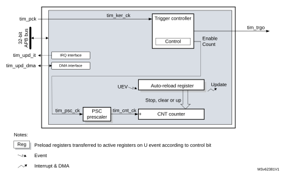

### 32.3.2 TIM6/TIM7 internal signals

The table in this section summarizes the TIM inputs and outputs.

 

<table class="TableTitle"><caption class="TableCap">
Table 320. <a id="signals%1140" name="XREF_43234__Table_431__TIM_internal_input_output_signals%1140">TIM internal input/output signals</a>
</caption><col width="133.85px"/><col width="92.44px"/><col width="312.29px"/><thead><tr height="28.00px"><th>
Internal signal name
</th><th>
Signal type
</th><th>
Description
</th></tr></thead><tr height="22.67px"><td>
tim_pclk
</td><td>
Input
</td><td>
Timer APB clock
</td></tr><tr height="66.67px"><td>
tim_ker_ck
</td><td>
Input
</td><td>
Timer kernel clock. This clock must be synchronous with tim_pclk (derived from the same source). The clock ratio tim_ker_ck/tim_pclk must be an integer: 1, 2, 3,..., 16 (maximum value)
</td></tr><tr height="37.33px"><td>
tim_trgo
</td><td>
Output
</td><td>
Internal trigger output. This trigger can trigger other on-chip peripherals (DAC).
</td></tr><tr height="22.67px"><td>
tim_upd_it
</td><td>
Output
</td><td>
Timer update event interrupt
</td></tr><tr height="22.67px"><td>
tim_upd_dma
</td><td>
Output
</td><td>
Timer update dma request
</td></tr></table>

### 32.3.3 TIM6/TIM7 clocks

The timer bus interface is clocked by the tim\_pclk APB clock.

The counter clock tim\_ker\_ck is connected to the tim\_pclk input.

The CEN (in the TIMx\_CR1 register) and UG bits (in the TIMx\_EGR register) are actual control bits and can be changed only by software (except for UG that remains cleared automatically). As soon as the CEN bit is written to 1, the prescaler is clocked by the internal clock tim\_ker\_ck.

[Figure 508](#XREF_59122__Figure_476__Control_circuit_in_normal_mode%2C_internal_clock_div40) shows the behavior of the control circuit and the upcounter in normal mode, without prescaler.

Figure 508. Control circuit in normal mode, internal clock divided by 1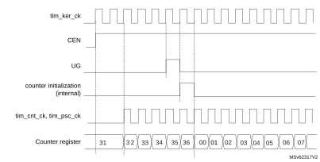

### 32.3.4 Time-base unit

The main block of the programmable timer is a 16-bit upcounter with its related autoreload register. The counter clock can be divided by a prescaler.

The counter, the autoreload register and the prescaler register can be written or read by software. This is true even when the counter is running.

The time-base unit includes:

Counter register (TIMx\_CNT)

Prescaler register (TIMx\_PSC)

Auto-Reload register (TIMx\_ARR).

The autoreload register is preloaded. The preload register is accessed each time an attempt is made to write or read the autoreload register. The contents of the preload register are transferred into the shadow register permanently or at each update event UEV, depending on the autoreload preload enable bit (ARPE) in the TIMx\_CR1 register. The update event is sent when the counter reaches the overflow value and if the UDIS bit equals 0 in the TIMx\_CR1 register. It can also be generated by software. The generation of the update event is described in detail for each configuration.

The counter is clocked by the prescaler output tim\_cnt\_ck, which is enabled only when the counter enable bit (CEN) in the TIMx\_CR1 register is set.

Note that the actual counter enable signal tim\_cnt\_en is set one clock cycle after CEN bit set.

Prescaler description

The prescaler can divide the counter clock frequency by any factor between 1 and 65536. It is based on a 16-bit counter controlled through a 16-bit register (in the TIMx\_PSC register). It can be changed on the fly as the TIMx\_PSC control register is buffered. The new prescaler ratio is taken into account at the next update event.

[Figure 509](#XREF_29624__Figure_142__Counter_timing_diagram_with_prescaler_division_change_from_1_to_240) and [Figure 510](#XREF_13676__Figure_143__Counter_timing_diagram_with_prescaler_division_change_from_1_to_440) give some examples of the counter behavior when the prescaler ratio is changed on the fly.

Figure 509. Counter timing diagram with prescaler division change from 1 to 2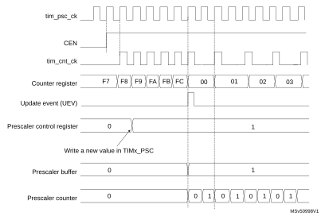

Figure 510. Counter timing diagram with prescaler division change from 1 to 4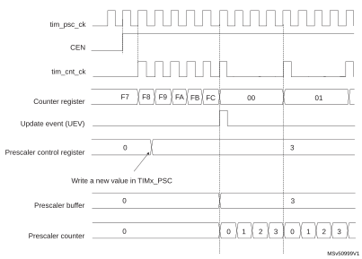

### 32.3.5 Counting mode

The counter counts from 0 to the autoreload value (contents of the TIMx\_ARR register), then restarts from 0 and generates a counter overflow event.

An update event can be generate at each counter overflow or by setting the UG bit in the TIMx\_EGR register (by software or by using the slave mode controller).

The UEV event can be disabled by software by setting the UDIS bit in the TIMx\_CR1 register. This avoids updating the shadow registers while writing new values into the preload registers. In this way, no update event occurs until the UDIS bit has been written to 0, however, the counter and the prescaler counter both restart from 0 (but the prescale rate does not change). In addition, if the URS (update request selection) bit in the TIMx\_CR1 register is set, setting the UG bit generates an update event UEV, but the UIF flag is not set (so no interrupt or DMA request is sent).

When an update event occurs, all the registers are updated and the update flag (UIF bit in the TIMx\_SR register) is set (depending on the URS bit):

The buffer of the prescaler is reloaded with the preload value (contents of the TIMx\_PSC register).

The autoreload shadow register is updated with the preload value (TIMx\_ARR).

The following figures show some examples of the counter behavior for different clock frequencies when TIMx\_ARR = 0x36.

Figure 511. Counter timing diagram, internal clock divided by 1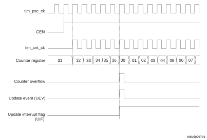

Figure 512. Counter timing diagram, internal clock divided by 2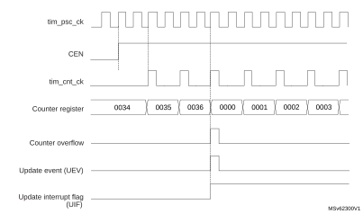

Figure 513. Counter timing diagram, internal clock divided by 4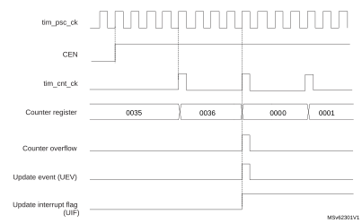

Figure 514. Counter timing diagram, internal clock divided by N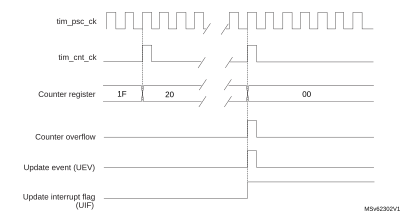

Figure 515. Counter timing diagram, update event when ARPE = 0 (TIMx\_ARR not  
   preloaded)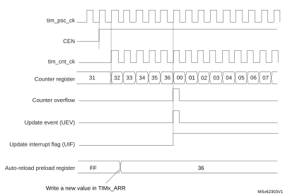

Figure 516. Counter timing diagram, update event when ARPE = 1 (TIMx\_ARR  
   preloaded)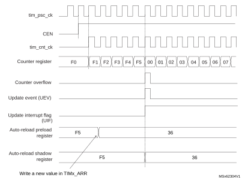

Dithering mode

The time base effective resolution can be increased by enabling the dithering mode, using the DITHEN bit in the TIMx\_CR1 register. This affects the way the TIMx\_ARR is behaving, and is useful for adjusting the average counter period when the timer is used as a trigger (typically for a DAC).

The operating principle is to have the actual ARR value slightly changed (adding or not one timer clock period) over 16 consecutive counting periods, with predefined patterns. This allows a 16-fold resolution increase, considering the average counting period.

[Figure 517](#XREF_76202__Figure_169__Dithering_principle40) presents the dithering principle applied to four consecutive counting periods.

Figure 517. Dithering principle

When the dithering mode is enabled, the register coding is changed as follows (see [Figure 518](#XREF_41612__Figure_170__Data_format_and_register_coding_in_dithering_mode40) for example):

The four LSBs are coding for the enhanced resolution part (fractional part).

The MSBs are left-shifted to the bits 19:4 and are coding for the base value.

**Note:**

The ARR values are updated automatically if the DITHEN bit is set/reset (for instance, if ARR= 0x05 with DITHEN = 0, it is updated to ARR = 0x50 with DITHEN = 1). The following sequence must be followed when resetting the DITHEN bit:

1. CEN and ARPE bits must be reset

2. The ARR[3:0] bits must be reset

3. The DITHEN bit must be reset

4. The CEN bit can be set (eventually with ARPE = 1).

Figure 518. Data format and register coding in dithering mode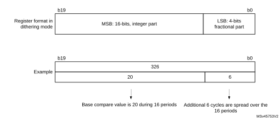

The minimum frequency is given by the following formula:

**Note:**

The maximum TIMx\_ARR value is limited to 0xFFFEF in dithering mode (corresponds to 65534 for the integer part and 15 for the dithered part).

As shown on [Figure 519](#XREF_81490__Figure_171__PWM_resolution_vs_frequency40), the dithering mode is used to increase the PWM resolution whatever the PWM frequency.

Figure 519. FCnt resolution vs frequency

The period changes are spread over 16 consecutive periods, as described in [Figure 520](#XREF_22045__Figure_171__PWM_dithering_pattern40).

Figure 520. PWM dithering pattern

The autoreload and compare values increments are spread following the specific patterns described in [Table 321](#XREF_12462__Table_116__CCR_and_ARR_register_change_dithering_pattern40). The dithering sequence is done to have increments distributed as evenly as possible and minimize the overall ripple.

 

<table class="TableTitle"><caption class="TableCap">
Table 321. <a id="pattern40" name="XREF_12462__Table_116__CCR_and_ARR_register_change_dithering_pattern40">TIMx_ARR register change dithering pattern</a>
</caption><col width="80.39px"/><col width="28.64px"/><col width="28.64px"/><col width="28.64px"/><col width="28.64px"/><col width="28.64px"/><col width="28.64px"/><col width="28.64px"/><col width="28.64px"/><col width="28.64px"/><col width="28.64px"/><col width="28.64px"/><col width="28.64px"/><col width="28.64px"/><col width="28.64px"/><col width="28.64px"/><col width="28.64px"/><thead><tr height="28.00px"><th>
-
</th><th colspan="16">
PWM period
</th></tr><tr height="28.00px"><th>
LSB value
</th><th>
1
</th><th>
2
</th><th>
3
</th><th>
4
</th><th>
5
</th><th>
6
</th><th>
7
</th><th>
8
</th><th>
9
</th><th>
10
</th><th>
11
</th><th>
12
</th><th>
13
</th><th>
14
</th><th>
15
</th><th>
16
</th></tr></thead><tr height="22.67px"><td>
0000
</td><td>
-
</td><td>
-
</td><td>
-
</td><td>
-
</td><td>
-
</td><td>
-
</td><td>
-
</td><td>
-
</td><td>
-
</td><td>
-
</td><td>
-
</td><td>
-
</td><td>
-
</td><td>
-
</td><td>
-
</td><td>
-
</td></tr><tr height="22.67px"><td>
0001
</td><td>
+1
</td><td>
-
</td><td>
-
</td><td>
-
</td><td>
-
</td><td>
-
</td><td>
-
</td><td>
-
</td><td>
-
</td><td>
-
</td><td>
-
</td><td>
-
</td><td>
-
</td><td>
-
</td><td>
-
</td><td>
-
</td></tr><tr height="22.67px"><td>
0010
</td><td>
+1
</td><td>
-
</td><td>
-
</td><td>
-
</td><td>
-
</td><td>
-
</td><td>
-
</td><td>
-
</td><td>
+1
</td><td>
-
</td><td>
-
</td><td>
-
</td><td>
-
</td><td>
-
</td><td>
-
</td><td>
-
</td></tr><tr height="22.67px"><td>
0011
</td><td>
+1
</td><td>
-
</td><td>
-
</td><td>
-
</td><td>
+1
</td><td>
-
</td><td>
-
</td><td>
-
</td><td>
+1
</td><td>
-
</td><td>
-
</td><td>
-
</td><td>
-
</td><td>
-
</td><td>
-
</td><td>
-
</td></tr><tr height="22.67px"><td>
0100
</td><td>
+1
</td><td>
-
</td><td>
-
</td><td>
-
</td><td>
+1
</td><td>
-
</td><td>
-
</td><td>
-
</td><td>
+1
</td><td>
-
</td><td>
-
</td><td>
-
</td><td>
+1
</td><td>
-
</td><td>
-
</td><td>
-
</td></tr><tr height="22.67px"><td>
0101
</td><td>
+1
</td><td>
-
</td><td>
+1
</td><td>
-
</td><td>
+1
</td><td>
-
</td><td>
-
</td><td>
-
</td><td>
+1
</td><td>
-
</td><td>
-
</td><td>
-
</td><td>
+1
</td><td>
-
</td><td>
-
</td><td>
-
</td></tr><tr height="22.67px"><td>
0110
</td><td>
+1
</td><td>
-
</td><td>
+1
</td><td>
-
</td><td>
+1
</td><td>
-
</td><td>
-
</td><td>
-
</td><td>
+1
</td><td>
-
</td><td>
+1
</td><td>
-
</td><td>
+1
</td><td>
-
</td><td>
-
</td><td>
-
</td></tr><tr height="22.67px"><td>
0111
</td><td>
+1
</td><td>
-
</td><td>
+1
</td><td>
-
</td><td>
+1
</td><td>
-
</td><td>
+1
</td><td>
-
</td><td>
+1
</td><td>
-
</td><td>
+1
</td><td>
-
</td><td>
+1
</td><td>
-
</td><td>
-
</td><td>
-
</td></tr><tr height="22.67px"><td>
1000
</td><td>
+1
</td><td>
-
</td><td>
+1
</td><td>
-
</td><td>
+1
</td><td>
-
</td><td>
+1
</td><td>
-
</td><td>
+1
</td><td>
-
</td><td>
+1
</td><td>
-
</td><td>
+1
</td><td>
-
</td><td>
+1
</td><td>
-
</td></tr><tr height="22.67px"><td>
1001
</td><td>
+1
</td><td>
+1
</td><td>
+1
</td><td>
-
</td><td>
+1
</td><td>
-
</td><td>
+1
</td><td>
-
</td><td>
+1
</td><td>
-
</td><td>
+1
</td><td>
-
</td><td>
+1
</td><td>
-
</td><td>
+1
</td><td>
-
</td></tr><tr height="22.67px"><td>
1010
</td><td>
+1
</td><td>
+1
</td><td>
+1
</td><td>
-
</td><td>
+1
</td><td>
-
</td><td>
+1
</td><td>
-
</td><td>
+1
</td><td>
+1
</td><td>
+1
</td><td>
-
</td><td>
+1
</td><td>
-
</td><td>
+1
</td><td>
-
</td></tr><tr height="22.67px"><td>
1011
</td><td>
+1
</td><td>
+1
</td><td>
+1
</td><td>
-
</td><td>
+1
</td><td>
+1
</td><td>
+1
</td><td>
-
</td><td>
+1
</td><td>
+1
</td><td>
+1
</td><td>
-
</td><td>
+1
</td><td>
-
</td><td>
+1
</td><td>
-
</td></tr><tr height="22.67px"><td>
1100
</td><td>
+1
</td><td>
+1
</td><td>
+1
</td><td>
-
</td><td>
+1
</td><td>
+1
</td><td>
+1
</td><td>
-
</td><td>
+1
</td><td>
+1
</td><td>
+1
</td><td>
-
</td><td>
+1
</td><td>
+1
</td><td>
+1
</td><td>
-
</td></tr><tr height="22.67px"><td>
1101
</td><td>
+1
</td><td>
+1
</td><td>
+1
</td><td>
+1
</td><td>
+1
</td><td>
+1
</td><td>
+1
</td><td>
-
</td><td>
+1
</td><td>
+1
</td><td>
+1
</td><td>
-
</td><td>
+1
</td><td>
+1
</td><td>
+1
</td><td>
-
</td></tr><tr height="22.67px"><td>
1110
</td><td>
+1
</td><td>
+1
</td><td>
+1
</td><td>
+1
</td><td>
+1
</td><td>
+1
</td><td>
+1
</td><td>
-
</td><td>
+1
</td><td>
+1
</td><td>
+1
</td><td>
+1
</td><td>
+1
</td><td>
+1
</td><td>
+1
</td><td>
-
</td></tr><tr height="22.67px"><td>
1111
</td><td>
+1
</td><td>
+1
</td><td>
+1
</td><td>
+1
</td><td>
+1
</td><td>
+1
</td><td>
+1
</td><td>
+1
</td><td>
+1
</td><td>
+1
</td><td>
+1
</td><td>
+1
</td><td>
+1
</td><td>
+1
</td><td>
+1
</td><td>
-
</td></tr></table>

### 32.3.6 UIF bit remapping

The IUFREMAP bit in the TIMx\_CR1 register forces a continuous copy of the update interrupt flag UIF into the timer counter register’s bit 31 (TIMxCNT[31]). This is used to atomically read both the counter value and a potential roll-over condition signaled by the UIFCPY flag. In particular cases, it can ease the calculations by avoiding race conditions caused for instance by a processing shared between a background task (counter reading) and an interrupt (update interrupt).

There is no latency between the assertions of the UIF and UIFCPY flags.

### 32.3.7 ADC triggers

The timer can generate an ADC triggering event with various internal signals, such as reset, enable or compare events.

**Note:**

The clock of the slave peripherals (such as timer, ADC) receiving the tim\_trgo signal must be enabled prior to receiving events from the master timer, and the clock frequency (prescaler) must not be changed on-the-fly while triggers are received from the master timer.

### 32.3.8 TIM6/TIM7 DMA requests

The TIM6/TIM7 can generate a single DMA request, as shown in [Table 322](#XREF_61589__Table_643__DMA_request%11%5Bconditional_for_RM0440_only%5D40).

<table class="TableTitle"><caption class="TableTitle">
Table 322. <a id="only%5D40" name="XREF_61589__Table_643__DMA_request%11%5Bconditional_for_RM0440_only%5D40">DMA request</a>
</caption><col width="165.20px"/><col width="104.37px"/><col width="123.86px"/><col width="144.32px"/><thead><tr height="28.00px"><th>
DMA request signal
</th><th>
DMA acronym
</th><th>
DMA request
</th><th>
Enable control bit
</th></tr></thead><tr height="22.67px"><td>
tim_upd_dma
</td><td>
TIM_UP
</td><td>
Update
</td><td>
UDE
</td></tr></table>

### 32.3.9 Debug mode

When the microcontroller enters debug mode (Cortex®-M4 with FPU core halted), the TIMx counter can either continue to work normally or be stopped.

The behavior in debug mode can be programmed with a dedicated configuration bit per timer in the Debug support (DBG) module.

For more details, refer to section Debug support (DBG).

### 32.3.10 TIM6/TIM7 low-power modes

 

<table class="TableTitle"><caption class="TableTitle">
Table 323. <a id="RTC40" name="XREF_78061__Table_69__Effect_of_low_power_modes_on_RTC40">Effect of low-power modes on </a>TIM6/TIM7
</caption><col width="67.45px"/><col width="471.13px"/><thead><tr height="28.00px"><th>
Mode 
</th><th>
Description 
</th></tr></thead><tr height="37.33px"><td>
Sleep
</td><td>
No effect, peripheral is active. The interrupts can cause the device to exit from Sleep mode.
</td></tr><tr height="37.33px"><td>
Stop
</td><td>
The timer operation is stopped and the register content is kept. No interrupt can be generated.
</td></tr><tr height="22.67px"><td>
Standby
</td><td>
The timer is powered-down and must be reinitialized after exiting the Standby mode.
</td></tr></table>

### 32.3.11 TIM6/TIM7 interrupts

The TIM6/TIM7 can generate a single interrupt, as shown in [Table 324](#XREF_80560__Table_294__Interrupt_request%1140).

 

<table class="TableTitle"><caption class="TableTitle">
Table 324. <a id="request%1140" name="XREF_80560__Table_294__Interrupt_request%1140">Interrupt request</a>
</caption><col width="68.25px"/><col width="95.18px"/><col width="67.25px"/><col width="87.80px"/><col width="85.61px"/><col width="67.25px"/><col width="67.25px"/><thead><tr height="72.00px"><th>
Interrupt acronym
</th><th>
Interrupt event
</th><th>
Event flag
</th><th>
Enable  control bit
</th><th>
Interrupt clear method
</th><th>
Exit from Sleep mode
</th><th>
Exit from Stop and Standby mode
</th></tr></thead><tr height="40.00px"><td>
TIM6

TIM7
</td><td>
Update
</td><td>
UIF
</td><td>
UIE
</td><td>
write 0 in UIF
</td><td>
Yes
</td><td>
No
</td></tr></table>

## 32.4 TIM6/TIM7 registers

Refer to [Section 1.2](Documentation_conventions.md#XREF_82797__1_1_List_of_abbreviations_for_registers1) for a list of abbreviations used in register descriptions.

The peripheral registers can be accessed by half-words (16-bit) or words (32-bit).

### 32.4.1 TIMx control register 1 (TIMx\_CR1)(x = 6 to 7)

Address offset: 0x00

Reset value: 0x0000

 

<table class="RegBitMap"><col width="38.39px"/><col width="38.39px"/><col width="38.39px"/><col width="38.39px"/><col width="38.39px"/><col width="38.39px"/><col width="38.39px"/><col width="38.39px"/><col width="38.39px"/><col width="38.39px"/><col width="38.39px"/><col width="38.39px"/><col width="38.39px"/><col width="38.39px"/><col width="38.39px"/><col width="38.39px"/><tr height="17.33px"><td style="border-bottom-width:0;border-bottom-style:hidden;border-bottom-color:0;">
15
</td><td style="border-bottom-width:0;border-bottom-style:hidden;border-bottom-color:0;">
14
</td><td style="border-bottom-width:0;border-bottom-style:hidden;border-bottom-color:0;">
13
</td><td style="border-bottom-width:0;border-bottom-style:hidden;border-bottom-color:0;">
12
</td><td style="border-bottom-width:0;border-bottom-style:hidden;border-bottom-color:0;">
11
</td><td style="border-bottom-width:0;border-bottom-style:hidden;border-bottom-color:0;">
10
</td><td style="border-bottom-width:0;border-bottom-style:hidden;border-bottom-color:0;">
9
</td><td style="border-bottom-width:0;border-bottom-style:hidden;border-bottom-color:0;">
8
</td><td style="border-bottom-width:0;border-bottom-style:hidden;border-bottom-color:0;">
7
</td><td style="border-bottom-width:0;border-bottom-style:hidden;border-bottom-color:0;">
6
</td><td style="border-bottom-width:0;border-bottom-style:hidden;border-bottom-color:0;">
5
</td><td style="border-bottom-width:0;border-bottom-style:hidden;border-bottom-color:0;">
4
</td><td style="border-bottom-width:0;border-bottom-style:hidden;border-bottom-color:0;">
3
</td><td style="border-bottom-width:0;border-bottom-style:hidden;border-bottom-color:0;">
2
</td><td style="border-bottom-width:0;border-bottom-style:hidden;border-bottom-color:0;">
1
</td><td style="border-bottom-width:0;border-bottom-style:hidden;border-bottom-color:0;">
0
</td></tr><tr height="28.00px"><td style="border-left-width:0.5pt;border-left-style:solid;border-left-color:#000000;border-bottom-width:0.5pt;border-bottom-style:solid;border-bottom-color:#000000;border-right-width:0.5pt;border-right-style:solid;border-right-color:#000000;border-top-width:0.5pt;border-top-style:solid;border-top-color:#000000;">
Res.
</td><td style="border-left-width:0.5pt;border-left-style:solid;border-left-color:#000000;border-bottom-width:0.5pt;border-bottom-style:solid;border-bottom-color:#000000;border-right-width:0.5pt;border-right-style:solid;border-right-color:#000000;border-top-width:0.5pt;border-top-style:solid;border-top-color:#000000;">
Res.
</td><td style="border-left-width:0.5pt;border-left-style:solid;border-left-color:#000000;border-bottom-width:0.5pt;border-bottom-style:solid;border-bottom-color:#000000;border-right-width:0.5pt;border-right-style:solid;border-right-color:#000000;border-top-width:0.5pt;border-top-style:solid;border-top-color:#000000;">
Res.
</td><td style="border-left-width:0.5pt;border-left-style:solid;border-left-color:#000000;border-bottom-width:0.5pt;border-bottom-style:solid;border-bottom-color:#000000;border-right-width:0.5pt;border-right-style:solid;border-right-color:#000000;border-top-width:0.5pt;border-top-style:solid;border-top-color:#000000;">
DITH EN
</td><td style="border-left-width:0.5pt;border-left-style:solid;border-left-color:#000000;border-bottom-width:0.5pt;border-bottom-style:solid;border-bottom-color:#000000;border-right-width:0.5pt;border-right-style:solid;border-right-color:#000000;border-top-width:0.5pt;border-top-style:solid;border-top-color:#000000;">
UIFREMAP
</td><td style="border-left-width:0.5pt;border-left-style:solid;border-left-color:#000000;border-bottom-width:0.5pt;border-bottom-style:solid;border-bottom-color:#000000;border-right-width:0.5pt;border-right-style:solid;border-right-color:#000000;border-top-width:0.5pt;border-top-style:solid;border-top-color:#000000;">
Res.
</td><td style="border-left-width:0.5pt;border-left-style:solid;border-left-color:#000000;border-bottom-width:0.5pt;border-bottom-style:solid;border-bottom-color:#000000;border-right-width:0.5pt;border-right-style:solid;border-right-color:#000000;border-top-width:0.5pt;border-top-style:solid;border-top-color:#000000;">
Res.
</td><td style="border-left-width:0.5pt;border-left-style:solid;border-left-color:#000000;border-bottom-width:0.5pt;border-bottom-style:solid;border-bottom-color:#000000;border-right-width:0.5pt;border-right-style:solid;border-right-color:#000000;border-top-width:0.5pt;border-top-style:solid;border-top-color:#000000;">
Res.
</td><td style="border-left-width:0.5pt;border-left-style:solid;border-left-color:#000000;border-bottom-width:0.5pt;border-bottom-style:solid;border-bottom-color:#000000;border-right-width:0.5pt;border-right-style:solid;border-right-color:#000000;border-top-width:0.5pt;border-top-style:solid;border-top-color:#000000;">
ARPE
</td><td style="border-left-width:0.5pt;border-left-style:solid;border-left-color:#000000;border-bottom-width:0.5pt;border-bottom-style:solid;border-bottom-color:#000000;border-right-width:0.5pt;border-right-style:solid;border-right-color:#000000;border-top-width:0.5pt;border-top-style:solid;border-top-color:#000000;">
Res.
</td><td style="border-left-width:0.5pt;border-left-style:solid;border-left-color:#000000;border-bottom-width:0.5pt;border-bottom-style:solid;border-bottom-color:#000000;border-right-width:0.5pt;border-right-style:solid;border-right-color:#000000;border-top-width:0.5pt;border-top-style:solid;border-top-color:#000000;">
Res.
</td><td style="border-left-width:0.5pt;border-left-style:solid;border-left-color:#000000;border-bottom-width:0.5pt;border-bottom-style:solid;border-bottom-color:#000000;border-right-width:0.5pt;border-right-style:solid;border-right-color:#000000;border-top-width:0.5pt;border-top-style:solid;border-top-color:#000000;">
Res.
</td><td style="border-left-width:0.5pt;border-left-style:solid;border-left-color:#000000;border-bottom-width:0.5pt;border-bottom-style:solid;border-bottom-color:#000000;border-right-width:0.5pt;border-right-style:solid;border-right-color:#000000;border-top-width:0.5pt;border-top-style:solid;border-top-color:#000000;">
OPM
</td><td style="border-left-width:0.5pt;border-left-style:solid;border-left-color:#000000;border-bottom-width:0.5pt;border-bottom-style:solid;border-bottom-color:#000000;border-right-width:0.5pt;border-right-style:solid;border-right-color:#000000;border-top-width:0.5pt;border-top-style:solid;border-top-color:#000000;">
URS
</td><td style="border-left-width:0.5pt;border-left-style:solid;border-left-color:#000000;border-bottom-width:0.5pt;border-bottom-style:solid;border-bottom-color:#000000;border-right-width:0.5pt;border-right-style:solid;border-right-color:#000000;border-top-width:0.5pt;border-top-style:solid;border-top-color:#000000;">
UDIS
</td><td style="border-left-width:0.5pt;border-left-style:solid;border-left-color:#000000;border-bottom-width:0.5pt;border-bottom-style:solid;border-bottom-color:#000000;border-right-width:0.5pt;border-right-style:solid;border-right-color:#000000;border-top-width:0.5pt;border-top-style:solid;border-top-color:#000000;">
CEN
</td></tr><tr height="17.33px"><td style="border-left-width:0.5pt;border-left-style:solid;border-left-color:#000000;border-bottom-width:0.5pt;border-bottom-style:solid;border-bottom-color:#000000;border-right-width:0.5pt;border-right-style:solid;border-right-color:#000000;border-top-width:0.5pt;border-top-style:solid;border-top-color:#000000;"></td><td style="border-left-width:0.5pt;border-left-style:solid;border-left-color:#000000;border-bottom-width:0.5pt;border-bottom-style:solid;border-bottom-color:#000000;border-right-width:0.5pt;border-right-style:solid;border-right-color:#000000;border-top-width:0.5pt;border-top-style:solid;border-top-color:#000000;"></td><td style="border-left-width:0.5pt;border-left-style:solid;border-left-color:#000000;border-bottom-width:0.5pt;border-bottom-style:solid;border-bottom-color:#000000;border-right-width:0.5pt;border-right-style:solid;border-right-color:#000000;border-top-width:0.5pt;border-top-style:solid;border-top-color:#000000;"></td><td style="border-left-width:0.5pt;border-left-style:solid;border-left-color:#000000;border-bottom-width:0.5pt;border-bottom-style:solid;border-bottom-color:#000000;border-right-width:0.5pt;border-right-style:solid;border-right-color:#000000;border-top-width:0.5pt;border-top-style:solid;border-top-color:#000000;">
rw
</td><td style="border-left-width:0.5pt;border-left-style:solid;border-left-color:#000000;border-bottom-width:0.5pt;border-bottom-style:solid;border-bottom-color:#000000;border-right-width:0.5pt;border-right-style:solid;border-right-color:#000000;border-top-width:0.5pt;border-top-style:solid;border-top-color:#000000;">
rw
</td><td style="border-left-width:0.5pt;border-left-style:solid;border-left-color:#000000;border-bottom-width:0.5pt;border-bottom-style:solid;border-bottom-color:#000000;border-right-width:0.5pt;border-right-style:solid;border-right-color:#000000;border-top-width:0.5pt;border-top-style:solid;border-top-color:#000000;"></td><td style="border-left-width:0.5pt;border-left-style:solid;border-left-color:#000000;border-bottom-width:0.5pt;border-bottom-style:solid;border-bottom-color:#000000;border-right-width:0.5pt;border-right-style:solid;border-right-color:#000000;border-top-width:0.5pt;border-top-style:solid;border-top-color:#000000;"></td><td style="border-left-width:0.5pt;border-left-style:solid;border-left-color:#000000;border-bottom-width:0.5pt;border-bottom-style:solid;border-bottom-color:#000000;border-right-width:0.5pt;border-right-style:solid;border-right-color:#000000;border-top-width:0.5pt;border-top-style:solid;border-top-color:#000000;"></td><td style="border-left-width:0.5pt;border-left-style:solid;border-left-color:#000000;border-bottom-width:0.5pt;border-bottom-style:solid;border-bottom-color:#000000;border-right-width:0.5pt;border-right-style:solid;border-right-color:#000000;border-top-width:0.5pt;border-top-style:solid;border-top-color:#000000;">
rw
</td><td style="border-left-width:0.5pt;border-left-style:solid;border-left-color:#000000;border-bottom-width:0.5pt;border-bottom-style:solid;border-bottom-color:#000000;border-right-width:0.5pt;border-right-style:solid;border-right-color:#000000;border-top-width:0.5pt;border-top-style:solid;border-top-color:#000000;"></td><td style="border-left-width:0.5pt;border-left-style:solid;border-left-color:#000000;border-bottom-width:0.5pt;border-bottom-style:solid;border-bottom-color:#000000;border-right-width:0.5pt;border-right-style:solid;border-right-color:#000000;border-top-width:0.5pt;border-top-style:solid;border-top-color:#000000;"></td><td style="border-left-width:0.5pt;border-left-style:solid;border-left-color:#000000;border-bottom-width:0.5pt;border-bottom-style:solid;border-bottom-color:#000000;border-right-width:0.5pt;border-right-style:solid;border-right-color:#000000;border-top-width:0.5pt;border-top-style:solid;border-top-color:#000000;"></td><td style="border-left-width:0.5pt;border-left-style:solid;border-left-color:#000000;border-bottom-width:0.5pt;border-bottom-style:solid;border-bottom-color:#000000;border-right-width:0.5pt;border-right-style:solid;border-right-color:#000000;border-top-width:0.5pt;border-top-style:solid;border-top-color:#000000;">
rw
</td><td style="border-left-width:0.5pt;border-left-style:solid;border-left-color:#000000;border-bottom-width:0.5pt;border-bottom-style:solid;border-bottom-color:#000000;border-right-width:0.5pt;border-right-style:solid;border-right-color:#000000;border-top-width:0.5pt;border-top-style:solid;border-top-color:#000000;">
rw
</td><td style="border-left-width:0.5pt;border-left-style:solid;border-left-color:#000000;border-bottom-width:0.5pt;border-bottom-style:solid;border-bottom-color:#000000;border-right-width:0.5pt;border-right-style:solid;border-right-color:#000000;border-top-width:0.5pt;border-top-style:solid;border-top-color:#000000;">
rw
</td><td style="border-left-width:0.5pt;border-left-style:solid;border-left-color:#000000;border-bottom-width:0.5pt;border-bottom-style:solid;border-bottom-color:#000000;border-right-width:0.5pt;border-right-style:solid;border-right-color:#000000;border-top-width:0.5pt;border-top-style:solid;border-top-color:#000000;">
rw
</td></tr></table>

 

<table class="RegBitDef"><col width="114.87px"/><col width="495.58px"/><tr height="22.67px"><td>
Bits 15:13
</td><td>
Reserved, must be kept at reset value.
</td></tr><tr height="73.33px"><td>
Bit 12
</td><td>
DITHEN: Dithering enable

0: Dithering disabled

1: Dithering enabled

Note:​The DITHEN bit can only be modified when CEN bit is reset.
</td></tr><tr height="54.67px"><td>
Bit 11
</td><td>
UIFREMAP: UIF status bit remapping

0: No remapping. UIF status bit is not copied to TIMx_CNT register bit 31. 1: Remapping enabled. UIF status bit is copied to TIMx_CNT register bit 31.
</td></tr><tr height="22.67px"><td>
Bits 10:8
</td><td>
Reserved, must be kept at reset value.
</td></tr><tr height="54.67px"><td>
Bit 7
</td><td>
ARPE: Auto-reload preload enable

0: TIMx_ARR register is not buffered. 1: TIMx_ARR register is buffered.
</td></tr><tr height="22.67px"><td>
Bits 6:4
</td><td>
Reserved, must be kept at reset value.
</td></tr><tr height="54.67px"><td>
Bit 3
</td><td>
OPM: One-pulse mode

0: Counter is not stopped at update event 1: Counter stops counting at the next update event (clearing the CEN bit).
</td></tr><tr height="153.33px"><td>
Bit 2
</td><td>
URS: Update request source

This bit is set and cleared by software to select the UEV event sources.

0: Any of the following events generates an update interrupt or DMA request if enabled. These events can be: 

-​Counter overflow/underflow

-​Setting the UG bit

-​Update generation through the slave mode controller

1: Only counter overflow/underflow generates an update interrupt or DMA request if enabled.
</td></tr><tr height="169.33px"><td>
Bit 1
</td><td>
UDIS: Update disable

This bit is set and cleared by software to enable/disable UEV event generation.

0: UEV enabled. The Update (UEV) event is generated by one of the following events:

-​Counter overflow/underflow

-​Setting the UG bit

-​Update generation through the slave mode controller

Buffered registers are then loaded with their preload values.

1: UEV disabled. The Update event is not generated, shadow registers keep their value (ARR, PSC). However the counter and the prescaler are reinitialized if the UG bit is set or if a hardware reset is received from the slave mode controller.
</td></tr><tr height="70.67px"><td>
Bit 0
</td><td>
CEN: Counter enable

0: Counter disabled 1: Counter enabled

CEN is cleared automatically in one-pulse mode, when an update event occurs.
</td></tr></table>

### 32.4.2 TIMx control register 2 (TIMx\_CR2)(x = 6 to 7)

Address offset: 0x04

Reset value: 0x0000

 

<table class="RegBitMap"><col width="38.39px"/><col width="38.39px"/><col width="38.39px"/><col width="38.39px"/><col width="38.39px"/><col width="38.39px"/><col width="38.39px"/><col width="38.39px"/><col width="38.39px"/><col width="38.39px"/><col width="38.39px"/><col width="38.39px"/><col width="38.39px"/><col width="38.39px"/><col width="38.39px"/><col width="38.39px"/><tr data-conditional="_gpt2bcv4_4,_gpt2bcv4_5" height="17.33px" style="display: none"><td data-conditional="_gpt2bcv4_4,_gpt2bcv4_5" style="border-bottom-width:0;border-bottom-style:hidden;border-bottom-color:0;display: none">
31
</td><td data-conditional="_gpt2bcv4_4,_gpt2bcv4_5" style="border-bottom-width:0;border-bottom-style:hidden;border-bottom-color:0;display: none">
30
</td><td data-conditional="_gpt2bcv4_4,_gpt2bcv4_5" style="border-bottom-width:0;border-bottom-style:hidden;border-bottom-color:0;display: none">
29
</td><td data-conditional="_gpt2bcv4_4,_gpt2bcv4_5" style="border-bottom-width:0;border-bottom-style:hidden;border-bottom-color:0;display: none">
28
</td><td data-conditional="_gpt2bcv4_4,_gpt2bcv4_5" style="border-bottom-width:0;border-bottom-style:hidden;border-bottom-color:0;display: none">
27
</td><td data-conditional="_gpt2bcv4_4,_gpt2bcv4_5" style="border-bottom-width:0;border-bottom-style:hidden;border-bottom-color:0;display: none">
26
</td><td data-conditional="_gpt2bcv4_4,_gpt2bcv4_5" style="border-bottom-width:0;border-bottom-style:hidden;border-bottom-color:0;display: none">
25
</td><td data-conditional="_gpt2bcv4_4,_gpt2bcv4_5" style="border-bottom-width:0;border-bottom-style:hidden;border-bottom-color:0;display: none">
24
</td><td data-conditional="_gpt2bcv4_4,_gpt2bcv4_5" style="border-bottom-width:0;border-bottom-style:hidden;border-bottom-color:0;display: none">
23
</td><td data-conditional="_gpt2bcv4_4,_gpt2bcv4_5" style="border-bottom-width:0;border-bottom-style:hidden;border-bottom-color:0;display: none">
22
</td><td data-conditional="_gpt2bcv4_4,_gpt2bcv4_5" style="border-bottom-width:0;border-bottom-style:hidden;border-bottom-color:0;display: none">
21
</td><td data-conditional="_gpt2bcv4_4,_gpt2bcv4_5" style="border-bottom-width:0;border-bottom-style:hidden;border-bottom-color:0;display: none">
20
</td><td data-conditional="_gpt2bcv4_4,_gpt2bcv4_5" style="border-bottom-width:0;border-bottom-style:hidden;border-bottom-color:0;display: none">
19
</td><td data-conditional="_gpt2bcv4_4,_gpt2bcv4_5" style="border-bottom-width:0;border-bottom-style:hidden;border-bottom-color:0;display: none">
18
</td><td data-conditional="_gpt2bcv4_4,_gpt2bcv4_5" style="border-bottom-width:0;border-bottom-style:hidden;border-bottom-color:0;display: none">
17
</td><td data-conditional="_gpt2bcv4_4,_gpt2bcv4_5" style="border-bottom-width:0;border-bottom-style:hidden;border-bottom-color:0;display: none">
16
</td></tr><tr data-conditional="_gpt2bcv4_4,_gpt2bcv4_5" height="28.00px" style="display: none"><td data-conditional="_gpt2bcv4_4,_gpt2bcv4_5" style="border-left-width:0.5pt;border-left-style:solid;border-left-color:#000000;border-bottom-width:0.5pt;border-bottom-style:solid;border-bottom-color:#000000;border-right-width:0.5pt;border-right-style:solid;border-right-color:#000000;border-top-width:0.5pt;border-top-style:solid;border-top-color:#000000;display: none">
Res.
</td><td data-conditional="_gpt2bcv4_4,_gpt2bcv4_5" style="border-left-width:0.5pt;border-left-style:solid;border-left-color:#000000;border-bottom-width:0.5pt;border-bottom-style:solid;border-bottom-color:#000000;border-right-width:0.5pt;border-right-style:solid;border-right-color:#000000;border-top-width:0.5pt;border-top-style:solid;border-top-color:#000000;display: none">
Res.
</td><td data-conditional="_gpt2bcv4_4,_gpt2bcv4_5" style="border-left-width:0.5pt;border-left-style:solid;border-left-color:#000000;border-bottom-width:0.5pt;border-bottom-style:solid;border-bottom-color:#000000;border-right-width:0.5pt;border-right-style:solid;border-right-color:#000000;border-top-width:0.5pt;border-top-style:solid;border-top-color:#000000;display: none">
Res.
</td><td data-conditional="_gpt2bcv4_4,_gpt2bcv4_5" style="border-left-width:0.5pt;border-left-style:solid;border-left-color:#000000;border-bottom-width:0.5pt;border-bottom-style:solid;border-bottom-color:#000000;border-right-width:0.5pt;border-right-style:solid;border-right-color:#000000;border-top-width:0.5pt;border-top-style:solid;border-top-color:#000000;display: none">
AD SYNC
</td><td data-conditional="_gpt2bcv4_4,_gpt2bcv4_5" style="border-left-width:0.5pt;border-left-style:solid;border-left-color:#000000;border-bottom-width:0.5pt;border-bottom-style:solid;border-bottom-color:#000000;border-right-width:0.5pt;border-right-style:solid;border-right-color:#000000;border-top-width:0.5pt;border-top-style:solid;border-top-color:#000000;display: none">
Res.
</td><td data-conditional="_gpt2bcv4_4,_gpt2bcv4_5" style="border-left-width:0.5pt;border-left-style:solid;border-left-color:#000000;border-bottom-width:0.5pt;border-bottom-style:solid;border-bottom-color:#000000;border-right-width:0.5pt;border-right-style:solid;border-right-color:#000000;border-top-width:0.5pt;border-top-style:solid;border-top-color:#000000;display: none">
Res.
</td><td data-conditional="_gpt2bcv4_4,_gpt2bcv4_5" style="border-left-width:0.5pt;border-left-style:solid;border-left-color:#000000;border-bottom-width:0.5pt;border-bottom-style:solid;border-bottom-color:#000000;border-right-width:0.5pt;border-right-style:solid;border-right-color:#000000;border-top-width:0.5pt;border-top-style:solid;border-top-color:#000000;display: none">
Res.
</td><td data-conditional="_gpt2bcv4_4,_gpt2bcv4_5" style="border-left-width:0.5pt;border-left-style:solid;border-left-color:#000000;border-bottom-width:0.5pt;border-bottom-style:solid;border-bottom-color:#000000;border-right-width:0.5pt;border-right-style:solid;border-right-color:#000000;border-top-width:0.5pt;border-top-style:solid;border-top-color:#000000;display: none">
Res.
</td><td data-conditional="_gpt2bcv4_4,_gpt2bcv4_5" style="border-left-width:0.5pt;border-left-style:solid;border-left-color:#000000;border-bottom-width:0.5pt;border-bottom-style:solid;border-bottom-color:#000000;border-right-width:0.5pt;border-right-style:solid;border-right-color:#000000;border-top-width:0.5pt;border-top-style:solid;border-top-color:#000000;display: none">
Res.
</td><td data-conditional="_gpt2bcv4_4,_gpt2bcv4_5" style="border-left-width:0.5pt;border-left-style:solid;border-left-color:#000000;border-bottom-width:0.5pt;border-bottom-style:solid;border-bottom-color:#000000;border-right-width:0.5pt;border-right-style:solid;border-right-color:#000000;border-top-width:0.5pt;border-top-style:solid;border-top-color:#000000;display: none">
Res.
</td><td data-conditional="_gpt2bcv4_4,_gpt2bcv4_5" style="border-left-width:0.5pt;border-left-style:solid;border-left-color:#000000;border-bottom-width:0.5pt;border-bottom-style:solid;border-bottom-color:#000000;border-right-width:0.5pt;border-right-style:solid;border-right-color:#000000;border-top-width:0.5pt;border-top-style:solid;border-top-color:#000000;display: none">
Res.
</td><td data-conditional="_gpt2bcv4_4,_gpt2bcv4_5" style="border-left-width:0.5pt;border-left-style:solid;border-left-color:#000000;border-bottom-width:0.5pt;border-bottom-style:solid;border-bottom-color:#000000;border-right-width:0.5pt;border-right-style:solid;border-right-color:#000000;border-top-width:0.5pt;border-top-style:solid;border-top-color:#000000;display: none">
Res.
</td><td data-conditional="_gpt2bcv4_4,_gpt2bcv4_5" style="border-left-width:0.5pt;border-left-style:solid;border-left-color:#000000;border-bottom-width:0.5pt;border-bottom-style:solid;border-bottom-color:#000000;border-right-width:0.5pt;border-right-style:solid;border-right-color:#000000;border-top-width:0.5pt;border-top-style:solid;border-top-color:#000000;display: none">
Res.
</td><td data-conditional="_gpt2bcv4_4,_gpt2bcv4_5" style="border-left-width:0.5pt;border-left-style:solid;border-left-color:#000000;border-bottom-width:0.5pt;border-bottom-style:solid;border-bottom-color:#000000;border-right-width:0.5pt;border-right-style:solid;border-right-color:#000000;border-top-width:0.5pt;border-top-style:solid;border-top-color:#000000;display: none">
Res.
</td><td data-conditional="_gpt2bcv4_4,_gpt2bcv4_5" style="border-left-width:0.5pt;border-left-style:solid;border-left-color:#000000;border-bottom-width:0.5pt;border-bottom-style:solid;border-bottom-color:#000000;border-right-width:0.5pt;border-right-style:solid;border-right-color:#000000;border-top-width:0.5pt;border-top-style:solid;border-top-color:#000000;display: none">
Res.
</td><td data-conditional="_gpt2bcv4_4,_gpt2bcv4_5" style="border-left-width:0.5pt;border-left-style:solid;border-left-color:#000000;border-bottom-width:0.5pt;border-bottom-style:solid;border-bottom-color:#000000;border-right-width:0.5pt;border-right-style:solid;border-right-color:#000000;border-top-width:0.5pt;border-top-style:solid;border-top-color:#000000;display: none">
Res.
</td></tr><tr data-conditional="_gpt2bcv4_4,_gpt2bcv4_5" height="17.33px" style="display: none"><td data-conditional="_gpt2bcv4_4,_gpt2bcv4_5" style="border-left-width:0.5pt;border-left-style:solid;border-left-color:#000000;border-bottom-width:0.5pt;border-bottom-style:solid;border-bottom-color:#000000;border-right-width:0.5pt;border-right-style:solid;border-right-color:#000000;border-top-width:0.5pt;border-top-style:solid;border-top-color:#000000;display: none"></td><td data-conditional="_gpt2bcv4_4,_gpt2bcv4_5" style="border-left-width:0.5pt;border-left-style:solid;border-left-color:#000000;border-bottom-width:0.5pt;border-bottom-style:solid;border-bottom-color:#000000;border-right-width:0.5pt;border-right-style:solid;border-right-color:#000000;border-top-width:0.5pt;border-top-style:solid;border-top-color:#000000;display: none"></td><td data-conditional="_gpt2bcv4_4,_gpt2bcv4_5" style="border-left-width:0.5pt;border-left-style:solid;border-left-color:#000000;border-bottom-width:0.5pt;border-bottom-style:solid;border-bottom-color:#000000;border-right-width:0.5pt;border-right-style:solid;border-right-color:#000000;border-top-width:0.5pt;border-top-style:solid;border-top-color:#000000;display: none"></td><td data-conditional="_gpt2bcv4_4,_gpt2bcv4_5" style="border-left-width:0.5pt;border-left-style:solid;border-left-color:#000000;border-bottom-width:0.5pt;border-bottom-style:solid;border-bottom-color:#000000;border-right-width:0.5pt;border-right-style:solid;border-right-color:#000000;border-top-width:0.5pt;border-top-style:solid;border-top-color:#000000;display: none">
rw
</td><td data-conditional="_gpt2bcv4_4,_gpt2bcv4_5" style="border-left-width:0.5pt;border-left-style:solid;border-left-color:#000000;border-bottom-width:0.5pt;border-bottom-style:solid;border-bottom-color:#000000;border-right-width:0.5pt;border-right-style:solid;border-right-color:#000000;border-top-width:0.5pt;border-top-style:solid;border-top-color:#000000;display: none"></td><td data-conditional="_gpt2bcv4_4,_gpt2bcv4_5" style="border-left-width:0.5pt;border-left-style:solid;border-left-color:#000000;border-bottom-width:0.5pt;border-bottom-style:solid;border-bottom-color:#000000;border-right-width:0.5pt;border-right-style:solid;border-right-color:#000000;border-top-width:0.5pt;border-top-style:solid;border-top-color:#000000;display: none"></td><td data-conditional="_gpt2bcv4_4,_gpt2bcv4_5" style="border-left-width:0.5pt;border-left-style:solid;border-left-color:#000000;border-bottom-width:0.5pt;border-bottom-style:solid;border-bottom-color:#000000;border-right-width:0.5pt;border-right-style:solid;border-right-color:#000000;border-top-width:0.5pt;border-top-style:solid;border-top-color:#000000;display: none"></td><td data-conditional="_gpt2bcv4_4,_gpt2bcv4_5" style="border-left-width:0.5pt;border-left-style:solid;border-left-color:#000000;border-bottom-width:0.5pt;border-bottom-style:solid;border-bottom-color:#000000;border-right-width:0.5pt;border-right-style:solid;border-right-color:#000000;border-top-width:0.5pt;border-top-style:solid;border-top-color:#000000;display: none"></td><td data-conditional="_gpt2bcv4_4,_gpt2bcv4_5" style="border-left-width:0.5pt;border-left-style:solid;border-left-color:#000000;border-bottom-width:0.5pt;border-bottom-style:solid;border-bottom-color:#000000;border-right-width:0.5pt;border-right-style:solid;border-right-color:#000000;border-top-width:0.5pt;border-top-style:solid;border-top-color:#000000;display: none"></td><td data-conditional="_gpt2bcv4_4,_gpt2bcv4_5" style="border-left-width:0.5pt;border-left-style:solid;border-left-color:#000000;border-bottom-width:0.5pt;border-bottom-style:solid;border-bottom-color:#000000;border-right-width:0.5pt;border-right-style:solid;border-right-color:#000000;border-top-width:0.5pt;border-top-style:solid;border-top-color:#000000;display: none"></td><td data-conditional="_gpt2bcv4_4,_gpt2bcv4_5" style="border-left-width:0.5pt;border-left-style:solid;border-left-color:#000000;border-bottom-width:0.5pt;border-bottom-style:solid;border-bottom-color:#000000;border-right-width:0.5pt;border-right-style:solid;border-right-color:#000000;border-top-width:0.5pt;border-top-style:solid;border-top-color:#000000;display: none"></td><td data-conditional="_gpt2bcv4_4,_gpt2bcv4_5" style="border-left-width:0.5pt;border-left-style:solid;border-left-color:#000000;border-bottom-width:0.5pt;border-bottom-style:solid;border-bottom-color:#000000;border-right-width:0.5pt;border-right-style:solid;border-right-color:#000000;border-top-width:0.5pt;border-top-style:solid;border-top-color:#000000;display: none"></td><td data-conditional="_gpt2bcv4_4,_gpt2bcv4_5" style="border-left-width:0.5pt;border-left-style:solid;border-left-color:#000000;border-bottom-width:0.5pt;border-bottom-style:solid;border-bottom-color:#000000;border-right-width:0.5pt;border-right-style:solid;border-right-color:#000000;border-top-width:0.5pt;border-top-style:solid;border-top-color:#000000;display: none"></td><td data-conditional="_gpt2bcv4_4,_gpt2bcv4_5" style="border-left-width:0.5pt;border-left-style:solid;border-left-color:#000000;border-bottom-width:0.5pt;border-bottom-style:solid;border-bottom-color:#000000;border-right-width:0.5pt;border-right-style:solid;border-right-color:#000000;border-top-width:0.5pt;border-top-style:solid;border-top-color:#000000;display: none"></td><td data-conditional="_gpt2bcv4_4,_gpt2bcv4_5" style="border-left-width:0.5pt;border-left-style:solid;border-left-color:#000000;border-bottom-width:0.5pt;border-bottom-style:solid;border-bottom-color:#000000;border-right-width:0.5pt;border-right-style:solid;border-right-color:#000000;border-top-width:0.5pt;border-top-style:solid;border-top-color:#000000;display: none"></td><td data-conditional="_gpt2bcv4_4,_gpt2bcv4_5" style="border-left-width:0.5pt;border-left-style:solid;border-left-color:#000000;border-bottom-width:0.5pt;border-bottom-style:solid;border-bottom-color:#000000;border-right-width:0.5pt;border-right-style:solid;border-right-color:#000000;border-top-width:0.5pt;border-top-style:solid;border-top-color:#000000;display: none"></td></tr><tr height="17.33px"><td style="border-bottom-width:0;border-bottom-style:hidden;border-bottom-color:0;">
15
</td><td style="border-bottom-width:0;border-bottom-style:hidden;border-bottom-color:0;">
14
</td><td style="border-bottom-width:0;border-bottom-style:hidden;border-bottom-color:0;">
13
</td><td style="border-bottom-width:0;border-bottom-style:hidden;border-bottom-color:0;">
12
</td><td style="border-bottom-width:0;border-bottom-style:hidden;border-bottom-color:0;">
11
</td><td style="border-bottom-width:0;border-bottom-style:hidden;border-bottom-color:0;">
10
</td><td style="border-bottom-width:0;border-bottom-style:hidden;border-bottom-color:0;">
9
</td><td style="border-bottom-width:0;border-bottom-style:hidden;border-bottom-color:0;">
8
</td><td style="border-bottom-width:0;border-bottom-style:hidden;border-bottom-color:0;">
7
</td><td style="border-bottom-width:0;border-bottom-style:hidden;border-bottom-color:0;">
6
</td><td style="border-bottom-width:0;border-bottom-style:hidden;border-bottom-color:0;">
5
</td><td style="border-bottom-width:0;border-bottom-style:hidden;border-bottom-color:0;">
4
</td><td style="border-bottom-width:0;border-bottom-style:hidden;border-bottom-color:0;">
3
</td><td style="border-bottom-width:0;border-bottom-style:hidden;border-bottom-color:0;">
2
</td><td style="border-bottom-width:0;border-bottom-style:hidden;border-bottom-color:0;">
1
</td><td style="border-bottom-width:0;border-bottom-style:hidden;border-bottom-color:0;">
0
</td></tr><tr height="17.33px"><td style="border-left-width:0.5pt;border-left-style:solid;border-left-color:#000000;border-bottom-width:0.5pt;border-bottom-style:solid;border-bottom-color:#000000;border-right-width:0.5pt;border-right-style:solid;border-right-color:#000000;border-top-width:0.5pt;border-top-style:solid;border-top-color:#000000;">
Res.
</td><td style="border-left-width:0.5pt;border-left-style:solid;border-left-color:#000000;border-bottom-width:0.5pt;border-bottom-style:solid;border-bottom-color:#000000;border-right-width:0.5pt;border-right-style:solid;border-right-color:#000000;border-top-width:0.5pt;border-top-style:solid;border-top-color:#000000;">
Res.
</td><td style="border-left-width:0.5pt;border-left-style:solid;border-left-color:#000000;border-bottom-width:0.5pt;border-bottom-style:solid;border-bottom-color:#000000;border-right-width:0.5pt;border-right-style:solid;border-right-color:#000000;border-top-width:0.5pt;border-top-style:solid;border-top-color:#000000;">
Res.
</td><td style="border-left-width:0.5pt;border-left-style:solid;border-left-color:#000000;border-bottom-width:0.5pt;border-bottom-style:solid;border-bottom-color:#000000;border-right-width:0.5pt;border-right-style:solid;border-right-color:#000000;border-top-width:0.5pt;border-top-style:solid;border-top-color:#000000;">
Res.
</td><td style="border-left-width:0.5pt;border-left-style:solid;border-left-color:#000000;border-bottom-width:0.5pt;border-bottom-style:solid;border-bottom-color:#000000;border-right-width:0.5pt;border-right-style:solid;border-right-color:#000000;border-top-width:0.5pt;border-top-style:solid;border-top-color:#000000;">
Res.
</td><td style="border-left-width:0.5pt;border-left-style:solid;border-left-color:#000000;border-bottom-width:0.5pt;border-bottom-style:solid;border-bottom-color:#000000;border-right-width:0.5pt;border-right-style:solid;border-right-color:#000000;border-top-width:0.5pt;border-top-style:solid;border-top-color:#000000;">
Res.
</td><td style="border-left-width:0.5pt;border-left-style:solid;border-left-color:#000000;border-bottom-width:0.5pt;border-bottom-style:solid;border-bottom-color:#000000;border-right-width:0.5pt;border-right-style:solid;border-right-color:#000000;border-top-width:0.5pt;border-top-style:solid;border-top-color:#000000;">
Res.
</td><td style="border-left-width:0.5pt;border-left-style:solid;border-left-color:#000000;border-bottom-width:0.5pt;border-bottom-style:solid;border-bottom-color:#000000;border-right-width:0.5pt;border-right-style:solid;border-right-color:#000000;border-top-width:0.5pt;border-top-style:solid;border-top-color:#000000;">
Res.
</td><td style="border-left-width:0.5pt;border-left-style:solid;border-left-color:#000000;border-bottom-width:0.5pt;border-bottom-style:solid;border-bottom-color:#000000;border-right-width:0.5pt;border-right-style:solid;border-right-color:#000000;border-top-width:0.5pt;border-top-style:solid;border-top-color:#000000;">
Res.
</td><td colspan="3" style="border-left-width:0.5pt;border-left-style:solid;border-left-color:#000000;border-bottom-width:0.5pt;border-bottom-style:solid;border-bottom-color:#000000;border-right-width:0.5pt;border-right-style:solid;border-right-color:#000000;border-top-width:0.5pt;border-top-style:solid;border-top-color:#000000;">
MMS[2:0]
</td><td style="border-left-width:0.5pt;border-left-style:solid;border-left-color:#000000;border-bottom-width:0.5pt;border-bottom-style:solid;border-bottom-color:#000000;border-right-width:0.5pt;border-right-style:solid;border-right-color:#000000;border-top-width:0.5pt;border-top-style:solid;border-top-color:#000000;">
Res.
</td><td style="border-left-width:0.5pt;border-left-style:solid;border-left-color:#000000;border-bottom-width:0.5pt;border-bottom-style:solid;border-bottom-color:#000000;border-right-width:0.5pt;border-right-style:solid;border-right-color:#000000;border-top-width:0.5pt;border-top-style:solid;border-top-color:#000000;">
Res.
</td><td style="border-left-width:0.5pt;border-left-style:solid;border-left-color:#000000;border-bottom-width:0.5pt;border-bottom-style:solid;border-bottom-color:#000000;border-right-width:0.5pt;border-right-style:solid;border-right-color:#000000;border-top-width:0.5pt;border-top-style:solid;border-top-color:#000000;">
Res.
</td><td style="border-left-width:0.5pt;border-left-style:solid;border-left-color:#000000;border-bottom-width:0.5pt;border-bottom-style:solid;border-bottom-color:#000000;border-right-width:0.5pt;border-right-style:solid;border-right-color:#000000;border-top-width:0.5pt;border-top-style:solid;border-top-color:#000000;">
Res.
</td></tr><tr height="17.33px"><td style="border-left-width:0.5pt;border-left-style:solid;border-left-color:#000000;border-bottom-width:0.5pt;border-bottom-style:solid;border-bottom-color:#000000;border-right-width:0.5pt;border-right-style:solid;border-right-color:#000000;border-top-width:0.5pt;border-top-style:solid;border-top-color:#000000;"></td><td style="border-left-width:0.5pt;border-left-style:solid;border-left-color:#000000;border-bottom-width:0.5pt;border-bottom-style:solid;border-bottom-color:#000000;border-right-width:0.5pt;border-right-style:solid;border-right-color:#000000;border-top-width:0.5pt;border-top-style:solid;border-top-color:#000000;"></td><td style="border-left-width:0.5pt;border-left-style:solid;border-left-color:#000000;border-bottom-width:0.5pt;border-bottom-style:solid;border-bottom-color:#000000;border-right-width:0.5pt;border-right-style:solid;border-right-color:#000000;border-top-width:0.5pt;border-top-style:solid;border-top-color:#000000;"></td><td style="border-left-width:0.5pt;border-left-style:solid;border-left-color:#000000;border-bottom-width:0.5pt;border-bottom-style:solid;border-bottom-color:#000000;border-right-width:0.5pt;border-right-style:solid;border-right-color:#000000;border-top-width:0.5pt;border-top-style:solid;border-top-color:#000000;"></td><td style="border-left-width:0.5pt;border-left-style:solid;border-left-color:#000000;border-bottom-width:0.5pt;border-bottom-style:solid;border-bottom-color:#000000;border-right-width:0.5pt;border-right-style:solid;border-right-color:#000000;border-top-width:0.5pt;border-top-style:solid;border-top-color:#000000;"></td><td style="border-left-width:0.5pt;border-left-style:solid;border-left-color:#000000;border-bottom-width:0.5pt;border-bottom-style:solid;border-bottom-color:#000000;border-right-width:0.5pt;border-right-style:solid;border-right-color:#000000;border-top-width:0.5pt;border-top-style:solid;border-top-color:#000000;"></td><td style="border-left-width:0.5pt;border-left-style:solid;border-left-color:#000000;border-bottom-width:0.5pt;border-bottom-style:solid;border-bottom-color:#000000;border-right-width:0.5pt;border-right-style:solid;border-right-color:#000000;border-top-width:0.5pt;border-top-style:solid;border-top-color:#000000;"></td><td style="border-left-width:0.5pt;border-left-style:solid;border-left-color:#000000;border-bottom-width:0.5pt;border-bottom-style:solid;border-bottom-color:#000000;border-right-width:0.5pt;border-right-style:solid;border-right-color:#000000;border-top-width:0.5pt;border-top-style:solid;border-top-color:#000000;"></td><td style="border-left-width:0.5pt;border-left-style:solid;border-left-color:#000000;border-bottom-width:0.5pt;border-bottom-style:solid;border-bottom-color:#000000;border-right-width:0.5pt;border-right-style:solid;border-right-color:#000000;border-top-width:0.5pt;border-top-style:solid;border-top-color:#000000;"></td><td style="border-left-width:0.5pt;border-left-style:solid;border-left-color:#000000;border-bottom-width:0.5pt;border-bottom-style:solid;border-bottom-color:#000000;border-right-width:0.5pt;border-right-style:solid;border-right-color:#000000;border-top-width:0.5pt;border-top-style:solid;border-top-color:#000000;">
rw
</td><td style="border-left-width:0.5pt;border-left-style:solid;border-left-color:#000000;border-bottom-width:0.5pt;border-bottom-style:solid;border-bottom-color:#000000;border-right-width:0.5pt;border-right-style:solid;border-right-color:#000000;border-top-width:0.5pt;border-top-style:solid;border-top-color:#000000;">
rw
</td><td style="border-left-width:0.5pt;border-left-style:solid;border-left-color:#000000;border-bottom-width:0.5pt;border-bottom-style:solid;border-bottom-color:#000000;border-right-width:0.5pt;border-right-style:solid;border-right-color:#000000;border-top-width:0.5pt;border-top-style:solid;border-top-color:#000000;">
rw
</td><td style="border-left-width:0.5pt;border-left-style:solid;border-left-color:#000000;border-bottom-width:0.5pt;border-bottom-style:solid;border-bottom-color:#000000;border-right-width:0.5pt;border-right-style:solid;border-right-color:#000000;border-top-width:0.5pt;border-top-style:solid;border-top-color:#000000;"></td><td style="border-left-width:0.5pt;border-left-style:solid;border-left-color:#000000;border-bottom-width:0.5pt;border-bottom-style:solid;border-bottom-color:#000000;border-right-width:0.5pt;border-right-style:solid;border-right-color:#000000;border-top-width:0.5pt;border-top-style:solid;border-top-color:#000000;"></td><td style="border-left-width:0.5pt;border-left-style:solid;border-left-color:#000000;border-bottom-width:0.5pt;border-bottom-style:solid;border-bottom-color:#000000;border-right-width:0.5pt;border-right-style:solid;border-right-color:#000000;border-top-width:0.5pt;border-top-style:solid;border-top-color:#000000;"></td><td style="border-left-width:0.5pt;border-left-style:solid;border-left-color:#000000;border-bottom-width:0.5pt;border-bottom-style:solid;border-bottom-color:#000000;border-right-width:0.5pt;border-right-style:solid;border-right-color:#000000;border-top-width:0.5pt;border-top-style:solid;border-top-color:#000000;"></td></tr></table>

 

<table class="RegBitDef"><col width="115.59px"/><col width="495.76px"/><tr data-conditional="_gpt2bcv4_4,_gpt2bcv4_5" height="22.67px" style="display: none"><td data-conditional="_gpt2bcv4_4,_gpt2bcv4_5" style="display: none">
Bits 31:29
</td><td data-conditional="_gpt2bcv4_4,_gpt2bcv4_5" style="display: none">
Reserved, must be kept at reset value.
</td></tr><tr data-conditional="_gpt2bcv4_4,_gpt2bcv4_5" height="101.33px" style="display: none"><td data-conditional="_gpt2bcv4_4,_gpt2bcv4_5" style="display: none">
Bit 28
</td><td data-conditional="_gpt2bcv4_4,_gpt2bcv4_5" style="display: none">
ADSYNC: ADC synchronization

0: The timer operates independently from the ADC

1: The timer operation is synchronized with the ADC clock to provide jitter-free sampling point. This mode can be enabled only with specific ADC / timer clock relationship. Refer to <a href="#XREF_38242__66_3_8_ADC_synchronization" style="font-family : Arial ; font-weight:normal;font-style:Italic;font-size : 9.00pt;font-kerning:normal;font-stretch:normal;color:#0000ff;background-color:transparent;letter-spacing : 0.00em;">Section 32.3.8</a> for requirements.

The ADSYNC must not modified when the counter is enabled (CEN bit is set).
</td></tr><tr height="22.67px"><td>
Bits 15:7
</td><td>
Reserved, must be kept at reset value.
</td></tr><tr height="208.00px"><td>
Bits 6:4
</td><td>
MMS[2:0]: Master mode selection

These bits are used to select the information to be sent in master mode to slave timers for synchronization (TRGO). The combination is as follows:

000:   Reset - the UG bit from the TIMx_EGR register is used as a trigger output (tim_trgo).

001:   Enable - the Counter enable signal, tim_cnt_en, is used as a trigger output (tim_trgo). It is useful to start several timers at the same time or to control a window in which a slave timer is enabled. The Counter Enable signal is generated when the CEN control bit is written.

010:   Update - The update event is selected as a trigger output (tim_trgo). For instance a master timer can then be used as a prescaler for a slave timer.

Note:​The clock of the slave timer or he peripheral receiving the tim_trgo must be enabled prior to receive events from the master timer, and must not be changed on-the-fly while triggers are received from the master timer.
</td></tr><tr height="22.67px"><td>
Bits 3:0
</td><td>
Reserved, must be kept at reset value.
</td></tr></table>

### 32.4.3 TIMx DMA/Interrupt enable register (TIMx\_DIER)(x = 6 to 7)

Address offset: 0x0C

Reset value: 0x0000

 

<table class="RegBitMap"><col width="38.39px"/><col width="38.39px"/><col width="38.39px"/><col width="38.39px"/><col width="38.39px"/><col width="38.39px"/><col width="38.39px"/><col width="38.39px"/><col width="38.39px"/><col width="38.39px"/><col width="38.39px"/><col width="38.39px"/><col width="38.39px"/><col width="38.39px"/><col width="38.39px"/><col width="38.39px"/><tr height="17.33px"><td style="border-bottom-width:0;border-bottom-style:hidden;border-bottom-color:0;">
15
</td><td style="border-bottom-width:0;border-bottom-style:hidden;border-bottom-color:0;">
14
</td><td style="border-bottom-width:0;border-bottom-style:hidden;border-bottom-color:0;">
13
</td><td style="border-bottom-width:0;border-bottom-style:hidden;border-bottom-color:0;">
12
</td><td style="border-bottom-width:0;border-bottom-style:hidden;border-bottom-color:0;">
11
</td><td style="border-bottom-width:0;border-bottom-style:hidden;border-bottom-color:0;">
10
</td><td style="border-bottom-width:0;border-bottom-style:hidden;border-bottom-color:0;">
9
</td><td style="border-bottom-width:0;border-bottom-style:hidden;border-bottom-color:0;">
8
</td><td style="border-bottom-width:0;border-bottom-style:hidden;border-bottom-color:0;">
7
</td><td style="border-bottom-width:0;border-bottom-style:hidden;border-bottom-color:0;">
6
</td><td style="border-bottom-width:0;border-bottom-style:hidden;border-bottom-color:0;">
5
</td><td style="border-bottom-width:0;border-bottom-style:hidden;border-bottom-color:0;">
4
</td><td style="border-bottom-width:0;border-bottom-style:hidden;border-bottom-color:0;">
3
</td><td style="border-bottom-width:0;border-bottom-style:hidden;border-bottom-color:0;">
2
</td><td style="border-bottom-width:0;border-bottom-style:hidden;border-bottom-color:0;">
1
</td><td style="border-bottom-width:0;border-bottom-style:hidden;border-bottom-color:0;">
0
</td></tr><tr height="17.33px"><td style="border-left-width:0.5pt;border-left-style:solid;border-left-color:#000000;border-bottom-width:0.5pt;border-bottom-style:solid;border-bottom-color:#000000;border-right-width:0.5pt;border-right-style:solid;border-right-color:#000000;border-top-width:0.5pt;border-top-style:solid;border-top-color:#000000;">
Res.
</td><td style="border-left-width:0.5pt;border-left-style:solid;border-left-color:#000000;border-bottom-width:0.5pt;border-bottom-style:solid;border-bottom-color:#000000;border-right-width:0.5pt;border-right-style:solid;border-right-color:#000000;border-top-width:0.5pt;border-top-style:solid;border-top-color:#000000;">
Res.
</td><td style="border-left-width:0.5pt;border-left-style:solid;border-left-color:#000000;border-bottom-width:0.5pt;border-bottom-style:solid;border-bottom-color:#000000;border-right-width:0.5pt;border-right-style:solid;border-right-color:#000000;border-top-width:0.5pt;border-top-style:solid;border-top-color:#000000;">
Res.
</td><td style="border-left-width:0.5pt;border-left-style:solid;border-left-color:#000000;border-bottom-width:0.5pt;border-bottom-style:solid;border-bottom-color:#000000;border-right-width:0.5pt;border-right-style:solid;border-right-color:#000000;border-top-width:0.5pt;border-top-style:solid;border-top-color:#000000;">
Res.
</td><td style="border-left-width:0.5pt;border-left-style:solid;border-left-color:#000000;border-bottom-width:0.5pt;border-bottom-style:solid;border-bottom-color:#000000;border-right-width:0.5pt;border-right-style:solid;border-right-color:#000000;border-top-width:0.5pt;border-top-style:solid;border-top-color:#000000;">
Res.
</td><td style="border-left-width:0.5pt;border-left-style:solid;border-left-color:#000000;border-bottom-width:0.5pt;border-bottom-style:solid;border-bottom-color:#000000;border-right-width:0.5pt;border-right-style:solid;border-right-color:#000000;border-top-width:0.5pt;border-top-style:solid;border-top-color:#000000;">
Res.
</td><td style="border-left-width:0.5pt;border-left-style:solid;border-left-color:#000000;border-bottom-width:0.5pt;border-bottom-style:solid;border-bottom-color:#000000;border-right-width:0.5pt;border-right-style:solid;border-right-color:#000000;border-top-width:0.5pt;border-top-style:solid;border-top-color:#000000;">
Res.
</td><td style="border-left-width:0.5pt;border-left-style:solid;border-left-color:#000000;border-bottom-width:0.5pt;border-bottom-style:solid;border-bottom-color:#000000;border-right-width:0.5pt;border-right-style:solid;border-right-color:#000000;border-top-width:0.5pt;border-top-style:solid;border-top-color:#000000;">
UDE
</td><td style="border-left-width:0.5pt;border-left-style:solid;border-left-color:#000000;border-bottom-width:0.5pt;border-bottom-style:solid;border-bottom-color:#000000;border-right-width:0.5pt;border-right-style:solid;border-right-color:#000000;border-top-width:0.5pt;border-top-style:solid;border-top-color:#000000;">
Res.
</td><td style="border-left-width:0.5pt;border-left-style:solid;border-left-color:#000000;border-bottom-width:0.5pt;border-bottom-style:solid;border-bottom-color:#000000;border-right-width:0.5pt;border-right-style:solid;border-right-color:#000000;border-top-width:0.5pt;border-top-style:solid;border-top-color:#000000;">
Res.
</td><td style="border-left-width:0.5pt;border-left-style:solid;border-left-color:#000000;border-bottom-width:0.5pt;border-bottom-style:solid;border-bottom-color:#000000;border-right-width:0.5pt;border-right-style:solid;border-right-color:#000000;border-top-width:0.5pt;border-top-style:solid;border-top-color:#000000;">
Res.
</td><td style="border-left-width:0.5pt;border-left-style:solid;border-left-color:#000000;border-bottom-width:0.5pt;border-bottom-style:solid;border-bottom-color:#000000;border-right-width:0.5pt;border-right-style:solid;border-right-color:#000000;border-top-width:0.5pt;border-top-style:solid;border-top-color:#000000;">
Res.
</td><td style="border-left-width:0.5pt;border-left-style:solid;border-left-color:#000000;border-bottom-width:0.5pt;border-bottom-style:solid;border-bottom-color:#000000;border-right-width:0.5pt;border-right-style:solid;border-right-color:#000000;border-top-width:0.5pt;border-top-style:solid;border-top-color:#000000;">
Res.
</td><td style="border-left-width:0.5pt;border-left-style:solid;border-left-color:#000000;border-bottom-width:0.5pt;border-bottom-style:solid;border-bottom-color:#000000;border-right-width:0.5pt;border-right-style:solid;border-right-color:#000000;border-top-width:0.5pt;border-top-style:solid;border-top-color:#000000;">
Res.
</td><td style="border-left-width:0.5pt;border-left-style:solid;border-left-color:#000000;border-bottom-width:0.5pt;border-bottom-style:solid;border-bottom-color:#000000;border-right-width:0.5pt;border-right-style:solid;border-right-color:#000000;border-top-width:0.5pt;border-top-style:solid;border-top-color:#000000;">
Res.
</td><td style="border-left-width:0.5pt;border-left-style:solid;border-left-color:#000000;border-bottom-width:0.5pt;border-bottom-style:solid;border-bottom-color:#000000;border-right-width:0.5pt;border-right-style:solid;border-right-color:#000000;border-top-width:0.5pt;border-top-style:solid;border-top-color:#000000;">
UIE
</td></tr><tr height="17.33px"><td style="border-left-width:0.5pt;border-left-style:solid;border-left-color:#000000;border-bottom-width:0.5pt;border-bottom-style:solid;border-bottom-color:#000000;border-right-width:0.5pt;border-right-style:solid;border-right-color:#000000;border-top-width:0.5pt;border-top-style:solid;border-top-color:#000000;"></td><td style="border-left-width:0.5pt;border-left-style:solid;border-left-color:#000000;border-bottom-width:0.5pt;border-bottom-style:solid;border-bottom-color:#000000;border-right-width:0.5pt;border-right-style:solid;border-right-color:#000000;border-top-width:0.5pt;border-top-style:solid;border-top-color:#000000;"></td><td style="border-left-width:0.5pt;border-left-style:solid;border-left-color:#000000;border-bottom-width:0.5pt;border-bottom-style:solid;border-bottom-color:#000000;border-right-width:0.5pt;border-right-style:solid;border-right-color:#000000;border-top-width:0.5pt;border-top-style:solid;border-top-color:#000000;"></td><td style="border-left-width:0.5pt;border-left-style:solid;border-left-color:#000000;border-bottom-width:0.5pt;border-bottom-style:solid;border-bottom-color:#000000;border-right-width:0.5pt;border-right-style:solid;border-right-color:#000000;border-top-width:0.5pt;border-top-style:solid;border-top-color:#000000;"></td><td style="border-left-width:0.5pt;border-left-style:solid;border-left-color:#000000;border-bottom-width:0.5pt;border-bottom-style:solid;border-bottom-color:#000000;border-right-width:0.5pt;border-right-style:solid;border-right-color:#000000;border-top-width:0.5pt;border-top-style:solid;border-top-color:#000000;"></td><td style="border-left-width:0.5pt;border-left-style:solid;border-left-color:#000000;border-bottom-width:0.5pt;border-bottom-style:solid;border-bottom-color:#000000;border-right-width:0.5pt;border-right-style:solid;border-right-color:#000000;border-top-width:0.5pt;border-top-style:solid;border-top-color:#000000;"></td><td style="border-left-width:0.5pt;border-left-style:solid;border-left-color:#000000;border-bottom-width:0.5pt;border-bottom-style:solid;border-bottom-color:#000000;border-right-width:0.5pt;border-right-style:solid;border-right-color:#000000;border-top-width:0.5pt;border-top-style:solid;border-top-color:#000000;"></td><td style="border-left-width:0.5pt;border-left-style:solid;border-left-color:#000000;border-bottom-width:0.5pt;border-bottom-style:solid;border-bottom-color:#000000;border-right-width:0.5pt;border-right-style:solid;border-right-color:#000000;border-top-width:0.5pt;border-top-style:solid;border-top-color:#000000;">
rw
</td><td style="border-left-width:0.5pt;border-left-style:solid;border-left-color:#000000;border-bottom-width:0.5pt;border-bottom-style:solid;border-bottom-color:#000000;border-right-width:0.5pt;border-right-style:solid;border-right-color:#000000;border-top-width:0.5pt;border-top-style:solid;border-top-color:#000000;"></td><td style="border-left-width:0.5pt;border-left-style:solid;border-left-color:#000000;border-bottom-width:0.5pt;border-bottom-style:solid;border-bottom-color:#000000;border-right-width:0.5pt;border-right-style:solid;border-right-color:#000000;border-top-width:0.5pt;border-top-style:solid;border-top-color:#000000;"></td><td style="border-left-width:0.5pt;border-left-style:solid;border-left-color:#000000;border-bottom-width:0.5pt;border-bottom-style:solid;border-bottom-color:#000000;border-right-width:0.5pt;border-right-style:solid;border-right-color:#000000;border-top-width:0.5pt;border-top-style:solid;border-top-color:#000000;"></td><td style="border-left-width:0.5pt;border-left-style:solid;border-left-color:#000000;border-bottom-width:0.5pt;border-bottom-style:solid;border-bottom-color:#000000;border-right-width:0.5pt;border-right-style:solid;border-right-color:#000000;border-top-width:0.5pt;border-top-style:solid;border-top-color:#000000;"></td><td style="border-left-width:0.5pt;border-left-style:solid;border-left-color:#000000;border-bottom-width:0.5pt;border-bottom-style:solid;border-bottom-color:#000000;border-right-width:0.5pt;border-right-style:solid;border-right-color:#000000;border-top-width:0.5pt;border-top-style:solid;border-top-color:#000000;"></td><td style="border-left-width:0.5pt;border-left-style:solid;border-left-color:#000000;border-bottom-width:0.5pt;border-bottom-style:solid;border-bottom-color:#000000;border-right-width:0.5pt;border-right-style:solid;border-right-color:#000000;border-top-width:0.5pt;border-top-style:solid;border-top-color:#000000;"></td><td style="border-left-width:0.5pt;border-left-style:solid;border-left-color:#000000;border-bottom-width:0.5pt;border-bottom-style:solid;border-bottom-color:#000000;border-right-width:0.5pt;border-right-style:solid;border-right-color:#000000;border-top-width:0.5pt;border-top-style:solid;border-top-color:#000000;"></td><td style="border-left-width:0.5pt;border-left-style:solid;border-left-color:#000000;border-bottom-width:0.5pt;border-bottom-style:solid;border-bottom-color:#000000;border-right-width:0.5pt;border-right-style:solid;border-right-color:#000000;border-top-width:0.5pt;border-top-style:solid;border-top-color:#000000;">
rw
</td></tr></table>

 

<table class="RegBitDef"><col width="113.77px"/><col width="497.49px"/><tr height="22.67px"><td>
Bits 15:9
</td><td>
Reserved, must be kept at reset value.
</td></tr><tr height="54.67px"><td>
Bit 8
</td><td>
UDE: Update DMA request enable

0: Update DMA request disabled. 1: Update DMA request enabled.
</td></tr><tr height="22.67px"><td>
Bits 7:1
</td><td>
Reserved, must be kept at reset value.
</td></tr><tr height="54.67px"><td>
Bit 0
</td><td>
UIE: Update interrupt enable

0: Update interrupt disabled. 1: Update interrupt enabled.
</td></tr></table>

### 32.4.4 TIMx status register (TIMx\_SR)(x = 6 to 7)

Address offset: 0x10

Reset value: 0x0000

 

<table class="RegBitMap"><col width="38.39px"/><col width="38.39px"/><col width="38.39px"/><col width="38.39px"/><col width="38.39px"/><col width="38.39px"/><col width="38.39px"/><col width="38.39px"/><col width="38.39px"/><col width="38.39px"/><col width="38.39px"/><col width="38.39px"/><col width="38.39px"/><col width="38.39px"/><col width="38.39px"/><col width="38.39px"/><tr height="17.33px"><td style="border-bottom-width:0;border-bottom-style:hidden;border-bottom-color:0;">
15
</td><td style="border-bottom-width:0;border-bottom-style:hidden;border-bottom-color:0;">
14
</td><td style="border-bottom-width:0;border-bottom-style:hidden;border-bottom-color:0;">
13
</td><td style="border-bottom-width:0;border-bottom-style:hidden;border-bottom-color:0;">
12
</td><td style="border-bottom-width:0;border-bottom-style:hidden;border-bottom-color:0;">
11
</td><td style="border-bottom-width:0;border-bottom-style:hidden;border-bottom-color:0;">
10
</td><td style="border-bottom-width:0;border-bottom-style:hidden;border-bottom-color:0;">
9
</td><td style="border-bottom-width:0;border-bottom-style:hidden;border-bottom-color:0;">
8
</td><td style="border-bottom-width:0;border-bottom-style:hidden;border-bottom-color:0;">
7
</td><td style="border-bottom-width:0;border-bottom-style:hidden;border-bottom-color:0;">
6
</td><td style="border-bottom-width:0;border-bottom-style:hidden;border-bottom-color:0;">
5
</td><td style="border-bottom-width:0;border-bottom-style:hidden;border-bottom-color:0;">
4
</td><td style="border-bottom-width:0;border-bottom-style:hidden;border-bottom-color:0;">
3
</td><td style="border-bottom-width:0;border-bottom-style:hidden;border-bottom-color:0;">
2
</td><td style="border-bottom-width:0;border-bottom-style:hidden;border-bottom-color:0;">
1
</td><td style="border-bottom-width:0;border-bottom-style:hidden;border-bottom-color:0;">
0
</td></tr><tr height="17.33px"><td style="border-left-width:0.5pt;border-left-style:solid;border-left-color:#000000;border-bottom-width:0.5pt;border-bottom-style:solid;border-bottom-color:#000000;border-right-width:0.5pt;border-right-style:solid;border-right-color:#000000;border-top-width:0.5pt;border-top-style:solid;border-top-color:#000000;">
Res.
</td><td style="border-left-width:0.5pt;border-left-style:solid;border-left-color:#000000;border-bottom-width:0.5pt;border-bottom-style:solid;border-bottom-color:#000000;border-right-width:0.5pt;border-right-style:solid;border-right-color:#000000;border-top-width:0.5pt;border-top-style:solid;border-top-color:#000000;">
Res.
</td><td style="border-left-width:0.5pt;border-left-style:solid;border-left-color:#000000;border-bottom-width:0.5pt;border-bottom-style:solid;border-bottom-color:#000000;border-right-width:0.5pt;border-right-style:solid;border-right-color:#000000;border-top-width:0.5pt;border-top-style:solid;border-top-color:#000000;">
Res.
</td><td style="border-left-width:0.5pt;border-left-style:solid;border-left-color:#000000;border-bottom-width:0.5pt;border-bottom-style:solid;border-bottom-color:#000000;border-right-width:0.5pt;border-right-style:solid;border-right-color:#000000;border-top-width:0.5pt;border-top-style:solid;border-top-color:#000000;">
Res.
</td><td style="border-left-width:0.5pt;border-left-style:solid;border-left-color:#000000;border-bottom-width:0.5pt;border-bottom-style:solid;border-bottom-color:#000000;border-right-width:0.5pt;border-right-style:solid;border-right-color:#000000;border-top-width:0.5pt;border-top-style:solid;border-top-color:#000000;">
Res.
</td><td style="border-left-width:0.5pt;border-left-style:solid;border-left-color:#000000;border-bottom-width:0.5pt;border-bottom-style:solid;border-bottom-color:#000000;border-right-width:0.5pt;border-right-style:solid;border-right-color:#000000;border-top-width:0.5pt;border-top-style:solid;border-top-color:#000000;">
Res.
</td><td style="border-left-width:0.5pt;border-left-style:solid;border-left-color:#000000;border-bottom-width:0.5pt;border-bottom-style:solid;border-bottom-color:#000000;border-right-width:0.5pt;border-right-style:solid;border-right-color:#000000;border-top-width:0.5pt;border-top-style:solid;border-top-color:#000000;">
Res.
</td><td style="border-left-width:0.5pt;border-left-style:solid;border-left-color:#000000;border-bottom-width:0.5pt;border-bottom-style:solid;border-bottom-color:#000000;border-right-width:0.5pt;border-right-style:solid;border-right-color:#000000;border-top-width:0.5pt;border-top-style:solid;border-top-color:#000000;">
Res.
</td><td style="border-left-width:0.5pt;border-left-style:solid;border-left-color:#000000;border-bottom-width:0.5pt;border-bottom-style:solid;border-bottom-color:#000000;border-right-width:0.5pt;border-right-style:solid;border-right-color:#000000;border-top-width:0.5pt;border-top-style:solid;border-top-color:#000000;">
Res.
</td><td style="border-left-width:0.5pt;border-left-style:solid;border-left-color:#000000;border-bottom-width:0.5pt;border-bottom-style:solid;border-bottom-color:#000000;border-right-width:0.5pt;border-right-style:solid;border-right-color:#000000;border-top-width:0.5pt;border-top-style:solid;border-top-color:#000000;">
Res.
</td><td style="border-left-width:0.5pt;border-left-style:solid;border-left-color:#000000;border-bottom-width:0.5pt;border-bottom-style:solid;border-bottom-color:#000000;border-right-width:0.5pt;border-right-style:solid;border-right-color:#000000;border-top-width:0.5pt;border-top-style:solid;border-top-color:#000000;">
Res.
</td><td style="border-left-width:0.5pt;border-left-style:solid;border-left-color:#000000;border-bottom-width:0.5pt;border-bottom-style:solid;border-bottom-color:#000000;border-right-width:0.5pt;border-right-style:solid;border-right-color:#000000;border-top-width:0.5pt;border-top-style:solid;border-top-color:#000000;">
Res.
</td><td style="border-left-width:0.5pt;border-left-style:solid;border-left-color:#000000;border-bottom-width:0.5pt;border-bottom-style:solid;border-bottom-color:#000000;border-right-width:0.5pt;border-right-style:solid;border-right-color:#000000;border-top-width:0.5pt;border-top-style:solid;border-top-color:#000000;">
Res.
</td><td style="border-left-width:0.5pt;border-left-style:solid;border-left-color:#000000;border-bottom-width:0.5pt;border-bottom-style:solid;border-bottom-color:#000000;border-right-width:0.5pt;border-right-style:solid;border-right-color:#000000;border-top-width:0.5pt;border-top-style:solid;border-top-color:#000000;">
Res.
</td><td style="border-left-width:0.5pt;border-left-style:solid;border-left-color:#000000;border-bottom-width:0.5pt;border-bottom-style:solid;border-bottom-color:#000000;border-right-width:0.5pt;border-right-style:solid;border-right-color:#000000;border-top-width:0.5pt;border-top-style:solid;border-top-color:#000000;">
Res.
</td><td style="border-left-width:0.5pt;border-left-style:solid;border-left-color:#000000;border-bottom-width:0.5pt;border-bottom-style:solid;border-bottom-color:#000000;border-right-width:0.5pt;border-right-style:solid;border-right-color:#000000;border-top-width:0.5pt;border-top-style:solid;border-top-color:#000000;">
UIF
</td></tr><tr height="17.33px"><td style="border-left-width:0.5pt;border-left-style:solid;border-left-color:#000000;border-bottom-width:0.5pt;border-bottom-style:solid;border-bottom-color:#000000;border-right-width:0.5pt;border-right-style:solid;border-right-color:#000000;border-top-width:0.5pt;border-top-style:solid;border-top-color:#000000;"></td><td style="border-left-width:0.5pt;border-left-style:solid;border-left-color:#000000;border-bottom-width:0.5pt;border-bottom-style:solid;border-bottom-color:#000000;border-right-width:0.5pt;border-right-style:solid;border-right-color:#000000;border-top-width:0.5pt;border-top-style:solid;border-top-color:#000000;"></td><td style="border-left-width:0.5pt;border-left-style:solid;border-left-color:#000000;border-bottom-width:0.5pt;border-bottom-style:solid;border-bottom-color:#000000;border-right-width:0.5pt;border-right-style:solid;border-right-color:#000000;border-top-width:0.5pt;border-top-style:solid;border-top-color:#000000;"></td><td style="border-left-width:0.5pt;border-left-style:solid;border-left-color:#000000;border-bottom-width:0.5pt;border-bottom-style:solid;border-bottom-color:#000000;border-right-width:0.5pt;border-right-style:solid;border-right-color:#000000;border-top-width:0.5pt;border-top-style:solid;border-top-color:#000000;"></td><td style="border-left-width:0.5pt;border-left-style:solid;border-left-color:#000000;border-bottom-width:0.5pt;border-bottom-style:solid;border-bottom-color:#000000;border-right-width:0.5pt;border-right-style:solid;border-right-color:#000000;border-top-width:0.5pt;border-top-style:solid;border-top-color:#000000;"></td><td style="border-left-width:0.5pt;border-left-style:solid;border-left-color:#000000;border-bottom-width:0.5pt;border-bottom-style:solid;border-bottom-color:#000000;border-right-width:0.5pt;border-right-style:solid;border-right-color:#000000;border-top-width:0.5pt;border-top-style:solid;border-top-color:#000000;"></td><td style="border-left-width:0.5pt;border-left-style:solid;border-left-color:#000000;border-bottom-width:0.5pt;border-bottom-style:solid;border-bottom-color:#000000;border-right-width:0.5pt;border-right-style:solid;border-right-color:#000000;border-top-width:0.5pt;border-top-style:solid;border-top-color:#000000;"></td><td style="border-left-width:0.5pt;border-left-style:solid;border-left-color:#000000;border-bottom-width:0.5pt;border-bottom-style:solid;border-bottom-color:#000000;border-right-width:0.5pt;border-right-style:solid;border-right-color:#000000;border-top-width:0.5pt;border-top-style:solid;border-top-color:#000000;"></td><td style="border-left-width:0.5pt;border-left-style:solid;border-left-color:#000000;border-bottom-width:0.5pt;border-bottom-style:solid;border-bottom-color:#000000;border-right-width:0.5pt;border-right-style:solid;border-right-color:#000000;border-top-width:0.5pt;border-top-style:solid;border-top-color:#000000;"></td><td style="border-left-width:0.5pt;border-left-style:solid;border-left-color:#000000;border-bottom-width:0.5pt;border-bottom-style:solid;border-bottom-color:#000000;border-right-width:0.5pt;border-right-style:solid;border-right-color:#000000;border-top-width:0.5pt;border-top-style:solid;border-top-color:#000000;"></td><td style="border-left-width:0.5pt;border-left-style:solid;border-left-color:#000000;border-bottom-width:0.5pt;border-bottom-style:solid;border-bottom-color:#000000;border-right-width:0.5pt;border-right-style:solid;border-right-color:#000000;border-top-width:0.5pt;border-top-style:solid;border-top-color:#000000;"></td><td style="border-left-width:0.5pt;border-left-style:solid;border-left-color:#000000;border-bottom-width:0.5pt;border-bottom-style:solid;border-bottom-color:#000000;border-right-width:0.5pt;border-right-style:solid;border-right-color:#000000;border-top-width:0.5pt;border-top-style:solid;border-top-color:#000000;"></td><td style="border-left-width:0.5pt;border-left-style:solid;border-left-color:#000000;border-bottom-width:0.5pt;border-bottom-style:solid;border-bottom-color:#000000;border-right-width:0.5pt;border-right-style:solid;border-right-color:#000000;border-top-width:0.5pt;border-top-style:solid;border-top-color:#000000;"></td><td style="border-left-width:0.5pt;border-left-style:solid;border-left-color:#000000;border-bottom-width:0.5pt;border-bottom-style:solid;border-bottom-color:#000000;border-right-width:0.5pt;border-right-style:solid;border-right-color:#000000;border-top-width:0.5pt;border-top-style:solid;border-top-color:#000000;"></td><td style="border-left-width:0.5pt;border-left-style:solid;border-left-color:#000000;border-bottom-width:0.5pt;border-bottom-style:solid;border-bottom-color:#000000;border-right-width:0.5pt;border-right-style:solid;border-right-color:#000000;border-top-width:0.5pt;border-top-style:solid;border-top-color:#000000;"></td><td style="border-left-width:0.5pt;border-left-style:solid;border-left-color:#000000;border-bottom-width:0.5pt;border-bottom-style:solid;border-bottom-color:#000000;border-right-width:0.5pt;border-right-style:solid;border-right-color:#000000;border-top-width:0.5pt;border-top-style:solid;border-top-color:#000000;">
rc_w0
</td></tr></table>

 

<table class="RegBitDef"><col width="115.14px"/><col width="496.21px"/><tr height="22.67px"><td>
Bits 15:1
</td><td>
Reserved, must be kept at reset value.
</td></tr><tr height="120.00px"><td>
Bit 0
</td><td>
UIF: Update interrupt flag

This bit is set by hardware on an update event. It is cleared by software.

0: No update occurred. 1: Update interrupt pending. This bit is set by hardware when the registers are updated:

–On counter overflow if UDIS = 0 in the TIMx_CR1 register.

–When CNT is reinitialized by software using the UG bit in the TIMx_EGR register, if URS = 0 and UDIS = 0 in the TIMx_CR1 register.
</td></tr></table>

### 32.4.5 TIMx event generation register (TIMx\_EGR)(x = 6 to 7)

Address offset: 0x14

Reset value: 0x0000

 

<table class="RegBitMap"><col width="38.39px"/><col width="38.39px"/><col width="38.39px"/><col width="38.39px"/><col width="38.39px"/><col width="38.39px"/><col width="38.39px"/><col width="38.39px"/><col width="38.39px"/><col width="38.39px"/><col width="38.39px"/><col width="38.39px"/><col width="38.39px"/><col width="38.39px"/><col width="38.39px"/><col width="38.39px"/><tr height="17.33px"><td style="border-bottom-width:0;border-bottom-style:hidden;border-bottom-color:0;">
15
</td><td style="border-bottom-width:0;border-bottom-style:hidden;border-bottom-color:0;">
14
</td><td style="border-bottom-width:0;border-bottom-style:hidden;border-bottom-color:0;">
13
</td><td style="border-bottom-width:0;border-bottom-style:hidden;border-bottom-color:0;">
12
</td><td style="border-bottom-width:0;border-bottom-style:hidden;border-bottom-color:0;">
11
</td><td style="border-bottom-width:0;border-bottom-style:hidden;border-bottom-color:0;">
10
</td><td style="border-bottom-width:0;border-bottom-style:hidden;border-bottom-color:0;">
9
</td><td style="border-bottom-width:0;border-bottom-style:hidden;border-bottom-color:0;">
8
</td><td style="border-bottom-width:0;border-bottom-style:hidden;border-bottom-color:0;">
7
</td><td style="border-bottom-width:0;border-bottom-style:hidden;border-bottom-color:0;">
6
</td><td style="border-bottom-width:0;border-bottom-style:hidden;border-bottom-color:0;">
5
</td><td style="border-bottom-width:0;border-bottom-style:hidden;border-bottom-color:0;">
4
</td><td style="border-bottom-width:0;border-bottom-style:hidden;border-bottom-color:0;">
3
</td><td style="border-bottom-width:0;border-bottom-style:hidden;border-bottom-color:0;">
2
</td><td style="border-bottom-width:0;border-bottom-style:hidden;border-bottom-color:0;">
1
</td><td style="border-bottom-width:0;border-bottom-style:hidden;border-bottom-color:0;">
0
</td></tr><tr height="17.33px"><td style="border-left-width:0.5pt;border-left-style:solid;border-left-color:#000000;border-bottom-width:0.5pt;border-bottom-style:solid;border-bottom-color:#000000;border-right-width:0.5pt;border-right-style:solid;border-right-color:#000000;border-top-width:0.5pt;border-top-style:solid;border-top-color:#000000;">
Res.
</td><td style="border-left-width:0.5pt;border-left-style:solid;border-left-color:#000000;border-bottom-width:0.5pt;border-bottom-style:solid;border-bottom-color:#000000;border-right-width:0.5pt;border-right-style:solid;border-right-color:#000000;border-top-width:0.5pt;border-top-style:solid;border-top-color:#000000;">
Res.
</td><td style="border-left-width:0.5pt;border-left-style:solid;border-left-color:#000000;border-bottom-width:0.5pt;border-bottom-style:solid;border-bottom-color:#000000;border-right-width:0.5pt;border-right-style:solid;border-right-color:#000000;border-top-width:0.5pt;border-top-style:solid;border-top-color:#000000;">
Res.
</td><td style="border-left-width:0.5pt;border-left-style:solid;border-left-color:#000000;border-bottom-width:0.5pt;border-bottom-style:solid;border-bottom-color:#000000;border-right-width:0.5pt;border-right-style:solid;border-right-color:#000000;border-top-width:0.5pt;border-top-style:solid;border-top-color:#000000;">
Res.
</td><td style="border-left-width:0.5pt;border-left-style:solid;border-left-color:#000000;border-bottom-width:0.5pt;border-bottom-style:solid;border-bottom-color:#000000;border-right-width:0.5pt;border-right-style:solid;border-right-color:#000000;border-top-width:0.5pt;border-top-style:solid;border-top-color:#000000;">
Res.
</td><td style="border-left-width:0.5pt;border-left-style:solid;border-left-color:#000000;border-bottom-width:0.5pt;border-bottom-style:solid;border-bottom-color:#000000;border-right-width:0.5pt;border-right-style:solid;border-right-color:#000000;border-top-width:0.5pt;border-top-style:solid;border-top-color:#000000;">
Res.
</td><td style="border-left-width:0.5pt;border-left-style:solid;border-left-color:#000000;border-bottom-width:0.5pt;border-bottom-style:solid;border-bottom-color:#000000;border-right-width:0.5pt;border-right-style:solid;border-right-color:#000000;border-top-width:0.5pt;border-top-style:solid;border-top-color:#000000;">
Res.
</td><td style="border-left-width:0.5pt;border-left-style:solid;border-left-color:#000000;border-bottom-width:0.5pt;border-bottom-style:solid;border-bottom-color:#000000;border-right-width:0.5pt;border-right-style:solid;border-right-color:#000000;border-top-width:0.5pt;border-top-style:solid;border-top-color:#000000;">
Res.
</td><td style="border-left-width:0.5pt;border-left-style:solid;border-left-color:#000000;border-bottom-width:0.5pt;border-bottom-style:solid;border-bottom-color:#000000;border-right-width:0.5pt;border-right-style:solid;border-right-color:#000000;border-top-width:0.5pt;border-top-style:solid;border-top-color:#000000;">
Res.
</td><td style="border-left-width:0.5pt;border-left-style:solid;border-left-color:#000000;border-bottom-width:0.5pt;border-bottom-style:solid;border-bottom-color:#000000;border-right-width:0.5pt;border-right-style:solid;border-right-color:#000000;border-top-width:0.5pt;border-top-style:solid;border-top-color:#000000;">
Res.
</td><td style="border-left-width:0.5pt;border-left-style:solid;border-left-color:#000000;border-bottom-width:0.5pt;border-bottom-style:solid;border-bottom-color:#000000;border-right-width:0.5pt;border-right-style:solid;border-right-color:#000000;border-top-width:0.5pt;border-top-style:solid;border-top-color:#000000;">
Res.
</td><td style="border-left-width:0.5pt;border-left-style:solid;border-left-color:#000000;border-bottom-width:0.5pt;border-bottom-style:solid;border-bottom-color:#000000;border-right-width:0.5pt;border-right-style:solid;border-right-color:#000000;border-top-width:0.5pt;border-top-style:solid;border-top-color:#000000;">
Res.
</td><td style="border-left-width:0.5pt;border-left-style:solid;border-left-color:#000000;border-bottom-width:0.5pt;border-bottom-style:solid;border-bottom-color:#000000;border-right-width:0.5pt;border-right-style:solid;border-right-color:#000000;border-top-width:0.5pt;border-top-style:solid;border-top-color:#000000;">
Res.
</td><td style="border-left-width:0.5pt;border-left-style:solid;border-left-color:#000000;border-bottom-width:0.5pt;border-bottom-style:solid;border-bottom-color:#000000;border-right-width:0.5pt;border-right-style:solid;border-right-color:#000000;border-top-width:0.5pt;border-top-style:solid;border-top-color:#000000;">
Res.
</td><td style="border-left-width:0.5pt;border-left-style:solid;border-left-color:#000000;border-bottom-width:0.5pt;border-bottom-style:solid;border-bottom-color:#000000;border-right-width:0.5pt;border-right-style:solid;border-right-color:#000000;border-top-width:0.5pt;border-top-style:solid;border-top-color:#000000;">
Res.
</td><td style="border-left-width:0.5pt;border-left-style:solid;border-left-color:#000000;border-bottom-width:0.5pt;border-bottom-style:solid;border-bottom-color:#000000;border-right-width:0.5pt;border-right-style:solid;border-right-color:#000000;border-top-width:0.5pt;border-top-style:solid;border-top-color:#000000;">
UG
</td></tr><tr height="17.33px"><td style="border-left-width:0.5pt;border-left-style:solid;border-left-color:#000000;border-bottom-width:0.5pt;border-bottom-style:solid;border-bottom-color:#000000;border-right-width:0.5pt;border-right-style:solid;border-right-color:#000000;border-top-width:0.5pt;border-top-style:solid;border-top-color:#000000;"></td><td style="border-left-width:0.5pt;border-left-style:solid;border-left-color:#000000;border-bottom-width:0.5pt;border-bottom-style:solid;border-bottom-color:#000000;border-right-width:0.5pt;border-right-style:solid;border-right-color:#000000;border-top-width:0.5pt;border-top-style:solid;border-top-color:#000000;"></td><td style="border-left-width:0.5pt;border-left-style:solid;border-left-color:#000000;border-bottom-width:0.5pt;border-bottom-style:solid;border-bottom-color:#000000;border-right-width:0.5pt;border-right-style:solid;border-right-color:#000000;border-top-width:0.5pt;border-top-style:solid;border-top-color:#000000;"></td><td style="border-left-width:0.5pt;border-left-style:solid;border-left-color:#000000;border-bottom-width:0.5pt;border-bottom-style:solid;border-bottom-color:#000000;border-right-width:0.5pt;border-right-style:solid;border-right-color:#000000;border-top-width:0.5pt;border-top-style:solid;border-top-color:#000000;"></td><td style="border-left-width:0.5pt;border-left-style:solid;border-left-color:#000000;border-bottom-width:0.5pt;border-bottom-style:solid;border-bottom-color:#000000;border-right-width:0.5pt;border-right-style:solid;border-right-color:#000000;border-top-width:0.5pt;border-top-style:solid;border-top-color:#000000;"></td><td style="border-left-width:0.5pt;border-left-style:solid;border-left-color:#000000;border-bottom-width:0.5pt;border-bottom-style:solid;border-bottom-color:#000000;border-right-width:0.5pt;border-right-style:solid;border-right-color:#000000;border-top-width:0.5pt;border-top-style:solid;border-top-color:#000000;"></td><td style="border-left-width:0.5pt;border-left-style:solid;border-left-color:#000000;border-bottom-width:0.5pt;border-bottom-style:solid;border-bottom-color:#000000;border-right-width:0.5pt;border-right-style:solid;border-right-color:#000000;border-top-width:0.5pt;border-top-style:solid;border-top-color:#000000;"></td><td style="border-left-width:0.5pt;border-left-style:solid;border-left-color:#000000;border-bottom-width:0.5pt;border-bottom-style:solid;border-bottom-color:#000000;border-right-width:0.5pt;border-right-style:solid;border-right-color:#000000;border-top-width:0.5pt;border-top-style:solid;border-top-color:#000000;"></td><td style="border-left-width:0.5pt;border-left-style:solid;border-left-color:#000000;border-bottom-width:0.5pt;border-bottom-style:solid;border-bottom-color:#000000;border-right-width:0.5pt;border-right-style:solid;border-right-color:#000000;border-top-width:0.5pt;border-top-style:solid;border-top-color:#000000;"></td><td style="border-left-width:0.5pt;border-left-style:solid;border-left-color:#000000;border-bottom-width:0.5pt;border-bottom-style:solid;border-bottom-color:#000000;border-right-width:0.5pt;border-right-style:solid;border-right-color:#000000;border-top-width:0.5pt;border-top-style:solid;border-top-color:#000000;"></td><td style="border-left-width:0.5pt;border-left-style:solid;border-left-color:#000000;border-bottom-width:0.5pt;border-bottom-style:solid;border-bottom-color:#000000;border-right-width:0.5pt;border-right-style:solid;border-right-color:#000000;border-top-width:0.5pt;border-top-style:solid;border-top-color:#000000;"></td><td style="border-left-width:0.5pt;border-left-style:solid;border-left-color:#000000;border-bottom-width:0.5pt;border-bottom-style:solid;border-bottom-color:#000000;border-right-width:0.5pt;border-right-style:solid;border-right-color:#000000;border-top-width:0.5pt;border-top-style:solid;border-top-color:#000000;"></td><td style="border-left-width:0.5pt;border-left-style:solid;border-left-color:#000000;border-bottom-width:0.5pt;border-bottom-style:solid;border-bottom-color:#000000;border-right-width:0.5pt;border-right-style:solid;border-right-color:#000000;border-top-width:0.5pt;border-top-style:solid;border-top-color:#000000;"></td><td style="border-left-width:0.5pt;border-left-style:solid;border-left-color:#000000;border-bottom-width:0.5pt;border-bottom-style:solid;border-bottom-color:#000000;border-right-width:0.5pt;border-right-style:solid;border-right-color:#000000;border-top-width:0.5pt;border-top-style:solid;border-top-color:#000000;"></td><td style="border-left-width:0.5pt;border-left-style:solid;border-left-color:#000000;border-bottom-width:0.5pt;border-bottom-style:solid;border-bottom-color:#000000;border-right-width:0.5pt;border-right-style:solid;border-right-color:#000000;border-top-width:0.5pt;border-top-style:solid;border-top-color:#000000;"></td><td style="border-left-width:0.5pt;border-left-style:solid;border-left-color:#000000;border-bottom-width:0.5pt;border-bottom-style:solid;border-bottom-color:#000000;border-right-width:0.5pt;border-right-style:solid;border-right-color:#000000;border-top-width:0.5pt;border-top-style:solid;border-top-color:#000000;">
w
</td></tr></table>

 

<table class="RegBitDef"><col width="113.32px"/><col width="498.03px"/><tr height="22.67px"><td>
Bits 15:1
</td><td>
Reserved, must be kept at reset value.
</td></tr><tr height="85.33px"><td>
Bit 0
</td><td>
UG: Update generation

This bit can be set by software, it is automatically cleared by hardware.

0: No action. 1: Re-initializes the timer counter and generates an update of the registers. Note that the prescaler counter is cleared too (but the prescaler ratio is not affected).
</td></tr></table>

### 32.4.6 TIMx counter (TIMx\_CNT)(x = 6 to 7)

Address offset: 0x24

Reset value: 0x0000 0000

 

<table class="RegBitMap"><col width="38.39px"/><col width="38.39px"/><col width="38.39px"/><col width="38.39px"/><col width="38.39px"/><col width="38.39px"/><col width="38.39px"/><col width="38.39px"/><col width="38.39px"/><col width="38.39px"/><col width="38.39px"/><col width="38.39px"/><col width="38.39px"/><col width="38.39px"/><col width="38.39px"/><col width="38.39px"/><tr height="17.33px"><td style="border-bottom-width:0;border-bottom-style:hidden;border-bottom-color:0;">
31
</td><td style="border-bottom-width:0;border-bottom-style:hidden;border-bottom-color:0;">
30
</td><td style="border-bottom-width:0;border-bottom-style:hidden;border-bottom-color:0;">
29
</td><td style="border-bottom-width:0;border-bottom-style:hidden;border-bottom-color:0;">
28
</td><td style="border-bottom-width:0;border-bottom-style:hidden;border-bottom-color:0;">
27
</td><td style="border-bottom-width:0;border-bottom-style:hidden;border-bottom-color:0;">
26
</td><td style="border-bottom-width:0;border-bottom-style:hidden;border-bottom-color:0;">
25
</td><td style="border-bottom-width:0;border-bottom-style:hidden;border-bottom-color:0;">
24
</td><td style="border-bottom-width:0;border-bottom-style:hidden;border-bottom-color:0;">
23
</td><td style="border-bottom-width:0;border-bottom-style:hidden;border-bottom-color:0;">
22
</td><td style="border-bottom-width:0;border-bottom-style:hidden;border-bottom-color:0;">
21
</td><td style="border-bottom-width:0;border-bottom-style:hidden;border-bottom-color:0;">
20
</td><td style="border-bottom-width:0;border-bottom-style:hidden;border-bottom-color:0;">
19
</td><td style="border-bottom-width:0;border-bottom-style:hidden;border-bottom-color:0;">
18
</td><td style="border-bottom-width:0;border-bottom-style:hidden;border-bottom-color:0;">
17
</td><td style="border-bottom-width:0;border-bottom-style:hidden;border-bottom-color:0;">
16
</td></tr><tr height="28.00px"><td style="border-left-width:0.5pt;border-left-style:solid;border-left-color:#000000;border-bottom-width:0.5pt;border-bottom-style:solid;border-bottom-color:#000000;border-right-width:0.5pt;border-right-style:solid;border-right-color:#000000;border-top-width:0.5pt;border-top-style:solid;border-top-color:#000000;">
UIF CPY
</td><td style="border-left-width:0.5pt;border-left-style:solid;border-left-color:#000000;border-bottom-width:0.5pt;border-bottom-style:solid;border-bottom-color:#000000;border-right-width:0.5pt;border-right-style:solid;border-right-color:#000000;border-top-width:0.5pt;border-top-style:solid;border-top-color:#000000;">
Res.
</td><td style="border-left-width:0.5pt;border-left-style:solid;border-left-color:#000000;border-bottom-width:0.5pt;border-bottom-style:solid;border-bottom-color:#000000;border-right-width:0.5pt;border-right-style:solid;border-right-color:#000000;border-top-width:0.5pt;border-top-style:solid;border-top-color:#000000;">
Res.
</td><td style="border-left-width:0.5pt;border-left-style:solid;border-left-color:#000000;border-bottom-width:0.5pt;border-bottom-style:solid;border-bottom-color:#000000;border-right-width:0.5pt;border-right-style:solid;border-right-color:#000000;border-top-width:0.5pt;border-top-style:solid;border-top-color:#000000;">
Res.
</td><td style="border-left-width:0.5pt;border-left-style:solid;border-left-color:#000000;border-bottom-width:0.5pt;border-bottom-style:solid;border-bottom-color:#000000;border-right-width:0.5pt;border-right-style:solid;border-right-color:#000000;border-top-width:0.5pt;border-top-style:solid;border-top-color:#000000;">
Res.
</td><td style="border-left-width:0.5pt;border-left-style:solid;border-left-color:#000000;border-bottom-width:0.5pt;border-bottom-style:solid;border-bottom-color:#000000;border-right-width:0.5pt;border-right-style:solid;border-right-color:#000000;border-top-width:0.5pt;border-top-style:solid;border-top-color:#000000;">
Res.
</td><td style="border-left-width:0.5pt;border-left-style:solid;border-left-color:#000000;border-bottom-width:0.5pt;border-bottom-style:solid;border-bottom-color:#000000;border-right-width:0.5pt;border-right-style:solid;border-right-color:#000000;border-top-width:0.5pt;border-top-style:solid;border-top-color:#000000;">
Res.
</td><td style="border-left-width:0.5pt;border-left-style:solid;border-left-color:#000000;border-bottom-width:0.5pt;border-bottom-style:solid;border-bottom-color:#000000;border-right-width:0.5pt;border-right-style:solid;border-right-color:#000000;border-top-width:0.5pt;border-top-style:solid;border-top-color:#000000;">
Res.
</td><td style="border-left-width:0.5pt;border-left-style:solid;border-left-color:#000000;border-bottom-width:0.5pt;border-bottom-style:solid;border-bottom-color:#000000;border-right-width:0.5pt;border-right-style:solid;border-right-color:#000000;border-top-width:0.5pt;border-top-style:solid;border-top-color:#000000;">
Res.
</td><td style="border-left-width:0.5pt;border-left-style:solid;border-left-color:#000000;border-bottom-width:0.5pt;border-bottom-style:solid;border-bottom-color:#000000;border-right-width:0.5pt;border-right-style:solid;border-right-color:#000000;border-top-width:0.5pt;border-top-style:solid;border-top-color:#000000;">
Res.
</td><td style="border-left-width:0.5pt;border-left-style:solid;border-left-color:#000000;border-bottom-width:0.5pt;border-bottom-style:solid;border-bottom-color:#000000;border-right-width:0.5pt;border-right-style:solid;border-right-color:#000000;border-top-width:0.5pt;border-top-style:solid;border-top-color:#000000;">
Res.
</td><td style="border-left-width:0.5pt;border-left-style:solid;border-left-color:#000000;border-bottom-width:0.5pt;border-bottom-style:solid;border-bottom-color:#000000;border-right-width:0.5pt;border-right-style:solid;border-right-color:#000000;border-top-width:0.5pt;border-top-style:solid;border-top-color:#000000;">
Res.
</td><td style="border-left-width:0.5pt;border-left-style:solid;border-left-color:#000000;border-bottom-width:0.5pt;border-bottom-style:solid;border-bottom-color:#000000;border-right-width:0.5pt;border-right-style:solid;border-right-color:#000000;border-top-width:0.5pt;border-top-style:solid;border-top-color:#000000;">
Res.
</td><td style="border-left-width:0.5pt;border-left-style:solid;border-left-color:#000000;border-bottom-width:0.5pt;border-bottom-style:solid;border-bottom-color:#000000;border-right-width:0.5pt;border-right-style:solid;border-right-color:#000000;border-top-width:0.5pt;border-top-style:solid;border-top-color:#000000;">
Res.
</td><td style="border-left-width:0.5pt;border-left-style:solid;border-left-color:#000000;border-bottom-width:0.5pt;border-bottom-style:solid;border-bottom-color:#000000;border-right-width:0.5pt;border-right-style:solid;border-right-color:#000000;border-top-width:0.5pt;border-top-style:solid;border-top-color:#000000;">
Res.
</td><td style="border-left-width:0.5pt;border-left-style:solid;border-left-color:#000000;border-bottom-width:0.5pt;border-bottom-style:solid;border-bottom-color:#000000;border-right-width:0.5pt;border-right-style:solid;border-right-color:#000000;border-top-width:0.5pt;border-top-style:solid;border-top-color:#000000;">
Res.
</td></tr><tr height="17.33px"><td style="border-left-width:0.5pt;border-left-style:solid;border-left-color:#000000;border-bottom-width:0.5pt;border-bottom-style:solid;border-bottom-color:#000000;border-right-width:0.5pt;border-right-style:solid;border-right-color:#000000;border-top-width:0.5pt;border-top-style:solid;border-top-color:#000000;">
r
</td><td style="border-left-width:0.5pt;border-left-style:solid;border-left-color:#000000;border-bottom-width:0.5pt;border-bottom-style:solid;border-bottom-color:#000000;border-right-width:0.5pt;border-right-style:solid;border-right-color:#000000;border-top-width:0.5pt;border-top-style:solid;border-top-color:#000000;"></td><td style="border-left-width:0.5pt;border-left-style:solid;border-left-color:#000000;border-bottom-width:0.5pt;border-bottom-style:solid;border-bottom-color:#000000;border-right-width:0.5pt;border-right-style:solid;border-right-color:#000000;border-top-width:0.5pt;border-top-style:solid;border-top-color:#000000;"></td><td style="border-left-width:0.5pt;border-left-style:solid;border-left-color:#000000;border-bottom-width:0.5pt;border-bottom-style:solid;border-bottom-color:#000000;border-right-width:0.5pt;border-right-style:solid;border-right-color:#000000;border-top-width:0.5pt;border-top-style:solid;border-top-color:#000000;"></td><td style="border-left-width:0.5pt;border-left-style:solid;border-left-color:#000000;border-bottom-width:0.5pt;border-bottom-style:solid;border-bottom-color:#000000;border-right-width:0.5pt;border-right-style:solid;border-right-color:#000000;border-top-width:0.5pt;border-top-style:solid;border-top-color:#000000;"></td><td style="border-left-width:0.5pt;border-left-style:solid;border-left-color:#000000;border-bottom-width:0.5pt;border-bottom-style:solid;border-bottom-color:#000000;border-right-width:0.5pt;border-right-style:solid;border-right-color:#000000;border-top-width:0.5pt;border-top-style:solid;border-top-color:#000000;"></td><td style="border-left-width:0.5pt;border-left-style:solid;border-left-color:#000000;border-bottom-width:0.5pt;border-bottom-style:solid;border-bottom-color:#000000;border-right-width:0.5pt;border-right-style:solid;border-right-color:#000000;border-top-width:0.5pt;border-top-style:solid;border-top-color:#000000;"></td><td style="border-left-width:0.5pt;border-left-style:solid;border-left-color:#000000;border-bottom-width:0.5pt;border-bottom-style:solid;border-bottom-color:#000000;border-right-width:0.5pt;border-right-style:solid;border-right-color:#000000;border-top-width:0.5pt;border-top-style:solid;border-top-color:#000000;"></td><td style="border-left-width:0.5pt;border-left-style:solid;border-left-color:#000000;border-bottom-width:0.5pt;border-bottom-style:solid;border-bottom-color:#000000;border-right-width:0.5pt;border-right-style:solid;border-right-color:#000000;border-top-width:0.5pt;border-top-style:solid;border-top-color:#000000;"></td><td style="border-left-width:0.5pt;border-left-style:solid;border-left-color:#000000;border-bottom-width:0.5pt;border-bottom-style:solid;border-bottom-color:#000000;border-right-width:0.5pt;border-right-style:solid;border-right-color:#000000;border-top-width:0.5pt;border-top-style:solid;border-top-color:#000000;"></td><td style="border-left-width:0.5pt;border-left-style:solid;border-left-color:#000000;border-bottom-width:0.5pt;border-bottom-style:solid;border-bottom-color:#000000;border-right-width:0.5pt;border-right-style:solid;border-right-color:#000000;border-top-width:0.5pt;border-top-style:solid;border-top-color:#000000;"></td><td style="border-left-width:0.5pt;border-left-style:solid;border-left-color:#000000;border-bottom-width:0.5pt;border-bottom-style:solid;border-bottom-color:#000000;border-right-width:0.5pt;border-right-style:solid;border-right-color:#000000;border-top-width:0.5pt;border-top-style:solid;border-top-color:#000000;"></td><td style="border-left-width:0.5pt;border-left-style:solid;border-left-color:#000000;border-bottom-width:0.5pt;border-bottom-style:solid;border-bottom-color:#000000;border-right-width:0.5pt;border-right-style:solid;border-right-color:#000000;border-top-width:0.5pt;border-top-style:solid;border-top-color:#000000;"></td><td style="border-left-width:0.5pt;border-left-style:solid;border-left-color:#000000;border-bottom-width:0.5pt;border-bottom-style:solid;border-bottom-color:#000000;border-right-width:0.5pt;border-right-style:solid;border-right-color:#000000;border-top-width:0.5pt;border-top-style:solid;border-top-color:#000000;"></td><td style="border-left-width:0.5pt;border-left-style:solid;border-left-color:#000000;border-bottom-width:0.5pt;border-bottom-style:solid;border-bottom-color:#000000;border-right-width:0.5pt;border-right-style:solid;border-right-color:#000000;border-top-width:0.5pt;border-top-style:solid;border-top-color:#000000;"></td><td style="border-left-width:0.5pt;border-left-style:solid;border-left-color:#000000;border-bottom-width:0.5pt;border-bottom-style:solid;border-bottom-color:#000000;border-right-width:0.5pt;border-right-style:solid;border-right-color:#000000;border-top-width:0.5pt;border-top-style:solid;border-top-color:#000000;"></td></tr><tr height="17.33px"><td style="border-bottom-width:0;border-bottom-style:hidden;border-bottom-color:0;border-top-width:0;border-top-style:hidden;border-top-color:0;">
15
</td><td style="border-bottom-width:0;border-bottom-style:hidden;border-bottom-color:0;border-top-width:0;border-top-style:hidden;border-top-color:0;">
14
</td><td style="border-bottom-width:0;border-bottom-style:hidden;border-bottom-color:0;border-top-width:0;border-top-style:hidden;border-top-color:0;">
13
</td><td style="border-bottom-width:0;border-bottom-style:hidden;border-bottom-color:0;border-top-width:0;border-top-style:hidden;border-top-color:0;">
12
</td><td style="border-bottom-width:0;border-bottom-style:hidden;border-bottom-color:0;border-top-width:0;border-top-style:hidden;border-top-color:0;">
11
</td><td style="border-bottom-width:0;border-bottom-style:hidden;border-bottom-color:0;border-top-width:0;border-top-style:hidden;border-top-color:0;">
10
</td><td style="border-bottom-width:0;border-bottom-style:hidden;border-bottom-color:0;border-top-width:0;border-top-style:hidden;border-top-color:0;">
9
</td><td style="border-bottom-width:0;border-bottom-style:hidden;border-bottom-color:0;border-top-width:0;border-top-style:hidden;border-top-color:0;">
8
</td><td style="border-bottom-width:0;border-bottom-style:hidden;border-bottom-color:0;border-top-width:0;border-top-style:hidden;border-top-color:0;">
7
</td><td style="border-bottom-width:0;border-bottom-style:hidden;border-bottom-color:0;border-top-width:0;border-top-style:hidden;border-top-color:0;">
6
</td><td style="border-bottom-width:0;border-bottom-style:hidden;border-bottom-color:0;border-top-width:0;border-top-style:hidden;border-top-color:0;">
5
</td><td style="border-bottom-width:0;border-bottom-style:hidden;border-bottom-color:0;border-top-width:0;border-top-style:hidden;border-top-color:0;">
4
</td><td style="border-bottom-width:0;border-bottom-style:hidden;border-bottom-color:0;border-top-width:0;border-top-style:hidden;border-top-color:0;">
3
</td><td style="border-bottom-width:0;border-bottom-style:hidden;border-bottom-color:0;border-top-width:0;border-top-style:hidden;border-top-color:0;">
2
</td><td style="border-bottom-width:0;border-bottom-style:hidden;border-bottom-color:0;border-top-width:0;border-top-style:hidden;border-top-color:0;">
1
</td><td style="border-bottom-width:0;border-bottom-style:hidden;border-bottom-color:0;border-top-width:0;border-top-style:hidden;border-top-color:0;">
0
</td></tr><tr height="17.33px"><td colspan="16" style="border-left-width:0.5pt;border-left-style:solid;border-left-color:#000000;border-bottom-width:0.5pt;border-bottom-style:solid;border-bottom-color:#000000;border-right-width:0.5pt;border-right-style:solid;border-right-color:#000000;border-top-width:0.5pt;border-top-style:solid;border-top-color:#000000;">
CNT[15:0]
</td></tr><tr height="17.33px"><td style="border-left-width:0.5pt;border-left-style:solid;border-left-color:#000000;border-bottom-width:0.5pt;border-bottom-style:solid;border-bottom-color:#000000;border-right-width:0.5pt;border-right-style:solid;border-right-color:#000000;border-top-width:0.5pt;border-top-style:solid;border-top-color:#000000;">
rw
</td><td style="border-left-width:0.5pt;border-left-style:solid;border-left-color:#000000;border-bottom-width:0.5pt;border-bottom-style:solid;border-bottom-color:#000000;border-right-width:0.5pt;border-right-style:solid;border-right-color:#000000;border-top-width:0.5pt;border-top-style:solid;border-top-color:#000000;">
rw
</td><td style="border-left-width:0.5pt;border-left-style:solid;border-left-color:#000000;border-bottom-width:0.5pt;border-bottom-style:solid;border-bottom-color:#000000;border-right-width:0.5pt;border-right-style:solid;border-right-color:#000000;border-top-width:0.5pt;border-top-style:solid;border-top-color:#000000;">
rw
</td><td style="border-left-width:0.5pt;border-left-style:solid;border-left-color:#000000;border-bottom-width:0.5pt;border-bottom-style:solid;border-bottom-color:#000000;border-right-width:0.5pt;border-right-style:solid;border-right-color:#000000;border-top-width:0.5pt;border-top-style:solid;border-top-color:#000000;">
rw
</td><td style="border-left-width:0.5pt;border-left-style:solid;border-left-color:#000000;border-bottom-width:0.5pt;border-bottom-style:solid;border-bottom-color:#000000;border-right-width:0.5pt;border-right-style:solid;border-right-color:#000000;border-top-width:0.5pt;border-top-style:solid;border-top-color:#000000;">
rw
</td><td style="border-left-width:0.5pt;border-left-style:solid;border-left-color:#000000;border-bottom-width:0.5pt;border-bottom-style:solid;border-bottom-color:#000000;border-right-width:0.5pt;border-right-style:solid;border-right-color:#000000;border-top-width:0.5pt;border-top-style:solid;border-top-color:#000000;">
rw
</td><td style="border-left-width:0.5pt;border-left-style:solid;border-left-color:#000000;border-bottom-width:0.5pt;border-bottom-style:solid;border-bottom-color:#000000;border-right-width:0.5pt;border-right-style:solid;border-right-color:#000000;border-top-width:0.5pt;border-top-style:solid;border-top-color:#000000;">
rw
</td><td style="border-left-width:0.5pt;border-left-style:solid;border-left-color:#000000;border-bottom-width:0.5pt;border-bottom-style:solid;border-bottom-color:#000000;border-right-width:0.5pt;border-right-style:solid;border-right-color:#000000;border-top-width:0.5pt;border-top-style:solid;border-top-color:#000000;">
rw
</td><td style="border-left-width:0.5pt;border-left-style:solid;border-left-color:#000000;border-bottom-width:0.5pt;border-bottom-style:solid;border-bottom-color:#000000;border-right-width:0.5pt;border-right-style:solid;border-right-color:#000000;border-top-width:0.5pt;border-top-style:solid;border-top-color:#000000;">
rw
</td><td style="border-left-width:0.5pt;border-left-style:solid;border-left-color:#000000;border-bottom-width:0.5pt;border-bottom-style:solid;border-bottom-color:#000000;border-right-width:0.5pt;border-right-style:solid;border-right-color:#000000;border-top-width:0.5pt;border-top-style:solid;border-top-color:#000000;">
rw
</td><td style="border-left-width:0.5pt;border-left-style:solid;border-left-color:#000000;border-bottom-width:0.5pt;border-bottom-style:solid;border-bottom-color:#000000;border-right-width:0.5pt;border-right-style:solid;border-right-color:#000000;border-top-width:0.5pt;border-top-style:solid;border-top-color:#000000;">
rw
</td><td style="border-left-width:0.5pt;border-left-style:solid;border-left-color:#000000;border-bottom-width:0.5pt;border-bottom-style:solid;border-bottom-color:#000000;border-right-width:0.5pt;border-right-style:solid;border-right-color:#000000;border-top-width:0.5pt;border-top-style:solid;border-top-color:#000000;">
rw
</td><td style="border-left-width:0.5pt;border-left-style:solid;border-left-color:#000000;border-bottom-width:0.5pt;border-bottom-style:solid;border-bottom-color:#000000;border-right-width:0.5pt;border-right-style:solid;border-right-color:#000000;border-top-width:0.5pt;border-top-style:solid;border-top-color:#000000;">
rw
</td><td style="border-left-width:0.5pt;border-left-style:solid;border-left-color:#000000;border-bottom-width:0.5pt;border-bottom-style:solid;border-bottom-color:#000000;border-right-width:0.5pt;border-right-style:solid;border-right-color:#000000;border-top-width:0.5pt;border-top-style:solid;border-top-color:#000000;">
rw
</td><td style="border-left-width:0.5pt;border-left-style:solid;border-left-color:#000000;border-bottom-width:0.5pt;border-bottom-style:solid;border-bottom-color:#000000;border-right-width:0.5pt;border-right-style:solid;border-right-color:#000000;border-top-width:0.5pt;border-top-style:solid;border-top-color:#000000;">
rw
</td><td style="border-left-width:0.5pt;border-left-style:solid;border-left-color:#000000;border-bottom-width:0.5pt;border-bottom-style:solid;border-bottom-color:#000000;border-right-width:0.5pt;border-right-style:solid;border-right-color:#000000;border-top-width:0.5pt;border-top-style:solid;border-top-color:#000000;">
rw
</td></tr></table>

 

<table class="RegBitDef"><col width="113.68px"/><col width="498.79px"/><tr height="54.67px"><td>
Bit 31
</td><td>
UIFCPY: UIF copy

This bit is a read-only copy of the UIF bit of the TIMx_ISR register. If the UIFREMAP bit in TIMx_CR1 is reset, bit 31 is reserved and read as 0.
</td></tr><tr height="22.67px"><td>
Bits 30:16
</td><td>
Reserved, must be kept at reset value.
</td></tr><tr height="102.67px"><td>
Bits 15:0
</td><td>
CNT[15:0]: Counter value

Non-dithering mode (DITHEN = 0)

The register holds the counter value.

Dithering mode (DITHEN = 1)

The register only holds the non-dithered part in CNT[15:0]. The fractional part is not available.
</td></tr></table>

### 32.4.7 TIMx prescaler (TIMx\_PSC)(x = 6 to 7)

Address offset: 0x28

Reset value: 0x0000

 

<table class="RegBitMap"><col width="38.39px"/><col width="38.39px"/><col width="38.39px"/><col width="38.39px"/><col width="38.39px"/><col width="38.39px"/><col width="38.39px"/><col width="38.39px"/><col width="38.39px"/><col width="38.39px"/><col width="38.39px"/><col width="38.39px"/><col width="38.39px"/><col width="38.39px"/><col width="38.39px"/><col width="38.39px"/><tr height="17.33px"><td style="border-bottom-width:0;border-bottom-style:hidden;border-bottom-color:0;">
15
</td><td style="border-bottom-width:0;border-bottom-style:hidden;border-bottom-color:0;">
14
</td><td style="border-bottom-width:0;border-bottom-style:hidden;border-bottom-color:0;">
13
</td><td style="border-bottom-width:0;border-bottom-style:hidden;border-bottom-color:0;">
12
</td><td style="border-bottom-width:0;border-bottom-style:hidden;border-bottom-color:0;">
11
</td><td style="border-bottom-width:0;border-bottom-style:hidden;border-bottom-color:0;">
10
</td><td style="border-bottom-width:0;border-bottom-style:hidden;border-bottom-color:0;">
9
</td><td style="border-bottom-width:0;border-bottom-style:hidden;border-bottom-color:0;">
8
</td><td style="border-bottom-width:0;border-bottom-style:hidden;border-bottom-color:0;">
7
</td><td style="border-bottom-width:0;border-bottom-style:hidden;border-bottom-color:0;">
6
</td><td style="border-bottom-width:0;border-bottom-style:hidden;border-bottom-color:0;">
5
</td><td style="border-bottom-width:0;border-bottom-style:hidden;border-bottom-color:0;">
4
</td><td style="border-bottom-width:0;border-bottom-style:hidden;border-bottom-color:0;">
3
</td><td style="border-bottom-width:0;border-bottom-style:hidden;border-bottom-color:0;">
2
</td><td style="border-bottom-width:0;border-bottom-style:hidden;border-bottom-color:0;">
1
</td><td style="border-bottom-width:0;border-bottom-style:hidden;border-bottom-color:0;">
0
</td></tr><tr height="17.33px"><td colspan="16" style="border-left-width:0.5pt;border-left-style:solid;border-left-color:#000000;border-bottom-width:0.5pt;border-bottom-style:solid;border-bottom-color:#000000;border-right-width:0.5pt;border-right-style:solid;border-right-color:#000000;border-top-width:0.5pt;border-top-style:solid;border-top-color:#000000;">
PSC[15:0]
</td></tr><tr height="17.33px"><td style="border-left-width:0.5pt;border-left-style:solid;border-left-color:#000000;border-bottom-width:0.5pt;border-bottom-style:solid;border-bottom-color:#000000;border-right-width:0.5pt;border-right-style:solid;border-right-color:#000000;border-top-width:0.5pt;border-top-style:solid;border-top-color:#000000;">
rw
</td><td style="border-left-width:0.5pt;border-left-style:solid;border-left-color:#000000;border-bottom-width:0.5pt;border-bottom-style:solid;border-bottom-color:#000000;border-right-width:0.5pt;border-right-style:solid;border-right-color:#000000;border-top-width:0.5pt;border-top-style:solid;border-top-color:#000000;">
rw
</td><td style="border-left-width:0.5pt;border-left-style:solid;border-left-color:#000000;border-bottom-width:0.5pt;border-bottom-style:solid;border-bottom-color:#000000;border-right-width:0.5pt;border-right-style:solid;border-right-color:#000000;border-top-width:0.5pt;border-top-style:solid;border-top-color:#000000;">
rw
</td><td style="border-left-width:0.5pt;border-left-style:solid;border-left-color:#000000;border-bottom-width:0.5pt;border-bottom-style:solid;border-bottom-color:#000000;border-right-width:0.5pt;border-right-style:solid;border-right-color:#000000;border-top-width:0.5pt;border-top-style:solid;border-top-color:#000000;">
rw
</td><td style="border-left-width:0.5pt;border-left-style:solid;border-left-color:#000000;border-bottom-width:0.5pt;border-bottom-style:solid;border-bottom-color:#000000;border-right-width:0.5pt;border-right-style:solid;border-right-color:#000000;border-top-width:0.5pt;border-top-style:solid;border-top-color:#000000;">
rw
</td><td style="border-left-width:0.5pt;border-left-style:solid;border-left-color:#000000;border-bottom-width:0.5pt;border-bottom-style:solid;border-bottom-color:#000000;border-right-width:0.5pt;border-right-style:solid;border-right-color:#000000;border-top-width:0.5pt;border-top-style:solid;border-top-color:#000000;">
rw
</td><td style="border-left-width:0.5pt;border-left-style:solid;border-left-color:#000000;border-bottom-width:0.5pt;border-bottom-style:solid;border-bottom-color:#000000;border-right-width:0.5pt;border-right-style:solid;border-right-color:#000000;border-top-width:0.5pt;border-top-style:solid;border-top-color:#000000;">
rw
</td><td style="border-left-width:0.5pt;border-left-style:solid;border-left-color:#000000;border-bottom-width:0.5pt;border-bottom-style:solid;border-bottom-color:#000000;border-right-width:0.5pt;border-right-style:solid;border-right-color:#000000;border-top-width:0.5pt;border-top-style:solid;border-top-color:#000000;">
rw
</td><td style="border-left-width:0.5pt;border-left-style:solid;border-left-color:#000000;border-bottom-width:0.5pt;border-bottom-style:solid;border-bottom-color:#000000;border-right-width:0.5pt;border-right-style:solid;border-right-color:#000000;border-top-width:0.5pt;border-top-style:solid;border-top-color:#000000;">
rw
</td><td style="border-left-width:0.5pt;border-left-style:solid;border-left-color:#000000;border-bottom-width:0.5pt;border-bottom-style:solid;border-bottom-color:#000000;border-right-width:0.5pt;border-right-style:solid;border-right-color:#000000;border-top-width:0.5pt;border-top-style:solid;border-top-color:#000000;">
rw
</td><td style="border-left-width:0.5pt;border-left-style:solid;border-left-color:#000000;border-bottom-width:0.5pt;border-bottom-style:solid;border-bottom-color:#000000;border-right-width:0.5pt;border-right-style:solid;border-right-color:#000000;border-top-width:0.5pt;border-top-style:solid;border-top-color:#000000;">
rw
</td><td style="border-left-width:0.5pt;border-left-style:solid;border-left-color:#000000;border-bottom-width:0.5pt;border-bottom-style:solid;border-bottom-color:#000000;border-right-width:0.5pt;border-right-style:solid;border-right-color:#000000;border-top-width:0.5pt;border-top-style:solid;border-top-color:#000000;">
rw
</td><td style="border-left-width:0.5pt;border-left-style:solid;border-left-color:#000000;border-bottom-width:0.5pt;border-bottom-style:solid;border-bottom-color:#000000;border-right-width:0.5pt;border-right-style:solid;border-right-color:#000000;border-top-width:0.5pt;border-top-style:solid;border-top-color:#000000;">
rw
</td><td style="border-left-width:0.5pt;border-left-style:solid;border-left-color:#000000;border-bottom-width:0.5pt;border-bottom-style:solid;border-bottom-color:#000000;border-right-width:0.5pt;border-right-style:solid;border-right-color:#000000;border-top-width:0.5pt;border-top-style:solid;border-top-color:#000000;">
rw
</td><td style="border-left-width:0.5pt;border-left-style:solid;border-left-color:#000000;border-bottom-width:0.5pt;border-bottom-style:solid;border-bottom-color:#000000;border-right-width:0.5pt;border-right-style:solid;border-right-color:#000000;border-top-width:0.5pt;border-top-style:solid;border-top-color:#000000;">
rw
</td><td style="border-left-width:0.5pt;border-left-style:solid;border-left-color:#000000;border-bottom-width:0.5pt;border-bottom-style:solid;border-bottom-color:#000000;border-right-width:0.5pt;border-right-style:solid;border-right-color:#000000;border-top-width:0.5pt;border-top-style:solid;border-top-color:#000000;">
rw
</td></tr></table>

 

<table class="RegBitDef"><col width="114.23px"/><col width="496.75px"/><tr height="72.00px"><td>
Bits 15:0
</td><td>
PSC[15:0]: Prescaler value

The counter clock frequency ftim_cnt_ck is equal to ftim_psc_ck / (PSC[15:0] + 1).

PSC contains the value to be loaded into the active prescaler register at each update event.

(including when the counter is cleared through UG bit of TIMx_EGR register.
</td></tr></table>

### 32.4.8 TIMx autoreload register (TIMx\_ARR)(x = 6 to 7)

Address offset: 0x2C

Reset value: 0x0000 FFFF

 

<table class="RegBitMap"><col width="38.39px"/><col width="38.39px"/><col width="38.39px"/><col width="38.39px"/><col width="38.39px"/><col width="38.39px"/><col width="38.39px"/><col width="38.39px"/><col width="38.39px"/><col width="38.39px"/><col width="38.39px"/><col width="38.39px"/><col width="38.39px"/><col width="38.39px"/><col width="38.39px"/><col width="38.39px"/><tr height="17.33px"><td style="border-bottom-width:0;border-bottom-style:hidden;border-bottom-color:0;">
31
</td><td style="border-bottom-width:0;border-bottom-style:hidden;border-bottom-color:0;">
30
</td><td style="border-bottom-width:0;border-bottom-style:hidden;border-bottom-color:0;">
29
</td><td style="border-bottom-width:0;border-bottom-style:hidden;border-bottom-color:0;">
28
</td><td style="border-bottom-width:0;border-bottom-style:hidden;border-bottom-color:0;">
27
</td><td style="border-bottom-width:0;border-bottom-style:hidden;border-bottom-color:0;">
26
</td><td style="border-bottom-width:0;border-bottom-style:hidden;border-bottom-color:0;">
25
</td><td style="border-bottom-width:0;border-bottom-style:hidden;border-bottom-color:0;">
24
</td><td style="border-bottom-width:0;border-bottom-style:hidden;border-bottom-color:0;">
23
</td><td style="border-bottom-width:0;border-bottom-style:hidden;border-bottom-color:0;">
22
</td><td style="border-bottom-width:0;border-bottom-style:hidden;border-bottom-color:0;">
21
</td><td style="border-bottom-width:0;border-bottom-style:hidden;border-bottom-color:0;">
20
</td><td style="border-bottom-width:0;border-bottom-style:hidden;border-bottom-color:0;">
19
</td><td style="border-bottom-width:0;border-bottom-style:hidden;border-bottom-color:0;">
18
</td><td style="border-bottom-width:0;border-bottom-style:hidden;border-bottom-color:0;">
17
</td><td style="border-bottom-width:0;border-bottom-style:hidden;border-bottom-color:0;">
16
</td></tr><tr height="17.33px"><td style="border-left-width:0.5pt;border-left-style:solid;border-left-color:#000000;border-bottom-width:0.5pt;border-bottom-style:solid;border-bottom-color:#000000;border-right-width:0.5pt;border-right-style:solid;border-right-color:#000000;border-top-width:0.5pt;border-top-style:solid;border-top-color:#000000;">
Res.
</td><td style="border-left-width:0.5pt;border-left-style:solid;border-left-color:#000000;border-bottom-width:0.5pt;border-bottom-style:solid;border-bottom-color:#000000;border-right-width:0.5pt;border-right-style:solid;border-right-color:#000000;border-top-width:0.5pt;border-top-style:solid;border-top-color:#000000;">
Res.
</td><td style="border-left-width:0.5pt;border-left-style:solid;border-left-color:#000000;border-bottom-width:0.5pt;border-bottom-style:solid;border-bottom-color:#000000;border-right-width:0.5pt;border-right-style:solid;border-right-color:#000000;border-top-width:0.5pt;border-top-style:solid;border-top-color:#000000;">
Res.
</td><td style="border-left-width:0.5pt;border-left-style:solid;border-left-color:#000000;border-bottom-width:0.5pt;border-bottom-style:solid;border-bottom-color:#000000;border-right-width:0.5pt;border-right-style:solid;border-right-color:#000000;border-top-width:0.5pt;border-top-style:solid;border-top-color:#000000;">
Res.
</td><td style="border-left-width:0.5pt;border-left-style:solid;border-left-color:#000000;border-bottom-width:0.5pt;border-bottom-style:solid;border-bottom-color:#000000;border-right-width:0.5pt;border-right-style:solid;border-right-color:#000000;border-top-width:0.5pt;border-top-style:solid;border-top-color:#000000;">
Res.
</td><td style="border-left-width:0.5pt;border-left-style:solid;border-left-color:#000000;border-bottom-width:0.5pt;border-bottom-style:solid;border-bottom-color:#000000;border-right-width:0.5pt;border-right-style:solid;border-right-color:#000000;border-top-width:0.5pt;border-top-style:solid;border-top-color:#000000;">
Res.
</td><td style="border-left-width:0.5pt;border-left-style:solid;border-left-color:#000000;border-bottom-width:0.5pt;border-bottom-style:solid;border-bottom-color:#000000;border-right-width:0.5pt;border-right-style:solid;border-right-color:#000000;border-top-width:0.5pt;border-top-style:solid;border-top-color:#000000;">
Res.
</td><td style="border-left-width:0.5pt;border-left-style:solid;border-left-color:#000000;border-bottom-width:0.5pt;border-bottom-style:solid;border-bottom-color:#000000;border-right-width:0.5pt;border-right-style:solid;border-right-color:#000000;border-top-width:0.5pt;border-top-style:solid;border-top-color:#000000;">
Res.
</td><td style="border-left-width:0.5pt;border-left-style:solid;border-left-color:#000000;border-bottom-width:0.5pt;border-bottom-style:solid;border-bottom-color:#000000;border-right-width:0.5pt;border-right-style:solid;border-right-color:#000000;border-top-width:0.5pt;border-top-style:solid;border-top-color:#000000;">
Res.
</td><td style="border-left-width:0.5pt;border-left-style:solid;border-left-color:#000000;border-bottom-width:0.5pt;border-bottom-style:solid;border-bottom-color:#000000;border-right-width:0.5pt;border-right-style:solid;border-right-color:#000000;border-top-width:0.5pt;border-top-style:solid;border-top-color:#000000;">
Res.
</td><td style="border-left-width:0.5pt;border-left-style:solid;border-left-color:#000000;border-bottom-width:0.5pt;border-bottom-style:solid;border-bottom-color:#000000;border-right-width:0.5pt;border-right-style:solid;border-right-color:#000000;border-top-width:0.5pt;border-top-style:solid;border-top-color:#000000;">
Res.
</td><td style="border-left-width:0.5pt;border-left-style:solid;border-left-color:#000000;border-bottom-width:0.5pt;border-bottom-style:solid;border-bottom-color:#000000;border-right-width:0.5pt;border-right-style:solid;border-right-color:#000000;border-top-width:0.5pt;border-top-style:solid;border-top-color:#000000;">
Res.
</td><td colspan="4" style="border-left-width:0.5pt;border-left-style:solid;border-left-color:#000000;border-bottom-width:0.5pt;border-bottom-style:solid;border-bottom-color:#000000;border-right-width:0.5pt;border-right-style:solid;border-right-color:#000000;border-top-width:0.5pt;border-top-style:solid;border-top-color:#000000;">
ARR[19:16]
</td></tr><tr height="17.33px"><td style="border-left-width:0.5pt;border-left-style:solid;border-left-color:#000000;border-bottom-width:0.5pt;border-bottom-style:solid;border-bottom-color:#000000;border-right-width:0.5pt;border-right-style:solid;border-right-color:#000000;border-top-width:0.5pt;border-top-style:solid;border-top-color:#000000;"></td><td style="border-left-width:0.5pt;border-left-style:solid;border-left-color:#000000;border-bottom-width:0.5pt;border-bottom-style:solid;border-bottom-color:#000000;border-right-width:0.5pt;border-right-style:solid;border-right-color:#000000;border-top-width:0.5pt;border-top-style:solid;border-top-color:#000000;"></td><td style="border-left-width:0.5pt;border-left-style:solid;border-left-color:#000000;border-bottom-width:0.5pt;border-bottom-style:solid;border-bottom-color:#000000;border-right-width:0.5pt;border-right-style:solid;border-right-color:#000000;border-top-width:0.5pt;border-top-style:solid;border-top-color:#000000;"></td><td style="border-left-width:0.5pt;border-left-style:solid;border-left-color:#000000;border-bottom-width:0.5pt;border-bottom-style:solid;border-bottom-color:#000000;border-right-width:0.5pt;border-right-style:solid;border-right-color:#000000;border-top-width:0.5pt;border-top-style:solid;border-top-color:#000000;"></td><td style="border-left-width:0.5pt;border-left-style:solid;border-left-color:#000000;border-bottom-width:0.5pt;border-bottom-style:solid;border-bottom-color:#000000;border-right-width:0.5pt;border-right-style:solid;border-right-color:#000000;border-top-width:0.5pt;border-top-style:solid;border-top-color:#000000;"></td><td style="border-left-width:0.5pt;border-left-style:solid;border-left-color:#000000;border-bottom-width:0.5pt;border-bottom-style:solid;border-bottom-color:#000000;border-right-width:0.5pt;border-right-style:solid;border-right-color:#000000;border-top-width:0.5pt;border-top-style:solid;border-top-color:#000000;"></td><td style="border-left-width:0.5pt;border-left-style:solid;border-left-color:#000000;border-bottom-width:0.5pt;border-bottom-style:solid;border-bottom-color:#000000;border-right-width:0.5pt;border-right-style:solid;border-right-color:#000000;border-top-width:0.5pt;border-top-style:solid;border-top-color:#000000;"></td><td style="border-left-width:0.5pt;border-left-style:solid;border-left-color:#000000;border-bottom-width:0.5pt;border-bottom-style:solid;border-bottom-color:#000000;border-right-width:0.5pt;border-right-style:solid;border-right-color:#000000;border-top-width:0.5pt;border-top-style:solid;border-top-color:#000000;"></td><td style="border-left-width:0.5pt;border-left-style:solid;border-left-color:#000000;border-bottom-width:0.5pt;border-bottom-style:solid;border-bottom-color:#000000;border-right-width:0.5pt;border-right-style:solid;border-right-color:#000000;border-top-width:0.5pt;border-top-style:solid;border-top-color:#000000;"></td><td style="border-left-width:0.5pt;border-left-style:solid;border-left-color:#000000;border-bottom-width:0.5pt;border-bottom-style:solid;border-bottom-color:#000000;border-right-width:0.5pt;border-right-style:solid;border-right-color:#000000;border-top-width:0.5pt;border-top-style:solid;border-top-color:#000000;"></td><td style="border-left-width:0.5pt;border-left-style:solid;border-left-color:#000000;border-bottom-width:0.5pt;border-bottom-style:solid;border-bottom-color:#000000;border-right-width:0.5pt;border-right-style:solid;border-right-color:#000000;border-top-width:0.5pt;border-top-style:solid;border-top-color:#000000;"></td><td style="border-left-width:0.5pt;border-left-style:solid;border-left-color:#000000;border-bottom-width:0.5pt;border-bottom-style:solid;border-bottom-color:#000000;border-right-width:0.5pt;border-right-style:solid;border-right-color:#000000;border-top-width:0.5pt;border-top-style:solid;border-top-color:#000000;"></td><td style="border-left-width:0.5pt;border-left-style:solid;border-left-color:#000000;border-bottom-width:0.5pt;border-bottom-style:solid;border-bottom-color:#000000;border-right-width:0.5pt;border-right-style:solid;border-right-color:#000000;border-top-width:0.5pt;border-top-style:solid;border-top-color:#000000;">
rw
</td><td style="border-left-width:0.5pt;border-left-style:solid;border-left-color:#000000;border-bottom-width:0.5pt;border-bottom-style:solid;border-bottom-color:#000000;border-right-width:0.5pt;border-right-style:solid;border-right-color:#000000;border-top-width:0.5pt;border-top-style:solid;border-top-color:#000000;">
rw
</td><td style="border-left-width:0.5pt;border-left-style:solid;border-left-color:#000000;border-bottom-width:0.5pt;border-bottom-style:solid;border-bottom-color:#000000;border-right-width:0.5pt;border-right-style:solid;border-right-color:#000000;border-top-width:0.5pt;border-top-style:solid;border-top-color:#000000;">
rw
</td><td style="border-left-width:0.5pt;border-left-style:solid;border-left-color:#000000;border-bottom-width:0.5pt;border-bottom-style:solid;border-bottom-color:#000000;border-right-width:0.5pt;border-right-style:solid;border-right-color:#000000;border-top-width:0.5pt;border-top-style:solid;border-top-color:#000000;">
rw
</td></tr><tr height="17.33px"><td style="border-bottom-width:0;border-bottom-style:hidden;border-bottom-color:0;border-top-width:0;border-top-style:hidden;border-top-color:0;">
15
</td><td style="border-bottom-width:0;border-bottom-style:hidden;border-bottom-color:0;border-top-width:0;border-top-style:hidden;border-top-color:0;">
14
</td><td style="border-bottom-width:0;border-bottom-style:hidden;border-bottom-color:0;border-top-width:0;border-top-style:hidden;border-top-color:0;">
13
</td><td style="border-bottom-width:0;border-bottom-style:hidden;border-bottom-color:0;border-top-width:0;border-top-style:hidden;border-top-color:0;">
12
</td><td style="border-bottom-width:0;border-bottom-style:hidden;border-bottom-color:0;border-top-width:0;border-top-style:hidden;border-top-color:0;">
11
</td><td style="border-bottom-width:0;border-bottom-style:hidden;border-bottom-color:0;border-top-width:0;border-top-style:hidden;border-top-color:0;">
10
</td><td style="border-bottom-width:0;border-bottom-style:hidden;border-bottom-color:0;border-top-width:0;border-top-style:hidden;border-top-color:0;">
9
</td><td style="border-bottom-width:0;border-bottom-style:hidden;border-bottom-color:0;border-top-width:0;border-top-style:hidden;border-top-color:0;">
8
</td><td style="border-bottom-width:0;border-bottom-style:hidden;border-bottom-color:0;border-top-width:0;border-top-style:hidden;border-top-color:0;">
7
</td><td style="border-bottom-width:0;border-bottom-style:hidden;border-bottom-color:0;border-top-width:0;border-top-style:hidden;border-top-color:0;">
6
</td><td style="border-bottom-width:0;border-bottom-style:hidden;border-bottom-color:0;border-top-width:0;border-top-style:hidden;border-top-color:0;">
5
</td><td style="border-bottom-width:0;border-bottom-style:hidden;border-bottom-color:0;border-top-width:0;border-top-style:hidden;border-top-color:0;">
4
</td><td style="border-bottom-width:0;border-bottom-style:hidden;border-bottom-color:0;border-top-width:0;border-top-style:hidden;border-top-color:0;">
3
</td><td style="border-bottom-width:0;border-bottom-style:hidden;border-bottom-color:0;border-top-width:0;border-top-style:hidden;border-top-color:0;">
2
</td><td style="border-bottom-width:0;border-bottom-style:hidden;border-bottom-color:0;border-top-width:0;border-top-style:hidden;border-top-color:0;">
1
</td><td style="border-bottom-width:0;border-bottom-style:hidden;border-bottom-color:0;border-top-width:0;border-top-style:hidden;border-top-color:0;">
0
</td></tr><tr height="17.33px"><td colspan="16" style="border-left-width:0.5pt;border-left-style:solid;border-left-color:#000000;border-bottom-width:0.5pt;border-bottom-style:solid;border-bottom-color:#000000;border-right-width:0.5pt;border-right-style:solid;border-right-color:#000000;border-top-width:0.5pt;border-top-style:solid;border-top-color:#000000;">
ARR[15:0]
</td></tr><tr height="17.33px"><td style="border-left-width:0.5pt;border-left-style:solid;border-left-color:#000000;border-bottom-width:0.5pt;border-bottom-style:solid;border-bottom-color:#000000;border-right-width:0.5pt;border-right-style:solid;border-right-color:#000000;border-top-width:0.5pt;border-top-style:solid;border-top-color:#000000;">
rw
</td><td style="border-left-width:0.5pt;border-left-style:solid;border-left-color:#000000;border-bottom-width:0.5pt;border-bottom-style:solid;border-bottom-color:#000000;border-right-width:0.5pt;border-right-style:solid;border-right-color:#000000;border-top-width:0.5pt;border-top-style:solid;border-top-color:#000000;">
rw
</td><td style="border-left-width:0.5pt;border-left-style:solid;border-left-color:#000000;border-bottom-width:0.5pt;border-bottom-style:solid;border-bottom-color:#000000;border-right-width:0.5pt;border-right-style:solid;border-right-color:#000000;border-top-width:0.5pt;border-top-style:solid;border-top-color:#000000;">
rw
</td><td style="border-left-width:0.5pt;border-left-style:solid;border-left-color:#000000;border-bottom-width:0.5pt;border-bottom-style:solid;border-bottom-color:#000000;border-right-width:0.5pt;border-right-style:solid;border-right-color:#000000;border-top-width:0.5pt;border-top-style:solid;border-top-color:#000000;">
rw
</td><td style="border-left-width:0.5pt;border-left-style:solid;border-left-color:#000000;border-bottom-width:0.5pt;border-bottom-style:solid;border-bottom-color:#000000;border-right-width:0.5pt;border-right-style:solid;border-right-color:#000000;border-top-width:0.5pt;border-top-style:solid;border-top-color:#000000;">
rw
</td><td style="border-left-width:0.5pt;border-left-style:solid;border-left-color:#000000;border-bottom-width:0.5pt;border-bottom-style:solid;border-bottom-color:#000000;border-right-width:0.5pt;border-right-style:solid;border-right-color:#000000;border-top-width:0.5pt;border-top-style:solid;border-top-color:#000000;">
rw
</td><td style="border-left-width:0.5pt;border-left-style:solid;border-left-color:#000000;border-bottom-width:0.5pt;border-bottom-style:solid;border-bottom-color:#000000;border-right-width:0.5pt;border-right-style:solid;border-right-color:#000000;border-top-width:0.5pt;border-top-style:solid;border-top-color:#000000;">
rw
</td><td style="border-left-width:0.5pt;border-left-style:solid;border-left-color:#000000;border-bottom-width:0.5pt;border-bottom-style:solid;border-bottom-color:#000000;border-right-width:0.5pt;border-right-style:solid;border-right-color:#000000;border-top-width:0.5pt;border-top-style:solid;border-top-color:#000000;">
rw
</td><td style="border-left-width:0.5pt;border-left-style:solid;border-left-color:#000000;border-bottom-width:0.5pt;border-bottom-style:solid;border-bottom-color:#000000;border-right-width:0.5pt;border-right-style:solid;border-right-color:#000000;border-top-width:0.5pt;border-top-style:solid;border-top-color:#000000;">
rw
</td><td style="border-left-width:0.5pt;border-left-style:solid;border-left-color:#000000;border-bottom-width:0.5pt;border-bottom-style:solid;border-bottom-color:#000000;border-right-width:0.5pt;border-right-style:solid;border-right-color:#000000;border-top-width:0.5pt;border-top-style:solid;border-top-color:#000000;">
rw
</td><td style="border-left-width:0.5pt;border-left-style:solid;border-left-color:#000000;border-bottom-width:0.5pt;border-bottom-style:solid;border-bottom-color:#000000;border-right-width:0.5pt;border-right-style:solid;border-right-color:#000000;border-top-width:0.5pt;border-top-style:solid;border-top-color:#000000;">
rw
</td><td style="border-left-width:0.5pt;border-left-style:solid;border-left-color:#000000;border-bottom-width:0.5pt;border-bottom-style:solid;border-bottom-color:#000000;border-right-width:0.5pt;border-right-style:solid;border-right-color:#000000;border-top-width:0.5pt;border-top-style:solid;border-top-color:#000000;">
rw
</td><td style="border-left-width:0.5pt;border-left-style:solid;border-left-color:#000000;border-bottom-width:0.5pt;border-bottom-style:solid;border-bottom-color:#000000;border-right-width:0.5pt;border-right-style:solid;border-right-color:#000000;border-top-width:0.5pt;border-top-style:solid;border-top-color:#000000;">
rw
</td><td style="border-left-width:0.5pt;border-left-style:solid;border-left-color:#000000;border-bottom-width:0.5pt;border-bottom-style:solid;border-bottom-color:#000000;border-right-width:0.5pt;border-right-style:solid;border-right-color:#000000;border-top-width:0.5pt;border-top-style:solid;border-top-color:#000000;">
rw
</td><td style="border-left-width:0.5pt;border-left-style:solid;border-left-color:#000000;border-bottom-width:0.5pt;border-bottom-style:solid;border-bottom-color:#000000;border-right-width:0.5pt;border-right-style:solid;border-right-color:#000000;border-top-width:0.5pt;border-top-style:solid;border-top-color:#000000;">
rw
</td><td style="border-left-width:0.5pt;border-left-style:solid;border-left-color:#000000;border-bottom-width:0.5pt;border-bottom-style:solid;border-bottom-color:#000000;border-right-width:0.5pt;border-right-style:solid;border-right-color:#000000;border-top-width:0.5pt;border-top-style:solid;border-top-color:#000000;">
rw
</td></tr></table>

 

<table class="RegBitDef"><col width="113.55px"/><col width="497.37px"/><tr height="22.67px"><td>
Bits 31:20
</td><td>
Reserved, must be kept at reset value.
</td></tr><tr height="150.67px"><td>
Bits 19:0
</td><td>
ARR[19:0]: Auto-reload value

ARR is the value to be loaded into the actual auto-reload register.

Refer to <a href="#XREF_89982__14_3_1_Time-base_unit40" style="font-family : Arial ; font-weight:normal;font-style:Italic;font-size : 9.00pt;font-kerning:normal;font-stretch:normal;color:#0000ff;background-color:transparent;letter-spacing : 0.00em;">Section 32.3.4: Time-base unit</a> for more details about ARR update and behavior.

The counter is blocked while the auto-reload value is null.

Non-dithering mode (DITHEN = 0)

The register holds the auto-reload value in ARR[15:0]. The ARR[19:16] bits are reserved.

Dithering mode (DITHEN = 1)

The register holds the integer part in ARR[19:4]. The ARR[3:0] bitfield contains the dithered part.
</td></tr></table>

### 32.4.9 TIMx register map

TIMx registers are mapped as 16-bit addressable registers as described in the table below:

 

<table class="TableTitle"><caption class="TableCap">
Table 325. <a id="values%1140" name="XREF_10979__Table_251__TIM6_TIM7_register_map_and_reset_values%1140">TIMx register map and reset values</a>
</caption><col width="47.04px"/><col width="72.51px"/><col width="15.55px"/><col width="15.55px"/><col width="15.55px"/><col width="15.55px"/><col width="15.55px"/><col width="15.55px"/><col width="15.55px"/><col width="15.55px"/><col width="15.55px"/><col width="15.55px"/><col width="15.55px"/><col width="15.55px"/><col width="15.55px"/><col width="15.55px"/><col width="15.55px"/><col width="15.55px"/><col width="15.55px"/><col width="15.55px"/><col width="15.55px"/><col width="15.55px"/><col width="15.55px"/><col width="15.55px"/><col width="15.55px"/><col width="15.55px"/><col width="15.55px"/><col width="15.55px"/><col width="15.55px"/><col width="15.55px"/><col width="15.55px"/><col width="15.55px"/><col width="15.55px"/><col width="15.55px"/><thead><tr height="37.80px"><th>
Offset
</th><th>
Register name
</th><th>
31
</th><th>
30
</th><th>
29
</th><th>
28
</th><th>
27
</th><th>
26
</th><th>
25
</th><th>
24
</th><th>
23
</th><th>
22
</th><th>
21
</th><th>
20
</th><th>
19
</th><th>
18
</th><th>
17
</th><th>
16
</th><th>
15
</th><th>
14
</th><th>
13
</th><th>
12
</th><th>
11
</th><th>
10
</th><th>
9
</th><th>
8
</th><th>
7
</th><th>
6
</th><th>
5
</th><th>
4
</th><th>
3
</th><th>
2
</th><th>
1
</th><th>
0
</th></tr></thead><tr height="56.00px"><td rowspan="2">
0x00
</td><td>
TIMx_CR1
</td><td>
Res.
</td><td>
Res.
</td><td>
Res.
</td><td>
Res.
</td><td>
Res.
</td><td>
Res.
</td><td>
Res.
</td><td>
Res.
</td><td>
Res.
</td><td>
Res.
</td><td>
Res.
</td><td>
Res.
</td><td>
Res.
</td><td>
Res.
</td><td>
Res.
</td><td>
Res.
</td><td>
Res.
</td><td>
Res.
</td><td>
Res.
</td><td>
DITHEN
</td><td>
UIFREMAP
</td><td>
Res.
</td><td>
Res.
</td><td>
Res.
</td><td>
ARPE
</td><td>
Res.
</td><td>
Res.
</td><td>
Res.
</td><td>
OPM
</td><td>
URS
</td><td>
UDIS
</td><td>
CEN
</td></tr><tr height="20.00px"><td>
Reset value
</td><td></td><td></td><td></td><td></td><td></td><td></td><td></td><td></td><td></td><td></td><td></td><td></td><td></td><td></td><td></td><td></td><td></td><td></td><td></td><td>
0
</td><td>
0
</td><td></td><td></td><td></td><td>
0
</td><td></td><td></td><td></td><td>
0
</td><td>
0
</td><td>
0
</td><td>
0
</td></tr><tr height="34.02px"><td rowspan="2">
0x04
</td><td>
TIMx_CR2
</td><td>
Res.
</td><td>
Res.
</td><td>
Res.
</td><td>
Res.
</td><td>
Res.
</td><td>
Res.
</td><td>
Res.
</td><td>
Res.
</td><td>
Res.
</td><td>
Res.
</td><td>
Res.
</td><td>
Res.
</td><td>
Res.
</td><td>
Res.
</td><td>
Res.
</td><td>
Res.
</td><td>
Res.
</td><td>
Res.
</td><td>
Res.
</td><td>
Res.
</td><td>
Res.
</td><td>
Res.
</td><td>
Res.
</td><td>
Res.
</td><td>
Res.
</td><td colspan="3">
MMS [2:0]
</td><td>
Res.
</td><td>
Res.
</td><td>
Res.
</td><td>
Res.
</td></tr><tr height="20.00px"><td>
Reset value
</td><td></td><td></td><td></td><td></td><td></td><td></td><td></td><td></td><td></td><td></td><td></td><td></td><td></td><td></td><td></td><td></td><td></td><td></td><td></td><td></td><td></td><td></td><td></td><td></td><td></td><td>
0
</td><td>
0
</td><td>
0
</td><td></td><td></td><td></td><td></td></tr><tr height="34.02px"><td rowspan="2">
0x08
</td><td colspan="33" rowspan="2">
Reserved
</td></tr><tr style="height:0.00px"></tr><tr height="34.02px"><td rowspan="2">
0x0C
</td><td>
TIMx_DIER
</td><td>
Res.
</td><td>
Res.
</td><td>
Res.
</td><td>
Res.
</td><td>
Res.
</td><td>
Res.
</td><td>
Res.
</td><td>
Res.
</td><td>
Res.
</td><td>
Res.
</td><td>
Res.
</td><td>
Res.
</td><td>
Res.
</td><td>
Res.
</td><td>
Res.
</td><td>
Res.
</td><td>
Res.
</td><td>
Res.
</td><td>
Res.
</td><td>
Res.
</td><td>
Res.
</td><td>
Res.
</td><td>
Res.
</td><td>
UDE
</td><td>
Res.
</td><td>
Res.
</td><td>
Res.
</td><td>
Res.
</td><td>
Res.
</td><td>
Res.
</td><td>
Res.
</td><td>
UIE
</td></tr><tr height="20.00px"><td>
Reset value
</td><td></td><td></td><td></td><td></td><td></td><td></td><td></td><td></td><td></td><td></td><td></td><td></td><td></td><td></td><td></td><td></td><td></td><td></td><td></td><td></td><td></td><td></td><td></td><td>
0
</td><td></td><td></td><td></td><td></td><td></td><td></td><td></td><td>
0
</td></tr><tr height="34.02px"><td rowspan="2">
0x10
</td><td>
TIMx_SR
</td><td>
Res.
</td><td>
Res.
</td><td>
Res.
</td><td>
Res.
</td><td>
Res.
</td><td>
Res.
</td><td>
Res.
</td><td>
Res.
</td><td>
Res.
</td><td>
Res.
</td><td>
Res.
</td><td>
Res.
</td><td>
Res.
</td><td>
Res.
</td><td>
Res.
</td><td>
Res.
</td><td>
Res.
</td><td>
Res.
</td><td>
Res.
</td><td>
Res.
</td><td>
Res.
</td><td>
Res.
</td><td>
Res.
</td><td>
Res.
</td><td>
Res.
</td><td>
Res.
</td><td>
Res.
</td><td>
Res.
</td><td>
Res.
</td><td>
Res.
</td><td>
Res.
</td><td>
UIF
</td></tr><tr height="20.00px"><td>
Reset value
</td><td></td><td></td><td></td><td></td><td></td><td></td><td></td><td></td><td></td><td></td><td></td><td></td><td></td><td></td><td></td><td></td><td></td><td></td><td></td><td></td><td></td><td></td><td></td><td></td><td></td><td></td><td></td><td></td><td></td><td></td><td></td><td>
0
</td></tr><tr height="34.02px"><td rowspan="2">
0x14
</td><td>
TIMx_EGR
</td><td>
Res.
</td><td>
Res.
</td><td>
Res.
</td><td>
Res.
</td><td>
Res.
</td><td>
Res.
</td><td>
Res.
</td><td>
Res.
</td><td>
Res.
</td><td>
Res.
</td><td>
Res.
</td><td>
Res.
</td><td>
Res.
</td><td>
Res.
</td><td>
Res.
</td><td>
Res.
</td><td>
Res.
</td><td>
Res.
</td><td>
Res.
</td><td>
Res.
</td><td>
Res.
</td><td>
Res.
</td><td>
Res.
</td><td>
Res.
</td><td>
Res.
</td><td>
Res.
</td><td>
Res.
</td><td>
Res.
</td><td>
Res.
</td><td>
Res.
</td><td>
Res.
</td><td>
UG
</td></tr><tr height="20.00px"><td>
Reset value
</td><td></td><td></td><td></td><td></td><td></td><td></td><td></td><td></td><td></td><td></td><td></td><td></td><td></td><td></td><td></td><td></td><td></td><td></td><td></td><td></td><td></td><td></td><td></td><td></td><td></td><td></td><td></td><td></td><td></td><td></td><td></td><td>
0
</td></tr><tr height="34.02px"><td rowspan="2">
0x18-0x20
</td><td colspan="33" rowspan="2">
Reserved
</td></tr><tr style="height:0.00px"></tr><tr height="74.67px"><td rowspan="2">
0x24
</td><td>
TIMx_CNT
</td><td>
UIFCPY or Res.
</td><td>
Res.
</td><td>
Res.
</td><td>
Res.
</td><td>
Res.
</td><td>
Res.
</td><td>
Res.
</td><td>
Res.
</td><td>
Res.
</td><td>
Res.
</td><td>
Res.
</td><td>
Res.
</td><td>
Res.
</td><td>
Res.
</td><td>
Res.
</td><td>
Res.
</td><td colspan="16">
CNT[15:0]
</td></tr><tr height="20.00px"><td>
Reset value
</td><td>
0
</td><td></td><td></td><td></td><td></td><td></td><td></td><td></td><td></td><td></td><td></td><td></td><td></td><td></td><td></td><td></td><td>
0
</td><td>
0
</td><td>
0
</td><td>
0
</td><td>
0
</td><td>
0
</td><td>
0
</td><td>
0
</td><td>
0
</td><td>
0
</td><td>
0
</td><td>
0
</td><td>
0
</td><td>
0
</td><td>
0
</td><td>
0
</td></tr><tr height="34.02px"><td rowspan="2">
0x28
</td><td>
TIMx_PSC
</td><td>
Res.
</td><td>
Res.
</td><td>
Res.
</td><td>
Res.
</td><td>
Res.
</td><td>
Res.
</td><td>
Res.
</td><td>
Res.
</td><td>
Res.
</td><td>
Res.
</td><td>
Res.
</td><td>
Res.
</td><td>
Res.
</td><td>
Res.
</td><td>
Res.
</td><td>
Res.
</td><td colspan="16">
PSC[15:0]
</td></tr><tr height="20.00px"><td>
Reset value
</td><td></td><td></td><td></td><td></td><td></td><td></td><td></td><td></td><td></td><td></td><td></td><td></td><td></td><td></td><td></td><td></td><td>
0
</td><td>
0
</td><td>
0
</td><td>
0
</td><td>
0
</td><td>
0
</td><td>
0
</td><td>
0
</td><td>
0
</td><td>
0
</td><td>
0
</td><td>
0
</td><td>
0
</td><td>
0
</td><td>
0
</td><td>
0
</td></tr><tr height="34.02px"><td rowspan="2">
0x2C
</td><td>
TIMx_ARR
</td><td>
Res.
</td><td>
Res.
</td><td>
Res.
</td><td>
Res.
</td><td>
Res.
</td><td>
Res.
</td><td>
Res.
</td><td>
Res.
</td><td>
Res.
</td><td>
Res.
</td><td>
Res.
</td><td>
Res.
</td><td colspan="20">
ARR[19:0]
</td></tr><tr height="20.00px"><td>
Reset value
</td><td></td><td></td><td></td><td></td><td></td><td></td><td></td><td></td><td></td><td></td><td></td><td></td><td>
0
</td><td>
0
</td><td>
0
</td><td>
0
</td><td>
1
</td><td>
1
</td><td>
1
</td><td>
1
</td><td>
1
</td><td>
1
</td><td>
1
</td><td>
1
</td><td>
1
</td><td>
1
</td><td>
1
</td><td>
1
</td><td>
1
</td><td>
1
</td><td>
1
</td><td>
1
</td></tr><tr data-conditional="_gpt2bcv4_idreg" height="41.33px" style="display: none"><td data-conditional="_gpt2bcv4_idreg" rowspan="2" style="display: none">
0x3EC
</td><td data-conditional="_gpt2bcv4_idreg" style="display: none">
TIMx_HWCFGR2
</td><td data-conditional="_gpt2bcv4_idreg" style="display: none">
Res.
</td><td data-conditional="_gpt2bcv4_idreg" style="display: none">
Res.
</td><td data-conditional="_gpt2bcv4_idreg" style="display: none">
Res.
</td><td data-conditional="_gpt2bcv4_idreg" style="display: none">
Res.
</td><td data-conditional="_gpt2bcv4_idreg" style="display: none">
Res.
</td><td data-conditional="_gpt2bcv4_idreg" style="display: none">
Res.
</td><td data-conditional="_gpt2bcv4_idreg" style="display: none">
Res.
</td><td data-conditional="_gpt2bcv4_idreg" style="display: none">
Res.
</td><td colspan="8" data-conditional="_gpt2bcv4_idreg" style="border-left-width:0.299988pt;border-left-style:solid;border-left-color:#000000;border-bottom-width:0.299988pt;border-bottom-style:solid;border-bottom-color:#000000;border-right-width:0.299988pt;border-right-style:solid;border-right-color:#000000;border-top-width:0.299988pt;border-top-style:solid;border-top-color:#000000;display: none">
OPTIONREG_OUT[7:0]
</td><td colspan="8" data-conditional="_gpt2bcv4_idreg" style="border-left-width:0.299988pt;border-left-style:solid;border-left-color:#000000;border-bottom-width:0.299988pt;border-bottom-style:solid;border-bottom-color:#000000;border-right-width:0.299988pt;border-right-style:solid;border-right-color:#000000;border-top-width:0.299988pt;border-top-style:solid;border-top-color:#000000;display: none">
CNT_WIDTH[3:0]
</td><td colspan="4" data-conditional="_gpt2bcv4_idreg" style="border-left-width:0.299988pt;border-left-style:solid;border-left-color:#000000;border-bottom-width:0.299988pt;border-bottom-style:solid;border-bottom-color:#000000;border-right-width:0.299988pt;border-right-style:solid;border-right-color:#000000;border-top-width:0.299988pt;border-top-style:solid;border-top-color:#000000;display: none">
PSC_ WIDTH16 [3:0]
</td><td colspan="4" data-conditional="_gpt2bcv4_idreg" style="border-left-width:0.299988pt;border-left-style:solid;border-left-color:#000000;border-bottom-width:0.299988pt;border-bottom-style:solid;border-bottom-color:#000000;border-right-width:0.299988pt;border-right-style:solid;border-right-color:#000000;border-top-width:0.299988pt;border-top-style:solid;border-top-color:#000000;display: none">
PSC_ LINEAR[3:0]
</td></tr><tr data-conditional="_gpt2bcv4_idreg" height="20.00px" style="display: none"><td data-conditional="_gpt2bcv4_idreg" style="display: none">
Reset value
</td><td data-conditional="_gpt2bcv4_idreg" style="display: none"></td><td data-conditional="_gpt2bcv4_idreg" style="display: none"></td><td data-conditional="_gpt2bcv4_idreg" style="display: none"></td><td data-conditional="_gpt2bcv4_idreg" style="display: none"></td><td data-conditional="_gpt2bcv4_idreg" style="display: none"></td><td data-conditional="_gpt2bcv4_idreg" style="display: none"></td><td data-conditional="_gpt2bcv4_idreg" style="display: none"></td><td data-conditional="_gpt2bcv4_idreg" style="display: none"></td><td data-conditional="_gpt2bcv4_idreg" style="display: none">
0
</td><td data-conditional="_gpt2bcv4_idreg" style="display: none">
0
</td><td data-conditional="_gpt2bcv4_idreg" style="display: none">
0
</td><td data-conditional="_gpt2bcv4_idreg" style="display: none">
0
</td><td data-conditional="_gpt2bcv4_idreg" style="display: none">
0
</td><td data-conditional="_gpt2bcv4_idreg" style="display: none">
0
</td><td data-conditional="_gpt2bcv4_idreg" style="display: none">
0
</td><td data-conditional="_gpt2bcv4_idreg" style="display: none">
0
</td><td data-conditional="_gpt2bcv4_idreg" style="display: none">
0
</td><td data-conditional="_gpt2bcv4_idreg" style="display: none">
0
</td><td data-conditional="_gpt2bcv4_idreg" style="display: none">
0
</td><td data-conditional="_gpt2bcv4_idreg" style="display: none">
1
</td><td data-conditional="_gpt2bcv4_idreg" style="display: none">
0
</td><td data-conditional="_gpt2bcv4_idreg" style="display: none">
0
</td><td data-conditional="_gpt2bcv4_idreg" style="display: none">
0
</td><td data-conditional="_gpt2bcv4_idreg" style="display: none">
0
</td><td data-conditional="_gpt2bcv4_idreg" style="display: none">
0
</td><td data-conditional="_gpt2bcv4_idreg" style="display: none">
0
</td><td data-conditional="_gpt2bcv4_idreg" style="display: none">
0
</td><td data-conditional="_gpt2bcv4_idreg" style="display: none">
1
</td><td data-conditional="_gpt2bcv4_idreg" style="display: none">
0
</td><td data-conditional="_gpt2bcv4_idreg" style="display: none">
0
</td><td data-conditional="_gpt2bcv4_idreg" style="display: none">
0
</td><td data-conditional="_gpt2bcv4_idreg" style="display: none">
1
</td></tr><tr data-conditional="_gpt2bcv4_idreg" height="30.67px" style="display: none"><td data-conditional="_gpt2bcv4_idreg" rowspan="2" style="display: none">
0x3F0
</td><td data-conditional="_gpt2bcv4_idreg" style="display: none">
TIMx_HWCFGR1
</td><td colspan="4" data-conditional="_gpt2bcv4_idreg" style="border-left-width:0.299988pt;border-left-style:solid;border-left-color:#000000;border-bottom-width:0.299988pt;border-bottom-style:solid;border-bottom-color:#000000;border-right-width:0.299988pt;border-right-style:solid;border-right-color:#000000;border-top-width:0.299988pt;border-top-style:solid;border-top-color:#000000;display: none">
CNT_ DIR[3:0]
</td><td colspan="4" data-conditional="_gpt2bcv4_idreg" style="border-left-width:0.299988pt;border-left-style:solid;border-left-color:#000000;border-bottom-width:0.299988pt;border-bottom-style:solid;border-bottom-color:#000000;border-right-width:0.299988pt;border-right-style:solid;border-right-color:#000000;border-top-width:0.299988pt;border-top-style:solid;border-top-color:#000000;display: none">
DMA_ IMPL[3:0]
</td><td colspan="4" data-conditional="_gpt2bcv4_idreg" style="border-left-width:0.299988pt;border-left-style:solid;border-left-color:#000000;border-bottom-width:0.299988pt;border-bottom-style:solid;border-bottom-color:#000000;border-right-width:0.299988pt;border-right-style:solid;border-right-color:#000000;border-top-width:0.299988pt;border-top-style:solid;border-top-color:#000000;display: none">
BK_ IMPL[3:0]
</td><td colspan="4" data-conditional="_gpt2bcv4_idreg" style="border-left-width:0.299988pt;border-left-style:solid;border-left-color:#000000;border-bottom-width:0.299988pt;border-bottom-style:solid;border-bottom-color:#000000;border-right-width:0.299988pt;border-right-style:solid;border-right-color:#000000;border-top-width:0.299988pt;border-top-style:solid;border-top-color:#000000;display: none">
ETR_ IMPL[3:0]
</td><td colspan="4" data-conditional="_gpt2bcv4_idreg" style="border-left-width:0.299988pt;border-left-style:solid;border-left-color:#000000;border-bottom-width:0.299988pt;border-bottom-style:solid;border-bottom-color:#000000;border-right-width:0.299988pt;border-right-style:solid;border-right-color:#000000;border-top-width:0.299988pt;border-top-style:solid;border-top-color:#000000;display: none">
RCR_ IMPL[3:0]
</td><td colspan="4" data-conditional="_gpt2bcv4_idreg" style="border-left-width:0.299988pt;border-left-style:solid;border-left-color:#000000;border-bottom-width:0.299988pt;border-bottom-style:solid;border-bottom-color:#000000;border-right-width:0.299988pt;border-right-style:solid;border-right-color:#000000;border-top-width:0.299988pt;border-top-style:solid;border-top-color:#000000;display: none">
NB_OF_ SM[3:0]
</td><td colspan="4" data-conditional="_gpt2bcv4_idreg" style="border-left-width:0.299988pt;border-left-style:solid;border-left-color:#000000;border-bottom-width:0.299988pt;border-bottom-style:solid;border-bottom-color:#000000;border-right-width:0.299988pt;border-right-style:solid;border-right-color:#000000;border-top-width:0.299988pt;border-top-style:solid;border-top-color:#000000;display: none">
NB_OF_ DT[3:0]
</td><td colspan="4" data-conditional="_gpt2bcv4_idreg" style="border-left-width:0.299988pt;border-left-style:solid;border-left-color:#000000;border-bottom-width:0.299988pt;border-bottom-style:solid;border-bottom-color:#000000;border-right-width:0.299988pt;border-right-style:solid;border-right-color:#000000;border-top-width:0.299988pt;border-top-style:solid;border-top-color:#000000;display: none">
NB_OF_ CC[3:0]
</td></tr><tr data-conditional="_gpt2bcv4_idreg" height="20.00px" style="display: none"><td data-conditional="_gpt2bcv4_idreg" style="display: none">
Reset value
</td><td data-conditional="_gpt2bcv4_idreg" style="display: none">
0
</td><td data-conditional="_gpt2bcv4_idreg" style="display: none">
0
</td><td data-conditional="_gpt2bcv4_idreg" style="display: none">
0
</td><td data-conditional="_gpt2bcv4_idreg" style="display: none">
1
</td><td data-conditional="_gpt2bcv4_idreg" style="display: none">
0
</td><td data-conditional="_gpt2bcv4_idreg" style="display: none">
0
</td><td data-conditional="_gpt2bcv4_idreg" style="display: none">
0
</td><td data-conditional="_gpt2bcv4_idreg" style="display: none">
1
</td><td data-conditional="_gpt2bcv4_idreg" style="display: none">
0
</td><td data-conditional="_gpt2bcv4_idreg" style="display: none">
0
</td><td data-conditional="_gpt2bcv4_idreg" style="display: none">
0
</td><td data-conditional="_gpt2bcv4_idreg" style="display: none">
0
</td><td data-conditional="_gpt2bcv4_idreg" style="display: none">
0
</td><td data-conditional="_gpt2bcv4_idreg" style="display: none">
0
</td><td data-conditional="_gpt2bcv4_idreg" style="display: none">
0
</td><td data-conditional="_gpt2bcv4_idreg" style="display: none">
0
</td><td data-conditional="_gpt2bcv4_idreg" style="display: none">
0
</td><td data-conditional="_gpt2bcv4_idreg" style="display: none">
0
</td><td data-conditional="_gpt2bcv4_idreg" style="display: none">
0
</td><td data-conditional="_gpt2bcv4_idreg" style="display: none">
0
</td><td data-conditional="_gpt2bcv4_idreg" style="display: none">
0
</td><td data-conditional="_gpt2bcv4_idreg" style="display: none">
0
</td><td data-conditional="_gpt2bcv4_idreg" style="display: none">
0
</td><td data-conditional="_gpt2bcv4_idreg" style="display: none">
1
</td><td data-conditional="_gpt2bcv4_idreg" style="display: none">
0
</td><td data-conditional="_gpt2bcv4_idreg" style="display: none">
0
</td><td data-conditional="_gpt2bcv4_idreg" style="display: none">
0
</td><td data-conditional="_gpt2bcv4_idreg" style="display: none">
0
</td><td data-conditional="_gpt2bcv4_idreg" style="display: none">
0
</td><td data-conditional="_gpt2bcv4_idreg" style="display: none">
0
</td><td data-conditional="_gpt2bcv4_idreg" style="display: none">
0
</td><td data-conditional="_gpt2bcv4_idreg" style="display: none">
0
</td></tr><tr data-conditional="_gpt2bcv4_idreg" height="30.67px" style="display: none"><td data-conditional="_gpt2bcv4_idreg" rowspan="2" style="display: none">
0x3F4
</td><td data-conditional="_gpt2bcv4_idreg" style="display: none">
TIMx_VERR
</td><td data-conditional="_gpt2bcv4_idreg" style="display: none">
Res.
</td><td data-conditional="_gpt2bcv4_idreg" style="display: none">
Res.
</td><td data-conditional="_gpt2bcv4_idreg" style="display: none">
Res.
</td><td data-conditional="_gpt2bcv4_idreg" style="display: none">
Res.
</td><td data-conditional="_gpt2bcv4_idreg" style="display: none">
Res.
</td><td data-conditional="_gpt2bcv4_idreg" style="display: none">
Res.
</td><td data-conditional="_gpt2bcv4_idreg" style="display: none">
Res.
</td><td data-conditional="_gpt2bcv4_idreg" style="display: none">
Res.
</td><td data-conditional="_gpt2bcv4_idreg" style="display: none">
Res.
</td><td data-conditional="_gpt2bcv4_idreg" style="display: none">
Res.
</td><td data-conditional="_gpt2bcv4_idreg" style="display: none">
Res.
</td><td data-conditional="_gpt2bcv4_idreg" style="display: none">
Res.
</td><td data-conditional="_gpt2bcv4_idreg" style="display: none">
Res.
</td><td data-conditional="_gpt2bcv4_idreg" style="display: none">
Res.
</td><td data-conditional="_gpt2bcv4_idreg" style="display: none">
Res.
</td><td data-conditional="_gpt2bcv4_idreg" style="display: none">
Res.
</td><td data-conditional="_gpt2bcv4_idreg" style="display: none">
Res.
</td><td data-conditional="_gpt2bcv4_idreg" style="display: none">
Res.
</td><td data-conditional="_gpt2bcv4_idreg" style="display: none">
Res.
</td><td data-conditional="_gpt2bcv4_idreg" style="display: none">
Res.
</td><td data-conditional="_gpt2bcv4_idreg" style="display: none">
Res.
</td><td data-conditional="_gpt2bcv4_idreg" style="display: none">
Res.
</td><td data-conditional="_gpt2bcv4_idreg" style="display: none">
Res.
</td><td data-conditional="_gpt2bcv4_idreg" style="display: none">
Res.
</td><td colspan="4" data-conditional="_gpt2bcv4_idreg" style="border-left-width:0.299988pt;border-left-style:solid;border-left-color:#000000;border-bottom-width:0.299988pt;border-bottom-style:solid;border-bottom-color:#000000;border-right-width:0.299988pt;border-right-style:solid;border-right-color:#000000;border-top-width:0.299988pt;border-top-style:solid;border-top-color:#000000;display: none">
MAJREV [3:0]
</td><td colspan="4" data-conditional="_gpt2bcv4_idreg" style="border-left-width:0.299988pt;border-left-style:solid;border-left-color:#000000;border-bottom-width:0.299988pt;border-bottom-style:solid;border-bottom-color:#000000;border-right-width:0.299988pt;border-right-style:solid;border-right-color:#000000;border-top-width:0.299988pt;border-top-style:solid;border-top-color:#000000;display: none">
MINREV [3:0]
</td></tr><tr data-conditional="_gpt2bcv4_idreg" height="30.67px" style="display: none"><td data-conditional="_gpt2bcv4_idreg" style="display: none">
Reset value
</td><td data-conditional="_gpt2bcv4_idreg" style="display: none"></td><td data-conditional="_gpt2bcv4_idreg" style="display: none"></td><td data-conditional="_gpt2bcv4_idreg" style="display: none"></td><td data-conditional="_gpt2bcv4_idreg" style="display: none"></td><td data-conditional="_gpt2bcv4_idreg" style="display: none"></td><td data-conditional="_gpt2bcv4_idreg" style="display: none"></td><td data-conditional="_gpt2bcv4_idreg" style="display: none"></td><td data-conditional="_gpt2bcv4_idreg" style="display: none"></td><td data-conditional="_gpt2bcv4_idreg" style="display: none"></td><td data-conditional="_gpt2bcv4_idreg" style="display: none"></td><td data-conditional="_gpt2bcv4_idreg" style="display: none"></td><td data-conditional="_gpt2bcv4_idreg" style="display: none"></td><td data-conditional="_gpt2bcv4_idreg" style="display: none"></td><td data-conditional="_gpt2bcv4_idreg" style="display: none"></td><td data-conditional="_gpt2bcv4_idreg" style="display: none"></td><td data-conditional="_gpt2bcv4_idreg" style="display: none"></td><td data-conditional="_gpt2bcv4_idreg" style="display: none"></td><td data-conditional="_gpt2bcv4_idreg" style="display: none"></td><td data-conditional="_gpt2bcv4_idreg" style="display: none"></td><td data-conditional="_gpt2bcv4_idreg" style="display: none"></td><td data-conditional="_gpt2bcv4_idreg" style="display: none"></td><td data-conditional="_gpt2bcv4_idreg" style="display: none"></td><td data-conditional="_gpt2bcv4_idreg" style="display: none"></td><td data-conditional="_gpt2bcv4_idreg" style="display: none"></td><td data-conditional="_gpt2bcv4_idreg" style="display: none">
0
</td><td data-conditional="_gpt2bcv4_idreg" style="display: none">
1
</td><td data-conditional="_gpt2bcv4_idreg" style="display: none">
0
</td><td data-conditional="_gpt2bcv4_idreg" style="display: none">
0
</td><td data-conditional="_gpt2bcv4_idreg" style="display: none">
0
</td><td data-conditional="_gpt2bcv4_idreg" style="display: none">
0
</td><td data-conditional="_gpt2bcv4_idreg" style="display: none">
0
</td><td data-conditional="_gpt2bcv4_idreg" style="display: none">
0
</td></tr><tr data-conditional="_gpt2bcv4_idreg" height="20.00px" style="display: none"><td data-conditional="_gpt2bcv4_idreg" rowspan="2" style="display: none">
0x3F8
</td><td data-conditional="_gpt2bcv4_idreg" style="display: none">
TIMx_IPIDR
</td><td colspan="32" data-conditional="_gpt2bcv4_idreg" style="display: none">
ID[31:16]
</td></tr><tr data-conditional="_gpt2bcv4_idreg" height="20.00px" style="display: none"><td data-conditional="_gpt2bcv4_idreg" style="display: none">
Reset value
</td><td data-conditional="_gpt2bcv4_idreg" style="display: none">
0
</td><td data-conditional="_gpt2bcv4_idreg" style="display: none">
0
</td><td data-conditional="_gpt2bcv4_idreg" style="display: none">
0
</td><td data-conditional="_gpt2bcv4_idreg" style="display: none">
0
</td><td data-conditional="_gpt2bcv4_idreg" style="display: none">
0
</td><td data-conditional="_gpt2bcv4_idreg" style="display: none">
0
</td><td data-conditional="_gpt2bcv4_idreg" style="display: none">
0
</td><td data-conditional="_gpt2bcv4_idreg" style="display: none">
0
</td><td data-conditional="_gpt2bcv4_idreg" style="display: none">
0
</td><td data-conditional="_gpt2bcv4_idreg" style="display: none">
0
</td><td data-conditional="_gpt2bcv4_idreg" style="display: none">
0
</td><td data-conditional="_gpt2bcv4_idreg" style="display: none">
1
</td><td data-conditional="_gpt2bcv4_idreg" style="display: none">
0
</td><td data-conditional="_gpt2bcv4_idreg" style="display: none">
0
</td><td data-conditional="_gpt2bcv4_idreg" style="display: none">
1
</td><td data-conditional="_gpt2bcv4_idreg" style="display: none">
0
</td><td data-conditional="_gpt2bcv4_idreg" style="display: none">
0
</td><td data-conditional="_gpt2bcv4_idreg" style="display: none">
0
</td><td data-conditional="_gpt2bcv4_idreg" style="display: none">
0
</td><td data-conditional="_gpt2bcv4_idreg" style="display: none">
0
</td><td data-conditional="_gpt2bcv4_idreg" style="display: none">
0
</td><td data-conditional="_gpt2bcv4_idreg" style="display: none">
0
</td><td data-conditional="_gpt2bcv4_idreg" style="display: none">
0
</td><td data-conditional="_gpt2bcv4_idreg" style="display: none">
0
</td><td data-conditional="_gpt2bcv4_idreg" style="display: none">
0
</td><td data-conditional="_gpt2bcv4_idreg" style="display: none">
0
</td><td data-conditional="_gpt2bcv4_idreg" style="display: none">
0
</td><td data-conditional="_gpt2bcv4_idreg" style="display: none">
0
</td><td data-conditional="_gpt2bcv4_idreg" style="display: none">
0
</td><td data-conditional="_gpt2bcv4_idreg" style="display: none">
0
</td><td data-conditional="_gpt2bcv4_idreg" style="display: none">
1
</td><td data-conditional="_gpt2bcv4_idreg" style="display: none">
0
</td></tr><tr data-conditional="_gpt2bcv4_idreg" height="20.00px" style="display: none"><td data-conditional="_gpt2bcv4_idreg" rowspan="2" style="display: none">
0x3FC
</td><td data-conditional="_gpt2bcv4_idreg" style="display: none">
TIMx_SIDR
</td><td colspan="32" data-conditional="_gpt2bcv4_idreg" style="display: none">
SID[31:16]
</td></tr><tr data-conditional="_gpt2bcv4_idreg" height="20.00px" style="display: none"><td data-conditional="_gpt2bcv4_idreg" style="display: none">
Reset value
</td><td data-conditional="_gpt2bcv4_idreg" style="border-left-width:0.299988pt;border-left-style:solid;border-left-color:#000000;border-bottom-width:0.299988pt;border-bottom-style:solid;border-bottom-color:#000000;border-right-width:0.299988pt;border-right-style:solid;border-right-color:#000000;border-top-width:0.299988pt;border-top-style:solid;border-top-color:#000000;display: none">
1
</td><td data-conditional="_gpt2bcv4_idreg" style="border-left-width:0.299988pt;border-left-style:solid;border-left-color:#000000;border-bottom-width:0.299988pt;border-bottom-style:solid;border-bottom-color:#000000;border-right-width:0.299988pt;border-right-style:solid;border-right-color:#000000;border-top-width:0.299988pt;border-top-style:solid;border-top-color:#000000;display: none">
0
</td><td data-conditional="_gpt2bcv4_idreg" style="border-left-width:0.299988pt;border-left-style:solid;border-left-color:#000000;border-bottom-width:0.299988pt;border-bottom-style:solid;border-bottom-color:#000000;border-right-width:0.299988pt;border-right-style:solid;border-right-color:#000000;border-top-width:0.299988pt;border-top-style:solid;border-top-color:#000000;display: none">
1
</td><td data-conditional="_gpt2bcv4_idreg" style="border-left-width:0.299988pt;border-left-style:solid;border-left-color:#000000;border-bottom-width:0.299988pt;border-bottom-style:solid;border-bottom-color:#000000;border-right-width:0.299988pt;border-right-style:solid;border-right-color:#000000;border-top-width:0.299988pt;border-top-style:solid;border-top-color:#000000;display: none">
0
</td><td data-conditional="_gpt2bcv4_idreg" style="border-left-width:0.299988pt;border-left-style:solid;border-left-color:#000000;border-bottom-width:0.299988pt;border-bottom-style:solid;border-bottom-color:#000000;border-right-width:0.299988pt;border-right-style:solid;border-right-color:#000000;border-top-width:0.299988pt;border-top-style:solid;border-top-color:#000000;display: none">
0
</td><td data-conditional="_gpt2bcv4_idreg" style="border-left-width:0.299988pt;border-left-style:solid;border-left-color:#000000;border-bottom-width:0.299988pt;border-bottom-style:solid;border-bottom-color:#000000;border-right-width:0.299988pt;border-right-style:solid;border-right-color:#000000;border-top-width:0.299988pt;border-top-style:solid;border-top-color:#000000;display: none">
0
</td><td data-conditional="_gpt2bcv4_idreg" style="border-left-width:0.299988pt;border-left-style:solid;border-left-color:#000000;border-bottom-width:0.299988pt;border-bottom-style:solid;border-bottom-color:#000000;border-right-width:0.299988pt;border-right-style:solid;border-right-color:#000000;border-top-width:0.299988pt;border-top-style:solid;border-top-color:#000000;display: none">
1
</td><td data-conditional="_gpt2bcv4_idreg" style="border-left-width:0.299988pt;border-left-style:solid;border-left-color:#000000;border-bottom-width:0.299988pt;border-bottom-style:solid;border-bottom-color:#000000;border-right-width:0.299988pt;border-right-style:solid;border-right-color:#000000;border-top-width:0.299988pt;border-top-style:solid;border-top-color:#000000;display: none">
1
</td><td data-conditional="_gpt2bcv4_idreg" style="border-left-width:0.299988pt;border-left-style:solid;border-left-color:#000000;border-bottom-width:0.299988pt;border-bottom-style:solid;border-bottom-color:#000000;border-right-width:0.299988pt;border-right-style:solid;border-right-color:#000000;border-top-width:0.299988pt;border-top-style:solid;border-top-color:#000000;display: none">
1
</td><td data-conditional="_gpt2bcv4_idreg" style="border-left-width:0.299988pt;border-left-style:solid;border-left-color:#000000;border-bottom-width:0.299988pt;border-bottom-style:solid;border-bottom-color:#000000;border-right-width:0.299988pt;border-right-style:solid;border-right-color:#000000;border-top-width:0.299988pt;border-top-style:solid;border-top-color:#000000;display: none">
1
</td><td data-conditional="_gpt2bcv4_idreg" style="border-left-width:0.299988pt;border-left-style:solid;border-left-color:#000000;border-bottom-width:0.299988pt;border-bottom-style:solid;border-bottom-color:#000000;border-right-width:0.299988pt;border-right-style:solid;border-right-color:#000000;border-top-width:0.299988pt;border-top-style:solid;border-top-color:#000000;display: none">
0
</td><td data-conditional="_gpt2bcv4_idreg" style="border-left-width:0.299988pt;border-left-style:solid;border-left-color:#000000;border-bottom-width:0.299988pt;border-bottom-style:solid;border-bottom-color:#000000;border-right-width:0.299988pt;border-right-style:solid;border-right-color:#000000;border-top-width:0.299988pt;border-top-style:solid;border-top-color:#000000;display: none">
0
</td><td data-conditional="_gpt2bcv4_idreg" style="border-left-width:0.299988pt;border-left-style:solid;border-left-color:#000000;border-bottom-width:0.299988pt;border-bottom-style:solid;border-bottom-color:#000000;border-right-width:0.299988pt;border-right-style:solid;border-right-color:#000000;border-top-width:0.299988pt;border-top-style:solid;border-top-color:#000000;display: none">
0
</td><td data-conditional="_gpt2bcv4_idreg" style="border-left-width:0.299988pt;border-left-style:solid;border-left-color:#000000;border-bottom-width:0.299988pt;border-bottom-style:solid;border-bottom-color:#000000;border-right-width:0.299988pt;border-right-style:solid;border-right-color:#000000;border-top-width:0.299988pt;border-top-style:solid;border-top-color:#000000;display: none">
1
</td><td data-conditional="_gpt2bcv4_idreg" style="border-left-width:0.299988pt;border-left-style:solid;border-left-color:#000000;border-bottom-width:0.299988pt;border-bottom-style:solid;border-bottom-color:#000000;border-right-width:0.299988pt;border-right-style:solid;border-right-color:#000000;border-top-width:0.299988pt;border-top-style:solid;border-top-color:#000000;display: none">
0
</td><td data-conditional="_gpt2bcv4_idreg" style="border-left-width:0.299988pt;border-left-style:solid;border-left-color:#000000;border-bottom-width:0.299988pt;border-bottom-style:solid;border-bottom-color:#000000;border-right-width:0.299988pt;border-right-style:solid;border-right-color:#000000;border-top-width:0.299988pt;border-top-style:solid;border-top-color:#000000;display: none">
1
</td><td data-conditional="_gpt2bcv4_idreg" style="border-left-width:0.299988pt;border-left-style:solid;border-left-color:#000000;border-bottom-width:0.299988pt;border-bottom-style:solid;border-bottom-color:#000000;border-right-width:0.299988pt;border-right-style:solid;border-right-color:#000000;border-top-width:0.299988pt;border-top-style:solid;border-top-color:#000000;display: none">
1
</td><td data-conditional="_gpt2bcv4_idreg" style="border-left-width:0.299988pt;border-left-style:solid;border-left-color:#000000;border-bottom-width:0.299988pt;border-bottom-style:solid;border-bottom-color:#000000;border-right-width:0.299988pt;border-right-style:solid;border-right-color:#000000;border-top-width:0.299988pt;border-top-style:solid;border-top-color:#000000;display: none">
1
</td><td data-conditional="_gpt2bcv4_idreg" style="border-left-width:0.299988pt;border-left-style:solid;border-left-color:#000000;border-bottom-width:0.299988pt;border-bottom-style:solid;border-bottom-color:#000000;border-right-width:0.299988pt;border-right-style:solid;border-right-color:#000000;border-top-width:0.299988pt;border-top-style:solid;border-top-color:#000000;display: none">
0
</td><td data-conditional="_gpt2bcv4_idreg" style="border-left-width:0.299988pt;border-left-style:solid;border-left-color:#000000;border-bottom-width:0.299988pt;border-bottom-style:solid;border-bottom-color:#000000;border-right-width:0.299988pt;border-right-style:solid;border-right-color:#000000;border-top-width:0.299988pt;border-top-style:solid;border-top-color:#000000;display: none">
1
</td><td data-conditional="_gpt2bcv4_idreg" style="border-left-width:0.299988pt;border-left-style:solid;border-left-color:#000000;border-bottom-width:0.299988pt;border-bottom-style:solid;border-bottom-color:#000000;border-right-width:0.299988pt;border-right-style:solid;border-right-color:#000000;border-top-width:0.299988pt;border-top-style:solid;border-top-color:#000000;display: none">
1
</td><td data-conditional="_gpt2bcv4_idreg" style="border-left-width:0.299988pt;border-left-style:solid;border-left-color:#000000;border-bottom-width:0.299988pt;border-bottom-style:solid;border-bottom-color:#000000;border-right-width:0.299988pt;border-right-style:solid;border-right-color:#000000;border-top-width:0.299988pt;border-top-style:solid;border-top-color:#000000;display: none">
1
</td><td data-conditional="_gpt2bcv4_idreg" style="border-left-width:0.299988pt;border-left-style:solid;border-left-color:#000000;border-bottom-width:0.299988pt;border-bottom-style:solid;border-bottom-color:#000000;border-right-width:0.299988pt;border-right-style:solid;border-right-color:#000000;border-top-width:0.299988pt;border-top-style:solid;border-top-color:#000000;display: none">
0
</td><td data-conditional="_gpt2bcv4_idreg" style="border-left-width:0.299988pt;border-left-style:solid;border-left-color:#000000;border-bottom-width:0.299988pt;border-bottom-style:solid;border-bottom-color:#000000;border-right-width:0.299988pt;border-right-style:solid;border-right-color:#000000;border-top-width:0.299988pt;border-top-style:solid;border-top-color:#000000;display: none">
1
</td><td data-conditional="_gpt2bcv4_idreg" style="border-left-width:0.299988pt;border-left-style:solid;border-left-color:#000000;border-bottom-width:0.299988pt;border-bottom-style:solid;border-bottom-color:#000000;border-right-width:0.299988pt;border-right-style:solid;border-right-color:#000000;border-top-width:0.299988pt;border-top-style:solid;border-top-color:#000000;display: none">
0
</td><td data-conditional="_gpt2bcv4_idreg" style="border-left-width:0.299988pt;border-left-style:solid;border-left-color:#000000;border-bottom-width:0.299988pt;border-bottom-style:solid;border-bottom-color:#000000;border-right-width:0.299988pt;border-right-style:solid;border-right-color:#000000;border-top-width:0.299988pt;border-top-style:solid;border-top-color:#000000;display: none">
0
</td><td data-conditional="_gpt2bcv4_idreg" style="border-left-width:0.299988pt;border-left-style:solid;border-left-color:#000000;border-bottom-width:0.299988pt;border-bottom-style:solid;border-bottom-color:#000000;border-right-width:0.299988pt;border-right-style:solid;border-right-color:#000000;border-top-width:0.299988pt;border-top-style:solid;border-top-color:#000000;display: none">
0
</td><td data-conditional="_gpt2bcv4_idreg" style="border-left-width:0.299988pt;border-left-style:solid;border-left-color:#000000;border-bottom-width:0.299988pt;border-bottom-style:solid;border-bottom-color:#000000;border-right-width:0.299988pt;border-right-style:solid;border-right-color:#000000;border-top-width:0.299988pt;border-top-style:solid;border-top-color:#000000;display: none">
0
</td><td data-conditional="_gpt2bcv4_idreg" style="border-left-width:0.299988pt;border-left-style:solid;border-left-color:#000000;border-bottom-width:0.299988pt;border-bottom-style:solid;border-bottom-color:#000000;border-right-width:0.299988pt;border-right-style:solid;border-right-color:#000000;border-top-width:0.299988pt;border-top-style:solid;border-top-color:#000000;display: none">
0
</td><td data-conditional="_gpt2bcv4_idreg" style="border-left-width:0.299988pt;border-left-style:solid;border-left-color:#000000;border-bottom-width:0.299988pt;border-bottom-style:solid;border-bottom-color:#000000;border-right-width:0.299988pt;border-right-style:solid;border-right-color:#000000;border-top-width:0.299988pt;border-top-style:solid;border-top-color:#000000;display: none">
0
</td><td data-conditional="_gpt2bcv4_idreg" style="border-left-width:0.299988pt;border-left-style:solid;border-left-color:#000000;border-bottom-width:0.299988pt;border-bottom-style:solid;border-bottom-color:#000000;border-right-width:0.299988pt;border-right-style:solid;border-right-color:#000000;border-top-width:0.299988pt;border-top-style:solid;border-top-color:#000000;display: none">
0
</td><td data-conditional="_gpt2bcv4_idreg" style="border-left-width:0.299988pt;border-left-style:solid;border-left-color:#000000;border-bottom-width:0.299988pt;border-bottom-style:solid;border-bottom-color:#000000;border-right-width:0.299988pt;border-right-style:solid;border-right-color:#000000;border-top-width:0.299988pt;border-top-style:solid;border-top-color:#000000;display: none">
1
</td></tr></table>

Refer to [Section 2.2](MMAP_UserSpec.md#XREF_74896__2_2_Memory_organization4) for the register boundary addresses.