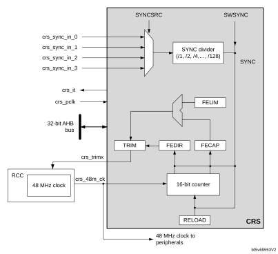

# 8 Clock recovery system (CRS)

## 8.1 CRS introduction

The clock recovery system (CRS) is an advanced digital controller acting on the internal fine-granularity trimmable RC oscillator HSI48. The CRS provides powerful means to evaluate the oscillator output frequency, based on comparison with a selectable synchronization signal. The CRS can perform automatic trimming adjustments based on the measured frequency error value, while keeping the possibility of a manual trimming.

The CRS is ideally suited to provide a precise clock to the USB peripheral. In this case, the synchronization signal can be derived from the start-of-frame (SOF) packet signalization on the USB bus, sent by a USB host at 1 ms intervals.

The synchronization signal can also be derived from alternative synchronization or generated by the user software.

## 8.2 CRS main features

- Selectable synchronization source with programmable prescaler and polarity (see [Section 8.4.2: CRS internal signals](#XREF_38817__12_4_2_CRS_internal_signals39))
- Possibility to generate synchronization pulses by software
- Automatic oscillator trimming capability with no need of CPU action
- Manual control option for faster startup convergence
- 16-bit frequency error counter with automatic error value capture and reload
- Programmable limit for automatic frequency error value evaluation and status reporting
- Maskable interrupts/events:
 - Expected synchronization (ESYNC)
 - Synchronization OK (SYNCOK)
 - Synchronization warning (SYNCWARN)
 - Synchronization or trimming error (ERR)

## 8.3 CRS implementation

  

<table class="TableTitle"><caption class="TableCap"><h4 class="TableCap" id="13050867">Table 52. CRS features</h4></caption><col width="247.46px"/><col width="291.13px"/><thead><tr height="28.00px"><th>
Feature
</th><th>
CRS
</th></tr></thead><tr height="22.67px"><td>
TRIM width
</td><td>
7 bits
</td></tr></table>

## 8.4 CRS functional description

### 8.4.1 CRS block diagram

#### Figure 23. CRS block diagram

### 8.4.2 CRS internal signals

Below the list of CRS internal signals.

 

<table class="TableTitle"><caption class="TableCap"><h4 class="TableCap" id="11935787">Table 53. <a id="signals%1139" name="XREF_64068__Table_118__CRS_internal_input_output_signals%1139">CRS internal input/output signals</a></h4></caption><col width="128.71px"/><col width="86.56px"/><col width="319.98px"/><thead><tr height="28.00px"><th>
Internal signal name
</th><th>
Signal type
</th><th>
Description
</th></tr></thead><tr height="22.67px"><td>
crs_it
</td><td>
Digital output
</td><td>
CRS interrupt
</td></tr><tr height="22.67px"><td>
crs_pclk
</td><td>
Digital input
</td><td>
AHB bus clock
</td></tr><tr height="22.67px"><td>
crs_48m_ck
</td><td>
Digital input
</td><td>
HSI48 48 MHz clock
</td></tr><tr height="22.67px"><td>
crs_trim[0:6]
</td><td>
Digital output
</td><td>
HSI48 oscillator smooth trimming value
</td></tr><tr height="22.67px"><td>
crs_sync_in_0
</td><td rowspan="4">
Digital input
</td><td rowspan="4">
SYNC signal source
</td></tr><tr height="22.67px"><td>
crs_sync_in_1
</td></tr><tr height="22.67px"><td>
crs_sync_in_2
</td></tr><tr height="22.67px"><td>
crs_sync_in_3
</td></tr></table>

<table class="TableTitle"><caption class="TableCap"><h4 class="TableCap" id="13487269">Table 54. CRS interconnection</h4></caption><col width="147.99px"/><col width="387.16px"/><thead><tr height="28.00px"><th>
Internal signal name
</th><th>
Source
</th></tr></thead><tr height="22.67px"><td>
crs_sync_in_0
</td><td>
GPIO selected as SYNC signal source 
</td></tr><tr height="22.67px"><td>
crs_sync_in_1
</td><td>
LSE selected as SYNC signal source
</td></tr><tr height="22.67px"><td>
crs_sync_in_2
</td><td>
USB SOF selected as SYNC signal source (default) 
</td></tr><tr height="22.67px"><td>
crs_sync_in_3
</td><td>
Reserved
</td></tr></table>

### 8.4.3 Synchronization input

The CRS synchronization source (crs\_sync\_in\_x) can be selected through SYNCSRC[1:0] bitfield of CRS\_CFGR register (refer to [Section 8.4.2: CRS internal signals](#XREF_38817__12_4_2_CRS_internal_signals39) for the possible sources). For a better robustness of the crs\_sync\_in\_x input, a simple digital filter (2 out of 3 majority votes, sampled by the 48 MHz clock) is implemented to filter out glitches. In addition, the source signal has a configurable polarity (selected through SYNCPOL bit of CRS\_CFGR). The signal can then be divided by a programmable binary prescaler to obtain a synchronization signal in a suitable frequency range (usually around 1 kHz).

For more information on the CRS synchronization source configuration, refer to CRS\_CFGR register.

It is also possible to generate a synchronization event by software, by setting the SWSYNC bit in the CRS\_CR register.

For more information on the CRS synchronization source configuration, refer to [CRS configuration register (CRS\_CFGR)](#XREF_59301__8_6_2_CRS_configuration_register_(CRS_CFGR)39).

It is also possible to generate a synchronization event by software, by setting the SWSYNC bit in the CRS\_CR register.

### 8.4.4 Frequency error measurement

The frequency error counter is a 16-bit down/up counter, reloaded with the RELOAD value on each SYNC event. It starts counting down until it reaches the zero value, where the ESYNC (expected synchronization) event is generated. Then it starts counting up to the OUTRANGE limit, where it eventually stops (if no SYNC event is received), and generates a SYNCMISS event. The OUTRANGE limit is defined as the frequency error limit (FELIM field of the CRS\_CFGR register) multiplied by 128.

When the SYNC event is detected, the actual value of the frequency error counter and its counting direction are stored in the FECAP (frequency error capture) field and in the FEDIR (frequency error direction) bit of the CRS\_ISR register. When the SYNC event is detected during the down-counting phase (before reaching the zero value), it means that the actual frequency is lower than the target (the TRIM value must be incremented). When it is detected during the up-counting phase, it means that the actual frequency is higher (the TRIM value must be decremented).

#### Figure 24. CRScounter behavior

### 8.4.5 Frequency error evaluation and automatic trimming

The measured frequency error is evaluated by comparing its value with a set of limits:

- TOLERANCE LIMIT, given directly in the FELIM field of the CRS\_CFGR register
- WARNING LIMIT, defined as 3 × FELIM value
- OUTRANGE (error limit), defined as 128 × FELIM value

The result of this comparison is used to generate the status indication and also to control the automatic trimming, which is enabled by setting the AUTOTRIMEN bit in the CRS\_CR register:

- When the frequency error is below the tolerance limit, it means that the actual trimming value in the TRIM field is the optimal one, hence no trimming action is needed.
 - SYNCOK status indicated
 - TRIM value not changed in AUTOTRIM mode
- When the frequency error is below the warning limit but above or equal to the tolerance limit, it means that some trimming action is necessary but that adjustment by one trimming step is enough to reach the optimal TRIM value.
 - SYNCOK status indicated
 - TRIM value adjusted by one trimming step in AUTOTRIM mode
- When the frequency error is above or equal to the warning limit but below the error limit, a stronger trimming action is necessary, and there is a risk that the optimal TRIM value is not reached for the next period.
 - SYNCWARN status indicated
 - TRIM value adjusted by two trimming steps in AUTOTRIM mode
- When the frequency error is above or equal to the error limit, the frequency is out of the trimming range. This can also happen when the SYNC input is not clean, or when some SYNC pulse is missing (for example when one USB SOF is corrupted).
 - SYNCERR or SYNCMISS status indicated
 - TRIM value not changed in AUTOTRIM mode

**Note:**

If the actual value of the TRIM field is close to its limits and the automatic trimming can force it to overflow or underflow, the TRIM value is set to the limit, and the TRIMOVF status is indicated.

In AUTOTRIM mode (AUTOTRIMEN bit set in the CRS\_CR register), the TRIM field of CRS\_CR is adjusted by hardware and is read-only.

### 8.4.6 CRS initialization and configuration

#### RELOAD value

The RELOAD value must be selected according to the ratio between the target frequency and the frequency of the synchronization source after prescaling. This value is decreased by 1, to reach the expected synchronization on the zero value. The formula is the following:

RELOAD = (fTARGET / fSYNC) - 1

The reset value of the RELOAD field corresponds to a target frequency of 48 MHz and a synchronization signal frequency of 1 kHz (SOF signal from USB).

#### FELIM value

The selection of the FELIM value is closely coupled with the HSI48 oscillator characteristics and its typical trimming step size. The optimal value corresponds to half of the trimming step size, expressed as a number of oscillator clock ticks. The following formula can be used:

FELIM = (fTARGET / fSYNC) \* STEP[%] / 100% / 2

The result must be always rounded up to the nearest integer value to obtain the best trimming response. If frequent trimming actions are not needed in the application, the hysteresis can be increased by slightly increasing the FELIM value.

The reset value of the FELIM field corresponds to (fTARGET / fSYNC) = 48000, and to a typical trimming step size of 0.14%.

**Note:**

The trimming step size depends upon the product, check the datasheet for accurate setting.

Caution:There is no hardware protection from a wrong configuration of the RELOAD and FELIM fields, this can lead to an erratic trimming response. The expected operational mode requires proper setup of the RELOAD value (according to the synchronization source frequency), which is also greater than 128 \* FELIM value (OUTRANGE limit).

## 8.5 CRS in low-power modes

 

<table class="TableTitle"><caption class="TableTitle"><h4 class="TableCap" id="1016629">Table 55. <a id="RTC39" name="XREF_78061__Table_69__Effect_of_low_power_modes_on_RTC39">Effect of low-power modes on CRS</a></h4></caption><col width="65.23px"/><col width="473.35px"/><thead><tr height="28.00px"><th>
Mode
</th><th>
Description 
</th></tr></thead><tr height="22.67px"><td>
Sleep
</td><td>
No effect. CRS interrupts cause the device to exit the Sleep mode.
</td></tr><tr height="37.33px"><td>
Stop
</td><td>
CRS registers are frozen. The CRS stops operating until the Stop mode is exited and the HSI48 oscillator is restarted.
</td></tr><tr data-conditional="_crs1_standby" height="22.67px"><td data-conditional="_crs1_standby">
Standby
</td><td data-conditional="_crs1_standby">
The peripheral is powered down and must be reinitialized after exiting Standby mode.
</td></tr><tr data-conditional="_crs1_shutdown" height="22.67px"><td data-conditional="_crs1_shutdown">
Shutdown
</td><td data-conditional="_crs1_shutdown">
The peripheral is powered down and must be reinitialized after exiting Shutdown mode.
</td></tr></table>

## 8.6 CRS interrupts

 

<table class="TableTitle"><caption class="TableTitle"><h4 class="TableCap" id="2098680">Table 56. Interrupt control bits</h4></caption><col width="241.09px"/><col width="97.14px"/><col width="101.69px"/><col width="98.66px"/><thead><tr height="42.67px"><th>
Interrupt event
</th><th>
Event flag
</th><th>
Enable  control bit
</th><th>
Clear  flag bit
</th></tr></thead><tr height="22.67px"><td>
Expected synchronization
</td><td>
ESYNCF
</td><td>
ESYNCIE
</td><td>
ESYNCC
</td></tr><tr height="22.67px"><td>
Synchronization OK
</td><td>
SYNCOKF
</td><td>
SYNCOKIE
</td><td>
SYNCOKC
</td></tr><tr height="22.67px"><td>
Synchronization warning
</td><td>
SYNCWARNF
</td><td>
SYNCWARNIE
</td><td>
SYNCWARNC
</td></tr><tr height="37.33px"><td>
Synchronization or trimming error (TRIMOVF, SYNCMISS, SYNCERR)
</td><td>
ERRF
</td><td>
ERRIE
</td><td>
ERRC
</td></tr></table>

## 8.7 CRS registers

Refer to [Section 1.2](Documentation_conventions.md#XREF_82797__1_1_List_of_abbreviations_for_registers1) for a list of abbreviations used in register descriptions.

The peripheral registers can be accessed only by words (32-bit).

### 8.7.1 CRS control register (CRS\_CR)

Address offset: 0x00

Reset value: 0x0000 4000

 

<table class="RegBitMap"><col width="36.24px"/><col width="39.10px"/><col width="36.24px"/><col width="36.24px"/><col width="36.24px"/><col width="36.24px"/><col width="36.24px"/><col width="36.24px"/><col width="40.03px"/><col width="43.27px"/><col width="37.19px"/><col width="36.24px"/><col width="40.03px"/><col width="40.03px"/><col width="44.56px"/><col width="40.03px"/><tr height="17.33px"><td style="border-left-width:0;border-left-style:hidden;border-left-color:0;border-right-width:0;border-right-style:hidden;border-right-color:0;border-top-width:0;border-top-style:hidden;border-top-color:0;">
31
</td><td style="border-left-width:0;border-left-style:hidden;border-left-color:0;border-right-width:0;border-right-style:hidden;border-right-color:0;border-top-width:0;border-top-style:hidden;border-top-color:0;">
30
</td><td style="border-left-width:0;border-left-style:hidden;border-left-color:0;border-right-width:0;border-right-style:hidden;border-right-color:0;border-top-width:0;border-top-style:hidden;border-top-color:0;">
29
</td><td style="border-left-width:0;border-left-style:hidden;border-left-color:0;border-right-width:0;border-right-style:hidden;border-right-color:0;border-top-width:0;border-top-style:hidden;border-top-color:0;">
28
</td><td style="border-left-width:0;border-left-style:hidden;border-left-color:0;border-right-width:0;border-right-style:hidden;border-right-color:0;border-top-width:0;border-top-style:hidden;border-top-color:0;">
27
</td><td style="border-left-width:0;border-left-style:hidden;border-left-color:0;border-right-width:0;border-right-style:hidden;border-right-color:0;border-top-width:0;border-top-style:hidden;border-top-color:0;">
26
</td><td style="border-left-width:0;border-left-style:hidden;border-left-color:0;border-right-width:0;border-right-style:hidden;border-right-color:0;border-top-width:0;border-top-style:hidden;border-top-color:0;">
25
</td><td style="border-left-width:0;border-left-style:hidden;border-left-color:0;border-right-width:0;border-right-style:hidden;border-right-color:0;border-top-width:0;border-top-style:hidden;border-top-color:0;">
24
</td><td style="border-left-width:0;border-left-style:hidden;border-left-color:0;border-right-width:0;border-right-style:hidden;border-right-color:0;border-top-width:0;border-top-style:hidden;border-top-color:0;">
23
</td><td style="border-left-width:0;border-left-style:hidden;border-left-color:0;border-right-width:0;border-right-style:hidden;border-right-color:0;border-top-width:0;border-top-style:hidden;border-top-color:0;">
22
</td><td style="border-left-width:0;border-left-style:hidden;border-left-color:0;border-right-width:0;border-right-style:hidden;border-right-color:0;border-top-width:0;border-top-style:hidden;border-top-color:0;">
21
</td><td style="border-left-width:0;border-left-style:hidden;border-left-color:0;border-right-width:0;border-right-style:hidden;border-right-color:0;border-top-width:0;border-top-style:hidden;border-top-color:0;">
20
</td><td style="border-left-width:0;border-left-style:hidden;border-left-color:0;border-right-width:0;border-right-style:hidden;border-right-color:0;border-top-width:0;border-top-style:hidden;border-top-color:0;">
19
</td><td style="border-left-width:0;border-left-style:hidden;border-left-color:0;border-right-width:0;border-right-style:hidden;border-right-color:0;border-top-width:0;border-top-style:hidden;border-top-color:0;">
18
</td><td style="border-left-width:0;border-left-style:hidden;border-left-color:0;border-right-width:0;border-right-style:hidden;border-right-color:0;border-top-width:0;border-top-style:hidden;border-top-color:0;">
17
</td><td style="border-left-width:0;border-left-style:hidden;border-left-color:0;border-right-width:0;border-right-style:hidden;border-right-color:0;border-top-width:0;border-top-style:hidden;border-top-color:0;">
16
</td></tr><tr height="17.33px"><td style="border-left-width:0.299988pt;border-left-style:solid;border-left-color:#000000;border-bottom-width:0.299988pt;border-bottom-style:solid;border-bottom-color:#000000;border-right-width:0.299988pt;border-right-style:solid;border-right-color:#000000;border-top-width:0.299988pt;border-top-style:solid;border-top-color:#000000;">
Res.
</td><td style="border-left-width:0.299988pt;border-left-style:solid;border-left-color:#000000;border-bottom-width:0.299988pt;border-bottom-style:solid;border-bottom-color:#000000;border-right-width:0.299988pt;border-right-style:solid;border-right-color:#000000;border-top-width:0.299988pt;border-top-style:solid;border-top-color:#000000;">
Res.
</td><td style="border-left-width:0.299988pt;border-left-style:solid;border-left-color:#000000;border-bottom-width:0.299988pt;border-bottom-style:solid;border-bottom-color:#000000;border-right-width:0.299988pt;border-right-style:solid;border-right-color:#000000;border-top-width:0.299988pt;border-top-style:solid;border-top-color:#000000;">
Res.
</td><td style="border-left-width:0.299988pt;border-left-style:solid;border-left-color:#000000;border-bottom-width:0.299988pt;border-bottom-style:solid;border-bottom-color:#000000;border-right-width:0.299988pt;border-right-style:solid;border-right-color:#000000;border-top-width:0.299988pt;border-top-style:solid;border-top-color:#000000;">
Res.
</td><td style="border-left-width:0.299988pt;border-left-style:solid;border-left-color:#000000;border-bottom-width:0.299988pt;border-bottom-style:solid;border-bottom-color:#000000;border-right-width:0.299988pt;border-right-style:solid;border-right-color:#000000;border-top-width:0.299988pt;border-top-style:solid;border-top-color:#000000;">
Res.
</td><td style="border-left-width:0.299988pt;border-left-style:solid;border-left-color:#000000;border-bottom-width:0.299988pt;border-bottom-style:solid;border-bottom-color:#000000;border-right-width:0.299988pt;border-right-style:solid;border-right-color:#000000;border-top-width:0.299988pt;border-top-style:solid;border-top-color:#000000;">
Res.
</td><td style="border-left-width:0.299988pt;border-left-style:solid;border-left-color:#000000;border-bottom-width:0.299988pt;border-bottom-style:solid;border-bottom-color:#000000;border-right-width:0.299988pt;border-right-style:solid;border-right-color:#000000;border-top-width:0.299988pt;border-top-style:solid;border-top-color:#000000;">
Res.
</td><td style="border-left-width:0.299988pt;border-left-style:solid;border-left-color:#000000;border-bottom-width:0.299988pt;border-bottom-style:solid;border-bottom-color:#000000;border-right-width:0.299988pt;border-right-style:solid;border-right-color:#000000;border-top-width:0.299988pt;border-top-style:solid;border-top-color:#000000;">
Res.
</td><td style="border-left-width:0.299988pt;border-left-style:solid;border-left-color:#000000;border-bottom-width:0.299988pt;border-bottom-style:solid;border-bottom-color:#000000;border-right-width:0.299988pt;border-right-style:solid;border-right-color:#000000;border-top-width:0.299988pt;border-top-style:solid;border-top-color:#000000;">
Res.
</td><td style="border-left-width:0.299988pt;border-left-style:solid;border-left-color:#000000;border-bottom-width:0.299988pt;border-bottom-style:solid;border-bottom-color:#000000;border-right-width:0.299988pt;border-right-style:solid;border-right-color:#000000;border-top-width:0.299988pt;border-top-style:solid;border-top-color:#000000;">
Res.
</td><td style="border-left-width:0.299988pt;border-left-style:solid;border-left-color:#000000;border-bottom-width:0.299988pt;border-bottom-style:solid;border-bottom-color:#000000;border-right-width:0.299988pt;border-right-style:solid;border-right-color:#000000;border-top-width:0.299988pt;border-top-style:solid;border-top-color:#000000;">
Res.
</td><td style="border-left-width:0.299988pt;border-left-style:solid;border-left-color:#000000;border-bottom-width:0.299988pt;border-bottom-style:solid;border-bottom-color:#000000;border-right-width:0.299988pt;border-right-style:solid;border-right-color:#000000;border-top-width:0.299988pt;border-top-style:solid;border-top-color:#000000;">
Res.
</td><td style="border-left-width:0.299988pt;border-left-style:solid;border-left-color:#000000;border-bottom-width:0.299988pt;border-bottom-style:solid;border-bottom-color:#000000;border-right-width:0.299988pt;border-right-style:solid;border-right-color:#000000;border-top-width:0.299988pt;border-top-style:solid;border-top-color:#000000;">
Res.
</td><td style="border-left-width:0.299988pt;border-left-style:solid;border-left-color:#000000;border-bottom-width:0.299988pt;border-bottom-style:solid;border-bottom-color:#000000;border-right-width:0.299988pt;border-right-style:solid;border-right-color:#000000;border-top-width:0.299988pt;border-top-style:solid;border-top-color:#000000;">
Res.
</td><td style="border-left-width:0.299988pt;border-left-style:solid;border-left-color:#000000;border-bottom-width:0.299988pt;border-bottom-style:solid;border-bottom-color:#000000;border-right-width:0.299988pt;border-right-style:solid;border-right-color:#000000;border-top-width:0.299988pt;border-top-style:solid;border-top-color:#000000;">
Res.
</td><td style="border-left-width:0.299988pt;border-left-style:solid;border-left-color:#000000;border-bottom-width:0.299988pt;border-bottom-style:solid;border-bottom-color:#000000;border-right-width:0.299988pt;border-right-style:solid;border-right-color:#000000;border-top-width:0.299988pt;border-top-style:solid;border-top-color:#000000;">
Res.
</td></tr><tr height="17.33px"><td style="border-left-width:0.5pt;border-left-style:solid;border-left-color:#000000;border-bottom-width:0.5pt;border-bottom-style:solid;border-bottom-color:#000000;border-right-width:0.5pt;border-right-style:solid;border-right-color:#000000;border-top-width:0.5pt;border-top-style:solid;border-top-color:#000000;"></td><td style="border-left-width:0.5pt;border-left-style:solid;border-left-color:#000000;border-bottom-width:0.5pt;border-bottom-style:solid;border-bottom-color:#000000;border-right-width:0.5pt;border-right-style:solid;border-right-color:#000000;border-top-width:0.5pt;border-top-style:solid;border-top-color:#000000;"></td><td style="border-left-width:0.5pt;border-left-style:solid;border-left-color:#000000;border-bottom-width:0.5pt;border-bottom-style:solid;border-bottom-color:#000000;border-right-width:0.5pt;border-right-style:solid;border-right-color:#000000;border-top-width:0.5pt;border-top-style:solid;border-top-color:#000000;"></td><td style="border-left-width:0.5pt;border-left-style:solid;border-left-color:#000000;border-bottom-width:0.5pt;border-bottom-style:solid;border-bottom-color:#000000;border-right-width:0.5pt;border-right-style:solid;border-right-color:#000000;border-top-width:0.5pt;border-top-style:solid;border-top-color:#000000;"></td><td style="border-left-width:0.5pt;border-left-style:solid;border-left-color:#000000;border-bottom-width:0.5pt;border-bottom-style:solid;border-bottom-color:#000000;border-right-width:0.5pt;border-right-style:solid;border-right-color:#000000;border-top-width:0.5pt;border-top-style:solid;border-top-color:#000000;"></td><td style="border-left-width:0.5pt;border-left-style:solid;border-left-color:#000000;border-bottom-width:0.5pt;border-bottom-style:solid;border-bottom-color:#000000;border-right-width:0.5pt;border-right-style:solid;border-right-color:#000000;border-top-width:0.5pt;border-top-style:solid;border-top-color:#000000;"></td><td style="border-left-width:0.5pt;border-left-style:solid;border-left-color:#000000;border-bottom-width:0.5pt;border-bottom-style:solid;border-bottom-color:#000000;border-right-width:0.5pt;border-right-style:solid;border-right-color:#000000;border-top-width:0.5pt;border-top-style:solid;border-top-color:#000000;"></td><td style="border-left-width:0.5pt;border-left-style:solid;border-left-color:#000000;border-bottom-width:0.5pt;border-bottom-style:solid;border-bottom-color:#000000;border-right-width:0.5pt;border-right-style:solid;border-right-color:#000000;border-top-width:0.5pt;border-top-style:solid;border-top-color:#000000;"></td><td style="border-left-width:0.5pt;border-left-style:solid;border-left-color:#000000;border-bottom-width:0.5pt;border-bottom-style:solid;border-bottom-color:#000000;border-right-width:0.5pt;border-right-style:solid;border-right-color:#000000;border-top-width:0.5pt;border-top-style:solid;border-top-color:#000000;"></td><td style="border-left-width:0.5pt;border-left-style:solid;border-left-color:#000000;border-bottom-width:0.5pt;border-bottom-style:solid;border-bottom-color:#000000;border-right-width:0.5pt;border-right-style:solid;border-right-color:#000000;border-top-width:0.5pt;border-top-style:solid;border-top-color:#000000;"></td><td style="border-left-width:0.5pt;border-left-style:solid;border-left-color:#000000;border-bottom-width:0.5pt;border-bottom-style:solid;border-bottom-color:#000000;border-right-width:0.5pt;border-right-style:solid;border-right-color:#000000;border-top-width:0.5pt;border-top-style:solid;border-top-color:#000000;"></td><td style="border-left-width:0.5pt;border-left-style:solid;border-left-color:#000000;border-bottom-width:0.5pt;border-bottom-style:solid;border-bottom-color:#000000;border-right-width:0.5pt;border-right-style:solid;border-right-color:#000000;border-top-width:0.5pt;border-top-style:solid;border-top-color:#000000;"></td><td style="border-left-width:0.5pt;border-left-style:solid;border-left-color:#000000;border-bottom-width:0.5pt;border-bottom-style:solid;border-bottom-color:#000000;border-right-width:0.5pt;border-right-style:solid;border-right-color:#000000;border-top-width:0.5pt;border-top-style:solid;border-top-color:#000000;"></td><td style="border-left-width:0.5pt;border-left-style:solid;border-left-color:#000000;border-bottom-width:0.5pt;border-bottom-style:solid;border-bottom-color:#000000;border-right-width:0.5pt;border-right-style:solid;border-right-color:#000000;border-top-width:0.5pt;border-top-style:solid;border-top-color:#000000;"></td><td style="border-left-width:0.5pt;border-left-style:solid;border-left-color:#000000;border-bottom-width:0.5pt;border-bottom-style:solid;border-bottom-color:#000000;border-right-width:0.5pt;border-right-style:solid;border-right-color:#000000;border-top-width:0.5pt;border-top-style:solid;border-top-color:#000000;"></td><td style="border-left-width:0.5pt;border-left-style:solid;border-left-color:#000000;border-bottom-width:0.5pt;border-bottom-style:solid;border-bottom-color:#000000;border-right-width:0.5pt;border-right-style:solid;border-right-color:#000000;border-top-width:0.5pt;border-top-style:solid;border-top-color:#000000;"></td></tr><tr height="17.33px"><td style="border-left-width:0;border-left-style:hidden;border-left-color:0;border-bottom-width:0.5pt;border-bottom-style:solid;border-bottom-color:#000000;border-right-width:0;border-right-style:hidden;border-right-color:0;border-top-width:0.5pt;border-top-style:solid;border-top-color:#000000;">
15
</td><td style="border-left-width:0;border-left-style:hidden;border-left-color:0;border-bottom-width:0.5pt;border-bottom-style:solid;border-bottom-color:#000000;border-right-width:0;border-right-style:hidden;border-right-color:0;border-top-width:0.5pt;border-top-style:solid;border-top-color:#000000;">
14
</td><td style="border-left-width:0;border-left-style:hidden;border-left-color:0;border-bottom-width:0.5pt;border-bottom-style:solid;border-bottom-color:#000000;border-right-width:0;border-right-style:hidden;border-right-color:0;border-top-width:0.5pt;border-top-style:solid;border-top-color:#000000;">
13
</td><td style="border-left-width:0;border-left-style:hidden;border-left-color:0;border-bottom-width:0.5pt;border-bottom-style:solid;border-bottom-color:#000000;border-right-width:0;border-right-style:hidden;border-right-color:0;border-top-width:0.5pt;border-top-style:solid;border-top-color:#000000;">
12
</td><td style="border-left-width:0;border-left-style:hidden;border-left-color:0;border-bottom-width:0.5pt;border-bottom-style:solid;border-bottom-color:#000000;border-right-width:0;border-right-style:hidden;border-right-color:0;border-top-width:0.5pt;border-top-style:solid;border-top-color:#000000;">
11
</td><td style="border-left-width:0;border-left-style:hidden;border-left-color:0;border-bottom-width:0.5pt;border-bottom-style:solid;border-bottom-color:#000000;border-right-width:0;border-right-style:hidden;border-right-color:0;border-top-width:0.5pt;border-top-style:solid;border-top-color:#000000;">
10
</td><td style="border-left-width:0;border-left-style:hidden;border-left-color:0;border-bottom-width:0.5pt;border-bottom-style:solid;border-bottom-color:#000000;border-right-width:0;border-right-style:hidden;border-right-color:0;border-top-width:0.5pt;border-top-style:solid;border-top-color:#000000;">
9
</td><td style="border-left-width:0;border-left-style:hidden;border-left-color:0;border-bottom-width:0.5pt;border-bottom-style:solid;border-bottom-color:#000000;border-right-width:0;border-right-style:hidden;border-right-color:0;border-top-width:0.5pt;border-top-style:solid;border-top-color:#000000;">
8
</td><td style="border-left-width:0;border-left-style:hidden;border-left-color:0;border-bottom-width:0.5pt;border-bottom-style:solid;border-bottom-color:#000000;border-right-width:0;border-right-style:hidden;border-right-color:0;border-top-width:0.5pt;border-top-style:solid;border-top-color:#000000;">
7
</td><td style="border-left-width:0;border-left-style:hidden;border-left-color:0;border-bottom-width:0.5pt;border-bottom-style:solid;border-bottom-color:#000000;border-right-width:0;border-right-style:hidden;border-right-color:0;border-top-width:0.5pt;border-top-style:solid;border-top-color:#000000;">
6
</td><td style="border-left-width:0;border-left-style:hidden;border-left-color:0;border-bottom-width:0.5pt;border-bottom-style:solid;border-bottom-color:#000000;border-right-width:0;border-right-style:hidden;border-right-color:0;border-top-width:0.5pt;border-top-style:solid;border-top-color:#000000;">
5
</td><td style="border-left-width:0;border-left-style:hidden;border-left-color:0;border-bottom-width:0.5pt;border-bottom-style:solid;border-bottom-color:#000000;border-right-width:0;border-right-style:hidden;border-right-color:0;border-top-width:0.5pt;border-top-style:solid;border-top-color:#000000;">
4
</td><td style="border-left-width:0;border-left-style:hidden;border-left-color:0;border-bottom-width:0.5pt;border-bottom-style:solid;border-bottom-color:#000000;border-right-width:0;border-right-style:hidden;border-right-color:0;border-top-width:0.5pt;border-top-style:solid;border-top-color:#000000;">
3
</td><td style="border-left-width:0;border-left-style:hidden;border-left-color:0;border-bottom-width:0.5pt;border-bottom-style:solid;border-bottom-color:#000000;border-right-width:0;border-right-style:hidden;border-right-color:0;border-top-width:0.5pt;border-top-style:solid;border-top-color:#000000;">
2
</td><td style="border-left-width:0;border-left-style:hidden;border-left-color:0;border-bottom-width:0.5pt;border-bottom-style:solid;border-bottom-color:#000000;border-right-width:0;border-right-style:hidden;border-right-color:0;border-top-width:0.5pt;border-top-style:solid;border-top-color:#000000;">
1
</td><td style="border-left-width:0;border-left-style:hidden;border-left-color:0;border-bottom-width:0.5pt;border-bottom-style:solid;border-bottom-color:#000000;border-right-width:0;border-right-style:hidden;border-right-color:0;border-top-width:0.5pt;border-top-style:solid;border-top-color:#000000;">
0
</td></tr><tr data-conditional="_crs1_buswidth7" height="28.00px"><td data-conditional="_crs1_buswidth7" style="border-left-width:0.299988pt;border-left-style:solid;border-left-color:#000000;border-bottom-width:0.299988pt;border-bottom-style:solid;border-bottom-color:#000000;border-right-width:0.299988pt;border-right-style:solid;border-right-color:#000000;border-top-width:0.299988pt;border-top-style:solid;border-top-color:#000000;">
Res.
</td><td colspan="7" data-conditional="_crs1_buswidth7" style="border-left-width:0.299988pt;border-left-style:solid;border-left-color:#000000;border-bottom-width:0.299988pt;border-bottom-style:solid;border-bottom-color:#000000;border-right-width:0.299988pt;border-right-style:solid;border-right-color:#000000;border-top-width:0.299988pt;border-top-style:solid;border-top-color:#000000;">
TRIM[6:0]
</td><td data-conditional="_crs1_buswidth7" style="border-left-width:0.5pt;border-left-style:solid;border-left-color:#000000;border-bottom-width:0.5pt;border-bottom-style:solid;border-bottom-color:#000000;border-right-width:0.5pt;border-right-style:solid;border-right-color:#000000;border-top-width:0.5pt;border-top-style:solid;border-top-color:#000000;">
SW SYNC
</td><td data-conditional="_crs1_buswidth7" style="border-left-width:0.5pt;border-left-style:solid;border-left-color:#000000;border-bottom-width:0.5pt;border-bottom-style:solid;border-bottom-color:#000000;border-right-width:0.5pt;border-right-style:solid;border-right-color:#000000;border-top-width:0.5pt;border-top-style:solid;border-top-color:#000000;">
AUTO TRIMEN
</td><td data-conditional="_crs1_buswidth7" style="border-left-width:0.5pt;border-left-style:solid;border-left-color:#000000;border-bottom-width:0.5pt;border-bottom-style:solid;border-bottom-color:#000000;border-right-width:0.5pt;border-right-style:solid;border-right-color:#000000;border-top-width:0.5pt;border-top-style:solid;border-top-color:#000000;">
CEN
</td><td data-conditional="_crs1_buswidth7" style="border-left-width:0.299988pt;border-left-style:solid;border-left-color:#000000;border-bottom-width:0.299988pt;border-bottom-style:solid;border-bottom-color:#000000;border-right-width:0.299988pt;border-right-style:solid;border-right-color:#000000;border-top-width:0.299988pt;border-top-style:solid;border-top-color:#000000;">
Res.
</td><td data-conditional="_crs1_buswidth7" style="border-left-width:0.5pt;border-left-style:solid;border-left-color:#000000;border-bottom-width:0.5pt;border-bottom-style:solid;border-bottom-color:#000000;border-right-width:0.5pt;border-right-style:solid;border-right-color:#000000;border-top-width:0.5pt;border-top-style:solid;border-top-color:#000000;">
ESYNC IE
</td><td data-conditional="_crs1_buswidth7" style="border-left-width:0.5pt;border-left-style:solid;border-left-color:#000000;border-bottom-width:0.5pt;border-bottom-style:solid;border-bottom-color:#000000;border-right-width:0.5pt;border-right-style:solid;border-right-color:#000000;border-top-width:0.5pt;border-top-style:solid;border-top-color:#000000;">
ERR IE
</td><td data-conditional="_crs1_buswidth7" style="border-left-width:0.5pt;border-left-style:solid;border-left-color:#000000;border-bottom-width:0.5pt;border-bottom-style:solid;border-bottom-color:#000000;border-right-width:0.5pt;border-right-style:solid;border-right-color:#000000;border-top-width:0.5pt;border-top-style:solid;border-top-color:#000000;">
SYNC WARNIE
</td><td data-conditional="_crs1_buswidth7" style="border-left-width:0.5pt;border-left-style:solid;border-left-color:#000000;border-bottom-width:0.5pt;border-bottom-style:solid;border-bottom-color:#000000;border-right-width:0.5pt;border-right-style:solid;border-right-color:#000000;border-top-width:0.5pt;border-top-style:solid;border-top-color:#000000;">
SYNC OKIE
</td></tr><tr data-conditional="_crs1_buswidth7" height="17.33px"><td data-conditional="_crs1_buswidth7" style="border-left-width:0.5pt;border-left-style:solid;border-left-color:#000000;border-bottom-width:0.5pt;border-bottom-style:solid;border-bottom-color:#000000;border-right-width:0.5pt;border-right-style:solid;border-right-color:#000000;border-top-width:0.5pt;border-top-style:solid;border-top-color:#000000;"></td><td data-conditional="_crs1_buswidth7" style="border-left-width:0.5pt;border-left-style:solid;border-left-color:#000000;border-bottom-width:0.5pt;border-bottom-style:solid;border-bottom-color:#000000;border-right-width:0.5pt;border-right-style:solid;border-right-color:#000000;border-top-width:0.5pt;border-top-style:solid;border-top-color:#000000;">
rw
</td><td data-conditional="_crs1_buswidth7" style="border-left-width:0.5pt;border-left-style:solid;border-left-color:#000000;border-bottom-width:0.5pt;border-bottom-style:solid;border-bottom-color:#000000;border-right-width:0.5pt;border-right-style:solid;border-right-color:#000000;border-top-width:0.5pt;border-top-style:solid;border-top-color:#000000;">
rw
</td><td data-conditional="_crs1_buswidth7" style="border-left-width:0.5pt;border-left-style:solid;border-left-color:#000000;border-bottom-width:0.5pt;border-bottom-style:solid;border-bottom-color:#000000;border-right-width:0.5pt;border-right-style:solid;border-right-color:#000000;border-top-width:0.5pt;border-top-style:solid;border-top-color:#000000;">
rw
</td><td data-conditional="_crs1_buswidth7" style="border-left-width:0.5pt;border-left-style:solid;border-left-color:#000000;border-bottom-width:0.5pt;border-bottom-style:solid;border-bottom-color:#000000;border-right-width:0.5pt;border-right-style:solid;border-right-color:#000000;border-top-width:0.5pt;border-top-style:solid;border-top-color:#000000;">
rw
</td><td data-conditional="_crs1_buswidth7" style="border-left-width:0.5pt;border-left-style:solid;border-left-color:#000000;border-bottom-width:0.5pt;border-bottom-style:solid;border-bottom-color:#000000;border-right-width:0.5pt;border-right-style:solid;border-right-color:#000000;border-top-width:0.5pt;border-top-style:solid;border-top-color:#000000;">
rw
</td><td data-conditional="_crs1_buswidth7" style="border-left-width:0.5pt;border-left-style:solid;border-left-color:#000000;border-bottom-width:0.5pt;border-bottom-style:solid;border-bottom-color:#000000;border-right-width:0.5pt;border-right-style:solid;border-right-color:#000000;border-top-width:0.5pt;border-top-style:solid;border-top-color:#000000;">
rw
</td><td data-conditional="_crs1_buswidth7" style="border-left-width:0.5pt;border-left-style:solid;border-left-color:#000000;border-bottom-width:0.5pt;border-bottom-style:solid;border-bottom-color:#000000;border-right-width:0.5pt;border-right-style:solid;border-right-color:#000000;border-top-width:0.5pt;border-top-style:solid;border-top-color:#000000;">
rw
</td><td data-conditional="_crs1_buswidth7" style="border-left-width:0.5pt;border-left-style:solid;border-left-color:#000000;border-bottom-width:0.5pt;border-bottom-style:solid;border-bottom-color:#000000;border-right-width:0.5pt;border-right-style:solid;border-right-color:#000000;border-top-width:0.5pt;border-top-style:solid;border-top-color:#000000;">
rt_w1
</td><td data-conditional="_crs1_buswidth7" style="border-left-width:0.5pt;border-left-style:solid;border-left-color:#000000;border-bottom-width:0.5pt;border-bottom-style:solid;border-bottom-color:#000000;border-right-width:0.5pt;border-right-style:solid;border-right-color:#000000;border-top-width:0.5pt;border-top-style:solid;border-top-color:#000000;">
rw
</td><td data-conditional="_crs1_buswidth7" style="border-left-width:0.5pt;border-left-style:solid;border-left-color:#000000;border-bottom-width:0.5pt;border-bottom-style:solid;border-bottom-color:#000000;border-right-width:0.5pt;border-right-style:solid;border-right-color:#000000;border-top-width:0.5pt;border-top-style:solid;border-top-color:#000000;">
rw
</td><td data-conditional="_crs1_buswidth7" style="border-left-width:0.5pt;border-left-style:solid;border-left-color:#000000;border-bottom-width:0.5pt;border-bottom-style:solid;border-bottom-color:#000000;border-right-width:0.5pt;border-right-style:solid;border-right-color:#000000;border-top-width:0.5pt;border-top-style:solid;border-top-color:#000000;"></td><td data-conditional="_crs1_buswidth7" style="border-left-width:0.5pt;border-left-style:solid;border-left-color:#000000;border-bottom-width:0.5pt;border-bottom-style:solid;border-bottom-color:#000000;border-right-width:0.5pt;border-right-style:solid;border-right-color:#000000;border-top-width:0.5pt;border-top-style:solid;border-top-color:#000000;">
rw
</td><td data-conditional="_crs1_buswidth7" style="border-left-width:0.5pt;border-left-style:solid;border-left-color:#000000;border-bottom-width:0.5pt;border-bottom-style:solid;border-bottom-color:#000000;border-right-width:0.5pt;border-right-style:solid;border-right-color:#000000;border-top-width:0.5pt;border-top-style:solid;border-top-color:#000000;">
rw
</td><td data-conditional="_crs1_buswidth7" style="border-left-width:0.5pt;border-left-style:solid;border-left-color:#000000;border-bottom-width:0.5pt;border-bottom-style:solid;border-bottom-color:#000000;border-right-width:0.5pt;border-right-style:solid;border-right-color:#000000;border-top-width:0.5pt;border-top-style:solid;border-top-color:#000000;">
rw
</td><td data-conditional="_crs1_buswidth7" style="border-left-width:0.5pt;border-left-style:solid;border-left-color:#000000;border-bottom-width:0.5pt;border-bottom-style:solid;border-bottom-color:#000000;border-right-width:0.5pt;border-right-style:solid;border-right-color:#000000;border-top-width:0.5pt;border-top-style:solid;border-top-color:#000000;">
rw
</td></tr><tr data-conditional="_crs1_buswidth6" height="28.00px" style="display: none"><td data-conditional="_crs1_buswidth6" style="border-left-width:0.299988pt;border-left-style:solid;border-left-color:#000000;border-bottom-width:0.299988pt;border-bottom-style:solid;border-bottom-color:#000000;border-right-width:0.299988pt;border-right-style:solid;border-right-color:#000000;border-top-width:0.299988pt;border-top-style:solid;border-top-color:#000000;display: none">
Res.
</td><td data-conditional="_crs1_buswidth6" style="border-left-width:0.299988pt;border-left-style:solid;border-left-color:#000000;border-bottom-width:0.299988pt;border-bottom-style:solid;border-bottom-color:#000000;border-right-width:0.299988pt;border-right-style:solid;border-right-color:#000000;border-top-width:0.299988pt;border-top-style:solid;border-top-color:#000000;display: none">
Res.
</td><td colspan="6" data-conditional="_crs1_buswidth6" style="border-left-width:0.5pt;border-left-style:solid;border-left-color:#000000;border-bottom-width:0.5pt;border-bottom-style:solid;border-bottom-color:#000000;border-right-width:0.5pt;border-right-style:solid;border-right-color:#000000;border-top-width:0.5pt;border-top-style:solid;border-top-color:#000000;display: none">
TRIM[5:0]
</td><td data-conditional="_crs1_buswidth6" style="border-left-width:0.5pt;border-left-style:solid;border-left-color:#000000;border-bottom-width:0.5pt;border-bottom-style:solid;border-bottom-color:#000000;border-right-width:0.5pt;border-right-style:solid;border-right-color:#000000;border-top-width:0.5pt;border-top-style:solid;border-top-color:#000000;display: none">
SW SYNC
</td><td data-conditional="_crs1_buswidth6" style="border-left-width:0.5pt;border-left-style:solid;border-left-color:#000000;border-bottom-width:0.5pt;border-bottom-style:solid;border-bottom-color:#000000;border-right-width:0.5pt;border-right-style:solid;border-right-color:#000000;border-top-width:0.5pt;border-top-style:solid;border-top-color:#000000;display: none">
AUTO TRIMEN
</td><td data-conditional="_crs1_buswidth6" style="border-left-width:0.5pt;border-left-style:solid;border-left-color:#000000;border-bottom-width:0.5pt;border-bottom-style:solid;border-bottom-color:#000000;border-right-width:0.5pt;border-right-style:solid;border-right-color:#000000;border-top-width:0.5pt;border-top-style:solid;border-top-color:#000000;display: none">
CEN
</td><td data-conditional="_crs1_buswidth6" style="border-left-width:0.299988pt;border-left-style:solid;border-left-color:#000000;border-bottom-width:0.299988pt;border-bottom-style:solid;border-bottom-color:#000000;border-right-width:0.299988pt;border-right-style:solid;border-right-color:#000000;border-top-width:0.299988pt;border-top-style:solid;border-top-color:#000000;display: none">
Res.
</td><td data-conditional="_crs1_buswidth6" style="border-left-width:0.5pt;border-left-style:solid;border-left-color:#000000;border-bottom-width:0.5pt;border-bottom-style:solid;border-bottom-color:#000000;border-right-width:0.5pt;border-right-style:solid;border-right-color:#000000;border-top-width:0.5pt;border-top-style:solid;border-top-color:#000000;display: none">
ESYNC IE
</td><td data-conditional="_crs1_buswidth6" style="border-left-width:0.5pt;border-left-style:solid;border-left-color:#000000;border-bottom-width:0.5pt;border-bottom-style:solid;border-bottom-color:#000000;border-right-width:0.5pt;border-right-style:solid;border-right-color:#000000;border-top-width:0.5pt;border-top-style:solid;border-top-color:#000000;display: none">
ERR IE
</td><td data-conditional="_crs1_buswidth6" style="border-left-width:0.5pt;border-left-style:solid;border-left-color:#000000;border-bottom-width:0.5pt;border-bottom-style:solid;border-bottom-color:#000000;border-right-width:0.5pt;border-right-style:solid;border-right-color:#000000;border-top-width:0.5pt;border-top-style:solid;border-top-color:#000000;display: none">
SYNC WARNIE
</td><td data-conditional="_crs1_buswidth6" style="border-left-width:0.5pt;border-left-style:solid;border-left-color:#000000;border-bottom-width:0.5pt;border-bottom-style:solid;border-bottom-color:#000000;border-right-width:0.5pt;border-right-style:solid;border-right-color:#000000;border-top-width:0.5pt;border-top-style:solid;border-top-color:#000000;display: none">
SYNC OKIE
</td></tr><tr data-conditional="_crs1_buswidth6" height="17.33px" style="display: none"><td data-conditional="_crs1_buswidth6" style="border-left-width:0.5pt;border-left-style:solid;border-left-color:#000000;border-bottom-width:0.5pt;border-bottom-style:solid;border-bottom-color:#000000;border-right-width:0.5pt;border-right-style:solid;border-right-color:#000000;border-top-width:0.5pt;border-top-style:solid;border-top-color:#000000;display: none"></td><td data-conditional="_crs1_buswidth6" style="border-left-width:0.5pt;border-left-style:solid;border-left-color:#000000;border-bottom-width:0.5pt;border-bottom-style:solid;border-bottom-color:#000000;border-right-width:0.5pt;border-right-style:solid;border-right-color:#000000;border-top-width:0.5pt;border-top-style:solid;border-top-color:#000000;display: none"></td><td data-conditional="_crs1_buswidth6" style="border-left-width:0.5pt;border-left-style:solid;border-left-color:#000000;border-bottom-width:0.5pt;border-bottom-style:solid;border-bottom-color:#000000;border-right-width:0.5pt;border-right-style:solid;border-right-color:#000000;border-top-width:0.5pt;border-top-style:solid;border-top-color:#000000;display: none">
rw
</td><td data-conditional="_crs1_buswidth6" style="border-left-width:0.5pt;border-left-style:solid;border-left-color:#000000;border-bottom-width:0.5pt;border-bottom-style:solid;border-bottom-color:#000000;border-right-width:0.5pt;border-right-style:solid;border-right-color:#000000;border-top-width:0.5pt;border-top-style:solid;border-top-color:#000000;display: none">
rw
</td><td data-conditional="_crs1_buswidth6" style="border-left-width:0.5pt;border-left-style:solid;border-left-color:#000000;border-bottom-width:0.5pt;border-bottom-style:solid;border-bottom-color:#000000;border-right-width:0.5pt;border-right-style:solid;border-right-color:#000000;border-top-width:0.5pt;border-top-style:solid;border-top-color:#000000;display: none">
rw
</td><td data-conditional="_crs1_buswidth6" style="border-left-width:0.5pt;border-left-style:solid;border-left-color:#000000;border-bottom-width:0.5pt;border-bottom-style:solid;border-bottom-color:#000000;border-right-width:0.5pt;border-right-style:solid;border-right-color:#000000;border-top-width:0.5pt;border-top-style:solid;border-top-color:#000000;display: none">
rw
</td><td data-conditional="_crs1_buswidth6" style="border-left-width:0.5pt;border-left-style:solid;border-left-color:#000000;border-bottom-width:0.5pt;border-bottom-style:solid;border-bottom-color:#000000;border-right-width:0.5pt;border-right-style:solid;border-right-color:#000000;border-top-width:0.5pt;border-top-style:solid;border-top-color:#000000;display: none">
rw
</td><td data-conditional="_crs1_buswidth6" style="border-left-width:0.5pt;border-left-style:solid;border-left-color:#000000;border-bottom-width:0.5pt;border-bottom-style:solid;border-bottom-color:#000000;border-right-width:0.5pt;border-right-style:solid;border-right-color:#000000;border-top-width:0.5pt;border-top-style:solid;border-top-color:#000000;display: none">
rw
</td><td data-conditional="_crs1_buswidth6" style="border-left-width:0.5pt;border-left-style:solid;border-left-color:#000000;border-bottom-width:0.5pt;border-bottom-style:solid;border-bottom-color:#000000;border-right-width:0.5pt;border-right-style:solid;border-right-color:#000000;border-top-width:0.5pt;border-top-style:solid;border-top-color:#000000;display: none">
rt_w1
</td><td data-conditional="_crs1_buswidth6" style="border-left-width:0.5pt;border-left-style:solid;border-left-color:#000000;border-bottom-width:0.5pt;border-bottom-style:solid;border-bottom-color:#000000;border-right-width:0.5pt;border-right-style:solid;border-right-color:#000000;border-top-width:0.5pt;border-top-style:solid;border-top-color:#000000;display: none">
rw
</td><td data-conditional="_crs1_buswidth6" style="border-left-width:0.5pt;border-left-style:solid;border-left-color:#000000;border-bottom-width:0.5pt;border-bottom-style:solid;border-bottom-color:#000000;border-right-width:0.5pt;border-right-style:solid;border-right-color:#000000;border-top-width:0.5pt;border-top-style:solid;border-top-color:#000000;display: none">
rw
</td><td data-conditional="_crs1_buswidth6" style="border-left-width:0.5pt;border-left-style:solid;border-left-color:#000000;border-bottom-width:0.5pt;border-bottom-style:solid;border-bottom-color:#000000;border-right-width:0.5pt;border-right-style:solid;border-right-color:#000000;border-top-width:0.5pt;border-top-style:solid;border-top-color:#000000;display: none"></td><td data-conditional="_crs1_buswidth6" style="border-left-width:0.5pt;border-left-style:solid;border-left-color:#000000;border-bottom-width:0.5pt;border-bottom-style:solid;border-bottom-color:#000000;border-right-width:0.5pt;border-right-style:solid;border-right-color:#000000;border-top-width:0.5pt;border-top-style:solid;border-top-color:#000000;display: none">
rw
</td><td data-conditional="_crs1_buswidth6" style="border-left-width:0.5pt;border-left-style:solid;border-left-color:#000000;border-bottom-width:0.5pt;border-bottom-style:solid;border-bottom-color:#000000;border-right-width:0.5pt;border-right-style:solid;border-right-color:#000000;border-top-width:0.5pt;border-top-style:solid;border-top-color:#000000;display: none">
rw
</td><td data-conditional="_crs1_buswidth6" style="border-left-width:0.5pt;border-left-style:solid;border-left-color:#000000;border-bottom-width:0.5pt;border-bottom-style:solid;border-bottom-color:#000000;border-right-width:0.5pt;border-right-style:solid;border-right-color:#000000;border-top-width:0.5pt;border-top-style:solid;border-top-color:#000000;display: none">
rw
</td><td data-conditional="_crs1_buswidth6" style="border-left-width:0.5pt;border-left-style:solid;border-left-color:#000000;border-bottom-width:0.5pt;border-bottom-style:solid;border-bottom-color:#000000;border-right-width:0.5pt;border-right-style:solid;border-right-color:#000000;border-top-width:0.5pt;border-top-style:solid;border-top-color:#000000;display: none">
rw
</td></tr></table>

 

<table class="RegBitDef"><col width="115.49px"/><col width="498.69px"/><tr height="22.67px"><td>
Bits 31:15
</td><td>
Reserved, must be kept at reset value.
</td></tr><tr data-conditional="_crs1_buswidth7" height="54.67px"><td data-conditional="_crs1_buswidth7">
Bits 14:8
</td><td data-conditional="_crs1_buswidth7">
TRIM[6:0]: HSI48 oscillator smooth trimming

The default value of the HSI48 oscillator smooth trimming is 64, which corresponds to the middle of the trimming interval.
</td></tr><tr data-conditional="_crs1_buswidth6" height="130.67px" style="display: none"><td data-conditional="_crs1_buswidth6" style="display: none">
Bits 13:8
</td><td data-conditional="_crs1_buswidth6" style="display: none">
TRIM[5:0]: HSI48 oscillator smooth trimming

These bits provide a user-programmable trimming value to the HSI48 oscillator. They can be programmed to adjust to variations in voltage and temperature that influence the oscillator frequency.

The default value is 64, corresponding to the middle of the trimming interval. The trimming step is specified in the product datasheet. A higher TRIM value corresponds to a higher output frequency.

When the AUTOTRIMEN bit is set, this field is controlled by hardware and is read-only.
</td></tr><tr height="86.67px"><td>
Bit 7
</td><td>
SWSYNC: Generate software SYNC event

This bit is set by software in order to generate a software SYNC event. It is automatically cleared by hardware.

0: No action

1: A software SYNC event is generated.
</td></tr><tr height="116.00px"><td>
Bit 6
</td><td>
AUTOTRIMEN: Automatic trimming enable

This bit enables the automatic hardware adjustment of TRIM bits according to the measured frequency error between two SYNC events. If this bit is set, the TRIM bits are read-only. The TRIM value can be adjusted by hardware by one or two steps at a time, depending on the measured frequency error value. Refer to <a href="#XREF_Frequency_error_evaluation_and_automatic_trimming39" style="font-family : Arial ; font-weight:normal;font-style:Italic;font-size : 9.00pt;font-kerning:none;font-stretch:normal;color:#0000ff;background-color:transparent;letter-spacing : 0.00em;">Section 8.4.5</a> for more details.

0: Automatic trimming disabled, TRIM bits can be adjusted by the user.

1: Automatic trimming enabled, TRIM bits are read-only and under hardware control.
</td></tr><tr height="88.00px"><td>
Bit 5
</td><td>
CEN: Frequency error counter enable

This bit enables the oscillator clock for the frequency error counter.

0: Frequency error counter disabled

1: Frequency error counter enabled

When this bit is set, the CRS_CFGR register is write-protected and cannot be modified.
</td></tr><tr height="22.67px"><td>
Bit 4
</td><td>
Reserved, must be kept at reset value.
</td></tr><tr height="56.00px"><td>
Bit 3
</td><td>
ESYNCIE: Expected SYNC interrupt enable

0: Expected SYNC (ESYNCF) interrupt disabled

1: Expected SYNC (ESYNCF) interrupt enabled
</td></tr><tr height="56.00px"><td>
Bit 2
</td><td>
ERRIE: Synchronization or trimming error interrupt enable

0: Synchronization or trimming error (ERRF) interrupt disabled

1: Synchronization or trimming error (ERRF) interrupt enabled
</td></tr><tr height="56.00px"><td>
Bit 1
</td><td>
SYNCWARNIE: SYNC warning interrupt enable

0: SYNC warning (SYNCWARNF) interrupt disabled

1: SYNC warning (SYNCWARNF) interrupt enabled
</td></tr><tr height="56.00px"><td>
Bit 0
</td><td>
SYNCOKIE: SYNC event OK interrupt enable

0: SYNC event OK (SYNCOKF) interrupt disabled

1: SYNC event OK (SYNCOKF) interrupt enabled
</td></tr></table>

### 8.7.2 CRS configuration register (CRS\_CFGR)

This register can be written only when the frequency error counter is disabled (the CEN bit is cleared in CRS\_CR). When the counter is enabled, this register is write-protected.

Address offset: 0x04

Reset value: 0x2022 BB7F

 

<table class="RegBitMap"><col width="52.02px"/><col width="37.48px"/><col width="37.48px"/><col width="37.48px"/><col width="37.48px"/><col width="37.48px"/><col width="37.48px"/><col width="37.48px"/><col width="37.48px"/><col width="37.48px"/><col width="37.48px"/><col width="37.48px"/><col width="37.48px"/><col width="37.48px"/><col width="37.48px"/><col width="37.48px"/><tr height="17.33px"><td style="border-left-width:0;border-left-style:hidden;border-left-color:0;border-right-width:0;border-right-style:hidden;border-right-color:0;border-top-width:0;border-top-style:hidden;border-top-color:0;">
31
</td><td style="border-left-width:0;border-left-style:hidden;border-left-color:0;border-right-width:0;border-right-style:hidden;border-right-color:0;border-top-width:0;border-top-style:hidden;border-top-color:0;">
30
</td><td style="border-left-width:0;border-left-style:hidden;border-left-color:0;border-right-width:0;border-right-style:hidden;border-right-color:0;border-top-width:0;border-top-style:hidden;border-top-color:0;">
29
</td><td style="border-left-width:0;border-left-style:hidden;border-left-color:0;border-right-width:0;border-right-style:hidden;border-right-color:0;border-top-width:0;border-top-style:hidden;border-top-color:0;">
28
</td><td style="border-left-width:0;border-left-style:hidden;border-left-color:0;border-right-width:0;border-right-style:hidden;border-right-color:0;border-top-width:0;border-top-style:hidden;border-top-color:0;">
27
</td><td style="border-left-width:0;border-left-style:hidden;border-left-color:0;border-right-width:0;border-right-style:hidden;border-right-color:0;border-top-width:0;border-top-style:hidden;border-top-color:0;">
26
</td><td style="border-left-width:0;border-left-style:hidden;border-left-color:0;border-right-width:0;border-right-style:hidden;border-right-color:0;border-top-width:0;border-top-style:hidden;border-top-color:0;">
25
</td><td style="border-left-width:0;border-left-style:hidden;border-left-color:0;border-right-width:0;border-right-style:hidden;border-right-color:0;border-top-width:0;border-top-style:hidden;border-top-color:0;">
24
</td><td style="border-left-width:0;border-left-style:hidden;border-left-color:0;border-right-width:0;border-right-style:hidden;border-right-color:0;border-top-width:0;border-top-style:hidden;border-top-color:0;">
23
</td><td style="border-left-width:0;border-left-style:hidden;border-left-color:0;border-right-width:0;border-right-style:hidden;border-right-color:0;border-top-width:0;border-top-style:hidden;border-top-color:0;">
22
</td><td style="border-left-width:0;border-left-style:hidden;border-left-color:0;border-right-width:0;border-right-style:hidden;border-right-color:0;border-top-width:0;border-top-style:hidden;border-top-color:0;">
21
</td><td style="border-left-width:0;border-left-style:hidden;border-left-color:0;border-right-width:0;border-right-style:hidden;border-right-color:0;border-top-width:0;border-top-style:hidden;border-top-color:0;">
20
</td><td style="border-left-width:0;border-left-style:hidden;border-left-color:0;border-right-width:0;border-right-style:hidden;border-right-color:0;border-top-width:0;border-top-style:hidden;border-top-color:0;">
19
</td><td style="border-left-width:0;border-left-style:hidden;border-left-color:0;border-right-width:0;border-right-style:hidden;border-right-color:0;border-top-width:0;border-top-style:hidden;border-top-color:0;">
18
</td><td style="border-left-width:0;border-left-style:hidden;border-left-color:0;border-right-width:0;border-right-style:hidden;border-right-color:0;border-top-width:0;border-top-style:hidden;border-top-color:0;">
17
</td><td style="border-left-width:0;border-left-style:hidden;border-left-color:0;border-right-width:0;border-right-style:hidden;border-right-color:0;border-top-width:0;border-top-style:hidden;border-top-color:0;">
16
</td></tr><tr height="17.33px"><td style="border-left-width:0.5pt;border-left-style:solid;border-left-color:#000000;border-bottom-width:0.5pt;border-bottom-style:solid;border-bottom-color:#000000;border-right-width:0.5pt;border-right-style:solid;border-right-color:#000000;border-top-width:0.5pt;border-top-style:solid;border-top-color:#000000;">
SYNCPOL
</td><td style="border-left-width:0.299988pt;border-left-style:solid;border-left-color:#000000;border-bottom-width:0.299988pt;border-bottom-style:solid;border-bottom-color:#000000;border-right-width:0.299988pt;border-right-style:solid;border-right-color:#000000;border-top-width:0.299988pt;border-top-style:solid;border-top-color:#000000;">
Res.
</td><td colspan="2" style="border-left-width:0.5pt;border-left-style:solid;border-left-color:#000000;border-bottom-width:0.5pt;border-bottom-style:solid;border-bottom-color:#000000;border-right-width:0.5pt;border-right-style:solid;border-right-color:#000000;border-top-width:0.5pt;border-top-style:solid;border-top-color:#000000;">
SYNCSRC[1:0]
</td><td style="border-left-width:0.299988pt;border-left-style:solid;border-left-color:#000000;border-bottom-width:0.299988pt;border-bottom-style:solid;border-bottom-color:#000000;border-right-width:0.299988pt;border-right-style:solid;border-right-color:#000000;border-top-width:0.299988pt;border-top-style:solid;border-top-color:#000000;">
Res.
</td><td colspan="3" style="border-left-width:0.5pt;border-left-style:solid;border-left-color:#000000;border-bottom-width:0.5pt;border-bottom-style:solid;border-bottom-color:#000000;border-right-width:0.5pt;border-right-style:solid;border-right-color:#000000;border-top-width:0.5pt;border-top-style:solid;border-top-color:#000000;">
SYNCDIV[2:0]
</td><td colspan="8" style="border-left-width:0.5pt;border-left-style:solid;border-left-color:#000000;border-bottom-width:0.5pt;border-bottom-style:solid;border-bottom-color:#000000;border-right-width:0.5pt;border-right-style:solid;border-right-color:#000000;border-top-width:0.5pt;border-top-style:solid;border-top-color:#000000;">
FELIM[7:0]
</td></tr><tr height="17.33px"><td style="border-left-width:0.5pt;border-left-style:solid;border-left-color:#000000;border-bottom-width:0.5pt;border-bottom-style:solid;border-bottom-color:#000000;border-right-width:0.5pt;border-right-style:solid;border-right-color:#000000;border-top-width:0.5pt;border-top-style:solid;border-top-color:#000000;">
rw
</td><td style="border-left-width:0.5pt;border-left-style:solid;border-left-color:#000000;border-bottom-width:0.5pt;border-bottom-style:solid;border-bottom-color:#000000;border-right-width:0.5pt;border-right-style:solid;border-right-color:#000000;border-top-width:0.5pt;border-top-style:solid;border-top-color:#000000;"></td><td style="border-left-width:0.5pt;border-left-style:solid;border-left-color:#000000;border-bottom-width:0.5pt;border-bottom-style:solid;border-bottom-color:#000000;border-right-width:0.5pt;border-right-style:solid;border-right-color:#000000;border-top-width:0.5pt;border-top-style:solid;border-top-color:#000000;">
rw
</td><td style="border-left-width:0.5pt;border-left-style:solid;border-left-color:#000000;border-bottom-width:0.5pt;border-bottom-style:solid;border-bottom-color:#000000;border-right-width:0.5pt;border-right-style:solid;border-right-color:#000000;border-top-width:0.5pt;border-top-style:solid;border-top-color:#000000;">
rw
</td><td style="border-left-width:0.5pt;border-left-style:solid;border-left-color:#000000;border-bottom-width:0.5pt;border-bottom-style:solid;border-bottom-color:#000000;border-right-width:0.5pt;border-right-style:solid;border-right-color:#000000;border-top-width:0.5pt;border-top-style:solid;border-top-color:#000000;"></td><td style="border-left-width:0.5pt;border-left-style:solid;border-left-color:#000000;border-bottom-width:0.5pt;border-bottom-style:solid;border-bottom-color:#000000;border-right-width:0.5pt;border-right-style:solid;border-right-color:#000000;border-top-width:0.5pt;border-top-style:solid;border-top-color:#000000;">
rw
</td><td style="border-left-width:0.5pt;border-left-style:solid;border-left-color:#000000;border-bottom-width:0.5pt;border-bottom-style:solid;border-bottom-color:#000000;border-right-width:0.5pt;border-right-style:solid;border-right-color:#000000;border-top-width:0.5pt;border-top-style:solid;border-top-color:#000000;">
rw
</td><td style="border-left-width:0.5pt;border-left-style:solid;border-left-color:#000000;border-bottom-width:0.5pt;border-bottom-style:solid;border-bottom-color:#000000;border-right-width:0.5pt;border-right-style:solid;border-right-color:#000000;border-top-width:0.5pt;border-top-style:solid;border-top-color:#000000;">
rw
</td><td style="border-left-width:0.5pt;border-left-style:solid;border-left-color:#000000;border-bottom-width:0.5pt;border-bottom-style:solid;border-bottom-color:#000000;border-right-width:0.5pt;border-right-style:solid;border-right-color:#000000;border-top-width:0.5pt;border-top-style:solid;border-top-color:#000000;">
rw
</td><td style="border-left-width:0.5pt;border-left-style:solid;border-left-color:#000000;border-bottom-width:0.5pt;border-bottom-style:solid;border-bottom-color:#000000;border-right-width:0.5pt;border-right-style:solid;border-right-color:#000000;border-top-width:0.5pt;border-top-style:solid;border-top-color:#000000;">
rw
</td><td style="border-left-width:0.5pt;border-left-style:solid;border-left-color:#000000;border-bottom-width:0.5pt;border-bottom-style:solid;border-bottom-color:#000000;border-right-width:0.5pt;border-right-style:solid;border-right-color:#000000;border-top-width:0.5pt;border-top-style:solid;border-top-color:#000000;">
rw
</td><td style="border-left-width:0.5pt;border-left-style:solid;border-left-color:#000000;border-bottom-width:0.5pt;border-bottom-style:solid;border-bottom-color:#000000;border-right-width:0.5pt;border-right-style:solid;border-right-color:#000000;border-top-width:0.5pt;border-top-style:solid;border-top-color:#000000;">
rw
</td><td style="border-left-width:0.5pt;border-left-style:solid;border-left-color:#000000;border-bottom-width:0.5pt;border-bottom-style:solid;border-bottom-color:#000000;border-right-width:0.5pt;border-right-style:solid;border-right-color:#000000;border-top-width:0.5pt;border-top-style:solid;border-top-color:#000000;">
rw
</td><td style="border-left-width:0.5pt;border-left-style:solid;border-left-color:#000000;border-bottom-width:0.5pt;border-bottom-style:solid;border-bottom-color:#000000;border-right-width:0.5pt;border-right-style:solid;border-right-color:#000000;border-top-width:0.5pt;border-top-style:solid;border-top-color:#000000;">
rw
</td><td style="border-left-width:0.5pt;border-left-style:solid;border-left-color:#000000;border-bottom-width:0.5pt;border-bottom-style:solid;border-bottom-color:#000000;border-right-width:0.5pt;border-right-style:solid;border-right-color:#000000;border-top-width:0.5pt;border-top-style:solid;border-top-color:#000000;">
rw
</td><td style="border-left-width:0.5pt;border-left-style:solid;border-left-color:#000000;border-bottom-width:0.5pt;border-bottom-style:solid;border-bottom-color:#000000;border-right-width:0.5pt;border-right-style:solid;border-right-color:#000000;border-top-width:0.5pt;border-top-style:solid;border-top-color:#000000;">
rw
</td></tr><tr height="17.33px"><td style="border-left-width:0;border-left-style:hidden;border-left-color:0;border-bottom-width:0.5pt;border-bottom-style:solid;border-bottom-color:#000000;border-right-width:0;border-right-style:hidden;border-right-color:0;border-top-width:0.5pt;border-top-style:solid;border-top-color:#000000;">
15
</td><td style="border-left-width:0;border-left-style:hidden;border-left-color:0;border-bottom-width:0.5pt;border-bottom-style:solid;border-bottom-color:#000000;border-right-width:0;border-right-style:hidden;border-right-color:0;border-top-width:0.5pt;border-top-style:solid;border-top-color:#000000;">
14
</td><td style="border-left-width:0;border-left-style:hidden;border-left-color:0;border-bottom-width:0.5pt;border-bottom-style:solid;border-bottom-color:#000000;border-right-width:0;border-right-style:hidden;border-right-color:0;border-top-width:0.5pt;border-top-style:solid;border-top-color:#000000;">
13
</td><td style="border-left-width:0;border-left-style:hidden;border-left-color:0;border-bottom-width:0.5pt;border-bottom-style:solid;border-bottom-color:#000000;border-right-width:0;border-right-style:hidden;border-right-color:0;border-top-width:0.5pt;border-top-style:solid;border-top-color:#000000;">
12
</td><td style="border-left-width:0;border-left-style:hidden;border-left-color:0;border-bottom-width:0.5pt;border-bottom-style:solid;border-bottom-color:#000000;border-right-width:0;border-right-style:hidden;border-right-color:0;border-top-width:0.5pt;border-top-style:solid;border-top-color:#000000;">
11
</td><td style="border-left-width:0;border-left-style:hidden;border-left-color:0;border-bottom-width:0.5pt;border-bottom-style:solid;border-bottom-color:#000000;border-right-width:0;border-right-style:hidden;border-right-color:0;border-top-width:0.5pt;border-top-style:solid;border-top-color:#000000;">
10
</td><td style="border-left-width:0;border-left-style:hidden;border-left-color:0;border-bottom-width:0.5pt;border-bottom-style:solid;border-bottom-color:#000000;border-right-width:0;border-right-style:hidden;border-right-color:0;border-top-width:0.5pt;border-top-style:solid;border-top-color:#000000;">
9
</td><td style="border-left-width:0;border-left-style:hidden;border-left-color:0;border-bottom-width:0.5pt;border-bottom-style:solid;border-bottom-color:#000000;border-right-width:0;border-right-style:hidden;border-right-color:0;border-top-width:0.5pt;border-top-style:solid;border-top-color:#000000;">
8
</td><td style="border-left-width:0;border-left-style:hidden;border-left-color:0;border-bottom-width:0.5pt;border-bottom-style:solid;border-bottom-color:#000000;border-right-width:0;border-right-style:hidden;border-right-color:0;border-top-width:0.5pt;border-top-style:solid;border-top-color:#000000;">
7
</td><td style="border-left-width:0;border-left-style:hidden;border-left-color:0;border-bottom-width:0.5pt;border-bottom-style:solid;border-bottom-color:#000000;border-right-width:0;border-right-style:hidden;border-right-color:0;border-top-width:0.5pt;border-top-style:solid;border-top-color:#000000;">
6
</td><td style="border-left-width:0;border-left-style:hidden;border-left-color:0;border-bottom-width:0.5pt;border-bottom-style:solid;border-bottom-color:#000000;border-right-width:0;border-right-style:hidden;border-right-color:0;border-top-width:0.5pt;border-top-style:solid;border-top-color:#000000;">
5
</td><td style="border-left-width:0;border-left-style:hidden;border-left-color:0;border-bottom-width:0.5pt;border-bottom-style:solid;border-bottom-color:#000000;border-right-width:0;border-right-style:hidden;border-right-color:0;border-top-width:0.5pt;border-top-style:solid;border-top-color:#000000;">
4
</td><td style="border-left-width:0;border-left-style:hidden;border-left-color:0;border-bottom-width:0.5pt;border-bottom-style:solid;border-bottom-color:#000000;border-right-width:0;border-right-style:hidden;border-right-color:0;border-top-width:0.5pt;border-top-style:solid;border-top-color:#000000;">
3
</td><td style="border-left-width:0;border-left-style:hidden;border-left-color:0;border-bottom-width:0.5pt;border-bottom-style:solid;border-bottom-color:#000000;border-right-width:0;border-right-style:hidden;border-right-color:0;border-top-width:0.5pt;border-top-style:solid;border-top-color:#000000;">
2
</td><td style="border-left-width:0;border-left-style:hidden;border-left-color:0;border-bottom-width:0.5pt;border-bottom-style:solid;border-bottom-color:#000000;border-right-width:0;border-right-style:hidden;border-right-color:0;border-top-width:0.5pt;border-top-style:solid;border-top-color:#000000;">
1
</td><td style="border-left-width:0;border-left-style:hidden;border-left-color:0;border-bottom-width:0.5pt;border-bottom-style:solid;border-bottom-color:#000000;border-right-width:0;border-right-style:hidden;border-right-color:0;border-top-width:0.5pt;border-top-style:solid;border-top-color:#000000;">
0
</td></tr><tr height="17.33px"><td colspan="16" style="border-left-width:0.5pt;border-left-style:solid;border-left-color:#000000;border-bottom-width:0.5pt;border-bottom-style:solid;border-bottom-color:#000000;border-right-width:0.5pt;border-right-style:solid;border-right-color:#000000;border-top-width:0.5pt;border-top-style:solid;border-top-color:#000000;">
RELOAD[15:0]
</td></tr><tr height="17.33px"><td style="border-left-width:0.5pt;border-left-style:solid;border-left-color:#000000;border-bottom-width:0.5pt;border-bottom-style:solid;border-bottom-color:#000000;border-right-width:0.5pt;border-right-style:solid;border-right-color:#000000;border-top-width:0.5pt;border-top-style:solid;border-top-color:#000000;">
rw
</td><td style="border-left-width:0.5pt;border-left-style:solid;border-left-color:#000000;border-bottom-width:0.5pt;border-bottom-style:solid;border-bottom-color:#000000;border-right-width:0.5pt;border-right-style:solid;border-right-color:#000000;border-top-width:0.5pt;border-top-style:solid;border-top-color:#000000;">
rw
</td><td style="border-left-width:0.5pt;border-left-style:solid;border-left-color:#000000;border-bottom-width:0.5pt;border-bottom-style:solid;border-bottom-color:#000000;border-right-width:0.5pt;border-right-style:solid;border-right-color:#000000;border-top-width:0.5pt;border-top-style:solid;border-top-color:#000000;">
rw
</td><td style="border-left-width:0.5pt;border-left-style:solid;border-left-color:#000000;border-bottom-width:0.5pt;border-bottom-style:solid;border-bottom-color:#000000;border-right-width:0.5pt;border-right-style:solid;border-right-color:#000000;border-top-width:0.5pt;border-top-style:solid;border-top-color:#000000;">
rw
</td><td style="border-left-width:0.5pt;border-left-style:solid;border-left-color:#000000;border-bottom-width:0.5pt;border-bottom-style:solid;border-bottom-color:#000000;border-right-width:0.5pt;border-right-style:solid;border-right-color:#000000;border-top-width:0.5pt;border-top-style:solid;border-top-color:#000000;">
rw
</td><td style="border-left-width:0.5pt;border-left-style:solid;border-left-color:#000000;border-bottom-width:0.5pt;border-bottom-style:solid;border-bottom-color:#000000;border-right-width:0.5pt;border-right-style:solid;border-right-color:#000000;border-top-width:0.5pt;border-top-style:solid;border-top-color:#000000;">
rw
</td><td style="border-left-width:0.5pt;border-left-style:solid;border-left-color:#000000;border-bottom-width:0.5pt;border-bottom-style:solid;border-bottom-color:#000000;border-right-width:0.5pt;border-right-style:solid;border-right-color:#000000;border-top-width:0.5pt;border-top-style:solid;border-top-color:#000000;">
rw
</td><td style="border-left-width:0.5pt;border-left-style:solid;border-left-color:#000000;border-bottom-width:0.5pt;border-bottom-style:solid;border-bottom-color:#000000;border-right-width:0.5pt;border-right-style:solid;border-right-color:#000000;border-top-width:0.5pt;border-top-style:solid;border-top-color:#000000;">
rw
</td><td style="border-left-width:0.5pt;border-left-style:solid;border-left-color:#000000;border-bottom-width:0.5pt;border-bottom-style:solid;border-bottom-color:#000000;border-right-width:0.5pt;border-right-style:solid;border-right-color:#000000;border-top-width:0.5pt;border-top-style:solid;border-top-color:#000000;">
rw
</td><td style="border-left-width:0.5pt;border-left-style:solid;border-left-color:#000000;border-bottom-width:0.5pt;border-bottom-style:solid;border-bottom-color:#000000;border-right-width:0.5pt;border-right-style:solid;border-right-color:#000000;border-top-width:0.5pt;border-top-style:solid;border-top-color:#000000;">
rw
</td><td style="border-left-width:0.5pt;border-left-style:solid;border-left-color:#000000;border-bottom-width:0.5pt;border-bottom-style:solid;border-bottom-color:#000000;border-right-width:0.5pt;border-right-style:solid;border-right-color:#000000;border-top-width:0.5pt;border-top-style:solid;border-top-color:#000000;">
rw
</td><td style="border-left-width:0.5pt;border-left-style:solid;border-left-color:#000000;border-bottom-width:0.5pt;border-bottom-style:solid;border-bottom-color:#000000;border-right-width:0.5pt;border-right-style:solid;border-right-color:#000000;border-top-width:0.5pt;border-top-style:solid;border-top-color:#000000;">
rw
</td><td style="border-left-width:0.5pt;border-left-style:solid;border-left-color:#000000;border-bottom-width:0.5pt;border-bottom-style:solid;border-bottom-color:#000000;border-right-width:0.5pt;border-right-style:solid;border-right-color:#000000;border-top-width:0.5pt;border-top-style:solid;border-top-color:#000000;">
rw
</td><td style="border-left-width:0.5pt;border-left-style:solid;border-left-color:#000000;border-bottom-width:0.5pt;border-bottom-style:solid;border-bottom-color:#000000;border-right-width:0.5pt;border-right-style:solid;border-right-color:#000000;border-top-width:0.5pt;border-top-style:solid;border-top-color:#000000;">
rw
</td><td style="border-left-width:0.5pt;border-left-style:solid;border-left-color:#000000;border-bottom-width:0.5pt;border-bottom-style:solid;border-bottom-color:#000000;border-right-width:0.5pt;border-right-style:solid;border-right-color:#000000;border-top-width:0.5pt;border-top-style:solid;border-top-color:#000000;">
rw
</td><td style="border-left-width:0.5pt;border-left-style:solid;border-left-color:#000000;border-bottom-width:0.5pt;border-bottom-style:solid;border-bottom-color:#000000;border-right-width:0.5pt;border-right-style:solid;border-right-color:#000000;border-top-width:0.5pt;border-top-style:solid;border-top-color:#000000;">
rw
</td></tr></table>

 

<table class="RegBitDef"><col width="115.49px"/><col width="498.69px"/><tr height="72.00px"><td>
Bit 31
</td><td>
SYNCPOL: SYNC polarity selection

This bit is set and cleared by software to select the input polarity for the SYNC signal source.

0: SYNC active on rising edge (default)

1: SYNC active on falling edge
</td></tr><tr height="22.67px"><td>
Bit 30
</td><td>
Reserved, must be kept at reset value.
</td></tr><tr height="194.67px"><td>
Bits 29:28
</td><td>
SYNCSRC[1:0]: SYNC signal source selection

These bits are set and cleared by software to select the SYNC signal source (see <a href="#XREF_38817__12_4_2_CRS_internal_signals39" style="font-family : Arial ; font-weight:normal;font-style:Italic;font-size : 9.00pt;font-kerning:normal;font-stretch:normal;color:#0000ff;background-color:transparent;letter-spacing : 0.00em;">Section 8.4.2: CRS internal signals</a>).

00: crs_sync_in_0 selected as SYNC signal source

01: crs_sync_in_1 selected as SYNC signal source

10: crs_sync_in_2 selected as SYNC signal source

11: crs_sync_in_3 selected as SYNC signal source

Note:​When using USB LPM (link power management) and the device is in Sleep mode, the periodic USB SOF is not generated by the host. No SYNC signal is therefore provided to the CRS to calibrate the 48 MHz clock on the run. To guarantee the required clock precision after waking up from Sleep mode, the LSE clock or the SYNC pin must be used as SYNC signal.
</td></tr><tr height="22.67px"><td>
Bit 27
</td><td>
Reserved, must be kept at reset value.
</td></tr><tr height="168.00px"><td>
Bits 26:24
</td><td>
SYNCDIV[2:0]: SYNC divider

These bits are set and cleared by software to control the division factor of the SYNC signal.

000: SYNC not divided (default)

001: SYNC divided by 2

010: SYNC divided by 4

011: SYNC divided by 8

100: SYNC divided by 16

101: SYNC divided by 32

110: SYNC divided by 64

111: SYNC divided by 128
</td></tr><tr height="69.33px"><td>
Bits 23:16
</td><td>
FELIM[7:0]: Frequency error limit

FELIM contains the value to be used to evaluate the captured frequency error value latched in the FECAP[15:0] bits of the CRS_ISR register. Refer to <a href="#XREF_Frequency_error_evaluation_and_automatic_trimming39" style="font-family : Arial ; font-weight:normal;font-style:Italic;font-size : 9.00pt;font-kerning:none;font-stretch:normal;color:#0000ff;background-color:transparent;letter-spacing : 0.00em;">Section 8.4.5</a> for more details about FECAP evaluation.
</td></tr><tr height="56.00px"><td>
Bits 15:0
</td><td>
RELOAD[15:0]: Counter reload value

RELOAD is the value to be loaded in the frequency error counter with each SYNC event.

Refer to <a href="#XREF_Frequency_error_measurement39" style="font-family : Arial ; font-weight:normal;font-style:Italic;font-size : 9.00pt;font-kerning:none;font-stretch:normal;color:#0000ff;background-color:transparent;letter-spacing : 0.00em;">Section 8.4.4</a> for more details about counter behavior.
</td></tr></table>

### 8.7.3 CRS interrupt and status register (CRS\_ISR)

Address offset: 0x08

Reset value: 0x0000 0000

 

<table class="RegBitMap"><col width="39.04px"/><col width="36.52px"/><col width="36.52px"/><col width="36.52px"/><col width="36.52px"/><col width="39.04px"/><col width="39.04px"/><col width="39.04px"/><col width="36.52px"/><col width="36.52px"/><col width="36.52px"/><col width="36.52px"/><col width="44.13px"/><col width="39.04px"/><col width="43.62px"/><col width="39.04px"/><tr height="17.33px"><td style="border-left-width:0;border-left-style:hidden;border-left-color:0;border-right-width:0;border-right-style:hidden;border-right-color:0;border-top-width:0;border-top-style:hidden;border-top-color:0;">
31
</td><td style="border-left-width:0;border-left-style:hidden;border-left-color:0;border-right-width:0;border-right-style:hidden;border-right-color:0;border-top-width:0;border-top-style:hidden;border-top-color:0;">
30
</td><td style="border-left-width:0;border-left-style:hidden;border-left-color:0;border-right-width:0;border-right-style:hidden;border-right-color:0;border-top-width:0;border-top-style:hidden;border-top-color:0;">
29
</td><td style="border-left-width:0;border-left-style:hidden;border-left-color:0;border-right-width:0;border-right-style:hidden;border-right-color:0;border-top-width:0;border-top-style:hidden;border-top-color:0;">
28
</td><td style="border-left-width:0;border-left-style:hidden;border-left-color:0;border-right-width:0;border-right-style:hidden;border-right-color:0;border-top-width:0;border-top-style:hidden;border-top-color:0;">
27
</td><td style="border-left-width:0;border-left-style:hidden;border-left-color:0;border-right-width:0;border-right-style:hidden;border-right-color:0;border-top-width:0;border-top-style:hidden;border-top-color:0;">
26
</td><td style="border-left-width:0;border-left-style:hidden;border-left-color:0;border-right-width:0;border-right-style:hidden;border-right-color:0;border-top-width:0;border-top-style:hidden;border-top-color:0;">
25
</td><td style="border-left-width:0;border-left-style:hidden;border-left-color:0;border-right-width:0;border-right-style:hidden;border-right-color:0;border-top-width:0;border-top-style:hidden;border-top-color:0;">
24
</td><td style="border-left-width:0;border-left-style:hidden;border-left-color:0;border-right-width:0;border-right-style:hidden;border-right-color:0;border-top-width:0;border-top-style:hidden;border-top-color:0;">
23
</td><td style="border-left-width:0;border-left-style:hidden;border-left-color:0;border-right-width:0;border-right-style:hidden;border-right-color:0;border-top-width:0;border-top-style:hidden;border-top-color:0;">
22
</td><td style="border-left-width:0;border-left-style:hidden;border-left-color:0;border-right-width:0;border-right-style:hidden;border-right-color:0;border-top-width:0;border-top-style:hidden;border-top-color:0;">
21
</td><td style="border-left-width:0;border-left-style:hidden;border-left-color:0;border-right-width:0;border-right-style:hidden;border-right-color:0;border-top-width:0;border-top-style:hidden;border-top-color:0;">
20
</td><td style="border-left-width:0;border-left-style:hidden;border-left-color:0;border-right-width:0;border-right-style:hidden;border-right-color:0;border-top-width:0;border-top-style:hidden;border-top-color:0;">
19
</td><td style="border-left-width:0;border-left-style:hidden;border-left-color:0;border-right-width:0;border-right-style:hidden;border-right-color:0;border-top-width:0;border-top-style:hidden;border-top-color:0;">
18
</td><td style="border-left-width:0;border-left-style:hidden;border-left-color:0;border-right-width:0;border-right-style:hidden;border-right-color:0;border-top-width:0;border-top-style:hidden;border-top-color:0;">
17
</td><td style="border-left-width:0;border-left-style:hidden;border-left-color:0;border-right-width:0;border-right-style:hidden;border-right-color:0;border-top-width:0;border-top-style:hidden;border-top-color:0;">
16
</td></tr><tr height="17.33px"><td colspan="16" style="border-left-width:0.5pt;border-left-style:solid;border-left-color:#000000;border-bottom-width:0.5pt;border-bottom-style:solid;border-bottom-color:#000000;border-right-width:0.5pt;border-right-style:solid;border-right-color:#000000;border-top-width:0.5pt;border-top-style:solid;border-top-color:#000000;">
FECAP[15:0]
</td></tr><tr height="17.33px"><td style="border-left-width:0.5pt;border-left-style:solid;border-left-color:#000000;border-bottom-width:0.5pt;border-bottom-style:solid;border-bottom-color:#000000;border-right-width:0.5pt;border-right-style:solid;border-right-color:#000000;border-top-width:0.5pt;border-top-style:solid;border-top-color:#000000;">
r
</td><td style="border-left-width:0.5pt;border-left-style:solid;border-left-color:#000000;border-bottom-width:0.5pt;border-bottom-style:solid;border-bottom-color:#000000;border-right-width:0.5pt;border-right-style:solid;border-right-color:#000000;border-top-width:0.5pt;border-top-style:solid;border-top-color:#000000;">
r
</td><td style="border-left-width:0.5pt;border-left-style:solid;border-left-color:#000000;border-bottom-width:0.5pt;border-bottom-style:solid;border-bottom-color:#000000;border-right-width:0.5pt;border-right-style:solid;border-right-color:#000000;border-top-width:0.5pt;border-top-style:solid;border-top-color:#000000;">
r
</td><td style="border-left-width:0.5pt;border-left-style:solid;border-left-color:#000000;border-bottom-width:0.5pt;border-bottom-style:solid;border-bottom-color:#000000;border-right-width:0.5pt;border-right-style:solid;border-right-color:#000000;border-top-width:0.5pt;border-top-style:solid;border-top-color:#000000;">
r
</td><td style="border-left-width:0.5pt;border-left-style:solid;border-left-color:#000000;border-bottom-width:0.5pt;border-bottom-style:solid;border-bottom-color:#000000;border-right-width:0.5pt;border-right-style:solid;border-right-color:#000000;border-top-width:0.5pt;border-top-style:solid;border-top-color:#000000;">
r
</td><td style="border-left-width:0.5pt;border-left-style:solid;border-left-color:#000000;border-bottom-width:0.5pt;border-bottom-style:solid;border-bottom-color:#000000;border-right-width:0.5pt;border-right-style:solid;border-right-color:#000000;border-top-width:0.5pt;border-top-style:solid;border-top-color:#000000;">
r
</td><td style="border-left-width:0.5pt;border-left-style:solid;border-left-color:#000000;border-bottom-width:0.5pt;border-bottom-style:solid;border-bottom-color:#000000;border-right-width:0.5pt;border-right-style:solid;border-right-color:#000000;border-top-width:0.5pt;border-top-style:solid;border-top-color:#000000;">
r
</td><td style="border-left-width:0.5pt;border-left-style:solid;border-left-color:#000000;border-bottom-width:0.5pt;border-bottom-style:solid;border-bottom-color:#000000;border-right-width:0.5pt;border-right-style:solid;border-right-color:#000000;border-top-width:0.5pt;border-top-style:solid;border-top-color:#000000;">
r
</td><td style="border-left-width:0.5pt;border-left-style:solid;border-left-color:#000000;border-bottom-width:0.5pt;border-bottom-style:solid;border-bottom-color:#000000;border-right-width:0.5pt;border-right-style:solid;border-right-color:#000000;border-top-width:0.5pt;border-top-style:solid;border-top-color:#000000;">
r
</td><td style="border-left-width:0.5pt;border-left-style:solid;border-left-color:#000000;border-bottom-width:0.5pt;border-bottom-style:solid;border-bottom-color:#000000;border-right-width:0.5pt;border-right-style:solid;border-right-color:#000000;border-top-width:0.5pt;border-top-style:solid;border-top-color:#000000;">
r
</td><td style="border-left-width:0.5pt;border-left-style:solid;border-left-color:#000000;border-bottom-width:0.5pt;border-bottom-style:solid;border-bottom-color:#000000;border-right-width:0.5pt;border-right-style:solid;border-right-color:#000000;border-top-width:0.5pt;border-top-style:solid;border-top-color:#000000;">
r
</td><td style="border-left-width:0.5pt;border-left-style:solid;border-left-color:#000000;border-bottom-width:0.5pt;border-bottom-style:solid;border-bottom-color:#000000;border-right-width:0.5pt;border-right-style:solid;border-right-color:#000000;border-top-width:0.5pt;border-top-style:solid;border-top-color:#000000;">
r
</td><td style="border-left-width:0.5pt;border-left-style:solid;border-left-color:#000000;border-bottom-width:0.5pt;border-bottom-style:solid;border-bottom-color:#000000;border-right-width:0.5pt;border-right-style:solid;border-right-color:#000000;border-top-width:0.5pt;border-top-style:solid;border-top-color:#000000;">
r
</td><td style="border-left-width:0.5pt;border-left-style:solid;border-left-color:#000000;border-bottom-width:0.5pt;border-bottom-style:solid;border-bottom-color:#000000;border-right-width:0.5pt;border-right-style:solid;border-right-color:#000000;border-top-width:0.5pt;border-top-style:solid;border-top-color:#000000;">
r
</td><td style="border-left-width:0.5pt;border-left-style:solid;border-left-color:#000000;border-bottom-width:0.5pt;border-bottom-style:solid;border-bottom-color:#000000;border-right-width:0.5pt;border-right-style:solid;border-right-color:#000000;border-top-width:0.5pt;border-top-style:solid;border-top-color:#000000;">
r
</td><td style="border-left-width:0.5pt;border-left-style:solid;border-left-color:#000000;border-bottom-width:0.5pt;border-bottom-style:solid;border-bottom-color:#000000;border-right-width:0.5pt;border-right-style:solid;border-right-color:#000000;border-top-width:0.5pt;border-top-style:solid;border-top-color:#000000;">
r
</td></tr><tr height="17.33px"><td style="border-left-width:0;border-left-style:hidden;border-left-color:0;border-bottom-width:0.5pt;border-bottom-style:solid;border-bottom-color:#000000;border-right-width:0;border-right-style:hidden;border-right-color:0;border-top-width:0;border-top-style:hidden;border-top-color:0;">
15
</td><td style="border-left-width:0;border-left-style:hidden;border-left-color:0;border-bottom-width:0.5pt;border-bottom-style:solid;border-bottom-color:#000000;border-right-width:0;border-right-style:hidden;border-right-color:0;border-top-width:0;border-top-style:hidden;border-top-color:0;">
14
</td><td style="border-left-width:0;border-left-style:hidden;border-left-color:0;border-bottom-width:0.5pt;border-bottom-style:solid;border-bottom-color:#000000;border-right-width:0;border-right-style:hidden;border-right-color:0;border-top-width:0;border-top-style:hidden;border-top-color:0;">
13
</td><td style="border-left-width:0;border-left-style:hidden;border-left-color:0;border-bottom-width:0.5pt;border-bottom-style:solid;border-bottom-color:#000000;border-right-width:0;border-right-style:hidden;border-right-color:0;border-top-width:0;border-top-style:hidden;border-top-color:0;">
12
</td><td style="border-left-width:0;border-left-style:hidden;border-left-color:0;border-bottom-width:0.5pt;border-bottom-style:solid;border-bottom-color:#000000;border-right-width:0;border-right-style:hidden;border-right-color:0;border-top-width:0;border-top-style:hidden;border-top-color:0;">
11
</td><td style="border-left-width:0;border-left-style:hidden;border-left-color:0;border-bottom-width:0.5pt;border-bottom-style:solid;border-bottom-color:#000000;border-right-width:0;border-right-style:hidden;border-right-color:0;border-top-width:0;border-top-style:hidden;border-top-color:0;">
10
</td><td style="border-left-width:0;border-left-style:hidden;border-left-color:0;border-bottom-width:0.5pt;border-bottom-style:solid;border-bottom-color:#000000;border-right-width:0;border-right-style:hidden;border-right-color:0;border-top-width:0;border-top-style:hidden;border-top-color:0;">
9
</td><td style="border-left-width:0;border-left-style:hidden;border-left-color:0;border-bottom-width:0.5pt;border-bottom-style:solid;border-bottom-color:#000000;border-right-width:0;border-right-style:hidden;border-right-color:0;border-top-width:0;border-top-style:hidden;border-top-color:0;">
8
</td><td style="border-left-width:0;border-left-style:hidden;border-left-color:0;border-bottom-width:0.5pt;border-bottom-style:solid;border-bottom-color:#000000;border-right-width:0;border-right-style:hidden;border-right-color:0;border-top-width:0;border-top-style:hidden;border-top-color:0;">
7
</td><td style="border-left-width:0;border-left-style:hidden;border-left-color:0;border-bottom-width:0.5pt;border-bottom-style:solid;border-bottom-color:#000000;border-right-width:0;border-right-style:hidden;border-right-color:0;border-top-width:0;border-top-style:hidden;border-top-color:0;">
6
</td><td style="border-left-width:0;border-left-style:hidden;border-left-color:0;border-bottom-width:0.5pt;border-bottom-style:solid;border-bottom-color:#000000;border-right-width:0;border-right-style:hidden;border-right-color:0;border-top-width:0;border-top-style:hidden;border-top-color:0;">
5
</td><td style="border-left-width:0;border-left-style:hidden;border-left-color:0;border-bottom-width:0.5pt;border-bottom-style:solid;border-bottom-color:#000000;border-right-width:0;border-right-style:hidden;border-right-color:0;border-top-width:0;border-top-style:hidden;border-top-color:0;">
4
</td><td style="border-left-width:0;border-left-style:hidden;border-left-color:0;border-bottom-width:0.5pt;border-bottom-style:solid;border-bottom-color:#000000;border-right-width:0;border-right-style:hidden;border-right-color:0;border-top-width:0;border-top-style:hidden;border-top-color:0;">
3
</td><td style="border-left-width:0;border-left-style:hidden;border-left-color:0;border-bottom-width:0.5pt;border-bottom-style:solid;border-bottom-color:#000000;border-right-width:0;border-right-style:hidden;border-right-color:0;border-top-width:0;border-top-style:hidden;border-top-color:0;">
2
</td><td style="border-left-width:0;border-left-style:hidden;border-left-color:0;border-bottom-width:0.5pt;border-bottom-style:solid;border-bottom-color:#000000;border-right-width:0;border-right-style:hidden;border-right-color:0;border-top-width:0;border-top-style:hidden;border-top-color:0;">
1
</td><td style="border-left-width:0;border-left-style:hidden;border-left-color:0;border-bottom-width:0.5pt;border-bottom-style:solid;border-bottom-color:#000000;border-right-width:0;border-right-style:hidden;border-right-color:0;border-top-width:0;border-top-style:hidden;border-top-color:0;">
0
</td></tr><tr height="28.00px"><td style="border-left-width:0.5pt;border-left-style:solid;border-left-color:#000000;border-bottom-width:0.5pt;border-bottom-style:solid;border-bottom-color:#000000;border-right-width:0.5pt;border-right-style:solid;border-right-color:#000000;border-top-width:0.5pt;border-top-style:solid;border-top-color:#000000;">
FEDIR
</td><td style="border-left-width:0.299988pt;border-left-style:solid;border-left-color:#000000;border-bottom-width:0.299988pt;border-bottom-style:solid;border-bottom-color:#000000;border-right-width:0.299988pt;border-right-style:solid;border-right-color:#000000;border-top-width:0.299988pt;border-top-style:solid;border-top-color:#000000;">
Res.
</td><td style="border-left-width:0.299988pt;border-left-style:solid;border-left-color:#000000;border-bottom-width:0.299988pt;border-bottom-style:solid;border-bottom-color:#000000;border-right-width:0.299988pt;border-right-style:solid;border-right-color:#000000;border-top-width:0.299988pt;border-top-style:solid;border-top-color:#000000;">
Res.
</td><td style="border-left-width:0.299988pt;border-left-style:solid;border-left-color:#000000;border-bottom-width:0.299988pt;border-bottom-style:solid;border-bottom-color:#000000;border-right-width:0.299988pt;border-right-style:solid;border-right-color:#000000;border-top-width:0.299988pt;border-top-style:solid;border-top-color:#000000;">
Res.
</td><td style="border-left-width:0.299988pt;border-left-style:solid;border-left-color:#000000;border-bottom-width:0.299988pt;border-bottom-style:solid;border-bottom-color:#000000;border-right-width:0.299988pt;border-right-style:solid;border-right-color:#000000;border-top-width:0.299988pt;border-top-style:solid;border-top-color:#000000;">
Res.
</td><td style="border-left-width:0.5pt;border-left-style:solid;border-left-color:#000000;border-bottom-width:0.5pt;border-bottom-style:solid;border-bottom-color:#000000;border-right-width:0.5pt;border-right-style:solid;border-right-color:#000000;border-top-width:0.5pt;border-top-style:solid;border-top-color:#000000;">
TRIM OVF
</td><td style="border-left-width:0.5pt;border-left-style:solid;border-left-color:#000000;border-bottom-width:0.5pt;border-bottom-style:solid;border-bottom-color:#000000;border-right-width:0.5pt;border-right-style:solid;border-right-color:#000000;border-top-width:0.5pt;border-top-style:solid;border-top-color:#000000;">
SYNC MISS
</td><td style="border-left-width:0.5pt;border-left-style:solid;border-left-color:#000000;border-bottom-width:0.5pt;border-bottom-style:solid;border-bottom-color:#000000;border-right-width:0.5pt;border-right-style:solid;border-right-color:#000000;border-top-width:0.5pt;border-top-style:solid;border-top-color:#000000;">
SYNC ERR
</td><td style="border-left-width:0.299988pt;border-left-style:solid;border-left-color:#000000;border-bottom-width:0.299988pt;border-bottom-style:solid;border-bottom-color:#000000;border-right-width:0.299988pt;border-right-style:solid;border-right-color:#000000;border-top-width:0.299988pt;border-top-style:solid;border-top-color:#000000;">
Res.
</td><td style="border-left-width:0.299988pt;border-left-style:solid;border-left-color:#000000;border-bottom-width:0.299988pt;border-bottom-style:solid;border-bottom-color:#000000;border-right-width:0.299988pt;border-right-style:solid;border-right-color:#000000;border-top-width:0.299988pt;border-top-style:solid;border-top-color:#000000;">
Res.
</td><td style="border-left-width:0.299988pt;border-left-style:solid;border-left-color:#000000;border-bottom-width:0.299988pt;border-bottom-style:solid;border-bottom-color:#000000;border-right-width:0.299988pt;border-right-style:solid;border-right-color:#000000;border-top-width:0.299988pt;border-top-style:solid;border-top-color:#000000;">
Res.
</td><td style="border-left-width:0.299988pt;border-left-style:solid;border-left-color:#000000;border-bottom-width:0.299988pt;border-bottom-style:solid;border-bottom-color:#000000;border-right-width:0.299988pt;border-right-style:solid;border-right-color:#000000;border-top-width:0.299988pt;border-top-style:solid;border-top-color:#000000;">
Res.
</td><td style="border-left-width:0.5pt;border-left-style:solid;border-left-color:#000000;border-bottom-width:0.5pt;border-bottom-style:solid;border-bottom-color:#000000;border-right-width:0.5pt;border-right-style:solid;border-right-color:#000000;border-top-width:0.5pt;border-top-style:solid;border-top-color:#000000;">
ESYNCF
</td><td style="border-left-width:0.5pt;border-left-style:solid;border-left-color:#000000;border-bottom-width:0.5pt;border-bottom-style:solid;border-bottom-color:#000000;border-right-width:0.5pt;border-right-style:solid;border-right-color:#000000;border-top-width:0.5pt;border-top-style:solid;border-top-color:#000000;">
ERRF
</td><td style="border-left-width:0.5pt;border-left-style:solid;border-left-color:#000000;border-bottom-width:0.5pt;border-bottom-style:solid;border-bottom-color:#000000;border-right-width:0.5pt;border-right-style:solid;border-right-color:#000000;border-top-width:0.5pt;border-top-style:solid;border-top-color:#000000;">
SYNC WARNF
</td><td style="border-left-width:0.5pt;border-left-style:solid;border-left-color:#000000;border-bottom-width:0.5pt;border-bottom-style:solid;border-bottom-color:#000000;border-right-width:0.5pt;border-right-style:solid;border-right-color:#000000;border-top-width:0.5pt;border-top-style:solid;border-top-color:#000000;">
SYNC OKF
</td></tr><tr height="17.33px"><td style="border-left-width:0.5pt;border-left-style:solid;border-left-color:#000000;border-bottom-width:0.5pt;border-bottom-style:solid;border-bottom-color:#000000;border-right-width:0.5pt;border-right-style:solid;border-right-color:#000000;border-top-width:0.5pt;border-top-style:solid;border-top-color:#000000;">
r
</td><td style="border-left-width:0.5pt;border-left-style:solid;border-left-color:#000000;border-bottom-width:0.5pt;border-bottom-style:solid;border-bottom-color:#000000;border-right-width:0.5pt;border-right-style:solid;border-right-color:#000000;border-top-width:0.5pt;border-top-style:solid;border-top-color:#000000;"></td><td style="border-left-width:0.5pt;border-left-style:solid;border-left-color:#000000;border-bottom-width:0.5pt;border-bottom-style:solid;border-bottom-color:#000000;border-right-width:0.5pt;border-right-style:solid;border-right-color:#000000;border-top-width:0.5pt;border-top-style:solid;border-top-color:#000000;"></td><td style="border-left-width:0.5pt;border-left-style:solid;border-left-color:#000000;border-bottom-width:0.5pt;border-bottom-style:solid;border-bottom-color:#000000;border-right-width:0.5pt;border-right-style:solid;border-right-color:#000000;border-top-width:0.5pt;border-top-style:solid;border-top-color:#000000;"></td><td style="border-left-width:0.5pt;border-left-style:solid;border-left-color:#000000;border-bottom-width:0.5pt;border-bottom-style:solid;border-bottom-color:#000000;border-right-width:0.5pt;border-right-style:solid;border-right-color:#000000;border-top-width:0.5pt;border-top-style:solid;border-top-color:#000000;"></td><td style="border-left-width:0.5pt;border-left-style:solid;border-left-color:#000000;border-bottom-width:0.5pt;border-bottom-style:solid;border-bottom-color:#000000;border-right-width:0.5pt;border-right-style:solid;border-right-color:#000000;border-top-width:0.5pt;border-top-style:solid;border-top-color:#000000;">
r
</td><td style="border-left-width:0.5pt;border-left-style:solid;border-left-color:#000000;border-bottom-width:0.5pt;border-bottom-style:solid;border-bottom-color:#000000;border-right-width:0.5pt;border-right-style:solid;border-right-color:#000000;border-top-width:0.5pt;border-top-style:solid;border-top-color:#000000;">
r
</td><td style="border-left-width:0.5pt;border-left-style:solid;border-left-color:#000000;border-bottom-width:0.5pt;border-bottom-style:solid;border-bottom-color:#000000;border-right-width:0.5pt;border-right-style:solid;border-right-color:#000000;border-top-width:0.5pt;border-top-style:solid;border-top-color:#000000;">
r
</td><td style="border-left-width:0.5pt;border-left-style:solid;border-left-color:#000000;border-bottom-width:0.5pt;border-bottom-style:solid;border-bottom-color:#000000;border-right-width:0.5pt;border-right-style:solid;border-right-color:#000000;border-top-width:0.5pt;border-top-style:solid;border-top-color:#000000;"></td><td style="border-left-width:0.5pt;border-left-style:solid;border-left-color:#000000;border-bottom-width:0.5pt;border-bottom-style:solid;border-bottom-color:#000000;border-right-width:0.5pt;border-right-style:solid;border-right-color:#000000;border-top-width:0.5pt;border-top-style:solid;border-top-color:#000000;"></td><td style="border-left-width:0.5pt;border-left-style:solid;border-left-color:#000000;border-bottom-width:0.5pt;border-bottom-style:solid;border-bottom-color:#000000;border-right-width:0.5pt;border-right-style:solid;border-right-color:#000000;border-top-width:0.5pt;border-top-style:solid;border-top-color:#000000;"></td><td style="border-left-width:0.5pt;border-left-style:solid;border-left-color:#000000;border-bottom-width:0.5pt;border-bottom-style:solid;border-bottom-color:#000000;border-right-width:0.5pt;border-right-style:solid;border-right-color:#000000;border-top-width:0.5pt;border-top-style:solid;border-top-color:#000000;"></td><td style="border-left-width:0.5pt;border-left-style:solid;border-left-color:#000000;border-bottom-width:0.5pt;border-bottom-style:solid;border-bottom-color:#000000;border-right-width:0.5pt;border-right-style:solid;border-right-color:#000000;border-top-width:0.5pt;border-top-style:solid;border-top-color:#000000;">
r
</td><td style="border-left-width:0.5pt;border-left-style:solid;border-left-color:#000000;border-bottom-width:0.5pt;border-bottom-style:solid;border-bottom-color:#000000;border-right-width:0.5pt;border-right-style:solid;border-right-color:#000000;border-top-width:0.5pt;border-top-style:solid;border-top-color:#000000;">
r
</td><td style="border-left-width:0.5pt;border-left-style:solid;border-left-color:#000000;border-bottom-width:0.5pt;border-bottom-style:solid;border-bottom-color:#000000;border-right-width:0.5pt;border-right-style:solid;border-right-color:#000000;border-top-width:0.5pt;border-top-style:solid;border-top-color:#000000;">
r
</td><td style="border-left-width:0.5pt;border-left-style:solid;border-left-color:#000000;border-bottom-width:0.5pt;border-bottom-style:solid;border-bottom-color:#000000;border-right-width:0.5pt;border-right-style:solid;border-right-color:#000000;border-top-width:0.5pt;border-top-style:solid;border-top-color:#000000;">
r
</td></tr></table>

 

<table class="RegBitDef"><col width="114.61px"/><col width="499.57px"/><tr height="56.00px"><td>
Bits 31:16
</td><td>
FECAP[15:0]: Frequency error capture

FECAP is the frequency error counter value latched in the time of the last SYNC event.

Refer to <a href="#XREF_Frequency_error_evaluation_and_automatic_trimming39" style="font-family : Arial ; font-weight:normal;font-style:Italic;font-size : 9.00pt;font-kerning:none;font-stretch:normal;color:#0000ff;background-color:transparent;letter-spacing : 0.00em;">Section 8.4.5</a> for more details about FECAP usage.
</td></tr><tr height="86.67px"><td>
Bit 15
</td><td>
FEDIR: Frequency error direction

FEDIR is the counting direction of the frequency error counter latched in the time of the last SYNC event. It shows whether the actual frequency is below or above the target.

0: Up-counting direction, the actual frequency is above the target

1: Down-counting direction, the actual frequency is below the target
</td></tr><tr height="22.67px"><td>
Bits 14:11
</td><td>
Reserved, must be kept at reset value.
</td></tr><tr height="101.33px"><td>
Bit 10
</td><td>
TRIMOVF: Trimming overflow or underflow

This flag is set by hardware when the automatic trimming tries to over- or under-flow the TRIM value. An interrupt is generated if the ERRIE bit is set in the CRS_CR register. It is cleared by software by setting the ERRC bit in the CRS_ICR register.

0: No trimming error signaled

1: Trimming error signaled
</td></tr><tr height="145.33px"><td>
Bit 9
</td><td>
SYNCMISS: SYNC missed

This flag is set by hardware when the frequency error counter reaches value FELIM * 128 and no SYNC is detected, meaning either that a SYNC pulse was missed, or the frequency error is too big (internal frequency too high) to be compensated by adjusting the TRIM value, hence some other action must be taken. At this point, the frequency error counter is stopped (waiting for a next SYNC), and an interrupt is generated if the ERRIE bit is set in the CRS_CR register. It is cleared by software by setting the ERRC bit in the CRS_ICR register.

0: No SYNC missed error signaled

1: SYNC missed error signaled
</td></tr><tr height="145.33px"><td>
Bit 8
</td><td>
SYNCERR: SYNC error

This flag is set by hardware when the SYNC pulse arrives before the ESYNC event and the measured frequency error is greater than or equal to FELIM * 128. This means that the frequency error is too big (internal frequency too low) to be compensated by adjusting the TRIM value, and that some other action has to be taken. An interrupt is generated if the ERRIE bit is set in the CRS_CR register. It is cleared by software by setting the ERRC bit in the CRS_ICR register.

0: No SYNC error signaled

1: SYNC error signaled
</td></tr><tr height="22.67px"><td>
Bits 7:4
</td><td>
Reserved, must be kept at reset value.
</td></tr><tr height="101.33px"><td>
Bit 3
</td><td>
ESYNCF: Expected SYNC flag

This flag is set by hardware when the frequency error counter reached a zero value. An interrupt is generated if the ESYNCIE bit is set in the CRS_CR register. It is cleared by software by setting the ESYNCC bit in the CRS_ICR register.

0: No expected SYNC signaled

1: Expected SYNC signaled
</td></tr><tr height="116.00px"><td>
Bit 2
</td><td>
ERRF: Error flag

This flag is set by hardware in case of any synchronization or trimming error. It is the logical OR of the TRIMOVF, SYNCMISS and SYNCERR bits. An interrupt is generated if the ERRIE bit is set in the CRS_CR register. It is cleared by software in reaction to setting the ERRC bit in the CRS_ICR register, which clears the TRIMOVF, SYNCMISS and SYNCERR bits.

0: No synchronization or trimming error signaled

1: Synchronization or trimming error signaled
</td></tr><tr height="130.67px"><td>
Bit 1
</td><td>
SYNCWARNF: SYNC warning flag

This flag is set by hardware when the measured frequency error is greater than or equal to FELIM * 3, but smaller than FELIM * 128. This means that to compensate the frequency error, the TRIM value must be adjusted by two steps or more. An interrupt is generated if the SYNCWARNIE bit is set in the CRS_CR register. It is cleared by software by setting the SYNCWARNC bit in the CRS_ICR register.

0: No SYNC warning signaled

1: SYNC warning signaled
</td></tr><tr height="130.67px"><td>
Bit 0
</td><td>
SYNCOKF: SYNC event OK flag

This flag is set by hardware when the measured frequency error is smaller than FELIM * 3. This means that either no adjustment of the TRIM value is needed or that an adjustment by one trimming step is enough to compensate the frequency error. An interrupt is generated if the SYNCOKIE bit is set in the CRS_CR register. It is cleared by software by setting the SYNCOKC bit in the CRS_ICR register.

0: No SYNC event OK signaled

1: SYNC event OK signaled
</td></tr></table>

### 8.7.4 CRS interrupt flag clear register (CRS\_ICR)

Address offset: 0x0C

Reset value: 0x0000 0000

 

<table class="RegBitMap"><col width="36.98px"/><col width="36.98px"/><col width="36.98px"/><col width="36.98px"/><col width="36.98px"/><col width="36.98px"/><col width="36.98px"/><col width="36.98px"/><col width="36.98px"/><col width="36.98px"/><col width="36.98px"/><col width="36.98px"/><col width="45.71px"/><col width="39.53px"/><col width="45.71px"/><col width="39.53px"/><tr height="17.33px"><td style="border-left-width:0;border-left-style:hidden;border-left-color:0;border-right-width:0;border-right-style:hidden;border-right-color:0;border-top-width:0;border-top-style:hidden;border-top-color:0;">
31
</td><td style="border-left-width:0;border-left-style:hidden;border-left-color:0;border-right-width:0;border-right-style:hidden;border-right-color:0;border-top-width:0;border-top-style:hidden;border-top-color:0;">
30
</td><td style="border-left-width:0;border-left-style:hidden;border-left-color:0;border-right-width:0;border-right-style:hidden;border-right-color:0;border-top-width:0;border-top-style:hidden;border-top-color:0;">
29
</td><td style="border-left-width:0;border-left-style:hidden;border-left-color:0;border-right-width:0;border-right-style:hidden;border-right-color:0;border-top-width:0;border-top-style:hidden;border-top-color:0;">
28
</td><td style="border-left-width:0;border-left-style:hidden;border-left-color:0;border-right-width:0;border-right-style:hidden;border-right-color:0;border-top-width:0;border-top-style:hidden;border-top-color:0;">
27
</td><td style="border-left-width:0;border-left-style:hidden;border-left-color:0;border-right-width:0;border-right-style:hidden;border-right-color:0;border-top-width:0;border-top-style:hidden;border-top-color:0;">
26
</td><td style="border-left-width:0;border-left-style:hidden;border-left-color:0;border-right-width:0;border-right-style:hidden;border-right-color:0;border-top-width:0;border-top-style:hidden;border-top-color:0;">
25
</td><td style="border-left-width:0;border-left-style:hidden;border-left-color:0;border-right-width:0;border-right-style:hidden;border-right-color:0;border-top-width:0;border-top-style:hidden;border-top-color:0;">
24
</td><td style="border-left-width:0;border-left-style:hidden;border-left-color:0;border-right-width:0;border-right-style:hidden;border-right-color:0;border-top-width:0;border-top-style:hidden;border-top-color:0;">
23
</td><td style="border-left-width:0;border-left-style:hidden;border-left-color:0;border-right-width:0;border-right-style:hidden;border-right-color:0;border-top-width:0;border-top-style:hidden;border-top-color:0;">
22
</td><td style="border-left-width:0;border-left-style:hidden;border-left-color:0;border-right-width:0;border-right-style:hidden;border-right-color:0;border-top-width:0;border-top-style:hidden;border-top-color:0;">
21
</td><td style="border-left-width:0;border-left-style:hidden;border-left-color:0;border-right-width:0;border-right-style:hidden;border-right-color:0;border-top-width:0;border-top-style:hidden;border-top-color:0;">
20
</td><td style="border-left-width:0;border-left-style:hidden;border-left-color:0;border-right-width:0;border-right-style:hidden;border-right-color:0;border-top-width:0;border-top-style:hidden;border-top-color:0;">
19
</td><td style="border-left-width:0;border-left-style:hidden;border-left-color:0;border-right-width:0;border-right-style:hidden;border-right-color:0;border-top-width:0;border-top-style:hidden;border-top-color:0;">
18
</td><td style="border-left-width:0;border-left-style:hidden;border-left-color:0;border-right-width:0;border-right-style:hidden;border-right-color:0;border-top-width:0;border-top-style:hidden;border-top-color:0;">
17
</td><td style="border-left-width:0;border-left-style:hidden;border-left-color:0;border-right-width:0;border-right-style:hidden;border-right-color:0;border-top-width:0;border-top-style:hidden;border-top-color:0;">
16
</td></tr><tr height="17.33px"><td style="border-left-width:0.299988pt;border-left-style:solid;border-left-color:#000000;border-bottom-width:0.299988pt;border-bottom-style:solid;border-bottom-color:#000000;border-right-width:0.299988pt;border-right-style:solid;border-right-color:#000000;border-top-width:0.299988pt;border-top-style:solid;border-top-color:#000000;">
Res.
</td><td style="border-left-width:0.299988pt;border-left-style:solid;border-left-color:#000000;border-bottom-width:0.299988pt;border-bottom-style:solid;border-bottom-color:#000000;border-right-width:0.299988pt;border-right-style:solid;border-right-color:#000000;border-top-width:0.299988pt;border-top-style:solid;border-top-color:#000000;">
Res.
</td><td style="border-left-width:0.299988pt;border-left-style:solid;border-left-color:#000000;border-bottom-width:0.299988pt;border-bottom-style:solid;border-bottom-color:#000000;border-right-width:0.299988pt;border-right-style:solid;border-right-color:#000000;border-top-width:0.299988pt;border-top-style:solid;border-top-color:#000000;">
Res.
</td><td style="border-left-width:0.299988pt;border-left-style:solid;border-left-color:#000000;border-bottom-width:0.299988pt;border-bottom-style:solid;border-bottom-color:#000000;border-right-width:0.299988pt;border-right-style:solid;border-right-color:#000000;border-top-width:0.299988pt;border-top-style:solid;border-top-color:#000000;">
Res.
</td><td style="border-left-width:0.299988pt;border-left-style:solid;border-left-color:#000000;border-bottom-width:0.299988pt;border-bottom-style:solid;border-bottom-color:#000000;border-right-width:0.299988pt;border-right-style:solid;border-right-color:#000000;border-top-width:0.299988pt;border-top-style:solid;border-top-color:#000000;">
Res.
</td><td style="border-left-width:0.299988pt;border-left-style:solid;border-left-color:#000000;border-bottom-width:0.299988pt;border-bottom-style:solid;border-bottom-color:#000000;border-right-width:0.299988pt;border-right-style:solid;border-right-color:#000000;border-top-width:0.299988pt;border-top-style:solid;border-top-color:#000000;">
Res.
</td><td style="border-left-width:0.299988pt;border-left-style:solid;border-left-color:#000000;border-bottom-width:0.299988pt;border-bottom-style:solid;border-bottom-color:#000000;border-right-width:0.299988pt;border-right-style:solid;border-right-color:#000000;border-top-width:0.299988pt;border-top-style:solid;border-top-color:#000000;">
Res.
</td><td style="border-left-width:0.299988pt;border-left-style:solid;border-left-color:#000000;border-bottom-width:0.299988pt;border-bottom-style:solid;border-bottom-color:#000000;border-right-width:0.299988pt;border-right-style:solid;border-right-color:#000000;border-top-width:0.299988pt;border-top-style:solid;border-top-color:#000000;">
Res.
</td><td style="border-left-width:0.299988pt;border-left-style:solid;border-left-color:#000000;border-bottom-width:0.299988pt;border-bottom-style:solid;border-bottom-color:#000000;border-right-width:0.299988pt;border-right-style:solid;border-right-color:#000000;border-top-width:0.299988pt;border-top-style:solid;border-top-color:#000000;">
Res.
</td><td style="border-left-width:0.299988pt;border-left-style:solid;border-left-color:#000000;border-bottom-width:0.299988pt;border-bottom-style:solid;border-bottom-color:#000000;border-right-width:0.299988pt;border-right-style:solid;border-right-color:#000000;border-top-width:0.299988pt;border-top-style:solid;border-top-color:#000000;">
Res.
</td><td style="border-left-width:0.299988pt;border-left-style:solid;border-left-color:#000000;border-bottom-width:0.299988pt;border-bottom-style:solid;border-bottom-color:#000000;border-right-width:0.299988pt;border-right-style:solid;border-right-color:#000000;border-top-width:0.299988pt;border-top-style:solid;border-top-color:#000000;">
Res.
</td><td style="border-left-width:0.299988pt;border-left-style:solid;border-left-color:#000000;border-bottom-width:0.299988pt;border-bottom-style:solid;border-bottom-color:#000000;border-right-width:0.299988pt;border-right-style:solid;border-right-color:#000000;border-top-width:0.299988pt;border-top-style:solid;border-top-color:#000000;">
Res.
</td><td style="border-left-width:0.299988pt;border-left-style:solid;border-left-color:#000000;border-bottom-width:0.299988pt;border-bottom-style:solid;border-bottom-color:#000000;border-right-width:0.299988pt;border-right-style:solid;border-right-color:#000000;border-top-width:0.299988pt;border-top-style:solid;border-top-color:#000000;">
Res.
</td><td style="border-left-width:0.299988pt;border-left-style:solid;border-left-color:#000000;border-bottom-width:0.299988pt;border-bottom-style:solid;border-bottom-color:#000000;border-right-width:0.299988pt;border-right-style:solid;border-right-color:#000000;border-top-width:0.299988pt;border-top-style:solid;border-top-color:#000000;">
Res.
</td><td style="border-left-width:0.299988pt;border-left-style:solid;border-left-color:#000000;border-bottom-width:0.299988pt;border-bottom-style:solid;border-bottom-color:#000000;border-right-width:0.299988pt;border-right-style:solid;border-right-color:#000000;border-top-width:0.299988pt;border-top-style:solid;border-top-color:#000000;">
Res.
</td><td style="border-left-width:0.299988pt;border-left-style:solid;border-left-color:#000000;border-bottom-width:0.299988pt;border-bottom-style:solid;border-bottom-color:#000000;border-right-width:0.299988pt;border-right-style:solid;border-right-color:#000000;border-top-width:0.299988pt;border-top-style:solid;border-top-color:#000000;">
Res.
</td></tr><tr height="17.33px"><td style="border-left-width:0.5pt;border-left-style:solid;border-left-color:#000000;border-bottom-width:0.5pt;border-bottom-style:solid;border-bottom-color:#000000;border-right-width:0.5pt;border-right-style:solid;border-right-color:#000000;border-top-width:0.5pt;border-top-style:solid;border-top-color:#000000;"></td><td style="border-left-width:0.5pt;border-left-style:solid;border-left-color:#000000;border-bottom-width:0.5pt;border-bottom-style:solid;border-bottom-color:#000000;border-right-width:0.5pt;border-right-style:solid;border-right-color:#000000;border-top-width:0.5pt;border-top-style:solid;border-top-color:#000000;"></td><td style="border-left-width:0.5pt;border-left-style:solid;border-left-color:#000000;border-bottom-width:0.5pt;border-bottom-style:solid;border-bottom-color:#000000;border-right-width:0.5pt;border-right-style:solid;border-right-color:#000000;border-top-width:0.5pt;border-top-style:solid;border-top-color:#000000;"></td><td style="border-left-width:0.5pt;border-left-style:solid;border-left-color:#000000;border-bottom-width:0.5pt;border-bottom-style:solid;border-bottom-color:#000000;border-right-width:0.5pt;border-right-style:solid;border-right-color:#000000;border-top-width:0.5pt;border-top-style:solid;border-top-color:#000000;"></td><td style="border-left-width:0.5pt;border-left-style:solid;border-left-color:#000000;border-bottom-width:0.5pt;border-bottom-style:solid;border-bottom-color:#000000;border-right-width:0.5pt;border-right-style:solid;border-right-color:#000000;border-top-width:0.5pt;border-top-style:solid;border-top-color:#000000;"></td><td style="border-left-width:0.5pt;border-left-style:solid;border-left-color:#000000;border-bottom-width:0.5pt;border-bottom-style:solid;border-bottom-color:#000000;border-right-width:0.5pt;border-right-style:solid;border-right-color:#000000;border-top-width:0.5pt;border-top-style:solid;border-top-color:#000000;"></td><td style="border-left-width:0.5pt;border-left-style:solid;border-left-color:#000000;border-bottom-width:0.5pt;border-bottom-style:solid;border-bottom-color:#000000;border-right-width:0.5pt;border-right-style:solid;border-right-color:#000000;border-top-width:0.5pt;border-top-style:solid;border-top-color:#000000;"></td><td style="border-left-width:0.5pt;border-left-style:solid;border-left-color:#000000;border-bottom-width:0.5pt;border-bottom-style:solid;border-bottom-color:#000000;border-right-width:0.5pt;border-right-style:solid;border-right-color:#000000;border-top-width:0.5pt;border-top-style:solid;border-top-color:#000000;"></td><td style="border-left-width:0.5pt;border-left-style:solid;border-left-color:#000000;border-bottom-width:0.5pt;border-bottom-style:solid;border-bottom-color:#000000;border-right-width:0.5pt;border-right-style:solid;border-right-color:#000000;border-top-width:0.5pt;border-top-style:solid;border-top-color:#000000;"></td><td style="border-left-width:0.5pt;border-left-style:solid;border-left-color:#000000;border-bottom-width:0.5pt;border-bottom-style:solid;border-bottom-color:#000000;border-right-width:0.5pt;border-right-style:solid;border-right-color:#000000;border-top-width:0.5pt;border-top-style:solid;border-top-color:#000000;"></td><td style="border-left-width:0.5pt;border-left-style:solid;border-left-color:#000000;border-bottom-width:0.5pt;border-bottom-style:solid;border-bottom-color:#000000;border-right-width:0.5pt;border-right-style:solid;border-right-color:#000000;border-top-width:0.5pt;border-top-style:solid;border-top-color:#000000;"></td><td style="border-left-width:0.5pt;border-left-style:solid;border-left-color:#000000;border-bottom-width:0.5pt;border-bottom-style:solid;border-bottom-color:#000000;border-right-width:0.5pt;border-right-style:solid;border-right-color:#000000;border-top-width:0.5pt;border-top-style:solid;border-top-color:#000000;"></td><td style="border-left-width:0.5pt;border-left-style:solid;border-left-color:#000000;border-bottom-width:0.5pt;border-bottom-style:solid;border-bottom-color:#000000;border-right-width:0.5pt;border-right-style:solid;border-right-color:#000000;border-top-width:0.5pt;border-top-style:solid;border-top-color:#000000;"></td><td style="border-left-width:0.5pt;border-left-style:solid;border-left-color:#000000;border-bottom-width:0.5pt;border-bottom-style:solid;border-bottom-color:#000000;border-right-width:0.5pt;border-right-style:solid;border-right-color:#000000;border-top-width:0.5pt;border-top-style:solid;border-top-color:#000000;"></td><td style="border-left-width:0.5pt;border-left-style:solid;border-left-color:#000000;border-bottom-width:0.5pt;border-bottom-style:solid;border-bottom-color:#000000;border-right-width:0.5pt;border-right-style:solid;border-right-color:#000000;border-top-width:0.5pt;border-top-style:solid;border-top-color:#000000;"></td><td style="border-left-width:0.5pt;border-left-style:solid;border-left-color:#000000;border-bottom-width:0.5pt;border-bottom-style:solid;border-bottom-color:#000000;border-right-width:0.5pt;border-right-style:solid;border-right-color:#000000;border-top-width:0.5pt;border-top-style:solid;border-top-color:#000000;"></td></tr><tr height="17.33px"><td style="border-left-width:0;border-left-style:hidden;border-left-color:0;border-bottom-width:0.5pt;border-bottom-style:solid;border-bottom-color:#000000;border-right-width:0;border-right-style:hidden;border-right-color:0;border-top-width:0;border-top-style:hidden;border-top-color:0;">
15
</td><td style="border-left-width:0;border-left-style:hidden;border-left-color:0;border-bottom-width:0.5pt;border-bottom-style:solid;border-bottom-color:#000000;border-right-width:0;border-right-style:hidden;border-right-color:0;border-top-width:0;border-top-style:hidden;border-top-color:0;">
14
</td><td style="border-left-width:0;border-left-style:hidden;border-left-color:0;border-bottom-width:0.5pt;border-bottom-style:solid;border-bottom-color:#000000;border-right-width:0;border-right-style:hidden;border-right-color:0;border-top-width:0;border-top-style:hidden;border-top-color:0;">
13
</td><td style="border-left-width:0;border-left-style:hidden;border-left-color:0;border-bottom-width:0.5pt;border-bottom-style:solid;border-bottom-color:#000000;border-right-width:0;border-right-style:hidden;border-right-color:0;border-top-width:0;border-top-style:hidden;border-top-color:0;">
12
</td><td style="border-left-width:0;border-left-style:hidden;border-left-color:0;border-bottom-width:0.5pt;border-bottom-style:solid;border-bottom-color:#000000;border-right-width:0;border-right-style:hidden;border-right-color:0;border-top-width:0;border-top-style:hidden;border-top-color:0;">
11
</td><td style="border-left-width:0;border-left-style:hidden;border-left-color:0;border-bottom-width:0.5pt;border-bottom-style:solid;border-bottom-color:#000000;border-right-width:0;border-right-style:hidden;border-right-color:0;border-top-width:0;border-top-style:hidden;border-top-color:0;">
10
</td><td style="border-left-width:0;border-left-style:hidden;border-left-color:0;border-bottom-width:0.5pt;border-bottom-style:solid;border-bottom-color:#000000;border-right-width:0;border-right-style:hidden;border-right-color:0;border-top-width:0;border-top-style:hidden;border-top-color:0;">
9
</td><td style="border-left-width:0;border-left-style:hidden;border-left-color:0;border-bottom-width:0.5pt;border-bottom-style:solid;border-bottom-color:#000000;border-right-width:0;border-right-style:hidden;border-right-color:0;border-top-width:0;border-top-style:hidden;border-top-color:0;">
8
</td><td style="border-left-width:0;border-left-style:hidden;border-left-color:0;border-bottom-width:0.5pt;border-bottom-style:solid;border-bottom-color:#000000;border-right-width:0;border-right-style:hidden;border-right-color:0;border-top-width:0;border-top-style:hidden;border-top-color:0;">
7
</td><td style="border-left-width:0;border-left-style:hidden;border-left-color:0;border-bottom-width:0.5pt;border-bottom-style:solid;border-bottom-color:#000000;border-right-width:0;border-right-style:hidden;border-right-color:0;border-top-width:0;border-top-style:hidden;border-top-color:0;">
6
</td><td style="border-left-width:0;border-left-style:hidden;border-left-color:0;border-bottom-width:0.5pt;border-bottom-style:solid;border-bottom-color:#000000;border-right-width:0;border-right-style:hidden;border-right-color:0;border-top-width:0;border-top-style:hidden;border-top-color:0;">
5
</td><td style="border-left-width:0;border-left-style:hidden;border-left-color:0;border-bottom-width:0.5pt;border-bottom-style:solid;border-bottom-color:#000000;border-right-width:0;border-right-style:hidden;border-right-color:0;border-top-width:0;border-top-style:hidden;border-top-color:0;">
4
</td><td style="border-left-width:0;border-left-style:hidden;border-left-color:0;border-bottom-width:0.5pt;border-bottom-style:solid;border-bottom-color:#000000;border-right-width:0;border-right-style:hidden;border-right-color:0;border-top-width:0;border-top-style:hidden;border-top-color:0;">
3
</td><td style="border-left-width:0;border-left-style:hidden;border-left-color:0;border-bottom-width:0.5pt;border-bottom-style:solid;border-bottom-color:#000000;border-right-width:0;border-right-style:hidden;border-right-color:0;border-top-width:0;border-top-style:hidden;border-top-color:0;">
2
</td><td style="border-left-width:0;border-left-style:hidden;border-left-color:0;border-bottom-width:0.5pt;border-bottom-style:solid;border-bottom-color:#000000;border-right-width:0;border-right-style:hidden;border-right-color:0;border-top-width:0;border-top-style:hidden;border-top-color:0;">
1
</td><td style="border-left-width:0;border-left-style:hidden;border-left-color:0;border-bottom-width:0.5pt;border-bottom-style:solid;border-bottom-color:#000000;border-right-width:0;border-right-style:hidden;border-right-color:0;border-top-width:0;border-top-style:hidden;border-top-color:0;">
0
</td></tr><tr height="28.00px"><td style="border-left-width:0.299988pt;border-left-style:solid;border-left-color:#000000;border-bottom-width:0.299988pt;border-bottom-style:solid;border-bottom-color:#000000;border-right-width:0.299988pt;border-right-style:solid;border-right-color:#000000;border-top-width:0.299988pt;border-top-style:solid;border-top-color:#000000;">
Res.
</td><td style="border-left-width:0.299988pt;border-left-style:solid;border-left-color:#000000;border-bottom-width:0.299988pt;border-bottom-style:solid;border-bottom-color:#000000;border-right-width:0.299988pt;border-right-style:solid;border-right-color:#000000;border-top-width:0.299988pt;border-top-style:solid;border-top-color:#000000;">
Res.
</td><td style="border-left-width:0.299988pt;border-left-style:solid;border-left-color:#000000;border-bottom-width:0.299988pt;border-bottom-style:solid;border-bottom-color:#000000;border-right-width:0.299988pt;border-right-style:solid;border-right-color:#000000;border-top-width:0.299988pt;border-top-style:solid;border-top-color:#000000;">
Res.
</td><td style="border-left-width:0.299988pt;border-left-style:solid;border-left-color:#000000;border-bottom-width:0.299988pt;border-bottom-style:solid;border-bottom-color:#000000;border-right-width:0.299988pt;border-right-style:solid;border-right-color:#000000;border-top-width:0.299988pt;border-top-style:solid;border-top-color:#000000;">
Res.
</td><td style="border-left-width:0.299988pt;border-left-style:solid;border-left-color:#000000;border-bottom-width:0.299988pt;border-bottom-style:solid;border-bottom-color:#000000;border-right-width:0.299988pt;border-right-style:solid;border-right-color:#000000;border-top-width:0.299988pt;border-top-style:solid;border-top-color:#000000;">
Res.
</td><td style="border-left-width:0.299988pt;border-left-style:solid;border-left-color:#000000;border-bottom-width:0.299988pt;border-bottom-style:solid;border-bottom-color:#000000;border-right-width:0.299988pt;border-right-style:solid;border-right-color:#000000;border-top-width:0.299988pt;border-top-style:solid;border-top-color:#000000;">
Res.
</td><td style="border-left-width:0.299988pt;border-left-style:solid;border-left-color:#000000;border-bottom-width:0.299988pt;border-bottom-style:solid;border-bottom-color:#000000;border-right-width:0.299988pt;border-right-style:solid;border-right-color:#000000;border-top-width:0.299988pt;border-top-style:solid;border-top-color:#000000;">
Res.
</td><td style="border-left-width:0.299988pt;border-left-style:solid;border-left-color:#000000;border-bottom-width:0.299988pt;border-bottom-style:solid;border-bottom-color:#000000;border-right-width:0.299988pt;border-right-style:solid;border-right-color:#000000;border-top-width:0.299988pt;border-top-style:solid;border-top-color:#000000;">
Res.
</td><td style="border-left-width:0.299988pt;border-left-style:solid;border-left-color:#000000;border-bottom-width:0.299988pt;border-bottom-style:solid;border-bottom-color:#000000;border-right-width:0.299988pt;border-right-style:solid;border-right-color:#000000;border-top-width:0.299988pt;border-top-style:solid;border-top-color:#000000;">
Res.
</td><td style="border-left-width:0.299988pt;border-left-style:solid;border-left-color:#000000;border-bottom-width:0.299988pt;border-bottom-style:solid;border-bottom-color:#000000;border-right-width:0.299988pt;border-right-style:solid;border-right-color:#000000;border-top-width:0.299988pt;border-top-style:solid;border-top-color:#000000;">
Res.
</td><td style="border-left-width:0.299988pt;border-left-style:solid;border-left-color:#000000;border-bottom-width:0.299988pt;border-bottom-style:solid;border-bottom-color:#000000;border-right-width:0.299988pt;border-right-style:solid;border-right-color:#000000;border-top-width:0.299988pt;border-top-style:solid;border-top-color:#000000;">
Res.
</td><td style="border-left-width:0.299988pt;border-left-style:solid;border-left-color:#000000;border-bottom-width:0.299988pt;border-bottom-style:solid;border-bottom-color:#000000;border-right-width:0.299988pt;border-right-style:solid;border-right-color:#000000;border-top-width:0.299988pt;border-top-style:solid;border-top-color:#000000;">
Res.
</td><td style="border-left-width:0.5pt;border-left-style:solid;border-left-color:#000000;border-bottom-width:0.5pt;border-bottom-style:solid;border-bottom-color:#000000;border-right-width:0.5pt;border-right-style:solid;border-right-color:#000000;border-top-width:0.5pt;border-top-style:solid;border-top-color:#000000;">
ESYNCC
</td><td style="border-left-width:0.5pt;border-left-style:solid;border-left-color:#000000;border-bottom-width:0.5pt;border-bottom-style:solid;border-bottom-color:#000000;border-right-width:0.5pt;border-right-style:solid;border-right-color:#000000;border-top-width:0.5pt;border-top-style:solid;border-top-color:#000000;">
ERRC
</td><td style="border-left-width:0.5pt;border-left-style:solid;border-left-color:#000000;border-bottom-width:0.5pt;border-bottom-style:solid;border-bottom-color:#000000;border-right-width:0.5pt;border-right-style:solid;border-right-color:#000000;border-top-width:0.5pt;border-top-style:solid;border-top-color:#000000;">
SYNC WARNC
</td><td style="border-left-width:0.5pt;border-left-style:solid;border-left-color:#000000;border-bottom-width:0.5pt;border-bottom-style:solid;border-bottom-color:#000000;border-right-width:0.5pt;border-right-style:solid;border-right-color:#000000;border-top-width:0.5pt;border-top-style:solid;border-top-color:#000000;">
SYNC OKC
</td></tr><tr height="17.33px"><td style="border-left-width:0.5pt;border-left-style:solid;border-left-color:#000000;border-bottom-width:0.5pt;border-bottom-style:solid;border-bottom-color:#000000;border-right-width:0.5pt;border-right-style:solid;border-right-color:#000000;border-top-width:0.5pt;border-top-style:solid;border-top-color:#000000;"></td><td style="border-left-width:0.5pt;border-left-style:solid;border-left-color:#000000;border-bottom-width:0.5pt;border-bottom-style:solid;border-bottom-color:#000000;border-right-width:0.5pt;border-right-style:solid;border-right-color:#000000;border-top-width:0.5pt;border-top-style:solid;border-top-color:#000000;"></td><td style="border-left-width:0.5pt;border-left-style:solid;border-left-color:#000000;border-bottom-width:0.5pt;border-bottom-style:solid;border-bottom-color:#000000;border-right-width:0.5pt;border-right-style:solid;border-right-color:#000000;border-top-width:0.5pt;border-top-style:solid;border-top-color:#000000;"></td><td style="border-left-width:0.5pt;border-left-style:solid;border-left-color:#000000;border-bottom-width:0.5pt;border-bottom-style:solid;border-bottom-color:#000000;border-right-width:0.5pt;border-right-style:solid;border-right-color:#000000;border-top-width:0.5pt;border-top-style:solid;border-top-color:#000000;"></td><td style="border-left-width:0.5pt;border-left-style:solid;border-left-color:#000000;border-bottom-width:0.5pt;border-bottom-style:solid;border-bottom-color:#000000;border-right-width:0.5pt;border-right-style:solid;border-right-color:#000000;border-top-width:0.5pt;border-top-style:solid;border-top-color:#000000;"></td><td style="border-left-width:0.5pt;border-left-style:solid;border-left-color:#000000;border-bottom-width:0.5pt;border-bottom-style:solid;border-bottom-color:#000000;border-right-width:0.5pt;border-right-style:solid;border-right-color:#000000;border-top-width:0.5pt;border-top-style:solid;border-top-color:#000000;"></td><td style="border-left-width:0.5pt;border-left-style:solid;border-left-color:#000000;border-bottom-width:0.5pt;border-bottom-style:solid;border-bottom-color:#000000;border-right-width:0.5pt;border-right-style:solid;border-right-color:#000000;border-top-width:0.5pt;border-top-style:solid;border-top-color:#000000;"></td><td style="border-left-width:0.5pt;border-left-style:solid;border-left-color:#000000;border-bottom-width:0.5pt;border-bottom-style:solid;border-bottom-color:#000000;border-right-width:0.5pt;border-right-style:solid;border-right-color:#000000;border-top-width:0.5pt;border-top-style:solid;border-top-color:#000000;"></td><td style="border-left-width:0.5pt;border-left-style:solid;border-left-color:#000000;border-bottom-width:0.5pt;border-bottom-style:solid;border-bottom-color:#000000;border-right-width:0.5pt;border-right-style:solid;border-right-color:#000000;border-top-width:0.5pt;border-top-style:solid;border-top-color:#000000;"></td><td style="border-left-width:0.5pt;border-left-style:solid;border-left-color:#000000;border-bottom-width:0.5pt;border-bottom-style:solid;border-bottom-color:#000000;border-right-width:0.5pt;border-right-style:solid;border-right-color:#000000;border-top-width:0.5pt;border-top-style:solid;border-top-color:#000000;"></td><td style="border-left-width:0.5pt;border-left-style:solid;border-left-color:#000000;border-bottom-width:0.5pt;border-bottom-style:solid;border-bottom-color:#000000;border-right-width:0.5pt;border-right-style:solid;border-right-color:#000000;border-top-width:0.5pt;border-top-style:solid;border-top-color:#000000;"></td><td style="border-left-width:0.5pt;border-left-style:solid;border-left-color:#000000;border-bottom-width:0.5pt;border-bottom-style:solid;border-bottom-color:#000000;border-right-width:0.5pt;border-right-style:solid;border-right-color:#000000;border-top-width:0.5pt;border-top-style:solid;border-top-color:#000000;"></td><td style="border-left-width:0.5pt;border-left-style:solid;border-left-color:#000000;border-bottom-width:0.5pt;border-bottom-style:solid;border-bottom-color:#000000;border-right-width:0.5pt;border-right-style:solid;border-right-color:#000000;border-top-width:0.5pt;border-top-style:solid;border-top-color:#000000;">
rw
</td><td style="border-left-width:0.5pt;border-left-style:solid;border-left-color:#000000;border-bottom-width:0.5pt;border-bottom-style:solid;border-bottom-color:#000000;border-right-width:0.5pt;border-right-style:solid;border-right-color:#000000;border-top-width:0.5pt;border-top-style:solid;border-top-color:#000000;">
rw
</td><td style="border-left-width:0.5pt;border-left-style:solid;border-left-color:#000000;border-bottom-width:0.5pt;border-bottom-style:solid;border-bottom-color:#000000;border-right-width:0.5pt;border-right-style:solid;border-right-color:#000000;border-top-width:0.5pt;border-top-style:solid;border-top-color:#000000;">
rw
</td><td style="border-left-width:0.5pt;border-left-style:solid;border-left-color:#000000;border-bottom-width:0.5pt;border-bottom-style:solid;border-bottom-color:#000000;border-right-width:0.5pt;border-right-style:solid;border-right-color:#000000;border-top-width:0.5pt;border-top-style:solid;border-top-color:#000000;">
rw
</td></tr></table>

 

<table class="RegBitDef"><col width="114.45px"/><col width="499.01px"/><tr height="22.67px"><td>
Bits 31:4
</td><td>
Reserved, must be kept at reset value.
</td></tr><tr height="40.00px"><td>
Bit 3
</td><td>
ESYNCC: Expected SYNC clear flag

Writing 1 to this bit clears the ESYNCF flag in the CRS_ISR register.
</td></tr><tr height="54.67px"><td>
Bit 2
</td><td>
ERRC: Error clear flag

Writing 1 to this bit clears TRIMOVF, SYNCMISS, and SYNCERR bits and consequently also the ERRF flag in the CRS_ISR register.
</td></tr><tr height="40.00px"><td>
Bit 1
</td><td>
SYNCWARNC: SYNC warning clear flag

Writing 1 to this bit clears the SYNCWARNF flag in the CRS_ISR register.
</td></tr><tr height="40.00px"><td>
Bit 0
</td><td>
SYNCOKC: SYNC event OK clear flag

Writing 1 to this bit clears the SYNCOKF flag in the CRS_ISR register.
</td></tr></table>

### 8.7.5 CRS register map

 

<table class="TableTitle"><caption class="TableCap"><h4 class="TableCap" id="1017743">Table 57. <a id="values%1139" name="XREF_27785__Table_22__CRS_register_map_and_reset_values%1139">CRS register map and reset values</a></h4></caption><col width="44.25px"/><col width="62.19px"/><col width="15.79px"/><col width="15.79px"/><col width="17.48px"/><col width="17.48px"/><col width="15.79px"/><col width="15.79px"/><col width="15.79px"/><col width="15.79px"/><col width="15.79px"/><col width="15.79px"/><col width="15.79px"/><col width="15.79px"/><col width="15.79px"/><col width="15.79px"/><col width="15.79px"/><col width="15.79px"/><col width="15.79px"/><col width="15.79px"/><col width="15.79px"/><col width="15.79px"/><col width="15.79px"/><col width="15.79px"/><col width="15.79px"/><col width="15.79px"/><col width="15.79px"/><col width="15.79px"/><col width="15.79px"/><col width="15.79px"/><col width="15.79px"/><col width="15.79px"/><col width="15.79px"/><col width="15.79px"/><thead><tr height="37.80px"><th style="padding-left:1.00pt;padding-right:1.00pt;padding-top:3.00pt;padding-bottom:1.00pt;">
Offset
</th><th style="padding-left:1.00pt;padding-right:1.00pt;padding-top:3.00pt;padding-bottom:1.00pt;">
Register name  Reset value
</th><th style="padding-left:1.00pt;padding-right:1.00pt;padding-top:3.00pt;padding-bottom:1.00pt;">
31
</th><th style="padding-left:1.00pt;padding-right:1.00pt;padding-top:3.00pt;padding-bottom:1.00pt;">
30
</th><th style="padding-left:1.00pt;padding-right:1.00pt;padding-top:3.00pt;padding-bottom:1.00pt;">
29
</th><th style="padding-left:1.00pt;padding-right:1.00pt;padding-top:3.00pt;padding-bottom:1.00pt;">
28
</th><th style="padding-left:1.00pt;padding-right:1.00pt;padding-top:3.00pt;padding-bottom:1.00pt;">
27
</th><th style="padding-left:1.00pt;padding-right:1.00pt;padding-top:3.00pt;padding-bottom:1.00pt;">
26
</th><th style="padding-left:1.00pt;padding-right:1.00pt;padding-top:3.00pt;padding-bottom:1.00pt;">
25
</th><th style="padding-left:1.00pt;padding-right:1.00pt;padding-top:3.00pt;padding-bottom:1.00pt;">
24
</th><th style="padding-left:1.00pt;padding-right:1.00pt;padding-top:3.00pt;padding-bottom:1.00pt;">
23
</th><th style="padding-left:1.00pt;padding-right:1.00pt;padding-top:3.00pt;padding-bottom:1.00pt;">
22
</th><th style="padding-left:1.00pt;padding-right:1.00pt;padding-top:3.00pt;padding-bottom:1.00pt;">
21
</th><th style="padding-left:1.00pt;padding-right:1.00pt;padding-top:3.00pt;padding-bottom:1.00pt;">
20
</th><th style="padding-left:1.00pt;padding-right:1.00pt;padding-top:3.00pt;padding-bottom:1.00pt;">
19
</th><th style="padding-left:1.00pt;padding-right:1.00pt;padding-top:3.00pt;padding-bottom:1.00pt;">
18
</th><th style="padding-left:1.00pt;padding-right:1.00pt;padding-top:3.00pt;padding-bottom:1.00pt;">
17
</th><th style="padding-left:1.00pt;padding-right:1.00pt;padding-top:3.00pt;padding-bottom:1.00pt;">
16
</th><th style="padding-left:1.00pt;padding-right:1.00pt;padding-top:3.00pt;padding-bottom:1.00pt;">
15
</th><th style="padding-left:1.00pt;padding-right:1.00pt;padding-top:3.00pt;padding-bottom:1.00pt;">
14
</th><th style="padding-left:1.00pt;padding-right:1.00pt;padding-top:3.00pt;padding-bottom:1.00pt;">
13
</th><th style="padding-left:1.00pt;padding-right:1.00pt;padding-top:3.00pt;padding-bottom:1.00pt;">
12
</th><th style="padding-left:1.00pt;padding-right:1.00pt;padding-top:3.00pt;padding-bottom:1.00pt;">
11
</th><th style="padding-left:1.00pt;padding-right:1.00pt;padding-top:3.00pt;padding-bottom:1.00pt;">
10
</th><th style="padding-left:1.00pt;padding-right:1.00pt;padding-top:3.00pt;padding-bottom:1.00pt;">
9
</th><th style="padding-left:1.00pt;padding-right:1.00pt;padding-top:3.00pt;padding-bottom:1.00pt;">
8
</th><th style="padding-left:1.00pt;padding-right:1.00pt;padding-top:3.00pt;padding-bottom:1.00pt;">
7
</th><th style="padding-left:1.00pt;padding-right:1.00pt;padding-top:3.00pt;padding-bottom:1.00pt;">
6
</th><th style="padding-left:1.00pt;padding-right:1.00pt;padding-top:3.00pt;padding-bottom:1.00pt;">
5
</th><th style="padding-left:1.00pt;padding-right:1.00pt;padding-top:3.00pt;padding-bottom:1.00pt;">
4
</th><th style="padding-left:1.00pt;padding-right:1.00pt;padding-top:3.00pt;padding-bottom:1.00pt;">
3
</th><th style="padding-left:1.00pt;padding-right:1.00pt;padding-top:3.00pt;padding-bottom:1.00pt;">
2
</th><th style="padding-left:1.00pt;padding-right:1.00pt;padding-top:3.00pt;padding-bottom:1.00pt;">
1
</th><th style="padding-left:1.00pt;padding-right:1.00pt;padding-top:3.00pt;padding-bottom:1.00pt;">
0
</th></tr></thead><tr data-conditional="_crs1_buswidth6" height="66.67px" style="display: none"><td data-conditional="_crs1_buswidth6" rowspan="2" style="padding-left:1.00pt;padding-right:1.00pt;padding-top:3.00pt;padding-bottom:1.00pt;display: none"></td><td data-conditional="_crs1_buswidth6" style="padding-left:1.00pt;padding-right:1.00pt;padding-top:3.00pt;padding-bottom:1.00pt;display: none"></td><td data-conditional="_crs1_buswidth6" style="padding-left:1.00pt;padding-right:1.00pt;padding-top:3.00pt;padding-bottom:1.00pt;display: none"></td><td data-conditional="_crs1_buswidth6" style="padding-left:1.00pt;padding-right:1.00pt;padding-top:3.00pt;padding-bottom:1.00pt;display: none"></td><td data-conditional="_crs1_buswidth6" style="padding-left:1.00pt;padding-right:1.00pt;padding-top:3.00pt;padding-bottom:1.00pt;display: none"></td><td data-conditional="_crs1_buswidth6" style="padding-left:1.00pt;padding-right:1.00pt;padding-top:3.00pt;padding-bottom:1.00pt;display: none"></td><td data-conditional="_crs1_buswidth6" style="padding-left:1.00pt;padding-right:1.00pt;padding-top:3.00pt;padding-bottom:1.00pt;display: none"></td><td data-conditional="_crs1_buswidth6" style="padding-left:1.00pt;padding-right:1.00pt;padding-top:3.00pt;padding-bottom:1.00pt;display: none"></td><td data-conditional="_crs1_buswidth6" style="padding-left:1.00pt;padding-right:1.00pt;padding-top:3.00pt;padding-bottom:1.00pt;display: none"></td><td data-conditional="_crs1_buswidth6" style="padding-left:1.00pt;padding-right:1.00pt;padding-top:3.00pt;padding-bottom:1.00pt;display: none"></td><td data-conditional="_crs1_buswidth6" style="padding-left:1.00pt;padding-right:1.00pt;padding-top:3.00pt;padding-bottom:1.00pt;display: none"></td><td data-conditional="_crs1_buswidth6" style="padding-left:1.00pt;padding-right:1.00pt;padding-top:3.00pt;padding-bottom:1.00pt;display: none"></td><td data-conditional="_crs1_buswidth6" style="padding-left:1.00pt;padding-right:1.00pt;padding-top:3.00pt;padding-bottom:1.00pt;display: none"></td><td data-conditional="_crs1_buswidth6" style="padding-left:1.00pt;padding-right:1.00pt;padding-top:3.00pt;padding-bottom:1.00pt;display: none"></td><td data-conditional="_crs1_buswidth6" style="padding-left:1.00pt;padding-right:1.00pt;padding-top:3.00pt;padding-bottom:1.00pt;display: none"></td><td data-conditional="_crs1_buswidth6" style="padding-left:1.00pt;padding-right:1.00pt;padding-top:3.00pt;padding-bottom:1.00pt;display: none"></td><td data-conditional="_crs1_buswidth6" style="padding-left:1.00pt;padding-right:1.00pt;padding-top:3.00pt;padding-bottom:1.00pt;display: none"></td><td data-conditional="_crs1_buswidth6" style="padding-left:1.00pt;padding-right:1.00pt;padding-top:3.00pt;padding-bottom:1.00pt;display: none"></td><td data-conditional="_crs1_buswidth6" style="padding-left:1.00pt;padding-right:1.00pt;padding-top:3.00pt;padding-bottom:1.00pt;display: none"></td><td data-conditional="_crs1_buswidth6" style="padding-left:1.00pt;padding-right:1.00pt;padding-top:3.00pt;padding-bottom:1.00pt;display: none"></td><td colspan="6" data-conditional="_crs1_buswidth6" style="padding-left:1.00pt;padding-right:1.00pt;padding-top:3.00pt;padding-bottom:1.00pt;display: none"></td><td data-conditional="_crs1_buswidth6" style="padding-left:1.00pt;padding-right:1.00pt;padding-top:3.00pt;padding-bottom:1.00pt;display: none"></td><td data-conditional="_crs1_buswidth6" style="padding-left:1.00pt;padding-right:1.00pt;padding-top:3.00pt;padding-bottom:1.00pt;display: none"></td><td data-conditional="_crs1_buswidth6" style="padding-left:1.00pt;padding-right:1.00pt;padding-top:3.00pt;padding-bottom:1.00pt;display: none"></td><td data-conditional="_crs1_buswidth6" style="padding-left:1.00pt;padding-right:1.00pt;padding-top:3.00pt;padding-bottom:1.00pt;display: none"></td><td data-conditional="_crs1_buswidth6" style="padding-left:1.00pt;padding-right:1.00pt;padding-top:3.00pt;padding-bottom:1.00pt;display: none"></td><td data-conditional="_crs1_buswidth6" style="padding-left:1.00pt;padding-right:1.00pt;padding-top:3.00pt;padding-bottom:1.00pt;display: none"></td><td data-conditional="_crs1_buswidth6" style="padding-left:1.00pt;padding-right:1.00pt;padding-top:3.00pt;padding-bottom:1.00pt;display: none"></td><td data-conditional="_crs1_buswidth6" style="padding-left:1.00pt;padding-right:1.00pt;padding-top:3.00pt;padding-bottom:1.00pt;display: none"></td></tr><tr data-conditional="_crs1_buswidth6" height="14.67px" style="display: none"><td data-conditional="_crs1_buswidth6" style="padding-left:1.00pt;padding-right:1.00pt;padding-top:3.00pt;padding-bottom:1.00pt;display: none"></td><td colspan="32" data-conditional="_crs1_buswidth6" style="padding-left:1.00pt;padding-right:1.00pt;padding-top:3.00pt;padding-bottom:1.00pt;display: none"></td></tr><tr data-conditional="_crs1_buswidth7" height="66.67px"><td data-conditional="_crs1_buswidth7" rowspan="2" style="padding-left:1.00pt;padding-right:1.00pt;padding-top:3.00pt;padding-bottom:1.00pt;">
0x00
</td><td data-conditional="_crs1_buswidth7" style="padding-left:1.00pt;padding-right:1.00pt;padding-top:3.00pt;padding-bottom:1.00pt;">
CRS_CR
</td><td data-conditional="_crs1_buswidth7" style="padding-left:1.00pt;padding-right:1.00pt;padding-top:3.00pt;padding-bottom:1.00pt;">
Res.
</td><td data-conditional="_crs1_buswidth7" style="padding-left:1.00pt;padding-right:1.00pt;padding-top:3.00pt;padding-bottom:1.00pt;">
Res.
</td><td data-conditional="_crs1_buswidth7" style="padding-left:1.00pt;padding-right:1.00pt;padding-top:3.00pt;padding-bottom:1.00pt;">
Res.
</td><td data-conditional="_crs1_buswidth7" style="padding-left:1.00pt;padding-right:1.00pt;padding-top:3.00pt;padding-bottom:1.00pt;">
Res.
</td><td data-conditional="_crs1_buswidth7" style="padding-left:1.00pt;padding-right:1.00pt;padding-top:3.00pt;padding-bottom:1.00pt;">
Res.
</td><td data-conditional="_crs1_buswidth7" style="padding-left:1.00pt;padding-right:1.00pt;padding-top:3.00pt;padding-bottom:1.00pt;">
Res.
</td><td data-conditional="_crs1_buswidth7" style="padding-left:1.00pt;padding-right:1.00pt;padding-top:3.00pt;padding-bottom:1.00pt;">
Res.
</td><td data-conditional="_crs1_buswidth7" style="padding-left:1.00pt;padding-right:1.00pt;padding-top:3.00pt;padding-bottom:1.00pt;">
Res.
</td><td data-conditional="_crs1_buswidth7" style="padding-left:1.00pt;padding-right:1.00pt;padding-top:3.00pt;padding-bottom:1.00pt;">
Res.
</td><td data-conditional="_crs1_buswidth7" style="padding-left:1.00pt;padding-right:1.00pt;padding-top:3.00pt;padding-bottom:1.00pt;">
Res.
</td><td data-conditional="_crs1_buswidth7" style="padding-left:1.00pt;padding-right:1.00pt;padding-top:3.00pt;padding-bottom:1.00pt;">
Res.
</td><td data-conditional="_crs1_buswidth7" style="padding-left:1.00pt;padding-right:1.00pt;padding-top:3.00pt;padding-bottom:1.00pt;">
Res.
</td><td data-conditional="_crs1_buswidth7" style="padding-left:1.00pt;padding-right:1.00pt;padding-top:3.00pt;padding-bottom:1.00pt;">
Res.
</td><td data-conditional="_crs1_buswidth7" style="padding-left:1.00pt;padding-right:1.00pt;padding-top:3.00pt;padding-bottom:1.00pt;">
Res.
</td><td data-conditional="_crs1_buswidth7" style="padding-left:1.00pt;padding-right:1.00pt;padding-top:3.00pt;padding-bottom:1.00pt;">
Res.
</td><td data-conditional="_crs1_buswidth7" style="padding-left:1.00pt;padding-right:1.00pt;padding-top:3.00pt;padding-bottom:1.00pt;">
Res.
</td><td data-conditional="_crs1_buswidth7" style="padding-left:1.00pt;padding-right:1.00pt;padding-top:3.00pt;padding-bottom:1.00pt;">
Res.
</td><td colspan="7" data-conditional="_crs1_buswidth7" style="padding-left:1.00pt;padding-right:1.00pt;padding-top:3.00pt;padding-bottom:1.00pt;">
TRIM[6:0]
</td><td data-conditional="_crs1_buswidth7" style="padding-left:1.00pt;padding-right:1.00pt;padding-top:3.00pt;padding-bottom:1.00pt;">
SWSYNC
</td><td data-conditional="_crs1_buswidth7" style="padding-left:1.00pt;padding-right:1.00pt;padding-top:3.00pt;padding-bottom:1.00pt;">
AUTOTRIMEN
</td><td data-conditional="_crs1_buswidth7" style="padding-left:1.00pt;padding-right:1.00pt;padding-top:3.00pt;padding-bottom:1.00pt;">
CEN
</td><td data-conditional="_crs1_buswidth7" style="padding-left:1.00pt;padding-right:1.00pt;padding-top:3.00pt;padding-bottom:1.00pt;">
Res.
</td><td data-conditional="_crs1_buswidth7" style="padding-left:1.00pt;padding-right:1.00pt;padding-top:3.00pt;padding-bottom:1.00pt;">
ESYNCIE
</td><td data-conditional="_crs1_buswidth7" style="padding-left:1.00pt;padding-right:1.00pt;padding-top:3.00pt;padding-bottom:1.00pt;">
ERRIE
</td><td data-conditional="_crs1_buswidth7" style="padding-left:1.00pt;padding-right:1.00pt;padding-top:3.00pt;padding-bottom:1.00pt;">
SYNCWARNIE
</td><td data-conditional="_crs1_buswidth7" style="padding-left:1.00pt;padding-right:1.00pt;padding-top:3.00pt;padding-bottom:1.00pt;">
SYNCOKIE
</td></tr><tr data-conditional="_crs1_buswidth7" height="14.67px"><td data-conditional="_crs1_buswidth7" style="padding-left:1.00pt;padding-right:1.00pt;padding-top:3.00pt;padding-bottom:1.00pt;">
Reset value
</td><td colspan="32" data-conditional="_crs1_buswidth7" style="padding-left:1.00pt;padding-right:1.00pt;padding-top:3.00pt;padding-bottom:1.00pt;">
0x0000 4000
</td></tr><tr height="48.00px"><td rowspan="2" style="padding-left:1.00pt;padding-right:1.00pt;padding-top:3.00pt;padding-bottom:1.00pt;">
0x04
</td><td style="padding-left:1.00pt;padding-right:1.00pt;padding-top:3.00pt;padding-bottom:1.00pt;">
CRS_CFGR
</td><td style="padding-left:1.00pt;padding-right:1.00pt;padding-top:3.00pt;padding-bottom:1.00pt;border-left-width:0.5pt;border-left-style:solid;border-left-color:#000000;border-bottom-width:0.5pt;border-bottom-style:solid;border-bottom-color:#000000;border-right-width:0.5pt;border-right-style:solid;border-right-color:#000000;border-top-width:0.5pt;border-top-style:solid;border-top-color:#000000;">
SYNCPOL
</td><td style="padding-left:1.00pt;padding-right:1.00pt;padding-top:3.00pt;padding-bottom:1.00pt;border-left-width:0.299988pt;border-left-style:solid;border-left-color:#000000;border-bottom-width:0.299988pt;border-bottom-style:solid;border-bottom-color:#000000;border-right-width:0.299988pt;border-right-style:solid;border-right-color:#000000;border-top-width:0.299988pt;border-top-style:solid;border-top-color:#000000;">
Res.
</td><td colspan="2" style="padding-left:1.00pt;padding-right:1.00pt;padding-top:3.00pt;padding-bottom:1.00pt;border-left-width:0.5pt;border-left-style:solid;border-left-color:#000000;border-bottom-width:0.5pt;border-bottom-style:solid;border-bottom-color:#000000;border-right-width:0.5pt;border-right-style:solid;border-right-color:#000000;border-top-width:0.5pt;border-top-style:solid;border-top-color:#000000;">
SYNC SRC [1:0]
</td><td style="padding-left:1.00pt;padding-right:1.00pt;padding-top:3.00pt;padding-bottom:1.00pt;border-left-width:0.299988pt;border-left-style:solid;border-left-color:#000000;border-bottom-width:0.299988pt;border-bottom-style:solid;border-bottom-color:#000000;border-right-width:0.299988pt;border-right-style:solid;border-right-color:#000000;border-top-width:0.299988pt;border-top-style:solid;border-top-color:#000000;">
Res.
</td><td colspan="3" style="padding-left:1.00pt;padding-right:1.00pt;padding-top:3.00pt;padding-bottom:1.00pt;border-left-width:0.5pt;border-left-style:solid;border-left-color:#000000;border-bottom-width:0.5pt;border-bottom-style:solid;border-bottom-color:#000000;border-right-width:0.5pt;border-right-style:solid;border-right-color:#000000;border-top-width:0.5pt;border-top-style:solid;border-top-color:#000000;">
SYNC DIV [2:0]
</td><td colspan="8" style="padding-left:1.00pt;padding-right:1.00pt;padding-top:3.00pt;padding-bottom:1.00pt;border-left-width:0.5pt;border-left-style:solid;border-left-color:#000000;border-bottom-width:0.5pt;border-bottom-style:solid;border-bottom-color:#000000;border-right-width:0.5pt;border-right-style:solid;border-right-color:#000000;border-top-width:0.5pt;border-top-style:solid;border-top-color:#000000;">
FELIM[7:0]
</td><td colspan="16" style="padding-left:1.00pt;padding-right:1.00pt;padding-top:3.00pt;padding-bottom:1.00pt;border-left-width:0.5pt;border-left-style:solid;border-left-color:#000000;border-bottom-width:0.5pt;border-bottom-style:solid;border-bottom-color:#000000;border-right-width:0.5pt;border-right-style:solid;border-right-color:#000000;border-top-width:0.5pt;border-top-style:solid;border-top-color:#000000;">
RELOAD[15:0]
</td></tr><tr height="14.67px"><td style="padding-left:1.00pt;padding-right:1.00pt;padding-top:3.00pt;padding-bottom:1.00pt;">
Reset value
</td><td style="padding-left:1.00pt;padding-right:1.00pt;padding-top:3.00pt;padding-bottom:1.00pt;">
0
</td><td style="padding-left:1.00pt;padding-right:1.00pt;padding-top:3.00pt;padding-bottom:1.00pt;"></td><td style="padding-left:1.00pt;padding-right:1.00pt;padding-top:3.00pt;padding-bottom:1.00pt;">
1
</td><td style="padding-left:1.00pt;padding-right:1.00pt;padding-top:3.00pt;padding-bottom:1.00pt;">
0
</td><td style="padding-left:1.00pt;padding-right:1.00pt;padding-top:3.00pt;padding-bottom:1.00pt;"></td><td style="padding-left:1.00pt;padding-right:1.00pt;padding-top:3.00pt;padding-bottom:1.00pt;">
0
</td><td style="padding-left:1.00pt;padding-right:1.00pt;padding-top:3.00pt;padding-bottom:1.00pt;">
0
</td><td style="padding-left:1.00pt;padding-right:1.00pt;padding-top:3.00pt;padding-bottom:1.00pt;">
0
</td><td style="padding-left:1.00pt;padding-right:1.00pt;padding-top:3.00pt;padding-bottom:1.00pt;">
0
</td><td style="padding-left:1.00pt;padding-right:1.00pt;padding-top:3.00pt;padding-bottom:1.00pt;">
0
</td><td style="padding-left:1.00pt;padding-right:1.00pt;padding-top:3.00pt;padding-bottom:1.00pt;">
1
</td><td style="padding-left:1.00pt;padding-right:1.00pt;padding-top:3.00pt;padding-bottom:1.00pt;">
0
</td><td style="padding-left:1.00pt;padding-right:1.00pt;padding-top:3.00pt;padding-bottom:1.00pt;">
0
</td><td style="padding-left:1.00pt;padding-right:1.00pt;padding-top:3.00pt;padding-bottom:1.00pt;">
0
</td><td style="padding-left:1.00pt;padding-right:1.00pt;padding-top:3.00pt;padding-bottom:1.00pt;">
1
</td><td style="padding-left:1.00pt;padding-right:1.00pt;padding-top:3.00pt;padding-bottom:1.00pt;">
0
</td><td style="padding-left:1.00pt;padding-right:1.00pt;padding-top:3.00pt;padding-bottom:1.00pt;">
1
</td><td style="padding-left:1.00pt;padding-right:1.00pt;padding-top:3.00pt;padding-bottom:1.00pt;">
0
</td><td style="padding-left:1.00pt;padding-right:1.00pt;padding-top:3.00pt;padding-bottom:1.00pt;">
1
</td><td style="padding-left:1.00pt;padding-right:1.00pt;padding-top:3.00pt;padding-bottom:1.00pt;">
1
</td><td style="padding-left:1.00pt;padding-right:1.00pt;padding-top:3.00pt;padding-bottom:1.00pt;">
1
</td><td style="padding-left:1.00pt;padding-right:1.00pt;padding-top:3.00pt;padding-bottom:1.00pt;">
0
</td><td style="padding-left:1.00pt;padding-right:1.00pt;padding-top:3.00pt;padding-bottom:1.00pt;">
1
</td><td style="padding-left:1.00pt;padding-right:1.00pt;padding-top:3.00pt;padding-bottom:1.00pt;">
1
</td><td style="padding-left:1.00pt;padding-right:1.00pt;padding-top:3.00pt;padding-bottom:1.00pt;">
0
</td><td style="padding-left:1.00pt;padding-right:1.00pt;padding-top:3.00pt;padding-bottom:1.00pt;">
1
</td><td style="padding-left:1.00pt;padding-right:1.00pt;padding-top:3.00pt;padding-bottom:1.00pt;">
1
</td><td style="padding-left:1.00pt;padding-right:1.00pt;padding-top:3.00pt;padding-bottom:1.00pt;">
1
</td><td style="padding-left:1.00pt;padding-right:1.00pt;padding-top:3.00pt;padding-bottom:1.00pt;">
1
</td><td style="padding-left:1.00pt;padding-right:1.00pt;padding-top:3.00pt;padding-bottom:1.00pt;">
1
</td><td style="padding-left:1.00pt;padding-right:1.00pt;padding-top:3.00pt;padding-bottom:1.00pt;">
1
</td><td style="padding-left:1.00pt;padding-right:1.00pt;padding-top:3.00pt;padding-bottom:1.00pt;">
1
</td></tr><tr height="62.67px"><td rowspan="2" style="padding-left:1.00pt;padding-right:1.00pt;padding-top:3.00pt;padding-bottom:1.00pt;">
0x08
</td><td style="padding-left:1.00pt;padding-right:1.00pt;padding-top:3.00pt;padding-bottom:1.00pt;">
CRS_ISR
</td><td colspan="16" style="padding-left:1.00pt;padding-right:1.00pt;padding-top:3.00pt;padding-bottom:1.00pt;border-left-width:0.5pt;border-left-style:solid;border-left-color:#000000;border-bottom-width:0.5pt;border-bottom-style:solid;border-bottom-color:#000000;border-right-width:0.5pt;border-right-style:solid;border-right-color:#000000;border-top-width:0.5pt;border-top-style:solid;border-top-color:#000000;">
FECAP[15:0]
</td><td style="padding-left:1.00pt;padding-right:1.00pt;padding-top:3.00pt;padding-bottom:1.00pt;border-left-width:0.5pt;border-left-style:solid;border-left-color:#000000;border-bottom-width:0.5pt;border-bottom-style:solid;border-bottom-color:#000000;border-right-width:0.5pt;border-right-style:solid;border-right-color:#000000;border-top-width:0.5pt;border-top-style:solid;border-top-color:#000000;">
FEDIR
</td><td style="padding-left:1.00pt;padding-right:1.00pt;padding-top:3.00pt;padding-bottom:1.00pt;border-left-width:0.299988pt;border-left-style:solid;border-left-color:#000000;border-bottom-width:0.299988pt;border-bottom-style:solid;border-bottom-color:#000000;border-right-width:0.299988pt;border-right-style:solid;border-right-color:#000000;border-top-width:0.299988pt;border-top-style:solid;border-top-color:#000000;">
Res.
</td><td style="padding-left:1.00pt;padding-right:1.00pt;padding-top:3.00pt;padding-bottom:1.00pt;border-left-width:0.299988pt;border-left-style:solid;border-left-color:#000000;border-bottom-width:0.299988pt;border-bottom-style:solid;border-bottom-color:#000000;border-right-width:0.299988pt;border-right-style:solid;border-right-color:#000000;border-top-width:0.299988pt;border-top-style:solid;border-top-color:#000000;">
Res.
</td><td style="padding-left:1.00pt;padding-right:1.00pt;padding-top:3.00pt;padding-bottom:1.00pt;border-left-width:0.299988pt;border-left-style:solid;border-left-color:#000000;border-bottom-width:0.299988pt;border-bottom-style:solid;border-bottom-color:#000000;border-right-width:0.299988pt;border-right-style:solid;border-right-color:#000000;border-top-width:0.299988pt;border-top-style:solid;border-top-color:#000000;">
Res.
</td><td style="padding-left:1.00pt;padding-right:1.00pt;padding-top:3.00pt;padding-bottom:1.00pt;border-left-width:0.299988pt;border-left-style:solid;border-left-color:#000000;border-bottom-width:0.299988pt;border-bottom-style:solid;border-bottom-color:#000000;border-right-width:0.299988pt;border-right-style:solid;border-right-color:#000000;border-top-width:0.299988pt;border-top-style:solid;border-top-color:#000000;">
Res.
</td><td style="padding-left:1.00pt;padding-right:1.00pt;padding-top:3.00pt;padding-bottom:1.00pt;border-left-width:0.5pt;border-left-style:solid;border-left-color:#000000;border-bottom-width:0.5pt;border-bottom-style:solid;border-bottom-color:#000000;border-right-width:0.5pt;border-right-style:solid;border-right-color:#000000;border-top-width:0.5pt;border-top-style:solid;border-top-color:#000000;">
TRIMOVF
</td><td style="padding-left:1.00pt;padding-right:1.00pt;padding-top:3.00pt;padding-bottom:1.00pt;border-left-width:0.5pt;border-left-style:solid;border-left-color:#000000;border-bottom-width:0.5pt;border-bottom-style:solid;border-bottom-color:#000000;border-right-width:0.5pt;border-right-style:solid;border-right-color:#000000;border-top-width:0.5pt;border-top-style:solid;border-top-color:#000000;">
SYNCMISS
</td><td style="padding-left:1.00pt;padding-right:1.00pt;padding-top:3.00pt;padding-bottom:1.00pt;border-left-width:0.5pt;border-left-style:solid;border-left-color:#000000;border-bottom-width:0.5pt;border-bottom-style:solid;border-bottom-color:#000000;border-right-width:0.5pt;border-right-style:solid;border-right-color:#000000;border-top-width:0.5pt;border-top-style:solid;border-top-color:#000000;">
SYNCERR
</td><td style="padding-left:1.00pt;padding-right:1.00pt;padding-top:3.00pt;padding-bottom:1.00pt;border-left-width:0.299988pt;border-left-style:solid;border-left-color:#000000;border-bottom-width:0.299988pt;border-bottom-style:solid;border-bottom-color:#000000;border-right-width:0.299988pt;border-right-style:solid;border-right-color:#000000;border-top-width:0.299988pt;border-top-style:solid;border-top-color:#000000;">
Res.
</td><td style="padding-left:1.00pt;padding-right:1.00pt;padding-top:3.00pt;padding-bottom:1.00pt;border-left-width:0.299988pt;border-left-style:solid;border-left-color:#000000;border-bottom-width:0.299988pt;border-bottom-style:solid;border-bottom-color:#000000;border-right-width:0.299988pt;border-right-style:solid;border-right-color:#000000;border-top-width:0.299988pt;border-top-style:solid;border-top-color:#000000;">
Res.
</td><td style="padding-left:1.00pt;padding-right:1.00pt;padding-top:3.00pt;padding-bottom:1.00pt;border-left-width:0.299988pt;border-left-style:solid;border-left-color:#000000;border-bottom-width:0.299988pt;border-bottom-style:solid;border-bottom-color:#000000;border-right-width:0.299988pt;border-right-style:solid;border-right-color:#000000;border-top-width:0.299988pt;border-top-style:solid;border-top-color:#000000;">
Res.
</td><td style="padding-left:1.00pt;padding-right:1.00pt;padding-top:3.00pt;padding-bottom:1.00pt;border-left-width:0.299988pt;border-left-style:solid;border-left-color:#000000;border-bottom-width:0.299988pt;border-bottom-style:solid;border-bottom-color:#000000;border-right-width:0.299988pt;border-right-style:solid;border-right-color:#000000;border-top-width:0.299988pt;border-top-style:solid;border-top-color:#000000;">
Res.
</td><td style="padding-left:1.00pt;padding-right:1.00pt;padding-top:3.00pt;padding-bottom:1.00pt;border-left-width:0.5pt;border-left-style:solid;border-left-color:#000000;border-bottom-width:0.5pt;border-bottom-style:solid;border-bottom-color:#000000;border-right-width:0.5pt;border-right-style:solid;border-right-color:#000000;border-top-width:0.5pt;border-top-style:solid;border-top-color:#000000;">
ESYNCF
</td><td style="padding-left:1.00pt;padding-right:1.00pt;padding-top:3.00pt;padding-bottom:1.00pt;border-left-width:0.5pt;border-left-style:solid;border-left-color:#000000;border-bottom-width:0.5pt;border-bottom-style:solid;border-bottom-color:#000000;border-right-width:0.5pt;border-right-style:solid;border-right-color:#000000;border-top-width:0.5pt;border-top-style:solid;border-top-color:#000000;">
ERRF
</td><td style="padding-left:1.00pt;padding-right:1.00pt;padding-top:3.00pt;padding-bottom:1.00pt;border-left-width:0.5pt;border-left-style:solid;border-left-color:#000000;border-bottom-width:0.5pt;border-bottom-style:solid;border-bottom-color:#000000;border-right-width:0.5pt;border-right-style:solid;border-right-color:#000000;border-top-width:0.5pt;border-top-style:solid;border-top-color:#000000;">
SYNCWARNF
</td><td style="padding-left:1.00pt;padding-right:1.00pt;padding-top:3.00pt;padding-bottom:1.00pt;border-left-width:0.5pt;border-left-style:solid;border-left-color:#000000;border-bottom-width:0.5pt;border-bottom-style:solid;border-bottom-color:#000000;border-right-width:0.5pt;border-right-style:solid;border-right-color:#000000;border-top-width:0.5pt;border-top-style:solid;border-top-color:#000000;">
SYNCOKF
</td></tr><tr height="14.67px"><td style="padding-left:1.00pt;padding-right:1.00pt;padding-top:3.00pt;padding-bottom:1.00pt;">
Reset value
</td><td style="padding-left:1.00pt;padding-right:1.00pt;padding-top:3.00pt;padding-bottom:1.00pt;">
0
</td><td style="padding-left:1.00pt;padding-right:1.00pt;padding-top:3.00pt;padding-bottom:1.00pt;">
0
</td><td style="padding-left:1.00pt;padding-right:1.00pt;padding-top:3.00pt;padding-bottom:1.00pt;">
0
</td><td style="padding-left:1.00pt;padding-right:1.00pt;padding-top:3.00pt;padding-bottom:1.00pt;">
0
</td><td style="padding-left:1.00pt;padding-right:1.00pt;padding-top:3.00pt;padding-bottom:1.00pt;">
0
</td><td style="padding-left:1.00pt;padding-right:1.00pt;padding-top:3.00pt;padding-bottom:1.00pt;">
0
</td><td style="padding-left:1.00pt;padding-right:1.00pt;padding-top:3.00pt;padding-bottom:1.00pt;">
0
</td><td style="padding-left:1.00pt;padding-right:1.00pt;padding-top:3.00pt;padding-bottom:1.00pt;">
0
</td><td style="padding-left:1.00pt;padding-right:1.00pt;padding-top:3.00pt;padding-bottom:1.00pt;">
0
</td><td style="padding-left:1.00pt;padding-right:1.00pt;padding-top:3.00pt;padding-bottom:1.00pt;">
0
</td><td style="padding-left:1.00pt;padding-right:1.00pt;padding-top:3.00pt;padding-bottom:1.00pt;">
0
</td><td style="padding-left:1.00pt;padding-right:1.00pt;padding-top:3.00pt;padding-bottom:1.00pt;">
0
</td><td style="padding-left:1.00pt;padding-right:1.00pt;padding-top:3.00pt;padding-bottom:1.00pt;">
0
</td><td style="padding-left:1.00pt;padding-right:1.00pt;padding-top:3.00pt;padding-bottom:1.00pt;">
0
</td><td style="padding-left:1.00pt;padding-right:1.00pt;padding-top:3.00pt;padding-bottom:1.00pt;">
0
</td><td style="padding-left:1.00pt;padding-right:1.00pt;padding-top:3.00pt;padding-bottom:1.00pt;">
0
</td><td style="padding-left:1.00pt;padding-right:1.00pt;padding-top:3.00pt;padding-bottom:1.00pt;">
0
</td><td style="padding-left:1.00pt;padding-right:1.00pt;padding-top:3.00pt;padding-bottom:1.00pt;"></td><td style="padding-left:1.00pt;padding-right:1.00pt;padding-top:3.00pt;padding-bottom:1.00pt;"></td><td style="padding-left:1.00pt;padding-right:1.00pt;padding-top:3.00pt;padding-bottom:1.00pt;"></td><td style="padding-left:1.00pt;padding-right:1.00pt;padding-top:3.00pt;padding-bottom:1.00pt;"></td><td style="padding-left:1.00pt;padding-right:1.00pt;padding-top:3.00pt;padding-bottom:1.00pt;">
0
</td><td style="padding-left:1.00pt;padding-right:1.00pt;padding-top:3.00pt;padding-bottom:1.00pt;">
0
</td><td style="padding-left:1.00pt;padding-right:1.00pt;padding-top:3.00pt;padding-bottom:1.00pt;">
0
</td><td style="padding-left:1.00pt;padding-right:1.00pt;padding-top:3.00pt;padding-bottom:1.00pt;"></td><td style="padding-left:1.00pt;padding-right:1.00pt;padding-top:3.00pt;padding-bottom:1.00pt;"></td><td style="padding-left:1.00pt;padding-right:1.00pt;padding-top:3.00pt;padding-bottom:1.00pt;"></td><td style="padding-left:1.00pt;padding-right:1.00pt;padding-top:3.00pt;padding-bottom:1.00pt;"></td><td style="padding-left:1.00pt;padding-right:1.00pt;padding-top:3.00pt;padding-bottom:1.00pt;">
0
</td><td style="padding-left:1.00pt;padding-right:1.00pt;padding-top:3.00pt;padding-bottom:1.00pt;">
0
</td><td style="padding-left:1.00pt;padding-right:1.00pt;padding-top:3.00pt;padding-bottom:1.00pt;">
0
</td><td style="padding-left:1.00pt;padding-right:1.00pt;padding-top:3.00pt;padding-bottom:1.00pt;">
0
</td></tr><tr height="64.00px"><td rowspan="2" style="padding-left:1.00pt;padding-right:1.00pt;padding-top:3.00pt;padding-bottom:1.00pt;">
0x0C
</td><td style="padding-left:1.00pt;padding-right:1.00pt;padding-top:3.00pt;padding-bottom:1.00pt;">
CRS_ICR
</td><td style="padding-left:1.00pt;padding-right:1.00pt;padding-top:3.00pt;padding-bottom:1.00pt;">
Res.
</td><td style="padding-left:1.00pt;padding-right:1.00pt;padding-top:3.00pt;padding-bottom:1.00pt;">
Res.
</td><td style="padding-left:1.00pt;padding-right:1.00pt;padding-top:3.00pt;padding-bottom:1.00pt;">
Res.
</td><td style="padding-left:1.00pt;padding-right:1.00pt;padding-top:3.00pt;padding-bottom:1.00pt;">
Res.
</td><td style="padding-left:1.00pt;padding-right:1.00pt;padding-top:3.00pt;padding-bottom:1.00pt;">
Res.
</td><td style="padding-left:1.00pt;padding-right:1.00pt;padding-top:3.00pt;padding-bottom:1.00pt;">
Res.
</td><td style="padding-left:1.00pt;padding-right:1.00pt;padding-top:3.00pt;padding-bottom:1.00pt;">
Res.
</td><td style="padding-left:1.00pt;padding-right:1.00pt;padding-top:3.00pt;padding-bottom:1.00pt;">
Res.
</td><td style="padding-left:1.00pt;padding-right:1.00pt;padding-top:3.00pt;padding-bottom:1.00pt;">
Res.
</td><td style="padding-left:1.00pt;padding-right:1.00pt;padding-top:3.00pt;padding-bottom:1.00pt;">
Res.
</td><td style="padding-left:1.00pt;padding-right:1.00pt;padding-top:3.00pt;padding-bottom:1.00pt;">
Res.
</td><td style="padding-left:1.00pt;padding-right:1.00pt;padding-top:3.00pt;padding-bottom:1.00pt;">
Res.
</td><td style="padding-left:1.00pt;padding-right:1.00pt;padding-top:3.00pt;padding-bottom:1.00pt;">
Res.
</td><td style="padding-left:1.00pt;padding-right:1.00pt;padding-top:3.00pt;padding-bottom:1.00pt;">
Res.
</td><td style="padding-left:1.00pt;padding-right:1.00pt;padding-top:3.00pt;padding-bottom:1.00pt;">
Res.
</td><td style="padding-left:1.00pt;padding-right:1.00pt;padding-top:3.00pt;padding-bottom:1.00pt;">
Res.
</td><td style="padding-left:1.00pt;padding-right:1.00pt;padding-top:3.00pt;padding-bottom:1.00pt;">
Res.
</td><td style="padding-left:1.00pt;padding-right:1.00pt;padding-top:3.00pt;padding-bottom:1.00pt;">
Res.
</td><td style="padding-left:1.00pt;padding-right:1.00pt;padding-top:3.00pt;padding-bottom:1.00pt;">
Res.
</td><td style="padding-left:1.00pt;padding-right:1.00pt;padding-top:3.00pt;padding-bottom:1.00pt;">
Res.
</td><td style="padding-left:1.00pt;padding-right:1.00pt;padding-top:3.00pt;padding-bottom:1.00pt;">
Res.
</td><td style="padding-left:1.00pt;padding-right:1.00pt;padding-top:3.00pt;padding-bottom:1.00pt;">
Res.
</td><td style="padding-left:1.00pt;padding-right:1.00pt;padding-top:3.00pt;padding-bottom:1.00pt;">
Res.
</td><td style="padding-left:1.00pt;padding-right:1.00pt;padding-top:3.00pt;padding-bottom:1.00pt;">
Res.
</td><td style="padding-left:1.00pt;padding-right:1.00pt;padding-top:3.00pt;padding-bottom:1.00pt;">
Res.
</td><td style="padding-left:1.00pt;padding-right:1.00pt;padding-top:3.00pt;padding-bottom:1.00pt;">
Res.
</td><td style="padding-left:1.00pt;padding-right:1.00pt;padding-top:3.00pt;padding-bottom:1.00pt;">
Res.
</td><td style="padding-left:1.00pt;padding-right:1.00pt;padding-top:3.00pt;padding-bottom:1.00pt;">
Res.
</td><td style="padding-left:1.00pt;padding-right:1.00pt;padding-top:3.00pt;padding-bottom:1.00pt;">
ESYNCC
</td><td style="padding-left:1.00pt;padding-right:1.00pt;padding-top:3.00pt;padding-bottom:1.00pt;">
ERRC
</td><td style="padding-left:1.00pt;padding-right:1.00pt;padding-top:3.00pt;padding-bottom:1.00pt;">
SYNCWARNC
</td><td style="padding-left:1.00pt;padding-right:1.00pt;padding-top:3.00pt;padding-bottom:1.00pt;">
SYNCOKC
</td></tr><tr height="14.67px"><td style="padding-left:1.00pt;padding-right:1.00pt;padding-top:3.00pt;padding-bottom:1.00pt;">
Reset value
</td><td style="padding-left:1.00pt;padding-right:1.00pt;padding-top:3.00pt;padding-bottom:1.00pt;"></td><td style="padding-left:1.00pt;padding-right:1.00pt;padding-top:3.00pt;padding-bottom:1.00pt;"></td><td style="padding-left:1.00pt;padding-right:1.00pt;padding-top:3.00pt;padding-bottom:1.00pt;"></td><td style="padding-left:1.00pt;padding-right:1.00pt;padding-top:3.00pt;padding-bottom:1.00pt;"></td><td style="padding-left:1.00pt;padding-right:1.00pt;padding-top:3.00pt;padding-bottom:1.00pt;"></td><td style="padding-left:1.00pt;padding-right:1.00pt;padding-top:3.00pt;padding-bottom:1.00pt;"></td><td style="padding-left:1.00pt;padding-right:1.00pt;padding-top:3.00pt;padding-bottom:1.00pt;"></td><td style="padding-left:1.00pt;padding-right:1.00pt;padding-top:3.00pt;padding-bottom:1.00pt;"></td><td style="padding-left:1.00pt;padding-right:1.00pt;padding-top:3.00pt;padding-bottom:1.00pt;"></td><td style="padding-left:1.00pt;padding-right:1.00pt;padding-top:3.00pt;padding-bottom:1.00pt;"></td><td style="padding-left:1.00pt;padding-right:1.00pt;padding-top:3.00pt;padding-bottom:1.00pt;"></td><td style="padding-left:1.00pt;padding-right:1.00pt;padding-top:3.00pt;padding-bottom:1.00pt;"></td><td style="padding-left:1.00pt;padding-right:1.00pt;padding-top:3.00pt;padding-bottom:1.00pt;"></td><td style="padding-left:1.00pt;padding-right:1.00pt;padding-top:3.00pt;padding-bottom:1.00pt;"></td><td style="padding-left:1.00pt;padding-right:1.00pt;padding-top:3.00pt;padding-bottom:1.00pt;"></td><td style="padding-left:1.00pt;padding-right:1.00pt;padding-top:3.00pt;padding-bottom:1.00pt;"></td><td style="padding-left:1.00pt;padding-right:1.00pt;padding-top:3.00pt;padding-bottom:1.00pt;"></td><td style="padding-left:1.00pt;padding-right:1.00pt;padding-top:3.00pt;padding-bottom:1.00pt;"></td><td style="padding-left:1.00pt;padding-right:1.00pt;padding-top:3.00pt;padding-bottom:1.00pt;"></td><td style="padding-left:1.00pt;padding-right:1.00pt;padding-top:3.00pt;padding-bottom:1.00pt;"></td><td style="padding-left:1.00pt;padding-right:1.00pt;padding-top:3.00pt;padding-bottom:1.00pt;"></td><td style="padding-left:1.00pt;padding-right:1.00pt;padding-top:3.00pt;padding-bottom:1.00pt;"></td><td style="padding-left:1.00pt;padding-right:1.00pt;padding-top:3.00pt;padding-bottom:1.00pt;"></td><td style="padding-left:1.00pt;padding-right:1.00pt;padding-top:3.00pt;padding-bottom:1.00pt;"></td><td style="padding-left:1.00pt;padding-right:1.00pt;padding-top:3.00pt;padding-bottom:1.00pt;"></td><td style="padding-left:1.00pt;padding-right:1.00pt;padding-top:3.00pt;padding-bottom:1.00pt;"></td><td style="padding-left:1.00pt;padding-right:1.00pt;padding-top:3.00pt;padding-bottom:1.00pt;"></td><td style="padding-left:1.00pt;padding-right:1.00pt;padding-top:3.00pt;padding-bottom:1.00pt;"></td><td style="padding-left:1.00pt;padding-right:1.00pt;padding-top:3.00pt;padding-bottom:1.00pt;">
0
</td><td style="padding-left:1.00pt;padding-right:1.00pt;padding-top:3.00pt;padding-bottom:1.00pt;">
0
</td><td style="padding-left:1.00pt;padding-right:1.00pt;padding-top:3.00pt;padding-bottom:1.00pt;">
0
</td><td style="padding-left:1.00pt;padding-right:1.00pt;padding-top:3.00pt;padding-bottom:1.00pt;">
0
</td></tr><tr data-conditional="_crs1_idreg" height="34.02px" style="display: none"><td data-conditional="_crs1_idreg" rowspan="2" style="padding-left:1.00pt;padding-right:1.00pt;padding-top:3.00pt;padding-bottom:1.00pt;display: none"></td><td data-conditional="_crs1_idreg" style="padding-left:1.00pt;padding-right:1.00pt;padding-top:3.00pt;padding-bottom:1.00pt;display: none"></td><td data-conditional="_crs1_idreg" style="padding-left:1.00pt;padding-right:1.00pt;padding-top:3.00pt;padding-bottom:1.00pt;display: none"></td><td data-conditional="_crs1_idreg" style="padding-left:1.00pt;padding-right:1.00pt;padding-top:3.00pt;padding-bottom:1.00pt;display: none"></td><td data-conditional="_crs1_idreg" style="padding-left:1.00pt;padding-right:1.00pt;padding-top:3.00pt;padding-bottom:1.00pt;display: none"></td><td data-conditional="_crs1_idreg" style="padding-left:1.00pt;padding-right:1.00pt;padding-top:3.00pt;padding-bottom:1.00pt;display: none"></td><td data-conditional="_crs1_idreg" style="padding-left:1.00pt;padding-right:1.00pt;padding-top:3.00pt;padding-bottom:1.00pt;display: none"></td><td data-conditional="_crs1_idreg" style="padding-left:1.00pt;padding-right:1.00pt;padding-top:3.00pt;padding-bottom:1.00pt;display: none"></td><td data-conditional="_crs1_idreg" style="padding-left:1.00pt;padding-right:1.00pt;padding-top:3.00pt;padding-bottom:1.00pt;display: none"></td><td data-conditional="_crs1_idreg" style="padding-left:1.00pt;padding-right:1.00pt;padding-top:3.00pt;padding-bottom:1.00pt;display: none"></td><td data-conditional="_crs1_idreg" style="padding-left:1.00pt;padding-right:1.00pt;padding-top:3.00pt;padding-bottom:1.00pt;display: none"></td><td data-conditional="_crs1_idreg" style="padding-left:1.00pt;padding-right:1.00pt;padding-top:3.00pt;padding-bottom:1.00pt;display: none"></td><td data-conditional="_crs1_idreg" style="padding-left:1.00pt;padding-right:1.00pt;padding-top:3.00pt;padding-bottom:1.00pt;display: none"></td><td data-conditional="_crs1_idreg" style="padding-left:1.00pt;padding-right:1.00pt;padding-top:3.00pt;padding-bottom:1.00pt;display: none"></td><td data-conditional="_crs1_idreg" style="padding-left:1.00pt;padding-right:1.00pt;padding-top:3.00pt;padding-bottom:1.00pt;display: none"></td><td data-conditional="_crs1_idreg" style="padding-left:1.00pt;padding-right:1.00pt;padding-top:3.00pt;padding-bottom:1.00pt;display: none"></td><td data-conditional="_crs1_idreg" style="padding-left:1.00pt;padding-right:1.00pt;padding-top:3.00pt;padding-bottom:1.00pt;display: none"></td><td data-conditional="_crs1_idreg" style="padding-left:1.00pt;padding-right:1.00pt;padding-top:3.00pt;padding-bottom:1.00pt;display: none"></td><td data-conditional="_crs1_idreg" style="padding-left:1.00pt;padding-right:1.00pt;padding-top:3.00pt;padding-bottom:1.00pt;display: none"></td><td data-conditional="_crs1_idreg" style="padding-left:1.00pt;padding-right:1.00pt;padding-top:3.00pt;padding-bottom:1.00pt;display: none"></td><td data-conditional="_crs1_idreg" style="padding-left:1.00pt;padding-right:1.00pt;padding-top:3.00pt;padding-bottom:1.00pt;display: none"></td><td data-conditional="_crs1_idreg" style="padding-left:1.00pt;padding-right:1.00pt;padding-top:3.00pt;padding-bottom:1.00pt;display: none"></td><td data-conditional="_crs1_idreg" style="padding-left:1.00pt;padding-right:1.00pt;padding-top:3.00pt;padding-bottom:1.00pt;display: none"></td><td data-conditional="_crs1_idreg" style="padding-left:1.00pt;padding-right:1.00pt;padding-top:3.00pt;padding-bottom:1.00pt;display: none"></td><td data-conditional="_crs1_idreg" style="padding-left:1.00pt;padding-right:1.00pt;padding-top:3.00pt;padding-bottom:1.00pt;display: none"></td><td data-conditional="_crs1_idreg" style="padding-left:1.00pt;padding-right:1.00pt;padding-top:3.00pt;padding-bottom:1.00pt;display: none"></td><td data-conditional="_crs1_idreg" style="padding-left:1.00pt;padding-right:1.00pt;padding-top:3.00pt;padding-bottom:1.00pt;display: none"></td><td data-conditional="_crs1_idreg" style="padding-left:1.00pt;padding-right:1.00pt;padding-top:3.00pt;padding-bottom:1.00pt;display: none"></td><td data-conditional="_crs1_idreg" style="padding-left:1.00pt;padding-right:1.00pt;padding-top:3.00pt;padding-bottom:1.00pt;display: none"></td><td data-conditional="_crs1_idreg" style="padding-left:1.00pt;padding-right:1.00pt;padding-top:3.00pt;padding-bottom:1.00pt;display: none"></td><td data-conditional="_crs1_idreg" style="padding-left:1.00pt;padding-right:1.00pt;padding-top:3.00pt;padding-bottom:1.00pt;display: none"></td><td data-conditional="_crs1_idreg" style="padding-left:1.00pt;padding-right:1.00pt;padding-top:3.00pt;padding-bottom:1.00pt;display: none"></td><td data-conditional="_crs1_idreg" style="padding-left:1.00pt;padding-right:1.00pt;padding-top:3.00pt;padding-bottom:1.00pt;display: none"></td><td data-conditional="_crs1_idreg" style="padding-left:1.00pt;padding-right:1.00pt;padding-top:3.00pt;padding-bottom:1.00pt;display: none"></td></tr><tr data-conditional="_crs1_idreg" height="14.67px" style="display: none"><td data-conditional="_crs1_idreg" style="padding-left:1.00pt;padding-right:1.00pt;padding-top:3.00pt;padding-bottom:1.00pt;display: none"></td><td data-conditional="_crs1_idreg" style="padding-left:1.00pt;padding-right:1.00pt;padding-top:3.00pt;padding-bottom:1.00pt;display: none"></td><td data-conditional="_crs1_idreg" style="padding-left:1.00pt;padding-right:1.00pt;padding-top:3.00pt;padding-bottom:1.00pt;display: none"></td><td data-conditional="_crs1_idreg" style="padding-left:1.00pt;padding-right:1.00pt;padding-top:3.00pt;padding-bottom:1.00pt;display: none"></td><td data-conditional="_crs1_idreg" style="padding-left:1.00pt;padding-right:1.00pt;padding-top:3.00pt;padding-bottom:1.00pt;display: none"></td><td data-conditional="_crs1_idreg" style="padding-left:1.00pt;padding-right:1.00pt;padding-top:3.00pt;padding-bottom:1.00pt;display: none"></td><td data-conditional="_crs1_idreg" style="padding-left:1.00pt;padding-right:1.00pt;padding-top:3.00pt;padding-bottom:1.00pt;display: none"></td><td data-conditional="_crs1_idreg" style="padding-left:1.00pt;padding-right:1.00pt;padding-top:3.00pt;padding-bottom:1.00pt;display: none"></td><td data-conditional="_crs1_idreg" style="padding-left:1.00pt;padding-right:1.00pt;padding-top:3.00pt;padding-bottom:1.00pt;display: none"></td><td data-conditional="_crs1_idreg" style="padding-left:1.00pt;padding-right:1.00pt;padding-top:3.00pt;padding-bottom:1.00pt;display: none"></td><td data-conditional="_crs1_idreg" style="padding-left:1.00pt;padding-right:1.00pt;padding-top:3.00pt;padding-bottom:1.00pt;display: none"></td><td data-conditional="_crs1_idreg" style="padding-left:1.00pt;padding-right:1.00pt;padding-top:3.00pt;padding-bottom:1.00pt;display: none"></td><td data-conditional="_crs1_idreg" style="padding-left:1.00pt;padding-right:1.00pt;padding-top:3.00pt;padding-bottom:1.00pt;display: none"></td><td data-conditional="_crs1_idreg" style="padding-left:1.00pt;padding-right:1.00pt;padding-top:3.00pt;padding-bottom:1.00pt;display: none"></td><td data-conditional="_crs1_idreg" style="padding-left:1.00pt;padding-right:1.00pt;padding-top:3.00pt;padding-bottom:1.00pt;display: none"></td><td data-conditional="_crs1_idreg" style="padding-left:1.00pt;padding-right:1.00pt;padding-top:3.00pt;padding-bottom:1.00pt;display: none"></td><td data-conditional="_crs1_idreg" style="padding-left:1.00pt;padding-right:1.00pt;padding-top:3.00pt;padding-bottom:1.00pt;display: none"></td><td data-conditional="_crs1_idreg" style="padding-left:1.00pt;padding-right:1.00pt;padding-top:3.00pt;padding-bottom:1.00pt;display: none"></td><td data-conditional="_crs1_idreg" style="padding-left:1.00pt;padding-right:1.00pt;padding-top:3.00pt;padding-bottom:1.00pt;display: none"></td><td data-conditional="_crs1_idreg" style="padding-left:1.00pt;padding-right:1.00pt;padding-top:3.00pt;padding-bottom:1.00pt;display: none"></td><td data-conditional="_crs1_idreg" style="padding-left:1.00pt;padding-right:1.00pt;padding-top:3.00pt;padding-bottom:1.00pt;display: none"></td><td data-conditional="_crs1_idreg" style="padding-left:1.00pt;padding-right:1.00pt;padding-top:3.00pt;padding-bottom:1.00pt;display: none"></td><td data-conditional="_crs1_idreg" style="padding-left:1.00pt;padding-right:1.00pt;padding-top:3.00pt;padding-bottom:1.00pt;display: none"></td><td data-conditional="_crs1_idreg" style="padding-left:1.00pt;padding-right:1.00pt;padding-top:3.00pt;padding-bottom:1.00pt;display: none"></td><td data-conditional="_crs1_idreg" style="padding-left:1.00pt;padding-right:1.00pt;padding-top:3.00pt;padding-bottom:1.00pt;display: none"></td><td data-conditional="_crs1_idreg" style="padding-left:1.00pt;padding-right:1.00pt;padding-top:3.00pt;padding-bottom:1.00pt;display: none"></td><td data-conditional="_crs1_idreg" style="padding-left:1.00pt;padding-right:1.00pt;padding-top:3.00pt;padding-bottom:1.00pt;display: none"></td><td data-conditional="_crs1_idreg" style="padding-left:1.00pt;padding-right:1.00pt;padding-top:3.00pt;padding-bottom:1.00pt;display: none"></td><td data-conditional="_crs1_idreg" style="padding-left:1.00pt;padding-right:1.00pt;padding-top:3.00pt;padding-bottom:1.00pt;display: none"></td><td data-conditional="_crs1_idreg" style="padding-left:1.00pt;padding-right:1.00pt;padding-top:3.00pt;padding-bottom:1.00pt;display: none"></td><td data-conditional="_crs1_idreg" style="padding-left:1.00pt;padding-right:1.00pt;padding-top:3.00pt;padding-bottom:1.00pt;display: none"></td><td data-conditional="_crs1_idreg" style="padding-left:1.00pt;padding-right:1.00pt;padding-top:3.00pt;padding-bottom:1.00pt;display: none"></td><td data-conditional="_crs1_idreg" style="padding-left:1.00pt;padding-right:1.00pt;padding-top:3.00pt;padding-bottom:1.00pt;display: none"></td></tr><tr data-conditional="_crs1_idreg" height="34.02px" style="display: none"><td data-conditional="_crs1_idreg" rowspan="2" style="padding-left:1.00pt;padding-right:1.00pt;padding-top:3.00pt;padding-bottom:1.00pt;display: none"></td><td data-conditional="_crs1_idreg" style="padding-left:1.00pt;padding-right:1.00pt;padding-top:3.00pt;padding-bottom:1.00pt;display: none"></td><td data-conditional="_crs1_idreg" style="padding-left:1.00pt;padding-right:1.00pt;padding-top:3.00pt;padding-bottom:1.00pt;display: none"></td><td data-conditional="_crs1_idreg" style="padding-left:1.00pt;padding-right:1.00pt;padding-top:3.00pt;padding-bottom:1.00pt;display: none"></td><td data-conditional="_crs1_idreg" style="padding-left:1.00pt;padding-right:1.00pt;padding-top:3.00pt;padding-bottom:1.00pt;display: none"></td><td data-conditional="_crs1_idreg" style="padding-left:1.00pt;padding-right:1.00pt;padding-top:3.00pt;padding-bottom:1.00pt;display: none"></td><td data-conditional="_crs1_idreg" style="padding-left:1.00pt;padding-right:1.00pt;padding-top:3.00pt;padding-bottom:1.00pt;display: none"></td><td data-conditional="_crs1_idreg" style="padding-left:1.00pt;padding-right:1.00pt;padding-top:3.00pt;padding-bottom:1.00pt;display: none"></td><td data-conditional="_crs1_idreg" style="padding-left:1.00pt;padding-right:1.00pt;padding-top:3.00pt;padding-bottom:1.00pt;display: none"></td><td data-conditional="_crs1_idreg" style="padding-left:1.00pt;padding-right:1.00pt;padding-top:3.00pt;padding-bottom:1.00pt;display: none"></td><td data-conditional="_crs1_idreg" style="padding-left:1.00pt;padding-right:1.00pt;padding-top:3.00pt;padding-bottom:1.00pt;display: none"></td><td data-conditional="_crs1_idreg" style="padding-left:1.00pt;padding-right:1.00pt;padding-top:3.00pt;padding-bottom:1.00pt;display: none"></td><td data-conditional="_crs1_idreg" style="padding-left:1.00pt;padding-right:1.00pt;padding-top:3.00pt;padding-bottom:1.00pt;display: none"></td><td data-conditional="_crs1_idreg" style="padding-left:1.00pt;padding-right:1.00pt;padding-top:3.00pt;padding-bottom:1.00pt;display: none"></td><td data-conditional="_crs1_idreg" style="padding-left:1.00pt;padding-right:1.00pt;padding-top:3.00pt;padding-bottom:1.00pt;display: none"></td><td data-conditional="_crs1_idreg" style="padding-left:1.00pt;padding-right:1.00pt;padding-top:3.00pt;padding-bottom:1.00pt;display: none"></td><td data-conditional="_crs1_idreg" style="padding-left:1.00pt;padding-right:1.00pt;padding-top:3.00pt;padding-bottom:1.00pt;display: none"></td><td data-conditional="_crs1_idreg" style="padding-left:1.00pt;padding-right:1.00pt;padding-top:3.00pt;padding-bottom:1.00pt;display: none"></td><td data-conditional="_crs1_idreg" style="padding-left:1.00pt;padding-right:1.00pt;padding-top:3.00pt;padding-bottom:1.00pt;display: none"></td><td data-conditional="_crs1_idreg" style="padding-left:1.00pt;padding-right:1.00pt;padding-top:3.00pt;padding-bottom:1.00pt;display: none"></td><td data-conditional="_crs1_idreg" style="padding-left:1.00pt;padding-right:1.00pt;padding-top:3.00pt;padding-bottom:1.00pt;display: none"></td><td data-conditional="_crs1_idreg" style="padding-left:1.00pt;padding-right:1.00pt;padding-top:3.00pt;padding-bottom:1.00pt;display: none"></td><td data-conditional="_crs1_idreg" style="padding-left:1.00pt;padding-right:1.00pt;padding-top:3.00pt;padding-bottom:1.00pt;display: none"></td><td data-conditional="_crs1_idreg" style="padding-left:1.00pt;padding-right:1.00pt;padding-top:3.00pt;padding-bottom:1.00pt;display: none"></td><td data-conditional="_crs1_idreg" style="padding-left:1.00pt;padding-right:1.00pt;padding-top:3.00pt;padding-bottom:1.00pt;display: none"></td><td data-conditional="_crs1_idreg" style="padding-left:1.00pt;padding-right:1.00pt;padding-top:3.00pt;padding-bottom:1.00pt;display: none"></td><td colspan="8" data-conditional="_crs1_idreg" style="padding-left:1.00pt;padding-right:1.00pt;padding-top:3.00pt;padding-bottom:1.00pt;display: none"></td></tr><tr data-conditional="_crs1_idreg" height="14.67px" style="display: none"><td data-conditional="_crs1_idreg" style="padding-left:1.00pt;padding-right:1.00pt;padding-top:3.00pt;padding-bottom:1.00pt;display: none"></td><td data-conditional="_crs1_idreg" style="padding-left:1.00pt;padding-right:1.00pt;padding-top:3.00pt;padding-bottom:1.00pt;display: none"></td><td data-conditional="_crs1_idreg" style="padding-left:1.00pt;padding-right:1.00pt;padding-top:3.00pt;padding-bottom:1.00pt;display: none"></td><td data-conditional="_crs1_idreg" style="padding-left:1.00pt;padding-right:1.00pt;padding-top:3.00pt;padding-bottom:1.00pt;display: none"></td><td data-conditional="_crs1_idreg" style="padding-left:1.00pt;padding-right:1.00pt;padding-top:3.00pt;padding-bottom:1.00pt;display: none"></td><td data-conditional="_crs1_idreg" style="padding-left:1.00pt;padding-right:1.00pt;padding-top:3.00pt;padding-bottom:1.00pt;display: none"></td><td data-conditional="_crs1_idreg" style="padding-left:1.00pt;padding-right:1.00pt;padding-top:3.00pt;padding-bottom:1.00pt;display: none"></td><td data-conditional="_crs1_idreg" style="padding-left:1.00pt;padding-right:1.00pt;padding-top:3.00pt;padding-bottom:1.00pt;display: none"></td><td data-conditional="_crs1_idreg" style="padding-left:1.00pt;padding-right:1.00pt;padding-top:3.00pt;padding-bottom:1.00pt;display: none"></td><td data-conditional="_crs1_idreg" style="padding-left:1.00pt;padding-right:1.00pt;padding-top:3.00pt;padding-bottom:1.00pt;display: none"></td><td data-conditional="_crs1_idreg" style="padding-left:1.00pt;padding-right:1.00pt;padding-top:3.00pt;padding-bottom:1.00pt;display: none"></td><td data-conditional="_crs1_idreg" style="padding-left:1.00pt;padding-right:1.00pt;padding-top:3.00pt;padding-bottom:1.00pt;display: none"></td><td data-conditional="_crs1_idreg" style="padding-left:1.00pt;padding-right:1.00pt;padding-top:3.00pt;padding-bottom:1.00pt;display: none"></td><td data-conditional="_crs1_idreg" style="padding-left:1.00pt;padding-right:1.00pt;padding-top:3.00pt;padding-bottom:1.00pt;display: none"></td><td data-conditional="_crs1_idreg" style="padding-left:1.00pt;padding-right:1.00pt;padding-top:3.00pt;padding-bottom:1.00pt;display: none"></td><td data-conditional="_crs1_idreg" style="padding-left:1.00pt;padding-right:1.00pt;padding-top:3.00pt;padding-bottom:1.00pt;display: none"></td><td data-conditional="_crs1_idreg" style="padding-left:1.00pt;padding-right:1.00pt;padding-top:3.00pt;padding-bottom:1.00pt;display: none"></td><td data-conditional="_crs1_idreg" style="padding-left:1.00pt;padding-right:1.00pt;padding-top:3.00pt;padding-bottom:1.00pt;display: none"></td><td data-conditional="_crs1_idreg" style="padding-left:1.00pt;padding-right:1.00pt;padding-top:3.00pt;padding-bottom:1.00pt;display: none"></td><td data-conditional="_crs1_idreg" style="padding-left:1.00pt;padding-right:1.00pt;padding-top:3.00pt;padding-bottom:1.00pt;display: none"></td><td data-conditional="_crs1_idreg" style="padding-left:1.00pt;padding-right:1.00pt;padding-top:3.00pt;padding-bottom:1.00pt;display: none"></td><td data-conditional="_crs1_idreg" style="padding-left:1.00pt;padding-right:1.00pt;padding-top:3.00pt;padding-bottom:1.00pt;display: none"></td><td data-conditional="_crs1_idreg" style="padding-left:1.00pt;padding-right:1.00pt;padding-top:3.00pt;padding-bottom:1.00pt;display: none"></td><td data-conditional="_crs1_idreg" style="padding-left:1.00pt;padding-right:1.00pt;padding-top:3.00pt;padding-bottom:1.00pt;display: none"></td><td data-conditional="_crs1_idreg" style="padding-left:1.00pt;padding-right:1.00pt;padding-top:3.00pt;padding-bottom:1.00pt;display: none"></td><td data-conditional="_crs1_idreg" style="padding-left:1.00pt;padding-right:1.00pt;padding-top:3.00pt;padding-bottom:1.00pt;display: none"></td><td data-conditional="_crs1_idreg" style="padding-left:1.00pt;padding-right:1.00pt;padding-top:3.00pt;padding-bottom:1.00pt;display: none"></td><td data-conditional="_crs1_idreg" style="padding-left:1.00pt;padding-right:1.00pt;padding-top:3.00pt;padding-bottom:1.00pt;display: none"></td><td data-conditional="_crs1_idreg" style="padding-left:1.00pt;padding-right:1.00pt;padding-top:3.00pt;padding-bottom:1.00pt;display: none"></td><td data-conditional="_crs1_idreg" style="padding-left:1.00pt;padding-right:1.00pt;padding-top:3.00pt;padding-bottom:1.00pt;display: none"></td><td data-conditional="_crs1_idreg" style="padding-left:1.00pt;padding-right:1.00pt;padding-top:3.00pt;padding-bottom:1.00pt;display: none"></td><td data-conditional="_crs1_idreg" style="padding-left:1.00pt;padding-right:1.00pt;padding-top:3.00pt;padding-bottom:1.00pt;display: none"></td><td data-conditional="_crs1_idreg" style="padding-left:1.00pt;padding-right:1.00pt;padding-top:3.00pt;padding-bottom:1.00pt;display: none"></td></tr><tr data-conditional="_crs1_idreg" height="34.02px" style="display: none"><td data-conditional="_crs1_idreg" rowspan="2" style="padding-left:1.00pt;padding-right:1.00pt;padding-top:3.00pt;padding-bottom:1.00pt;display: none"></td><td data-conditional="_crs1_idreg" style="padding-left:1.00pt;padding-right:1.00pt;padding-top:3.00pt;padding-bottom:1.00pt;display: none"></td><td colspan="32" data-conditional="_crs1_idreg" style="padding-left:1.00pt;padding-right:1.00pt;padding-top:3.00pt;padding-bottom:1.00pt;display: none"></td></tr><tr data-conditional="_crs1_idreg" height="14.67px" style="display: none"><td data-conditional="_crs1_idreg" style="padding-left:1.00pt;padding-right:1.00pt;padding-top:3.00pt;padding-bottom:1.00pt;display: none"></td><td data-conditional="_crs1_idreg" style="padding-left:1.00pt;padding-right:1.00pt;padding-top:3.00pt;padding-bottom:1.00pt;display: none"></td><td data-conditional="_crs1_idreg" style="padding-left:1.00pt;padding-right:1.00pt;padding-top:3.00pt;padding-bottom:1.00pt;display: none"></td><td data-conditional="_crs1_idreg" style="padding-left:1.00pt;padding-right:1.00pt;padding-top:3.00pt;padding-bottom:1.00pt;display: none"></td><td data-conditional="_crs1_idreg" style="padding-left:1.00pt;padding-right:1.00pt;padding-top:3.00pt;padding-bottom:1.00pt;display: none"></td><td data-conditional="_crs1_idreg" style="padding-left:1.00pt;padding-right:1.00pt;padding-top:3.00pt;padding-bottom:1.00pt;display: none"></td><td data-conditional="_crs1_idreg" style="padding-left:1.00pt;padding-right:1.00pt;padding-top:3.00pt;padding-bottom:1.00pt;display: none"></td><td data-conditional="_crs1_idreg" style="padding-left:1.00pt;padding-right:1.00pt;padding-top:3.00pt;padding-bottom:1.00pt;display: none"></td><td data-conditional="_crs1_idreg" style="padding-left:1.00pt;padding-right:1.00pt;padding-top:3.00pt;padding-bottom:1.00pt;display: none"></td><td data-conditional="_crs1_idreg" style="padding-left:1.00pt;padding-right:1.00pt;padding-top:3.00pt;padding-bottom:1.00pt;display: none"></td><td data-conditional="_crs1_idreg" style="padding-left:1.00pt;padding-right:1.00pt;padding-top:3.00pt;padding-bottom:1.00pt;display: none"></td><td data-conditional="_crs1_idreg" style="padding-left:1.00pt;padding-right:1.00pt;padding-top:3.00pt;padding-bottom:1.00pt;display: none"></td><td data-conditional="_crs1_idreg" style="padding-left:1.00pt;padding-right:1.00pt;padding-top:3.00pt;padding-bottom:1.00pt;display: none"></td><td data-conditional="_crs1_idreg" style="padding-left:1.00pt;padding-right:1.00pt;padding-top:3.00pt;padding-bottom:1.00pt;display: none"></td><td data-conditional="_crs1_idreg" style="padding-left:1.00pt;padding-right:1.00pt;padding-top:3.00pt;padding-bottom:1.00pt;display: none"></td><td data-conditional="_crs1_idreg" style="padding-left:1.00pt;padding-right:1.00pt;padding-top:3.00pt;padding-bottom:1.00pt;display: none"></td><td data-conditional="_crs1_idreg" style="padding-left:1.00pt;padding-right:1.00pt;padding-top:3.00pt;padding-bottom:1.00pt;display: none"></td><td data-conditional="_crs1_idreg" style="padding-left:1.00pt;padding-right:1.00pt;padding-top:3.00pt;padding-bottom:1.00pt;display: none"></td><td data-conditional="_crs1_idreg" style="padding-left:1.00pt;padding-right:1.00pt;padding-top:3.00pt;padding-bottom:1.00pt;display: none"></td><td data-conditional="_crs1_idreg" style="padding-left:1.00pt;padding-right:1.00pt;padding-top:3.00pt;padding-bottom:1.00pt;display: none"></td><td data-conditional="_crs1_idreg" style="padding-left:1.00pt;padding-right:1.00pt;padding-top:3.00pt;padding-bottom:1.00pt;display: none"></td><td data-conditional="_crs1_idreg" style="padding-left:1.00pt;padding-right:1.00pt;padding-top:3.00pt;padding-bottom:1.00pt;display: none"></td><td data-conditional="_crs1_idreg" style="padding-left:1.00pt;padding-right:1.00pt;padding-top:3.00pt;padding-bottom:1.00pt;display: none"></td><td data-conditional="_crs1_idreg" style="padding-left:1.00pt;padding-right:1.00pt;padding-top:3.00pt;padding-bottom:1.00pt;display: none"></td><td data-conditional="_crs1_idreg" style="padding-left:1.00pt;padding-right:1.00pt;padding-top:3.00pt;padding-bottom:1.00pt;display: none"></td><td data-conditional="_crs1_idreg" style="padding-left:1.00pt;padding-right:1.00pt;padding-top:3.00pt;padding-bottom:1.00pt;display: none"></td><td data-conditional="_crs1_idreg" style="padding-left:1.00pt;padding-right:1.00pt;padding-top:3.00pt;padding-bottom:1.00pt;display: none"></td><td data-conditional="_crs1_idreg" style="padding-left:1.00pt;padding-right:1.00pt;padding-top:3.00pt;padding-bottom:1.00pt;display: none"></td><td data-conditional="_crs1_idreg" style="padding-left:1.00pt;padding-right:1.00pt;padding-top:3.00pt;padding-bottom:1.00pt;display: none"></td><td data-conditional="_crs1_idreg" style="padding-left:1.00pt;padding-right:1.00pt;padding-top:3.00pt;padding-bottom:1.00pt;display: none"></td><td data-conditional="_crs1_idreg" style="padding-left:1.00pt;padding-right:1.00pt;padding-top:3.00pt;padding-bottom:1.00pt;display: none"></td><td data-conditional="_crs1_idreg" style="padding-left:1.00pt;padding-right:1.00pt;padding-top:3.00pt;padding-bottom:1.00pt;display: none"></td><td data-conditional="_crs1_idreg" style="padding-left:1.00pt;padding-right:1.00pt;padding-top:3.00pt;padding-bottom:1.00pt;display: none"></td></tr><tr data-conditional="_crs1_idreg" height="34.02px" style="display: none"><td data-conditional="_crs1_idreg" rowspan="2" style="padding-left:1.00pt;padding-right:1.00pt;padding-top:3.00pt;padding-bottom:1.00pt;display: none"></td><td data-conditional="_crs1_idreg" style="padding-left:1.00pt;padding-right:1.00pt;padding-top:3.00pt;padding-bottom:1.00pt;display: none"></td><td colspan="32" data-conditional="_crs1_idreg" style="padding-left:1.00pt;padding-right:1.00pt;padding-top:3.00pt;padding-bottom:1.00pt;display: none"></td></tr><tr data-conditional="_crs1_idreg" height="14.67px" style="display: none"><td data-conditional="_crs1_idreg" style="padding-left:1.00pt;padding-right:1.00pt;padding-top:3.00pt;padding-bottom:1.00pt;display: none"></td><td data-conditional="_crs1_idreg" style="padding-left:1.00pt;padding-right:1.00pt;padding-top:3.00pt;padding-bottom:1.00pt;display: none"></td><td data-conditional="_crs1_idreg" style="padding-left:1.00pt;padding-right:1.00pt;padding-top:3.00pt;padding-bottom:1.00pt;display: none"></td><td data-conditional="_crs1_idreg" style="padding-left:1.00pt;padding-right:1.00pt;padding-top:3.00pt;padding-bottom:1.00pt;display: none"></td><td data-conditional="_crs1_idreg" style="padding-left:1.00pt;padding-right:1.00pt;padding-top:3.00pt;padding-bottom:1.00pt;display: none"></td><td data-conditional="_crs1_idreg" style="padding-left:1.00pt;padding-right:1.00pt;padding-top:3.00pt;padding-bottom:1.00pt;display: none"></td><td data-conditional="_crs1_idreg" style="padding-left:1.00pt;padding-right:1.00pt;padding-top:3.00pt;padding-bottom:1.00pt;display: none"></td><td data-conditional="_crs1_idreg" style="padding-left:1.00pt;padding-right:1.00pt;padding-top:3.00pt;padding-bottom:1.00pt;display: none"></td><td data-conditional="_crs1_idreg" style="padding-left:1.00pt;padding-right:1.00pt;padding-top:3.00pt;padding-bottom:1.00pt;display: none"></td><td data-conditional="_crs1_idreg" style="padding-left:1.00pt;padding-right:1.00pt;padding-top:3.00pt;padding-bottom:1.00pt;display: none"></td><td data-conditional="_crs1_idreg" style="padding-left:1.00pt;padding-right:1.00pt;padding-top:3.00pt;padding-bottom:1.00pt;display: none"></td><td data-conditional="_crs1_idreg" style="padding-left:1.00pt;padding-right:1.00pt;padding-top:3.00pt;padding-bottom:1.00pt;display: none"></td><td data-conditional="_crs1_idreg" style="padding-left:1.00pt;padding-right:1.00pt;padding-top:3.00pt;padding-bottom:1.00pt;display: none"></td><td data-conditional="_crs1_idreg" style="padding-left:1.00pt;padding-right:1.00pt;padding-top:3.00pt;padding-bottom:1.00pt;display: none"></td><td data-conditional="_crs1_idreg" style="padding-left:1.00pt;padding-right:1.00pt;padding-top:3.00pt;padding-bottom:1.00pt;display: none"></td><td data-conditional="_crs1_idreg" style="padding-left:1.00pt;padding-right:1.00pt;padding-top:3.00pt;padding-bottom:1.00pt;display: none"></td><td data-conditional="_crs1_idreg" style="padding-left:1.00pt;padding-right:1.00pt;padding-top:3.00pt;padding-bottom:1.00pt;display: none"></td><td data-conditional="_crs1_idreg" style="padding-left:1.00pt;padding-right:1.00pt;padding-top:3.00pt;padding-bottom:1.00pt;display: none"></td><td data-conditional="_crs1_idreg" style="padding-left:1.00pt;padding-right:1.00pt;padding-top:3.00pt;padding-bottom:1.00pt;display: none"></td><td data-conditional="_crs1_idreg" style="padding-left:1.00pt;padding-right:1.00pt;padding-top:3.00pt;padding-bottom:1.00pt;display: none"></td><td data-conditional="_crs1_idreg" style="padding-left:1.00pt;padding-right:1.00pt;padding-top:3.00pt;padding-bottom:1.00pt;display: none"></td><td data-conditional="_crs1_idreg" style="padding-left:1.00pt;padding-right:1.00pt;padding-top:3.00pt;padding-bottom:1.00pt;display: none"></td><td data-conditional="_crs1_idreg" style="padding-left:1.00pt;padding-right:1.00pt;padding-top:3.00pt;padding-bottom:1.00pt;display: none"></td><td data-conditional="_crs1_idreg" style="padding-left:1.00pt;padding-right:1.00pt;padding-top:3.00pt;padding-bottom:1.00pt;display: none"></td><td data-conditional="_crs1_idreg" style="padding-left:1.00pt;padding-right:1.00pt;padding-top:3.00pt;padding-bottom:1.00pt;display: none"></td><td data-conditional="_crs1_idreg" style="padding-left:1.00pt;padding-right:1.00pt;padding-top:3.00pt;padding-bottom:1.00pt;display: none"></td><td data-conditional="_crs1_idreg" style="padding-left:1.00pt;padding-right:1.00pt;padding-top:3.00pt;padding-bottom:1.00pt;display: none"></td><td data-conditional="_crs1_idreg" style="padding-left:1.00pt;padding-right:1.00pt;padding-top:3.00pt;padding-bottom:1.00pt;display: none"></td><td data-conditional="_crs1_idreg" style="padding-left:1.00pt;padding-right:1.00pt;padding-top:3.00pt;padding-bottom:1.00pt;display: none"></td><td data-conditional="_crs1_idreg" style="padding-left:1.00pt;padding-right:1.00pt;padding-top:3.00pt;padding-bottom:1.00pt;display: none"></td><td data-conditional="_crs1_idreg" style="padding-left:1.00pt;padding-right:1.00pt;padding-top:3.00pt;padding-bottom:1.00pt;display: none"></td><td data-conditional="_crs1_idreg" style="padding-left:1.00pt;padding-right:1.00pt;padding-top:3.00pt;padding-bottom:1.00pt;display: none"></td><td data-conditional="_crs1_idreg" style="padding-left:1.00pt;padding-right:1.00pt;padding-top:3.00pt;padding-bottom:1.00pt;display: none"></td></tr></table>

Refer to [Section 2.2](MMAP_UserSpec.md#XREF_74896__2_2_Memory_organization4) for the register boundary addresses.