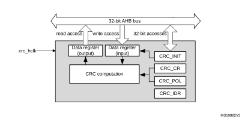

# 16 Cyclic redundancy check calculation unit (CRC)

## 16.1 Introduction

The CRC (cyclic redundancy check) calculation unit is used to get a CRC code from 8-, 16- or 32-bit data word and a generator polynomial.

Among other applications, CRC-based techniques are used to verify data transmission or storage integrity. In the scope of the functional safety standards, they offer a means of verifying the flash memory integrity. The CRC calculation unit helps compute a signature of the software during runtime, to be compared with a reference signature generated at link time and stored at a given memory location.

## 16.2 CRC main features

- Uses CRC-32 (Ethernet) polynomial: 0x4C11DB7

X32 + X26 + X23 + X22 + X16 + X12 + X11 + X10 +X8 + X7 + X5 + X4 + X2+ X +1

- Alternatively, uses fully programmable polynomial with programmable size (7, 8, 16, 32 bits)
- Handles 8-,16-, 32-bit data size
- Programmable CRC initial value
- Single input/output 32-bit data register
- Input buffer to avoid bus stall during calculation
- CRC computation done in 4 AHB clock cycles (HCLK) for the 32-bit data size
- General-purpose 8-bit register (can be used for temporary storage)
- Reversibility option on I/O data
- Accessed through AHB slave peripheral by 32-bit words only, with the exception of CRC\_DR register that can be accessed by words, right-aligned half-words and right-aligned bytes

## 16.3 CRC functional description

### 16.3.1 CRC block diagram

#### Figure 37. CRC calculation unit block diagram

### 16.3.2 CRC internal signals

 

<table class="TableTitle"><caption class="TableCap"><h4 class="TableCap" id="1024205">Table 103. <a id="signals%1112" name="XREF_66926__Table_34__Internal_input_output_signals%1112">CRC internal input/output signals</a></h4></caption><col width="158.12px"/><col width="87.18px"/><col width="293.28px"/><thead><tr height="28.00px"><th>
Signal name
</th><th>
Signal type 
</th><th>
Description
</th></tr></thead><tr height="22.67px"><td>
crc_hclk
</td><td>
Digital input
</td><td>
AHB clock
</td></tr></table>

### 16.3.3 CRC operation

The CRC calculation unit has a single 32-bit read/write data register (CRC\_DR). It is used to input new data (write access), and holds the result of the previous CRC calculation (read access).

Each write operation to the data register creates a combination of the previous CRC value (stored in CRC\_DR) and the new one. CRC computation is done on the whole 32-bit data word or byte by byte depending on the format of the data being written.

The CRC\_DR register can be accessed by word, right-aligned half-word and right-aligned byte. For the other registers only 32-bit accesses are allowed.

The duration of the computation depends on data width:

- 4 AHB clock cycles for 32 bits
- 2 AHB clock cycles for 16 bits
- 1 AHB clock cycles for 8 bits

An input buffer allows a second data to be immediately written without waiting for any wait-states due to the previous CRC calculation.

The data size can be dynamically adjusted to minimize the number of write accesses for a given number of bytes. For instance, a CRC for 5 bytes can be computed with a word write followed by a byte write.

The input data can be reversed to manage the various endianness schemes. The reversing operation can be performed on 8 bits, 16 bits and 32 bits depending on the REV\_IN[1:0] bits in the CRC\_CR register.

For example, 0x1A2B3C4D input data are used for CRC calculation as:

- 0x58D43CB2 with bit-reversal done by byte
- 0xD458B23C with bit-reversal done by half-word
- 0xB23CD458 with bit-reversal done on the full word

The output data can also be reversed by setting the REV\_OUT bit in the CRC\_CR register.

The operation is done at bit level. For example, 0x11223344 output data are converted to 0x22CC4488.

  The CRC calculator can be initialized to a programmable value using the RESET control bit in the CRC\_CR register (the default value is 0xFFFFFFFF).

The initial CRC value can be programmed with the CRC\_INIT register. The CRC\_DR register is automatically initialized upon CRC\_INIT register write access.

The CRC\_IDR register can be used to hold a temporary value related to CRC calculation. It is not affected by the RESET bit in the CRC\_CR register.

#### Polynomial programmability

The polynomial coefficients are fully programmable through the CRC\_POL register, and the polynomial size can be configured to be 7, 8, 16 or 32 bits by programming the POLYSIZE[1:0] bits in the CRC\_CR register. Even polynomials are not supported.

**Note:**

The type of an even polynomial is X+X2+..+Xn, while the type of an odd polynomial is 1+X+X2+..+Xn.

If the CRC data is less than 32-bit, its value can be read from the least significant bits of the CRC\_DR register.

To obtain a reliable CRC calculation, the change on-fly of the polynomial value or size can not be performed during a CRC calculation. As a result, if a CRC calculation is ongoing, the application must either reset it or perform a CRC\_DR read before changing the polynomial.

The default polynomial value is the CRC-32 (Ethernet) polynomial: 0x4C11DB7.

## 16.4 CRC registers

The CRC\_DR register can be accessed by words, right-aligned half-words and right-aligned bytes. For the other registers only 32-bit accesses are allowed.

### 16.4.1 CRC data register (CRC\_DR)

Address offset: 0x00

Reset value: 0xFFFF FFFF

 

<table class="RegBitMap"><col width="38.57px"/><col width="38.57px"/><col width="38.57px"/><col width="38.57px"/><col width="38.57px"/><col width="38.57px"/><col width="38.57px"/><col width="38.57px"/><col width="38.57px"/><col width="38.57px"/><col width="38.57px"/><col width="38.57px"/><col width="38.57px"/><col width="38.57px"/><col width="38.57px"/><col width="38.57px"/><tr height="17.33px"><td style="border-left-width:0;border-left-style:hidden;border-left-color:0;border-right-width:0;border-right-style:hidden;border-right-color:0;border-top-width:0;border-top-style:hidden;border-top-color:0;">
31
</td><td style="border-left-width:0;border-left-style:hidden;border-left-color:0;border-right-width:0;border-right-style:hidden;border-right-color:0;border-top-width:0;border-top-style:hidden;border-top-color:0;">
30
</td><td style="border-left-width:0;border-left-style:hidden;border-left-color:0;border-right-width:0;border-right-style:hidden;border-right-color:0;border-top-width:0;border-top-style:hidden;border-top-color:0;">
29
</td><td style="border-left-width:0;border-left-style:hidden;border-left-color:0;border-right-width:0;border-right-style:hidden;border-right-color:0;border-top-width:0;border-top-style:hidden;border-top-color:0;">
28
</td><td style="border-left-width:0;border-left-style:hidden;border-left-color:0;border-right-width:0;border-right-style:hidden;border-right-color:0;border-top-width:0;border-top-style:hidden;border-top-color:0;">
27
</td><td style="border-left-width:0;border-left-style:hidden;border-left-color:0;border-right-width:0;border-right-style:hidden;border-right-color:0;border-top-width:0;border-top-style:hidden;border-top-color:0;">
26
</td><td style="border-left-width:0;border-left-style:hidden;border-left-color:0;border-right-width:0;border-right-style:hidden;border-right-color:0;border-top-width:0;border-top-style:hidden;border-top-color:0;">
25
</td><td style="border-left-width:0;border-left-style:hidden;border-left-color:0;border-right-width:0;border-right-style:hidden;border-right-color:0;border-top-width:0;border-top-style:hidden;border-top-color:0;">
24
</td><td style="border-left-width:0;border-left-style:hidden;border-left-color:0;border-right-width:0;border-right-style:hidden;border-right-color:0;border-top-width:0;border-top-style:hidden;border-top-color:0;">
23
</td><td style="border-left-width:0;border-left-style:hidden;border-left-color:0;border-right-width:0;border-right-style:hidden;border-right-color:0;border-top-width:0;border-top-style:hidden;border-top-color:0;">
22
</td><td style="border-left-width:0;border-left-style:hidden;border-left-color:0;border-right-width:0;border-right-style:hidden;border-right-color:0;border-top-width:0;border-top-style:hidden;border-top-color:0;">
21
</td><td style="border-left-width:0;border-left-style:hidden;border-left-color:0;border-right-width:0;border-right-style:hidden;border-right-color:0;border-top-width:0;border-top-style:hidden;border-top-color:0;">
20
</td><td style="border-left-width:0;border-left-style:hidden;border-left-color:0;border-right-width:0;border-right-style:hidden;border-right-color:0;border-top-width:0;border-top-style:hidden;border-top-color:0;">
19
</td><td style="border-left-width:0;border-left-style:hidden;border-left-color:0;border-right-width:0;border-right-style:hidden;border-right-color:0;border-top-width:0;border-top-style:hidden;border-top-color:0;">
18
</td><td style="border-left-width:0;border-left-style:hidden;border-left-color:0;border-right-width:0;border-right-style:hidden;border-right-color:0;border-top-width:0;border-top-style:hidden;border-top-color:0;">
17
</td><td style="border-left-width:0;border-left-style:hidden;border-left-color:0;border-right-width:0;border-right-style:hidden;border-right-color:0;border-top-width:0;border-top-style:hidden;border-top-color:0;">
16
</td></tr><tr height="26.46px"><td colspan="16" style="border-left-width:0.5pt;border-left-style:solid;border-left-color:#000000;border-bottom-width:0.5pt;border-bottom-style:solid;border-bottom-color:#000000;border-right-width:0.5pt;border-right-style:solid;border-right-color:#000000;border-top-width:0.5pt;border-top-style:solid;border-top-color:#000000;">
DR[31:16]
</td></tr><tr height="17.33px"><td style="border-left-width:0.5pt;border-left-style:solid;border-left-color:#000000;border-bottom-width:0.5pt;border-bottom-style:solid;border-bottom-color:#000000;border-right-width:0.5pt;border-right-style:solid;border-right-color:#000000;border-top-width:0.5pt;border-top-style:solid;border-top-color:#000000;">
rw
</td><td style="border-left-width:0.5pt;border-left-style:solid;border-left-color:#000000;border-bottom-width:0.5pt;border-bottom-style:solid;border-bottom-color:#000000;border-right-width:0.5pt;border-right-style:solid;border-right-color:#000000;border-top-width:0.5pt;border-top-style:solid;border-top-color:#000000;">
rw
</td><td style="border-left-width:0.5pt;border-left-style:solid;border-left-color:#000000;border-bottom-width:0.5pt;border-bottom-style:solid;border-bottom-color:#000000;border-right-width:0.5pt;border-right-style:solid;border-right-color:#000000;border-top-width:0.5pt;border-top-style:solid;border-top-color:#000000;">
rw
</td><td style="border-left-width:0.5pt;border-left-style:solid;border-left-color:#000000;border-bottom-width:0.5pt;border-bottom-style:solid;border-bottom-color:#000000;border-right-width:0.5pt;border-right-style:solid;border-right-color:#000000;border-top-width:0.5pt;border-top-style:solid;border-top-color:#000000;">
rw
</td><td style="border-left-width:0.5pt;border-left-style:solid;border-left-color:#000000;border-bottom-width:0.5pt;border-bottom-style:solid;border-bottom-color:#000000;border-right-width:0.5pt;border-right-style:solid;border-right-color:#000000;border-top-width:0.5pt;border-top-style:solid;border-top-color:#000000;">
rw
</td><td style="border-left-width:0.5pt;border-left-style:solid;border-left-color:#000000;border-bottom-width:0.5pt;border-bottom-style:solid;border-bottom-color:#000000;border-right-width:0.5pt;border-right-style:solid;border-right-color:#000000;border-top-width:0.5pt;border-top-style:solid;border-top-color:#000000;">
rw
</td><td style="border-left-width:0.5pt;border-left-style:solid;border-left-color:#000000;border-bottom-width:0.5pt;border-bottom-style:solid;border-bottom-color:#000000;border-right-width:0.5pt;border-right-style:solid;border-right-color:#000000;border-top-width:0.5pt;border-top-style:solid;border-top-color:#000000;">
rw
</td><td style="border-left-width:0.5pt;border-left-style:solid;border-left-color:#000000;border-bottom-width:0.5pt;border-bottom-style:solid;border-bottom-color:#000000;border-right-width:0.5pt;border-right-style:solid;border-right-color:#000000;border-top-width:0.5pt;border-top-style:solid;border-top-color:#000000;">
rw
</td><td style="border-left-width:0.5pt;border-left-style:solid;border-left-color:#000000;border-bottom-width:0.5pt;border-bottom-style:solid;border-bottom-color:#000000;border-right-width:0.5pt;border-right-style:solid;border-right-color:#000000;border-top-width:0.5pt;border-top-style:solid;border-top-color:#000000;">
rw
</td><td style="border-left-width:0.5pt;border-left-style:solid;border-left-color:#000000;border-bottom-width:0.5pt;border-bottom-style:solid;border-bottom-color:#000000;border-right-width:0.5pt;border-right-style:solid;border-right-color:#000000;border-top-width:0.5pt;border-top-style:solid;border-top-color:#000000;">
rw
</td><td style="border-left-width:0.5pt;border-left-style:solid;border-left-color:#000000;border-bottom-width:0.5pt;border-bottom-style:solid;border-bottom-color:#000000;border-right-width:0.5pt;border-right-style:solid;border-right-color:#000000;border-top-width:0.5pt;border-top-style:solid;border-top-color:#000000;">
rw
</td><td style="border-left-width:0.5pt;border-left-style:solid;border-left-color:#000000;border-bottom-width:0.5pt;border-bottom-style:solid;border-bottom-color:#000000;border-right-width:0.5pt;border-right-style:solid;border-right-color:#000000;border-top-width:0.5pt;border-top-style:solid;border-top-color:#000000;">
rw
</td><td style="border-left-width:0.5pt;border-left-style:solid;border-left-color:#000000;border-bottom-width:0.5pt;border-bottom-style:solid;border-bottom-color:#000000;border-right-width:0.5pt;border-right-style:solid;border-right-color:#000000;border-top-width:0.5pt;border-top-style:solid;border-top-color:#000000;">
rw
</td><td style="border-left-width:0.5pt;border-left-style:solid;border-left-color:#000000;border-bottom-width:0.5pt;border-bottom-style:solid;border-bottom-color:#000000;border-right-width:0.5pt;border-right-style:solid;border-right-color:#000000;border-top-width:0.5pt;border-top-style:solid;border-top-color:#000000;">
rw
</td><td style="border-left-width:0.5pt;border-left-style:solid;border-left-color:#000000;border-bottom-width:0.5pt;border-bottom-style:solid;border-bottom-color:#000000;border-right-width:0.5pt;border-right-style:solid;border-right-color:#000000;border-top-width:0.5pt;border-top-style:solid;border-top-color:#000000;">
rw
</td><td style="border-left-width:0.5pt;border-left-style:solid;border-left-color:#000000;border-bottom-width:0.5pt;border-bottom-style:solid;border-bottom-color:#000000;border-right-width:0.5pt;border-right-style:solid;border-right-color:#000000;border-top-width:0.5pt;border-top-style:solid;border-top-color:#000000;">
rw
</td></tr><tr height="17.33px"><td style="border-left-width:0;border-left-style:hidden;border-left-color:0;border-bottom-width:0.5pt;border-bottom-style:solid;border-bottom-color:#000000;border-right-width:0;border-right-style:hidden;border-right-color:0;border-top-width:0.5pt;border-top-style:solid;border-top-color:#000000;">
15
</td><td style="border-left-width:0;border-left-style:hidden;border-left-color:0;border-bottom-width:0.5pt;border-bottom-style:solid;border-bottom-color:#000000;border-right-width:0;border-right-style:hidden;border-right-color:0;border-top-width:0.5pt;border-top-style:solid;border-top-color:#000000;">
14
</td><td style="border-left-width:0;border-left-style:hidden;border-left-color:0;border-bottom-width:0.5pt;border-bottom-style:solid;border-bottom-color:#000000;border-right-width:0;border-right-style:hidden;border-right-color:0;border-top-width:0.5pt;border-top-style:solid;border-top-color:#000000;">
13
</td><td style="border-left-width:0;border-left-style:hidden;border-left-color:0;border-bottom-width:0.5pt;border-bottom-style:solid;border-bottom-color:#000000;border-right-width:0;border-right-style:hidden;border-right-color:0;border-top-width:0.5pt;border-top-style:solid;border-top-color:#000000;">
12
</td><td style="border-left-width:0;border-left-style:hidden;border-left-color:0;border-bottom-width:0.5pt;border-bottom-style:solid;border-bottom-color:#000000;border-right-width:0;border-right-style:hidden;border-right-color:0;border-top-width:0.5pt;border-top-style:solid;border-top-color:#000000;">
11
</td><td style="border-left-width:0;border-left-style:hidden;border-left-color:0;border-bottom-width:0.5pt;border-bottom-style:solid;border-bottom-color:#000000;border-right-width:0;border-right-style:hidden;border-right-color:0;border-top-width:0.5pt;border-top-style:solid;border-top-color:#000000;">
10
</td><td style="border-left-width:0;border-left-style:hidden;border-left-color:0;border-bottom-width:0.5pt;border-bottom-style:solid;border-bottom-color:#000000;border-right-width:0;border-right-style:hidden;border-right-color:0;border-top-width:0.5pt;border-top-style:solid;border-top-color:#000000;">
9
</td><td style="border-left-width:0;border-left-style:hidden;border-left-color:0;border-bottom-width:0.5pt;border-bottom-style:solid;border-bottom-color:#000000;border-right-width:0;border-right-style:hidden;border-right-color:0;border-top-width:0.5pt;border-top-style:solid;border-top-color:#000000;">
8
</td><td style="border-left-width:0;border-left-style:hidden;border-left-color:0;border-bottom-width:0.5pt;border-bottom-style:solid;border-bottom-color:#000000;border-right-width:0;border-right-style:hidden;border-right-color:0;border-top-width:0.5pt;border-top-style:solid;border-top-color:#000000;">
7
</td><td style="border-left-width:0;border-left-style:hidden;border-left-color:0;border-bottom-width:0.5pt;border-bottom-style:solid;border-bottom-color:#000000;border-right-width:0;border-right-style:hidden;border-right-color:0;border-top-width:0.5pt;border-top-style:solid;border-top-color:#000000;">
6
</td><td style="border-left-width:0;border-left-style:hidden;border-left-color:0;border-bottom-width:0.5pt;border-bottom-style:solid;border-bottom-color:#000000;border-right-width:0;border-right-style:hidden;border-right-color:0;border-top-width:0.5pt;border-top-style:solid;border-top-color:#000000;">
5
</td><td style="border-left-width:0;border-left-style:hidden;border-left-color:0;border-bottom-width:0.5pt;border-bottom-style:solid;border-bottom-color:#000000;border-right-width:0;border-right-style:hidden;border-right-color:0;border-top-width:0.5pt;border-top-style:solid;border-top-color:#000000;">
4
</td><td style="border-left-width:0;border-left-style:hidden;border-left-color:0;border-bottom-width:0.5pt;border-bottom-style:solid;border-bottom-color:#000000;border-right-width:0;border-right-style:hidden;border-right-color:0;border-top-width:0.5pt;border-top-style:solid;border-top-color:#000000;">
3
</td><td style="border-left-width:0;border-left-style:hidden;border-left-color:0;border-bottom-width:0.5pt;border-bottom-style:solid;border-bottom-color:#000000;border-right-width:0;border-right-style:hidden;border-right-color:0;border-top-width:0.5pt;border-top-style:solid;border-top-color:#000000;">
2
</td><td style="border-left-width:0;border-left-style:hidden;border-left-color:0;border-bottom-width:0.5pt;border-bottom-style:solid;border-bottom-color:#000000;border-right-width:0;border-right-style:hidden;border-right-color:0;border-top-width:0.5pt;border-top-style:solid;border-top-color:#000000;">
1
</td><td style="border-left-width:0;border-left-style:hidden;border-left-color:0;border-bottom-width:0.5pt;border-bottom-style:solid;border-bottom-color:#000000;border-right-width:0;border-right-style:hidden;border-right-color:0;border-top-width:0.5pt;border-top-style:solid;border-top-color:#000000;">
0
</td></tr><tr height="26.46px"><td colspan="16" style="border-left-width:0.5pt;border-left-style:solid;border-left-color:#000000;border-bottom-width:0.5pt;border-bottom-style:solid;border-bottom-color:#000000;border-right-width:0.5pt;border-right-style:solid;border-right-color:#000000;border-top-width:0.5pt;border-top-style:solid;border-top-color:#000000;">
DR[15:0]
</td></tr><tr height="17.33px"><td style="border-left-width:0.5pt;border-left-style:solid;border-left-color:#000000;border-bottom-width:0.5pt;border-bottom-style:solid;border-bottom-color:#000000;border-right-width:0.5pt;border-right-style:solid;border-right-color:#000000;border-top-width:0.5pt;border-top-style:solid;border-top-color:#000000;">
rw
</td><td style="border-left-width:0.5pt;border-left-style:solid;border-left-color:#000000;border-bottom-width:0.5pt;border-bottom-style:solid;border-bottom-color:#000000;border-right-width:0.5pt;border-right-style:solid;border-right-color:#000000;border-top-width:0.5pt;border-top-style:solid;border-top-color:#000000;">
rw
</td><td style="border-left-width:0.5pt;border-left-style:solid;border-left-color:#000000;border-bottom-width:0.5pt;border-bottom-style:solid;border-bottom-color:#000000;border-right-width:0.5pt;border-right-style:solid;border-right-color:#000000;border-top-width:0.5pt;border-top-style:solid;border-top-color:#000000;">
rw
</td><td style="border-left-width:0.5pt;border-left-style:solid;border-left-color:#000000;border-bottom-width:0.5pt;border-bottom-style:solid;border-bottom-color:#000000;border-right-width:0.5pt;border-right-style:solid;border-right-color:#000000;border-top-width:0.5pt;border-top-style:solid;border-top-color:#000000;">
rw
</td><td style="border-left-width:0.5pt;border-left-style:solid;border-left-color:#000000;border-bottom-width:0.5pt;border-bottom-style:solid;border-bottom-color:#000000;border-right-width:0.5pt;border-right-style:solid;border-right-color:#000000;border-top-width:0.5pt;border-top-style:solid;border-top-color:#000000;">
rw
</td><td style="border-left-width:0.5pt;border-left-style:solid;border-left-color:#000000;border-bottom-width:0.5pt;border-bottom-style:solid;border-bottom-color:#000000;border-right-width:0.5pt;border-right-style:solid;border-right-color:#000000;border-top-width:0.5pt;border-top-style:solid;border-top-color:#000000;">
rw
</td><td style="border-left-width:0.5pt;border-left-style:solid;border-left-color:#000000;border-bottom-width:0.5pt;border-bottom-style:solid;border-bottom-color:#000000;border-right-width:0.5pt;border-right-style:solid;border-right-color:#000000;border-top-width:0.5pt;border-top-style:solid;border-top-color:#000000;">
rw
</td><td style="border-left-width:0.5pt;border-left-style:solid;border-left-color:#000000;border-bottom-width:0.5pt;border-bottom-style:solid;border-bottom-color:#000000;border-right-width:0.5pt;border-right-style:solid;border-right-color:#000000;border-top-width:0.5pt;border-top-style:solid;border-top-color:#000000;">
rw
</td><td style="border-left-width:0.5pt;border-left-style:solid;border-left-color:#000000;border-bottom-width:0.5pt;border-bottom-style:solid;border-bottom-color:#000000;border-right-width:0.5pt;border-right-style:solid;border-right-color:#000000;border-top-width:0.5pt;border-top-style:solid;border-top-color:#000000;">
rw
</td><td style="border-left-width:0.5pt;border-left-style:solid;border-left-color:#000000;border-bottom-width:0.5pt;border-bottom-style:solid;border-bottom-color:#000000;border-right-width:0.5pt;border-right-style:solid;border-right-color:#000000;border-top-width:0.5pt;border-top-style:solid;border-top-color:#000000;">
rw
</td><td style="border-left-width:0.5pt;border-left-style:solid;border-left-color:#000000;border-bottom-width:0.5pt;border-bottom-style:solid;border-bottom-color:#000000;border-right-width:0.5pt;border-right-style:solid;border-right-color:#000000;border-top-width:0.5pt;border-top-style:solid;border-top-color:#000000;">
rw
</td><td style="border-left-width:0.5pt;border-left-style:solid;border-left-color:#000000;border-bottom-width:0.5pt;border-bottom-style:solid;border-bottom-color:#000000;border-right-width:0.5pt;border-right-style:solid;border-right-color:#000000;border-top-width:0.5pt;border-top-style:solid;border-top-color:#000000;">
rw
</td><td style="border-left-width:0.5pt;border-left-style:solid;border-left-color:#000000;border-bottom-width:0.5pt;border-bottom-style:solid;border-bottom-color:#000000;border-right-width:0.5pt;border-right-style:solid;border-right-color:#000000;border-top-width:0.5pt;border-top-style:solid;border-top-color:#000000;">
rw
</td><td style="border-left-width:0.5pt;border-left-style:solid;border-left-color:#000000;border-bottom-width:0.5pt;border-bottom-style:solid;border-bottom-color:#000000;border-right-width:0.5pt;border-right-style:solid;border-right-color:#000000;border-top-width:0.5pt;border-top-style:solid;border-top-color:#000000;">
rw
</td><td style="border-left-width:0.5pt;border-left-style:solid;border-left-color:#000000;border-bottom-width:0.5pt;border-bottom-style:solid;border-bottom-color:#000000;border-right-width:0.5pt;border-right-style:solid;border-right-color:#000000;border-top-width:0.5pt;border-top-style:solid;border-top-color:#000000;">
rw
</td><td style="border-left-width:0.5pt;border-left-style:solid;border-left-color:#000000;border-bottom-width:0.5pt;border-bottom-style:solid;border-bottom-color:#000000;border-right-width:0.5pt;border-right-style:solid;border-right-color:#000000;border-top-width:0.5pt;border-top-style:solid;border-top-color:#000000;">
rw
</td></tr></table>

 

<table class="RegBitDef"><col width="113.39px"/><col width="500.79px"/><tr height="86.67px"><td>
Bits 31:0
</td><td>
DR[31:0]: Data register bits

This register is used to write new data to the CRC calculator.

It holds the previous CRC calculation result when it is read.

If the data size is less than 32 bits, the least significant bits are used to write/read the correct value.
</td></tr></table>

### 16.4.2 CRC independent data register (CRC\_IDR)

Address offset: 0x04

Reset value: 0x0000 0000

<table class="RegBitMap"><col width="37.30px"/><col width="37.30px"/><col width="37.30px"/><col width="37.30px"/><col width="37.30px"/><col width="37.30px"/><col width="39.47px"/><col width="39.47px"/><col width="39.14px"/><col width="39.14px"/><col width="39.14px"/><col width="39.14px"/><col width="39.14px"/><col width="39.14px"/><col width="39.47px"/><col width="39.48px"/><tr height="17.33px"><td style="border-left-width:0;border-left-style:hidden;border-left-color:0;border-right-width:0;border-right-style:hidden;border-right-color:0;border-top-width:0;border-top-style:hidden;border-top-color:0;">
31
</td><td style="border-left-width:0;border-left-style:hidden;border-left-color:0;border-right-width:0;border-right-style:hidden;border-right-color:0;border-top-width:0;border-top-style:hidden;border-top-color:0;">
30
</td><td style="border-left-width:0;border-left-style:hidden;border-left-color:0;border-right-width:0;border-right-style:hidden;border-right-color:0;border-top-width:0;border-top-style:hidden;border-top-color:0;">
29
</td><td style="border-left-width:0;border-left-style:hidden;border-left-color:0;border-right-width:0;border-right-style:hidden;border-right-color:0;border-top-width:0;border-top-style:hidden;border-top-color:0;">
28
</td><td style="border-left-width:0;border-left-style:hidden;border-left-color:0;border-right-width:0;border-right-style:hidden;border-right-color:0;border-top-width:0;border-top-style:hidden;border-top-color:0;">
27
</td><td style="border-left-width:0;border-left-style:hidden;border-left-color:0;border-right-width:0;border-right-style:hidden;border-right-color:0;border-top-width:0;border-top-style:hidden;border-top-color:0;">
26
</td><td style="border-left-width:0;border-left-style:hidden;border-left-color:0;border-right-width:0;border-right-style:hidden;border-right-color:0;border-top-width:0;border-top-style:hidden;border-top-color:0;">
25
</td><td style="border-left-width:0;border-left-style:hidden;border-left-color:0;border-right-width:0;border-right-style:hidden;border-right-color:0;border-top-width:0;border-top-style:hidden;border-top-color:0;">
24
</td><td style="border-left-width:0;border-left-style:hidden;border-left-color:0;border-right-width:0;border-right-style:hidden;border-right-color:0;border-top-width:0;border-top-style:hidden;border-top-color:0;">
23
</td><td style="border-left-width:0;border-left-style:hidden;border-left-color:0;border-right-width:0;border-right-style:hidden;border-right-color:0;border-top-width:0;border-top-style:hidden;border-top-color:0;">
22
</td><td style="border-left-width:0;border-left-style:hidden;border-left-color:0;border-right-width:0;border-right-style:hidden;border-right-color:0;border-top-width:0;border-top-style:hidden;border-top-color:0;">
21
</td><td style="border-left-width:0;border-left-style:hidden;border-left-color:0;border-right-width:0;border-right-style:hidden;border-right-color:0;border-top-width:0;border-top-style:hidden;border-top-color:0;">
20
</td><td style="border-left-width:0;border-left-style:hidden;border-left-color:0;border-right-width:0;border-right-style:hidden;border-right-color:0;border-top-width:0;border-top-style:hidden;border-top-color:0;">
19
</td><td style="border-left-width:0;border-left-style:hidden;border-left-color:0;border-right-width:0;border-right-style:hidden;border-right-color:0;border-top-width:0;border-top-style:hidden;border-top-color:0;">
18
</td><td style="border-left-width:0;border-left-style:hidden;border-left-color:0;border-right-width:0;border-right-style:hidden;border-right-color:0;border-top-width:0;border-top-style:hidden;border-top-color:0;">
17
</td><td style="border-left-width:0;border-left-style:hidden;border-left-color:0;border-right-width:0;border-right-style:hidden;border-right-color:0;border-top-width:0;border-top-style:hidden;border-top-color:0;">
16
</td></tr><tr height="26.46px"><td colspan="16" style="border-left-width:0.299988pt;border-left-style:solid;border-left-color:#000000;border-bottom-width:0.299988pt;border-bottom-style:solid;border-bottom-color:#000000;border-right-width:0.299988pt;border-right-style:solid;border-right-color:#000000;border-top-width:0.299988pt;border-top-style:solid;border-top-color:#000000;">
IDR[31:16]
</td></tr><tr height="17.33px"><td style="border-left-width:0.5pt;border-left-style:solid;border-left-color:#000000;border-bottom-width:0.5pt;border-bottom-style:solid;border-bottom-color:#000000;border-right-width:0.5pt;border-right-style:solid;border-right-color:#000000;border-top-width:0.5pt;border-top-style:solid;border-top-color:#000000;">
rw
</td><td style="border-left-width:0.5pt;border-left-style:solid;border-left-color:#000000;border-bottom-width:0.5pt;border-bottom-style:solid;border-bottom-color:#000000;border-right-width:0.5pt;border-right-style:solid;border-right-color:#000000;border-top-width:0.5pt;border-top-style:solid;border-top-color:#000000;">
rw
</td><td style="border-left-width:0.5pt;border-left-style:solid;border-left-color:#000000;border-bottom-width:0.5pt;border-bottom-style:solid;border-bottom-color:#000000;border-right-width:0.5pt;border-right-style:solid;border-right-color:#000000;border-top-width:0.5pt;border-top-style:solid;border-top-color:#000000;">
rw
</td><td style="border-left-width:0.5pt;border-left-style:solid;border-left-color:#000000;border-bottom-width:0.5pt;border-bottom-style:solid;border-bottom-color:#000000;border-right-width:0.5pt;border-right-style:solid;border-right-color:#000000;border-top-width:0.5pt;border-top-style:solid;border-top-color:#000000;">
rw
</td><td style="border-left-width:0.5pt;border-left-style:solid;border-left-color:#000000;border-bottom-width:0.5pt;border-bottom-style:solid;border-bottom-color:#000000;border-right-width:0.5pt;border-right-style:solid;border-right-color:#000000;border-top-width:0.5pt;border-top-style:solid;border-top-color:#000000;">
rw
</td><td style="border-left-width:0.5pt;border-left-style:solid;border-left-color:#000000;border-bottom-width:0.5pt;border-bottom-style:solid;border-bottom-color:#000000;border-right-width:0.5pt;border-right-style:solid;border-right-color:#000000;border-top-width:0.5pt;border-top-style:solid;border-top-color:#000000;">
rw
</td><td style="border-left-width:0.5pt;border-left-style:solid;border-left-color:#000000;border-bottom-width:0.5pt;border-bottom-style:solid;border-bottom-color:#000000;border-right-width:0.5pt;border-right-style:solid;border-right-color:#000000;border-top-width:0.5pt;border-top-style:solid;border-top-color:#000000;">
rw
</td><td style="border-left-width:0.5pt;border-left-style:solid;border-left-color:#000000;border-bottom-width:0.5pt;border-bottom-style:solid;border-bottom-color:#000000;border-right-width:0.5pt;border-right-style:solid;border-right-color:#000000;border-top-width:0.5pt;border-top-style:solid;border-top-color:#000000;">
rw
</td><td style="border-left-width:0.5pt;border-left-style:solid;border-left-color:#000000;border-bottom-width:0.5pt;border-bottom-style:solid;border-bottom-color:#000000;border-right-width:0.5pt;border-right-style:solid;border-right-color:#000000;border-top-width:0.5pt;border-top-style:solid;border-top-color:#000000;">
rw
</td><td style="border-left-width:0.5pt;border-left-style:solid;border-left-color:#000000;border-bottom-width:0.5pt;border-bottom-style:solid;border-bottom-color:#000000;border-right-width:0.5pt;border-right-style:solid;border-right-color:#000000;border-top-width:0.5pt;border-top-style:solid;border-top-color:#000000;">
rw
</td><td style="border-left-width:0.5pt;border-left-style:solid;border-left-color:#000000;border-bottom-width:0.5pt;border-bottom-style:solid;border-bottom-color:#000000;border-right-width:0.5pt;border-right-style:solid;border-right-color:#000000;border-top-width:0.5pt;border-top-style:solid;border-top-color:#000000;">
rw
</td><td style="border-left-width:0.5pt;border-left-style:solid;border-left-color:#000000;border-bottom-width:0.5pt;border-bottom-style:solid;border-bottom-color:#000000;border-right-width:0.5pt;border-right-style:solid;border-right-color:#000000;border-top-width:0.5pt;border-top-style:solid;border-top-color:#000000;">
rw
</td><td style="border-left-width:0.5pt;border-left-style:solid;border-left-color:#000000;border-bottom-width:0.5pt;border-bottom-style:solid;border-bottom-color:#000000;border-right-width:0.5pt;border-right-style:solid;border-right-color:#000000;border-top-width:0.5pt;border-top-style:solid;border-top-color:#000000;">
rw
</td><td style="border-left-width:0.5pt;border-left-style:solid;border-left-color:#000000;border-bottom-width:0.5pt;border-bottom-style:solid;border-bottom-color:#000000;border-right-width:0.5pt;border-right-style:solid;border-right-color:#000000;border-top-width:0.5pt;border-top-style:solid;border-top-color:#000000;">
rw
</td><td style="border-left-width:0.5pt;border-left-style:solid;border-left-color:#000000;border-bottom-width:0.5pt;border-bottom-style:solid;border-bottom-color:#000000;border-right-width:0.5pt;border-right-style:solid;border-right-color:#000000;border-top-width:0.5pt;border-top-style:solid;border-top-color:#000000;">
rw
</td><td style="border-left-width:0.5pt;border-left-style:solid;border-left-color:#000000;border-bottom-width:0.5pt;border-bottom-style:solid;border-bottom-color:#000000;border-right-width:0.5pt;border-right-style:solid;border-right-color:#000000;border-top-width:0.5pt;border-top-style:solid;border-top-color:#000000;">
rw
</td></tr><tr height="17.33px"><td style="border-left-width:0;border-left-style:hidden;border-left-color:0;border-right-width:0;border-right-style:hidden;border-right-color:0;border-top-width:0;border-top-style:hidden;border-top-color:0;">
15
</td><td style="border-left-width:0;border-left-style:hidden;border-left-color:0;border-right-width:0;border-right-style:hidden;border-right-color:0;border-top-width:0;border-top-style:hidden;border-top-color:0;">
14
</td><td style="border-left-width:0;border-left-style:hidden;border-left-color:0;border-right-width:0;border-right-style:hidden;border-right-color:0;border-top-width:0;border-top-style:hidden;border-top-color:0;">
13
</td><td style="border-left-width:0;border-left-style:hidden;border-left-color:0;border-right-width:0;border-right-style:hidden;border-right-color:0;border-top-width:0;border-top-style:hidden;border-top-color:0;">
12
</td><td style="border-left-width:0;border-left-style:hidden;border-left-color:0;border-right-width:0;border-right-style:hidden;border-right-color:0;border-top-width:0;border-top-style:hidden;border-top-color:0;">
11
</td><td style="border-left-width:0;border-left-style:hidden;border-left-color:0;border-right-width:0;border-right-style:hidden;border-right-color:0;border-top-width:0;border-top-style:hidden;border-top-color:0;">
10
</td><td style="border-left-width:0;border-left-style:hidden;border-left-color:0;border-right-width:0;border-right-style:hidden;border-right-color:0;border-top-width:0;border-top-style:hidden;border-top-color:0;">
9
</td><td style="border-left-width:0;border-left-style:hidden;border-left-color:0;border-right-width:0;border-right-style:hidden;border-right-color:0;border-top-width:0;border-top-style:hidden;border-top-color:0;">
8
</td><td style="border-left-width:0;border-left-style:hidden;border-left-color:0;border-right-width:0;border-right-style:hidden;border-right-color:0;border-top-width:0;border-top-style:hidden;border-top-color:0;">
7
</td><td style="border-left-width:0;border-left-style:hidden;border-left-color:0;border-right-width:0;border-right-style:hidden;border-right-color:0;border-top-width:0;border-top-style:hidden;border-top-color:0;">
6
</td><td style="border-left-width:0;border-left-style:hidden;border-left-color:0;border-right-width:0;border-right-style:hidden;border-right-color:0;border-top-width:0;border-top-style:hidden;border-top-color:0;">
5
</td><td style="border-left-width:0;border-left-style:hidden;border-left-color:0;border-right-width:0;border-right-style:hidden;border-right-color:0;border-top-width:0;border-top-style:hidden;border-top-color:0;">
4
</td><td style="border-left-width:0;border-left-style:hidden;border-left-color:0;border-right-width:0;border-right-style:hidden;border-right-color:0;border-top-width:0;border-top-style:hidden;border-top-color:0;">
3
</td><td style="border-left-width:0;border-left-style:hidden;border-left-color:0;border-right-width:0;border-right-style:hidden;border-right-color:0;border-top-width:0;border-top-style:hidden;border-top-color:0;">
2
</td><td style="border-left-width:0;border-left-style:hidden;border-left-color:0;border-right-width:0;border-right-style:hidden;border-right-color:0;border-top-width:0;border-top-style:hidden;border-top-color:0;">
1
</td><td style="border-left-width:0;border-left-style:hidden;border-left-color:0;border-right-width:0;border-right-style:hidden;border-right-color:0;border-top-width:0;border-top-style:hidden;border-top-color:0;">
0
</td></tr><tr height="26.46px"><td colspan="16" style="border-left-width:0.299988pt;border-left-style:solid;border-left-color:#000000;border-bottom-width:0.299988pt;border-bottom-style:solid;border-bottom-color:#000000;border-right-width:0.299988pt;border-right-style:solid;border-right-color:#000000;border-top-width:0.299988pt;border-top-style:solid;border-top-color:#000000;">
IDR[15:0]
</td></tr><tr height="17.33px"><td style="border-left-width:0.5pt;border-left-style:solid;border-left-color:#000000;border-bottom-width:0.5pt;border-bottom-style:solid;border-bottom-color:#000000;border-right-width:0.5pt;border-right-style:solid;border-right-color:#000000;border-top-width:0.5pt;border-top-style:solid;border-top-color:#000000;">
rw
</td><td style="border-left-width:0.5pt;border-left-style:solid;border-left-color:#000000;border-bottom-width:0.5pt;border-bottom-style:solid;border-bottom-color:#000000;border-right-width:0.5pt;border-right-style:solid;border-right-color:#000000;border-top-width:0.5pt;border-top-style:solid;border-top-color:#000000;">
rw
</td><td style="border-left-width:0.5pt;border-left-style:solid;border-left-color:#000000;border-bottom-width:0.5pt;border-bottom-style:solid;border-bottom-color:#000000;border-right-width:0.5pt;border-right-style:solid;border-right-color:#000000;border-top-width:0.5pt;border-top-style:solid;border-top-color:#000000;">
rw
</td><td style="border-left-width:0.5pt;border-left-style:solid;border-left-color:#000000;border-bottom-width:0.5pt;border-bottom-style:solid;border-bottom-color:#000000;border-right-width:0.5pt;border-right-style:solid;border-right-color:#000000;border-top-width:0.5pt;border-top-style:solid;border-top-color:#000000;">
rw
</td><td style="border-left-width:0.5pt;border-left-style:solid;border-left-color:#000000;border-bottom-width:0.5pt;border-bottom-style:solid;border-bottom-color:#000000;border-right-width:0.5pt;border-right-style:solid;border-right-color:#000000;border-top-width:0.5pt;border-top-style:solid;border-top-color:#000000;">
rw
</td><td style="border-left-width:0.5pt;border-left-style:solid;border-left-color:#000000;border-bottom-width:0.5pt;border-bottom-style:solid;border-bottom-color:#000000;border-right-width:0.5pt;border-right-style:solid;border-right-color:#000000;border-top-width:0.5pt;border-top-style:solid;border-top-color:#000000;">
rw
</td><td style="border-left-width:0.5pt;border-left-style:solid;border-left-color:#000000;border-bottom-width:0.5pt;border-bottom-style:solid;border-bottom-color:#000000;border-right-width:0.5pt;border-right-style:solid;border-right-color:#000000;border-top-width:0.5pt;border-top-style:solid;border-top-color:#000000;">
rw
</td><td style="border-left-width:0.5pt;border-left-style:solid;border-left-color:#000000;border-bottom-width:0.5pt;border-bottom-style:solid;border-bottom-color:#000000;border-right-width:0.5pt;border-right-style:solid;border-right-color:#000000;border-top-width:0.5pt;border-top-style:solid;border-top-color:#000000;">
rw
</td><td style="border-left-width:0.5pt;border-left-style:solid;border-left-color:#000000;border-bottom-width:0.5pt;border-bottom-style:solid;border-bottom-color:#000000;border-right-width:0.5pt;border-right-style:solid;border-right-color:#000000;border-top-width:0.5pt;border-top-style:solid;border-top-color:#000000;">
rw
</td><td style="border-left-width:0.5pt;border-left-style:solid;border-left-color:#000000;border-bottom-width:0.5pt;border-bottom-style:solid;border-bottom-color:#000000;border-right-width:0.5pt;border-right-style:solid;border-right-color:#000000;border-top-width:0.5pt;border-top-style:solid;border-top-color:#000000;">
rw
</td><td style="border-left-width:0.5pt;border-left-style:solid;border-left-color:#000000;border-bottom-width:0.5pt;border-bottom-style:solid;border-bottom-color:#000000;border-right-width:0.5pt;border-right-style:solid;border-right-color:#000000;border-top-width:0.5pt;border-top-style:solid;border-top-color:#000000;">
rw
</td><td style="border-left-width:0.5pt;border-left-style:solid;border-left-color:#000000;border-bottom-width:0.5pt;border-bottom-style:solid;border-bottom-color:#000000;border-right-width:0.5pt;border-right-style:solid;border-right-color:#000000;border-top-width:0.5pt;border-top-style:solid;border-top-color:#000000;">
rw
</td><td style="border-left-width:0.5pt;border-left-style:solid;border-left-color:#000000;border-bottom-width:0.5pt;border-bottom-style:solid;border-bottom-color:#000000;border-right-width:0.5pt;border-right-style:solid;border-right-color:#000000;border-top-width:0.5pt;border-top-style:solid;border-top-color:#000000;">
rw
</td><td style="border-left-width:0.5pt;border-left-style:solid;border-left-color:#000000;border-bottom-width:0.5pt;border-bottom-style:solid;border-bottom-color:#000000;border-right-width:0.5pt;border-right-style:solid;border-right-color:#000000;border-top-width:0.5pt;border-top-style:solid;border-top-color:#000000;">
rw
</td><td style="border-left-width:0.5pt;border-left-style:solid;border-left-color:#000000;border-bottom-width:0.5pt;border-bottom-style:solid;border-bottom-color:#000000;border-right-width:0.5pt;border-right-style:solid;border-right-color:#000000;border-top-width:0.5pt;border-top-style:solid;border-top-color:#000000;">
rw
</td><td style="border-left-width:0.5pt;border-left-style:solid;border-left-color:#000000;border-bottom-width:0.5pt;border-bottom-style:solid;border-bottom-color:#000000;border-right-width:0.5pt;border-right-style:solid;border-right-color:#000000;border-top-width:0.5pt;border-top-style:solid;border-top-color:#000000;">
rw
</td></tr></table>

<table class="RegBitDef"><col width="113.39px"/><col width="500.79px"/><tr height="70.67px"><td>
Bits 31:0
</td><td>
IDR[31:0]: General-purpose 32-bit data register bits

These bits can be used as a temporary storage location for four bytes.

This register is not affected by CRC resets generated by the RESET bit in the CRC_CR register
</td></tr></table>

### 16.4.3 CRC control register (CRC\_CR)

Address offset: 0x08

Reset value: 0x0000 0000

<table class="RegBitMap"><col width="38.39px"/><col width="38.39px"/><col width="38.39px"/><col width="38.39px"/><col width="38.39px"/><col width="38.39px"/><col width="38.39px"/><col width="41.24px"/><col width="41.24px"/><col width="38.39px"/><col width="38.39px"/><col width="38.39px"/><col width="38.39px"/><col width="38.39px"/><col width="38.39px"/><col width="38.39px"/><tr height="17.33px"><td style="border-left-width:0;border-left-style:hidden;border-left-color:0;border-right-width:0;border-right-style:hidden;border-right-color:0;border-top-width:0;border-top-style:hidden;border-top-color:0;">
31
</td><td style="border-left-width:0;border-left-style:hidden;border-left-color:0;border-right-width:0;border-right-style:hidden;border-right-color:0;border-top-width:0;border-top-style:hidden;border-top-color:0;">
30
</td><td style="border-left-width:0;border-left-style:hidden;border-left-color:0;border-right-width:0;border-right-style:hidden;border-right-color:0;border-top-width:0;border-top-style:hidden;border-top-color:0;">
29
</td><td style="border-left-width:0;border-left-style:hidden;border-left-color:0;border-right-width:0;border-right-style:hidden;border-right-color:0;border-top-width:0;border-top-style:hidden;border-top-color:0;">
28
</td><td style="border-left-width:0;border-left-style:hidden;border-left-color:0;border-right-width:0;border-right-style:hidden;border-right-color:0;border-top-width:0;border-top-style:hidden;border-top-color:0;">
27
</td><td style="border-left-width:0;border-left-style:hidden;border-left-color:0;border-right-width:0;border-right-style:hidden;border-right-color:0;border-top-width:0;border-top-style:hidden;border-top-color:0;">
26
</td><td style="border-left-width:0;border-left-style:hidden;border-left-color:0;border-right-width:0;border-right-style:hidden;border-right-color:0;border-top-width:0;border-top-style:hidden;border-top-color:0;">
25
</td><td style="border-left-width:0;border-left-style:hidden;border-left-color:0;border-right-width:0;border-right-style:hidden;border-right-color:0;border-top-width:0;border-top-style:hidden;border-top-color:0;">
24
</td><td style="border-left-width:0;border-left-style:hidden;border-left-color:0;border-right-width:0;border-right-style:hidden;border-right-color:0;border-top-width:0;border-top-style:hidden;border-top-color:0;">
23
</td><td style="border-left-width:0;border-left-style:hidden;border-left-color:0;border-right-width:0;border-right-style:hidden;border-right-color:0;border-top-width:0;border-top-style:hidden;border-top-color:0;">
22
</td><td style="border-left-width:0;border-left-style:hidden;border-left-color:0;border-right-width:0;border-right-style:hidden;border-right-color:0;border-top-width:0;border-top-style:hidden;border-top-color:0;">
21
</td><td style="border-left-width:0;border-left-style:hidden;border-left-color:0;border-right-width:0;border-right-style:hidden;border-right-color:0;border-top-width:0;border-top-style:hidden;border-top-color:0;">
20
</td><td style="border-left-width:0;border-left-style:hidden;border-left-color:0;border-right-width:0;border-right-style:hidden;border-right-color:0;border-top-width:0;border-top-style:hidden;border-top-color:0;">
19
</td><td style="border-left-width:0;border-left-style:hidden;border-left-color:0;border-right-width:0;border-right-style:hidden;border-right-color:0;border-top-width:0;border-top-style:hidden;border-top-color:0;">
18
</td><td style="border-left-width:0;border-left-style:hidden;border-left-color:0;border-right-width:0;border-right-style:hidden;border-right-color:0;border-top-width:0;border-top-style:hidden;border-top-color:0;">
17
</td><td style="border-left-width:0;border-left-style:hidden;border-left-color:0;border-right-width:0;border-right-style:hidden;border-right-color:0;border-top-width:0;border-top-style:hidden;border-top-color:0;">
16
</td></tr><tr height="26.46px"><td style="border-left-width:0.299988pt;border-left-style:solid;border-left-color:#000000;border-bottom-width:0.299988pt;border-bottom-style:solid;border-bottom-color:#000000;border-right-width:0.299988pt;border-right-style:solid;border-right-color:#000000;border-top-width:0.299988pt;border-top-style:solid;border-top-color:#000000;">
Res.
</td><td style="border-left-width:0.299988pt;border-left-style:solid;border-left-color:#000000;border-bottom-width:0.299988pt;border-bottom-style:solid;border-bottom-color:#000000;border-right-width:0.299988pt;border-right-style:solid;border-right-color:#000000;border-top-width:0.299988pt;border-top-style:solid;border-top-color:#000000;">
Res.
</td><td style="border-left-width:0.299988pt;border-left-style:solid;border-left-color:#000000;border-bottom-width:0.299988pt;border-bottom-style:solid;border-bottom-color:#000000;border-right-width:0.299988pt;border-right-style:solid;border-right-color:#000000;border-top-width:0.299988pt;border-top-style:solid;border-top-color:#000000;">
Res.
</td><td style="border-left-width:0.299988pt;border-left-style:solid;border-left-color:#000000;border-bottom-width:0.299988pt;border-bottom-style:solid;border-bottom-color:#000000;border-right-width:0.299988pt;border-right-style:solid;border-right-color:#000000;border-top-width:0.299988pt;border-top-style:solid;border-top-color:#000000;">
Res.
</td><td style="border-left-width:0.299988pt;border-left-style:solid;border-left-color:#000000;border-bottom-width:0.299988pt;border-bottom-style:solid;border-bottom-color:#000000;border-right-width:0.299988pt;border-right-style:solid;border-right-color:#000000;border-top-width:0.299988pt;border-top-style:solid;border-top-color:#000000;">
Res.
</td><td style="border-left-width:0.299988pt;border-left-style:solid;border-left-color:#000000;border-bottom-width:0.299988pt;border-bottom-style:solid;border-bottom-color:#000000;border-right-width:0.299988pt;border-right-style:solid;border-right-color:#000000;border-top-width:0.299988pt;border-top-style:solid;border-top-color:#000000;">
Res.
</td><td style="border-left-width:0.299988pt;border-left-style:solid;border-left-color:#000000;border-bottom-width:0.299988pt;border-bottom-style:solid;border-bottom-color:#000000;border-right-width:0.299988pt;border-right-style:solid;border-right-color:#000000;border-top-width:0.299988pt;border-top-style:solid;border-top-color:#000000;">
Res.
</td><td style="border-left-width:0.299988pt;border-left-style:solid;border-left-color:#000000;border-bottom-width:0.299988pt;border-bottom-style:solid;border-bottom-color:#000000;border-right-width:0.299988pt;border-right-style:solid;border-right-color:#000000;border-top-width:0.299988pt;border-top-style:solid;border-top-color:#000000;">
Res.
</td><td style="border-left-width:0.299988pt;border-left-style:solid;border-left-color:#000000;border-bottom-width:0.299988pt;border-bottom-style:solid;border-bottom-color:#000000;border-right-width:0.299988pt;border-right-style:solid;border-right-color:#000000;border-top-width:0.299988pt;border-top-style:solid;border-top-color:#000000;">
Res.
</td><td style="border-left-width:0.299988pt;border-left-style:solid;border-left-color:#000000;border-bottom-width:0.299988pt;border-bottom-style:solid;border-bottom-color:#000000;border-right-width:0.299988pt;border-right-style:solid;border-right-color:#000000;border-top-width:0.299988pt;border-top-style:solid;border-top-color:#000000;">
Res.
</td><td style="border-left-width:0.299988pt;border-left-style:solid;border-left-color:#000000;border-bottom-width:0.299988pt;border-bottom-style:solid;border-bottom-color:#000000;border-right-width:0.299988pt;border-right-style:solid;border-right-color:#000000;border-top-width:0.299988pt;border-top-style:solid;border-top-color:#000000;">
Res.
</td><td style="border-left-width:0.299988pt;border-left-style:solid;border-left-color:#000000;border-bottom-width:0.299988pt;border-bottom-style:solid;border-bottom-color:#000000;border-right-width:0.299988pt;border-right-style:solid;border-right-color:#000000;border-top-width:0.299988pt;border-top-style:solid;border-top-color:#000000;">
Res.
</td><td style="border-left-width:0.299988pt;border-left-style:solid;border-left-color:#000000;border-bottom-width:0.299988pt;border-bottom-style:solid;border-bottom-color:#000000;border-right-width:0.299988pt;border-right-style:solid;border-right-color:#000000;border-top-width:0.299988pt;border-top-style:solid;border-top-color:#000000;">
Res.
</td><td style="border-left-width:0.299988pt;border-left-style:solid;border-left-color:#000000;border-bottom-width:0.299988pt;border-bottom-style:solid;border-bottom-color:#000000;border-right-width:0.299988pt;border-right-style:solid;border-right-color:#000000;border-top-width:0.299988pt;border-top-style:solid;border-top-color:#000000;">
Res.
</td><td style="border-left-width:0.299988pt;border-left-style:solid;border-left-color:#000000;border-bottom-width:0.299988pt;border-bottom-style:solid;border-bottom-color:#000000;border-right-width:0.299988pt;border-right-style:solid;border-right-color:#000000;border-top-width:0.299988pt;border-top-style:solid;border-top-color:#000000;">
Res.
</td><td style="border-left-width:0.299988pt;border-left-style:solid;border-left-color:#000000;border-bottom-width:0.299988pt;border-bottom-style:solid;border-bottom-color:#000000;border-right-width:0.299988pt;border-right-style:solid;border-right-color:#000000;border-top-width:0.299988pt;border-top-style:solid;border-top-color:#000000;">
Res.
</td></tr><tr height="17.33px"><td style="border-left-width:0.299988pt;border-left-style:solid;border-left-color:#000000;border-bottom-width:0.299988pt;border-bottom-style:solid;border-bottom-color:#000000;border-right-width:0.299988pt;border-right-style:solid;border-right-color:#000000;border-top-width:0.299988pt;border-top-style:solid;border-top-color:#000000;"></td><td style="border-left-width:0.299988pt;border-left-style:solid;border-left-color:#000000;border-bottom-width:0.299988pt;border-bottom-style:solid;border-bottom-color:#000000;border-right-width:0.299988pt;border-right-style:solid;border-right-color:#000000;border-top-width:0.299988pt;border-top-style:solid;border-top-color:#000000;"></td><td style="border-left-width:0.299988pt;border-left-style:solid;border-left-color:#000000;border-bottom-width:0.299988pt;border-bottom-style:solid;border-bottom-color:#000000;border-right-width:0.299988pt;border-right-style:solid;border-right-color:#000000;border-top-width:0.299988pt;border-top-style:solid;border-top-color:#000000;"></td><td style="border-left-width:0.299988pt;border-left-style:solid;border-left-color:#000000;border-bottom-width:0.299988pt;border-bottom-style:solid;border-bottom-color:#000000;border-right-width:0.299988pt;border-right-style:solid;border-right-color:#000000;border-top-width:0.299988pt;border-top-style:solid;border-top-color:#000000;"></td><td style="border-left-width:0.299988pt;border-left-style:solid;border-left-color:#000000;border-bottom-width:0.299988pt;border-bottom-style:solid;border-bottom-color:#000000;border-right-width:0.299988pt;border-right-style:solid;border-right-color:#000000;border-top-width:0.299988pt;border-top-style:solid;border-top-color:#000000;"></td><td style="border-left-width:0.299988pt;border-left-style:solid;border-left-color:#000000;border-bottom-width:0.299988pt;border-bottom-style:solid;border-bottom-color:#000000;border-right-width:0.299988pt;border-right-style:solid;border-right-color:#000000;border-top-width:0.299988pt;border-top-style:solid;border-top-color:#000000;"></td><td style="border-left-width:0.299988pt;border-left-style:solid;border-left-color:#000000;border-bottom-width:0.299988pt;border-bottom-style:solid;border-bottom-color:#000000;border-right-width:0.299988pt;border-right-style:solid;border-right-color:#000000;border-top-width:0.299988pt;border-top-style:solid;border-top-color:#000000;"></td><td style="border-left-width:0.299988pt;border-left-style:solid;border-left-color:#000000;border-bottom-width:0.299988pt;border-bottom-style:solid;border-bottom-color:#000000;border-right-width:0.299988pt;border-right-style:solid;border-right-color:#000000;border-top-width:0.299988pt;border-top-style:solid;border-top-color:#000000;"></td><td style="border-left-width:0.299988pt;border-left-style:solid;border-left-color:#000000;border-bottom-width:0.299988pt;border-bottom-style:solid;border-bottom-color:#000000;border-right-width:0.299988pt;border-right-style:solid;border-right-color:#000000;border-top-width:0.299988pt;border-top-style:solid;border-top-color:#000000;"></td><td style="border-left-width:0.299988pt;border-left-style:solid;border-left-color:#000000;border-bottom-width:0.299988pt;border-bottom-style:solid;border-bottom-color:#000000;border-right-width:0.299988pt;border-right-style:solid;border-right-color:#000000;border-top-width:0.299988pt;border-top-style:solid;border-top-color:#000000;"></td><td style="border-left-width:0.299988pt;border-left-style:solid;border-left-color:#000000;border-bottom-width:0.299988pt;border-bottom-style:solid;border-bottom-color:#000000;border-right-width:0.299988pt;border-right-style:solid;border-right-color:#000000;border-top-width:0.299988pt;border-top-style:solid;border-top-color:#000000;"></td><td style="border-left-width:0.299988pt;border-left-style:solid;border-left-color:#000000;border-bottom-width:0.299988pt;border-bottom-style:solid;border-bottom-color:#000000;border-right-width:0.299988pt;border-right-style:solid;border-right-color:#000000;border-top-width:0.299988pt;border-top-style:solid;border-top-color:#000000;"></td><td style="border-left-width:0.299988pt;border-left-style:solid;border-left-color:#000000;border-bottom-width:0.299988pt;border-bottom-style:solid;border-bottom-color:#000000;border-right-width:0.299988pt;border-right-style:solid;border-right-color:#000000;border-top-width:0.299988pt;border-top-style:solid;border-top-color:#000000;"></td><td style="border-left-width:0.299988pt;border-left-style:solid;border-left-color:#000000;border-bottom-width:0.299988pt;border-bottom-style:solid;border-bottom-color:#000000;border-right-width:0.299988pt;border-right-style:solid;border-right-color:#000000;border-top-width:0.299988pt;border-top-style:solid;border-top-color:#000000;"></td><td style="border-left-width:0.299988pt;border-left-style:solid;border-left-color:#000000;border-bottom-width:0.299988pt;border-bottom-style:solid;border-bottom-color:#000000;border-right-width:0.299988pt;border-right-style:solid;border-right-color:#000000;border-top-width:0.299988pt;border-top-style:solid;border-top-color:#000000;"></td><td style="border-left-width:0.299988pt;border-left-style:solid;border-left-color:#000000;border-bottom-width:0.299988pt;border-bottom-style:solid;border-bottom-color:#000000;border-right-width:0.299988pt;border-right-style:solid;border-right-color:#000000;border-top-width:0.299988pt;border-top-style:solid;border-top-color:#000000;"></td></tr><tr height="17.33px"><td style="border-left-width:0;border-left-style:hidden;border-left-color:0;border-right-width:0;border-right-style:hidden;border-right-color:0;border-top-width:0;border-top-style:hidden;border-top-color:0;">
15
</td><td style="border-left-width:0;border-left-style:hidden;border-left-color:0;border-right-width:0;border-right-style:hidden;border-right-color:0;border-top-width:0;border-top-style:hidden;border-top-color:0;">
14
</td><td style="border-left-width:0;border-left-style:hidden;border-left-color:0;border-right-width:0;border-right-style:hidden;border-right-color:0;border-top-width:0;border-top-style:hidden;border-top-color:0;">
13
</td><td style="border-left-width:0;border-left-style:hidden;border-left-color:0;border-right-width:0;border-right-style:hidden;border-right-color:0;border-top-width:0;border-top-style:hidden;border-top-color:0;">
12
</td><td style="border-left-width:0;border-left-style:hidden;border-left-color:0;border-right-width:0;border-right-style:hidden;border-right-color:0;border-top-width:0;border-top-style:hidden;border-top-color:0;">
11
</td><td style="border-left-width:0;border-left-style:hidden;border-left-color:0;border-right-width:0;border-right-style:hidden;border-right-color:0;border-top-width:0;border-top-style:hidden;border-top-color:0;">
10
</td><td style="border-left-width:0;border-left-style:hidden;border-left-color:0;border-right-width:0;border-right-style:hidden;border-right-color:0;border-top-width:0;border-top-style:hidden;border-top-color:0;">
9
</td><td style="border-left-width:0;border-left-style:hidden;border-left-color:0;border-right-width:0;border-right-style:hidden;border-right-color:0;border-top-width:0;border-top-style:hidden;border-top-color:0;">
8
</td><td>
7
</td><td>
6
</td><td>
5
</td><td>
4
</td><td>
3
</td><td style="border-left-width:0;border-left-style:hidden;border-left-color:0;border-right-width:0;border-right-style:hidden;border-right-color:0;border-top-width:0;border-top-style:hidden;border-top-color:0;">
2
</td><td style="border-left-width:0;border-left-style:hidden;border-left-color:0;border-right-width:0;border-right-style:hidden;border-right-color:0;border-top-width:0;border-top-style:hidden;border-top-color:0;">
1
</td><td style="border-left-width:0;border-left-style:hidden;border-left-color:0;border-right-width:0;border-right-style:hidden;border-right-color:0;border-top-width:0;border-top-style:hidden;border-top-color:0;">
0
</td></tr><tr data-conditional="_nocrc_byteswap" height="28.00px"><td data-conditional="_nocrc_byteswap" style="border-left-width:0.299988pt;border-left-style:solid;border-left-color:#000000;border-bottom-width:0.299988pt;border-bottom-style:solid;border-bottom-color:#000000;border-right-width:0.299988pt;border-right-style:solid;border-right-color:#000000;border-top-width:0.299988pt;border-top-style:solid;border-top-color:#000000;">
Res.
</td><td data-conditional="_nocrc_byteswap" style="border-left-width:0.299988pt;border-left-style:solid;border-left-color:#000000;border-bottom-width:0.299988pt;border-bottom-style:solid;border-bottom-color:#000000;border-right-width:0.299988pt;border-right-style:solid;border-right-color:#000000;border-top-width:0.299988pt;border-top-style:solid;border-top-color:#000000;">
Res.
</td><td data-conditional="_nocrc_byteswap" style="border-left-width:0.299988pt;border-left-style:solid;border-left-color:#000000;border-bottom-width:0.299988pt;border-bottom-style:solid;border-bottom-color:#000000;border-right-width:0.299988pt;border-right-style:solid;border-right-color:#000000;border-top-width:0.299988pt;border-top-style:solid;border-top-color:#000000;">
Res.
</td><td data-conditional="_nocrc_byteswap" style="border-left-width:0.299988pt;border-left-style:solid;border-left-color:#000000;border-bottom-width:0.299988pt;border-bottom-style:solid;border-bottom-color:#000000;border-right-width:0.299988pt;border-right-style:solid;border-right-color:#000000;border-top-width:0.299988pt;border-top-style:solid;border-top-color:#000000;">
Res.
</td><td data-conditional="_nocrc_byteswap" style="border-left-width:0.299988pt;border-left-style:solid;border-left-color:#000000;border-bottom-width:0.299988pt;border-bottom-style:solid;border-bottom-color:#000000;border-right-width:0.299988pt;border-right-style:solid;border-right-color:#000000;border-top-width:0.299988pt;border-top-style:solid;border-top-color:#000000;">
Res.
</td><td data-conditional="_nocrc_byteswap" style="border-left-width:0.299988pt;border-left-style:solid;border-left-color:#000000;border-bottom-width:0.299988pt;border-bottom-style:solid;border-bottom-color:#000000;border-right-width:0.299988pt;border-right-style:solid;border-right-color:#000000;border-top-width:0.299988pt;border-top-style:solid;border-top-color:#000000;">
Res.
</td><td data-conditional="_nocrc_byteswap" style="border-left-width:0.299988pt;border-left-style:solid;border-left-color:#000000;border-bottom-width:0.299988pt;border-bottom-style:solid;border-bottom-color:#000000;border-right-width:0.299988pt;border-right-style:solid;border-right-color:#000000;border-top-width:0.299988pt;border-top-style:solid;border-top-color:#000000;">
Res.
</td><td data-conditional="_nocrc_byteswap" style="border-left-width:0.299988pt;border-left-style:solid;border-left-color:#000000;border-bottom-width:0.299988pt;border-bottom-style:solid;border-bottom-color:#000000;border-right-width:0.299988pt;border-right-style:solid;border-right-color:#000000;border-top-width:0.299988pt;border-top-style:solid;border-top-color:#000000;">
Res.
</td><td data-conditional="_nocrc_byteswap" style="border-left-width:0.299988pt;border-left-style:solid;border-left-color:#000000;border-bottom-width:0.299988pt;border-bottom-style:solid;border-bottom-color:#000000;border-right-width:0.299988pt;border-right-style:solid;border-right-color:#000000;border-top-width:0.299988pt;border-top-style:solid;border-top-color:#000000;">
REV_ OUT
</td><td colspan="2" data-conditional="_nocrc_byteswap" style="border-left-width:0.299988pt;border-left-style:solid;border-left-color:#000000;border-bottom-width:0.299988pt;border-bottom-style:solid;border-bottom-color:#000000;border-right-width:0.299988pt;border-right-style:solid;border-right-color:#000000;border-top-width:0.299988pt;border-top-style:solid;border-top-color:#000000;">
REV_IN[1:0]
</td><td colspan="2" data-conditional="_nocrc_byteswap" style="border-left-width:0.299988pt;border-left-style:solid;border-left-color:#000000;border-bottom-width:0.299988pt;border-bottom-style:solid;border-bottom-color:#000000;border-right-width:0.299988pt;border-right-style:solid;border-right-color:#000000;border-top-width:0.299988pt;border-top-style:solid;border-top-color:#000000;">
POLYSIZE[1:0]
</td><td data-conditional="_nocrc_byteswap" style="border-left-width:0.299988pt;border-left-style:solid;border-left-color:#000000;border-bottom-width:0.299988pt;border-bottom-style:solid;border-bottom-color:#000000;border-right-width:0.299988pt;border-right-style:solid;border-right-color:#000000;border-top-width:0.299988pt;border-top-style:solid;border-top-color:#000000;">
Res.
</td><td data-conditional="_nocrc_byteswap" style="border-left-width:0.299988pt;border-left-style:solid;border-left-color:#000000;border-bottom-width:0.299988pt;border-bottom-style:solid;border-bottom-color:#000000;border-right-width:0.299988pt;border-right-style:solid;border-right-color:#000000;border-top-width:0.299988pt;border-top-style:solid;border-top-color:#000000;">
Res.
</td><td data-conditional="_nocrc_byteswap" style="border-left-width:0.299988pt;border-left-style:solid;border-left-color:#000000;border-bottom-width:0.299988pt;border-bottom-style:solid;border-bottom-color:#000000;border-right-width:0.299988pt;border-right-style:solid;border-right-color:#000000;border-top-width:0.299988pt;border-top-style:solid;border-top-color:#000000;">
RESET
</td></tr><tr data-conditional="_nocrc_byteswap" height="17.33px"><td data-conditional="_nocrc_byteswap" style="border-left-width:0.299988pt;border-left-style:solid;border-left-color:#000000;border-bottom-width:0.299988pt;border-bottom-style:solid;border-bottom-color:#000000;border-right-width:0.299988pt;border-right-style:solid;border-right-color:#000000;border-top-width:0.299988pt;border-top-style:solid;border-top-color:#000000;"></td><td data-conditional="_nocrc_byteswap" style="border-left-width:0.299988pt;border-left-style:solid;border-left-color:#000000;border-bottom-width:0.299988pt;border-bottom-style:solid;border-bottom-color:#000000;border-right-width:0.299988pt;border-right-style:solid;border-right-color:#000000;border-top-width:0.299988pt;border-top-style:solid;border-top-color:#000000;"></td><td data-conditional="_nocrc_byteswap" style="border-left-width:0.299988pt;border-left-style:solid;border-left-color:#000000;border-bottom-width:0.299988pt;border-bottom-style:solid;border-bottom-color:#000000;border-right-width:0.299988pt;border-right-style:solid;border-right-color:#000000;border-top-width:0.299988pt;border-top-style:solid;border-top-color:#000000;"></td><td data-conditional="_nocrc_byteswap" style="border-left-width:0.299988pt;border-left-style:solid;border-left-color:#000000;border-bottom-width:0.299988pt;border-bottom-style:solid;border-bottom-color:#000000;border-right-width:0.299988pt;border-right-style:solid;border-right-color:#000000;border-top-width:0.299988pt;border-top-style:solid;border-top-color:#000000;"></td><td data-conditional="_nocrc_byteswap" style="border-left-width:0.299988pt;border-left-style:solid;border-left-color:#000000;border-bottom-width:0.299988pt;border-bottom-style:solid;border-bottom-color:#000000;border-right-width:0.299988pt;border-right-style:solid;border-right-color:#000000;border-top-width:0.299988pt;border-top-style:solid;border-top-color:#000000;"></td><td data-conditional="_nocrc_byteswap" style="border-left-width:0.299988pt;border-left-style:solid;border-left-color:#000000;border-bottom-width:0.299988pt;border-bottom-style:solid;border-bottom-color:#000000;border-right-width:0.299988pt;border-right-style:solid;border-right-color:#000000;border-top-width:0.299988pt;border-top-style:solid;border-top-color:#000000;"></td><td data-conditional="_nocrc_byteswap" style="border-left-width:0.299988pt;border-left-style:solid;border-left-color:#000000;border-bottom-width:0.299988pt;border-bottom-style:solid;border-bottom-color:#000000;border-right-width:0.299988pt;border-right-style:solid;border-right-color:#000000;border-top-width:0.299988pt;border-top-style:solid;border-top-color:#000000;"></td><td data-conditional="_nocrc_byteswap" style="border-left-width:0.299988pt;border-left-style:solid;border-left-color:#000000;border-bottom-width:0.299988pt;border-bottom-style:solid;border-bottom-color:#000000;border-right-width:0.299988pt;border-right-style:solid;border-right-color:#000000;border-top-width:0.299988pt;border-top-style:solid;border-top-color:#000000;"></td><td data-conditional="_nocrc_byteswap" style="border-left-width:0.5pt;border-left-style:solid;border-left-color:#000000;border-bottom-width:0.5pt;border-bottom-style:solid;border-bottom-color:#000000;border-right-width:0.5pt;border-right-style:solid;border-right-color:#000000;border-top-width:0.5pt;border-top-style:solid;border-top-color:#000000;">
rw
</td><td data-conditional="_nocrc_byteswap" style="border-left-width:0.5pt;border-left-style:solid;border-left-color:#000000;border-bottom-width:0.5pt;border-bottom-style:solid;border-bottom-color:#000000;border-right-width:0.5pt;border-right-style:solid;border-right-color:#000000;border-top-width:0.5pt;border-top-style:solid;border-top-color:#000000;">
rw
</td><td data-conditional="_nocrc_byteswap" style="border-left-width:0.5pt;border-left-style:solid;border-left-color:#000000;border-bottom-width:0.5pt;border-bottom-style:solid;border-bottom-color:#000000;border-right-width:0.5pt;border-right-style:solid;border-right-color:#000000;border-top-width:0.5pt;border-top-style:solid;border-top-color:#000000;">
rw
</td><td data-conditional="_nocrc_byteswap" style="border-left-width:0.5pt;border-left-style:solid;border-left-color:#000000;border-bottom-width:0.5pt;border-bottom-style:solid;border-bottom-color:#000000;border-right-width:0.5pt;border-right-style:solid;border-right-color:#000000;border-top-width:0.5pt;border-top-style:solid;border-top-color:#000000;">
rw
</td><td data-conditional="_nocrc_byteswap" style="border-left-width:0.5pt;border-left-style:solid;border-left-color:#000000;border-bottom-width:0.5pt;border-bottom-style:solid;border-bottom-color:#000000;border-right-width:0.5pt;border-right-style:solid;border-right-color:#000000;border-top-width:0.5pt;border-top-style:solid;border-top-color:#000000;">
rw
</td><td data-conditional="_nocrc_byteswap" style="border-left-width:0.299988pt;border-left-style:solid;border-left-color:#000000;border-bottom-width:0.299988pt;border-bottom-style:solid;border-bottom-color:#000000;border-right-width:0.299988pt;border-right-style:solid;border-right-color:#000000;border-top-width:0.299988pt;border-top-style:solid;border-top-color:#000000;"></td><td data-conditional="_nocrc_byteswap" style="border-left-width:0.299988pt;border-left-style:solid;border-left-color:#000000;border-bottom-width:0.299988pt;border-bottom-style:solid;border-bottom-color:#000000;border-right-width:0.299988pt;border-right-style:solid;border-right-color:#000000;border-top-width:0.299988pt;border-top-style:solid;border-top-color:#000000;"></td><td data-conditional="_nocrc_byteswap" style="border-left-width:0.5pt;border-left-style:solid;border-left-color:#000000;border-bottom-width:0.5pt;border-bottom-style:solid;border-bottom-color:#000000;border-right-width:0.5pt;border-right-style:solid;border-right-color:#000000;border-top-width:0.5pt;border-top-style:solid;border-top-color:#000000;">
rs
</td></tr><tr data-conditional="_crc_byteswap" height="28.00px" style="display: none"><td data-conditional="_crc_byteswap" style="border-left-width:0.299988pt;border-left-style:solid;border-left-color:#000000;border-bottom-width:0.299988pt;border-bottom-style:solid;border-bottom-color:#000000;border-right-width:0.299988pt;border-right-style:solid;border-right-color:#000000;border-top-width:0.299988pt;border-top-style:solid;border-top-color:#000000;display: none">
Res.
</td><td data-conditional="_crc_byteswap" style="border-left-width:0.299988pt;border-left-style:solid;border-left-color:#000000;border-bottom-width:0.299988pt;border-bottom-style:solid;border-bottom-color:#000000;border-right-width:0.299988pt;border-right-style:solid;border-right-color:#000000;border-top-width:0.299988pt;border-top-style:solid;border-top-color:#000000;display: none">
Res.
</td><td data-conditional="_crc_byteswap" style="border-left-width:0.299988pt;border-left-style:solid;border-left-color:#000000;border-bottom-width:0.299988pt;border-bottom-style:solid;border-bottom-color:#000000;border-right-width:0.299988pt;border-right-style:solid;border-right-color:#000000;border-top-width:0.299988pt;border-top-style:solid;border-top-color:#000000;display: none">
Res.
</td><td data-conditional="_crc_byteswap" style="border-left-width:0.299988pt;border-left-style:solid;border-left-color:#000000;border-bottom-width:0.299988pt;border-bottom-style:solid;border-bottom-color:#000000;border-right-width:0.299988pt;border-right-style:solid;border-right-color:#000000;border-top-width:0.299988pt;border-top-style:solid;border-top-color:#000000;display: none">
Res.
</td><td data-conditional="_crc_byteswap" style="border-left-width:0.299988pt;border-left-style:solid;border-left-color:#000000;border-bottom-width:0.299988pt;border-bottom-style:solid;border-bottom-color:#000000;border-right-width:0.299988pt;border-right-style:solid;border-right-color:#000000;border-top-width:0.299988pt;border-top-style:solid;border-top-color:#000000;display: none">
Res.
</td><td data-conditional="_crc_byteswap" style="border-left-width:0.299988pt;border-left-style:solid;border-left-color:#000000;border-bottom-width:0.299988pt;border-bottom-style:solid;border-bottom-color:#000000;border-right-width:0.299988pt;border-right-style:solid;border-right-color:#000000;border-top-width:0.299988pt;border-top-style:solid;border-top-color:#000000;display: none">
RTYPE_OUT
</td><td data-conditional="_crc_byteswap" style="border-left-width:0.299988pt;border-left-style:solid;border-left-color:#000000;border-bottom-width:0.299988pt;border-bottom-style:solid;border-bottom-color:#000000;border-right-width:0.299988pt;border-right-style:solid;border-right-color:#000000;border-top-width:0.299988pt;border-top-style:solid;border-top-color:#000000;display: none">
RTYPE_IN
</td><td colspan="2" data-conditional="_crc_byteswap" style="border-left-width:0.299988pt;border-left-style:solid;border-left-color:#000000;border-bottom-width:0.299988pt;border-bottom-style:solid;border-bottom-color:#000000;border-right-width:0.299988pt;border-right-style:solid;border-right-color:#000000;border-top-width:0.299988pt;border-top-style:solid;border-top-color:#000000;display: none">
REV_OUT[1:0]
</td><td colspan="2" data-conditional="_crc_byteswap" style="border-left-width:0.299988pt;border-left-style:solid;border-left-color:#000000;border-bottom-width:0.299988pt;border-bottom-style:solid;border-bottom-color:#000000;border-right-width:0.299988pt;border-right-style:solid;border-right-color:#000000;border-top-width:0.299988pt;border-top-style:solid;border-top-color:#000000;display: none">
REV_IN[1:0]
</td><td colspan="2" data-conditional="_crc_byteswap" style="border-left-width:0.299988pt;border-left-style:solid;border-left-color:#000000;border-bottom-width:0.299988pt;border-bottom-style:solid;border-bottom-color:#000000;border-right-width:0.299988pt;border-right-style:solid;border-right-color:#000000;border-top-width:0.299988pt;border-top-style:solid;border-top-color:#000000;display: none">
POLYSIZE[1:0]
</td><td data-conditional="_crc_byteswap" style="border-left-width:0.299988pt;border-left-style:solid;border-left-color:#000000;border-bottom-width:0.299988pt;border-bottom-style:solid;border-bottom-color:#000000;border-right-width:0.299988pt;border-right-style:solid;border-right-color:#000000;border-top-width:0.299988pt;border-top-style:solid;border-top-color:#000000;display: none">
Res.
</td><td data-conditional="_crc_byteswap" style="border-left-width:0.299988pt;border-left-style:solid;border-left-color:#000000;border-bottom-width:0.299988pt;border-bottom-style:solid;border-bottom-color:#000000;border-right-width:0.299988pt;border-right-style:solid;border-right-color:#000000;border-top-width:0.299988pt;border-top-style:solid;border-top-color:#000000;display: none">
Res.
</td><td data-conditional="_crc_byteswap" style="border-left-width:0.299988pt;border-left-style:solid;border-left-color:#000000;border-bottom-width:0.299988pt;border-bottom-style:solid;border-bottom-color:#000000;border-right-width:0.299988pt;border-right-style:solid;border-right-color:#000000;border-top-width:0.299988pt;border-top-style:solid;border-top-color:#000000;display: none">
RESET
</td></tr><tr data-conditional="_crc_byteswap" height="17.33px" style="display: none"><td data-conditional="_crc_byteswap" style="border-left-width:0.299988pt;border-left-style:solid;border-left-color:#000000;border-bottom-width:0.299988pt;border-bottom-style:solid;border-bottom-color:#000000;border-right-width:0.299988pt;border-right-style:solid;border-right-color:#000000;border-top-width:0.299988pt;border-top-style:solid;border-top-color:#000000;display: none"></td><td data-conditional="_crc_byteswap" style="border-left-width:0.299988pt;border-left-style:solid;border-left-color:#000000;border-bottom-width:0.299988pt;border-bottom-style:solid;border-bottom-color:#000000;border-right-width:0.299988pt;border-right-style:solid;border-right-color:#000000;border-top-width:0.299988pt;border-top-style:solid;border-top-color:#000000;display: none"></td><td data-conditional="_crc_byteswap" style="border-left-width:0.299988pt;border-left-style:solid;border-left-color:#000000;border-bottom-width:0.299988pt;border-bottom-style:solid;border-bottom-color:#000000;border-right-width:0.299988pt;border-right-style:solid;border-right-color:#000000;border-top-width:0.299988pt;border-top-style:solid;border-top-color:#000000;display: none"></td><td data-conditional="_crc_byteswap" style="border-left-width:0.299988pt;border-left-style:solid;border-left-color:#000000;border-bottom-width:0.299988pt;border-bottom-style:solid;border-bottom-color:#000000;border-right-width:0.299988pt;border-right-style:solid;border-right-color:#000000;border-top-width:0.299988pt;border-top-style:solid;border-top-color:#000000;display: none"></td><td data-conditional="_crc_byteswap" style="border-left-width:0.299988pt;border-left-style:solid;border-left-color:#000000;border-bottom-width:0.299988pt;border-bottom-style:solid;border-bottom-color:#000000;border-right-width:0.299988pt;border-right-style:solid;border-right-color:#000000;border-top-width:0.299988pt;border-top-style:solid;border-top-color:#000000;display: none"></td><td data-conditional="_crc_byteswap" style="border-left-width:0.5pt;border-left-style:solid;border-left-color:#000000;border-bottom-width:0.5pt;border-bottom-style:solid;border-bottom-color:#000000;border-right-width:0.5pt;border-right-style:solid;border-right-color:#000000;border-top-width:0.5pt;border-top-style:solid;border-top-color:#000000;display: none">
rw
</td><td data-conditional="_crc_byteswap" style="border-left-width:0.299988pt;border-left-style:solid;border-left-color:#000000;border-bottom-width:0.299988pt;border-bottom-style:solid;border-bottom-color:#000000;border-right-width:0.299988pt;border-right-style:solid;border-right-color:#000000;border-top-width:0.299988pt;border-top-style:solid;border-top-color:#000000;display: none">
rw
</td><td data-conditional="_crc_byteswap" style="border-left-width:0.5pt;border-left-style:solid;border-left-color:#000000;border-bottom-width:0.5pt;border-bottom-style:solid;border-bottom-color:#000000;border-right-width:0.5pt;border-right-style:solid;border-right-color:#000000;border-top-width:0.5pt;border-top-style:solid;border-top-color:#000000;display: none">
rw
</td><td data-conditional="_crc_byteswap" style="border-left-width:0.5pt;border-left-style:solid;border-left-color:#000000;border-bottom-width:0.5pt;border-bottom-style:solid;border-bottom-color:#000000;border-right-width:0.5pt;border-right-style:solid;border-right-color:#000000;border-top-width:0.5pt;border-top-style:solid;border-top-color:#000000;display: none">
rw
</td><td data-conditional="_crc_byteswap" style="border-left-width:0.5pt;border-left-style:solid;border-left-color:#000000;border-bottom-width:0.5pt;border-bottom-style:solid;border-bottom-color:#000000;border-right-width:0.5pt;border-right-style:solid;border-right-color:#000000;border-top-width:0.5pt;border-top-style:solid;border-top-color:#000000;display: none">
rw
</td><td data-conditional="_crc_byteswap" style="border-left-width:0.5pt;border-left-style:solid;border-left-color:#000000;border-bottom-width:0.5pt;border-bottom-style:solid;border-bottom-color:#000000;border-right-width:0.5pt;border-right-style:solid;border-right-color:#000000;border-top-width:0.5pt;border-top-style:solid;border-top-color:#000000;display: none">
rw
</td><td data-conditional="_crc_byteswap" style="border-left-width:0.5pt;border-left-style:solid;border-left-color:#000000;border-bottom-width:0.5pt;border-bottom-style:solid;border-bottom-color:#000000;border-right-width:0.5pt;border-right-style:solid;border-right-color:#000000;border-top-width:0.5pt;border-top-style:solid;border-top-color:#000000;display: none">
rw
</td><td data-conditional="_crc_byteswap" style="border-left-width:0.5pt;border-left-style:solid;border-left-color:#000000;border-bottom-width:0.5pt;border-bottom-style:solid;border-bottom-color:#000000;border-right-width:0.5pt;border-right-style:solid;border-right-color:#000000;border-top-width:0.5pt;border-top-style:solid;border-top-color:#000000;display: none">
rw
</td><td data-conditional="_crc_byteswap" style="border-left-width:0.299988pt;border-left-style:solid;border-left-color:#000000;border-bottom-width:0.299988pt;border-bottom-style:solid;border-bottom-color:#000000;border-right-width:0.299988pt;border-right-style:solid;border-right-color:#000000;border-top-width:0.299988pt;border-top-style:solid;border-top-color:#000000;display: none"></td><td data-conditional="_crc_byteswap" style="border-left-width:0.299988pt;border-left-style:solid;border-left-color:#000000;border-bottom-width:0.299988pt;border-bottom-style:solid;border-bottom-color:#000000;border-right-width:0.299988pt;border-right-style:solid;border-right-color:#000000;border-top-width:0.299988pt;border-top-style:solid;border-top-color:#000000;display: none"></td><td data-conditional="_crc_byteswap" style="border-left-width:0.5pt;border-left-style:solid;border-left-color:#000000;border-bottom-width:0.5pt;border-bottom-style:solid;border-bottom-color:#000000;border-right-width:0.5pt;border-right-style:solid;border-right-color:#000000;border-top-width:0.5pt;border-top-style:solid;border-top-color:#000000;display: none">
rs
</td></tr></table>

 

<table class="RegBitDef"><col width="113.39px"/><col width="502.78px"/><tr height="22.67px"><td>
Bits 31:8
</td><td>
Reserved, must be kept at reset value.
</td></tr><tr data-conditional="_crc_byteswap" height="72.00px" style="display: none"><td data-conditional="_crc_byteswap" style="display: none">
Bit 10
</td><td data-conditional="_crc_byteswap" style="display: none">
RTYPE_OUT: Reverse type output

This bit controls the reversal granularity of the output data.

0: Bit level output

1: Byte or half-word level output
</td></tr><tr data-conditional="_crc_byteswap" height="72.00px" style="display: none"><td data-conditional="_crc_byteswap" style="display: none">
Bit 9
</td><td data-conditional="_crc_byteswap" style="display: none">
RTYPE_IN: Reverse type input

This bit controls the reversal granularity of the input data.

0: Bit level input

1: Byte or half-word level input
</td></tr><tr data-conditional="_crc_byteswap" height="133.33px" style="display: none"><td data-conditional="_crc_byteswap" style="display: none">
Bits 8:7
</td><td data-conditional="_crc_byteswap" style="display: none">
REV_OUT[1:0]: Reverse output data

This bitfield controls the reversal of the bit order of the output data.

00: Bit order not affected (RTYPE_OUT = 0 or 1)

01: Bit-reversed output format (RTYPE_OUT = 0) or half-word reversal done by word (RTYPE_OUT = 1)

10: Bit order not affected (RTYPE_OUT = 0) or byte reversal done by word (RTYPE_OUT = 1)

11: Bit order not affected (RTYPE_OUT = 0 or 1)
</td></tr><tr data-conditional="_nocrc_byteswap" height="72.00px"><td data-conditional="_nocrc_byteswap">
Bit 7
</td><td data-conditional="_nocrc_byteswap">
REV_OUT: Reverse output data

This bit controls the reversal of the bit order of the output data.

0: Bit order not affected

1: Bit-reversed output format
</td></tr><tr height="104.00px"><td>
Bits 6:5
</td><td>
REV_IN[1:0]: Reverse input data

This bitfield controls the reversal of the bit order of the input data

00: Bit order not affected 

01: Bit reversal done by byte 

10: Bit reversal done by half-word 

11: Bit reversal done by word 
</td></tr><tr data-conditional="_nocrc_prog_poly" height="22.67px" style="display: none"><td data-conditional="_nocrc_prog_poly" style="display: none">
Bits 4:1
</td><td data-conditional="_nocrc_prog_poly" style="display: none">
Reserved, must be kept at reset value.
</td></tr><tr data-conditional="_crc_prog_poly" height="104.00px"><td data-conditional="_crc_prog_poly">
Bits 4:3
</td><td data-conditional="_crc_prog_poly">
POLYSIZE[1:0]: Polynomial size

These bits control the size of the polynomial. 

00: 32 bit polynomial

01: 16 bit polynomial

10: 8 bit polynomial

11: 7 bit polynomial
</td></tr><tr data-conditional="_crc_prog_poly" height="22.67px"><td data-conditional="_crc_prog_poly">
Bits 2:1
</td><td data-conditional="_crc_prog_poly">
Reserved, must be kept at reset value.
</td></tr><tr height="69.33px"><td>
Bit 0
</td><td>
RESET: RESET bit

This bit is set by software to reset the CRC calculation unit and set the data register to the value stored in the CRC_INIT register. This bit can only be set, it is automatically cleared by hardware
</td></tr></table>

### 16.4.4 CRC initial value (CRC\_INIT)

Address offset: 0x10

Reset value: 0xFFFF FFFF

 

<table class="RegBitMap"><col width="37.01px"/><col width="37.01px"/><col width="37.01px"/><col width="37.01px"/><col width="37.01px"/><col width="37.01px"/><col width="39.16px"/><col width="39.16px"/><col width="43.79px"/><col width="43.79px"/><col width="37.18px"/><col width="37.18px"/><col width="38.83px"/><col width="38.83px"/><col width="39.16px"/><col width="35.03px"/><tr height="17.33px"><td style="border-left-width:0;border-left-style:hidden;border-left-color:0;border-right-width:0;border-right-style:hidden;border-right-color:0;border-top-width:0;border-top-style:hidden;border-top-color:0;">
31
</td><td style="border-left-width:0;border-left-style:hidden;border-left-color:0;border-right-width:0;border-right-style:hidden;border-right-color:0;border-top-width:0;border-top-style:hidden;border-top-color:0;">
30
</td><td style="border-left-width:0;border-left-style:hidden;border-left-color:0;border-right-width:0;border-right-style:hidden;border-right-color:0;border-top-width:0;border-top-style:hidden;border-top-color:0;">
29
</td><td style="border-left-width:0;border-left-style:hidden;border-left-color:0;border-right-width:0;border-right-style:hidden;border-right-color:0;border-top-width:0;border-top-style:hidden;border-top-color:0;">
28
</td><td style="border-left-width:0;border-left-style:hidden;border-left-color:0;border-right-width:0;border-right-style:hidden;border-right-color:0;border-top-width:0;border-top-style:hidden;border-top-color:0;">
27
</td><td style="border-left-width:0;border-left-style:hidden;border-left-color:0;border-right-width:0;border-right-style:hidden;border-right-color:0;border-top-width:0;border-top-style:hidden;border-top-color:0;">
26
</td><td style="border-left-width:0;border-left-style:hidden;border-left-color:0;border-right-width:0;border-right-style:hidden;border-right-color:0;border-top-width:0;border-top-style:hidden;border-top-color:0;">
25
</td><td style="border-left-width:0;border-left-style:hidden;border-left-color:0;border-right-width:0;border-right-style:hidden;border-right-color:0;border-top-width:0;border-top-style:hidden;border-top-color:0;">
24
</td><td style="border-left-width:0;border-left-style:hidden;border-left-color:0;border-right-width:0;border-right-style:hidden;border-right-color:0;border-top-width:0;border-top-style:hidden;border-top-color:0;">
23
</td><td style="border-left-width:0;border-left-style:hidden;border-left-color:0;border-right-width:0;border-right-style:hidden;border-right-color:0;border-top-width:0;border-top-style:hidden;border-top-color:0;">
22
</td><td style="border-left-width:0;border-left-style:hidden;border-left-color:0;border-right-width:0;border-right-style:hidden;border-right-color:0;border-top-width:0;border-top-style:hidden;border-top-color:0;">
21
</td><td style="border-left-width:0;border-left-style:hidden;border-left-color:0;border-right-width:0;border-right-style:hidden;border-right-color:0;border-top-width:0;border-top-style:hidden;border-top-color:0;">
20
</td><td style="border-left-width:0;border-left-style:hidden;border-left-color:0;border-right-width:0;border-right-style:hidden;border-right-color:0;border-top-width:0;border-top-style:hidden;border-top-color:0;">
19
</td><td style="border-left-width:0;border-left-style:hidden;border-left-color:0;border-right-width:0;border-right-style:hidden;border-right-color:0;border-top-width:0;border-top-style:hidden;border-top-color:0;">
18
</td><td style="border-left-width:0;border-left-style:hidden;border-left-color:0;border-right-width:0;border-right-style:hidden;border-right-color:0;border-top-width:0;border-top-style:hidden;border-top-color:0;">
17
</td><td style="border-left-width:0;border-left-style:hidden;border-left-color:0;border-right-width:0;border-right-style:hidden;border-right-color:0;border-top-width:0;border-top-style:hidden;border-top-color:0;">
16
</td></tr><tr height="26.46px"><td colspan="16" style="border-left-width:0.5pt;border-left-style:solid;border-left-color:#000000;border-bottom-width:0.5pt;border-bottom-style:solid;border-bottom-color:#000000;border-right-width:0.5pt;border-right-style:solid;border-right-color:#000000;border-top-width:0.5pt;border-top-style:solid;border-top-color:#000000;">
CRC_INIT[31:16]
</td></tr><tr height="17.33px"><td style="border-left-width:0.5pt;border-left-style:solid;border-left-color:#000000;border-bottom-width:0.5pt;border-bottom-style:solid;border-bottom-color:#000000;border-right-width:0.5pt;border-right-style:solid;border-right-color:#000000;border-top-width:0.5pt;border-top-style:solid;border-top-color:#000000;">
rw
</td><td style="border-left-width:0.5pt;border-left-style:solid;border-left-color:#000000;border-bottom-width:0.5pt;border-bottom-style:solid;border-bottom-color:#000000;border-right-width:0.5pt;border-right-style:solid;border-right-color:#000000;border-top-width:0.5pt;border-top-style:solid;border-top-color:#000000;">
rw
</td><td style="border-left-width:0.5pt;border-left-style:solid;border-left-color:#000000;border-bottom-width:0.5pt;border-bottom-style:solid;border-bottom-color:#000000;border-right-width:0.5pt;border-right-style:solid;border-right-color:#000000;border-top-width:0.5pt;border-top-style:solid;border-top-color:#000000;">
rw
</td><td style="border-left-width:0.5pt;border-left-style:solid;border-left-color:#000000;border-bottom-width:0.5pt;border-bottom-style:solid;border-bottom-color:#000000;border-right-width:0.5pt;border-right-style:solid;border-right-color:#000000;border-top-width:0.5pt;border-top-style:solid;border-top-color:#000000;">
rw
</td><td style="border-left-width:0.5pt;border-left-style:solid;border-left-color:#000000;border-bottom-width:0.5pt;border-bottom-style:solid;border-bottom-color:#000000;border-right-width:0.5pt;border-right-style:solid;border-right-color:#000000;border-top-width:0.5pt;border-top-style:solid;border-top-color:#000000;">
rw
</td><td style="border-left-width:0.5pt;border-left-style:solid;border-left-color:#000000;border-bottom-width:0.5pt;border-bottom-style:solid;border-bottom-color:#000000;border-right-width:0.5pt;border-right-style:solid;border-right-color:#000000;border-top-width:0.5pt;border-top-style:solid;border-top-color:#000000;">
rw
</td><td style="border-left-width:0.5pt;border-left-style:solid;border-left-color:#000000;border-bottom-width:0.5pt;border-bottom-style:solid;border-bottom-color:#000000;border-right-width:0.5pt;border-right-style:solid;border-right-color:#000000;border-top-width:0.5pt;border-top-style:solid;border-top-color:#000000;">
rw
</td><td style="border-left-width:0.5pt;border-left-style:solid;border-left-color:#000000;border-bottom-width:0.5pt;border-bottom-style:solid;border-bottom-color:#000000;border-right-width:0.5pt;border-right-style:solid;border-right-color:#000000;border-top-width:0.5pt;border-top-style:solid;border-top-color:#000000;">
rw
</td><td style="border-left-width:0.5pt;border-left-style:solid;border-left-color:#000000;border-bottom-width:0.5pt;border-bottom-style:solid;border-bottom-color:#000000;border-right-width:0.5pt;border-right-style:solid;border-right-color:#000000;border-top-width:0.5pt;border-top-style:solid;border-top-color:#000000;">
rw
</td><td style="border-left-width:0.5pt;border-left-style:solid;border-left-color:#000000;border-bottom-width:0.5pt;border-bottom-style:solid;border-bottom-color:#000000;border-right-width:0.5pt;border-right-style:solid;border-right-color:#000000;border-top-width:0.5pt;border-top-style:solid;border-top-color:#000000;">
rw
</td><td style="border-left-width:0.5pt;border-left-style:solid;border-left-color:#000000;border-bottom-width:0.5pt;border-bottom-style:solid;border-bottom-color:#000000;border-right-width:0.5pt;border-right-style:solid;border-right-color:#000000;border-top-width:0.5pt;border-top-style:solid;border-top-color:#000000;">
rw
</td><td style="border-left-width:0.5pt;border-left-style:solid;border-left-color:#000000;border-bottom-width:0.5pt;border-bottom-style:solid;border-bottom-color:#000000;border-right-width:0.5pt;border-right-style:solid;border-right-color:#000000;border-top-width:0.5pt;border-top-style:solid;border-top-color:#000000;">
rw
</td><td style="border-left-width:0.5pt;border-left-style:solid;border-left-color:#000000;border-bottom-width:0.5pt;border-bottom-style:solid;border-bottom-color:#000000;border-right-width:0.5pt;border-right-style:solid;border-right-color:#000000;border-top-width:0.5pt;border-top-style:solid;border-top-color:#000000;">
rw
</td><td style="border-left-width:0.5pt;border-left-style:solid;border-left-color:#000000;border-bottom-width:0.5pt;border-bottom-style:solid;border-bottom-color:#000000;border-right-width:0.5pt;border-right-style:solid;border-right-color:#000000;border-top-width:0.5pt;border-top-style:solid;border-top-color:#000000;">
rw
</td><td style="border-left-width:0.5pt;border-left-style:solid;border-left-color:#000000;border-bottom-width:0.5pt;border-bottom-style:solid;border-bottom-color:#000000;border-right-width:0.5pt;border-right-style:solid;border-right-color:#000000;border-top-width:0.5pt;border-top-style:solid;border-top-color:#000000;">
rw
</td><td style="border-left-width:0.5pt;border-left-style:solid;border-left-color:#000000;border-bottom-width:0.5pt;border-bottom-style:solid;border-bottom-color:#000000;border-right-width:0.5pt;border-right-style:solid;border-right-color:#000000;border-top-width:0.5pt;border-top-style:solid;border-top-color:#000000;">
rw
</td></tr><tr height="17.33px"><td style="border-left-width:0;border-left-style:hidden;border-left-color:0;border-right-width:0;border-right-style:hidden;border-right-color:0;border-top-width:0;border-top-style:hidden;border-top-color:0;">
15
</td><td style="border-left-width:0;border-left-style:hidden;border-left-color:0;border-right-width:0;border-right-style:hidden;border-right-color:0;border-top-width:0;border-top-style:hidden;border-top-color:0;">
14
</td><td style="border-left-width:0;border-left-style:hidden;border-left-color:0;border-right-width:0;border-right-style:hidden;border-right-color:0;border-top-width:0;border-top-style:hidden;border-top-color:0;">
13
</td><td style="border-left-width:0;border-left-style:hidden;border-left-color:0;border-right-width:0;border-right-style:hidden;border-right-color:0;border-top-width:0;border-top-style:hidden;border-top-color:0;">
12
</td><td style="border-left-width:0;border-left-style:hidden;border-left-color:0;border-right-width:0;border-right-style:hidden;border-right-color:0;border-top-width:0;border-top-style:hidden;border-top-color:0;">
11
</td><td style="border-left-width:0;border-left-style:hidden;border-left-color:0;border-right-width:0;border-right-style:hidden;border-right-color:0;border-top-width:0;border-top-style:hidden;border-top-color:0;">
10
</td><td style="border-left-width:0;border-left-style:hidden;border-left-color:0;border-right-width:0;border-right-style:hidden;border-right-color:0;border-top-width:0;border-top-style:hidden;border-top-color:0;">
9
</td><td style="border-left-width:0;border-left-style:hidden;border-left-color:0;border-right-width:0;border-right-style:hidden;border-right-color:0;border-top-width:0;border-top-style:hidden;border-top-color:0;">
8
</td><td style="border-left-width:0;border-left-style:hidden;border-left-color:0;border-right-width:0;border-right-style:hidden;border-right-color:0;border-top-width:0;border-top-style:hidden;border-top-color:0;">
7
</td><td style="border-left-width:0;border-left-style:hidden;border-left-color:0;border-right-width:0;border-right-style:hidden;border-right-color:0;border-top-width:0;border-top-style:hidden;border-top-color:0;">
6
</td><td style="border-left-width:0;border-left-style:hidden;border-left-color:0;border-right-width:0;border-right-style:hidden;border-right-color:0;border-top-width:0;border-top-style:hidden;border-top-color:0;">
5
</td><td style="border-left-width:0;border-left-style:hidden;border-left-color:0;border-right-width:0;border-right-style:hidden;border-right-color:0;border-top-width:0;border-top-style:hidden;border-top-color:0;">
4
</td><td style="border-left-width:0;border-left-style:hidden;border-left-color:0;border-right-width:0;border-right-style:hidden;border-right-color:0;border-top-width:0;border-top-style:hidden;border-top-color:0;">
3
</td><td style="border-left-width:0;border-left-style:hidden;border-left-color:0;border-right-width:0;border-right-style:hidden;border-right-color:0;border-top-width:0;border-top-style:hidden;border-top-color:0;">
2
</td><td style="border-left-width:0;border-left-style:hidden;border-left-color:0;border-right-width:0;border-right-style:hidden;border-right-color:0;border-top-width:0;border-top-style:hidden;border-top-color:0;">
1
</td><td style="border-left-width:0;border-left-style:hidden;border-left-color:0;border-right-width:0;border-right-style:hidden;border-right-color:0;border-top-width:0;border-top-style:hidden;border-top-color:0;">
0
</td></tr><tr height="26.46px"><td colspan="16" style="border-left-width:0.5pt;border-left-style:solid;border-left-color:#000000;border-bottom-width:0.5pt;border-bottom-style:solid;border-bottom-color:#000000;border-right-width:0.5pt;border-right-style:solid;border-right-color:#000000;border-top-width:0.5pt;border-top-style:solid;border-top-color:#000000;">
CRC_INIT[15:0]
</td></tr><tr height="17.33px"><td style="border-left-width:0.5pt;border-left-style:solid;border-left-color:#000000;border-bottom-width:0.5pt;border-bottom-style:solid;border-bottom-color:#000000;border-right-width:0.5pt;border-right-style:solid;border-right-color:#000000;border-top-width:0.5pt;border-top-style:solid;border-top-color:#000000;">
rw
</td><td style="border-left-width:0.5pt;border-left-style:solid;border-left-color:#000000;border-bottom-width:0.5pt;border-bottom-style:solid;border-bottom-color:#000000;border-right-width:0.5pt;border-right-style:solid;border-right-color:#000000;border-top-width:0.5pt;border-top-style:solid;border-top-color:#000000;">
rw
</td><td style="border-left-width:0.5pt;border-left-style:solid;border-left-color:#000000;border-bottom-width:0.5pt;border-bottom-style:solid;border-bottom-color:#000000;border-right-width:0.5pt;border-right-style:solid;border-right-color:#000000;border-top-width:0.5pt;border-top-style:solid;border-top-color:#000000;">
rw
</td><td style="border-left-width:0.5pt;border-left-style:solid;border-left-color:#000000;border-bottom-width:0.5pt;border-bottom-style:solid;border-bottom-color:#000000;border-right-width:0.5pt;border-right-style:solid;border-right-color:#000000;border-top-width:0.5pt;border-top-style:solid;border-top-color:#000000;">
rw
</td><td style="border-left-width:0.5pt;border-left-style:solid;border-left-color:#000000;border-bottom-width:0.5pt;border-bottom-style:solid;border-bottom-color:#000000;border-right-width:0.5pt;border-right-style:solid;border-right-color:#000000;border-top-width:0.5pt;border-top-style:solid;border-top-color:#000000;">
rw
</td><td style="border-left-width:0.5pt;border-left-style:solid;border-left-color:#000000;border-bottom-width:0.5pt;border-bottom-style:solid;border-bottom-color:#000000;border-right-width:0.5pt;border-right-style:solid;border-right-color:#000000;border-top-width:0.5pt;border-top-style:solid;border-top-color:#000000;">
rw
</td><td style="border-left-width:0.5pt;border-left-style:solid;border-left-color:#000000;border-bottom-width:0.5pt;border-bottom-style:solid;border-bottom-color:#000000;border-right-width:0.5pt;border-right-style:solid;border-right-color:#000000;border-top-width:0.5pt;border-top-style:solid;border-top-color:#000000;">
rw
</td><td style="border-left-width:0.5pt;border-left-style:solid;border-left-color:#000000;border-bottom-width:0.5pt;border-bottom-style:solid;border-bottom-color:#000000;border-right-width:0.5pt;border-right-style:solid;border-right-color:#000000;border-top-width:0.5pt;border-top-style:solid;border-top-color:#000000;">
rw
</td><td style="border-left-width:0.5pt;border-left-style:solid;border-left-color:#000000;border-bottom-width:0.5pt;border-bottom-style:solid;border-bottom-color:#000000;border-right-width:0.5pt;border-right-style:solid;border-right-color:#000000;border-top-width:0.5pt;border-top-style:solid;border-top-color:#000000;">
rw
</td><td style="border-left-width:0.5pt;border-left-style:solid;border-left-color:#000000;border-bottom-width:0.5pt;border-bottom-style:solid;border-bottom-color:#000000;border-right-width:0.5pt;border-right-style:solid;border-right-color:#000000;border-top-width:0.5pt;border-top-style:solid;border-top-color:#000000;">
rw
</td><td style="border-left-width:0.5pt;border-left-style:solid;border-left-color:#000000;border-bottom-width:0.5pt;border-bottom-style:solid;border-bottom-color:#000000;border-right-width:0.5pt;border-right-style:solid;border-right-color:#000000;border-top-width:0.5pt;border-top-style:solid;border-top-color:#000000;">
rw
</td><td style="border-left-width:0.5pt;border-left-style:solid;border-left-color:#000000;border-bottom-width:0.5pt;border-bottom-style:solid;border-bottom-color:#000000;border-right-width:0.5pt;border-right-style:solid;border-right-color:#000000;border-top-width:0.5pt;border-top-style:solid;border-top-color:#000000;">
rw
</td><td style="border-left-width:0.5pt;border-left-style:solid;border-left-color:#000000;border-bottom-width:0.5pt;border-bottom-style:solid;border-bottom-color:#000000;border-right-width:0.5pt;border-right-style:solid;border-right-color:#000000;border-top-width:0.5pt;border-top-style:solid;border-top-color:#000000;">
rw
</td><td style="border-left-width:0.5pt;border-left-style:solid;border-left-color:#000000;border-bottom-width:0.5pt;border-bottom-style:solid;border-bottom-color:#000000;border-right-width:0.5pt;border-right-style:solid;border-right-color:#000000;border-top-width:0.5pt;border-top-style:solid;border-top-color:#000000;">
rw
</td><td style="border-left-width:0.5pt;border-left-style:solid;border-left-color:#000000;border-bottom-width:0.5pt;border-bottom-style:solid;border-bottom-color:#000000;border-right-width:0.5pt;border-right-style:solid;border-right-color:#000000;border-top-width:0.5pt;border-top-style:solid;border-top-color:#000000;">
rw
</td><td style="border-left-width:0.5pt;border-left-style:solid;border-left-color:#000000;border-bottom-width:0.5pt;border-bottom-style:solid;border-bottom-color:#000000;border-right-width:0.5pt;border-right-style:solid;border-right-color:#000000;border-top-width:0.5pt;border-top-style:solid;border-top-color:#000000;">
rw
</td></tr></table>

 

<table class="RegBitDef"><col width="113.39px"/><col width="500.79px"/><tr height="40.00px"><td>
Bits 31:0
</td><td>
CRC_INIT[31:0]: Programmable initial CRC value

This register is used to write the CRC initial value.
</td></tr></table>

### 16.4.5 CRC polynomial (CRC\_POL)

Address offset: 0x14

Reset value: 0x04C1 1DB7

<table class="RegBitMap"><col width="37.01px"/><col width="37.01px"/><col width="37.01px"/><col width="37.01px"/><col width="37.01px"/><col width="37.01px"/><col width="39.16px"/><col width="39.16px"/><col width="43.79px"/><col width="43.79px"/><col width="37.18px"/><col width="37.18px"/><col width="38.83px"/><col width="38.83px"/><col width="39.16px"/><col width="35.03px"/><tr height="17.33px"><td style="border-left-width:0;border-left-style:hidden;border-left-color:0;border-right-width:0;border-right-style:hidden;border-right-color:0;border-top-width:0;border-top-style:hidden;border-top-color:0;">
31
</td><td style="border-left-width:0;border-left-style:hidden;border-left-color:0;border-right-width:0;border-right-style:hidden;border-right-color:0;border-top-width:0;border-top-style:hidden;border-top-color:0;">
30
</td><td style="border-left-width:0;border-left-style:hidden;border-left-color:0;border-right-width:0;border-right-style:hidden;border-right-color:0;border-top-width:0;border-top-style:hidden;border-top-color:0;">
29
</td><td style="border-left-width:0;border-left-style:hidden;border-left-color:0;border-right-width:0;border-right-style:hidden;border-right-color:0;border-top-width:0;border-top-style:hidden;border-top-color:0;">
28
</td><td style="border-left-width:0;border-left-style:hidden;border-left-color:0;border-right-width:0;border-right-style:hidden;border-right-color:0;border-top-width:0;border-top-style:hidden;border-top-color:0;">
27
</td><td style="border-left-width:0;border-left-style:hidden;border-left-color:0;border-right-width:0;border-right-style:hidden;border-right-color:0;border-top-width:0;border-top-style:hidden;border-top-color:0;">
26
</td><td style="border-left-width:0;border-left-style:hidden;border-left-color:0;border-right-width:0;border-right-style:hidden;border-right-color:0;border-top-width:0;border-top-style:hidden;border-top-color:0;">
25
</td><td style="border-left-width:0;border-left-style:hidden;border-left-color:0;border-right-width:0;border-right-style:hidden;border-right-color:0;border-top-width:0;border-top-style:hidden;border-top-color:0;">
24
</td><td style="border-left-width:0;border-left-style:hidden;border-left-color:0;border-right-width:0;border-right-style:hidden;border-right-color:0;border-top-width:0;border-top-style:hidden;border-top-color:0;">
23
</td><td style="border-left-width:0;border-left-style:hidden;border-left-color:0;border-right-width:0;border-right-style:hidden;border-right-color:0;border-top-width:0;border-top-style:hidden;border-top-color:0;">
22
</td><td style="border-left-width:0;border-left-style:hidden;border-left-color:0;border-right-width:0;border-right-style:hidden;border-right-color:0;border-top-width:0;border-top-style:hidden;border-top-color:0;">
21
</td><td style="border-left-width:0;border-left-style:hidden;border-left-color:0;border-right-width:0;border-right-style:hidden;border-right-color:0;border-top-width:0;border-top-style:hidden;border-top-color:0;">
20
</td><td style="border-left-width:0;border-left-style:hidden;border-left-color:0;border-right-width:0;border-right-style:hidden;border-right-color:0;border-top-width:0;border-top-style:hidden;border-top-color:0;">
19
</td><td style="border-left-width:0;border-left-style:hidden;border-left-color:0;border-right-width:0;border-right-style:hidden;border-right-color:0;border-top-width:0;border-top-style:hidden;border-top-color:0;">
18
</td><td style="border-left-width:0;border-left-style:hidden;border-left-color:0;border-right-width:0;border-right-style:hidden;border-right-color:0;border-top-width:0;border-top-style:hidden;border-top-color:0;">
17
</td><td style="border-left-width:0;border-left-style:hidden;border-left-color:0;border-right-width:0;border-right-style:hidden;border-right-color:0;border-top-width:0;border-top-style:hidden;border-top-color:0;">
16
</td></tr><tr height="26.46px"><td colspan="16" style="border-left-width:0.5pt;border-left-style:solid;border-left-color:#000000;border-bottom-width:0.5pt;border-bottom-style:solid;border-bottom-color:#000000;border-right-width:0.5pt;border-right-style:solid;border-right-color:#000000;border-top-width:0.5pt;border-top-style:solid;border-top-color:#000000;">
POL[31:16]
</td></tr><tr height="17.33px"><td style="border-left-width:0.5pt;border-left-style:solid;border-left-color:#000000;border-bottom-width:0.5pt;border-bottom-style:solid;border-bottom-color:#000000;border-right-width:0.5pt;border-right-style:solid;border-right-color:#000000;border-top-width:0.5pt;border-top-style:solid;border-top-color:#000000;">
rw
</td><td style="border-left-width:0.5pt;border-left-style:solid;border-left-color:#000000;border-bottom-width:0.5pt;border-bottom-style:solid;border-bottom-color:#000000;border-right-width:0.5pt;border-right-style:solid;border-right-color:#000000;border-top-width:0.5pt;border-top-style:solid;border-top-color:#000000;">
rw
</td><td style="border-left-width:0.5pt;border-left-style:solid;border-left-color:#000000;border-bottom-width:0.5pt;border-bottom-style:solid;border-bottom-color:#000000;border-right-width:0.5pt;border-right-style:solid;border-right-color:#000000;border-top-width:0.5pt;border-top-style:solid;border-top-color:#000000;">
rw
</td><td style="border-left-width:0.5pt;border-left-style:solid;border-left-color:#000000;border-bottom-width:0.5pt;border-bottom-style:solid;border-bottom-color:#000000;border-right-width:0.5pt;border-right-style:solid;border-right-color:#000000;border-top-width:0.5pt;border-top-style:solid;border-top-color:#000000;">
rw
</td><td style="border-left-width:0.5pt;border-left-style:solid;border-left-color:#000000;border-bottom-width:0.5pt;border-bottom-style:solid;border-bottom-color:#000000;border-right-width:0.5pt;border-right-style:solid;border-right-color:#000000;border-top-width:0.5pt;border-top-style:solid;border-top-color:#000000;">
rw
</td><td style="border-left-width:0.5pt;border-left-style:solid;border-left-color:#000000;border-bottom-width:0.5pt;border-bottom-style:solid;border-bottom-color:#000000;border-right-width:0.5pt;border-right-style:solid;border-right-color:#000000;border-top-width:0.5pt;border-top-style:solid;border-top-color:#000000;">
rw
</td><td style="border-left-width:0.5pt;border-left-style:solid;border-left-color:#000000;border-bottom-width:0.5pt;border-bottom-style:solid;border-bottom-color:#000000;border-right-width:0.5pt;border-right-style:solid;border-right-color:#000000;border-top-width:0.5pt;border-top-style:solid;border-top-color:#000000;">
rw
</td><td style="border-left-width:0.5pt;border-left-style:solid;border-left-color:#000000;border-bottom-width:0.5pt;border-bottom-style:solid;border-bottom-color:#000000;border-right-width:0.5pt;border-right-style:solid;border-right-color:#000000;border-top-width:0.5pt;border-top-style:solid;border-top-color:#000000;">
rw
</td><td style="border-left-width:0.5pt;border-left-style:solid;border-left-color:#000000;border-bottom-width:0.5pt;border-bottom-style:solid;border-bottom-color:#000000;border-right-width:0.5pt;border-right-style:solid;border-right-color:#000000;border-top-width:0.5pt;border-top-style:solid;border-top-color:#000000;">
rw
</td><td style="border-left-width:0.5pt;border-left-style:solid;border-left-color:#000000;border-bottom-width:0.5pt;border-bottom-style:solid;border-bottom-color:#000000;border-right-width:0.5pt;border-right-style:solid;border-right-color:#000000;border-top-width:0.5pt;border-top-style:solid;border-top-color:#000000;">
rw
</td><td style="border-left-width:0.5pt;border-left-style:solid;border-left-color:#000000;border-bottom-width:0.5pt;border-bottom-style:solid;border-bottom-color:#000000;border-right-width:0.5pt;border-right-style:solid;border-right-color:#000000;border-top-width:0.5pt;border-top-style:solid;border-top-color:#000000;">
rw
</td><td style="border-left-width:0.5pt;border-left-style:solid;border-left-color:#000000;border-bottom-width:0.5pt;border-bottom-style:solid;border-bottom-color:#000000;border-right-width:0.5pt;border-right-style:solid;border-right-color:#000000;border-top-width:0.5pt;border-top-style:solid;border-top-color:#000000;">
rw
</td><td style="border-left-width:0.5pt;border-left-style:solid;border-left-color:#000000;border-bottom-width:0.5pt;border-bottom-style:solid;border-bottom-color:#000000;border-right-width:0.5pt;border-right-style:solid;border-right-color:#000000;border-top-width:0.5pt;border-top-style:solid;border-top-color:#000000;">
rw
</td><td style="border-left-width:0.5pt;border-left-style:solid;border-left-color:#000000;border-bottom-width:0.5pt;border-bottom-style:solid;border-bottom-color:#000000;border-right-width:0.5pt;border-right-style:solid;border-right-color:#000000;border-top-width:0.5pt;border-top-style:solid;border-top-color:#000000;">
rw
</td><td style="border-left-width:0.5pt;border-left-style:solid;border-left-color:#000000;border-bottom-width:0.5pt;border-bottom-style:solid;border-bottom-color:#000000;border-right-width:0.5pt;border-right-style:solid;border-right-color:#000000;border-top-width:0.5pt;border-top-style:solid;border-top-color:#000000;">
rw
</td><td style="border-left-width:0.5pt;border-left-style:solid;border-left-color:#000000;border-bottom-width:0.5pt;border-bottom-style:solid;border-bottom-color:#000000;border-right-width:0.5pt;border-right-style:solid;border-right-color:#000000;border-top-width:0.5pt;border-top-style:solid;border-top-color:#000000;">
rw
</td></tr><tr height="17.33px"><td style="border-left-width:0;border-left-style:hidden;border-left-color:0;border-right-width:0;border-right-style:hidden;border-right-color:0;border-top-width:0;border-top-style:hidden;border-top-color:0;">
15
</td><td style="border-left-width:0;border-left-style:hidden;border-left-color:0;border-right-width:0;border-right-style:hidden;border-right-color:0;border-top-width:0;border-top-style:hidden;border-top-color:0;">
14
</td><td style="border-left-width:0;border-left-style:hidden;border-left-color:0;border-right-width:0;border-right-style:hidden;border-right-color:0;border-top-width:0;border-top-style:hidden;border-top-color:0;">
13
</td><td style="border-left-width:0;border-left-style:hidden;border-left-color:0;border-right-width:0;border-right-style:hidden;border-right-color:0;border-top-width:0;border-top-style:hidden;border-top-color:0;">
12
</td><td style="border-left-width:0;border-left-style:hidden;border-left-color:0;border-right-width:0;border-right-style:hidden;border-right-color:0;border-top-width:0;border-top-style:hidden;border-top-color:0;">
11
</td><td style="border-left-width:0;border-left-style:hidden;border-left-color:0;border-right-width:0;border-right-style:hidden;border-right-color:0;border-top-width:0;border-top-style:hidden;border-top-color:0;">
10
</td><td style="border-left-width:0;border-left-style:hidden;border-left-color:0;border-right-width:0;border-right-style:hidden;border-right-color:0;border-top-width:0;border-top-style:hidden;border-top-color:0;">
9
</td><td style="border-left-width:0;border-left-style:hidden;border-left-color:0;border-right-width:0;border-right-style:hidden;border-right-color:0;border-top-width:0;border-top-style:hidden;border-top-color:0;">
8
</td><td style="border-left-width:0;border-left-style:hidden;border-left-color:0;border-right-width:0;border-right-style:hidden;border-right-color:0;border-top-width:0;border-top-style:hidden;border-top-color:0;">
7
</td><td style="border-left-width:0;border-left-style:hidden;border-left-color:0;border-right-width:0;border-right-style:hidden;border-right-color:0;border-top-width:0;border-top-style:hidden;border-top-color:0;">
6
</td><td style="border-left-width:0;border-left-style:hidden;border-left-color:0;border-right-width:0;border-right-style:hidden;border-right-color:0;border-top-width:0;border-top-style:hidden;border-top-color:0;">
5
</td><td style="border-left-width:0;border-left-style:hidden;border-left-color:0;border-right-width:0;border-right-style:hidden;border-right-color:0;border-top-width:0;border-top-style:hidden;border-top-color:0;">
4
</td><td style="border-left-width:0;border-left-style:hidden;border-left-color:0;border-right-width:0;border-right-style:hidden;border-right-color:0;border-top-width:0;border-top-style:hidden;border-top-color:0;">
3
</td><td style="border-left-width:0;border-left-style:hidden;border-left-color:0;border-right-width:0;border-right-style:hidden;border-right-color:0;border-top-width:0;border-top-style:hidden;border-top-color:0;">
2
</td><td style="border-left-width:0;border-left-style:hidden;border-left-color:0;border-right-width:0;border-right-style:hidden;border-right-color:0;border-top-width:0;border-top-style:hidden;border-top-color:0;">
1
</td><td style="border-left-width:0;border-left-style:hidden;border-left-color:0;border-right-width:0;border-right-style:hidden;border-right-color:0;border-top-width:0;border-top-style:hidden;border-top-color:0;">
0
</td></tr><tr height="26.46px"><td colspan="16" style="border-left-width:0.5pt;border-left-style:solid;border-left-color:#000000;border-bottom-width:0.5pt;border-bottom-style:solid;border-bottom-color:#000000;border-right-width:0.5pt;border-right-style:solid;border-right-color:#000000;border-top-width:0.5pt;border-top-style:solid;border-top-color:#000000;">
POL[15:0]
</td></tr><tr height="17.33px"><td style="border-left-width:0.5pt;border-left-style:solid;border-left-color:#000000;border-bottom-width:0.5pt;border-bottom-style:solid;border-bottom-color:#000000;border-right-width:0.5pt;border-right-style:solid;border-right-color:#000000;border-top-width:0.5pt;border-top-style:solid;border-top-color:#000000;">
rw
</td><td style="border-left-width:0.5pt;border-left-style:solid;border-left-color:#000000;border-bottom-width:0.5pt;border-bottom-style:solid;border-bottom-color:#000000;border-right-width:0.5pt;border-right-style:solid;border-right-color:#000000;border-top-width:0.5pt;border-top-style:solid;border-top-color:#000000;">
rw
</td><td style="border-left-width:0.5pt;border-left-style:solid;border-left-color:#000000;border-bottom-width:0.5pt;border-bottom-style:solid;border-bottom-color:#000000;border-right-width:0.5pt;border-right-style:solid;border-right-color:#000000;border-top-width:0.5pt;border-top-style:solid;border-top-color:#000000;">
rw
</td><td style="border-left-width:0.5pt;border-left-style:solid;border-left-color:#000000;border-bottom-width:0.5pt;border-bottom-style:solid;border-bottom-color:#000000;border-right-width:0.5pt;border-right-style:solid;border-right-color:#000000;border-top-width:0.5pt;border-top-style:solid;border-top-color:#000000;">
rw
</td><td style="border-left-width:0.5pt;border-left-style:solid;border-left-color:#000000;border-bottom-width:0.5pt;border-bottom-style:solid;border-bottom-color:#000000;border-right-width:0.5pt;border-right-style:solid;border-right-color:#000000;border-top-width:0.5pt;border-top-style:solid;border-top-color:#000000;">
rw
</td><td style="border-left-width:0.5pt;border-left-style:solid;border-left-color:#000000;border-bottom-width:0.5pt;border-bottom-style:solid;border-bottom-color:#000000;border-right-width:0.5pt;border-right-style:solid;border-right-color:#000000;border-top-width:0.5pt;border-top-style:solid;border-top-color:#000000;">
rw
</td><td style="border-left-width:0.5pt;border-left-style:solid;border-left-color:#000000;border-bottom-width:0.5pt;border-bottom-style:solid;border-bottom-color:#000000;border-right-width:0.5pt;border-right-style:solid;border-right-color:#000000;border-top-width:0.5pt;border-top-style:solid;border-top-color:#000000;">
rw
</td><td style="border-left-width:0.5pt;border-left-style:solid;border-left-color:#000000;border-bottom-width:0.5pt;border-bottom-style:solid;border-bottom-color:#000000;border-right-width:0.5pt;border-right-style:solid;border-right-color:#000000;border-top-width:0.5pt;border-top-style:solid;border-top-color:#000000;">
rw
</td><td style="border-left-width:0.5pt;border-left-style:solid;border-left-color:#000000;border-bottom-width:0.5pt;border-bottom-style:solid;border-bottom-color:#000000;border-right-width:0.5pt;border-right-style:solid;border-right-color:#000000;border-top-width:0.5pt;border-top-style:solid;border-top-color:#000000;">
rw
</td><td style="border-left-width:0.5pt;border-left-style:solid;border-left-color:#000000;border-bottom-width:0.5pt;border-bottom-style:solid;border-bottom-color:#000000;border-right-width:0.5pt;border-right-style:solid;border-right-color:#000000;border-top-width:0.5pt;border-top-style:solid;border-top-color:#000000;">
rw
</td><td style="border-left-width:0.5pt;border-left-style:solid;border-left-color:#000000;border-bottom-width:0.5pt;border-bottom-style:solid;border-bottom-color:#000000;border-right-width:0.5pt;border-right-style:solid;border-right-color:#000000;border-top-width:0.5pt;border-top-style:solid;border-top-color:#000000;">
rw
</td><td style="border-left-width:0.5pt;border-left-style:solid;border-left-color:#000000;border-bottom-width:0.5pt;border-bottom-style:solid;border-bottom-color:#000000;border-right-width:0.5pt;border-right-style:solid;border-right-color:#000000;border-top-width:0.5pt;border-top-style:solid;border-top-color:#000000;">
rw
</td><td style="border-left-width:0.5pt;border-left-style:solid;border-left-color:#000000;border-bottom-width:0.5pt;border-bottom-style:solid;border-bottom-color:#000000;border-right-width:0.5pt;border-right-style:solid;border-right-color:#000000;border-top-width:0.5pt;border-top-style:solid;border-top-color:#000000;">
rw
</td><td style="border-left-width:0.5pt;border-left-style:solid;border-left-color:#000000;border-bottom-width:0.5pt;border-bottom-style:solid;border-bottom-color:#000000;border-right-width:0.5pt;border-right-style:solid;border-right-color:#000000;border-top-width:0.5pt;border-top-style:solid;border-top-color:#000000;">
rw
</td><td style="border-left-width:0.5pt;border-left-style:solid;border-left-color:#000000;border-bottom-width:0.5pt;border-bottom-style:solid;border-bottom-color:#000000;border-right-width:0.5pt;border-right-style:solid;border-right-color:#000000;border-top-width:0.5pt;border-top-style:solid;border-top-color:#000000;">
rw
</td><td style="border-left-width:0.5pt;border-left-style:solid;border-left-color:#000000;border-bottom-width:0.5pt;border-bottom-style:solid;border-bottom-color:#000000;border-right-width:0.5pt;border-right-style:solid;border-right-color:#000000;border-top-width:0.5pt;border-top-style:solid;border-top-color:#000000;">
rw
</td></tr></table>

<table class="RegBitDef"><col width="113.39px"/><col width="500.79px"/><tr height="85.33px"><td>
Bits 31:0
</td><td>
POL[31:0]: Programmable polynomial 

This register is used to write the coefficients of the polynomial to be used for CRC calculation.

If the polynomial size is less than 32 bits, the least significant bits have to be used to program the correct value.
</td></tr></table>

### 16.4.6 CRC register map

 

<table class="TableTitle"><caption class="TableCap"><h4 class="TableCap" id="1025732">Table 104. <a id="%1112" name="XREF_84010__Table_17__CRC_register_map_and_reset_values_%1112">CRC register map and reset values </a></h4></caption><col width="43.11px"/><col width="78.39px"/><col width="15.40px"/><col width="15.40px"/><col width="15.40px"/><col width="15.40px"/><col width="15.40px"/><col width="15.40px"/><col width="15.40px"/><col width="15.40px"/><col width="15.40px"/><col width="15.40px"/><col width="15.40px"/><col width="15.40px"/><col width="15.40px"/><col width="15.40px"/><col width="15.40px"/><col width="15.40px"/><col width="15.40px"/><col width="15.40px"/><col width="15.40px"/><col width="15.40px"/><col width="15.40px"/><col width="15.40px"/><col width="15.40px"/><col width="15.40px"/><col width="15.40px"/><col width="15.40px"/><col width="15.40px"/><col width="15.40px"/><col width="15.40px"/><col width="15.40px"/><col width="15.40px"/><col width="15.40px"/><thead><tr height="37.80px"><th style="background-color:#ffffff;">
Offset
</th><th style="background-color:#ffffff;">
Register name
</th><th style="background-color:#ffffff;">
31
</th><th style="background-color:#ffffff;">
30
</th><th style="background-color:#ffffff;">
29
</th><th style="background-color:#ffffff;">
28
</th><th style="background-color:#ffffff;">
27
</th><th style="background-color:#ffffff;">
26
</th><th style="background-color:#ffffff;">
25
</th><th style="background-color:#ffffff;">
24
</th><th style="background-color:#ffffff;">
23
</th><th style="background-color:#ffffff;">
22
</th><th style="background-color:#ffffff;">
21
</th><th style="background-color:#ffffff;">
20
</th><th style="background-color:#ffffff;">
19
</th><th style="background-color:#ffffff;">
18
</th><th style="background-color:#ffffff;">
17
</th><th style="background-color:#ffffff;">
16
</th><th style="background-color:#ffffff;">
15
</th><th style="background-color:#ffffff;">
14
</th><th style="background-color:#ffffff;">
13
</th><th style="background-color:#ffffff;">
12
</th><th style="background-color:#ffffff;">
11
</th><th style="background-color:#ffffff;">
10
</th><th style="background-color:#ffffff;">
9
</th><th style="background-color:#ffffff;">
8
</th><th style="background-color:#ffffff;">
7
</th><th style="background-color:#ffffff;">
6
</th><th style="background-color:#ffffff;">
5
</th><th style="background-color:#ffffff;">
4
</th><th style="background-color:#ffffff;">
3
</th><th style="background-color:#ffffff;">
2
</th><th style="background-color:#ffffff;">
1
</th><th style="background-color:#ffffff;">
0
</th></tr></thead><tr height="34.02px"><td rowspan="2" style="background-color:#ffffff;">
0x00
</td><td style="background-color:#ffffff;">
CRC_DR
</td><td colspan="32" style="background-color:#ffffff;">
DR[31:0]
</td></tr><tr height="20.00px"><td style="background-color:#ffffff;">
Reset value
</td><td style="border-bottom-width:0.5pt;border-bottom-style:solid;border-bottom-color:#000000;">
1
</td><td style="border-bottom-width:0.5pt;border-bottom-style:solid;border-bottom-color:#000000;">
1
</td><td style="border-bottom-width:0.5pt;border-bottom-style:solid;border-bottom-color:#000000;">
1
</td><td style="border-bottom-width:0.5pt;border-bottom-style:solid;border-bottom-color:#000000;">
1
</td><td style="border-bottom-width:0.5pt;border-bottom-style:solid;border-bottom-color:#000000;">
1
</td><td style="border-bottom-width:0.5pt;border-bottom-style:solid;border-bottom-color:#000000;">
1
</td><td style="border-bottom-width:0.5pt;border-bottom-style:solid;border-bottom-color:#000000;">
1
</td><td style="border-bottom-width:0.5pt;border-bottom-style:solid;border-bottom-color:#000000;">
1
</td><td style="border-bottom-width:0.5pt;border-bottom-style:solid;border-bottom-color:#000000;">
1
</td><td style="border-bottom-width:0.5pt;border-bottom-style:solid;border-bottom-color:#000000;">
1
</td><td style="border-bottom-width:0.5pt;border-bottom-style:solid;border-bottom-color:#000000;">
1
</td><td style="border-bottom-width:0.5pt;border-bottom-style:solid;border-bottom-color:#000000;">
1
</td><td style="border-bottom-width:0.5pt;border-bottom-style:solid;border-bottom-color:#000000;">
1
</td><td style="border-bottom-width:0.5pt;border-bottom-style:solid;border-bottom-color:#000000;">
1
</td><td style="border-bottom-width:0.5pt;border-bottom-style:solid;border-bottom-color:#000000;">
1
</td><td style="border-bottom-width:0.5pt;border-bottom-style:solid;border-bottom-color:#000000;">
1
</td><td style="border-bottom-width:0.5pt;border-bottom-style:solid;border-bottom-color:#000000;">
1
</td><td style="border-bottom-width:0.5pt;border-bottom-style:solid;border-bottom-color:#000000;">
1
</td><td style="border-bottom-width:0.5pt;border-bottom-style:solid;border-bottom-color:#000000;">
1
</td><td style="border-bottom-width:0.5pt;border-bottom-style:solid;border-bottom-color:#000000;">
1
</td><td style="border-bottom-width:0.5pt;border-bottom-style:solid;border-bottom-color:#000000;">
1
</td><td style="border-bottom-width:0.5pt;border-bottom-style:solid;border-bottom-color:#000000;">
1
</td><td style="border-bottom-width:0.5pt;border-bottom-style:solid;border-bottom-color:#000000;">
1
</td><td style="border-bottom-width:0.5pt;border-bottom-style:solid;border-bottom-color:#000000;">
1
</td><td style="border-bottom-width:0.5pt;border-bottom-style:solid;border-bottom-color:#000000;">
1
</td><td style="border-bottom-width:0.5pt;border-bottom-style:solid;border-bottom-color:#000000;">
1
</td><td style="border-bottom-width:0.5pt;border-bottom-style:solid;border-bottom-color:#000000;">
1
</td><td style="border-bottom-width:0.5pt;border-bottom-style:solid;border-bottom-color:#000000;">
1
</td><td style="border-bottom-width:0.5pt;border-bottom-style:solid;border-bottom-color:#000000;">
1
</td><td style="border-bottom-width:0.5pt;border-bottom-style:solid;border-bottom-color:#000000;">
1
</td><td style="border-bottom-width:0.5pt;border-bottom-style:solid;border-bottom-color:#000000;">
1
</td><td style="border-bottom-width:0.5pt;border-bottom-style:solid;border-bottom-color:#000000;">
1
</td></tr><tr data-conditional="_nocrc_32bitidr" height="34.02px" style="display: none"><td data-conditional="_nocrc_32bitidr" rowspan="2" style="border-bottom-width:0.5pt;border-bottom-style:solid;border-bottom-color:#000000;display: none"></td><td data-conditional="_nocrc_32bitidr" style="border-bottom-width:0.5pt;border-bottom-style:solid;border-bottom-color:#000000;display: none"></td><td data-conditional="_nocrc_32bitidr" style="border-bottom-width:0.5pt;border-bottom-style:solid;border-bottom-color:#000000;border-top-width:0.5pt;border-top-style:solid;border-top-color:#000000;display: none"></td><td data-conditional="_nocrc_32bitidr" style="border-bottom-width:0.5pt;border-bottom-style:solid;border-bottom-color:#000000;border-top-width:0.5pt;border-top-style:solid;border-top-color:#000000;display: none"></td><td data-conditional="_nocrc_32bitidr" style="border-bottom-width:0.5pt;border-bottom-style:solid;border-bottom-color:#000000;border-top-width:0.5pt;border-top-style:solid;border-top-color:#000000;display: none"></td><td data-conditional="_nocrc_32bitidr" style="border-bottom-width:0.5pt;border-bottom-style:solid;border-bottom-color:#000000;border-top-width:0.5pt;border-top-style:solid;border-top-color:#000000;display: none"></td><td data-conditional="_nocrc_32bitidr" style="border-bottom-width:0.5pt;border-bottom-style:solid;border-bottom-color:#000000;border-top-width:0.5pt;border-top-style:solid;border-top-color:#000000;display: none"></td><td data-conditional="_nocrc_32bitidr" style="border-bottom-width:0.5pt;border-bottom-style:solid;border-bottom-color:#000000;border-top-width:0.5pt;border-top-style:solid;border-top-color:#000000;display: none"></td><td data-conditional="_nocrc_32bitidr" style="border-bottom-width:0.5pt;border-bottom-style:solid;border-bottom-color:#000000;border-top-width:0.5pt;border-top-style:solid;border-top-color:#000000;display: none"></td><td data-conditional="_nocrc_32bitidr" style="border-bottom-width:0.5pt;border-bottom-style:solid;border-bottom-color:#000000;border-top-width:0.5pt;border-top-style:solid;border-top-color:#000000;display: none"></td><td data-conditional="_nocrc_32bitidr" style="border-bottom-width:0.5pt;border-bottom-style:solid;border-bottom-color:#000000;border-top-width:0.5pt;border-top-style:solid;border-top-color:#000000;display: none"></td><td data-conditional="_nocrc_32bitidr" style="border-bottom-width:0.5pt;border-bottom-style:solid;border-bottom-color:#000000;border-top-width:0.5pt;border-top-style:solid;border-top-color:#000000;display: none"></td><td data-conditional="_nocrc_32bitidr" style="border-bottom-width:0.5pt;border-bottom-style:solid;border-bottom-color:#000000;border-top-width:0.5pt;border-top-style:solid;border-top-color:#000000;display: none"></td><td data-conditional="_nocrc_32bitidr" style="border-bottom-width:0.5pt;border-bottom-style:solid;border-bottom-color:#000000;border-top-width:0.5pt;border-top-style:solid;border-top-color:#000000;display: none"></td><td data-conditional="_nocrc_32bitidr" style="border-bottom-width:0.5pt;border-bottom-style:solid;border-bottom-color:#000000;border-top-width:0.5pt;border-top-style:solid;border-top-color:#000000;display: none"></td><td data-conditional="_nocrc_32bitidr" style="border-bottom-width:0.5pt;border-bottom-style:solid;border-bottom-color:#000000;border-top-width:0.5pt;border-top-style:solid;border-top-color:#000000;display: none"></td><td data-conditional="_nocrc_32bitidr" style="border-bottom-width:0.5pt;border-bottom-style:solid;border-bottom-color:#000000;border-top-width:0.5pt;border-top-style:solid;border-top-color:#000000;display: none"></td><td data-conditional="_nocrc_32bitidr" style="border-bottom-width:0.5pt;border-bottom-style:solid;border-bottom-color:#000000;border-top-width:0.5pt;border-top-style:solid;border-top-color:#000000;display: none"></td><td data-conditional="_nocrc_32bitidr" style="border-bottom-width:0.5pt;border-bottom-style:solid;border-bottom-color:#000000;border-top-width:0.5pt;border-top-style:solid;border-top-color:#000000;display: none"></td><td data-conditional="_nocrc_32bitidr" style="border-bottom-width:0.5pt;border-bottom-style:solid;border-bottom-color:#000000;border-top-width:0.5pt;border-top-style:solid;border-top-color:#000000;display: none"></td><td data-conditional="_nocrc_32bitidr" style="border-bottom-width:0.5pt;border-bottom-style:solid;border-bottom-color:#000000;border-top-width:0.5pt;border-top-style:solid;border-top-color:#000000;display: none"></td><td data-conditional="_nocrc_32bitidr" style="border-bottom-width:0.5pt;border-bottom-style:solid;border-bottom-color:#000000;border-top-width:0.5pt;border-top-style:solid;border-top-color:#000000;display: none"></td><td data-conditional="_nocrc_32bitidr" style="border-bottom-width:0.5pt;border-bottom-style:solid;border-bottom-color:#000000;border-top-width:0.5pt;border-top-style:solid;border-top-color:#000000;display: none"></td><td data-conditional="_nocrc_32bitidr" style="border-bottom-width:0.5pt;border-bottom-style:solid;border-bottom-color:#000000;border-top-width:0.5pt;border-top-style:solid;border-top-color:#000000;display: none"></td><td data-conditional="_nocrc_32bitidr" style="border-bottom-width:0.5pt;border-bottom-style:solid;border-bottom-color:#000000;border-top-width:0.5pt;border-top-style:solid;border-top-color:#000000;display: none"></td><td data-conditional="_nocrc_32bitidr" style="border-bottom-width:0.5pt;border-bottom-style:solid;border-bottom-color:#000000;border-top-width:0.5pt;border-top-style:solid;border-top-color:#000000;display: none"></td><td colspan="8" data-conditional="_nocrc_32bitidr" style="border-bottom-width:0.5pt;border-bottom-style:solid;border-bottom-color:#000000;border-top-width:0.5pt;border-top-style:solid;border-top-color:#000000;display: none"></td></tr><tr data-conditional="_nocrc_32bitidr" height="20.00px" style="display: none"><td data-conditional="_nocrc_32bitidr" style="border-bottom-width:0.5pt;border-bottom-style:solid;border-bottom-color:#000000;border-top-width:0.5pt;border-top-style:solid;border-top-color:#000000;display: none"></td><td data-conditional="_nocrc_32bitidr" style="background-color:#ffffff;display: none"></td><td data-conditional="_nocrc_32bitidr" style="background-color:#ffffff;display: none"></td><td data-conditional="_nocrc_32bitidr" style="background-color:#ffffff;display: none"></td><td data-conditional="_nocrc_32bitidr" style="background-color:#ffffff;display: none"></td><td data-conditional="_nocrc_32bitidr" style="background-color:#ffffff;display: none"></td><td data-conditional="_nocrc_32bitidr" style="background-color:#ffffff;display: none"></td><td data-conditional="_nocrc_32bitidr" style="background-color:#ffffff;display: none"></td><td data-conditional="_nocrc_32bitidr" style="background-color:#ffffff;display: none"></td><td data-conditional="_nocrc_32bitidr" style="background-color:#ffffff;display: none"></td><td data-conditional="_nocrc_32bitidr" style="background-color:#ffffff;display: none"></td><td data-conditional="_nocrc_32bitidr" style="background-color:#ffffff;display: none"></td><td data-conditional="_nocrc_32bitidr" style="background-color:#ffffff;display: none"></td><td data-conditional="_nocrc_32bitidr" style="background-color:#ffffff;display: none"></td><td data-conditional="_nocrc_32bitidr" style="background-color:#ffffff;display: none"></td><td data-conditional="_nocrc_32bitidr" style="background-color:#ffffff;display: none"></td><td data-conditional="_nocrc_32bitidr" style="background-color:#ffffff;display: none"></td><td data-conditional="_nocrc_32bitidr" style="background-color:#ffffff;display: none"></td><td data-conditional="_nocrc_32bitidr" style="background-color:#ffffff;display: none"></td><td data-conditional="_nocrc_32bitidr" style="background-color:#ffffff;display: none"></td><td data-conditional="_nocrc_32bitidr" style="background-color:#ffffff;display: none"></td><td data-conditional="_nocrc_32bitidr" style="background-color:#ffffff;display: none"></td><td data-conditional="_nocrc_32bitidr" style="background-color:#ffffff;display: none"></td><td data-conditional="_nocrc_32bitidr" style="background-color:#ffffff;display: none"></td><td data-conditional="_nocrc_32bitidr" style="background-color:#ffffff;display: none"></td><td data-conditional="_nocrc_32bitidr" style="border-bottom-width:0.5pt;border-bottom-style:solid;border-bottom-color:#000000;border-top-width:0.5pt;border-top-style:solid;border-top-color:#000000;display: none"></td><td data-conditional="_nocrc_32bitidr" style="border-bottom-width:0.5pt;border-bottom-style:solid;border-bottom-color:#000000;border-top-width:0.5pt;border-top-style:solid;border-top-color:#000000;display: none"></td><td data-conditional="_nocrc_32bitidr" style="border-bottom-width:0.5pt;border-bottom-style:solid;border-bottom-color:#000000;border-top-width:0.5pt;border-top-style:solid;border-top-color:#000000;display: none"></td><td data-conditional="_nocrc_32bitidr" style="border-bottom-width:0.5pt;border-bottom-style:solid;border-bottom-color:#000000;border-top-width:0.5pt;border-top-style:solid;border-top-color:#000000;display: none"></td><td data-conditional="_nocrc_32bitidr" style="border-bottom-width:0.5pt;border-bottom-style:solid;border-bottom-color:#000000;border-top-width:0.5pt;border-top-style:solid;border-top-color:#000000;display: none"></td><td data-conditional="_nocrc_32bitidr" style="border-bottom-width:0.5pt;border-bottom-style:solid;border-bottom-color:#000000;border-top-width:0.5pt;border-top-style:solid;border-top-color:#000000;display: none"></td><td data-conditional="_nocrc_32bitidr" style="border-bottom-width:0.5pt;border-bottom-style:solid;border-bottom-color:#000000;border-top-width:0.5pt;border-top-style:solid;border-top-color:#000000;display: none"></td><td data-conditional="_nocrc_32bitidr" style="border-bottom-width:0.5pt;border-bottom-style:solid;border-bottom-color:#000000;border-top-width:0.5pt;border-top-style:solid;border-top-color:#000000;display: none"></td></tr><tr data-conditional="_crc_32bitidr" height="34.02px"><td data-conditional="_crc_32bitidr" rowspan="2" style="border-bottom-width:0.5pt;border-bottom-style:solid;border-bottom-color:#000000;">
0x04
</td><td data-conditional="_crc_32bitidr" style="border-bottom-width:0.5pt;border-bottom-style:solid;border-bottom-color:#000000;">
CRC_IDR
</td><td colspan="32" data-conditional="_crc_32bitidr" style="border-bottom-width:0.5pt;border-bottom-style:solid;border-bottom-color:#000000;border-top-width:0.5pt;border-top-style:solid;border-top-color:#000000;">
IDR[31:0]
</td></tr><tr data-conditional="_crc_32bitidr" height="20.00px"><td data-conditional="_crc_32bitidr" style="border-bottom-width:0.5pt;border-bottom-style:solid;border-bottom-color:#000000;border-top-width:0.5pt;border-top-style:solid;border-top-color:#000000;">
Reset value
</td><td data-conditional="_crc_32bitidr" style="border-bottom-width:0.5pt;border-bottom-style:solid;border-bottom-color:#000000;border-top-width:0.5pt;border-top-style:solid;border-top-color:#000000;">
0
</td><td data-conditional="_crc_32bitidr" style="border-bottom-width:0.5pt;border-bottom-style:solid;border-bottom-color:#000000;border-top-width:0.5pt;border-top-style:solid;border-top-color:#000000;">
0
</td><td data-conditional="_crc_32bitidr" style="border-bottom-width:0.5pt;border-bottom-style:solid;border-bottom-color:#000000;border-top-width:0.5pt;border-top-style:solid;border-top-color:#000000;">
0
</td><td data-conditional="_crc_32bitidr" style="border-bottom-width:0.5pt;border-bottom-style:solid;border-bottom-color:#000000;border-top-width:0.5pt;border-top-style:solid;border-top-color:#000000;">
0
</td><td data-conditional="_crc_32bitidr" style="border-bottom-width:0.5pt;border-bottom-style:solid;border-bottom-color:#000000;border-top-width:0.5pt;border-top-style:solid;border-top-color:#000000;">
0
</td><td data-conditional="_crc_32bitidr" style="border-bottom-width:0.5pt;border-bottom-style:solid;border-bottom-color:#000000;border-top-width:0.5pt;border-top-style:solid;border-top-color:#000000;">
0
</td><td data-conditional="_crc_32bitidr" style="border-bottom-width:0.5pt;border-bottom-style:solid;border-bottom-color:#000000;border-top-width:0.5pt;border-top-style:solid;border-top-color:#000000;">
0
</td><td data-conditional="_crc_32bitidr" style="border-bottom-width:0.5pt;border-bottom-style:solid;border-bottom-color:#000000;border-top-width:0.5pt;border-top-style:solid;border-top-color:#000000;">
0
</td><td data-conditional="_crc_32bitidr" style="border-bottom-width:0.5pt;border-bottom-style:solid;border-bottom-color:#000000;border-top-width:0.5pt;border-top-style:solid;border-top-color:#000000;">
0
</td><td data-conditional="_crc_32bitidr" style="border-bottom-width:0.5pt;border-bottom-style:solid;border-bottom-color:#000000;border-top-width:0.5pt;border-top-style:solid;border-top-color:#000000;">
0
</td><td data-conditional="_crc_32bitidr" style="border-bottom-width:0.5pt;border-bottom-style:solid;border-bottom-color:#000000;border-top-width:0.5pt;border-top-style:solid;border-top-color:#000000;">
0
</td><td data-conditional="_crc_32bitidr" style="border-bottom-width:0.5pt;border-bottom-style:solid;border-bottom-color:#000000;border-top-width:0.5pt;border-top-style:solid;border-top-color:#000000;">
0
</td><td data-conditional="_crc_32bitidr" style="border-bottom-width:0.5pt;border-bottom-style:solid;border-bottom-color:#000000;border-top-width:0.5pt;border-top-style:solid;border-top-color:#000000;">
0
</td><td data-conditional="_crc_32bitidr" style="border-bottom-width:0.5pt;border-bottom-style:solid;border-bottom-color:#000000;border-top-width:0.5pt;border-top-style:solid;border-top-color:#000000;">
0
</td><td data-conditional="_crc_32bitidr" style="border-bottom-width:0.5pt;border-bottom-style:solid;border-bottom-color:#000000;border-top-width:0.5pt;border-top-style:solid;border-top-color:#000000;">
0
</td><td data-conditional="_crc_32bitidr" style="border-bottom-width:0.5pt;border-bottom-style:solid;border-bottom-color:#000000;border-top-width:0.5pt;border-top-style:solid;border-top-color:#000000;">
0
</td><td data-conditional="_crc_32bitidr" style="border-bottom-width:0.5pt;border-bottom-style:solid;border-bottom-color:#000000;border-top-width:0.5pt;border-top-style:solid;border-top-color:#000000;">
0
</td><td data-conditional="_crc_32bitidr" style="border-bottom-width:0.5pt;border-bottom-style:solid;border-bottom-color:#000000;border-top-width:0.5pt;border-top-style:solid;border-top-color:#000000;">
0
</td><td data-conditional="_crc_32bitidr" style="border-bottom-width:0.5pt;border-bottom-style:solid;border-bottom-color:#000000;border-top-width:0.5pt;border-top-style:solid;border-top-color:#000000;">
0
</td><td data-conditional="_crc_32bitidr" style="border-bottom-width:0.5pt;border-bottom-style:solid;border-bottom-color:#000000;border-top-width:0.5pt;border-top-style:solid;border-top-color:#000000;">
0
</td><td data-conditional="_crc_32bitidr" style="border-bottom-width:0.5pt;border-bottom-style:solid;border-bottom-color:#000000;border-top-width:0.5pt;border-top-style:solid;border-top-color:#000000;">
0
</td><td data-conditional="_crc_32bitidr" style="border-bottom-width:0.5pt;border-bottom-style:solid;border-bottom-color:#000000;border-top-width:0.5pt;border-top-style:solid;border-top-color:#000000;">
0
</td><td data-conditional="_crc_32bitidr" style="border-bottom-width:0.5pt;border-bottom-style:solid;border-bottom-color:#000000;border-top-width:0.5pt;border-top-style:solid;border-top-color:#000000;">
0
</td><td data-conditional="_crc_32bitidr" style="border-bottom-width:0.5pt;border-bottom-style:solid;border-bottom-color:#000000;border-top-width:0.5pt;border-top-style:solid;border-top-color:#000000;">
0
</td><td data-conditional="_crc_32bitidr" style="border-bottom-width:0.5pt;border-bottom-style:solid;border-bottom-color:#000000;border-top-width:0.5pt;border-top-style:solid;border-top-color:#000000;">
0
</td><td data-conditional="_crc_32bitidr" style="border-bottom-width:0.5pt;border-bottom-style:solid;border-bottom-color:#000000;border-top-width:0.5pt;border-top-style:solid;border-top-color:#000000;">
0
</td><td data-conditional="_crc_32bitidr" style="border-bottom-width:0.5pt;border-bottom-style:solid;border-bottom-color:#000000;border-top-width:0.5pt;border-top-style:solid;border-top-color:#000000;">
0
</td><td data-conditional="_crc_32bitidr" style="border-bottom-width:0.5pt;border-bottom-style:solid;border-bottom-color:#000000;border-top-width:0.5pt;border-top-style:solid;border-top-color:#000000;">
0
</td><td data-conditional="_crc_32bitidr" style="border-bottom-width:0.5pt;border-bottom-style:solid;border-bottom-color:#000000;border-top-width:0.5pt;border-top-style:solid;border-top-color:#000000;">
0
</td><td data-conditional="_crc_32bitidr" style="border-bottom-width:0.5pt;border-bottom-style:solid;border-bottom-color:#000000;border-top-width:0.5pt;border-top-style:solid;border-top-color:#000000;">
0
</td><td data-conditional="_crc_32bitidr" style="border-bottom-width:0.5pt;border-bottom-style:solid;border-bottom-color:#000000;border-top-width:0.5pt;border-top-style:solid;border-top-color:#000000;">
0
</td><td data-conditional="_crc_32bitidr" style="border-bottom-width:0.5pt;border-bottom-style:solid;border-bottom-color:#000000;border-top-width:0.5pt;border-top-style:solid;border-top-color:#000000;">
0
</td></tr><tr data-conditional="_nocrc_prog_poly" height="60.00px" style="display: none"><td data-conditional="_nocrc_prog_poly" rowspan="2" style="border-top-width:0.5pt;border-top-style:solid;border-top-color:#000000;display: none"></td><td data-conditional="_nocrc_prog_poly" style="border-top-width:0.5pt;border-top-style:solid;border-top-color:#000000;display: none"></td><td data-conditional="_nocrc_prog_poly" style="border-bottom-width:0.5pt;border-bottom-style:solid;border-bottom-color:#000000;border-top-width:0.5pt;border-top-style:solid;border-top-color:#000000;display: none"></td><td data-conditional="_nocrc_prog_poly" style="border-bottom-width:0.5pt;border-bottom-style:solid;border-bottom-color:#000000;border-top-width:0.5pt;border-top-style:solid;border-top-color:#000000;display: none"></td><td data-conditional="_nocrc_prog_poly" style="border-bottom-width:0.5pt;border-bottom-style:solid;border-bottom-color:#000000;border-top-width:0.5pt;border-top-style:solid;border-top-color:#000000;display: none"></td><td data-conditional="_nocrc_prog_poly" style="border-bottom-width:0.5pt;border-bottom-style:solid;border-bottom-color:#000000;border-top-width:0.5pt;border-top-style:solid;border-top-color:#000000;display: none"></td><td data-conditional="_nocrc_prog_poly" style="border-bottom-width:0.5pt;border-bottom-style:solid;border-bottom-color:#000000;border-top-width:0.5pt;border-top-style:solid;border-top-color:#000000;display: none"></td><td data-conditional="_nocrc_prog_poly" style="border-bottom-width:0.5pt;border-bottom-style:solid;border-bottom-color:#000000;border-top-width:0.5pt;border-top-style:solid;border-top-color:#000000;display: none"></td><td data-conditional="_nocrc_prog_poly" style="border-bottom-width:0.5pt;border-bottom-style:solid;border-bottom-color:#000000;border-top-width:0.5pt;border-top-style:solid;border-top-color:#000000;display: none"></td><td data-conditional="_nocrc_prog_poly" style="border-bottom-width:0.5pt;border-bottom-style:solid;border-bottom-color:#000000;border-top-width:0.5pt;border-top-style:solid;border-top-color:#000000;display: none"></td><td data-conditional="_nocrc_prog_poly" style="border-bottom-width:0.5pt;border-bottom-style:solid;border-bottom-color:#000000;border-top-width:0.5pt;border-top-style:solid;border-top-color:#000000;display: none"></td><td data-conditional="_nocrc_prog_poly" style="border-bottom-width:0.5pt;border-bottom-style:solid;border-bottom-color:#000000;border-top-width:0.5pt;border-top-style:solid;border-top-color:#000000;display: none"></td><td data-conditional="_nocrc_prog_poly" style="border-bottom-width:0.5pt;border-bottom-style:solid;border-bottom-color:#000000;border-top-width:0.5pt;border-top-style:solid;border-top-color:#000000;display: none"></td><td data-conditional="_nocrc_prog_poly" style="border-bottom-width:0.5pt;border-bottom-style:solid;border-bottom-color:#000000;border-top-width:0.5pt;border-top-style:solid;border-top-color:#000000;display: none"></td><td data-conditional="_nocrc_prog_poly" style="border-bottom-width:0.5pt;border-bottom-style:solid;border-bottom-color:#000000;border-top-width:0.5pt;border-top-style:solid;border-top-color:#000000;display: none"></td><td data-conditional="_nocrc_prog_poly" style="border-bottom-width:0.5pt;border-bottom-style:solid;border-bottom-color:#000000;border-top-width:0.5pt;border-top-style:solid;border-top-color:#000000;display: none"></td><td data-conditional="_nocrc_prog_poly" style="border-bottom-width:0.5pt;border-bottom-style:solid;border-bottom-color:#000000;border-top-width:0.5pt;border-top-style:solid;border-top-color:#000000;display: none"></td><td data-conditional="_nocrc_prog_poly" style="border-bottom-width:0.5pt;border-bottom-style:solid;border-bottom-color:#000000;border-top-width:0.5pt;border-top-style:solid;border-top-color:#000000;display: none"></td><td data-conditional="_nocrc_prog_poly" style="border-bottom-width:0.5pt;border-bottom-style:solid;border-bottom-color:#000000;border-top-width:0.5pt;border-top-style:solid;border-top-color:#000000;display: none"></td><td data-conditional="_nocrc_prog_poly" style="border-bottom-width:0.5pt;border-bottom-style:solid;border-bottom-color:#000000;border-top-width:0.5pt;border-top-style:solid;border-top-color:#000000;display: none"></td><td data-conditional="_nocrc_prog_poly" style="border-bottom-width:0.5pt;border-bottom-style:solid;border-bottom-color:#000000;border-top-width:0.5pt;border-top-style:solid;border-top-color:#000000;display: none"></td><td data-conditional="_nocrc_prog_poly" style="border-bottom-width:0.5pt;border-bottom-style:solid;border-bottom-color:#000000;border-top-width:0.5pt;border-top-style:solid;border-top-color:#000000;display: none"></td><td data-conditional="_nocrc_prog_poly" style="border-bottom-width:0.5pt;border-bottom-style:solid;border-bottom-color:#000000;border-top-width:0.5pt;border-top-style:solid;border-top-color:#000000;display: none"></td><td data-conditional="_nocrc_prog_poly" style="border-bottom-width:0.5pt;border-bottom-style:solid;border-bottom-color:#000000;border-top-width:0.5pt;border-top-style:solid;border-top-color:#000000;display: none"></td><td data-conditional="_nocrc_prog_poly" style="border-bottom-width:0.5pt;border-bottom-style:solid;border-bottom-color:#000000;border-top-width:0.5pt;border-top-style:solid;border-top-color:#000000;display: none"></td><td data-conditional="_nocrc_prog_poly" style="border-bottom-width:0.5pt;border-bottom-style:solid;border-bottom-color:#000000;border-top-width:0.5pt;border-top-style:solid;border-top-color:#000000;display: none"></td><td data-conditional="_nocrc_prog_poly" style="border-top-width:0.5pt;border-top-style:solid;border-top-color:#000000;display: none"></td><td colspan="2" data-conditional="_nocrc_prog_poly" style="border-top-width:0.5pt;border-top-style:solid;border-top-color:#000000;display: none"></td><td data-conditional="_nocrc_prog_poly" style="border-bottom-width:0.5pt;border-bottom-style:solid;border-bottom-color:#000000;border-top-width:0.5pt;border-top-style:solid;border-top-color:#000000;display: none"></td><td data-conditional="_nocrc_prog_poly" style="border-bottom-width:0.5pt;border-bottom-style:solid;border-bottom-color:#000000;border-top-width:0.5pt;border-top-style:solid;border-top-color:#000000;display: none"></td><td data-conditional="_nocrc_prog_poly" style="border-bottom-width:0.5pt;border-bottom-style:solid;border-bottom-color:#000000;border-top-width:0.5pt;border-top-style:solid;border-top-color:#000000;display: none"></td><td data-conditional="_nocrc_prog_poly" style="border-bottom-width:0.5pt;border-bottom-style:solid;border-bottom-color:#000000;border-top-width:0.5pt;border-top-style:solid;border-top-color:#000000;display: none"></td><td data-conditional="_nocrc_prog_poly" style="border-top-width:0.5pt;border-top-style:solid;border-top-color:#000000;display: none"></td></tr><tr data-conditional="_nocrc_prog_poly" height="20.00px" style="display: none"><td data-conditional="_nocrc_prog_poly" style="background-color:#ffffff;display: none"></td><td data-conditional="_nocrc_prog_poly" style="background-color:#ffffff;display: none"></td><td data-conditional="_nocrc_prog_poly" style="background-color:#ffffff;display: none"></td><td data-conditional="_nocrc_prog_poly" style="background-color:#ffffff;display: none"></td><td data-conditional="_nocrc_prog_poly" style="background-color:#ffffff;display: none"></td><td data-conditional="_nocrc_prog_poly" style="background-color:#ffffff;display: none"></td><td data-conditional="_nocrc_prog_poly" style="background-color:#ffffff;display: none"></td><td data-conditional="_nocrc_prog_poly" style="background-color:#ffffff;display: none"></td><td data-conditional="_nocrc_prog_poly" style="background-color:#ffffff;display: none"></td><td data-conditional="_nocrc_prog_poly" style="background-color:#ffffff;display: none"></td><td data-conditional="_nocrc_prog_poly" style="background-color:#ffffff;display: none"></td><td data-conditional="_nocrc_prog_poly" style="background-color:#ffffff;display: none"></td><td data-conditional="_nocrc_prog_poly" style="background-color:#ffffff;display: none"></td><td data-conditional="_nocrc_prog_poly" style="background-color:#ffffff;display: none"></td><td data-conditional="_nocrc_prog_poly" style="background-color:#ffffff;display: none"></td><td data-conditional="_nocrc_prog_poly" style="background-color:#ffffff;display: none"></td><td data-conditional="_nocrc_prog_poly" style="background-color:#ffffff;display: none"></td><td data-conditional="_nocrc_prog_poly" style="background-color:#ffffff;display: none"></td><td data-conditional="_nocrc_prog_poly" style="background-color:#ffffff;display: none"></td><td data-conditional="_nocrc_prog_poly" style="background-color:#ffffff;display: none"></td><td data-conditional="_nocrc_prog_poly" style="background-color:#ffffff;display: none"></td><td data-conditional="_nocrc_prog_poly" style="background-color:#ffffff;display: none"></td><td data-conditional="_nocrc_prog_poly" style="background-color:#ffffff;display: none"></td><td data-conditional="_nocrc_prog_poly" style="background-color:#ffffff;display: none"></td><td data-conditional="_nocrc_prog_poly" style="background-color:#ffffff;display: none"></td><td data-conditional="_nocrc_prog_poly" style="background-color:#ffffff;display: none"></td><td data-conditional="_nocrc_prog_poly" style="background-color:#ffffff;display: none"></td><td data-conditional="_nocrc_prog_poly" style="background-color:#ffffff;display: none"></td><td data-conditional="_nocrc_prog_poly" style="background-color:#ffffff;display: none"></td><td data-conditional="_nocrc_prog_poly" style="background-color:#ffffff;display: none"></td><td data-conditional="_nocrc_prog_poly" style="background-color:#ffffff;display: none"></td><td data-conditional="_nocrc_prog_poly" style="background-color:#ffffff;display: none"></td><td data-conditional="_nocrc_prog_poly" style="background-color:#ffffff;display: none"></td></tr><tr data-conditional="_crc_prog_poly" height="72.00px"><td data-conditional="_crc_prog_poly" rowspan="2" style="border-top-width:0.5pt;border-top-style:solid;border-top-color:#000000;">
0x08
</td><td data-conditional="_crc_prog_poly" style="border-top-width:0.5pt;border-top-style:solid;border-top-color:#000000;">
CRC_CR
</td><td data-conditional="_crc_prog_poly" style="border-bottom-width:0.5pt;border-bottom-style:solid;border-bottom-color:#000000;border-top-width:0.5pt;border-top-style:solid;border-top-color:#000000;">
Res.
</td><td data-conditional="_crc_prog_poly" style="border-bottom-width:0.5pt;border-bottom-style:solid;border-bottom-color:#000000;border-top-width:0.5pt;border-top-style:solid;border-top-color:#000000;">
Res.
</td><td data-conditional="_crc_prog_poly" style="border-bottom-width:0.5pt;border-bottom-style:solid;border-bottom-color:#000000;border-top-width:0.5pt;border-top-style:solid;border-top-color:#000000;">
Res.
</td><td data-conditional="_crc_prog_poly" style="border-bottom-width:0.5pt;border-bottom-style:solid;border-bottom-color:#000000;border-top-width:0.5pt;border-top-style:solid;border-top-color:#000000;">
Res.
</td><td data-conditional="_crc_prog_poly" style="border-bottom-width:0.5pt;border-bottom-style:solid;border-bottom-color:#000000;border-top-width:0.5pt;border-top-style:solid;border-top-color:#000000;">
Res.
</td><td data-conditional="_crc_prog_poly" style="border-bottom-width:0.5pt;border-bottom-style:solid;border-bottom-color:#000000;border-top-width:0.5pt;border-top-style:solid;border-top-color:#000000;">
Res.
</td><td data-conditional="_crc_prog_poly" style="border-bottom-width:0.5pt;border-bottom-style:solid;border-bottom-color:#000000;border-top-width:0.5pt;border-top-style:solid;border-top-color:#000000;">
Res.
</td><td data-conditional="_crc_prog_poly" style="border-bottom-width:0.5pt;border-bottom-style:solid;border-bottom-color:#000000;border-top-width:0.5pt;border-top-style:solid;border-top-color:#000000;">
Res.
</td><td data-conditional="_crc_prog_poly" style="border-bottom-width:0.5pt;border-bottom-style:solid;border-bottom-color:#000000;border-top-width:0.5pt;border-top-style:solid;border-top-color:#000000;">
Res.
</td><td data-conditional="_crc_prog_poly" style="border-bottom-width:0.5pt;border-bottom-style:solid;border-bottom-color:#000000;border-top-width:0.5pt;border-top-style:solid;border-top-color:#000000;">
Res.
</td><td data-conditional="_crc_prog_poly" style="border-bottom-width:0.5pt;border-bottom-style:solid;border-bottom-color:#000000;border-top-width:0.5pt;border-top-style:solid;border-top-color:#000000;">
Res.
</td><td data-conditional="_crc_prog_poly" style="border-bottom-width:0.5pt;border-bottom-style:solid;border-bottom-color:#000000;border-top-width:0.5pt;border-top-style:solid;border-top-color:#000000;">
Res.
</td><td data-conditional="_crc_prog_poly" style="border-bottom-width:0.5pt;border-bottom-style:solid;border-bottom-color:#000000;border-top-width:0.5pt;border-top-style:solid;border-top-color:#000000;">
Res.
</td><td data-conditional="_crc_prog_poly" style="border-bottom-width:0.5pt;border-bottom-style:solid;border-bottom-color:#000000;border-top-width:0.5pt;border-top-style:solid;border-top-color:#000000;">
Res.
</td><td data-conditional="_crc_prog_poly" style="border-bottom-width:0.5pt;border-bottom-style:solid;border-bottom-color:#000000;border-top-width:0.5pt;border-top-style:solid;border-top-color:#000000;">
Res.
</td><td data-conditional="_crc_prog_poly" style="border-bottom-width:0.5pt;border-bottom-style:solid;border-bottom-color:#000000;border-top-width:0.5pt;border-top-style:solid;border-top-color:#000000;">
Res.
</td><td data-conditional="_crc_prog_poly" style="border-bottom-width:0.5pt;border-bottom-style:solid;border-bottom-color:#000000;border-top-width:0.5pt;border-top-style:solid;border-top-color:#000000;">
Res.
</td><td data-conditional="_crc_prog_poly" style="border-bottom-width:0.5pt;border-bottom-style:solid;border-bottom-color:#000000;border-top-width:0.5pt;border-top-style:solid;border-top-color:#000000;">
Res.
</td><td data-conditional="_crc_prog_poly" style="border-bottom-width:0.5pt;border-bottom-style:solid;border-bottom-color:#000000;border-top-width:0.5pt;border-top-style:solid;border-top-color:#000000;">
Res.
</td><td data-conditional="_crc_prog_poly" style="border-bottom-width:0.5pt;border-bottom-style:solid;border-bottom-color:#000000;border-top-width:0.5pt;border-top-style:solid;border-top-color:#000000;">
Res.
</td><td data-conditional="_crc_prog_poly" style="border-bottom-width:0.5pt;border-bottom-style:solid;border-bottom-color:#000000;border-top-width:0.5pt;border-top-style:solid;border-top-color:#000000;">
Res.
</td><td data-conditional="_crc_prog_poly" style="border-bottom-width:0.5pt;border-bottom-style:solid;border-bottom-color:#000000;border-top-width:0.5pt;border-top-style:solid;border-top-color:#000000;">
Res.
</td><td data-conditional="_crc_prog_poly" style="border-bottom-width:0.5pt;border-bottom-style:solid;border-bottom-color:#000000;border-top-width:0.5pt;border-top-style:solid;border-top-color:#000000;">
Res.
</td><td data-conditional="_crc_prog_poly" style="border-bottom-width:0.5pt;border-bottom-style:solid;border-bottom-color:#000000;border-top-width:0.5pt;border-top-style:solid;border-top-color:#000000;">
Res.
</td><td data-conditional="_crc_prog_poly" style="border-top-width:0.5pt;border-top-style:solid;border-top-color:#000000;">
REV_OUT
</td><td colspan="2" data-conditional="_crc_prog_poly" style="border-top-width:0.5pt;border-top-style:solid;border-top-color:#000000;">
REV_IN[1:0]
</td><td colspan="2" data-conditional="_crc_prog_poly" style="border-top-width:0.5pt;border-top-style:solid;border-top-color:#000000;">
POLYSIZE[1:0]
</td><td data-conditional="_crc_prog_poly" style="border-bottom-width:0.5pt;border-bottom-style:solid;border-bottom-color:#000000;border-top-width:0.5pt;border-top-style:solid;border-top-color:#000000;">
Res.
</td><td data-conditional="_crc_prog_poly" style="border-bottom-width:0.5pt;border-bottom-style:solid;border-bottom-color:#000000;border-top-width:0.5pt;border-top-style:solid;border-top-color:#000000;">
Res.
</td><td data-conditional="_crc_prog_poly" style="border-top-width:0.5pt;border-top-style:solid;border-top-color:#000000;">
RESET
</td></tr><tr data-conditional="_crc_prog_poly" height="20.00px"><td data-conditional="_crc_prog_poly" style="background-color:#ffffff;">
Reset value
</td><td data-conditional="_crc_prog_poly" style="background-color:#ffffff;"></td><td data-conditional="_crc_prog_poly" style="background-color:#ffffff;"></td><td data-conditional="_crc_prog_poly" style="background-color:#ffffff;"></td><td data-conditional="_crc_prog_poly" style="background-color:#ffffff;"></td><td data-conditional="_crc_prog_poly" style="background-color:#ffffff;"></td><td data-conditional="_crc_prog_poly" style="background-color:#ffffff;"></td><td data-conditional="_crc_prog_poly" style="background-color:#ffffff;"></td><td data-conditional="_crc_prog_poly" style="background-color:#ffffff;"></td><td data-conditional="_crc_prog_poly" style="background-color:#ffffff;"></td><td data-conditional="_crc_prog_poly" style="background-color:#ffffff;"></td><td data-conditional="_crc_prog_poly" style="background-color:#ffffff;"></td><td data-conditional="_crc_prog_poly" style="background-color:#ffffff;"></td><td data-conditional="_crc_prog_poly" style="background-color:#ffffff;"></td><td data-conditional="_crc_prog_poly" style="background-color:#ffffff;"></td><td data-conditional="_crc_prog_poly" style="background-color:#ffffff;"></td><td data-conditional="_crc_prog_poly" style="background-color:#ffffff;"></td><td data-conditional="_crc_prog_poly" style="background-color:#ffffff;"></td><td data-conditional="_crc_prog_poly" style="background-color:#ffffff;"></td><td data-conditional="_crc_prog_poly" style="background-color:#ffffff;"></td><td data-conditional="_crc_prog_poly" style="background-color:#ffffff;"></td><td data-conditional="_crc_prog_poly" style="background-color:#ffffff;"></td><td data-conditional="_crc_prog_poly" style="background-color:#ffffff;"></td><td data-conditional="_crc_prog_poly" style="background-color:#ffffff;"></td><td data-conditional="_crc_prog_poly" style="background-color:#ffffff;"></td><td data-conditional="_crc_prog_poly" style="background-color:#ffffff;">
0
</td><td data-conditional="_crc_prog_poly" style="background-color:#ffffff;">
0
</td><td data-conditional="_crc_prog_poly" style="background-color:#ffffff;">
0
</td><td data-conditional="_crc_prog_poly" style="background-color:#ffffff;">
0
</td><td data-conditional="_crc_prog_poly" style="background-color:#ffffff;">
0
</td><td data-conditional="_crc_prog_poly" style="background-color:#ffffff;"></td><td data-conditional="_crc_prog_poly" style="background-color:#ffffff;"></td><td data-conditional="_crc_prog_poly" style="background-color:#ffffff;">
0
</td></tr><tr height="34.02px"><td rowspan="2" style="background-color:#ffffff;">
0x10
</td><td style="background-color:#ffffff;">
CRC_INIT
</td><td colspan="32" style="background-color:#ffffff;">
CRC_INIT[31:0]
</td></tr><tr height="20.00px"><td style="background-color:#ffffff;">
Reset value
</td><td style="background-color:#ffffff;">
1
</td><td style="background-color:#ffffff;">
1
</td><td style="background-color:#ffffff;">
1
</td><td style="background-color:#ffffff;">
1
</td><td style="background-color:#ffffff;">
1
</td><td style="background-color:#ffffff;">
1
</td><td style="background-color:#ffffff;">
1
</td><td style="background-color:#ffffff;">
1
</td><td style="background-color:#ffffff;">
1
</td><td style="background-color:#ffffff;">
1
</td><td style="background-color:#ffffff;">
1
</td><td style="background-color:#ffffff;">
1
</td><td style="background-color:#ffffff;">
1
</td><td style="background-color:#ffffff;">
1
</td><td style="background-color:#ffffff;">
1
</td><td style="background-color:#ffffff;">
1
</td><td style="background-color:#ffffff;">
1
</td><td style="background-color:#ffffff;">
1
</td><td style="background-color:#ffffff;">
1
</td><td style="background-color:#ffffff;">
1
</td><td style="background-color:#ffffff;">
1
</td><td style="background-color:#ffffff;">
1
</td><td style="background-color:#ffffff;">
1
</td><td style="background-color:#ffffff;">
1
</td><td style="background-color:#ffffff;">
1
</td><td style="background-color:#ffffff;">
1
</td><td style="background-color:#ffffff;">
1
</td><td style="background-color:#ffffff;">
1
</td><td style="background-color:#ffffff;">
1
</td><td style="background-color:#ffffff;">
1
</td><td style="background-color:#ffffff;">
1
</td><td style="background-color:#ffffff;">
1
</td></tr><tr data-conditional="_crc_prog_poly" height="34.02px"><td data-conditional="_crc_prog_poly" rowspan="2" style="background-color:#ffffff;">
0x14
</td><td data-conditional="_crc_prog_poly" style="background-color:#ffffff;">
CRC_POL
</td><td colspan="32" data-conditional="_crc_prog_poly" style="background-color:#ffffff;">
POL[31:0]
</td></tr><tr data-conditional="_crc_prog_poly" height="20.00px"><td data-conditional="_crc_prog_poly" style="background-color:#ffffff;">
Reset value
</td><td data-conditional="_crc_prog_poly" style="background-color:#ffffff;">
0
</td><td data-conditional="_crc_prog_poly" style="background-color:#ffffff;">
0
</td><td data-conditional="_crc_prog_poly" style="background-color:#ffffff;">
0
</td><td data-conditional="_crc_prog_poly" style="background-color:#ffffff;">
0
</td><td data-conditional="_crc_prog_poly" style="background-color:#ffffff;">
0
</td><td data-conditional="_crc_prog_poly" style="background-color:#ffffff;">
1
</td><td data-conditional="_crc_prog_poly" style="background-color:#ffffff;">
0
</td><td data-conditional="_crc_prog_poly" style="background-color:#ffffff;">
0
</td><td data-conditional="_crc_prog_poly" style="background-color:#ffffff;">
1
</td><td data-conditional="_crc_prog_poly" style="background-color:#ffffff;">
1
</td><td data-conditional="_crc_prog_poly" style="background-color:#ffffff;">
0
</td><td data-conditional="_crc_prog_poly" style="background-color:#ffffff;">
0
</td><td data-conditional="_crc_prog_poly" style="background-color:#ffffff;">
0
</td><td data-conditional="_crc_prog_poly" style="background-color:#ffffff;">
0
</td><td data-conditional="_crc_prog_poly" style="background-color:#ffffff;">
0
</td><td data-conditional="_crc_prog_poly" style="background-color:#ffffff;">
1
</td><td data-conditional="_crc_prog_poly" style="background-color:#ffffff;">
0
</td><td data-conditional="_crc_prog_poly" style="background-color:#ffffff;">
0
</td><td data-conditional="_crc_prog_poly" style="background-color:#ffffff;">
0
</td><td data-conditional="_crc_prog_poly" style="background-color:#ffffff;">
1
</td><td data-conditional="_crc_prog_poly" style="background-color:#ffffff;">
1
</td><td data-conditional="_crc_prog_poly" style="background-color:#ffffff;">
1
</td><td data-conditional="_crc_prog_poly" style="background-color:#ffffff;">
0
</td><td data-conditional="_crc_prog_poly" style="background-color:#ffffff;">
1
</td><td data-conditional="_crc_prog_poly" style="background-color:#ffffff;">
1
</td><td data-conditional="_crc_prog_poly" style="background-color:#ffffff;">
0
</td><td data-conditional="_crc_prog_poly" style="background-color:#ffffff;">
1
</td><td data-conditional="_crc_prog_poly" style="background-color:#ffffff;">
1
</td><td data-conditional="_crc_prog_poly" style="background-color:#ffffff;">
0
</td><td data-conditional="_crc_prog_poly" style="background-color:#ffffff;">
1
</td><td data-conditional="_crc_prog_poly" style="background-color:#ffffff;">
1
</td><td data-conditional="_crc_prog_poly" style="background-color:#ffffff;">
1
</td></tr><tr data-conditional="_crc_idreg" height="28.00px" style="display: none"><td data-conditional="_crc_idreg" rowspan="2" style="background-color:#ffffff;display: none"></td><td data-conditional="_crc_idreg" style="background-color:#ffffff;display: none"></td><td data-conditional="_crc_idreg" style="background-color:#ffffff;display: none"></td><td data-conditional="_crc_idreg" style="background-color:#ffffff;display: none"></td><td data-conditional="_crc_idreg" style="background-color:#ffffff;display: none"></td><td data-conditional="_crc_idreg" style="background-color:#ffffff;display: none"></td><td data-conditional="_crc_idreg" style="background-color:#ffffff;display: none"></td><td data-conditional="_crc_idreg" style="background-color:#ffffff;display: none"></td><td data-conditional="_crc_idreg" style="background-color:#ffffff;display: none"></td><td data-conditional="_crc_idreg" style="background-color:#ffffff;display: none"></td><td data-conditional="_crc_idreg" style="background-color:#ffffff;display: none"></td><td data-conditional="_crc_idreg" style="background-color:#ffffff;display: none"></td><td data-conditional="_crc_idreg" style="background-color:#ffffff;display: none"></td><td data-conditional="_crc_idreg" style="background-color:#ffffff;display: none"></td><td data-conditional="_crc_idreg" style="background-color:#ffffff;display: none"></td><td data-conditional="_crc_idreg" style="background-color:#ffffff;display: none"></td><td data-conditional="_crc_idreg" style="background-color:#ffffff;display: none"></td><td data-conditional="_crc_idreg" style="background-color:#ffffff;display: none"></td><td data-conditional="_crc_idreg" style="background-color:#ffffff;display: none"></td><td data-conditional="_crc_idreg" style="background-color:#ffffff;display: none"></td><td data-conditional="_crc_idreg" style="background-color:#ffffff;display: none"></td><td data-conditional="_crc_idreg" style="background-color:#ffffff;display: none"></td><td data-conditional="_crc_idreg" style="background-color:#ffffff;display: none"></td><td data-conditional="_crc_idreg" style="background-color:#ffffff;display: none"></td><td data-conditional="_crc_idreg" style="background-color:#ffffff;display: none"></td><td data-conditional="_crc_idreg" style="background-color:#ffffff;display: none"></td><td colspan="8" data-conditional="_crc_idreg" style="background-color:#ffffff;display: none"></td></tr><tr data-conditional="_crc_idreg" height="20.00px" style="display: none"><td data-conditional="_crc_idreg" style="background-color:#ffffff;display: none"></td><td data-conditional="_crc_idreg" style="background-color:#ffffff;display: none"></td><td data-conditional="_crc_idreg" style="background-color:#ffffff;display: none"></td><td data-conditional="_crc_idreg" style="background-color:#ffffff;display: none"></td><td data-conditional="_crc_idreg" style="background-color:#ffffff;display: none"></td><td data-conditional="_crc_idreg" style="background-color:#ffffff;display: none"></td><td data-conditional="_crc_idreg" style="background-color:#ffffff;display: none"></td><td data-conditional="_crc_idreg" style="background-color:#ffffff;display: none"></td><td data-conditional="_crc_idreg" style="background-color:#ffffff;display: none"></td><td data-conditional="_crc_idreg" style="background-color:#ffffff;display: none"></td><td data-conditional="_crc_idreg" style="background-color:#ffffff;display: none"></td><td data-conditional="_crc_idreg" style="background-color:#ffffff;display: none"></td><td data-conditional="_crc_idreg" style="background-color:#ffffff;display: none"></td><td data-conditional="_crc_idreg" style="background-color:#ffffff;display: none"></td><td data-conditional="_crc_idreg" style="background-color:#ffffff;display: none"></td><td data-conditional="_crc_idreg" style="background-color:#ffffff;display: none"></td><td data-conditional="_crc_idreg" style="background-color:#ffffff;display: none"></td><td data-conditional="_crc_idreg" style="background-color:#ffffff;display: none"></td><td data-conditional="_crc_idreg" style="background-color:#ffffff;display: none"></td><td data-conditional="_crc_idreg" style="background-color:#ffffff;display: none"></td><td data-conditional="_crc_idreg" style="background-color:#ffffff;display: none"></td><td data-conditional="_crc_idreg" style="background-color:#ffffff;display: none"></td><td data-conditional="_crc_idreg" style="background-color:#ffffff;display: none"></td><td data-conditional="_crc_idreg" style="background-color:#ffffff;display: none"></td><td data-conditional="_crc_idreg" style="background-color:#ffffff;display: none"></td><td data-conditional="_crc_idreg" style="background-color:#ffffff;display: none"></td><td data-conditional="_crc_idreg" style="background-color:#ffffff;display: none"></td><td data-conditional="_crc_idreg" style="background-color:#ffffff;display: none"></td><td data-conditional="_crc_idreg" style="background-color:#ffffff;display: none"></td><td data-conditional="_crc_idreg" style="background-color:#ffffff;display: none"></td><td data-conditional="_crc_idreg" style="background-color:#ffffff;display: none"></td><td data-conditional="_crc_idreg" style="background-color:#ffffff;display: none"></td><td data-conditional="_crc_idreg" style="background-color:#ffffff;display: none"></td></tr><tr data-conditional="_crc_idreg" height="30.67px" style="display: none"><td data-conditional="_crc_idreg" rowspan="2" style="background-color:#ffffff;display: none"></td><td data-conditional="_crc_idreg" style="background-color:#ffffff;display: none"></td><td data-conditional="_crc_idreg" style="background-color:#ffffff;display: none"></td><td data-conditional="_crc_idreg" style="background-color:#ffffff;display: none"></td><td data-conditional="_crc_idreg" style="background-color:#ffffff;display: none"></td><td data-conditional="_crc_idreg" style="background-color:#ffffff;display: none"></td><td data-conditional="_crc_idreg" style="background-color:#ffffff;display: none"></td><td data-conditional="_crc_idreg" style="background-color:#ffffff;display: none"></td><td data-conditional="_crc_idreg" style="background-color:#ffffff;display: none"></td><td data-conditional="_crc_idreg" style="background-color:#ffffff;display: none"></td><td data-conditional="_crc_idreg" style="background-color:#ffffff;display: none"></td><td data-conditional="_crc_idreg" style="background-color:#ffffff;display: none"></td><td data-conditional="_crc_idreg" style="background-color:#ffffff;display: none"></td><td data-conditional="_crc_idreg" style="background-color:#ffffff;display: none"></td><td data-conditional="_crc_idreg" style="background-color:#ffffff;display: none"></td><td data-conditional="_crc_idreg" style="background-color:#ffffff;display: none"></td><td data-conditional="_crc_idreg" style="background-color:#ffffff;display: none"></td><td data-conditional="_crc_idreg" style="background-color:#ffffff;display: none"></td><td data-conditional="_crc_idreg" style="background-color:#ffffff;display: none"></td><td data-conditional="_crc_idreg" style="background-color:#ffffff;display: none"></td><td data-conditional="_crc_idreg" style="background-color:#ffffff;display: none"></td><td data-conditional="_crc_idreg" style="background-color:#ffffff;display: none"></td><td data-conditional="_crc_idreg" style="background-color:#ffffff;display: none"></td><td data-conditional="_crc_idreg" style="background-color:#ffffff;display: none"></td><td data-conditional="_crc_idreg" style="background-color:#ffffff;display: none"></td><td data-conditional="_crc_idreg" style="background-color:#ffffff;display: none"></td><td colspan="4" data-conditional="_crc_idreg" style="background-color:#ffffff;display: none"></td><td colspan="4" data-conditional="_crc_idreg" style="background-color:#ffffff;display: none"></td></tr><tr data-conditional="_crc_idreg" height="20.00px" style="display: none"><td data-conditional="_crc_idreg" style="background-color:#ffffff;display: none"></td><td data-conditional="_crc_idreg" style="background-color:#ffffff;display: none"></td><td data-conditional="_crc_idreg" style="background-color:#ffffff;display: none"></td><td data-conditional="_crc_idreg" style="background-color:#ffffff;display: none"></td><td data-conditional="_crc_idreg" style="background-color:#ffffff;display: none"></td><td data-conditional="_crc_idreg" style="background-color:#ffffff;display: none"></td><td data-conditional="_crc_idreg" style="background-color:#ffffff;display: none"></td><td data-conditional="_crc_idreg" style="background-color:#ffffff;display: none"></td><td data-conditional="_crc_idreg" style="background-color:#ffffff;display: none"></td><td data-conditional="_crc_idreg" style="background-color:#ffffff;display: none"></td><td data-conditional="_crc_idreg" style="background-color:#ffffff;display: none"></td><td data-conditional="_crc_idreg" style="background-color:#ffffff;display: none"></td><td data-conditional="_crc_idreg" style="background-color:#ffffff;display: none"></td><td data-conditional="_crc_idreg" style="background-color:#ffffff;display: none"></td><td data-conditional="_crc_idreg" style="background-color:#ffffff;display: none"></td><td data-conditional="_crc_idreg" style="background-color:#ffffff;display: none"></td><td data-conditional="_crc_idreg" style="background-color:#ffffff;display: none"></td><td data-conditional="_crc_idreg" style="background-color:#ffffff;display: none"></td><td data-conditional="_crc_idreg" style="background-color:#ffffff;display: none"></td><td data-conditional="_crc_idreg" style="background-color:#ffffff;display: none"></td><td data-conditional="_crc_idreg" style="background-color:#ffffff;display: none"></td><td data-conditional="_crc_idreg" style="background-color:#ffffff;display: none"></td><td data-conditional="_crc_idreg" style="background-color:#ffffff;display: none"></td><td data-conditional="_crc_idreg" style="background-color:#ffffff;display: none"></td><td data-conditional="_crc_idreg" style="background-color:#ffffff;display: none"></td><td data-conditional="_crc_idreg" style="background-color:#ffffff;display: none"></td><td data-conditional="_crc_idreg" style="background-color:#ffffff;display: none"></td><td data-conditional="_crc_idreg" style="background-color:#ffffff;display: none"></td><td data-conditional="_crc_idreg" style="background-color:#ffffff;display: none"></td><td data-conditional="_crc_idreg" style="background-color:#ffffff;display: none"></td><td data-conditional="_crc_idreg" style="background-color:#ffffff;display: none"></td><td data-conditional="_crc_idreg" style="background-color:#ffffff;display: none"></td><td data-conditional="_crc_idreg" style="background-color:#ffffff;display: none"></td></tr><tr data-conditional="_crc_idreg" height="20.00px" style="display: none"><td data-conditional="_crc_idreg" rowspan="2" style="background-color:#ffffff;display: none"></td><td data-conditional="_crc_idreg" style="background-color:#ffffff;display: none"></td><td colspan="32" data-conditional="_crc_idreg" style="background-color:#ffffff;display: none"></td></tr><tr data-conditional="_crc_idreg" height="20.00px" style="display: none"><td data-conditional="_crc_idreg" style="background-color:#ffffff;display: none"></td><td data-conditional="_crc_idreg" style="background-color:#ffffff;display: none"></td><td data-conditional="_crc_idreg" style="background-color:#ffffff;display: none"></td><td data-conditional="_crc_idreg" style="background-color:#ffffff;display: none"></td><td data-conditional="_crc_idreg" style="background-color:#ffffff;display: none"></td><td data-conditional="_crc_idreg" style="background-color:#ffffff;display: none"></td><td data-conditional="_crc_idreg" style="background-color:#ffffff;display: none"></td><td data-conditional="_crc_idreg" style="background-color:#ffffff;display: none"></td><td data-conditional="_crc_idreg" style="background-color:#ffffff;display: none"></td><td data-conditional="_crc_idreg" style="background-color:#ffffff;display: none"></td><td data-conditional="_crc_idreg" style="background-color:#ffffff;display: none"></td><td data-conditional="_crc_idreg" style="background-color:#ffffff;display: none"></td><td data-conditional="_crc_idreg" style="background-color:#ffffff;display: none"></td><td data-conditional="_crc_idreg" style="background-color:#ffffff;display: none"></td><td data-conditional="_crc_idreg" style="background-color:#ffffff;display: none"></td><td data-conditional="_crc_idreg" style="background-color:#ffffff;display: none"></td><td data-conditional="_crc_idreg" style="background-color:#ffffff;display: none"></td><td data-conditional="_crc_idreg" style="background-color:#ffffff;display: none"></td><td data-conditional="_crc_idreg" style="background-color:#ffffff;display: none"></td><td data-conditional="_crc_idreg" style="background-color:#ffffff;display: none"></td><td data-conditional="_crc_idreg" style="background-color:#ffffff;display: none"></td><td data-conditional="_crc_idreg" style="background-color:#ffffff;display: none"></td><td data-conditional="_crc_idreg" style="background-color:#ffffff;display: none"></td><td data-conditional="_crc_idreg" style="background-color:#ffffff;display: none"></td><td data-conditional="_crc_idreg" style="background-color:#ffffff;display: none"></td><td data-conditional="_crc_idreg" style="background-color:#ffffff;display: none"></td><td data-conditional="_crc_idreg" style="background-color:#ffffff;display: none"></td><td data-conditional="_crc_idreg" style="background-color:#ffffff;display: none"></td><td data-conditional="_crc_idreg" style="background-color:#ffffff;display: none"></td><td data-conditional="_crc_idreg" style="background-color:#ffffff;display: none"></td><td data-conditional="_crc_idreg" style="background-color:#ffffff;display: none"></td><td data-conditional="_crc_idreg" style="background-color:#ffffff;display: none"></td><td data-conditional="_crc_idreg" style="background-color:#ffffff;display: none"></td></tr><tr data-conditional="_crc_idreg" height="20.00px" style="display: none"><td data-conditional="_crc_idreg" rowspan="2" style="background-color:#ffffff;display: none"></td><td data-conditional="_crc_idreg" style="background-color:#ffffff;display: none"></td><td colspan="32" data-conditional="_crc_idreg" style="background-color:#ffffff;display: none"></td></tr><tr data-conditional="_crc_idreg" height="20.00px" style="display: none"><td data-conditional="_crc_idreg" style="background-color:#ffffff;display: none"></td><td data-conditional="_crc_idreg" style="background-color:#ffffff;display: none"></td><td data-conditional="_crc_idreg" style="background-color:#ffffff;display: none"></td><td data-conditional="_crc_idreg" style="background-color:#ffffff;display: none"></td><td data-conditional="_crc_idreg" style="background-color:#ffffff;display: none"></td><td data-conditional="_crc_idreg" style="background-color:#ffffff;display: none"></td><td data-conditional="_crc_idreg" style="background-color:#ffffff;display: none"></td><td data-conditional="_crc_idreg" style="background-color:#ffffff;display: none"></td><td data-conditional="_crc_idreg" style="background-color:#ffffff;display: none"></td><td data-conditional="_crc_idreg" style="background-color:#ffffff;display: none"></td><td data-conditional="_crc_idreg" style="background-color:#ffffff;display: none"></td><td data-conditional="_crc_idreg" style="background-color:#ffffff;display: none"></td><td data-conditional="_crc_idreg" style="background-color:#ffffff;display: none"></td><td data-conditional="_crc_idreg" style="background-color:#ffffff;display: none"></td><td data-conditional="_crc_idreg" style="background-color:#ffffff;display: none"></td><td data-conditional="_crc_idreg" style="background-color:#ffffff;display: none"></td><td data-conditional="_crc_idreg" style="background-color:#ffffff;display: none"></td><td data-conditional="_crc_idreg" style="background-color:#ffffff;display: none"></td><td data-conditional="_crc_idreg" style="background-color:#ffffff;display: none"></td><td data-conditional="_crc_idreg" style="background-color:#ffffff;display: none"></td><td data-conditional="_crc_idreg" style="background-color:#ffffff;display: none"></td><td data-conditional="_crc_idreg" style="background-color:#ffffff;display: none"></td><td data-conditional="_crc_idreg" style="background-color:#ffffff;display: none"></td><td data-conditional="_crc_idreg" style="background-color:#ffffff;display: none"></td><td data-conditional="_crc_idreg" style="background-color:#ffffff;display: none"></td><td data-conditional="_crc_idreg" style="background-color:#ffffff;display: none"></td><td data-conditional="_crc_idreg" style="background-color:#ffffff;display: none"></td><td data-conditional="_crc_idreg" style="background-color:#ffffff;display: none"></td><td data-conditional="_crc_idreg" style="background-color:#ffffff;display: none"></td><td data-conditional="_crc_idreg" style="background-color:#ffffff;display: none"></td><td data-conditional="_crc_idreg" style="background-color:#ffffff;display: none"></td><td data-conditional="_crc_idreg" style="background-color:#ffffff;display: none"></td><td data-conditional="_crc_idreg" style="background-color:#ffffff;display: none"></td></tr></table>

Refer to [Section 2.2: Memory organization](MMAP_UserSpec.md#XREF_74896__2_2_Memory_organization4) for the register boundary addresses.