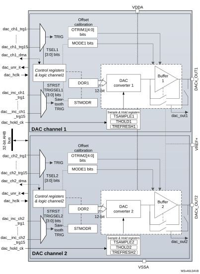
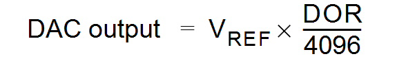
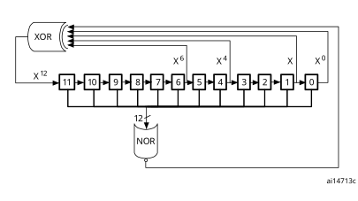
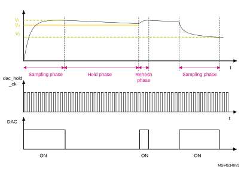

# 22 Digital-to-analog converter (DAC)

## 22.1 Introduction

The DAC module is a 12-bit, voltage output digital-to-analog converter. The DAC can be configured in 8- or 12-bit mode and may be used in conjunction with the DMA controller. In 12-bit mode, the data can be left- or right-aligned. The DAC features up to two output channels, each with its own converter. In dual DAC channel mode, conversions can be done independently or simultaneously when both channels are grouped together for synchronous update operations. An input reference pin, VREF+(shared with others analog peripherals) is available for better resolution. An internal reference can also be set on the same input. Refer to voltage reference buffer (VREFBUF) section.

The DACx\_OUTy pin can be used as general purpose input/output (GPIO) when the DAC output is disconnected from output pad and connected to on chip peripheral. The DAC output buffer can be optionally enabled to obtain a high drive output current. An individual calibration can be applied on each DAC output channel. The DAC output channels support a low power mode, the sample and hold mode.

## 22.2 DAC main features

The DAC main features are the following (see [Figure 156: Dual-channel DAC block diagram](#XREF_95546__Figure_1__DAC_block_diagram9))

- Up to four DAC interfaces, maximum two output channels each
- Left or right data alignment in 12-bit mode
- Synchronized update capability
- Noise-wave and Triangular-wave generation
- Sawtooth wave generation
- Dual DAC channel for independent or simultaneous conversions
- DMA capability for each channel including DMA underrun error detection
- Double data DMA capability to reduce the bus activity
- External triggers for conversion
- DAC output channel buffered/unbuffered modes
- Buffer offset calibration
- Each DAC output can be disconnected from the DACx\_OUTy output pin
- DAC output connection to on-chip peripherals
- Sample and hold mode for low power operation in Stop mode
- Input voltage reference from VREF+ pin or internal VREFBUF reference

[Figure 156](#XREF_95546__Figure_1__DAC_block_diagram9) shows the block diagram of a DAC channel and [Table 184](#XREF_48845__Table_153__DAC_pins9) gives the pin description.

## 22.3 DAC implementation

  

<table class="TableTitle"><caption class="TableCap"><h4 class="TableCap" id="81688661">Table 183. DAC features </h4></caption><col width="122.46px"/><col width="122.93px"/><col width="122.93px"/><col width="122.93px"/><col width="122.93px"/><thead><tr height="28.00px"><th>
DAC features
</th><th>
DAC1
</th><th>
DAC2
</th><th>
DAC3
</th><th>
DAC4
</th></tr></thead><tr height="22.67px"><td>
Dual channel
</td><td>
X
</td><td>
-
</td><td>
X
</td><td>
X
</td></tr><tr height="22.67px"><td>
Output buffer
</td><td>
X
</td><td>
X
</td><td>
-
</td><td>
-
</td></tr><tr height="40.00px"><td>
I/O connection
</td><td>
DAC1_OUT1 on PA4

DAC1_OUT2 on PA5
</td><td>
DAC2_OUT1 on PA6
</td><td colspan="2">
No connection to a GPIO
</td></tr><tr height="37.33px"><td>
Maximum sampling time
</td><td colspan="2">
1 Msps
</td><td colspan="2">
15 Msps
</td></tr><tr height="22.67px"><td>
Autonomous mode
</td><td colspan="4">
-
</td></tr><tr height="22.67px"><td>
VREF+ pin
</td><td colspan="4">
X
</td></tr></table>

## 22.4 DAC functional description

### 22.4.1 DAC block diagram

#### Figure 156. Dual-channel DAC block diagram  

1.MODEx bits in the DAC\_MCR control the output mode and allow switching between the normal mode in buffer/unbuffered configuration and the sample and hold mode.

2.Refer to [Section 22.3: DAC implementation](#XREF_77664__19_3_DAC_implementation9) for channel2 availability.

3.DAC channel2 is available only on DAC1, DAC3 and DAC4.

### 22.4.2 DAC pins and internal signals

The DAC includes:

- Up to two output channels
- The DACx\_OUTy can be disconnected from the output pin and used as an ordinary GPIO
- The dac\_outx can use an internal pin connection to on-chip peripherals such as comparator, operational amplifier and ADC (if available).
- DAC output channel buffered or non buffered
- Sample and hold block and registers operational in Stop mode, using the LSI/LSE clock source (dac\_hold\_ck) for static conversion.

The DAC includes up to two separate output channels. Each output channel can be connected to on-chip peripherals such as comparator, operational amplifier and ADC (if available). In this case, the DAC output channel can be disconnected from the DACx\_OUTy output pin and the corresponding GPIO can be used for another purpose.

The DAC output can be buffered or not. The sample and hold block and its associated registers can run in Stop mode using the LSI/LSE clock source (dac\_hold\_ck).

 

<table class="TableTitle"><caption class="~TableHeading"><h4 class="TableCap" id="8516093">Table 184. <a id="pins9" name="XREF_48845__Table_153__DAC_pins9">DAC input/output pins</a></h4></caption><col width="80.52px"/><col width="168.90px"/><col width="286.66px"/><thead><tr height="28.00px"><th style="border-bottom-width:1.5pt;border-bottom-style:solid;border-bottom-color:#000000;">
Pin name
</th><th style="border-bottom-width:1.5pt;border-bottom-style:solid;border-bottom-color:#000000;">
Signal type
</th><th style="border-bottom-width:1.5pt;border-bottom-style:solid;border-bottom-color:#000000;">
Remarks
</th></tr></thead><tr data-conditional="_dacif2_vref_,_dacif2_vrefdac_" height="37.33px"><td data-conditional="_dacif2_vref_,_dacif2_vrefdac_">
VREF+
</td><td data-conditional="_dacif2_vref_,_dacif2_vrefdac_">
Input, analog positive reference 
</td><td data-conditional="_dacif2_vref_,_dacif2_vrefdac_">
The higher/positive reference voltage for the DAC, VREF+ ≤ VDDAmax (refer to datasheet)
</td></tr><tr data-conditional="_dacif2_vrefdac_" height="37.33px" style="display: none"><td data-conditional="_dacif2_vrefdac_" style="display: none">
VREFDAC-
</td><td data-conditional="_dacif2_vrefdac_" style="display: none">
Input, analog negative reference 
</td><td data-conditional="_dacif2_vrefdac_" style="display: none">
The lower/negative reference voltage for the DAC.
</td></tr><tr data-conditional="littleshark,rm0456_cobra,rm0481_mustang,rm0487_habu,rm0492_littlemustang,rm0499_coyote,rm0514_moray,rm0517_mustang,rm0522_mosquito,rm0523_habu,rm0539_mustang,RM0440,shark_dualcore,shark_singlecore,stm32l43_44_45_46,stm32l4_orca_,stm32l4x6xx,stm32l5_beluga,stm32mp151xx,stm32mp153xx,stm32mp157xx,tinyshark" height="22.67px"><td data-conditional="littleshark,rm0456_cobra,rm0481_mustang,rm0487_habu,rm0492_littlemustang,rm0499_coyote,rm0514_moray,rm0517_mustang,rm0522_mosquito,rm0523_habu,rm0539_mustang,RM0440,shark_dualcore,shark_singlecore,stm32l43_44_45_46,stm32l4_orca_,stm32l4x6xx,stm32l5_beluga,stm32mp151xx,stm32mp153xx,stm32mp157xx,tinyshark">
VDDA
</td><td data-conditional="littleshark,rm0456_cobra,rm0481_mustang,rm0487_habu,rm0492_littlemustang,rm0499_coyote,rm0514_moray,rm0517_mustang,rm0522_mosquito,rm0523_habu,rm0539_mustang,RM0440,shark_dualcore,shark_singlecore,stm32l43_44_45_46,stm32l4_orca_,stm32l4x6xx,stm32l5_beluga,stm32mp151xx,stm32mp153xx,stm32mp157xx,tinyshark">
Input, analog supply
</td><td data-conditional="littleshark,rm0456_cobra,rm0481_mustang,rm0487_habu,rm0492_littlemustang,rm0499_coyote,rm0514_moray,rm0517_mustang,rm0522_mosquito,rm0523_habu,rm0539_mustang,RM0440,shark_dualcore,shark_singlecore,stm32l43_44_45_46,stm32l4_orca_,stm32l4x6xx,stm32l5_beluga,stm32mp151xx,stm32mp153xx,stm32mp157xx,tinyshark">
Analog power supply
</td></tr><tr data-conditional="littleshark,rm0456_cobra,rm0481_mustang,rm0487_habu,rm0492_littlemustang,rm0499_coyote,rm0514_moray,rm0517_mustang,rm0522_mosquito,rm0523_habu,rm0539_mustang,RM0440,shark_dualcore,shark_singlecore,stm32l43_44_45_46,stm32l4_orca_,stm32l4x6xx,stm32l5_beluga,stm32mp151xx,stm32mp153xx,stm32mp157xx,tinyshark" height="22.67px"><td data-conditional="littleshark,rm0456_cobra,rm0481_mustang,rm0487_habu,rm0492_littlemustang,rm0499_coyote,rm0514_moray,rm0517_mustang,rm0522_mosquito,rm0523_habu,rm0539_mustang,RM0440,shark_dualcore,shark_singlecore,stm32l43_44_45_46,stm32l4_orca_,stm32l4x6xx,stm32l5_beluga,stm32mp151xx,stm32mp153xx,stm32mp157xx,tinyshark">
VSSA
</td><td data-conditional="littleshark,rm0456_cobra,rm0481_mustang,rm0487_habu,rm0492_littlemustang,rm0499_coyote,rm0514_moray,rm0517_mustang,rm0522_mosquito,rm0523_habu,rm0539_mustang,RM0440,shark_dualcore,shark_singlecore,stm32l43_44_45_46,stm32l4_orca_,stm32l4x6xx,stm32l5_beluga,stm32mp151xx,stm32mp153xx,stm32mp157xx,tinyshark">
Input, analog supply ground
</td><td data-conditional="littleshark,rm0456_cobra,rm0481_mustang,rm0487_habu,rm0492_littlemustang,rm0499_coyote,rm0514_moray,rm0517_mustang,rm0522_mosquito,rm0523_habu,rm0539_mustang,RM0440,shark_dualcore,shark_singlecore,stm32l43_44_45_46,stm32l4_orca_,stm32l4x6xx,stm32l5_beluga,stm32mp151xx,stm32mp153xx,stm32mp157xx,tinyshark">
Ground for analog power supply
</td></tr><tr data-conditional="rm0453_bee,rm0461_bee,rm0503_mamba,stm32g0x1_orcazero128k" height="22.67px" style="display: none"><td data-conditional="rm0453_bee,rm0461_bee,rm0503_mamba,stm32g0x1_orcazero128k" style="display: none">
VDD
</td><td data-conditional="rm0453_bee,rm0461_bee,rm0503_mamba,stm32g0x1_orcazero128k" style="display: none">
Input, analog supply
</td><td data-conditional="rm0453_bee,rm0461_bee,rm0503_mamba,stm32g0x1_orcazero128k" style="display: none">
Analog power supply
</td></tr><tr data-conditional="rm0453_bee,rm0461_bee,rm0503_mamba,stm32g0x1_orcazero128k" height="22.67px" style="display: none"><td data-conditional="rm0453_bee,rm0461_bee,rm0503_mamba,stm32g0x1_orcazero128k" style="display: none">
VSS
</td><td data-conditional="rm0453_bee,rm0461_bee,rm0503_mamba,stm32g0x1_orcazero128k" style="display: none">
Input, analog supply ground
</td><td data-conditional="rm0453_bee,rm0461_bee,rm0503_mamba,stm32g0x1_orcazero128k" style="display: none">
Ground for analog power supply
</td></tr><tr height="22.67px"><td>
DACx_OUTy
</td><td>
Analog output signal
</td><td>
DACx channely analog output
</td></tr></table>

<table class="TableTitle" style="margin-bottom:10.00pt;"><caption class="TableCap"><h4 class="TableCap" id="81689326">Table 185. <a id="%119" name="XREF_27408__Table_132__DAC_input_output_signals_%119">DAC input/output signals </a></h4></caption><col width="183.01px"/><col width="79.77px"/><col width="275.81px"/><thead><tr height="28.00px"><th>
Internal signal name
</th><th>
Signal type
</th><th>
Description
</th></tr></thead><tr height="22.67px"><td>
dac_ch1_dma
</td><td>
Bidirectional
</td><td>
DAC channel1 DMA request/acknowledge
</td></tr><tr height="22.67px"><td>
dac_ch2_dma
</td><td>
Bidirectional
</td><td>
DAC channel2 DMA request/acknowledge
</td></tr><tr height="22.67px"><td>
dac_ch1_trgx (x = 1 to 15)
</td><td>
Inputs
</td><td>
DAC channel1 trigger inputs
</td></tr><tr height="22.67px"><td>
dac_ch2_trgx (x = 1 to 15)
</td><td>
Inputs
</td><td>
DAC channel2 trigger inputs
</td></tr><tr height="22.67px"><td>
dac_ch1_inc_trgx (x = 1 to 15)
</td><td>
Inputs
</td><td>
DAC channel1 sawtooth increment trigger inputs
</td></tr><tr height="22.67px"><td>
dac_chn2_inc_trgx (x = 1 to 15)
</td><td>
Inputs
</td><td>
DAC channel1 sawtooth increment trigger inputs
</td></tr><tr height="22.67px"><td>
dac_unr_it
</td><td>
Output
</td><td>
DAC underrun interrupt
</td></tr><tr height="22.67px"><td>
dac_hclk
</td><td>
Input
</td><td>
DAC peripheral clock
</td></tr><tr height="37.33px"><td>
dac_hold_ck
</td><td>
Input
</td><td>
DAC low-power clock used in sample and hold mode
</td></tr><tr height="37.33px"><td>
dac_out1
</td><td>
Analog output
</td><td>
DAC channel1 output for on-chip peripherals
</td></tr><tr height="37.33px"><td>
dac_out2
</td><td>
Analog output
</td><td>
DAC channel2 output for on-chip peripherals
</td></tr></table>

<table class="TableTitle"><caption class="TableCap"><h4 class="TableCap" id="81689812">Table 186. DAC1 interconnection</h4></caption><col width="178.98px"/><col width="153.54px"/><col width="206.06px"/><thead><tr height="28.00px"><th style="border-bottom-width:1.5pt;border-bottom-style:solid;border-bottom-color:#000000;">
Signal name
</th><th style="border-bottom-width:1.5pt;border-bottom-style:solid;border-bottom-color:#000000;">
Source
</th><th style="border-bottom-width:1.5pt;border-bottom-style:solid;border-bottom-color:#000000;">
Source type
</th></tr></thead><tr height="37.33px"><td style="border-bottom-width:0.5pt;border-bottom-style:solid;border-bottom-color:#000000;">
dac_hold_ck
</td><td style="border-bottom-width:0.5pt;border-bottom-style:solid;border-bottom-color:#000000;">
ck_lsi or ck_lse (selected in the RCC)
</td><td style="border-bottom-width:0.5pt;border-bottom-style:solid;border-bottom-color:#000000;">
LSI or LSE clock selected in the RCC
</td></tr><tr height="22.67px"><td>
dac_chx_trg1 (x = 1, 2) 
</td><td>
TIM8_TRGO
</td><td>
Internal signal from on-chip timers
</td></tr><tr height="22.67px"><td>
dac_chx_trg2 (x = 1, 2) 
</td><td>
TIM7_TRGO
</td><td>
Internal signal from on-chip timers
</td></tr><tr height="22.67px"><td>
dac_chx_trg3 (x = 1, 2) 
</td><td>
TIM15_TRGO
</td><td>
Internal signal from on-chip timers
</td></tr><tr height="22.67px"><td>
dac_chx_trg4 (x = 1, 2) 
</td><td>
TIM2_TRGO
</td><td>
Internal signal from on-chip timers
</td></tr><tr height="22.67px"><td>
dac_chx_trg5 (x = 1, 2) 
</td><td>
TIM4_TRGO
</td><td>
Internal signal from on-chip timers
</td></tr><tr height="22.67px"><td>
dac_chx_trg6 (x = 1, 2) 
</td><td>
EXTI9
</td><td>
External pin
</td></tr><tr height="22.67px"><td>
dac_chx_trg7 (x = 1, 2) 
</td><td>
TIM6_TRGO
</td><td>
Internal signal from on-chip timers
</td></tr><tr height="22.67px"><td>
dac_chx_trg8 (x = 1, 2) 
</td><td>
TIM3_TRGO
</td><td>
Internal signal from on-chip timers
</td></tr><tr height="22.67px"><td>
dac_chx_trg9 (x = 1, 2) 
</td><td>
hrtim_dac_reset_trg1
</td><td>
Internal signal from on-chip timers
</td></tr><tr height="22.67px"><td>
dac_chx_trg10 (x = 1, 2) 
</td><td>
hrtim_dac_reset_trg2
</td><td>
Internal signal from on-chip timers
</td></tr><tr height="22.67px"><td>
dac_chx_trg11 (x = 1, 2) 
</td><td>
hrtim_dac_reset_trg3
</td><td>
Internal signal from on-chip timers
</td></tr><tr height="22.67px"><td>
dac_chx_trg12 (x = 1, 2) 
</td><td>
hrtim_dac_reset_trg4
</td><td>
Internal signal from on-chip timers
</td></tr><tr height="22.67px"><td>
dac_chx_trg13 (x = 1, 2) 
</td><td>
hrtim_dac_reset_trg5
</td><td>
Internal signal from on-chip timers
</td></tr><tr height="22.67px"><td>
dac_chx_trg14 (x = 1, 2) 
</td><td>
hrtim_dac_reset_trg6
</td><td>
Internal signal from on-chip timers
</td></tr><tr height="22.67px"><td>
dac_chx_trg15 (x = 1, 2) 
</td><td>
hrtim_dac_trg1
</td><td>
Internal signal from on-chip timers
</td></tr><tr height="22.67px"><td>
dac_inc_chx_trg1 (x = 1, 2) 
</td><td>
TIM8_TRGO
</td><td>
Internal signal from on-chip timers
</td></tr><tr height="22.67px"><td>
dac_inc_chx_trg2 (x = 1, 2) 
</td><td>
TIM7_TRGO
</td><td>
Internal signal from on-chip timers
</td></tr><tr height="22.67px"><td>
dac_inc_chx_trg3 (x = 1, 2) 
</td><td>
TIM15_TRGO
</td><td>
Internal signal from on-chip timers
</td></tr><tr height="22.67px"><td>
dac_inc_chx_trg4 (x = 1, 2) 
</td><td>
TIM2_TRGO
</td><td>
Internal signal from on-chip timers
</td></tr><tr height="22.67px"><td>
dac_inc_chx_trg5 (x = 1, 2) 
</td><td>
TIM4_TRGO
</td><td>
Internal signal from on-chip timers
</td></tr><tr height="22.67px"><td>
dac_inc_chx_trg6 (x = 1, 2) 
</td><td>
EXTI10
</td><td>
External pin
</td></tr><tr height="22.67px"><td>
dac_inc_chx_trg7 (x = 1, 2) 
</td><td>
TIM6_TRGO
</td><td>
Internal signal from on-chip timers
</td></tr><tr height="22.67px"><td>
dac_inc_chx_trg8 (x = 1, 2) 
</td><td>
TIM3_TRGO
</td><td>
Internal signal from on-chip timers
</td></tr><tr height="22.67px"><td>
dac_inc_chx_trg9 (x = 1, 2) 
</td><td>
hrtim_dac_step_trg1
</td><td>
Internal signal from on-chip timers
</td></tr><tr height="22.67px"><td>
dac_inc_chx_trg10 (x = 1, 2) 
</td><td>
hrtim_dac_step_trg2
</td><td>
Internal signal from on-chip timers
</td></tr><tr height="22.67px"><td>
dac_inc_chx_trg11 (x = 1, 2) 
</td><td>
hrtim_dac_step_trg3
</td><td>
Internal signal from on-chip timers
</td></tr><tr height="22.67px"><td>
dac_inc_chx_trg12 (x = 1, 2) 
</td><td>
hrtim_dac_step_trg4
</td><td>
Internal signal from on-chip timers
</td></tr><tr height="22.67px"><td>
dac_inc_chx_trg13 (x = 1, 2) 
</td><td>
hrtim_dac_step_trg5
</td><td>
Internal signal from on-chip timers
</td></tr><tr height="22.67px"><td>
dac_inc_chx_trg14 (x = 1, 2) 
</td><td>
hrtim_dac_step_trg6
</td><td>
Internal signal from on-chip timers
</td></tr></table>

<table class="TableTitle"><caption class="TableCap"><h4 class="TableCap" id="81690009">Table 187. DAC2 interconnection</h4></caption><col width="172.56px"/><col width="172.56px"/><col width="193.45px"/><thead><tr height="28.00px"><th style="border-bottom-width:1.5pt;border-bottom-style:solid;border-bottom-color:#000000;">
Signal name
</th><th style="border-bottom-width:1.5pt;border-bottom-style:solid;border-bottom-color:#000000;">
Source
</th><th style="border-bottom-width:1.5pt;border-bottom-style:solid;border-bottom-color:#000000;">
Source type
</th></tr></thead><tr height="37.33px"><td style="border-bottom-width:0.5pt;border-bottom-style:solid;border-bottom-color:#000000;">
dac_hold_ck
</td><td style="border-bottom-width:0.5pt;border-bottom-style:solid;border-bottom-color:#000000;">
ck_lsi or ck_lse (selected in the RCC)
</td><td style="border-bottom-width:0.5pt;border-bottom-style:solid;border-bottom-color:#000000;">
LSI or LSE clock selected in the RCC
</td></tr><tr height="22.67px"><td>
dac_ch1_trg1
</td><td>
TIM8_TRGO
</td><td>
Internal signal from on-chip timers
</td></tr><tr height="22.67px"><td>
dac_ch1_trg2
</td><td>
TIM7_TRGO
</td><td>
Internal signal from on-chip timers
</td></tr><tr height="22.67px"><td>
dac_ch1_trg3
</td><td>
TIM15_TRGO
</td><td>
Internal signal from on-chip timers
</td></tr><tr height="22.67px"><td>
dac_ch1_trg4
</td><td>
TIM2_TRGO
</td><td>
Internal signal from on-chip timers
</td></tr><tr height="22.67px"><td>
dac_ch1_trg5
</td><td>
TIM4_TRGO
</td><td>
Internal signal from on-chip timers
</td></tr><tr height="22.67px"><td>
dac_ch1_trg6
</td><td>
EXTI9
</td><td>
External pin
</td></tr><tr height="22.67px"><td>
dac_ch1_trg7
</td><td>
TIM6_TRGO
</td><td>
Internal signal from on-chip timers
</td></tr><tr height="22.67px"><td>
dac_ch1_trg8
</td><td>
TIM3_TRGO
</td><td>
Internal signal from on-chip timers
</td></tr><tr height="22.67px"><td>
dac_ch1_trg9
</td><td>
hrtim_dac_reset_trg1
</td><td>
Internal signal from on-chip timers
</td></tr><tr height="22.67px"><td>
dac_ch1_trg10
</td><td>
hrtim_dac_reset_trg2
</td><td>
Internal signal from on-chip timers
</td></tr><tr height="22.67px"><td>
dac_ch1_trg11
</td><td>
hrtim_dac_reset_trg3
</td><td>
Internal signal from on-chip timers
</td></tr><tr height="22.67px"><td>
dac_ch1_trg12
</td><td>
hrtim_dac_reset_trg4
</td><td>
Internal signal from on-chip timers
</td></tr><tr height="22.67px"><td>
dac_ch1_trg13
</td><td>
hrtim_dac_reset_trg5
</td><td>
Internal signal from on-chip timers
</td></tr><tr height="22.67px"><td>
dac_ch1_trg14
</td><td>
hrtim_dac_reset_trg6
</td><td>
Internal signal from on-chip timers
</td></tr><tr height="22.67px"><td>
dac_ch1_trg15
</td><td>
hrtim_dac_trg2
</td><td>
Internal signal from on-chip timers
</td></tr><tr height="22.67px"><td>
dac_inc_ch1_trg1
</td><td>
TIM8_TRGO
</td><td>
Internal signal from on-chip timers
</td></tr><tr height="22.67px"><td>
dac_inc_ch1_trg2
</td><td>
TIM7_TRGO
</td><td>
Internal signal from on-chip timers
</td></tr><tr height="22.67px"><td>
dac_inc_ch1_trg3
</td><td>
TIM15_TRGO
</td><td>
Internal signal from on-chip timers
</td></tr><tr height="22.67px"><td>
dac_inc_ch1_trg4
</td><td>
TIM2_TRGO
</td><td>
Internal signal from on-chip timers
</td></tr><tr height="22.67px"><td>
dac_inc_ch1_trg5
</td><td>
TIM4_TRGO
</td><td>
Internal signal from on-chip timers
</td></tr><tr height="22.67px"><td>
dac_inc_ch1_trg6
</td><td>
EXTI10
</td><td>
External pin
</td></tr><tr height="22.67px"><td>
dac_inc_ch1_trg7
</td><td>
TIM6_TRGO
</td><td>
Internal signal from on-chip timers
</td></tr><tr height="22.67px"><td>
dac_inc_ch1_trg8
</td><td>
TIM3_TRGO
</td><td>
Internal signal from on-chip timers
</td></tr><tr height="22.67px"><td>
dac_inc_ch1_trg9
</td><td>
hrtim_dac_step_trg1
</td><td>
Internal signal from on-chip timers
</td></tr><tr height="22.67px"><td>
dac_inc_ch1_trg10
</td><td>
hrtim_dac_step_trg2
</td><td>
Internal signal from on-chip timers
</td></tr><tr height="22.67px"><td>
dac_inc_ch1_trg11
</td><td>
hrtim_dac_step_trg3
</td><td>
Internal signal from on-chip timers
</td></tr><tr height="22.67px"><td>
dac_inc_ch1_trg12
</td><td>
hrtim_dac_step_trg4
</td><td>
Internal signal from on-chip timers
</td></tr><tr height="22.67px"><td>
dac_inc_ch1_trg13
</td><td>
hrtim_dac_step_trg5
</td><td>
Internal signal from on-chip timers
</td></tr><tr height="22.67px"><td>
dac_inc_ch1_trg14
</td><td>
hrtim_dac_step_trg6
</td><td>
Internal signal from on-chip timers
</td></tr></table>

<table class="TableTitle"><caption class="TableCap"><h4 class="TableCap" id="81690206">Table 188. DAC3 interconnection</h4></caption><col width="179.53px"/><col width="179.53px"/><col width="179.53px"/><thead><tr height="28.00px"><th style="border-bottom-width:1.5pt;border-bottom-style:solid;border-bottom-color:#000000;">
Signal name
</th><th style="border-bottom-width:1.5pt;border-bottom-style:solid;border-bottom-color:#000000;">
Source
</th><th style="border-bottom-width:1.5pt;border-bottom-style:solid;border-bottom-color:#000000;">
Source type
</th></tr></thead><tr height="37.33px"><td style="border-bottom-width:0.5pt;border-bottom-style:solid;border-bottom-color:#000000;">
dac_hold_ck
</td><td style="border-bottom-width:0.5pt;border-bottom-style:solid;border-bottom-color:#000000;">
ck_lsi or ck_lse (selected in the RCC)
</td><td style="border-bottom-width:0.5pt;border-bottom-style:solid;border-bottom-color:#000000;">
LSI or LSE clock selected in the RCC
</td></tr><tr height="37.33px"><td>
dac_chx_trg1 (x = 1, 2) 
</td><td>
TIM1_TRGO
</td><td>
Internal signal from on-chip timers
</td></tr><tr height="37.33px"><td>
dac_chx_trg2 (x = 1, 2) 
</td><td>
TIM7_TRGO
</td><td>
Internal signal from on-chip timers
</td></tr><tr height="37.33px"><td>
dac_chx_trg3 (x = 1, 2) 
</td><td>
TIM15_TRGO
</td><td>
Internal signal from on-chip timers
</td></tr><tr height="37.33px"><td>
dac_chx_trg4 (x = 1, 2) 
</td><td>
TIM2_TRGO
</td><td>
Internal signal from on-chip timers
</td></tr><tr height="37.33px"><td>
dac_chx_trg5 (x = 1, 2) 
</td><td>
TIM4_TRGO
</td><td>
Internal signal from on-chip timers
</td></tr><tr height="22.67px"><td>
dac_chx_trg6 (x = 1, 2) 
</td><td>
EXTI9
</td><td>
External pin
</td></tr><tr height="37.33px"><td>
dac_chx_trg7 (x = 1, 2) 
</td><td>
TIM6_TRGO
</td><td>
Internal signal from on-chip timers
</td></tr><tr height="37.33px"><td>
dac_chx_trg8 (x = 1, 2) 
</td><td>
TIM3_TRGO
</td><td>
Internal signal from on-chip timers
</td></tr><tr height="37.33px"><td>
dac_chx_trg9 (x = 1, 2) 
</td><td>
hrtim_dac_reset_trg1
</td><td>
Internal signal from on-chip timers
</td></tr><tr height="37.33px"><td>
dac_chx_trg10 (x = 1, 2) 
</td><td>
hrtim_dac_reset_trg2
</td><td>
Internal signal from on-chip timers
</td></tr><tr height="37.33px"><td>
dac_chx_trg11 (x = 1, 2) 
</td><td>
hrtim_dac_reset_trg3
</td><td>
Internal signal from on-chip timers
</td></tr><tr height="37.33px"><td>
dac_chx_trg12 (x = 1, 2) 
</td><td>
hrtim_dac_reset_trg4
</td><td>
Internal signal from on-chip timers
</td></tr><tr height="37.33px"><td>
dac_chx_trg13 (x = 1, 2) 
</td><td>
hrtim_dac_reset_trg5
</td><td>
Internal signal from on-chip timers
</td></tr><tr height="37.33px"><td>
dac_chx_trg14 (x = 1, 2) 
</td><td>
hrtim_dac_reset_trg6
</td><td>
Internal signal from on-chip timers
</td></tr><tr height="37.33px"><td>
dac_chx_trg15 (x = 1, 2) 
</td><td>
hrtim_dac_trg3
</td><td>
Internal signal from on-chip timers
</td></tr><tr height="37.33px"><td>
dac_inc_chx_trg1 (x = 1, 2) 
</td><td>
TIM1_TRGO
</td><td>
Internal signal from on-chip timers
</td></tr><tr height="37.33px"><td>
dac_inc_chx_trg2 (x = 1, 2) 
</td><td>
TIM7_TRGO
</td><td>
Internal signal from on-chip timers
</td></tr><tr height="37.33px"><td>
dac_inc_chx_trg3 (x = 1, 2) 
</td><td>
TIM15_TRGO
</td><td>
Internal signal from on-chip timers
</td></tr><tr height="37.33px"><td>
dac_inc_chx_trg4 (x = 1, 2) 
</td><td>
TIM2_TRGO
</td><td>
Internal signal from on-chip timers
</td></tr><tr height="37.33px"><td>
dac_inc_chx_trg5 (x = 1, 2) 
</td><td>
TIM4_TRGO
</td><td>
Internal signal from on-chip timers
</td></tr><tr height="22.67px"><td>
dac_inc_chx_trg6 (x = 1, 2) 
</td><td>
EXTI10
</td><td>
External pin
</td></tr><tr height="37.33px"><td>
dac_inc_chx_trg7 (x = 1, 2) 
</td><td>
TIM6_TRGO
</td><td>
Internal signal from on-chip timers
</td></tr><tr height="37.33px"><td>
dac_inc_chx_trg8 (x = 1, 2) 
</td><td>
TIM3_TRGO
</td><td>
Internal signal from on-chip timers
</td></tr><tr height="37.33px"><td>
dac_inc_chx_trg9 (x = 1, 2) 
</td><td>
hrtim_dac_step_trg1
</td><td>
Internal signal from on-chip timers
</td></tr><tr height="37.33px"><td>
dac_inc_chx_trg10 (x = 1, 2) 
</td><td>
hrtim_dac_step_trg2
</td><td>
Internal signal from on-chip timers
</td></tr><tr height="37.33px"><td>
dac_inc_chx_trg11 (x = 1, 2) 
</td><td>
hrtim_dac_step_trg3
</td><td>
Internal signal from on-chip timers
</td></tr><tr height="37.33px"><td>
dac_inc_chx_trg12 (x = 1, 2) 
</td><td>
hrtim_dac_step_trg4
</td><td>
Internal signal from on-chip timers
</td></tr><tr height="37.33px"><td>
dac_inc_chx_trg13 (x = 1, 2) 
</td><td>
hrtim_dac_step_trg5
</td><td>
Internal signal from on-chip timers
</td></tr><tr height="37.33px"><td>
dac_inc_chx_trg14 (x = 1, 2) 
</td><td>
hrtim_dac_step_trg6
</td><td>
Internal signal from on-chip timers
</td></tr></table>

<table class="TableTitle"><caption class="TableCap"><h4 class="TableCap" id="81690403">Table 189. DAC4 interconnection</h4></caption><col width="179.53px"/><col width="179.53px"/><col width="179.53px"/><thead><tr height="28.00px"><th style="border-bottom-width:1.5pt;border-bottom-style:solid;border-bottom-color:#000000;">
Signal name
</th><th style="border-bottom-width:1.5pt;border-bottom-style:solid;border-bottom-color:#000000;">
Source
</th><th style="border-bottom-width:1.5pt;border-bottom-style:solid;border-bottom-color:#000000;">
Source type
</th></tr></thead><tr height="37.33px"><td style="border-bottom-width:0.5pt;border-bottom-style:solid;border-bottom-color:#000000;">
dac_hold_ck
</td><td style="border-bottom-width:0.5pt;border-bottom-style:solid;border-bottom-color:#000000;">
ck_lsi or ck_lse (selected in RCC)
</td><td style="border-bottom-width:0.5pt;border-bottom-style:solid;border-bottom-color:#000000;">
LSI or LSE clock selected in the RCC
</td></tr><tr height="37.33px"><td>
dac_chx_trg1 (x = 1, 2) 
</td><td>
TIM8_TRGO
</td><td>
Internal signal from on-chip timers
</td></tr><tr height="37.33px"><td>
dac_chx_trg2 (x = 1, 2) 
</td><td>
TIM7_TRGO
</td><td>
Internal signal from on-chip timers
</td></tr><tr height="37.33px"><td>
dac_chx_trg3 (x = 1, 2) 
</td><td>
TIM15_TRGO
</td><td>
Internal signal from on-chip timers
</td></tr><tr height="37.33px"><td>
dac_chx_trg4 (x = 1, 2) 
</td><td>
TIM2_TRGO
</td><td>
Internal signal from on-chip timers
</td></tr><tr height="37.33px"><td>
dac_chx_trg5 (x = 1, 2) 
</td><td>
TIM4_TRGO
</td><td>
Internal signal from on-chip timers
</td></tr><tr height="22.67px"><td>
dac_chx_trg6 (x = 1, 2) 
</td><td>
EXTI9
</td><td>
External pin
</td></tr><tr height="37.33px"><td>
dac_chx_trg7 (x = 1, 2) 
</td><td>
TIM6_TRGO
</td><td>
Internal signal from on-chip timers
</td></tr><tr height="37.33px"><td>
dac_chx_trg8 (x = 1, 2) 
</td><td>
TIM3_TRGO
</td><td>
Internal signal from on-chip timers
</td></tr><tr height="37.33px"><td>
dac_chx_trg9 (x = 1, 2) 
</td><td>
hrtim_dac_reset_trg1
</td><td>
Internal signal from on-chip timers
</td></tr><tr height="37.33px"><td>
dac_chx_trg10 (x = 1, 2) 
</td><td>
hrtim_dac_reset_trg2
</td><td>
Internal signal from on-chip timers
</td></tr><tr height="37.33px"><td>
dac_chx_trg11 (x = 1, 2) 
</td><td>
hrtim_dac_reset_trg3
</td><td>
Internal signal from on-chip timers
</td></tr><tr height="37.33px"><td>
dac_chx_trg12 (x = 1, 2) 
</td><td>
hrtim_dac_reset_trg4
</td><td>
Internal signal from on-chip timers
</td></tr><tr height="37.33px"><td>
dac_chx_trg13 (x = 1, 2) 
</td><td>
hrtim_dac_reset_trg5
</td><td>
Internal signal from on-chip timers
</td></tr><tr height="37.33px"><td>
dac_chx_trg14 (x = 1, 2) 
</td><td>
hrtim_dac_reset_trg6
</td><td>
Internal signal from on-chip timers
</td></tr><tr height="37.33px"><td>
dac_chx_trg15 (x = 1, 2) 
</td><td>
hrtim_dac_trg1
</td><td>
Internal signal from on-chip timers
</td></tr><tr height="37.33px"><td>
dac_inc_chx_trg1 (x = 1, 2) 
</td><td>
TIM8_TRGO
</td><td>
Internal signal from on-chip timers
</td></tr><tr height="37.33px"><td>
dac_inc_chx_trg2 (x = 1, 2) 
</td><td>
TIM7_TRGO
</td><td>
Internal signal from on-chip timers
</td></tr><tr height="37.33px"><td>
dac_inc_chx_trg3 (x = 1, 2) 
</td><td>
TIM15_TRGO
</td><td>
Internal signal from on-chip timers
</td></tr><tr height="37.33px"><td>
dac_inc_chx_trg4 (x = 1, 2) 
</td><td>
TIM2_TRGO
</td><td>
Internal signal from on-chip timers
</td></tr><tr height="37.33px"><td>
dac_inc_chx_trg5 (x = 1, 2) 
</td><td>
TIM4_TRGO
</td><td>
Internal signal from on-chip timers
</td></tr><tr height="22.67px"><td>
dac_inc_chx_trg6 (x = 1, 2) 
</td><td>
EXTI10
</td><td>
External pin
</td></tr><tr height="37.33px"><td>
dac_inc_chx_trg7 (x = 1, 2) 
</td><td>
TIM6_TRGO
</td><td>
Internal signal from on-chip timers
</td></tr><tr height="37.33px"><td>
dac_inc_chx_trg8 (x = 1, 2) 
</td><td>
TIM3_TRGO
</td><td>
Internal signal from on-chip timers
</td></tr><tr height="37.33px"><td>
dac_inc_chx_trg9 (x = 1, 2) 
</td><td>
hrtim_dac_step_trg1
</td><td>
Internal signal from on-chip timers
</td></tr><tr height="37.33px"><td>
dac_inc_chx_trg10 (x = 1, 2) 
</td><td>
hrtim_dac_step_trg2
</td><td>
Internal signal from on-chip timers
</td></tr><tr height="37.33px"><td>
dac_inc_chx_trg11 (x = 1, 2) 
</td><td>
hrtim_dac_step_trg3
</td><td>
Internal signal from on-chip timers
</td></tr><tr height="37.33px"><td>
dac_inc_chx_trg12 (x = 1, 2) 
</td><td>
hrtim_dac_step_trg4
</td><td>
Internal signal from on-chip timers
</td></tr><tr height="37.33px"><td>
dac_inc_chx_trg13 (x = 1, 2) 
</td><td>
hrtim_dac_step_trg5
</td><td>
Internal signal from on-chip timers
</td></tr><tr height="37.33px"><td>
dac_inc_chx_trg14 (x = 1, 2) 
</td><td>
hrtim_dac_step_trg6
</td><td>
Internal signal from on-chip timers
</td></tr></table>

### 22.4.3 DAC channel enable

Each DAC channel can be powered on by setting its corresponding ENx bit in the DAC\_CR register. The DAC channel is then enabled after a tWAKEUP startup time.

DACxRDY bit is set in the DAC\_SR register when the DAC interface is ready to accept data. Writing new data or asserting the trigger is not allowed when ENx bit is set while DACxRDY signal is reset.

**Note:**

The ENx bit enables the analog DAC channelx only. The DAC channelx digital interface is enabled even if the ENx bit is reset.

### 22.4.4 DAC data format

Depending on the selected configuration mode, the data have to be written into the specified register as described below:

- Single DAC channel

There are three possibilities:

 - 8-bit right alignment: the software has to load data into the DAC\_DHR8Rx[7:0] bits (stored into the DHRx[11:4] bits)
 - 12-bit left alignment: the software has to load data into the DAC\_DHR12Lx [15:4] bits (stored into the DHRx[11:0] bits)
 - 12-bit right alignment: the software has to load data into the DAC\_DHR12Rx [11:0] bits (stored into the DHRx[11:0] bits)

Depending on the loaded DAC\_DHRyyyx register, the data written by the user is shifted and stored into the corresponding DAC\_DHRx (data holding registerx, which are internal non-memory-mapped registers). The DAC\_DHRx register is then loaded into the DAC\_DORx register either automatically, by software trigger or by an external event trigger.

#### Figure 157. Data registers in single DAC channel mode

- Dual DAC channels (when available)

There are three possibilities:

 - 8-bit right alignment: data for DAC channel1 to be loaded into the DAC\_DHR8RD [7:0] bits (stored into the DHR1[11:4] bits) and data for DAC channel2 to be loaded into the DAC\_DHR8RD [15:8] bits (stored into the DHR2[11:4] bits)
 - 12-bit left alignment: data for DAC channel1 to be loaded into the DAC\_DHR12LD [15:4] bits (stored into the DHR1[11:0] bits) and data for DAC channel2 to be loaded into the DAC\_DHR12LD [31:20] bits (stored into the DHR2[11:0] bits)
 - 12-bit right alignment: data for DAC channel1 to be loaded into the DAC\_DHR12RD [11:0] bits (stored into the DHR1[11:0] bits) and data for DAC channel2 to be loaded into the DAC\_DHR12RD [27:16] bits (stored into the DHR2[11:0] bits)

Depending on the loaded DAC\_DHRyyyD register, the data written by the user is shifted and stored into DHR1 and DHR2 (data holding registers, which are internal non-memory-mapped registers). The DHR1 and DHR2 registers are then loaded into the DAC\_DOR1 and DOR2 registers, respectively, either automatically, by software trigger or by an external event trigger.

#### Figure 158. Data registers in dual DAC channel mode

#### Signed/unsigned data

DAC input data are unsigned: 0x000 corresponds to the minimum value and 0xFFF to the maximum value for 12-bit mode.

The DAC can also handle signed input data in 2’s complement format. This is done by setting SINFORMATx bit in the DAC\_MCR register.

When SINFORMATx bit is set, the MSB of the data written to DAC\_DHRx registers is inverted when it is copied to the DAC\_DORx register, and the DAC interface can accept signed data (Q1.15, Q1.11 or Q1.7 format). DAC\_DHR12Lx register can be used to store 16-bit signed data in the data holding registers. The 12 MSBs of 16-bit data are used for the DAC output data and the MSB is inverted. The four LSBs are simply ignored.

<table class="TableTitle"><caption class="~TableHeading"><h4 class="TableCap" id="81539841">Table 190. Data format (case of 12-bit data)</h4></caption><col width="160.84px"/><col width="173.35px"/><col width="201.80px"/><thead><tr height="42.67px"><th style="border-bottom-width:1.5pt;border-bottom-style:solid;border-bottom-color:#000000;">
SINFORMATx bit 
</th><th style="border-bottom-width:1.5pt;border-bottom-style:solid;border-bottom-color:#000000;">
DATA written to DAC_DHRx register
</th><th style="border-bottom-width:1.5pt;border-bottom-style:solid;border-bottom-color:#000000;">
DATA transfered to DAC_DORx register
</th></tr></thead><tr height="22.67px"><td>
0
</td><td>
0x000
</td><td>
0x000
</td></tr><tr height="22.67px"><td>
0
</td><td>
0xFFF
</td><td>
0xFFF
</td></tr><tr height="22.67px"><td>
1
</td><td>
0x7FF
</td><td>
0xFFF
</td></tr><tr height="22.67px"><td>
1
</td><td>
0x000
</td><td>
0x800
</td></tr><tr height="22.67px"><td>
1
</td><td>
0xFFF
</td><td>
0x7FF
</td></tr><tr height="22.67px"><td>
1
</td><td>
0x800
</td><td>
0x000
</td></tr></table>

### 22.4.5 DAC conversion

The DAC\_DORx cannot be written directly and any data transfer to the DAC channelx must be performed by loading the DAC\_DHRx register (write operation to DAC\_DHR8Rx, DAC\_DHR12Lx, DAC\_DHR12Rx, DAC\_DHR8RD, DAC\_DHR12RD or DAC\_DHR12LD).

Data stored in the DAC\_DHRx register are automatically transferred to the DAC\_DORx register after one dac\_hclk clock cycle, if no hardware trigger is selected (TENx bit in DAC\_CR register is reset). However, when a hardware trigger is selected (TENx bit in DAC\_CR register is set) and a trigger occurs, the transfer is performed three dac\_hclk clock cycles after the trigger signal.

When DAC\_DORx is loaded with the DAC\_DHRx contents, the analog output voltage becomes available after a time tSETTLING that depends on the power supply voltage and the analog output load.

HFSEL bits of DAC\_MCR must be set when dac\_ker\_ck clock speed is faster than 80 MHz.

Refer to Table HFSEL description below for the limitation of the DAC\_DORx update rate depending on HFSEL bits and NA clock frequency.

If the data is updated or a software/hardware trigger event occurs during the non-allowed period, the peripheral behavior is unpredictable.

The above timing is only related to the limitation of the DAC interface. Refer also to the tSETTLING parameter value in the product datasheet.

<table class="TableTitle"><caption class="~TableHeading"><h4 class="TableCap" id="81693037">Table 191. <a id="description%119" name="XREF_13694__Table_7__HFSEL_description%119">HFSEL description</a></h4></caption><col width="80.52px"/><col width="168.90px"/><col width="286.66px"/><thead><tr height="28.00px"><th style="border-bottom-width:1.5pt;border-bottom-style:solid;border-bottom-color:#000000;">
HFSEL[1:0]
</th><th style="border-bottom-width:1.5pt;border-bottom-style:solid;border-bottom-color:#000000;">
AHB frequency
</th><th style="border-bottom-width:1.5pt;border-bottom-style:solid;border-bottom-color:#000000;">
Function
</th></tr></thead><tr height="22.67px"><td>
00
</td><td>
&lt; 80 MHz
</td><td>
DAC_DOR update rate up to 3 AHB clock cycles
</td></tr><tr height="22.67px"><td>
01
</td><td>
≥ 80 MHz<a href="#c7amba%20dacif%20v2p%20UserSpec_c7amba%20dacif%20v2p%20UserSpec_FTH_1">1</a>
</td><td>
DAC_DOR update rate up to 5 AHB clock cycles
</td></tr><tr height="22.67px"><td>
10
</td><td>
≥ 160 MHz
</td><td>
DAC_DOR update rate up to 7 AHB clock cycles
</td></tr><tr height="22.67px"><td>
11
</td><td>
Reserved
</td><td>
-
</td></tr></table>

<a href="#c7amba%20dacif%20v2p%20UserSpec_c7amba%20dacif%20v2p%20UserSpec_FTB_1">1.</a>Refer to the device datasheet for the value of the maximum AHB frequency. 

#### Figure 159. Timing diagram for conversion with trigger disabled TEN = 0 

### 22.4.6 DAC output voltage

Digital inputs are converted to output voltages on a linear conversion between 0 and VREF+.

The analog output voltages on each DAC channel pin are determined by the following equation:

where all voltages are expressed in Volt.

### 22.4.7 DAC trigger selection

If the TENx control bit is set, the conversion can then be triggered by an external event (timer counter, external interrupt line). The TSELx[3:0] control bits determine which out of 16 possible events triggers the conversion as shown in TSELx[3:0] bits of the DAC\_CR register. These events can be either the software trigger or hardware triggers. Refer to the interconnection table in [Section 22.4.2](#XREF_21393__22_4_2_DAC_pins_and_internal_signals9).

Each time a DAC interface detects a rising edge on the selected trigger source (refer to the table below), the last data stored into the DAC\_DHRx register are transferred into the DAC\_DORx register. The DAC\_DORx register is updated three dac\_hclk cycles after the trigger occurs.

If the software trigger is selected, the conversion starts once the SWTRIG bit is set. SWTRIG is reset by hardware once the DAC\_DORx register has been loaded with the DAC\_DHRx register contents.

The reset trigger selection and the increment trigger selection of the sawtooth generation are performed through STRSTTRIGSELx and STINCTRIGSELx control bits, respectively. STRSTTRIGSELx mapping is similar to TSELx. Refer to the [Section 22.4.2: DAC pins and internal signals](#XREF_21393__22_4_2_DAC_pins_and_internal_signals9) for TSELx, STRSTTRIGSELx, and STINCTRIGSELx mappings.

**Note:**

TSELx[3:0] bit cannot be changed when the ENx bit is set.

When software trigger is selected, the transfer from the DAC\_DHRx register to the DAC\_DORx register takes only one dac\_hclk clock cycle.

### 22.4.8 DMA requests

Each DAC channel has a DMA capability. Two DMA channels are used to service DAC channel DMA requests.

When an external trigger (but not a software trigger) occurs while the DMAENx bit is set, the value of the DAC\_DHRx register is transferred into the DAC\_DORx register when the transfer is complete, and a DMA request is generated.

In dual mode, if both DMAENx bits are set, two DMA requests are generated. If only one DMA request is needed, only the corresponding DMAENx bit must be set. In this way, the application can manage both DAC channels in dual mode by using one DMA request and a unique DMA channel.

As DAC\_DHRx to DAC\_DORx data transfer occurred before the DMA request, the very first data has to be written to the DAC\_DHRx before the first trigger event occurs.

#### DMA underrun

The DAC DMA request is not queued so that if a second external trigger arrives before the acknowledgment for the first external trigger is received (first request), then no new request is issued and the DMA channelx underrun flag DMAUDRx in the DAC\_SR register is set, reporting the error condition. The DAC channelx continues to convert old data.

The software must clear the DMAUDRx flag by writing 1, clear the DMAEN bit of the used DMA stream and re-initialize both DMA and DAC channelx to restart the transfer correctly. The software must modify the DAC trigger conversion frequency or lighten the DMA workload to avoid a new DMA underrun. Finally, the DAC conversion can be resumed by enabling both DMA data transfer and conversion trigger.

For each DAC channelx, an interrupt is also generated if its corresponding DMAUDRIEx bit in the DAC\_CR register is enabled.

#### DMA double data mode

When the DMA controller is used in normal mode, only 12-bit (or 8-bit) data are transferred by a DMA request. As the AHB width is 32 bits, two 12-bit data may be transferred simultaneously. To use this mode, set the DMADOUBLEx bit of DAC\_MCR register.

A DAC DMA request is generated every two external triggers (except for software triggers) when the DMAENx bit is set:

1. When the first trigger is detected, the value of the DAC\_DHRx and DAC\_DHRBx registers are transferred into the DAC\_DORx and DAC\_DORBx registers. The actual DAC data is loaded into the DAC\_DORx register. A DMA request is then generated. The DMA writes the new data to the DAC\_DHRx and DAC\_DHRBx data registers.
2. When the next trigger is detected, the actual DAC data is loaded into the DAC\_DHRBx register. This second trigger does not generate any DMA request. The DORSTATx bit indicates which DOR data is actually loaded into the analog DAC input.

DMA underrun function is also supported in DMA double data mode.

The following conditions must be met to change from double data to single data mode or vice versa:

- The DAC must be disabled.
- DMAEN bit must be cleared (ENx = 0 and DMAEN = 0).

### 22.4.9 Noise generation

In order to generate a variable-amplitude pseudonoise, an LFSR (linear feedback shift register) is available. DAC noise generation is selected by setting WAVEx[1:0] to 01. The preloaded value in LFSR is 0xAAA. This register is updated three dac\_hclk clock cycles after each trigger event, following a specific calculation algorithm.

#### Figure 160. DAC LFSR register calculation algorithm

The LFSR value, that may be masked partially or totally by means of the MAMPx[3:0] bits in the DAC\_CR register, is added up to the DAC\_DHRx contents without overflow and this value is then transferred into the DAC\_DORx register.

If LFSR is 0x0000, a 1 is injected into it (antilock-up mechanism).

It is possible to reset LFSR wave generation by resetting the WAVEx[1:0] bits.

#### Figure 161. DAC conversion (SW trigger enabled) with LFSR wave generation

**Note:**

The DAC trigger must be enabled for noise generation by setting the TENx bit in the DAC\_CR register.

### 22.4.10 Triangle-wave generation

It is possible to add a small-amplitude triangular waveform on a DC or slowly varying signal. DAC triangle-wave generation is selected by setting WAVEx[1:0] to 10. The amplitude is configured through the MAMPx[3:0] bits in the DAC\_CR register. An internal triangle counter is incremented three dac\_hclk clock cycles after each trigger event. The value of this counter is then added to the DAC\_DHRx register without overflow and the sum is transferred into the DAC\_DORx register. The triangle counter is incremented as long as it is less than the maximum amplitude defined by the MAMPx[3:0] bits. Once the configured amplitude is reached, the counter is decremented down to 0, then incremented again and so on.

It is possible to reset triangle wave generation by resetting the WAVEx[1:0] bits.

#### Figure 162. DAC triangle wave generation

#### Figure 163. DAC conversion (SW trigger enabled) with triangle wave generation

**Note:**

The DAC trigger must be enabled for triangle wave generation by setting the TENx bit in the DAC\_CR register.

The MAMPx[3:0] bits must be configured before enabling the DAC, otherwise they cannot be changed.

### 22.4.11 DAC sawtooth wave generation

The DAC can generate a sawtooth waveform. Specific register settings for the initial value, increment value and direction control are required:

- DAC sawtooth wave generation is selected by setting WAVEx[1:0] to 11 in the DAC\_CR register.
- The sawtooth counter initial value (reset value) is configured through STRSTDATAx[11:0] bits in the DAC\_STRx register.
- The increment value is defined by the STINCDATAx[15:0] bits in the DAC\_STRx register.
- The sawtooth direction is defined by STDIRx bit in the DAC\_STRx register.

The sawtooth counter starts from STRSTDATAx[11:0] (bits 12 to 15 are set to 0b0000), each increment trigger then increments (or decrements) STINCDATAx[15:0] value.

The DAC output is used from 12 MSBs of those counter value. When the counter reaches 0x0000 or 0xFFFF, the value is saturated. The sawtooth reset trigger signal initializes the counter value to the STRSTDATAx[11:0] (bits 12 to 15 are set to 0b0000) value.

The increment trigger (STINCTRIG) and reset trigger (STRSTTRIG) must be selected through the STINCTRIGSELx[3:0] and the STRSTTRIGSELx[3:0] bits.

#### Figure 164. DAC sawtooth wave generation (STDIRx = 0)

#### Figure 165. DAC sawtooth wave generation (STDIRx = 1)

The STRSTTRIG signal has higher priority than STINCTRIG. The trigger signal cannot be faster than the DAC\_DORx update rate defined in Table HFSEL description. If STINCTRIG is asserted faster than the allowed data update rate, the STINCTRIG trigger is ignored. If the STRSTTRIG signal is applied after the STINCTRIG and before DAC\_DORx update rate constraints, STRSTTRIG is put on hold. Then, immediately after the data increment, the reset trigger is applied.

#### Figure 166. DAC sawtooth STINCTRIG and STRSTTRIG priority (STDIR = 0)

### 22.4.12  DAC channel modes

Each DAC channel can be configured in normal mode or sample and hold mode. The output buffer can be enabled to obtain a high drive capability. Before enabling output buffer, the voltage offset needs to be calibrated. This calibration is performed at the factory (loaded after reset) and can be adjusted by software during application operation.

#### Normal mode

In normal mode, there are four combinations, by changing the buffer state and by changing the DACx\_OUTy pin interconnections.

To enable the output buffer, the MODEx[2:0] bits in DAC\_MCR register must be:

- 000: DAC is connected to the external pin
- 001: DAC is connected to external pin and to on-chip peripherals

To disable the output buffer, the MODEx[2:0] bits in DAC\_MCR register must be:

- 010: DAC is connected to the external pin
- 011: DAC is connected to on-chip peripherals

#### Sample and hold mode

In sample and hold mode, the DAC core converts data on a triggered conversion, and then holds the converted voltage on a capacitor. When not converting, the DAC cores and buffer are completely turned off between samples and the DAC output is tri-stated, therefore reducing the overall power consumption. A stabilization period, which value depends on the buffer state, is required before each new conversion.

In this mode, the DAC core and all corresponding logic and registers are driven by the LSI/LSE low-speed clock (dac\_hold\_ck) in addition to the dac\_hclk clock, allowing using the DAC channels in deep low power modes such as Stop mode. 

The LSI/LSE low-speed clock (dac\_hold\_ck) must not be stopped when the sample and hold mode is enabled.

The sample/hold mode operations can be divided into three phases:

1. Sample phase: the sample/hold element is charged to the desired voltage. The charging time depends on capacitor value (internal or external, selected by the user). The sampling time is configured with the TSAMPLEx[9:0] bits in DAC\_SHSRx register. During the write of the TSAMPLEx[9:0] bits, the BWSTx bit in DAC\_SR register is set to 1 to synchronize between both clocks domains (AHB and low speed clock) and allowing the software to change the value of sample phase during the DAC channel operation
2. Hold phase: the DAC output channel is tri-stated, the DAC core and the buffer are turned off, to reduce the current consumption. The hold time is configured with the THOLDx[9:0] bits in DAC\_SHHR register
3. Refresh phase: the refresh time is configured with the TREFRESHx[7:0] bits in DAC\_SHRR register

The timings for the three phases above are in units of LSI/LSE clock periods. As an example, to configure a sample time of 350 µs, a hold time of 2 ms and a refresh time of 100 µs assuming LSI/LSE ~32 KHz is selected:

- 12 cycles are required for sample phase: TSAMPLEx[9:0] = 11.
- 62 cycles are required for hold phase: THOLDx[9:0] = 62.
- and 4 cycles are required for refresh period: TREFRESHx[7:0] = 4.

In this example, the power consumption is reduced by almost a factor of 15 versus normal modes.

The formulas to compute the right sample and refresh timings are described in the table below, the Hold time depends on the leakage current.

 

<table class="TableTitle"><caption class="SoftTableCap"><h4 class="TableCap" id="1163806">Table 192. <a id="timings%119" name="XREF_79886__Table_113__Sample_and_refresh_timings%119">Sample and refresh timings</a></h4></caption><col width="49.27px"/><col width="221.76px"/><col width="267.55px"/><thead><tr height="42.67px"><th>
Buffer State
</th><th>
tSAMP<a href="#c7amba%20dacif%20v2p%20UserSpec_c7amba%20dacif%20v2p%20UserSpec_FTH_1">1</a><a href="#c7amba%20dacif%20v2p%20UserSpec_c7amba%20dacif%20v2p%20UserSpec_FTH_2">2</a>
</th><th>
tREFRESH<a href="#XREF_23517__3_9" style="font-family : Arial ; font-weight:Bold;font-style:normal;font-size : 9.00pt;text-decoration:none;font-kerning:normal;text-transform:none;font-stretch:normal;color:#000000;background-color:transparent;letter-spacing : 0.00em;">(2)</a><a href="#c7amba%20dacif%20v2p%20UserSpec_c7amba%20dacif%20v2p%20UserSpec_FTH_3">3</a>
</th></tr></thead><tr height="22.67px"><td>
Enable
</td><td>
7 μs + (10*RBON*CSH)
</td><td>
7 μs + (RBON*CSH)*ln(2*NLSB)
</td></tr><tr height="22.67px"><td>
Disable
</td><td>
3 μs + (10*RBOFF*CSH)
</td><td>
3 μs + (RBOFF*CSH)*ln(2*NLSB)
</td></tr></table>

<a href="#c7amba%20dacif%20v2p%20UserSpec_c7amba%20dacif%20v2p%20UserSpec_FTB_1">1.</a>In the above formula, the settling to the desired code value with ½ LSB or accuracy requires 10 constant time for 12 bits resolution. For 8-bit resolution, the settling time is 7 constant time.

<a href="#c7amba%20dacif%20v2p%20UserSpec_c7amba%20dacif%20v2p%20UserSpec_FTB_2">2.</a><a id="9" name="XREF_23517__3_9">C</a>SH is the capacitor in sample and hold mode. 

<a href="#c7amba%20dacif%20v2p%20UserSpec_c7amba%20dacif%20v2p%20UserSpec_FTB_3">3.</a>The tolerated voltage drop during the hold phase “Vd” is represented by the number of LSBs after the capacitor discharging with the output leakage current. The settling back to the desired value with ½ LSB error accuracy requires ln(2*Nlsb) constant time of the DAC.

#### Example of the sample and refresh time calculation with output buffer on

The values used in the example below are provided as indication only. Refer to the product datasheet for product data.

CSH = 100 nF

VDDA = 3.0 V

Sampling phase:

tSAMP = 7 μs + (10 \* 2000 \* 100 \* 10-9) = 2.007 ms

(where RBON = 2 kΩ)

Refresh phase:

tREFRESH = 7 μs + (2000 \* 100 \* 10-9) \* ln(2\*10) = 606.1 μs

(where NLSB = 10 (10 LSB drop during the hold phase)

Hold phase:

Dv = ileak \* thold / CSH = 0.0073 V (10 LSB of 12bit at 3 V)

ileak = 150 nA (worst case on the IO leakage on all the temperature range)

thold = 0.0073 \* 100 \* 10-9 / (150 \* 10-9) = 4.867 ms

#### Figure 167. DAC sample and hold mode phase diagram

Like in normal mode, the sample and hold mode has different configurations.

To enable the output buffer, MODEx[2:0] bits in DAC\_MCR register must be set to:

- 100: DAC is connected to the external pin
- 101: DAC is connected to external pin and to on chip peripherals

To disabled the output buffer, MODEx[2:0] bits in DAC\_MCR register must be set to:

- 110: DAC is connected to external pin and to on chip peripherals
- 111: DAC is connected to on chip peripherals

When MODEx[2:0] bits are equal to 111, an internal capacitor, CLint, holds the voltage output of the DAC core and then drive it to on-chip peripherals.

All sample and hold phases are interruptible, and any change in DAC\_DHRx immediately triggers a new sample phase.

**Note:**

The sawtooth wave generation is not supported in sample and hold mode operation.

<table class="TableTitle"><caption class="TableCap"><h4 class="TableCap" id="81380126">Table 193. <a id="summary%119" name="XREF_18994__Table_322__Channel_output_modes_summary%119">Channel output modes summary</a></h4></caption><col width="29.36px"/><col width="29.57px"/><col width="30.98px"/><col width="82.02px"/><col width="59.34px"/><col width="382.91px"/><thead><tr height="28.00px"><th colspan="3">
MODEx[2:0] 
</th><th>
Mode
</th><th>
Buffer
</th><th>
Output connections
</th></tr></thead><tr height="22.67px"><td>
0
</td><td>
0
</td><td>
0
</td><td rowspan="4">
Normal mode
</td><td rowspan="2">
Enabled
</td><td>
Connected to external pin
</td></tr><tr height="37.33px"><td>
0
</td><td>
0
</td><td>
1
</td><td>
Connected to external pin and to on chip-peripherals (such as comparators)
</td></tr><tr height="22.67px"><td>
0
</td><td>
1
</td><td>
0
</td><td rowspan="2">
Disabled
</td><td>
Connected to external pin
</td></tr><tr height="22.67px"><td>
0
</td><td>
1
</td><td>
1
</td><td>
Connected to on chip peripherals (such as comparators)
</td></tr><tr height="22.67px"><td>
1
</td><td>
0
</td><td>
0
</td><td rowspan="4">
Sample and hold mode
</td><td rowspan="2">
Enabled
</td><td>
Connected to external pin
</td></tr><tr height="37.33px"><td>
1
</td><td>
0
</td><td>
1
</td><td>
Connected to external pin and to on chip peripherals (such as comparators)
</td></tr><tr height="37.33px"><td>
1
</td><td>
1
</td><td>
0
</td><td rowspan="2">
Disabled
</td><td>
Connected to external pin and to on chip peripherals (such as comparators)
</td></tr><tr height="22.67px"><td>
1
</td><td>
1
</td><td>
1
</td><td>
Connected to on chip peripherals (such as comparators)
</td></tr></table>

### 22.4.13 DAC channel buffer calibration

The transfer function for an N-bit digital-to-analog converter (DAC) is:

Where VOUT is the analog output, D is the digital input, G is the gain, VREF is the nominal full-scale voltage, and VOS is the offset voltage. For an ideal DAC channel, G = 1 and VOS = 0.

Due to output buffer characteristics, the voltage offset may differ from part-to-part and introduce an absolute offset error on the analog output. To compensate the VOS, a calibration is required by a trimming technique.

The calibration is only valid when the DAC channelx is operating with buffer enabled (MODEx[2:0] = 0b000 or 0b001 or 0b100 or 0b101). if applied in other modes when the buffer is off, it has no effect. During the calibration:

- The buffer output is disconnected from the pin internal/external connections and put in tristate mode (HiZ).
- The buffer acts as a comparator to sense the middle-code value 0x800 and compare it to VREF+/2 signal through an internal bridge, then toggle its output signal to 0 or 1 depending on the comparison result (CAL\_FLAGx bit).

Two calibration techniques are provided:

- Factory trimming (default setting)

The DAC buffer offset is factory trimmed. The default value of OTRIMx[4:0] bits in DAC\_CCR register is the factory trimming value and it is loaded once DAC digital interface is reset.

- User trimming

The user trimming can be done when the operating conditions differs from nominal factory trimming conditions and in particular when VDDA voltage, temperature, VREF+values change and can be done at any point during application by software.

**Note:**

Refer to the datasheet for more details of the nominal factory trimming conditions.

In addition, when VDD is removed (example the device enters in Standby or VBAT modes) the calibration is required.

The steps to perform a user trimming calibration are as below:

1. If the DAC channel is active, write 0 to ENx bit in DAC\_CR to disable the channel.
2. Select a mode where the buffer is enabled, by writing to DAC\_MCR register, MODEx[2:0] = 0b000 or 0b001 or 0b100 or 0b101.
3. Start the DAC channelx calibration, by setting the CENx bit in DAC\_CR register to 1.
4. Apply a trimming algorithm:
   a) Write a code into OTRIMx[4:0] bits, starting by 0b00000.
   b) Wait for tTRIM delay.
   c) Check if CAL\_FLAGx bit in DAC\_SR is set to 1.
   d) Until the CAL\_FLAGx is read as 1 or the maximum trimming code is reached, increment OTRIMx[4:0] and repeat substeps from (b) to (d).

The software algorithm may use either a successive approximation or dichotomy techniques to compute and set the content of OTRIMx[4:0] bits in a faster way.

**Note:**

A tTRIM delay must be respected between the write to the OTRIMx[4:0] bits and the read of the CAL\_FLAGx bit in DAC\_SR register in order to get a correct value.This parameter is specified into datasheet electrical characteristics section.

If VDDA, VREF+ and temperature conditions do not change during device operation while it enters more often in Standby and VBAT modes, the software may store the OTRIMx[4:0] bits found in the first user calibration in the flash or in back-up registers. then to load/write them directly when the device power is back again thus avoiding to wait for a new calibration time.

When CENx bit is set, it is not allowed to set ENx bit.

### 22.4.14 DAC channel conversion modes

Four conversion modes are possible.

#### Independent trigger without wave generation

To configure the DAC in this conversion mode, the following sequence is required:

1. Set the DAC channel trigger enable bit, TENx.
2. Configure the trigger sources by setting different values in the TSELx[3:0] bits.
3. Load the DAC channel data into the desired DHR registers (DAC\_DHR12R1, DAC\_DHR12L1 or DAC\_DHR8R1).

When a DAC channel trigger arrives, the DHRx register is transferred into DAC\_DORx (three dac\_hclk clock cycles later).

#### Independent trigger with single LFSR generation

To configure the DAC in this conversion mode, the following sequence is required:

1. Set the DAC channel trigger enable bit, TENx.
2. Configure the trigger sources by setting different values in the TSELx[3:0] bits.
3. Configure the DAC channel WAVEx[1:0] bits as 01 and the same LFSR mask value in the MAMPx[3:0] bits.
4. Load the DAC channel data into the desired DHR register (DAC\_DHR12R1, DAC\_DHR12L1 or DAC\_DHR8R1).

When a DAC channel trigger arrives, the LFSR1 counter, with the same mask, is added to the DHR1 register and the sum is transferred into DAC\_DOR1 (three dac\_hclk clock cycles later). Then the LFSR1 counter is updated.

#### Independent trigger with single triangle generation

To configure the DAC in this conversion mode, the following sequence is required:

1. Set the DAC channel trigger enable bits, TENx.
2. Configure the trigger sources by setting different values in the TSELx[3:0] bits.
3. Configure the DAC channel WAVEx[1:0] bits as 1x and the same maximum amplitude value in the MAMPx[3:0] bits.
4. Load the DAC channel data into the desired DHR register (DAC\_DHR12R1, DAC\_DHR12L1 or DAC\_DHR8R1).

When a DAC channel trigger arrives, the DAC channel triangle counter, with the same triangle amplitude, is added to the DHRx register and the sum is transferred into DAC\_DOR1 (three dac\_hclk clock cycles later). The DAC channel triangle counter is then updated.

#### Independent trigger with single sawtooth generation

To configure the DAC in this conversion mode, the following sequence is required:

1. Configure the trigger sources by setting different values in STRSTTRIGSELx[3:0] and STINCTRIGSELx[3:0] bits.
2. Configure the DAC channel WAVEx[1:0] bits to 11 and set the same STRSTDATAx[11:0], STINCDATAx[15:0] and STDIRx values for each register.

When a DAC channel trigger arrives, the DAC channel sawtooth counter updates the DHRx register and transfers it into DAC\_DOR1 (three AHB clock cycles later).

### 22.4.15  Dual DAC channel conversion modes (if dual channels are   available)

To efficiently use the bus bandwidth in applications that require the two DAC channels at the same time, three dual registers are implemented: DHR8RD, DHR12RD and DHR12LD. A unique register access is then required to drive both DAC channels at the same time. For the wave generation, no accesses to DHRxxxD registers are required. As a result, two output channels can be used either independently or simultaneously.

15 conversion modes are possible using the two DAC channels and these dual registers. All the conversion modes can nevertheless be obtained using separate DAC\_DHRx registers if needed.

All modes are described in the paragraphs below.

#### Independent trigger without wave generation

To configure the DAC in this conversion mode, the following sequence is required:

1. Set the two DAC channel trigger enable bits TEN1 and TEN2.
2. Configure different trigger sources by setting different values in the TSEL1 and TSEL2 bitfields.
3. Load the dual DAC channel data into the desired DHR register (DAC\_DHR12RD, DAC\_DHR12LD or DAC\_DHR8RD).

When a DAC channel1 trigger arrives, the DHR1 register is transferred into DAC\_DOR1 (three dac\_hclk clock cycles later).

When a DAC channel2 trigger arrives, the DHR2 register is transferred into DAC\_DOR2 (three dac\_hclk clock cycles later).

#### Independent trigger with single LFSR generation

To configure the DAC in this conversion mode, the following sequence is required:

1. Set the two DAC channel trigger enable bits TEN1 and TEN2.
2. Configure different trigger sources by setting different values in the TSEL1 and TSEL2 bitfields.
3. Configure the two DAC channel WAVEx[1:0] bits as 01 and the same LFSR mask value in the MAMPx[3:0] bits.
4. Load the dual DAC channel data into the desired DHR register (DAC\_DHR12RD, DAC\_DHR12LD or DAC\_DHR8RD).

When a DAC channel1 trigger arrives, the LFSR1 counter, with the same mask, is added to the DHR1 register and the sum is transferred into DAC\_DOR1 (three dac\_hclk clock cycles later). Then the LFSR1 counter is updated.

When a DAC channel2 trigger arrives, the LFSR2 counter, with the same mask, is added to the DHR2 register and the sum is transferred into DAC\_DOR2 (three dac\_hclk clock cycles later). Then the LFSR2 counter is updated.

#### Independent trigger with different LFSR generation

To configure the DAC in this conversion mode, the following sequence is required:

1. Set the two DAC channel trigger enable bits TEN1 and TEN2.
2. Configure different trigger sources by setting different values in the TSEL1 and TSEL2 bitfields.
3. Configure the two DAC channel WAVEx[1:0] bits as 01 and set different LFSR masks values in the MAMP1[3:0] and MAMP2[3:0] bits.
4. Load the dual DAC channel data into the desired DHR register (DAC\_DHR12RD, DAC\_DHR12LD or DAC\_DHR8RD).

When a DAC channel1 trigger arrives, the LFSR1 counter, with the mask configured by MAMP1[3:0], is added to the DHR1 register and the sum is transferred into DAC\_DOR1 (three dac\_hclk clock cycles later). Then the LFSR1 counter is updated.

When a DAC channel2 trigger arrives, the LFSR2 counter, with the mask configured by MAMP2[3:0], is added to the DHR2 register and the sum is transferred into DAC\_DOR2 (three dac\_hclk clock cycles later). Then the LFSR2 counter is updated.

#### Independent trigger with single triangle generation

To configure the DAC in this conversion mode, the following sequence is required:

1. Set the two DAC channel trigger enable bits TEN1 and TEN2.
2. Configure different trigger sources by setting different values in the TSEL1 and TSEL2 bitfields.
3. Configure the two DAC channel WAVEx[1:0] bits as 1x and the same maximum amplitude value in the MAMPx[3:0] bits.
4. Load the dual DAC channel data into the desired DHR register (DAC\_DHR12RD, DAC\_DHR12LD or DAC\_DHR8RD).

When a DAC channel1 trigger arrives, the DAC channel1 triangle counter, with the same triangle amplitude, is added to the DHR1 register and the sum is transferred into DAC\_DOR1 (three dac\_hclk clock cycles later). The DAC channel1 triangle counter is then updated.

When a DAC channel2 trigger arrives, the DAC channel2 triangle counter, with the same triangle amplitude, is added to the DHR2 register and the sum is transferred into DAC\_DOR2 (three dac\_hclk clock cycles later). The DAC channel2 triangle counter is then updated.

#### Independent trigger with different triangle generation

To configure the DAC in this conversion mode, the following sequence is required:

1. Set the two DAC channel trigger enable bits TEN1 and TEN2.
2. Configure different trigger sources by setting different values in the TSEL1 and TSEL2 bits.
3. Configure the two DAC channel WAVEx[1:0] bits as 1x and set different maximum amplitude values in the MAMP1[3:0] and MAMP2[3:0] bits.
4. Load the dual DAC channel data into the desired DHR register (DAC\_DHR12RD, DAC\_DHR12LD or DAC\_DHR8RD).

When a DAC channel1 trigger arrives, the DAC channel1 triangle counter, with a triangle amplitude configured by MAMP1[3:0], is added to the DHR1 register and the sum is transferred into DAC\_DOR1 (three dac\_hclk clock cycles later). The DAC channel1 triangle counter is then updated.

When a DAC channel2 trigger arrives, the DAC channel2 triangle counter, with a triangle amplitude configured by MAMP2[3:0], is added to the DHR2 register and the sum is transferred into DAC\_DOR2 (three dac\_hclk clock cycles later). The DAC channel2 triangle counter is then updated.

#### Independent trigger with single sawtooth generation

To configure the DAC in this conversion mode, the following sequence is required:

1. Configure different trigger sources by setting different values in STRSTTRIGSEL1[3:0], STRSTTRIGSEL2[3:0], STINCTRIGSEL2[3:0] and STINCTRIGSEL1[3:0] bits.
2. Configure the two DAC channel WAVEx[1:0] bits to 11 and set the same STRSTDATAx[11:0], STINCDATAx[15:0] and STDIRx values for each register.

When a DAC channel1 trigger arrives, the DAC channel1 sawtooth counter updates the DHR1 register and transfers it into DAC\_DOR1 (three AHB clock cycles later).

When a DAC channel2 trigger arrives, the DAC channel2 sawtooth counter updates the DHR1 register and transfers it into DAC\_DOR1 (three AHB clock cycles later).

#### Independent trigger with different sawtooth wave generation

To configure the DAC in this conversion mode, the following sequence is required:

1. Configure different trigger sources by setting different values in the STRSTTRIGSEL1[23:0], STRSTTRIGSEL2[23:0], STINCTRIGSEL2[3:0] and STINCTRIGSEL1[3:0] bits.
2. Configure the two DAC channel WAVEx[1:0] bits as 11 and set different STRSTDATAx[11:0], STINCDATAx[15:0] and STDIRx value for each register.

When a DAC channel1 trigger arrives, the DAC channel1 sawtooth counter updates the DHR1 register and loads it into DAC\_DOR1 (three AHB clock cycles later).

When a DAC channel2 trigger arrives, the DAC channel2 sawtooth counter updates the DHR2 register and loads it into DAC\_DOR1 (three AHB clock cycles later).

#### Simultaneous software start

To configure the DAC in this conversion mode, the following sequence is required:

- Load the dual DAC channel data to the desired DHR register (DAC\_DHR12RD, DAC\_DHR12LD or DAC\_DHR8RD).

In this configuration, one dac\_hclk clock cycle later, the DHR1 and DHR2 registers are transferred into DAC\_DOR1 and DAC\_DOR2, respectively.

#### Simultaneous trigger without wave generation

To configure the DAC in this conversion mode, the following sequence is required:

1. Set the two DAC channel trigger enable bits TEN1 and TEN2.
2. Configure the same trigger source for both DAC channels by setting the same value in the TSEL1 and TSEL2 bitfields.
3. Load the dual DAC channel data to the desired DHR register (DAC\_DHR12RD, DAC\_DHR12LD or DAC\_DHR8RD).

When a trigger arrives, the DHR1 and DHR2 registers are transferred into DAC\_DOR1 and DAC\_DOR2, respectively (after three dac\_hclk clock cycles).

#### Simultaneous trigger with single LFSR generation

1. To configure the DAC in this conversion mode, the following sequence is required:
2. Set the two DAC channel trigger enable bits TEN1 and TEN2.
3. Configure the same trigger source for both DAC channels by setting the same value in the TSEL1 and TSEL2 bitfields.
4. Configure the two DAC channel WAVEx[1:0] bits as 01 and the same LFSR mask value in the MAMPx[3:0] bits.
5. Load the dual DAC channel data to the desired DHR register (DHR12RD, DHR12LD or DHR8RD).

When a trigger arrives, the LFSR1 counter, with the same mask, is added to the DHR1 register and the sum is transferred into DAC\_DOR1 (three dac\_hclk clock cycles later). The LFSR1 counter is then updated. At the same time, the LFSR2 counter, with the same mask, is added to the DHR2 register and the sum is transferred into DAC\_DOR2 (three dac\_hclk clock cycles later). The LFSR2 counter is then updated.

#### Simultaneous trigger with different LFSR generation

To configure the DAC in this conversion mode, the following sequence is required:

1. Set the two DAC channel trigger enable bits TEN1 and TEN2
2. Configure the same trigger source for both DAC channels by setting the same value in the TSEL1 and TSEL2 bitfields.
3. Configure the two DAC channel WAVEx[1:0] bits as 01 and set different LFSR mask values using the MAMP1[3:0] and MAMP2[3:0] bits.
4. Load the dual DAC channel data into the desired DHR register (DAC\_DHR12RD, DAC\_DHR12LD or DAC\_DHR8RD).

When a trigger arrives, the LFSR1 counter, with the mask configured by MAMP1[3:0], is added to the DHR1 register and the sum is transferred into DAC\_DOR1 (three dac\_hclk clock cycles later). The LFSR1 counter is then updated.  
At the same time, the LFSR2 counter, with the mask configured by MAMP2[3:0], is added to the DHR2 register and the sum is transferred into DAC\_DOR2 (three dac\_hclk clock cycles later). The LFSR2 counter is then updated.

#### Simultaneous trigger with single triangle generation

To configure the DAC in this conversion mode, the following sequence is required:

1. Set the two DAC channel trigger enable bits TEN1 and TEN2
2. Configure the same trigger source for both DAC channels by setting the same value in the TSEL1 and TSEL2 bitfields.
3. Configure the two DAC channel WAVEx[1:0] bits as 1x and the same maximum amplitude value using the MAMPx[3:0] bits.
4. Load the dual DAC channel data into the desired DHR register (DAC\_DHR12RD, DAC\_DHR12LD or DAC\_DHR8RD).

When a trigger arrives, the DAC channel1 triangle counter, with the same triangle amplitude, is added to the DHR1 register and the sum is transferred into DAC\_DOR1 (three dac\_hclk clock cycles later). The DAC channel1 triangle counter is then updated.

At the same time, the DAC channel2 triangle counter, with the same triangle amplitude, is added to the DHR2 register and the sum is transferred into DAC\_DOR2 (three dac\_hclk clock cycles later). The DAC channel2 triangle counter is then updated.

#### Simultaneous trigger with different triangle generation

To configure the DAC in this conversion mode, the following sequence is required:

1. Set the two DAC channel trigger enable bits TEN1 and TEN2
2. Configure the same trigger source for both DAC channels by setting the same value in the TSEL1 and TSEL2 bitfields.
3. Configure the two DAC channel WAVEx[1:0] bits as 1x and set different maximum amplitude values in the MAMP1[3:0] and MAMP2[3:0] bits.
4. Load the dual DAC channel data into the desired DHR register (DAC\_DHR12RD, DAC\_DHR12LD or DAC\_DHR8RD).

When a trigger arrives, the DAC channel1 triangle counter, with a triangle amplitude configured by MAMP1[3:0], is added to the DHR1 register and the sum is transferred into DAC\_DOR1 (three AHB clock cycles later). Then the DAC channel1 triangle counter is updated.

At the same time, the DAC channel2 triangle counter, with a triangle amplitude configured by MAMP2[3:0], is added to the DHR2 register and the sum is transferred into DAC\_DOR2 (three dac\_hclk clock cycles later). Then the DAC channel2 triangle counter is updated.

#### Simultaneous trigger with single sawtooth wave generation

To configure the DAC in this conversion mode, the following sequence is required:

1. Configure the same trigger source for both DAC channels by setting the same value in STRSTTRIGSEL1[3:0],STRSTTRIGSEL2[3:0], STINCTRIGSEL2[3:0] and STINCTRIGSEL1[3:0] bits.
2. Configure the two DAC channel WAVEx[1:0] bits to 11 and set the same STRSTDATAx[11:0], STINCDATAx[15:0] and STDIRx value for each register.

When a trigger arrives, the DAC channel1/2 sawtooth counter updates DHR1 and DHR2 registers and loads them into DAC\_DOR1/2 (three AHB clock cycles later).

#### Simultaneous trigger with different sawtooth wave generation

To configure the DAC in this conversion mode, the following sequence is required:

1. Configure the same trigger source for both DAC channels by setting the same value in STRSTTRIGSEL1[3:0], STRSTTRIGSEL2[3:0], STINCTRIGSEL2[3:0] bits and STINCTRIGSEL1[3:0] bits.
2. Configure the two DAC channel WAVEx[1:0] bits to 11 and set different STRSTDATAx[11:0], STINCDATAx[15:0], STDIRx values for each register.

When a trigger arrives, DAC channel1/2 sawtooth counter updates the DHR1 and DHR2 registers and loads them independently into DAC\_DOR1/2 (three AHB clock cycles later).

## 22.5 DAC in low-power modes

  

<table class="TableTitle"><caption class="TableCap"><h4 class="TableCap" id="81696171">Table 194. <a id="DAC%119" name="XREF_28891__Table_94__Effect_of_low-power_modes_on_DAC%119">Effect of low-power modes on DAC</a></h4></caption><col width="135.81px"/><col width="402.77px"/><thead><tr height="28.00px"><th>
Mode
</th><th>
Description
</th></tr></thead><tr height="22.67px"><td>
Sleep
</td><td>
No effect, DAC used with DMA.
</td></tr><tr height="22.67px"><td>
LPRun
</td><td>
No effect.
</td></tr><tr height="22.67px"><td>
LPSleep
</td><td>
No effect. DAC used with DMA.
</td></tr><tr height="37.33px"><td>
Stop 0 / Stop 1
</td><td>
the DAC remains active with a static value if the sample and hold mode is selected using LSI/LSE clock.
</td></tr><tr height="22.67px"><td>
Standby
</td><td rowspan="2">
The DAC peripheral is powered down and must be reinitialized after exiting Standby or Shutdown mode.
</td></tr><tr height="22.67px"><td>
Shutdown
</td></tr></table>

## 22.6 DAC interrupts

 

<table class="TableTitle"><caption class="TableCap"><h4 class="TableCap" id="18259267">Table 195. <a id="interrupts9" name="XREF_14971__Table_164__DAC_interrupts9">DAC interrupts</a></h4></caption><col width="92.11px"/><col width="70.03px"/><col width="70.03px"/><col width="70.03px"/><col width="91.44px"/><col width="70.03px"/><col width="70.03px"/><col width="80.48px"/><thead><tr height="42.67px"><th>
Interrupt acronym
</th><th>
Interrupt event 
</th><th>
Event flag
</th><th>
Enable control bit 
</th><th>
Interrupt clear method
</th><th>
Exit Sleep mode
</th><th>
Exit Stop mode
</th><th>
Exit Standby mode
</th></tr></thead><tr height="37.33px"><td>
DAC
</td><td>
DMA underrun
</td><td>
DMAUDRx
</td><td>
DMAUDRIEx
</td><td>
Write DMAUDRx = 1
</td><td>
Yes
</td><td>
No
</td><td>
No
</td></tr></table>

## 22.7 DAC registers

Refer to [Section 1 on page 74](Documentation_conventions.md#XREF_34068__1_Documentation_conventions1) for a list of abbreviations used in register descriptions.

The peripheral registers have to be accessed by words (32-bit).

### 22.7.1 DAC control register (DAC\_CR)

Address offset: 0x00

Reset value: 0x0000 0000

<table class="RegBitMap"><col width="37.30px"/><col width="37.30px"/><col width="37.30px"/><col width="37.30px"/><col width="32.77px"/><col width="32.77px"/><col width="34.68px"/><col width="34.68px"/><col width="35.78px"/><col width="35.78px"/><col width="45.70px"/><col width="45.70px"/><col width="45.70px"/><col width="45.70px"/><col width="39.47px"/><col width="39.48px"/><tr height="17.33px"><td style="border-left-width:0;border-left-style:hidden;border-left-color:0;border-right-width:0;border-right-style:hidden;border-right-color:0;border-top-width:0;border-top-style:hidden;border-top-color:0;">
31
</td><td style="border-left-width:0;border-left-style:hidden;border-left-color:0;border-right-width:0;border-right-style:hidden;border-right-color:0;border-top-width:0;border-top-style:hidden;border-top-color:0;">
30
</td><td style="border-left-width:0;border-left-style:hidden;border-left-color:0;border-right-width:0;border-right-style:hidden;border-right-color:0;border-top-width:0;border-top-style:hidden;border-top-color:0;">
29
</td><td style="border-left-width:0;border-left-style:hidden;border-left-color:0;border-right-width:0;border-right-style:hidden;border-right-color:0;border-top-width:0;border-top-style:hidden;border-top-color:0;">
28
</td><td style="border-left-width:0;border-left-style:hidden;border-left-color:0;border-right-width:0;border-right-style:hidden;border-right-color:0;border-top-width:0;border-top-style:hidden;border-top-color:0;">
27
</td><td style="border-left-width:0;border-left-style:hidden;border-left-color:0;border-right-width:0;border-right-style:hidden;border-right-color:0;border-top-width:0;border-top-style:hidden;border-top-color:0;">
26
</td><td style="border-left-width:0;border-left-style:hidden;border-left-color:0;border-right-width:0;border-right-style:hidden;border-right-color:0;border-top-width:0;border-top-style:hidden;border-top-color:0;">
25
</td><td style="border-left-width:0;border-left-style:hidden;border-left-color:0;border-right-width:0;border-right-style:hidden;border-right-color:0;border-top-width:0;border-top-style:hidden;border-top-color:0;">
24
</td><td style="border-left-width:0;border-left-style:hidden;border-left-color:0;border-right-width:0;border-right-style:hidden;border-right-color:0;border-top-width:0;border-top-style:hidden;border-top-color:0;">
23
</td><td style="border-left-width:0;border-left-style:hidden;border-left-color:0;border-right-width:0;border-right-style:hidden;border-right-color:0;border-top-width:0;border-top-style:hidden;border-top-color:0;">
22
</td><td style="border-left-width:0;border-left-style:hidden;border-left-color:0;border-right-width:0;border-right-style:hidden;border-right-color:0;border-top-width:0;border-top-style:hidden;border-top-color:0;">
21
</td><td style="border-left-width:0;border-left-style:hidden;border-left-color:0;border-right-width:0;border-right-style:hidden;border-right-color:0;border-top-width:0;border-top-style:hidden;border-top-color:0;">
20
</td><td style="border-left-width:0;border-left-style:hidden;border-left-color:0;border-right-width:0;border-right-style:hidden;border-right-color:0;border-top-width:0;border-top-style:hidden;border-top-color:0;">
19
</td><td style="border-left-width:0;border-left-style:hidden;border-left-color:0;border-right-width:0;border-right-style:hidden;border-right-color:0;border-top-width:0;border-top-style:hidden;border-top-color:0;">
18
</td><td style="border-left-width:0;border-left-style:hidden;border-left-color:0;border-right-width:0;border-right-style:hidden;border-right-color:0;border-top-width:0;border-top-style:hidden;border-top-color:0;">
17
</td><td style="border-left-width:0;border-left-style:hidden;border-left-color:0;border-right-width:0;border-right-style:hidden;border-right-color:0;border-top-width:0;border-top-style:hidden;border-top-color:0;">
16
</td></tr><tr data-conditional="_dacif2_1dacif_2chan,_dacif2_2dacif,_dacif2_3tselbits,_dacif2_4dacif,_dacif2_4tselbits" height="28.00px"><td data-conditional="_dacif2_1dacif_2chan,_dacif2_2dacif,_dacif2_3tselbits,_dacif2_4dacif,_dacif2_4tselbits" style="border-left-width:0.5pt;border-left-style:solid;border-left-color:#000000;border-bottom-width:0.5pt;border-bottom-style:solid;border-bottom-color:#000000;border-right-width:0.5pt;border-right-style:solid;border-right-color:#000000;border-top-width:0.5pt;border-top-style:solid;border-top-color:#000000;">
Res.
</td><td data-conditional="_dacif2_1dacif_2chan,_dacif2_2dacif,_dacif2_3tselbits,_dacif2_4dacif,_dacif2_4tselbits" style="border-left-width:0.5pt;border-left-style:solid;border-left-color:#000000;border-bottom-width:0.5pt;border-bottom-style:solid;border-bottom-color:#000000;border-right-width:0.5pt;border-right-style:solid;border-right-color:#000000;border-top-width:0.5pt;border-top-style:solid;border-top-color:#000000;">
CEN2
</td><td data-conditional="_dacif2_1dacif_2chan,_dacif2_2dacif,_dacif2_3tselbits,_dacif2_4dacif,_dacif2_4tselbits" style="border-left-width:0.5pt;border-left-style:solid;border-left-color:#000000;border-bottom-width:0.5pt;border-bottom-style:solid;border-bottom-color:#000000;border-right-width:0.5pt;border-right-style:solid;border-right-color:#000000;border-top-width:0.5pt;border-top-style:solid;border-top-color:#000000;">
DMAUDRIE2
</td><td data-conditional="_dacif2_1dacif_2chan,_dacif2_2dacif,_dacif2_3tselbits,_dacif2_4dacif,_dacif2_4tselbits" style="border-left-width:0.5pt;border-left-style:solid;border-left-color:#000000;border-bottom-width:0.5pt;border-bottom-style:solid;border-bottom-color:#000000;border-right-width:0.5pt;border-right-style:solid;border-right-color:#000000;border-top-width:0.5pt;border-top-style:solid;border-top-color:#000000;">
DMAEN2
</td><td colspan="4" data-conditional="_dacif2_1dacif_2chan,_dacif2_2dacif,_dacif2_3tselbits,_dacif2_4dacif,_dacif2_4tselbits" style="border-left-width:0.5pt;border-left-style:solid;border-left-color:#000000;border-bottom-width:0.5pt;border-bottom-style:solid;border-bottom-color:#000000;border-right-width:0.5pt;border-right-style:solid;border-right-color:#000000;border-top-width:0.5pt;border-top-style:solid;border-top-color:#000000;">
MAMP2[3:0]
</td><td colspan="2" data-conditional="_dacif2_1dacif_2chan,_dacif2_2dacif,_dacif2_3tselbits,_dacif2_4dacif,_dacif2_4tselbits" style="border-left-width:0.5pt;border-left-style:solid;border-left-color:#000000;border-bottom-width:0.5pt;border-bottom-style:solid;border-bottom-color:#000000;border-right-width:0.5pt;border-right-style:solid;border-right-color:#000000;border-top-width:0.5pt;border-top-style:solid;border-top-color:#000000;">
WAVE2[1:0]
</td><td data-conditional="_dacif2_1dacif_2chan,_dacif2_2dacif,_dacif2_3tselbits,_dacif2_4dacif,_dacif2_4tselbits" style="border-left-width:0.5pt;border-left-style:solid;border-left-color:#000000;border-bottom-width:0.5pt;border-bottom-style:solid;border-bottom-color:#000000;border-right-width:0.5pt;border-right-style:solid;border-right-color:#000000;border-top-width:0.5pt;border-top-style:solid;border-top-color:#000000;">
TSEL2[3]
</td><td data-conditional="_dacif2_1dacif_2chan,_dacif2_2dacif,_dacif2_3tselbits,_dacif2_4dacif,_dacif2_4tselbits" style="border-left-width:0.5pt;border-left-style:solid;border-left-color:#000000;border-bottom-width:0.5pt;border-bottom-style:solid;border-bottom-color:#000000;border-right-width:0.5pt;border-right-style:solid;border-right-color:#000000;border-top-width:0.5pt;border-top-style:solid;border-top-color:#000000;">
TSEL2[2]
</td><td data-conditional="_dacif2_1dacif_2chan,_dacif2_2dacif,_dacif2_3tselbits,_dacif2_4dacif,_dacif2_4tselbits" style="border-left-width:0.5pt;border-left-style:solid;border-left-color:#000000;border-bottom-width:0.5pt;border-bottom-style:solid;border-bottom-color:#000000;border-right-width:0.5pt;border-right-style:solid;border-right-color:#000000;border-top-width:0.5pt;border-top-style:solid;border-top-color:#000000;">
TSEL2[1]
</td><td data-conditional="_dacif2_1dacif_2chan,_dacif2_2dacif,_dacif2_3tselbits,_dacif2_4dacif,_dacif2_4tselbits" style="border-left-width:0.5pt;border-left-style:solid;border-left-color:#000000;border-bottom-width:0.5pt;border-bottom-style:solid;border-bottom-color:#000000;border-right-width:0.5pt;border-right-style:solid;border-right-color:#000000;border-top-width:0.5pt;border-top-style:solid;border-top-color:#000000;">
TSEL2[0]
</td><td data-conditional="_dacif2_1dacif_2chan,_dacif2_2dacif,_dacif2_3tselbits,_dacif2_4dacif,_dacif2_4tselbits" style="border-left-width:0.5pt;border-left-style:solid;border-left-color:#000000;border-bottom-width:0.5pt;border-bottom-style:solid;border-bottom-color:#000000;border-right-width:0.5pt;border-right-style:solid;border-right-color:#000000;border-top-width:0.5pt;border-top-style:solid;border-top-color:#000000;">
TEN2
</td><td data-conditional="_dacif2_1dacif_2chan,_dacif2_2dacif,_dacif2_3tselbits,_dacif2_4dacif,_dacif2_4tselbits" style="border-left-width:0.5pt;border-left-style:solid;border-left-color:#000000;border-bottom-width:0.5pt;border-bottom-style:solid;border-bottom-color:#000000;border-right-width:0.5pt;border-right-style:solid;border-right-color:#000000;border-top-width:0.5pt;border-top-style:solid;border-top-color:#000000;">
EN2
</td></tr><tr data-conditional="_dacif2_1dacif_2chan,_dacif2_2dacif,_dacif2_3tselbits,_dacif2_4dacif,_dacif2_4tselbits" height="17.33px"><td data-conditional="_dacif2_1dacif_2chan,_dacif2_2dacif,_dacif2_3tselbits,_dacif2_4dacif,_dacif2_4tselbits" style="border-left-width:0.5pt;border-left-style:solid;border-left-color:#000000;border-bottom-width:0.5pt;border-bottom-style:solid;border-bottom-color:#000000;border-right-width:0.5pt;border-right-style:solid;border-right-color:#000000;border-top-width:0.5pt;border-top-style:solid;border-top-color:#000000;"></td><td data-conditional="_dacif2_1dacif_2chan,_dacif2_2dacif,_dacif2_3tselbits,_dacif2_4dacif,_dacif2_4tselbits" style="border-left-width:0.5pt;border-left-style:solid;border-left-color:#000000;border-bottom-width:0.5pt;border-bottom-style:solid;border-bottom-color:#000000;border-right-width:0.5pt;border-right-style:solid;border-right-color:#000000;border-top-width:0.5pt;border-top-style:solid;border-top-color:#000000;">
rw
</td><td data-conditional="_dacif2_1dacif_2chan,_dacif2_2dacif,_dacif2_3tselbits,_dacif2_4dacif,_dacif2_4tselbits" style="border-left-width:0.5pt;border-left-style:solid;border-left-color:#000000;border-bottom-width:0.5pt;border-bottom-style:solid;border-bottom-color:#000000;border-right-width:0.5pt;border-right-style:solid;border-right-color:#000000;border-top-width:0.5pt;border-top-style:solid;border-top-color:#000000;">
rw
</td><td data-conditional="_dacif2_1dacif_2chan,_dacif2_2dacif,_dacif2_3tselbits,_dacif2_4dacif,_dacif2_4tselbits" style="border-left-width:0.5pt;border-left-style:solid;border-left-color:#000000;border-bottom-width:0.5pt;border-bottom-style:solid;border-bottom-color:#000000;border-right-width:0.5pt;border-right-style:solid;border-right-color:#000000;border-top-width:0.5pt;border-top-style:solid;border-top-color:#000000;">
rw
</td><td data-conditional="_dacif2_1dacif_2chan,_dacif2_2dacif,_dacif2_3tselbits,_dacif2_4dacif,_dacif2_4tselbits" style="border-left-width:0.5pt;border-left-style:solid;border-left-color:#000000;border-bottom-width:0.5pt;border-bottom-style:solid;border-bottom-color:#000000;border-right-width:0.5pt;border-right-style:solid;border-right-color:#000000;border-top-width:0.5pt;border-top-style:solid;border-top-color:#000000;">
rw
</td><td data-conditional="_dacif2_1dacif_2chan,_dacif2_2dacif,_dacif2_3tselbits,_dacif2_4dacif,_dacif2_4tselbits" style="border-left-width:0.5pt;border-left-style:solid;border-left-color:#000000;border-bottom-width:0.5pt;border-bottom-style:solid;border-bottom-color:#000000;border-right-width:0.5pt;border-right-style:solid;border-right-color:#000000;border-top-width:0.5pt;border-top-style:solid;border-top-color:#000000;">
rw
</td><td data-conditional="_dacif2_1dacif_2chan,_dacif2_2dacif,_dacif2_3tselbits,_dacif2_4dacif,_dacif2_4tselbits" style="border-left-width:0.5pt;border-left-style:solid;border-left-color:#000000;border-bottom-width:0.5pt;border-bottom-style:solid;border-bottom-color:#000000;border-right-width:0.5pt;border-right-style:solid;border-right-color:#000000;border-top-width:0.5pt;border-top-style:solid;border-top-color:#000000;">
rw
</td><td data-conditional="_dacif2_1dacif_2chan,_dacif2_2dacif,_dacif2_3tselbits,_dacif2_4dacif,_dacif2_4tselbits" style="border-left-width:0.5pt;border-left-style:solid;border-left-color:#000000;border-bottom-width:0.5pt;border-bottom-style:solid;border-bottom-color:#000000;border-right-width:0.5pt;border-right-style:solid;border-right-color:#000000;border-top-width:0.5pt;border-top-style:solid;border-top-color:#000000;">
rw
</td><td data-conditional="_dacif2_1dacif_2chan,_dacif2_2dacif,_dacif2_3tselbits,_dacif2_4dacif,_dacif2_4tselbits" style="border-left-width:0.5pt;border-left-style:solid;border-left-color:#000000;border-bottom-width:0.5pt;border-bottom-style:solid;border-bottom-color:#000000;border-right-width:0.5pt;border-right-style:solid;border-right-color:#000000;border-top-width:0.5pt;border-top-style:solid;border-top-color:#000000;">
rw
</td><td data-conditional="_dacif2_1dacif_2chan,_dacif2_2dacif,_dacif2_3tselbits,_dacif2_4dacif,_dacif2_4tselbits" style="border-left-width:0.5pt;border-left-style:solid;border-left-color:#000000;border-bottom-width:0.5pt;border-bottom-style:solid;border-bottom-color:#000000;border-right-width:0.5pt;border-right-style:solid;border-right-color:#000000;border-top-width:0.5pt;border-top-style:solid;border-top-color:#000000;">
rw
</td><td data-conditional="_dacif2_1dacif_2chan,_dacif2_2dacif,_dacif2_3tselbits,_dacif2_4dacif,_dacif2_4tselbits" style="border-left-width:0.5pt;border-left-style:solid;border-left-color:#000000;border-bottom-width:0.5pt;border-bottom-style:solid;border-bottom-color:#000000;border-right-width:0.5pt;border-right-style:solid;border-right-color:#000000;border-top-width:0.5pt;border-top-style:solid;border-top-color:#000000;">
rw
</td><td data-conditional="_dacif2_1dacif_2chan,_dacif2_2dacif,_dacif2_3tselbits,_dacif2_4dacif,_dacif2_4tselbits" style="border-left-width:0.5pt;border-left-style:solid;border-left-color:#000000;border-bottom-width:0.5pt;border-bottom-style:solid;border-bottom-color:#000000;border-right-width:0.5pt;border-right-style:solid;border-right-color:#000000;border-top-width:0.5pt;border-top-style:solid;border-top-color:#000000;">
rw
</td><td data-conditional="_dacif2_1dacif_2chan,_dacif2_2dacif,_dacif2_3tselbits,_dacif2_4dacif,_dacif2_4tselbits" style="border-left-width:0.5pt;border-left-style:solid;border-left-color:#000000;border-bottom-width:0.5pt;border-bottom-style:solid;border-bottom-color:#000000;border-right-width:0.5pt;border-right-style:solid;border-right-color:#000000;border-top-width:0.5pt;border-top-style:solid;border-top-color:#000000;">
rw
</td><td data-conditional="_dacif2_1dacif_2chan,_dacif2_2dacif,_dacif2_3tselbits,_dacif2_4dacif,_dacif2_4tselbits" style="border-left-width:0.5pt;border-left-style:solid;border-left-color:#000000;border-bottom-width:0.5pt;border-bottom-style:solid;border-bottom-color:#000000;border-right-width:0.5pt;border-right-style:solid;border-right-color:#000000;border-top-width:0.5pt;border-top-style:solid;border-top-color:#000000;">
rw
</td><td data-conditional="_dacif2_1dacif_2chan,_dacif2_2dacif,_dacif2_3tselbits,_dacif2_4dacif,_dacif2_4tselbits" style="border-left-width:0.5pt;border-left-style:solid;border-left-color:#000000;border-bottom-width:0.5pt;border-bottom-style:solid;border-bottom-color:#000000;border-right-width:0.5pt;border-right-style:solid;border-right-color:#000000;border-top-width:0.5pt;border-top-style:solid;border-top-color:#000000;">
rw
</td><td data-conditional="_dacif2_1dacif_2chan,_dacif2_2dacif,_dacif2_3tselbits,_dacif2_4dacif,_dacif2_4tselbits" style="border-left-width:0.5pt;border-left-style:solid;border-left-color:#000000;border-bottom-width:0.5pt;border-bottom-style:solid;border-bottom-color:#000000;border-right-width:0.5pt;border-right-style:solid;border-right-color:#000000;border-top-width:0.5pt;border-top-style:solid;border-top-color:#000000;">
rw
</td></tr><tr data-conditional="_dacif2_1dacif_1chan,_dacif2_3tselbits,_dacif2_4tselbits,_dacif2_8dacif_1chan" height="17.33px" style="display: none"><td data-conditional="_dacif2_1dacif_1chan,_dacif2_3tselbits,_dacif2_4tselbits,_dacif2_8dacif_1chan" style="border-left-width:0.5pt;border-left-style:solid;border-left-color:#000000;border-bottom-width:0.5pt;border-bottom-style:solid;border-bottom-color:#000000;border-right-width:0.5pt;border-right-style:solid;border-right-color:#000000;border-top-width:0.5pt;border-top-style:solid;border-top-color:#000000;display: none"></td><td data-conditional="_dacif2_1dacif_1chan,_dacif2_3tselbits,_dacif2_4tselbits,_dacif2_8dacif_1chan" style="border-left-width:0.5pt;border-left-style:solid;border-left-color:#000000;border-bottom-width:0.5pt;border-bottom-style:solid;border-bottom-color:#000000;border-right-width:0.5pt;border-right-style:solid;border-right-color:#000000;border-top-width:0.5pt;border-top-style:solid;border-top-color:#000000;display: none"></td><td data-conditional="_dacif2_1dacif_1chan,_dacif2_3tselbits,_dacif2_4tselbits,_dacif2_8dacif_1chan" style="border-left-width:0.5pt;border-left-style:solid;border-left-color:#000000;border-bottom-width:0.5pt;border-bottom-style:solid;border-bottom-color:#000000;border-right-width:0.5pt;border-right-style:solid;border-right-color:#000000;border-top-width:0.5pt;border-top-style:solid;border-top-color:#000000;display: none"></td><td data-conditional="_dacif2_1dacif_1chan,_dacif2_3tselbits,_dacif2_4tselbits,_dacif2_8dacif_1chan" style="border-left-width:0.5pt;border-left-style:solid;border-left-color:#000000;border-bottom-width:0.5pt;border-bottom-style:solid;border-bottom-color:#000000;border-right-width:0.5pt;border-right-style:solid;border-right-color:#000000;border-top-width:0.5pt;border-top-style:solid;border-top-color:#000000;display: none"></td><td data-conditional="_dacif2_1dacif_1chan,_dacif2_3tselbits,_dacif2_4tselbits,_dacif2_8dacif_1chan" style="border-left-width:0.5pt;border-left-style:solid;border-left-color:#000000;border-bottom-width:0.5pt;border-bottom-style:solid;border-bottom-color:#000000;border-right-width:0.5pt;border-right-style:solid;border-right-color:#000000;border-top-width:0.5pt;border-top-style:solid;border-top-color:#000000;display: none"></td><td data-conditional="_dacif2_1dacif_1chan,_dacif2_3tselbits,_dacif2_4tselbits,_dacif2_8dacif_1chan" style="border-left-width:0.5pt;border-left-style:solid;border-left-color:#000000;border-bottom-width:0.5pt;border-bottom-style:solid;border-bottom-color:#000000;border-right-width:0.5pt;border-right-style:solid;border-right-color:#000000;border-top-width:0.5pt;border-top-style:solid;border-top-color:#000000;display: none"></td><td data-conditional="_dacif2_1dacif_1chan,_dacif2_3tselbits,_dacif2_4tselbits,_dacif2_8dacif_1chan" style="border-left-width:0.5pt;border-left-style:solid;border-left-color:#000000;border-bottom-width:0.5pt;border-bottom-style:solid;border-bottom-color:#000000;border-right-width:0.5pt;border-right-style:solid;border-right-color:#000000;border-top-width:0.5pt;border-top-style:solid;border-top-color:#000000;display: none"></td><td data-conditional="_dacif2_1dacif_1chan,_dacif2_3tselbits,_dacif2_4tselbits,_dacif2_8dacif_1chan" style="border-left-width:0.5pt;border-left-style:solid;border-left-color:#000000;border-bottom-width:0.5pt;border-bottom-style:solid;border-bottom-color:#000000;border-right-width:0.5pt;border-right-style:solid;border-right-color:#000000;border-top-width:0.5pt;border-top-style:solid;border-top-color:#000000;display: none"></td><td data-conditional="_dacif2_1dacif_1chan,_dacif2_3tselbits,_dacif2_4tselbits,_dacif2_8dacif_1chan" style="border-left-width:0.5pt;border-left-style:solid;border-left-color:#000000;border-bottom-width:0.5pt;border-bottom-style:solid;border-bottom-color:#000000;border-right-width:0.5pt;border-right-style:solid;border-right-color:#000000;border-top-width:0.5pt;border-top-style:solid;border-top-color:#000000;display: none"></td><td data-conditional="_dacif2_1dacif_1chan,_dacif2_3tselbits,_dacif2_4tselbits,_dacif2_8dacif_1chan" style="border-left-width:0.5pt;border-left-style:solid;border-left-color:#000000;border-bottom-width:0.5pt;border-bottom-style:solid;border-bottom-color:#000000;border-right-width:0.5pt;border-right-style:solid;border-right-color:#000000;border-top-width:0.5pt;border-top-style:solid;border-top-color:#000000;display: none"></td><td data-conditional="_dacif2_1dacif_1chan,_dacif2_3tselbits,_dacif2_4tselbits,_dacif2_8dacif_1chan" style="border-left-width:0.5pt;border-left-style:solid;border-left-color:#000000;border-bottom-width:0.5pt;border-bottom-style:solid;border-bottom-color:#000000;border-right-width:0.5pt;border-right-style:solid;border-right-color:#000000;border-top-width:0.5pt;border-top-style:solid;border-top-color:#000000;display: none"></td><td data-conditional="_dacif2_1dacif_1chan,_dacif2_3tselbits,_dacif2_4tselbits,_dacif2_8dacif_1chan" style="border-left-width:0.5pt;border-left-style:solid;border-left-color:#000000;border-bottom-width:0.5pt;border-bottom-style:solid;border-bottom-color:#000000;border-right-width:0.5pt;border-right-style:solid;border-right-color:#000000;border-top-width:0.5pt;border-top-style:solid;border-top-color:#000000;display: none"></td><td data-conditional="_dacif2_1dacif_1chan,_dacif2_3tselbits,_dacif2_4tselbits,_dacif2_8dacif_1chan" style="border-left-width:0.5pt;border-left-style:solid;border-left-color:#000000;border-bottom-width:0.5pt;border-bottom-style:solid;border-bottom-color:#000000;border-right-width:0.5pt;border-right-style:solid;border-right-color:#000000;border-top-width:0.5pt;border-top-style:solid;border-top-color:#000000;display: none"></td><td data-conditional="_dacif2_1dacif_1chan,_dacif2_3tselbits,_dacif2_4tselbits,_dacif2_8dacif_1chan" style="border-left-width:0.5pt;border-left-style:solid;border-left-color:#000000;border-bottom-width:0.5pt;border-bottom-style:solid;border-bottom-color:#000000;border-right-width:0.5pt;border-right-style:solid;border-right-color:#000000;border-top-width:0.5pt;border-top-style:solid;border-top-color:#000000;display: none"></td><td data-conditional="_dacif2_1dacif_1chan,_dacif2_3tselbits,_dacif2_4tselbits,_dacif2_8dacif_1chan" style="border-left-width:0.5pt;border-left-style:solid;border-left-color:#000000;border-bottom-width:0.5pt;border-bottom-style:solid;border-bottom-color:#000000;border-right-width:0.5pt;border-right-style:solid;border-right-color:#000000;border-top-width:0.5pt;border-top-style:solid;border-top-color:#000000;display: none"></td><td data-conditional="_dacif2_1dacif_1chan,_dacif2_3tselbits,_dacif2_4tselbits,_dacif2_8dacif_1chan" style="border-left-width:0.5pt;border-left-style:solid;border-left-color:#000000;border-bottom-width:0.5pt;border-bottom-style:solid;border-bottom-color:#000000;border-right-width:0.5pt;border-right-style:solid;border-right-color:#000000;border-top-width:0.5pt;border-top-style:solid;border-top-color:#000000;display: none"></td></tr><tr data-conditional="_dacif2_1dacif_1chan,_dacif2_3tselbits,_dacif2_4tselbits,_dacif2_8dacif_1chan" height="17.33px" style="display: none"><td data-conditional="_dacif2_1dacif_1chan,_dacif2_3tselbits,_dacif2_4tselbits,_dacif2_8dacif_1chan" style="border-left-width:0.5pt;border-left-style:solid;border-left-color:#000000;border-bottom-width:0.5pt;border-bottom-style:solid;border-bottom-color:#000000;border-right-width:0.5pt;border-right-style:solid;border-right-color:#000000;border-top-width:0.5pt;border-top-style:solid;border-top-color:#000000;display: none"></td><td data-conditional="_dacif2_1dacif_1chan,_dacif2_3tselbits,_dacif2_4tselbits,_dacif2_8dacif_1chan" style="border-left-width:0.5pt;border-left-style:solid;border-left-color:#000000;border-bottom-width:0.5pt;border-bottom-style:solid;border-bottom-color:#000000;border-right-width:0.5pt;border-right-style:solid;border-right-color:#000000;border-top-width:0.5pt;border-top-style:solid;border-top-color:#000000;display: none"></td><td data-conditional="_dacif2_1dacif_1chan,_dacif2_3tselbits,_dacif2_4tselbits,_dacif2_8dacif_1chan" style="border-left-width:0.5pt;border-left-style:solid;border-left-color:#000000;border-bottom-width:0.5pt;border-bottom-style:solid;border-bottom-color:#000000;border-right-width:0.5pt;border-right-style:solid;border-right-color:#000000;border-top-width:0.5pt;border-top-style:solid;border-top-color:#000000;display: none"></td><td data-conditional="_dacif2_1dacif_1chan,_dacif2_3tselbits,_dacif2_4tselbits,_dacif2_8dacif_1chan" style="border-left-width:0.5pt;border-left-style:solid;border-left-color:#000000;border-bottom-width:0.5pt;border-bottom-style:solid;border-bottom-color:#000000;border-right-width:0.5pt;border-right-style:solid;border-right-color:#000000;border-top-width:0.5pt;border-top-style:solid;border-top-color:#000000;display: none"></td><td data-conditional="_dacif2_1dacif_1chan,_dacif2_3tselbits,_dacif2_4tselbits,_dacif2_8dacif_1chan" style="border-left-width:0.5pt;border-left-style:solid;border-left-color:#000000;border-bottom-width:0.5pt;border-bottom-style:solid;border-bottom-color:#000000;border-right-width:0.5pt;border-right-style:solid;border-right-color:#000000;border-top-width:0.5pt;border-top-style:solid;border-top-color:#000000;display: none"></td><td data-conditional="_dacif2_1dacif_1chan,_dacif2_3tselbits,_dacif2_4tselbits,_dacif2_8dacif_1chan" style="border-left-width:0.5pt;border-left-style:solid;border-left-color:#000000;border-bottom-width:0.5pt;border-bottom-style:solid;border-bottom-color:#000000;border-right-width:0.5pt;border-right-style:solid;border-right-color:#000000;border-top-width:0.5pt;border-top-style:solid;border-top-color:#000000;display: none"></td><td data-conditional="_dacif2_1dacif_1chan,_dacif2_3tselbits,_dacif2_4tselbits,_dacif2_8dacif_1chan" style="border-left-width:0.5pt;border-left-style:solid;border-left-color:#000000;border-bottom-width:0.5pt;border-bottom-style:solid;border-bottom-color:#000000;border-right-width:0.5pt;border-right-style:solid;border-right-color:#000000;border-top-width:0.5pt;border-top-style:solid;border-top-color:#000000;display: none"></td><td data-conditional="_dacif2_1dacif_1chan,_dacif2_3tselbits,_dacif2_4tselbits,_dacif2_8dacif_1chan" style="border-left-width:0.5pt;border-left-style:solid;border-left-color:#000000;border-bottom-width:0.5pt;border-bottom-style:solid;border-bottom-color:#000000;border-right-width:0.5pt;border-right-style:solid;border-right-color:#000000;border-top-width:0.5pt;border-top-style:solid;border-top-color:#000000;display: none"></td><td data-conditional="_dacif2_1dacif_1chan,_dacif2_3tselbits,_dacif2_4tselbits,_dacif2_8dacif_1chan" style="border-left-width:0.5pt;border-left-style:solid;border-left-color:#000000;border-bottom-width:0.5pt;border-bottom-style:solid;border-bottom-color:#000000;border-right-width:0.5pt;border-right-style:solid;border-right-color:#000000;border-top-width:0.5pt;border-top-style:solid;border-top-color:#000000;display: none"></td><td data-conditional="_dacif2_1dacif_1chan,_dacif2_3tselbits,_dacif2_4tselbits,_dacif2_8dacif_1chan" style="border-left-width:0.5pt;border-left-style:solid;border-left-color:#000000;border-bottom-width:0.5pt;border-bottom-style:solid;border-bottom-color:#000000;border-right-width:0.5pt;border-right-style:solid;border-right-color:#000000;border-top-width:0.5pt;border-top-style:solid;border-top-color:#000000;display: none"></td><td data-conditional="_dacif2_1dacif_1chan,_dacif2_3tselbits,_dacif2_4tselbits,_dacif2_8dacif_1chan" style="border-left-width:0.5pt;border-left-style:solid;border-left-color:#000000;border-bottom-width:0.5pt;border-bottom-style:solid;border-bottom-color:#000000;border-right-width:0.5pt;border-right-style:solid;border-right-color:#000000;border-top-width:0.5pt;border-top-style:solid;border-top-color:#000000;display: none"></td><td data-conditional="_dacif2_1dacif_1chan,_dacif2_3tselbits,_dacif2_4tselbits,_dacif2_8dacif_1chan" style="border-left-width:0.5pt;border-left-style:solid;border-left-color:#000000;border-bottom-width:0.5pt;border-bottom-style:solid;border-bottom-color:#000000;border-right-width:0.5pt;border-right-style:solid;border-right-color:#000000;border-top-width:0.5pt;border-top-style:solid;border-top-color:#000000;display: none"></td><td data-conditional="_dacif2_1dacif_1chan,_dacif2_3tselbits,_dacif2_4tselbits,_dacif2_8dacif_1chan" style="border-left-width:0.5pt;border-left-style:solid;border-left-color:#000000;border-bottom-width:0.5pt;border-bottom-style:solid;border-bottom-color:#000000;border-right-width:0.5pt;border-right-style:solid;border-right-color:#000000;border-top-width:0.5pt;border-top-style:solid;border-top-color:#000000;display: none"></td><td data-conditional="_dacif2_1dacif_1chan,_dacif2_3tselbits,_dacif2_4tselbits,_dacif2_8dacif_1chan" style="border-left-width:0.5pt;border-left-style:solid;border-left-color:#000000;border-bottom-width:0.5pt;border-bottom-style:solid;border-bottom-color:#000000;border-right-width:0.5pt;border-right-style:solid;border-right-color:#000000;border-top-width:0.5pt;border-top-style:solid;border-top-color:#000000;display: none"></td><td data-conditional="_dacif2_1dacif_1chan,_dacif2_3tselbits,_dacif2_4tselbits,_dacif2_8dacif_1chan" style="border-left-width:0.5pt;border-left-style:solid;border-left-color:#000000;border-bottom-width:0.5pt;border-bottom-style:solid;border-bottom-color:#000000;border-right-width:0.5pt;border-right-style:solid;border-right-color:#000000;border-top-width:0.5pt;border-top-style:solid;border-top-color:#000000;display: none"></td><td data-conditional="_dacif2_1dacif_1chan,_dacif2_3tselbits,_dacif2_4tselbits,_dacif2_8dacif_1chan" style="border-left-width:0.5pt;border-left-style:solid;border-left-color:#000000;border-bottom-width:0.5pt;border-bottom-style:solid;border-bottom-color:#000000;border-right-width:0.5pt;border-right-style:solid;border-right-color:#000000;border-top-width:0.5pt;border-top-style:solid;border-top-color:#000000;display: none"></td></tr><tr height="17.33px"><td style="border-left-width:0;border-left-style:hidden;border-left-color:0;border-right-width:0;border-right-style:hidden;border-right-color:0;border-top-width:0;border-top-style:hidden;border-top-color:0;">
15
</td><td style="border-left-width:0;border-left-style:hidden;border-left-color:0;border-right-width:0;border-right-style:hidden;border-right-color:0;border-top-width:0;border-top-style:hidden;border-top-color:0;">
14
</td><td style="border-left-width:0;border-left-style:hidden;border-left-color:0;border-right-width:0;border-right-style:hidden;border-right-color:0;border-top-width:0;border-top-style:hidden;border-top-color:0;">
13
</td><td style="border-left-width:0;border-left-style:hidden;border-left-color:0;border-right-width:0;border-right-style:hidden;border-right-color:0;border-top-width:0;border-top-style:hidden;border-top-color:0;">
12
</td><td style="border-left-width:0;border-left-style:hidden;border-left-color:0;border-right-width:0;border-right-style:hidden;border-right-color:0;border-top-width:0;border-top-style:hidden;border-top-color:0;">
11
</td><td style="border-left-width:0;border-left-style:hidden;border-left-color:0;border-right-width:0;border-right-style:hidden;border-right-color:0;border-top-width:0;border-top-style:hidden;border-top-color:0;">
10
</td><td style="border-left-width:0;border-left-style:hidden;border-left-color:0;border-right-width:0;border-right-style:hidden;border-right-color:0;border-top-width:0;border-top-style:hidden;border-top-color:0;">
9
</td><td style="border-left-width:0;border-left-style:hidden;border-left-color:0;border-right-width:0;border-right-style:hidden;border-right-color:0;border-top-width:0;border-top-style:hidden;border-top-color:0;">
8
</td><td style="border-left-width:0;border-left-style:hidden;border-left-color:0;border-right-width:0;border-right-style:hidden;border-right-color:0;border-top-width:0;border-top-style:hidden;border-top-color:0;">
7
</td><td style="border-left-width:0;border-left-style:hidden;border-left-color:0;border-right-width:0;border-right-style:hidden;border-right-color:0;border-top-width:0;border-top-style:hidden;border-top-color:0;">
6
</td><td style="border-left-width:0;border-left-style:hidden;border-left-color:0;border-right-width:0;border-right-style:hidden;border-right-color:0;border-top-width:0;border-top-style:hidden;border-top-color:0;">
5
</td><td style="border-left-width:0;border-left-style:hidden;border-left-color:0;border-right-width:0;border-right-style:hidden;border-right-color:0;border-top-width:0;border-top-style:hidden;border-top-color:0;">
4
</td><td style="border-left-width:0;border-left-style:hidden;border-left-color:0;border-right-width:0;border-right-style:hidden;border-right-color:0;border-top-width:0;border-top-style:hidden;border-top-color:0;">
3
</td><td style="border-left-width:0;border-left-style:hidden;border-left-color:0;border-right-width:0;border-right-style:hidden;border-right-color:0;border-top-width:0;border-top-style:hidden;border-top-color:0;">
2
</td><td style="border-left-width:0;border-left-style:hidden;border-left-color:0;border-right-width:0;border-right-style:hidden;border-right-color:0;border-top-width:0;border-top-style:hidden;border-top-color:0;">
1
</td><td style="border-left-width:0;border-left-style:hidden;border-left-color:0;border-right-width:0;border-right-style:hidden;border-right-color:0;border-top-width:0;border-top-style:hidden;border-top-color:0;">
0
</td></tr><tr height="28.00px"><td style="border-left-width:0.5pt;border-left-style:solid;border-left-color:#000000;border-bottom-width:0.5pt;border-bottom-style:solid;border-bottom-color:#000000;border-right-width:0.5pt;border-right-style:solid;border-right-color:#000000;border-top-width:0.5pt;border-top-style:solid;border-top-color:#000000;">
Res.
</td><td style="border-left-width:0.5pt;border-left-style:solid;border-left-color:#000000;border-bottom-width:0.5pt;border-bottom-style:solid;border-bottom-color:#000000;border-right-width:0.5pt;border-right-style:solid;border-right-color:#000000;border-top-width:0.5pt;border-top-style:solid;border-top-color:#000000;">
CEN1
</td><td style="border-left-width:0.5pt;border-left-style:solid;border-left-color:#000000;border-bottom-width:0.5pt;border-bottom-style:solid;border-bottom-color:#000000;border-right-width:0.5pt;border-right-style:solid;border-right-color:#000000;border-top-width:0.5pt;border-top-style:solid;border-top-color:#000000;">
DMAUDRIE1
</td><td style="border-left-width:0.5pt;border-left-style:solid;border-left-color:#000000;border-bottom-width:0.5pt;border-bottom-style:solid;border-bottom-color:#000000;border-right-width:0.5pt;border-right-style:solid;border-right-color:#000000;border-top-width:0.5pt;border-top-style:solid;border-top-color:#000000;">
DMAEN1
</td><td colspan="4" style="border-left-width:0.5pt;border-left-style:solid;border-left-color:#000000;border-bottom-width:0.5pt;border-bottom-style:solid;border-bottom-color:#000000;border-right-width:0.5pt;border-right-style:solid;border-right-color:#000000;border-top-width:0.5pt;border-top-style:solid;border-top-color:#000000;">
MAMP1[3:0]
</td><td colspan="2" style="border-left-width:0.5pt;border-left-style:solid;border-left-color:#000000;border-bottom-width:0.5pt;border-bottom-style:solid;border-bottom-color:#000000;border-right-width:0.5pt;border-right-style:solid;border-right-color:#000000;border-top-width:0.5pt;border-top-style:solid;border-top-color:#000000;">
WAVE1[1:0]
</td><td style="border-left-width:0.5pt;border-left-style:solid;border-left-color:#000000;border-bottom-width:0.5pt;border-bottom-style:solid;border-bottom-color:#000000;border-right-width:0.5pt;border-right-style:solid;border-right-color:#000000;border-top-width:0.5pt;border-top-style:solid;border-top-color:#000000;">
TSEL1[3]
</td><td style="border-left-width:0.5pt;border-left-style:solid;border-left-color:#000000;border-bottom-width:0.5pt;border-bottom-style:solid;border-bottom-color:#000000;border-right-width:0.5pt;border-right-style:solid;border-right-color:#000000;border-top-width:0.5pt;border-top-style:solid;border-top-color:#000000;">
TSEL1[2]
</td><td style="border-left-width:0.5pt;border-left-style:solid;border-left-color:#000000;border-bottom-width:0.5pt;border-bottom-style:solid;border-bottom-color:#000000;border-right-width:0.5pt;border-right-style:solid;border-right-color:#000000;border-top-width:0.5pt;border-top-style:solid;border-top-color:#000000;">
TSEL1[1]
</td><td style="border-left-width:0.5pt;border-left-style:solid;border-left-color:#000000;border-bottom-width:0.5pt;border-bottom-style:solid;border-bottom-color:#000000;border-right-width:0.5pt;border-right-style:solid;border-right-color:#000000;border-top-width:0.5pt;border-top-style:solid;border-top-color:#000000;">
TSEL1[0]
</td><td style="border-left-width:0.5pt;border-left-style:solid;border-left-color:#000000;border-bottom-width:0.5pt;border-bottom-style:solid;border-bottom-color:#000000;border-right-width:0.5pt;border-right-style:solid;border-right-color:#000000;border-top-width:0.5pt;border-top-style:solid;border-top-color:#000000;">
TEN1
</td><td style="border-left-width:0.5pt;border-left-style:solid;border-left-color:#000000;border-bottom-width:0.5pt;border-bottom-style:solid;border-bottom-color:#000000;border-right-width:0.5pt;border-right-style:solid;border-right-color:#000000;border-top-width:0.5pt;border-top-style:solid;border-top-color:#000000;">
EN1
</td></tr><tr height="17.33px"><td style="border-left-width:0.5pt;border-left-style:solid;border-left-color:#000000;border-bottom-width:0.5pt;border-bottom-style:solid;border-bottom-color:#000000;border-right-width:0.5pt;border-right-style:solid;border-right-color:#000000;border-top-width:0.5pt;border-top-style:solid;border-top-color:#000000;"></td><td style="border-left-width:0.5pt;border-left-style:solid;border-left-color:#000000;border-bottom-width:0.5pt;border-bottom-style:solid;border-bottom-color:#000000;border-right-width:0.5pt;border-right-style:solid;border-right-color:#000000;border-top-width:0.5pt;border-top-style:solid;border-top-color:#000000;">
rw
</td><td style="border-left-width:0.5pt;border-left-style:solid;border-left-color:#000000;border-bottom-width:0.5pt;border-bottom-style:solid;border-bottom-color:#000000;border-right-width:0.5pt;border-right-style:solid;border-right-color:#000000;border-top-width:0.5pt;border-top-style:solid;border-top-color:#000000;">
rw
</td><td style="border-left-width:0.5pt;border-left-style:solid;border-left-color:#000000;border-bottom-width:0.5pt;border-bottom-style:solid;border-bottom-color:#000000;border-right-width:0.5pt;border-right-style:solid;border-right-color:#000000;border-top-width:0.5pt;border-top-style:solid;border-top-color:#000000;">
rw
</td><td style="border-left-width:0.5pt;border-left-style:solid;border-left-color:#000000;border-bottom-width:0.5pt;border-bottom-style:solid;border-bottom-color:#000000;border-right-width:0.5pt;border-right-style:solid;border-right-color:#000000;border-top-width:0.5pt;border-top-style:solid;border-top-color:#000000;">
rw
</td><td style="border-left-width:0.5pt;border-left-style:solid;border-left-color:#000000;border-bottom-width:0.5pt;border-bottom-style:solid;border-bottom-color:#000000;border-right-width:0.5pt;border-right-style:solid;border-right-color:#000000;border-top-width:0.5pt;border-top-style:solid;border-top-color:#000000;">
rw
</td><td style="border-left-width:0.5pt;border-left-style:solid;border-left-color:#000000;border-bottom-width:0.5pt;border-bottom-style:solid;border-bottom-color:#000000;border-right-width:0.5pt;border-right-style:solid;border-right-color:#000000;border-top-width:0.5pt;border-top-style:solid;border-top-color:#000000;">
rw
</td><td style="border-left-width:0.5pt;border-left-style:solid;border-left-color:#000000;border-bottom-width:0.5pt;border-bottom-style:solid;border-bottom-color:#000000;border-right-width:0.5pt;border-right-style:solid;border-right-color:#000000;border-top-width:0.5pt;border-top-style:solid;border-top-color:#000000;">
rw
</td><td style="border-left-width:0.5pt;border-left-style:solid;border-left-color:#000000;border-bottom-width:0.5pt;border-bottom-style:solid;border-bottom-color:#000000;border-right-width:0.5pt;border-right-style:solid;border-right-color:#000000;border-top-width:0.5pt;border-top-style:solid;border-top-color:#000000;">
rw
</td><td style="border-left-width:0.5pt;border-left-style:solid;border-left-color:#000000;border-bottom-width:0.5pt;border-bottom-style:solid;border-bottom-color:#000000;border-right-width:0.5pt;border-right-style:solid;border-right-color:#000000;border-top-width:0.5pt;border-top-style:solid;border-top-color:#000000;">
rw
</td><td style="border-left-width:0.5pt;border-left-style:solid;border-left-color:#000000;border-bottom-width:0.5pt;border-bottom-style:solid;border-bottom-color:#000000;border-right-width:0.5pt;border-right-style:solid;border-right-color:#000000;border-top-width:0.5pt;border-top-style:solid;border-top-color:#000000;">
rw
</td><td style="border-left-width:0.5pt;border-left-style:solid;border-left-color:#000000;border-bottom-width:0.5pt;border-bottom-style:solid;border-bottom-color:#000000;border-right-width:0.5pt;border-right-style:solid;border-right-color:#000000;border-top-width:0.5pt;border-top-style:solid;border-top-color:#000000;">
rw
</td><td style="border-left-width:0.5pt;border-left-style:solid;border-left-color:#000000;border-bottom-width:0.5pt;border-bottom-style:solid;border-bottom-color:#000000;border-right-width:0.5pt;border-right-style:solid;border-right-color:#000000;border-top-width:0.5pt;border-top-style:solid;border-top-color:#000000;">
rw
</td><td style="border-left-width:0.5pt;border-left-style:solid;border-left-color:#000000;border-bottom-width:0.5pt;border-bottom-style:solid;border-bottom-color:#000000;border-right-width:0.5pt;border-right-style:solid;border-right-color:#000000;border-top-width:0.5pt;border-top-style:solid;border-top-color:#000000;">
rw
</td><td style="border-left-width:0.5pt;border-left-style:solid;border-left-color:#000000;border-bottom-width:0.5pt;border-bottom-style:solid;border-bottom-color:#000000;border-right-width:0.5pt;border-right-style:solid;border-right-color:#000000;border-top-width:0.5pt;border-top-style:solid;border-top-color:#000000;">
rw
</td><td style="border-left-width:0.5pt;border-left-style:solid;border-left-color:#000000;border-bottom-width:0.5pt;border-bottom-style:solid;border-bottom-color:#000000;border-right-width:0.5pt;border-right-style:solid;border-right-color:#000000;border-top-width:0.5pt;border-top-style:solid;border-top-color:#000000;">
rw
</td></tr></table>

<table class="RegBitDef"><col width="113.90px"/><col width="497.39px"/><tr height="22.67px"><td>
Bit 31
</td><td>
Reserved, must be kept at reset value.
</td></tr><tr data-conditional="_dacif2_1dacif_2chan,_dacif2_2dacif,_dacif2_3tselbits,_dacif2_4dacif,_dacif2_4tselbits" height="133.33px"><td data-conditional="_dacif2_1dacif_2chan,_dacif2_2dacif,_dacif2_3tselbits,_dacif2_4dacif,_dacif2_4tselbits">
Bit 30
</td><td data-conditional="_dacif2_1dacif_2chan,_dacif2_2dacif,_dacif2_3tselbits,_dacif2_4dacif,_dacif2_4tselbits">
CEN2: DAC channel2 calibration enable

This bit is set and cleared by software to enable/disable DAC channel2 calibration, it can be written only if EN2 bit is set to 0 into DAC_CR (the calibration mode can be entered/exit only when the DAC channel is disabled) Otherwise, the write operation is ignored.

0: DAC channel2 in normal operating mode

1: DAC channel2 in calibration mode

Note:​This bit is available only on dual-channel DACs. Refer to <a href="#XREF_77664__19_3_DAC_implementation9" style="font-family : Arial ; font-weight:normal;font-style:Italic;font-size : 9.00pt;font-kerning:normal;font-stretch:normal;color:#0000ff;background-color:transparent;letter-spacing : 0.00em;">Section 22.3: DAC implementation</a>.
</td></tr><tr data-conditional="_dacif2_1dacif_2chan,_dacif2_2dacif,_dacif2_3tselbits,_dacif2_4dacif,_dacif2_4tselbits" height="104.00px"><td data-conditional="_dacif2_1dacif_2chan,_dacif2_2dacif,_dacif2_3tselbits,_dacif2_4dacif,_dacif2_4tselbits">
Bit 29
</td><td data-conditional="_dacif2_1dacif_2chan,_dacif2_2dacif,_dacif2_3tselbits,_dacif2_4dacif,_dacif2_4tselbits">
DMAUDRIE2: DAC channel2 DMA underrun interrupt enable

This bit is set and cleared by software.

0: DAC channel2 DMA underrun interrupt disabled

1: DAC channel2 DMA underrun interrupt enabled

Note:​This bit is available only on dual-channel DACs. Refer to <a href="#XREF_77664__19_3_DAC_implementation9" style="font-family : Arial ; font-weight:normal;font-style:Italic;font-size : 9.00pt;font-kerning:normal;font-stretch:normal;color:#0000ff;background-color:transparent;letter-spacing : 0.00em;">Section 22.3: DAC implementation</a>.
</td></tr><tr data-conditional="_dacif2_1dacif_2chan,_dacif2_2dacif,_dacif2_3tselbits,_dacif2_4dacif,_dacif2_4tselbits" height="104.00px"><td data-conditional="_dacif2_1dacif_2chan,_dacif2_2dacif,_dacif2_3tselbits,_dacif2_4dacif,_dacif2_4tselbits">
Bit 28
</td><td data-conditional="_dacif2_1dacif_2chan,_dacif2_2dacif,_dacif2_3tselbits,_dacif2_4dacif,_dacif2_4tselbits">
DMAEN2: DAC channel2 DMA enable

This bit is set and cleared by software.

0: DAC channel2 DMA mode disabled

1: DAC channel2 DMA mode enabled

Note:​This bit is available only on dual-channel DACs. Refer to <a href="#XREF_77664__19_3_DAC_implementation9" style="font-family : Arial ; font-weight:normal;font-style:Italic;font-size : 9.00pt;font-kerning:normal;font-stretch:normal;color:#0000ff;background-color:transparent;letter-spacing : 0.00em;">Section 22.3: DAC implementation</a>.
</td></tr><tr data-conditional="_dacif2_1dacif_2chan,_dacif2_2dacif,_dacif2_3tselbits,_dacif2_4dacif,_dacif2_4tselbits" height="278.67px"><td data-conditional="_dacif2_1dacif_2chan,_dacif2_2dacif,_dacif2_3tselbits,_dacif2_4dacif,_dacif2_4tselbits">
Bits 27:24
</td><td data-conditional="_dacif2_1dacif_2chan,_dacif2_2dacif,_dacif2_3tselbits,_dacif2_4dacif,_dacif2_4tselbits">
MAMP2[3:0]: DAC channel2 mask/amplitude selector

These bits are written by software to select mask in wave generation mode or amplitude in triangle generation mode.

0000: Unmask bit0 of LFSR/ triangle amplitude equal to 1

0001: Unmask bits[1:0] of LFSR/ triangle amplitude equal to 3

0010: Unmask bits[2:0] of LFSR/ triangle amplitude equal to 7

0011: Unmask bits[3:0] of LFSR/ triangle amplitude equal to 15

0100: Unmask bits[4:0] of LFSR/ triangle amplitude equal to 31

0101: Unmask bits[5:0] of LFSR/ triangle amplitude equal to 63

0110: Unmask bits[6:0] of LFSR/ triangle amplitude equal to 127

0111: Unmask bits[7:0] of LFSR/ triangle amplitude equal to 255

1000: Unmask bits[8:0] of LFSR/ triangle amplitude equal to 511

1001: Unmask bits[9:0] of LFSR/ triangle amplitude equal to 1023

1010: Unmask bits[10:0] of LFSR/ triangle amplitude equal to 2047

≥ 1011: Unmask bits[11:0] of LFSR/ triangle amplitude equal to 4095

Note:​These bits are available only on dual-channel DACs. Refer to <a href="#XREF_77664__19_3_DAC_implementation9" style="font-family : Arial ; font-weight:normal;font-style:Italic;font-size : 9.00pt;font-kerning:normal;font-stretch:normal;color:#0000ff;background-color:transparent;letter-spacing : 0.00em;">Section 22.3: DAC implementation</a>.
</td></tr><tr data-conditional="_dacif2_1dacif_2chan,_dacif2_2dacif,_dacif2_3tselbits,_dacif2_4dacif,_dacif2_4tselbits" height="153.33px"><td data-conditional="_dacif2_1dacif_2chan,_dacif2_2dacif,_dacif2_3tselbits,_dacif2_4dacif,_dacif2_4tselbits">
Bits 23:22
</td><td data-conditional="_dacif2_1dacif_2chan,_dacif2_2dacif,_dacif2_3tselbits,_dacif2_4dacif,_dacif2_4tselbits">
WAVE2[1:0]: DAC channel2 noise/triangle wave generation enable

These bits are set/reset by software.

00: wave generation disabled

01: Noise wave generation enabled

10: Triangle wave generation enabled

11: Sawtooth wave generation enabled

Note:​Only used if bit TEN2 = 1 (DAC channel2 trigger enabled)

These bits are available only on dual-channel DACs. Refer to <a href="#XREF_77664__19_3_DAC_implementation9" style="font-family : Arial ; font-weight:normal;font-style:Italic;font-size : 9.00pt;font-kerning:normal;font-stretch:normal;color:#0000ff;background-color:transparent;letter-spacing : 0.00em;">Section 22.3: DAC implementation</a>.
</td></tr><tr data-conditional="_dacif2_3tselbits,_dacif2_4tselbits" height="120.00px" style="display: none"><td data-conditional="_dacif2_3tselbits,_dacif2_4tselbits" style="display: none"></td><td data-conditional="_dacif2_3tselbits,_dacif2_4tselbits" style="display: none">
Note:​
</td></tr><tr data-conditional="_dacif2_3tselbits,_dacif2_4tselbits,_dacif2_4tselbits_2chan" height="200.00px"><td data-conditional="_dacif2_3tselbits,_dacif2_4tselbits,_dacif2_4tselbits_2chan">
Bits 21:18
</td><td data-conditional="_dacif2_3tselbits,_dacif2_4tselbits,_dacif2_4tselbits_2chan">
TSEL2[3:0]: DAC channel2 trigger selection

These bits select the external event used to trigger DAC channel2

0000: SWTRIG2

0001: dac_ch2_trg1

0010: dac_ch2_trg2

...

1111: dac_ch2_trg15

Refer to the trigger selection tables in <a href="#XREF_21393__22_4_2_DAC_pins_and_internal_signals9" style="font-family : Arial ; font-weight:normal;font-style:Italic;font-size : 9.00pt;font-kerning:normal;font-stretch:normal;color:#0000ff;background-color:transparent;letter-spacing : 0.00em;">Section 22.4.2: DAC pins and internal signals</a> for details on trigger configuration and mapping.

Note:​Only used if bit TEN2 = 1 (DAC channel2 trigger enabled).

These bits are available only on dual-channel DACs. Refer to <a href="#XREF_77664__19_3_DAC_implementation9" style="font-family : Arial ; font-weight:normal;font-style:Italic;font-size : 9.00pt;font-kerning:normal;font-stretch:normal;color:#0000ff;background-color:transparent;letter-spacing : 0.00em;">Section 22.3: DAC implementation</a>.
</td></tr><tr data-conditional="_dacif2_1dacif_2chan,_dacif2_2dacif,_dacif2_3tselbits,_dacif2_4dacif,_dacif2_4tselbits" height="164.00px"><td data-conditional="_dacif2_1dacif_2chan,_dacif2_2dacif,_dacif2_3tselbits,_dacif2_4dacif,_dacif2_4tselbits">
Bit 17
</td><td data-conditional="_dacif2_1dacif_2chan,_dacif2_2dacif,_dacif2_3tselbits,_dacif2_4dacif,_dacif2_4tselbits">
TEN2: DAC channel2 trigger enable

This bit is set and cleared by software to enable/disable DAC channel2 trigger 

0: DAC channel2 trigger disabled and data written into the DAC_DHR2 register are transferred one dac_hclk clock cycle later to the DAC_DOR2 register 1: DAC channel2 trigger enabled and data from the DAC_DHR2 register are transferred three dac_hclk clock cycles later to the DAC_DOR2 register

Note:​When software trigger is selected, the transfer from the DAC_DHR2 register to the DAC_DOR2 register takes only one dac_hclk clock cycle.

These bits are available only on dual-channel DACs. Refer to <a href="#XREF_77664__19_3_DAC_implementation9" style="font-family : Arial ; font-weight:normal;font-style:Italic;font-size : 9.00pt;font-kerning:normal;font-stretch:normal;color:#0000ff;background-color:transparent;letter-spacing : 0.00em;">Section 22.3: DAC implementation</a>.
</td></tr><tr data-conditional="_dacif2_3tselbits,_dacif2_4tselbits" height="22.67px" style="display: none"><td data-conditional="_dacif2_3tselbits,_dacif2_4tselbits" style="display: none"></td><td data-conditional="_dacif2_3tselbits,_dacif2_4tselbits" style="display: none"></td></tr><tr data-conditional="_dacif2_1dacif_2chan,_dacif2_2dacif,_dacif2_3tselbits,_dacif2_4dacif,_dacif2_4tselbits" height="104.00px"><td data-conditional="_dacif2_1dacif_2chan,_dacif2_2dacif,_dacif2_3tselbits,_dacif2_4dacif,_dacif2_4tselbits">
Bit 16
</td><td data-conditional="_dacif2_1dacif_2chan,_dacif2_2dacif,_dacif2_3tselbits,_dacif2_4dacif,_dacif2_4tselbits">
EN2: DAC channel2 enable

This bit is set and cleared by software to enable/disable DAC channel2.

0: DAC channel2 disabled

1: DAC channel2 enabled

Note:​These bits are available only on dual-channel DACs. Refer to <a href="#XREF_77664__19_3_DAC_implementation9" style="font-family : Arial ; font-weight:normal;font-style:Italic;font-size : 9.00pt;font-kerning:normal;font-stretch:normal;color:#0000ff;background-color:transparent;letter-spacing : 0.00em;">Section 22.3: DAC implementation</a>.
</td></tr><tr data-conditional="_dacif2_1dacif_1chan,_dacif2_3tselbits,_dacif2_4tselbits,_dacif2_8dacif_1chan" height="22.67px" style="display: none"><td data-conditional="_dacif2_1dacif_1chan,_dacif2_3tselbits,_dacif2_4tselbits,_dacif2_8dacif_1chan" style="display: none"></td><td data-conditional="_dacif2_1dacif_1chan,_dacif2_3tselbits,_dacif2_4tselbits,_dacif2_8dacif_1chan" style="display: none"></td></tr><tr data-conditional="_dacif2_2hfselbits,_dacif2_3hfselbits,_dacif2_3tselbits,_dacif2_4tselbits,_nodacif2_hfselbits" height="22.67px"><td data-conditional="_dacif2_2hfselbits,_dacif2_3hfselbits,_dacif2_3tselbits,_dacif2_4tselbits,_nodacif2_hfselbits">
Bit 15
</td><td data-conditional="_dacif2_2hfselbits,_dacif2_3hfselbits,_dacif2_3tselbits,_dacif2_4tselbits,_nodacif2_hfselbits">
Reserved, must be kept at reset value.
</td></tr><tr data-conditional="_dacif2_1hfselbit,_dacif2_3tselbits,_dacif2_4tselbits" height="88.00px" style="display: none"><td data-conditional="_dacif2_1hfselbit,_dacif2_3tselbits,_dacif2_4tselbits" style="display: none"></td><td data-conditional="_dacif2_1hfselbit,_dacif2_3tselbits,_dacif2_4tselbits" style="display: none"></td></tr><tr height="101.33px"><td>
Bit 14
</td><td>
CEN1: DAC channel1 calibration enable

This bit is set and cleared by software to enable/disable DAC channel1 calibration, it can be written only if bit EN1 = 0 into DAC_CR (the calibration mode can be entered/exit only when the DAC channel is disabled) Otherwise, the write operation is ignored.

0: DAC channel1 in normal operating mode

1: DAC channel1 in calibration mode
</td></tr><tr height="72.00px"><td>
Bit 13
</td><td>
DMAUDRIE1: DAC channel1 DMA Underrun Interrupt enable

This bit is set and cleared by software. 

0: DAC channel1 DMA Underrun Interrupt disabled

1: DAC channel1 DMA Underrun Interrupt enabled
</td></tr><tr height="70.67px"><td>
Bit 12
</td><td>
DMAEN1: DAC channel1 DMA enable

This bit is set and cleared by software.

0: DAC channel1 DMA mode disabled 1: DAC channel1 DMA mode enabled
</td></tr><tr height="246.67px"><td>
Bits 11:8
</td><td>
MAMP1[3:0]: DAC channel1 mask/amplitude selector

These bits are written by software to select mask in wave generation mode or amplitude in triangle generation mode.

0000: Unmask bit0 of LFSR/ triangle amplitude equal to 1

0001: Unmask bits[1:0] of LFSR/ triangle amplitude equal to 3

0010: Unmask bits[2:0] of LFSR/ triangle amplitude equal to 7

0011: Unmask bits[3:0] of LFSR/ triangle amplitude equal to 15

0100: Unmask bits[4:0] of LFSR/ triangle amplitude equal to 31

0101: Unmask bits[5:0] of LFSR/ triangle amplitude equal to 63

0110: Unmask bits[6:0] of LFSR/ triangle amplitude equal to 127

0111: Unmask bits[7:0] of LFSR/ triangle amplitude equal to 255

1000: Unmask bits[8:0] of LFSR/ triangle amplitude equal to 511

1001: Unmask bits[9:0] of LFSR/ triangle amplitude equal to 1023

1010: Unmask bits[10:0] of LFSR/ triangle amplitude equal to 2047

≥ 1011: Unmask bits[11:0] of LFSR/ triangle amplitude equal to 4095
</td></tr><tr height="120.00px"><td>
Bits 7:6
</td><td>
WAVE1[1:0]: DAC channel1 noise/triangle wave generation enable

These bits are set and cleared by software.

00: wave generation disabled

01: Noise wave generation enabled

10: Triangle wave generation enabled

11: Sawtooth wave generation enabled

Only used if bit TEN1 = 1 (DAC channel1 trigger enabled).
</td></tr><tr data-conditional="_dacif2_3tselbits,_dacif2_4tselbits" height="88.00px" style="display: none"><td data-conditional="_dacif2_3tselbits,_dacif2_4tselbits" style="display: none"></td><td data-conditional="_dacif2_3tselbits,_dacif2_4tselbits" style="display: none">
Note:​
</td></tr><tr data-conditional="_dacif2_3tselbits,_dacif2_4tselbits" height="168.00px"><td data-conditional="_dacif2_3tselbits,_dacif2_4tselbits">
Bits 5:2
</td><td data-conditional="_dacif2_3tselbits,_dacif2_4tselbits">
TSEL1[3:0]: DAC channel1 trigger selection

These bits select the external event used to trigger DAC channel1

0000: SWTRIG1

0001: dac_ch1_trg1

0010: dac_ch1_trg2

...

1111: dac_ch1_trg15

Refer to the trigger selection tables in <a href="#XREF_21393__22_4_2_DAC_pins_and_internal_signals9" style="font-family : Arial ; font-weight:normal;font-style:Italic;font-size : 9.00pt;font-kerning:normal;font-stretch:normal;color:#0000ff;background-color:transparent;letter-spacing : 0.00em;">Section 22.4.2: DAC pins and internal signals</a> for details on trigger configuration and mapping.

Note:​Only used if bit TEN1 = 1 (DAC channel1 trigger enabled).
</td></tr><tr height="133.33px"><td>
Bit 1
</td><td>
TEN1: DAC channel1 trigger enable

This bit is set and cleared by software to enable/disable DAC channel1 trigger.

0: DAC channel1 trigger disabled and data written into the DAC_DHR1 register are transferred one dac_hclk clock cycle later to the DAC_DOR1 register

1: DAC channel1 trigger enabled and data from the DAC_DHR1 register are transferred three dac_hclk clock cycles later to the DAC_DOR1 register

Note:​When software trigger is selected, the transfer from the DAC_DHR1 register to the DAC_DOR1 register takes only one dac_hclk clock cycle.
</td></tr><tr data-conditional="_dacif2_3tselbits,_dacif2_4tselbits" height="22.67px" style="display: none"><td data-conditional="_dacif2_3tselbits,_dacif2_4tselbits" style="display: none"></td><td data-conditional="_dacif2_3tselbits,_dacif2_4tselbits" style="display: none"></td></tr><tr height="70.67px"><td>
Bit 0
</td><td>
EN1: DAC channel1 enable

This bit is set and cleared by software to enable/disable DAC channel1.

0: DAC channel1 disabled 1: DAC channel1 enabled
</td></tr></table>

### 22.7.2 DAC software trigger register (DAC\_SWTRGR)

Address offset: 0x04

Reset value: 0x0000 0000

 

<table class="RegBitMap"><col width="35.80px"/><col width="35.80px"/><col width="35.80px"/><col width="35.80px"/><col width="35.80px"/><col width="35.80px"/><col width="37.88px"/><col width="37.88px"/><col width="37.56px"/><col width="37.56px"/><col width="37.56px"/><col width="37.56px"/><col width="37.56px"/><col width="37.56px"/><col width="48.22px"/><col width="48.23px"/><tr height="17.33px"><td style="border-left-width:0;border-left-style:hidden;border-left-color:0;border-right-width:0;border-right-style:hidden;border-right-color:0;border-top-width:0;border-top-style:hidden;border-top-color:0;">
31
</td><td style="border-left-width:0;border-left-style:hidden;border-left-color:0;border-right-width:0;border-right-style:hidden;border-right-color:0;border-top-width:0;border-top-style:hidden;border-top-color:0;">
30
</td><td style="border-left-width:0;border-left-style:hidden;border-left-color:0;border-right-width:0;border-right-style:hidden;border-right-color:0;border-top-width:0;border-top-style:hidden;border-top-color:0;">
29
</td><td style="border-left-width:0;border-left-style:hidden;border-left-color:0;border-right-width:0;border-right-style:hidden;border-right-color:0;border-top-width:0;border-top-style:hidden;border-top-color:0;">
28
</td><td style="border-left-width:0;border-left-style:hidden;border-left-color:0;border-right-width:0;border-right-style:hidden;border-right-color:0;border-top-width:0;border-top-style:hidden;border-top-color:0;">
27
</td><td style="border-left-width:0;border-left-style:hidden;border-left-color:0;border-right-width:0;border-right-style:hidden;border-right-color:0;border-top-width:0;border-top-style:hidden;border-top-color:0;">
26
</td><td style="border-left-width:0;border-left-style:hidden;border-left-color:0;border-right-width:0;border-right-style:hidden;border-right-color:0;border-top-width:0;border-top-style:hidden;border-top-color:0;">
25
</td><td style="border-left-width:0;border-left-style:hidden;border-left-color:0;border-right-width:0;border-right-style:hidden;border-right-color:0;border-top-width:0;border-top-style:hidden;border-top-color:0;">
24
</td><td style="border-left-width:0;border-left-style:hidden;border-left-color:0;border-right-width:0;border-right-style:hidden;border-right-color:0;border-top-width:0;border-top-style:hidden;border-top-color:0;">
23
</td><td style="border-left-width:0;border-left-style:hidden;border-left-color:0;border-right-width:0;border-right-style:hidden;border-right-color:0;border-top-width:0;border-top-style:hidden;border-top-color:0;">
22
</td><td style="border-left-width:0;border-left-style:hidden;border-left-color:0;border-right-width:0;border-right-style:hidden;border-right-color:0;border-top-width:0;border-top-style:hidden;border-top-color:0;">
21
</td><td style="border-left-width:0;border-left-style:hidden;border-left-color:0;border-right-width:0;border-right-style:hidden;border-right-color:0;border-top-width:0;border-top-style:hidden;border-top-color:0;">
20
</td><td style="border-left-width:0;border-left-style:hidden;border-left-color:0;border-right-width:0;border-right-style:hidden;border-right-color:0;border-top-width:0;border-top-style:hidden;border-top-color:0;">
19
</td><td style="border-left-width:0;border-left-style:hidden;border-left-color:0;border-right-width:0;border-right-style:hidden;border-right-color:0;border-top-width:0;border-top-style:hidden;border-top-color:0;">
18
</td><td style="border-left-width:0;border-left-style:hidden;border-left-color:0;border-right-width:0;border-right-style:hidden;border-right-color:0;border-top-width:0;border-top-style:hidden;border-top-color:0;">
17
</td><td style="border-left-width:0;border-left-style:hidden;border-left-color:0;border-right-width:0;border-right-style:hidden;border-right-color:0;border-top-width:0;border-top-style:hidden;border-top-color:0;">
16
</td></tr><tr height="28.00px"><td style="border-left-width:0.5pt;border-left-style:solid;border-left-color:#000000;border-bottom-width:0.5pt;border-bottom-style:solid;border-bottom-color:#000000;border-right-width:0.5pt;border-right-style:solid;border-right-color:#000000;border-top-width:0.5pt;border-top-style:solid;border-top-color:#000000;">
Res.
</td><td style="border-left-width:0.5pt;border-left-style:solid;border-left-color:#000000;border-bottom-width:0.5pt;border-bottom-style:solid;border-bottom-color:#000000;border-right-width:0.5pt;border-right-style:solid;border-right-color:#000000;border-top-width:0.5pt;border-top-style:solid;border-top-color:#000000;">
Res.
</td><td style="border-left-width:0.5pt;border-left-style:solid;border-left-color:#000000;border-bottom-width:0.5pt;border-bottom-style:solid;border-bottom-color:#000000;border-right-width:0.5pt;border-right-style:solid;border-right-color:#000000;border-top-width:0.5pt;border-top-style:solid;border-top-color:#000000;">
Res.
</td><td style="border-left-width:0.5pt;border-left-style:solid;border-left-color:#000000;border-bottom-width:0.5pt;border-bottom-style:solid;border-bottom-color:#000000;border-right-width:0.5pt;border-right-style:solid;border-right-color:#000000;border-top-width:0.5pt;border-top-style:solid;border-top-color:#000000;">
Res.
</td><td style="border-left-width:0.5pt;border-left-style:solid;border-left-color:#000000;border-bottom-width:0.5pt;border-bottom-style:solid;border-bottom-color:#000000;border-right-width:0.5pt;border-right-style:solid;border-right-color:#000000;border-top-width:0.5pt;border-top-style:solid;border-top-color:#000000;">
Res.
</td><td style="border-left-width:0.5pt;border-left-style:solid;border-left-color:#000000;border-bottom-width:0.5pt;border-bottom-style:solid;border-bottom-color:#000000;border-right-width:0.5pt;border-right-style:solid;border-right-color:#000000;border-top-width:0.5pt;border-top-style:solid;border-top-color:#000000;">
Res.
</td><td style="border-left-width:0.5pt;border-left-style:solid;border-left-color:#000000;border-bottom-width:0.5pt;border-bottom-style:solid;border-bottom-color:#000000;border-right-width:0.5pt;border-right-style:solid;border-right-color:#000000;border-top-width:0.5pt;border-top-style:solid;border-top-color:#000000;">
Res.
</td><td style="border-left-width:0.5pt;border-left-style:solid;border-left-color:#000000;border-bottom-width:0.5pt;border-bottom-style:solid;border-bottom-color:#000000;border-right-width:0.5pt;border-right-style:solid;border-right-color:#000000;border-top-width:0.5pt;border-top-style:solid;border-top-color:#000000;">
Res.
</td><td style="border-left-width:0.5pt;border-left-style:solid;border-left-color:#000000;border-bottom-width:0.5pt;border-bottom-style:solid;border-bottom-color:#000000;border-right-width:0.5pt;border-right-style:solid;border-right-color:#000000;border-top-width:0.5pt;border-top-style:solid;border-top-color:#000000;">
Res.
</td><td style="border-left-width:0.5pt;border-left-style:solid;border-left-color:#000000;border-bottom-width:0.5pt;border-bottom-style:solid;border-bottom-color:#000000;border-right-width:0.5pt;border-right-style:solid;border-right-color:#000000;border-top-width:0.5pt;border-top-style:solid;border-top-color:#000000;">
Res.
</td><td style="border-left-width:0.5pt;border-left-style:solid;border-left-color:#000000;border-bottom-width:0.5pt;border-bottom-style:solid;border-bottom-color:#000000;border-right-width:0.5pt;border-right-style:solid;border-right-color:#000000;border-top-width:0.5pt;border-top-style:solid;border-top-color:#000000;">
Res.
</td><td style="border-left-width:0.5pt;border-left-style:solid;border-left-color:#000000;border-bottom-width:0.5pt;border-bottom-style:solid;border-bottom-color:#000000;border-right-width:0.5pt;border-right-style:solid;border-right-color:#000000;border-top-width:0.5pt;border-top-style:solid;border-top-color:#000000;">
Res.
</td><td style="border-left-width:0.5pt;border-left-style:solid;border-left-color:#000000;border-bottom-width:0.5pt;border-bottom-style:solid;border-bottom-color:#000000;border-right-width:0.5pt;border-right-style:solid;border-right-color:#000000;border-top-width:0.5pt;border-top-style:solid;border-top-color:#000000;">
Res.
</td><td style="border-left-width:0.5pt;border-left-style:solid;border-left-color:#000000;border-bottom-width:0.5pt;border-bottom-style:solid;border-bottom-color:#000000;border-right-width:0.5pt;border-right-style:solid;border-right-color:#000000;border-top-width:0.5pt;border-top-style:solid;border-top-color:#000000;">
Res.
</td><td style="border-left-width:0.5pt;border-left-style:solid;border-left-color:#000000;border-bottom-width:0.5pt;border-bottom-style:solid;border-bottom-color:#000000;border-right-width:0.5pt;border-right-style:solid;border-right-color:#000000;border-top-width:0.5pt;border-top-style:solid;border-top-color:#000000;">
SWTRIGB2
</td><td style="border-left-width:0.5pt;border-left-style:solid;border-left-color:#000000;border-bottom-width:0.5pt;border-bottom-style:solid;border-bottom-color:#000000;border-right-width:0.5pt;border-right-style:solid;border-right-color:#000000;border-top-width:0.5pt;border-top-style:solid;border-top-color:#000000;">
SWTRIGB1
</td></tr><tr height="17.33px"><td style="border-left-width:0.5pt;border-left-style:solid;border-left-color:#000000;border-bottom-width:0.5pt;border-bottom-style:solid;border-bottom-color:#000000;border-right-width:0.5pt;border-right-style:solid;border-right-color:#000000;border-top-width:0.5pt;border-top-style:solid;border-top-color:#000000;"></td><td style="border-left-width:0.5pt;border-left-style:solid;border-left-color:#000000;border-bottom-width:0.5pt;border-bottom-style:solid;border-bottom-color:#000000;border-right-width:0.5pt;border-right-style:solid;border-right-color:#000000;border-top-width:0.5pt;border-top-style:solid;border-top-color:#000000;"></td><td style="border-left-width:0.5pt;border-left-style:solid;border-left-color:#000000;border-bottom-width:0.5pt;border-bottom-style:solid;border-bottom-color:#000000;border-right-width:0.5pt;border-right-style:solid;border-right-color:#000000;border-top-width:0.5pt;border-top-style:solid;border-top-color:#000000;"></td><td style="border-left-width:0.5pt;border-left-style:solid;border-left-color:#000000;border-bottom-width:0.5pt;border-bottom-style:solid;border-bottom-color:#000000;border-right-width:0.5pt;border-right-style:solid;border-right-color:#000000;border-top-width:0.5pt;border-top-style:solid;border-top-color:#000000;"></td><td style="border-left-width:0.5pt;border-left-style:solid;border-left-color:#000000;border-bottom-width:0.5pt;border-bottom-style:solid;border-bottom-color:#000000;border-right-width:0.5pt;border-right-style:solid;border-right-color:#000000;border-top-width:0.5pt;border-top-style:solid;border-top-color:#000000;"></td><td style="border-left-width:0.5pt;border-left-style:solid;border-left-color:#000000;border-bottom-width:0.5pt;border-bottom-style:solid;border-bottom-color:#000000;border-right-width:0.5pt;border-right-style:solid;border-right-color:#000000;border-top-width:0.5pt;border-top-style:solid;border-top-color:#000000;"></td><td style="border-left-width:0.5pt;border-left-style:solid;border-left-color:#000000;border-bottom-width:0.5pt;border-bottom-style:solid;border-bottom-color:#000000;border-right-width:0.5pt;border-right-style:solid;border-right-color:#000000;border-top-width:0.5pt;border-top-style:solid;border-top-color:#000000;"></td><td style="border-left-width:0.5pt;border-left-style:solid;border-left-color:#000000;border-bottom-width:0.5pt;border-bottom-style:solid;border-bottom-color:#000000;border-right-width:0.5pt;border-right-style:solid;border-right-color:#000000;border-top-width:0.5pt;border-top-style:solid;border-top-color:#000000;"></td><td style="border-left-width:0.5pt;border-left-style:solid;border-left-color:#000000;border-bottom-width:0.5pt;border-bottom-style:solid;border-bottom-color:#000000;border-right-width:0.5pt;border-right-style:solid;border-right-color:#000000;border-top-width:0.5pt;border-top-style:solid;border-top-color:#000000;"></td><td style="border-left-width:0.5pt;border-left-style:solid;border-left-color:#000000;border-bottom-width:0.5pt;border-bottom-style:solid;border-bottom-color:#000000;border-right-width:0.5pt;border-right-style:solid;border-right-color:#000000;border-top-width:0.5pt;border-top-style:solid;border-top-color:#000000;"></td><td style="border-left-width:0.5pt;border-left-style:solid;border-left-color:#000000;border-bottom-width:0.5pt;border-bottom-style:solid;border-bottom-color:#000000;border-right-width:0.5pt;border-right-style:solid;border-right-color:#000000;border-top-width:0.5pt;border-top-style:solid;border-top-color:#000000;"></td><td style="border-left-width:0.5pt;border-left-style:solid;border-left-color:#000000;border-bottom-width:0.5pt;border-bottom-style:solid;border-bottom-color:#000000;border-right-width:0.5pt;border-right-style:solid;border-right-color:#000000;border-top-width:0.5pt;border-top-style:solid;border-top-color:#000000;"></td><td style="border-left-width:0.5pt;border-left-style:solid;border-left-color:#000000;border-bottom-width:0.5pt;border-bottom-style:solid;border-bottom-color:#000000;border-right-width:0.5pt;border-right-style:solid;border-right-color:#000000;border-top-width:0.5pt;border-top-style:solid;border-top-color:#000000;"></td><td style="border-left-width:0.5pt;border-left-style:solid;border-left-color:#000000;border-bottom-width:0.5pt;border-bottom-style:solid;border-bottom-color:#000000;border-right-width:0.5pt;border-right-style:solid;border-right-color:#000000;border-top-width:0.5pt;border-top-style:solid;border-top-color:#000000;"></td><td style="border-left-width:0.5pt;border-left-style:solid;border-left-color:#000000;border-bottom-width:0.5pt;border-bottom-style:solid;border-bottom-color:#000000;border-right-width:0.5pt;border-right-style:solid;border-right-color:#000000;border-top-width:0.5pt;border-top-style:solid;border-top-color:#000000;">
w
</td><td style="border-left-width:0.5pt;border-left-style:solid;border-left-color:#000000;border-bottom-width:0.5pt;border-bottom-style:solid;border-bottom-color:#000000;border-right-width:0.5pt;border-right-style:solid;border-right-color:#000000;border-top-width:0.5pt;border-top-style:solid;border-top-color:#000000;">
w
</td></tr><tr height="17.33px"><td style="border-left-width:0;border-left-style:hidden;border-left-color:0;border-right-width:0;border-right-style:hidden;border-right-color:0;border-top-width:0;border-top-style:hidden;border-top-color:0;">
15
</td><td style="border-left-width:0;border-left-style:hidden;border-left-color:0;border-right-width:0;border-right-style:hidden;border-right-color:0;border-top-width:0;border-top-style:hidden;border-top-color:0;">
14
</td><td style="border-left-width:0;border-left-style:hidden;border-left-color:0;border-right-width:0;border-right-style:hidden;border-right-color:0;border-top-width:0;border-top-style:hidden;border-top-color:0;">
13
</td><td style="border-left-width:0;border-left-style:hidden;border-left-color:0;border-right-width:0;border-right-style:hidden;border-right-color:0;border-top-width:0;border-top-style:hidden;border-top-color:0;">
12
</td><td style="border-left-width:0;border-left-style:hidden;border-left-color:0;border-right-width:0;border-right-style:hidden;border-right-color:0;border-top-width:0;border-top-style:hidden;border-top-color:0;">
11
</td><td style="border-left-width:0;border-left-style:hidden;border-left-color:0;border-right-width:0;border-right-style:hidden;border-right-color:0;border-top-width:0;border-top-style:hidden;border-top-color:0;">
10
</td><td style="border-left-width:0;border-left-style:hidden;border-left-color:0;border-right-width:0;border-right-style:hidden;border-right-color:0;border-top-width:0;border-top-style:hidden;border-top-color:0;">
9
</td><td style="border-left-width:0;border-left-style:hidden;border-left-color:0;border-right-width:0;border-right-style:hidden;border-right-color:0;border-top-width:0;border-top-style:hidden;border-top-color:0;">
8
</td><td style="border-left-width:0;border-left-style:hidden;border-left-color:0;border-right-width:0;border-right-style:hidden;border-right-color:0;border-top-width:0;border-top-style:hidden;border-top-color:0;">
7
</td><td style="border-left-width:0;border-left-style:hidden;border-left-color:0;border-right-width:0;border-right-style:hidden;border-right-color:0;border-top-width:0;border-top-style:hidden;border-top-color:0;">
6
</td><td style="border-left-width:0;border-left-style:hidden;border-left-color:0;border-right-width:0;border-right-style:hidden;border-right-color:0;border-top-width:0;border-top-style:hidden;border-top-color:0;">
5
</td><td style="border-left-width:0;border-left-style:hidden;border-left-color:0;border-right-width:0;border-right-style:hidden;border-right-color:0;border-top-width:0;border-top-style:hidden;border-top-color:0;">
4
</td><td style="border-left-width:0;border-left-style:hidden;border-left-color:0;border-right-width:0;border-right-style:hidden;border-right-color:0;border-top-width:0;border-top-style:hidden;border-top-color:0;">
3
</td><td style="border-left-width:0;border-left-style:hidden;border-left-color:0;border-right-width:0;border-right-style:hidden;border-right-color:0;border-top-width:0;border-top-style:hidden;border-top-color:0;">
2
</td><td style="border-left-width:0;border-left-style:hidden;border-left-color:0;border-right-width:0;border-right-style:hidden;border-right-color:0;border-top-width:0;border-top-style:hidden;border-top-color:0;">
1
</td><td style="border-left-width:0;border-left-style:hidden;border-left-color:0;border-right-width:0;border-right-style:hidden;border-right-color:0;border-top-width:0;border-top-style:hidden;border-top-color:0;">
0
</td></tr><tr height="17.33px"><td style="border-left-width:0.5pt;border-left-style:solid;border-left-color:#000000;border-bottom-width:0.5pt;border-bottom-style:solid;border-bottom-color:#000000;border-right-width:0.5pt;border-right-style:solid;border-right-color:#000000;border-top-width:0.5pt;border-top-style:solid;border-top-color:#000000;">
Res.
</td><td style="border-left-width:0.5pt;border-left-style:solid;border-left-color:#000000;border-bottom-width:0.5pt;border-bottom-style:solid;border-bottom-color:#000000;border-right-width:0.5pt;border-right-style:solid;border-right-color:#000000;border-top-width:0.5pt;border-top-style:solid;border-top-color:#000000;">
Res.
</td><td style="border-left-width:0.5pt;border-left-style:solid;border-left-color:#000000;border-bottom-width:0.5pt;border-bottom-style:solid;border-bottom-color:#000000;border-right-width:0.5pt;border-right-style:solid;border-right-color:#000000;border-top-width:0.5pt;border-top-style:solid;border-top-color:#000000;">
Res.
</td><td style="border-left-width:0.5pt;border-left-style:solid;border-left-color:#000000;border-bottom-width:0.5pt;border-bottom-style:solid;border-bottom-color:#000000;border-right-width:0.5pt;border-right-style:solid;border-right-color:#000000;border-top-width:0.5pt;border-top-style:solid;border-top-color:#000000;">
Res.
</td><td style="border-left-width:0.5pt;border-left-style:solid;border-left-color:#000000;border-bottom-width:0.5pt;border-bottom-style:solid;border-bottom-color:#000000;border-right-width:0.5pt;border-right-style:solid;border-right-color:#000000;border-top-width:0.5pt;border-top-style:solid;border-top-color:#000000;">
Res.
</td><td style="border-left-width:0.5pt;border-left-style:solid;border-left-color:#000000;border-bottom-width:0.5pt;border-bottom-style:solid;border-bottom-color:#000000;border-right-width:0.5pt;border-right-style:solid;border-right-color:#000000;border-top-width:0.5pt;border-top-style:solid;border-top-color:#000000;">
Res.
</td><td style="border-left-width:0.5pt;border-left-style:solid;border-left-color:#000000;border-bottom-width:0.5pt;border-bottom-style:solid;border-bottom-color:#000000;border-right-width:0.5pt;border-right-style:solid;border-right-color:#000000;border-top-width:0.5pt;border-top-style:solid;border-top-color:#000000;">
Res.
</td><td style="border-left-width:0.5pt;border-left-style:solid;border-left-color:#000000;border-bottom-width:0.5pt;border-bottom-style:solid;border-bottom-color:#000000;border-right-width:0.5pt;border-right-style:solid;border-right-color:#000000;border-top-width:0.5pt;border-top-style:solid;border-top-color:#000000;">
Res.
</td><td style="border-left-width:0.5pt;border-left-style:solid;border-left-color:#000000;border-bottom-width:0.5pt;border-bottom-style:solid;border-bottom-color:#000000;border-right-width:0.5pt;border-right-style:solid;border-right-color:#000000;border-top-width:0.5pt;border-top-style:solid;border-top-color:#000000;">
Res.
</td><td style="border-left-width:0.5pt;border-left-style:solid;border-left-color:#000000;border-bottom-width:0.5pt;border-bottom-style:solid;border-bottom-color:#000000;border-right-width:0.5pt;border-right-style:solid;border-right-color:#000000;border-top-width:0.5pt;border-top-style:solid;border-top-color:#000000;">
Res.
</td><td style="border-left-width:0.5pt;border-left-style:solid;border-left-color:#000000;border-bottom-width:0.5pt;border-bottom-style:solid;border-bottom-color:#000000;border-right-width:0.5pt;border-right-style:solid;border-right-color:#000000;border-top-width:0.5pt;border-top-style:solid;border-top-color:#000000;">
Res.
</td><td style="border-left-width:0.5pt;border-left-style:solid;border-left-color:#000000;border-bottom-width:0.5pt;border-bottom-style:solid;border-bottom-color:#000000;border-right-width:0.5pt;border-right-style:solid;border-right-color:#000000;border-top-width:0.5pt;border-top-style:solid;border-top-color:#000000;">
Res.
</td><td style="border-left-width:0.5pt;border-left-style:solid;border-left-color:#000000;border-bottom-width:0.5pt;border-bottom-style:solid;border-bottom-color:#000000;border-right-width:0.5pt;border-right-style:solid;border-right-color:#000000;border-top-width:0.5pt;border-top-style:solid;border-top-color:#000000;">
Res.
</td><td style="border-left-width:0.5pt;border-left-style:solid;border-left-color:#000000;border-bottom-width:0.5pt;border-bottom-style:solid;border-bottom-color:#000000;border-right-width:0.5pt;border-right-style:solid;border-right-color:#000000;border-top-width:0.5pt;border-top-style:solid;border-top-color:#000000;">
Res.
</td><td style="border-left-width:0.5pt;border-left-style:solid;border-left-color:#000000;border-bottom-width:0.5pt;border-bottom-style:solid;border-bottom-color:#000000;border-right-width:0.5pt;border-right-style:solid;border-right-color:#000000;border-top-width:0.5pt;border-top-style:solid;border-top-color:#000000;">
SWTRIG2
</td><td style="border-left-width:0.5pt;border-left-style:solid;border-left-color:#000000;border-bottom-width:0.5pt;border-bottom-style:solid;border-bottom-color:#000000;border-right-width:0.5pt;border-right-style:solid;border-right-color:#000000;border-top-width:0.5pt;border-top-style:solid;border-top-color:#000000;">
SWTRIG1
</td></tr><tr height="17.33px"><td style="border-left-width:0.5pt;border-left-style:solid;border-left-color:#000000;border-bottom-width:0.5pt;border-bottom-style:solid;border-bottom-color:#000000;border-right-width:0.5pt;border-right-style:solid;border-right-color:#000000;border-top-width:0.5pt;border-top-style:solid;border-top-color:#000000;"></td><td style="border-left-width:0.5pt;border-left-style:solid;border-left-color:#000000;border-bottom-width:0.5pt;border-bottom-style:solid;border-bottom-color:#000000;border-right-width:0.5pt;border-right-style:solid;border-right-color:#000000;border-top-width:0.5pt;border-top-style:solid;border-top-color:#000000;"></td><td style="border-left-width:0.5pt;border-left-style:solid;border-left-color:#000000;border-bottom-width:0.5pt;border-bottom-style:solid;border-bottom-color:#000000;border-right-width:0.5pt;border-right-style:solid;border-right-color:#000000;border-top-width:0.5pt;border-top-style:solid;border-top-color:#000000;"></td><td style="border-left-width:0.5pt;border-left-style:solid;border-left-color:#000000;border-bottom-width:0.5pt;border-bottom-style:solid;border-bottom-color:#000000;border-right-width:0.5pt;border-right-style:solid;border-right-color:#000000;border-top-width:0.5pt;border-top-style:solid;border-top-color:#000000;"></td><td style="border-left-width:0.5pt;border-left-style:solid;border-left-color:#000000;border-bottom-width:0.5pt;border-bottom-style:solid;border-bottom-color:#000000;border-right-width:0.5pt;border-right-style:solid;border-right-color:#000000;border-top-width:0.5pt;border-top-style:solid;border-top-color:#000000;"></td><td style="border-left-width:0.5pt;border-left-style:solid;border-left-color:#000000;border-bottom-width:0.5pt;border-bottom-style:solid;border-bottom-color:#000000;border-right-width:0.5pt;border-right-style:solid;border-right-color:#000000;border-top-width:0.5pt;border-top-style:solid;border-top-color:#000000;"></td><td style="border-left-width:0.5pt;border-left-style:solid;border-left-color:#000000;border-bottom-width:0.5pt;border-bottom-style:solid;border-bottom-color:#000000;border-right-width:0.5pt;border-right-style:solid;border-right-color:#000000;border-top-width:0.5pt;border-top-style:solid;border-top-color:#000000;"></td><td style="border-left-width:0.5pt;border-left-style:solid;border-left-color:#000000;border-bottom-width:0.5pt;border-bottom-style:solid;border-bottom-color:#000000;border-right-width:0.5pt;border-right-style:solid;border-right-color:#000000;border-top-width:0.5pt;border-top-style:solid;border-top-color:#000000;"></td><td style="border-left-width:0.5pt;border-left-style:solid;border-left-color:#000000;border-bottom-width:0.5pt;border-bottom-style:solid;border-bottom-color:#000000;border-right-width:0.5pt;border-right-style:solid;border-right-color:#000000;border-top-width:0.5pt;border-top-style:solid;border-top-color:#000000;"></td><td style="border-left-width:0.5pt;border-left-style:solid;border-left-color:#000000;border-bottom-width:0.5pt;border-bottom-style:solid;border-bottom-color:#000000;border-right-width:0.5pt;border-right-style:solid;border-right-color:#000000;border-top-width:0.5pt;border-top-style:solid;border-top-color:#000000;"></td><td style="border-left-width:0.5pt;border-left-style:solid;border-left-color:#000000;border-bottom-width:0.5pt;border-bottom-style:solid;border-bottom-color:#000000;border-right-width:0.5pt;border-right-style:solid;border-right-color:#000000;border-top-width:0.5pt;border-top-style:solid;border-top-color:#000000;"></td><td style="border-left-width:0.5pt;border-left-style:solid;border-left-color:#000000;border-bottom-width:0.5pt;border-bottom-style:solid;border-bottom-color:#000000;border-right-width:0.5pt;border-right-style:solid;border-right-color:#000000;border-top-width:0.5pt;border-top-style:solid;border-top-color:#000000;"></td><td style="border-left-width:0.5pt;border-left-style:solid;border-left-color:#000000;border-bottom-width:0.5pt;border-bottom-style:solid;border-bottom-color:#000000;border-right-width:0.5pt;border-right-style:solid;border-right-color:#000000;border-top-width:0.5pt;border-top-style:solid;border-top-color:#000000;"></td><td style="border-left-width:0.5pt;border-left-style:solid;border-left-color:#000000;border-bottom-width:0.5pt;border-bottom-style:solid;border-bottom-color:#000000;border-right-width:0.5pt;border-right-style:solid;border-right-color:#000000;border-top-width:0.5pt;border-top-style:solid;border-top-color:#000000;"></td><td style="border-left-width:0.5pt;border-left-style:solid;border-left-color:#000000;border-bottom-width:0.5pt;border-bottom-style:solid;border-bottom-color:#000000;border-right-width:0.5pt;border-right-style:solid;border-right-color:#000000;border-top-width:0.5pt;border-top-style:solid;border-top-color:#000000;">
w
</td><td style="border-left-width:0.5pt;border-left-style:solid;border-left-color:#000000;border-bottom-width:0.5pt;border-bottom-style:solid;border-bottom-color:#000000;border-right-width:0.5pt;border-right-style:solid;border-right-color:#000000;border-top-width:0.5pt;border-top-style:solid;border-top-color:#000000;">
w
</td></tr></table>

 

<table class="RegBitDef"><col width="115.73px"/><col width="495.89px"/><tr height="22.67px"><td>
Bits 31:18
</td><td>
Reserved, must be kept at reset value.
</td></tr><tr data-conditional="_dacif2_sawtooth_multichan" height="118.67px"><td data-conditional="_dacif2_sawtooth_multichan">
Bit 17
</td><td data-conditional="_dacif2_sawtooth_multichan">
SWTRIGB2: DAC channel2 software trigger B

This bit is set by software to trigger the DAC in software trigger mode (sawtooth generation) It is cleared by hardware.

0: No trigger

1: Trigger for sawtooth increment

Note:​This bit is available only on dual-channel DACs. Refer to <a href="#XREF_77664__19_3_DAC_implementation9" style="font-family : Arial ; font-weight:normal;font-style:Italic;font-size : 9.00pt;font-kerning:normal;font-stretch:normal;color:#0000ff;background-color:transparent;letter-spacing : 0.00em;">Section 22.3: DAC implementation</a>.
</td></tr><tr data-conditional="_dacif2_sawtooth_multichan,_dacif2_sawtooth_singlechan" height="86.67px"><td data-conditional="_dacif2_sawtooth_multichan,_dacif2_sawtooth_singlechan">
Bit 16
</td><td data-conditional="_dacif2_sawtooth_multichan,_dacif2_sawtooth_singlechan">
SWTRIGB1: DAC channel1 software trigger B

This bit is set by software to trigger the DAC in software trigger mode (sawtooth generation) It is cleared by hardware.

0: No trigger

1: Trigger for sawtooth increment
</td></tr><tr data-conditional="_dacif2_sawtooth" height="22.67px"><td data-conditional="_dacif2_sawtooth">
Bits 15:2
</td><td data-conditional="_dacif2_sawtooth">
Reserved, must be kept at reset value.
</td></tr><tr data-conditional="_dacif2_1dacif_2chan,_dacif2_2dacif,_dacif2_4dacif" height="150.67px"><td data-conditional="_dacif2_1dacif_2chan,_dacif2_2dacif,_dacif2_4dacif">
Bit 1
</td><td data-conditional="_dacif2_1dacif_2chan,_dacif2_2dacif,_dacif2_4dacif">
SWTRIG2: DAC channel2 software trigger

This bit is set by software to trigger the DAC in software trigger mode, or software reset trigger mode for the sawtooth wave generation.

0: No trigger

1: Trigger

Note:​This bit is cleared by hardware (one dac_hclk clock cycle later) once the DAC_DHR2 register value has been loaded into the DAC_DOR2 register.

This bit is available only on dual-channel DACs. Refer to <a href="#XREF_77664__19_3_DAC_implementation9" style="font-family : Arial ; font-weight:normal;font-style:Italic;font-size : 9.00pt;font-kerning:normal;font-stretch:normal;color:#0000ff;background-color:transparent;letter-spacing : 0.00em;">Section 22.3: DAC implementation</a>.
</td></tr><tr data-conditional="_dacif2_1dacif_1chan,_dacif2_8dacif_1chan" height="22.67px" style="display: none"><td data-conditional="_dacif2_1dacif_1chan,_dacif2_8dacif_1chan" style="display: none"></td><td data-conditional="_dacif2_1dacif_1chan,_dacif2_8dacif_1chan" style="display: none"></td></tr><tr height="118.67px"><td>
Bit 0
</td><td>
SWTRIG1: DAC channel1 software trigger

This bit is set by software to trigger the DAC in software trigger mode, or software reset trigger mode for the sawtooth wave generation.

0: No trigger

1: Trigger

Note:​This bit is cleared by hardware (one dac_hclk clock cycle later) once the DAC_DHR1 register value has been loaded into the DAC_DOR1 register.
</td></tr></table>

### 22.7.3 DAC channel1 12-bit right-aligned data holding register    (DAC\_DHR12R1)

Address offset: 0x08

Reset value: 0x0000 0000

 

<table class="RegBitMap"><col width="37.30px"/><col width="37.30px"/><col width="37.30px"/><col width="37.30px"/><col width="39.38px"/><col width="39.38px"/><col width="38.80px"/><col width="38.80px"/><col width="38.47px"/><col width="38.47px"/><col width="38.47px"/><col width="38.47px"/><col width="38.47px"/><col width="38.47px"/><col width="38.80px"/><col width="38.81px"/><tr height="17.33px"><td style="border-left-width:0;border-left-style:hidden;border-left-color:0;border-right-width:0;border-right-style:hidden;border-right-color:0;border-top-width:0;border-top-style:hidden;border-top-color:0;">
31
</td><td style="border-left-width:0;border-left-style:hidden;border-left-color:0;border-right-width:0;border-right-style:hidden;border-right-color:0;border-top-width:0;border-top-style:hidden;border-top-color:0;">
30
</td><td style="border-left-width:0;border-left-style:hidden;border-left-color:0;border-right-width:0;border-right-style:hidden;border-right-color:0;border-top-width:0;border-top-style:hidden;border-top-color:0;">
29
</td><td style="border-left-width:0;border-left-style:hidden;border-left-color:0;border-right-width:0;border-right-style:hidden;border-right-color:0;border-top-width:0;border-top-style:hidden;border-top-color:0;">
28
</td><td style="border-left-width:0;border-left-style:hidden;border-left-color:0;border-right-width:0;border-right-style:hidden;border-right-color:0;border-top-width:0;border-top-style:hidden;border-top-color:0;">
27
</td><td style="border-left-width:0;border-left-style:hidden;border-left-color:0;border-right-width:0;border-right-style:hidden;border-right-color:0;border-top-width:0;border-top-style:hidden;border-top-color:0;">
26
</td><td style="border-left-width:0;border-left-style:hidden;border-left-color:0;border-right-width:0;border-right-style:hidden;border-right-color:0;border-top-width:0;border-top-style:hidden;border-top-color:0;">
25
</td><td style="border-left-width:0;border-left-style:hidden;border-left-color:0;border-right-width:0;border-right-style:hidden;border-right-color:0;border-top-width:0;border-top-style:hidden;border-top-color:0;">
24
</td><td style="border-left-width:0;border-left-style:hidden;border-left-color:0;border-right-width:0;border-right-style:hidden;border-right-color:0;border-top-width:0;border-top-style:hidden;border-top-color:0;">
23
</td><td style="border-left-width:0;border-left-style:hidden;border-left-color:0;border-right-width:0;border-right-style:hidden;border-right-color:0;border-top-width:0;border-top-style:hidden;border-top-color:0;">
22
</td><td style="border-left-width:0;border-left-style:hidden;border-left-color:0;border-right-width:0;border-right-style:hidden;border-right-color:0;border-top-width:0;border-top-style:hidden;border-top-color:0;">
21
</td><td style="border-left-width:0;border-left-style:hidden;border-left-color:0;border-right-width:0;border-right-style:hidden;border-right-color:0;border-top-width:0;border-top-style:hidden;border-top-color:0;">
20
</td><td style="border-left-width:0;border-left-style:hidden;border-left-color:0;border-right-width:0;border-right-style:hidden;border-right-color:0;border-top-width:0;border-top-style:hidden;border-top-color:0;">
19
</td><td style="border-left-width:0;border-left-style:hidden;border-left-color:0;border-right-width:0;border-right-style:hidden;border-right-color:0;border-top-width:0;border-top-style:hidden;border-top-color:0;">
18
</td><td style="border-left-width:0;border-left-style:hidden;border-left-color:0;border-right-width:0;border-right-style:hidden;border-right-color:0;border-top-width:0;border-top-style:hidden;border-top-color:0;">
17
</td><td style="border-left-width:0;border-left-style:hidden;border-left-color:0;border-right-width:0;border-right-style:hidden;border-right-color:0;border-top-width:0;border-top-style:hidden;border-top-color:0;">
16
</td></tr><tr data-conditional="_nodacif2_doubledat_1chan,_nodacif2_doubledat_2chan" height="17.33px" style="display: none"><td data-conditional="_nodacif2_doubledat_1chan,_nodacif2_doubledat_2chan" style="border-left-width:0.5pt;border-left-style:solid;border-left-color:#000000;border-bottom-width:0.5pt;border-bottom-style:solid;border-bottom-color:#000000;border-right-width:0.5pt;border-right-style:solid;border-right-color:#000000;border-top-width:0.5pt;border-top-style:solid;border-top-color:#000000;display: none"></td><td data-conditional="_nodacif2_doubledat_1chan,_nodacif2_doubledat_2chan" style="border-left-width:0.5pt;border-left-style:solid;border-left-color:#000000;border-bottom-width:0.5pt;border-bottom-style:solid;border-bottom-color:#000000;border-right-width:0.5pt;border-right-style:solid;border-right-color:#000000;border-top-width:0.5pt;border-top-style:solid;border-top-color:#000000;display: none"></td><td data-conditional="_nodacif2_doubledat_1chan,_nodacif2_doubledat_2chan" style="border-left-width:0.5pt;border-left-style:solid;border-left-color:#000000;border-bottom-width:0.5pt;border-bottom-style:solid;border-bottom-color:#000000;border-right-width:0.5pt;border-right-style:solid;border-right-color:#000000;border-top-width:0.5pt;border-top-style:solid;border-top-color:#000000;display: none"></td><td data-conditional="_nodacif2_doubledat_1chan,_nodacif2_doubledat_2chan" style="border-left-width:0.5pt;border-left-style:solid;border-left-color:#000000;border-bottom-width:0.5pt;border-bottom-style:solid;border-bottom-color:#000000;border-right-width:0.5pt;border-right-style:solid;border-right-color:#000000;border-top-width:0.5pt;border-top-style:solid;border-top-color:#000000;display: none"></td><td data-conditional="_nodacif2_doubledat_1chan,_nodacif2_doubledat_2chan" style="border-left-width:0.5pt;border-left-style:solid;border-left-color:#000000;border-bottom-width:0.5pt;border-bottom-style:solid;border-bottom-color:#000000;border-right-width:0.5pt;border-right-style:solid;border-right-color:#000000;border-top-width:0.5pt;border-top-style:solid;border-top-color:#000000;display: none"></td><td data-conditional="_nodacif2_doubledat_1chan,_nodacif2_doubledat_2chan" style="border-left-width:0.5pt;border-left-style:solid;border-left-color:#000000;border-bottom-width:0.5pt;border-bottom-style:solid;border-bottom-color:#000000;border-right-width:0.5pt;border-right-style:solid;border-right-color:#000000;border-top-width:0.5pt;border-top-style:solid;border-top-color:#000000;display: none"></td><td data-conditional="_nodacif2_doubledat_1chan,_nodacif2_doubledat_2chan" style="border-left-width:0.5pt;border-left-style:solid;border-left-color:#000000;border-bottom-width:0.5pt;border-bottom-style:solid;border-bottom-color:#000000;border-right-width:0.5pt;border-right-style:solid;border-right-color:#000000;border-top-width:0.5pt;border-top-style:solid;border-top-color:#000000;display: none"></td><td data-conditional="_nodacif2_doubledat_1chan,_nodacif2_doubledat_2chan" style="border-left-width:0.5pt;border-left-style:solid;border-left-color:#000000;border-bottom-width:0.5pt;border-bottom-style:solid;border-bottom-color:#000000;border-right-width:0.5pt;border-right-style:solid;border-right-color:#000000;border-top-width:0.5pt;border-top-style:solid;border-top-color:#000000;display: none"></td><td data-conditional="_nodacif2_doubledat_1chan,_nodacif2_doubledat_2chan" style="border-left-width:0.5pt;border-left-style:solid;border-left-color:#000000;border-bottom-width:0.5pt;border-bottom-style:solid;border-bottom-color:#000000;border-right-width:0.5pt;border-right-style:solid;border-right-color:#000000;border-top-width:0.5pt;border-top-style:solid;border-top-color:#000000;display: none"></td><td data-conditional="_nodacif2_doubledat_1chan,_nodacif2_doubledat_2chan" style="border-left-width:0.5pt;border-left-style:solid;border-left-color:#000000;border-bottom-width:0.5pt;border-bottom-style:solid;border-bottom-color:#000000;border-right-width:0.5pt;border-right-style:solid;border-right-color:#000000;border-top-width:0.5pt;border-top-style:solid;border-top-color:#000000;display: none"></td><td data-conditional="_nodacif2_doubledat_1chan,_nodacif2_doubledat_2chan" style="border-left-width:0.5pt;border-left-style:solid;border-left-color:#000000;border-bottom-width:0.5pt;border-bottom-style:solid;border-bottom-color:#000000;border-right-width:0.5pt;border-right-style:solid;border-right-color:#000000;border-top-width:0.5pt;border-top-style:solid;border-top-color:#000000;display: none"></td><td data-conditional="_nodacif2_doubledat_1chan,_nodacif2_doubledat_2chan" style="border-left-width:0.5pt;border-left-style:solid;border-left-color:#000000;border-bottom-width:0.5pt;border-bottom-style:solid;border-bottom-color:#000000;border-right-width:0.5pt;border-right-style:solid;border-right-color:#000000;border-top-width:0.5pt;border-top-style:solid;border-top-color:#000000;display: none"></td><td data-conditional="_nodacif2_doubledat_1chan,_nodacif2_doubledat_2chan" style="border-left-width:0.5pt;border-left-style:solid;border-left-color:#000000;border-bottom-width:0.5pt;border-bottom-style:solid;border-bottom-color:#000000;border-right-width:0.5pt;border-right-style:solid;border-right-color:#000000;border-top-width:0.5pt;border-top-style:solid;border-top-color:#000000;display: none"></td><td data-conditional="_nodacif2_doubledat_1chan,_nodacif2_doubledat_2chan" style="border-left-width:0.5pt;border-left-style:solid;border-left-color:#000000;border-bottom-width:0.5pt;border-bottom-style:solid;border-bottom-color:#000000;border-right-width:0.5pt;border-right-style:solid;border-right-color:#000000;border-top-width:0.5pt;border-top-style:solid;border-top-color:#000000;display: none"></td><td data-conditional="_nodacif2_doubledat_1chan,_nodacif2_doubledat_2chan" style="border-left-width:0.5pt;border-left-style:solid;border-left-color:#000000;border-bottom-width:0.5pt;border-bottom-style:solid;border-bottom-color:#000000;border-right-width:0.5pt;border-right-style:solid;border-right-color:#000000;border-top-width:0.5pt;border-top-style:solid;border-top-color:#000000;display: none"></td><td data-conditional="_nodacif2_doubledat_1chan,_nodacif2_doubledat_2chan" style="border-left-width:0.5pt;border-left-style:solid;border-left-color:#000000;border-bottom-width:0.5pt;border-bottom-style:solid;border-bottom-color:#000000;border-right-width:0.5pt;border-right-style:solid;border-right-color:#000000;border-top-width:0.5pt;border-top-style:solid;border-top-color:#000000;display: none"></td></tr><tr data-conditional="_nodacif2_doubledat_1chan,_nodacif2_doubledat_2chan" height="17.33px" style="display: none"><td data-conditional="_nodacif2_doubledat_1chan,_nodacif2_doubledat_2chan" style="border-left-width:0.5pt;border-left-style:solid;border-left-color:#000000;border-bottom-width:0.5pt;border-bottom-style:solid;border-bottom-color:#000000;border-right-width:0.5pt;border-right-style:solid;border-right-color:#000000;border-top-width:0.5pt;border-top-style:solid;border-top-color:#000000;display: none"></td><td data-conditional="_nodacif2_doubledat_1chan,_nodacif2_doubledat_2chan" style="border-left-width:0.5pt;border-left-style:solid;border-left-color:#000000;border-bottom-width:0.5pt;border-bottom-style:solid;border-bottom-color:#000000;border-right-width:0.5pt;border-right-style:solid;border-right-color:#000000;border-top-width:0.5pt;border-top-style:solid;border-top-color:#000000;display: none"></td><td data-conditional="_nodacif2_doubledat_1chan,_nodacif2_doubledat_2chan" style="border-left-width:0.5pt;border-left-style:solid;border-left-color:#000000;border-bottom-width:0.5pt;border-bottom-style:solid;border-bottom-color:#000000;border-right-width:0.5pt;border-right-style:solid;border-right-color:#000000;border-top-width:0.5pt;border-top-style:solid;border-top-color:#000000;display: none"></td><td data-conditional="_nodacif2_doubledat_1chan,_nodacif2_doubledat_2chan" style="border-left-width:0.5pt;border-left-style:solid;border-left-color:#000000;border-bottom-width:0.5pt;border-bottom-style:solid;border-bottom-color:#000000;border-right-width:0.5pt;border-right-style:solid;border-right-color:#000000;border-top-width:0.5pt;border-top-style:solid;border-top-color:#000000;display: none"></td><td data-conditional="_nodacif2_doubledat_1chan,_nodacif2_doubledat_2chan" style="border-left-width:0.5pt;border-left-style:solid;border-left-color:#000000;border-bottom-width:0.5pt;border-bottom-style:solid;border-bottom-color:#000000;border-right-width:0.5pt;border-right-style:solid;border-right-color:#000000;border-top-width:0.5pt;border-top-style:solid;border-top-color:#000000;display: none"></td><td data-conditional="_nodacif2_doubledat_1chan,_nodacif2_doubledat_2chan" style="border-left-width:0.5pt;border-left-style:solid;border-left-color:#000000;border-bottom-width:0.5pt;border-bottom-style:solid;border-bottom-color:#000000;border-right-width:0.5pt;border-right-style:solid;border-right-color:#000000;border-top-width:0.5pt;border-top-style:solid;border-top-color:#000000;display: none"></td><td data-conditional="_nodacif2_doubledat_1chan,_nodacif2_doubledat_2chan" style="border-left-width:0.5pt;border-left-style:solid;border-left-color:#000000;border-bottom-width:0.5pt;border-bottom-style:solid;border-bottom-color:#000000;border-right-width:0.5pt;border-right-style:solid;border-right-color:#000000;border-top-width:0.5pt;border-top-style:solid;border-top-color:#000000;display: none"></td><td data-conditional="_nodacif2_doubledat_1chan,_nodacif2_doubledat_2chan" style="border-left-width:0.5pt;border-left-style:solid;border-left-color:#000000;border-bottom-width:0.5pt;border-bottom-style:solid;border-bottom-color:#000000;border-right-width:0.5pt;border-right-style:solid;border-right-color:#000000;border-top-width:0.5pt;border-top-style:solid;border-top-color:#000000;display: none"></td><td data-conditional="_nodacif2_doubledat_1chan,_nodacif2_doubledat_2chan" style="border-left-width:0.5pt;border-left-style:solid;border-left-color:#000000;border-bottom-width:0.5pt;border-bottom-style:solid;border-bottom-color:#000000;border-right-width:0.5pt;border-right-style:solid;border-right-color:#000000;border-top-width:0.5pt;border-top-style:solid;border-top-color:#000000;display: none"></td><td data-conditional="_nodacif2_doubledat_1chan,_nodacif2_doubledat_2chan" style="border-left-width:0.5pt;border-left-style:solid;border-left-color:#000000;border-bottom-width:0.5pt;border-bottom-style:solid;border-bottom-color:#000000;border-right-width:0.5pt;border-right-style:solid;border-right-color:#000000;border-top-width:0.5pt;border-top-style:solid;border-top-color:#000000;display: none"></td><td data-conditional="_nodacif2_doubledat_1chan,_nodacif2_doubledat_2chan" style="border-left-width:0.5pt;border-left-style:solid;border-left-color:#000000;border-bottom-width:0.5pt;border-bottom-style:solid;border-bottom-color:#000000;border-right-width:0.5pt;border-right-style:solid;border-right-color:#000000;border-top-width:0.5pt;border-top-style:solid;border-top-color:#000000;display: none"></td><td data-conditional="_nodacif2_doubledat_1chan,_nodacif2_doubledat_2chan" style="border-left-width:0.5pt;border-left-style:solid;border-left-color:#000000;border-bottom-width:0.5pt;border-bottom-style:solid;border-bottom-color:#000000;border-right-width:0.5pt;border-right-style:solid;border-right-color:#000000;border-top-width:0.5pt;border-top-style:solid;border-top-color:#000000;display: none"></td><td data-conditional="_nodacif2_doubledat_1chan,_nodacif2_doubledat_2chan" style="border-left-width:0.5pt;border-left-style:solid;border-left-color:#000000;border-bottom-width:0.5pt;border-bottom-style:solid;border-bottom-color:#000000;border-right-width:0.5pt;border-right-style:solid;border-right-color:#000000;border-top-width:0.5pt;border-top-style:solid;border-top-color:#000000;display: none"></td><td data-conditional="_nodacif2_doubledat_1chan,_nodacif2_doubledat_2chan" style="border-left-width:0.5pt;border-left-style:solid;border-left-color:#000000;border-bottom-width:0.5pt;border-bottom-style:solid;border-bottom-color:#000000;border-right-width:0.5pt;border-right-style:solid;border-right-color:#000000;border-top-width:0.5pt;border-top-style:solid;border-top-color:#000000;display: none"></td><td data-conditional="_nodacif2_doubledat_1chan,_nodacif2_doubledat_2chan" style="border-left-width:0.5pt;border-left-style:solid;border-left-color:#000000;border-bottom-width:0.5pt;border-bottom-style:solid;border-bottom-color:#000000;border-right-width:0.5pt;border-right-style:solid;border-right-color:#000000;border-top-width:0.5pt;border-top-style:solid;border-top-color:#000000;display: none"></td><td data-conditional="_nodacif2_doubledat_1chan,_nodacif2_doubledat_2chan" style="border-left-width:0.5pt;border-left-style:solid;border-left-color:#000000;border-bottom-width:0.5pt;border-bottom-style:solid;border-bottom-color:#000000;border-right-width:0.5pt;border-right-style:solid;border-right-color:#000000;border-top-width:0.5pt;border-top-style:solid;border-top-color:#000000;display: none"></td></tr><tr data-conditional="_dacif2_doubledat" height="17.33px"><td data-conditional="_dacif2_doubledat" style="border-left-width:0.5pt;border-left-style:solid;border-left-color:#000000;border-bottom-width:0.5pt;border-bottom-style:solid;border-bottom-color:#000000;border-right-width:0.5pt;border-right-style:solid;border-right-color:#000000;border-top-width:0.5pt;border-top-style:solid;border-top-color:#000000;">
Res.
</td><td data-conditional="_dacif2_doubledat" style="border-left-width:0.5pt;border-left-style:solid;border-left-color:#000000;border-bottom-width:0.5pt;border-bottom-style:solid;border-bottom-color:#000000;border-right-width:0.5pt;border-right-style:solid;border-right-color:#000000;border-top-width:0.5pt;border-top-style:solid;border-top-color:#000000;">
Res.
</td><td data-conditional="_dacif2_doubledat" style="border-left-width:0.5pt;border-left-style:solid;border-left-color:#000000;border-bottom-width:0.5pt;border-bottom-style:solid;border-bottom-color:#000000;border-right-width:0.5pt;border-right-style:solid;border-right-color:#000000;border-top-width:0.5pt;border-top-style:solid;border-top-color:#000000;">
Res.
</td><td data-conditional="_dacif2_doubledat" style="border-left-width:0.5pt;border-left-style:solid;border-left-color:#000000;border-bottom-width:0.5pt;border-bottom-style:solid;border-bottom-color:#000000;border-right-width:0.5pt;border-right-style:solid;border-right-color:#000000;border-top-width:0.5pt;border-top-style:solid;border-top-color:#000000;">
Res.
</td><td colspan="12" data-conditional="_dacif2_doubledat" style="border-left-width:0.5pt;border-left-style:solid;border-left-color:#000000;border-bottom-width:0.5pt;border-bottom-style:solid;border-bottom-color:#000000;border-right-width:0.5pt;border-right-style:solid;border-right-color:#000000;border-top-width:0.5pt;border-top-style:solid;border-top-color:#000000;">
DACC1DHRB[11:0]
</td></tr><tr data-conditional="_dacif2_doubledat" height="17.33px"><td data-conditional="_dacif2_doubledat" style="border-left-width:0.5pt;border-left-style:solid;border-left-color:#000000;border-bottom-width:0.5pt;border-bottom-style:solid;border-bottom-color:#000000;border-right-width:0.5pt;border-right-style:solid;border-right-color:#000000;border-top-width:0.5pt;border-top-style:solid;border-top-color:#000000;"></td><td data-conditional="_dacif2_doubledat" style="border-left-width:0.5pt;border-left-style:solid;border-left-color:#000000;border-bottom-width:0.5pt;border-bottom-style:solid;border-bottom-color:#000000;border-right-width:0.5pt;border-right-style:solid;border-right-color:#000000;border-top-width:0.5pt;border-top-style:solid;border-top-color:#000000;"></td><td data-conditional="_dacif2_doubledat" style="border-left-width:0.5pt;border-left-style:solid;border-left-color:#000000;border-bottom-width:0.5pt;border-bottom-style:solid;border-bottom-color:#000000;border-right-width:0.5pt;border-right-style:solid;border-right-color:#000000;border-top-width:0.5pt;border-top-style:solid;border-top-color:#000000;"></td><td data-conditional="_dacif2_doubledat" style="border-left-width:0.5pt;border-left-style:solid;border-left-color:#000000;border-bottom-width:0.5pt;border-bottom-style:solid;border-bottom-color:#000000;border-right-width:0.5pt;border-right-style:solid;border-right-color:#000000;border-top-width:0.5pt;border-top-style:solid;border-top-color:#000000;"></td><td data-conditional="_dacif2_doubledat" style="border-left-width:0.5pt;border-left-style:solid;border-left-color:#000000;border-bottom-width:0.5pt;border-bottom-style:solid;border-bottom-color:#000000;border-right-width:0.5pt;border-right-style:solid;border-right-color:#000000;border-top-width:0.5pt;border-top-style:solid;border-top-color:#000000;">
rw
</td><td data-conditional="_dacif2_doubledat" style="border-left-width:0.5pt;border-left-style:solid;border-left-color:#000000;border-bottom-width:0.5pt;border-bottom-style:solid;border-bottom-color:#000000;border-right-width:0.5pt;border-right-style:solid;border-right-color:#000000;border-top-width:0.5pt;border-top-style:solid;border-top-color:#000000;">
rw
</td><td data-conditional="_dacif2_doubledat" style="border-left-width:0.5pt;border-left-style:solid;border-left-color:#000000;border-bottom-width:0.5pt;border-bottom-style:solid;border-bottom-color:#000000;border-right-width:0.5pt;border-right-style:solid;border-right-color:#000000;border-top-width:0.5pt;border-top-style:solid;border-top-color:#000000;">
rw
</td><td data-conditional="_dacif2_doubledat" style="border-left-width:0.5pt;border-left-style:solid;border-left-color:#000000;border-bottom-width:0.5pt;border-bottom-style:solid;border-bottom-color:#000000;border-right-width:0.5pt;border-right-style:solid;border-right-color:#000000;border-top-width:0.5pt;border-top-style:solid;border-top-color:#000000;">
rw
</td><td data-conditional="_dacif2_doubledat" style="border-left-width:0.5pt;border-left-style:solid;border-left-color:#000000;border-bottom-width:0.5pt;border-bottom-style:solid;border-bottom-color:#000000;border-right-width:0.5pt;border-right-style:solid;border-right-color:#000000;border-top-width:0.5pt;border-top-style:solid;border-top-color:#000000;">
rw
</td><td data-conditional="_dacif2_doubledat" style="border-left-width:0.5pt;border-left-style:solid;border-left-color:#000000;border-bottom-width:0.5pt;border-bottom-style:solid;border-bottom-color:#000000;border-right-width:0.5pt;border-right-style:solid;border-right-color:#000000;border-top-width:0.5pt;border-top-style:solid;border-top-color:#000000;">
rw
</td><td data-conditional="_dacif2_doubledat" style="border-left-width:0.5pt;border-left-style:solid;border-left-color:#000000;border-bottom-width:0.5pt;border-bottom-style:solid;border-bottom-color:#000000;border-right-width:0.5pt;border-right-style:solid;border-right-color:#000000;border-top-width:0.5pt;border-top-style:solid;border-top-color:#000000;">
rw
</td><td data-conditional="_dacif2_doubledat" style="border-left-width:0.5pt;border-left-style:solid;border-left-color:#000000;border-bottom-width:0.5pt;border-bottom-style:solid;border-bottom-color:#000000;border-right-width:0.5pt;border-right-style:solid;border-right-color:#000000;border-top-width:0.5pt;border-top-style:solid;border-top-color:#000000;">
rw
</td><td data-conditional="_dacif2_doubledat" style="border-left-width:0.5pt;border-left-style:solid;border-left-color:#000000;border-bottom-width:0.5pt;border-bottom-style:solid;border-bottom-color:#000000;border-right-width:0.5pt;border-right-style:solid;border-right-color:#000000;border-top-width:0.5pt;border-top-style:solid;border-top-color:#000000;">
rw
</td><td data-conditional="_dacif2_doubledat" style="border-left-width:0.5pt;border-left-style:solid;border-left-color:#000000;border-bottom-width:0.5pt;border-bottom-style:solid;border-bottom-color:#000000;border-right-width:0.5pt;border-right-style:solid;border-right-color:#000000;border-top-width:0.5pt;border-top-style:solid;border-top-color:#000000;">
rw
</td><td data-conditional="_dacif2_doubledat" style="border-left-width:0.5pt;border-left-style:solid;border-left-color:#000000;border-bottom-width:0.5pt;border-bottom-style:solid;border-bottom-color:#000000;border-right-width:0.5pt;border-right-style:solid;border-right-color:#000000;border-top-width:0.5pt;border-top-style:solid;border-top-color:#000000;">
rw
</td><td data-conditional="_dacif2_doubledat" style="border-left-width:0.5pt;border-left-style:solid;border-left-color:#000000;border-bottom-width:0.5pt;border-bottom-style:solid;border-bottom-color:#000000;border-right-width:0.5pt;border-right-style:solid;border-right-color:#000000;border-top-width:0.5pt;border-top-style:solid;border-top-color:#000000;">
rw
</td></tr><tr height="17.33px"><td style="border-left-width:0;border-left-style:hidden;border-left-color:0;border-right-width:0;border-right-style:hidden;border-right-color:0;border-top-width:0;border-top-style:hidden;border-top-color:0;">
15
</td><td style="border-left-width:0;border-left-style:hidden;border-left-color:0;border-right-width:0;border-right-style:hidden;border-right-color:0;border-top-width:0;border-top-style:hidden;border-top-color:0;">
14
</td><td style="border-left-width:0;border-left-style:hidden;border-left-color:0;border-right-width:0;border-right-style:hidden;border-right-color:0;border-top-width:0;border-top-style:hidden;border-top-color:0;">
13
</td><td style="border-left-width:0;border-left-style:hidden;border-left-color:0;border-right-width:0;border-right-style:hidden;border-right-color:0;border-top-width:0;border-top-style:hidden;border-top-color:0;">
12
</td><td style="border-left-width:0;border-left-style:hidden;border-left-color:0;border-right-width:0;border-right-style:hidden;border-right-color:0;border-top-width:0;border-top-style:hidden;border-top-color:0;">
11
</td><td style="border-left-width:0;border-left-style:hidden;border-left-color:0;border-right-width:0;border-right-style:hidden;border-right-color:0;border-top-width:0;border-top-style:hidden;border-top-color:0;">
10
</td><td style="border-left-width:0;border-left-style:hidden;border-left-color:0;border-right-width:0;border-right-style:hidden;border-right-color:0;border-top-width:0;border-top-style:hidden;border-top-color:0;">
9
</td><td style="border-left-width:0;border-left-style:hidden;border-left-color:0;border-right-width:0;border-right-style:hidden;border-right-color:0;border-top-width:0;border-top-style:hidden;border-top-color:0;">
8
</td><td style="border-left-width:0;border-left-style:hidden;border-left-color:0;border-right-width:0;border-right-style:hidden;border-right-color:0;border-top-width:0;border-top-style:hidden;border-top-color:0;">
7
</td><td style="border-left-width:0;border-left-style:hidden;border-left-color:0;border-right-width:0;border-right-style:hidden;border-right-color:0;border-top-width:0;border-top-style:hidden;border-top-color:0;">
6
</td><td style="border-left-width:0;border-left-style:hidden;border-left-color:0;border-right-width:0;border-right-style:hidden;border-right-color:0;border-top-width:0;border-top-style:hidden;border-top-color:0;">
5
</td><td style="border-left-width:0;border-left-style:hidden;border-left-color:0;border-right-width:0;border-right-style:hidden;border-right-color:0;border-top-width:0;border-top-style:hidden;border-top-color:0;">
4
</td><td style="border-left-width:0;border-left-style:hidden;border-left-color:0;border-right-width:0;border-right-style:hidden;border-right-color:0;border-top-width:0;border-top-style:hidden;border-top-color:0;">
3
</td><td style="border-left-width:0;border-left-style:hidden;border-left-color:0;border-right-width:0;border-right-style:hidden;border-right-color:0;border-top-width:0;border-top-style:hidden;border-top-color:0;">
2
</td><td style="border-left-width:0;border-left-style:hidden;border-left-color:0;border-right-width:0;border-right-style:hidden;border-right-color:0;border-top-width:0;border-top-style:hidden;border-top-color:0;">
1
</td><td style="border-left-width:0;border-left-style:hidden;border-left-color:0;border-right-width:0;border-right-style:hidden;border-right-color:0;border-top-width:0;border-top-style:hidden;border-top-color:0;">
0
</td></tr><tr height="17.33px"><td style="border-left-width:0.5pt;border-left-style:solid;border-left-color:#000000;border-bottom-width:0.5pt;border-bottom-style:solid;border-bottom-color:#000000;border-right-width:0.5pt;border-right-style:solid;border-right-color:#000000;border-top-width:0.5pt;border-top-style:solid;border-top-color:#000000;">
Res.
</td><td style="border-left-width:0.5pt;border-left-style:solid;border-left-color:#000000;border-bottom-width:0.5pt;border-bottom-style:solid;border-bottom-color:#000000;border-right-width:0.5pt;border-right-style:solid;border-right-color:#000000;border-top-width:0.5pt;border-top-style:solid;border-top-color:#000000;">
Res.
</td><td style="border-left-width:0.5pt;border-left-style:solid;border-left-color:#000000;border-bottom-width:0.5pt;border-bottom-style:solid;border-bottom-color:#000000;border-right-width:0.5pt;border-right-style:solid;border-right-color:#000000;border-top-width:0.5pt;border-top-style:solid;border-top-color:#000000;">
Res.
</td><td style="border-left-width:0.5pt;border-left-style:solid;border-left-color:#000000;border-bottom-width:0.5pt;border-bottom-style:solid;border-bottom-color:#000000;border-right-width:0.5pt;border-right-style:solid;border-right-color:#000000;border-top-width:0.5pt;border-top-style:solid;border-top-color:#000000;">
Res.
</td><td colspan="12" style="border-left-width:0.5pt;border-left-style:solid;border-left-color:#000000;border-bottom-width:0.5pt;border-bottom-style:solid;border-bottom-color:#000000;border-right-width:0.5pt;border-right-style:solid;border-right-color:#000000;border-top-width:0.5pt;border-top-style:solid;border-top-color:#000000;">
DACC1DHR[11:0]
</td></tr><tr height="17.33px"><td style="border-left-width:0.5pt;border-left-style:solid;border-left-color:#000000;border-bottom-width:0.5pt;border-bottom-style:solid;border-bottom-color:#000000;border-right-width:0.5pt;border-right-style:solid;border-right-color:#000000;border-top-width:0.5pt;border-top-style:solid;border-top-color:#000000;"></td><td style="border-left-width:0.5pt;border-left-style:solid;border-left-color:#000000;border-bottom-width:0.5pt;border-bottom-style:solid;border-bottom-color:#000000;border-right-width:0.5pt;border-right-style:solid;border-right-color:#000000;border-top-width:0.5pt;border-top-style:solid;border-top-color:#000000;"></td><td style="border-left-width:0.5pt;border-left-style:solid;border-left-color:#000000;border-bottom-width:0.5pt;border-bottom-style:solid;border-bottom-color:#000000;border-right-width:0.5pt;border-right-style:solid;border-right-color:#000000;border-top-width:0.5pt;border-top-style:solid;border-top-color:#000000;"></td><td style="border-left-width:0.5pt;border-left-style:solid;border-left-color:#000000;border-bottom-width:0.5pt;border-bottom-style:solid;border-bottom-color:#000000;border-right-width:0.5pt;border-right-style:solid;border-right-color:#000000;border-top-width:0.5pt;border-top-style:solid;border-top-color:#000000;"></td><td style="border-left-width:0.5pt;border-left-style:solid;border-left-color:#000000;border-bottom-width:0.5pt;border-bottom-style:solid;border-bottom-color:#000000;border-right-width:0.5pt;border-right-style:solid;border-right-color:#000000;border-top-width:0.5pt;border-top-style:solid;border-top-color:#000000;">
rw
</td><td style="border-left-width:0.5pt;border-left-style:solid;border-left-color:#000000;border-bottom-width:0.5pt;border-bottom-style:solid;border-bottom-color:#000000;border-right-width:0.5pt;border-right-style:solid;border-right-color:#000000;border-top-width:0.5pt;border-top-style:solid;border-top-color:#000000;">
rw
</td><td style="border-left-width:0.5pt;border-left-style:solid;border-left-color:#000000;border-bottom-width:0.5pt;border-bottom-style:solid;border-bottom-color:#000000;border-right-width:0.5pt;border-right-style:solid;border-right-color:#000000;border-top-width:0.5pt;border-top-style:solid;border-top-color:#000000;">
rw
</td><td style="border-left-width:0.5pt;border-left-style:solid;border-left-color:#000000;border-bottom-width:0.5pt;border-bottom-style:solid;border-bottom-color:#000000;border-right-width:0.5pt;border-right-style:solid;border-right-color:#000000;border-top-width:0.5pt;border-top-style:solid;border-top-color:#000000;">
rw
</td><td style="border-left-width:0.5pt;border-left-style:solid;border-left-color:#000000;border-bottom-width:0.5pt;border-bottom-style:solid;border-bottom-color:#000000;border-right-width:0.5pt;border-right-style:solid;border-right-color:#000000;border-top-width:0.5pt;border-top-style:solid;border-top-color:#000000;">
rw
</td><td style="border-left-width:0.5pt;border-left-style:solid;border-left-color:#000000;border-bottom-width:0.5pt;border-bottom-style:solid;border-bottom-color:#000000;border-right-width:0.5pt;border-right-style:solid;border-right-color:#000000;border-top-width:0.5pt;border-top-style:solid;border-top-color:#000000;">
rw
</td><td style="border-left-width:0.5pt;border-left-style:solid;border-left-color:#000000;border-bottom-width:0.5pt;border-bottom-style:solid;border-bottom-color:#000000;border-right-width:0.5pt;border-right-style:solid;border-right-color:#000000;border-top-width:0.5pt;border-top-style:solid;border-top-color:#000000;">
rw
</td><td style="border-left-width:0.5pt;border-left-style:solid;border-left-color:#000000;border-bottom-width:0.5pt;border-bottom-style:solid;border-bottom-color:#000000;border-right-width:0.5pt;border-right-style:solid;border-right-color:#000000;border-top-width:0.5pt;border-top-style:solid;border-top-color:#000000;">
rw
</td><td style="border-left-width:0.5pt;border-left-style:solid;border-left-color:#000000;border-bottom-width:0.5pt;border-bottom-style:solid;border-bottom-color:#000000;border-right-width:0.5pt;border-right-style:solid;border-right-color:#000000;border-top-width:0.5pt;border-top-style:solid;border-top-color:#000000;">
rw
</td><td style="border-left-width:0.5pt;border-left-style:solid;border-left-color:#000000;border-bottom-width:0.5pt;border-bottom-style:solid;border-bottom-color:#000000;border-right-width:0.5pt;border-right-style:solid;border-right-color:#000000;border-top-width:0.5pt;border-top-style:solid;border-top-color:#000000;">
rw
</td><td style="border-left-width:0.5pt;border-left-style:solid;border-left-color:#000000;border-bottom-width:0.5pt;border-bottom-style:solid;border-bottom-color:#000000;border-right-width:0.5pt;border-right-style:solid;border-right-color:#000000;border-top-width:0.5pt;border-top-style:solid;border-top-color:#000000;">
rw
</td><td style="border-left-width:0.5pt;border-left-style:solid;border-left-color:#000000;border-bottom-width:0.5pt;border-bottom-style:solid;border-bottom-color:#000000;border-right-width:0.5pt;border-right-style:solid;border-right-color:#000000;border-top-width:0.5pt;border-top-style:solid;border-top-color:#000000;">
rw
</td></tr></table>

 

<table class="RegBitDef"><col width="115.73px"/><col width="494.39px"/><tr height="22.67px"><td>
Bits 31:28
</td><td>
Reserved, must be kept at reset value.
</td></tr><tr data-conditional="_dacif2_doubledat" height="54.67px"><td data-conditional="_dacif2_doubledat">
Bits 27:16
</td><td data-conditional="_dacif2_doubledat">
DACC1DHRB[11:0]: DAC channel1 12-bit right-aligned data B

These bits are written by software. They specify 12-bit data for DAC channel1 when the DAC operates in double data mode.
</td></tr><tr data-conditional="_dacif2_doubledat" height="22.67px"><td data-conditional="_dacif2_doubledat">
Bits 15:12
</td><td data-conditional="_dacif2_doubledat">
Reserved, must be kept at reset value.
</td></tr><tr height="40.00px"><td>
Bits 11:0
</td><td>
DACC1DHR[11:0]: DAC channel1 12-bit right-aligned data 

These bits are written by software. They specify 12-bit data for DAC channel1.
</td></tr></table>

### 22.7.4 DAC channel1 12-bit left aligned data holding register    (DAC\_DHR12L1)

Address offset: 0x0C

Reset value: 0x0000 0000

 

<table class="RegBitMap"><col width="37.30px"/><col width="37.30px"/><col width="37.30px"/><col width="37.30px"/><col width="39.38px"/><col width="39.38px"/><col width="38.80px"/><col width="38.80px"/><col width="38.47px"/><col width="38.47px"/><col width="38.47px"/><col width="38.47px"/><col width="38.47px"/><col width="38.47px"/><col width="38.80px"/><col width="38.81px"/><tr height="17.33px"><td style="border-left-width:0;border-left-style:hidden;border-left-color:0;border-right-width:0;border-right-style:hidden;border-right-color:0;border-top-width:0;border-top-style:hidden;border-top-color:0;">
31
</td><td style="border-left-width:0;border-left-style:hidden;border-left-color:0;border-right-width:0;border-right-style:hidden;border-right-color:0;border-top-width:0;border-top-style:hidden;border-top-color:0;">
30
</td><td style="border-left-width:0;border-left-style:hidden;border-left-color:0;border-right-width:0;border-right-style:hidden;border-right-color:0;border-top-width:0;border-top-style:hidden;border-top-color:0;">
29
</td><td style="border-left-width:0;border-left-style:hidden;border-left-color:0;border-right-width:0;border-right-style:hidden;border-right-color:0;border-top-width:0;border-top-style:hidden;border-top-color:0;">
28
</td><td style="border-left-width:0;border-left-style:hidden;border-left-color:0;border-right-width:0;border-right-style:hidden;border-right-color:0;border-top-width:0;border-top-style:hidden;border-top-color:0;">
27
</td><td style="border-left-width:0;border-left-style:hidden;border-left-color:0;border-right-width:0;border-right-style:hidden;border-right-color:0;border-top-width:0;border-top-style:hidden;border-top-color:0;">
26
</td><td style="border-left-width:0;border-left-style:hidden;border-left-color:0;border-right-width:0;border-right-style:hidden;border-right-color:0;border-top-width:0;border-top-style:hidden;border-top-color:0;">
25
</td><td style="border-left-width:0;border-left-style:hidden;border-left-color:0;border-right-width:0;border-right-style:hidden;border-right-color:0;border-top-width:0;border-top-style:hidden;border-top-color:0;">
24
</td><td style="border-left-width:0;border-left-style:hidden;border-left-color:0;border-right-width:0;border-right-style:hidden;border-right-color:0;border-top-width:0;border-top-style:hidden;border-top-color:0;">
23
</td><td style="border-left-width:0;border-left-style:hidden;border-left-color:0;border-right-width:0;border-right-style:hidden;border-right-color:0;border-top-width:0;border-top-style:hidden;border-top-color:0;">
22
</td><td style="border-left-width:0;border-left-style:hidden;border-left-color:0;border-right-width:0;border-right-style:hidden;border-right-color:0;border-top-width:0;border-top-style:hidden;border-top-color:0;">
21
</td><td style="border-left-width:0;border-left-style:hidden;border-left-color:0;border-right-width:0;border-right-style:hidden;border-right-color:0;border-top-width:0;border-top-style:hidden;border-top-color:0;">
20
</td><td style="border-left-width:0;border-left-style:hidden;border-left-color:0;border-right-width:0;border-right-style:hidden;border-right-color:0;border-top-width:0;border-top-style:hidden;border-top-color:0;">
19
</td><td style="border-left-width:0;border-left-style:hidden;border-left-color:0;border-right-width:0;border-right-style:hidden;border-right-color:0;border-top-width:0;border-top-style:hidden;border-top-color:0;">
18
</td><td style="border-left-width:0;border-left-style:hidden;border-left-color:0;border-right-width:0;border-right-style:hidden;border-right-color:0;border-top-width:0;border-top-style:hidden;border-top-color:0;">
17
</td><td style="border-left-width:0;border-left-style:hidden;border-left-color:0;border-right-width:0;border-right-style:hidden;border-right-color:0;border-top-width:0;border-top-style:hidden;border-top-color:0;">
16
</td></tr><tr data-conditional="_nodacif2_doubledat_1chan,_nodacif2_doubledat_2chan" height="17.33px" style="display: none"><td data-conditional="_nodacif2_doubledat_1chan,_nodacif2_doubledat_2chan" style="border-left-width:0.5pt;border-left-style:solid;border-left-color:#000000;border-bottom-width:0.5pt;border-bottom-style:solid;border-bottom-color:#000000;border-right-width:0.5pt;border-right-style:solid;border-right-color:#000000;border-top-width:0.5pt;border-top-style:solid;border-top-color:#000000;display: none"></td><td data-conditional="_nodacif2_doubledat_1chan,_nodacif2_doubledat_2chan" style="border-left-width:0.5pt;border-left-style:solid;border-left-color:#000000;border-bottom-width:0.5pt;border-bottom-style:solid;border-bottom-color:#000000;border-right-width:0.5pt;border-right-style:solid;border-right-color:#000000;border-top-width:0.5pt;border-top-style:solid;border-top-color:#000000;display: none"></td><td data-conditional="_nodacif2_doubledat_1chan,_nodacif2_doubledat_2chan" style="border-left-width:0.5pt;border-left-style:solid;border-left-color:#000000;border-bottom-width:0.5pt;border-bottom-style:solid;border-bottom-color:#000000;border-right-width:0.5pt;border-right-style:solid;border-right-color:#000000;border-top-width:0.5pt;border-top-style:solid;border-top-color:#000000;display: none"></td><td data-conditional="_nodacif2_doubledat_1chan,_nodacif2_doubledat_2chan" style="border-left-width:0.5pt;border-left-style:solid;border-left-color:#000000;border-bottom-width:0.5pt;border-bottom-style:solid;border-bottom-color:#000000;border-right-width:0.5pt;border-right-style:solid;border-right-color:#000000;border-top-width:0.5pt;border-top-style:solid;border-top-color:#000000;display: none"></td><td data-conditional="_nodacif2_doubledat_1chan,_nodacif2_doubledat_2chan" style="border-left-width:0.5pt;border-left-style:solid;border-left-color:#000000;border-bottom-width:0.5pt;border-bottom-style:solid;border-bottom-color:#000000;border-right-width:0.5pt;border-right-style:solid;border-right-color:#000000;border-top-width:0.5pt;border-top-style:solid;border-top-color:#000000;display: none"></td><td data-conditional="_nodacif2_doubledat_1chan,_nodacif2_doubledat_2chan" style="border-left-width:0.5pt;border-left-style:solid;border-left-color:#000000;border-bottom-width:0.5pt;border-bottom-style:solid;border-bottom-color:#000000;border-right-width:0.5pt;border-right-style:solid;border-right-color:#000000;border-top-width:0.5pt;border-top-style:solid;border-top-color:#000000;display: none"></td><td data-conditional="_nodacif2_doubledat_1chan,_nodacif2_doubledat_2chan" style="border-left-width:0.5pt;border-left-style:solid;border-left-color:#000000;border-bottom-width:0.5pt;border-bottom-style:solid;border-bottom-color:#000000;border-right-width:0.5pt;border-right-style:solid;border-right-color:#000000;border-top-width:0.5pt;border-top-style:solid;border-top-color:#000000;display: none"></td><td data-conditional="_nodacif2_doubledat_1chan,_nodacif2_doubledat_2chan" style="border-left-width:0.5pt;border-left-style:solid;border-left-color:#000000;border-bottom-width:0.5pt;border-bottom-style:solid;border-bottom-color:#000000;border-right-width:0.5pt;border-right-style:solid;border-right-color:#000000;border-top-width:0.5pt;border-top-style:solid;border-top-color:#000000;display: none"></td><td data-conditional="_nodacif2_doubledat_1chan,_nodacif2_doubledat_2chan" style="border-left-width:0.5pt;border-left-style:solid;border-left-color:#000000;border-bottom-width:0.5pt;border-bottom-style:solid;border-bottom-color:#000000;border-right-width:0.5pt;border-right-style:solid;border-right-color:#000000;border-top-width:0.5pt;border-top-style:solid;border-top-color:#000000;display: none"></td><td data-conditional="_nodacif2_doubledat_1chan,_nodacif2_doubledat_2chan" style="border-left-width:0.5pt;border-left-style:solid;border-left-color:#000000;border-bottom-width:0.5pt;border-bottom-style:solid;border-bottom-color:#000000;border-right-width:0.5pt;border-right-style:solid;border-right-color:#000000;border-top-width:0.5pt;border-top-style:solid;border-top-color:#000000;display: none"></td><td data-conditional="_nodacif2_doubledat_1chan,_nodacif2_doubledat_2chan" style="border-left-width:0.5pt;border-left-style:solid;border-left-color:#000000;border-bottom-width:0.5pt;border-bottom-style:solid;border-bottom-color:#000000;border-right-width:0.5pt;border-right-style:solid;border-right-color:#000000;border-top-width:0.5pt;border-top-style:solid;border-top-color:#000000;display: none"></td><td data-conditional="_nodacif2_doubledat_1chan,_nodacif2_doubledat_2chan" style="border-left-width:0.5pt;border-left-style:solid;border-left-color:#000000;border-bottom-width:0.5pt;border-bottom-style:solid;border-bottom-color:#000000;border-right-width:0.5pt;border-right-style:solid;border-right-color:#000000;border-top-width:0.5pt;border-top-style:solid;border-top-color:#000000;display: none"></td><td data-conditional="_nodacif2_doubledat_1chan,_nodacif2_doubledat_2chan" style="border-left-width:0.5pt;border-left-style:solid;border-left-color:#000000;border-bottom-width:0.5pt;border-bottom-style:solid;border-bottom-color:#000000;border-right-width:0.5pt;border-right-style:solid;border-right-color:#000000;border-top-width:0.5pt;border-top-style:solid;border-top-color:#000000;display: none"></td><td data-conditional="_nodacif2_doubledat_1chan,_nodacif2_doubledat_2chan" style="border-left-width:0.5pt;border-left-style:solid;border-left-color:#000000;border-bottom-width:0.5pt;border-bottom-style:solid;border-bottom-color:#000000;border-right-width:0.5pt;border-right-style:solid;border-right-color:#000000;border-top-width:0.5pt;border-top-style:solid;border-top-color:#000000;display: none"></td><td data-conditional="_nodacif2_doubledat_1chan,_nodacif2_doubledat_2chan" style="border-left-width:0.5pt;border-left-style:solid;border-left-color:#000000;border-bottom-width:0.5pt;border-bottom-style:solid;border-bottom-color:#000000;border-right-width:0.5pt;border-right-style:solid;border-right-color:#000000;border-top-width:0.5pt;border-top-style:solid;border-top-color:#000000;display: none"></td><td data-conditional="_nodacif2_doubledat_1chan,_nodacif2_doubledat_2chan" style="border-left-width:0.5pt;border-left-style:solid;border-left-color:#000000;border-bottom-width:0.5pt;border-bottom-style:solid;border-bottom-color:#000000;border-right-width:0.5pt;border-right-style:solid;border-right-color:#000000;border-top-width:0.5pt;border-top-style:solid;border-top-color:#000000;display: none"></td></tr><tr data-conditional="_nodacif2_doubledat_1chan,_nodacif2_doubledat_2chan" height="17.33px" style="display: none"><td data-conditional="_nodacif2_doubledat_1chan,_nodacif2_doubledat_2chan" style="border-left-width:0.5pt;border-left-style:solid;border-left-color:#000000;border-bottom-width:0.5pt;border-bottom-style:solid;border-bottom-color:#000000;border-right-width:0.5pt;border-right-style:solid;border-right-color:#000000;border-top-width:0.5pt;border-top-style:solid;border-top-color:#000000;display: none"></td><td data-conditional="_nodacif2_doubledat_1chan,_nodacif2_doubledat_2chan" style="border-left-width:0.5pt;border-left-style:solid;border-left-color:#000000;border-bottom-width:0.5pt;border-bottom-style:solid;border-bottom-color:#000000;border-right-width:0.5pt;border-right-style:solid;border-right-color:#000000;border-top-width:0.5pt;border-top-style:solid;border-top-color:#000000;display: none"></td><td data-conditional="_nodacif2_doubledat_1chan,_nodacif2_doubledat_2chan" style="border-left-width:0.5pt;border-left-style:solid;border-left-color:#000000;border-bottom-width:0.5pt;border-bottom-style:solid;border-bottom-color:#000000;border-right-width:0.5pt;border-right-style:solid;border-right-color:#000000;border-top-width:0.5pt;border-top-style:solid;border-top-color:#000000;display: none"></td><td data-conditional="_nodacif2_doubledat_1chan,_nodacif2_doubledat_2chan" style="border-left-width:0.5pt;border-left-style:solid;border-left-color:#000000;border-bottom-width:0.5pt;border-bottom-style:solid;border-bottom-color:#000000;border-right-width:0.5pt;border-right-style:solid;border-right-color:#000000;border-top-width:0.5pt;border-top-style:solid;border-top-color:#000000;display: none"></td><td data-conditional="_nodacif2_doubledat_1chan,_nodacif2_doubledat_2chan" style="border-left-width:0.5pt;border-left-style:solid;border-left-color:#000000;border-bottom-width:0.5pt;border-bottom-style:solid;border-bottom-color:#000000;border-right-width:0.5pt;border-right-style:solid;border-right-color:#000000;border-top-width:0.5pt;border-top-style:solid;border-top-color:#000000;display: none"></td><td data-conditional="_nodacif2_doubledat_1chan,_nodacif2_doubledat_2chan" style="border-left-width:0.5pt;border-left-style:solid;border-left-color:#000000;border-bottom-width:0.5pt;border-bottom-style:solid;border-bottom-color:#000000;border-right-width:0.5pt;border-right-style:solid;border-right-color:#000000;border-top-width:0.5pt;border-top-style:solid;border-top-color:#000000;display: none"></td><td data-conditional="_nodacif2_doubledat_1chan,_nodacif2_doubledat_2chan" style="border-left-width:0.5pt;border-left-style:solid;border-left-color:#000000;border-bottom-width:0.5pt;border-bottom-style:solid;border-bottom-color:#000000;border-right-width:0.5pt;border-right-style:solid;border-right-color:#000000;border-top-width:0.5pt;border-top-style:solid;border-top-color:#000000;display: none"></td><td data-conditional="_nodacif2_doubledat_1chan,_nodacif2_doubledat_2chan" style="border-left-width:0.5pt;border-left-style:solid;border-left-color:#000000;border-bottom-width:0.5pt;border-bottom-style:solid;border-bottom-color:#000000;border-right-width:0.5pt;border-right-style:solid;border-right-color:#000000;border-top-width:0.5pt;border-top-style:solid;border-top-color:#000000;display: none"></td><td data-conditional="_nodacif2_doubledat_1chan,_nodacif2_doubledat_2chan" style="border-left-width:0.5pt;border-left-style:solid;border-left-color:#000000;border-bottom-width:0.5pt;border-bottom-style:solid;border-bottom-color:#000000;border-right-width:0.5pt;border-right-style:solid;border-right-color:#000000;border-top-width:0.5pt;border-top-style:solid;border-top-color:#000000;display: none"></td><td data-conditional="_nodacif2_doubledat_1chan,_nodacif2_doubledat_2chan" style="border-left-width:0.5pt;border-left-style:solid;border-left-color:#000000;border-bottom-width:0.5pt;border-bottom-style:solid;border-bottom-color:#000000;border-right-width:0.5pt;border-right-style:solid;border-right-color:#000000;border-top-width:0.5pt;border-top-style:solid;border-top-color:#000000;display: none"></td><td data-conditional="_nodacif2_doubledat_1chan,_nodacif2_doubledat_2chan" style="border-left-width:0.5pt;border-left-style:solid;border-left-color:#000000;border-bottom-width:0.5pt;border-bottom-style:solid;border-bottom-color:#000000;border-right-width:0.5pt;border-right-style:solid;border-right-color:#000000;border-top-width:0.5pt;border-top-style:solid;border-top-color:#000000;display: none"></td><td data-conditional="_nodacif2_doubledat_1chan,_nodacif2_doubledat_2chan" style="border-left-width:0.5pt;border-left-style:solid;border-left-color:#000000;border-bottom-width:0.5pt;border-bottom-style:solid;border-bottom-color:#000000;border-right-width:0.5pt;border-right-style:solid;border-right-color:#000000;border-top-width:0.5pt;border-top-style:solid;border-top-color:#000000;display: none"></td><td data-conditional="_nodacif2_doubledat_1chan,_nodacif2_doubledat_2chan" style="border-left-width:0.5pt;border-left-style:solid;border-left-color:#000000;border-bottom-width:0.5pt;border-bottom-style:solid;border-bottom-color:#000000;border-right-width:0.5pt;border-right-style:solid;border-right-color:#000000;border-top-width:0.5pt;border-top-style:solid;border-top-color:#000000;display: none"></td><td data-conditional="_nodacif2_doubledat_1chan,_nodacif2_doubledat_2chan" style="border-left-width:0.5pt;border-left-style:solid;border-left-color:#000000;border-bottom-width:0.5pt;border-bottom-style:solid;border-bottom-color:#000000;border-right-width:0.5pt;border-right-style:solid;border-right-color:#000000;border-top-width:0.5pt;border-top-style:solid;border-top-color:#000000;display: none"></td><td data-conditional="_nodacif2_doubledat_1chan,_nodacif2_doubledat_2chan" style="border-left-width:0.5pt;border-left-style:solid;border-left-color:#000000;border-bottom-width:0.5pt;border-bottom-style:solid;border-bottom-color:#000000;border-right-width:0.5pt;border-right-style:solid;border-right-color:#000000;border-top-width:0.5pt;border-top-style:solid;border-top-color:#000000;display: none"></td><td data-conditional="_nodacif2_doubledat_1chan,_nodacif2_doubledat_2chan" style="border-left-width:0.5pt;border-left-style:solid;border-left-color:#000000;border-bottom-width:0.5pt;border-bottom-style:solid;border-bottom-color:#000000;border-right-width:0.5pt;border-right-style:solid;border-right-color:#000000;border-top-width:0.5pt;border-top-style:solid;border-top-color:#000000;display: none"></td></tr><tr data-conditional="_dacif2_doubledat" height="17.33px"><td colspan="12" data-conditional="_dacif2_doubledat" style="border-left-width:0.5pt;border-left-style:solid;border-left-color:#000000;border-bottom-width:0.5pt;border-bottom-style:solid;border-bottom-color:#000000;border-right-width:0.5pt;border-right-style:solid;border-right-color:#000000;border-top-width:0.5pt;border-top-style:solid;border-top-color:#000000;">
DACC1DHRB[11:0]
</td><td data-conditional="_dacif2_doubledat" style="border-left-width:0.5pt;border-left-style:solid;border-left-color:#000000;border-bottom-width:0.5pt;border-bottom-style:solid;border-bottom-color:#000000;border-right-width:0.5pt;border-right-style:solid;border-right-color:#000000;border-top-width:0.5pt;border-top-style:solid;border-top-color:#000000;">
Res.
</td><td data-conditional="_dacif2_doubledat" style="border-left-width:0.5pt;border-left-style:solid;border-left-color:#000000;border-bottom-width:0.5pt;border-bottom-style:solid;border-bottom-color:#000000;border-right-width:0.5pt;border-right-style:solid;border-right-color:#000000;border-top-width:0.5pt;border-top-style:solid;border-top-color:#000000;">
Res.
</td><td data-conditional="_dacif2_doubledat" style="border-left-width:0.5pt;border-left-style:solid;border-left-color:#000000;border-bottom-width:0.5pt;border-bottom-style:solid;border-bottom-color:#000000;border-right-width:0.5pt;border-right-style:solid;border-right-color:#000000;border-top-width:0.5pt;border-top-style:solid;border-top-color:#000000;">
Res.
</td><td data-conditional="_dacif2_doubledat" style="border-left-width:0.5pt;border-left-style:solid;border-left-color:#000000;border-bottom-width:0.5pt;border-bottom-style:solid;border-bottom-color:#000000;border-right-width:0.5pt;border-right-style:solid;border-right-color:#000000;border-top-width:0.5pt;border-top-style:solid;border-top-color:#000000;">
Res.
</td></tr><tr data-conditional="_dacif2_doubledat" height="17.33px"><td data-conditional="_dacif2_doubledat" style="border-left-width:0.5pt;border-left-style:solid;border-left-color:#000000;border-bottom-width:0.5pt;border-bottom-style:solid;border-bottom-color:#000000;border-right-width:0.5pt;border-right-style:solid;border-right-color:#000000;border-top-width:0.5pt;border-top-style:solid;border-top-color:#000000;">
rw
</td><td data-conditional="_dacif2_doubledat" style="border-left-width:0.5pt;border-left-style:solid;border-left-color:#000000;border-bottom-width:0.5pt;border-bottom-style:solid;border-bottom-color:#000000;border-right-width:0.5pt;border-right-style:solid;border-right-color:#000000;border-top-width:0.5pt;border-top-style:solid;border-top-color:#000000;">
rw
</td><td data-conditional="_dacif2_doubledat" style="border-left-width:0.5pt;border-left-style:solid;border-left-color:#000000;border-bottom-width:0.5pt;border-bottom-style:solid;border-bottom-color:#000000;border-right-width:0.5pt;border-right-style:solid;border-right-color:#000000;border-top-width:0.5pt;border-top-style:solid;border-top-color:#000000;">
rw
</td><td data-conditional="_dacif2_doubledat" style="border-left-width:0.5pt;border-left-style:solid;border-left-color:#000000;border-bottom-width:0.5pt;border-bottom-style:solid;border-bottom-color:#000000;border-right-width:0.5pt;border-right-style:solid;border-right-color:#000000;border-top-width:0.5pt;border-top-style:solid;border-top-color:#000000;">
rw
</td><td data-conditional="_dacif2_doubledat" style="border-left-width:0.5pt;border-left-style:solid;border-left-color:#000000;border-bottom-width:0.5pt;border-bottom-style:solid;border-bottom-color:#000000;border-right-width:0.5pt;border-right-style:solid;border-right-color:#000000;border-top-width:0.5pt;border-top-style:solid;border-top-color:#000000;">
rw
</td><td data-conditional="_dacif2_doubledat" style="border-left-width:0.5pt;border-left-style:solid;border-left-color:#000000;border-bottom-width:0.5pt;border-bottom-style:solid;border-bottom-color:#000000;border-right-width:0.5pt;border-right-style:solid;border-right-color:#000000;border-top-width:0.5pt;border-top-style:solid;border-top-color:#000000;">
rw
</td><td data-conditional="_dacif2_doubledat" style="border-left-width:0.5pt;border-left-style:solid;border-left-color:#000000;border-bottom-width:0.5pt;border-bottom-style:solid;border-bottom-color:#000000;border-right-width:0.5pt;border-right-style:solid;border-right-color:#000000;border-top-width:0.5pt;border-top-style:solid;border-top-color:#000000;">
rw
</td><td data-conditional="_dacif2_doubledat" style="border-left-width:0.5pt;border-left-style:solid;border-left-color:#000000;border-bottom-width:0.5pt;border-bottom-style:solid;border-bottom-color:#000000;border-right-width:0.5pt;border-right-style:solid;border-right-color:#000000;border-top-width:0.5pt;border-top-style:solid;border-top-color:#000000;">
rw
</td><td data-conditional="_dacif2_doubledat" style="border-left-width:0.5pt;border-left-style:solid;border-left-color:#000000;border-bottom-width:0.5pt;border-bottom-style:solid;border-bottom-color:#000000;border-right-width:0.5pt;border-right-style:solid;border-right-color:#000000;border-top-width:0.5pt;border-top-style:solid;border-top-color:#000000;">
rw
</td><td data-conditional="_dacif2_doubledat" style="border-left-width:0.5pt;border-left-style:solid;border-left-color:#000000;border-bottom-width:0.5pt;border-bottom-style:solid;border-bottom-color:#000000;border-right-width:0.5pt;border-right-style:solid;border-right-color:#000000;border-top-width:0.5pt;border-top-style:solid;border-top-color:#000000;">
rw
</td><td data-conditional="_dacif2_doubledat" style="border-left-width:0.5pt;border-left-style:solid;border-left-color:#000000;border-bottom-width:0.5pt;border-bottom-style:solid;border-bottom-color:#000000;border-right-width:0.5pt;border-right-style:solid;border-right-color:#000000;border-top-width:0.5pt;border-top-style:solid;border-top-color:#000000;">
rw
</td><td data-conditional="_dacif2_doubledat" style="border-left-width:0.5pt;border-left-style:solid;border-left-color:#000000;border-bottom-width:0.5pt;border-bottom-style:solid;border-bottom-color:#000000;border-right-width:0.5pt;border-right-style:solid;border-right-color:#000000;border-top-width:0.5pt;border-top-style:solid;border-top-color:#000000;">
rw
</td><td data-conditional="_dacif2_doubledat" style="border-left-width:0.5pt;border-left-style:solid;border-left-color:#000000;border-bottom-width:0.5pt;border-bottom-style:solid;border-bottom-color:#000000;border-right-width:0.5pt;border-right-style:solid;border-right-color:#000000;border-top-width:0.5pt;border-top-style:solid;border-top-color:#000000;"></td><td data-conditional="_dacif2_doubledat" style="border-left-width:0.5pt;border-left-style:solid;border-left-color:#000000;border-bottom-width:0.5pt;border-bottom-style:solid;border-bottom-color:#000000;border-right-width:0.5pt;border-right-style:solid;border-right-color:#000000;border-top-width:0.5pt;border-top-style:solid;border-top-color:#000000;"></td><td data-conditional="_dacif2_doubledat" style="border-left-width:0.5pt;border-left-style:solid;border-left-color:#000000;border-bottom-width:0.5pt;border-bottom-style:solid;border-bottom-color:#000000;border-right-width:0.5pt;border-right-style:solid;border-right-color:#000000;border-top-width:0.5pt;border-top-style:solid;border-top-color:#000000;"></td><td data-conditional="_dacif2_doubledat" style="border-left-width:0.5pt;border-left-style:solid;border-left-color:#000000;border-bottom-width:0.5pt;border-bottom-style:solid;border-bottom-color:#000000;border-right-width:0.5pt;border-right-style:solid;border-right-color:#000000;border-top-width:0.5pt;border-top-style:solid;border-top-color:#000000;"></td></tr><tr height="17.33px"><td style="border-left-width:0;border-left-style:hidden;border-left-color:0;border-right-width:0;border-right-style:hidden;border-right-color:0;border-top-width:0;border-top-style:hidden;border-top-color:0;">
15
</td><td style="border-left-width:0;border-left-style:hidden;border-left-color:0;border-right-width:0;border-right-style:hidden;border-right-color:0;border-top-width:0;border-top-style:hidden;border-top-color:0;">
14
</td><td style="border-left-width:0;border-left-style:hidden;border-left-color:0;border-right-width:0;border-right-style:hidden;border-right-color:0;border-top-width:0;border-top-style:hidden;border-top-color:0;">
13
</td><td style="border-left-width:0;border-left-style:hidden;border-left-color:0;border-right-width:0;border-right-style:hidden;border-right-color:0;border-top-width:0;border-top-style:hidden;border-top-color:0;">
12
</td><td style="border-left-width:0;border-left-style:hidden;border-left-color:0;border-right-width:0;border-right-style:hidden;border-right-color:0;border-top-width:0;border-top-style:hidden;border-top-color:0;">
11
</td><td style="border-left-width:0;border-left-style:hidden;border-left-color:0;border-right-width:0;border-right-style:hidden;border-right-color:0;border-top-width:0;border-top-style:hidden;border-top-color:0;">
10
</td><td style="border-left-width:0;border-left-style:hidden;border-left-color:0;border-right-width:0;border-right-style:hidden;border-right-color:0;border-top-width:0;border-top-style:hidden;border-top-color:0;">
9
</td><td style="border-left-width:0;border-left-style:hidden;border-left-color:0;border-right-width:0;border-right-style:hidden;border-right-color:0;border-top-width:0;border-top-style:hidden;border-top-color:0;">
8
</td><td style="border-left-width:0;border-left-style:hidden;border-left-color:0;border-right-width:0;border-right-style:hidden;border-right-color:0;border-top-width:0;border-top-style:hidden;border-top-color:0;">
7
</td><td style="border-left-width:0;border-left-style:hidden;border-left-color:0;border-right-width:0;border-right-style:hidden;border-right-color:0;border-top-width:0;border-top-style:hidden;border-top-color:0;">
6
</td><td style="border-left-width:0;border-left-style:hidden;border-left-color:0;border-right-width:0;border-right-style:hidden;border-right-color:0;border-top-width:0;border-top-style:hidden;border-top-color:0;">
5
</td><td style="border-left-width:0;border-left-style:hidden;border-left-color:0;border-right-width:0;border-right-style:hidden;border-right-color:0;border-top-width:0;border-top-style:hidden;border-top-color:0;">
4
</td><td style="border-left-width:0;border-left-style:hidden;border-left-color:0;border-right-width:0;border-right-style:hidden;border-right-color:0;border-top-width:0;border-top-style:hidden;border-top-color:0;">
3
</td><td style="border-left-width:0;border-left-style:hidden;border-left-color:0;border-right-width:0;border-right-style:hidden;border-right-color:0;border-top-width:0;border-top-style:hidden;border-top-color:0;">
2
</td><td style="border-left-width:0;border-left-style:hidden;border-left-color:0;border-right-width:0;border-right-style:hidden;border-right-color:0;border-top-width:0;border-top-style:hidden;border-top-color:0;">
1
</td><td style="border-left-width:0;border-left-style:hidden;border-left-color:0;border-right-width:0;border-right-style:hidden;border-right-color:0;border-top-width:0;border-top-style:hidden;border-top-color:0;">
0
</td></tr><tr height="17.33px"><td colspan="12" style="border-left-width:0.5pt;border-left-style:solid;border-left-color:#000000;border-bottom-width:0.5pt;border-bottom-style:solid;border-bottom-color:#000000;border-right-width:0.5pt;border-right-style:solid;border-right-color:#000000;border-top-width:0.5pt;border-top-style:solid;border-top-color:#000000;">
DACC1DHR[11:0]
</td><td style="border-left-width:0.5pt;border-left-style:solid;border-left-color:#000000;border-bottom-width:0.5pt;border-bottom-style:solid;border-bottom-color:#000000;border-right-width:0.5pt;border-right-style:solid;border-right-color:#000000;border-top-width:0.5pt;border-top-style:solid;border-top-color:#000000;">
Res.
</td><td style="border-left-width:0.5pt;border-left-style:solid;border-left-color:#000000;border-bottom-width:0.5pt;border-bottom-style:solid;border-bottom-color:#000000;border-right-width:0.5pt;border-right-style:solid;border-right-color:#000000;border-top-width:0.5pt;border-top-style:solid;border-top-color:#000000;">
Res.
</td><td style="border-left-width:0.5pt;border-left-style:solid;border-left-color:#000000;border-bottom-width:0.5pt;border-bottom-style:solid;border-bottom-color:#000000;border-right-width:0.5pt;border-right-style:solid;border-right-color:#000000;border-top-width:0.5pt;border-top-style:solid;border-top-color:#000000;">
Res.
</td><td style="border-left-width:0.5pt;border-left-style:solid;border-left-color:#000000;border-bottom-width:0.5pt;border-bottom-style:solid;border-bottom-color:#000000;border-right-width:0.5pt;border-right-style:solid;border-right-color:#000000;border-top-width:0.5pt;border-top-style:solid;border-top-color:#000000;">
Res.
</td></tr><tr height="17.33px"><td style="border-left-width:0.5pt;border-left-style:solid;border-left-color:#000000;border-bottom-width:0.5pt;border-bottom-style:solid;border-bottom-color:#000000;border-right-width:0.5pt;border-right-style:solid;border-right-color:#000000;border-top-width:0.5pt;border-top-style:solid;border-top-color:#000000;">
rw
</td><td style="border-left-width:0.5pt;border-left-style:solid;border-left-color:#000000;border-bottom-width:0.5pt;border-bottom-style:solid;border-bottom-color:#000000;border-right-width:0.5pt;border-right-style:solid;border-right-color:#000000;border-top-width:0.5pt;border-top-style:solid;border-top-color:#000000;">
rw
</td><td style="border-left-width:0.5pt;border-left-style:solid;border-left-color:#000000;border-bottom-width:0.5pt;border-bottom-style:solid;border-bottom-color:#000000;border-right-width:0.5pt;border-right-style:solid;border-right-color:#000000;border-top-width:0.5pt;border-top-style:solid;border-top-color:#000000;">
rw
</td><td style="border-left-width:0.5pt;border-left-style:solid;border-left-color:#000000;border-bottom-width:0.5pt;border-bottom-style:solid;border-bottom-color:#000000;border-right-width:0.5pt;border-right-style:solid;border-right-color:#000000;border-top-width:0.5pt;border-top-style:solid;border-top-color:#000000;">
rw
</td><td style="border-left-width:0.5pt;border-left-style:solid;border-left-color:#000000;border-bottom-width:0.5pt;border-bottom-style:solid;border-bottom-color:#000000;border-right-width:0.5pt;border-right-style:solid;border-right-color:#000000;border-top-width:0.5pt;border-top-style:solid;border-top-color:#000000;">
rw
</td><td style="border-left-width:0.5pt;border-left-style:solid;border-left-color:#000000;border-bottom-width:0.5pt;border-bottom-style:solid;border-bottom-color:#000000;border-right-width:0.5pt;border-right-style:solid;border-right-color:#000000;border-top-width:0.5pt;border-top-style:solid;border-top-color:#000000;">
rw
</td><td style="border-left-width:0.5pt;border-left-style:solid;border-left-color:#000000;border-bottom-width:0.5pt;border-bottom-style:solid;border-bottom-color:#000000;border-right-width:0.5pt;border-right-style:solid;border-right-color:#000000;border-top-width:0.5pt;border-top-style:solid;border-top-color:#000000;">
rw
</td><td style="border-left-width:0.5pt;border-left-style:solid;border-left-color:#000000;border-bottom-width:0.5pt;border-bottom-style:solid;border-bottom-color:#000000;border-right-width:0.5pt;border-right-style:solid;border-right-color:#000000;border-top-width:0.5pt;border-top-style:solid;border-top-color:#000000;">
rw
</td><td style="border-left-width:0.5pt;border-left-style:solid;border-left-color:#000000;border-bottom-width:0.5pt;border-bottom-style:solid;border-bottom-color:#000000;border-right-width:0.5pt;border-right-style:solid;border-right-color:#000000;border-top-width:0.5pt;border-top-style:solid;border-top-color:#000000;">
rw
</td><td style="border-left-width:0.5pt;border-left-style:solid;border-left-color:#000000;border-bottom-width:0.5pt;border-bottom-style:solid;border-bottom-color:#000000;border-right-width:0.5pt;border-right-style:solid;border-right-color:#000000;border-top-width:0.5pt;border-top-style:solid;border-top-color:#000000;">
rw
</td><td style="border-left-width:0.5pt;border-left-style:solid;border-left-color:#000000;border-bottom-width:0.5pt;border-bottom-style:solid;border-bottom-color:#000000;border-right-width:0.5pt;border-right-style:solid;border-right-color:#000000;border-top-width:0.5pt;border-top-style:solid;border-top-color:#000000;">
rw
</td><td style="border-left-width:0.5pt;border-left-style:solid;border-left-color:#000000;border-bottom-width:0.5pt;border-bottom-style:solid;border-bottom-color:#000000;border-right-width:0.5pt;border-right-style:solid;border-right-color:#000000;border-top-width:0.5pt;border-top-style:solid;border-top-color:#000000;">
rw
</td><td style="border-left-width:0.5pt;border-left-style:solid;border-left-color:#000000;border-bottom-width:0.5pt;border-bottom-style:solid;border-bottom-color:#000000;border-right-width:0.5pt;border-right-style:solid;border-right-color:#000000;border-top-width:0.5pt;border-top-style:solid;border-top-color:#000000;"></td><td style="border-left-width:0.5pt;border-left-style:solid;border-left-color:#000000;border-bottom-width:0.5pt;border-bottom-style:solid;border-bottom-color:#000000;border-right-width:0.5pt;border-right-style:solid;border-right-color:#000000;border-top-width:0.5pt;border-top-style:solid;border-top-color:#000000;"></td><td style="border-left-width:0.5pt;border-left-style:solid;border-left-color:#000000;border-bottom-width:0.5pt;border-bottom-style:solid;border-bottom-color:#000000;border-right-width:0.5pt;border-right-style:solid;border-right-color:#000000;border-top-width:0.5pt;border-top-style:solid;border-top-color:#000000;"></td><td style="border-left-width:0.5pt;border-left-style:solid;border-left-color:#000000;border-bottom-width:0.5pt;border-bottom-style:solid;border-bottom-color:#000000;border-right-width:0.5pt;border-right-style:solid;border-right-color:#000000;border-top-width:0.5pt;border-top-style:solid;border-top-color:#000000;"></td></tr></table>

 

<table class="RegBitDef"><col width="80.40px"/><col width="525.39px"/><tr data-conditional="_dacif2_doubledat" height="54.67px"><td data-conditional="_dacif2_doubledat">
Bits 31:20
</td><td data-conditional="_dacif2_doubledat">
DACC1DHRB[11:0]: DAC channel1 12-bit left-aligned data B

These bits are written by software. They specify 12-bit data for DAC channel1 when the DAC operates in double data mode.
</td></tr><tr height="22.67px"><td>
Bits 19:16
</td><td>
Reserved, must be kept at reset value.
</td></tr><tr height="56.00px"><td>
Bits 15:4
</td><td>
DACC1DHR[11:0]: DAC channel1 12-bit left-aligned data

These bits are written by software.

They specify 12-bit data for DAC channel1.
</td></tr><tr height="22.67px"><td>
Bits 3:0
</td><td>
Reserved, must be kept at reset value.
</td></tr></table>

### 22.7.5  DAC channel1 8-bit right aligned data holding register   (DAC\_DHR8R1)

Address offset: 0x10

Reset value: 0x0000 0000

 

<table class="RegBitMap"><col width="37.30px"/><col width="37.30px"/><col width="37.30px"/><col width="37.30px"/><col width="39.38px"/><col width="39.38px"/><col width="38.80px"/><col width="38.80px"/><col width="38.47px"/><col width="38.47px"/><col width="38.47px"/><col width="38.47px"/><col width="38.47px"/><col width="38.47px"/><col width="38.80px"/><col width="38.81px"/><tr height="17.33px"><td style="border-left-width:0;border-left-style:hidden;border-left-color:0;border-right-width:0;border-right-style:hidden;border-right-color:0;border-top-width:0;border-top-style:hidden;border-top-color:0;">
31
</td><td style="border-left-width:0;border-left-style:hidden;border-left-color:0;border-right-width:0;border-right-style:hidden;border-right-color:0;border-top-width:0;border-top-style:hidden;border-top-color:0;">
30
</td><td style="border-left-width:0;border-left-style:hidden;border-left-color:0;border-right-width:0;border-right-style:hidden;border-right-color:0;border-top-width:0;border-top-style:hidden;border-top-color:0;">
29
</td><td style="border-left-width:0;border-left-style:hidden;border-left-color:0;border-right-width:0;border-right-style:hidden;border-right-color:0;border-top-width:0;border-top-style:hidden;border-top-color:0;">
28
</td><td style="border-left-width:0;border-left-style:hidden;border-left-color:0;border-right-width:0;border-right-style:hidden;border-right-color:0;border-top-width:0;border-top-style:hidden;border-top-color:0;">
27
</td><td style="border-left-width:0;border-left-style:hidden;border-left-color:0;border-right-width:0;border-right-style:hidden;border-right-color:0;border-top-width:0;border-top-style:hidden;border-top-color:0;">
26
</td><td style="border-left-width:0;border-left-style:hidden;border-left-color:0;border-right-width:0;border-right-style:hidden;border-right-color:0;border-top-width:0;border-top-style:hidden;border-top-color:0;">
25
</td><td style="border-left-width:0;border-left-style:hidden;border-left-color:0;border-right-width:0;border-right-style:hidden;border-right-color:0;border-top-width:0;border-top-style:hidden;border-top-color:0;">
24
</td><td style="border-left-width:0;border-left-style:hidden;border-left-color:0;border-right-width:0;border-right-style:hidden;border-right-color:0;border-top-width:0;border-top-style:hidden;border-top-color:0;">
23
</td><td style="border-left-width:0;border-left-style:hidden;border-left-color:0;border-right-width:0;border-right-style:hidden;border-right-color:0;border-top-width:0;border-top-style:hidden;border-top-color:0;">
22
</td><td style="border-left-width:0;border-left-style:hidden;border-left-color:0;border-right-width:0;border-right-style:hidden;border-right-color:0;border-top-width:0;border-top-style:hidden;border-top-color:0;">
21
</td><td style="border-left-width:0;border-left-style:hidden;border-left-color:0;border-right-width:0;border-right-style:hidden;border-right-color:0;border-top-width:0;border-top-style:hidden;border-top-color:0;">
20
</td><td style="border-left-width:0;border-left-style:hidden;border-left-color:0;border-right-width:0;border-right-style:hidden;border-right-color:0;border-top-width:0;border-top-style:hidden;border-top-color:0;">
19
</td><td style="border-left-width:0;border-left-style:hidden;border-left-color:0;border-right-width:0;border-right-style:hidden;border-right-color:0;border-top-width:0;border-top-style:hidden;border-top-color:0;">
18
</td><td style="border-left-width:0;border-left-style:hidden;border-left-color:0;border-right-width:0;border-right-style:hidden;border-right-color:0;border-top-width:0;border-top-style:hidden;border-top-color:0;">
17
</td><td style="border-left-width:0;border-left-style:hidden;border-left-color:0;border-right-width:0;border-right-style:hidden;border-right-color:0;border-top-width:0;border-top-style:hidden;border-top-color:0;">
16
</td></tr><tr height="17.33px"><td style="border-left-width:0.5pt;border-left-style:solid;border-left-color:#000000;border-bottom-width:0.5pt;border-bottom-style:solid;border-bottom-color:#000000;border-right-width:0.5pt;border-right-style:solid;border-right-color:#000000;border-top-width:0.5pt;border-top-style:solid;border-top-color:#000000;">
Res.
</td><td style="border-left-width:0.5pt;border-left-style:solid;border-left-color:#000000;border-bottom-width:0.5pt;border-bottom-style:solid;border-bottom-color:#000000;border-right-width:0.5pt;border-right-style:solid;border-right-color:#000000;border-top-width:0.5pt;border-top-style:solid;border-top-color:#000000;">
Res.
</td><td style="border-left-width:0.5pt;border-left-style:solid;border-left-color:#000000;border-bottom-width:0.5pt;border-bottom-style:solid;border-bottom-color:#000000;border-right-width:0.5pt;border-right-style:solid;border-right-color:#000000;border-top-width:0.5pt;border-top-style:solid;border-top-color:#000000;">
Res.
</td><td style="border-left-width:0.5pt;border-left-style:solid;border-left-color:#000000;border-bottom-width:0.5pt;border-bottom-style:solid;border-bottom-color:#000000;border-right-width:0.5pt;border-right-style:solid;border-right-color:#000000;border-top-width:0.5pt;border-top-style:solid;border-top-color:#000000;">
Res.
</td><td style="border-left-width:0.5pt;border-left-style:solid;border-left-color:#000000;border-bottom-width:0.5pt;border-bottom-style:solid;border-bottom-color:#000000;border-right-width:0.5pt;border-right-style:solid;border-right-color:#000000;border-top-width:0.5pt;border-top-style:solid;border-top-color:#000000;">
Res.
</td><td style="border-left-width:0.5pt;border-left-style:solid;border-left-color:#000000;border-bottom-width:0.5pt;border-bottom-style:solid;border-bottom-color:#000000;border-right-width:0.5pt;border-right-style:solid;border-right-color:#000000;border-top-width:0.5pt;border-top-style:solid;border-top-color:#000000;">
Res.
</td><td style="border-left-width:0.5pt;border-left-style:solid;border-left-color:#000000;border-bottom-width:0.5pt;border-bottom-style:solid;border-bottom-color:#000000;border-right-width:0.5pt;border-right-style:solid;border-right-color:#000000;border-top-width:0.5pt;border-top-style:solid;border-top-color:#000000;">
Res.
</td><td style="border-left-width:0.5pt;border-left-style:solid;border-left-color:#000000;border-bottom-width:0.5pt;border-bottom-style:solid;border-bottom-color:#000000;border-right-width:0.5pt;border-right-style:solid;border-right-color:#000000;border-top-width:0.5pt;border-top-style:solid;border-top-color:#000000;">
Res.
</td><td style="border-left-width:0.5pt;border-left-style:solid;border-left-color:#000000;border-bottom-width:0.5pt;border-bottom-style:solid;border-bottom-color:#000000;border-right-width:0.5pt;border-right-style:solid;border-right-color:#000000;border-top-width:0.5pt;border-top-style:solid;border-top-color:#000000;">
Res.
</td><td style="border-left-width:0.5pt;border-left-style:solid;border-left-color:#000000;border-bottom-width:0.5pt;border-bottom-style:solid;border-bottom-color:#000000;border-right-width:0.5pt;border-right-style:solid;border-right-color:#000000;border-top-width:0.5pt;border-top-style:solid;border-top-color:#000000;">
Res.
</td><td style="border-left-width:0.5pt;border-left-style:solid;border-left-color:#000000;border-bottom-width:0.5pt;border-bottom-style:solid;border-bottom-color:#000000;border-right-width:0.5pt;border-right-style:solid;border-right-color:#000000;border-top-width:0.5pt;border-top-style:solid;border-top-color:#000000;">
Res.
</td><td style="border-left-width:0.5pt;border-left-style:solid;border-left-color:#000000;border-bottom-width:0.5pt;border-bottom-style:solid;border-bottom-color:#000000;border-right-width:0.5pt;border-right-style:solid;border-right-color:#000000;border-top-width:0.5pt;border-top-style:solid;border-top-color:#000000;">
Res.
</td><td style="border-left-width:0.5pt;border-left-style:solid;border-left-color:#000000;border-bottom-width:0.5pt;border-bottom-style:solid;border-bottom-color:#000000;border-right-width:0.5pt;border-right-style:solid;border-right-color:#000000;border-top-width:0.5pt;border-top-style:solid;border-top-color:#000000;">
Res.
</td><td style="border-left-width:0.5pt;border-left-style:solid;border-left-color:#000000;border-bottom-width:0.5pt;border-bottom-style:solid;border-bottom-color:#000000;border-right-width:0.5pt;border-right-style:solid;border-right-color:#000000;border-top-width:0.5pt;border-top-style:solid;border-top-color:#000000;">
Res.
</td><td style="border-left-width:0.5pt;border-left-style:solid;border-left-color:#000000;border-bottom-width:0.5pt;border-bottom-style:solid;border-bottom-color:#000000;border-right-width:0.5pt;border-right-style:solid;border-right-color:#000000;border-top-width:0.5pt;border-top-style:solid;border-top-color:#000000;">
Res.
</td><td style="border-left-width:0.5pt;border-left-style:solid;border-left-color:#000000;border-bottom-width:0.5pt;border-bottom-style:solid;border-bottom-color:#000000;border-right-width:0.5pt;border-right-style:solid;border-right-color:#000000;border-top-width:0.5pt;border-top-style:solid;border-top-color:#000000;">
Res.
</td></tr><tr height="17.33px"><td style="border-left-width:0.5pt;border-left-style:solid;border-left-color:#000000;border-bottom-width:0.5pt;border-bottom-style:solid;border-bottom-color:#000000;border-right-width:0.5pt;border-right-style:solid;border-right-color:#000000;border-top-width:0.5pt;border-top-style:solid;border-top-color:#000000;"></td><td style="border-left-width:0.5pt;border-left-style:solid;border-left-color:#000000;border-bottom-width:0.5pt;border-bottom-style:solid;border-bottom-color:#000000;border-right-width:0.5pt;border-right-style:solid;border-right-color:#000000;border-top-width:0.5pt;border-top-style:solid;border-top-color:#000000;"></td><td style="border-left-width:0.5pt;border-left-style:solid;border-left-color:#000000;border-bottom-width:0.5pt;border-bottom-style:solid;border-bottom-color:#000000;border-right-width:0.5pt;border-right-style:solid;border-right-color:#000000;border-top-width:0.5pt;border-top-style:solid;border-top-color:#000000;"></td><td style="border-left-width:0.5pt;border-left-style:solid;border-left-color:#000000;border-bottom-width:0.5pt;border-bottom-style:solid;border-bottom-color:#000000;border-right-width:0.5pt;border-right-style:solid;border-right-color:#000000;border-top-width:0.5pt;border-top-style:solid;border-top-color:#000000;"></td><td style="border-left-width:0.5pt;border-left-style:solid;border-left-color:#000000;border-bottom-width:0.5pt;border-bottom-style:solid;border-bottom-color:#000000;border-right-width:0.5pt;border-right-style:solid;border-right-color:#000000;border-top-width:0.5pt;border-top-style:solid;border-top-color:#000000;"></td><td style="border-left-width:0.5pt;border-left-style:solid;border-left-color:#000000;border-bottom-width:0.5pt;border-bottom-style:solid;border-bottom-color:#000000;border-right-width:0.5pt;border-right-style:solid;border-right-color:#000000;border-top-width:0.5pt;border-top-style:solid;border-top-color:#000000;"></td><td style="border-left-width:0.5pt;border-left-style:solid;border-left-color:#000000;border-bottom-width:0.5pt;border-bottom-style:solid;border-bottom-color:#000000;border-right-width:0.5pt;border-right-style:solid;border-right-color:#000000;border-top-width:0.5pt;border-top-style:solid;border-top-color:#000000;"></td><td style="border-left-width:0.5pt;border-left-style:solid;border-left-color:#000000;border-bottom-width:0.5pt;border-bottom-style:solid;border-bottom-color:#000000;border-right-width:0.5pt;border-right-style:solid;border-right-color:#000000;border-top-width:0.5pt;border-top-style:solid;border-top-color:#000000;"></td><td style="border-left-width:0.5pt;border-left-style:solid;border-left-color:#000000;border-bottom-width:0.5pt;border-bottom-style:solid;border-bottom-color:#000000;border-right-width:0.5pt;border-right-style:solid;border-right-color:#000000;border-top-width:0.5pt;border-top-style:solid;border-top-color:#000000;"></td><td style="border-left-width:0.5pt;border-left-style:solid;border-left-color:#000000;border-bottom-width:0.5pt;border-bottom-style:solid;border-bottom-color:#000000;border-right-width:0.5pt;border-right-style:solid;border-right-color:#000000;border-top-width:0.5pt;border-top-style:solid;border-top-color:#000000;"></td><td style="border-left-width:0.5pt;border-left-style:solid;border-left-color:#000000;border-bottom-width:0.5pt;border-bottom-style:solid;border-bottom-color:#000000;border-right-width:0.5pt;border-right-style:solid;border-right-color:#000000;border-top-width:0.5pt;border-top-style:solid;border-top-color:#000000;"></td><td style="border-left-width:0.5pt;border-left-style:solid;border-left-color:#000000;border-bottom-width:0.5pt;border-bottom-style:solid;border-bottom-color:#000000;border-right-width:0.5pt;border-right-style:solid;border-right-color:#000000;border-top-width:0.5pt;border-top-style:solid;border-top-color:#000000;"></td><td style="border-left-width:0.5pt;border-left-style:solid;border-left-color:#000000;border-bottom-width:0.5pt;border-bottom-style:solid;border-bottom-color:#000000;border-right-width:0.5pt;border-right-style:solid;border-right-color:#000000;border-top-width:0.5pt;border-top-style:solid;border-top-color:#000000;"></td><td style="border-left-width:0.5pt;border-left-style:solid;border-left-color:#000000;border-bottom-width:0.5pt;border-bottom-style:solid;border-bottom-color:#000000;border-right-width:0.5pt;border-right-style:solid;border-right-color:#000000;border-top-width:0.5pt;border-top-style:solid;border-top-color:#000000;"></td><td style="border-left-width:0.5pt;border-left-style:solid;border-left-color:#000000;border-bottom-width:0.5pt;border-bottom-style:solid;border-bottom-color:#000000;border-right-width:0.5pt;border-right-style:solid;border-right-color:#000000;border-top-width:0.5pt;border-top-style:solid;border-top-color:#000000;"></td><td style="border-left-width:0.5pt;border-left-style:solid;border-left-color:#000000;border-bottom-width:0.5pt;border-bottom-style:solid;border-bottom-color:#000000;border-right-width:0.5pt;border-right-style:solid;border-right-color:#000000;border-top-width:0.5pt;border-top-style:solid;border-top-color:#000000;"></td></tr><tr height="17.33px"><td style="border-left-width:0;border-left-style:hidden;border-left-color:0;border-right-width:0;border-right-style:hidden;border-right-color:0;border-top-width:0;border-top-style:hidden;border-top-color:0;">
15
</td><td style="border-left-width:0;border-left-style:hidden;border-left-color:0;border-right-width:0;border-right-style:hidden;border-right-color:0;border-top-width:0;border-top-style:hidden;border-top-color:0;">
14
</td><td style="border-left-width:0;border-left-style:hidden;border-left-color:0;border-right-width:0;border-right-style:hidden;border-right-color:0;border-top-width:0;border-top-style:hidden;border-top-color:0;">
13
</td><td style="border-left-width:0;border-left-style:hidden;border-left-color:0;border-right-width:0;border-right-style:hidden;border-right-color:0;border-top-width:0;border-top-style:hidden;border-top-color:0;">
12
</td><td style="border-left-width:0;border-left-style:hidden;border-left-color:0;border-right-width:0;border-right-style:hidden;border-right-color:0;border-top-width:0;border-top-style:hidden;border-top-color:0;">
11
</td><td style="border-left-width:0;border-left-style:hidden;border-left-color:0;border-right-width:0;border-right-style:hidden;border-right-color:0;border-top-width:0;border-top-style:hidden;border-top-color:0;">
10
</td><td style="border-left-width:0;border-left-style:hidden;border-left-color:0;border-right-width:0;border-right-style:hidden;border-right-color:0;border-top-width:0;border-top-style:hidden;border-top-color:0;">
9
</td><td style="border-left-width:0;border-left-style:hidden;border-left-color:0;border-right-width:0;border-right-style:hidden;border-right-color:0;border-top-width:0;border-top-style:hidden;border-top-color:0;">
8
</td><td style="border-left-width:0;border-left-style:hidden;border-left-color:0;border-right-width:0;border-right-style:hidden;border-right-color:0;border-top-width:0;border-top-style:hidden;border-top-color:0;">
7
</td><td style="border-left-width:0;border-left-style:hidden;border-left-color:0;border-right-width:0;border-right-style:hidden;border-right-color:0;border-top-width:0;border-top-style:hidden;border-top-color:0;">
6
</td><td style="border-left-width:0;border-left-style:hidden;border-left-color:0;border-right-width:0;border-right-style:hidden;border-right-color:0;border-top-width:0;border-top-style:hidden;border-top-color:0;">
5
</td><td style="border-left-width:0;border-left-style:hidden;border-left-color:0;border-right-width:0;border-right-style:hidden;border-right-color:0;border-top-width:0;border-top-style:hidden;border-top-color:0;">
4
</td><td style="border-left-width:0;border-left-style:hidden;border-left-color:0;border-right-width:0;border-right-style:hidden;border-right-color:0;border-top-width:0;border-top-style:hidden;border-top-color:0;">
3
</td><td style="border-left-width:0;border-left-style:hidden;border-left-color:0;border-right-width:0;border-right-style:hidden;border-right-color:0;border-top-width:0;border-top-style:hidden;border-top-color:0;">
2
</td><td style="border-left-width:0;border-left-style:hidden;border-left-color:0;border-right-width:0;border-right-style:hidden;border-right-color:0;border-top-width:0;border-top-style:hidden;border-top-color:0;">
1
</td><td style="border-left-width:0;border-left-style:hidden;border-left-color:0;border-right-width:0;border-right-style:hidden;border-right-color:0;border-top-width:0;border-top-style:hidden;border-top-color:0;">
0
</td></tr><tr data-conditional="_nodacif2_doubledat_1chan,_nodacif2_doubledat_2chan" height="17.33px" style="display: none"><td data-conditional="_nodacif2_doubledat_1chan,_nodacif2_doubledat_2chan" style="border-left-width:0.5pt;border-left-style:solid;border-left-color:#000000;border-bottom-width:0.5pt;border-bottom-style:solid;border-bottom-color:#000000;border-right-width:0.5pt;border-right-style:solid;border-right-color:#000000;border-top-width:0.5pt;border-top-style:solid;border-top-color:#000000;display: none"></td><td data-conditional="_nodacif2_doubledat_1chan,_nodacif2_doubledat_2chan" style="border-left-width:0.5pt;border-left-style:solid;border-left-color:#000000;border-bottom-width:0.5pt;border-bottom-style:solid;border-bottom-color:#000000;border-right-width:0.5pt;border-right-style:solid;border-right-color:#000000;border-top-width:0.5pt;border-top-style:solid;border-top-color:#000000;display: none"></td><td data-conditional="_nodacif2_doubledat_1chan,_nodacif2_doubledat_2chan" style="border-left-width:0.5pt;border-left-style:solid;border-left-color:#000000;border-bottom-width:0.5pt;border-bottom-style:solid;border-bottom-color:#000000;border-right-width:0.5pt;border-right-style:solid;border-right-color:#000000;border-top-width:0.5pt;border-top-style:solid;border-top-color:#000000;display: none"></td><td data-conditional="_nodacif2_doubledat_1chan,_nodacif2_doubledat_2chan" style="border-left-width:0.5pt;border-left-style:solid;border-left-color:#000000;border-bottom-width:0.5pt;border-bottom-style:solid;border-bottom-color:#000000;border-right-width:0.5pt;border-right-style:solid;border-right-color:#000000;border-top-width:0.5pt;border-top-style:solid;border-top-color:#000000;display: none"></td><td data-conditional="_nodacif2_doubledat_1chan,_nodacif2_doubledat_2chan" style="border-left-width:0.5pt;border-left-style:solid;border-left-color:#000000;border-bottom-width:0.5pt;border-bottom-style:solid;border-bottom-color:#000000;border-right-width:0.5pt;border-right-style:solid;border-right-color:#000000;border-top-width:0.5pt;border-top-style:solid;border-top-color:#000000;display: none"></td><td data-conditional="_nodacif2_doubledat_1chan,_nodacif2_doubledat_2chan" style="border-left-width:0.5pt;border-left-style:solid;border-left-color:#000000;border-bottom-width:0.5pt;border-bottom-style:solid;border-bottom-color:#000000;border-right-width:0.5pt;border-right-style:solid;border-right-color:#000000;border-top-width:0.5pt;border-top-style:solid;border-top-color:#000000;display: none"></td><td data-conditional="_nodacif2_doubledat_1chan,_nodacif2_doubledat_2chan" style="border-left-width:0.5pt;border-left-style:solid;border-left-color:#000000;border-bottom-width:0.5pt;border-bottom-style:solid;border-bottom-color:#000000;border-right-width:0.5pt;border-right-style:solid;border-right-color:#000000;border-top-width:0.5pt;border-top-style:solid;border-top-color:#000000;display: none"></td><td data-conditional="_nodacif2_doubledat_1chan,_nodacif2_doubledat_2chan" style="border-left-width:0.5pt;border-left-style:solid;border-left-color:#000000;border-bottom-width:0.5pt;border-bottom-style:solid;border-bottom-color:#000000;border-right-width:0.5pt;border-right-style:solid;border-right-color:#000000;border-top-width:0.5pt;border-top-style:solid;border-top-color:#000000;display: none"></td><td colspan="8" data-conditional="_nodacif2_doubledat_1chan,_nodacif2_doubledat_2chan" style="border-left-width:0.5pt;border-left-style:solid;border-left-color:#000000;border-bottom-width:0.5pt;border-bottom-style:solid;border-bottom-color:#000000;border-right-width:0.5pt;border-right-style:solid;border-right-color:#000000;border-top-width:0.5pt;border-top-style:solid;border-top-color:#000000;display: none"></td></tr><tr data-conditional="_nodacif2_doubledat_1chan,_nodacif2_doubledat_2chan" height="17.33px" style="display: none"><td data-conditional="_nodacif2_doubledat_1chan,_nodacif2_doubledat_2chan" style="border-left-width:0.5pt;border-left-style:solid;border-left-color:#000000;border-bottom-width:0.5pt;border-bottom-style:solid;border-bottom-color:#000000;border-right-width:0.5pt;border-right-style:solid;border-right-color:#000000;border-top-width:0.5pt;border-top-style:solid;border-top-color:#000000;display: none"></td><td data-conditional="_nodacif2_doubledat_1chan,_nodacif2_doubledat_2chan" style="border-left-width:0.5pt;border-left-style:solid;border-left-color:#000000;border-bottom-width:0.5pt;border-bottom-style:solid;border-bottom-color:#000000;border-right-width:0.5pt;border-right-style:solid;border-right-color:#000000;border-top-width:0.5pt;border-top-style:solid;border-top-color:#000000;display: none"></td><td data-conditional="_nodacif2_doubledat_1chan,_nodacif2_doubledat_2chan" style="border-left-width:0.5pt;border-left-style:solid;border-left-color:#000000;border-bottom-width:0.5pt;border-bottom-style:solid;border-bottom-color:#000000;border-right-width:0.5pt;border-right-style:solid;border-right-color:#000000;border-top-width:0.5pt;border-top-style:solid;border-top-color:#000000;display: none"></td><td data-conditional="_nodacif2_doubledat_1chan,_nodacif2_doubledat_2chan" style="border-left-width:0.5pt;border-left-style:solid;border-left-color:#000000;border-bottom-width:0.5pt;border-bottom-style:solid;border-bottom-color:#000000;border-right-width:0.5pt;border-right-style:solid;border-right-color:#000000;border-top-width:0.5pt;border-top-style:solid;border-top-color:#000000;display: none"></td><td data-conditional="_nodacif2_doubledat_1chan,_nodacif2_doubledat_2chan" style="border-left-width:0.5pt;border-left-style:solid;border-left-color:#000000;border-bottom-width:0.5pt;border-bottom-style:solid;border-bottom-color:#000000;border-right-width:0.5pt;border-right-style:solid;border-right-color:#000000;border-top-width:0.5pt;border-top-style:solid;border-top-color:#000000;display: none"></td><td data-conditional="_nodacif2_doubledat_1chan,_nodacif2_doubledat_2chan" style="border-left-width:0.5pt;border-left-style:solid;border-left-color:#000000;border-bottom-width:0.5pt;border-bottom-style:solid;border-bottom-color:#000000;border-right-width:0.5pt;border-right-style:solid;border-right-color:#000000;border-top-width:0.5pt;border-top-style:solid;border-top-color:#000000;display: none"></td><td data-conditional="_nodacif2_doubledat_1chan,_nodacif2_doubledat_2chan" style="border-left-width:0.5pt;border-left-style:solid;border-left-color:#000000;border-bottom-width:0.5pt;border-bottom-style:solid;border-bottom-color:#000000;border-right-width:0.5pt;border-right-style:solid;border-right-color:#000000;border-top-width:0.5pt;border-top-style:solid;border-top-color:#000000;display: none"></td><td data-conditional="_nodacif2_doubledat_1chan,_nodacif2_doubledat_2chan" style="border-left-width:0.5pt;border-left-style:solid;border-left-color:#000000;border-bottom-width:0.5pt;border-bottom-style:solid;border-bottom-color:#000000;border-right-width:0.5pt;border-right-style:solid;border-right-color:#000000;border-top-width:0.5pt;border-top-style:solid;border-top-color:#000000;display: none"></td><td data-conditional="_nodacif2_doubledat_1chan,_nodacif2_doubledat_2chan" style="border-left-width:0.5pt;border-left-style:solid;border-left-color:#000000;border-bottom-width:0.5pt;border-bottom-style:solid;border-bottom-color:#000000;border-right-width:0.5pt;border-right-style:solid;border-right-color:#000000;border-top-width:0.5pt;border-top-style:solid;border-top-color:#000000;display: none"></td><td data-conditional="_nodacif2_doubledat_1chan,_nodacif2_doubledat_2chan" style="border-left-width:0.5pt;border-left-style:solid;border-left-color:#000000;border-bottom-width:0.5pt;border-bottom-style:solid;border-bottom-color:#000000;border-right-width:0.5pt;border-right-style:solid;border-right-color:#000000;border-top-width:0.5pt;border-top-style:solid;border-top-color:#000000;display: none"></td><td data-conditional="_nodacif2_doubledat_1chan,_nodacif2_doubledat_2chan" style="border-left-width:0.5pt;border-left-style:solid;border-left-color:#000000;border-bottom-width:0.5pt;border-bottom-style:solid;border-bottom-color:#000000;border-right-width:0.5pt;border-right-style:solid;border-right-color:#000000;border-top-width:0.5pt;border-top-style:solid;border-top-color:#000000;display: none"></td><td data-conditional="_nodacif2_doubledat_1chan,_nodacif2_doubledat_2chan" style="border-left-width:0.5pt;border-left-style:solid;border-left-color:#000000;border-bottom-width:0.5pt;border-bottom-style:solid;border-bottom-color:#000000;border-right-width:0.5pt;border-right-style:solid;border-right-color:#000000;border-top-width:0.5pt;border-top-style:solid;border-top-color:#000000;display: none"></td><td data-conditional="_nodacif2_doubledat_1chan,_nodacif2_doubledat_2chan" style="border-left-width:0.5pt;border-left-style:solid;border-left-color:#000000;border-bottom-width:0.5pt;border-bottom-style:solid;border-bottom-color:#000000;border-right-width:0.5pt;border-right-style:solid;border-right-color:#000000;border-top-width:0.5pt;border-top-style:solid;border-top-color:#000000;display: none"></td><td data-conditional="_nodacif2_doubledat_1chan,_nodacif2_doubledat_2chan" style="border-left-width:0.5pt;border-left-style:solid;border-left-color:#000000;border-bottom-width:0.5pt;border-bottom-style:solid;border-bottom-color:#000000;border-right-width:0.5pt;border-right-style:solid;border-right-color:#000000;border-top-width:0.5pt;border-top-style:solid;border-top-color:#000000;display: none"></td><td data-conditional="_nodacif2_doubledat_1chan,_nodacif2_doubledat_2chan" style="border-left-width:0.5pt;border-left-style:solid;border-left-color:#000000;border-bottom-width:0.5pt;border-bottom-style:solid;border-bottom-color:#000000;border-right-width:0.5pt;border-right-style:solid;border-right-color:#000000;border-top-width:0.5pt;border-top-style:solid;border-top-color:#000000;display: none"></td><td data-conditional="_nodacif2_doubledat_1chan,_nodacif2_doubledat_2chan" style="border-left-width:0.5pt;border-left-style:solid;border-left-color:#000000;border-bottom-width:0.5pt;border-bottom-style:solid;border-bottom-color:#000000;border-right-width:0.5pt;border-right-style:solid;border-right-color:#000000;border-top-width:0.5pt;border-top-style:solid;border-top-color:#000000;display: none"></td></tr><tr data-conditional="_dacif2_doubledat" height="17.33px"><td colspan="8" data-conditional="_dacif2_doubledat" style="border-left-width:0.5pt;border-left-style:solid;border-left-color:#000000;border-bottom-width:0.5pt;border-bottom-style:solid;border-bottom-color:#000000;border-right-width:0.5pt;border-right-style:solid;border-right-color:#000000;border-top-width:0.5pt;border-top-style:solid;border-top-color:#000000;">
DACC1DHRB[7:0]
</td><td colspan="8" data-conditional="_dacif2_doubledat" style="border-left-width:0.5pt;border-left-style:solid;border-left-color:#000000;border-bottom-width:0.5pt;border-bottom-style:solid;border-bottom-color:#000000;border-right-width:0.5pt;border-right-style:solid;border-right-color:#000000;border-top-width:0.5pt;border-top-style:solid;border-top-color:#000000;">
DACC1DHR[7:0]
</td></tr><tr data-conditional="_dacif2_doubledat" height="17.33px"><td data-conditional="_dacif2_doubledat" style="border-left-width:0.5pt;border-left-style:solid;border-left-color:#000000;border-bottom-width:0.5pt;border-bottom-style:solid;border-bottom-color:#000000;border-right-width:0.5pt;border-right-style:solid;border-right-color:#000000;border-top-width:0.5pt;border-top-style:solid;border-top-color:#000000;">
rw
</td><td data-conditional="_dacif2_doubledat" style="border-left-width:0.5pt;border-left-style:solid;border-left-color:#000000;border-bottom-width:0.5pt;border-bottom-style:solid;border-bottom-color:#000000;border-right-width:0.5pt;border-right-style:solid;border-right-color:#000000;border-top-width:0.5pt;border-top-style:solid;border-top-color:#000000;">
rw
</td><td data-conditional="_dacif2_doubledat" style="border-left-width:0.5pt;border-left-style:solid;border-left-color:#000000;border-bottom-width:0.5pt;border-bottom-style:solid;border-bottom-color:#000000;border-right-width:0.5pt;border-right-style:solid;border-right-color:#000000;border-top-width:0.5pt;border-top-style:solid;border-top-color:#000000;">
rw
</td><td data-conditional="_dacif2_doubledat" style="border-left-width:0.5pt;border-left-style:solid;border-left-color:#000000;border-bottom-width:0.5pt;border-bottom-style:solid;border-bottom-color:#000000;border-right-width:0.5pt;border-right-style:solid;border-right-color:#000000;border-top-width:0.5pt;border-top-style:solid;border-top-color:#000000;">
rw
</td><td data-conditional="_dacif2_doubledat" style="border-left-width:0.5pt;border-left-style:solid;border-left-color:#000000;border-bottom-width:0.5pt;border-bottom-style:solid;border-bottom-color:#000000;border-right-width:0.5pt;border-right-style:solid;border-right-color:#000000;border-top-width:0.5pt;border-top-style:solid;border-top-color:#000000;">
rw
</td><td data-conditional="_dacif2_doubledat" style="border-left-width:0.5pt;border-left-style:solid;border-left-color:#000000;border-bottom-width:0.5pt;border-bottom-style:solid;border-bottom-color:#000000;border-right-width:0.5pt;border-right-style:solid;border-right-color:#000000;border-top-width:0.5pt;border-top-style:solid;border-top-color:#000000;">
rw
</td><td data-conditional="_dacif2_doubledat" style="border-left-width:0.5pt;border-left-style:solid;border-left-color:#000000;border-bottom-width:0.5pt;border-bottom-style:solid;border-bottom-color:#000000;border-right-width:0.5pt;border-right-style:solid;border-right-color:#000000;border-top-width:0.5pt;border-top-style:solid;border-top-color:#000000;">
rw
</td><td data-conditional="_dacif2_doubledat" style="border-left-width:0.5pt;border-left-style:solid;border-left-color:#000000;border-bottom-width:0.5pt;border-bottom-style:solid;border-bottom-color:#000000;border-right-width:0.5pt;border-right-style:solid;border-right-color:#000000;border-top-width:0.5pt;border-top-style:solid;border-top-color:#000000;">
rw
</td><td data-conditional="_dacif2_doubledat" style="border-left-width:0.5pt;border-left-style:solid;border-left-color:#000000;border-bottom-width:0.5pt;border-bottom-style:solid;border-bottom-color:#000000;border-right-width:0.5pt;border-right-style:solid;border-right-color:#000000;border-top-width:0.5pt;border-top-style:solid;border-top-color:#000000;">
rw
</td><td data-conditional="_dacif2_doubledat" style="border-left-width:0.5pt;border-left-style:solid;border-left-color:#000000;border-bottom-width:0.5pt;border-bottom-style:solid;border-bottom-color:#000000;border-right-width:0.5pt;border-right-style:solid;border-right-color:#000000;border-top-width:0.5pt;border-top-style:solid;border-top-color:#000000;">
rw
</td><td data-conditional="_dacif2_doubledat" style="border-left-width:0.5pt;border-left-style:solid;border-left-color:#000000;border-bottom-width:0.5pt;border-bottom-style:solid;border-bottom-color:#000000;border-right-width:0.5pt;border-right-style:solid;border-right-color:#000000;border-top-width:0.5pt;border-top-style:solid;border-top-color:#000000;">
rw
</td><td data-conditional="_dacif2_doubledat" style="border-left-width:0.5pt;border-left-style:solid;border-left-color:#000000;border-bottom-width:0.5pt;border-bottom-style:solid;border-bottom-color:#000000;border-right-width:0.5pt;border-right-style:solid;border-right-color:#000000;border-top-width:0.5pt;border-top-style:solid;border-top-color:#000000;">
rw
</td><td data-conditional="_dacif2_doubledat" style="border-left-width:0.5pt;border-left-style:solid;border-left-color:#000000;border-bottom-width:0.5pt;border-bottom-style:solid;border-bottom-color:#000000;border-right-width:0.5pt;border-right-style:solid;border-right-color:#000000;border-top-width:0.5pt;border-top-style:solid;border-top-color:#000000;">
rw
</td><td data-conditional="_dacif2_doubledat" style="border-left-width:0.5pt;border-left-style:solid;border-left-color:#000000;border-bottom-width:0.5pt;border-bottom-style:solid;border-bottom-color:#000000;border-right-width:0.5pt;border-right-style:solid;border-right-color:#000000;border-top-width:0.5pt;border-top-style:solid;border-top-color:#000000;">
rw
</td><td data-conditional="_dacif2_doubledat" style="border-left-width:0.5pt;border-left-style:solid;border-left-color:#000000;border-bottom-width:0.5pt;border-bottom-style:solid;border-bottom-color:#000000;border-right-width:0.5pt;border-right-style:solid;border-right-color:#000000;border-top-width:0.5pt;border-top-style:solid;border-top-color:#000000;">
rw
</td><td data-conditional="_dacif2_doubledat" style="border-left-width:0.5pt;border-left-style:solid;border-left-color:#000000;border-bottom-width:0.5pt;border-bottom-style:solid;border-bottom-color:#000000;border-right-width:0.5pt;border-right-style:solid;border-right-color:#000000;border-top-width:0.5pt;border-top-style:solid;border-top-color:#000000;">
rw
</td></tr></table>

 

<table class="RegBitDef"><col width="113.90px"/><col width="495.89px"/><tr height="22.67px"><td>
Bits 31:16
</td><td>
Reserved, must be kept at reset value.
</td></tr><tr data-conditional="_dacif2_doubledat" height="54.67px"><td data-conditional="_dacif2_doubledat">
Bits 15:8
</td><td data-conditional="_dacif2_doubledat">
DACC1DHRB[7:0]: DAC channel1 8-bit right-aligned data

These bits are written by software. They specify 8-bit data for DAC channel1 when the DAC operates in double data mode.
</td></tr><tr height="40.00px"><td>
Bits 7:0
</td><td>
DACC1DHR[7:0]: DAC channel1 8-bit right-aligned data

These bits are written by software. They specify 8-bit data for DAC channel1.
</td></tr></table>

### 22.7.6 DAC channel2 12-bit right aligned data holding register   ( DAC\_DHR12R2)

This register is available only on dual-channel DACs. Refer to [Section 22.3: DAC implementation](#XREF_77664__19_3_DAC_implementation9).

Address offset: 0x14

Reset value: 0x0000 0000

<table class="RegBitMap"><col width="37.30px"/><col width="37.30px"/><col width="37.30px"/><col width="37.30px"/><col width="39.22px"/><col width="39.22px"/><col width="38.80px"/><col width="38.80px"/><col width="38.47px"/><col width="38.47px"/><col width="38.47px"/><col width="38.47px"/><col width="38.47px"/><col width="38.47px"/><col width="38.80px"/><col width="38.81px"/><tr height="17.33px"><td style="border-left-width:0;border-left-style:hidden;border-left-color:0;border-right-width:0;border-right-style:hidden;border-right-color:0;border-top-width:0;border-top-style:hidden;border-top-color:0;">
31
</td><td style="border-left-width:0;border-left-style:hidden;border-left-color:0;border-right-width:0;border-right-style:hidden;border-right-color:0;border-top-width:0;border-top-style:hidden;border-top-color:0;">
30
</td><td style="border-left-width:0;border-left-style:hidden;border-left-color:0;border-right-width:0;border-right-style:hidden;border-right-color:0;border-top-width:0;border-top-style:hidden;border-top-color:0;">
29
</td><td style="border-left-width:0;border-left-style:hidden;border-left-color:0;border-right-width:0;border-right-style:hidden;border-right-color:0;border-top-width:0;border-top-style:hidden;border-top-color:0;">
28
</td><td style="border-left-width:0;border-left-style:hidden;border-left-color:0;border-right-width:0;border-right-style:hidden;border-right-color:0;border-top-width:0;border-top-style:hidden;border-top-color:0;">
27
</td><td style="border-left-width:0;border-left-style:hidden;border-left-color:0;border-right-width:0;border-right-style:hidden;border-right-color:0;border-top-width:0;border-top-style:hidden;border-top-color:0;">
26
</td><td style="border-left-width:0;border-left-style:hidden;border-left-color:0;border-right-width:0;border-right-style:hidden;border-right-color:0;border-top-width:0;border-top-style:hidden;border-top-color:0;">
25
</td><td style="border-left-width:0;border-left-style:hidden;border-left-color:0;border-right-width:0;border-right-style:hidden;border-right-color:0;border-top-width:0;border-top-style:hidden;border-top-color:0;">
24
</td><td style="border-left-width:0;border-left-style:hidden;border-left-color:0;border-right-width:0;border-right-style:hidden;border-right-color:0;border-top-width:0;border-top-style:hidden;border-top-color:0;">
23
</td><td style="border-left-width:0;border-left-style:hidden;border-left-color:0;border-right-width:0;border-right-style:hidden;border-right-color:0;border-top-width:0;border-top-style:hidden;border-top-color:0;">
22
</td><td style="border-left-width:0;border-left-style:hidden;border-left-color:0;border-right-width:0;border-right-style:hidden;border-right-color:0;border-top-width:0;border-top-style:hidden;border-top-color:0;">
21
</td><td style="border-left-width:0;border-left-style:hidden;border-left-color:0;border-right-width:0;border-right-style:hidden;border-right-color:0;border-top-width:0;border-top-style:hidden;border-top-color:0;">
20
</td><td style="border-left-width:0;border-left-style:hidden;border-left-color:0;border-right-width:0;border-right-style:hidden;border-right-color:0;border-top-width:0;border-top-style:hidden;border-top-color:0;">
19
</td><td style="border-left-width:0;border-left-style:hidden;border-left-color:0;border-right-width:0;border-right-style:hidden;border-right-color:0;border-top-width:0;border-top-style:hidden;border-top-color:0;">
18
</td><td style="border-left-width:0;border-left-style:hidden;border-left-color:0;border-right-width:0;border-right-style:hidden;border-right-color:0;border-top-width:0;border-top-style:hidden;border-top-color:0;">
17
</td><td style="border-left-width:0;border-left-style:hidden;border-left-color:0;border-right-width:0;border-right-style:hidden;border-right-color:0;border-top-width:0;border-top-style:hidden;border-top-color:0;">
16
</td></tr><tr data-conditional="_dacif2_1dacif_2chan,_dacif2_2dacif,_dacif2_4dacif,_nodacif2_doubledat_2chan" height="17.33px" style="display: none"><td data-conditional="_dacif2_1dacif_2chan,_dacif2_2dacif,_dacif2_4dacif,_nodacif2_doubledat_2chan" style="border-left-width:0.5pt;border-left-style:solid;border-left-color:#000000;border-bottom-width:0.5pt;border-bottom-style:solid;border-bottom-color:#000000;border-right-width:0.5pt;border-right-style:solid;border-right-color:#000000;border-top-width:0.5pt;border-top-style:solid;border-top-color:#000000;display: none"></td><td data-conditional="_dacif2_1dacif_2chan,_dacif2_2dacif,_dacif2_4dacif,_nodacif2_doubledat_2chan" style="border-left-width:0.5pt;border-left-style:solid;border-left-color:#000000;border-bottom-width:0.5pt;border-bottom-style:solid;border-bottom-color:#000000;border-right-width:0.5pt;border-right-style:solid;border-right-color:#000000;border-top-width:0.5pt;border-top-style:solid;border-top-color:#000000;display: none"></td><td data-conditional="_dacif2_1dacif_2chan,_dacif2_2dacif,_dacif2_4dacif,_nodacif2_doubledat_2chan" style="border-left-width:0.5pt;border-left-style:solid;border-left-color:#000000;border-bottom-width:0.5pt;border-bottom-style:solid;border-bottom-color:#000000;border-right-width:0.5pt;border-right-style:solid;border-right-color:#000000;border-top-width:0.5pt;border-top-style:solid;border-top-color:#000000;display: none"></td><td data-conditional="_dacif2_1dacif_2chan,_dacif2_2dacif,_dacif2_4dacif,_nodacif2_doubledat_2chan" style="border-left-width:0.5pt;border-left-style:solid;border-left-color:#000000;border-bottom-width:0.5pt;border-bottom-style:solid;border-bottom-color:#000000;border-right-width:0.5pt;border-right-style:solid;border-right-color:#000000;border-top-width:0.5pt;border-top-style:solid;border-top-color:#000000;display: none"></td><td data-conditional="_dacif2_1dacif_2chan,_dacif2_2dacif,_dacif2_4dacif,_nodacif2_doubledat_2chan" style="border-left-width:0.5pt;border-left-style:solid;border-left-color:#000000;border-bottom-width:0.5pt;border-bottom-style:solid;border-bottom-color:#000000;border-right-width:0.5pt;border-right-style:solid;border-right-color:#000000;border-top-width:0.5pt;border-top-style:solid;border-top-color:#000000;display: none"></td><td data-conditional="_dacif2_1dacif_2chan,_dacif2_2dacif,_dacif2_4dacif,_nodacif2_doubledat_2chan" style="border-left-width:0.5pt;border-left-style:solid;border-left-color:#000000;border-bottom-width:0.5pt;border-bottom-style:solid;border-bottom-color:#000000;border-right-width:0.5pt;border-right-style:solid;border-right-color:#000000;border-top-width:0.5pt;border-top-style:solid;border-top-color:#000000;display: none"></td><td data-conditional="_dacif2_1dacif_2chan,_dacif2_2dacif,_dacif2_4dacif,_nodacif2_doubledat_2chan" style="border-left-width:0.5pt;border-left-style:solid;border-left-color:#000000;border-bottom-width:0.5pt;border-bottom-style:solid;border-bottom-color:#000000;border-right-width:0.5pt;border-right-style:solid;border-right-color:#000000;border-top-width:0.5pt;border-top-style:solid;border-top-color:#000000;display: none"></td><td data-conditional="_dacif2_1dacif_2chan,_dacif2_2dacif,_dacif2_4dacif,_nodacif2_doubledat_2chan" style="border-left-width:0.5pt;border-left-style:solid;border-left-color:#000000;border-bottom-width:0.5pt;border-bottom-style:solid;border-bottom-color:#000000;border-right-width:0.5pt;border-right-style:solid;border-right-color:#000000;border-top-width:0.5pt;border-top-style:solid;border-top-color:#000000;display: none"></td><td data-conditional="_dacif2_1dacif_2chan,_dacif2_2dacif,_dacif2_4dacif,_nodacif2_doubledat_2chan" style="border-left-width:0.5pt;border-left-style:solid;border-left-color:#000000;border-bottom-width:0.5pt;border-bottom-style:solid;border-bottom-color:#000000;border-right-width:0.5pt;border-right-style:solid;border-right-color:#000000;border-top-width:0.5pt;border-top-style:solid;border-top-color:#000000;display: none"></td><td data-conditional="_dacif2_1dacif_2chan,_dacif2_2dacif,_dacif2_4dacif,_nodacif2_doubledat_2chan" style="border-left-width:0.5pt;border-left-style:solid;border-left-color:#000000;border-bottom-width:0.5pt;border-bottom-style:solid;border-bottom-color:#000000;border-right-width:0.5pt;border-right-style:solid;border-right-color:#000000;border-top-width:0.5pt;border-top-style:solid;border-top-color:#000000;display: none"></td><td data-conditional="_dacif2_1dacif_2chan,_dacif2_2dacif,_dacif2_4dacif,_nodacif2_doubledat_2chan" style="border-left-width:0.5pt;border-left-style:solid;border-left-color:#000000;border-bottom-width:0.5pt;border-bottom-style:solid;border-bottom-color:#000000;border-right-width:0.5pt;border-right-style:solid;border-right-color:#000000;border-top-width:0.5pt;border-top-style:solid;border-top-color:#000000;display: none"></td><td data-conditional="_dacif2_1dacif_2chan,_dacif2_2dacif,_dacif2_4dacif,_nodacif2_doubledat_2chan" style="border-left-width:0.5pt;border-left-style:solid;border-left-color:#000000;border-bottom-width:0.5pt;border-bottom-style:solid;border-bottom-color:#000000;border-right-width:0.5pt;border-right-style:solid;border-right-color:#000000;border-top-width:0.5pt;border-top-style:solid;border-top-color:#000000;display: none"></td><td data-conditional="_dacif2_1dacif_2chan,_dacif2_2dacif,_dacif2_4dacif,_nodacif2_doubledat_2chan" style="border-left-width:0.5pt;border-left-style:solid;border-left-color:#000000;border-bottom-width:0.5pt;border-bottom-style:solid;border-bottom-color:#000000;border-right-width:0.5pt;border-right-style:solid;border-right-color:#000000;border-top-width:0.5pt;border-top-style:solid;border-top-color:#000000;display: none"></td><td data-conditional="_dacif2_1dacif_2chan,_dacif2_2dacif,_dacif2_4dacif,_nodacif2_doubledat_2chan" style="border-left-width:0.5pt;border-left-style:solid;border-left-color:#000000;border-bottom-width:0.5pt;border-bottom-style:solid;border-bottom-color:#000000;border-right-width:0.5pt;border-right-style:solid;border-right-color:#000000;border-top-width:0.5pt;border-top-style:solid;border-top-color:#000000;display: none"></td><td data-conditional="_dacif2_1dacif_2chan,_dacif2_2dacif,_dacif2_4dacif,_nodacif2_doubledat_2chan" style="border-left-width:0.5pt;border-left-style:solid;border-left-color:#000000;border-bottom-width:0.5pt;border-bottom-style:solid;border-bottom-color:#000000;border-right-width:0.5pt;border-right-style:solid;border-right-color:#000000;border-top-width:0.5pt;border-top-style:solid;border-top-color:#000000;display: none"></td><td data-conditional="_dacif2_1dacif_2chan,_dacif2_2dacif,_dacif2_4dacif,_nodacif2_doubledat_2chan" style="border-left-width:0.5pt;border-left-style:solid;border-left-color:#000000;border-bottom-width:0.5pt;border-bottom-style:solid;border-bottom-color:#000000;border-right-width:0.5pt;border-right-style:solid;border-right-color:#000000;border-top-width:0.5pt;border-top-style:solid;border-top-color:#000000;display: none"></td></tr><tr data-conditional="_dacif2_1dacif_2chan,_dacif2_2dacif,_dacif2_4dacif,_nodacif2_doubledat_2chan" height="17.33px" style="display: none"><td data-conditional="_dacif2_1dacif_2chan,_dacif2_2dacif,_dacif2_4dacif,_nodacif2_doubledat_2chan" style="border-left-width:0.5pt;border-left-style:solid;border-left-color:#000000;border-bottom-width:0.5pt;border-bottom-style:solid;border-bottom-color:#000000;border-right-width:0.5pt;border-right-style:solid;border-right-color:#000000;border-top-width:0.5pt;border-top-style:solid;border-top-color:#000000;display: none"></td><td data-conditional="_dacif2_1dacif_2chan,_dacif2_2dacif,_dacif2_4dacif,_nodacif2_doubledat_2chan" style="border-left-width:0.5pt;border-left-style:solid;border-left-color:#000000;border-bottom-width:0.5pt;border-bottom-style:solid;border-bottom-color:#000000;border-right-width:0.5pt;border-right-style:solid;border-right-color:#000000;border-top-width:0.5pt;border-top-style:solid;border-top-color:#000000;display: none"></td><td data-conditional="_dacif2_1dacif_2chan,_dacif2_2dacif,_dacif2_4dacif,_nodacif2_doubledat_2chan" style="border-left-width:0.5pt;border-left-style:solid;border-left-color:#000000;border-bottom-width:0.5pt;border-bottom-style:solid;border-bottom-color:#000000;border-right-width:0.5pt;border-right-style:solid;border-right-color:#000000;border-top-width:0.5pt;border-top-style:solid;border-top-color:#000000;display: none"></td><td data-conditional="_dacif2_1dacif_2chan,_dacif2_2dacif,_dacif2_4dacif,_nodacif2_doubledat_2chan" style="border-left-width:0.5pt;border-left-style:solid;border-left-color:#000000;border-bottom-width:0.5pt;border-bottom-style:solid;border-bottom-color:#000000;border-right-width:0.5pt;border-right-style:solid;border-right-color:#000000;border-top-width:0.5pt;border-top-style:solid;border-top-color:#000000;display: none"></td><td data-conditional="_dacif2_1dacif_2chan,_dacif2_2dacif,_dacif2_4dacif,_nodacif2_doubledat_2chan" style="border-left-width:0.5pt;border-left-style:solid;border-left-color:#000000;border-bottom-width:0.5pt;border-bottom-style:solid;border-bottom-color:#000000;border-right-width:0.5pt;border-right-style:solid;border-right-color:#000000;border-top-width:0.5pt;border-top-style:solid;border-top-color:#000000;display: none"></td><td data-conditional="_dacif2_1dacif_2chan,_dacif2_2dacif,_dacif2_4dacif,_nodacif2_doubledat_2chan" style="border-left-width:0.5pt;border-left-style:solid;border-left-color:#000000;border-bottom-width:0.5pt;border-bottom-style:solid;border-bottom-color:#000000;border-right-width:0.5pt;border-right-style:solid;border-right-color:#000000;border-top-width:0.5pt;border-top-style:solid;border-top-color:#000000;display: none"></td><td data-conditional="_dacif2_1dacif_2chan,_dacif2_2dacif,_dacif2_4dacif,_nodacif2_doubledat_2chan" style="border-left-width:0.5pt;border-left-style:solid;border-left-color:#000000;border-bottom-width:0.5pt;border-bottom-style:solid;border-bottom-color:#000000;border-right-width:0.5pt;border-right-style:solid;border-right-color:#000000;border-top-width:0.5pt;border-top-style:solid;border-top-color:#000000;display: none"></td><td data-conditional="_dacif2_1dacif_2chan,_dacif2_2dacif,_dacif2_4dacif,_nodacif2_doubledat_2chan" style="border-left-width:0.5pt;border-left-style:solid;border-left-color:#000000;border-bottom-width:0.5pt;border-bottom-style:solid;border-bottom-color:#000000;border-right-width:0.5pt;border-right-style:solid;border-right-color:#000000;border-top-width:0.5pt;border-top-style:solid;border-top-color:#000000;display: none"></td><td data-conditional="_dacif2_1dacif_2chan,_dacif2_2dacif,_dacif2_4dacif,_nodacif2_doubledat_2chan" style="border-left-width:0.5pt;border-left-style:solid;border-left-color:#000000;border-bottom-width:0.5pt;border-bottom-style:solid;border-bottom-color:#000000;border-right-width:0.5pt;border-right-style:solid;border-right-color:#000000;border-top-width:0.5pt;border-top-style:solid;border-top-color:#000000;display: none"></td><td data-conditional="_dacif2_1dacif_2chan,_dacif2_2dacif,_dacif2_4dacif,_nodacif2_doubledat_2chan" style="border-left-width:0.5pt;border-left-style:solid;border-left-color:#000000;border-bottom-width:0.5pt;border-bottom-style:solid;border-bottom-color:#000000;border-right-width:0.5pt;border-right-style:solid;border-right-color:#000000;border-top-width:0.5pt;border-top-style:solid;border-top-color:#000000;display: none"></td><td data-conditional="_dacif2_1dacif_2chan,_dacif2_2dacif,_dacif2_4dacif,_nodacif2_doubledat_2chan" style="border-left-width:0.5pt;border-left-style:solid;border-left-color:#000000;border-bottom-width:0.5pt;border-bottom-style:solid;border-bottom-color:#000000;border-right-width:0.5pt;border-right-style:solid;border-right-color:#000000;border-top-width:0.5pt;border-top-style:solid;border-top-color:#000000;display: none"></td><td data-conditional="_dacif2_1dacif_2chan,_dacif2_2dacif,_dacif2_4dacif,_nodacif2_doubledat_2chan" style="border-left-width:0.5pt;border-left-style:solid;border-left-color:#000000;border-bottom-width:0.5pt;border-bottom-style:solid;border-bottom-color:#000000;border-right-width:0.5pt;border-right-style:solid;border-right-color:#000000;border-top-width:0.5pt;border-top-style:solid;border-top-color:#000000;display: none"></td><td data-conditional="_dacif2_1dacif_2chan,_dacif2_2dacif,_dacif2_4dacif,_nodacif2_doubledat_2chan" style="border-left-width:0.5pt;border-left-style:solid;border-left-color:#000000;border-bottom-width:0.5pt;border-bottom-style:solid;border-bottom-color:#000000;border-right-width:0.5pt;border-right-style:solid;border-right-color:#000000;border-top-width:0.5pt;border-top-style:solid;border-top-color:#000000;display: none"></td><td data-conditional="_dacif2_1dacif_2chan,_dacif2_2dacif,_dacif2_4dacif,_nodacif2_doubledat_2chan" style="border-left-width:0.5pt;border-left-style:solid;border-left-color:#000000;border-bottom-width:0.5pt;border-bottom-style:solid;border-bottom-color:#000000;border-right-width:0.5pt;border-right-style:solid;border-right-color:#000000;border-top-width:0.5pt;border-top-style:solid;border-top-color:#000000;display: none"></td><td data-conditional="_dacif2_1dacif_2chan,_dacif2_2dacif,_dacif2_4dacif,_nodacif2_doubledat_2chan" style="border-left-width:0.5pt;border-left-style:solid;border-left-color:#000000;border-bottom-width:0.5pt;border-bottom-style:solid;border-bottom-color:#000000;border-right-width:0.5pt;border-right-style:solid;border-right-color:#000000;border-top-width:0.5pt;border-top-style:solid;border-top-color:#000000;display: none"></td><td data-conditional="_dacif2_1dacif_2chan,_dacif2_2dacif,_dacif2_4dacif,_nodacif2_doubledat_2chan" style="border-left-width:0.5pt;border-left-style:solid;border-left-color:#000000;border-bottom-width:0.5pt;border-bottom-style:solid;border-bottom-color:#000000;border-right-width:0.5pt;border-right-style:solid;border-right-color:#000000;border-top-width:0.5pt;border-top-style:solid;border-top-color:#000000;display: none"></td></tr><tr data-conditional="_dacif2_1dacif_2chan,_dacif2_2dacif,_dacif2_4dacif,_dacif2_doubledat" height="17.33px"><td data-conditional="_dacif2_1dacif_2chan,_dacif2_2dacif,_dacif2_4dacif,_dacif2_doubledat" style="border-left-width:0.5pt;border-left-style:solid;border-left-color:#000000;border-bottom-width:0.5pt;border-bottom-style:solid;border-bottom-color:#000000;border-right-width:0.5pt;border-right-style:solid;border-right-color:#000000;border-top-width:0.5pt;border-top-style:solid;border-top-color:#000000;">
Res.
</td><td data-conditional="_dacif2_1dacif_2chan,_dacif2_2dacif,_dacif2_4dacif,_dacif2_doubledat" style="border-left-width:0.5pt;border-left-style:solid;border-left-color:#000000;border-bottom-width:0.5pt;border-bottom-style:solid;border-bottom-color:#000000;border-right-width:0.5pt;border-right-style:solid;border-right-color:#000000;border-top-width:0.5pt;border-top-style:solid;border-top-color:#000000;">
Res.
</td><td data-conditional="_dacif2_1dacif_2chan,_dacif2_2dacif,_dacif2_4dacif,_dacif2_doubledat" style="border-left-width:0.5pt;border-left-style:solid;border-left-color:#000000;border-bottom-width:0.5pt;border-bottom-style:solid;border-bottom-color:#000000;border-right-width:0.5pt;border-right-style:solid;border-right-color:#000000;border-top-width:0.5pt;border-top-style:solid;border-top-color:#000000;">
Res.
</td><td data-conditional="_dacif2_1dacif_2chan,_dacif2_2dacif,_dacif2_4dacif,_dacif2_doubledat" style="border-left-width:0.5pt;border-left-style:solid;border-left-color:#000000;border-bottom-width:0.5pt;border-bottom-style:solid;border-bottom-color:#000000;border-right-width:0.5pt;border-right-style:solid;border-right-color:#000000;border-top-width:0.5pt;border-top-style:solid;border-top-color:#000000;">
Res.
</td><td colspan="12" data-conditional="_dacif2_1dacif_2chan,_dacif2_2dacif,_dacif2_4dacif,_dacif2_doubledat" style="border-left-width:0.5pt;border-left-style:solid;border-left-color:#000000;border-bottom-width:0.5pt;border-bottom-style:solid;border-bottom-color:#000000;border-right-width:0.5pt;border-right-style:solid;border-right-color:#000000;border-top-width:0.5pt;border-top-style:solid;border-top-color:#000000;">
DACC2DHRB[11:0]
</td></tr><tr data-conditional="_dacif2_1dacif_2chan,_dacif2_2dacif,_dacif2_4dacif,_dacif2_doubledat" height="17.33px"><td data-conditional="_dacif2_1dacif_2chan,_dacif2_2dacif,_dacif2_4dacif,_dacif2_doubledat" style="border-left-width:0.5pt;border-left-style:solid;border-left-color:#000000;border-bottom-width:0.5pt;border-bottom-style:solid;border-bottom-color:#000000;border-right-width:0.5pt;border-right-style:solid;border-right-color:#000000;border-top-width:0.5pt;border-top-style:solid;border-top-color:#000000;"></td><td data-conditional="_dacif2_1dacif_2chan,_dacif2_2dacif,_dacif2_4dacif,_dacif2_doubledat" style="border-left-width:0.5pt;border-left-style:solid;border-left-color:#000000;border-bottom-width:0.5pt;border-bottom-style:solid;border-bottom-color:#000000;border-right-width:0.5pt;border-right-style:solid;border-right-color:#000000;border-top-width:0.5pt;border-top-style:solid;border-top-color:#000000;"></td><td data-conditional="_dacif2_1dacif_2chan,_dacif2_2dacif,_dacif2_4dacif,_dacif2_doubledat" style="border-left-width:0.5pt;border-left-style:solid;border-left-color:#000000;border-bottom-width:0.5pt;border-bottom-style:solid;border-bottom-color:#000000;border-right-width:0.5pt;border-right-style:solid;border-right-color:#000000;border-top-width:0.5pt;border-top-style:solid;border-top-color:#000000;"></td><td data-conditional="_dacif2_1dacif_2chan,_dacif2_2dacif,_dacif2_4dacif,_dacif2_doubledat" style="border-left-width:0.5pt;border-left-style:solid;border-left-color:#000000;border-bottom-width:0.5pt;border-bottom-style:solid;border-bottom-color:#000000;border-right-width:0.5pt;border-right-style:solid;border-right-color:#000000;border-top-width:0.5pt;border-top-style:solid;border-top-color:#000000;"></td><td data-conditional="_dacif2_1dacif_2chan,_dacif2_2dacif,_dacif2_4dacif,_dacif2_doubledat" style="border-left-width:0.5pt;border-left-style:solid;border-left-color:#000000;border-bottom-width:0.5pt;border-bottom-style:solid;border-bottom-color:#000000;border-right-width:0.5pt;border-right-style:solid;border-right-color:#000000;border-top-width:0.5pt;border-top-style:solid;border-top-color:#000000;">
rw
</td><td data-conditional="_dacif2_1dacif_2chan,_dacif2_2dacif,_dacif2_4dacif,_dacif2_doubledat" style="border-left-width:0.5pt;border-left-style:solid;border-left-color:#000000;border-bottom-width:0.5pt;border-bottom-style:solid;border-bottom-color:#000000;border-right-width:0.5pt;border-right-style:solid;border-right-color:#000000;border-top-width:0.5pt;border-top-style:solid;border-top-color:#000000;">
rw
</td><td data-conditional="_dacif2_1dacif_2chan,_dacif2_2dacif,_dacif2_4dacif,_dacif2_doubledat" style="border-left-width:0.5pt;border-left-style:solid;border-left-color:#000000;border-bottom-width:0.5pt;border-bottom-style:solid;border-bottom-color:#000000;border-right-width:0.5pt;border-right-style:solid;border-right-color:#000000;border-top-width:0.5pt;border-top-style:solid;border-top-color:#000000;">
rw
</td><td data-conditional="_dacif2_1dacif_2chan,_dacif2_2dacif,_dacif2_4dacif,_dacif2_doubledat" style="border-left-width:0.5pt;border-left-style:solid;border-left-color:#000000;border-bottom-width:0.5pt;border-bottom-style:solid;border-bottom-color:#000000;border-right-width:0.5pt;border-right-style:solid;border-right-color:#000000;border-top-width:0.5pt;border-top-style:solid;border-top-color:#000000;">
rw
</td><td data-conditional="_dacif2_1dacif_2chan,_dacif2_2dacif,_dacif2_4dacif,_dacif2_doubledat" style="border-left-width:0.5pt;border-left-style:solid;border-left-color:#000000;border-bottom-width:0.5pt;border-bottom-style:solid;border-bottom-color:#000000;border-right-width:0.5pt;border-right-style:solid;border-right-color:#000000;border-top-width:0.5pt;border-top-style:solid;border-top-color:#000000;">
rw
</td><td data-conditional="_dacif2_1dacif_2chan,_dacif2_2dacif,_dacif2_4dacif,_dacif2_doubledat" style="border-left-width:0.5pt;border-left-style:solid;border-left-color:#000000;border-bottom-width:0.5pt;border-bottom-style:solid;border-bottom-color:#000000;border-right-width:0.5pt;border-right-style:solid;border-right-color:#000000;border-top-width:0.5pt;border-top-style:solid;border-top-color:#000000;">
rw
</td><td data-conditional="_dacif2_1dacif_2chan,_dacif2_2dacif,_dacif2_4dacif,_dacif2_doubledat" style="border-left-width:0.5pt;border-left-style:solid;border-left-color:#000000;border-bottom-width:0.5pt;border-bottom-style:solid;border-bottom-color:#000000;border-right-width:0.5pt;border-right-style:solid;border-right-color:#000000;border-top-width:0.5pt;border-top-style:solid;border-top-color:#000000;">
rw
</td><td data-conditional="_dacif2_1dacif_2chan,_dacif2_2dacif,_dacif2_4dacif,_dacif2_doubledat" style="border-left-width:0.5pt;border-left-style:solid;border-left-color:#000000;border-bottom-width:0.5pt;border-bottom-style:solid;border-bottom-color:#000000;border-right-width:0.5pt;border-right-style:solid;border-right-color:#000000;border-top-width:0.5pt;border-top-style:solid;border-top-color:#000000;">
rw
</td><td data-conditional="_dacif2_1dacif_2chan,_dacif2_2dacif,_dacif2_4dacif,_dacif2_doubledat" style="border-left-width:0.5pt;border-left-style:solid;border-left-color:#000000;border-bottom-width:0.5pt;border-bottom-style:solid;border-bottom-color:#000000;border-right-width:0.5pt;border-right-style:solid;border-right-color:#000000;border-top-width:0.5pt;border-top-style:solid;border-top-color:#000000;">
rw
</td><td data-conditional="_dacif2_1dacif_2chan,_dacif2_2dacif,_dacif2_4dacif,_dacif2_doubledat" style="border-left-width:0.5pt;border-left-style:solid;border-left-color:#000000;border-bottom-width:0.5pt;border-bottom-style:solid;border-bottom-color:#000000;border-right-width:0.5pt;border-right-style:solid;border-right-color:#000000;border-top-width:0.5pt;border-top-style:solid;border-top-color:#000000;">
rw
</td><td data-conditional="_dacif2_1dacif_2chan,_dacif2_2dacif,_dacif2_4dacif,_dacif2_doubledat" style="border-left-width:0.5pt;border-left-style:solid;border-left-color:#000000;border-bottom-width:0.5pt;border-bottom-style:solid;border-bottom-color:#000000;border-right-width:0.5pt;border-right-style:solid;border-right-color:#000000;border-top-width:0.5pt;border-top-style:solid;border-top-color:#000000;">
rw
</td><td data-conditional="_dacif2_1dacif_2chan,_dacif2_2dacif,_dacif2_4dacif,_dacif2_doubledat" style="border-left-width:0.5pt;border-left-style:solid;border-left-color:#000000;border-bottom-width:0.5pt;border-bottom-style:solid;border-bottom-color:#000000;border-right-width:0.5pt;border-right-style:solid;border-right-color:#000000;border-top-width:0.5pt;border-top-style:solid;border-top-color:#000000;">
rw
</td></tr><tr height="17.33px"><td style="border-left-width:0;border-left-style:hidden;border-left-color:0;border-right-width:0;border-right-style:hidden;border-right-color:0;border-top-width:0;border-top-style:hidden;border-top-color:0;">
15
</td><td style="border-left-width:0;border-left-style:hidden;border-left-color:0;border-right-width:0;border-right-style:hidden;border-right-color:0;border-top-width:0;border-top-style:hidden;border-top-color:0;">
14
</td><td style="border-left-width:0;border-left-style:hidden;border-left-color:0;border-right-width:0;border-right-style:hidden;border-right-color:0;border-top-width:0;border-top-style:hidden;border-top-color:0;">
13
</td><td style="border-left-width:0;border-left-style:hidden;border-left-color:0;border-right-width:0;border-right-style:hidden;border-right-color:0;border-top-width:0;border-top-style:hidden;border-top-color:0;">
12
</td><td style="border-left-width:0;border-left-style:hidden;border-left-color:0;border-right-width:0;border-right-style:hidden;border-right-color:0;border-top-width:0;border-top-style:hidden;border-top-color:0;">
11
</td><td style="border-left-width:0;border-left-style:hidden;border-left-color:0;border-right-width:0;border-right-style:hidden;border-right-color:0;border-top-width:0;border-top-style:hidden;border-top-color:0;">
10
</td><td style="border-left-width:0;border-left-style:hidden;border-left-color:0;border-right-width:0;border-right-style:hidden;border-right-color:0;border-top-width:0;border-top-style:hidden;border-top-color:0;">
9
</td><td style="border-left-width:0;border-left-style:hidden;border-left-color:0;border-right-width:0;border-right-style:hidden;border-right-color:0;border-top-width:0;border-top-style:hidden;border-top-color:0;">
8
</td><td style="border-left-width:0;border-left-style:hidden;border-left-color:0;border-right-width:0;border-right-style:hidden;border-right-color:0;border-top-width:0;border-top-style:hidden;border-top-color:0;">
7
</td><td style="border-left-width:0;border-left-style:hidden;border-left-color:0;border-right-width:0;border-right-style:hidden;border-right-color:0;border-top-width:0;border-top-style:hidden;border-top-color:0;">
6
</td><td style="border-left-width:0;border-left-style:hidden;border-left-color:0;border-right-width:0;border-right-style:hidden;border-right-color:0;border-top-width:0;border-top-style:hidden;border-top-color:0;">
5
</td><td style="border-left-width:0;border-left-style:hidden;border-left-color:0;border-right-width:0;border-right-style:hidden;border-right-color:0;border-top-width:0;border-top-style:hidden;border-top-color:0;">
4
</td><td style="border-left-width:0;border-left-style:hidden;border-left-color:0;border-right-width:0;border-right-style:hidden;border-right-color:0;border-top-width:0;border-top-style:hidden;border-top-color:0;">
3
</td><td style="border-left-width:0;border-left-style:hidden;border-left-color:0;border-right-width:0;border-right-style:hidden;border-right-color:0;border-top-width:0;border-top-style:hidden;border-top-color:0;">
2
</td><td style="border-left-width:0;border-left-style:hidden;border-left-color:0;border-right-width:0;border-right-style:hidden;border-right-color:0;border-top-width:0;border-top-style:hidden;border-top-color:0;">
1
</td><td style="border-left-width:0;border-left-style:hidden;border-left-color:0;border-right-width:0;border-right-style:hidden;border-right-color:0;border-top-width:0;border-top-style:hidden;border-top-color:0;">
0
</td></tr><tr height="17.33px"><td style="border-left-width:0.5pt;border-left-style:solid;border-left-color:#000000;border-bottom-width:0.5pt;border-bottom-style:solid;border-bottom-color:#000000;border-right-width:0.5pt;border-right-style:solid;border-right-color:#000000;border-top-width:0.5pt;border-top-style:solid;border-top-color:#000000;">
Res.
</td><td style="border-left-width:0.5pt;border-left-style:solid;border-left-color:#000000;border-bottom-width:0.5pt;border-bottom-style:solid;border-bottom-color:#000000;border-right-width:0.5pt;border-right-style:solid;border-right-color:#000000;border-top-width:0.5pt;border-top-style:solid;border-top-color:#000000;">
Res.
</td><td style="border-left-width:0.5pt;border-left-style:solid;border-left-color:#000000;border-bottom-width:0.5pt;border-bottom-style:solid;border-bottom-color:#000000;border-right-width:0.5pt;border-right-style:solid;border-right-color:#000000;border-top-width:0.5pt;border-top-style:solid;border-top-color:#000000;">
Res.
</td><td style="border-left-width:0.5pt;border-left-style:solid;border-left-color:#000000;border-bottom-width:0.5pt;border-bottom-style:solid;border-bottom-color:#000000;border-right-width:0.5pt;border-right-style:solid;border-right-color:#000000;border-top-width:0.5pt;border-top-style:solid;border-top-color:#000000;">
Res.
</td><td colspan="12" style="border-left-width:0.5pt;border-left-style:solid;border-left-color:#000000;border-bottom-width:0.5pt;border-bottom-style:solid;border-bottom-color:#000000;border-right-width:0.5pt;border-right-style:solid;border-right-color:#000000;border-top-width:0.5pt;border-top-style:solid;border-top-color:#000000;">
DACC2DHR[11:0]
</td></tr><tr height="17.33px"><td style="border-left-width:0.5pt;border-left-style:solid;border-left-color:#000000;border-bottom-width:0.5pt;border-bottom-style:solid;border-bottom-color:#000000;border-right-width:0.5pt;border-right-style:solid;border-right-color:#000000;border-top-width:0.5pt;border-top-style:solid;border-top-color:#000000;"></td><td style="border-left-width:0.5pt;border-left-style:solid;border-left-color:#000000;border-bottom-width:0.5pt;border-bottom-style:solid;border-bottom-color:#000000;border-right-width:0.5pt;border-right-style:solid;border-right-color:#000000;border-top-width:0.5pt;border-top-style:solid;border-top-color:#000000;"></td><td style="border-left-width:0.5pt;border-left-style:solid;border-left-color:#000000;border-bottom-width:0.5pt;border-bottom-style:solid;border-bottom-color:#000000;border-right-width:0.5pt;border-right-style:solid;border-right-color:#000000;border-top-width:0.5pt;border-top-style:solid;border-top-color:#000000;"></td><td style="border-left-width:0.5pt;border-left-style:solid;border-left-color:#000000;border-bottom-width:0.5pt;border-bottom-style:solid;border-bottom-color:#000000;border-right-width:0.5pt;border-right-style:solid;border-right-color:#000000;border-top-width:0.5pt;border-top-style:solid;border-top-color:#000000;"></td><td style="border-left-width:0.5pt;border-left-style:solid;border-left-color:#000000;border-bottom-width:0.5pt;border-bottom-style:solid;border-bottom-color:#000000;border-right-width:0.5pt;border-right-style:solid;border-right-color:#000000;border-top-width:0.5pt;border-top-style:solid;border-top-color:#000000;">
rw
</td><td style="border-left-width:0.5pt;border-left-style:solid;border-left-color:#000000;border-bottom-width:0.5pt;border-bottom-style:solid;border-bottom-color:#000000;border-right-width:0.5pt;border-right-style:solid;border-right-color:#000000;border-top-width:0.5pt;border-top-style:solid;border-top-color:#000000;">
rw
</td><td style="border-left-width:0.5pt;border-left-style:solid;border-left-color:#000000;border-bottom-width:0.5pt;border-bottom-style:solid;border-bottom-color:#000000;border-right-width:0.5pt;border-right-style:solid;border-right-color:#000000;border-top-width:0.5pt;border-top-style:solid;border-top-color:#000000;">
rw
</td><td style="border-left-width:0.5pt;border-left-style:solid;border-left-color:#000000;border-bottom-width:0.5pt;border-bottom-style:solid;border-bottom-color:#000000;border-right-width:0.5pt;border-right-style:solid;border-right-color:#000000;border-top-width:0.5pt;border-top-style:solid;border-top-color:#000000;">
rw
</td><td style="border-left-width:0.5pt;border-left-style:solid;border-left-color:#000000;border-bottom-width:0.5pt;border-bottom-style:solid;border-bottom-color:#000000;border-right-width:0.5pt;border-right-style:solid;border-right-color:#000000;border-top-width:0.5pt;border-top-style:solid;border-top-color:#000000;">
rw
</td><td style="border-left-width:0.5pt;border-left-style:solid;border-left-color:#000000;border-bottom-width:0.5pt;border-bottom-style:solid;border-bottom-color:#000000;border-right-width:0.5pt;border-right-style:solid;border-right-color:#000000;border-top-width:0.5pt;border-top-style:solid;border-top-color:#000000;">
rw
</td><td style="border-left-width:0.5pt;border-left-style:solid;border-left-color:#000000;border-bottom-width:0.5pt;border-bottom-style:solid;border-bottom-color:#000000;border-right-width:0.5pt;border-right-style:solid;border-right-color:#000000;border-top-width:0.5pt;border-top-style:solid;border-top-color:#000000;">
rw
</td><td style="border-left-width:0.5pt;border-left-style:solid;border-left-color:#000000;border-bottom-width:0.5pt;border-bottom-style:solid;border-bottom-color:#000000;border-right-width:0.5pt;border-right-style:solid;border-right-color:#000000;border-top-width:0.5pt;border-top-style:solid;border-top-color:#000000;">
rw
</td><td style="border-left-width:0.5pt;border-left-style:solid;border-left-color:#000000;border-bottom-width:0.5pt;border-bottom-style:solid;border-bottom-color:#000000;border-right-width:0.5pt;border-right-style:solid;border-right-color:#000000;border-top-width:0.5pt;border-top-style:solid;border-top-color:#000000;">
rw
</td><td style="border-left-width:0.5pt;border-left-style:solid;border-left-color:#000000;border-bottom-width:0.5pt;border-bottom-style:solid;border-bottom-color:#000000;border-right-width:0.5pt;border-right-style:solid;border-right-color:#000000;border-top-width:0.5pt;border-top-style:solid;border-top-color:#000000;">
rw
</td><td style="border-left-width:0.5pt;border-left-style:solid;border-left-color:#000000;border-bottom-width:0.5pt;border-bottom-style:solid;border-bottom-color:#000000;border-right-width:0.5pt;border-right-style:solid;border-right-color:#000000;border-top-width:0.5pt;border-top-style:solid;border-top-color:#000000;">
rw
</td><td style="border-left-width:0.5pt;border-left-style:solid;border-left-color:#000000;border-bottom-width:0.5pt;border-bottom-style:solid;border-bottom-color:#000000;border-right-width:0.5pt;border-right-style:solid;border-right-color:#000000;border-top-width:0.5pt;border-top-style:solid;border-top-color:#000000;">
rw
</td></tr></table>

<table class="RegBitDef"><col width="112.73px"/><col width="498.89px"/><tr height="22.67px"><td>
Bits 31:28
</td><td>
Reserved, must be kept at reset value.
</td></tr><tr data-conditional="_dacif2_1dacif_2chan,_dacif2_2dacif,_dacif2_4dacif,_dacif2_doubledat" height="54.67px"><td data-conditional="_dacif2_1dacif_2chan,_dacif2_2dacif,_dacif2_4dacif,_dacif2_doubledat">
Bits 27:16
</td><td data-conditional="_dacif2_1dacif_2chan,_dacif2_2dacif,_dacif2_4dacif,_dacif2_doubledat">
DACC2DHRB[11:0]: DAC channel2 12-bit right-aligned data

These bits are written by software. They specify 12-bit data for DAC channel2 when the DAC operates in DMA double data mode.
</td></tr><tr data-conditional="_dacif2_1dacif_2chan,_dacif2_2dacif,_dacif2_4dacif,_dacif2_doubledat" height="22.67px"><td data-conditional="_dacif2_1dacif_2chan,_dacif2_2dacif,_dacif2_4dacif,_dacif2_doubledat">
Bits 15:12
</td><td data-conditional="_dacif2_1dacif_2chan,_dacif2_2dacif,_dacif2_4dacif,_dacif2_doubledat">
Reserved, must be kept at reset value.
</td></tr><tr height="40.00px"><td>
Bits 11:0
</td><td>
DACC2DHR[11:0]: DAC channel2 12-bit right-aligned data

These bits are written by software. They specify 12-bit data for DAC channel2.
</td></tr></table>

### 22.7.7 DAC channel2 12-bit left aligned data holding register    (DAC\_DHR12L2)

This register is available only on dual-channel DACs. Refer to [Section 22.3: DAC implementation](#XREF_77664__19_3_DAC_implementation9).

Address offset: 0x18

Reset value: 0x0000 0000

<table class="RegBitMap"><col width="37.30px"/><col width="37.30px"/><col width="37.30px"/><col width="37.30px"/><col width="39.38px"/><col width="39.38px"/><col width="38.80px"/><col width="38.80px"/><col width="38.47px"/><col width="38.47px"/><col width="38.47px"/><col width="38.47px"/><col width="38.47px"/><col width="38.47px"/><col width="38.80px"/><col width="38.81px"/><tr height="17.33px"><td style="border-left-width:0;border-left-style:hidden;border-left-color:0;border-right-width:0;border-right-style:hidden;border-right-color:0;border-top-width:0;border-top-style:hidden;border-top-color:0;">
31
</td><td style="border-left-width:0;border-left-style:hidden;border-left-color:0;border-right-width:0;border-right-style:hidden;border-right-color:0;border-top-width:0;border-top-style:hidden;border-top-color:0;">
30
</td><td style="border-left-width:0;border-left-style:hidden;border-left-color:0;border-right-width:0;border-right-style:hidden;border-right-color:0;border-top-width:0;border-top-style:hidden;border-top-color:0;">
29
</td><td style="border-left-width:0;border-left-style:hidden;border-left-color:0;border-right-width:0;border-right-style:hidden;border-right-color:0;border-top-width:0;border-top-style:hidden;border-top-color:0;">
28
</td><td style="border-left-width:0;border-left-style:hidden;border-left-color:0;border-right-width:0;border-right-style:hidden;border-right-color:0;border-top-width:0;border-top-style:hidden;border-top-color:0;">
27
</td><td style="border-left-width:0;border-left-style:hidden;border-left-color:0;border-right-width:0;border-right-style:hidden;border-right-color:0;border-top-width:0;border-top-style:hidden;border-top-color:0;">
26
</td><td style="border-left-width:0;border-left-style:hidden;border-left-color:0;border-right-width:0;border-right-style:hidden;border-right-color:0;border-top-width:0;border-top-style:hidden;border-top-color:0;">
25
</td><td style="border-left-width:0;border-left-style:hidden;border-left-color:0;border-right-width:0;border-right-style:hidden;border-right-color:0;border-top-width:0;border-top-style:hidden;border-top-color:0;">
24
</td><td style="border-left-width:0;border-left-style:hidden;border-left-color:0;border-right-width:0;border-right-style:hidden;border-right-color:0;border-top-width:0;border-top-style:hidden;border-top-color:0;">
23
</td><td style="border-left-width:0;border-left-style:hidden;border-left-color:0;border-right-width:0;border-right-style:hidden;border-right-color:0;border-top-width:0;border-top-style:hidden;border-top-color:0;">
22
</td><td style="border-left-width:0;border-left-style:hidden;border-left-color:0;border-right-width:0;border-right-style:hidden;border-right-color:0;border-top-width:0;border-top-style:hidden;border-top-color:0;">
21
</td><td style="border-left-width:0;border-left-style:hidden;border-left-color:0;border-right-width:0;border-right-style:hidden;border-right-color:0;border-top-width:0;border-top-style:hidden;border-top-color:0;">
20
</td><td style="border-left-width:0;border-left-style:hidden;border-left-color:0;border-right-width:0;border-right-style:hidden;border-right-color:0;border-top-width:0;border-top-style:hidden;border-top-color:0;">
19
</td><td style="border-left-width:0;border-left-style:hidden;border-left-color:0;border-right-width:0;border-right-style:hidden;border-right-color:0;border-top-width:0;border-top-style:hidden;border-top-color:0;">
18
</td><td style="border-left-width:0;border-left-style:hidden;border-left-color:0;border-right-width:0;border-right-style:hidden;border-right-color:0;border-top-width:0;border-top-style:hidden;border-top-color:0;">
17
</td><td style="border-left-width:0;border-left-style:hidden;border-left-color:0;border-right-width:0;border-right-style:hidden;border-right-color:0;border-top-width:0;border-top-style:hidden;border-top-color:0;">
16
</td></tr><tr data-conditional="_dacif2_1dacif_2chan,_dacif2_2dacif,_dacif2_4dacif,_nodacif2_doubledat_2chan" height="17.33px" style="display: none"><td data-conditional="_dacif2_1dacif_2chan,_dacif2_2dacif,_dacif2_4dacif,_nodacif2_doubledat_2chan" style="border-left-width:0.5pt;border-left-style:solid;border-left-color:#000000;border-bottom-width:0.5pt;border-bottom-style:solid;border-bottom-color:#000000;border-right-width:0.5pt;border-right-style:solid;border-right-color:#000000;border-top-width:0.5pt;border-top-style:solid;border-top-color:#000000;display: none"></td><td data-conditional="_dacif2_1dacif_2chan,_dacif2_2dacif,_dacif2_4dacif,_nodacif2_doubledat_2chan" style="border-left-width:0.5pt;border-left-style:solid;border-left-color:#000000;border-bottom-width:0.5pt;border-bottom-style:solid;border-bottom-color:#000000;border-right-width:0.5pt;border-right-style:solid;border-right-color:#000000;border-top-width:0.5pt;border-top-style:solid;border-top-color:#000000;display: none"></td><td data-conditional="_dacif2_1dacif_2chan,_dacif2_2dacif,_dacif2_4dacif,_nodacif2_doubledat_2chan" style="border-left-width:0.5pt;border-left-style:solid;border-left-color:#000000;border-bottom-width:0.5pt;border-bottom-style:solid;border-bottom-color:#000000;border-right-width:0.5pt;border-right-style:solid;border-right-color:#000000;border-top-width:0.5pt;border-top-style:solid;border-top-color:#000000;display: none"></td><td data-conditional="_dacif2_1dacif_2chan,_dacif2_2dacif,_dacif2_4dacif,_nodacif2_doubledat_2chan" style="border-left-width:0.5pt;border-left-style:solid;border-left-color:#000000;border-bottom-width:0.5pt;border-bottom-style:solid;border-bottom-color:#000000;border-right-width:0.5pt;border-right-style:solid;border-right-color:#000000;border-top-width:0.5pt;border-top-style:solid;border-top-color:#000000;display: none"></td><td data-conditional="_dacif2_1dacif_2chan,_dacif2_2dacif,_dacif2_4dacif,_nodacif2_doubledat_2chan" style="border-left-width:0.5pt;border-left-style:solid;border-left-color:#000000;border-bottom-width:0.5pt;border-bottom-style:solid;border-bottom-color:#000000;border-right-width:0.5pt;border-right-style:solid;border-right-color:#000000;border-top-width:0.5pt;border-top-style:solid;border-top-color:#000000;display: none"></td><td data-conditional="_dacif2_1dacif_2chan,_dacif2_2dacif,_dacif2_4dacif,_nodacif2_doubledat_2chan" style="border-left-width:0.5pt;border-left-style:solid;border-left-color:#000000;border-bottom-width:0.5pt;border-bottom-style:solid;border-bottom-color:#000000;border-right-width:0.5pt;border-right-style:solid;border-right-color:#000000;border-top-width:0.5pt;border-top-style:solid;border-top-color:#000000;display: none"></td><td data-conditional="_dacif2_1dacif_2chan,_dacif2_2dacif,_dacif2_4dacif,_nodacif2_doubledat_2chan" style="border-left-width:0.5pt;border-left-style:solid;border-left-color:#000000;border-bottom-width:0.5pt;border-bottom-style:solid;border-bottom-color:#000000;border-right-width:0.5pt;border-right-style:solid;border-right-color:#000000;border-top-width:0.5pt;border-top-style:solid;border-top-color:#000000;display: none"></td><td data-conditional="_dacif2_1dacif_2chan,_dacif2_2dacif,_dacif2_4dacif,_nodacif2_doubledat_2chan" style="border-left-width:0.5pt;border-left-style:solid;border-left-color:#000000;border-bottom-width:0.5pt;border-bottom-style:solid;border-bottom-color:#000000;border-right-width:0.5pt;border-right-style:solid;border-right-color:#000000;border-top-width:0.5pt;border-top-style:solid;border-top-color:#000000;display: none"></td><td data-conditional="_dacif2_1dacif_2chan,_dacif2_2dacif,_dacif2_4dacif,_nodacif2_doubledat_2chan" style="border-left-width:0.5pt;border-left-style:solid;border-left-color:#000000;border-bottom-width:0.5pt;border-bottom-style:solid;border-bottom-color:#000000;border-right-width:0.5pt;border-right-style:solid;border-right-color:#000000;border-top-width:0.5pt;border-top-style:solid;border-top-color:#000000;display: none"></td><td data-conditional="_dacif2_1dacif_2chan,_dacif2_2dacif,_dacif2_4dacif,_nodacif2_doubledat_2chan" style="border-left-width:0.5pt;border-left-style:solid;border-left-color:#000000;border-bottom-width:0.5pt;border-bottom-style:solid;border-bottom-color:#000000;border-right-width:0.5pt;border-right-style:solid;border-right-color:#000000;border-top-width:0.5pt;border-top-style:solid;border-top-color:#000000;display: none"></td><td data-conditional="_dacif2_1dacif_2chan,_dacif2_2dacif,_dacif2_4dacif,_nodacif2_doubledat_2chan" style="border-left-width:0.5pt;border-left-style:solid;border-left-color:#000000;border-bottom-width:0.5pt;border-bottom-style:solid;border-bottom-color:#000000;border-right-width:0.5pt;border-right-style:solid;border-right-color:#000000;border-top-width:0.5pt;border-top-style:solid;border-top-color:#000000;display: none"></td><td data-conditional="_dacif2_1dacif_2chan,_dacif2_2dacif,_dacif2_4dacif,_nodacif2_doubledat_2chan" style="border-left-width:0.5pt;border-left-style:solid;border-left-color:#000000;border-bottom-width:0.5pt;border-bottom-style:solid;border-bottom-color:#000000;border-right-width:0.5pt;border-right-style:solid;border-right-color:#000000;border-top-width:0.5pt;border-top-style:solid;border-top-color:#000000;display: none"></td><td data-conditional="_dacif2_1dacif_2chan,_dacif2_2dacif,_dacif2_4dacif,_nodacif2_doubledat_2chan" style="border-left-width:0.5pt;border-left-style:solid;border-left-color:#000000;border-bottom-width:0.5pt;border-bottom-style:solid;border-bottom-color:#000000;border-right-width:0.5pt;border-right-style:solid;border-right-color:#000000;border-top-width:0.5pt;border-top-style:solid;border-top-color:#000000;display: none"></td><td data-conditional="_dacif2_1dacif_2chan,_dacif2_2dacif,_dacif2_4dacif,_nodacif2_doubledat_2chan" style="border-left-width:0.5pt;border-left-style:solid;border-left-color:#000000;border-bottom-width:0.5pt;border-bottom-style:solid;border-bottom-color:#000000;border-right-width:0.5pt;border-right-style:solid;border-right-color:#000000;border-top-width:0.5pt;border-top-style:solid;border-top-color:#000000;display: none"></td><td data-conditional="_dacif2_1dacif_2chan,_dacif2_2dacif,_dacif2_4dacif,_nodacif2_doubledat_2chan" style="border-left-width:0.5pt;border-left-style:solid;border-left-color:#000000;border-bottom-width:0.5pt;border-bottom-style:solid;border-bottom-color:#000000;border-right-width:0.5pt;border-right-style:solid;border-right-color:#000000;border-top-width:0.5pt;border-top-style:solid;border-top-color:#000000;display: none"></td><td data-conditional="_dacif2_1dacif_2chan,_dacif2_2dacif,_dacif2_4dacif,_nodacif2_doubledat_2chan" style="border-left-width:0.5pt;border-left-style:solid;border-left-color:#000000;border-bottom-width:0.5pt;border-bottom-style:solid;border-bottom-color:#000000;border-right-width:0.5pt;border-right-style:solid;border-right-color:#000000;border-top-width:0.5pt;border-top-style:solid;border-top-color:#000000;display: none"></td></tr><tr data-conditional="_dacif2_1dacif_2chan,_dacif2_2dacif,_dacif2_4dacif,_nodacif2_doubledat_2chan" height="17.33px" style="display: none"><td data-conditional="_dacif2_1dacif_2chan,_dacif2_2dacif,_dacif2_4dacif,_nodacif2_doubledat_2chan" style="border-left-width:0.5pt;border-left-style:solid;border-left-color:#000000;border-bottom-width:0.5pt;border-bottom-style:solid;border-bottom-color:#000000;border-right-width:0.5pt;border-right-style:solid;border-right-color:#000000;border-top-width:0.5pt;border-top-style:solid;border-top-color:#000000;display: none"></td><td data-conditional="_dacif2_1dacif_2chan,_dacif2_2dacif,_dacif2_4dacif,_nodacif2_doubledat_2chan" style="border-left-width:0.5pt;border-left-style:solid;border-left-color:#000000;border-bottom-width:0.5pt;border-bottom-style:solid;border-bottom-color:#000000;border-right-width:0.5pt;border-right-style:solid;border-right-color:#000000;border-top-width:0.5pt;border-top-style:solid;border-top-color:#000000;display: none"></td><td data-conditional="_dacif2_1dacif_2chan,_dacif2_2dacif,_dacif2_4dacif,_nodacif2_doubledat_2chan" style="border-left-width:0.5pt;border-left-style:solid;border-left-color:#000000;border-bottom-width:0.5pt;border-bottom-style:solid;border-bottom-color:#000000;border-right-width:0.5pt;border-right-style:solid;border-right-color:#000000;border-top-width:0.5pt;border-top-style:solid;border-top-color:#000000;display: none"></td><td data-conditional="_dacif2_1dacif_2chan,_dacif2_2dacif,_dacif2_4dacif,_nodacif2_doubledat_2chan" style="border-left-width:0.5pt;border-left-style:solid;border-left-color:#000000;border-bottom-width:0.5pt;border-bottom-style:solid;border-bottom-color:#000000;border-right-width:0.5pt;border-right-style:solid;border-right-color:#000000;border-top-width:0.5pt;border-top-style:solid;border-top-color:#000000;display: none"></td><td data-conditional="_dacif2_1dacif_2chan,_dacif2_2dacif,_dacif2_4dacif,_nodacif2_doubledat_2chan" style="border-left-width:0.5pt;border-left-style:solid;border-left-color:#000000;border-bottom-width:0.5pt;border-bottom-style:solid;border-bottom-color:#000000;border-right-width:0.5pt;border-right-style:solid;border-right-color:#000000;border-top-width:0.5pt;border-top-style:solid;border-top-color:#000000;display: none"></td><td data-conditional="_dacif2_1dacif_2chan,_dacif2_2dacif,_dacif2_4dacif,_nodacif2_doubledat_2chan" style="border-left-width:0.5pt;border-left-style:solid;border-left-color:#000000;border-bottom-width:0.5pt;border-bottom-style:solid;border-bottom-color:#000000;border-right-width:0.5pt;border-right-style:solid;border-right-color:#000000;border-top-width:0.5pt;border-top-style:solid;border-top-color:#000000;display: none"></td><td data-conditional="_dacif2_1dacif_2chan,_dacif2_2dacif,_dacif2_4dacif,_nodacif2_doubledat_2chan" style="border-left-width:0.5pt;border-left-style:solid;border-left-color:#000000;border-bottom-width:0.5pt;border-bottom-style:solid;border-bottom-color:#000000;border-right-width:0.5pt;border-right-style:solid;border-right-color:#000000;border-top-width:0.5pt;border-top-style:solid;border-top-color:#000000;display: none"></td><td data-conditional="_dacif2_1dacif_2chan,_dacif2_2dacif,_dacif2_4dacif,_nodacif2_doubledat_2chan" style="border-left-width:0.5pt;border-left-style:solid;border-left-color:#000000;border-bottom-width:0.5pt;border-bottom-style:solid;border-bottom-color:#000000;border-right-width:0.5pt;border-right-style:solid;border-right-color:#000000;border-top-width:0.5pt;border-top-style:solid;border-top-color:#000000;display: none"></td><td data-conditional="_dacif2_1dacif_2chan,_dacif2_2dacif,_dacif2_4dacif,_nodacif2_doubledat_2chan" style="border-left-width:0.5pt;border-left-style:solid;border-left-color:#000000;border-bottom-width:0.5pt;border-bottom-style:solid;border-bottom-color:#000000;border-right-width:0.5pt;border-right-style:solid;border-right-color:#000000;border-top-width:0.5pt;border-top-style:solid;border-top-color:#000000;display: none"></td><td data-conditional="_dacif2_1dacif_2chan,_dacif2_2dacif,_dacif2_4dacif,_nodacif2_doubledat_2chan" style="border-left-width:0.5pt;border-left-style:solid;border-left-color:#000000;border-bottom-width:0.5pt;border-bottom-style:solid;border-bottom-color:#000000;border-right-width:0.5pt;border-right-style:solid;border-right-color:#000000;border-top-width:0.5pt;border-top-style:solid;border-top-color:#000000;display: none"></td><td data-conditional="_dacif2_1dacif_2chan,_dacif2_2dacif,_dacif2_4dacif,_nodacif2_doubledat_2chan" style="border-left-width:0.5pt;border-left-style:solid;border-left-color:#000000;border-bottom-width:0.5pt;border-bottom-style:solid;border-bottom-color:#000000;border-right-width:0.5pt;border-right-style:solid;border-right-color:#000000;border-top-width:0.5pt;border-top-style:solid;border-top-color:#000000;display: none"></td><td data-conditional="_dacif2_1dacif_2chan,_dacif2_2dacif,_dacif2_4dacif,_nodacif2_doubledat_2chan" style="border-left-width:0.5pt;border-left-style:solid;border-left-color:#000000;border-bottom-width:0.5pt;border-bottom-style:solid;border-bottom-color:#000000;border-right-width:0.5pt;border-right-style:solid;border-right-color:#000000;border-top-width:0.5pt;border-top-style:solid;border-top-color:#000000;display: none"></td><td data-conditional="_dacif2_1dacif_2chan,_dacif2_2dacif,_dacif2_4dacif,_nodacif2_doubledat_2chan" style="border-left-width:0.5pt;border-left-style:solid;border-left-color:#000000;border-bottom-width:0.5pt;border-bottom-style:solid;border-bottom-color:#000000;border-right-width:0.5pt;border-right-style:solid;border-right-color:#000000;border-top-width:0.5pt;border-top-style:solid;border-top-color:#000000;display: none"></td><td data-conditional="_dacif2_1dacif_2chan,_dacif2_2dacif,_dacif2_4dacif,_nodacif2_doubledat_2chan" style="border-left-width:0.5pt;border-left-style:solid;border-left-color:#000000;border-bottom-width:0.5pt;border-bottom-style:solid;border-bottom-color:#000000;border-right-width:0.5pt;border-right-style:solid;border-right-color:#000000;border-top-width:0.5pt;border-top-style:solid;border-top-color:#000000;display: none"></td><td data-conditional="_dacif2_1dacif_2chan,_dacif2_2dacif,_dacif2_4dacif,_nodacif2_doubledat_2chan" style="border-left-width:0.5pt;border-left-style:solid;border-left-color:#000000;border-bottom-width:0.5pt;border-bottom-style:solid;border-bottom-color:#000000;border-right-width:0.5pt;border-right-style:solid;border-right-color:#000000;border-top-width:0.5pt;border-top-style:solid;border-top-color:#000000;display: none"></td><td data-conditional="_dacif2_1dacif_2chan,_dacif2_2dacif,_dacif2_4dacif,_nodacif2_doubledat_2chan" style="border-left-width:0.5pt;border-left-style:solid;border-left-color:#000000;border-bottom-width:0.5pt;border-bottom-style:solid;border-bottom-color:#000000;border-right-width:0.5pt;border-right-style:solid;border-right-color:#000000;border-top-width:0.5pt;border-top-style:solid;border-top-color:#000000;display: none"></td></tr><tr data-conditional="_dacif2_1dacif_2chan,_dacif2_2dacif,_dacif2_4dacif,_dacif2_doubledat" height="17.33px"><td colspan="12" data-conditional="_dacif2_1dacif_2chan,_dacif2_2dacif,_dacif2_4dacif,_dacif2_doubledat" style="border-left-width:0.5pt;border-left-style:solid;border-left-color:#000000;border-bottom-width:0.5pt;border-bottom-style:solid;border-bottom-color:#000000;border-right-width:0.5pt;border-right-style:solid;border-right-color:#000000;border-top-width:0.5pt;border-top-style:solid;border-top-color:#000000;">
DACC2DHRB[11:0]
</td><td data-conditional="_dacif2_1dacif_2chan,_dacif2_2dacif,_dacif2_4dacif,_dacif2_doubledat" style="border-left-width:0.5pt;border-left-style:solid;border-left-color:#000000;border-bottom-width:0.5pt;border-bottom-style:solid;border-bottom-color:#000000;border-right-width:0.5pt;border-right-style:solid;border-right-color:#000000;border-top-width:0.5pt;border-top-style:solid;border-top-color:#000000;">
Res.
</td><td data-conditional="_dacif2_1dacif_2chan,_dacif2_2dacif,_dacif2_4dacif,_dacif2_doubledat" style="border-left-width:0.5pt;border-left-style:solid;border-left-color:#000000;border-bottom-width:0.5pt;border-bottom-style:solid;border-bottom-color:#000000;border-right-width:0.5pt;border-right-style:solid;border-right-color:#000000;border-top-width:0.5pt;border-top-style:solid;border-top-color:#000000;">
Res.
</td><td data-conditional="_dacif2_1dacif_2chan,_dacif2_2dacif,_dacif2_4dacif,_dacif2_doubledat" style="border-left-width:0.5pt;border-left-style:solid;border-left-color:#000000;border-bottom-width:0.5pt;border-bottom-style:solid;border-bottom-color:#000000;border-right-width:0.5pt;border-right-style:solid;border-right-color:#000000;border-top-width:0.5pt;border-top-style:solid;border-top-color:#000000;">
Res.
</td><td data-conditional="_dacif2_1dacif_2chan,_dacif2_2dacif,_dacif2_4dacif,_dacif2_doubledat" style="border-left-width:0.5pt;border-left-style:solid;border-left-color:#000000;border-bottom-width:0.5pt;border-bottom-style:solid;border-bottom-color:#000000;border-right-width:0.5pt;border-right-style:solid;border-right-color:#000000;border-top-width:0.5pt;border-top-style:solid;border-top-color:#000000;">
Res.
</td></tr><tr data-conditional="_dacif2_1dacif_2chan,_dacif2_2dacif,_dacif2_4dacif,_dacif2_doubledat" height="17.33px"><td data-conditional="_dacif2_1dacif_2chan,_dacif2_2dacif,_dacif2_4dacif,_dacif2_doubledat" style="border-left-width:0.5pt;border-left-style:solid;border-left-color:#000000;border-bottom-width:0.5pt;border-bottom-style:solid;border-bottom-color:#000000;border-right-width:0.5pt;border-right-style:solid;border-right-color:#000000;border-top-width:0.5pt;border-top-style:solid;border-top-color:#000000;">
rw
</td><td data-conditional="_dacif2_1dacif_2chan,_dacif2_2dacif,_dacif2_4dacif,_dacif2_doubledat" style="border-left-width:0.5pt;border-left-style:solid;border-left-color:#000000;border-bottom-width:0.5pt;border-bottom-style:solid;border-bottom-color:#000000;border-right-width:0.5pt;border-right-style:solid;border-right-color:#000000;border-top-width:0.5pt;border-top-style:solid;border-top-color:#000000;">
rw
</td><td data-conditional="_dacif2_1dacif_2chan,_dacif2_2dacif,_dacif2_4dacif,_dacif2_doubledat" style="border-left-width:0.5pt;border-left-style:solid;border-left-color:#000000;border-bottom-width:0.5pt;border-bottom-style:solid;border-bottom-color:#000000;border-right-width:0.5pt;border-right-style:solid;border-right-color:#000000;border-top-width:0.5pt;border-top-style:solid;border-top-color:#000000;">
rw
</td><td data-conditional="_dacif2_1dacif_2chan,_dacif2_2dacif,_dacif2_4dacif,_dacif2_doubledat" style="border-left-width:0.5pt;border-left-style:solid;border-left-color:#000000;border-bottom-width:0.5pt;border-bottom-style:solid;border-bottom-color:#000000;border-right-width:0.5pt;border-right-style:solid;border-right-color:#000000;border-top-width:0.5pt;border-top-style:solid;border-top-color:#000000;">
rw
</td><td data-conditional="_dacif2_1dacif_2chan,_dacif2_2dacif,_dacif2_4dacif,_dacif2_doubledat" style="border-left-width:0.5pt;border-left-style:solid;border-left-color:#000000;border-bottom-width:0.5pt;border-bottom-style:solid;border-bottom-color:#000000;border-right-width:0.5pt;border-right-style:solid;border-right-color:#000000;border-top-width:0.5pt;border-top-style:solid;border-top-color:#000000;">
rw
</td><td data-conditional="_dacif2_1dacif_2chan,_dacif2_2dacif,_dacif2_4dacif,_dacif2_doubledat" style="border-left-width:0.5pt;border-left-style:solid;border-left-color:#000000;border-bottom-width:0.5pt;border-bottom-style:solid;border-bottom-color:#000000;border-right-width:0.5pt;border-right-style:solid;border-right-color:#000000;border-top-width:0.5pt;border-top-style:solid;border-top-color:#000000;">
rw
</td><td data-conditional="_dacif2_1dacif_2chan,_dacif2_2dacif,_dacif2_4dacif,_dacif2_doubledat" style="border-left-width:0.5pt;border-left-style:solid;border-left-color:#000000;border-bottom-width:0.5pt;border-bottom-style:solid;border-bottom-color:#000000;border-right-width:0.5pt;border-right-style:solid;border-right-color:#000000;border-top-width:0.5pt;border-top-style:solid;border-top-color:#000000;">
rw
</td><td data-conditional="_dacif2_1dacif_2chan,_dacif2_2dacif,_dacif2_4dacif,_dacif2_doubledat" style="border-left-width:0.5pt;border-left-style:solid;border-left-color:#000000;border-bottom-width:0.5pt;border-bottom-style:solid;border-bottom-color:#000000;border-right-width:0.5pt;border-right-style:solid;border-right-color:#000000;border-top-width:0.5pt;border-top-style:solid;border-top-color:#000000;">
rw
</td><td data-conditional="_dacif2_1dacif_2chan,_dacif2_2dacif,_dacif2_4dacif,_dacif2_doubledat" style="border-left-width:0.5pt;border-left-style:solid;border-left-color:#000000;border-bottom-width:0.5pt;border-bottom-style:solid;border-bottom-color:#000000;border-right-width:0.5pt;border-right-style:solid;border-right-color:#000000;border-top-width:0.5pt;border-top-style:solid;border-top-color:#000000;">
rw
</td><td data-conditional="_dacif2_1dacif_2chan,_dacif2_2dacif,_dacif2_4dacif,_dacif2_doubledat" style="border-left-width:0.5pt;border-left-style:solid;border-left-color:#000000;border-bottom-width:0.5pt;border-bottom-style:solid;border-bottom-color:#000000;border-right-width:0.5pt;border-right-style:solid;border-right-color:#000000;border-top-width:0.5pt;border-top-style:solid;border-top-color:#000000;">
rw
</td><td data-conditional="_dacif2_1dacif_2chan,_dacif2_2dacif,_dacif2_4dacif,_dacif2_doubledat" style="border-left-width:0.5pt;border-left-style:solid;border-left-color:#000000;border-bottom-width:0.5pt;border-bottom-style:solid;border-bottom-color:#000000;border-right-width:0.5pt;border-right-style:solid;border-right-color:#000000;border-top-width:0.5pt;border-top-style:solid;border-top-color:#000000;">
rw
</td><td data-conditional="_dacif2_1dacif_2chan,_dacif2_2dacif,_dacif2_4dacif,_dacif2_doubledat" style="border-left-width:0.5pt;border-left-style:solid;border-left-color:#000000;border-bottom-width:0.5pt;border-bottom-style:solid;border-bottom-color:#000000;border-right-width:0.5pt;border-right-style:solid;border-right-color:#000000;border-top-width:0.5pt;border-top-style:solid;border-top-color:#000000;">
rw
</td><td data-conditional="_dacif2_1dacif_2chan,_dacif2_2dacif,_dacif2_4dacif,_dacif2_doubledat" style="border-left-width:0.5pt;border-left-style:solid;border-left-color:#000000;border-bottom-width:0.5pt;border-bottom-style:solid;border-bottom-color:#000000;border-right-width:0.5pt;border-right-style:solid;border-right-color:#000000;border-top-width:0.5pt;border-top-style:solid;border-top-color:#000000;"></td><td data-conditional="_dacif2_1dacif_2chan,_dacif2_2dacif,_dacif2_4dacif,_dacif2_doubledat" style="border-left-width:0.5pt;border-left-style:solid;border-left-color:#000000;border-bottom-width:0.5pt;border-bottom-style:solid;border-bottom-color:#000000;border-right-width:0.5pt;border-right-style:solid;border-right-color:#000000;border-top-width:0.5pt;border-top-style:solid;border-top-color:#000000;"></td><td data-conditional="_dacif2_1dacif_2chan,_dacif2_2dacif,_dacif2_4dacif,_dacif2_doubledat" style="border-left-width:0.5pt;border-left-style:solid;border-left-color:#000000;border-bottom-width:0.5pt;border-bottom-style:solid;border-bottom-color:#000000;border-right-width:0.5pt;border-right-style:solid;border-right-color:#000000;border-top-width:0.5pt;border-top-style:solid;border-top-color:#000000;"></td><td data-conditional="_dacif2_1dacif_2chan,_dacif2_2dacif,_dacif2_4dacif,_dacif2_doubledat" style="border-left-width:0.5pt;border-left-style:solid;border-left-color:#000000;border-bottom-width:0.5pt;border-bottom-style:solid;border-bottom-color:#000000;border-right-width:0.5pt;border-right-style:solid;border-right-color:#000000;border-top-width:0.5pt;border-top-style:solid;border-top-color:#000000;"></td></tr><tr height="17.33px"><td style="border-left-width:0;border-left-style:hidden;border-left-color:0;border-right-width:0;border-right-style:hidden;border-right-color:0;border-top-width:0;border-top-style:hidden;border-top-color:0;">
15
</td><td style="border-left-width:0;border-left-style:hidden;border-left-color:0;border-right-width:0;border-right-style:hidden;border-right-color:0;border-top-width:0;border-top-style:hidden;border-top-color:0;">
14
</td><td style="border-left-width:0;border-left-style:hidden;border-left-color:0;border-right-width:0;border-right-style:hidden;border-right-color:0;border-top-width:0;border-top-style:hidden;border-top-color:0;">
13
</td><td style="border-left-width:0;border-left-style:hidden;border-left-color:0;border-right-width:0;border-right-style:hidden;border-right-color:0;border-top-width:0;border-top-style:hidden;border-top-color:0;">
12
</td><td style="border-left-width:0;border-left-style:hidden;border-left-color:0;border-right-width:0;border-right-style:hidden;border-right-color:0;border-top-width:0;border-top-style:hidden;border-top-color:0;">
11
</td><td style="border-left-width:0;border-left-style:hidden;border-left-color:0;border-right-width:0;border-right-style:hidden;border-right-color:0;border-top-width:0;border-top-style:hidden;border-top-color:0;">
10
</td><td style="border-left-width:0;border-left-style:hidden;border-left-color:0;border-right-width:0;border-right-style:hidden;border-right-color:0;border-top-width:0;border-top-style:hidden;border-top-color:0;">
9
</td><td style="border-left-width:0;border-left-style:hidden;border-left-color:0;border-right-width:0;border-right-style:hidden;border-right-color:0;border-top-width:0;border-top-style:hidden;border-top-color:0;">
8
</td><td style="border-left-width:0;border-left-style:hidden;border-left-color:0;border-right-width:0;border-right-style:hidden;border-right-color:0;border-top-width:0;border-top-style:hidden;border-top-color:0;">
7
</td><td style="border-left-width:0;border-left-style:hidden;border-left-color:0;border-right-width:0;border-right-style:hidden;border-right-color:0;border-top-width:0;border-top-style:hidden;border-top-color:0;">
6
</td><td style="border-left-width:0;border-left-style:hidden;border-left-color:0;border-right-width:0;border-right-style:hidden;border-right-color:0;border-top-width:0;border-top-style:hidden;border-top-color:0;">
5
</td><td style="border-left-width:0;border-left-style:hidden;border-left-color:0;border-right-width:0;border-right-style:hidden;border-right-color:0;border-top-width:0;border-top-style:hidden;border-top-color:0;">
4
</td><td style="border-left-width:0;border-left-style:hidden;border-left-color:0;border-right-width:0;border-right-style:hidden;border-right-color:0;border-top-width:0;border-top-style:hidden;border-top-color:0;">
3
</td><td style="border-left-width:0;border-left-style:hidden;border-left-color:0;border-right-width:0;border-right-style:hidden;border-right-color:0;border-top-width:0;border-top-style:hidden;border-top-color:0;">
2
</td><td style="border-left-width:0;border-left-style:hidden;border-left-color:0;border-right-width:0;border-right-style:hidden;border-right-color:0;border-top-width:0;border-top-style:hidden;border-top-color:0;">
1
</td><td style="border-left-width:0;border-left-style:hidden;border-left-color:0;border-right-width:0;border-right-style:hidden;border-right-color:0;border-top-width:0;border-top-style:hidden;border-top-color:0;">
0
</td></tr><tr height="17.33px"><td colspan="12" style="border-left-width:0.5pt;border-left-style:solid;border-left-color:#000000;border-bottom-width:0.5pt;border-bottom-style:solid;border-bottom-color:#000000;border-right-width:0.5pt;border-right-style:solid;border-right-color:#000000;border-top-width:0.5pt;border-top-style:solid;border-top-color:#000000;">
DACC2DHR[11:0]
</td><td style="border-left-width:0.5pt;border-left-style:solid;border-left-color:#000000;border-bottom-width:0.5pt;border-bottom-style:solid;border-bottom-color:#000000;border-right-width:0.5pt;border-right-style:solid;border-right-color:#000000;border-top-width:0.5pt;border-top-style:solid;border-top-color:#000000;">
Res.
</td><td style="border-left-width:0.5pt;border-left-style:solid;border-left-color:#000000;border-bottom-width:0.5pt;border-bottom-style:solid;border-bottom-color:#000000;border-right-width:0.5pt;border-right-style:solid;border-right-color:#000000;border-top-width:0.5pt;border-top-style:solid;border-top-color:#000000;">
Res.
</td><td style="border-left-width:0.5pt;border-left-style:solid;border-left-color:#000000;border-bottom-width:0.5pt;border-bottom-style:solid;border-bottom-color:#000000;border-right-width:0.5pt;border-right-style:solid;border-right-color:#000000;border-top-width:0.5pt;border-top-style:solid;border-top-color:#000000;">
Res.
</td><td style="border-left-width:0.5pt;border-left-style:solid;border-left-color:#000000;border-bottom-width:0.5pt;border-bottom-style:solid;border-bottom-color:#000000;border-right-width:0.5pt;border-right-style:solid;border-right-color:#000000;border-top-width:0.5pt;border-top-style:solid;border-top-color:#000000;">
Res.
</td></tr><tr height="17.33px"><td style="border-left-width:0.5pt;border-left-style:solid;border-left-color:#000000;border-bottom-width:0.5pt;border-bottom-style:solid;border-bottom-color:#000000;border-right-width:0.5pt;border-right-style:solid;border-right-color:#000000;border-top-width:0.5pt;border-top-style:solid;border-top-color:#000000;">
rw
</td><td style="border-left-width:0.5pt;border-left-style:solid;border-left-color:#000000;border-bottom-width:0.5pt;border-bottom-style:solid;border-bottom-color:#000000;border-right-width:0.5pt;border-right-style:solid;border-right-color:#000000;border-top-width:0.5pt;border-top-style:solid;border-top-color:#000000;">
rw
</td><td style="border-left-width:0.5pt;border-left-style:solid;border-left-color:#000000;border-bottom-width:0.5pt;border-bottom-style:solid;border-bottom-color:#000000;border-right-width:0.5pt;border-right-style:solid;border-right-color:#000000;border-top-width:0.5pt;border-top-style:solid;border-top-color:#000000;">
rw
</td><td style="border-left-width:0.5pt;border-left-style:solid;border-left-color:#000000;border-bottom-width:0.5pt;border-bottom-style:solid;border-bottom-color:#000000;border-right-width:0.5pt;border-right-style:solid;border-right-color:#000000;border-top-width:0.5pt;border-top-style:solid;border-top-color:#000000;">
rw
</td><td style="border-left-width:0.5pt;border-left-style:solid;border-left-color:#000000;border-bottom-width:0.5pt;border-bottom-style:solid;border-bottom-color:#000000;border-right-width:0.5pt;border-right-style:solid;border-right-color:#000000;border-top-width:0.5pt;border-top-style:solid;border-top-color:#000000;">
rw
</td><td style="border-left-width:0.5pt;border-left-style:solid;border-left-color:#000000;border-bottom-width:0.5pt;border-bottom-style:solid;border-bottom-color:#000000;border-right-width:0.5pt;border-right-style:solid;border-right-color:#000000;border-top-width:0.5pt;border-top-style:solid;border-top-color:#000000;">
rw
</td><td style="border-left-width:0.5pt;border-left-style:solid;border-left-color:#000000;border-bottom-width:0.5pt;border-bottom-style:solid;border-bottom-color:#000000;border-right-width:0.5pt;border-right-style:solid;border-right-color:#000000;border-top-width:0.5pt;border-top-style:solid;border-top-color:#000000;">
rw
</td><td style="border-left-width:0.5pt;border-left-style:solid;border-left-color:#000000;border-bottom-width:0.5pt;border-bottom-style:solid;border-bottom-color:#000000;border-right-width:0.5pt;border-right-style:solid;border-right-color:#000000;border-top-width:0.5pt;border-top-style:solid;border-top-color:#000000;">
rw
</td><td style="border-left-width:0.5pt;border-left-style:solid;border-left-color:#000000;border-bottom-width:0.5pt;border-bottom-style:solid;border-bottom-color:#000000;border-right-width:0.5pt;border-right-style:solid;border-right-color:#000000;border-top-width:0.5pt;border-top-style:solid;border-top-color:#000000;">
rw
</td><td style="border-left-width:0.5pt;border-left-style:solid;border-left-color:#000000;border-bottom-width:0.5pt;border-bottom-style:solid;border-bottom-color:#000000;border-right-width:0.5pt;border-right-style:solid;border-right-color:#000000;border-top-width:0.5pt;border-top-style:solid;border-top-color:#000000;">
rw
</td><td style="border-left-width:0.5pt;border-left-style:solid;border-left-color:#000000;border-bottom-width:0.5pt;border-bottom-style:solid;border-bottom-color:#000000;border-right-width:0.5pt;border-right-style:solid;border-right-color:#000000;border-top-width:0.5pt;border-top-style:solid;border-top-color:#000000;">
rw
</td><td style="border-left-width:0.5pt;border-left-style:solid;border-left-color:#000000;border-bottom-width:0.5pt;border-bottom-style:solid;border-bottom-color:#000000;border-right-width:0.5pt;border-right-style:solid;border-right-color:#000000;border-top-width:0.5pt;border-top-style:solid;border-top-color:#000000;">
rw
</td><td style="border-left-width:0.5pt;border-left-style:solid;border-left-color:#000000;border-bottom-width:0.5pt;border-bottom-style:solid;border-bottom-color:#000000;border-right-width:0.5pt;border-right-style:solid;border-right-color:#000000;border-top-width:0.5pt;border-top-style:solid;border-top-color:#000000;"></td><td style="border-left-width:0.5pt;border-left-style:solid;border-left-color:#000000;border-bottom-width:0.5pt;border-bottom-style:solid;border-bottom-color:#000000;border-right-width:0.5pt;border-right-style:solid;border-right-color:#000000;border-top-width:0.5pt;border-top-style:solid;border-top-color:#000000;"></td><td style="border-left-width:0.5pt;border-left-style:solid;border-left-color:#000000;border-bottom-width:0.5pt;border-bottom-style:solid;border-bottom-color:#000000;border-right-width:0.5pt;border-right-style:solid;border-right-color:#000000;border-top-width:0.5pt;border-top-style:solid;border-top-color:#000000;"></td><td style="border-left-width:0.5pt;border-left-style:solid;border-left-color:#000000;border-bottom-width:0.5pt;border-bottom-style:solid;border-bottom-color:#000000;border-right-width:0.5pt;border-right-style:solid;border-right-color:#000000;border-top-width:0.5pt;border-top-style:solid;border-top-color:#000000;"></td></tr></table>

<table class="RegBitDef"><col width="114.40px"/><col width="496.72px"/><tr data-conditional="_dacif2_1dacif_2chan,_dacif2_2dacif,_dacif2_4dacif,_nodacif2_doubledat_2chan" height="22.67px" style="display: none"><td data-conditional="_dacif2_1dacif_2chan,_dacif2_2dacif,_dacif2_4dacif,_nodacif2_doubledat_2chan" style="display: none">
Bits 31:16
</td><td data-conditional="_dacif2_1dacif_2chan,_dacif2_2dacif,_dacif2_4dacif,_nodacif2_doubledat_2chan" style="display: none">
Reserved, must be kept at reset value.
</td></tr><tr data-conditional="_dacif2_1dacif_2chan,_dacif2_2dacif,_dacif2_4dacif,_dacif2_doubledat" height="54.67px"><td data-conditional="_dacif2_1dacif_2chan,_dacif2_2dacif,_dacif2_4dacif,_dacif2_doubledat">
Bits 31:20
</td><td data-conditional="_dacif2_1dacif_2chan,_dacif2_2dacif,_dacif2_4dacif,_dacif2_doubledat">
DACC2DHRB[11:0]: DAC channel2 12-bit left-aligned data B

These bits are written by software. They specify 12-bit data for DAC channel2 when the DAC operates in double data mode.
</td></tr><tr data-conditional="_dacif2_1dacif_2chan,_dacif2_2dacif,_dacif2_4dacif,_dacif2_doubledat" height="22.67px"><td data-conditional="_dacif2_1dacif_2chan,_dacif2_2dacif,_dacif2_4dacif,_dacif2_doubledat">
Bits 19:16
</td><td data-conditional="_dacif2_1dacif_2chan,_dacif2_2dacif,_dacif2_4dacif,_dacif2_doubledat">
Reserved, must be kept at reset value.
</td></tr><tr height="40.00px"><td>
Bits 15:4
</td><td>
DACC2DHR[11:0]: DAC channel2 12-bit left-aligned data 

These bits are written by software which specify 12-bit data for DAC channel2.
</td></tr><tr height="22.67px"><td>
Bits 3:0
</td><td>
Reserved, must be kept at reset value.
</td></tr></table>

### 22.7.8 DAC channel2 8-bit right-aligned data holding register   ( DAC\_DHR8R2)

This register is available only on dual-channel DACs. Refer to [Section 22.3: DAC implementation](#XREF_77664__19_3_DAC_implementation9).

Address offset: 0x1C

Reset value: 0x0000 0000

<table class="RegBitMap"><col width="37.30px"/><col width="37.30px"/><col width="37.30px"/><col width="37.30px"/><col width="39.38px"/><col width="39.38px"/><col width="38.80px"/><col width="38.80px"/><col width="38.47px"/><col width="38.47px"/><col width="38.47px"/><col width="38.47px"/><col width="38.47px"/><col width="38.47px"/><col width="38.80px"/><col width="38.81px"/><tr height="17.33px"><td style="border-left-width:0;border-left-style:hidden;border-left-color:0;border-right-width:0;border-right-style:hidden;border-right-color:0;border-top-width:0;border-top-style:hidden;border-top-color:0;">
31
</td><td style="border-left-width:0;border-left-style:hidden;border-left-color:0;border-right-width:0;border-right-style:hidden;border-right-color:0;border-top-width:0;border-top-style:hidden;border-top-color:0;">
30
</td><td style="border-left-width:0;border-left-style:hidden;border-left-color:0;border-right-width:0;border-right-style:hidden;border-right-color:0;border-top-width:0;border-top-style:hidden;border-top-color:0;">
29
</td><td style="border-left-width:0;border-left-style:hidden;border-left-color:0;border-right-width:0;border-right-style:hidden;border-right-color:0;border-top-width:0;border-top-style:hidden;border-top-color:0;">
28
</td><td style="border-left-width:0;border-left-style:hidden;border-left-color:0;border-right-width:0;border-right-style:hidden;border-right-color:0;border-top-width:0;border-top-style:hidden;border-top-color:0;">
27
</td><td style="border-left-width:0;border-left-style:hidden;border-left-color:0;border-right-width:0;border-right-style:hidden;border-right-color:0;border-top-width:0;border-top-style:hidden;border-top-color:0;">
26
</td><td style="border-left-width:0;border-left-style:hidden;border-left-color:0;border-right-width:0;border-right-style:hidden;border-right-color:0;border-top-width:0;border-top-style:hidden;border-top-color:0;">
25
</td><td style="border-left-width:0;border-left-style:hidden;border-left-color:0;border-right-width:0;border-right-style:hidden;border-right-color:0;border-top-width:0;border-top-style:hidden;border-top-color:0;">
24
</td><td style="border-left-width:0;border-left-style:hidden;border-left-color:0;border-right-width:0;border-right-style:hidden;border-right-color:0;border-top-width:0;border-top-style:hidden;border-top-color:0;">
23
</td><td style="border-left-width:0;border-left-style:hidden;border-left-color:0;border-right-width:0;border-right-style:hidden;border-right-color:0;border-top-width:0;border-top-style:hidden;border-top-color:0;">
22
</td><td style="border-left-width:0;border-left-style:hidden;border-left-color:0;border-right-width:0;border-right-style:hidden;border-right-color:0;border-top-width:0;border-top-style:hidden;border-top-color:0;">
21
</td><td style="border-left-width:0;border-left-style:hidden;border-left-color:0;border-right-width:0;border-right-style:hidden;border-right-color:0;border-top-width:0;border-top-style:hidden;border-top-color:0;">
20
</td><td style="border-left-width:0;border-left-style:hidden;border-left-color:0;border-right-width:0;border-right-style:hidden;border-right-color:0;border-top-width:0;border-top-style:hidden;border-top-color:0;">
19
</td><td style="border-left-width:0;border-left-style:hidden;border-left-color:0;border-right-width:0;border-right-style:hidden;border-right-color:0;border-top-width:0;border-top-style:hidden;border-top-color:0;">
18
</td><td style="border-left-width:0;border-left-style:hidden;border-left-color:0;border-right-width:0;border-right-style:hidden;border-right-color:0;border-top-width:0;border-top-style:hidden;border-top-color:0;">
17
</td><td style="border-left-width:0;border-left-style:hidden;border-left-color:0;border-right-width:0;border-right-style:hidden;border-right-color:0;border-top-width:0;border-top-style:hidden;border-top-color:0;">
16
</td></tr><tr height="17.33px"><td style="border-left-width:0.5pt;border-left-style:solid;border-left-color:#000000;border-bottom-width:0.5pt;border-bottom-style:solid;border-bottom-color:#000000;border-right-width:0.5pt;border-right-style:solid;border-right-color:#000000;border-top-width:0.5pt;border-top-style:solid;border-top-color:#000000;">
Res.
</td><td style="border-left-width:0.5pt;border-left-style:solid;border-left-color:#000000;border-bottom-width:0.5pt;border-bottom-style:solid;border-bottom-color:#000000;border-right-width:0.5pt;border-right-style:solid;border-right-color:#000000;border-top-width:0.5pt;border-top-style:solid;border-top-color:#000000;">
Res.
</td><td style="border-left-width:0.5pt;border-left-style:solid;border-left-color:#000000;border-bottom-width:0.5pt;border-bottom-style:solid;border-bottom-color:#000000;border-right-width:0.5pt;border-right-style:solid;border-right-color:#000000;border-top-width:0.5pt;border-top-style:solid;border-top-color:#000000;">
Res.
</td><td style="border-left-width:0.5pt;border-left-style:solid;border-left-color:#000000;border-bottom-width:0.5pt;border-bottom-style:solid;border-bottom-color:#000000;border-right-width:0.5pt;border-right-style:solid;border-right-color:#000000;border-top-width:0.5pt;border-top-style:solid;border-top-color:#000000;">
Res.
</td><td style="border-left-width:0.5pt;border-left-style:solid;border-left-color:#000000;border-bottom-width:0.5pt;border-bottom-style:solid;border-bottom-color:#000000;border-right-width:0.5pt;border-right-style:solid;border-right-color:#000000;border-top-width:0.5pt;border-top-style:solid;border-top-color:#000000;">
Res.
</td><td style="border-left-width:0.5pt;border-left-style:solid;border-left-color:#000000;border-bottom-width:0.5pt;border-bottom-style:solid;border-bottom-color:#000000;border-right-width:0.5pt;border-right-style:solid;border-right-color:#000000;border-top-width:0.5pt;border-top-style:solid;border-top-color:#000000;">
Res.
</td><td style="border-left-width:0.5pt;border-left-style:solid;border-left-color:#000000;border-bottom-width:0.5pt;border-bottom-style:solid;border-bottom-color:#000000;border-right-width:0.5pt;border-right-style:solid;border-right-color:#000000;border-top-width:0.5pt;border-top-style:solid;border-top-color:#000000;">
Res.
</td><td style="border-left-width:0.5pt;border-left-style:solid;border-left-color:#000000;border-bottom-width:0.5pt;border-bottom-style:solid;border-bottom-color:#000000;border-right-width:0.5pt;border-right-style:solid;border-right-color:#000000;border-top-width:0.5pt;border-top-style:solid;border-top-color:#000000;">
Res.
</td><td style="border-left-width:0.5pt;border-left-style:solid;border-left-color:#000000;border-bottom-width:0.5pt;border-bottom-style:solid;border-bottom-color:#000000;border-right-width:0.5pt;border-right-style:solid;border-right-color:#000000;border-top-width:0.5pt;border-top-style:solid;border-top-color:#000000;">
Res.
</td><td style="border-left-width:0.5pt;border-left-style:solid;border-left-color:#000000;border-bottom-width:0.5pt;border-bottom-style:solid;border-bottom-color:#000000;border-right-width:0.5pt;border-right-style:solid;border-right-color:#000000;border-top-width:0.5pt;border-top-style:solid;border-top-color:#000000;">
Res.
</td><td style="border-left-width:0.5pt;border-left-style:solid;border-left-color:#000000;border-bottom-width:0.5pt;border-bottom-style:solid;border-bottom-color:#000000;border-right-width:0.5pt;border-right-style:solid;border-right-color:#000000;border-top-width:0.5pt;border-top-style:solid;border-top-color:#000000;">
Res.
</td><td style="border-left-width:0.5pt;border-left-style:solid;border-left-color:#000000;border-bottom-width:0.5pt;border-bottom-style:solid;border-bottom-color:#000000;border-right-width:0.5pt;border-right-style:solid;border-right-color:#000000;border-top-width:0.5pt;border-top-style:solid;border-top-color:#000000;">
Res.
</td><td style="border-left-width:0.5pt;border-left-style:solid;border-left-color:#000000;border-bottom-width:0.5pt;border-bottom-style:solid;border-bottom-color:#000000;border-right-width:0.5pt;border-right-style:solid;border-right-color:#000000;border-top-width:0.5pt;border-top-style:solid;border-top-color:#000000;">
Res.
</td><td style="border-left-width:0.5pt;border-left-style:solid;border-left-color:#000000;border-bottom-width:0.5pt;border-bottom-style:solid;border-bottom-color:#000000;border-right-width:0.5pt;border-right-style:solid;border-right-color:#000000;border-top-width:0.5pt;border-top-style:solid;border-top-color:#000000;">
Res.
</td><td style="border-left-width:0.5pt;border-left-style:solid;border-left-color:#000000;border-bottom-width:0.5pt;border-bottom-style:solid;border-bottom-color:#000000;border-right-width:0.5pt;border-right-style:solid;border-right-color:#000000;border-top-width:0.5pt;border-top-style:solid;border-top-color:#000000;">
Res.
</td><td style="border-left-width:0.5pt;border-left-style:solid;border-left-color:#000000;border-bottom-width:0.5pt;border-bottom-style:solid;border-bottom-color:#000000;border-right-width:0.5pt;border-right-style:solid;border-right-color:#000000;border-top-width:0.5pt;border-top-style:solid;border-top-color:#000000;">
Res.
</td></tr><tr height="17.33px"><td style="border-left-width:0.5pt;border-left-style:solid;border-left-color:#000000;border-bottom-width:0.5pt;border-bottom-style:solid;border-bottom-color:#000000;border-right-width:0.5pt;border-right-style:solid;border-right-color:#000000;border-top-width:0.5pt;border-top-style:solid;border-top-color:#000000;"></td><td style="border-left-width:0.5pt;border-left-style:solid;border-left-color:#000000;border-bottom-width:0.5pt;border-bottom-style:solid;border-bottom-color:#000000;border-right-width:0.5pt;border-right-style:solid;border-right-color:#000000;border-top-width:0.5pt;border-top-style:solid;border-top-color:#000000;"></td><td style="border-left-width:0.5pt;border-left-style:solid;border-left-color:#000000;border-bottom-width:0.5pt;border-bottom-style:solid;border-bottom-color:#000000;border-right-width:0.5pt;border-right-style:solid;border-right-color:#000000;border-top-width:0.5pt;border-top-style:solid;border-top-color:#000000;"></td><td style="border-left-width:0.5pt;border-left-style:solid;border-left-color:#000000;border-bottom-width:0.5pt;border-bottom-style:solid;border-bottom-color:#000000;border-right-width:0.5pt;border-right-style:solid;border-right-color:#000000;border-top-width:0.5pt;border-top-style:solid;border-top-color:#000000;"></td><td style="border-left-width:0.5pt;border-left-style:solid;border-left-color:#000000;border-bottom-width:0.5pt;border-bottom-style:solid;border-bottom-color:#000000;border-right-width:0.5pt;border-right-style:solid;border-right-color:#000000;border-top-width:0.5pt;border-top-style:solid;border-top-color:#000000;"></td><td style="border-left-width:0.5pt;border-left-style:solid;border-left-color:#000000;border-bottom-width:0.5pt;border-bottom-style:solid;border-bottom-color:#000000;border-right-width:0.5pt;border-right-style:solid;border-right-color:#000000;border-top-width:0.5pt;border-top-style:solid;border-top-color:#000000;"></td><td style="border-left-width:0.5pt;border-left-style:solid;border-left-color:#000000;border-bottom-width:0.5pt;border-bottom-style:solid;border-bottom-color:#000000;border-right-width:0.5pt;border-right-style:solid;border-right-color:#000000;border-top-width:0.5pt;border-top-style:solid;border-top-color:#000000;"></td><td style="border-left-width:0.5pt;border-left-style:solid;border-left-color:#000000;border-bottom-width:0.5pt;border-bottom-style:solid;border-bottom-color:#000000;border-right-width:0.5pt;border-right-style:solid;border-right-color:#000000;border-top-width:0.5pt;border-top-style:solid;border-top-color:#000000;"></td><td style="border-left-width:0.5pt;border-left-style:solid;border-left-color:#000000;border-bottom-width:0.5pt;border-bottom-style:solid;border-bottom-color:#000000;border-right-width:0.5pt;border-right-style:solid;border-right-color:#000000;border-top-width:0.5pt;border-top-style:solid;border-top-color:#000000;"></td><td style="border-left-width:0.5pt;border-left-style:solid;border-left-color:#000000;border-bottom-width:0.5pt;border-bottom-style:solid;border-bottom-color:#000000;border-right-width:0.5pt;border-right-style:solid;border-right-color:#000000;border-top-width:0.5pt;border-top-style:solid;border-top-color:#000000;"></td><td style="border-left-width:0.5pt;border-left-style:solid;border-left-color:#000000;border-bottom-width:0.5pt;border-bottom-style:solid;border-bottom-color:#000000;border-right-width:0.5pt;border-right-style:solid;border-right-color:#000000;border-top-width:0.5pt;border-top-style:solid;border-top-color:#000000;"></td><td style="border-left-width:0.5pt;border-left-style:solid;border-left-color:#000000;border-bottom-width:0.5pt;border-bottom-style:solid;border-bottom-color:#000000;border-right-width:0.5pt;border-right-style:solid;border-right-color:#000000;border-top-width:0.5pt;border-top-style:solid;border-top-color:#000000;"></td><td style="border-left-width:0.5pt;border-left-style:solid;border-left-color:#000000;border-bottom-width:0.5pt;border-bottom-style:solid;border-bottom-color:#000000;border-right-width:0.5pt;border-right-style:solid;border-right-color:#000000;border-top-width:0.5pt;border-top-style:solid;border-top-color:#000000;"></td><td style="border-left-width:0.5pt;border-left-style:solid;border-left-color:#000000;border-bottom-width:0.5pt;border-bottom-style:solid;border-bottom-color:#000000;border-right-width:0.5pt;border-right-style:solid;border-right-color:#000000;border-top-width:0.5pt;border-top-style:solid;border-top-color:#000000;"></td><td style="border-left-width:0.5pt;border-left-style:solid;border-left-color:#000000;border-bottom-width:0.5pt;border-bottom-style:solid;border-bottom-color:#000000;border-right-width:0.5pt;border-right-style:solid;border-right-color:#000000;border-top-width:0.5pt;border-top-style:solid;border-top-color:#000000;"></td><td style="border-left-width:0.5pt;border-left-style:solid;border-left-color:#000000;border-bottom-width:0.5pt;border-bottom-style:solid;border-bottom-color:#000000;border-right-width:0.5pt;border-right-style:solid;border-right-color:#000000;border-top-width:0.5pt;border-top-style:solid;border-top-color:#000000;"></td></tr><tr height="17.33px"><td style="border-left-width:0;border-left-style:hidden;border-left-color:0;border-right-width:0;border-right-style:hidden;border-right-color:0;border-top-width:0;border-top-style:hidden;border-top-color:0;">
15
</td><td style="border-left-width:0;border-left-style:hidden;border-left-color:0;border-right-width:0;border-right-style:hidden;border-right-color:0;border-top-width:0;border-top-style:hidden;border-top-color:0;">
14
</td><td style="border-left-width:0;border-left-style:hidden;border-left-color:0;border-right-width:0;border-right-style:hidden;border-right-color:0;border-top-width:0;border-top-style:hidden;border-top-color:0;">
13
</td><td style="border-left-width:0;border-left-style:hidden;border-left-color:0;border-right-width:0;border-right-style:hidden;border-right-color:0;border-top-width:0;border-top-style:hidden;border-top-color:0;">
12
</td><td style="border-left-width:0;border-left-style:hidden;border-left-color:0;border-right-width:0;border-right-style:hidden;border-right-color:0;border-top-width:0;border-top-style:hidden;border-top-color:0;">
11
</td><td style="border-left-width:0;border-left-style:hidden;border-left-color:0;border-right-width:0;border-right-style:hidden;border-right-color:0;border-top-width:0;border-top-style:hidden;border-top-color:0;">
10
</td><td style="border-left-width:0;border-left-style:hidden;border-left-color:0;border-right-width:0;border-right-style:hidden;border-right-color:0;border-top-width:0;border-top-style:hidden;border-top-color:0;">
9
</td><td style="border-left-width:0;border-left-style:hidden;border-left-color:0;border-right-width:0;border-right-style:hidden;border-right-color:0;border-top-width:0;border-top-style:hidden;border-top-color:0;">
8
</td><td style="border-left-width:0;border-left-style:hidden;border-left-color:0;border-right-width:0;border-right-style:hidden;border-right-color:0;border-top-width:0;border-top-style:hidden;border-top-color:0;">
7
</td><td style="border-left-width:0;border-left-style:hidden;border-left-color:0;border-right-width:0;border-right-style:hidden;border-right-color:0;border-top-width:0;border-top-style:hidden;border-top-color:0;">
6
</td><td style="border-left-width:0;border-left-style:hidden;border-left-color:0;border-right-width:0;border-right-style:hidden;border-right-color:0;border-top-width:0;border-top-style:hidden;border-top-color:0;">
5
</td><td style="border-left-width:0;border-left-style:hidden;border-left-color:0;border-right-width:0;border-right-style:hidden;border-right-color:0;border-top-width:0;border-top-style:hidden;border-top-color:0;">
4
</td><td style="border-left-width:0;border-left-style:hidden;border-left-color:0;border-right-width:0;border-right-style:hidden;border-right-color:0;border-top-width:0;border-top-style:hidden;border-top-color:0;">
3
</td><td style="border-left-width:0;border-left-style:hidden;border-left-color:0;border-right-width:0;border-right-style:hidden;border-right-color:0;border-top-width:0;border-top-style:hidden;border-top-color:0;">
2
</td><td style="border-left-width:0;border-left-style:hidden;border-left-color:0;border-right-width:0;border-right-style:hidden;border-right-color:0;border-top-width:0;border-top-style:hidden;border-top-color:0;">
1
</td><td style="border-left-width:0;border-left-style:hidden;border-left-color:0;border-right-width:0;border-right-style:hidden;border-right-color:0;border-top-width:0;border-top-style:hidden;border-top-color:0;">
0
</td></tr><tr data-conditional="_dacif2_1dacif_2chan,_dacif2_2dacif,_dacif2_4dacif,_nodacif2_doubledat_2chan" height="17.33px" style="display: none"><td data-conditional="_dacif2_1dacif_2chan,_dacif2_2dacif,_dacif2_4dacif,_nodacif2_doubledat_2chan" style="border-left-width:0.5pt;border-left-style:solid;border-left-color:#000000;border-bottom-width:0.5pt;border-bottom-style:solid;border-bottom-color:#000000;border-right-width:0.5pt;border-right-style:solid;border-right-color:#000000;border-top-width:0.5pt;border-top-style:solid;border-top-color:#000000;display: none"></td><td data-conditional="_dacif2_1dacif_2chan,_dacif2_2dacif,_dacif2_4dacif,_nodacif2_doubledat_2chan" style="border-left-width:0.5pt;border-left-style:solid;border-left-color:#000000;border-bottom-width:0.5pt;border-bottom-style:solid;border-bottom-color:#000000;border-right-width:0.5pt;border-right-style:solid;border-right-color:#000000;border-top-width:0.5pt;border-top-style:solid;border-top-color:#000000;display: none"></td><td data-conditional="_dacif2_1dacif_2chan,_dacif2_2dacif,_dacif2_4dacif,_nodacif2_doubledat_2chan" style="border-left-width:0.5pt;border-left-style:solid;border-left-color:#000000;border-bottom-width:0.5pt;border-bottom-style:solid;border-bottom-color:#000000;border-right-width:0.5pt;border-right-style:solid;border-right-color:#000000;border-top-width:0.5pt;border-top-style:solid;border-top-color:#000000;display: none"></td><td data-conditional="_dacif2_1dacif_2chan,_dacif2_2dacif,_dacif2_4dacif,_nodacif2_doubledat_2chan" style="border-left-width:0.5pt;border-left-style:solid;border-left-color:#000000;border-bottom-width:0.5pt;border-bottom-style:solid;border-bottom-color:#000000;border-right-width:0.5pt;border-right-style:solid;border-right-color:#000000;border-top-width:0.5pt;border-top-style:solid;border-top-color:#000000;display: none"></td><td data-conditional="_dacif2_1dacif_2chan,_dacif2_2dacif,_dacif2_4dacif,_nodacif2_doubledat_2chan" style="border-left-width:0.5pt;border-left-style:solid;border-left-color:#000000;border-bottom-width:0.5pt;border-bottom-style:solid;border-bottom-color:#000000;border-right-width:0.5pt;border-right-style:solid;border-right-color:#000000;border-top-width:0.5pt;border-top-style:solid;border-top-color:#000000;display: none"></td><td data-conditional="_dacif2_1dacif_2chan,_dacif2_2dacif,_dacif2_4dacif,_nodacif2_doubledat_2chan" style="border-left-width:0.5pt;border-left-style:solid;border-left-color:#000000;border-bottom-width:0.5pt;border-bottom-style:solid;border-bottom-color:#000000;border-right-width:0.5pt;border-right-style:solid;border-right-color:#000000;border-top-width:0.5pt;border-top-style:solid;border-top-color:#000000;display: none"></td><td data-conditional="_dacif2_1dacif_2chan,_dacif2_2dacif,_dacif2_4dacif,_nodacif2_doubledat_2chan" style="border-left-width:0.5pt;border-left-style:solid;border-left-color:#000000;border-bottom-width:0.5pt;border-bottom-style:solid;border-bottom-color:#000000;border-right-width:0.5pt;border-right-style:solid;border-right-color:#000000;border-top-width:0.5pt;border-top-style:solid;border-top-color:#000000;display: none"></td><td data-conditional="_dacif2_1dacif_2chan,_dacif2_2dacif,_dacif2_4dacif,_nodacif2_doubledat_2chan" style="border-left-width:0.5pt;border-left-style:solid;border-left-color:#000000;border-bottom-width:0.5pt;border-bottom-style:solid;border-bottom-color:#000000;border-right-width:0.5pt;border-right-style:solid;border-right-color:#000000;border-top-width:0.5pt;border-top-style:solid;border-top-color:#000000;display: none"></td><td colspan="8" data-conditional="_dacif2_1dacif_2chan,_dacif2_2dacif,_dacif2_4dacif,_nodacif2_doubledat_2chan" style="border-left-width:0.5pt;border-left-style:solid;border-left-color:#000000;border-bottom-width:0.5pt;border-bottom-style:solid;border-bottom-color:#000000;border-right-width:0.5pt;border-right-style:solid;border-right-color:#000000;border-top-width:0.5pt;border-top-style:solid;border-top-color:#000000;display: none"></td></tr><tr data-conditional="_dacif2_1dacif_2chan,_dacif2_2dacif,_dacif2_4dacif,_nodacif2_doubledat_2chan" height="17.33px" style="display: none"><td data-conditional="_dacif2_1dacif_2chan,_dacif2_2dacif,_dacif2_4dacif,_nodacif2_doubledat_2chan" style="border-left-width:0.5pt;border-left-style:solid;border-left-color:#000000;border-bottom-width:0.5pt;border-bottom-style:solid;border-bottom-color:#000000;border-right-width:0.5pt;border-right-style:solid;border-right-color:#000000;border-top-width:0.5pt;border-top-style:solid;border-top-color:#000000;display: none"></td><td data-conditional="_dacif2_1dacif_2chan,_dacif2_2dacif,_dacif2_4dacif,_nodacif2_doubledat_2chan" style="border-left-width:0.5pt;border-left-style:solid;border-left-color:#000000;border-bottom-width:0.5pt;border-bottom-style:solid;border-bottom-color:#000000;border-right-width:0.5pt;border-right-style:solid;border-right-color:#000000;border-top-width:0.5pt;border-top-style:solid;border-top-color:#000000;display: none"></td><td data-conditional="_dacif2_1dacif_2chan,_dacif2_2dacif,_dacif2_4dacif,_nodacif2_doubledat_2chan" style="border-left-width:0.5pt;border-left-style:solid;border-left-color:#000000;border-bottom-width:0.5pt;border-bottom-style:solid;border-bottom-color:#000000;border-right-width:0.5pt;border-right-style:solid;border-right-color:#000000;border-top-width:0.5pt;border-top-style:solid;border-top-color:#000000;display: none"></td><td data-conditional="_dacif2_1dacif_2chan,_dacif2_2dacif,_dacif2_4dacif,_nodacif2_doubledat_2chan" style="border-left-width:0.5pt;border-left-style:solid;border-left-color:#000000;border-bottom-width:0.5pt;border-bottom-style:solid;border-bottom-color:#000000;border-right-width:0.5pt;border-right-style:solid;border-right-color:#000000;border-top-width:0.5pt;border-top-style:solid;border-top-color:#000000;display: none"></td><td data-conditional="_dacif2_1dacif_2chan,_dacif2_2dacif,_dacif2_4dacif,_nodacif2_doubledat_2chan" style="border-left-width:0.5pt;border-left-style:solid;border-left-color:#000000;border-bottom-width:0.5pt;border-bottom-style:solid;border-bottom-color:#000000;border-right-width:0.5pt;border-right-style:solid;border-right-color:#000000;border-top-width:0.5pt;border-top-style:solid;border-top-color:#000000;display: none"></td><td data-conditional="_dacif2_1dacif_2chan,_dacif2_2dacif,_dacif2_4dacif,_nodacif2_doubledat_2chan" style="border-left-width:0.5pt;border-left-style:solid;border-left-color:#000000;border-bottom-width:0.5pt;border-bottom-style:solid;border-bottom-color:#000000;border-right-width:0.5pt;border-right-style:solid;border-right-color:#000000;border-top-width:0.5pt;border-top-style:solid;border-top-color:#000000;display: none"></td><td data-conditional="_dacif2_1dacif_2chan,_dacif2_2dacif,_dacif2_4dacif,_nodacif2_doubledat_2chan" style="border-left-width:0.5pt;border-left-style:solid;border-left-color:#000000;border-bottom-width:0.5pt;border-bottom-style:solid;border-bottom-color:#000000;border-right-width:0.5pt;border-right-style:solid;border-right-color:#000000;border-top-width:0.5pt;border-top-style:solid;border-top-color:#000000;display: none"></td><td data-conditional="_dacif2_1dacif_2chan,_dacif2_2dacif,_dacif2_4dacif,_nodacif2_doubledat_2chan" style="border-left-width:0.5pt;border-left-style:solid;border-left-color:#000000;border-bottom-width:0.5pt;border-bottom-style:solid;border-bottom-color:#000000;border-right-width:0.5pt;border-right-style:solid;border-right-color:#000000;border-top-width:0.5pt;border-top-style:solid;border-top-color:#000000;display: none"></td><td data-conditional="_dacif2_1dacif_2chan,_dacif2_2dacif,_dacif2_4dacif,_nodacif2_doubledat_2chan" style="border-left-width:0.5pt;border-left-style:solid;border-left-color:#000000;border-bottom-width:0.5pt;border-bottom-style:solid;border-bottom-color:#000000;border-right-width:0.5pt;border-right-style:solid;border-right-color:#000000;border-top-width:0.5pt;border-top-style:solid;border-top-color:#000000;display: none"></td><td data-conditional="_dacif2_1dacif_2chan,_dacif2_2dacif,_dacif2_4dacif,_nodacif2_doubledat_2chan" style="border-left-width:0.5pt;border-left-style:solid;border-left-color:#000000;border-bottom-width:0.5pt;border-bottom-style:solid;border-bottom-color:#000000;border-right-width:0.5pt;border-right-style:solid;border-right-color:#000000;border-top-width:0.5pt;border-top-style:solid;border-top-color:#000000;display: none"></td><td data-conditional="_dacif2_1dacif_2chan,_dacif2_2dacif,_dacif2_4dacif,_nodacif2_doubledat_2chan" style="border-left-width:0.5pt;border-left-style:solid;border-left-color:#000000;border-bottom-width:0.5pt;border-bottom-style:solid;border-bottom-color:#000000;border-right-width:0.5pt;border-right-style:solid;border-right-color:#000000;border-top-width:0.5pt;border-top-style:solid;border-top-color:#000000;display: none"></td><td data-conditional="_dacif2_1dacif_2chan,_dacif2_2dacif,_dacif2_4dacif,_nodacif2_doubledat_2chan" style="border-left-width:0.5pt;border-left-style:solid;border-left-color:#000000;border-bottom-width:0.5pt;border-bottom-style:solid;border-bottom-color:#000000;border-right-width:0.5pt;border-right-style:solid;border-right-color:#000000;border-top-width:0.5pt;border-top-style:solid;border-top-color:#000000;display: none"></td><td data-conditional="_dacif2_1dacif_2chan,_dacif2_2dacif,_dacif2_4dacif,_nodacif2_doubledat_2chan" style="border-left-width:0.5pt;border-left-style:solid;border-left-color:#000000;border-bottom-width:0.5pt;border-bottom-style:solid;border-bottom-color:#000000;border-right-width:0.5pt;border-right-style:solid;border-right-color:#000000;border-top-width:0.5pt;border-top-style:solid;border-top-color:#000000;display: none"></td><td data-conditional="_dacif2_1dacif_2chan,_dacif2_2dacif,_dacif2_4dacif,_nodacif2_doubledat_2chan" style="border-left-width:0.5pt;border-left-style:solid;border-left-color:#000000;border-bottom-width:0.5pt;border-bottom-style:solid;border-bottom-color:#000000;border-right-width:0.5pt;border-right-style:solid;border-right-color:#000000;border-top-width:0.5pt;border-top-style:solid;border-top-color:#000000;display: none"></td><td data-conditional="_dacif2_1dacif_2chan,_dacif2_2dacif,_dacif2_4dacif,_nodacif2_doubledat_2chan" style="border-left-width:0.5pt;border-left-style:solid;border-left-color:#000000;border-bottom-width:0.5pt;border-bottom-style:solid;border-bottom-color:#000000;border-right-width:0.5pt;border-right-style:solid;border-right-color:#000000;border-top-width:0.5pt;border-top-style:solid;border-top-color:#000000;display: none"></td><td data-conditional="_dacif2_1dacif_2chan,_dacif2_2dacif,_dacif2_4dacif,_nodacif2_doubledat_2chan" style="border-left-width:0.5pt;border-left-style:solid;border-left-color:#000000;border-bottom-width:0.5pt;border-bottom-style:solid;border-bottom-color:#000000;border-right-width:0.5pt;border-right-style:solid;border-right-color:#000000;border-top-width:0.5pt;border-top-style:solid;border-top-color:#000000;display: none"></td></tr><tr data-conditional="_dacif2_1dacif_2chan,_dacif2_2dacif,_dacif2_4dacif,_dacif2_doubledat" height="17.33px"><td colspan="8" data-conditional="_dacif2_1dacif_2chan,_dacif2_2dacif,_dacif2_4dacif,_dacif2_doubledat" style="border-left-width:0.5pt;border-left-style:solid;border-left-color:#000000;border-bottom-width:0.5pt;border-bottom-style:solid;border-bottom-color:#000000;border-right-width:0.5pt;border-right-style:solid;border-right-color:#000000;border-top-width:0.5pt;border-top-style:solid;border-top-color:#000000;">
DACC2DHRB[7:0]
</td><td colspan="8" data-conditional="_dacif2_1dacif_2chan,_dacif2_2dacif,_dacif2_4dacif,_dacif2_doubledat" style="border-left-width:0.5pt;border-left-style:solid;border-left-color:#000000;border-bottom-width:0.5pt;border-bottom-style:solid;border-bottom-color:#000000;border-right-width:0.5pt;border-right-style:solid;border-right-color:#000000;border-top-width:0.5pt;border-top-style:solid;border-top-color:#000000;">
DACC2DHR[7:0]
</td></tr><tr data-conditional="_dacif2_1dacif_2chan,_dacif2_2dacif,_dacif2_4dacif,_dacif2_doubledat" height="17.33px"><td data-conditional="_dacif2_1dacif_2chan,_dacif2_2dacif,_dacif2_4dacif,_dacif2_doubledat" style="border-left-width:0.5pt;border-left-style:solid;border-left-color:#000000;border-bottom-width:0.5pt;border-bottom-style:solid;border-bottom-color:#000000;border-right-width:0.5pt;border-right-style:solid;border-right-color:#000000;border-top-width:0.5pt;border-top-style:solid;border-top-color:#000000;">
rw
</td><td data-conditional="_dacif2_1dacif_2chan,_dacif2_2dacif,_dacif2_4dacif,_dacif2_doubledat" style="border-left-width:0.5pt;border-left-style:solid;border-left-color:#000000;border-bottom-width:0.5pt;border-bottom-style:solid;border-bottom-color:#000000;border-right-width:0.5pt;border-right-style:solid;border-right-color:#000000;border-top-width:0.5pt;border-top-style:solid;border-top-color:#000000;">
rw
</td><td data-conditional="_dacif2_1dacif_2chan,_dacif2_2dacif,_dacif2_4dacif,_dacif2_doubledat" style="border-left-width:0.5pt;border-left-style:solid;border-left-color:#000000;border-bottom-width:0.5pt;border-bottom-style:solid;border-bottom-color:#000000;border-right-width:0.5pt;border-right-style:solid;border-right-color:#000000;border-top-width:0.5pt;border-top-style:solid;border-top-color:#000000;">
rw
</td><td data-conditional="_dacif2_1dacif_2chan,_dacif2_2dacif,_dacif2_4dacif,_dacif2_doubledat" style="border-left-width:0.5pt;border-left-style:solid;border-left-color:#000000;border-bottom-width:0.5pt;border-bottom-style:solid;border-bottom-color:#000000;border-right-width:0.5pt;border-right-style:solid;border-right-color:#000000;border-top-width:0.5pt;border-top-style:solid;border-top-color:#000000;">
rw
</td><td data-conditional="_dacif2_1dacif_2chan,_dacif2_2dacif,_dacif2_4dacif,_dacif2_doubledat" style="border-left-width:0.5pt;border-left-style:solid;border-left-color:#000000;border-bottom-width:0.5pt;border-bottom-style:solid;border-bottom-color:#000000;border-right-width:0.5pt;border-right-style:solid;border-right-color:#000000;border-top-width:0.5pt;border-top-style:solid;border-top-color:#000000;">
rw
</td><td data-conditional="_dacif2_1dacif_2chan,_dacif2_2dacif,_dacif2_4dacif,_dacif2_doubledat" style="border-left-width:0.5pt;border-left-style:solid;border-left-color:#000000;border-bottom-width:0.5pt;border-bottom-style:solid;border-bottom-color:#000000;border-right-width:0.5pt;border-right-style:solid;border-right-color:#000000;border-top-width:0.5pt;border-top-style:solid;border-top-color:#000000;">
rw
</td><td data-conditional="_dacif2_1dacif_2chan,_dacif2_2dacif,_dacif2_4dacif,_dacif2_doubledat" style="border-left-width:0.5pt;border-left-style:solid;border-left-color:#000000;border-bottom-width:0.5pt;border-bottom-style:solid;border-bottom-color:#000000;border-right-width:0.5pt;border-right-style:solid;border-right-color:#000000;border-top-width:0.5pt;border-top-style:solid;border-top-color:#000000;">
rw
</td><td data-conditional="_dacif2_1dacif_2chan,_dacif2_2dacif,_dacif2_4dacif,_dacif2_doubledat" style="border-left-width:0.5pt;border-left-style:solid;border-left-color:#000000;border-bottom-width:0.5pt;border-bottom-style:solid;border-bottom-color:#000000;border-right-width:0.5pt;border-right-style:solid;border-right-color:#000000;border-top-width:0.5pt;border-top-style:solid;border-top-color:#000000;">
rw
</td><td data-conditional="_dacif2_1dacif_2chan,_dacif2_2dacif,_dacif2_4dacif,_dacif2_doubledat" style="border-left-width:0.5pt;border-left-style:solid;border-left-color:#000000;border-bottom-width:0.5pt;border-bottom-style:solid;border-bottom-color:#000000;border-right-width:0.5pt;border-right-style:solid;border-right-color:#000000;border-top-width:0.5pt;border-top-style:solid;border-top-color:#000000;">
rw
</td><td data-conditional="_dacif2_1dacif_2chan,_dacif2_2dacif,_dacif2_4dacif,_dacif2_doubledat" style="border-left-width:0.5pt;border-left-style:solid;border-left-color:#000000;border-bottom-width:0.5pt;border-bottom-style:solid;border-bottom-color:#000000;border-right-width:0.5pt;border-right-style:solid;border-right-color:#000000;border-top-width:0.5pt;border-top-style:solid;border-top-color:#000000;">
rw
</td><td data-conditional="_dacif2_1dacif_2chan,_dacif2_2dacif,_dacif2_4dacif,_dacif2_doubledat" style="border-left-width:0.5pt;border-left-style:solid;border-left-color:#000000;border-bottom-width:0.5pt;border-bottom-style:solid;border-bottom-color:#000000;border-right-width:0.5pt;border-right-style:solid;border-right-color:#000000;border-top-width:0.5pt;border-top-style:solid;border-top-color:#000000;">
rw
</td><td data-conditional="_dacif2_1dacif_2chan,_dacif2_2dacif,_dacif2_4dacif,_dacif2_doubledat" style="border-left-width:0.5pt;border-left-style:solid;border-left-color:#000000;border-bottom-width:0.5pt;border-bottom-style:solid;border-bottom-color:#000000;border-right-width:0.5pt;border-right-style:solid;border-right-color:#000000;border-top-width:0.5pt;border-top-style:solid;border-top-color:#000000;">
rw
</td><td data-conditional="_dacif2_1dacif_2chan,_dacif2_2dacif,_dacif2_4dacif,_dacif2_doubledat" style="border-left-width:0.5pt;border-left-style:solid;border-left-color:#000000;border-bottom-width:0.5pt;border-bottom-style:solid;border-bottom-color:#000000;border-right-width:0.5pt;border-right-style:solid;border-right-color:#000000;border-top-width:0.5pt;border-top-style:solid;border-top-color:#000000;">
rw
</td><td data-conditional="_dacif2_1dacif_2chan,_dacif2_2dacif,_dacif2_4dacif,_dacif2_doubledat" style="border-left-width:0.5pt;border-left-style:solid;border-left-color:#000000;border-bottom-width:0.5pt;border-bottom-style:solid;border-bottom-color:#000000;border-right-width:0.5pt;border-right-style:solid;border-right-color:#000000;border-top-width:0.5pt;border-top-style:solid;border-top-color:#000000;">
rw
</td><td data-conditional="_dacif2_1dacif_2chan,_dacif2_2dacif,_dacif2_4dacif,_dacif2_doubledat" style="border-left-width:0.5pt;border-left-style:solid;border-left-color:#000000;border-bottom-width:0.5pt;border-bottom-style:solid;border-bottom-color:#000000;border-right-width:0.5pt;border-right-style:solid;border-right-color:#000000;border-top-width:0.5pt;border-top-style:solid;border-top-color:#000000;">
rw
</td><td data-conditional="_dacif2_1dacif_2chan,_dacif2_2dacif,_dacif2_4dacif,_dacif2_doubledat" style="border-left-width:0.5pt;border-left-style:solid;border-left-color:#000000;border-bottom-width:0.5pt;border-bottom-style:solid;border-bottom-color:#000000;border-right-width:0.5pt;border-right-style:solid;border-right-color:#000000;border-top-width:0.5pt;border-top-style:solid;border-top-color:#000000;">
rw
</td></tr></table>

<table class="RegBitDef"><col width="114.40px"/><col width="495.06px"/><tr height="22.67px"><td>
Bits 31:16
</td><td>
Reserved, must be kept at reset value.
</td></tr><tr data-conditional="_dacif2_1dacif_2chan,_dacif2_2dacif,_dacif2_4dacif,_dacif2_doubledat" height="54.67px"><td data-conditional="_dacif2_1dacif_2chan,_dacif2_2dacif,_dacif2_4dacif,_dacif2_doubledat">
Bits 15:8
</td><td data-conditional="_dacif2_1dacif_2chan,_dacif2_2dacif,_dacif2_4dacif,_dacif2_doubledat">
DACC2DHRB[7:0]: DAC channel2 8-bit right-aligned data

These bits are written by software. They specify 8-bit data for DAC channel2 when the DAC operates in double data mode.
</td></tr><tr height="40.00px"><td>
Bits 7:0
</td><td>
DACC2DHR[7:0]: DAC channel2 8-bit right-aligned data

These bits are written by software which specifies 8-bit data for DAC channel2.
</td></tr></table>

### 22.7.9 Dual DAC 12-bit right-aligned data holding register    (DAC\_DHR12RD)

Address offset: 0x20

Reset value: 0x0000 0000

<table class="RegBitMap"><col width="37.30px"/><col width="37.30px"/><col width="37.30px"/><col width="37.30px"/><col width="39.38px"/><col width="39.38px"/><col width="38.80px"/><col width="38.80px"/><col width="38.47px"/><col width="38.47px"/><col width="38.47px"/><col width="38.47px"/><col width="38.47px"/><col width="38.47px"/><col width="38.80px"/><col width="38.81px"/><tr height="17.33px"><td style="border-left-width:0;border-left-style:hidden;border-left-color:0;border-right-width:0;border-right-style:hidden;border-right-color:0;border-top-width:0;border-top-style:hidden;border-top-color:0;">
31
</td><td style="border-left-width:0;border-left-style:hidden;border-left-color:0;border-right-width:0;border-right-style:hidden;border-right-color:0;border-top-width:0;border-top-style:hidden;border-top-color:0;">
30
</td><td style="border-left-width:0;border-left-style:hidden;border-left-color:0;border-right-width:0;border-right-style:hidden;border-right-color:0;border-top-width:0;border-top-style:hidden;border-top-color:0;">
29
</td><td style="border-left-width:0;border-left-style:hidden;border-left-color:0;border-right-width:0;border-right-style:hidden;border-right-color:0;border-top-width:0;border-top-style:hidden;border-top-color:0;">
28
</td><td style="border-left-width:0;border-left-style:hidden;border-left-color:0;border-right-width:0;border-right-style:hidden;border-right-color:0;border-top-width:0;border-top-style:hidden;border-top-color:0;">
27
</td><td style="border-left-width:0;border-left-style:hidden;border-left-color:0;border-right-width:0;border-right-style:hidden;border-right-color:0;border-top-width:0;border-top-style:hidden;border-top-color:0;">
26
</td><td style="border-left-width:0;border-left-style:hidden;border-left-color:0;border-right-width:0;border-right-style:hidden;border-right-color:0;border-top-width:0;border-top-style:hidden;border-top-color:0;">
25
</td><td style="border-left-width:0;border-left-style:hidden;border-left-color:0;border-right-width:0;border-right-style:hidden;border-right-color:0;border-top-width:0;border-top-style:hidden;border-top-color:0;">
24
</td><td style="border-left-width:0;border-left-style:hidden;border-left-color:0;border-right-width:0;border-right-style:hidden;border-right-color:0;border-top-width:0;border-top-style:hidden;border-top-color:0;">
23
</td><td style="border-left-width:0;border-left-style:hidden;border-left-color:0;border-right-width:0;border-right-style:hidden;border-right-color:0;border-top-width:0;border-top-style:hidden;border-top-color:0;">
22
</td><td style="border-left-width:0;border-left-style:hidden;border-left-color:0;border-right-width:0;border-right-style:hidden;border-right-color:0;border-top-width:0;border-top-style:hidden;border-top-color:0;">
21
</td><td style="border-left-width:0;border-left-style:hidden;border-left-color:0;border-right-width:0;border-right-style:hidden;border-right-color:0;border-top-width:0;border-top-style:hidden;border-top-color:0;">
20
</td><td style="border-left-width:0;border-left-style:hidden;border-left-color:0;border-right-width:0;border-right-style:hidden;border-right-color:0;border-top-width:0;border-top-style:hidden;border-top-color:0;">
19
</td><td style="border-left-width:0;border-left-style:hidden;border-left-color:0;border-right-width:0;border-right-style:hidden;border-right-color:0;border-top-width:0;border-top-style:hidden;border-top-color:0;">
18
</td><td style="border-left-width:0;border-left-style:hidden;border-left-color:0;border-right-width:0;border-right-style:hidden;border-right-color:0;border-top-width:0;border-top-style:hidden;border-top-color:0;">
17
</td><td style="border-left-width:0;border-left-style:hidden;border-left-color:0;border-right-width:0;border-right-style:hidden;border-right-color:0;border-top-width:0;border-top-style:hidden;border-top-color:0;">
16
</td></tr><tr height="17.33px"><td style="border-left-width:0.5pt;border-left-style:solid;border-left-color:#000000;border-bottom-width:0.5pt;border-bottom-style:solid;border-bottom-color:#000000;border-right-width:0.5pt;border-right-style:solid;border-right-color:#000000;border-top-width:0.5pt;border-top-style:solid;border-top-color:#000000;">
Res.
</td><td style="border-left-width:0.5pt;border-left-style:solid;border-left-color:#000000;border-bottom-width:0.5pt;border-bottom-style:solid;border-bottom-color:#000000;border-right-width:0.5pt;border-right-style:solid;border-right-color:#000000;border-top-width:0.5pt;border-top-style:solid;border-top-color:#000000;">
Res.
</td><td style="border-left-width:0.5pt;border-left-style:solid;border-left-color:#000000;border-bottom-width:0.5pt;border-bottom-style:solid;border-bottom-color:#000000;border-right-width:0.5pt;border-right-style:solid;border-right-color:#000000;border-top-width:0.5pt;border-top-style:solid;border-top-color:#000000;">
Res.
</td><td style="border-left-width:0.5pt;border-left-style:solid;border-left-color:#000000;border-bottom-width:0.5pt;border-bottom-style:solid;border-bottom-color:#000000;border-right-width:0.5pt;border-right-style:solid;border-right-color:#000000;border-top-width:0.5pt;border-top-style:solid;border-top-color:#000000;">
Res.
</td><td colspan="12" style="border-left-width:0.5pt;border-left-style:solid;border-left-color:#000000;border-bottom-width:0.5pt;border-bottom-style:solid;border-bottom-color:#000000;border-right-width:0.5pt;border-right-style:solid;border-right-color:#000000;border-top-width:0.5pt;border-top-style:solid;border-top-color:#000000;">
DACC2DHR[11:0]
</td></tr><tr height="17.33px"><td style="border-left-width:0.5pt;border-left-style:solid;border-left-color:#000000;border-bottom-width:0.5pt;border-bottom-style:solid;border-bottom-color:#000000;border-right-width:0.5pt;border-right-style:solid;border-right-color:#000000;border-top-width:0.5pt;border-top-style:solid;border-top-color:#000000;"></td><td style="border-left-width:0.5pt;border-left-style:solid;border-left-color:#000000;border-bottom-width:0.5pt;border-bottom-style:solid;border-bottom-color:#000000;border-right-width:0.5pt;border-right-style:solid;border-right-color:#000000;border-top-width:0.5pt;border-top-style:solid;border-top-color:#000000;"></td><td style="border-left-width:0.5pt;border-left-style:solid;border-left-color:#000000;border-bottom-width:0.5pt;border-bottom-style:solid;border-bottom-color:#000000;border-right-width:0.5pt;border-right-style:solid;border-right-color:#000000;border-top-width:0.5pt;border-top-style:solid;border-top-color:#000000;"></td><td style="border-left-width:0.5pt;border-left-style:solid;border-left-color:#000000;border-bottom-width:0.5pt;border-bottom-style:solid;border-bottom-color:#000000;border-right-width:0.5pt;border-right-style:solid;border-right-color:#000000;border-top-width:0.5pt;border-top-style:solid;border-top-color:#000000;"></td><td style="border-left-width:0.5pt;border-left-style:solid;border-left-color:#000000;border-bottom-width:0.5pt;border-bottom-style:solid;border-bottom-color:#000000;border-right-width:0.5pt;border-right-style:solid;border-right-color:#000000;border-top-width:0.5pt;border-top-style:solid;border-top-color:#000000;">
rw
</td><td style="border-left-width:0.5pt;border-left-style:solid;border-left-color:#000000;border-bottom-width:0.5pt;border-bottom-style:solid;border-bottom-color:#000000;border-right-width:0.5pt;border-right-style:solid;border-right-color:#000000;border-top-width:0.5pt;border-top-style:solid;border-top-color:#000000;">
rw
</td><td style="border-left-width:0.5pt;border-left-style:solid;border-left-color:#000000;border-bottom-width:0.5pt;border-bottom-style:solid;border-bottom-color:#000000;border-right-width:0.5pt;border-right-style:solid;border-right-color:#000000;border-top-width:0.5pt;border-top-style:solid;border-top-color:#000000;">
rw
</td><td style="border-left-width:0.5pt;border-left-style:solid;border-left-color:#000000;border-bottom-width:0.5pt;border-bottom-style:solid;border-bottom-color:#000000;border-right-width:0.5pt;border-right-style:solid;border-right-color:#000000;border-top-width:0.5pt;border-top-style:solid;border-top-color:#000000;">
rw
</td><td style="border-left-width:0.5pt;border-left-style:solid;border-left-color:#000000;border-bottom-width:0.5pt;border-bottom-style:solid;border-bottom-color:#000000;border-right-width:0.5pt;border-right-style:solid;border-right-color:#000000;border-top-width:0.5pt;border-top-style:solid;border-top-color:#000000;">
rw
</td><td style="border-left-width:0.5pt;border-left-style:solid;border-left-color:#000000;border-bottom-width:0.5pt;border-bottom-style:solid;border-bottom-color:#000000;border-right-width:0.5pt;border-right-style:solid;border-right-color:#000000;border-top-width:0.5pt;border-top-style:solid;border-top-color:#000000;">
rw
</td><td style="border-left-width:0.5pt;border-left-style:solid;border-left-color:#000000;border-bottom-width:0.5pt;border-bottom-style:solid;border-bottom-color:#000000;border-right-width:0.5pt;border-right-style:solid;border-right-color:#000000;border-top-width:0.5pt;border-top-style:solid;border-top-color:#000000;">
rw
</td><td style="border-left-width:0.5pt;border-left-style:solid;border-left-color:#000000;border-bottom-width:0.5pt;border-bottom-style:solid;border-bottom-color:#000000;border-right-width:0.5pt;border-right-style:solid;border-right-color:#000000;border-top-width:0.5pt;border-top-style:solid;border-top-color:#000000;">
rw
</td><td style="border-left-width:0.5pt;border-left-style:solid;border-left-color:#000000;border-bottom-width:0.5pt;border-bottom-style:solid;border-bottom-color:#000000;border-right-width:0.5pt;border-right-style:solid;border-right-color:#000000;border-top-width:0.5pt;border-top-style:solid;border-top-color:#000000;">
rw
</td><td style="border-left-width:0.5pt;border-left-style:solid;border-left-color:#000000;border-bottom-width:0.5pt;border-bottom-style:solid;border-bottom-color:#000000;border-right-width:0.5pt;border-right-style:solid;border-right-color:#000000;border-top-width:0.5pt;border-top-style:solid;border-top-color:#000000;">
rw
</td><td style="border-left-width:0.5pt;border-left-style:solid;border-left-color:#000000;border-bottom-width:0.5pt;border-bottom-style:solid;border-bottom-color:#000000;border-right-width:0.5pt;border-right-style:solid;border-right-color:#000000;border-top-width:0.5pt;border-top-style:solid;border-top-color:#000000;">
rw
</td><td style="border-left-width:0.5pt;border-left-style:solid;border-left-color:#000000;border-bottom-width:0.5pt;border-bottom-style:solid;border-bottom-color:#000000;border-right-width:0.5pt;border-right-style:solid;border-right-color:#000000;border-top-width:0.5pt;border-top-style:solid;border-top-color:#000000;">
rw
</td></tr><tr height="17.33px"><td style="border-left-width:0;border-left-style:hidden;border-left-color:0;border-right-width:0;border-right-style:hidden;border-right-color:0;border-top-width:0;border-top-style:hidden;border-top-color:0;">
15
</td><td style="border-left-width:0;border-left-style:hidden;border-left-color:0;border-right-width:0;border-right-style:hidden;border-right-color:0;border-top-width:0;border-top-style:hidden;border-top-color:0;">
14
</td><td style="border-left-width:0;border-left-style:hidden;border-left-color:0;border-right-width:0;border-right-style:hidden;border-right-color:0;border-top-width:0;border-top-style:hidden;border-top-color:0;">
13
</td><td style="border-left-width:0;border-left-style:hidden;border-left-color:0;border-right-width:0;border-right-style:hidden;border-right-color:0;border-top-width:0;border-top-style:hidden;border-top-color:0;">
12
</td><td style="border-left-width:0;border-left-style:hidden;border-left-color:0;border-right-width:0;border-right-style:hidden;border-right-color:0;border-top-width:0;border-top-style:hidden;border-top-color:0;">
11
</td><td style="border-left-width:0;border-left-style:hidden;border-left-color:0;border-right-width:0;border-right-style:hidden;border-right-color:0;border-top-width:0;border-top-style:hidden;border-top-color:0;">
10
</td><td style="border-left-width:0;border-left-style:hidden;border-left-color:0;border-right-width:0;border-right-style:hidden;border-right-color:0;border-top-width:0;border-top-style:hidden;border-top-color:0;">
9
</td><td style="border-left-width:0;border-left-style:hidden;border-left-color:0;border-right-width:0;border-right-style:hidden;border-right-color:0;border-top-width:0;border-top-style:hidden;border-top-color:0;">
8
</td><td style="border-left-width:0;border-left-style:hidden;border-left-color:0;border-right-width:0;border-right-style:hidden;border-right-color:0;border-top-width:0;border-top-style:hidden;border-top-color:0;">
7
</td><td style="border-left-width:0;border-left-style:hidden;border-left-color:0;border-right-width:0;border-right-style:hidden;border-right-color:0;border-top-width:0;border-top-style:hidden;border-top-color:0;">
6
</td><td style="border-left-width:0;border-left-style:hidden;border-left-color:0;border-right-width:0;border-right-style:hidden;border-right-color:0;border-top-width:0;border-top-style:hidden;border-top-color:0;">
5
</td><td style="border-left-width:0;border-left-style:hidden;border-left-color:0;border-right-width:0;border-right-style:hidden;border-right-color:0;border-top-width:0;border-top-style:hidden;border-top-color:0;">
4
</td><td style="border-left-width:0;border-left-style:hidden;border-left-color:0;border-right-width:0;border-right-style:hidden;border-right-color:0;border-top-width:0;border-top-style:hidden;border-top-color:0;">
3
</td><td style="border-left-width:0;border-left-style:hidden;border-left-color:0;border-right-width:0;border-right-style:hidden;border-right-color:0;border-top-width:0;border-top-style:hidden;border-top-color:0;">
2
</td><td style="border-left-width:0;border-left-style:hidden;border-left-color:0;border-right-width:0;border-right-style:hidden;border-right-color:0;border-top-width:0;border-top-style:hidden;border-top-color:0;">
1
</td><td style="border-left-width:0;border-left-style:hidden;border-left-color:0;border-right-width:0;border-right-style:hidden;border-right-color:0;border-top-width:0;border-top-style:hidden;border-top-color:0;">
0
</td></tr><tr height="17.33px"><td style="border-left-width:0.5pt;border-left-style:solid;border-left-color:#000000;border-bottom-width:0.5pt;border-bottom-style:solid;border-bottom-color:#000000;border-right-width:0.5pt;border-right-style:solid;border-right-color:#000000;border-top-width:0.5pt;border-top-style:solid;border-top-color:#000000;">
Res.
</td><td style="border-left-width:0.5pt;border-left-style:solid;border-left-color:#000000;border-bottom-width:0.5pt;border-bottom-style:solid;border-bottom-color:#000000;border-right-width:0.5pt;border-right-style:solid;border-right-color:#000000;border-top-width:0.5pt;border-top-style:solid;border-top-color:#000000;">
Res.
</td><td style="border-left-width:0.5pt;border-left-style:solid;border-left-color:#000000;border-bottom-width:0.5pt;border-bottom-style:solid;border-bottom-color:#000000;border-right-width:0.5pt;border-right-style:solid;border-right-color:#000000;border-top-width:0.5pt;border-top-style:solid;border-top-color:#000000;">
Res.
</td><td style="border-left-width:0.5pt;border-left-style:solid;border-left-color:#000000;border-bottom-width:0.5pt;border-bottom-style:solid;border-bottom-color:#000000;border-right-width:0.5pt;border-right-style:solid;border-right-color:#000000;border-top-width:0.5pt;border-top-style:solid;border-top-color:#000000;">
Res.
</td><td colspan="12" style="border-left-width:0.5pt;border-left-style:solid;border-left-color:#000000;border-bottom-width:0.5pt;border-bottom-style:solid;border-bottom-color:#000000;border-right-width:0.5pt;border-right-style:solid;border-right-color:#000000;border-top-width:0.5pt;border-top-style:solid;border-top-color:#000000;">
DACC1DHR[11:0]
</td></tr><tr height="17.33px"><td style="border-left-width:0.5pt;border-left-style:solid;border-left-color:#000000;border-bottom-width:0.5pt;border-bottom-style:solid;border-bottom-color:#000000;border-right-width:0.5pt;border-right-style:solid;border-right-color:#000000;border-top-width:0.5pt;border-top-style:solid;border-top-color:#000000;"></td><td style="border-left-width:0.5pt;border-left-style:solid;border-left-color:#000000;border-bottom-width:0.5pt;border-bottom-style:solid;border-bottom-color:#000000;border-right-width:0.5pt;border-right-style:solid;border-right-color:#000000;border-top-width:0.5pt;border-top-style:solid;border-top-color:#000000;"></td><td style="border-left-width:0.5pt;border-left-style:solid;border-left-color:#000000;border-bottom-width:0.5pt;border-bottom-style:solid;border-bottom-color:#000000;border-right-width:0.5pt;border-right-style:solid;border-right-color:#000000;border-top-width:0.5pt;border-top-style:solid;border-top-color:#000000;"></td><td style="border-left-width:0.5pt;border-left-style:solid;border-left-color:#000000;border-bottom-width:0.5pt;border-bottom-style:solid;border-bottom-color:#000000;border-right-width:0.5pt;border-right-style:solid;border-right-color:#000000;border-top-width:0.5pt;border-top-style:solid;border-top-color:#000000;"></td><td style="border-left-width:0.5pt;border-left-style:solid;border-left-color:#000000;border-bottom-width:0.5pt;border-bottom-style:solid;border-bottom-color:#000000;border-right-width:0.5pt;border-right-style:solid;border-right-color:#000000;border-top-width:0.5pt;border-top-style:solid;border-top-color:#000000;">
rw
</td><td style="border-left-width:0.5pt;border-left-style:solid;border-left-color:#000000;border-bottom-width:0.5pt;border-bottom-style:solid;border-bottom-color:#000000;border-right-width:0.5pt;border-right-style:solid;border-right-color:#000000;border-top-width:0.5pt;border-top-style:solid;border-top-color:#000000;">
rw
</td><td style="border-left-width:0.5pt;border-left-style:solid;border-left-color:#000000;border-bottom-width:0.5pt;border-bottom-style:solid;border-bottom-color:#000000;border-right-width:0.5pt;border-right-style:solid;border-right-color:#000000;border-top-width:0.5pt;border-top-style:solid;border-top-color:#000000;">
rw
</td><td style="border-left-width:0.5pt;border-left-style:solid;border-left-color:#000000;border-bottom-width:0.5pt;border-bottom-style:solid;border-bottom-color:#000000;border-right-width:0.5pt;border-right-style:solid;border-right-color:#000000;border-top-width:0.5pt;border-top-style:solid;border-top-color:#000000;">
rw
</td><td style="border-left-width:0.5pt;border-left-style:solid;border-left-color:#000000;border-bottom-width:0.5pt;border-bottom-style:solid;border-bottom-color:#000000;border-right-width:0.5pt;border-right-style:solid;border-right-color:#000000;border-top-width:0.5pt;border-top-style:solid;border-top-color:#000000;">
rw
</td><td style="border-left-width:0.5pt;border-left-style:solid;border-left-color:#000000;border-bottom-width:0.5pt;border-bottom-style:solid;border-bottom-color:#000000;border-right-width:0.5pt;border-right-style:solid;border-right-color:#000000;border-top-width:0.5pt;border-top-style:solid;border-top-color:#000000;">
rw
</td><td style="border-left-width:0.5pt;border-left-style:solid;border-left-color:#000000;border-bottom-width:0.5pt;border-bottom-style:solid;border-bottom-color:#000000;border-right-width:0.5pt;border-right-style:solid;border-right-color:#000000;border-top-width:0.5pt;border-top-style:solid;border-top-color:#000000;">
rw
</td><td style="border-left-width:0.5pt;border-left-style:solid;border-left-color:#000000;border-bottom-width:0.5pt;border-bottom-style:solid;border-bottom-color:#000000;border-right-width:0.5pt;border-right-style:solid;border-right-color:#000000;border-top-width:0.5pt;border-top-style:solid;border-top-color:#000000;">
rw
</td><td style="border-left-width:0.5pt;border-left-style:solid;border-left-color:#000000;border-bottom-width:0.5pt;border-bottom-style:solid;border-bottom-color:#000000;border-right-width:0.5pt;border-right-style:solid;border-right-color:#000000;border-top-width:0.5pt;border-top-style:solid;border-top-color:#000000;">
rw
</td><td style="border-left-width:0.5pt;border-left-style:solid;border-left-color:#000000;border-bottom-width:0.5pt;border-bottom-style:solid;border-bottom-color:#000000;border-right-width:0.5pt;border-right-style:solid;border-right-color:#000000;border-top-width:0.5pt;border-top-style:solid;border-top-color:#000000;">
rw
</td><td style="border-left-width:0.5pt;border-left-style:solid;border-left-color:#000000;border-bottom-width:0.5pt;border-bottom-style:solid;border-bottom-color:#000000;border-right-width:0.5pt;border-right-style:solid;border-right-color:#000000;border-top-width:0.5pt;border-top-style:solid;border-top-color:#000000;">
rw
</td><td style="border-left-width:0.5pt;border-left-style:solid;border-left-color:#000000;border-bottom-width:0.5pt;border-bottom-style:solid;border-bottom-color:#000000;border-right-width:0.5pt;border-right-style:solid;border-right-color:#000000;border-top-width:0.5pt;border-top-style:solid;border-top-color:#000000;">
rw
</td></tr></table>

<table class="RegBitDef"><col width="114.90px"/><col width="498.72px"/><tr height="22.67px"><td>
Bits 31:28
</td><td>
Reserved, must be kept at reset value.
</td></tr><tr height="40.00px"><td>
Bits 27:16
</td><td>
DACC2DHR[11:0]: DAC channel2 12-bit right-aligned data

These bits are written by software which specifies 12-bit data for DAC channel2.
</td></tr><tr height="22.67px"><td>
Bits 15:12
</td><td>
Reserved, must be kept at reset value.
</td></tr><tr height="40.00px"><td>
Bits 11:0
</td><td>
DACC1DHR[11:0]: DAC channel1 12-bit right-aligned data

These bits are written by software which specifies 12-bit data for DAC channel1.
</td></tr></table>

### 22.7.10 Dual DAC 12-bit left aligned data holding register    (DAC\_DHR12LD)

Address offset: 0x24

Reset value: 0x0000 0000

<table class="RegBitMap"><col width="36.91px"/><col width="36.91px"/><col width="36.91px"/><col width="36.91px"/><col width="38.97px"/><col width="38.97px"/><col width="38.40px"/><col width="38.40px"/><col width="38.07px"/><col width="38.07px"/><col width="38.07px"/><col width="38.07px"/><col width="38.07px"/><col width="38.07px"/><col width="38.40px"/><col width="38.40px"/><tr height="17.33px"><td style="border-left-width:0;border-left-style:hidden;border-left-color:0;border-right-width:0;border-right-style:hidden;border-right-color:0;border-top-width:0;border-top-style:hidden;border-top-color:0;">
31
</td><td style="border-left-width:0;border-left-style:hidden;border-left-color:0;border-right-width:0;border-right-style:hidden;border-right-color:0;border-top-width:0;border-top-style:hidden;border-top-color:0;">
30
</td><td style="border-left-width:0;border-left-style:hidden;border-left-color:0;border-right-width:0;border-right-style:hidden;border-right-color:0;border-top-width:0;border-top-style:hidden;border-top-color:0;">
29
</td><td style="border-left-width:0;border-left-style:hidden;border-left-color:0;border-right-width:0;border-right-style:hidden;border-right-color:0;border-top-width:0;border-top-style:hidden;border-top-color:0;">
28
</td><td style="border-left-width:0;border-left-style:hidden;border-left-color:0;border-right-width:0;border-right-style:hidden;border-right-color:0;border-top-width:0;border-top-style:hidden;border-top-color:0;">
27
</td><td style="border-left-width:0;border-left-style:hidden;border-left-color:0;border-right-width:0;border-right-style:hidden;border-right-color:0;border-top-width:0;border-top-style:hidden;border-top-color:0;">
26
</td><td style="border-left-width:0;border-left-style:hidden;border-left-color:0;border-right-width:0;border-right-style:hidden;border-right-color:0;border-top-width:0;border-top-style:hidden;border-top-color:0;">
25
</td><td style="border-left-width:0;border-left-style:hidden;border-left-color:0;border-right-width:0;border-right-style:hidden;border-right-color:0;border-top-width:0;border-top-style:hidden;border-top-color:0;">
24
</td><td style="border-left-width:0;border-left-style:hidden;border-left-color:0;border-right-width:0;border-right-style:hidden;border-right-color:0;border-top-width:0;border-top-style:hidden;border-top-color:0;">
23
</td><td style="border-left-width:0;border-left-style:hidden;border-left-color:0;border-right-width:0;border-right-style:hidden;border-right-color:0;border-top-width:0;border-top-style:hidden;border-top-color:0;">
22
</td><td style="border-left-width:0;border-left-style:hidden;border-left-color:0;border-right-width:0;border-right-style:hidden;border-right-color:0;border-top-width:0;border-top-style:hidden;border-top-color:0;">
21
</td><td style="border-left-width:0;border-left-style:hidden;border-left-color:0;border-right-width:0;border-right-style:hidden;border-right-color:0;border-top-width:0;border-top-style:hidden;border-top-color:0;">
20
</td><td style="border-left-width:0;border-left-style:hidden;border-left-color:0;border-right-width:0;border-right-style:hidden;border-right-color:0;border-top-width:0;border-top-style:hidden;border-top-color:0;">
19
</td><td style="border-left-width:0;border-left-style:hidden;border-left-color:0;border-right-width:0;border-right-style:hidden;border-right-color:0;border-top-width:0;border-top-style:hidden;border-top-color:0;">
18
</td><td style="border-left-width:0;border-left-style:hidden;border-left-color:0;border-right-width:0;border-right-style:hidden;border-right-color:0;border-top-width:0;border-top-style:hidden;border-top-color:0;">
17
</td><td style="border-left-width:0;border-left-style:hidden;border-left-color:0;border-right-width:0;border-right-style:hidden;border-right-color:0;border-top-width:0;border-top-style:hidden;border-top-color:0;">
16
</td></tr><tr data-conditional="_dacif2_1dacif_2chan,_dacif2_2dacif,_dacif2_4dacif" height="17.33px"><td colspan="12" data-conditional="_dacif2_1dacif_2chan,_dacif2_2dacif,_dacif2_4dacif" style="border-left-width:0.5pt;border-left-style:solid;border-left-color:#000000;border-bottom-width:0.5pt;border-bottom-style:solid;border-bottom-color:#000000;border-right-width:0.5pt;border-right-style:solid;border-right-color:#000000;border-top-width:0.5pt;border-top-style:solid;border-top-color:#000000;">
DACC2DHR[11:0]
</td><td data-conditional="_dacif2_1dacif_2chan,_dacif2_2dacif,_dacif2_4dacif" style="border-left-width:0.5pt;border-left-style:solid;border-left-color:#000000;border-bottom-width:0.5pt;border-bottom-style:solid;border-bottom-color:#000000;border-right-width:0.5pt;border-right-style:solid;border-right-color:#000000;border-top-width:0.5pt;border-top-style:solid;border-top-color:#000000;">
Res.
</td><td data-conditional="_dacif2_1dacif_2chan,_dacif2_2dacif,_dacif2_4dacif" style="border-left-width:0.5pt;border-left-style:solid;border-left-color:#000000;border-bottom-width:0.5pt;border-bottom-style:solid;border-bottom-color:#000000;border-right-width:0.5pt;border-right-style:solid;border-right-color:#000000;border-top-width:0.5pt;border-top-style:solid;border-top-color:#000000;">
Res.
</td><td data-conditional="_dacif2_1dacif_2chan,_dacif2_2dacif,_dacif2_4dacif" style="border-left-width:0.5pt;border-left-style:solid;border-left-color:#000000;border-bottom-width:0.5pt;border-bottom-style:solid;border-bottom-color:#000000;border-right-width:0.5pt;border-right-style:solid;border-right-color:#000000;border-top-width:0.5pt;border-top-style:solid;border-top-color:#000000;">
Res.
</td><td data-conditional="_dacif2_1dacif_2chan,_dacif2_2dacif,_dacif2_4dacif" style="border-left-width:0.5pt;border-left-style:solid;border-left-color:#000000;border-bottom-width:0.5pt;border-bottom-style:solid;border-bottom-color:#000000;border-right-width:0.5pt;border-right-style:solid;border-right-color:#000000;border-top-width:0.5pt;border-top-style:solid;border-top-color:#000000;">
Res.
</td></tr><tr data-conditional="_dacif2_1dacif_2chan,_dacif2_2dacif,_dacif2_4dacif" height="17.33px"><td data-conditional="_dacif2_1dacif_2chan,_dacif2_2dacif,_dacif2_4dacif" style="border-left-width:0.5pt;border-left-style:solid;border-left-color:#000000;border-bottom-width:0.5pt;border-bottom-style:solid;border-bottom-color:#000000;border-right-width:0.5pt;border-right-style:solid;border-right-color:#000000;border-top-width:0.5pt;border-top-style:solid;border-top-color:#000000;">
rw
</td><td data-conditional="_dacif2_1dacif_2chan,_dacif2_2dacif,_dacif2_4dacif" style="border-left-width:0.5pt;border-left-style:solid;border-left-color:#000000;border-bottom-width:0.5pt;border-bottom-style:solid;border-bottom-color:#000000;border-right-width:0.5pt;border-right-style:solid;border-right-color:#000000;border-top-width:0.5pt;border-top-style:solid;border-top-color:#000000;">
rw
</td><td data-conditional="_dacif2_1dacif_2chan,_dacif2_2dacif,_dacif2_4dacif" style="border-left-width:0.5pt;border-left-style:solid;border-left-color:#000000;border-bottom-width:0.5pt;border-bottom-style:solid;border-bottom-color:#000000;border-right-width:0.5pt;border-right-style:solid;border-right-color:#000000;border-top-width:0.5pt;border-top-style:solid;border-top-color:#000000;">
rw
</td><td data-conditional="_dacif2_1dacif_2chan,_dacif2_2dacif,_dacif2_4dacif" style="border-left-width:0.5pt;border-left-style:solid;border-left-color:#000000;border-bottom-width:0.5pt;border-bottom-style:solid;border-bottom-color:#000000;border-right-width:0.5pt;border-right-style:solid;border-right-color:#000000;border-top-width:0.5pt;border-top-style:solid;border-top-color:#000000;">
rw
</td><td data-conditional="_dacif2_1dacif_2chan,_dacif2_2dacif,_dacif2_4dacif" style="border-left-width:0.5pt;border-left-style:solid;border-left-color:#000000;border-bottom-width:0.5pt;border-bottom-style:solid;border-bottom-color:#000000;border-right-width:0.5pt;border-right-style:solid;border-right-color:#000000;border-top-width:0.5pt;border-top-style:solid;border-top-color:#000000;">
rw
</td><td data-conditional="_dacif2_1dacif_2chan,_dacif2_2dacif,_dacif2_4dacif" style="border-left-width:0.5pt;border-left-style:solid;border-left-color:#000000;border-bottom-width:0.5pt;border-bottom-style:solid;border-bottom-color:#000000;border-right-width:0.5pt;border-right-style:solid;border-right-color:#000000;border-top-width:0.5pt;border-top-style:solid;border-top-color:#000000;">
rw
</td><td data-conditional="_dacif2_1dacif_2chan,_dacif2_2dacif,_dacif2_4dacif" style="border-left-width:0.5pt;border-left-style:solid;border-left-color:#000000;border-bottom-width:0.5pt;border-bottom-style:solid;border-bottom-color:#000000;border-right-width:0.5pt;border-right-style:solid;border-right-color:#000000;border-top-width:0.5pt;border-top-style:solid;border-top-color:#000000;">
rw
</td><td data-conditional="_dacif2_1dacif_2chan,_dacif2_2dacif,_dacif2_4dacif" style="border-left-width:0.5pt;border-left-style:solid;border-left-color:#000000;border-bottom-width:0.5pt;border-bottom-style:solid;border-bottom-color:#000000;border-right-width:0.5pt;border-right-style:solid;border-right-color:#000000;border-top-width:0.5pt;border-top-style:solid;border-top-color:#000000;">
rw
</td><td data-conditional="_dacif2_1dacif_2chan,_dacif2_2dacif,_dacif2_4dacif" style="border-left-width:0.5pt;border-left-style:solid;border-left-color:#000000;border-bottom-width:0.5pt;border-bottom-style:solid;border-bottom-color:#000000;border-right-width:0.5pt;border-right-style:solid;border-right-color:#000000;border-top-width:0.5pt;border-top-style:solid;border-top-color:#000000;">
rw
</td><td data-conditional="_dacif2_1dacif_2chan,_dacif2_2dacif,_dacif2_4dacif" style="border-left-width:0.5pt;border-left-style:solid;border-left-color:#000000;border-bottom-width:0.5pt;border-bottom-style:solid;border-bottom-color:#000000;border-right-width:0.5pt;border-right-style:solid;border-right-color:#000000;border-top-width:0.5pt;border-top-style:solid;border-top-color:#000000;">
rw
</td><td data-conditional="_dacif2_1dacif_2chan,_dacif2_2dacif,_dacif2_4dacif" style="border-left-width:0.5pt;border-left-style:solid;border-left-color:#000000;border-bottom-width:0.5pt;border-bottom-style:solid;border-bottom-color:#000000;border-right-width:0.5pt;border-right-style:solid;border-right-color:#000000;border-top-width:0.5pt;border-top-style:solid;border-top-color:#000000;">
rw
</td><td data-conditional="_dacif2_1dacif_2chan,_dacif2_2dacif,_dacif2_4dacif" style="border-left-width:0.5pt;border-left-style:solid;border-left-color:#000000;border-bottom-width:0.5pt;border-bottom-style:solid;border-bottom-color:#000000;border-right-width:0.5pt;border-right-style:solid;border-right-color:#000000;border-top-width:0.5pt;border-top-style:solid;border-top-color:#000000;">
rw
</td><td data-conditional="_dacif2_1dacif_2chan,_dacif2_2dacif,_dacif2_4dacif" style="border-left-width:0.5pt;border-left-style:solid;border-left-color:#000000;border-bottom-width:0.5pt;border-bottom-style:solid;border-bottom-color:#000000;border-right-width:0.5pt;border-right-style:solid;border-right-color:#000000;border-top-width:0.5pt;border-top-style:solid;border-top-color:#000000;"></td><td data-conditional="_dacif2_1dacif_2chan,_dacif2_2dacif,_dacif2_4dacif" style="border-left-width:0.5pt;border-left-style:solid;border-left-color:#000000;border-bottom-width:0.5pt;border-bottom-style:solid;border-bottom-color:#000000;border-right-width:0.5pt;border-right-style:solid;border-right-color:#000000;border-top-width:0.5pt;border-top-style:solid;border-top-color:#000000;"></td><td data-conditional="_dacif2_1dacif_2chan,_dacif2_2dacif,_dacif2_4dacif" style="border-left-width:0.5pt;border-left-style:solid;border-left-color:#000000;border-bottom-width:0.5pt;border-bottom-style:solid;border-bottom-color:#000000;border-right-width:0.5pt;border-right-style:solid;border-right-color:#000000;border-top-width:0.5pt;border-top-style:solid;border-top-color:#000000;"></td><td data-conditional="_dacif2_1dacif_2chan,_dacif2_2dacif,_dacif2_4dacif" style="border-left-width:0.5pt;border-left-style:solid;border-left-color:#000000;border-bottom-width:0.5pt;border-bottom-style:solid;border-bottom-color:#000000;border-right-width:0.5pt;border-right-style:solid;border-right-color:#000000;border-top-width:0.5pt;border-top-style:solid;border-top-color:#000000;"></td></tr><tr height="17.33px"><td style="border-left-width:0;border-left-style:hidden;border-left-color:0;border-right-width:0;border-right-style:hidden;border-right-color:0;border-top-width:0;border-top-style:hidden;border-top-color:0;">
15
</td><td style="border-left-width:0;border-left-style:hidden;border-left-color:0;border-right-width:0;border-right-style:hidden;border-right-color:0;border-top-width:0;border-top-style:hidden;border-top-color:0;">
14
</td><td style="border-left-width:0;border-left-style:hidden;border-left-color:0;border-right-width:0;border-right-style:hidden;border-right-color:0;border-top-width:0;border-top-style:hidden;border-top-color:0;">
13
</td><td style="border-left-width:0;border-left-style:hidden;border-left-color:0;border-right-width:0;border-right-style:hidden;border-right-color:0;border-top-width:0;border-top-style:hidden;border-top-color:0;">
12
</td><td style="border-left-width:0;border-left-style:hidden;border-left-color:0;border-right-width:0;border-right-style:hidden;border-right-color:0;border-top-width:0;border-top-style:hidden;border-top-color:0;">
11
</td><td style="border-left-width:0;border-left-style:hidden;border-left-color:0;border-right-width:0;border-right-style:hidden;border-right-color:0;border-top-width:0;border-top-style:hidden;border-top-color:0;">
10
</td><td style="border-left-width:0;border-left-style:hidden;border-left-color:0;border-right-width:0;border-right-style:hidden;border-right-color:0;border-top-width:0;border-top-style:hidden;border-top-color:0;">
9
</td><td style="border-left-width:0;border-left-style:hidden;border-left-color:0;border-right-width:0;border-right-style:hidden;border-right-color:0;border-top-width:0;border-top-style:hidden;border-top-color:0;">
8
</td><td style="border-left-width:0;border-left-style:hidden;border-left-color:0;border-right-width:0;border-right-style:hidden;border-right-color:0;border-top-width:0;border-top-style:hidden;border-top-color:0;">
7
</td><td style="border-left-width:0;border-left-style:hidden;border-left-color:0;border-right-width:0;border-right-style:hidden;border-right-color:0;border-top-width:0;border-top-style:hidden;border-top-color:0;">
6
</td><td style="border-left-width:0;border-left-style:hidden;border-left-color:0;border-right-width:0;border-right-style:hidden;border-right-color:0;border-top-width:0;border-top-style:hidden;border-top-color:0;">
5
</td><td style="border-left-width:0;border-left-style:hidden;border-left-color:0;border-right-width:0;border-right-style:hidden;border-right-color:0;border-top-width:0;border-top-style:hidden;border-top-color:0;">
4
</td><td style="border-left-width:0;border-left-style:hidden;border-left-color:0;border-right-width:0;border-right-style:hidden;border-right-color:0;border-top-width:0;border-top-style:hidden;border-top-color:0;">
3
</td><td style="border-left-width:0;border-left-style:hidden;border-left-color:0;border-right-width:0;border-right-style:hidden;border-right-color:0;border-top-width:0;border-top-style:hidden;border-top-color:0;">
2
</td><td style="border-left-width:0;border-left-style:hidden;border-left-color:0;border-right-width:0;border-right-style:hidden;border-right-color:0;border-top-width:0;border-top-style:hidden;border-top-color:0;">
1
</td><td style="border-left-width:0;border-left-style:hidden;border-left-color:0;border-right-width:0;border-right-style:hidden;border-right-color:0;border-top-width:0;border-top-style:hidden;border-top-color:0;">
0
</td></tr><tr height="17.33px"><td colspan="12" style="border-left-width:0.5pt;border-left-style:solid;border-left-color:#000000;border-bottom-width:0.5pt;border-bottom-style:solid;border-bottom-color:#000000;border-right-width:0.5pt;border-right-style:solid;border-right-color:#000000;border-top-width:0.5pt;border-top-style:solid;border-top-color:#000000;">
DACC1DHR[11:0]
</td><td style="border-left-width:0.5pt;border-left-style:solid;border-left-color:#000000;border-bottom-width:0.5pt;border-bottom-style:solid;border-bottom-color:#000000;border-right-width:0.5pt;border-right-style:solid;border-right-color:#000000;border-top-width:0.5pt;border-top-style:solid;border-top-color:#000000;">
Res.
</td><td style="border-left-width:0.5pt;border-left-style:solid;border-left-color:#000000;border-bottom-width:0.5pt;border-bottom-style:solid;border-bottom-color:#000000;border-right-width:0.5pt;border-right-style:solid;border-right-color:#000000;border-top-width:0.5pt;border-top-style:solid;border-top-color:#000000;">
Res.
</td><td style="border-left-width:0.5pt;border-left-style:solid;border-left-color:#000000;border-bottom-width:0.5pt;border-bottom-style:solid;border-bottom-color:#000000;border-right-width:0.5pt;border-right-style:solid;border-right-color:#000000;border-top-width:0.5pt;border-top-style:solid;border-top-color:#000000;">
Res.
</td><td style="border-left-width:0.5pt;border-left-style:solid;border-left-color:#000000;border-bottom-width:0.5pt;border-bottom-style:solid;border-bottom-color:#000000;border-right-width:0.5pt;border-right-style:solid;border-right-color:#000000;border-top-width:0.5pt;border-top-style:solid;border-top-color:#000000;">
Res.
</td></tr><tr height="17.33px"><td style="border-left-width:0.5pt;border-left-style:solid;border-left-color:#000000;border-bottom-width:0.5pt;border-bottom-style:solid;border-bottom-color:#000000;border-right-width:0.5pt;border-right-style:solid;border-right-color:#000000;border-top-width:0.5pt;border-top-style:solid;border-top-color:#000000;">
rw
</td><td style="border-left-width:0.5pt;border-left-style:solid;border-left-color:#000000;border-bottom-width:0.5pt;border-bottom-style:solid;border-bottom-color:#000000;border-right-width:0.5pt;border-right-style:solid;border-right-color:#000000;border-top-width:0.5pt;border-top-style:solid;border-top-color:#000000;">
rw
</td><td style="border-left-width:0.5pt;border-left-style:solid;border-left-color:#000000;border-bottom-width:0.5pt;border-bottom-style:solid;border-bottom-color:#000000;border-right-width:0.5pt;border-right-style:solid;border-right-color:#000000;border-top-width:0.5pt;border-top-style:solid;border-top-color:#000000;">
rw
</td><td style="border-left-width:0.5pt;border-left-style:solid;border-left-color:#000000;border-bottom-width:0.5pt;border-bottom-style:solid;border-bottom-color:#000000;border-right-width:0.5pt;border-right-style:solid;border-right-color:#000000;border-top-width:0.5pt;border-top-style:solid;border-top-color:#000000;">
rw
</td><td style="border-left-width:0.5pt;border-left-style:solid;border-left-color:#000000;border-bottom-width:0.5pt;border-bottom-style:solid;border-bottom-color:#000000;border-right-width:0.5pt;border-right-style:solid;border-right-color:#000000;border-top-width:0.5pt;border-top-style:solid;border-top-color:#000000;">
rw
</td><td style="border-left-width:0.5pt;border-left-style:solid;border-left-color:#000000;border-bottom-width:0.5pt;border-bottom-style:solid;border-bottom-color:#000000;border-right-width:0.5pt;border-right-style:solid;border-right-color:#000000;border-top-width:0.5pt;border-top-style:solid;border-top-color:#000000;">
rw
</td><td style="border-left-width:0.5pt;border-left-style:solid;border-left-color:#000000;border-bottom-width:0.5pt;border-bottom-style:solid;border-bottom-color:#000000;border-right-width:0.5pt;border-right-style:solid;border-right-color:#000000;border-top-width:0.5pt;border-top-style:solid;border-top-color:#000000;">
rw
</td><td style="border-left-width:0.5pt;border-left-style:solid;border-left-color:#000000;border-bottom-width:0.5pt;border-bottom-style:solid;border-bottom-color:#000000;border-right-width:0.5pt;border-right-style:solid;border-right-color:#000000;border-top-width:0.5pt;border-top-style:solid;border-top-color:#000000;">
rw
</td><td style="border-left-width:0.5pt;border-left-style:solid;border-left-color:#000000;border-bottom-width:0.5pt;border-bottom-style:solid;border-bottom-color:#000000;border-right-width:0.5pt;border-right-style:solid;border-right-color:#000000;border-top-width:0.5pt;border-top-style:solid;border-top-color:#000000;">
rw
</td><td style="border-left-width:0.5pt;border-left-style:solid;border-left-color:#000000;border-bottom-width:0.5pt;border-bottom-style:solid;border-bottom-color:#000000;border-right-width:0.5pt;border-right-style:solid;border-right-color:#000000;border-top-width:0.5pt;border-top-style:solid;border-top-color:#000000;">
rw
</td><td style="border-left-width:0.5pt;border-left-style:solid;border-left-color:#000000;border-bottom-width:0.5pt;border-bottom-style:solid;border-bottom-color:#000000;border-right-width:0.5pt;border-right-style:solid;border-right-color:#000000;border-top-width:0.5pt;border-top-style:solid;border-top-color:#000000;">
rw
</td><td style="border-left-width:0.5pt;border-left-style:solid;border-left-color:#000000;border-bottom-width:0.5pt;border-bottom-style:solid;border-bottom-color:#000000;border-right-width:0.5pt;border-right-style:solid;border-right-color:#000000;border-top-width:0.5pt;border-top-style:solid;border-top-color:#000000;">
rw
</td><td style="border-left-width:0.5pt;border-left-style:solid;border-left-color:#000000;border-bottom-width:0.5pt;border-bottom-style:solid;border-bottom-color:#000000;border-right-width:0.5pt;border-right-style:solid;border-right-color:#000000;border-top-width:0.5pt;border-top-style:solid;border-top-color:#000000;"></td><td style="border-left-width:0.5pt;border-left-style:solid;border-left-color:#000000;border-bottom-width:0.5pt;border-bottom-style:solid;border-bottom-color:#000000;border-right-width:0.5pt;border-right-style:solid;border-right-color:#000000;border-top-width:0.5pt;border-top-style:solid;border-top-color:#000000;"></td><td style="border-left-width:0.5pt;border-left-style:solid;border-left-color:#000000;border-bottom-width:0.5pt;border-bottom-style:solid;border-bottom-color:#000000;border-right-width:0.5pt;border-right-style:solid;border-right-color:#000000;border-top-width:0.5pt;border-top-style:solid;border-top-color:#000000;"></td><td style="border-left-width:0.5pt;border-left-style:solid;border-left-color:#000000;border-bottom-width:0.5pt;border-bottom-style:solid;border-bottom-color:#000000;border-right-width:0.5pt;border-right-style:solid;border-right-color:#000000;border-top-width:0.5pt;border-top-style:solid;border-top-color:#000000;"></td></tr></table>

<table class="RegBitDef"><col width="115.07px"/><col width="496.22px"/><tr height="40.00px"><td>
Bits 31:20
</td><td>
DACC2DHR[11:0]: DAC channel2 12-bit left-aligned data

These bits are written by software which specifies 12-bit data for DAC channel2.
</td></tr><tr height="22.67px"><td>
Bits 19:16
</td><td>
Reserved, must be kept at reset value.
</td></tr><tr height="40.00px"><td>
Bits 15:4
</td><td>
DACC1DHR[11:0]: DAC channel1 12-bit left-aligned data

These bits are written by software which specifies 12-bit data for DAC channel1.
</td></tr><tr height="22.67px"><td>
Bits 3:0
</td><td>
Reserved, must be kept at reset value.
</td></tr></table>

### 22.7.11 Dual DAC 8-bit right aligned data holding register   ( DAC\_DHR8RD)

Address offset: 0x28

Reset value: 0x0000 0000

<table class="RegBitMap"><col width="37.30px"/><col width="37.30px"/><col width="37.30px"/><col width="37.30px"/><col width="39.38px"/><col width="39.38px"/><col width="38.80px"/><col width="38.80px"/><col width="38.47px"/><col width="38.47px"/><col width="38.47px"/><col width="38.47px"/><col width="38.47px"/><col width="38.47px"/><col width="38.80px"/><col width="38.81px"/><tr height="17.33px"><td style="border-left-width:0;border-left-style:hidden;border-left-color:0;border-right-width:0;border-right-style:hidden;border-right-color:0;border-top-width:0;border-top-style:hidden;border-top-color:0;">
31
</td><td style="border-left-width:0;border-left-style:hidden;border-left-color:0;border-right-width:0;border-right-style:hidden;border-right-color:0;border-top-width:0;border-top-style:hidden;border-top-color:0;">
30
</td><td style="border-left-width:0;border-left-style:hidden;border-left-color:0;border-right-width:0;border-right-style:hidden;border-right-color:0;border-top-width:0;border-top-style:hidden;border-top-color:0;">
29
</td><td style="border-left-width:0;border-left-style:hidden;border-left-color:0;border-right-width:0;border-right-style:hidden;border-right-color:0;border-top-width:0;border-top-style:hidden;border-top-color:0;">
28
</td><td style="border-left-width:0;border-left-style:hidden;border-left-color:0;border-right-width:0;border-right-style:hidden;border-right-color:0;border-top-width:0;border-top-style:hidden;border-top-color:0;">
27
</td><td style="border-left-width:0;border-left-style:hidden;border-left-color:0;border-right-width:0;border-right-style:hidden;border-right-color:0;border-top-width:0;border-top-style:hidden;border-top-color:0;">
26
</td><td style="border-left-width:0;border-left-style:hidden;border-left-color:0;border-right-width:0;border-right-style:hidden;border-right-color:0;border-top-width:0;border-top-style:hidden;border-top-color:0;">
25
</td><td style="border-left-width:0;border-left-style:hidden;border-left-color:0;border-right-width:0;border-right-style:hidden;border-right-color:0;border-top-width:0;border-top-style:hidden;border-top-color:0;">
24
</td><td style="border-left-width:0;border-left-style:hidden;border-left-color:0;border-right-width:0;border-right-style:hidden;border-right-color:0;border-top-width:0;border-top-style:hidden;border-top-color:0;">
23
</td><td style="border-left-width:0;border-left-style:hidden;border-left-color:0;border-right-width:0;border-right-style:hidden;border-right-color:0;border-top-width:0;border-top-style:hidden;border-top-color:0;">
22
</td><td style="border-left-width:0;border-left-style:hidden;border-left-color:0;border-right-width:0;border-right-style:hidden;border-right-color:0;border-top-width:0;border-top-style:hidden;border-top-color:0;">
21
</td><td style="border-left-width:0;border-left-style:hidden;border-left-color:0;border-right-width:0;border-right-style:hidden;border-right-color:0;border-top-width:0;border-top-style:hidden;border-top-color:0;">
20
</td><td style="border-left-width:0;border-left-style:hidden;border-left-color:0;border-right-width:0;border-right-style:hidden;border-right-color:0;border-top-width:0;border-top-style:hidden;border-top-color:0;">
19
</td><td style="border-left-width:0;border-left-style:hidden;border-left-color:0;border-right-width:0;border-right-style:hidden;border-right-color:0;border-top-width:0;border-top-style:hidden;border-top-color:0;">
18
</td><td style="border-left-width:0;border-left-style:hidden;border-left-color:0;border-right-width:0;border-right-style:hidden;border-right-color:0;border-top-width:0;border-top-style:hidden;border-top-color:0;">
17
</td><td style="border-left-width:0;border-left-style:hidden;border-left-color:0;border-right-width:0;border-right-style:hidden;border-right-color:0;border-top-width:0;border-top-style:hidden;border-top-color:0;">
16
</td></tr><tr height="17.33px"><td style="border-left-width:0.5pt;border-left-style:solid;border-left-color:#000000;border-bottom-width:0.5pt;border-bottom-style:solid;border-bottom-color:#000000;border-right-width:0.5pt;border-right-style:solid;border-right-color:#000000;border-top-width:0.5pt;border-top-style:solid;border-top-color:#000000;">
Res.
</td><td style="border-left-width:0.5pt;border-left-style:solid;border-left-color:#000000;border-bottom-width:0.5pt;border-bottom-style:solid;border-bottom-color:#000000;border-right-width:0.5pt;border-right-style:solid;border-right-color:#000000;border-top-width:0.5pt;border-top-style:solid;border-top-color:#000000;">
Res.
</td><td style="border-left-width:0.5pt;border-left-style:solid;border-left-color:#000000;border-bottom-width:0.5pt;border-bottom-style:solid;border-bottom-color:#000000;border-right-width:0.5pt;border-right-style:solid;border-right-color:#000000;border-top-width:0.5pt;border-top-style:solid;border-top-color:#000000;">
Res.
</td><td style="border-left-width:0.5pt;border-left-style:solid;border-left-color:#000000;border-bottom-width:0.5pt;border-bottom-style:solid;border-bottom-color:#000000;border-right-width:0.5pt;border-right-style:solid;border-right-color:#000000;border-top-width:0.5pt;border-top-style:solid;border-top-color:#000000;">
Res.
</td><td style="border-left-width:0.5pt;border-left-style:solid;border-left-color:#000000;border-bottom-width:0.5pt;border-bottom-style:solid;border-bottom-color:#000000;border-right-width:0.5pt;border-right-style:solid;border-right-color:#000000;border-top-width:0.5pt;border-top-style:solid;border-top-color:#000000;">
Res.
</td><td style="border-left-width:0.5pt;border-left-style:solid;border-left-color:#000000;border-bottom-width:0.5pt;border-bottom-style:solid;border-bottom-color:#000000;border-right-width:0.5pt;border-right-style:solid;border-right-color:#000000;border-top-width:0.5pt;border-top-style:solid;border-top-color:#000000;">
Res.
</td><td style="border-left-width:0.5pt;border-left-style:solid;border-left-color:#000000;border-bottom-width:0.5pt;border-bottom-style:solid;border-bottom-color:#000000;border-right-width:0.5pt;border-right-style:solid;border-right-color:#000000;border-top-width:0.5pt;border-top-style:solid;border-top-color:#000000;">
Res.
</td><td style="border-left-width:0.5pt;border-left-style:solid;border-left-color:#000000;border-bottom-width:0.5pt;border-bottom-style:solid;border-bottom-color:#000000;border-right-width:0.5pt;border-right-style:solid;border-right-color:#000000;border-top-width:0.5pt;border-top-style:solid;border-top-color:#000000;">
Res.
</td><td style="border-left-width:0.5pt;border-left-style:solid;border-left-color:#000000;border-bottom-width:0.5pt;border-bottom-style:solid;border-bottom-color:#000000;border-right-width:0.5pt;border-right-style:solid;border-right-color:#000000;border-top-width:0.5pt;border-top-style:solid;border-top-color:#000000;">
Res.
</td><td style="border-left-width:0.5pt;border-left-style:solid;border-left-color:#000000;border-bottom-width:0.5pt;border-bottom-style:solid;border-bottom-color:#000000;border-right-width:0.5pt;border-right-style:solid;border-right-color:#000000;border-top-width:0.5pt;border-top-style:solid;border-top-color:#000000;">
Res.
</td><td style="border-left-width:0.5pt;border-left-style:solid;border-left-color:#000000;border-bottom-width:0.5pt;border-bottom-style:solid;border-bottom-color:#000000;border-right-width:0.5pt;border-right-style:solid;border-right-color:#000000;border-top-width:0.5pt;border-top-style:solid;border-top-color:#000000;">
Res.
</td><td style="border-left-width:0.5pt;border-left-style:solid;border-left-color:#000000;border-bottom-width:0.5pt;border-bottom-style:solid;border-bottom-color:#000000;border-right-width:0.5pt;border-right-style:solid;border-right-color:#000000;border-top-width:0.5pt;border-top-style:solid;border-top-color:#000000;">
Res.
</td><td style="border-left-width:0.5pt;border-left-style:solid;border-left-color:#000000;border-bottom-width:0.5pt;border-bottom-style:solid;border-bottom-color:#000000;border-right-width:0.5pt;border-right-style:solid;border-right-color:#000000;border-top-width:0.5pt;border-top-style:solid;border-top-color:#000000;">
Res.
</td><td style="border-left-width:0.5pt;border-left-style:solid;border-left-color:#000000;border-bottom-width:0.5pt;border-bottom-style:solid;border-bottom-color:#000000;border-right-width:0.5pt;border-right-style:solid;border-right-color:#000000;border-top-width:0.5pt;border-top-style:solid;border-top-color:#000000;">
Res.
</td><td style="border-left-width:0.5pt;border-left-style:solid;border-left-color:#000000;border-bottom-width:0.5pt;border-bottom-style:solid;border-bottom-color:#000000;border-right-width:0.5pt;border-right-style:solid;border-right-color:#000000;border-top-width:0.5pt;border-top-style:solid;border-top-color:#000000;">
Res.
</td><td style="border-left-width:0.5pt;border-left-style:solid;border-left-color:#000000;border-bottom-width:0.5pt;border-bottom-style:solid;border-bottom-color:#000000;border-right-width:0.5pt;border-right-style:solid;border-right-color:#000000;border-top-width:0.5pt;border-top-style:solid;border-top-color:#000000;">
Res.
</td></tr><tr height="17.33px"><td style="border-left-width:0.5pt;border-left-style:solid;border-left-color:#000000;border-bottom-width:0.5pt;border-bottom-style:solid;border-bottom-color:#000000;border-right-width:0.5pt;border-right-style:solid;border-right-color:#000000;border-top-width:0.5pt;border-top-style:solid;border-top-color:#000000;"></td><td style="border-left-width:0.5pt;border-left-style:solid;border-left-color:#000000;border-bottom-width:0.5pt;border-bottom-style:solid;border-bottom-color:#000000;border-right-width:0.5pt;border-right-style:solid;border-right-color:#000000;border-top-width:0.5pt;border-top-style:solid;border-top-color:#000000;"></td><td style="border-left-width:0.5pt;border-left-style:solid;border-left-color:#000000;border-bottom-width:0.5pt;border-bottom-style:solid;border-bottom-color:#000000;border-right-width:0.5pt;border-right-style:solid;border-right-color:#000000;border-top-width:0.5pt;border-top-style:solid;border-top-color:#000000;"></td><td style="border-left-width:0.5pt;border-left-style:solid;border-left-color:#000000;border-bottom-width:0.5pt;border-bottom-style:solid;border-bottom-color:#000000;border-right-width:0.5pt;border-right-style:solid;border-right-color:#000000;border-top-width:0.5pt;border-top-style:solid;border-top-color:#000000;"></td><td style="border-left-width:0.5pt;border-left-style:solid;border-left-color:#000000;border-bottom-width:0.5pt;border-bottom-style:solid;border-bottom-color:#000000;border-right-width:0.5pt;border-right-style:solid;border-right-color:#000000;border-top-width:0.5pt;border-top-style:solid;border-top-color:#000000;"></td><td style="border-left-width:0.5pt;border-left-style:solid;border-left-color:#000000;border-bottom-width:0.5pt;border-bottom-style:solid;border-bottom-color:#000000;border-right-width:0.5pt;border-right-style:solid;border-right-color:#000000;border-top-width:0.5pt;border-top-style:solid;border-top-color:#000000;"></td><td style="border-left-width:0.5pt;border-left-style:solid;border-left-color:#000000;border-bottom-width:0.5pt;border-bottom-style:solid;border-bottom-color:#000000;border-right-width:0.5pt;border-right-style:solid;border-right-color:#000000;border-top-width:0.5pt;border-top-style:solid;border-top-color:#000000;"></td><td style="border-left-width:0.5pt;border-left-style:solid;border-left-color:#000000;border-bottom-width:0.5pt;border-bottom-style:solid;border-bottom-color:#000000;border-right-width:0.5pt;border-right-style:solid;border-right-color:#000000;border-top-width:0.5pt;border-top-style:solid;border-top-color:#000000;"></td><td style="border-left-width:0.5pt;border-left-style:solid;border-left-color:#000000;border-bottom-width:0.5pt;border-bottom-style:solid;border-bottom-color:#000000;border-right-width:0.5pt;border-right-style:solid;border-right-color:#000000;border-top-width:0.5pt;border-top-style:solid;border-top-color:#000000;"></td><td style="border-left-width:0.5pt;border-left-style:solid;border-left-color:#000000;border-bottom-width:0.5pt;border-bottom-style:solid;border-bottom-color:#000000;border-right-width:0.5pt;border-right-style:solid;border-right-color:#000000;border-top-width:0.5pt;border-top-style:solid;border-top-color:#000000;"></td><td style="border-left-width:0.5pt;border-left-style:solid;border-left-color:#000000;border-bottom-width:0.5pt;border-bottom-style:solid;border-bottom-color:#000000;border-right-width:0.5pt;border-right-style:solid;border-right-color:#000000;border-top-width:0.5pt;border-top-style:solid;border-top-color:#000000;"></td><td style="border-left-width:0.5pt;border-left-style:solid;border-left-color:#000000;border-bottom-width:0.5pt;border-bottom-style:solid;border-bottom-color:#000000;border-right-width:0.5pt;border-right-style:solid;border-right-color:#000000;border-top-width:0.5pt;border-top-style:solid;border-top-color:#000000;"></td><td style="border-left-width:0.5pt;border-left-style:solid;border-left-color:#000000;border-bottom-width:0.5pt;border-bottom-style:solid;border-bottom-color:#000000;border-right-width:0.5pt;border-right-style:solid;border-right-color:#000000;border-top-width:0.5pt;border-top-style:solid;border-top-color:#000000;"></td><td style="border-left-width:0.5pt;border-left-style:solid;border-left-color:#000000;border-bottom-width:0.5pt;border-bottom-style:solid;border-bottom-color:#000000;border-right-width:0.5pt;border-right-style:solid;border-right-color:#000000;border-top-width:0.5pt;border-top-style:solid;border-top-color:#000000;"></td><td style="border-left-width:0.5pt;border-left-style:solid;border-left-color:#000000;border-bottom-width:0.5pt;border-bottom-style:solid;border-bottom-color:#000000;border-right-width:0.5pt;border-right-style:solid;border-right-color:#000000;border-top-width:0.5pt;border-top-style:solid;border-top-color:#000000;"></td><td style="border-left-width:0.5pt;border-left-style:solid;border-left-color:#000000;border-bottom-width:0.5pt;border-bottom-style:solid;border-bottom-color:#000000;border-right-width:0.5pt;border-right-style:solid;border-right-color:#000000;border-top-width:0.5pt;border-top-style:solid;border-top-color:#000000;"></td></tr><tr height="17.33px"><td style="border-left-width:0;border-left-style:hidden;border-left-color:0;border-right-width:0;border-right-style:hidden;border-right-color:0;border-top-width:0;border-top-style:hidden;border-top-color:0;">
15
</td><td style="border-left-width:0;border-left-style:hidden;border-left-color:0;border-right-width:0;border-right-style:hidden;border-right-color:0;border-top-width:0;border-top-style:hidden;border-top-color:0;">
14
</td><td style="border-left-width:0;border-left-style:hidden;border-left-color:0;border-right-width:0;border-right-style:hidden;border-right-color:0;border-top-width:0;border-top-style:hidden;border-top-color:0;">
13
</td><td style="border-left-width:0;border-left-style:hidden;border-left-color:0;border-right-width:0;border-right-style:hidden;border-right-color:0;border-top-width:0;border-top-style:hidden;border-top-color:0;">
12
</td><td style="border-left-width:0;border-left-style:hidden;border-left-color:0;border-right-width:0;border-right-style:hidden;border-right-color:0;border-top-width:0;border-top-style:hidden;border-top-color:0;">
11
</td><td style="border-left-width:0;border-left-style:hidden;border-left-color:0;border-right-width:0;border-right-style:hidden;border-right-color:0;border-top-width:0;border-top-style:hidden;border-top-color:0;">
10
</td><td style="border-left-width:0;border-left-style:hidden;border-left-color:0;border-right-width:0;border-right-style:hidden;border-right-color:0;border-top-width:0;border-top-style:hidden;border-top-color:0;">
9
</td><td style="border-left-width:0;border-left-style:hidden;border-left-color:0;border-right-width:0;border-right-style:hidden;border-right-color:0;border-top-width:0;border-top-style:hidden;border-top-color:0;">
8
</td><td style="border-left-width:0;border-left-style:hidden;border-left-color:0;border-right-width:0;border-right-style:hidden;border-right-color:0;border-top-width:0;border-top-style:hidden;border-top-color:0;">
7
</td><td style="border-left-width:0;border-left-style:hidden;border-left-color:0;border-right-width:0;border-right-style:hidden;border-right-color:0;border-top-width:0;border-top-style:hidden;border-top-color:0;">
6
</td><td style="border-left-width:0;border-left-style:hidden;border-left-color:0;border-right-width:0;border-right-style:hidden;border-right-color:0;border-top-width:0;border-top-style:hidden;border-top-color:0;">
5
</td><td style="border-left-width:0;border-left-style:hidden;border-left-color:0;border-right-width:0;border-right-style:hidden;border-right-color:0;border-top-width:0;border-top-style:hidden;border-top-color:0;">
4
</td><td style="border-left-width:0;border-left-style:hidden;border-left-color:0;border-right-width:0;border-right-style:hidden;border-right-color:0;border-top-width:0;border-top-style:hidden;border-top-color:0;">
3
</td><td style="border-left-width:0;border-left-style:hidden;border-left-color:0;border-right-width:0;border-right-style:hidden;border-right-color:0;border-top-width:0;border-top-style:hidden;border-top-color:0;">
2
</td><td style="border-left-width:0;border-left-style:hidden;border-left-color:0;border-right-width:0;border-right-style:hidden;border-right-color:0;border-top-width:0;border-top-style:hidden;border-top-color:0;">
1
</td><td style="border-left-width:0;border-left-style:hidden;border-left-color:0;border-right-width:0;border-right-style:hidden;border-right-color:0;border-top-width:0;border-top-style:hidden;border-top-color:0;">
0
</td></tr><tr height="17.33px"><td colspan="8" style="border-left-width:0.5pt;border-left-style:solid;border-left-color:#000000;border-bottom-width:0.5pt;border-bottom-style:solid;border-bottom-color:#000000;border-right-width:0.5pt;border-right-style:solid;border-right-color:#000000;border-top-width:0.5pt;border-top-style:solid;border-top-color:#000000;">
DACC2DHR[7:0]
</td><td colspan="8" style="border-left-width:0.5pt;border-left-style:solid;border-left-color:#000000;border-bottom-width:0.5pt;border-bottom-style:solid;border-bottom-color:#000000;border-right-width:0.5pt;border-right-style:solid;border-right-color:#000000;border-top-width:0.5pt;border-top-style:solid;border-top-color:#000000;">
DACC1DHR[7:0]
</td></tr><tr height="17.33px"><td style="border-left-width:0.5pt;border-left-style:solid;border-left-color:#000000;border-bottom-width:0.5pt;border-bottom-style:solid;border-bottom-color:#000000;border-right-width:0.5pt;border-right-style:solid;border-right-color:#000000;border-top-width:0.5pt;border-top-style:solid;border-top-color:#000000;">
rw
</td><td style="border-left-width:0.5pt;border-left-style:solid;border-left-color:#000000;border-bottom-width:0.5pt;border-bottom-style:solid;border-bottom-color:#000000;border-right-width:0.5pt;border-right-style:solid;border-right-color:#000000;border-top-width:0.5pt;border-top-style:solid;border-top-color:#000000;">
rw
</td><td style="border-left-width:0.5pt;border-left-style:solid;border-left-color:#000000;border-bottom-width:0.5pt;border-bottom-style:solid;border-bottom-color:#000000;border-right-width:0.5pt;border-right-style:solid;border-right-color:#000000;border-top-width:0.5pt;border-top-style:solid;border-top-color:#000000;">
rw
</td><td style="border-left-width:0.5pt;border-left-style:solid;border-left-color:#000000;border-bottom-width:0.5pt;border-bottom-style:solid;border-bottom-color:#000000;border-right-width:0.5pt;border-right-style:solid;border-right-color:#000000;border-top-width:0.5pt;border-top-style:solid;border-top-color:#000000;">
rw
</td><td style="border-left-width:0.5pt;border-left-style:solid;border-left-color:#000000;border-bottom-width:0.5pt;border-bottom-style:solid;border-bottom-color:#000000;border-right-width:0.5pt;border-right-style:solid;border-right-color:#000000;border-top-width:0.5pt;border-top-style:solid;border-top-color:#000000;">
rw
</td><td style="border-left-width:0.5pt;border-left-style:solid;border-left-color:#000000;border-bottom-width:0.5pt;border-bottom-style:solid;border-bottom-color:#000000;border-right-width:0.5pt;border-right-style:solid;border-right-color:#000000;border-top-width:0.5pt;border-top-style:solid;border-top-color:#000000;">
rw
</td><td style="border-left-width:0.5pt;border-left-style:solid;border-left-color:#000000;border-bottom-width:0.5pt;border-bottom-style:solid;border-bottom-color:#000000;border-right-width:0.5pt;border-right-style:solid;border-right-color:#000000;border-top-width:0.5pt;border-top-style:solid;border-top-color:#000000;">
rw
</td><td style="border-left-width:0.5pt;border-left-style:solid;border-left-color:#000000;border-bottom-width:0.5pt;border-bottom-style:solid;border-bottom-color:#000000;border-right-width:0.5pt;border-right-style:solid;border-right-color:#000000;border-top-width:0.5pt;border-top-style:solid;border-top-color:#000000;">
rw
</td><td style="border-left-width:0.5pt;border-left-style:solid;border-left-color:#000000;border-bottom-width:0.5pt;border-bottom-style:solid;border-bottom-color:#000000;border-right-width:0.5pt;border-right-style:solid;border-right-color:#000000;border-top-width:0.5pt;border-top-style:solid;border-top-color:#000000;">
rw
</td><td style="border-left-width:0.5pt;border-left-style:solid;border-left-color:#000000;border-bottom-width:0.5pt;border-bottom-style:solid;border-bottom-color:#000000;border-right-width:0.5pt;border-right-style:solid;border-right-color:#000000;border-top-width:0.5pt;border-top-style:solid;border-top-color:#000000;">
rw
</td><td style="border-left-width:0.5pt;border-left-style:solid;border-left-color:#000000;border-bottom-width:0.5pt;border-bottom-style:solid;border-bottom-color:#000000;border-right-width:0.5pt;border-right-style:solid;border-right-color:#000000;border-top-width:0.5pt;border-top-style:solid;border-top-color:#000000;">
rw
</td><td style="border-left-width:0.5pt;border-left-style:solid;border-left-color:#000000;border-bottom-width:0.5pt;border-bottom-style:solid;border-bottom-color:#000000;border-right-width:0.5pt;border-right-style:solid;border-right-color:#000000;border-top-width:0.5pt;border-top-style:solid;border-top-color:#000000;">
rw
</td><td style="border-left-width:0.5pt;border-left-style:solid;border-left-color:#000000;border-bottom-width:0.5pt;border-bottom-style:solid;border-bottom-color:#000000;border-right-width:0.5pt;border-right-style:solid;border-right-color:#000000;border-top-width:0.5pt;border-top-style:solid;border-top-color:#000000;">
rw
</td><td style="border-left-width:0.5pt;border-left-style:solid;border-left-color:#000000;border-bottom-width:0.5pt;border-bottom-style:solid;border-bottom-color:#000000;border-right-width:0.5pt;border-right-style:solid;border-right-color:#000000;border-top-width:0.5pt;border-top-style:solid;border-top-color:#000000;">
rw
</td><td style="border-left-width:0.5pt;border-left-style:solid;border-left-color:#000000;border-bottom-width:0.5pt;border-bottom-style:solid;border-bottom-color:#000000;border-right-width:0.5pt;border-right-style:solid;border-right-color:#000000;border-top-width:0.5pt;border-top-style:solid;border-top-color:#000000;">
rw
</td><td style="border-left-width:0.5pt;border-left-style:solid;border-left-color:#000000;border-bottom-width:0.5pt;border-bottom-style:solid;border-bottom-color:#000000;border-right-width:0.5pt;border-right-style:solid;border-right-color:#000000;border-top-width:0.5pt;border-top-style:solid;border-top-color:#000000;">
rw
</td></tr></table>

<table class="RegBitDef"><col width="113.90px"/><col width="496.72px"/><tr height="22.67px"><td>
Bits 31:16
</td><td>
Reserved, must be kept at reset value.
</td></tr><tr height="40.00px"><td>
Bits 15:8
</td><td>
DACC2DHR[7:0]: DAC channel2 8-bit right-aligned data

These bits are written by software which specifies 8-bit data for DAC channel2.
</td></tr><tr height="40.00px"><td>
Bits 7:0
</td><td>
DACC1DHR[7:0]: DAC channel1 8-bit right-aligned data 

These bits are written by software which specifies 8-bit data for DAC channel1.
</td></tr></table>

### 22.7.12 DAC channel1 data output register (DAC\_DOR1)

Address offset: 0x2C

Reset value: 0x0000 0000

 

<table class="RegBitMap"><col width="37.30px"/><col width="37.30px"/><col width="37.30px"/><col width="37.30px"/><col width="39.38px"/><col width="39.38px"/><col width="38.80px"/><col width="38.80px"/><col width="38.47px"/><col width="38.47px"/><col width="38.47px"/><col width="38.47px"/><col width="38.47px"/><col width="38.47px"/><col width="38.80px"/><col width="38.81px"/><tr height="17.33px"><td style="border-left-width:0;border-left-style:hidden;border-left-color:0;border-right-width:0;border-right-style:hidden;border-right-color:0;border-top-width:0;border-top-style:hidden;border-top-color:0;">
31
</td><td style="border-left-width:0;border-left-style:hidden;border-left-color:0;border-right-width:0;border-right-style:hidden;border-right-color:0;border-top-width:0;border-top-style:hidden;border-top-color:0;">
30
</td><td style="border-left-width:0;border-left-style:hidden;border-left-color:0;border-right-width:0;border-right-style:hidden;border-right-color:0;border-top-width:0;border-top-style:hidden;border-top-color:0;">
29
</td><td style="border-left-width:0;border-left-style:hidden;border-left-color:0;border-right-width:0;border-right-style:hidden;border-right-color:0;border-top-width:0;border-top-style:hidden;border-top-color:0;">
28
</td><td style="border-left-width:0;border-left-style:hidden;border-left-color:0;border-right-width:0;border-right-style:hidden;border-right-color:0;border-top-width:0;border-top-style:hidden;border-top-color:0;">
27
</td><td style="border-left-width:0;border-left-style:hidden;border-left-color:0;border-right-width:0;border-right-style:hidden;border-right-color:0;border-top-width:0;border-top-style:hidden;border-top-color:0;">
26
</td><td style="border-left-width:0;border-left-style:hidden;border-left-color:0;border-right-width:0;border-right-style:hidden;border-right-color:0;border-top-width:0;border-top-style:hidden;border-top-color:0;">
25
</td><td style="border-left-width:0;border-left-style:hidden;border-left-color:0;border-right-width:0;border-right-style:hidden;border-right-color:0;border-top-width:0;border-top-style:hidden;border-top-color:0;">
24
</td><td style="border-left-width:0;border-left-style:hidden;border-left-color:0;border-right-width:0;border-right-style:hidden;border-right-color:0;border-top-width:0;border-top-style:hidden;border-top-color:0;">
23
</td><td style="border-left-width:0;border-left-style:hidden;border-left-color:0;border-right-width:0;border-right-style:hidden;border-right-color:0;border-top-width:0;border-top-style:hidden;border-top-color:0;">
22
</td><td style="border-left-width:0;border-left-style:hidden;border-left-color:0;border-right-width:0;border-right-style:hidden;border-right-color:0;border-top-width:0;border-top-style:hidden;border-top-color:0;">
21
</td><td style="border-left-width:0;border-left-style:hidden;border-left-color:0;border-right-width:0;border-right-style:hidden;border-right-color:0;border-top-width:0;border-top-style:hidden;border-top-color:0;">
20
</td><td style="border-left-width:0;border-left-style:hidden;border-left-color:0;border-right-width:0;border-right-style:hidden;border-right-color:0;border-top-width:0;border-top-style:hidden;border-top-color:0;">
19
</td><td style="border-left-width:0;border-left-style:hidden;border-left-color:0;border-right-width:0;border-right-style:hidden;border-right-color:0;border-top-width:0;border-top-style:hidden;border-top-color:0;">
18
</td><td style="border-left-width:0;border-left-style:hidden;border-left-color:0;border-right-width:0;border-right-style:hidden;border-right-color:0;border-top-width:0;border-top-style:hidden;border-top-color:0;">
17
</td><td style="border-left-width:0;border-left-style:hidden;border-left-color:0;border-right-width:0;border-right-style:hidden;border-right-color:0;border-top-width:0;border-top-style:hidden;border-top-color:0;">
16
</td></tr><tr data-conditional="_nodacif2_doubledat_1chan,_nodacif2_doubledat_2chan" height="17.33px" style="display: none"><td data-conditional="_nodacif2_doubledat_1chan,_nodacif2_doubledat_2chan" style="border-left-width:0.5pt;border-left-style:solid;border-left-color:#000000;border-bottom-width:0.5pt;border-bottom-style:solid;border-bottom-color:#000000;border-right-width:0.5pt;border-right-style:solid;border-right-color:#000000;border-top-width:0.5pt;border-top-style:solid;border-top-color:#000000;display: none"></td><td data-conditional="_nodacif2_doubledat_1chan,_nodacif2_doubledat_2chan" style="border-left-width:0.5pt;border-left-style:solid;border-left-color:#000000;border-bottom-width:0.5pt;border-bottom-style:solid;border-bottom-color:#000000;border-right-width:0.5pt;border-right-style:solid;border-right-color:#000000;border-top-width:0.5pt;border-top-style:solid;border-top-color:#000000;display: none"></td><td data-conditional="_nodacif2_doubledat_1chan,_nodacif2_doubledat_2chan" style="border-left-width:0.5pt;border-left-style:solid;border-left-color:#000000;border-bottom-width:0.5pt;border-bottom-style:solid;border-bottom-color:#000000;border-right-width:0.5pt;border-right-style:solid;border-right-color:#000000;border-top-width:0.5pt;border-top-style:solid;border-top-color:#000000;display: none"></td><td data-conditional="_nodacif2_doubledat_1chan,_nodacif2_doubledat_2chan" style="border-left-width:0.5pt;border-left-style:solid;border-left-color:#000000;border-bottom-width:0.5pt;border-bottom-style:solid;border-bottom-color:#000000;border-right-width:0.5pt;border-right-style:solid;border-right-color:#000000;border-top-width:0.5pt;border-top-style:solid;border-top-color:#000000;display: none"></td><td data-conditional="_nodacif2_doubledat_1chan,_nodacif2_doubledat_2chan" style="border-left-width:0.5pt;border-left-style:solid;border-left-color:#000000;border-bottom-width:0.5pt;border-bottom-style:solid;border-bottom-color:#000000;border-right-width:0.5pt;border-right-style:solid;border-right-color:#000000;border-top-width:0.5pt;border-top-style:solid;border-top-color:#000000;display: none"></td><td data-conditional="_nodacif2_doubledat_1chan,_nodacif2_doubledat_2chan" style="border-left-width:0.5pt;border-left-style:solid;border-left-color:#000000;border-bottom-width:0.5pt;border-bottom-style:solid;border-bottom-color:#000000;border-right-width:0.5pt;border-right-style:solid;border-right-color:#000000;border-top-width:0.5pt;border-top-style:solid;border-top-color:#000000;display: none"></td><td data-conditional="_nodacif2_doubledat_1chan,_nodacif2_doubledat_2chan" style="border-left-width:0.5pt;border-left-style:solid;border-left-color:#000000;border-bottom-width:0.5pt;border-bottom-style:solid;border-bottom-color:#000000;border-right-width:0.5pt;border-right-style:solid;border-right-color:#000000;border-top-width:0.5pt;border-top-style:solid;border-top-color:#000000;display: none"></td><td data-conditional="_nodacif2_doubledat_1chan,_nodacif2_doubledat_2chan" style="border-left-width:0.5pt;border-left-style:solid;border-left-color:#000000;border-bottom-width:0.5pt;border-bottom-style:solid;border-bottom-color:#000000;border-right-width:0.5pt;border-right-style:solid;border-right-color:#000000;border-top-width:0.5pt;border-top-style:solid;border-top-color:#000000;display: none"></td><td data-conditional="_nodacif2_doubledat_1chan,_nodacif2_doubledat_2chan" style="border-left-width:0.5pt;border-left-style:solid;border-left-color:#000000;border-bottom-width:0.5pt;border-bottom-style:solid;border-bottom-color:#000000;border-right-width:0.5pt;border-right-style:solid;border-right-color:#000000;border-top-width:0.5pt;border-top-style:solid;border-top-color:#000000;display: none"></td><td data-conditional="_nodacif2_doubledat_1chan,_nodacif2_doubledat_2chan" style="border-left-width:0.5pt;border-left-style:solid;border-left-color:#000000;border-bottom-width:0.5pt;border-bottom-style:solid;border-bottom-color:#000000;border-right-width:0.5pt;border-right-style:solid;border-right-color:#000000;border-top-width:0.5pt;border-top-style:solid;border-top-color:#000000;display: none"></td><td data-conditional="_nodacif2_doubledat_1chan,_nodacif2_doubledat_2chan" style="border-left-width:0.5pt;border-left-style:solid;border-left-color:#000000;border-bottom-width:0.5pt;border-bottom-style:solid;border-bottom-color:#000000;border-right-width:0.5pt;border-right-style:solid;border-right-color:#000000;border-top-width:0.5pt;border-top-style:solid;border-top-color:#000000;display: none"></td><td data-conditional="_nodacif2_doubledat_1chan,_nodacif2_doubledat_2chan" style="border-left-width:0.5pt;border-left-style:solid;border-left-color:#000000;border-bottom-width:0.5pt;border-bottom-style:solid;border-bottom-color:#000000;border-right-width:0.5pt;border-right-style:solid;border-right-color:#000000;border-top-width:0.5pt;border-top-style:solid;border-top-color:#000000;display: none"></td><td data-conditional="_nodacif2_doubledat_1chan,_nodacif2_doubledat_2chan" style="border-left-width:0.5pt;border-left-style:solid;border-left-color:#000000;border-bottom-width:0.5pt;border-bottom-style:solid;border-bottom-color:#000000;border-right-width:0.5pt;border-right-style:solid;border-right-color:#000000;border-top-width:0.5pt;border-top-style:solid;border-top-color:#000000;display: none"></td><td data-conditional="_nodacif2_doubledat_1chan,_nodacif2_doubledat_2chan" style="border-left-width:0.5pt;border-left-style:solid;border-left-color:#000000;border-bottom-width:0.5pt;border-bottom-style:solid;border-bottom-color:#000000;border-right-width:0.5pt;border-right-style:solid;border-right-color:#000000;border-top-width:0.5pt;border-top-style:solid;border-top-color:#000000;display: none"></td><td data-conditional="_nodacif2_doubledat_1chan,_nodacif2_doubledat_2chan" style="border-left-width:0.5pt;border-left-style:solid;border-left-color:#000000;border-bottom-width:0.5pt;border-bottom-style:solid;border-bottom-color:#000000;border-right-width:0.5pt;border-right-style:solid;border-right-color:#000000;border-top-width:0.5pt;border-top-style:solid;border-top-color:#000000;display: none"></td><td data-conditional="_nodacif2_doubledat_1chan,_nodacif2_doubledat_2chan" style="border-left-width:0.5pt;border-left-style:solid;border-left-color:#000000;border-bottom-width:0.5pt;border-bottom-style:solid;border-bottom-color:#000000;border-right-width:0.5pt;border-right-style:solid;border-right-color:#000000;border-top-width:0.5pt;border-top-style:solid;border-top-color:#000000;display: none"></td></tr><tr data-conditional="_nodacif2_doubledat_1chan,_nodacif2_doubledat_2chan" height="17.33px" style="display: none"><td data-conditional="_nodacif2_doubledat_1chan,_nodacif2_doubledat_2chan" style="border-left-width:0.5pt;border-left-style:solid;border-left-color:#000000;border-bottom-width:0.5pt;border-bottom-style:solid;border-bottom-color:#000000;border-right-width:0.5pt;border-right-style:solid;border-right-color:#000000;border-top-width:0.5pt;border-top-style:solid;border-top-color:#000000;display: none"></td><td data-conditional="_nodacif2_doubledat_1chan,_nodacif2_doubledat_2chan" style="border-left-width:0.5pt;border-left-style:solid;border-left-color:#000000;border-bottom-width:0.5pt;border-bottom-style:solid;border-bottom-color:#000000;border-right-width:0.5pt;border-right-style:solid;border-right-color:#000000;border-top-width:0.5pt;border-top-style:solid;border-top-color:#000000;display: none"></td><td data-conditional="_nodacif2_doubledat_1chan,_nodacif2_doubledat_2chan" style="border-left-width:0.5pt;border-left-style:solid;border-left-color:#000000;border-bottom-width:0.5pt;border-bottom-style:solid;border-bottom-color:#000000;border-right-width:0.5pt;border-right-style:solid;border-right-color:#000000;border-top-width:0.5pt;border-top-style:solid;border-top-color:#000000;display: none"></td><td data-conditional="_nodacif2_doubledat_1chan,_nodacif2_doubledat_2chan" style="border-left-width:0.5pt;border-left-style:solid;border-left-color:#000000;border-bottom-width:0.5pt;border-bottom-style:solid;border-bottom-color:#000000;border-right-width:0.5pt;border-right-style:solid;border-right-color:#000000;border-top-width:0.5pt;border-top-style:solid;border-top-color:#000000;display: none"></td><td data-conditional="_nodacif2_doubledat_1chan,_nodacif2_doubledat_2chan" style="border-left-width:0.5pt;border-left-style:solid;border-left-color:#000000;border-bottom-width:0.5pt;border-bottom-style:solid;border-bottom-color:#000000;border-right-width:0.5pt;border-right-style:solid;border-right-color:#000000;border-top-width:0.5pt;border-top-style:solid;border-top-color:#000000;display: none"></td><td data-conditional="_nodacif2_doubledat_1chan,_nodacif2_doubledat_2chan" style="border-left-width:0.5pt;border-left-style:solid;border-left-color:#000000;border-bottom-width:0.5pt;border-bottom-style:solid;border-bottom-color:#000000;border-right-width:0.5pt;border-right-style:solid;border-right-color:#000000;border-top-width:0.5pt;border-top-style:solid;border-top-color:#000000;display: none"></td><td data-conditional="_nodacif2_doubledat_1chan,_nodacif2_doubledat_2chan" style="border-left-width:0.5pt;border-left-style:solid;border-left-color:#000000;border-bottom-width:0.5pt;border-bottom-style:solid;border-bottom-color:#000000;border-right-width:0.5pt;border-right-style:solid;border-right-color:#000000;border-top-width:0.5pt;border-top-style:solid;border-top-color:#000000;display: none"></td><td data-conditional="_nodacif2_doubledat_1chan,_nodacif2_doubledat_2chan" style="border-left-width:0.5pt;border-left-style:solid;border-left-color:#000000;border-bottom-width:0.5pt;border-bottom-style:solid;border-bottom-color:#000000;border-right-width:0.5pt;border-right-style:solid;border-right-color:#000000;border-top-width:0.5pt;border-top-style:solid;border-top-color:#000000;display: none"></td><td data-conditional="_nodacif2_doubledat_1chan,_nodacif2_doubledat_2chan" style="border-left-width:0.5pt;border-left-style:solid;border-left-color:#000000;border-bottom-width:0.5pt;border-bottom-style:solid;border-bottom-color:#000000;border-right-width:0.5pt;border-right-style:solid;border-right-color:#000000;border-top-width:0.5pt;border-top-style:solid;border-top-color:#000000;display: none"></td><td data-conditional="_nodacif2_doubledat_1chan,_nodacif2_doubledat_2chan" style="border-left-width:0.5pt;border-left-style:solid;border-left-color:#000000;border-bottom-width:0.5pt;border-bottom-style:solid;border-bottom-color:#000000;border-right-width:0.5pt;border-right-style:solid;border-right-color:#000000;border-top-width:0.5pt;border-top-style:solid;border-top-color:#000000;display: none"></td><td data-conditional="_nodacif2_doubledat_1chan,_nodacif2_doubledat_2chan" style="border-left-width:0.5pt;border-left-style:solid;border-left-color:#000000;border-bottom-width:0.5pt;border-bottom-style:solid;border-bottom-color:#000000;border-right-width:0.5pt;border-right-style:solid;border-right-color:#000000;border-top-width:0.5pt;border-top-style:solid;border-top-color:#000000;display: none"></td><td data-conditional="_nodacif2_doubledat_1chan,_nodacif2_doubledat_2chan" style="border-left-width:0.5pt;border-left-style:solid;border-left-color:#000000;border-bottom-width:0.5pt;border-bottom-style:solid;border-bottom-color:#000000;border-right-width:0.5pt;border-right-style:solid;border-right-color:#000000;border-top-width:0.5pt;border-top-style:solid;border-top-color:#000000;display: none"></td><td data-conditional="_nodacif2_doubledat_1chan,_nodacif2_doubledat_2chan" style="border-left-width:0.5pt;border-left-style:solid;border-left-color:#000000;border-bottom-width:0.5pt;border-bottom-style:solid;border-bottom-color:#000000;border-right-width:0.5pt;border-right-style:solid;border-right-color:#000000;border-top-width:0.5pt;border-top-style:solid;border-top-color:#000000;display: none"></td><td data-conditional="_nodacif2_doubledat_1chan,_nodacif2_doubledat_2chan" style="border-left-width:0.5pt;border-left-style:solid;border-left-color:#000000;border-bottom-width:0.5pt;border-bottom-style:solid;border-bottom-color:#000000;border-right-width:0.5pt;border-right-style:solid;border-right-color:#000000;border-top-width:0.5pt;border-top-style:solid;border-top-color:#000000;display: none"></td><td data-conditional="_nodacif2_doubledat_1chan,_nodacif2_doubledat_2chan" style="border-left-width:0.5pt;border-left-style:solid;border-left-color:#000000;border-bottom-width:0.5pt;border-bottom-style:solid;border-bottom-color:#000000;border-right-width:0.5pt;border-right-style:solid;border-right-color:#000000;border-top-width:0.5pt;border-top-style:solid;border-top-color:#000000;display: none"></td><td data-conditional="_nodacif2_doubledat_1chan,_nodacif2_doubledat_2chan" style="border-left-width:0.5pt;border-left-style:solid;border-left-color:#000000;border-bottom-width:0.5pt;border-bottom-style:solid;border-bottom-color:#000000;border-right-width:0.5pt;border-right-style:solid;border-right-color:#000000;border-top-width:0.5pt;border-top-style:solid;border-top-color:#000000;display: none"></td></tr><tr data-conditional="_dacif2_doubledat" height="17.33px"><td data-conditional="_dacif2_doubledat" style="border-left-width:0.5pt;border-left-style:solid;border-left-color:#000000;border-bottom-width:0.5pt;border-bottom-style:solid;border-bottom-color:#000000;border-right-width:0.5pt;border-right-style:solid;border-right-color:#000000;border-top-width:0.5pt;border-top-style:solid;border-top-color:#000000;">
Res.
</td><td data-conditional="_dacif2_doubledat" style="border-left-width:0.5pt;border-left-style:solid;border-left-color:#000000;border-bottom-width:0.5pt;border-bottom-style:solid;border-bottom-color:#000000;border-right-width:0.5pt;border-right-style:solid;border-right-color:#000000;border-top-width:0.5pt;border-top-style:solid;border-top-color:#000000;">
Res.
</td><td data-conditional="_dacif2_doubledat" style="border-left-width:0.5pt;border-left-style:solid;border-left-color:#000000;border-bottom-width:0.5pt;border-bottom-style:solid;border-bottom-color:#000000;border-right-width:0.5pt;border-right-style:solid;border-right-color:#000000;border-top-width:0.5pt;border-top-style:solid;border-top-color:#000000;">
Res.
</td><td data-conditional="_dacif2_doubledat" style="border-left-width:0.5pt;border-left-style:solid;border-left-color:#000000;border-bottom-width:0.5pt;border-bottom-style:solid;border-bottom-color:#000000;border-right-width:0.5pt;border-right-style:solid;border-right-color:#000000;border-top-width:0.5pt;border-top-style:solid;border-top-color:#000000;">
Res.
</td><td colspan="12" data-conditional="_dacif2_doubledat" style="border-left-width:0.5pt;border-left-style:solid;border-left-color:#000000;border-bottom-width:0.5pt;border-bottom-style:solid;border-bottom-color:#000000;border-right-width:0.5pt;border-right-style:solid;border-right-color:#000000;border-top-width:0.5pt;border-top-style:solid;border-top-color:#000000;">
DACC1DORB[11:0]
</td></tr><tr data-conditional="_dacif2_doubledat" height="17.33px"><td data-conditional="_dacif2_doubledat" style="border-left-width:0.5pt;border-left-style:solid;border-left-color:#000000;border-bottom-width:0.5pt;border-bottom-style:solid;border-bottom-color:#000000;border-right-width:0.5pt;border-right-style:solid;border-right-color:#000000;border-top-width:0.5pt;border-top-style:solid;border-top-color:#000000;"></td><td data-conditional="_dacif2_doubledat" style="border-left-width:0.5pt;border-left-style:solid;border-left-color:#000000;border-bottom-width:0.5pt;border-bottom-style:solid;border-bottom-color:#000000;border-right-width:0.5pt;border-right-style:solid;border-right-color:#000000;border-top-width:0.5pt;border-top-style:solid;border-top-color:#000000;"></td><td data-conditional="_dacif2_doubledat" style="border-left-width:0.5pt;border-left-style:solid;border-left-color:#000000;border-bottom-width:0.5pt;border-bottom-style:solid;border-bottom-color:#000000;border-right-width:0.5pt;border-right-style:solid;border-right-color:#000000;border-top-width:0.5pt;border-top-style:solid;border-top-color:#000000;"></td><td data-conditional="_dacif2_doubledat" style="border-left-width:0.5pt;border-left-style:solid;border-left-color:#000000;border-bottom-width:0.5pt;border-bottom-style:solid;border-bottom-color:#000000;border-right-width:0.5pt;border-right-style:solid;border-right-color:#000000;border-top-width:0.5pt;border-top-style:solid;border-top-color:#000000;"></td><td data-conditional="_dacif2_doubledat" style="border-left-width:0.5pt;border-left-style:solid;border-left-color:#000000;border-bottom-width:0.5pt;border-bottom-style:solid;border-bottom-color:#000000;border-right-width:0.5pt;border-right-style:solid;border-right-color:#000000;border-top-width:0.5pt;border-top-style:solid;border-top-color:#000000;">
r
</td><td data-conditional="_dacif2_doubledat" style="border-left-width:0.5pt;border-left-style:solid;border-left-color:#000000;border-bottom-width:0.5pt;border-bottom-style:solid;border-bottom-color:#000000;border-right-width:0.5pt;border-right-style:solid;border-right-color:#000000;border-top-width:0.5pt;border-top-style:solid;border-top-color:#000000;">
r
</td><td data-conditional="_dacif2_doubledat" style="border-left-width:0.5pt;border-left-style:solid;border-left-color:#000000;border-bottom-width:0.5pt;border-bottom-style:solid;border-bottom-color:#000000;border-right-width:0.5pt;border-right-style:solid;border-right-color:#000000;border-top-width:0.5pt;border-top-style:solid;border-top-color:#000000;">
r
</td><td data-conditional="_dacif2_doubledat" style="border-left-width:0.5pt;border-left-style:solid;border-left-color:#000000;border-bottom-width:0.5pt;border-bottom-style:solid;border-bottom-color:#000000;border-right-width:0.5pt;border-right-style:solid;border-right-color:#000000;border-top-width:0.5pt;border-top-style:solid;border-top-color:#000000;">
r
</td><td data-conditional="_dacif2_doubledat" style="border-left-width:0.5pt;border-left-style:solid;border-left-color:#000000;border-bottom-width:0.5pt;border-bottom-style:solid;border-bottom-color:#000000;border-right-width:0.5pt;border-right-style:solid;border-right-color:#000000;border-top-width:0.5pt;border-top-style:solid;border-top-color:#000000;">
r
</td><td data-conditional="_dacif2_doubledat" style="border-left-width:0.5pt;border-left-style:solid;border-left-color:#000000;border-bottom-width:0.5pt;border-bottom-style:solid;border-bottom-color:#000000;border-right-width:0.5pt;border-right-style:solid;border-right-color:#000000;border-top-width:0.5pt;border-top-style:solid;border-top-color:#000000;">
r
</td><td data-conditional="_dacif2_doubledat" style="border-left-width:0.5pt;border-left-style:solid;border-left-color:#000000;border-bottom-width:0.5pt;border-bottom-style:solid;border-bottom-color:#000000;border-right-width:0.5pt;border-right-style:solid;border-right-color:#000000;border-top-width:0.5pt;border-top-style:solid;border-top-color:#000000;">
r
</td><td data-conditional="_dacif2_doubledat" style="border-left-width:0.5pt;border-left-style:solid;border-left-color:#000000;border-bottom-width:0.5pt;border-bottom-style:solid;border-bottom-color:#000000;border-right-width:0.5pt;border-right-style:solid;border-right-color:#000000;border-top-width:0.5pt;border-top-style:solid;border-top-color:#000000;">
r
</td><td data-conditional="_dacif2_doubledat" style="border-left-width:0.5pt;border-left-style:solid;border-left-color:#000000;border-bottom-width:0.5pt;border-bottom-style:solid;border-bottom-color:#000000;border-right-width:0.5pt;border-right-style:solid;border-right-color:#000000;border-top-width:0.5pt;border-top-style:solid;border-top-color:#000000;">
r
</td><td data-conditional="_dacif2_doubledat" style="border-left-width:0.5pt;border-left-style:solid;border-left-color:#000000;border-bottom-width:0.5pt;border-bottom-style:solid;border-bottom-color:#000000;border-right-width:0.5pt;border-right-style:solid;border-right-color:#000000;border-top-width:0.5pt;border-top-style:solid;border-top-color:#000000;">
r
</td><td data-conditional="_dacif2_doubledat" style="border-left-width:0.5pt;border-left-style:solid;border-left-color:#000000;border-bottom-width:0.5pt;border-bottom-style:solid;border-bottom-color:#000000;border-right-width:0.5pt;border-right-style:solid;border-right-color:#000000;border-top-width:0.5pt;border-top-style:solid;border-top-color:#000000;">
r
</td><td data-conditional="_dacif2_doubledat" style="border-left-width:0.5pt;border-left-style:solid;border-left-color:#000000;border-bottom-width:0.5pt;border-bottom-style:solid;border-bottom-color:#000000;border-right-width:0.5pt;border-right-style:solid;border-right-color:#000000;border-top-width:0.5pt;border-top-style:solid;border-top-color:#000000;">
r
</td></tr><tr height="17.33px"><td style="border-left-width:0;border-left-style:hidden;border-left-color:0;border-right-width:0;border-right-style:hidden;border-right-color:0;border-top-width:0;border-top-style:hidden;border-top-color:0;">
15
</td><td style="border-left-width:0;border-left-style:hidden;border-left-color:0;border-right-width:0;border-right-style:hidden;border-right-color:0;border-top-width:0;border-top-style:hidden;border-top-color:0;">
14
</td><td style="border-left-width:0;border-left-style:hidden;border-left-color:0;border-right-width:0;border-right-style:hidden;border-right-color:0;border-top-width:0;border-top-style:hidden;border-top-color:0;">
13
</td><td style="border-left-width:0;border-left-style:hidden;border-left-color:0;border-right-width:0;border-right-style:hidden;border-right-color:0;border-top-width:0;border-top-style:hidden;border-top-color:0;">
12
</td><td style="border-left-width:0;border-left-style:hidden;border-left-color:0;border-right-width:0;border-right-style:hidden;border-right-color:0;border-top-width:0;border-top-style:hidden;border-top-color:0;">
11
</td><td style="border-left-width:0;border-left-style:hidden;border-left-color:0;border-right-width:0;border-right-style:hidden;border-right-color:0;border-top-width:0;border-top-style:hidden;border-top-color:0;">
10
</td><td style="border-left-width:0;border-left-style:hidden;border-left-color:0;border-right-width:0;border-right-style:hidden;border-right-color:0;border-top-width:0;border-top-style:hidden;border-top-color:0;">
9
</td><td style="border-left-width:0;border-left-style:hidden;border-left-color:0;border-right-width:0;border-right-style:hidden;border-right-color:0;border-top-width:0;border-top-style:hidden;border-top-color:0;">
8
</td><td style="border-left-width:0;border-left-style:hidden;border-left-color:0;border-right-width:0;border-right-style:hidden;border-right-color:0;border-top-width:0;border-top-style:hidden;border-top-color:0;">
7
</td><td style="border-left-width:0;border-left-style:hidden;border-left-color:0;border-right-width:0;border-right-style:hidden;border-right-color:0;border-top-width:0;border-top-style:hidden;border-top-color:0;">
6
</td><td style="border-left-width:0;border-left-style:hidden;border-left-color:0;border-right-width:0;border-right-style:hidden;border-right-color:0;border-top-width:0;border-top-style:hidden;border-top-color:0;">
5
</td><td style="border-left-width:0;border-left-style:hidden;border-left-color:0;border-right-width:0;border-right-style:hidden;border-right-color:0;border-top-width:0;border-top-style:hidden;border-top-color:0;">
4
</td><td style="border-left-width:0;border-left-style:hidden;border-left-color:0;border-right-width:0;border-right-style:hidden;border-right-color:0;border-top-width:0;border-top-style:hidden;border-top-color:0;">
3
</td><td style="border-left-width:0;border-left-style:hidden;border-left-color:0;border-right-width:0;border-right-style:hidden;border-right-color:0;border-top-width:0;border-top-style:hidden;border-top-color:0;">
2
</td><td style="border-left-width:0;border-left-style:hidden;border-left-color:0;border-right-width:0;border-right-style:hidden;border-right-color:0;border-top-width:0;border-top-style:hidden;border-top-color:0;">
1
</td><td style="border-left-width:0;border-left-style:hidden;border-left-color:0;border-right-width:0;border-right-style:hidden;border-right-color:0;border-top-width:0;border-top-style:hidden;border-top-color:0;">
0
</td></tr><tr height="17.33px"><td style="border-left-width:0.5pt;border-left-style:solid;border-left-color:#000000;border-bottom-width:0.5pt;border-bottom-style:solid;border-bottom-color:#000000;border-right-width:0.5pt;border-right-style:solid;border-right-color:#000000;border-top-width:0.5pt;border-top-style:solid;border-top-color:#000000;">
Res.
</td><td style="border-left-width:0.5pt;border-left-style:solid;border-left-color:#000000;border-bottom-width:0.5pt;border-bottom-style:solid;border-bottom-color:#000000;border-right-width:0.5pt;border-right-style:solid;border-right-color:#000000;border-top-width:0.5pt;border-top-style:solid;border-top-color:#000000;">
Res.
</td><td style="border-left-width:0.5pt;border-left-style:solid;border-left-color:#000000;border-bottom-width:0.5pt;border-bottom-style:solid;border-bottom-color:#000000;border-right-width:0.5pt;border-right-style:solid;border-right-color:#000000;border-top-width:0.5pt;border-top-style:solid;border-top-color:#000000;">
Res.
</td><td style="border-left-width:0.5pt;border-left-style:solid;border-left-color:#000000;border-bottom-width:0.5pt;border-bottom-style:solid;border-bottom-color:#000000;border-right-width:0.5pt;border-right-style:solid;border-right-color:#000000;border-top-width:0.5pt;border-top-style:solid;border-top-color:#000000;">
Res.
</td><td colspan="12" style="border-left-width:0.5pt;border-left-style:solid;border-left-color:#000000;border-bottom-width:0.5pt;border-bottom-style:solid;border-bottom-color:#000000;border-right-width:0.5pt;border-right-style:solid;border-right-color:#000000;border-top-width:0.5pt;border-top-style:solid;border-top-color:#000000;">
DACC1DOR[11:0]
</td></tr><tr height="17.33px"><td style="border-left-width:0.5pt;border-left-style:solid;border-left-color:#000000;border-bottom-width:0.5pt;border-bottom-style:solid;border-bottom-color:#000000;border-right-width:0.5pt;border-right-style:solid;border-right-color:#000000;border-top-width:0.5pt;border-top-style:solid;border-top-color:#000000;"></td><td style="border-left-width:0.5pt;border-left-style:solid;border-left-color:#000000;border-bottom-width:0.5pt;border-bottom-style:solid;border-bottom-color:#000000;border-right-width:0.5pt;border-right-style:solid;border-right-color:#000000;border-top-width:0.5pt;border-top-style:solid;border-top-color:#000000;"></td><td style="border-left-width:0.5pt;border-left-style:solid;border-left-color:#000000;border-bottom-width:0.5pt;border-bottom-style:solid;border-bottom-color:#000000;border-right-width:0.5pt;border-right-style:solid;border-right-color:#000000;border-top-width:0.5pt;border-top-style:solid;border-top-color:#000000;"></td><td style="border-left-width:0.5pt;border-left-style:solid;border-left-color:#000000;border-bottom-width:0.5pt;border-bottom-style:solid;border-bottom-color:#000000;border-right-width:0.5pt;border-right-style:solid;border-right-color:#000000;border-top-width:0.5pt;border-top-style:solid;border-top-color:#000000;"></td><td style="border-left-width:0.5pt;border-left-style:solid;border-left-color:#000000;border-bottom-width:0.5pt;border-bottom-style:solid;border-bottom-color:#000000;border-right-width:0.5pt;border-right-style:solid;border-right-color:#000000;border-top-width:0.5pt;border-top-style:solid;border-top-color:#000000;">
r
</td><td style="border-left-width:0.5pt;border-left-style:solid;border-left-color:#000000;border-bottom-width:0.5pt;border-bottom-style:solid;border-bottom-color:#000000;border-right-width:0.5pt;border-right-style:solid;border-right-color:#000000;border-top-width:0.5pt;border-top-style:solid;border-top-color:#000000;">
r
</td><td style="border-left-width:0.5pt;border-left-style:solid;border-left-color:#000000;border-bottom-width:0.5pt;border-bottom-style:solid;border-bottom-color:#000000;border-right-width:0.5pt;border-right-style:solid;border-right-color:#000000;border-top-width:0.5pt;border-top-style:solid;border-top-color:#000000;">
r
</td><td style="border-left-width:0.5pt;border-left-style:solid;border-left-color:#000000;border-bottom-width:0.5pt;border-bottom-style:solid;border-bottom-color:#000000;border-right-width:0.5pt;border-right-style:solid;border-right-color:#000000;border-top-width:0.5pt;border-top-style:solid;border-top-color:#000000;">
r
</td><td style="border-left-width:0.5pt;border-left-style:solid;border-left-color:#000000;border-bottom-width:0.5pt;border-bottom-style:solid;border-bottom-color:#000000;border-right-width:0.5pt;border-right-style:solid;border-right-color:#000000;border-top-width:0.5pt;border-top-style:solid;border-top-color:#000000;">
r
</td><td style="border-left-width:0.5pt;border-left-style:solid;border-left-color:#000000;border-bottom-width:0.5pt;border-bottom-style:solid;border-bottom-color:#000000;border-right-width:0.5pt;border-right-style:solid;border-right-color:#000000;border-top-width:0.5pt;border-top-style:solid;border-top-color:#000000;">
r
</td><td style="border-left-width:0.5pt;border-left-style:solid;border-left-color:#000000;border-bottom-width:0.5pt;border-bottom-style:solid;border-bottom-color:#000000;border-right-width:0.5pt;border-right-style:solid;border-right-color:#000000;border-top-width:0.5pt;border-top-style:solid;border-top-color:#000000;">
r
</td><td style="border-left-width:0.5pt;border-left-style:solid;border-left-color:#000000;border-bottom-width:0.5pt;border-bottom-style:solid;border-bottom-color:#000000;border-right-width:0.5pt;border-right-style:solid;border-right-color:#000000;border-top-width:0.5pt;border-top-style:solid;border-top-color:#000000;">
r
</td><td style="border-left-width:0.5pt;border-left-style:solid;border-left-color:#000000;border-bottom-width:0.5pt;border-bottom-style:solid;border-bottom-color:#000000;border-right-width:0.5pt;border-right-style:solid;border-right-color:#000000;border-top-width:0.5pt;border-top-style:solid;border-top-color:#000000;">
r
</td><td style="border-left-width:0.5pt;border-left-style:solid;border-left-color:#000000;border-bottom-width:0.5pt;border-bottom-style:solid;border-bottom-color:#000000;border-right-width:0.5pt;border-right-style:solid;border-right-color:#000000;border-top-width:0.5pt;border-top-style:solid;border-top-color:#000000;">
r
</td><td style="border-left-width:0.5pt;border-left-style:solid;border-left-color:#000000;border-bottom-width:0.5pt;border-bottom-style:solid;border-bottom-color:#000000;border-right-width:0.5pt;border-right-style:solid;border-right-color:#000000;border-top-width:0.5pt;border-top-style:solid;border-top-color:#000000;">
r
</td><td style="border-left-width:0.5pt;border-left-style:solid;border-left-color:#000000;border-bottom-width:0.5pt;border-bottom-style:solid;border-bottom-color:#000000;border-right-width:0.5pt;border-right-style:solid;border-right-color:#000000;border-top-width:0.5pt;border-top-style:solid;border-top-color:#000000;">
r
</td></tr></table>

 

<table class="RegBitDef"><col width="113.57px"/><col width="499.89px"/><tr height="22.67px"><td>
Bits 31:28
</td><td>
Reserved, must be kept at reset value.
</td></tr><tr data-conditional="_dacif2_doubledat" height="40.00px"><td data-conditional="_dacif2_doubledat">
Bits 27:16
</td><td data-conditional="_dacif2_doubledat">
DACC1DORB[11:0]: DAC channel1 data output

These bits are read-only. They contain data output for DAC channel1 B.
</td></tr><tr data-conditional="_dacif2_doubledat" height="22.67px"><td data-conditional="_dacif2_doubledat">
Bits 15:12
</td><td data-conditional="_dacif2_doubledat">
Reserved, must be kept at reset value.
</td></tr><tr height="40.00px"><td>
Bits 11:0
</td><td>
DACC1DOR[11:0]: DAC channel1 data output

These bits are read-only, they contain data output for DAC channel1.
</td></tr></table>

### 22.7.13 DAC channel2 data output register (DAC\_DOR2)

This register is available only on dual-channel DACs. Refer to [Section 22.3: DAC implementation](#XREF_77664__19_3_DAC_implementation9).

Address offset: 0x30

Reset value: 0x0000 0000

<table class="RegBitMap"><col width="37.30px"/><col width="37.30px"/><col width="37.30px"/><col width="37.30px"/><col width="39.38px"/><col width="39.38px"/><col width="38.80px"/><col width="38.80px"/><col width="38.47px"/><col width="38.47px"/><col width="38.47px"/><col width="38.47px"/><col width="38.47px"/><col width="38.47px"/><col width="38.80px"/><col width="38.81px"/><tr height="17.33px"><td style="border-left-width:0;border-left-style:hidden;border-left-color:0;border-right-width:0;border-right-style:hidden;border-right-color:0;border-top-width:0;border-top-style:hidden;border-top-color:0;">
31
</td><td style="border-left-width:0;border-left-style:hidden;border-left-color:0;border-right-width:0;border-right-style:hidden;border-right-color:0;border-top-width:0;border-top-style:hidden;border-top-color:0;">
30
</td><td style="border-left-width:0;border-left-style:hidden;border-left-color:0;border-right-width:0;border-right-style:hidden;border-right-color:0;border-top-width:0;border-top-style:hidden;border-top-color:0;">
29
</td><td style="border-left-width:0;border-left-style:hidden;border-left-color:0;border-right-width:0;border-right-style:hidden;border-right-color:0;border-top-width:0;border-top-style:hidden;border-top-color:0;">
28
</td><td style="border-left-width:0;border-left-style:hidden;border-left-color:0;border-right-width:0;border-right-style:hidden;border-right-color:0;border-top-width:0;border-top-style:hidden;border-top-color:0;">
27
</td><td style="border-left-width:0;border-left-style:hidden;border-left-color:0;border-right-width:0;border-right-style:hidden;border-right-color:0;border-top-width:0;border-top-style:hidden;border-top-color:0;">
26
</td><td style="border-left-width:0;border-left-style:hidden;border-left-color:0;border-right-width:0;border-right-style:hidden;border-right-color:0;border-top-width:0;border-top-style:hidden;border-top-color:0;">
25
</td><td style="border-left-width:0;border-left-style:hidden;border-left-color:0;border-right-width:0;border-right-style:hidden;border-right-color:0;border-top-width:0;border-top-style:hidden;border-top-color:0;">
24
</td><td style="border-left-width:0;border-left-style:hidden;border-left-color:0;border-right-width:0;border-right-style:hidden;border-right-color:0;border-top-width:0;border-top-style:hidden;border-top-color:0;">
23
</td><td style="border-left-width:0;border-left-style:hidden;border-left-color:0;border-right-width:0;border-right-style:hidden;border-right-color:0;border-top-width:0;border-top-style:hidden;border-top-color:0;">
22
</td><td style="border-left-width:0;border-left-style:hidden;border-left-color:0;border-right-width:0;border-right-style:hidden;border-right-color:0;border-top-width:0;border-top-style:hidden;border-top-color:0;">
21
</td><td style="border-left-width:0;border-left-style:hidden;border-left-color:0;border-right-width:0;border-right-style:hidden;border-right-color:0;border-top-width:0;border-top-style:hidden;border-top-color:0;">
20
</td><td style="border-left-width:0;border-left-style:hidden;border-left-color:0;border-right-width:0;border-right-style:hidden;border-right-color:0;border-top-width:0;border-top-style:hidden;border-top-color:0;">
19
</td><td style="border-left-width:0;border-left-style:hidden;border-left-color:0;border-right-width:0;border-right-style:hidden;border-right-color:0;border-top-width:0;border-top-style:hidden;border-top-color:0;">
18
</td><td style="border-left-width:0;border-left-style:hidden;border-left-color:0;border-right-width:0;border-right-style:hidden;border-right-color:0;border-top-width:0;border-top-style:hidden;border-top-color:0;">
17
</td><td style="border-left-width:0;border-left-style:hidden;border-left-color:0;border-right-width:0;border-right-style:hidden;border-right-color:0;border-top-width:0;border-top-style:hidden;border-top-color:0;">
16
</td></tr><tr data-conditional="_dacif2_1dacif_2chan,_dacif2_2dacif,_dacif2_4dacif,_nodacif2_doubledat_2chan" height="17.33px" style="display: none"><td data-conditional="_dacif2_1dacif_2chan,_dacif2_2dacif,_dacif2_4dacif,_nodacif2_doubledat_2chan" style="border-left-width:0.5pt;border-left-style:solid;border-left-color:#000000;border-bottom-width:0.5pt;border-bottom-style:solid;border-bottom-color:#000000;border-right-width:0.5pt;border-right-style:solid;border-right-color:#000000;border-top-width:0.5pt;border-top-style:solid;border-top-color:#000000;display: none"></td><td data-conditional="_dacif2_1dacif_2chan,_dacif2_2dacif,_dacif2_4dacif,_nodacif2_doubledat_2chan" style="border-left-width:0.5pt;border-left-style:solid;border-left-color:#000000;border-bottom-width:0.5pt;border-bottom-style:solid;border-bottom-color:#000000;border-right-width:0.5pt;border-right-style:solid;border-right-color:#000000;border-top-width:0.5pt;border-top-style:solid;border-top-color:#000000;display: none"></td><td data-conditional="_dacif2_1dacif_2chan,_dacif2_2dacif,_dacif2_4dacif,_nodacif2_doubledat_2chan" style="border-left-width:0.5pt;border-left-style:solid;border-left-color:#000000;border-bottom-width:0.5pt;border-bottom-style:solid;border-bottom-color:#000000;border-right-width:0.5pt;border-right-style:solid;border-right-color:#000000;border-top-width:0.5pt;border-top-style:solid;border-top-color:#000000;display: none"></td><td data-conditional="_dacif2_1dacif_2chan,_dacif2_2dacif,_dacif2_4dacif,_nodacif2_doubledat_2chan" style="border-left-width:0.5pt;border-left-style:solid;border-left-color:#000000;border-bottom-width:0.5pt;border-bottom-style:solid;border-bottom-color:#000000;border-right-width:0.5pt;border-right-style:solid;border-right-color:#000000;border-top-width:0.5pt;border-top-style:solid;border-top-color:#000000;display: none"></td><td data-conditional="_dacif2_1dacif_2chan,_dacif2_2dacif,_dacif2_4dacif,_nodacif2_doubledat_2chan" style="border-left-width:0.5pt;border-left-style:solid;border-left-color:#000000;border-bottom-width:0.5pt;border-bottom-style:solid;border-bottom-color:#000000;border-right-width:0.5pt;border-right-style:solid;border-right-color:#000000;border-top-width:0.5pt;border-top-style:solid;border-top-color:#000000;display: none"></td><td data-conditional="_dacif2_1dacif_2chan,_dacif2_2dacif,_dacif2_4dacif,_nodacif2_doubledat_2chan" style="border-left-width:0.5pt;border-left-style:solid;border-left-color:#000000;border-bottom-width:0.5pt;border-bottom-style:solid;border-bottom-color:#000000;border-right-width:0.5pt;border-right-style:solid;border-right-color:#000000;border-top-width:0.5pt;border-top-style:solid;border-top-color:#000000;display: none"></td><td data-conditional="_dacif2_1dacif_2chan,_dacif2_2dacif,_dacif2_4dacif,_nodacif2_doubledat_2chan" style="border-left-width:0.5pt;border-left-style:solid;border-left-color:#000000;border-bottom-width:0.5pt;border-bottom-style:solid;border-bottom-color:#000000;border-right-width:0.5pt;border-right-style:solid;border-right-color:#000000;border-top-width:0.5pt;border-top-style:solid;border-top-color:#000000;display: none"></td><td data-conditional="_dacif2_1dacif_2chan,_dacif2_2dacif,_dacif2_4dacif,_nodacif2_doubledat_2chan" style="border-left-width:0.5pt;border-left-style:solid;border-left-color:#000000;border-bottom-width:0.5pt;border-bottom-style:solid;border-bottom-color:#000000;border-right-width:0.5pt;border-right-style:solid;border-right-color:#000000;border-top-width:0.5pt;border-top-style:solid;border-top-color:#000000;display: none"></td><td data-conditional="_dacif2_1dacif_2chan,_dacif2_2dacif,_dacif2_4dacif,_nodacif2_doubledat_2chan" style="border-left-width:0.5pt;border-left-style:solid;border-left-color:#000000;border-bottom-width:0.5pt;border-bottom-style:solid;border-bottom-color:#000000;border-right-width:0.5pt;border-right-style:solid;border-right-color:#000000;border-top-width:0.5pt;border-top-style:solid;border-top-color:#000000;display: none"></td><td data-conditional="_dacif2_1dacif_2chan,_dacif2_2dacif,_dacif2_4dacif,_nodacif2_doubledat_2chan" style="border-left-width:0.5pt;border-left-style:solid;border-left-color:#000000;border-bottom-width:0.5pt;border-bottom-style:solid;border-bottom-color:#000000;border-right-width:0.5pt;border-right-style:solid;border-right-color:#000000;border-top-width:0.5pt;border-top-style:solid;border-top-color:#000000;display: none"></td><td data-conditional="_dacif2_1dacif_2chan,_dacif2_2dacif,_dacif2_4dacif,_nodacif2_doubledat_2chan" style="border-left-width:0.5pt;border-left-style:solid;border-left-color:#000000;border-bottom-width:0.5pt;border-bottom-style:solid;border-bottom-color:#000000;border-right-width:0.5pt;border-right-style:solid;border-right-color:#000000;border-top-width:0.5pt;border-top-style:solid;border-top-color:#000000;display: none"></td><td data-conditional="_dacif2_1dacif_2chan,_dacif2_2dacif,_dacif2_4dacif,_nodacif2_doubledat_2chan" style="border-left-width:0.5pt;border-left-style:solid;border-left-color:#000000;border-bottom-width:0.5pt;border-bottom-style:solid;border-bottom-color:#000000;border-right-width:0.5pt;border-right-style:solid;border-right-color:#000000;border-top-width:0.5pt;border-top-style:solid;border-top-color:#000000;display: none"></td><td data-conditional="_dacif2_1dacif_2chan,_dacif2_2dacif,_dacif2_4dacif,_nodacif2_doubledat_2chan" style="border-left-width:0.5pt;border-left-style:solid;border-left-color:#000000;border-bottom-width:0.5pt;border-bottom-style:solid;border-bottom-color:#000000;border-right-width:0.5pt;border-right-style:solid;border-right-color:#000000;border-top-width:0.5pt;border-top-style:solid;border-top-color:#000000;display: none"></td><td data-conditional="_dacif2_1dacif_2chan,_dacif2_2dacif,_dacif2_4dacif,_nodacif2_doubledat_2chan" style="border-left-width:0.5pt;border-left-style:solid;border-left-color:#000000;border-bottom-width:0.5pt;border-bottom-style:solid;border-bottom-color:#000000;border-right-width:0.5pt;border-right-style:solid;border-right-color:#000000;border-top-width:0.5pt;border-top-style:solid;border-top-color:#000000;display: none"></td><td data-conditional="_dacif2_1dacif_2chan,_dacif2_2dacif,_dacif2_4dacif,_nodacif2_doubledat_2chan" style="border-left-width:0.5pt;border-left-style:solid;border-left-color:#000000;border-bottom-width:0.5pt;border-bottom-style:solid;border-bottom-color:#000000;border-right-width:0.5pt;border-right-style:solid;border-right-color:#000000;border-top-width:0.5pt;border-top-style:solid;border-top-color:#000000;display: none"></td><td data-conditional="_dacif2_1dacif_2chan,_dacif2_2dacif,_dacif2_4dacif,_nodacif2_doubledat_2chan" style="border-left-width:0.5pt;border-left-style:solid;border-left-color:#000000;border-bottom-width:0.5pt;border-bottom-style:solid;border-bottom-color:#000000;border-right-width:0.5pt;border-right-style:solid;border-right-color:#000000;border-top-width:0.5pt;border-top-style:solid;border-top-color:#000000;display: none"></td></tr><tr data-conditional="_dacif2_1dacif_2chan,_dacif2_2dacif,_dacif2_4dacif,_nodacif2_doubledat_2chan" height="17.33px" style="display: none"><td data-conditional="_dacif2_1dacif_2chan,_dacif2_2dacif,_dacif2_4dacif,_nodacif2_doubledat_2chan" style="border-left-width:0.5pt;border-left-style:solid;border-left-color:#000000;border-bottom-width:0.5pt;border-bottom-style:solid;border-bottom-color:#000000;border-right-width:0.5pt;border-right-style:solid;border-right-color:#000000;border-top-width:0.5pt;border-top-style:solid;border-top-color:#000000;display: none"></td><td data-conditional="_dacif2_1dacif_2chan,_dacif2_2dacif,_dacif2_4dacif,_nodacif2_doubledat_2chan" style="border-left-width:0.5pt;border-left-style:solid;border-left-color:#000000;border-bottom-width:0.5pt;border-bottom-style:solid;border-bottom-color:#000000;border-right-width:0.5pt;border-right-style:solid;border-right-color:#000000;border-top-width:0.5pt;border-top-style:solid;border-top-color:#000000;display: none"></td><td data-conditional="_dacif2_1dacif_2chan,_dacif2_2dacif,_dacif2_4dacif,_nodacif2_doubledat_2chan" style="border-left-width:0.5pt;border-left-style:solid;border-left-color:#000000;border-bottom-width:0.5pt;border-bottom-style:solid;border-bottom-color:#000000;border-right-width:0.5pt;border-right-style:solid;border-right-color:#000000;border-top-width:0.5pt;border-top-style:solid;border-top-color:#000000;display: none"></td><td data-conditional="_dacif2_1dacif_2chan,_dacif2_2dacif,_dacif2_4dacif,_nodacif2_doubledat_2chan" style="border-left-width:0.5pt;border-left-style:solid;border-left-color:#000000;border-bottom-width:0.5pt;border-bottom-style:solid;border-bottom-color:#000000;border-right-width:0.5pt;border-right-style:solid;border-right-color:#000000;border-top-width:0.5pt;border-top-style:solid;border-top-color:#000000;display: none"></td><td data-conditional="_dacif2_1dacif_2chan,_dacif2_2dacif,_dacif2_4dacif,_nodacif2_doubledat_2chan" style="border-left-width:0.5pt;border-left-style:solid;border-left-color:#000000;border-bottom-width:0.5pt;border-bottom-style:solid;border-bottom-color:#000000;border-right-width:0.5pt;border-right-style:solid;border-right-color:#000000;border-top-width:0.5pt;border-top-style:solid;border-top-color:#000000;display: none"></td><td data-conditional="_dacif2_1dacif_2chan,_dacif2_2dacif,_dacif2_4dacif,_nodacif2_doubledat_2chan" style="border-left-width:0.5pt;border-left-style:solid;border-left-color:#000000;border-bottom-width:0.5pt;border-bottom-style:solid;border-bottom-color:#000000;border-right-width:0.5pt;border-right-style:solid;border-right-color:#000000;border-top-width:0.5pt;border-top-style:solid;border-top-color:#000000;display: none"></td><td data-conditional="_dacif2_1dacif_2chan,_dacif2_2dacif,_dacif2_4dacif,_nodacif2_doubledat_2chan" style="border-left-width:0.5pt;border-left-style:solid;border-left-color:#000000;border-bottom-width:0.5pt;border-bottom-style:solid;border-bottom-color:#000000;border-right-width:0.5pt;border-right-style:solid;border-right-color:#000000;border-top-width:0.5pt;border-top-style:solid;border-top-color:#000000;display: none"></td><td data-conditional="_dacif2_1dacif_2chan,_dacif2_2dacif,_dacif2_4dacif,_nodacif2_doubledat_2chan" style="border-left-width:0.5pt;border-left-style:solid;border-left-color:#000000;border-bottom-width:0.5pt;border-bottom-style:solid;border-bottom-color:#000000;border-right-width:0.5pt;border-right-style:solid;border-right-color:#000000;border-top-width:0.5pt;border-top-style:solid;border-top-color:#000000;display: none"></td><td data-conditional="_dacif2_1dacif_2chan,_dacif2_2dacif,_dacif2_4dacif,_nodacif2_doubledat_2chan" style="border-left-width:0.5pt;border-left-style:solid;border-left-color:#000000;border-bottom-width:0.5pt;border-bottom-style:solid;border-bottom-color:#000000;border-right-width:0.5pt;border-right-style:solid;border-right-color:#000000;border-top-width:0.5pt;border-top-style:solid;border-top-color:#000000;display: none"></td><td data-conditional="_dacif2_1dacif_2chan,_dacif2_2dacif,_dacif2_4dacif,_nodacif2_doubledat_2chan" style="border-left-width:0.5pt;border-left-style:solid;border-left-color:#000000;border-bottom-width:0.5pt;border-bottom-style:solid;border-bottom-color:#000000;border-right-width:0.5pt;border-right-style:solid;border-right-color:#000000;border-top-width:0.5pt;border-top-style:solid;border-top-color:#000000;display: none"></td><td data-conditional="_dacif2_1dacif_2chan,_dacif2_2dacif,_dacif2_4dacif,_nodacif2_doubledat_2chan" style="border-left-width:0.5pt;border-left-style:solid;border-left-color:#000000;border-bottom-width:0.5pt;border-bottom-style:solid;border-bottom-color:#000000;border-right-width:0.5pt;border-right-style:solid;border-right-color:#000000;border-top-width:0.5pt;border-top-style:solid;border-top-color:#000000;display: none"></td><td data-conditional="_dacif2_1dacif_2chan,_dacif2_2dacif,_dacif2_4dacif,_nodacif2_doubledat_2chan" style="border-left-width:0.5pt;border-left-style:solid;border-left-color:#000000;border-bottom-width:0.5pt;border-bottom-style:solid;border-bottom-color:#000000;border-right-width:0.5pt;border-right-style:solid;border-right-color:#000000;border-top-width:0.5pt;border-top-style:solid;border-top-color:#000000;display: none"></td><td data-conditional="_dacif2_1dacif_2chan,_dacif2_2dacif,_dacif2_4dacif,_nodacif2_doubledat_2chan" style="border-left-width:0.5pt;border-left-style:solid;border-left-color:#000000;border-bottom-width:0.5pt;border-bottom-style:solid;border-bottom-color:#000000;border-right-width:0.5pt;border-right-style:solid;border-right-color:#000000;border-top-width:0.5pt;border-top-style:solid;border-top-color:#000000;display: none"></td><td data-conditional="_dacif2_1dacif_2chan,_dacif2_2dacif,_dacif2_4dacif,_nodacif2_doubledat_2chan" style="border-left-width:0.5pt;border-left-style:solid;border-left-color:#000000;border-bottom-width:0.5pt;border-bottom-style:solid;border-bottom-color:#000000;border-right-width:0.5pt;border-right-style:solid;border-right-color:#000000;border-top-width:0.5pt;border-top-style:solid;border-top-color:#000000;display: none"></td><td data-conditional="_dacif2_1dacif_2chan,_dacif2_2dacif,_dacif2_4dacif,_nodacif2_doubledat_2chan" style="border-left-width:0.5pt;border-left-style:solid;border-left-color:#000000;border-bottom-width:0.5pt;border-bottom-style:solid;border-bottom-color:#000000;border-right-width:0.5pt;border-right-style:solid;border-right-color:#000000;border-top-width:0.5pt;border-top-style:solid;border-top-color:#000000;display: none"></td><td data-conditional="_dacif2_1dacif_2chan,_dacif2_2dacif,_dacif2_4dacif,_nodacif2_doubledat_2chan" style="border-left-width:0.5pt;border-left-style:solid;border-left-color:#000000;border-bottom-width:0.5pt;border-bottom-style:solid;border-bottom-color:#000000;border-right-width:0.5pt;border-right-style:solid;border-right-color:#000000;border-top-width:0.5pt;border-top-style:solid;border-top-color:#000000;display: none"></td></tr><tr data-conditional="_dacif2_1dacif_2chan,_dacif2_2dacif,_dacif2_4dacif,_dacif2_doubledat" height="17.33px"><td data-conditional="_dacif2_1dacif_2chan,_dacif2_2dacif,_dacif2_4dacif,_dacif2_doubledat" style="border-left-width:0.5pt;border-left-style:solid;border-left-color:#000000;border-bottom-width:0.5pt;border-bottom-style:solid;border-bottom-color:#000000;border-right-width:0.5pt;border-right-style:solid;border-right-color:#000000;border-top-width:0.5pt;border-top-style:solid;border-top-color:#000000;">
Res.
</td><td data-conditional="_dacif2_1dacif_2chan,_dacif2_2dacif,_dacif2_4dacif,_dacif2_doubledat" style="border-left-width:0.5pt;border-left-style:solid;border-left-color:#000000;border-bottom-width:0.5pt;border-bottom-style:solid;border-bottom-color:#000000;border-right-width:0.5pt;border-right-style:solid;border-right-color:#000000;border-top-width:0.5pt;border-top-style:solid;border-top-color:#000000;">
Res.
</td><td data-conditional="_dacif2_1dacif_2chan,_dacif2_2dacif,_dacif2_4dacif,_dacif2_doubledat" style="border-left-width:0.5pt;border-left-style:solid;border-left-color:#000000;border-bottom-width:0.5pt;border-bottom-style:solid;border-bottom-color:#000000;border-right-width:0.5pt;border-right-style:solid;border-right-color:#000000;border-top-width:0.5pt;border-top-style:solid;border-top-color:#000000;">
Res.
</td><td data-conditional="_dacif2_1dacif_2chan,_dacif2_2dacif,_dacif2_4dacif,_dacif2_doubledat" style="border-left-width:0.5pt;border-left-style:solid;border-left-color:#000000;border-bottom-width:0.5pt;border-bottom-style:solid;border-bottom-color:#000000;border-right-width:0.5pt;border-right-style:solid;border-right-color:#000000;border-top-width:0.5pt;border-top-style:solid;border-top-color:#000000;">
Res.
</td><td colspan="12" data-conditional="_dacif2_1dacif_2chan,_dacif2_2dacif,_dacif2_4dacif,_dacif2_doubledat" style="border-left-width:0.5pt;border-left-style:solid;border-left-color:#000000;border-bottom-width:0.5pt;border-bottom-style:solid;border-bottom-color:#000000;border-right-width:0.5pt;border-right-style:solid;border-right-color:#000000;border-top-width:0.5pt;border-top-style:solid;border-top-color:#000000;">
DACC2DORB[11:0]
</td></tr><tr data-conditional="_dacif2_1dacif_2chan,_dacif2_2dacif,_dacif2_4dacif,_dacif2_doubledat" height="17.33px"><td data-conditional="_dacif2_1dacif_2chan,_dacif2_2dacif,_dacif2_4dacif,_dacif2_doubledat" style="border-left-width:0.5pt;border-left-style:solid;border-left-color:#000000;border-bottom-width:0.5pt;border-bottom-style:solid;border-bottom-color:#000000;border-right-width:0.5pt;border-right-style:solid;border-right-color:#000000;border-top-width:0.5pt;border-top-style:solid;border-top-color:#000000;"></td><td data-conditional="_dacif2_1dacif_2chan,_dacif2_2dacif,_dacif2_4dacif,_dacif2_doubledat" style="border-left-width:0.5pt;border-left-style:solid;border-left-color:#000000;border-bottom-width:0.5pt;border-bottom-style:solid;border-bottom-color:#000000;border-right-width:0.5pt;border-right-style:solid;border-right-color:#000000;border-top-width:0.5pt;border-top-style:solid;border-top-color:#000000;"></td><td data-conditional="_dacif2_1dacif_2chan,_dacif2_2dacif,_dacif2_4dacif,_dacif2_doubledat" style="border-left-width:0.5pt;border-left-style:solid;border-left-color:#000000;border-bottom-width:0.5pt;border-bottom-style:solid;border-bottom-color:#000000;border-right-width:0.5pt;border-right-style:solid;border-right-color:#000000;border-top-width:0.5pt;border-top-style:solid;border-top-color:#000000;"></td><td data-conditional="_dacif2_1dacif_2chan,_dacif2_2dacif,_dacif2_4dacif,_dacif2_doubledat" style="border-left-width:0.5pt;border-left-style:solid;border-left-color:#000000;border-bottom-width:0.5pt;border-bottom-style:solid;border-bottom-color:#000000;border-right-width:0.5pt;border-right-style:solid;border-right-color:#000000;border-top-width:0.5pt;border-top-style:solid;border-top-color:#000000;"></td><td data-conditional="_dacif2_1dacif_2chan,_dacif2_2dacif,_dacif2_4dacif,_dacif2_doubledat" style="border-left-width:0.5pt;border-left-style:solid;border-left-color:#000000;border-bottom-width:0.5pt;border-bottom-style:solid;border-bottom-color:#000000;border-right-width:0.5pt;border-right-style:solid;border-right-color:#000000;border-top-width:0.5pt;border-top-style:solid;border-top-color:#000000;">
r
</td><td data-conditional="_dacif2_1dacif_2chan,_dacif2_2dacif,_dacif2_4dacif,_dacif2_doubledat" style="border-left-width:0.5pt;border-left-style:solid;border-left-color:#000000;border-bottom-width:0.5pt;border-bottom-style:solid;border-bottom-color:#000000;border-right-width:0.5pt;border-right-style:solid;border-right-color:#000000;border-top-width:0.5pt;border-top-style:solid;border-top-color:#000000;">
r
</td><td data-conditional="_dacif2_1dacif_2chan,_dacif2_2dacif,_dacif2_4dacif,_dacif2_doubledat" style="border-left-width:0.5pt;border-left-style:solid;border-left-color:#000000;border-bottom-width:0.5pt;border-bottom-style:solid;border-bottom-color:#000000;border-right-width:0.5pt;border-right-style:solid;border-right-color:#000000;border-top-width:0.5pt;border-top-style:solid;border-top-color:#000000;">
r
</td><td data-conditional="_dacif2_1dacif_2chan,_dacif2_2dacif,_dacif2_4dacif,_dacif2_doubledat" style="border-left-width:0.5pt;border-left-style:solid;border-left-color:#000000;border-bottom-width:0.5pt;border-bottom-style:solid;border-bottom-color:#000000;border-right-width:0.5pt;border-right-style:solid;border-right-color:#000000;border-top-width:0.5pt;border-top-style:solid;border-top-color:#000000;">
r
</td><td data-conditional="_dacif2_1dacif_2chan,_dacif2_2dacif,_dacif2_4dacif,_dacif2_doubledat" style="border-left-width:0.5pt;border-left-style:solid;border-left-color:#000000;border-bottom-width:0.5pt;border-bottom-style:solid;border-bottom-color:#000000;border-right-width:0.5pt;border-right-style:solid;border-right-color:#000000;border-top-width:0.5pt;border-top-style:solid;border-top-color:#000000;">
r
</td><td data-conditional="_dacif2_1dacif_2chan,_dacif2_2dacif,_dacif2_4dacif,_dacif2_doubledat" style="border-left-width:0.5pt;border-left-style:solid;border-left-color:#000000;border-bottom-width:0.5pt;border-bottom-style:solid;border-bottom-color:#000000;border-right-width:0.5pt;border-right-style:solid;border-right-color:#000000;border-top-width:0.5pt;border-top-style:solid;border-top-color:#000000;">
r
</td><td data-conditional="_dacif2_1dacif_2chan,_dacif2_2dacif,_dacif2_4dacif,_dacif2_doubledat" style="border-left-width:0.5pt;border-left-style:solid;border-left-color:#000000;border-bottom-width:0.5pt;border-bottom-style:solid;border-bottom-color:#000000;border-right-width:0.5pt;border-right-style:solid;border-right-color:#000000;border-top-width:0.5pt;border-top-style:solid;border-top-color:#000000;">
r
</td><td data-conditional="_dacif2_1dacif_2chan,_dacif2_2dacif,_dacif2_4dacif,_dacif2_doubledat" style="border-left-width:0.5pt;border-left-style:solid;border-left-color:#000000;border-bottom-width:0.5pt;border-bottom-style:solid;border-bottom-color:#000000;border-right-width:0.5pt;border-right-style:solid;border-right-color:#000000;border-top-width:0.5pt;border-top-style:solid;border-top-color:#000000;">
r
</td><td data-conditional="_dacif2_1dacif_2chan,_dacif2_2dacif,_dacif2_4dacif,_dacif2_doubledat" style="border-left-width:0.5pt;border-left-style:solid;border-left-color:#000000;border-bottom-width:0.5pt;border-bottom-style:solid;border-bottom-color:#000000;border-right-width:0.5pt;border-right-style:solid;border-right-color:#000000;border-top-width:0.5pt;border-top-style:solid;border-top-color:#000000;">
r
</td><td data-conditional="_dacif2_1dacif_2chan,_dacif2_2dacif,_dacif2_4dacif,_dacif2_doubledat" style="border-left-width:0.5pt;border-left-style:solid;border-left-color:#000000;border-bottom-width:0.5pt;border-bottom-style:solid;border-bottom-color:#000000;border-right-width:0.5pt;border-right-style:solid;border-right-color:#000000;border-top-width:0.5pt;border-top-style:solid;border-top-color:#000000;">
r
</td><td data-conditional="_dacif2_1dacif_2chan,_dacif2_2dacif,_dacif2_4dacif,_dacif2_doubledat" style="border-left-width:0.5pt;border-left-style:solid;border-left-color:#000000;border-bottom-width:0.5pt;border-bottom-style:solid;border-bottom-color:#000000;border-right-width:0.5pt;border-right-style:solid;border-right-color:#000000;border-top-width:0.5pt;border-top-style:solid;border-top-color:#000000;">
r
</td><td data-conditional="_dacif2_1dacif_2chan,_dacif2_2dacif,_dacif2_4dacif,_dacif2_doubledat" style="border-left-width:0.5pt;border-left-style:solid;border-left-color:#000000;border-bottom-width:0.5pt;border-bottom-style:solid;border-bottom-color:#000000;border-right-width:0.5pt;border-right-style:solid;border-right-color:#000000;border-top-width:0.5pt;border-top-style:solid;border-top-color:#000000;">
r
</td></tr><tr height="17.33px"><td style="border-left-width:0;border-left-style:hidden;border-left-color:0;border-right-width:0;border-right-style:hidden;border-right-color:0;border-top-width:0;border-top-style:hidden;border-top-color:0;">
15
</td><td style="border-left-width:0;border-left-style:hidden;border-left-color:0;border-right-width:0;border-right-style:hidden;border-right-color:0;border-top-width:0;border-top-style:hidden;border-top-color:0;">
14
</td><td style="border-left-width:0;border-left-style:hidden;border-left-color:0;border-right-width:0;border-right-style:hidden;border-right-color:0;border-top-width:0;border-top-style:hidden;border-top-color:0;">
13
</td><td style="border-left-width:0;border-left-style:hidden;border-left-color:0;border-right-width:0;border-right-style:hidden;border-right-color:0;border-top-width:0;border-top-style:hidden;border-top-color:0;">
12
</td><td style="border-left-width:0;border-left-style:hidden;border-left-color:0;border-right-width:0;border-right-style:hidden;border-right-color:0;border-top-width:0;border-top-style:hidden;border-top-color:0;">
11
</td><td style="border-left-width:0;border-left-style:hidden;border-left-color:0;border-right-width:0;border-right-style:hidden;border-right-color:0;border-top-width:0;border-top-style:hidden;border-top-color:0;">
10
</td><td style="border-left-width:0;border-left-style:hidden;border-left-color:0;border-right-width:0;border-right-style:hidden;border-right-color:0;border-top-width:0;border-top-style:hidden;border-top-color:0;">
9
</td><td style="border-left-width:0;border-left-style:hidden;border-left-color:0;border-right-width:0;border-right-style:hidden;border-right-color:0;border-top-width:0;border-top-style:hidden;border-top-color:0;">
8
</td><td style="border-left-width:0;border-left-style:hidden;border-left-color:0;border-right-width:0;border-right-style:hidden;border-right-color:0;border-top-width:0;border-top-style:hidden;border-top-color:0;">
7
</td><td style="border-left-width:0;border-left-style:hidden;border-left-color:0;border-right-width:0;border-right-style:hidden;border-right-color:0;border-top-width:0;border-top-style:hidden;border-top-color:0;">
6
</td><td style="border-left-width:0;border-left-style:hidden;border-left-color:0;border-right-width:0;border-right-style:hidden;border-right-color:0;border-top-width:0;border-top-style:hidden;border-top-color:0;">
5
</td><td style="border-left-width:0;border-left-style:hidden;border-left-color:0;border-right-width:0;border-right-style:hidden;border-right-color:0;border-top-width:0;border-top-style:hidden;border-top-color:0;">
4
</td><td style="border-left-width:0;border-left-style:hidden;border-left-color:0;border-right-width:0;border-right-style:hidden;border-right-color:0;border-top-width:0;border-top-style:hidden;border-top-color:0;">
3
</td><td style="border-left-width:0;border-left-style:hidden;border-left-color:0;border-right-width:0;border-right-style:hidden;border-right-color:0;border-top-width:0;border-top-style:hidden;border-top-color:0;">
2
</td><td style="border-left-width:0;border-left-style:hidden;border-left-color:0;border-right-width:0;border-right-style:hidden;border-right-color:0;border-top-width:0;border-top-style:hidden;border-top-color:0;">
1
</td><td style="border-left-width:0;border-left-style:hidden;border-left-color:0;border-right-width:0;border-right-style:hidden;border-right-color:0;border-top-width:0;border-top-style:hidden;border-top-color:0;">
0
</td></tr><tr height="17.33px"><td style="border-left-width:0.5pt;border-left-style:solid;border-left-color:#000000;border-bottom-width:0.5pt;border-bottom-style:solid;border-bottom-color:#000000;border-right-width:0.5pt;border-right-style:solid;border-right-color:#000000;border-top-width:0.5pt;border-top-style:solid;border-top-color:#000000;">
Res.
</td><td style="border-left-width:0.5pt;border-left-style:solid;border-left-color:#000000;border-bottom-width:0.5pt;border-bottom-style:solid;border-bottom-color:#000000;border-right-width:0.5pt;border-right-style:solid;border-right-color:#000000;border-top-width:0.5pt;border-top-style:solid;border-top-color:#000000;">
Res.
</td><td style="border-left-width:0.5pt;border-left-style:solid;border-left-color:#000000;border-bottom-width:0.5pt;border-bottom-style:solid;border-bottom-color:#000000;border-right-width:0.5pt;border-right-style:solid;border-right-color:#000000;border-top-width:0.5pt;border-top-style:solid;border-top-color:#000000;">
Res.
</td><td style="border-left-width:0.5pt;border-left-style:solid;border-left-color:#000000;border-bottom-width:0.5pt;border-bottom-style:solid;border-bottom-color:#000000;border-right-width:0.5pt;border-right-style:solid;border-right-color:#000000;border-top-width:0.5pt;border-top-style:solid;border-top-color:#000000;">
Res.
</td><td colspan="12" style="border-left-width:0.5pt;border-left-style:solid;border-left-color:#000000;border-bottom-width:0.5pt;border-bottom-style:solid;border-bottom-color:#000000;border-right-width:0.5pt;border-right-style:solid;border-right-color:#000000;border-top-width:0.5pt;border-top-style:solid;border-top-color:#000000;">
DACC2DOR[11:0]
</td></tr><tr height="17.33px"><td style="border-left-width:0.5pt;border-left-style:solid;border-left-color:#000000;border-bottom-width:0.5pt;border-bottom-style:solid;border-bottom-color:#000000;border-right-width:0.5pt;border-right-style:solid;border-right-color:#000000;border-top-width:0.5pt;border-top-style:solid;border-top-color:#000000;"></td><td style="border-left-width:0.5pt;border-left-style:solid;border-left-color:#000000;border-bottom-width:0.5pt;border-bottom-style:solid;border-bottom-color:#000000;border-right-width:0.5pt;border-right-style:solid;border-right-color:#000000;border-top-width:0.5pt;border-top-style:solid;border-top-color:#000000;"></td><td style="border-left-width:0.5pt;border-left-style:solid;border-left-color:#000000;border-bottom-width:0.5pt;border-bottom-style:solid;border-bottom-color:#000000;border-right-width:0.5pt;border-right-style:solid;border-right-color:#000000;border-top-width:0.5pt;border-top-style:solid;border-top-color:#000000;"></td><td style="border-left-width:0.5pt;border-left-style:solid;border-left-color:#000000;border-bottom-width:0.5pt;border-bottom-style:solid;border-bottom-color:#000000;border-right-width:0.5pt;border-right-style:solid;border-right-color:#000000;border-top-width:0.5pt;border-top-style:solid;border-top-color:#000000;"></td><td style="border-left-width:0.5pt;border-left-style:solid;border-left-color:#000000;border-bottom-width:0.5pt;border-bottom-style:solid;border-bottom-color:#000000;border-right-width:0.5pt;border-right-style:solid;border-right-color:#000000;border-top-width:0.5pt;border-top-style:solid;border-top-color:#000000;">
r
</td><td style="border-left-width:0.5pt;border-left-style:solid;border-left-color:#000000;border-bottom-width:0.5pt;border-bottom-style:solid;border-bottom-color:#000000;border-right-width:0.5pt;border-right-style:solid;border-right-color:#000000;border-top-width:0.5pt;border-top-style:solid;border-top-color:#000000;">
r
</td><td style="border-left-width:0.5pt;border-left-style:solid;border-left-color:#000000;border-bottom-width:0.5pt;border-bottom-style:solid;border-bottom-color:#000000;border-right-width:0.5pt;border-right-style:solid;border-right-color:#000000;border-top-width:0.5pt;border-top-style:solid;border-top-color:#000000;">
r
</td><td style="border-left-width:0.5pt;border-left-style:solid;border-left-color:#000000;border-bottom-width:0.5pt;border-bottom-style:solid;border-bottom-color:#000000;border-right-width:0.5pt;border-right-style:solid;border-right-color:#000000;border-top-width:0.5pt;border-top-style:solid;border-top-color:#000000;">
r
</td><td style="border-left-width:0.5pt;border-left-style:solid;border-left-color:#000000;border-bottom-width:0.5pt;border-bottom-style:solid;border-bottom-color:#000000;border-right-width:0.5pt;border-right-style:solid;border-right-color:#000000;border-top-width:0.5pt;border-top-style:solid;border-top-color:#000000;">
r
</td><td style="border-left-width:0.5pt;border-left-style:solid;border-left-color:#000000;border-bottom-width:0.5pt;border-bottom-style:solid;border-bottom-color:#000000;border-right-width:0.5pt;border-right-style:solid;border-right-color:#000000;border-top-width:0.5pt;border-top-style:solid;border-top-color:#000000;">
r
</td><td style="border-left-width:0.5pt;border-left-style:solid;border-left-color:#000000;border-bottom-width:0.5pt;border-bottom-style:solid;border-bottom-color:#000000;border-right-width:0.5pt;border-right-style:solid;border-right-color:#000000;border-top-width:0.5pt;border-top-style:solid;border-top-color:#000000;">
r
</td><td style="border-left-width:0.5pt;border-left-style:solid;border-left-color:#000000;border-bottom-width:0.5pt;border-bottom-style:solid;border-bottom-color:#000000;border-right-width:0.5pt;border-right-style:solid;border-right-color:#000000;border-top-width:0.5pt;border-top-style:solid;border-top-color:#000000;">
r
</td><td style="border-left-width:0.5pt;border-left-style:solid;border-left-color:#000000;border-bottom-width:0.5pt;border-bottom-style:solid;border-bottom-color:#000000;border-right-width:0.5pt;border-right-style:solid;border-right-color:#000000;border-top-width:0.5pt;border-top-style:solid;border-top-color:#000000;">
r
</td><td style="border-left-width:0.5pt;border-left-style:solid;border-left-color:#000000;border-bottom-width:0.5pt;border-bottom-style:solid;border-bottom-color:#000000;border-right-width:0.5pt;border-right-style:solid;border-right-color:#000000;border-top-width:0.5pt;border-top-style:solid;border-top-color:#000000;">
r
</td><td style="border-left-width:0.5pt;border-left-style:solid;border-left-color:#000000;border-bottom-width:0.5pt;border-bottom-style:solid;border-bottom-color:#000000;border-right-width:0.5pt;border-right-style:solid;border-right-color:#000000;border-top-width:0.5pt;border-top-style:solid;border-top-color:#000000;">
r
</td><td style="border-left-width:0.5pt;border-left-style:solid;border-left-color:#000000;border-bottom-width:0.5pt;border-bottom-style:solid;border-bottom-color:#000000;border-right-width:0.5pt;border-right-style:solid;border-right-color:#000000;border-top-width:0.5pt;border-top-style:solid;border-top-color:#000000;">
r
</td></tr></table>

<table class="RegBitDef"><col width="114.40px"/><col width="496.22px"/><tr height="22.67px"><td>
Bits 31:28
</td><td>
Reserved, must be kept at reset value.
</td></tr><tr data-conditional="_dacif2_1dacif_2chan,_dacif2_2dacif,_dacif2_4dacif,_dacif2_doubledat" height="40.00px"><td data-conditional="_dacif2_1dacif_2chan,_dacif2_2dacif,_dacif2_4dacif,_dacif2_doubledat">
Bits 27:16
</td><td data-conditional="_dacif2_1dacif_2chan,_dacif2_2dacif,_dacif2_4dacif,_dacif2_doubledat">
DACC2DORB[11:0]: DAC channel2 data output

These bits are read-only. They contain data output for DAC channel2 B.
</td></tr><tr data-conditional="_dacif2_1dacif_2chan,_dacif2_2dacif,_dacif2_4dacif,_dacif2_doubledat" height="22.67px"><td data-conditional="_dacif2_1dacif_2chan,_dacif2_2dacif,_dacif2_4dacif,_dacif2_doubledat">
Bits 15:12
</td><td data-conditional="_dacif2_1dacif_2chan,_dacif2_2dacif,_dacif2_4dacif,_dacif2_doubledat">
Reserved, must be kept at reset value.
</td></tr><tr height="40.00px"><td>
Bits 11:0
</td><td>
DACC2DOR[11:0]: DAC channel2 data output

These bits are read-only, they contain data output for DAC channel2.
</td></tr></table>

### 22.7.14 DAC status register (DAC\_SR)

Address offset: 0x34

Reset value: 0x0000 0000

<table class="RegBitMap"><col width="38.39px"/><col width="38.39px"/><col width="38.39px"/><col width="38.39px"/><col width="38.39px"/><col width="38.39px"/><col width="38.39px"/><col width="38.39px"/><col width="38.39px"/><col width="38.39px"/><col width="38.39px"/><col width="38.39px"/><col width="38.39px"/><col width="38.39px"/><col width="38.39px"/><col width="38.39px"/><tr height="17.33px"><td style="border-left-width:0;border-left-style:hidden;border-left-color:0;border-right-width:0;border-right-style:hidden;border-right-color:0;border-top-width:0;border-top-style:hidden;border-top-color:0;">
31
</td><td style="border-left-width:0;border-left-style:hidden;border-left-color:0;border-right-width:0;border-right-style:hidden;border-right-color:0;border-top-width:0;border-top-style:hidden;border-top-color:0;">
30
</td><td style="border-left-width:0;border-left-style:hidden;border-left-color:0;border-right-width:0;border-right-style:hidden;border-right-color:0;border-top-width:0;border-top-style:hidden;border-top-color:0;">
29
</td><td style="border-left-width:0;border-left-style:hidden;border-left-color:0;border-right-width:0;border-right-style:hidden;border-right-color:0;border-top-width:0;border-top-style:hidden;border-top-color:0;">
28
</td><td style="border-left-width:0;border-left-style:hidden;border-left-color:0;border-right-width:0;border-right-style:hidden;border-right-color:0;border-top-width:0;border-top-style:hidden;border-top-color:0;">
27
</td><td style="border-left-width:0;border-left-style:hidden;border-left-color:0;border-right-width:0;border-right-style:hidden;border-right-color:0;border-top-width:0;border-top-style:hidden;border-top-color:0;">
26
</td><td style="border-left-width:0;border-left-style:hidden;border-left-color:0;border-right-width:0;border-right-style:hidden;border-right-color:0;border-top-width:0;border-top-style:hidden;border-top-color:0;">
25
</td><td style="border-left-width:0;border-left-style:hidden;border-left-color:0;border-right-width:0;border-right-style:hidden;border-right-color:0;border-top-width:0;border-top-style:hidden;border-top-color:0;">
24
</td><td style="border-left-width:0;border-left-style:hidden;border-left-color:0;border-right-width:0;border-right-style:hidden;border-right-color:0;border-top-width:0;border-top-style:hidden;border-top-color:0;">
23
</td><td style="border-left-width:0;border-left-style:hidden;border-left-color:0;border-right-width:0;border-right-style:hidden;border-right-color:0;border-top-width:0;border-top-style:hidden;border-top-color:0;">
22
</td><td style="border-left-width:0;border-left-style:hidden;border-left-color:0;border-right-width:0;border-right-style:hidden;border-right-color:0;border-top-width:0;border-top-style:hidden;border-top-color:0;">
21
</td><td style="border-left-width:0;border-left-style:hidden;border-left-color:0;border-right-width:0;border-right-style:hidden;border-right-color:0;border-top-width:0;border-top-style:hidden;border-top-color:0;">
20
</td><td style="border-left-width:0;border-left-style:hidden;border-left-color:0;border-right-width:0;border-right-style:hidden;border-right-color:0;border-top-width:0;border-top-style:hidden;border-top-color:0;">
19
</td><td style="border-left-width:0;border-left-style:hidden;border-left-color:0;border-right-width:0;border-right-style:hidden;border-right-color:0;border-top-width:0;border-top-style:hidden;border-top-color:0;">
18
</td><td style="border-left-width:0;border-left-style:hidden;border-left-color:0;border-right-width:0;border-right-style:hidden;border-right-color:0;border-top-width:0;border-top-style:hidden;border-top-color:0;">
17
</td><td style="border-left-width:0;border-left-style:hidden;border-left-color:0;border-right-width:0;border-right-style:hidden;border-right-color:0;border-top-width:0;border-top-style:hidden;border-top-color:0;">
16
</td></tr><tr height="28.00px"><td style="border-left-width:0.5pt;border-left-style:solid;border-left-color:#000000;border-bottom-width:0.5pt;border-bottom-style:solid;border-bottom-color:#000000;border-right-width:0.5pt;border-right-style:solid;border-right-color:#000000;border-top-width:0.5pt;border-top-style:solid;border-top-color:#000000;">
BWST2
</td><td style="border-left-width:0.5pt;border-left-style:solid;border-left-color:#000000;border-bottom-width:0.5pt;border-bottom-style:solid;border-bottom-color:#000000;border-right-width:0.5pt;border-right-style:solid;border-right-color:#000000;border-top-width:0.5pt;border-top-style:solid;border-top-color:#000000;">
CAL_ FLAG2
</td><td style="border-left-width:0.5pt;border-left-style:solid;border-left-color:#000000;border-bottom-width:0.5pt;border-bottom-style:solid;border-bottom-color:#000000;border-right-width:0.5pt;border-right-style:solid;border-right-color:#000000;border-top-width:0.5pt;border-top-style:solid;border-top-color:#000000;">
DMAUDR2
</td><td style="border-left-width:0.5pt;border-left-style:solid;border-left-color:#000000;border-bottom-width:0.5pt;border-bottom-style:solid;border-bottom-color:#000000;border-right-width:0.5pt;border-right-style:solid;border-right-color:#000000;border-top-width:0.5pt;border-top-style:solid;border-top-color:#000000;">
DORSTAT2
</td><td style="border-left-width:0.5pt;border-left-style:solid;border-left-color:#000000;border-bottom-width:0.5pt;border-bottom-style:solid;border-bottom-color:#000000;border-right-width:0.5pt;border-right-style:solid;border-right-color:#000000;border-top-width:0.5pt;border-top-style:solid;border-top-color:#000000;">
DAC2RDY
</td><td style="border-left-width:0.5pt;border-left-style:solid;border-left-color:#000000;border-bottom-width:0.5pt;border-bottom-style:solid;border-bottom-color:#000000;border-right-width:0.5pt;border-right-style:solid;border-right-color:#000000;border-top-width:0.5pt;border-top-style:solid;border-top-color:#000000;">
Res.
</td><td style="border-left-width:0.5pt;border-left-style:solid;border-left-color:#000000;border-bottom-width:0.5pt;border-bottom-style:solid;border-bottom-color:#000000;border-right-width:0.5pt;border-right-style:solid;border-right-color:#000000;border-top-width:0.5pt;border-top-style:solid;border-top-color:#000000;">
Res.
</td><td style="border-left-width:0.5pt;border-left-style:solid;border-left-color:#000000;border-bottom-width:0.5pt;border-bottom-style:solid;border-bottom-color:#000000;border-right-width:0.5pt;border-right-style:solid;border-right-color:#000000;border-top-width:0.5pt;border-top-style:solid;border-top-color:#000000;">
Res.
</td><td style="border-left-width:0.5pt;border-left-style:solid;border-left-color:#000000;border-bottom-width:0.5pt;border-bottom-style:solid;border-bottom-color:#000000;border-right-width:0.5pt;border-right-style:solid;border-right-color:#000000;border-top-width:0.5pt;border-top-style:solid;border-top-color:#000000;">
Res.
</td><td style="border-left-width:0.5pt;border-left-style:solid;border-left-color:#000000;border-bottom-width:0.5pt;border-bottom-style:solid;border-bottom-color:#000000;border-right-width:0.5pt;border-right-style:solid;border-right-color:#000000;border-top-width:0.5pt;border-top-style:solid;border-top-color:#000000;">
Res.
</td><td style="border-left-width:0.5pt;border-left-style:solid;border-left-color:#000000;border-bottom-width:0.5pt;border-bottom-style:solid;border-bottom-color:#000000;border-right-width:0.5pt;border-right-style:solid;border-right-color:#000000;border-top-width:0.5pt;border-top-style:solid;border-top-color:#000000;">
Res.
</td><td style="border-left-width:0.5pt;border-left-style:solid;border-left-color:#000000;border-bottom-width:0.5pt;border-bottom-style:solid;border-bottom-color:#000000;border-right-width:0.5pt;border-right-style:solid;border-right-color:#000000;border-top-width:0.5pt;border-top-style:solid;border-top-color:#000000;">
Res.
</td><td style="border-left-width:0.5pt;border-left-style:solid;border-left-color:#000000;border-bottom-width:0.5pt;border-bottom-style:solid;border-bottom-color:#000000;border-right-width:0.5pt;border-right-style:solid;border-right-color:#000000;border-top-width:0.5pt;border-top-style:solid;border-top-color:#000000;">
Res.
</td><td style="border-left-width:0.5pt;border-left-style:solid;border-left-color:#000000;border-bottom-width:0.5pt;border-bottom-style:solid;border-bottom-color:#000000;border-right-width:0.5pt;border-right-style:solid;border-right-color:#000000;border-top-width:0.5pt;border-top-style:solid;border-top-color:#000000;">
Res.
</td><td style="border-left-width:0.5pt;border-left-style:solid;border-left-color:#000000;border-bottom-width:0.5pt;border-bottom-style:solid;border-bottom-color:#000000;border-right-width:0.5pt;border-right-style:solid;border-right-color:#000000;border-top-width:0.5pt;border-top-style:solid;border-top-color:#000000;">
Res.
</td><td style="border-left-width:0.5pt;border-left-style:solid;border-left-color:#000000;border-bottom-width:0.5pt;border-bottom-style:solid;border-bottom-color:#000000;border-right-width:0.5pt;border-right-style:solid;border-right-color:#000000;border-top-width:0.5pt;border-top-style:solid;border-top-color:#000000;">
Res.
</td></tr><tr height="17.33px"><td style="border-left-width:0.5pt;border-left-style:solid;border-left-color:#000000;border-bottom-width:0.5pt;border-bottom-style:solid;border-bottom-color:#000000;border-right-width:0.5pt;border-right-style:solid;border-right-color:#000000;border-top-width:0.5pt;border-top-style:solid;border-top-color:#000000;">
r
</td><td style="border-left-width:0.5pt;border-left-style:solid;border-left-color:#000000;border-bottom-width:0.5pt;border-bottom-style:solid;border-bottom-color:#000000;border-right-width:0.5pt;border-right-style:solid;border-right-color:#000000;border-top-width:0.5pt;border-top-style:solid;border-top-color:#000000;">
r
</td><td style="border-left-width:0.5pt;border-left-style:solid;border-left-color:#000000;border-bottom-width:0.5pt;border-bottom-style:solid;border-bottom-color:#000000;border-right-width:0.5pt;border-right-style:solid;border-right-color:#000000;border-top-width:0.5pt;border-top-style:solid;border-top-color:#000000;">
rc_w1
</td><td style="border-left-width:0.5pt;border-left-style:solid;border-left-color:#000000;border-bottom-width:0.5pt;border-bottom-style:solid;border-bottom-color:#000000;border-right-width:0.5pt;border-right-style:solid;border-right-color:#000000;border-top-width:0.5pt;border-top-style:solid;border-top-color:#000000;">
r
</td><td style="border-left-width:0.5pt;border-left-style:solid;border-left-color:#000000;border-bottom-width:0.5pt;border-bottom-style:solid;border-bottom-color:#000000;border-right-width:0.5pt;border-right-style:solid;border-right-color:#000000;border-top-width:0.5pt;border-top-style:solid;border-top-color:#000000;">
r
</td><td style="border-left-width:0.5pt;border-left-style:solid;border-left-color:#000000;border-bottom-width:0.5pt;border-bottom-style:solid;border-bottom-color:#000000;border-right-width:0.5pt;border-right-style:solid;border-right-color:#000000;border-top-width:0.5pt;border-top-style:solid;border-top-color:#000000;"></td><td style="border-left-width:0.5pt;border-left-style:solid;border-left-color:#000000;border-bottom-width:0.5pt;border-bottom-style:solid;border-bottom-color:#000000;border-right-width:0.5pt;border-right-style:solid;border-right-color:#000000;border-top-width:0.5pt;border-top-style:solid;border-top-color:#000000;"></td><td style="border-left-width:0.5pt;border-left-style:solid;border-left-color:#000000;border-bottom-width:0.5pt;border-bottom-style:solid;border-bottom-color:#000000;border-right-width:0.5pt;border-right-style:solid;border-right-color:#000000;border-top-width:0.5pt;border-top-style:solid;border-top-color:#000000;"></td><td style="border-left-width:0.5pt;border-left-style:solid;border-left-color:#000000;border-bottom-width:0.5pt;border-bottom-style:solid;border-bottom-color:#000000;border-right-width:0.5pt;border-right-style:solid;border-right-color:#000000;border-top-width:0.5pt;border-top-style:solid;border-top-color:#000000;"></td><td style="border-left-width:0.5pt;border-left-style:solid;border-left-color:#000000;border-bottom-width:0.5pt;border-bottom-style:solid;border-bottom-color:#000000;border-right-width:0.5pt;border-right-style:solid;border-right-color:#000000;border-top-width:0.5pt;border-top-style:solid;border-top-color:#000000;"></td><td style="border-left-width:0.5pt;border-left-style:solid;border-left-color:#000000;border-bottom-width:0.5pt;border-bottom-style:solid;border-bottom-color:#000000;border-right-width:0.5pt;border-right-style:solid;border-right-color:#000000;border-top-width:0.5pt;border-top-style:solid;border-top-color:#000000;"></td><td style="border-left-width:0.5pt;border-left-style:solid;border-left-color:#000000;border-bottom-width:0.5pt;border-bottom-style:solid;border-bottom-color:#000000;border-right-width:0.5pt;border-right-style:solid;border-right-color:#000000;border-top-width:0.5pt;border-top-style:solid;border-top-color:#000000;"></td><td style="border-left-width:0.5pt;border-left-style:solid;border-left-color:#000000;border-bottom-width:0.5pt;border-bottom-style:solid;border-bottom-color:#000000;border-right-width:0.5pt;border-right-style:solid;border-right-color:#000000;border-top-width:0.5pt;border-top-style:solid;border-top-color:#000000;"></td><td style="border-left-width:0.5pt;border-left-style:solid;border-left-color:#000000;border-bottom-width:0.5pt;border-bottom-style:solid;border-bottom-color:#000000;border-right-width:0.5pt;border-right-style:solid;border-right-color:#000000;border-top-width:0.5pt;border-top-style:solid;border-top-color:#000000;"></td><td style="border-left-width:0.5pt;border-left-style:solid;border-left-color:#000000;border-bottom-width:0.5pt;border-bottom-style:solid;border-bottom-color:#000000;border-right-width:0.5pt;border-right-style:solid;border-right-color:#000000;border-top-width:0.5pt;border-top-style:solid;border-top-color:#000000;"></td><td style="border-left-width:0.5pt;border-left-style:solid;border-left-color:#000000;border-bottom-width:0.5pt;border-bottom-style:solid;border-bottom-color:#000000;border-right-width:0.5pt;border-right-style:solid;border-right-color:#000000;border-top-width:0.5pt;border-top-style:solid;border-top-color:#000000;"></td></tr><tr height="17.33px"><td style="border-left-width:0;border-left-style:hidden;border-left-color:0;border-right-width:0;border-right-style:hidden;border-right-color:0;border-top-width:0;border-top-style:hidden;border-top-color:0;">
15
</td><td style="border-left-width:0;border-left-style:hidden;border-left-color:0;border-right-width:0;border-right-style:hidden;border-right-color:0;border-top-width:0;border-top-style:hidden;border-top-color:0;">
14
</td><td style="border-left-width:0;border-left-style:hidden;border-left-color:0;border-right-width:0;border-right-style:hidden;border-right-color:0;border-top-width:0;border-top-style:hidden;border-top-color:0;">
13
</td><td style="border-left-width:0;border-left-style:hidden;border-left-color:0;border-right-width:0;border-right-style:hidden;border-right-color:0;border-top-width:0;border-top-style:hidden;border-top-color:0;">
12
</td><td style="border-left-width:0;border-left-style:hidden;border-left-color:0;border-right-width:0;border-right-style:hidden;border-right-color:0;border-top-width:0;border-top-style:hidden;border-top-color:0;">
11
</td><td style="border-left-width:0;border-left-style:hidden;border-left-color:0;border-right-width:0;border-right-style:hidden;border-right-color:0;border-top-width:0;border-top-style:hidden;border-top-color:0;">
10
</td><td style="border-left-width:0;border-left-style:hidden;border-left-color:0;border-right-width:0;border-right-style:hidden;border-right-color:0;border-top-width:0;border-top-style:hidden;border-top-color:0;">
9
</td><td style="border-left-width:0;border-left-style:hidden;border-left-color:0;border-right-width:0;border-right-style:hidden;border-right-color:0;border-top-width:0;border-top-style:hidden;border-top-color:0;">
8
</td><td style="border-left-width:0;border-left-style:hidden;border-left-color:0;border-right-width:0;border-right-style:hidden;border-right-color:0;border-top-width:0;border-top-style:hidden;border-top-color:0;">
7
</td><td style="border-left-width:0;border-left-style:hidden;border-left-color:0;border-right-width:0;border-right-style:hidden;border-right-color:0;border-top-width:0;border-top-style:hidden;border-top-color:0;">
6
</td><td style="border-left-width:0;border-left-style:hidden;border-left-color:0;border-right-width:0;border-right-style:hidden;border-right-color:0;border-top-width:0;border-top-style:hidden;border-top-color:0;">
5
</td><td style="border-left-width:0;border-left-style:hidden;border-left-color:0;border-right-width:0;border-right-style:hidden;border-right-color:0;border-top-width:0;border-top-style:hidden;border-top-color:0;">
4
</td><td style="border-left-width:0;border-left-style:hidden;border-left-color:0;border-right-width:0;border-right-style:hidden;border-right-color:0;border-top-width:0;border-top-style:hidden;border-top-color:0;">
3
</td><td style="border-left-width:0;border-left-style:hidden;border-left-color:0;border-right-width:0;border-right-style:hidden;border-right-color:0;border-top-width:0;border-top-style:hidden;border-top-color:0;">
2
</td><td style="border-left-width:0;border-left-style:hidden;border-left-color:0;border-right-width:0;border-right-style:hidden;border-right-color:0;border-top-width:0;border-top-style:hidden;border-top-color:0;">
1
</td><td style="border-left-width:0;border-left-style:hidden;border-left-color:0;border-right-width:0;border-right-style:hidden;border-right-color:0;border-top-width:0;border-top-style:hidden;border-top-color:0;">
0
</td></tr><tr height="28.00px"><td style="border-left-width:0.5pt;border-left-style:solid;border-left-color:#000000;border-bottom-width:0.5pt;border-bottom-style:solid;border-bottom-color:#000000;border-right-width:0.5pt;border-right-style:solid;border-right-color:#000000;border-top-width:0.5pt;border-top-style:solid;border-top-color:#000000;">
BWST1
</td><td style="border-left-width:0.5pt;border-left-style:solid;border-left-color:#000000;border-bottom-width:0.5pt;border-bottom-style:solid;border-bottom-color:#000000;border-right-width:0.5pt;border-right-style:solid;border-right-color:#000000;border-top-width:0.5pt;border-top-style:solid;border-top-color:#000000;">
CAL_ FLAG1
</td><td style="border-left-width:0.5pt;border-left-style:solid;border-left-color:#000000;border-bottom-width:0.5pt;border-bottom-style:solid;border-bottom-color:#000000;border-right-width:0.5pt;border-right-style:solid;border-right-color:#000000;border-top-width:0.5pt;border-top-style:solid;border-top-color:#000000;">
DMAUDR1
</td><td style="border-left-width:0.5pt;border-left-style:solid;border-left-color:#000000;border-bottom-width:0.5pt;border-bottom-style:solid;border-bottom-color:#000000;border-right-width:0.5pt;border-right-style:solid;border-right-color:#000000;border-top-width:0.5pt;border-top-style:solid;border-top-color:#000000;">
DORSTAT1
</td><td style="border-left-width:0.5pt;border-left-style:solid;border-left-color:#000000;border-bottom-width:0.5pt;border-bottom-style:solid;border-bottom-color:#000000;border-right-width:0.5pt;border-right-style:solid;border-right-color:#000000;border-top-width:0.5pt;border-top-style:solid;border-top-color:#000000;">
DAC1RDY
</td><td style="border-left-width:0.5pt;border-left-style:solid;border-left-color:#000000;border-bottom-width:0.5pt;border-bottom-style:solid;border-bottom-color:#000000;border-right-width:0.5pt;border-right-style:solid;border-right-color:#000000;border-top-width:0.5pt;border-top-style:solid;border-top-color:#000000;">
Res.
</td><td style="border-left-width:0.5pt;border-left-style:solid;border-left-color:#000000;border-bottom-width:0.5pt;border-bottom-style:solid;border-bottom-color:#000000;border-right-width:0.5pt;border-right-style:solid;border-right-color:#000000;border-top-width:0.5pt;border-top-style:solid;border-top-color:#000000;">
Res.
</td><td style="border-left-width:0.5pt;border-left-style:solid;border-left-color:#000000;border-bottom-width:0.5pt;border-bottom-style:solid;border-bottom-color:#000000;border-right-width:0.5pt;border-right-style:solid;border-right-color:#000000;border-top-width:0.5pt;border-top-style:solid;border-top-color:#000000;">
Res.
</td><td style="border-left-width:0.5pt;border-left-style:solid;border-left-color:#000000;border-bottom-width:0.5pt;border-bottom-style:solid;border-bottom-color:#000000;border-right-width:0.5pt;border-right-style:solid;border-right-color:#000000;border-top-width:0.5pt;border-top-style:solid;border-top-color:#000000;">
Res.
</td><td style="border-left-width:0.5pt;border-left-style:solid;border-left-color:#000000;border-bottom-width:0.5pt;border-bottom-style:solid;border-bottom-color:#000000;border-right-width:0.5pt;border-right-style:solid;border-right-color:#000000;border-top-width:0.5pt;border-top-style:solid;border-top-color:#000000;">
Res.
</td><td style="border-left-width:0.5pt;border-left-style:solid;border-left-color:#000000;border-bottom-width:0.5pt;border-bottom-style:solid;border-bottom-color:#000000;border-right-width:0.5pt;border-right-style:solid;border-right-color:#000000;border-top-width:0.5pt;border-top-style:solid;border-top-color:#000000;">
Res.
</td><td style="border-left-width:0.5pt;border-left-style:solid;border-left-color:#000000;border-bottom-width:0.5pt;border-bottom-style:solid;border-bottom-color:#000000;border-right-width:0.5pt;border-right-style:solid;border-right-color:#000000;border-top-width:0.5pt;border-top-style:solid;border-top-color:#000000;">
Res.
</td><td style="border-left-width:0.5pt;border-left-style:solid;border-left-color:#000000;border-bottom-width:0.5pt;border-bottom-style:solid;border-bottom-color:#000000;border-right-width:0.5pt;border-right-style:solid;border-right-color:#000000;border-top-width:0.5pt;border-top-style:solid;border-top-color:#000000;">
Res.
</td><td style="border-left-width:0.5pt;border-left-style:solid;border-left-color:#000000;border-bottom-width:0.5pt;border-bottom-style:solid;border-bottom-color:#000000;border-right-width:0.5pt;border-right-style:solid;border-right-color:#000000;border-top-width:0.5pt;border-top-style:solid;border-top-color:#000000;">
Res.
</td><td style="border-left-width:0.5pt;border-left-style:solid;border-left-color:#000000;border-bottom-width:0.5pt;border-bottom-style:solid;border-bottom-color:#000000;border-right-width:0.5pt;border-right-style:solid;border-right-color:#000000;border-top-width:0.5pt;border-top-style:solid;border-top-color:#000000;">
Res.
</td><td style="border-left-width:0.5pt;border-left-style:solid;border-left-color:#000000;border-bottom-width:0.5pt;border-bottom-style:solid;border-bottom-color:#000000;border-right-width:0.5pt;border-right-style:solid;border-right-color:#000000;border-top-width:0.5pt;border-top-style:solid;border-top-color:#000000;">
Res.
</td></tr><tr height="17.33px"><td style="border-left-width:0.5pt;border-left-style:solid;border-left-color:#000000;border-bottom-width:0.5pt;border-bottom-style:solid;border-bottom-color:#000000;border-right-width:0.5pt;border-right-style:solid;border-right-color:#000000;border-top-width:0.5pt;border-top-style:solid;border-top-color:#000000;">
r
</td><td style="border-left-width:0.5pt;border-left-style:solid;border-left-color:#000000;border-bottom-width:0.5pt;border-bottom-style:solid;border-bottom-color:#000000;border-right-width:0.5pt;border-right-style:solid;border-right-color:#000000;border-top-width:0.5pt;border-top-style:solid;border-top-color:#000000;">
r
</td><td style="border-left-width:0.5pt;border-left-style:solid;border-left-color:#000000;border-bottom-width:0.5pt;border-bottom-style:solid;border-bottom-color:#000000;border-right-width:0.5pt;border-right-style:solid;border-right-color:#000000;border-top-width:0.5pt;border-top-style:solid;border-top-color:#000000;">
rc_w1
</td><td style="border-left-width:0.5pt;border-left-style:solid;border-left-color:#000000;border-bottom-width:0.5pt;border-bottom-style:solid;border-bottom-color:#000000;border-right-width:0.5pt;border-right-style:solid;border-right-color:#000000;border-top-width:0.5pt;border-top-style:solid;border-top-color:#000000;">
r
</td><td style="border-left-width:0.5pt;border-left-style:solid;border-left-color:#000000;border-bottom-width:0.5pt;border-bottom-style:solid;border-bottom-color:#000000;border-right-width:0.5pt;border-right-style:solid;border-right-color:#000000;border-top-width:0.5pt;border-top-style:solid;border-top-color:#000000;">
r
</td><td style="border-left-width:0.5pt;border-left-style:solid;border-left-color:#000000;border-bottom-width:0.5pt;border-bottom-style:solid;border-bottom-color:#000000;border-right-width:0.5pt;border-right-style:solid;border-right-color:#000000;border-top-width:0.5pt;border-top-style:solid;border-top-color:#000000;"></td><td style="border-left-width:0.5pt;border-left-style:solid;border-left-color:#000000;border-bottom-width:0.5pt;border-bottom-style:solid;border-bottom-color:#000000;border-right-width:0.5pt;border-right-style:solid;border-right-color:#000000;border-top-width:0.5pt;border-top-style:solid;border-top-color:#000000;"></td><td style="border-left-width:0.5pt;border-left-style:solid;border-left-color:#000000;border-bottom-width:0.5pt;border-bottom-style:solid;border-bottom-color:#000000;border-right-width:0.5pt;border-right-style:solid;border-right-color:#000000;border-top-width:0.5pt;border-top-style:solid;border-top-color:#000000;"></td><td style="border-left-width:0.5pt;border-left-style:solid;border-left-color:#000000;border-bottom-width:0.5pt;border-bottom-style:solid;border-bottom-color:#000000;border-right-width:0.5pt;border-right-style:solid;border-right-color:#000000;border-top-width:0.5pt;border-top-style:solid;border-top-color:#000000;"></td><td style="border-left-width:0.5pt;border-left-style:solid;border-left-color:#000000;border-bottom-width:0.5pt;border-bottom-style:solid;border-bottom-color:#000000;border-right-width:0.5pt;border-right-style:solid;border-right-color:#000000;border-top-width:0.5pt;border-top-style:solid;border-top-color:#000000;"></td><td style="border-left-width:0.5pt;border-left-style:solid;border-left-color:#000000;border-bottom-width:0.5pt;border-bottom-style:solid;border-bottom-color:#000000;border-right-width:0.5pt;border-right-style:solid;border-right-color:#000000;border-top-width:0.5pt;border-top-style:solid;border-top-color:#000000;"></td><td style="border-left-width:0.5pt;border-left-style:solid;border-left-color:#000000;border-bottom-width:0.5pt;border-bottom-style:solid;border-bottom-color:#000000;border-right-width:0.5pt;border-right-style:solid;border-right-color:#000000;border-top-width:0.5pt;border-top-style:solid;border-top-color:#000000;"></td><td style="border-left-width:0.5pt;border-left-style:solid;border-left-color:#000000;border-bottom-width:0.5pt;border-bottom-style:solid;border-bottom-color:#000000;border-right-width:0.5pt;border-right-style:solid;border-right-color:#000000;border-top-width:0.5pt;border-top-style:solid;border-top-color:#000000;"></td><td style="border-left-width:0.5pt;border-left-style:solid;border-left-color:#000000;border-bottom-width:0.5pt;border-bottom-style:solid;border-bottom-color:#000000;border-right-width:0.5pt;border-right-style:solid;border-right-color:#000000;border-top-width:0.5pt;border-top-style:solid;border-top-color:#000000;"></td><td style="border-left-width:0.5pt;border-left-style:solid;border-left-color:#000000;border-bottom-width:0.5pt;border-bottom-style:solid;border-bottom-color:#000000;border-right-width:0.5pt;border-right-style:solid;border-right-color:#000000;border-top-width:0.5pt;border-top-style:solid;border-top-color:#000000;"></td><td style="border-left-width:0.5pt;border-left-style:solid;border-left-color:#000000;border-bottom-width:0.5pt;border-bottom-style:solid;border-bottom-color:#000000;border-right-width:0.5pt;border-right-style:solid;border-right-color:#000000;border-top-width:0.5pt;border-top-style:solid;border-top-color:#000000;"></td></tr></table>

<table class="RegBitDef"><col width="114.07px"/><col width="499.22px"/><tr height="133.33px"><td>
Bit 31
</td><td>
BWST2: DAC channel2 busy writing sample time flag

This bit is systematically set just after sample and hold mode enable. It is set each time the software writes the register DAC_SHSR2, It is cleared by hardware when the write operation of DAC_SHSR2 is complete. (It takes about 3 LSI/LSE periods of synchronization).

0:There is no write operation of DAC_SHSR2 ongoing: DAC_SHSR2 can be written

1:There is a write operation of DAC_SHSR2 ongoing: DAC_SHSR2 cannot be written

Note:​This bit is available only on dual-channel DACs. Refer to <a href="#XREF_77664__19_3_DAC_implementation9" style="font-family : Arial ; font-weight:normal;font-style:Italic;font-size : 9.00pt;font-kerning:normal;font-stretch:normal;color:#0000ff;background-color:transparent;letter-spacing : 0.00em;">Section 22.3: DAC implementation</a>.
</td></tr><tr height="105.33px"><td>
Bit 30
</td><td>
CAL_FLAG2: DAC channel2 calibration offset status

This bit is set and cleared by hardware

0: calibration trimming value is lower than the offset correction value

1: calibration trimming value is equal or greater than the offset correction value

Note:​This bit is available only on dual-channel DACs. Refer to <a href="#XREF_77664__19_3_DAC_implementation9" style="font-family : Arial ; font-weight:normal;font-style:Italic;font-size : 9.00pt;font-kerning:normal;font-stretch:normal;color:#0000ff;background-color:transparent;letter-spacing : 0.00em;">Section 22.3: DAC implementation</a>.
</td></tr><tr height="132.00px"><td>
Bit 29
</td><td>
DMAUDR2: DAC channel2 DMA underrun flag

This bit is set by hardware and cleared by software (by writing it to 1).

0: No DMA underrun error condition occurred for DAC channel2 1: DMA underrun error condition occurred for DAC channel2 (the currently selected trigger is driving DAC channel2 conversion at a frequency higher than the DMA service capability rate).

Note:​This bit is available only on dual-channel DACs. Refer to <a href="#XREF_77664__19_3_DAC_implementation9" style="font-family : Arial ; font-weight:normal;font-style:Italic;font-size : 9.00pt;font-kerning:normal;font-stretch:normal;color:#0000ff;background-color:transparent;letter-spacing : 0.00em;">Section 22.3: DAC implementation</a>.
</td></tr><tr data-conditional="_dacif2_1dacif_2chan,_dacif2_2dacif,_dacif2_4dacif,_dacif2_doubledat" height="118.67px"><td data-conditional="_dacif2_1dacif_2chan,_dacif2_2dacif,_dacif2_4dacif,_dacif2_doubledat">
Bit 28
</td><td data-conditional="_dacif2_1dacif_2chan,_dacif2_2dacif,_dacif2_4dacif,_dacif2_doubledat">
DORSTAT2: DAC channel2 output register status bit

This bit is set and cleared by hardware. It is applicable only when the DAC operates in double data mode. 

0: DOR[11:0] is used actual DAC output

1: DORB[11:0] is used actual DAC output

Note:​This bit is available only on dual-channel DACs. Refer to <a href="#XREF_77664__19_3_DAC_implementation9" style="font-family : Arial ; font-weight:normal;font-style:Italic;font-size : 9.00pt;font-kerning:normal;font-stretch:normal;color:#0000ff;background-color:transparent;letter-spacing : 0.00em;">Section 22.3: DAC implementation</a>.
</td></tr><tr data-conditional="_dacif2_1dacif_2chan,_dacif2_2dacif,_dacif2_4dacif,_nodacif2_doubledat_1chan,_nodacif2_doubledat_2chan" height="22.67px" style="display: none"><td data-conditional="_dacif2_1dacif_2chan,_dacif2_2dacif,_dacif2_4dacif,_nodacif2_doubledat_1chan,_nodacif2_doubledat_2chan" style="display: none"></td><td data-conditional="_dacif2_1dacif_2chan,_dacif2_2dacif,_dacif2_4dacif,_nodacif2_doubledat_1chan,_nodacif2_doubledat_2chan" style="display: none"></td></tr><tr data-conditional="_dacif2_1dacif_2chan,_dacif2_2dacif,_dacif2_4dacif,_dacif2_dac_en_aftertwkp" height="104.00px"><td data-conditional="_dacif2_1dacif_2chan,_dacif2_2dacif,_dacif2_4dacif,_dacif2_dac_en_aftertwkp">
Bit 27
</td><td data-conditional="_dacif2_1dacif_2chan,_dacif2_2dacif,_dacif2_4dacif,_dacif2_dac_en_aftertwkp">
DAC2RDY: DAC channel2 ready status bit

This bit is set and cleared by hardware.

0: DAC channel2 is not yet ready to accept the trigger nor output data

1: DAC channel2 is ready to accept the trigger or output data

Note:​This bit is available only on dual-channel DACs. Refer to <a href="#XREF_77664__19_3_DAC_implementation9" style="font-family : Arial ; font-weight:normal;font-style:Italic;font-size : 9.00pt;font-kerning:normal;font-stretch:normal;color:#0000ff;background-color:transparent;letter-spacing : 0.00em;">Section 22.3: DAC implementation</a>.
</td></tr><tr data-conditional="_dacif2_1dacif_2chan,_dacif2_2dacif,_dacif2_4dacif,_nodacif2_dac_en_aftertwkp" height="22.67px" style="display: none"><td data-conditional="_dacif2_1dacif_2chan,_dacif2_2dacif,_dacif2_4dacif,_nodacif2_dac_en_aftertwkp" style="display: none"></td><td data-conditional="_dacif2_1dacif_2chan,_dacif2_2dacif,_dacif2_4dacif,_nodacif2_dac_en_aftertwkp" style="display: none"></td></tr><tr height="22.67px"><td>
Bits 26:16
</td><td>
Reserved, must be kept at reset value.
</td></tr><tr height="102.67px"><td>
Bit 15
</td><td>
BWST1: DAC channel1 busy writing sample time flag

This bit is systematically set just after sample and hold mode enable and is set each time the software writes the register DAC_SHSR1, It is cleared by hardware when the write operation of DAC_SHSR1 is complete. (It takes about 3 LSI/LSE periods of synchronization).

0:There is no write operation of DAC_SHSR1 ongoing: DAC_SHSR1 can be written

1:There is a write operation of DAC_SHSR1 ongoing: DAC_SHSR1 cannot be written
</td></tr><tr height="73.33px"><td>
Bit 14
</td><td>
CAL_FLAG1: DAC channel1 calibration offset status

This bit is set and cleared by hardware

0: calibration trimming value is lower than the offset correction value

1: calibration trimming value is equal or greater than the offset correction value
</td></tr><tr height="85.33px"><td>
Bit 13
</td><td>
DMAUDR1: DAC channel1 DMA underrun flag

This bit is set by hardware and cleared by software (by writing it to 1).

0: No DMA underrun error condition occurred for DAC channel1 1: DMA underrun error condition occurred for DAC channel1 (the currently selected trigger is driving DAC channel1 conversion at a frequency higher than the DMA service capability rate)
</td></tr><tr data-conditional="_dacif2_1dacif_2chan,_dacif2_2dacif,_dacif2_4dacif,_dacif2_doubledat" height="86.67px"><td data-conditional="_dacif2_1dacif_2chan,_dacif2_2dacif,_dacif2_4dacif,_dacif2_doubledat">
Bit 12
</td><td data-conditional="_dacif2_1dacif_2chan,_dacif2_2dacif,_dacif2_4dacif,_dacif2_doubledat">
DORSTAT1: DAC channel1 output register status bit

This bit is set and cleared by hardware. It is applicable only when the DAC operates in double data mode. 

0: DOR[11:0] is used actual DAC output

1: DORB[11:0] is used actual DAC output
</td></tr><tr data-conditional="_dacif2_1dacif_2chan,_dacif2_2dacif,_dacif2_4dacif,_nodacif2_doubledat_1chan,_nodacif2_doubledat_2chan" height="22.67px" style="display: none"><td data-conditional="_dacif2_1dacif_2chan,_dacif2_2dacif,_dacif2_4dacif,_nodacif2_doubledat_1chan,_nodacif2_doubledat_2chan" style="display: none"></td><td data-conditional="_dacif2_1dacif_2chan,_dacif2_2dacif,_dacif2_4dacif,_nodacif2_doubledat_1chan,_nodacif2_doubledat_2chan" style="display: none"></td></tr><tr data-conditional="_dacif2_1dacif_2chan,_dacif2_2dacif,_dacif2_4dacif,_dacif2_dac_en_aftertwkp" height="72.00px"><td data-conditional="_dacif2_1dacif_2chan,_dacif2_2dacif,_dacif2_4dacif,_dacif2_dac_en_aftertwkp">
Bit 11
</td><td data-conditional="_dacif2_1dacif_2chan,_dacif2_2dacif,_dacif2_4dacif,_dacif2_dac_en_aftertwkp">
DAC1RDY: DAC channel1 ready status bit

This bit is set and cleared by hardware.

0: DAC channel1 is not yet ready to accept the trigger nor output data

1: DAC channel1 is ready to accept the trigger or output data
</td></tr><tr data-conditional="_dacif2_1dacif_2chan,_dacif2_2dacif,_dacif2_4dacif,_nodacif2_dac_en_aftertwkp" height="22.67px" style="display: none"><td data-conditional="_dacif2_1dacif_2chan,_dacif2_2dacif,_dacif2_4dacif,_nodacif2_dac_en_aftertwkp" style="display: none"></td><td data-conditional="_dacif2_1dacif_2chan,_dacif2_2dacif,_dacif2_4dacif,_nodacif2_dac_en_aftertwkp" style="display: none"></td></tr><tr height="22.67px"><td>
Bits 10:0
</td><td>
Reserved, must be kept at reset value.
</td></tr></table>

### 22.7.15 DAC calibration control register (DAC\_CCR)

Address offset: 0x38

Reset value: 0x00XX 00XX

<table class="RegBitMap"><col width="38.39px"/><col width="38.39px"/><col width="38.39px"/><col width="38.39px"/><col width="38.39px"/><col width="38.39px"/><col width="38.39px"/><col width="38.39px"/><col width="38.39px"/><col width="38.39px"/><col width="38.39px"/><col width="38.39px"/><col width="38.39px"/><col width="38.39px"/><col width="38.39px"/><col width="38.39px"/><tr height="17.33px"><td style="border-left-width:0;border-left-style:hidden;border-left-color:0;border-right-width:0;border-right-style:hidden;border-right-color:0;border-top-width:0;border-top-style:hidden;border-top-color:0;">
31
</td><td style="border-left-width:0;border-left-style:hidden;border-left-color:0;border-right-width:0;border-right-style:hidden;border-right-color:0;border-top-width:0;border-top-style:hidden;border-top-color:0;">
30
</td><td style="border-left-width:0;border-left-style:hidden;border-left-color:0;border-right-width:0;border-right-style:hidden;border-right-color:0;border-top-width:0;border-top-style:hidden;border-top-color:0;">
29
</td><td style="border-left-width:0;border-left-style:hidden;border-left-color:0;border-right-width:0;border-right-style:hidden;border-right-color:0;border-top-width:0;border-top-style:hidden;border-top-color:0;">
28
</td><td style="border-left-width:0;border-left-style:hidden;border-left-color:0;border-right-width:0;border-right-style:hidden;border-right-color:0;border-top-width:0;border-top-style:hidden;border-top-color:0;">
27
</td><td style="border-left-width:0;border-left-style:hidden;border-left-color:0;border-right-width:0;border-right-style:hidden;border-right-color:0;border-top-width:0;border-top-style:hidden;border-top-color:0;">
26
</td><td style="border-left-width:0;border-left-style:hidden;border-left-color:0;border-right-width:0;border-right-style:hidden;border-right-color:0;border-top-width:0;border-top-style:hidden;border-top-color:0;">
25
</td><td style="border-left-width:0;border-left-style:hidden;border-left-color:0;border-right-width:0;border-right-style:hidden;border-right-color:0;border-top-width:0;border-top-style:hidden;border-top-color:0;">
24
</td><td style="border-left-width:0;border-left-style:hidden;border-left-color:0;border-right-width:0;border-right-style:hidden;border-right-color:0;border-top-width:0;border-top-style:hidden;border-top-color:0;">
23
</td><td style="border-left-width:0;border-left-style:hidden;border-left-color:0;border-right-width:0;border-right-style:hidden;border-right-color:0;border-top-width:0;border-top-style:hidden;border-top-color:0;">
22
</td><td style="border-left-width:0;border-left-style:hidden;border-left-color:0;border-right-width:0;border-right-style:hidden;border-right-color:0;border-top-width:0;border-top-style:hidden;border-top-color:0;">
21
</td><td style="border-left-width:0;border-left-style:hidden;border-left-color:0;border-right-width:0;border-right-style:hidden;border-right-color:0;border-top-width:0;border-top-style:hidden;border-top-color:0;">
20
</td><td style="border-left-width:0;border-left-style:hidden;border-left-color:0;border-right-width:0;border-right-style:hidden;border-right-color:0;border-top-width:0;border-top-style:hidden;border-top-color:0;">
19
</td><td style="border-left-width:0;border-left-style:hidden;border-left-color:0;border-right-width:0;border-right-style:hidden;border-right-color:0;border-top-width:0;border-top-style:hidden;border-top-color:0;">
18
</td><td style="border-left-width:0;border-left-style:hidden;border-left-color:0;border-right-width:0;border-right-style:hidden;border-right-color:0;border-top-width:0;border-top-style:hidden;border-top-color:0;">
17
</td><td style="border-left-width:0;border-left-style:hidden;border-left-color:0;border-right-width:0;border-right-style:hidden;border-right-color:0;border-top-width:0;border-top-style:hidden;border-top-color:0;">
16
</td></tr><tr height="17.33px"><td style="border-left-width:0.5pt;border-left-style:solid;border-left-color:#000000;border-bottom-width:0.5pt;border-bottom-style:solid;border-bottom-color:#000000;border-right-width:0.5pt;border-right-style:solid;border-right-color:#000000;border-top-width:0.5pt;border-top-style:solid;border-top-color:#000000;">
Res.
</td><td style="border-left-width:0.5pt;border-left-style:solid;border-left-color:#000000;border-bottom-width:0.5pt;border-bottom-style:solid;border-bottom-color:#000000;border-right-width:0.5pt;border-right-style:solid;border-right-color:#000000;border-top-width:0.5pt;border-top-style:solid;border-top-color:#000000;">
Res.
</td><td style="border-left-width:0.5pt;border-left-style:solid;border-left-color:#000000;border-bottom-width:0.5pt;border-bottom-style:solid;border-bottom-color:#000000;border-right-width:0.5pt;border-right-style:solid;border-right-color:#000000;border-top-width:0.5pt;border-top-style:solid;border-top-color:#000000;">
Res.
</td><td style="border-left-width:0.5pt;border-left-style:solid;border-left-color:#000000;border-bottom-width:0.5pt;border-bottom-style:solid;border-bottom-color:#000000;border-right-width:0.5pt;border-right-style:solid;border-right-color:#000000;border-top-width:0.5pt;border-top-style:solid;border-top-color:#000000;">
Res.
</td><td style="border-left-width:0.5pt;border-left-style:solid;border-left-color:#000000;border-bottom-width:0.5pt;border-bottom-style:solid;border-bottom-color:#000000;border-right-width:0.5pt;border-right-style:solid;border-right-color:#000000;border-top-width:0.5pt;border-top-style:solid;border-top-color:#000000;">
Res.
</td><td style="border-left-width:0.5pt;border-left-style:solid;border-left-color:#000000;border-bottom-width:0.5pt;border-bottom-style:solid;border-bottom-color:#000000;border-right-width:0.5pt;border-right-style:solid;border-right-color:#000000;border-top-width:0.5pt;border-top-style:solid;border-top-color:#000000;">
Res.
</td><td style="border-left-width:0.5pt;border-left-style:solid;border-left-color:#000000;border-bottom-width:0.5pt;border-bottom-style:solid;border-bottom-color:#000000;border-right-width:0.5pt;border-right-style:solid;border-right-color:#000000;border-top-width:0.5pt;border-top-style:solid;border-top-color:#000000;">
Res.
</td><td style="border-left-width:0.5pt;border-left-style:solid;border-left-color:#000000;border-bottom-width:0.5pt;border-bottom-style:solid;border-bottom-color:#000000;border-right-width:0.5pt;border-right-style:solid;border-right-color:#000000;border-top-width:0.5pt;border-top-style:solid;border-top-color:#000000;">
Res.
</td><td style="border-left-width:0.5pt;border-left-style:solid;border-left-color:#000000;border-bottom-width:0.5pt;border-bottom-style:solid;border-bottom-color:#000000;border-right-width:0.5pt;border-right-style:solid;border-right-color:#000000;border-top-width:0.5pt;border-top-style:solid;border-top-color:#000000;">
Res.
</td><td style="border-left-width:0.5pt;border-left-style:solid;border-left-color:#000000;border-bottom-width:0.5pt;border-bottom-style:solid;border-bottom-color:#000000;border-right-width:0.5pt;border-right-style:solid;border-right-color:#000000;border-top-width:0.5pt;border-top-style:solid;border-top-color:#000000;">
Res.
</td><td style="border-left-width:0.5pt;border-left-style:solid;border-left-color:#000000;border-bottom-width:0.5pt;border-bottom-style:solid;border-bottom-color:#000000;border-right-width:0.5pt;border-right-style:solid;border-right-color:#000000;border-top-width:0.5pt;border-top-style:solid;border-top-color:#000000;">
Res.
</td><td colspan="5" style="border-left-width:0.5pt;border-left-style:solid;border-left-color:#000000;border-bottom-width:0.5pt;border-bottom-style:solid;border-bottom-color:#000000;border-right-width:0.5pt;border-right-style:solid;border-right-color:#000000;border-top-width:0.5pt;border-top-style:solid;border-top-color:#000000;">
OTRIM2[4:0]
</td></tr><tr height="17.33px"><td style="border-left-width:0.5pt;border-left-style:solid;border-left-color:#000000;border-bottom-width:0.5pt;border-bottom-style:solid;border-bottom-color:#000000;border-right-width:0.5pt;border-right-style:solid;border-right-color:#000000;border-top-width:0.5pt;border-top-style:solid;border-top-color:#000000;"></td><td style="border-left-width:0.5pt;border-left-style:solid;border-left-color:#000000;border-bottom-width:0.5pt;border-bottom-style:solid;border-bottom-color:#000000;border-right-width:0.5pt;border-right-style:solid;border-right-color:#000000;border-top-width:0.5pt;border-top-style:solid;border-top-color:#000000;"></td><td style="border-left-width:0.5pt;border-left-style:solid;border-left-color:#000000;border-bottom-width:0.5pt;border-bottom-style:solid;border-bottom-color:#000000;border-right-width:0.5pt;border-right-style:solid;border-right-color:#000000;border-top-width:0.5pt;border-top-style:solid;border-top-color:#000000;"></td><td style="border-left-width:0.5pt;border-left-style:solid;border-left-color:#000000;border-bottom-width:0.5pt;border-bottom-style:solid;border-bottom-color:#000000;border-right-width:0.5pt;border-right-style:solid;border-right-color:#000000;border-top-width:0.5pt;border-top-style:solid;border-top-color:#000000;"></td><td style="border-left-width:0.5pt;border-left-style:solid;border-left-color:#000000;border-bottom-width:0.5pt;border-bottom-style:solid;border-bottom-color:#000000;border-right-width:0.5pt;border-right-style:solid;border-right-color:#000000;border-top-width:0.5pt;border-top-style:solid;border-top-color:#000000;"></td><td style="border-left-width:0.5pt;border-left-style:solid;border-left-color:#000000;border-bottom-width:0.5pt;border-bottom-style:solid;border-bottom-color:#000000;border-right-width:0.5pt;border-right-style:solid;border-right-color:#000000;border-top-width:0.5pt;border-top-style:solid;border-top-color:#000000;"></td><td style="border-left-width:0.5pt;border-left-style:solid;border-left-color:#000000;border-bottom-width:0.5pt;border-bottom-style:solid;border-bottom-color:#000000;border-right-width:0.5pt;border-right-style:solid;border-right-color:#000000;border-top-width:0.5pt;border-top-style:solid;border-top-color:#000000;"></td><td style="border-left-width:0.5pt;border-left-style:solid;border-left-color:#000000;border-bottom-width:0.5pt;border-bottom-style:solid;border-bottom-color:#000000;border-right-width:0.5pt;border-right-style:solid;border-right-color:#000000;border-top-width:0.5pt;border-top-style:solid;border-top-color:#000000;"></td><td style="border-left-width:0.5pt;border-left-style:solid;border-left-color:#000000;border-bottom-width:0.5pt;border-bottom-style:solid;border-bottom-color:#000000;border-right-width:0.5pt;border-right-style:solid;border-right-color:#000000;border-top-width:0.5pt;border-top-style:solid;border-top-color:#000000;"></td><td style="border-left-width:0.5pt;border-left-style:solid;border-left-color:#000000;border-bottom-width:0.5pt;border-bottom-style:solid;border-bottom-color:#000000;border-right-width:0.5pt;border-right-style:solid;border-right-color:#000000;border-top-width:0.5pt;border-top-style:solid;border-top-color:#000000;"></td><td style="border-left-width:0.5pt;border-left-style:solid;border-left-color:#000000;border-bottom-width:0.5pt;border-bottom-style:solid;border-bottom-color:#000000;border-right-width:0.5pt;border-right-style:solid;border-right-color:#000000;border-top-width:0.5pt;border-top-style:solid;border-top-color:#000000;"></td><td style="border-left-width:0.5pt;border-left-style:solid;border-left-color:#000000;border-bottom-width:0.5pt;border-bottom-style:solid;border-bottom-color:#000000;border-right-width:0.5pt;border-right-style:solid;border-right-color:#000000;border-top-width:0.5pt;border-top-style:solid;border-top-color:#000000;">
rw
</td><td style="border-left-width:0.5pt;border-left-style:solid;border-left-color:#000000;border-bottom-width:0.5pt;border-bottom-style:solid;border-bottom-color:#000000;border-right-width:0.5pt;border-right-style:solid;border-right-color:#000000;border-top-width:0.5pt;border-top-style:solid;border-top-color:#000000;">
rw
</td><td style="border-left-width:0.5pt;border-left-style:solid;border-left-color:#000000;border-bottom-width:0.5pt;border-bottom-style:solid;border-bottom-color:#000000;border-right-width:0.5pt;border-right-style:solid;border-right-color:#000000;border-top-width:0.5pt;border-top-style:solid;border-top-color:#000000;">
rw
</td><td style="border-left-width:0.5pt;border-left-style:solid;border-left-color:#000000;border-bottom-width:0.5pt;border-bottom-style:solid;border-bottom-color:#000000;border-right-width:0.5pt;border-right-style:solid;border-right-color:#000000;border-top-width:0.5pt;border-top-style:solid;border-top-color:#000000;">
rw
</td><td style="border-left-width:0.5pt;border-left-style:solid;border-left-color:#000000;border-bottom-width:0.5pt;border-bottom-style:solid;border-bottom-color:#000000;border-right-width:0.5pt;border-right-style:solid;border-right-color:#000000;border-top-width:0.5pt;border-top-style:solid;border-top-color:#000000;">
rw
</td></tr><tr height="17.33px"><td style="border-left-width:0;border-left-style:hidden;border-left-color:0;border-right-width:0;border-right-style:hidden;border-right-color:0;border-top-width:0;border-top-style:hidden;border-top-color:0;">
15
</td><td style="border-left-width:0;border-left-style:hidden;border-left-color:0;border-right-width:0;border-right-style:hidden;border-right-color:0;border-top-width:0;border-top-style:hidden;border-top-color:0;">
14
</td><td style="border-left-width:0;border-left-style:hidden;border-left-color:0;border-right-width:0;border-right-style:hidden;border-right-color:0;border-top-width:0;border-top-style:hidden;border-top-color:0;">
13
</td><td style="border-left-width:0;border-left-style:hidden;border-left-color:0;border-right-width:0;border-right-style:hidden;border-right-color:0;border-top-width:0;border-top-style:hidden;border-top-color:0;">
12
</td><td style="border-left-width:0;border-left-style:hidden;border-left-color:0;border-right-width:0;border-right-style:hidden;border-right-color:0;border-top-width:0;border-top-style:hidden;border-top-color:0;">
11
</td><td style="border-left-width:0;border-left-style:hidden;border-left-color:0;border-right-width:0;border-right-style:hidden;border-right-color:0;border-top-width:0;border-top-style:hidden;border-top-color:0;">
10
</td><td style="border-left-width:0;border-left-style:hidden;border-left-color:0;border-right-width:0;border-right-style:hidden;border-right-color:0;border-top-width:0;border-top-style:hidden;border-top-color:0;">
9
</td><td style="border-left-width:0;border-left-style:hidden;border-left-color:0;border-right-width:0;border-right-style:hidden;border-right-color:0;border-top-width:0;border-top-style:hidden;border-top-color:0;">
8
</td><td style="border-left-width:0;border-left-style:hidden;border-left-color:0;border-right-width:0;border-right-style:hidden;border-right-color:0;border-top-width:0;border-top-style:hidden;border-top-color:0;">
7
</td><td style="border-left-width:0;border-left-style:hidden;border-left-color:0;border-right-width:0;border-right-style:hidden;border-right-color:0;border-top-width:0;border-top-style:hidden;border-top-color:0;">
6
</td><td style="border-left-width:0;border-left-style:hidden;border-left-color:0;border-right-width:0;border-right-style:hidden;border-right-color:0;border-top-width:0;border-top-style:hidden;border-top-color:0;">
5
</td><td style="border-left-width:0;border-left-style:hidden;border-left-color:0;border-right-width:0;border-right-style:hidden;border-right-color:0;border-top-width:0;border-top-style:hidden;border-top-color:0;">
4
</td><td style="border-left-width:0;border-left-style:hidden;border-left-color:0;border-right-width:0;border-right-style:hidden;border-right-color:0;border-top-width:0;border-top-style:hidden;border-top-color:0;">
3
</td><td style="border-left-width:0;border-left-style:hidden;border-left-color:0;border-right-width:0;border-right-style:hidden;border-right-color:0;border-top-width:0;border-top-style:hidden;border-top-color:0;">
2
</td><td style="border-left-width:0;border-left-style:hidden;border-left-color:0;border-right-width:0;border-right-style:hidden;border-right-color:0;border-top-width:0;border-top-style:hidden;border-top-color:0;">
1
</td><td style="border-left-width:0;border-left-style:hidden;border-left-color:0;border-right-width:0;border-right-style:hidden;border-right-color:0;border-top-width:0;border-top-style:hidden;border-top-color:0;">
0
</td></tr><tr data-conditional="_dacif2_5trimbits" height="17.33px"><td data-conditional="_dacif2_5trimbits" style="border-left-width:0.5pt;border-left-style:solid;border-left-color:#000000;border-bottom-width:0.5pt;border-bottom-style:solid;border-bottom-color:#000000;border-right-width:0.5pt;border-right-style:solid;border-right-color:#000000;border-top-width:0.5pt;border-top-style:solid;border-top-color:#000000;">
Res.
</td><td data-conditional="_dacif2_5trimbits" style="border-left-width:0.5pt;border-left-style:solid;border-left-color:#000000;border-bottom-width:0.5pt;border-bottom-style:solid;border-bottom-color:#000000;border-right-width:0.5pt;border-right-style:solid;border-right-color:#000000;border-top-width:0.5pt;border-top-style:solid;border-top-color:#000000;">
Res.
</td><td data-conditional="_dacif2_5trimbits" style="border-left-width:0.5pt;border-left-style:solid;border-left-color:#000000;border-bottom-width:0.5pt;border-bottom-style:solid;border-bottom-color:#000000;border-right-width:0.5pt;border-right-style:solid;border-right-color:#000000;border-top-width:0.5pt;border-top-style:solid;border-top-color:#000000;">
Res.
</td><td data-conditional="_dacif2_5trimbits" style="border-left-width:0.5pt;border-left-style:solid;border-left-color:#000000;border-bottom-width:0.5pt;border-bottom-style:solid;border-bottom-color:#000000;border-right-width:0.5pt;border-right-style:solid;border-right-color:#000000;border-top-width:0.5pt;border-top-style:solid;border-top-color:#000000;">
Res.
</td><td data-conditional="_dacif2_5trimbits" style="border-left-width:0.5pt;border-left-style:solid;border-left-color:#000000;border-bottom-width:0.5pt;border-bottom-style:solid;border-bottom-color:#000000;border-right-width:0.5pt;border-right-style:solid;border-right-color:#000000;border-top-width:0.5pt;border-top-style:solid;border-top-color:#000000;">
Res.
</td><td data-conditional="_dacif2_5trimbits" style="border-left-width:0.5pt;border-left-style:solid;border-left-color:#000000;border-bottom-width:0.5pt;border-bottom-style:solid;border-bottom-color:#000000;border-right-width:0.5pt;border-right-style:solid;border-right-color:#000000;border-top-width:0.5pt;border-top-style:solid;border-top-color:#000000;">
Res.
</td><td data-conditional="_dacif2_5trimbits" style="border-left-width:0.5pt;border-left-style:solid;border-left-color:#000000;border-bottom-width:0.5pt;border-bottom-style:solid;border-bottom-color:#000000;border-right-width:0.5pt;border-right-style:solid;border-right-color:#000000;border-top-width:0.5pt;border-top-style:solid;border-top-color:#000000;">
Res.
</td><td data-conditional="_dacif2_5trimbits" style="border-left-width:0.5pt;border-left-style:solid;border-left-color:#000000;border-bottom-width:0.5pt;border-bottom-style:solid;border-bottom-color:#000000;border-right-width:0.5pt;border-right-style:solid;border-right-color:#000000;border-top-width:0.5pt;border-top-style:solid;border-top-color:#000000;">
Res.
</td><td data-conditional="_dacif2_5trimbits" style="border-left-width:0.5pt;border-left-style:solid;border-left-color:#000000;border-bottom-width:0.5pt;border-bottom-style:solid;border-bottom-color:#000000;border-right-width:0.5pt;border-right-style:solid;border-right-color:#000000;border-top-width:0.5pt;border-top-style:solid;border-top-color:#000000;">
Res.
</td><td data-conditional="_dacif2_5trimbits" style="border-left-width:0.5pt;border-left-style:solid;border-left-color:#000000;border-bottom-width:0.5pt;border-bottom-style:solid;border-bottom-color:#000000;border-right-width:0.5pt;border-right-style:solid;border-right-color:#000000;border-top-width:0.5pt;border-top-style:solid;border-top-color:#000000;">
Res.
</td><td data-conditional="_dacif2_5trimbits" style="border-left-width:0.5pt;border-left-style:solid;border-left-color:#000000;border-bottom-width:0.5pt;border-bottom-style:solid;border-bottom-color:#000000;border-right-width:0.5pt;border-right-style:solid;border-right-color:#000000;border-top-width:0.5pt;border-top-style:solid;border-top-color:#000000;">
Res.
</td><td colspan="5" data-conditional="_dacif2_5trimbits" style="border-left-width:0.5pt;border-left-style:solid;border-left-color:#000000;border-bottom-width:0.5pt;border-bottom-style:solid;border-bottom-color:#000000;border-right-width:0.5pt;border-right-style:solid;border-right-color:#000000;border-top-width:0.5pt;border-top-style:solid;border-top-color:#000000;">
OTRIM1[4:0]
</td></tr><tr data-conditional="_dacif2_5trimbits" height="17.33px"><td data-conditional="_dacif2_5trimbits" style="border-left-width:0.5pt;border-left-style:solid;border-left-color:#000000;border-bottom-width:0.5pt;border-bottom-style:solid;border-bottom-color:#000000;border-right-width:0.5pt;border-right-style:solid;border-right-color:#000000;border-top-width:0.5pt;border-top-style:solid;border-top-color:#000000;"></td><td data-conditional="_dacif2_5trimbits" style="border-left-width:0.5pt;border-left-style:solid;border-left-color:#000000;border-bottom-width:0.5pt;border-bottom-style:solid;border-bottom-color:#000000;border-right-width:0.5pt;border-right-style:solid;border-right-color:#000000;border-top-width:0.5pt;border-top-style:solid;border-top-color:#000000;"></td><td data-conditional="_dacif2_5trimbits" style="border-left-width:0.5pt;border-left-style:solid;border-left-color:#000000;border-bottom-width:0.5pt;border-bottom-style:solid;border-bottom-color:#000000;border-right-width:0.5pt;border-right-style:solid;border-right-color:#000000;border-top-width:0.5pt;border-top-style:solid;border-top-color:#000000;"></td><td data-conditional="_dacif2_5trimbits" style="border-left-width:0.5pt;border-left-style:solid;border-left-color:#000000;border-bottom-width:0.5pt;border-bottom-style:solid;border-bottom-color:#000000;border-right-width:0.5pt;border-right-style:solid;border-right-color:#000000;border-top-width:0.5pt;border-top-style:solid;border-top-color:#000000;"></td><td data-conditional="_dacif2_5trimbits" style="border-left-width:0.5pt;border-left-style:solid;border-left-color:#000000;border-bottom-width:0.5pt;border-bottom-style:solid;border-bottom-color:#000000;border-right-width:0.5pt;border-right-style:solid;border-right-color:#000000;border-top-width:0.5pt;border-top-style:solid;border-top-color:#000000;"></td><td data-conditional="_dacif2_5trimbits" style="border-left-width:0.5pt;border-left-style:solid;border-left-color:#000000;border-bottom-width:0.5pt;border-bottom-style:solid;border-bottom-color:#000000;border-right-width:0.5pt;border-right-style:solid;border-right-color:#000000;border-top-width:0.5pt;border-top-style:solid;border-top-color:#000000;"></td><td data-conditional="_dacif2_5trimbits" style="border-left-width:0.5pt;border-left-style:solid;border-left-color:#000000;border-bottom-width:0.5pt;border-bottom-style:solid;border-bottom-color:#000000;border-right-width:0.5pt;border-right-style:solid;border-right-color:#000000;border-top-width:0.5pt;border-top-style:solid;border-top-color:#000000;"></td><td data-conditional="_dacif2_5trimbits" style="border-left-width:0.5pt;border-left-style:solid;border-left-color:#000000;border-bottom-width:0.5pt;border-bottom-style:solid;border-bottom-color:#000000;border-right-width:0.5pt;border-right-style:solid;border-right-color:#000000;border-top-width:0.5pt;border-top-style:solid;border-top-color:#000000;"></td><td data-conditional="_dacif2_5trimbits" style="border-left-width:0.5pt;border-left-style:solid;border-left-color:#000000;border-bottom-width:0.5pt;border-bottom-style:solid;border-bottom-color:#000000;border-right-width:0.5pt;border-right-style:solid;border-right-color:#000000;border-top-width:0.5pt;border-top-style:solid;border-top-color:#000000;"></td><td data-conditional="_dacif2_5trimbits" style="border-left-width:0.5pt;border-left-style:solid;border-left-color:#000000;border-bottom-width:0.5pt;border-bottom-style:solid;border-bottom-color:#000000;border-right-width:0.5pt;border-right-style:solid;border-right-color:#000000;border-top-width:0.5pt;border-top-style:solid;border-top-color:#000000;"></td><td data-conditional="_dacif2_5trimbits" style="border-left-width:0.5pt;border-left-style:solid;border-left-color:#000000;border-bottom-width:0.5pt;border-bottom-style:solid;border-bottom-color:#000000;border-right-width:0.5pt;border-right-style:solid;border-right-color:#000000;border-top-width:0.5pt;border-top-style:solid;border-top-color:#000000;"></td><td data-conditional="_dacif2_5trimbits" style="border-left-width:0.5pt;border-left-style:solid;border-left-color:#000000;border-bottom-width:0.5pt;border-bottom-style:solid;border-bottom-color:#000000;border-right-width:0.5pt;border-right-style:solid;border-right-color:#000000;border-top-width:0.5pt;border-top-style:solid;border-top-color:#000000;">
rw
</td><td data-conditional="_dacif2_5trimbits" style="border-left-width:0.5pt;border-left-style:solid;border-left-color:#000000;border-bottom-width:0.5pt;border-bottom-style:solid;border-bottom-color:#000000;border-right-width:0.5pt;border-right-style:solid;border-right-color:#000000;border-top-width:0.5pt;border-top-style:solid;border-top-color:#000000;">
rw
</td><td data-conditional="_dacif2_5trimbits" style="border-left-width:0.5pt;border-left-style:solid;border-left-color:#000000;border-bottom-width:0.5pt;border-bottom-style:solid;border-bottom-color:#000000;border-right-width:0.5pt;border-right-style:solid;border-right-color:#000000;border-top-width:0.5pt;border-top-style:solid;border-top-color:#000000;">
rw
</td><td data-conditional="_dacif2_5trimbits" style="border-left-width:0.5pt;border-left-style:solid;border-left-color:#000000;border-bottom-width:0.5pt;border-bottom-style:solid;border-bottom-color:#000000;border-right-width:0.5pt;border-right-style:solid;border-right-color:#000000;border-top-width:0.5pt;border-top-style:solid;border-top-color:#000000;">
rw
</td><td data-conditional="_dacif2_5trimbits" style="border-left-width:0.5pt;border-left-style:solid;border-left-color:#000000;border-bottom-width:0.5pt;border-bottom-style:solid;border-bottom-color:#000000;border-right-width:0.5pt;border-right-style:solid;border-right-color:#000000;border-top-width:0.5pt;border-top-style:solid;border-top-color:#000000;">
rw
</td></tr><tr data-conditional="_dacif2_6trimbits" height="17.33px" style="display: none"><td data-conditional="_dacif2_6trimbits" style="border-left-width:0.5pt;border-left-style:solid;border-left-color:#000000;border-bottom-width:0.5pt;border-bottom-style:solid;border-bottom-color:#000000;border-right-width:0.5pt;border-right-style:solid;border-right-color:#000000;border-top-width:0.5pt;border-top-style:solid;border-top-color:#000000;display: none"></td><td data-conditional="_dacif2_6trimbits" style="border-left-width:0.5pt;border-left-style:solid;border-left-color:#000000;border-bottom-width:0.5pt;border-bottom-style:solid;border-bottom-color:#000000;border-right-width:0.5pt;border-right-style:solid;border-right-color:#000000;border-top-width:0.5pt;border-top-style:solid;border-top-color:#000000;display: none"></td><td data-conditional="_dacif2_6trimbits" style="border-left-width:0.5pt;border-left-style:solid;border-left-color:#000000;border-bottom-width:0.5pt;border-bottom-style:solid;border-bottom-color:#000000;border-right-width:0.5pt;border-right-style:solid;border-right-color:#000000;border-top-width:0.5pt;border-top-style:solid;border-top-color:#000000;display: none"></td><td data-conditional="_dacif2_6trimbits" style="border-left-width:0.5pt;border-left-style:solid;border-left-color:#000000;border-bottom-width:0.5pt;border-bottom-style:solid;border-bottom-color:#000000;border-right-width:0.5pt;border-right-style:solid;border-right-color:#000000;border-top-width:0.5pt;border-top-style:solid;border-top-color:#000000;display: none"></td><td data-conditional="_dacif2_6trimbits" style="border-left-width:0.5pt;border-left-style:solid;border-left-color:#000000;border-bottom-width:0.5pt;border-bottom-style:solid;border-bottom-color:#000000;border-right-width:0.5pt;border-right-style:solid;border-right-color:#000000;border-top-width:0.5pt;border-top-style:solid;border-top-color:#000000;display: none"></td><td data-conditional="_dacif2_6trimbits" style="border-left-width:0.5pt;border-left-style:solid;border-left-color:#000000;border-bottom-width:0.5pt;border-bottom-style:solid;border-bottom-color:#000000;border-right-width:0.5pt;border-right-style:solid;border-right-color:#000000;border-top-width:0.5pt;border-top-style:solid;border-top-color:#000000;display: none"></td><td data-conditional="_dacif2_6trimbits" style="border-left-width:0.5pt;border-left-style:solid;border-left-color:#000000;border-bottom-width:0.5pt;border-bottom-style:solid;border-bottom-color:#000000;border-right-width:0.5pt;border-right-style:solid;border-right-color:#000000;border-top-width:0.5pt;border-top-style:solid;border-top-color:#000000;display: none"></td><td data-conditional="_dacif2_6trimbits" style="border-left-width:0.5pt;border-left-style:solid;border-left-color:#000000;border-bottom-width:0.5pt;border-bottom-style:solid;border-bottom-color:#000000;border-right-width:0.5pt;border-right-style:solid;border-right-color:#000000;border-top-width:0.5pt;border-top-style:solid;border-top-color:#000000;display: none"></td><td data-conditional="_dacif2_6trimbits" style="border-left-width:0.5pt;border-left-style:solid;border-left-color:#000000;border-bottom-width:0.5pt;border-bottom-style:solid;border-bottom-color:#000000;border-right-width:0.5pt;border-right-style:solid;border-right-color:#000000;border-top-width:0.5pt;border-top-style:solid;border-top-color:#000000;display: none"></td><td data-conditional="_dacif2_6trimbits" style="border-left-width:0.5pt;border-left-style:solid;border-left-color:#000000;border-bottom-width:0.5pt;border-bottom-style:solid;border-bottom-color:#000000;border-right-width:0.5pt;border-right-style:solid;border-right-color:#000000;border-top-width:0.5pt;border-top-style:solid;border-top-color:#000000;display: none"></td><td colspan="6" data-conditional="_dacif2_6trimbits" style="border-left-width:0.5pt;border-left-style:solid;border-left-color:#000000;border-bottom-width:0.5pt;border-bottom-style:solid;border-bottom-color:#000000;border-right-width:0.5pt;border-right-style:solid;border-right-color:#000000;border-top-width:0.5pt;border-top-style:solid;border-top-color:#000000;display: none"></td></tr><tr data-conditional="_dacif2_6trimbits" height="17.33px" style="display: none"><td data-conditional="_dacif2_6trimbits" style="border-left-width:0.5pt;border-left-style:solid;border-left-color:#000000;border-bottom-width:0.5pt;border-bottom-style:solid;border-bottom-color:#000000;border-right-width:0.5pt;border-right-style:solid;border-right-color:#000000;border-top-width:0.5pt;border-top-style:solid;border-top-color:#000000;display: none"></td><td data-conditional="_dacif2_6trimbits" style="border-left-width:0.5pt;border-left-style:solid;border-left-color:#000000;border-bottom-width:0.5pt;border-bottom-style:solid;border-bottom-color:#000000;border-right-width:0.5pt;border-right-style:solid;border-right-color:#000000;border-top-width:0.5pt;border-top-style:solid;border-top-color:#000000;display: none"></td><td data-conditional="_dacif2_6trimbits" style="border-left-width:0.5pt;border-left-style:solid;border-left-color:#000000;border-bottom-width:0.5pt;border-bottom-style:solid;border-bottom-color:#000000;border-right-width:0.5pt;border-right-style:solid;border-right-color:#000000;border-top-width:0.5pt;border-top-style:solid;border-top-color:#000000;display: none"></td><td data-conditional="_dacif2_6trimbits" style="border-left-width:0.5pt;border-left-style:solid;border-left-color:#000000;border-bottom-width:0.5pt;border-bottom-style:solid;border-bottom-color:#000000;border-right-width:0.5pt;border-right-style:solid;border-right-color:#000000;border-top-width:0.5pt;border-top-style:solid;border-top-color:#000000;display: none"></td><td data-conditional="_dacif2_6trimbits" style="border-left-width:0.5pt;border-left-style:solid;border-left-color:#000000;border-bottom-width:0.5pt;border-bottom-style:solid;border-bottom-color:#000000;border-right-width:0.5pt;border-right-style:solid;border-right-color:#000000;border-top-width:0.5pt;border-top-style:solid;border-top-color:#000000;display: none"></td><td data-conditional="_dacif2_6trimbits" style="border-left-width:0.5pt;border-left-style:solid;border-left-color:#000000;border-bottom-width:0.5pt;border-bottom-style:solid;border-bottom-color:#000000;border-right-width:0.5pt;border-right-style:solid;border-right-color:#000000;border-top-width:0.5pt;border-top-style:solid;border-top-color:#000000;display: none"></td><td data-conditional="_dacif2_6trimbits" style="border-left-width:0.5pt;border-left-style:solid;border-left-color:#000000;border-bottom-width:0.5pt;border-bottom-style:solid;border-bottom-color:#000000;border-right-width:0.5pt;border-right-style:solid;border-right-color:#000000;border-top-width:0.5pt;border-top-style:solid;border-top-color:#000000;display: none"></td><td data-conditional="_dacif2_6trimbits" style="border-left-width:0.5pt;border-left-style:solid;border-left-color:#000000;border-bottom-width:0.5pt;border-bottom-style:solid;border-bottom-color:#000000;border-right-width:0.5pt;border-right-style:solid;border-right-color:#000000;border-top-width:0.5pt;border-top-style:solid;border-top-color:#000000;display: none"></td><td data-conditional="_dacif2_6trimbits" style="border-left-width:0.5pt;border-left-style:solid;border-left-color:#000000;border-bottom-width:0.5pt;border-bottom-style:solid;border-bottom-color:#000000;border-right-width:0.5pt;border-right-style:solid;border-right-color:#000000;border-top-width:0.5pt;border-top-style:solid;border-top-color:#000000;display: none"></td><td data-conditional="_dacif2_6trimbits" style="border-left-width:0.5pt;border-left-style:solid;border-left-color:#000000;border-bottom-width:0.5pt;border-bottom-style:solid;border-bottom-color:#000000;border-right-width:0.5pt;border-right-style:solid;border-right-color:#000000;border-top-width:0.5pt;border-top-style:solid;border-top-color:#000000;display: none"></td><td data-conditional="_dacif2_6trimbits" style="border-left-width:0.5pt;border-left-style:solid;border-left-color:#000000;border-bottom-width:0.5pt;border-bottom-style:solid;border-bottom-color:#000000;border-right-width:0.5pt;border-right-style:solid;border-right-color:#000000;border-top-width:0.5pt;border-top-style:solid;border-top-color:#000000;display: none"></td><td data-conditional="_dacif2_6trimbits" style="border-left-width:0.5pt;border-left-style:solid;border-left-color:#000000;border-bottom-width:0.5pt;border-bottom-style:solid;border-bottom-color:#000000;border-right-width:0.5pt;border-right-style:solid;border-right-color:#000000;border-top-width:0.5pt;border-top-style:solid;border-top-color:#000000;display: none"></td><td data-conditional="_dacif2_6trimbits" style="border-left-width:0.5pt;border-left-style:solid;border-left-color:#000000;border-bottom-width:0.5pt;border-bottom-style:solid;border-bottom-color:#000000;border-right-width:0.5pt;border-right-style:solid;border-right-color:#000000;border-top-width:0.5pt;border-top-style:solid;border-top-color:#000000;display: none"></td><td data-conditional="_dacif2_6trimbits" style="border-left-width:0.5pt;border-left-style:solid;border-left-color:#000000;border-bottom-width:0.5pt;border-bottom-style:solid;border-bottom-color:#000000;border-right-width:0.5pt;border-right-style:solid;border-right-color:#000000;border-top-width:0.5pt;border-top-style:solid;border-top-color:#000000;display: none"></td><td data-conditional="_dacif2_6trimbits" style="border-left-width:0.5pt;border-left-style:solid;border-left-color:#000000;border-bottom-width:0.5pt;border-bottom-style:solid;border-bottom-color:#000000;border-right-width:0.5pt;border-right-style:solid;border-right-color:#000000;border-top-width:0.5pt;border-top-style:solid;border-top-color:#000000;display: none"></td><td data-conditional="_dacif2_6trimbits" style="border-left-width:0.5pt;border-left-style:solid;border-left-color:#000000;border-bottom-width:0.5pt;border-bottom-style:solid;border-bottom-color:#000000;border-right-width:0.5pt;border-right-style:solid;border-right-color:#000000;border-top-width:0.5pt;border-top-style:solid;border-top-color:#000000;display: none"></td></tr></table>

<table class="RegBitDef"><col width="114.07px"/><col width="499.22px"/><tr height="22.67px"><td>
Bits 31:21
</td><td>
Reserved, must be kept at reset value.
</td></tr><tr height="54.67px"><td>
Bits 20:16
</td><td>
OTRIM2[4:0]: DAC channel2 offset trimming value

These bits are available only on dual-channel DACs. Refer to <a href="#XREF_77664__19_3_DAC_implementation9" style="font-family : Arial ; font-weight:normal;font-style:Italic;font-size : 9.00pt;font-kerning:normal;font-stretch:normal;color:#0000ff;background-color:transparent;letter-spacing : 0.00em;">Section 22.3: DAC implementation</a>.
</td></tr><tr height="22.67px"><td>
Bits 15:5
</td><td>
Reserved, must be kept at reset value.
</td></tr><tr height="22.67px"><td>
Bits 4:0
</td><td>
OTRIM1[4:0]: DAC channel1 offset trimming value
</td></tr></table>

### 22.7.16 DAC mode control register (DAC\_MCR)

Address offset: 0x3C

Reset value: 0x0000 0000

<table class="RegBitMap"><col width="37.14px"/><col width="37.14px"/><col width="38.39px"/><col width="38.39px"/><col width="38.39px"/><col width="38.39px"/><col width="38.39px"/><col width="43.89px"/><col width="38.39px"/><col width="38.39px"/><col width="38.39px"/><col width="38.39px"/><col width="38.39px"/><col width="38.39px"/><col width="38.39px"/><col width="38.39px"/><tr height="17.33px"><td style="border-left-width:0;border-left-style:hidden;border-left-color:0;border-right-width:0;border-right-style:hidden;border-right-color:0;border-top-width:0;border-top-style:hidden;border-top-color:0;">
31
</td><td style="border-left-width:0;border-left-style:hidden;border-left-color:0;border-right-width:0;border-right-style:hidden;border-right-color:0;border-top-width:0;border-top-style:hidden;border-top-color:0;">
30
</td><td style="border-left-width:0;border-left-style:hidden;border-left-color:0;border-right-width:0;border-right-style:hidden;border-right-color:0;border-top-width:0;border-top-style:hidden;border-top-color:0;">
29
</td><td style="border-left-width:0;border-left-style:hidden;border-left-color:0;border-right-width:0;border-right-style:hidden;border-right-color:0;border-top-width:0;border-top-style:hidden;border-top-color:0;">
28
</td><td style="border-left-width:0;border-left-style:hidden;border-left-color:0;border-right-width:0;border-right-style:hidden;border-right-color:0;border-top-width:0;border-top-style:hidden;border-top-color:0;">
27
</td><td style="border-left-width:0;border-left-style:hidden;border-left-color:0;border-right-width:0;border-right-style:hidden;border-right-color:0;border-top-width:0;border-top-style:hidden;border-top-color:0;">
26
</td><td style="border-left-width:0;border-left-style:hidden;border-left-color:0;border-right-width:0;border-right-style:hidden;border-right-color:0;border-top-width:0;border-top-style:hidden;border-top-color:0;">
25
</td><td style="border-left-width:0;border-left-style:hidden;border-left-color:0;border-right-width:0;border-right-style:hidden;border-right-color:0;border-top-width:0;border-top-style:hidden;border-top-color:0;">
24
</td><td style="border-left-width:0;border-left-style:hidden;border-left-color:0;border-right-width:0;border-right-style:hidden;border-right-color:0;border-top-width:0;border-top-style:hidden;border-top-color:0;">
23
</td><td style="border-left-width:0;border-left-style:hidden;border-left-color:0;border-right-width:0;border-right-style:hidden;border-right-color:0;border-top-width:0;border-top-style:hidden;border-top-color:0;">
22
</td><td style="border-left-width:0;border-left-style:hidden;border-left-color:0;border-right-width:0;border-right-style:hidden;border-right-color:0;border-top-width:0;border-top-style:hidden;border-top-color:0;">
21
</td><td style="border-left-width:0;border-left-style:hidden;border-left-color:0;border-right-width:0;border-right-style:hidden;border-right-color:0;border-top-width:0;border-top-style:hidden;border-top-color:0;">
20
</td><td style="border-left-width:0;border-left-style:hidden;border-left-color:0;border-right-width:0;border-right-style:hidden;border-right-color:0;border-top-width:0;border-top-style:hidden;border-top-color:0;">
19
</td><td style="border-left-width:0;border-left-style:hidden;border-left-color:0;border-right-width:0;border-right-style:hidden;border-right-color:0;border-top-width:0;border-top-style:hidden;border-top-color:0;">
18
</td><td style="border-left-width:0;border-left-style:hidden;border-left-color:0;border-right-width:0;border-right-style:hidden;border-right-color:0;border-top-width:0;border-top-style:hidden;border-top-color:0;">
17
</td><td style="border-left-width:0;border-left-style:hidden;border-left-color:0;border-right-width:0;border-right-style:hidden;border-right-color:0;border-top-width:0;border-top-style:hidden;border-top-color:0;">
16
</td></tr><tr height="38.67px"><td style="border-left-width:0.5pt;border-left-style:solid;border-left-color:#000000;border-bottom-width:0.5pt;border-bottom-style:solid;border-bottom-color:#000000;border-right-width:0.5pt;border-right-style:solid;border-right-color:#000000;border-top-width:0.5pt;border-top-style:solid;border-top-color:#000000;">
Res.
</td><td style="border-left-width:0.5pt;border-left-style:solid;border-left-color:#000000;border-bottom-width:0.5pt;border-bottom-style:solid;border-bottom-color:#000000;border-right-width:0.5pt;border-right-style:solid;border-right-color:#000000;border-top-width:0.5pt;border-top-style:solid;border-top-color:#000000;">
Res.
</td><td style="border-left-width:0.5pt;border-left-style:solid;border-left-color:#000000;border-bottom-width:0.5pt;border-bottom-style:solid;border-bottom-color:#000000;border-right-width:0.5pt;border-right-style:solid;border-right-color:#000000;border-top-width:0.5pt;border-top-style:solid;border-top-color:#000000;">
Res.
</td><td style="border-left-width:0.5pt;border-left-style:solid;border-left-color:#000000;border-bottom-width:0.5pt;border-bottom-style:solid;border-bottom-color:#000000;border-right-width:0.5pt;border-right-style:solid;border-right-color:#000000;border-top-width:0.5pt;border-top-style:solid;border-top-color:#000000;">
Res.
</td><td style="border-left-width:0.5pt;border-left-style:solid;border-left-color:#000000;border-bottom-width:0.5pt;border-bottom-style:solid;border-bottom-color:#000000;border-right-width:0.5pt;border-right-style:solid;border-right-color:#000000;border-top-width:0.5pt;border-top-style:solid;border-top-color:#000000;">
Res.
</td><td style="border-left-width:0.5pt;border-left-style:solid;border-left-color:#000000;border-bottom-width:0.5pt;border-bottom-style:solid;border-bottom-color:#000000;border-right-width:0.5pt;border-right-style:solid;border-right-color:#000000;border-top-width:0.5pt;border-top-style:solid;border-top-color:#000000;">
Res.
</td><td style="border-left-width:0.5pt;border-left-style:solid;border-left-color:#000000;border-bottom-width:0.5pt;border-bottom-style:solid;border-bottom-color:#000000;border-right-width:0.5pt;border-right-style:solid;border-right-color:#000000;border-top-width:0.5pt;border-top-style:solid;border-top-color:#000000;">
SINFORMAT2
</td><td style="border-left-width:0.5pt;border-left-style:solid;border-left-color:#000000;border-bottom-width:0.5pt;border-bottom-style:solid;border-bottom-color:#000000;border-right-width:0.5pt;border-right-style:solid;border-right-color:#000000;border-top-width:0.5pt;border-top-style:solid;border-top-color:#000000;">
DMA DOUBLE2
</td><td style="border-left-width:0.5pt;border-left-style:solid;border-left-color:#000000;border-bottom-width:0.5pt;border-bottom-style:solid;border-bottom-color:#000000;border-right-width:0.5pt;border-right-style:solid;border-right-color:#000000;border-top-width:0.5pt;border-top-style:solid;border-top-color:#000000;">
Res.
</td><td style="border-left-width:0.5pt;border-left-style:solid;border-left-color:#000000;border-bottom-width:0.5pt;border-bottom-style:solid;border-bottom-color:#000000;border-right-width:0.5pt;border-right-style:solid;border-right-color:#000000;border-top-width:0.5pt;border-top-style:solid;border-top-color:#000000;">
Res.
</td><td style="border-left-width:0.5pt;border-left-style:solid;border-left-color:#000000;border-bottom-width:0.5pt;border-bottom-style:solid;border-bottom-color:#000000;border-right-width:0.5pt;border-right-style:solid;border-right-color:#000000;border-top-width:0.5pt;border-top-style:solid;border-top-color:#000000;">
Res.
</td><td style="border-left-width:0.5pt;border-left-style:solid;border-left-color:#000000;border-bottom-width:0.5pt;border-bottom-style:solid;border-bottom-color:#000000;border-right-width:0.5pt;border-right-style:solid;border-right-color:#000000;border-top-width:0.5pt;border-top-style:solid;border-top-color:#000000;">
Res.
</td><td style="border-left-width:0.5pt;border-left-style:solid;border-left-color:#000000;border-bottom-width:0.5pt;border-bottom-style:solid;border-bottom-color:#000000;border-right-width:0.5pt;border-right-style:solid;border-right-color:#000000;border-top-width:0.5pt;border-top-style:solid;border-top-color:#000000;">
Res.
</td><td colspan="3" style="border-left-width:0.5pt;border-left-style:solid;border-left-color:#000000;border-bottom-width:0.5pt;border-bottom-style:solid;border-bottom-color:#000000;border-right-width:0.5pt;border-right-style:solid;border-right-color:#000000;border-top-width:0.5pt;border-top-style:solid;border-top-color:#000000;">
MODE2[2:0]
</td></tr><tr height="17.33px"><td style="border-left-width:0.5pt;border-left-style:solid;border-left-color:#000000;border-bottom-width:0.5pt;border-bottom-style:solid;border-bottom-color:#000000;border-right-width:0.5pt;border-right-style:solid;border-right-color:#000000;border-top-width:0.5pt;border-top-style:solid;border-top-color:#000000;"></td><td style="border-left-width:0.5pt;border-left-style:solid;border-left-color:#000000;border-bottom-width:0.5pt;border-bottom-style:solid;border-bottom-color:#000000;border-right-width:0.5pt;border-right-style:solid;border-right-color:#000000;border-top-width:0.5pt;border-top-style:solid;border-top-color:#000000;"></td><td style="border-left-width:0.5pt;border-left-style:solid;border-left-color:#000000;border-bottom-width:0.5pt;border-bottom-style:solid;border-bottom-color:#000000;border-right-width:0.5pt;border-right-style:solid;border-right-color:#000000;border-top-width:0.5pt;border-top-style:solid;border-top-color:#000000;"></td><td style="border-left-width:0.5pt;border-left-style:solid;border-left-color:#000000;border-bottom-width:0.5pt;border-bottom-style:solid;border-bottom-color:#000000;border-right-width:0.5pt;border-right-style:solid;border-right-color:#000000;border-top-width:0.5pt;border-top-style:solid;border-top-color:#000000;"></td><td style="border-left-width:0.5pt;border-left-style:solid;border-left-color:#000000;border-bottom-width:0.5pt;border-bottom-style:solid;border-bottom-color:#000000;border-right-width:0.5pt;border-right-style:solid;border-right-color:#000000;border-top-width:0.5pt;border-top-style:solid;border-top-color:#000000;"></td><td style="border-left-width:0.5pt;border-left-style:solid;border-left-color:#000000;border-bottom-width:0.5pt;border-bottom-style:solid;border-bottom-color:#000000;border-right-width:0.5pt;border-right-style:solid;border-right-color:#000000;border-top-width:0.5pt;border-top-style:solid;border-top-color:#000000;"></td><td style="border-left-width:0.5pt;border-left-style:solid;border-left-color:#000000;border-bottom-width:0.5pt;border-bottom-style:solid;border-bottom-color:#000000;border-right-width:0.5pt;border-right-style:solid;border-right-color:#000000;border-top-width:0.5pt;border-top-style:solid;border-top-color:#000000;">
rw
</td><td style="border-left-width:0.5pt;border-left-style:solid;border-left-color:#000000;border-bottom-width:0.5pt;border-bottom-style:solid;border-bottom-color:#000000;border-right-width:0.5pt;border-right-style:solid;border-right-color:#000000;border-top-width:0.5pt;border-top-style:solid;border-top-color:#000000;">
rw
</td><td style="border-left-width:0.5pt;border-left-style:solid;border-left-color:#000000;border-bottom-width:0.5pt;border-bottom-style:solid;border-bottom-color:#000000;border-right-width:0.5pt;border-right-style:solid;border-right-color:#000000;border-top-width:0.5pt;border-top-style:solid;border-top-color:#000000;"></td><td style="border-left-width:0.5pt;border-left-style:solid;border-left-color:#000000;border-bottom-width:0.5pt;border-bottom-style:solid;border-bottom-color:#000000;border-right-width:0.5pt;border-right-style:solid;border-right-color:#000000;border-top-width:0.5pt;border-top-style:solid;border-top-color:#000000;"></td><td style="border-left-width:0.5pt;border-left-style:solid;border-left-color:#000000;border-bottom-width:0.5pt;border-bottom-style:solid;border-bottom-color:#000000;border-right-width:0.5pt;border-right-style:solid;border-right-color:#000000;border-top-width:0.5pt;border-top-style:solid;border-top-color:#000000;"></td><td style="border-left-width:0.5pt;border-left-style:solid;border-left-color:#000000;border-bottom-width:0.5pt;border-bottom-style:solid;border-bottom-color:#000000;border-right-width:0.5pt;border-right-style:solid;border-right-color:#000000;border-top-width:0.5pt;border-top-style:solid;border-top-color:#000000;"></td><td style="border-left-width:0.5pt;border-left-style:solid;border-left-color:#000000;border-bottom-width:0.5pt;border-bottom-style:solid;border-bottom-color:#000000;border-right-width:0.5pt;border-right-style:solid;border-right-color:#000000;border-top-width:0.5pt;border-top-style:solid;border-top-color:#000000;"></td><td style="border-left-width:0.5pt;border-left-style:solid;border-left-color:#000000;border-bottom-width:0.5pt;border-bottom-style:solid;border-bottom-color:#000000;border-right-width:0.5pt;border-right-style:solid;border-right-color:#000000;border-top-width:0.5pt;border-top-style:solid;border-top-color:#000000;">
rw
</td><td style="border-left-width:0.5pt;border-left-style:solid;border-left-color:#000000;border-bottom-width:0.5pt;border-bottom-style:solid;border-bottom-color:#000000;border-right-width:0.5pt;border-right-style:solid;border-right-color:#000000;border-top-width:0.5pt;border-top-style:solid;border-top-color:#000000;">
rw
</td><td style="border-left-width:0.5pt;border-left-style:solid;border-left-color:#000000;border-bottom-width:0.5pt;border-bottom-style:solid;border-bottom-color:#000000;border-right-width:0.5pt;border-right-style:solid;border-right-color:#000000;border-top-width:0.5pt;border-top-style:solid;border-top-color:#000000;">
rw
</td></tr><tr height="17.33px"><td style="border-left-width:0;border-left-style:hidden;border-left-color:0;border-right-width:0;border-right-style:hidden;border-right-color:0;border-top-width:0;border-top-style:hidden;border-top-color:0;">
15
</td><td style="border-left-width:0;border-left-style:hidden;border-left-color:0;border-right-width:0;border-right-style:hidden;border-right-color:0;border-top-width:0;border-top-style:hidden;border-top-color:0;">
14
</td><td style="border-left-width:0;border-left-style:hidden;border-left-color:0;border-right-width:0;border-right-style:hidden;border-right-color:0;border-top-width:0;border-top-style:hidden;border-top-color:0;">
13
</td><td style="border-left-width:0;border-left-style:hidden;border-left-color:0;border-right-width:0;border-right-style:hidden;border-right-color:0;border-top-width:0;border-top-style:hidden;border-top-color:0;">
12
</td><td style="border-left-width:0;border-left-style:hidden;border-left-color:0;border-right-width:0;border-right-style:hidden;border-right-color:0;border-top-width:0;border-top-style:hidden;border-top-color:0;">
11
</td><td style="border-left-width:0;border-left-style:hidden;border-left-color:0;border-right-width:0;border-right-style:hidden;border-right-color:0;border-top-width:0;border-top-style:hidden;border-top-color:0;">
10
</td><td style="border-left-width:0;border-left-style:hidden;border-left-color:0;border-right-width:0;border-right-style:hidden;border-right-color:0;border-top-width:0;border-top-style:hidden;border-top-color:0;">
9
</td><td style="border-left-width:0;border-left-style:hidden;border-left-color:0;border-right-width:0;border-right-style:hidden;border-right-color:0;border-top-width:0;border-top-style:hidden;border-top-color:0;">
8
</td><td style="border-left-width:0;border-left-style:hidden;border-left-color:0;border-right-width:0;border-right-style:hidden;border-right-color:0;border-top-width:0;border-top-style:hidden;border-top-color:0;">
7
</td><td style="border-left-width:0;border-left-style:hidden;border-left-color:0;border-right-width:0;border-right-style:hidden;border-right-color:0;border-top-width:0;border-top-style:hidden;border-top-color:0;">
6
</td><td style="border-left-width:0;border-left-style:hidden;border-left-color:0;border-right-width:0;border-right-style:hidden;border-right-color:0;border-top-width:0;border-top-style:hidden;border-top-color:0;">
5
</td><td style="border-left-width:0;border-left-style:hidden;border-left-color:0;border-right-width:0;border-right-style:hidden;border-right-color:0;border-top-width:0;border-top-style:hidden;border-top-color:0;">
4
</td><td style="border-left-width:0;border-left-style:hidden;border-left-color:0;border-right-width:0;border-right-style:hidden;border-right-color:0;border-top-width:0;border-top-style:hidden;border-top-color:0;">
3
</td><td style="border-left-width:0;border-left-style:hidden;border-left-color:0;border-right-width:0;border-right-style:hidden;border-right-color:0;border-top-width:0;border-top-style:hidden;border-top-color:0;">
2
</td><td style="border-left-width:0;border-left-style:hidden;border-left-color:0;border-right-width:0;border-right-style:hidden;border-right-color:0;border-top-width:0;border-top-style:hidden;border-top-color:0;">
1
</td><td style="border-left-width:0;border-left-style:hidden;border-left-color:0;border-right-width:0;border-right-style:hidden;border-right-color:0;border-top-width:0;border-top-style:hidden;border-top-color:0;">
0
</td></tr><tr data-conditional="_dacif2_1dacif_2chan,_dacif2_1hfselbit,_dacif2_2dacif,_dacif2_4dacif,_nodacif2_hfselbits" height="38.67px" style="display: none"><td data-conditional="_dacif2_1dacif_2chan,_dacif2_1hfselbit,_dacif2_2dacif,_dacif2_4dacif,_nodacif2_hfselbits" style="border-left-width:0.5pt;border-left-style:solid;border-left-color:#000000;border-bottom-width:0.5pt;border-bottom-style:solid;border-bottom-color:#000000;border-right-width:0.5pt;border-right-style:solid;border-right-color:#000000;border-top-width:0.5pt;border-top-style:solid;border-top-color:#000000;display: none"></td><td data-conditional="_dacif2_1dacif_2chan,_dacif2_1hfselbit,_dacif2_2dacif,_dacif2_4dacif,_nodacif2_hfselbits" style="border-left-width:0.5pt;border-left-style:solid;border-left-color:#000000;border-bottom-width:0.5pt;border-bottom-style:solid;border-bottom-color:#000000;border-right-width:0.5pt;border-right-style:solid;border-right-color:#000000;border-top-width:0.5pt;border-top-style:solid;border-top-color:#000000;display: none"></td><td data-conditional="_dacif2_1dacif_2chan,_dacif2_1hfselbit,_dacif2_2dacif,_dacif2_4dacif,_nodacif2_hfselbits" style="border-left-width:0.5pt;border-left-style:solid;border-left-color:#000000;border-bottom-width:0.5pt;border-bottom-style:solid;border-bottom-color:#000000;border-right-width:0.5pt;border-right-style:solid;border-right-color:#000000;border-top-width:0.5pt;border-top-style:solid;border-top-color:#000000;display: none"></td><td data-conditional="_dacif2_1dacif_2chan,_dacif2_1hfselbit,_dacif2_2dacif,_dacif2_4dacif,_nodacif2_hfselbits" style="border-left-width:0.5pt;border-left-style:solid;border-left-color:#000000;border-bottom-width:0.5pt;border-bottom-style:solid;border-bottom-color:#000000;border-right-width:0.5pt;border-right-style:solid;border-right-color:#000000;border-top-width:0.5pt;border-top-style:solid;border-top-color:#000000;display: none"></td><td data-conditional="_dacif2_1dacif_2chan,_dacif2_1hfselbit,_dacif2_2dacif,_dacif2_4dacif,_nodacif2_hfselbits" style="border-left-width:0.5pt;border-left-style:solid;border-left-color:#000000;border-bottom-width:0.5pt;border-bottom-style:solid;border-bottom-color:#000000;border-right-width:0.5pt;border-right-style:solid;border-right-color:#000000;border-top-width:0.5pt;border-top-style:solid;border-top-color:#000000;display: none"></td><td data-conditional="_dacif2_1dacif_2chan,_dacif2_1hfselbit,_dacif2_2dacif,_dacif2_4dacif,_nodacif2_hfselbits" style="border-left-width:0.5pt;border-left-style:solid;border-left-color:#000000;border-bottom-width:0.5pt;border-bottom-style:solid;border-bottom-color:#000000;border-right-width:0.5pt;border-right-style:solid;border-right-color:#000000;border-top-width:0.5pt;border-top-style:solid;border-top-color:#000000;display: none"></td><td data-conditional="_dacif2_1dacif_2chan,_dacif2_1hfselbit,_dacif2_2dacif,_dacif2_4dacif,_nodacif2_hfselbits" style="border-left-width:0.5pt;border-left-style:solid;border-left-color:#000000;border-bottom-width:0.5pt;border-bottom-style:solid;border-bottom-color:#000000;border-right-width:0.5pt;border-right-style:solid;border-right-color:#000000;border-top-width:0.5pt;border-top-style:solid;border-top-color:#000000;display: none"></td><td data-conditional="_dacif2_1dacif_2chan,_dacif2_1hfselbit,_dacif2_2dacif,_dacif2_4dacif,_nodacif2_hfselbits" style="border-left-width:0.5pt;border-left-style:solid;border-left-color:#000000;border-bottom-width:0.5pt;border-bottom-style:solid;border-bottom-color:#000000;border-right-width:0.5pt;border-right-style:solid;border-right-color:#000000;border-top-width:0.5pt;border-top-style:solid;border-top-color:#000000;display: none"></td><td data-conditional="_dacif2_1dacif_2chan,_dacif2_1hfselbit,_dacif2_2dacif,_dacif2_4dacif,_nodacif2_hfselbits" style="border-left-width:0.5pt;border-left-style:solid;border-left-color:#000000;border-bottom-width:0.5pt;border-bottom-style:solid;border-bottom-color:#000000;border-right-width:0.5pt;border-right-style:solid;border-right-color:#000000;border-top-width:0.5pt;border-top-style:solid;border-top-color:#000000;display: none"></td><td data-conditional="_dacif2_1dacif_2chan,_dacif2_1hfselbit,_dacif2_2dacif,_dacif2_4dacif,_nodacif2_hfselbits" style="border-left-width:0.5pt;border-left-style:solid;border-left-color:#000000;border-bottom-width:0.5pt;border-bottom-style:solid;border-bottom-color:#000000;border-right-width:0.5pt;border-right-style:solid;border-right-color:#000000;border-top-width:0.5pt;border-top-style:solid;border-top-color:#000000;display: none"></td><td data-conditional="_dacif2_1dacif_2chan,_dacif2_1hfselbit,_dacif2_2dacif,_dacif2_4dacif,_nodacif2_hfselbits" style="border-left-width:0.5pt;border-left-style:solid;border-left-color:#000000;border-bottom-width:0.5pt;border-bottom-style:solid;border-bottom-color:#000000;border-right-width:0.5pt;border-right-style:solid;border-right-color:#000000;border-top-width:0.5pt;border-top-style:solid;border-top-color:#000000;display: none"></td><td data-conditional="_dacif2_1dacif_2chan,_dacif2_1hfselbit,_dacif2_2dacif,_dacif2_4dacif,_nodacif2_hfselbits" style="border-left-width:0.5pt;border-left-style:solid;border-left-color:#000000;border-bottom-width:0.5pt;border-bottom-style:solid;border-bottom-color:#000000;border-right-width:0.5pt;border-right-style:solid;border-right-color:#000000;border-top-width:0.5pt;border-top-style:solid;border-top-color:#000000;display: none"></td><td data-conditional="_dacif2_1dacif_2chan,_dacif2_1hfselbit,_dacif2_2dacif,_dacif2_4dacif,_nodacif2_hfselbits" style="border-left-width:0.5pt;border-left-style:solid;border-left-color:#000000;border-bottom-width:0.5pt;border-bottom-style:solid;border-bottom-color:#000000;border-right-width:0.5pt;border-right-style:solid;border-right-color:#000000;border-top-width:0.5pt;border-top-style:solid;border-top-color:#000000;display: none"></td><td colspan="3" data-conditional="_dacif2_1dacif_2chan,_dacif2_1hfselbit,_dacif2_2dacif,_dacif2_4dacif,_nodacif2_hfselbits" style="border-left-width:0.5pt;border-left-style:solid;border-left-color:#000000;border-bottom-width:0.5pt;border-bottom-style:solid;border-bottom-color:#000000;border-right-width:0.5pt;border-right-style:solid;border-right-color:#000000;border-top-width:0.5pt;border-top-style:solid;border-top-color:#000000;display: none"></td></tr><tr data-conditional="_dacif2_1dacif_2chan,_dacif2_2dacif,_dacif2_2hfselbits,_dacif2_4dacif" height="38.67px"><td colspan="2" data-conditional="_dacif2_1dacif_2chan,_dacif2_2dacif,_dacif2_2hfselbits,_dacif2_4dacif" style="border-left-width:0.5pt;border-left-style:solid;border-left-color:#000000;border-bottom-width:0.5pt;border-bottom-style:solid;border-bottom-color:#000000;border-right-width:0.5pt;border-right-style:solid;border-right-color:#000000;border-top-width:0.5pt;border-top-style:solid;border-top-color:#000000;">
HFSEL[1:0]
</td><td data-conditional="_dacif2_1dacif_2chan,_dacif2_2dacif,_dacif2_2hfselbits,_dacif2_4dacif" style="border-left-width:0.5pt;border-left-style:solid;border-left-color:#000000;border-bottom-width:0.5pt;border-bottom-style:solid;border-bottom-color:#000000;border-right-width:0.5pt;border-right-style:solid;border-right-color:#000000;border-top-width:0.5pt;border-top-style:solid;border-top-color:#000000;">
Res.
</td><td data-conditional="_dacif2_1dacif_2chan,_dacif2_2dacif,_dacif2_2hfselbits,_dacif2_4dacif" style="border-left-width:0.5pt;border-left-style:solid;border-left-color:#000000;border-bottom-width:0.5pt;border-bottom-style:solid;border-bottom-color:#000000;border-right-width:0.5pt;border-right-style:solid;border-right-color:#000000;border-top-width:0.5pt;border-top-style:solid;border-top-color:#000000;">
Res.
</td><td data-conditional="_dacif2_1dacif_2chan,_dacif2_2dacif,_dacif2_2hfselbits,_dacif2_4dacif" style="border-left-width:0.5pt;border-left-style:solid;border-left-color:#000000;border-bottom-width:0.5pt;border-bottom-style:solid;border-bottom-color:#000000;border-right-width:0.5pt;border-right-style:solid;border-right-color:#000000;border-top-width:0.5pt;border-top-style:solid;border-top-color:#000000;">
Res.
</td><td data-conditional="_dacif2_1dacif_2chan,_dacif2_2dacif,_dacif2_2hfselbits,_dacif2_4dacif" style="border-left-width:0.5pt;border-left-style:solid;border-left-color:#000000;border-bottom-width:0.5pt;border-bottom-style:solid;border-bottom-color:#000000;border-right-width:0.5pt;border-right-style:solid;border-right-color:#000000;border-top-width:0.5pt;border-top-style:solid;border-top-color:#000000;">
Res.
</td><td data-conditional="_dacif2_1dacif_2chan,_dacif2_2dacif,_dacif2_2hfselbits,_dacif2_4dacif" style="border-left-width:0.5pt;border-left-style:solid;border-left-color:#000000;border-bottom-width:0.5pt;border-bottom-style:solid;border-bottom-color:#000000;border-right-width:0.5pt;border-right-style:solid;border-right-color:#000000;border-top-width:0.5pt;border-top-style:solid;border-top-color:#000000;">
SINFORMAT1
</td><td data-conditional="_dacif2_1dacif_2chan,_dacif2_2dacif,_dacif2_2hfselbits,_dacif2_4dacif" style="border-left-width:0.5pt;border-left-style:solid;border-left-color:#000000;border-bottom-width:0.5pt;border-bottom-style:solid;border-bottom-color:#000000;border-right-width:0.5pt;border-right-style:solid;border-right-color:#000000;border-top-width:0.5pt;border-top-style:solid;border-top-color:#000000;">
DMA DOUBLE1
</td><td data-conditional="_dacif2_1dacif_2chan,_dacif2_2dacif,_dacif2_2hfselbits,_dacif2_4dacif" style="border-left-width:0.5pt;border-left-style:solid;border-left-color:#000000;border-bottom-width:0.5pt;border-bottom-style:solid;border-bottom-color:#000000;border-right-width:0.5pt;border-right-style:solid;border-right-color:#000000;border-top-width:0.5pt;border-top-style:solid;border-top-color:#000000;">
Res.
</td><td data-conditional="_dacif2_1dacif_2chan,_dacif2_2dacif,_dacif2_2hfselbits,_dacif2_4dacif" style="border-left-width:0.5pt;border-left-style:solid;border-left-color:#000000;border-bottom-width:0.5pt;border-bottom-style:solid;border-bottom-color:#000000;border-right-width:0.5pt;border-right-style:solid;border-right-color:#000000;border-top-width:0.5pt;border-top-style:solid;border-top-color:#000000;">
Res.
</td><td data-conditional="_dacif2_1dacif_2chan,_dacif2_2dacif,_dacif2_2hfselbits,_dacif2_4dacif" style="border-left-width:0.5pt;border-left-style:solid;border-left-color:#000000;border-bottom-width:0.5pt;border-bottom-style:solid;border-bottom-color:#000000;border-right-width:0.5pt;border-right-style:solid;border-right-color:#000000;border-top-width:0.5pt;border-top-style:solid;border-top-color:#000000;">
Res.
</td><td data-conditional="_dacif2_1dacif_2chan,_dacif2_2dacif,_dacif2_2hfselbits,_dacif2_4dacif" style="border-left-width:0.5pt;border-left-style:solid;border-left-color:#000000;border-bottom-width:0.5pt;border-bottom-style:solid;border-bottom-color:#000000;border-right-width:0.5pt;border-right-style:solid;border-right-color:#000000;border-top-width:0.5pt;border-top-style:solid;border-top-color:#000000;">
Res.
</td><td data-conditional="_dacif2_1dacif_2chan,_dacif2_2dacif,_dacif2_2hfselbits,_dacif2_4dacif" style="border-left-width:0.5pt;border-left-style:solid;border-left-color:#000000;border-bottom-width:0.5pt;border-bottom-style:solid;border-bottom-color:#000000;border-right-width:0.5pt;border-right-style:solid;border-right-color:#000000;border-top-width:0.5pt;border-top-style:solid;border-top-color:#000000;">
Res.
</td><td colspan="3" data-conditional="_dacif2_1dacif_2chan,_dacif2_2dacif,_dacif2_2hfselbits,_dacif2_4dacif" style="border-left-width:0.5pt;border-left-style:solid;border-left-color:#000000;border-bottom-width:0.5pt;border-bottom-style:solid;border-bottom-color:#000000;border-right-width:0.5pt;border-right-style:solid;border-right-color:#000000;border-top-width:0.5pt;border-top-style:solid;border-top-color:#000000;">
MODE1[2:0]
</td></tr><tr data-conditional="_dacif2_1dacif_2chan,_dacif2_2dacif,_dacif2_3hfselbits,_dacif2_4dacif" height="38.67px" style="display: none"><td colspan="3" data-conditional="_dacif2_1dacif_2chan,_dacif2_2dacif,_dacif2_3hfselbits,_dacif2_4dacif" style="border-left-width:0.5pt;border-left-style:solid;border-left-color:#000000;border-bottom-width:0.5pt;border-bottom-style:solid;border-bottom-color:#000000;border-right-width:0.5pt;border-right-style:solid;border-right-color:#000000;border-top-width:0.5pt;border-top-style:solid;border-top-color:#000000;display: none"></td><td data-conditional="_dacif2_1dacif_2chan,_dacif2_2dacif,_dacif2_3hfselbits,_dacif2_4dacif" style="border-left-width:0.5pt;border-left-style:solid;border-left-color:#000000;border-bottom-width:0.5pt;border-bottom-style:solid;border-bottom-color:#000000;border-right-width:0.5pt;border-right-style:solid;border-right-color:#000000;border-top-width:0.5pt;border-top-style:solid;border-top-color:#000000;display: none"></td><td data-conditional="_dacif2_1dacif_2chan,_dacif2_2dacif,_dacif2_3hfselbits,_dacif2_4dacif" style="border-left-width:0.5pt;border-left-style:solid;border-left-color:#000000;border-bottom-width:0.5pt;border-bottom-style:solid;border-bottom-color:#000000;border-right-width:0.5pt;border-right-style:solid;border-right-color:#000000;border-top-width:0.5pt;border-top-style:solid;border-top-color:#000000;display: none"></td><td data-conditional="_dacif2_1dacif_2chan,_dacif2_2dacif,_dacif2_3hfselbits,_dacif2_4dacif" style="border-left-width:0.5pt;border-left-style:solid;border-left-color:#000000;border-bottom-width:0.5pt;border-bottom-style:solid;border-bottom-color:#000000;border-right-width:0.5pt;border-right-style:solid;border-right-color:#000000;border-top-width:0.5pt;border-top-style:solid;border-top-color:#000000;display: none"></td><td data-conditional="_dacif2_1dacif_2chan,_dacif2_2dacif,_dacif2_3hfselbits,_dacif2_4dacif" style="border-left-width:0.5pt;border-left-style:solid;border-left-color:#000000;border-bottom-width:0.5pt;border-bottom-style:solid;border-bottom-color:#000000;border-right-width:0.5pt;border-right-style:solid;border-right-color:#000000;border-top-width:0.5pt;border-top-style:solid;border-top-color:#000000;display: none"></td><td data-conditional="_dacif2_1dacif_2chan,_dacif2_2dacif,_dacif2_3hfselbits,_dacif2_4dacif" style="border-left-width:0.5pt;border-left-style:solid;border-left-color:#000000;border-bottom-width:0.5pt;border-bottom-style:solid;border-bottom-color:#000000;border-right-width:0.5pt;border-right-style:solid;border-right-color:#000000;border-top-width:0.5pt;border-top-style:solid;border-top-color:#000000;display: none"></td><td data-conditional="_dacif2_1dacif_2chan,_dacif2_2dacif,_dacif2_3hfselbits,_dacif2_4dacif" style="border-left-width:0.5pt;border-left-style:solid;border-left-color:#000000;border-bottom-width:0.5pt;border-bottom-style:solid;border-bottom-color:#000000;border-right-width:0.5pt;border-right-style:solid;border-right-color:#000000;border-top-width:0.5pt;border-top-style:solid;border-top-color:#000000;display: none"></td><td data-conditional="_dacif2_1dacif_2chan,_dacif2_2dacif,_dacif2_3hfselbits,_dacif2_4dacif" style="border-left-width:0.5pt;border-left-style:solid;border-left-color:#000000;border-bottom-width:0.5pt;border-bottom-style:solid;border-bottom-color:#000000;border-right-width:0.5pt;border-right-style:solid;border-right-color:#000000;border-top-width:0.5pt;border-top-style:solid;border-top-color:#000000;display: none"></td><td data-conditional="_dacif2_1dacif_2chan,_dacif2_2dacif,_dacif2_3hfselbits,_dacif2_4dacif" style="border-left-width:0.5pt;border-left-style:solid;border-left-color:#000000;border-bottom-width:0.5pt;border-bottom-style:solid;border-bottom-color:#000000;border-right-width:0.5pt;border-right-style:solid;border-right-color:#000000;border-top-width:0.5pt;border-top-style:solid;border-top-color:#000000;display: none"></td><td data-conditional="_dacif2_1dacif_2chan,_dacif2_2dacif,_dacif2_3hfselbits,_dacif2_4dacif" style="border-left-width:0.5pt;border-left-style:solid;border-left-color:#000000;border-bottom-width:0.5pt;border-bottom-style:solid;border-bottom-color:#000000;border-right-width:0.5pt;border-right-style:solid;border-right-color:#000000;border-top-width:0.5pt;border-top-style:solid;border-top-color:#000000;display: none"></td><td data-conditional="_dacif2_1dacif_2chan,_dacif2_2dacif,_dacif2_3hfselbits,_dacif2_4dacif" style="border-left-width:0.5pt;border-left-style:solid;border-left-color:#000000;border-bottom-width:0.5pt;border-bottom-style:solid;border-bottom-color:#000000;border-right-width:0.5pt;border-right-style:solid;border-right-color:#000000;border-top-width:0.5pt;border-top-style:solid;border-top-color:#000000;display: none"></td><td colspan="3" data-conditional="_dacif2_1dacif_2chan,_dacif2_2dacif,_dacif2_3hfselbits,_dacif2_4dacif" style="border-left-width:0.5pt;border-left-style:solid;border-left-color:#000000;border-bottom-width:0.5pt;border-bottom-style:solid;border-bottom-color:#000000;border-right-width:0.5pt;border-right-style:solid;border-right-color:#000000;border-top-width:0.5pt;border-top-style:solid;border-top-color:#000000;display: none"></td></tr><tr height="17.33px"><td style="border-left-width:0.5pt;border-left-style:solid;border-left-color:#000000;border-bottom-width:0.5pt;border-bottom-style:solid;border-bottom-color:#000000;border-right-width:0.5pt;border-right-style:solid;border-right-color:#000000;border-top-width:0.5pt;border-top-style:solid;border-top-color:#000000;">
rw
</td><td style="border-left-width:0.5pt;border-left-style:solid;border-left-color:#000000;border-bottom-width:0.5pt;border-bottom-style:solid;border-bottom-color:#000000;border-right-width:0.5pt;border-right-style:solid;border-right-color:#000000;border-top-width:0.5pt;border-top-style:solid;border-top-color:#000000;">
rw
</td><td style="border-left-width:0.5pt;border-left-style:solid;border-left-color:#000000;border-bottom-width:0.5pt;border-bottom-style:solid;border-bottom-color:#000000;border-right-width:0.5pt;border-right-style:solid;border-right-color:#000000;border-top-width:0.5pt;border-top-style:solid;border-top-color:#000000;"></td><td style="border-left-width:0.5pt;border-left-style:solid;border-left-color:#000000;border-bottom-width:0.5pt;border-bottom-style:solid;border-bottom-color:#000000;border-right-width:0.5pt;border-right-style:solid;border-right-color:#000000;border-top-width:0.5pt;border-top-style:solid;border-top-color:#000000;"></td><td style="border-left-width:0.5pt;border-left-style:solid;border-left-color:#000000;border-bottom-width:0.5pt;border-bottom-style:solid;border-bottom-color:#000000;border-right-width:0.5pt;border-right-style:solid;border-right-color:#000000;border-top-width:0.5pt;border-top-style:solid;border-top-color:#000000;"></td><td style="border-left-width:0.5pt;border-left-style:solid;border-left-color:#000000;border-bottom-width:0.5pt;border-bottom-style:solid;border-bottom-color:#000000;border-right-width:0.5pt;border-right-style:solid;border-right-color:#000000;border-top-width:0.5pt;border-top-style:solid;border-top-color:#000000;"></td><td style="border-left-width:0.5pt;border-left-style:solid;border-left-color:#000000;border-bottom-width:0.5pt;border-bottom-style:solid;border-bottom-color:#000000;border-right-width:0.5pt;border-right-style:solid;border-right-color:#000000;border-top-width:0.5pt;border-top-style:solid;border-top-color:#000000;">
rw
</td><td style="border-left-width:0.5pt;border-left-style:solid;border-left-color:#000000;border-bottom-width:0.5pt;border-bottom-style:solid;border-bottom-color:#000000;border-right-width:0.5pt;border-right-style:solid;border-right-color:#000000;border-top-width:0.5pt;border-top-style:solid;border-top-color:#000000;">
rw
</td><td style="border-left-width:0.5pt;border-left-style:solid;border-left-color:#000000;border-bottom-width:0.5pt;border-bottom-style:solid;border-bottom-color:#000000;border-right-width:0.5pt;border-right-style:solid;border-right-color:#000000;border-top-width:0.5pt;border-top-style:solid;border-top-color:#000000;"></td><td style="border-left-width:0.5pt;border-left-style:solid;border-left-color:#000000;border-bottom-width:0.5pt;border-bottom-style:solid;border-bottom-color:#000000;border-right-width:0.5pt;border-right-style:solid;border-right-color:#000000;border-top-width:0.5pt;border-top-style:solid;border-top-color:#000000;"></td><td style="border-left-width:0.5pt;border-left-style:solid;border-left-color:#000000;border-bottom-width:0.5pt;border-bottom-style:solid;border-bottom-color:#000000;border-right-width:0.5pt;border-right-style:solid;border-right-color:#000000;border-top-width:0.5pt;border-top-style:solid;border-top-color:#000000;"></td><td style="border-left-width:0.5pt;border-left-style:solid;border-left-color:#000000;border-bottom-width:0.5pt;border-bottom-style:solid;border-bottom-color:#000000;border-right-width:0.5pt;border-right-style:solid;border-right-color:#000000;border-top-width:0.5pt;border-top-style:solid;border-top-color:#000000;"></td><td style="border-left-width:0.5pt;border-left-style:solid;border-left-color:#000000;border-bottom-width:0.5pt;border-bottom-style:solid;border-bottom-color:#000000;border-right-width:0.5pt;border-right-style:solid;border-right-color:#000000;border-top-width:0.5pt;border-top-style:solid;border-top-color:#000000;"></td><td style="border-left-width:0.5pt;border-left-style:solid;border-left-color:#000000;border-bottom-width:0.5pt;border-bottom-style:solid;border-bottom-color:#000000;border-right-width:0.5pt;border-right-style:solid;border-right-color:#000000;border-top-width:0.5pt;border-top-style:solid;border-top-color:#000000;">
rw
</td><td style="border-left-width:0.5pt;border-left-style:solid;border-left-color:#000000;border-bottom-width:0.5pt;border-bottom-style:solid;border-bottom-color:#000000;border-right-width:0.5pt;border-right-style:solid;border-right-color:#000000;border-top-width:0.5pt;border-top-style:solid;border-top-color:#000000;">
rw
</td><td style="border-left-width:0.5pt;border-left-style:solid;border-left-color:#000000;border-bottom-width:0.5pt;border-bottom-style:solid;border-bottom-color:#000000;border-right-width:0.5pt;border-right-style:solid;border-right-color:#000000;border-top-width:0.5pt;border-top-style:solid;border-top-color:#000000;">
rw
</td></tr></table>

<table class="RegBitDef"><col width="114.07px"/><col width="499.22px"/><tr height="22.67px"><td>
Bits 31:26
</td><td>
Reserved, must be kept at reset value.
</td></tr><tr data-conditional="_dacif2_1dacif_2chan,_dacif2_2dacif,_dacif2_4dacif,_dacif2_signeddat" height="104.00px"><td data-conditional="_dacif2_1dacif_2chan,_dacif2_2dacif,_dacif2_4dacif,_dacif2_signeddat">
Bit 25
</td><td data-conditional="_dacif2_1dacif_2chan,_dacif2_2dacif,_dacif2_4dacif,_dacif2_signeddat">
SINFORMAT2: Enable signed format for DAC channel2

This bit is set and cleared by software.

0: Input data is in unsigned format 

1: Input data is in signed format (2’s complement). The MSB bit represents the sign.

Note:​This bit is available only on dual-channel DACs. Refer to <a href="#XREF_77664__19_3_DAC_implementation9" style="font-family : Arial ; font-weight:normal;font-style:Italic;font-size : 9.00pt;font-kerning:normal;font-stretch:normal;color:#0000ff;background-color:transparent;letter-spacing : 0.00em;">Section 22.3: DAC implementation</a>.
</td></tr><tr data-conditional="_dacif2_1dacif_2chan,_dacif2_2dacif,_dacif2_4dacif,_nodacif2_signeddat" height="22.67px" style="display: none"><td data-conditional="_dacif2_1dacif_2chan,_dacif2_2dacif,_dacif2_4dacif,_nodacif2_signeddat" style="display: none"></td><td data-conditional="_dacif2_1dacif_2chan,_dacif2_2dacif,_dacif2_4dacif,_nodacif2_signeddat" style="display: none"></td></tr><tr data-conditional="_dacif2_1dacif_2chan,_dacif2_2dacif,_dacif2_4dacif,_dacif2_doubledat" height="104.00px"><td data-conditional="_dacif2_1dacif_2chan,_dacif2_2dacif,_dacif2_4dacif,_dacif2_doubledat">
Bit 24
</td><td data-conditional="_dacif2_1dacif_2chan,_dacif2_2dacif,_dacif2_4dacif,_dacif2_doubledat">
DMADOUBLE2: DAC channel2 DMA double data mode

This bit is set and cleared by software.

0: DMA normal mode selected

1: DMA double data mode selected

Note:​This bit is available only on dual-channel DACs. Refer to <a href="#XREF_77664__19_3_DAC_implementation9" style="font-family : Arial ; font-weight:normal;font-style:Italic;font-size : 9.00pt;font-kerning:normal;font-stretch:normal;color:#0000ff;background-color:transparent;letter-spacing : 0.00em;">Section 22.3: DAC implementation</a>.
</td></tr><tr data-conditional="_dacif2_1dacif_2chan,_dacif2_2dacif,_dacif2_4dacif,_nodacif2_doubledat_1chan,_nodacif2_doubledat_2chan" height="22.67px" style="display: none"><td data-conditional="_dacif2_1dacif_2chan,_dacif2_2dacif,_dacif2_4dacif,_nodacif2_doubledat_1chan,_nodacif2_doubledat_2chan" style="display: none"></td><td data-conditional="_dacif2_1dacif_2chan,_dacif2_2dacif,_dacif2_4dacif,_nodacif2_doubledat_1chan,_nodacif2_doubledat_2chan" style="display: none"></td></tr><tr height="22.67px"><td>
Bits 23:19
</td><td>
Reserved, must be kept at reset value.
</td></tr><tr height="329.33px"><td>
Bits 18:16
</td><td>
MODE2[2:0]: DAC channel2 mode 

These bits can be written only when the DAC is disabled and not in the calibration mode (when bit EN2 = 0 and bit CEN2 = 0 in the DAC_CR register). If EN2 = 1 or CEN2 = 1 the write operation is ignored.

They can be set and cleared by software to select the DAC channel2 mode:
<li class="TableBullet" id="80469156">–​DAC channel2 in normal mode</li>
000: DAC channel2 is connected to external pin with Buffer enabled

001: DAC channel2 is connected to external pin and to on chip peripherals with buffer enabled

010: DAC channel2 is connected to external pin with buffer disabled

011: DAC channel2 is connected to on chip peripherals with Buffer disabled
<li class="TableBullet" id="80469161">–​DAC channel2 in sample and hold mode</li>
100: DAC channel2 is connected to external pin with Buffer enabled

101: DAC channel2 is connected to external pin and to on chip peripherals with Buffer enabled

110: DAC channel2 is connected to external pin and to on chip peripherals with Buffer disabled

111: DAC channel2 is connected to on chip peripherals with Buffer disabled

Note:​This register can be modified only when EN2 = 0.

Refer to <a href="#XREF_77664__19_3_DAC_implementation9" style="font-family : Arial ; font-weight:normal;font-style:Italic;font-size : 9.00pt;font-kerning:normal;font-stretch:normal;color:#0000ff;background-color:transparent;letter-spacing : 0.00em;">Section 22.3: DAC implementation</a> for the availability of DAC channel2.
</td></tr><tr data-conditional="_dacif2_1dacif_2chan,_dacif2_2dacif,_dacif2_2hfselbits,_dacif2_4dacif" height="88.00px"><td data-conditional="_dacif2_1dacif_2chan,_dacif2_2dacif,_dacif2_2hfselbits,_dacif2_4dacif">
Bits 15:14
</td><td data-conditional="_dacif2_1dacif_2chan,_dacif2_2dacif,_dacif2_2hfselbits,_dacif2_4dacif">
HFSEL[1:0]: High frequency interface mode selection

00: High frequency interface mode disabled

01: High frequency interface mode enabled for AHB clock frequency &gt; 80 MHz 

10: High frequency interface mode enabled for AHB clock frequency &gt;160 MHz

11: Reserved
</td></tr><tr data-conditional="_dacif2_1dacif_2chan,_dacif2_2dacif,_dacif2_3hfselbits,_dacif2_4dacif" height="136.00px" style="display: none"><td data-conditional="_dacif2_1dacif_2chan,_dacif2_2dacif,_dacif2_3hfselbits,_dacif2_4dacif" style="display: none"></td><td data-conditional="_dacif2_1dacif_2chan,_dacif2_2dacif,_dacif2_3hfselbits,_dacif2_4dacif" style="display: none"></td></tr><tr height="22.67px"><td>
Bits 13:10
</td><td>
Reserved, must be kept at reset value.
</td></tr><tr data-conditional="_dacif2_1dacif_2chan,_dacif2_2dacif,_dacif2_4dacif,_dacif2_p18" height="72.00px" style="display: none"><td data-conditional="_dacif2_1dacif_2chan,_dacif2_2dacif,_dacif2_4dacif,_dacif2_p18" style="display: none"></td><td data-conditional="_dacif2_1dacif_2chan,_dacif2_2dacif,_dacif2_4dacif,_dacif2_p18" style="display: none"></td></tr><tr data-conditional="_dacif2_1dacif_2chan,_dacif2_2dacif,_dacif2_4dacif,_dacif2_p18" height="72.00px" style="display: none"><td data-conditional="_dacif2_1dacif_2chan,_dacif2_2dacif,_dacif2_4dacif,_dacif2_p18" style="display: none"></td><td data-conditional="_dacif2_1dacif_2chan,_dacif2_2dacif,_dacif2_4dacif,_dacif2_p18" style="display: none"></td></tr><tr data-conditional="_dacif2_1dacif_2chan,_dacif2_2dacif,_dacif2_4dacif,_dacif2_signeddat" height="72.00px"><td data-conditional="_dacif2_1dacif_2chan,_dacif2_2dacif,_dacif2_4dacif,_dacif2_signeddat">
Bit 9
</td><td data-conditional="_dacif2_1dacif_2chan,_dacif2_2dacif,_dacif2_4dacif,_dacif2_signeddat">
SINFORMAT1: Enable signed format for DAC channel1

This bit is set and cleared by software.

0: Input data is in unsigned format 

1: Input data is in signed format (2’s complement). The MSB bit represents the sign.
</td></tr><tr data-conditional="_dacif2_1dacif_2chan,_dacif2_2dacif,_dacif2_4dacif,_nodacif2_signeddat" height="22.67px" style="display: none"><td data-conditional="_dacif2_1dacif_2chan,_dacif2_2dacif,_dacif2_4dacif,_nodacif2_signeddat" style="display: none"></td><td data-conditional="_dacif2_1dacif_2chan,_dacif2_2dacif,_dacif2_4dacif,_nodacif2_signeddat" style="display: none"></td></tr><tr data-conditional="_dacif2_1dacif_2chan,_dacif2_2dacif,_dacif2_4dacif,_dacif2_doubledat" height="72.00px"><td data-conditional="_dacif2_1dacif_2chan,_dacif2_2dacif,_dacif2_4dacif,_dacif2_doubledat">
Bit 8
</td><td data-conditional="_dacif2_1dacif_2chan,_dacif2_2dacif,_dacif2_4dacif,_dacif2_doubledat">
DMADOUBLE1: DAC channel1 DMA double data mode

This bit is set and cleared by software.

0: DMA normal mode selected

1: DMA double data mode selected
</td></tr><tr data-conditional="_dacif2_1dacif_2chan,_dacif2_2dacif,_dacif2_4dacif,_nodacif2_doubledat_1chan,_nodacif2_doubledat_2chan" height="22.67px" style="display: none"><td data-conditional="_dacif2_1dacif_2chan,_dacif2_2dacif,_dacif2_4dacif,_nodacif2_doubledat_1chan,_nodacif2_doubledat_2chan" style="display: none"></td><td data-conditional="_dacif2_1dacif_2chan,_dacif2_2dacif,_dacif2_4dacif,_nodacif2_doubledat_1chan,_nodacif2_doubledat_2chan" style="display: none"></td></tr><tr height="22.67px"><td>
Bits 7:3
</td><td>
Reserved, must be kept at reset value.
</td></tr><tr height="312.00px"><td>
Bits 2:0
</td><td>
MODE1[2:0]: DAC channel1 mode

These bits can be written only when the DAC is disabled and not in the calibration mode (when bit EN1 = 0 and bit CEN1 = 0 in the DAC_CR register). If EN1 = 1 or CEN1 = 1 the write operation is ignored.

They can be set and cleared by software to select the DAC channel1 mode:
<li class="TableBullet" id="80469240">–​DAC channel1 in normal mode</li>
000: DAC channel1 is connected to external pin with Buffer enabled

001: DAC channel1 is connected to external pin and to on chip peripherals with Buffer enabled

010: DAC channel1 is connected to external pin with Buffer disabled

011: DAC channel1 is connected to on chip peripherals with Buffer disabled
<li class="TableBullet" id="80469245">–​DAC channel1 in sample &amp; hold mode</li>
100: DAC channel1 is connected to external pin with Buffer enabled

101: DAC channel1 is connected to external pin and to on chip peripherals with Buffer enabled

110: DAC channel1 is connected to external pin and to on chip peripherals with Buffer disabled

111: DAC channel1 is connected to on chip peripherals with Buffer disabled

Note:​This register can be modified only when EN1 = 0.
</td></tr></table>

### 22.7.17  DAC channel1 sample and hold sample time register   (DAC\_SHSR1)

Address offset: 0x40

Reset value: 0x0000 0000

 

<table class="RegBitMap"><col width="38.39px"/><col width="38.39px"/><col width="38.39px"/><col width="38.39px"/><col width="38.39px"/><col width="38.39px"/><col width="38.39px"/><col width="38.39px"/><col width="38.39px"/><col width="38.39px"/><col width="38.39px"/><col width="38.39px"/><col width="38.39px"/><col width="38.39px"/><col width="38.39px"/><col width="38.39px"/><tr height="17.33px"><td style="border-left-width:0;border-left-style:hidden;border-left-color:0;border-right-width:0;border-right-style:hidden;border-right-color:0;border-top-width:0;border-top-style:hidden;border-top-color:0;">
31
</td><td style="border-left-width:0;border-left-style:hidden;border-left-color:0;border-right-width:0;border-right-style:hidden;border-right-color:0;border-top-width:0;border-top-style:hidden;border-top-color:0;">
30
</td><td style="border-left-width:0;border-left-style:hidden;border-left-color:0;border-right-width:0;border-right-style:hidden;border-right-color:0;border-top-width:0;border-top-style:hidden;border-top-color:0;">
29
</td><td style="border-left-width:0;border-left-style:hidden;border-left-color:0;border-right-width:0;border-right-style:hidden;border-right-color:0;border-top-width:0;border-top-style:hidden;border-top-color:0;">
28
</td><td style="border-left-width:0;border-left-style:hidden;border-left-color:0;border-right-width:0;border-right-style:hidden;border-right-color:0;border-top-width:0;border-top-style:hidden;border-top-color:0;">
27
</td><td style="border-left-width:0;border-left-style:hidden;border-left-color:0;border-right-width:0;border-right-style:hidden;border-right-color:0;border-top-width:0;border-top-style:hidden;border-top-color:0;">
26
</td><td style="border-left-width:0;border-left-style:hidden;border-left-color:0;border-right-width:0;border-right-style:hidden;border-right-color:0;border-top-width:0;border-top-style:hidden;border-top-color:0;">
25
</td><td style="border-left-width:0;border-left-style:hidden;border-left-color:0;border-right-width:0;border-right-style:hidden;border-right-color:0;border-top-width:0;border-top-style:hidden;border-top-color:0;">
24
</td><td style="border-left-width:0;border-left-style:hidden;border-left-color:0;border-right-width:0;border-right-style:hidden;border-right-color:0;border-top-width:0;border-top-style:hidden;border-top-color:0;">
23
</td><td style="border-left-width:0;border-left-style:hidden;border-left-color:0;border-right-width:0;border-right-style:hidden;border-right-color:0;border-top-width:0;border-top-style:hidden;border-top-color:0;">
22
</td><td style="border-left-width:0;border-left-style:hidden;border-left-color:0;border-right-width:0;border-right-style:hidden;border-right-color:0;border-top-width:0;border-top-style:hidden;border-top-color:0;">
21
</td><td style="border-left-width:0;border-left-style:hidden;border-left-color:0;border-right-width:0;border-right-style:hidden;border-right-color:0;border-top-width:0;border-top-style:hidden;border-top-color:0;">
20
</td><td style="border-left-width:0;border-left-style:hidden;border-left-color:0;border-right-width:0;border-right-style:hidden;border-right-color:0;border-top-width:0;border-top-style:hidden;border-top-color:0;">
19
</td><td style="border-left-width:0;border-left-style:hidden;border-left-color:0;border-right-width:0;border-right-style:hidden;border-right-color:0;border-top-width:0;border-top-style:hidden;border-top-color:0;">
18
</td><td style="border-left-width:0;border-left-style:hidden;border-left-color:0;border-right-width:0;border-right-style:hidden;border-right-color:0;border-top-width:0;border-top-style:hidden;border-top-color:0;">
17
</td><td style="border-left-width:0;border-left-style:hidden;border-left-color:0;border-right-width:0;border-right-style:hidden;border-right-color:0;border-top-width:0;border-top-style:hidden;border-top-color:0;">
16
</td></tr><tr height="17.33px"><td style="border-left-width:0.5pt;border-left-style:solid;border-left-color:#000000;border-bottom-width:0.5pt;border-bottom-style:solid;border-bottom-color:#000000;border-right-width:0.5pt;border-right-style:solid;border-right-color:#000000;border-top-width:0.5pt;border-top-style:solid;border-top-color:#000000;">
Res.
</td><td style="border-left-width:0.5pt;border-left-style:solid;border-left-color:#000000;border-bottom-width:0.5pt;border-bottom-style:solid;border-bottom-color:#000000;border-right-width:0.5pt;border-right-style:solid;border-right-color:#000000;border-top-width:0.5pt;border-top-style:solid;border-top-color:#000000;">
Res.
</td><td style="border-left-width:0.5pt;border-left-style:solid;border-left-color:#000000;border-bottom-width:0.5pt;border-bottom-style:solid;border-bottom-color:#000000;border-right-width:0.5pt;border-right-style:solid;border-right-color:#000000;border-top-width:0.5pt;border-top-style:solid;border-top-color:#000000;">
Res.
</td><td style="border-left-width:0.5pt;border-left-style:solid;border-left-color:#000000;border-bottom-width:0.5pt;border-bottom-style:solid;border-bottom-color:#000000;border-right-width:0.5pt;border-right-style:solid;border-right-color:#000000;border-top-width:0.5pt;border-top-style:solid;border-top-color:#000000;">
Res.
</td><td style="border-left-width:0.5pt;border-left-style:solid;border-left-color:#000000;border-bottom-width:0.5pt;border-bottom-style:solid;border-bottom-color:#000000;border-right-width:0.5pt;border-right-style:solid;border-right-color:#000000;border-top-width:0.5pt;border-top-style:solid;border-top-color:#000000;">
Res.
</td><td style="border-left-width:0.5pt;border-left-style:solid;border-left-color:#000000;border-bottom-width:0.5pt;border-bottom-style:solid;border-bottom-color:#000000;border-right-width:0.5pt;border-right-style:solid;border-right-color:#000000;border-top-width:0.5pt;border-top-style:solid;border-top-color:#000000;">
Res.
</td><td style="border-left-width:0.5pt;border-left-style:solid;border-left-color:#000000;border-bottom-width:0.5pt;border-bottom-style:solid;border-bottom-color:#000000;border-right-width:0.5pt;border-right-style:solid;border-right-color:#000000;border-top-width:0.5pt;border-top-style:solid;border-top-color:#000000;">
Res.
</td><td style="border-left-width:0.5pt;border-left-style:solid;border-left-color:#000000;border-bottom-width:0.5pt;border-bottom-style:solid;border-bottom-color:#000000;border-right-width:0.5pt;border-right-style:solid;border-right-color:#000000;border-top-width:0.5pt;border-top-style:solid;border-top-color:#000000;">
Res.
</td><td style="border-left-width:0.5pt;border-left-style:solid;border-left-color:#000000;border-bottom-width:0.5pt;border-bottom-style:solid;border-bottom-color:#000000;border-right-width:0.5pt;border-right-style:solid;border-right-color:#000000;border-top-width:0.5pt;border-top-style:solid;border-top-color:#000000;">
Res.
</td><td style="border-left-width:0.5pt;border-left-style:solid;border-left-color:#000000;border-bottom-width:0.5pt;border-bottom-style:solid;border-bottom-color:#000000;border-right-width:0.5pt;border-right-style:solid;border-right-color:#000000;border-top-width:0.5pt;border-top-style:solid;border-top-color:#000000;">
Res.
</td><td style="border-left-width:0.5pt;border-left-style:solid;border-left-color:#000000;border-bottom-width:0.5pt;border-bottom-style:solid;border-bottom-color:#000000;border-right-width:0.5pt;border-right-style:solid;border-right-color:#000000;border-top-width:0.5pt;border-top-style:solid;border-top-color:#000000;">
Res.
</td><td style="border-left-width:0.5pt;border-left-style:solid;border-left-color:#000000;border-bottom-width:0.5pt;border-bottom-style:solid;border-bottom-color:#000000;border-right-width:0.5pt;border-right-style:solid;border-right-color:#000000;border-top-width:0.5pt;border-top-style:solid;border-top-color:#000000;">
Res.
</td><td style="border-left-width:0.5pt;border-left-style:solid;border-left-color:#000000;border-bottom-width:0.5pt;border-bottom-style:solid;border-bottom-color:#000000;border-right-width:0.5pt;border-right-style:solid;border-right-color:#000000;border-top-width:0.5pt;border-top-style:solid;border-top-color:#000000;">
Res.
</td><td style="border-left-width:0.5pt;border-left-style:solid;border-left-color:#000000;border-bottom-width:0.5pt;border-bottom-style:solid;border-bottom-color:#000000;border-right-width:0.5pt;border-right-style:solid;border-right-color:#000000;border-top-width:0.5pt;border-top-style:solid;border-top-color:#000000;">
Res.
</td><td style="border-left-width:0.5pt;border-left-style:solid;border-left-color:#000000;border-bottom-width:0.5pt;border-bottom-style:solid;border-bottom-color:#000000;border-right-width:0.5pt;border-right-style:solid;border-right-color:#000000;border-top-width:0.5pt;border-top-style:solid;border-top-color:#000000;">
Res.
</td><td style="border-left-width:0.5pt;border-left-style:solid;border-left-color:#000000;border-bottom-width:0.5pt;border-bottom-style:solid;border-bottom-color:#000000;border-right-width:0.5pt;border-right-style:solid;border-right-color:#000000;border-top-width:0.5pt;border-top-style:solid;border-top-color:#000000;">
Res.
</td></tr><tr height="17.33px"><td style="border-left-width:0.5pt;border-left-style:solid;border-left-color:#000000;border-bottom-width:0.5pt;border-bottom-style:solid;border-bottom-color:#000000;border-right-width:0.5pt;border-right-style:solid;border-right-color:#000000;border-top-width:0.5pt;border-top-style:solid;border-top-color:#000000;"></td><td style="border-left-width:0.5pt;border-left-style:solid;border-left-color:#000000;border-bottom-width:0.5pt;border-bottom-style:solid;border-bottom-color:#000000;border-right-width:0.5pt;border-right-style:solid;border-right-color:#000000;border-top-width:0.5pt;border-top-style:solid;border-top-color:#000000;"></td><td style="border-left-width:0.5pt;border-left-style:solid;border-left-color:#000000;border-bottom-width:0.5pt;border-bottom-style:solid;border-bottom-color:#000000;border-right-width:0.5pt;border-right-style:solid;border-right-color:#000000;border-top-width:0.5pt;border-top-style:solid;border-top-color:#000000;"></td><td style="border-left-width:0.5pt;border-left-style:solid;border-left-color:#000000;border-bottom-width:0.5pt;border-bottom-style:solid;border-bottom-color:#000000;border-right-width:0.5pt;border-right-style:solid;border-right-color:#000000;border-top-width:0.5pt;border-top-style:solid;border-top-color:#000000;"></td><td style="border-left-width:0.5pt;border-left-style:solid;border-left-color:#000000;border-bottom-width:0.5pt;border-bottom-style:solid;border-bottom-color:#000000;border-right-width:0.5pt;border-right-style:solid;border-right-color:#000000;border-top-width:0.5pt;border-top-style:solid;border-top-color:#000000;"></td><td style="border-left-width:0.5pt;border-left-style:solid;border-left-color:#000000;border-bottom-width:0.5pt;border-bottom-style:solid;border-bottom-color:#000000;border-right-width:0.5pt;border-right-style:solid;border-right-color:#000000;border-top-width:0.5pt;border-top-style:solid;border-top-color:#000000;"></td><td style="border-left-width:0.5pt;border-left-style:solid;border-left-color:#000000;border-bottom-width:0.5pt;border-bottom-style:solid;border-bottom-color:#000000;border-right-width:0.5pt;border-right-style:solid;border-right-color:#000000;border-top-width:0.5pt;border-top-style:solid;border-top-color:#000000;"></td><td style="border-left-width:0.5pt;border-left-style:solid;border-left-color:#000000;border-bottom-width:0.5pt;border-bottom-style:solid;border-bottom-color:#000000;border-right-width:0.5pt;border-right-style:solid;border-right-color:#000000;border-top-width:0.5pt;border-top-style:solid;border-top-color:#000000;"></td><td style="border-left-width:0.5pt;border-left-style:solid;border-left-color:#000000;border-bottom-width:0.5pt;border-bottom-style:solid;border-bottom-color:#000000;border-right-width:0.5pt;border-right-style:solid;border-right-color:#000000;border-top-width:0.5pt;border-top-style:solid;border-top-color:#000000;"></td><td style="border-left-width:0.5pt;border-left-style:solid;border-left-color:#000000;border-bottom-width:0.5pt;border-bottom-style:solid;border-bottom-color:#000000;border-right-width:0.5pt;border-right-style:solid;border-right-color:#000000;border-top-width:0.5pt;border-top-style:solid;border-top-color:#000000;"></td><td style="border-left-width:0.5pt;border-left-style:solid;border-left-color:#000000;border-bottom-width:0.5pt;border-bottom-style:solid;border-bottom-color:#000000;border-right-width:0.5pt;border-right-style:solid;border-right-color:#000000;border-top-width:0.5pt;border-top-style:solid;border-top-color:#000000;"></td><td style="border-left-width:0.5pt;border-left-style:solid;border-left-color:#000000;border-bottom-width:0.5pt;border-bottom-style:solid;border-bottom-color:#000000;border-right-width:0.5pt;border-right-style:solid;border-right-color:#000000;border-top-width:0.5pt;border-top-style:solid;border-top-color:#000000;"></td><td style="border-left-width:0.5pt;border-left-style:solid;border-left-color:#000000;border-bottom-width:0.5pt;border-bottom-style:solid;border-bottom-color:#000000;border-right-width:0.5pt;border-right-style:solid;border-right-color:#000000;border-top-width:0.5pt;border-top-style:solid;border-top-color:#000000;"></td><td style="border-left-width:0.5pt;border-left-style:solid;border-left-color:#000000;border-bottom-width:0.5pt;border-bottom-style:solid;border-bottom-color:#000000;border-right-width:0.5pt;border-right-style:solid;border-right-color:#000000;border-top-width:0.5pt;border-top-style:solid;border-top-color:#000000;"></td><td style="border-left-width:0.5pt;border-left-style:solid;border-left-color:#000000;border-bottom-width:0.5pt;border-bottom-style:solid;border-bottom-color:#000000;border-right-width:0.5pt;border-right-style:solid;border-right-color:#000000;border-top-width:0.5pt;border-top-style:solid;border-top-color:#000000;"></td><td style="border-left-width:0.5pt;border-left-style:solid;border-left-color:#000000;border-bottom-width:0.5pt;border-bottom-style:solid;border-bottom-color:#000000;border-right-width:0.5pt;border-right-style:solid;border-right-color:#000000;border-top-width:0.5pt;border-top-style:solid;border-top-color:#000000;"></td></tr><tr height="17.33px"><td style="border-left-width:0;border-left-style:hidden;border-left-color:0;border-right-width:0;border-right-style:hidden;border-right-color:0;border-top-width:0;border-top-style:hidden;border-top-color:0;">
15
</td><td style="border-left-width:0;border-left-style:hidden;border-left-color:0;border-right-width:0;border-right-style:hidden;border-right-color:0;border-top-width:0;border-top-style:hidden;border-top-color:0;">
14
</td><td style="border-left-width:0;border-left-style:hidden;border-left-color:0;border-right-width:0;border-right-style:hidden;border-right-color:0;border-top-width:0;border-top-style:hidden;border-top-color:0;">
13
</td><td style="border-left-width:0;border-left-style:hidden;border-left-color:0;border-right-width:0;border-right-style:hidden;border-right-color:0;border-top-width:0;border-top-style:hidden;border-top-color:0;">
12
</td><td style="border-left-width:0;border-left-style:hidden;border-left-color:0;border-right-width:0;border-right-style:hidden;border-right-color:0;border-top-width:0;border-top-style:hidden;border-top-color:0;">
11
</td><td style="border-left-width:0;border-left-style:hidden;border-left-color:0;border-right-width:0;border-right-style:hidden;border-right-color:0;border-top-width:0;border-top-style:hidden;border-top-color:0;">
10
</td><td style="border-left-width:0;border-left-style:hidden;border-left-color:0;border-right-width:0;border-right-style:hidden;border-right-color:0;border-top-width:0;border-top-style:hidden;border-top-color:0;">
9
</td><td style="border-left-width:0;border-left-style:hidden;border-left-color:0;border-right-width:0;border-right-style:hidden;border-right-color:0;border-top-width:0;border-top-style:hidden;border-top-color:0;">
8
</td><td style="border-left-width:0;border-left-style:hidden;border-left-color:0;border-right-width:0;border-right-style:hidden;border-right-color:0;border-top-width:0;border-top-style:hidden;border-top-color:0;">
7
</td><td style="border-left-width:0;border-left-style:hidden;border-left-color:0;border-right-width:0;border-right-style:hidden;border-right-color:0;border-top-width:0;border-top-style:hidden;border-top-color:0;">
6
</td><td style="border-left-width:0;border-left-style:hidden;border-left-color:0;border-right-width:0;border-right-style:hidden;border-right-color:0;border-top-width:0;border-top-style:hidden;border-top-color:0;">
5
</td><td style="border-left-width:0;border-left-style:hidden;border-left-color:0;border-right-width:0;border-right-style:hidden;border-right-color:0;border-top-width:0;border-top-style:hidden;border-top-color:0;">
4
</td><td style="border-left-width:0;border-left-style:hidden;border-left-color:0;border-right-width:0;border-right-style:hidden;border-right-color:0;border-top-width:0;border-top-style:hidden;border-top-color:0;">
3
</td><td style="border-left-width:0;border-left-style:hidden;border-left-color:0;border-right-width:0;border-right-style:hidden;border-right-color:0;border-top-width:0;border-top-style:hidden;border-top-color:0;">
2
</td><td style="border-left-width:0;border-left-style:hidden;border-left-color:0;border-right-width:0;border-right-style:hidden;border-right-color:0;border-top-width:0;border-top-style:hidden;border-top-color:0;">
1
</td><td style="border-left-width:0;border-left-style:hidden;border-left-color:0;border-right-width:0;border-right-style:hidden;border-right-color:0;border-top-width:0;border-top-style:hidden;border-top-color:0;">
0
</td></tr><tr height="17.33px"><td style="border-left-width:0.5pt;border-left-style:solid;border-left-color:#000000;border-bottom-width:0.5pt;border-bottom-style:solid;border-bottom-color:#000000;border-right-width:0.5pt;border-right-style:solid;border-right-color:#000000;border-top-width:0.5pt;border-top-style:solid;border-top-color:#000000;">
Res.
</td><td style="border-left-width:0.5pt;border-left-style:solid;border-left-color:#000000;border-bottom-width:0.5pt;border-bottom-style:solid;border-bottom-color:#000000;border-right-width:0.5pt;border-right-style:solid;border-right-color:#000000;border-top-width:0.5pt;border-top-style:solid;border-top-color:#000000;">
Res.
</td><td style="border-left-width:0.5pt;border-left-style:solid;border-left-color:#000000;border-bottom-width:0.5pt;border-bottom-style:solid;border-bottom-color:#000000;border-right-width:0.5pt;border-right-style:solid;border-right-color:#000000;border-top-width:0.5pt;border-top-style:solid;border-top-color:#000000;">
Res.
</td><td style="border-left-width:0.5pt;border-left-style:solid;border-left-color:#000000;border-bottom-width:0.5pt;border-bottom-style:solid;border-bottom-color:#000000;border-right-width:0.5pt;border-right-style:solid;border-right-color:#000000;border-top-width:0.5pt;border-top-style:solid;border-top-color:#000000;">
Res.
</td><td style="border-left-width:0.5pt;border-left-style:solid;border-left-color:#000000;border-bottom-width:0.5pt;border-bottom-style:solid;border-bottom-color:#000000;border-right-width:0.5pt;border-right-style:solid;border-right-color:#000000;border-top-width:0.5pt;border-top-style:solid;border-top-color:#000000;">
Res.
</td><td style="border-left-width:0.5pt;border-left-style:solid;border-left-color:#000000;border-bottom-width:0.5pt;border-bottom-style:solid;border-bottom-color:#000000;border-right-width:0.5pt;border-right-style:solid;border-right-color:#000000;border-top-width:0.5pt;border-top-style:solid;border-top-color:#000000;">
Res.
</td><td colspan="10" style="border-left-width:0.5pt;border-left-style:solid;border-left-color:#000000;border-bottom-width:0.5pt;border-bottom-style:solid;border-bottom-color:#000000;border-right-width:0.5pt;border-right-style:solid;border-right-color:#000000;border-top-width:0.5pt;border-top-style:solid;border-top-color:#000000;">
TSAMPLE1[9:0]
</td></tr><tr height="17.33px"><td style="border-left-width:0.5pt;border-left-style:solid;border-left-color:#000000;border-bottom-width:0.5pt;border-bottom-style:solid;border-bottom-color:#000000;border-right-width:0.5pt;border-right-style:solid;border-right-color:#000000;border-top-width:0.5pt;border-top-style:solid;border-top-color:#000000;"></td><td style="border-left-width:0.5pt;border-left-style:solid;border-left-color:#000000;border-bottom-width:0.5pt;border-bottom-style:solid;border-bottom-color:#000000;border-right-width:0.5pt;border-right-style:solid;border-right-color:#000000;border-top-width:0.5pt;border-top-style:solid;border-top-color:#000000;"></td><td style="border-left-width:0.5pt;border-left-style:solid;border-left-color:#000000;border-bottom-width:0.5pt;border-bottom-style:solid;border-bottom-color:#000000;border-right-width:0.5pt;border-right-style:solid;border-right-color:#000000;border-top-width:0.5pt;border-top-style:solid;border-top-color:#000000;"></td><td style="border-left-width:0.5pt;border-left-style:solid;border-left-color:#000000;border-bottom-width:0.5pt;border-bottom-style:solid;border-bottom-color:#000000;border-right-width:0.5pt;border-right-style:solid;border-right-color:#000000;border-top-width:0.5pt;border-top-style:solid;border-top-color:#000000;"></td><td style="border-left-width:0.5pt;border-left-style:solid;border-left-color:#000000;border-bottom-width:0.5pt;border-bottom-style:solid;border-bottom-color:#000000;border-right-width:0.5pt;border-right-style:solid;border-right-color:#000000;border-top-width:0.5pt;border-top-style:solid;border-top-color:#000000;"></td><td style="border-left-width:0.5pt;border-left-style:solid;border-left-color:#000000;border-bottom-width:0.5pt;border-bottom-style:solid;border-bottom-color:#000000;border-right-width:0.5pt;border-right-style:solid;border-right-color:#000000;border-top-width:0.5pt;border-top-style:solid;border-top-color:#000000;"></td><td style="border-left-width:0.5pt;border-left-style:solid;border-left-color:#000000;border-bottom-width:0.5pt;border-bottom-style:solid;border-bottom-color:#000000;border-right-width:0.5pt;border-right-style:solid;border-right-color:#000000;border-top-width:0.5pt;border-top-style:solid;border-top-color:#000000;">
rw
</td><td style="border-left-width:0.5pt;border-left-style:solid;border-left-color:#000000;border-bottom-width:0.5pt;border-bottom-style:solid;border-bottom-color:#000000;border-right-width:0.5pt;border-right-style:solid;border-right-color:#000000;border-top-width:0.5pt;border-top-style:solid;border-top-color:#000000;">
rw
</td><td style="border-left-width:0.5pt;border-left-style:solid;border-left-color:#000000;border-bottom-width:0.5pt;border-bottom-style:solid;border-bottom-color:#000000;border-right-width:0.5pt;border-right-style:solid;border-right-color:#000000;border-top-width:0.5pt;border-top-style:solid;border-top-color:#000000;">
rw
</td><td style="border-left-width:0.5pt;border-left-style:solid;border-left-color:#000000;border-bottom-width:0.5pt;border-bottom-style:solid;border-bottom-color:#000000;border-right-width:0.5pt;border-right-style:solid;border-right-color:#000000;border-top-width:0.5pt;border-top-style:solid;border-top-color:#000000;">
rw
</td><td style="border-left-width:0.5pt;border-left-style:solid;border-left-color:#000000;border-bottom-width:0.5pt;border-bottom-style:solid;border-bottom-color:#000000;border-right-width:0.5pt;border-right-style:solid;border-right-color:#000000;border-top-width:0.5pt;border-top-style:solid;border-top-color:#000000;">
rw
</td><td style="border-left-width:0.5pt;border-left-style:solid;border-left-color:#000000;border-bottom-width:0.5pt;border-bottom-style:solid;border-bottom-color:#000000;border-right-width:0.5pt;border-right-style:solid;border-right-color:#000000;border-top-width:0.5pt;border-top-style:solid;border-top-color:#000000;">
rw
</td><td style="border-left-width:0.5pt;border-left-style:solid;border-left-color:#000000;border-bottom-width:0.5pt;border-bottom-style:solid;border-bottom-color:#000000;border-right-width:0.5pt;border-right-style:solid;border-right-color:#000000;border-top-width:0.5pt;border-top-style:solid;border-top-color:#000000;">
rw
</td><td style="border-left-width:0.5pt;border-left-style:solid;border-left-color:#000000;border-bottom-width:0.5pt;border-bottom-style:solid;border-bottom-color:#000000;border-right-width:0.5pt;border-right-style:solid;border-right-color:#000000;border-top-width:0.5pt;border-top-style:solid;border-top-color:#000000;">
rw
</td><td style="border-left-width:0.5pt;border-left-style:solid;border-left-color:#000000;border-bottom-width:0.5pt;border-bottom-style:solid;border-bottom-color:#000000;border-right-width:0.5pt;border-right-style:solid;border-right-color:#000000;border-top-width:0.5pt;border-top-style:solid;border-top-color:#000000;">
rw
</td><td style="border-left-width:0.5pt;border-left-style:solid;border-left-color:#000000;border-bottom-width:0.5pt;border-bottom-style:solid;border-bottom-color:#000000;border-right-width:0.5pt;border-right-style:solid;border-right-color:#000000;border-top-width:0.5pt;border-top-style:solid;border-top-color:#000000;">
rw
</td></tr></table>

 

<table class="RegBitDef"><col width="114.07px"/><col width="499.22px"/><tr height="22.67px"><td>
Bits 31:10
</td><td>
Reserved, must be kept at reset value.
</td></tr><tr height="73.33px"><td>
Bits 9:0
</td><td>
TSAMPLE1[9:0]: DAC channel1 sample time (only valid in sample and hold mode)

These bits can be written when the DAC channel1 is disabled or also during normal operation. in the latter case, the write can be done only when BWST1 of DAC_SR register is low, If BWST1 = 1, the write operation is ignored.
</td></tr></table>

**Note:**

It represents the number of LSI/LSE clocks to perform a sample phase. Sampling time = (TSAMPLE1[9:0] + 1) x LSI/LSE clock period.

### 22.7.18 DAC channel2 sample and hold sample time register    ( DAC\_SHSR2)

This register is available only on dual-channel DACs. Refer to [Section 22.3: DAC implementation](#XREF_77664__19_3_DAC_implementation9).

Address offset: 0x44

Reset value: 0x0000 0000

<table class="RegBitMap"><col width="38.39px"/><col width="38.39px"/><col width="38.39px"/><col width="38.39px"/><col width="38.39px"/><col width="38.39px"/><col width="38.39px"/><col width="38.39px"/><col width="38.39px"/><col width="38.39px"/><col width="38.39px"/><col width="38.39px"/><col width="38.39px"/><col width="38.39px"/><col width="38.39px"/><col width="38.39px"/><tr height="17.33px"><td style="border-left-width:0;border-left-style:hidden;border-left-color:0;border-right-width:0;border-right-style:hidden;border-right-color:0;border-top-width:0;border-top-style:hidden;border-top-color:0;">
31
</td><td style="border-left-width:0;border-left-style:hidden;border-left-color:0;border-right-width:0;border-right-style:hidden;border-right-color:0;border-top-width:0;border-top-style:hidden;border-top-color:0;">
30
</td><td style="border-left-width:0;border-left-style:hidden;border-left-color:0;border-right-width:0;border-right-style:hidden;border-right-color:0;border-top-width:0;border-top-style:hidden;border-top-color:0;">
29
</td><td style="border-left-width:0;border-left-style:hidden;border-left-color:0;border-right-width:0;border-right-style:hidden;border-right-color:0;border-top-width:0;border-top-style:hidden;border-top-color:0;">
28
</td><td style="border-left-width:0;border-left-style:hidden;border-left-color:0;border-right-width:0;border-right-style:hidden;border-right-color:0;border-top-width:0;border-top-style:hidden;border-top-color:0;">
27
</td><td style="border-left-width:0;border-left-style:hidden;border-left-color:0;border-right-width:0;border-right-style:hidden;border-right-color:0;border-top-width:0;border-top-style:hidden;border-top-color:0;">
26
</td><td style="border-left-width:0;border-left-style:hidden;border-left-color:0;border-right-width:0;border-right-style:hidden;border-right-color:0;border-top-width:0;border-top-style:hidden;border-top-color:0;">
25
</td><td style="border-left-width:0;border-left-style:hidden;border-left-color:0;border-right-width:0;border-right-style:hidden;border-right-color:0;border-top-width:0;border-top-style:hidden;border-top-color:0;">
24
</td><td style="border-left-width:0;border-left-style:hidden;border-left-color:0;border-right-width:0;border-right-style:hidden;border-right-color:0;border-top-width:0;border-top-style:hidden;border-top-color:0;">
23
</td><td style="border-left-width:0;border-left-style:hidden;border-left-color:0;border-right-width:0;border-right-style:hidden;border-right-color:0;border-top-width:0;border-top-style:hidden;border-top-color:0;">
22
</td><td style="border-left-width:0;border-left-style:hidden;border-left-color:0;border-right-width:0;border-right-style:hidden;border-right-color:0;border-top-width:0;border-top-style:hidden;border-top-color:0;">
21
</td><td style="border-left-width:0;border-left-style:hidden;border-left-color:0;border-right-width:0;border-right-style:hidden;border-right-color:0;border-top-width:0;border-top-style:hidden;border-top-color:0;">
20
</td><td style="border-left-width:0;border-left-style:hidden;border-left-color:0;border-right-width:0;border-right-style:hidden;border-right-color:0;border-top-width:0;border-top-style:hidden;border-top-color:0;">
19
</td><td style="border-left-width:0;border-left-style:hidden;border-left-color:0;border-right-width:0;border-right-style:hidden;border-right-color:0;border-top-width:0;border-top-style:hidden;border-top-color:0;">
18
</td><td style="border-left-width:0;border-left-style:hidden;border-left-color:0;border-right-width:0;border-right-style:hidden;border-right-color:0;border-top-width:0;border-top-style:hidden;border-top-color:0;">
17
</td><td style="border-left-width:0;border-left-style:hidden;border-left-color:0;border-right-width:0;border-right-style:hidden;border-right-color:0;border-top-width:0;border-top-style:hidden;border-top-color:0;">
16
</td></tr><tr height="17.33px"><td style="border-left-width:0.5pt;border-left-style:solid;border-left-color:#000000;border-bottom-width:0.5pt;border-bottom-style:solid;border-bottom-color:#000000;border-right-width:0.5pt;border-right-style:solid;border-right-color:#000000;border-top-width:0.5pt;border-top-style:solid;border-top-color:#000000;">
Res.
</td><td style="border-left-width:0.5pt;border-left-style:solid;border-left-color:#000000;border-bottom-width:0.5pt;border-bottom-style:solid;border-bottom-color:#000000;border-right-width:0.5pt;border-right-style:solid;border-right-color:#000000;border-top-width:0.5pt;border-top-style:solid;border-top-color:#000000;">
Res.
</td><td style="border-left-width:0.5pt;border-left-style:solid;border-left-color:#000000;border-bottom-width:0.5pt;border-bottom-style:solid;border-bottom-color:#000000;border-right-width:0.5pt;border-right-style:solid;border-right-color:#000000;border-top-width:0.5pt;border-top-style:solid;border-top-color:#000000;">
Res.
</td><td style="border-left-width:0.5pt;border-left-style:solid;border-left-color:#000000;border-bottom-width:0.5pt;border-bottom-style:solid;border-bottom-color:#000000;border-right-width:0.5pt;border-right-style:solid;border-right-color:#000000;border-top-width:0.5pt;border-top-style:solid;border-top-color:#000000;">
Res.
</td><td style="border-left-width:0.5pt;border-left-style:solid;border-left-color:#000000;border-bottom-width:0.5pt;border-bottom-style:solid;border-bottom-color:#000000;border-right-width:0.5pt;border-right-style:solid;border-right-color:#000000;border-top-width:0.5pt;border-top-style:solid;border-top-color:#000000;">
Res.
</td><td style="border-left-width:0.5pt;border-left-style:solid;border-left-color:#000000;border-bottom-width:0.5pt;border-bottom-style:solid;border-bottom-color:#000000;border-right-width:0.5pt;border-right-style:solid;border-right-color:#000000;border-top-width:0.5pt;border-top-style:solid;border-top-color:#000000;">
Res.
</td><td style="border-left-width:0.5pt;border-left-style:solid;border-left-color:#000000;border-bottom-width:0.5pt;border-bottom-style:solid;border-bottom-color:#000000;border-right-width:0.5pt;border-right-style:solid;border-right-color:#000000;border-top-width:0.5pt;border-top-style:solid;border-top-color:#000000;">
Res.
</td><td style="border-left-width:0.5pt;border-left-style:solid;border-left-color:#000000;border-bottom-width:0.5pt;border-bottom-style:solid;border-bottom-color:#000000;border-right-width:0.5pt;border-right-style:solid;border-right-color:#000000;border-top-width:0.5pt;border-top-style:solid;border-top-color:#000000;">
Res.
</td><td style="border-left-width:0.5pt;border-left-style:solid;border-left-color:#000000;border-bottom-width:0.5pt;border-bottom-style:solid;border-bottom-color:#000000;border-right-width:0.5pt;border-right-style:solid;border-right-color:#000000;border-top-width:0.5pt;border-top-style:solid;border-top-color:#000000;">
Res.
</td><td style="border-left-width:0.5pt;border-left-style:solid;border-left-color:#000000;border-bottom-width:0.5pt;border-bottom-style:solid;border-bottom-color:#000000;border-right-width:0.5pt;border-right-style:solid;border-right-color:#000000;border-top-width:0.5pt;border-top-style:solid;border-top-color:#000000;">
Res.
</td><td style="border-left-width:0.5pt;border-left-style:solid;border-left-color:#000000;border-bottom-width:0.5pt;border-bottom-style:solid;border-bottom-color:#000000;border-right-width:0.5pt;border-right-style:solid;border-right-color:#000000;border-top-width:0.5pt;border-top-style:solid;border-top-color:#000000;">
Res.
</td><td style="border-left-width:0.5pt;border-left-style:solid;border-left-color:#000000;border-bottom-width:0.5pt;border-bottom-style:solid;border-bottom-color:#000000;border-right-width:0.5pt;border-right-style:solid;border-right-color:#000000;border-top-width:0.5pt;border-top-style:solid;border-top-color:#000000;">
Res.
</td><td style="border-left-width:0.5pt;border-left-style:solid;border-left-color:#000000;border-bottom-width:0.5pt;border-bottom-style:solid;border-bottom-color:#000000;border-right-width:0.5pt;border-right-style:solid;border-right-color:#000000;border-top-width:0.5pt;border-top-style:solid;border-top-color:#000000;">
Res.
</td><td style="border-left-width:0.5pt;border-left-style:solid;border-left-color:#000000;border-bottom-width:0.5pt;border-bottom-style:solid;border-bottom-color:#000000;border-right-width:0.5pt;border-right-style:solid;border-right-color:#000000;border-top-width:0.5pt;border-top-style:solid;border-top-color:#000000;">
Res.
</td><td style="border-left-width:0.5pt;border-left-style:solid;border-left-color:#000000;border-bottom-width:0.5pt;border-bottom-style:solid;border-bottom-color:#000000;border-right-width:0.5pt;border-right-style:solid;border-right-color:#000000;border-top-width:0.5pt;border-top-style:solid;border-top-color:#000000;">
Res.
</td><td style="border-left-width:0.5pt;border-left-style:solid;border-left-color:#000000;border-bottom-width:0.5pt;border-bottom-style:solid;border-bottom-color:#000000;border-right-width:0.5pt;border-right-style:solid;border-right-color:#000000;border-top-width:0.5pt;border-top-style:solid;border-top-color:#000000;">
Res.
</td></tr><tr height="17.33px"><td style="border-left-width:0.5pt;border-left-style:solid;border-left-color:#000000;border-bottom-width:0.5pt;border-bottom-style:solid;border-bottom-color:#000000;border-right-width:0.5pt;border-right-style:solid;border-right-color:#000000;border-top-width:0.5pt;border-top-style:solid;border-top-color:#000000;"></td><td style="border-left-width:0.5pt;border-left-style:solid;border-left-color:#000000;border-bottom-width:0.5pt;border-bottom-style:solid;border-bottom-color:#000000;border-right-width:0.5pt;border-right-style:solid;border-right-color:#000000;border-top-width:0.5pt;border-top-style:solid;border-top-color:#000000;"></td><td style="border-left-width:0.5pt;border-left-style:solid;border-left-color:#000000;border-bottom-width:0.5pt;border-bottom-style:solid;border-bottom-color:#000000;border-right-width:0.5pt;border-right-style:solid;border-right-color:#000000;border-top-width:0.5pt;border-top-style:solid;border-top-color:#000000;"></td><td style="border-left-width:0.5pt;border-left-style:solid;border-left-color:#000000;border-bottom-width:0.5pt;border-bottom-style:solid;border-bottom-color:#000000;border-right-width:0.5pt;border-right-style:solid;border-right-color:#000000;border-top-width:0.5pt;border-top-style:solid;border-top-color:#000000;"></td><td style="border-left-width:0.5pt;border-left-style:solid;border-left-color:#000000;border-bottom-width:0.5pt;border-bottom-style:solid;border-bottom-color:#000000;border-right-width:0.5pt;border-right-style:solid;border-right-color:#000000;border-top-width:0.5pt;border-top-style:solid;border-top-color:#000000;"></td><td style="border-left-width:0.5pt;border-left-style:solid;border-left-color:#000000;border-bottom-width:0.5pt;border-bottom-style:solid;border-bottom-color:#000000;border-right-width:0.5pt;border-right-style:solid;border-right-color:#000000;border-top-width:0.5pt;border-top-style:solid;border-top-color:#000000;"></td><td style="border-left-width:0.5pt;border-left-style:solid;border-left-color:#000000;border-bottom-width:0.5pt;border-bottom-style:solid;border-bottom-color:#000000;border-right-width:0.5pt;border-right-style:solid;border-right-color:#000000;border-top-width:0.5pt;border-top-style:solid;border-top-color:#000000;"></td><td style="border-left-width:0.5pt;border-left-style:solid;border-left-color:#000000;border-bottom-width:0.5pt;border-bottom-style:solid;border-bottom-color:#000000;border-right-width:0.5pt;border-right-style:solid;border-right-color:#000000;border-top-width:0.5pt;border-top-style:solid;border-top-color:#000000;"></td><td style="border-left-width:0.5pt;border-left-style:solid;border-left-color:#000000;border-bottom-width:0.5pt;border-bottom-style:solid;border-bottom-color:#000000;border-right-width:0.5pt;border-right-style:solid;border-right-color:#000000;border-top-width:0.5pt;border-top-style:solid;border-top-color:#000000;"></td><td style="border-left-width:0.5pt;border-left-style:solid;border-left-color:#000000;border-bottom-width:0.5pt;border-bottom-style:solid;border-bottom-color:#000000;border-right-width:0.5pt;border-right-style:solid;border-right-color:#000000;border-top-width:0.5pt;border-top-style:solid;border-top-color:#000000;"></td><td style="border-left-width:0.5pt;border-left-style:solid;border-left-color:#000000;border-bottom-width:0.5pt;border-bottom-style:solid;border-bottom-color:#000000;border-right-width:0.5pt;border-right-style:solid;border-right-color:#000000;border-top-width:0.5pt;border-top-style:solid;border-top-color:#000000;"></td><td style="border-left-width:0.5pt;border-left-style:solid;border-left-color:#000000;border-bottom-width:0.5pt;border-bottom-style:solid;border-bottom-color:#000000;border-right-width:0.5pt;border-right-style:solid;border-right-color:#000000;border-top-width:0.5pt;border-top-style:solid;border-top-color:#000000;"></td><td style="border-left-width:0.5pt;border-left-style:solid;border-left-color:#000000;border-bottom-width:0.5pt;border-bottom-style:solid;border-bottom-color:#000000;border-right-width:0.5pt;border-right-style:solid;border-right-color:#000000;border-top-width:0.5pt;border-top-style:solid;border-top-color:#000000;"></td><td style="border-left-width:0.5pt;border-left-style:solid;border-left-color:#000000;border-bottom-width:0.5pt;border-bottom-style:solid;border-bottom-color:#000000;border-right-width:0.5pt;border-right-style:solid;border-right-color:#000000;border-top-width:0.5pt;border-top-style:solid;border-top-color:#000000;"></td><td style="border-left-width:0.5pt;border-left-style:solid;border-left-color:#000000;border-bottom-width:0.5pt;border-bottom-style:solid;border-bottom-color:#000000;border-right-width:0.5pt;border-right-style:solid;border-right-color:#000000;border-top-width:0.5pt;border-top-style:solid;border-top-color:#000000;"></td><td style="border-left-width:0.5pt;border-left-style:solid;border-left-color:#000000;border-bottom-width:0.5pt;border-bottom-style:solid;border-bottom-color:#000000;border-right-width:0.5pt;border-right-style:solid;border-right-color:#000000;border-top-width:0.5pt;border-top-style:solid;border-top-color:#000000;"></td></tr><tr height="17.33px"><td style="border-left-width:0;border-left-style:hidden;border-left-color:0;border-right-width:0;border-right-style:hidden;border-right-color:0;border-top-width:0;border-top-style:hidden;border-top-color:0;">
15
</td><td style="border-left-width:0;border-left-style:hidden;border-left-color:0;border-right-width:0;border-right-style:hidden;border-right-color:0;border-top-width:0;border-top-style:hidden;border-top-color:0;">
14
</td><td style="border-left-width:0;border-left-style:hidden;border-left-color:0;border-right-width:0;border-right-style:hidden;border-right-color:0;border-top-width:0;border-top-style:hidden;border-top-color:0;">
13
</td><td style="border-left-width:0;border-left-style:hidden;border-left-color:0;border-right-width:0;border-right-style:hidden;border-right-color:0;border-top-width:0;border-top-style:hidden;border-top-color:0;">
12
</td><td style="border-left-width:0;border-left-style:hidden;border-left-color:0;border-right-width:0;border-right-style:hidden;border-right-color:0;border-top-width:0;border-top-style:hidden;border-top-color:0;">
11
</td><td style="border-left-width:0;border-left-style:hidden;border-left-color:0;border-right-width:0;border-right-style:hidden;border-right-color:0;border-top-width:0;border-top-style:hidden;border-top-color:0;">
10
</td><td style="border-left-width:0;border-left-style:hidden;border-left-color:0;border-right-width:0;border-right-style:hidden;border-right-color:0;border-top-width:0;border-top-style:hidden;border-top-color:0;">
9
</td><td style="border-left-width:0;border-left-style:hidden;border-left-color:0;border-right-width:0;border-right-style:hidden;border-right-color:0;border-top-width:0;border-top-style:hidden;border-top-color:0;">
8
</td><td style="border-left-width:0;border-left-style:hidden;border-left-color:0;border-right-width:0;border-right-style:hidden;border-right-color:0;border-top-width:0;border-top-style:hidden;border-top-color:0;">
7
</td><td style="border-left-width:0;border-left-style:hidden;border-left-color:0;border-right-width:0;border-right-style:hidden;border-right-color:0;border-top-width:0;border-top-style:hidden;border-top-color:0;">
6
</td><td style="border-left-width:0;border-left-style:hidden;border-left-color:0;border-right-width:0;border-right-style:hidden;border-right-color:0;border-top-width:0;border-top-style:hidden;border-top-color:0;">
5
</td><td style="border-left-width:0;border-left-style:hidden;border-left-color:0;border-right-width:0;border-right-style:hidden;border-right-color:0;border-top-width:0;border-top-style:hidden;border-top-color:0;">
4
</td><td style="border-left-width:0;border-left-style:hidden;border-left-color:0;border-right-width:0;border-right-style:hidden;border-right-color:0;border-top-width:0;border-top-style:hidden;border-top-color:0;">
3
</td><td style="border-left-width:0;border-left-style:hidden;border-left-color:0;border-right-width:0;border-right-style:hidden;border-right-color:0;border-top-width:0;border-top-style:hidden;border-top-color:0;">
2
</td><td style="border-left-width:0;border-left-style:hidden;border-left-color:0;border-right-width:0;border-right-style:hidden;border-right-color:0;border-top-width:0;border-top-style:hidden;border-top-color:0;">
1
</td><td style="border-left-width:0;border-left-style:hidden;border-left-color:0;border-right-width:0;border-right-style:hidden;border-right-color:0;border-top-width:0;border-top-style:hidden;border-top-color:0;">
0
</td></tr><tr height="17.33px"><td style="border-left-width:0.5pt;border-left-style:solid;border-left-color:#000000;border-bottom-width:0.5pt;border-bottom-style:solid;border-bottom-color:#000000;border-right-width:0.5pt;border-right-style:solid;border-right-color:#000000;border-top-width:0.5pt;border-top-style:solid;border-top-color:#000000;">
Res.
</td><td style="border-left-width:0.5pt;border-left-style:solid;border-left-color:#000000;border-bottom-width:0.5pt;border-bottom-style:solid;border-bottom-color:#000000;border-right-width:0.5pt;border-right-style:solid;border-right-color:#000000;border-top-width:0.5pt;border-top-style:solid;border-top-color:#000000;">
Res.
</td><td style="border-left-width:0.5pt;border-left-style:solid;border-left-color:#000000;border-bottom-width:0.5pt;border-bottom-style:solid;border-bottom-color:#000000;border-right-width:0.5pt;border-right-style:solid;border-right-color:#000000;border-top-width:0.5pt;border-top-style:solid;border-top-color:#000000;">
Res.
</td><td style="border-left-width:0.5pt;border-left-style:solid;border-left-color:#000000;border-bottom-width:0.5pt;border-bottom-style:solid;border-bottom-color:#000000;border-right-width:0.5pt;border-right-style:solid;border-right-color:#000000;border-top-width:0.5pt;border-top-style:solid;border-top-color:#000000;">
Res.
</td><td style="border-left-width:0.5pt;border-left-style:solid;border-left-color:#000000;border-bottom-width:0.5pt;border-bottom-style:solid;border-bottom-color:#000000;border-right-width:0.5pt;border-right-style:solid;border-right-color:#000000;border-top-width:0.5pt;border-top-style:solid;border-top-color:#000000;">
Res.
</td><td style="border-left-width:0.5pt;border-left-style:solid;border-left-color:#000000;border-bottom-width:0.5pt;border-bottom-style:solid;border-bottom-color:#000000;border-right-width:0.5pt;border-right-style:solid;border-right-color:#000000;border-top-width:0.5pt;border-top-style:solid;border-top-color:#000000;">
Res.
</td><td colspan="10" style="border-left-width:0.5pt;border-left-style:solid;border-left-color:#000000;border-bottom-width:0.5pt;border-bottom-style:solid;border-bottom-color:#000000;border-right-width:0.5pt;border-right-style:solid;border-right-color:#000000;border-top-width:0.5pt;border-top-style:solid;border-top-color:#000000;">
TSAMPLE2[9:0]
</td></tr><tr height="17.33px"><td style="border-left-width:0.5pt;border-left-style:solid;border-left-color:#000000;border-bottom-width:0.5pt;border-bottom-style:solid;border-bottom-color:#000000;border-right-width:0.5pt;border-right-style:solid;border-right-color:#000000;border-top-width:0.5pt;border-top-style:solid;border-top-color:#000000;"></td><td style="border-left-width:0.5pt;border-left-style:solid;border-left-color:#000000;border-bottom-width:0.5pt;border-bottom-style:solid;border-bottom-color:#000000;border-right-width:0.5pt;border-right-style:solid;border-right-color:#000000;border-top-width:0.5pt;border-top-style:solid;border-top-color:#000000;"></td><td style="border-left-width:0.5pt;border-left-style:solid;border-left-color:#000000;border-bottom-width:0.5pt;border-bottom-style:solid;border-bottom-color:#000000;border-right-width:0.5pt;border-right-style:solid;border-right-color:#000000;border-top-width:0.5pt;border-top-style:solid;border-top-color:#000000;"></td><td style="border-left-width:0.5pt;border-left-style:solid;border-left-color:#000000;border-bottom-width:0.5pt;border-bottom-style:solid;border-bottom-color:#000000;border-right-width:0.5pt;border-right-style:solid;border-right-color:#000000;border-top-width:0.5pt;border-top-style:solid;border-top-color:#000000;"></td><td style="border-left-width:0.5pt;border-left-style:solid;border-left-color:#000000;border-bottom-width:0.5pt;border-bottom-style:solid;border-bottom-color:#000000;border-right-width:0.5pt;border-right-style:solid;border-right-color:#000000;border-top-width:0.5pt;border-top-style:solid;border-top-color:#000000;"></td><td style="border-left-width:0.5pt;border-left-style:solid;border-left-color:#000000;border-bottom-width:0.5pt;border-bottom-style:solid;border-bottom-color:#000000;border-right-width:0.5pt;border-right-style:solid;border-right-color:#000000;border-top-width:0.5pt;border-top-style:solid;border-top-color:#000000;"></td><td style="border-left-width:0.5pt;border-left-style:solid;border-left-color:#000000;border-bottom-width:0.5pt;border-bottom-style:solid;border-bottom-color:#000000;border-right-width:0.5pt;border-right-style:solid;border-right-color:#000000;border-top-width:0.5pt;border-top-style:solid;border-top-color:#000000;">
rw
</td><td style="border-left-width:0.5pt;border-left-style:solid;border-left-color:#000000;border-bottom-width:0.5pt;border-bottom-style:solid;border-bottom-color:#000000;border-right-width:0.5pt;border-right-style:solid;border-right-color:#000000;border-top-width:0.5pt;border-top-style:solid;border-top-color:#000000;">
rw
</td><td style="border-left-width:0.5pt;border-left-style:solid;border-left-color:#000000;border-bottom-width:0.5pt;border-bottom-style:solid;border-bottom-color:#000000;border-right-width:0.5pt;border-right-style:solid;border-right-color:#000000;border-top-width:0.5pt;border-top-style:solid;border-top-color:#000000;">
rw
</td><td style="border-left-width:0.5pt;border-left-style:solid;border-left-color:#000000;border-bottom-width:0.5pt;border-bottom-style:solid;border-bottom-color:#000000;border-right-width:0.5pt;border-right-style:solid;border-right-color:#000000;border-top-width:0.5pt;border-top-style:solid;border-top-color:#000000;">
rw
</td><td style="border-left-width:0.5pt;border-left-style:solid;border-left-color:#000000;border-bottom-width:0.5pt;border-bottom-style:solid;border-bottom-color:#000000;border-right-width:0.5pt;border-right-style:solid;border-right-color:#000000;border-top-width:0.5pt;border-top-style:solid;border-top-color:#000000;">
rw
</td><td style="border-left-width:0.5pt;border-left-style:solid;border-left-color:#000000;border-bottom-width:0.5pt;border-bottom-style:solid;border-bottom-color:#000000;border-right-width:0.5pt;border-right-style:solid;border-right-color:#000000;border-top-width:0.5pt;border-top-style:solid;border-top-color:#000000;">
rw
</td><td style="border-left-width:0.5pt;border-left-style:solid;border-left-color:#000000;border-bottom-width:0.5pt;border-bottom-style:solid;border-bottom-color:#000000;border-right-width:0.5pt;border-right-style:solid;border-right-color:#000000;border-top-width:0.5pt;border-top-style:solid;border-top-color:#000000;">
rw
</td><td style="border-left-width:0.5pt;border-left-style:solid;border-left-color:#000000;border-bottom-width:0.5pt;border-bottom-style:solid;border-bottom-color:#000000;border-right-width:0.5pt;border-right-style:solid;border-right-color:#000000;border-top-width:0.5pt;border-top-style:solid;border-top-color:#000000;">
rw
</td><td style="border-left-width:0.5pt;border-left-style:solid;border-left-color:#000000;border-bottom-width:0.5pt;border-bottom-style:solid;border-bottom-color:#000000;border-right-width:0.5pt;border-right-style:solid;border-right-color:#000000;border-top-width:0.5pt;border-top-style:solid;border-top-color:#000000;">
rw
</td><td style="border-left-width:0.5pt;border-left-style:solid;border-left-color:#000000;border-bottom-width:0.5pt;border-bottom-style:solid;border-bottom-color:#000000;border-right-width:0.5pt;border-right-style:solid;border-right-color:#000000;border-top-width:0.5pt;border-top-style:solid;border-top-color:#000000;">
rw
</td></tr></table>

<table class="RegBitDef"><col width="114.07px"/><col width="499.22px"/><tr height="22.67px"><td>
Bits 31:10
</td><td>
Reserved, must be kept at reset value.
</td></tr><tr height="68.00px"><td>
Bits 9:0
</td><td>
TSAMPLE2[9:0]: DAC channel2 sample time (only valid in sample and hold mode)

These bits can be written when the DAC channel2 is disabled or also during normal operation. in the latter case, the write can be done only when BWST2 of DAC_SR register is low, if BWST2 = 1, the write operation is ignored.
</td></tr></table>

**Note:**

It represents the number of LSI/LSE clocks to perform a sample phase. Sampling time = (TSAMPLE1[9:0] + 1) x LSI/LSE clock period.

### 22.7.19 DAC sample and hold time register (DAC\_SHHR)

Address offset: 0x48

Reset value: 0x0001 0001

 

<table class="RegBitMap"><col width="38.39px"/><col width="38.39px"/><col width="38.39px"/><col width="38.39px"/><col width="38.39px"/><col width="38.39px"/><col width="38.39px"/><col width="38.39px"/><col width="38.39px"/><col width="38.39px"/><col width="38.39px"/><col width="38.39px"/><col width="38.39px"/><col width="38.39px"/><col width="38.39px"/><col width="38.39px"/><tr height="17.33px"><td style="border-left-width:0;border-left-style:hidden;border-left-color:0;border-right-width:0;border-right-style:hidden;border-right-color:0;border-top-width:0;border-top-style:hidden;border-top-color:0;">
31
</td><td style="border-left-width:0;border-left-style:hidden;border-left-color:0;border-right-width:0;border-right-style:hidden;border-right-color:0;border-top-width:0;border-top-style:hidden;border-top-color:0;">
30
</td><td style="border-left-width:0;border-left-style:hidden;border-left-color:0;border-right-width:0;border-right-style:hidden;border-right-color:0;border-top-width:0;border-top-style:hidden;border-top-color:0;">
29
</td><td style="border-left-width:0;border-left-style:hidden;border-left-color:0;border-right-width:0;border-right-style:hidden;border-right-color:0;border-top-width:0;border-top-style:hidden;border-top-color:0;">
28
</td><td style="border-left-width:0;border-left-style:hidden;border-left-color:0;border-right-width:0;border-right-style:hidden;border-right-color:0;border-top-width:0;border-top-style:hidden;border-top-color:0;">
27
</td><td style="border-left-width:0;border-left-style:hidden;border-left-color:0;border-right-width:0;border-right-style:hidden;border-right-color:0;border-top-width:0;border-top-style:hidden;border-top-color:0;">
26
</td><td style="border-left-width:0;border-left-style:hidden;border-left-color:0;border-right-width:0;border-right-style:hidden;border-right-color:0;border-top-width:0;border-top-style:hidden;border-top-color:0;">
25
</td><td style="border-left-width:0;border-left-style:hidden;border-left-color:0;border-right-width:0;border-right-style:hidden;border-right-color:0;border-top-width:0;border-top-style:hidden;border-top-color:0;">
24
</td><td style="border-left-width:0;border-left-style:hidden;border-left-color:0;border-right-width:0;border-right-style:hidden;border-right-color:0;border-top-width:0;border-top-style:hidden;border-top-color:0;">
23
</td><td style="border-left-width:0;border-left-style:hidden;border-left-color:0;border-right-width:0;border-right-style:hidden;border-right-color:0;border-top-width:0;border-top-style:hidden;border-top-color:0;">
22
</td><td style="border-left-width:0;border-left-style:hidden;border-left-color:0;border-right-width:0;border-right-style:hidden;border-right-color:0;border-top-width:0;border-top-style:hidden;border-top-color:0;">
21
</td><td style="border-left-width:0;border-left-style:hidden;border-left-color:0;border-right-width:0;border-right-style:hidden;border-right-color:0;border-top-width:0;border-top-style:hidden;border-top-color:0;">
20
</td><td style="border-left-width:0;border-left-style:hidden;border-left-color:0;border-right-width:0;border-right-style:hidden;border-right-color:0;border-top-width:0;border-top-style:hidden;border-top-color:0;">
19
</td><td style="border-left-width:0;border-left-style:hidden;border-left-color:0;border-right-width:0;border-right-style:hidden;border-right-color:0;border-top-width:0;border-top-style:hidden;border-top-color:0;">
18
</td><td style="border-left-width:0;border-left-style:hidden;border-left-color:0;border-right-width:0;border-right-style:hidden;border-right-color:0;border-top-width:0;border-top-style:hidden;border-top-color:0;">
17
</td><td style="border-left-width:0;border-left-style:hidden;border-left-color:0;border-right-width:0;border-right-style:hidden;border-right-color:0;border-top-width:0;border-top-style:hidden;border-top-color:0;">
16
</td></tr><tr data-conditional="_dacif2_1dacif_2chan,_dacif2_2dacif,_dacif2_4dacif" height="17.33px"><td data-conditional="_dacif2_1dacif_2chan,_dacif2_2dacif,_dacif2_4dacif" style="border-left-width:0.5pt;border-left-style:solid;border-left-color:#000000;border-bottom-width:0.5pt;border-bottom-style:solid;border-bottom-color:#000000;border-right-width:0.5pt;border-right-style:solid;border-right-color:#000000;border-top-width:0.5pt;border-top-style:solid;border-top-color:#000000;">
Res.
</td><td data-conditional="_dacif2_1dacif_2chan,_dacif2_2dacif,_dacif2_4dacif" style="border-left-width:0.5pt;border-left-style:solid;border-left-color:#000000;border-bottom-width:0.5pt;border-bottom-style:solid;border-bottom-color:#000000;border-right-width:0.5pt;border-right-style:solid;border-right-color:#000000;border-top-width:0.5pt;border-top-style:solid;border-top-color:#000000;">
Res.
</td><td data-conditional="_dacif2_1dacif_2chan,_dacif2_2dacif,_dacif2_4dacif" style="border-left-width:0.5pt;border-left-style:solid;border-left-color:#000000;border-bottom-width:0.5pt;border-bottom-style:solid;border-bottom-color:#000000;border-right-width:0.5pt;border-right-style:solid;border-right-color:#000000;border-top-width:0.5pt;border-top-style:solid;border-top-color:#000000;">
Res.
</td><td data-conditional="_dacif2_1dacif_2chan,_dacif2_2dacif,_dacif2_4dacif" style="border-left-width:0.5pt;border-left-style:solid;border-left-color:#000000;border-bottom-width:0.5pt;border-bottom-style:solid;border-bottom-color:#000000;border-right-width:0.5pt;border-right-style:solid;border-right-color:#000000;border-top-width:0.5pt;border-top-style:solid;border-top-color:#000000;">
Res.
</td><td data-conditional="_dacif2_1dacif_2chan,_dacif2_2dacif,_dacif2_4dacif" style="border-left-width:0.5pt;border-left-style:solid;border-left-color:#000000;border-bottom-width:0.5pt;border-bottom-style:solid;border-bottom-color:#000000;border-right-width:0.5pt;border-right-style:solid;border-right-color:#000000;border-top-width:0.5pt;border-top-style:solid;border-top-color:#000000;">
Res.
</td><td data-conditional="_dacif2_1dacif_2chan,_dacif2_2dacif,_dacif2_4dacif" style="border-left-width:0.5pt;border-left-style:solid;border-left-color:#000000;border-bottom-width:0.5pt;border-bottom-style:solid;border-bottom-color:#000000;border-right-width:0.5pt;border-right-style:solid;border-right-color:#000000;border-top-width:0.5pt;border-top-style:solid;border-top-color:#000000;">
Res.
</td><td colspan="10" data-conditional="_dacif2_1dacif_2chan,_dacif2_2dacif,_dacif2_4dacif" style="border-left-width:0.5pt;border-left-style:solid;border-left-color:#000000;border-bottom-width:0.5pt;border-bottom-style:solid;border-bottom-color:#000000;border-right-width:0.5pt;border-right-style:solid;border-right-color:#000000;border-top-width:0.5pt;border-top-style:solid;border-top-color:#000000;">
THOLD2[9:0]
</td></tr><tr data-conditional="_dacif2_1dacif_2chan,_dacif2_2dacif,_dacif2_4dacif" height="17.33px"><td data-conditional="_dacif2_1dacif_2chan,_dacif2_2dacif,_dacif2_4dacif" style="border-left-width:0.5pt;border-left-style:solid;border-left-color:#000000;border-bottom-width:0.5pt;border-bottom-style:solid;border-bottom-color:#000000;border-right-width:0.5pt;border-right-style:solid;border-right-color:#000000;border-top-width:0.5pt;border-top-style:solid;border-top-color:#000000;"></td><td data-conditional="_dacif2_1dacif_2chan,_dacif2_2dacif,_dacif2_4dacif" style="border-left-width:0.5pt;border-left-style:solid;border-left-color:#000000;border-bottom-width:0.5pt;border-bottom-style:solid;border-bottom-color:#000000;border-right-width:0.5pt;border-right-style:solid;border-right-color:#000000;border-top-width:0.5pt;border-top-style:solid;border-top-color:#000000;"></td><td data-conditional="_dacif2_1dacif_2chan,_dacif2_2dacif,_dacif2_4dacif" style="border-left-width:0.5pt;border-left-style:solid;border-left-color:#000000;border-bottom-width:0.5pt;border-bottom-style:solid;border-bottom-color:#000000;border-right-width:0.5pt;border-right-style:solid;border-right-color:#000000;border-top-width:0.5pt;border-top-style:solid;border-top-color:#000000;"></td><td data-conditional="_dacif2_1dacif_2chan,_dacif2_2dacif,_dacif2_4dacif" style="border-left-width:0.5pt;border-left-style:solid;border-left-color:#000000;border-bottom-width:0.5pt;border-bottom-style:solid;border-bottom-color:#000000;border-right-width:0.5pt;border-right-style:solid;border-right-color:#000000;border-top-width:0.5pt;border-top-style:solid;border-top-color:#000000;"></td><td data-conditional="_dacif2_1dacif_2chan,_dacif2_2dacif,_dacif2_4dacif" style="border-left-width:0.5pt;border-left-style:solid;border-left-color:#000000;border-bottom-width:0.5pt;border-bottom-style:solid;border-bottom-color:#000000;border-right-width:0.5pt;border-right-style:solid;border-right-color:#000000;border-top-width:0.5pt;border-top-style:solid;border-top-color:#000000;"></td><td data-conditional="_dacif2_1dacif_2chan,_dacif2_2dacif,_dacif2_4dacif" style="border-left-width:0.5pt;border-left-style:solid;border-left-color:#000000;border-bottom-width:0.5pt;border-bottom-style:solid;border-bottom-color:#000000;border-right-width:0.5pt;border-right-style:solid;border-right-color:#000000;border-top-width:0.5pt;border-top-style:solid;border-top-color:#000000;"></td><td data-conditional="_dacif2_1dacif_2chan,_dacif2_2dacif,_dacif2_4dacif" style="border-left-width:0.5pt;border-left-style:solid;border-left-color:#000000;border-bottom-width:0.5pt;border-bottom-style:solid;border-bottom-color:#000000;border-right-width:0.5pt;border-right-style:solid;border-right-color:#000000;border-top-width:0.5pt;border-top-style:solid;border-top-color:#000000;">
rw
</td><td data-conditional="_dacif2_1dacif_2chan,_dacif2_2dacif,_dacif2_4dacif" style="border-left-width:0.5pt;border-left-style:solid;border-left-color:#000000;border-bottom-width:0.5pt;border-bottom-style:solid;border-bottom-color:#000000;border-right-width:0.5pt;border-right-style:solid;border-right-color:#000000;border-top-width:0.5pt;border-top-style:solid;border-top-color:#000000;">
rw
</td><td data-conditional="_dacif2_1dacif_2chan,_dacif2_2dacif,_dacif2_4dacif" style="border-left-width:0.5pt;border-left-style:solid;border-left-color:#000000;border-bottom-width:0.5pt;border-bottom-style:solid;border-bottom-color:#000000;border-right-width:0.5pt;border-right-style:solid;border-right-color:#000000;border-top-width:0.5pt;border-top-style:solid;border-top-color:#000000;">
rw
</td><td data-conditional="_dacif2_1dacif_2chan,_dacif2_2dacif,_dacif2_4dacif" style="border-left-width:0.5pt;border-left-style:solid;border-left-color:#000000;border-bottom-width:0.5pt;border-bottom-style:solid;border-bottom-color:#000000;border-right-width:0.5pt;border-right-style:solid;border-right-color:#000000;border-top-width:0.5pt;border-top-style:solid;border-top-color:#000000;">
rw
</td><td data-conditional="_dacif2_1dacif_2chan,_dacif2_2dacif,_dacif2_4dacif" style="border-left-width:0.5pt;border-left-style:solid;border-left-color:#000000;border-bottom-width:0.5pt;border-bottom-style:solid;border-bottom-color:#000000;border-right-width:0.5pt;border-right-style:solid;border-right-color:#000000;border-top-width:0.5pt;border-top-style:solid;border-top-color:#000000;">
rw
</td><td data-conditional="_dacif2_1dacif_2chan,_dacif2_2dacif,_dacif2_4dacif" style="border-left-width:0.5pt;border-left-style:solid;border-left-color:#000000;border-bottom-width:0.5pt;border-bottom-style:solid;border-bottom-color:#000000;border-right-width:0.5pt;border-right-style:solid;border-right-color:#000000;border-top-width:0.5pt;border-top-style:solid;border-top-color:#000000;">
rw
</td><td data-conditional="_dacif2_1dacif_2chan,_dacif2_2dacif,_dacif2_4dacif" style="border-left-width:0.5pt;border-left-style:solid;border-left-color:#000000;border-bottom-width:0.5pt;border-bottom-style:solid;border-bottom-color:#000000;border-right-width:0.5pt;border-right-style:solid;border-right-color:#000000;border-top-width:0.5pt;border-top-style:solid;border-top-color:#000000;">
rw
</td><td data-conditional="_dacif2_1dacif_2chan,_dacif2_2dacif,_dacif2_4dacif" style="border-left-width:0.5pt;border-left-style:solid;border-left-color:#000000;border-bottom-width:0.5pt;border-bottom-style:solid;border-bottom-color:#000000;border-right-width:0.5pt;border-right-style:solid;border-right-color:#000000;border-top-width:0.5pt;border-top-style:solid;border-top-color:#000000;">
rw
</td><td data-conditional="_dacif2_1dacif_2chan,_dacif2_2dacif,_dacif2_4dacif" style="border-left-width:0.5pt;border-left-style:solid;border-left-color:#000000;border-bottom-width:0.5pt;border-bottom-style:solid;border-bottom-color:#000000;border-right-width:0.5pt;border-right-style:solid;border-right-color:#000000;border-top-width:0.5pt;border-top-style:solid;border-top-color:#000000;">
rw
</td><td data-conditional="_dacif2_1dacif_2chan,_dacif2_2dacif,_dacif2_4dacif" style="border-left-width:0.5pt;border-left-style:solid;border-left-color:#000000;border-bottom-width:0.5pt;border-bottom-style:solid;border-bottom-color:#000000;border-right-width:0.5pt;border-right-style:solid;border-right-color:#000000;border-top-width:0.5pt;border-top-style:solid;border-top-color:#000000;">
rw
</td></tr><tr data-conditional="_dacif2_1dacif_1chan,_dacif2_8dacif_1chan" height="17.33px" style="display: none"><td data-conditional="_dacif2_1dacif_1chan,_dacif2_8dacif_1chan" style="border-left-width:0.5pt;border-left-style:solid;border-left-color:#000000;border-bottom-width:0.5pt;border-bottom-style:solid;border-bottom-color:#000000;border-right-width:0.5pt;border-right-style:solid;border-right-color:#000000;border-top-width:0.5pt;border-top-style:solid;border-top-color:#000000;display: none"></td><td data-conditional="_dacif2_1dacif_1chan,_dacif2_8dacif_1chan" style="border-left-width:0.5pt;border-left-style:solid;border-left-color:#000000;border-bottom-width:0.5pt;border-bottom-style:solid;border-bottom-color:#000000;border-right-width:0.5pt;border-right-style:solid;border-right-color:#000000;border-top-width:0.5pt;border-top-style:solid;border-top-color:#000000;display: none"></td><td data-conditional="_dacif2_1dacif_1chan,_dacif2_8dacif_1chan" style="border-left-width:0.5pt;border-left-style:solid;border-left-color:#000000;border-bottom-width:0.5pt;border-bottom-style:solid;border-bottom-color:#000000;border-right-width:0.5pt;border-right-style:solid;border-right-color:#000000;border-top-width:0.5pt;border-top-style:solid;border-top-color:#000000;display: none"></td><td data-conditional="_dacif2_1dacif_1chan,_dacif2_8dacif_1chan" style="border-left-width:0.5pt;border-left-style:solid;border-left-color:#000000;border-bottom-width:0.5pt;border-bottom-style:solid;border-bottom-color:#000000;border-right-width:0.5pt;border-right-style:solid;border-right-color:#000000;border-top-width:0.5pt;border-top-style:solid;border-top-color:#000000;display: none"></td><td data-conditional="_dacif2_1dacif_1chan,_dacif2_8dacif_1chan" style="border-left-width:0.5pt;border-left-style:solid;border-left-color:#000000;border-bottom-width:0.5pt;border-bottom-style:solid;border-bottom-color:#000000;border-right-width:0.5pt;border-right-style:solid;border-right-color:#000000;border-top-width:0.5pt;border-top-style:solid;border-top-color:#000000;display: none"></td><td data-conditional="_dacif2_1dacif_1chan,_dacif2_8dacif_1chan" style="border-left-width:0.5pt;border-left-style:solid;border-left-color:#000000;border-bottom-width:0.5pt;border-bottom-style:solid;border-bottom-color:#000000;border-right-width:0.5pt;border-right-style:solid;border-right-color:#000000;border-top-width:0.5pt;border-top-style:solid;border-top-color:#000000;display: none"></td><td data-conditional="_dacif2_1dacif_1chan,_dacif2_8dacif_1chan" style="border-left-width:0.5pt;border-left-style:solid;border-left-color:#000000;border-bottom-width:0.5pt;border-bottom-style:solid;border-bottom-color:#000000;border-right-width:0.5pt;border-right-style:solid;border-right-color:#000000;border-top-width:0.5pt;border-top-style:solid;border-top-color:#000000;display: none"></td><td data-conditional="_dacif2_1dacif_1chan,_dacif2_8dacif_1chan" style="border-left-width:0.5pt;border-left-style:solid;border-left-color:#000000;border-bottom-width:0.5pt;border-bottom-style:solid;border-bottom-color:#000000;border-right-width:0.5pt;border-right-style:solid;border-right-color:#000000;border-top-width:0.5pt;border-top-style:solid;border-top-color:#000000;display: none"></td><td data-conditional="_dacif2_1dacif_1chan,_dacif2_8dacif_1chan" style="border-left-width:0.5pt;border-left-style:solid;border-left-color:#000000;border-bottom-width:0.5pt;border-bottom-style:solid;border-bottom-color:#000000;border-right-width:0.5pt;border-right-style:solid;border-right-color:#000000;border-top-width:0.5pt;border-top-style:solid;border-top-color:#000000;display: none"></td><td data-conditional="_dacif2_1dacif_1chan,_dacif2_8dacif_1chan" style="border-left-width:0.5pt;border-left-style:solid;border-left-color:#000000;border-bottom-width:0.5pt;border-bottom-style:solid;border-bottom-color:#000000;border-right-width:0.5pt;border-right-style:solid;border-right-color:#000000;border-top-width:0.5pt;border-top-style:solid;border-top-color:#000000;display: none"></td><td data-conditional="_dacif2_1dacif_1chan,_dacif2_8dacif_1chan" style="border-left-width:0.5pt;border-left-style:solid;border-left-color:#000000;border-bottom-width:0.5pt;border-bottom-style:solid;border-bottom-color:#000000;border-right-width:0.5pt;border-right-style:solid;border-right-color:#000000;border-top-width:0.5pt;border-top-style:solid;border-top-color:#000000;display: none"></td><td data-conditional="_dacif2_1dacif_1chan,_dacif2_8dacif_1chan" style="border-left-width:0.5pt;border-left-style:solid;border-left-color:#000000;border-bottom-width:0.5pt;border-bottom-style:solid;border-bottom-color:#000000;border-right-width:0.5pt;border-right-style:solid;border-right-color:#000000;border-top-width:0.5pt;border-top-style:solid;border-top-color:#000000;display: none"></td><td data-conditional="_dacif2_1dacif_1chan,_dacif2_8dacif_1chan" style="border-left-width:0.5pt;border-left-style:solid;border-left-color:#000000;border-bottom-width:0.5pt;border-bottom-style:solid;border-bottom-color:#000000;border-right-width:0.5pt;border-right-style:solid;border-right-color:#000000;border-top-width:0.5pt;border-top-style:solid;border-top-color:#000000;display: none"></td><td data-conditional="_dacif2_1dacif_1chan,_dacif2_8dacif_1chan" style="border-left-width:0.5pt;border-left-style:solid;border-left-color:#000000;border-bottom-width:0.5pt;border-bottom-style:solid;border-bottom-color:#000000;border-right-width:0.5pt;border-right-style:solid;border-right-color:#000000;border-top-width:0.5pt;border-top-style:solid;border-top-color:#000000;display: none"></td><td data-conditional="_dacif2_1dacif_1chan,_dacif2_8dacif_1chan" style="border-left-width:0.5pt;border-left-style:solid;border-left-color:#000000;border-bottom-width:0.5pt;border-bottom-style:solid;border-bottom-color:#000000;border-right-width:0.5pt;border-right-style:solid;border-right-color:#000000;border-top-width:0.5pt;border-top-style:solid;border-top-color:#000000;display: none"></td><td data-conditional="_dacif2_1dacif_1chan,_dacif2_8dacif_1chan" style="border-left-width:0.5pt;border-left-style:solid;border-left-color:#000000;border-bottom-width:0.5pt;border-bottom-style:solid;border-bottom-color:#000000;border-right-width:0.5pt;border-right-style:solid;border-right-color:#000000;border-top-width:0.5pt;border-top-style:solid;border-top-color:#000000;display: none"></td></tr><tr data-conditional="_dacif2_1dacif_1chan,_dacif2_8dacif_1chan" height="17.33px" style="display: none"><td data-conditional="_dacif2_1dacif_1chan,_dacif2_8dacif_1chan" style="border-left-width:0.5pt;border-left-style:solid;border-left-color:#000000;border-bottom-width:0.5pt;border-bottom-style:solid;border-bottom-color:#000000;border-right-width:0.5pt;border-right-style:solid;border-right-color:#000000;border-top-width:0.5pt;border-top-style:solid;border-top-color:#000000;display: none"></td><td data-conditional="_dacif2_1dacif_1chan,_dacif2_8dacif_1chan" style="border-left-width:0.5pt;border-left-style:solid;border-left-color:#000000;border-bottom-width:0.5pt;border-bottom-style:solid;border-bottom-color:#000000;border-right-width:0.5pt;border-right-style:solid;border-right-color:#000000;border-top-width:0.5pt;border-top-style:solid;border-top-color:#000000;display: none"></td><td data-conditional="_dacif2_1dacif_1chan,_dacif2_8dacif_1chan" style="border-left-width:0.5pt;border-left-style:solid;border-left-color:#000000;border-bottom-width:0.5pt;border-bottom-style:solid;border-bottom-color:#000000;border-right-width:0.5pt;border-right-style:solid;border-right-color:#000000;border-top-width:0.5pt;border-top-style:solid;border-top-color:#000000;display: none"></td><td data-conditional="_dacif2_1dacif_1chan,_dacif2_8dacif_1chan" style="border-left-width:0.5pt;border-left-style:solid;border-left-color:#000000;border-bottom-width:0.5pt;border-bottom-style:solid;border-bottom-color:#000000;border-right-width:0.5pt;border-right-style:solid;border-right-color:#000000;border-top-width:0.5pt;border-top-style:solid;border-top-color:#000000;display: none"></td><td data-conditional="_dacif2_1dacif_1chan,_dacif2_8dacif_1chan" style="border-left-width:0.5pt;border-left-style:solid;border-left-color:#000000;border-bottom-width:0.5pt;border-bottom-style:solid;border-bottom-color:#000000;border-right-width:0.5pt;border-right-style:solid;border-right-color:#000000;border-top-width:0.5pt;border-top-style:solid;border-top-color:#000000;display: none"></td><td data-conditional="_dacif2_1dacif_1chan,_dacif2_8dacif_1chan" style="border-left-width:0.5pt;border-left-style:solid;border-left-color:#000000;border-bottom-width:0.5pt;border-bottom-style:solid;border-bottom-color:#000000;border-right-width:0.5pt;border-right-style:solid;border-right-color:#000000;border-top-width:0.5pt;border-top-style:solid;border-top-color:#000000;display: none"></td><td data-conditional="_dacif2_1dacif_1chan,_dacif2_8dacif_1chan" style="border-left-width:0.5pt;border-left-style:solid;border-left-color:#000000;border-bottom-width:0.5pt;border-bottom-style:solid;border-bottom-color:#000000;border-right-width:0.5pt;border-right-style:solid;border-right-color:#000000;border-top-width:0.5pt;border-top-style:solid;border-top-color:#000000;display: none"></td><td data-conditional="_dacif2_1dacif_1chan,_dacif2_8dacif_1chan" style="border-left-width:0.5pt;border-left-style:solid;border-left-color:#000000;border-bottom-width:0.5pt;border-bottom-style:solid;border-bottom-color:#000000;border-right-width:0.5pt;border-right-style:solid;border-right-color:#000000;border-top-width:0.5pt;border-top-style:solid;border-top-color:#000000;display: none"></td><td data-conditional="_dacif2_1dacif_1chan,_dacif2_8dacif_1chan" style="border-left-width:0.5pt;border-left-style:solid;border-left-color:#000000;border-bottom-width:0.5pt;border-bottom-style:solid;border-bottom-color:#000000;border-right-width:0.5pt;border-right-style:solid;border-right-color:#000000;border-top-width:0.5pt;border-top-style:solid;border-top-color:#000000;display: none"></td><td data-conditional="_dacif2_1dacif_1chan,_dacif2_8dacif_1chan" style="border-left-width:0.5pt;border-left-style:solid;border-left-color:#000000;border-bottom-width:0.5pt;border-bottom-style:solid;border-bottom-color:#000000;border-right-width:0.5pt;border-right-style:solid;border-right-color:#000000;border-top-width:0.5pt;border-top-style:solid;border-top-color:#000000;display: none"></td><td data-conditional="_dacif2_1dacif_1chan,_dacif2_8dacif_1chan" style="border-left-width:0.5pt;border-left-style:solid;border-left-color:#000000;border-bottom-width:0.5pt;border-bottom-style:solid;border-bottom-color:#000000;border-right-width:0.5pt;border-right-style:solid;border-right-color:#000000;border-top-width:0.5pt;border-top-style:solid;border-top-color:#000000;display: none"></td><td data-conditional="_dacif2_1dacif_1chan,_dacif2_8dacif_1chan" style="border-left-width:0.5pt;border-left-style:solid;border-left-color:#000000;border-bottom-width:0.5pt;border-bottom-style:solid;border-bottom-color:#000000;border-right-width:0.5pt;border-right-style:solid;border-right-color:#000000;border-top-width:0.5pt;border-top-style:solid;border-top-color:#000000;display: none"></td><td data-conditional="_dacif2_1dacif_1chan,_dacif2_8dacif_1chan" style="border-left-width:0.5pt;border-left-style:solid;border-left-color:#000000;border-bottom-width:0.5pt;border-bottom-style:solid;border-bottom-color:#000000;border-right-width:0.5pt;border-right-style:solid;border-right-color:#000000;border-top-width:0.5pt;border-top-style:solid;border-top-color:#000000;display: none"></td><td data-conditional="_dacif2_1dacif_1chan,_dacif2_8dacif_1chan" style="border-left-width:0.5pt;border-left-style:solid;border-left-color:#000000;border-bottom-width:0.5pt;border-bottom-style:solid;border-bottom-color:#000000;border-right-width:0.5pt;border-right-style:solid;border-right-color:#000000;border-top-width:0.5pt;border-top-style:solid;border-top-color:#000000;display: none"></td><td data-conditional="_dacif2_1dacif_1chan,_dacif2_8dacif_1chan" style="border-left-width:0.5pt;border-left-style:solid;border-left-color:#000000;border-bottom-width:0.5pt;border-bottom-style:solid;border-bottom-color:#000000;border-right-width:0.5pt;border-right-style:solid;border-right-color:#000000;border-top-width:0.5pt;border-top-style:solid;border-top-color:#000000;display: none"></td><td data-conditional="_dacif2_1dacif_1chan,_dacif2_8dacif_1chan" style="border-left-width:0.5pt;border-left-style:solid;border-left-color:#000000;border-bottom-width:0.5pt;border-bottom-style:solid;border-bottom-color:#000000;border-right-width:0.5pt;border-right-style:solid;border-right-color:#000000;border-top-width:0.5pt;border-top-style:solid;border-top-color:#000000;display: none"></td></tr><tr height="17.33px"><td style="border-left-width:0;border-left-style:hidden;border-left-color:0;border-right-width:0;border-right-style:hidden;border-right-color:0;border-top-width:0;border-top-style:hidden;border-top-color:0;">
15
</td><td style="border-left-width:0;border-left-style:hidden;border-left-color:0;border-right-width:0;border-right-style:hidden;border-right-color:0;border-top-width:0;border-top-style:hidden;border-top-color:0;">
14
</td><td style="border-left-width:0;border-left-style:hidden;border-left-color:0;border-right-width:0;border-right-style:hidden;border-right-color:0;border-top-width:0;border-top-style:hidden;border-top-color:0;">
13
</td><td style="border-left-width:0;border-left-style:hidden;border-left-color:0;border-right-width:0;border-right-style:hidden;border-right-color:0;border-top-width:0;border-top-style:hidden;border-top-color:0;">
12
</td><td style="border-left-width:0;border-left-style:hidden;border-left-color:0;border-right-width:0;border-right-style:hidden;border-right-color:0;border-top-width:0;border-top-style:hidden;border-top-color:0;">
11
</td><td style="border-left-width:0;border-left-style:hidden;border-left-color:0;border-right-width:0;border-right-style:hidden;border-right-color:0;border-top-width:0;border-top-style:hidden;border-top-color:0;">
10
</td><td style="border-left-width:0;border-left-style:hidden;border-left-color:0;border-right-width:0;border-right-style:hidden;border-right-color:0;border-top-width:0;border-top-style:hidden;border-top-color:0;">
9
</td><td style="border-left-width:0;border-left-style:hidden;border-left-color:0;border-right-width:0;border-right-style:hidden;border-right-color:0;border-top-width:0;border-top-style:hidden;border-top-color:0;">
8
</td><td style="border-left-width:0;border-left-style:hidden;border-left-color:0;border-right-width:0;border-right-style:hidden;border-right-color:0;border-top-width:0;border-top-style:hidden;border-top-color:0;">
7
</td><td style="border-left-width:0;border-left-style:hidden;border-left-color:0;border-right-width:0;border-right-style:hidden;border-right-color:0;border-top-width:0;border-top-style:hidden;border-top-color:0;">
6
</td><td style="border-left-width:0;border-left-style:hidden;border-left-color:0;border-right-width:0;border-right-style:hidden;border-right-color:0;border-top-width:0;border-top-style:hidden;border-top-color:0;">
5
</td><td style="border-left-width:0;border-left-style:hidden;border-left-color:0;border-right-width:0;border-right-style:hidden;border-right-color:0;border-top-width:0;border-top-style:hidden;border-top-color:0;">
4
</td><td style="border-left-width:0;border-left-style:hidden;border-left-color:0;border-right-width:0;border-right-style:hidden;border-right-color:0;border-top-width:0;border-top-style:hidden;border-top-color:0;">
3
</td><td style="border-left-width:0;border-left-style:hidden;border-left-color:0;border-right-width:0;border-right-style:hidden;border-right-color:0;border-top-width:0;border-top-style:hidden;border-top-color:0;">
2
</td><td style="border-left-width:0;border-left-style:hidden;border-left-color:0;border-right-width:0;border-right-style:hidden;border-right-color:0;border-top-width:0;border-top-style:hidden;border-top-color:0;">
1
</td><td style="border-left-width:0;border-left-style:hidden;border-left-color:0;border-right-width:0;border-right-style:hidden;border-right-color:0;border-top-width:0;border-top-style:hidden;border-top-color:0;">
0
</td></tr><tr height="17.33px"><td style="border-left-width:0.5pt;border-left-style:solid;border-left-color:#000000;border-bottom-width:0.5pt;border-bottom-style:solid;border-bottom-color:#000000;border-right-width:0.5pt;border-right-style:solid;border-right-color:#000000;border-top-width:0.5pt;border-top-style:solid;border-top-color:#000000;">
Res.
</td><td style="border-left-width:0.5pt;border-left-style:solid;border-left-color:#000000;border-bottom-width:0.5pt;border-bottom-style:solid;border-bottom-color:#000000;border-right-width:0.5pt;border-right-style:solid;border-right-color:#000000;border-top-width:0.5pt;border-top-style:solid;border-top-color:#000000;">
Res.
</td><td style="border-left-width:0.5pt;border-left-style:solid;border-left-color:#000000;border-bottom-width:0.5pt;border-bottom-style:solid;border-bottom-color:#000000;border-right-width:0.5pt;border-right-style:solid;border-right-color:#000000;border-top-width:0.5pt;border-top-style:solid;border-top-color:#000000;">
Res.
</td><td style="border-left-width:0.5pt;border-left-style:solid;border-left-color:#000000;border-bottom-width:0.5pt;border-bottom-style:solid;border-bottom-color:#000000;border-right-width:0.5pt;border-right-style:solid;border-right-color:#000000;border-top-width:0.5pt;border-top-style:solid;border-top-color:#000000;">
Res.
</td><td style="border-left-width:0.5pt;border-left-style:solid;border-left-color:#000000;border-bottom-width:0.5pt;border-bottom-style:solid;border-bottom-color:#000000;border-right-width:0.5pt;border-right-style:solid;border-right-color:#000000;border-top-width:0.5pt;border-top-style:solid;border-top-color:#000000;">
Res.
</td><td style="border-left-width:0.5pt;border-left-style:solid;border-left-color:#000000;border-bottom-width:0.5pt;border-bottom-style:solid;border-bottom-color:#000000;border-right-width:0.5pt;border-right-style:solid;border-right-color:#000000;border-top-width:0.5pt;border-top-style:solid;border-top-color:#000000;">
Res.
</td><td colspan="10" style="border-left-width:0.5pt;border-left-style:solid;border-left-color:#000000;border-bottom-width:0.5pt;border-bottom-style:solid;border-bottom-color:#000000;border-right-width:0.5pt;border-right-style:solid;border-right-color:#000000;border-top-width:0.5pt;border-top-style:solid;border-top-color:#000000;">
THOLD1[9:0]
</td></tr><tr height="17.33px"><td style="border-left-width:0.5pt;border-left-style:solid;border-left-color:#000000;border-bottom-width:0.5pt;border-bottom-style:solid;border-bottom-color:#000000;border-right-width:0.5pt;border-right-style:solid;border-right-color:#000000;border-top-width:0.5pt;border-top-style:solid;border-top-color:#000000;"></td><td style="border-left-width:0.5pt;border-left-style:solid;border-left-color:#000000;border-bottom-width:0.5pt;border-bottom-style:solid;border-bottom-color:#000000;border-right-width:0.5pt;border-right-style:solid;border-right-color:#000000;border-top-width:0.5pt;border-top-style:solid;border-top-color:#000000;"></td><td style="border-left-width:0.5pt;border-left-style:solid;border-left-color:#000000;border-bottom-width:0.5pt;border-bottom-style:solid;border-bottom-color:#000000;border-right-width:0.5pt;border-right-style:solid;border-right-color:#000000;border-top-width:0.5pt;border-top-style:solid;border-top-color:#000000;"></td><td style="border-left-width:0.5pt;border-left-style:solid;border-left-color:#000000;border-bottom-width:0.5pt;border-bottom-style:solid;border-bottom-color:#000000;border-right-width:0.5pt;border-right-style:solid;border-right-color:#000000;border-top-width:0.5pt;border-top-style:solid;border-top-color:#000000;"></td><td style="border-left-width:0.5pt;border-left-style:solid;border-left-color:#000000;border-bottom-width:0.5pt;border-bottom-style:solid;border-bottom-color:#000000;border-right-width:0.5pt;border-right-style:solid;border-right-color:#000000;border-top-width:0.5pt;border-top-style:solid;border-top-color:#000000;"></td><td style="border-left-width:0.5pt;border-left-style:solid;border-left-color:#000000;border-bottom-width:0.5pt;border-bottom-style:solid;border-bottom-color:#000000;border-right-width:0.5pt;border-right-style:solid;border-right-color:#000000;border-top-width:0.5pt;border-top-style:solid;border-top-color:#000000;"></td><td style="border-left-width:0.5pt;border-left-style:solid;border-left-color:#000000;border-bottom-width:0.5pt;border-bottom-style:solid;border-bottom-color:#000000;border-right-width:0.5pt;border-right-style:solid;border-right-color:#000000;border-top-width:0.5pt;border-top-style:solid;border-top-color:#000000;">
rw
</td><td style="border-left-width:0.5pt;border-left-style:solid;border-left-color:#000000;border-bottom-width:0.5pt;border-bottom-style:solid;border-bottom-color:#000000;border-right-width:0.5pt;border-right-style:solid;border-right-color:#000000;border-top-width:0.5pt;border-top-style:solid;border-top-color:#000000;">
rw
</td><td style="border-left-width:0.5pt;border-left-style:solid;border-left-color:#000000;border-bottom-width:0.5pt;border-bottom-style:solid;border-bottom-color:#000000;border-right-width:0.5pt;border-right-style:solid;border-right-color:#000000;border-top-width:0.5pt;border-top-style:solid;border-top-color:#000000;">
rw
</td><td style="border-left-width:0.5pt;border-left-style:solid;border-left-color:#000000;border-bottom-width:0.5pt;border-bottom-style:solid;border-bottom-color:#000000;border-right-width:0.5pt;border-right-style:solid;border-right-color:#000000;border-top-width:0.5pt;border-top-style:solid;border-top-color:#000000;">
rw
</td><td style="border-left-width:0.5pt;border-left-style:solid;border-left-color:#000000;border-bottom-width:0.5pt;border-bottom-style:solid;border-bottom-color:#000000;border-right-width:0.5pt;border-right-style:solid;border-right-color:#000000;border-top-width:0.5pt;border-top-style:solid;border-top-color:#000000;">
rw
</td><td style="border-left-width:0.5pt;border-left-style:solid;border-left-color:#000000;border-bottom-width:0.5pt;border-bottom-style:solid;border-bottom-color:#000000;border-right-width:0.5pt;border-right-style:solid;border-right-color:#000000;border-top-width:0.5pt;border-top-style:solid;border-top-color:#000000;">
rw
</td><td style="border-left-width:0.5pt;border-left-style:solid;border-left-color:#000000;border-bottom-width:0.5pt;border-bottom-style:solid;border-bottom-color:#000000;border-right-width:0.5pt;border-right-style:solid;border-right-color:#000000;border-top-width:0.5pt;border-top-style:solid;border-top-color:#000000;">
rw
</td><td style="border-left-width:0.5pt;border-left-style:solid;border-left-color:#000000;border-bottom-width:0.5pt;border-bottom-style:solid;border-bottom-color:#000000;border-right-width:0.5pt;border-right-style:solid;border-right-color:#000000;border-top-width:0.5pt;border-top-style:solid;border-top-color:#000000;">
rw
</td><td style="border-left-width:0.5pt;border-left-style:solid;border-left-color:#000000;border-bottom-width:0.5pt;border-bottom-style:solid;border-bottom-color:#000000;border-right-width:0.5pt;border-right-style:solid;border-right-color:#000000;border-top-width:0.5pt;border-top-style:solid;border-top-color:#000000;">
rw
</td><td style="border-left-width:0.5pt;border-left-style:solid;border-left-color:#000000;border-bottom-width:0.5pt;border-bottom-style:solid;border-bottom-color:#000000;border-right-width:0.5pt;border-right-style:solid;border-right-color:#000000;border-top-width:0.5pt;border-top-style:solid;border-top-color:#000000;">
rw
</td></tr></table>

 

<table class="RegBitDef"><col width="114.07px"/><col width="499.22px"/><tr height="24.00px"><td>
Bits 31:26
</td><td>
Reserved, must be kept at reset value.
</td></tr><tr data-conditional="_dacif2_1dacif_2chan,_dacif2_2dacif,_dacif2_4dacif" height="86.67px"><td data-conditional="_dacif2_1dacif_2chan,_dacif2_2dacif,_dacif2_4dacif">
Bits 25:16
</td><td data-conditional="_dacif2_1dacif_2chan,_dacif2_2dacif,_dacif2_4dacif">
THOLD2[9:0]: DAC channel2 hold time (only valid in sample and hold mode). 

Hold time = (THOLD[9:0]) x LSI/LSE clock period

These bits are available only on dual-channel DACs. Refer to <a href="#XREF_77664__19_3_DAC_implementation9" style="font-family : Arial ; font-weight:normal;font-style:Italic;font-size : 9.00pt;font-kerning:normal;font-stretch:normal;color:#0000ff;background-color:transparent;letter-spacing : 0.00em;">Section 22.3: DAC implementation</a>.

Note:​This register can be modified only when EN2 = 0.
</td></tr><tr height="22.67px"><td>
Bits 15:10
</td><td>
Reserved, must be kept at reset value.
</td></tr><tr height="56.00px"><td>
Bits 9:0
</td><td>
THOLD1[9:0]: DAC channel1 hold time (only valid in sample and hold mode)

Hold time = (THOLD[9:0]) x LSI/LSE clock period

Note:​This register can be modified only when EN1 = 0.
</td></tr></table>

**Note:**

These bits can be written only when the DAC channel is disabled and in normal operating mode (when bit ENx = 0 and bit CENx = 0 in the DAC\_CR register). If ENx = 1 or CENx = 1 the write operation is ignored.

### 22.7.20 DAC sample and hold refresh time register (DAC\_SHRR)

Address offset: 0x4C

Reset value: 0x0001 0001

 

<table class="RegBitMap"><col width="38.39px"/><col width="38.39px"/><col width="38.39px"/><col width="38.39px"/><col width="38.39px"/><col width="38.39px"/><col width="38.39px"/><col width="38.39px"/><col width="38.39px"/><col width="38.39px"/><col width="38.39px"/><col width="38.39px"/><col width="38.39px"/><col width="38.39px"/><col width="38.39px"/><col width="38.39px"/><tr height="17.33px"><td style="border-left-width:0;border-left-style:hidden;border-left-color:0;border-right-width:0;border-right-style:hidden;border-right-color:0;border-top-width:0;border-top-style:hidden;border-top-color:0;">
31
</td><td style="border-left-width:0;border-left-style:hidden;border-left-color:0;border-right-width:0;border-right-style:hidden;border-right-color:0;border-top-width:0;border-top-style:hidden;border-top-color:0;">
30
</td><td style="border-left-width:0;border-left-style:hidden;border-left-color:0;border-right-width:0;border-right-style:hidden;border-right-color:0;border-top-width:0;border-top-style:hidden;border-top-color:0;">
29
</td><td style="border-left-width:0;border-left-style:hidden;border-left-color:0;border-right-width:0;border-right-style:hidden;border-right-color:0;border-top-width:0;border-top-style:hidden;border-top-color:0;">
28
</td><td style="border-left-width:0;border-left-style:hidden;border-left-color:0;border-right-width:0;border-right-style:hidden;border-right-color:0;border-top-width:0;border-top-style:hidden;border-top-color:0;">
27
</td><td style="border-left-width:0;border-left-style:hidden;border-left-color:0;border-right-width:0;border-right-style:hidden;border-right-color:0;border-top-width:0;border-top-style:hidden;border-top-color:0;">
26
</td><td style="border-left-width:0;border-left-style:hidden;border-left-color:0;border-right-width:0;border-right-style:hidden;border-right-color:0;border-top-width:0;border-top-style:hidden;border-top-color:0;">
25
</td><td style="border-left-width:0;border-left-style:hidden;border-left-color:0;border-right-width:0;border-right-style:hidden;border-right-color:0;border-top-width:0;border-top-style:hidden;border-top-color:0;">
24
</td><td style="border-left-width:0;border-left-style:hidden;border-left-color:0;border-right-width:0;border-right-style:hidden;border-right-color:0;border-top-width:0;border-top-style:hidden;border-top-color:0;">
23
</td><td style="border-left-width:0;border-left-style:hidden;border-left-color:0;border-right-width:0;border-right-style:hidden;border-right-color:0;border-top-width:0;border-top-style:hidden;border-top-color:0;">
22
</td><td style="border-left-width:0;border-left-style:hidden;border-left-color:0;border-right-width:0;border-right-style:hidden;border-right-color:0;border-top-width:0;border-top-style:hidden;border-top-color:0;">
21
</td><td style="border-left-width:0;border-left-style:hidden;border-left-color:0;border-right-width:0;border-right-style:hidden;border-right-color:0;border-top-width:0;border-top-style:hidden;border-top-color:0;">
20
</td><td style="border-left-width:0;border-left-style:hidden;border-left-color:0;border-right-width:0;border-right-style:hidden;border-right-color:0;border-top-width:0;border-top-style:hidden;border-top-color:0;">
19
</td><td style="border-left-width:0;border-left-style:hidden;border-left-color:0;border-right-width:0;border-right-style:hidden;border-right-color:0;border-top-width:0;border-top-style:hidden;border-top-color:0;">
18
</td><td style="border-left-width:0;border-left-style:hidden;border-left-color:0;border-right-width:0;border-right-style:hidden;border-right-color:0;border-top-width:0;border-top-style:hidden;border-top-color:0;">
17
</td><td style="border-left-width:0;border-left-style:hidden;border-left-color:0;border-right-width:0;border-right-style:hidden;border-right-color:0;border-top-width:0;border-top-style:hidden;border-top-color:0;">
16
</td></tr><tr data-conditional="_dacif2_1dacif_2chan,_dacif2_2dacif,_dacif2_4dacif" height="17.33px"><td data-conditional="_dacif2_1dacif_2chan,_dacif2_2dacif,_dacif2_4dacif" style="border-left-width:0.5pt;border-left-style:solid;border-left-color:#000000;border-bottom-width:0.5pt;border-bottom-style:solid;border-bottom-color:#000000;border-right-width:0.5pt;border-right-style:solid;border-right-color:#000000;border-top-width:0.5pt;border-top-style:solid;border-top-color:#000000;">
Res.
</td><td data-conditional="_dacif2_1dacif_2chan,_dacif2_2dacif,_dacif2_4dacif" style="border-left-width:0.5pt;border-left-style:solid;border-left-color:#000000;border-bottom-width:0.5pt;border-bottom-style:solid;border-bottom-color:#000000;border-right-width:0.5pt;border-right-style:solid;border-right-color:#000000;border-top-width:0.5pt;border-top-style:solid;border-top-color:#000000;">
Res.
</td><td data-conditional="_dacif2_1dacif_2chan,_dacif2_2dacif,_dacif2_4dacif" style="border-left-width:0.5pt;border-left-style:solid;border-left-color:#000000;border-bottom-width:0.5pt;border-bottom-style:solid;border-bottom-color:#000000;border-right-width:0.5pt;border-right-style:solid;border-right-color:#000000;border-top-width:0.5pt;border-top-style:solid;border-top-color:#000000;">
Res.
</td><td data-conditional="_dacif2_1dacif_2chan,_dacif2_2dacif,_dacif2_4dacif" style="border-left-width:0.5pt;border-left-style:solid;border-left-color:#000000;border-bottom-width:0.5pt;border-bottom-style:solid;border-bottom-color:#000000;border-right-width:0.5pt;border-right-style:solid;border-right-color:#000000;border-top-width:0.5pt;border-top-style:solid;border-top-color:#000000;">
Res.
</td><td data-conditional="_dacif2_1dacif_2chan,_dacif2_2dacif,_dacif2_4dacif" style="border-left-width:0.5pt;border-left-style:solid;border-left-color:#000000;border-bottom-width:0.5pt;border-bottom-style:solid;border-bottom-color:#000000;border-right-width:0.5pt;border-right-style:solid;border-right-color:#000000;border-top-width:0.5pt;border-top-style:solid;border-top-color:#000000;">
Res.
</td><td data-conditional="_dacif2_1dacif_2chan,_dacif2_2dacif,_dacif2_4dacif" style="border-left-width:0.5pt;border-left-style:solid;border-left-color:#000000;border-bottom-width:0.5pt;border-bottom-style:solid;border-bottom-color:#000000;border-right-width:0.5pt;border-right-style:solid;border-right-color:#000000;border-top-width:0.5pt;border-top-style:solid;border-top-color:#000000;">
Res.
</td><td data-conditional="_dacif2_1dacif_2chan,_dacif2_2dacif,_dacif2_4dacif" style="border-left-width:0.5pt;border-left-style:solid;border-left-color:#000000;border-bottom-width:0.5pt;border-bottom-style:solid;border-bottom-color:#000000;border-right-width:0.5pt;border-right-style:solid;border-right-color:#000000;border-top-width:0.5pt;border-top-style:solid;border-top-color:#000000;">
Res.
</td><td data-conditional="_dacif2_1dacif_2chan,_dacif2_2dacif,_dacif2_4dacif" style="border-left-width:0.5pt;border-left-style:solid;border-left-color:#000000;border-bottom-width:0.5pt;border-bottom-style:solid;border-bottom-color:#000000;border-right-width:0.5pt;border-right-style:solid;border-right-color:#000000;border-top-width:0.5pt;border-top-style:solid;border-top-color:#000000;">
Res.
</td><td colspan="8" data-conditional="_dacif2_1dacif_2chan,_dacif2_2dacif,_dacif2_4dacif" style="border-left-width:0.5pt;border-left-style:solid;border-left-color:#000000;border-bottom-width:0.5pt;border-bottom-style:solid;border-bottom-color:#000000;border-right-width:0.5pt;border-right-style:solid;border-right-color:#000000;border-top-width:0.5pt;border-top-style:solid;border-top-color:#000000;">
TREFRESH2[7:0]
</td></tr><tr data-conditional="_dacif2_1dacif_2chan,_dacif2_2dacif,_dacif2_4dacif" height="17.33px"><td data-conditional="_dacif2_1dacif_2chan,_dacif2_2dacif,_dacif2_4dacif" style="border-left-width:0.5pt;border-left-style:solid;border-left-color:#000000;border-bottom-width:0.5pt;border-bottom-style:solid;border-bottom-color:#000000;border-right-width:0.5pt;border-right-style:solid;border-right-color:#000000;border-top-width:0.5pt;border-top-style:solid;border-top-color:#000000;"></td><td data-conditional="_dacif2_1dacif_2chan,_dacif2_2dacif,_dacif2_4dacif" style="border-left-width:0.5pt;border-left-style:solid;border-left-color:#000000;border-bottom-width:0.5pt;border-bottom-style:solid;border-bottom-color:#000000;border-right-width:0.5pt;border-right-style:solid;border-right-color:#000000;border-top-width:0.5pt;border-top-style:solid;border-top-color:#000000;"></td><td data-conditional="_dacif2_1dacif_2chan,_dacif2_2dacif,_dacif2_4dacif" style="border-left-width:0.5pt;border-left-style:solid;border-left-color:#000000;border-bottom-width:0.5pt;border-bottom-style:solid;border-bottom-color:#000000;border-right-width:0.5pt;border-right-style:solid;border-right-color:#000000;border-top-width:0.5pt;border-top-style:solid;border-top-color:#000000;"></td><td data-conditional="_dacif2_1dacif_2chan,_dacif2_2dacif,_dacif2_4dacif" style="border-left-width:0.5pt;border-left-style:solid;border-left-color:#000000;border-bottom-width:0.5pt;border-bottom-style:solid;border-bottom-color:#000000;border-right-width:0.5pt;border-right-style:solid;border-right-color:#000000;border-top-width:0.5pt;border-top-style:solid;border-top-color:#000000;"></td><td data-conditional="_dacif2_1dacif_2chan,_dacif2_2dacif,_dacif2_4dacif" style="border-left-width:0.5pt;border-left-style:solid;border-left-color:#000000;border-bottom-width:0.5pt;border-bottom-style:solid;border-bottom-color:#000000;border-right-width:0.5pt;border-right-style:solid;border-right-color:#000000;border-top-width:0.5pt;border-top-style:solid;border-top-color:#000000;"></td><td data-conditional="_dacif2_1dacif_2chan,_dacif2_2dacif,_dacif2_4dacif" style="border-left-width:0.5pt;border-left-style:solid;border-left-color:#000000;border-bottom-width:0.5pt;border-bottom-style:solid;border-bottom-color:#000000;border-right-width:0.5pt;border-right-style:solid;border-right-color:#000000;border-top-width:0.5pt;border-top-style:solid;border-top-color:#000000;"></td><td data-conditional="_dacif2_1dacif_2chan,_dacif2_2dacif,_dacif2_4dacif" style="border-left-width:0.5pt;border-left-style:solid;border-left-color:#000000;border-bottom-width:0.5pt;border-bottom-style:solid;border-bottom-color:#000000;border-right-width:0.5pt;border-right-style:solid;border-right-color:#000000;border-top-width:0.5pt;border-top-style:solid;border-top-color:#000000;"></td><td data-conditional="_dacif2_1dacif_2chan,_dacif2_2dacif,_dacif2_4dacif" style="border-left-width:0.5pt;border-left-style:solid;border-left-color:#000000;border-bottom-width:0.5pt;border-bottom-style:solid;border-bottom-color:#000000;border-right-width:0.5pt;border-right-style:solid;border-right-color:#000000;border-top-width:0.5pt;border-top-style:solid;border-top-color:#000000;"></td><td data-conditional="_dacif2_1dacif_2chan,_dacif2_2dacif,_dacif2_4dacif" style="border-left-width:0.5pt;border-left-style:solid;border-left-color:#000000;border-bottom-width:0.5pt;border-bottom-style:solid;border-bottom-color:#000000;border-right-width:0.5pt;border-right-style:solid;border-right-color:#000000;border-top-width:0.5pt;border-top-style:solid;border-top-color:#000000;">
rw
</td><td data-conditional="_dacif2_1dacif_2chan,_dacif2_2dacif,_dacif2_4dacif" style="border-left-width:0.5pt;border-left-style:solid;border-left-color:#000000;border-bottom-width:0.5pt;border-bottom-style:solid;border-bottom-color:#000000;border-right-width:0.5pt;border-right-style:solid;border-right-color:#000000;border-top-width:0.5pt;border-top-style:solid;border-top-color:#000000;">
rw
</td><td data-conditional="_dacif2_1dacif_2chan,_dacif2_2dacif,_dacif2_4dacif" style="border-left-width:0.5pt;border-left-style:solid;border-left-color:#000000;border-bottom-width:0.5pt;border-bottom-style:solid;border-bottom-color:#000000;border-right-width:0.5pt;border-right-style:solid;border-right-color:#000000;border-top-width:0.5pt;border-top-style:solid;border-top-color:#000000;">
rw
</td><td data-conditional="_dacif2_1dacif_2chan,_dacif2_2dacif,_dacif2_4dacif" style="border-left-width:0.5pt;border-left-style:solid;border-left-color:#000000;border-bottom-width:0.5pt;border-bottom-style:solid;border-bottom-color:#000000;border-right-width:0.5pt;border-right-style:solid;border-right-color:#000000;border-top-width:0.5pt;border-top-style:solid;border-top-color:#000000;">
rw
</td><td data-conditional="_dacif2_1dacif_2chan,_dacif2_2dacif,_dacif2_4dacif" style="border-left-width:0.5pt;border-left-style:solid;border-left-color:#000000;border-bottom-width:0.5pt;border-bottom-style:solid;border-bottom-color:#000000;border-right-width:0.5pt;border-right-style:solid;border-right-color:#000000;border-top-width:0.5pt;border-top-style:solid;border-top-color:#000000;">
rw
</td><td data-conditional="_dacif2_1dacif_2chan,_dacif2_2dacif,_dacif2_4dacif" style="border-left-width:0.5pt;border-left-style:solid;border-left-color:#000000;border-bottom-width:0.5pt;border-bottom-style:solid;border-bottom-color:#000000;border-right-width:0.5pt;border-right-style:solid;border-right-color:#000000;border-top-width:0.5pt;border-top-style:solid;border-top-color:#000000;">
rw
</td><td data-conditional="_dacif2_1dacif_2chan,_dacif2_2dacif,_dacif2_4dacif" style="border-left-width:0.5pt;border-left-style:solid;border-left-color:#000000;border-bottom-width:0.5pt;border-bottom-style:solid;border-bottom-color:#000000;border-right-width:0.5pt;border-right-style:solid;border-right-color:#000000;border-top-width:0.5pt;border-top-style:solid;border-top-color:#000000;">
rw
</td><td data-conditional="_dacif2_1dacif_2chan,_dacif2_2dacif,_dacif2_4dacif" style="border-left-width:0.5pt;border-left-style:solid;border-left-color:#000000;border-bottom-width:0.5pt;border-bottom-style:solid;border-bottom-color:#000000;border-right-width:0.5pt;border-right-style:solid;border-right-color:#000000;border-top-width:0.5pt;border-top-style:solid;border-top-color:#000000;">
rw
</td></tr><tr data-conditional="_dacif2_1dacif_1chan,_dacif2_8dacif_1chan" height="17.33px" style="display: none"><td data-conditional="_dacif2_1dacif_1chan,_dacif2_8dacif_1chan" style="border-left-width:0.5pt;border-left-style:solid;border-left-color:#000000;border-bottom-width:0.5pt;border-bottom-style:solid;border-bottom-color:#000000;border-right-width:0.5pt;border-right-style:solid;border-right-color:#000000;border-top-width:0.5pt;border-top-style:solid;border-top-color:#000000;display: none"></td><td data-conditional="_dacif2_1dacif_1chan,_dacif2_8dacif_1chan" style="border-left-width:0.5pt;border-left-style:solid;border-left-color:#000000;border-bottom-width:0.5pt;border-bottom-style:solid;border-bottom-color:#000000;border-right-width:0.5pt;border-right-style:solid;border-right-color:#000000;border-top-width:0.5pt;border-top-style:solid;border-top-color:#000000;display: none"></td><td data-conditional="_dacif2_1dacif_1chan,_dacif2_8dacif_1chan" style="border-left-width:0.5pt;border-left-style:solid;border-left-color:#000000;border-bottom-width:0.5pt;border-bottom-style:solid;border-bottom-color:#000000;border-right-width:0.5pt;border-right-style:solid;border-right-color:#000000;border-top-width:0.5pt;border-top-style:solid;border-top-color:#000000;display: none"></td><td data-conditional="_dacif2_1dacif_1chan,_dacif2_8dacif_1chan" style="border-left-width:0.5pt;border-left-style:solid;border-left-color:#000000;border-bottom-width:0.5pt;border-bottom-style:solid;border-bottom-color:#000000;border-right-width:0.5pt;border-right-style:solid;border-right-color:#000000;border-top-width:0.5pt;border-top-style:solid;border-top-color:#000000;display: none"></td><td data-conditional="_dacif2_1dacif_1chan,_dacif2_8dacif_1chan" style="border-left-width:0.5pt;border-left-style:solid;border-left-color:#000000;border-bottom-width:0.5pt;border-bottom-style:solid;border-bottom-color:#000000;border-right-width:0.5pt;border-right-style:solid;border-right-color:#000000;border-top-width:0.5pt;border-top-style:solid;border-top-color:#000000;display: none"></td><td data-conditional="_dacif2_1dacif_1chan,_dacif2_8dacif_1chan" style="border-left-width:0.5pt;border-left-style:solid;border-left-color:#000000;border-bottom-width:0.5pt;border-bottom-style:solid;border-bottom-color:#000000;border-right-width:0.5pt;border-right-style:solid;border-right-color:#000000;border-top-width:0.5pt;border-top-style:solid;border-top-color:#000000;display: none"></td><td data-conditional="_dacif2_1dacif_1chan,_dacif2_8dacif_1chan" style="border-left-width:0.5pt;border-left-style:solid;border-left-color:#000000;border-bottom-width:0.5pt;border-bottom-style:solid;border-bottom-color:#000000;border-right-width:0.5pt;border-right-style:solid;border-right-color:#000000;border-top-width:0.5pt;border-top-style:solid;border-top-color:#000000;display: none"></td><td data-conditional="_dacif2_1dacif_1chan,_dacif2_8dacif_1chan" style="border-left-width:0.5pt;border-left-style:solid;border-left-color:#000000;border-bottom-width:0.5pt;border-bottom-style:solid;border-bottom-color:#000000;border-right-width:0.5pt;border-right-style:solid;border-right-color:#000000;border-top-width:0.5pt;border-top-style:solid;border-top-color:#000000;display: none"></td><td data-conditional="_dacif2_1dacif_1chan,_dacif2_8dacif_1chan" style="border-left-width:0.5pt;border-left-style:solid;border-left-color:#000000;border-bottom-width:0.5pt;border-bottom-style:solid;border-bottom-color:#000000;border-right-width:0.5pt;border-right-style:solid;border-right-color:#000000;border-top-width:0.5pt;border-top-style:solid;border-top-color:#000000;display: none"></td><td data-conditional="_dacif2_1dacif_1chan,_dacif2_8dacif_1chan" style="border-left-width:0.5pt;border-left-style:solid;border-left-color:#000000;border-bottom-width:0.5pt;border-bottom-style:solid;border-bottom-color:#000000;border-right-width:0.5pt;border-right-style:solid;border-right-color:#000000;border-top-width:0.5pt;border-top-style:solid;border-top-color:#000000;display: none"></td><td data-conditional="_dacif2_1dacif_1chan,_dacif2_8dacif_1chan" style="border-left-width:0.5pt;border-left-style:solid;border-left-color:#000000;border-bottom-width:0.5pt;border-bottom-style:solid;border-bottom-color:#000000;border-right-width:0.5pt;border-right-style:solid;border-right-color:#000000;border-top-width:0.5pt;border-top-style:solid;border-top-color:#000000;display: none"></td><td data-conditional="_dacif2_1dacif_1chan,_dacif2_8dacif_1chan" style="border-left-width:0.5pt;border-left-style:solid;border-left-color:#000000;border-bottom-width:0.5pt;border-bottom-style:solid;border-bottom-color:#000000;border-right-width:0.5pt;border-right-style:solid;border-right-color:#000000;border-top-width:0.5pt;border-top-style:solid;border-top-color:#000000;display: none"></td><td data-conditional="_dacif2_1dacif_1chan,_dacif2_8dacif_1chan" style="border-left-width:0.5pt;border-left-style:solid;border-left-color:#000000;border-bottom-width:0.5pt;border-bottom-style:solid;border-bottom-color:#000000;border-right-width:0.5pt;border-right-style:solid;border-right-color:#000000;border-top-width:0.5pt;border-top-style:solid;border-top-color:#000000;display: none"></td><td data-conditional="_dacif2_1dacif_1chan,_dacif2_8dacif_1chan" style="border-left-width:0.5pt;border-left-style:solid;border-left-color:#000000;border-bottom-width:0.5pt;border-bottom-style:solid;border-bottom-color:#000000;border-right-width:0.5pt;border-right-style:solid;border-right-color:#000000;border-top-width:0.5pt;border-top-style:solid;border-top-color:#000000;display: none"></td><td data-conditional="_dacif2_1dacif_1chan,_dacif2_8dacif_1chan" style="border-left-width:0.5pt;border-left-style:solid;border-left-color:#000000;border-bottom-width:0.5pt;border-bottom-style:solid;border-bottom-color:#000000;border-right-width:0.5pt;border-right-style:solid;border-right-color:#000000;border-top-width:0.5pt;border-top-style:solid;border-top-color:#000000;display: none"></td><td data-conditional="_dacif2_1dacif_1chan,_dacif2_8dacif_1chan" style="border-left-width:0.5pt;border-left-style:solid;border-left-color:#000000;border-bottom-width:0.5pt;border-bottom-style:solid;border-bottom-color:#000000;border-right-width:0.5pt;border-right-style:solid;border-right-color:#000000;border-top-width:0.5pt;border-top-style:solid;border-top-color:#000000;display: none"></td></tr><tr data-conditional="_dacif2_1dacif_1chan,_dacif2_8dacif_1chan" height="17.33px" style="display: none"><td data-conditional="_dacif2_1dacif_1chan,_dacif2_8dacif_1chan" style="border-left-width:0.5pt;border-left-style:solid;border-left-color:#000000;border-bottom-width:0.5pt;border-bottom-style:solid;border-bottom-color:#000000;border-right-width:0.5pt;border-right-style:solid;border-right-color:#000000;border-top-width:0.5pt;border-top-style:solid;border-top-color:#000000;display: none"></td><td data-conditional="_dacif2_1dacif_1chan,_dacif2_8dacif_1chan" style="border-left-width:0.5pt;border-left-style:solid;border-left-color:#000000;border-bottom-width:0.5pt;border-bottom-style:solid;border-bottom-color:#000000;border-right-width:0.5pt;border-right-style:solid;border-right-color:#000000;border-top-width:0.5pt;border-top-style:solid;border-top-color:#000000;display: none"></td><td data-conditional="_dacif2_1dacif_1chan,_dacif2_8dacif_1chan" style="border-left-width:0.5pt;border-left-style:solid;border-left-color:#000000;border-bottom-width:0.5pt;border-bottom-style:solid;border-bottom-color:#000000;border-right-width:0.5pt;border-right-style:solid;border-right-color:#000000;border-top-width:0.5pt;border-top-style:solid;border-top-color:#000000;display: none"></td><td data-conditional="_dacif2_1dacif_1chan,_dacif2_8dacif_1chan" style="border-left-width:0.5pt;border-left-style:solid;border-left-color:#000000;border-bottom-width:0.5pt;border-bottom-style:solid;border-bottom-color:#000000;border-right-width:0.5pt;border-right-style:solid;border-right-color:#000000;border-top-width:0.5pt;border-top-style:solid;border-top-color:#000000;display: none"></td><td data-conditional="_dacif2_1dacif_1chan,_dacif2_8dacif_1chan" style="border-left-width:0.5pt;border-left-style:solid;border-left-color:#000000;border-bottom-width:0.5pt;border-bottom-style:solid;border-bottom-color:#000000;border-right-width:0.5pt;border-right-style:solid;border-right-color:#000000;border-top-width:0.5pt;border-top-style:solid;border-top-color:#000000;display: none"></td><td data-conditional="_dacif2_1dacif_1chan,_dacif2_8dacif_1chan" style="border-left-width:0.5pt;border-left-style:solid;border-left-color:#000000;border-bottom-width:0.5pt;border-bottom-style:solid;border-bottom-color:#000000;border-right-width:0.5pt;border-right-style:solid;border-right-color:#000000;border-top-width:0.5pt;border-top-style:solid;border-top-color:#000000;display: none"></td><td data-conditional="_dacif2_1dacif_1chan,_dacif2_8dacif_1chan" style="border-left-width:0.5pt;border-left-style:solid;border-left-color:#000000;border-bottom-width:0.5pt;border-bottom-style:solid;border-bottom-color:#000000;border-right-width:0.5pt;border-right-style:solid;border-right-color:#000000;border-top-width:0.5pt;border-top-style:solid;border-top-color:#000000;display: none"></td><td data-conditional="_dacif2_1dacif_1chan,_dacif2_8dacif_1chan" style="border-left-width:0.5pt;border-left-style:solid;border-left-color:#000000;border-bottom-width:0.5pt;border-bottom-style:solid;border-bottom-color:#000000;border-right-width:0.5pt;border-right-style:solid;border-right-color:#000000;border-top-width:0.5pt;border-top-style:solid;border-top-color:#000000;display: none"></td><td data-conditional="_dacif2_1dacif_1chan,_dacif2_8dacif_1chan" style="border-left-width:0.5pt;border-left-style:solid;border-left-color:#000000;border-bottom-width:0.5pt;border-bottom-style:solid;border-bottom-color:#000000;border-right-width:0.5pt;border-right-style:solid;border-right-color:#000000;border-top-width:0.5pt;border-top-style:solid;border-top-color:#000000;display: none"></td><td data-conditional="_dacif2_1dacif_1chan,_dacif2_8dacif_1chan" style="border-left-width:0.5pt;border-left-style:solid;border-left-color:#000000;border-bottom-width:0.5pt;border-bottom-style:solid;border-bottom-color:#000000;border-right-width:0.5pt;border-right-style:solid;border-right-color:#000000;border-top-width:0.5pt;border-top-style:solid;border-top-color:#000000;display: none"></td><td data-conditional="_dacif2_1dacif_1chan,_dacif2_8dacif_1chan" style="border-left-width:0.5pt;border-left-style:solid;border-left-color:#000000;border-bottom-width:0.5pt;border-bottom-style:solid;border-bottom-color:#000000;border-right-width:0.5pt;border-right-style:solid;border-right-color:#000000;border-top-width:0.5pt;border-top-style:solid;border-top-color:#000000;display: none"></td><td data-conditional="_dacif2_1dacif_1chan,_dacif2_8dacif_1chan" style="border-left-width:0.5pt;border-left-style:solid;border-left-color:#000000;border-bottom-width:0.5pt;border-bottom-style:solid;border-bottom-color:#000000;border-right-width:0.5pt;border-right-style:solid;border-right-color:#000000;border-top-width:0.5pt;border-top-style:solid;border-top-color:#000000;display: none"></td><td data-conditional="_dacif2_1dacif_1chan,_dacif2_8dacif_1chan" style="border-left-width:0.5pt;border-left-style:solid;border-left-color:#000000;border-bottom-width:0.5pt;border-bottom-style:solid;border-bottom-color:#000000;border-right-width:0.5pt;border-right-style:solid;border-right-color:#000000;border-top-width:0.5pt;border-top-style:solid;border-top-color:#000000;display: none"></td><td data-conditional="_dacif2_1dacif_1chan,_dacif2_8dacif_1chan" style="border-left-width:0.5pt;border-left-style:solid;border-left-color:#000000;border-bottom-width:0.5pt;border-bottom-style:solid;border-bottom-color:#000000;border-right-width:0.5pt;border-right-style:solid;border-right-color:#000000;border-top-width:0.5pt;border-top-style:solid;border-top-color:#000000;display: none"></td><td data-conditional="_dacif2_1dacif_1chan,_dacif2_8dacif_1chan" style="border-left-width:0.5pt;border-left-style:solid;border-left-color:#000000;border-bottom-width:0.5pt;border-bottom-style:solid;border-bottom-color:#000000;border-right-width:0.5pt;border-right-style:solid;border-right-color:#000000;border-top-width:0.5pt;border-top-style:solid;border-top-color:#000000;display: none"></td><td data-conditional="_dacif2_1dacif_1chan,_dacif2_8dacif_1chan" style="border-left-width:0.5pt;border-left-style:solid;border-left-color:#000000;border-bottom-width:0.5pt;border-bottom-style:solid;border-bottom-color:#000000;border-right-width:0.5pt;border-right-style:solid;border-right-color:#000000;border-top-width:0.5pt;border-top-style:solid;border-top-color:#000000;display: none"></td></tr><tr height="17.33px"><td style="border-left-width:0;border-left-style:hidden;border-left-color:0;border-right-width:0;border-right-style:hidden;border-right-color:0;border-top-width:0;border-top-style:hidden;border-top-color:0;">
15
</td><td style="border-left-width:0;border-left-style:hidden;border-left-color:0;border-right-width:0;border-right-style:hidden;border-right-color:0;border-top-width:0;border-top-style:hidden;border-top-color:0;">
14
</td><td style="border-left-width:0;border-left-style:hidden;border-left-color:0;border-right-width:0;border-right-style:hidden;border-right-color:0;border-top-width:0;border-top-style:hidden;border-top-color:0;">
13
</td><td style="border-left-width:0;border-left-style:hidden;border-left-color:0;border-right-width:0;border-right-style:hidden;border-right-color:0;border-top-width:0;border-top-style:hidden;border-top-color:0;">
12
</td><td style="border-left-width:0;border-left-style:hidden;border-left-color:0;border-right-width:0;border-right-style:hidden;border-right-color:0;border-top-width:0;border-top-style:hidden;border-top-color:0;">
11
</td><td style="border-left-width:0;border-left-style:hidden;border-left-color:0;border-right-width:0;border-right-style:hidden;border-right-color:0;border-top-width:0;border-top-style:hidden;border-top-color:0;">
10
</td><td style="border-left-width:0;border-left-style:hidden;border-left-color:0;border-right-width:0;border-right-style:hidden;border-right-color:0;border-top-width:0;border-top-style:hidden;border-top-color:0;">
9
</td><td style="border-left-width:0;border-left-style:hidden;border-left-color:0;border-right-width:0;border-right-style:hidden;border-right-color:0;border-top-width:0;border-top-style:hidden;border-top-color:0;">
8
</td><td style="border-left-width:0;border-left-style:hidden;border-left-color:0;border-right-width:0;border-right-style:hidden;border-right-color:0;border-top-width:0;border-top-style:hidden;border-top-color:0;">
7
</td><td style="border-left-width:0;border-left-style:hidden;border-left-color:0;border-right-width:0;border-right-style:hidden;border-right-color:0;border-top-width:0;border-top-style:hidden;border-top-color:0;">
6
</td><td style="border-left-width:0;border-left-style:hidden;border-left-color:0;border-right-width:0;border-right-style:hidden;border-right-color:0;border-top-width:0;border-top-style:hidden;border-top-color:0;">
5
</td><td style="border-left-width:0;border-left-style:hidden;border-left-color:0;border-right-width:0;border-right-style:hidden;border-right-color:0;border-top-width:0;border-top-style:hidden;border-top-color:0;">
4
</td><td style="border-left-width:0;border-left-style:hidden;border-left-color:0;border-right-width:0;border-right-style:hidden;border-right-color:0;border-top-width:0;border-top-style:hidden;border-top-color:0;">
3
</td><td style="border-left-width:0;border-left-style:hidden;border-left-color:0;border-right-width:0;border-right-style:hidden;border-right-color:0;border-top-width:0;border-top-style:hidden;border-top-color:0;">
2
</td><td style="border-left-width:0;border-left-style:hidden;border-left-color:0;border-right-width:0;border-right-style:hidden;border-right-color:0;border-top-width:0;border-top-style:hidden;border-top-color:0;">
1
</td><td style="border-left-width:0;border-left-style:hidden;border-left-color:0;border-right-width:0;border-right-style:hidden;border-right-color:0;border-top-width:0;border-top-style:hidden;border-top-color:0;">
0
</td></tr><tr height="17.33px"><td style="border-left-width:0.5pt;border-left-style:solid;border-left-color:#000000;border-bottom-width:0.5pt;border-bottom-style:solid;border-bottom-color:#000000;border-right-width:0.5pt;border-right-style:solid;border-right-color:#000000;border-top-width:0.5pt;border-top-style:solid;border-top-color:#000000;">
Res.
</td><td style="border-left-width:0.5pt;border-left-style:solid;border-left-color:#000000;border-bottom-width:0.5pt;border-bottom-style:solid;border-bottom-color:#000000;border-right-width:0.5pt;border-right-style:solid;border-right-color:#000000;border-top-width:0.5pt;border-top-style:solid;border-top-color:#000000;">
Res.
</td><td style="border-left-width:0.5pt;border-left-style:solid;border-left-color:#000000;border-bottom-width:0.5pt;border-bottom-style:solid;border-bottom-color:#000000;border-right-width:0.5pt;border-right-style:solid;border-right-color:#000000;border-top-width:0.5pt;border-top-style:solid;border-top-color:#000000;">
Res.
</td><td style="border-left-width:0.5pt;border-left-style:solid;border-left-color:#000000;border-bottom-width:0.5pt;border-bottom-style:solid;border-bottom-color:#000000;border-right-width:0.5pt;border-right-style:solid;border-right-color:#000000;border-top-width:0.5pt;border-top-style:solid;border-top-color:#000000;">
Res.
</td><td style="border-left-width:0.5pt;border-left-style:solid;border-left-color:#000000;border-bottom-width:0.5pt;border-bottom-style:solid;border-bottom-color:#000000;border-right-width:0.5pt;border-right-style:solid;border-right-color:#000000;border-top-width:0.5pt;border-top-style:solid;border-top-color:#000000;">
Res.
</td><td style="border-left-width:0.5pt;border-left-style:solid;border-left-color:#000000;border-bottom-width:0.5pt;border-bottom-style:solid;border-bottom-color:#000000;border-right-width:0.5pt;border-right-style:solid;border-right-color:#000000;border-top-width:0.5pt;border-top-style:solid;border-top-color:#000000;">
Res.
</td><td style="border-left-width:0.5pt;border-left-style:solid;border-left-color:#000000;border-bottom-width:0.5pt;border-bottom-style:solid;border-bottom-color:#000000;border-right-width:0.5pt;border-right-style:solid;border-right-color:#000000;border-top-width:0.5pt;border-top-style:solid;border-top-color:#000000;">
Res.
</td><td style="border-left-width:0.5pt;border-left-style:solid;border-left-color:#000000;border-bottom-width:0.5pt;border-bottom-style:solid;border-bottom-color:#000000;border-right-width:0.5pt;border-right-style:solid;border-right-color:#000000;border-top-width:0.5pt;border-top-style:solid;border-top-color:#000000;">
Res.
</td><td colspan="8" style="border-left-width:0.5pt;border-left-style:solid;border-left-color:#000000;border-bottom-width:0.5pt;border-bottom-style:solid;border-bottom-color:#000000;border-right-width:0.5pt;border-right-style:solid;border-right-color:#000000;border-top-width:0.5pt;border-top-style:solid;border-top-color:#000000;">
TREFRESH1[7:0]
</td></tr><tr height="17.33px"><td style="border-left-width:0.5pt;border-left-style:solid;border-left-color:#000000;border-bottom-width:0.5pt;border-bottom-style:solid;border-bottom-color:#000000;border-right-width:0.5pt;border-right-style:solid;border-right-color:#000000;border-top-width:0.5pt;border-top-style:solid;border-top-color:#000000;"></td><td style="border-left-width:0.5pt;border-left-style:solid;border-left-color:#000000;border-bottom-width:0.5pt;border-bottom-style:solid;border-bottom-color:#000000;border-right-width:0.5pt;border-right-style:solid;border-right-color:#000000;border-top-width:0.5pt;border-top-style:solid;border-top-color:#000000;"></td><td style="border-left-width:0.5pt;border-left-style:solid;border-left-color:#000000;border-bottom-width:0.5pt;border-bottom-style:solid;border-bottom-color:#000000;border-right-width:0.5pt;border-right-style:solid;border-right-color:#000000;border-top-width:0.5pt;border-top-style:solid;border-top-color:#000000;"></td><td style="border-left-width:0.5pt;border-left-style:solid;border-left-color:#000000;border-bottom-width:0.5pt;border-bottom-style:solid;border-bottom-color:#000000;border-right-width:0.5pt;border-right-style:solid;border-right-color:#000000;border-top-width:0.5pt;border-top-style:solid;border-top-color:#000000;"></td><td style="border-left-width:0.5pt;border-left-style:solid;border-left-color:#000000;border-bottom-width:0.5pt;border-bottom-style:solid;border-bottom-color:#000000;border-right-width:0.5pt;border-right-style:solid;border-right-color:#000000;border-top-width:0.5pt;border-top-style:solid;border-top-color:#000000;"></td><td style="border-left-width:0.5pt;border-left-style:solid;border-left-color:#000000;border-bottom-width:0.5pt;border-bottom-style:solid;border-bottom-color:#000000;border-right-width:0.5pt;border-right-style:solid;border-right-color:#000000;border-top-width:0.5pt;border-top-style:solid;border-top-color:#000000;"></td><td style="border-left-width:0.5pt;border-left-style:solid;border-left-color:#000000;border-bottom-width:0.5pt;border-bottom-style:solid;border-bottom-color:#000000;border-right-width:0.5pt;border-right-style:solid;border-right-color:#000000;border-top-width:0.5pt;border-top-style:solid;border-top-color:#000000;"></td><td style="border-left-width:0.5pt;border-left-style:solid;border-left-color:#000000;border-bottom-width:0.5pt;border-bottom-style:solid;border-bottom-color:#000000;border-right-width:0.5pt;border-right-style:solid;border-right-color:#000000;border-top-width:0.5pt;border-top-style:solid;border-top-color:#000000;"></td><td style="border-left-width:0.5pt;border-left-style:solid;border-left-color:#000000;border-bottom-width:0.5pt;border-bottom-style:solid;border-bottom-color:#000000;border-right-width:0.5pt;border-right-style:solid;border-right-color:#000000;border-top-width:0.5pt;border-top-style:solid;border-top-color:#000000;">
rw
</td><td style="border-left-width:0.5pt;border-left-style:solid;border-left-color:#000000;border-bottom-width:0.5pt;border-bottom-style:solid;border-bottom-color:#000000;border-right-width:0.5pt;border-right-style:solid;border-right-color:#000000;border-top-width:0.5pt;border-top-style:solid;border-top-color:#000000;">
rw
</td><td style="border-left-width:0.5pt;border-left-style:solid;border-left-color:#000000;border-bottom-width:0.5pt;border-bottom-style:solid;border-bottom-color:#000000;border-right-width:0.5pt;border-right-style:solid;border-right-color:#000000;border-top-width:0.5pt;border-top-style:solid;border-top-color:#000000;">
rw
</td><td style="border-left-width:0.5pt;border-left-style:solid;border-left-color:#000000;border-bottom-width:0.5pt;border-bottom-style:solid;border-bottom-color:#000000;border-right-width:0.5pt;border-right-style:solid;border-right-color:#000000;border-top-width:0.5pt;border-top-style:solid;border-top-color:#000000;">
rw
</td><td style="border-left-width:0.5pt;border-left-style:solid;border-left-color:#000000;border-bottom-width:0.5pt;border-bottom-style:solid;border-bottom-color:#000000;border-right-width:0.5pt;border-right-style:solid;border-right-color:#000000;border-top-width:0.5pt;border-top-style:solid;border-top-color:#000000;">
rw
</td><td style="border-left-width:0.5pt;border-left-style:solid;border-left-color:#000000;border-bottom-width:0.5pt;border-bottom-style:solid;border-bottom-color:#000000;border-right-width:0.5pt;border-right-style:solid;border-right-color:#000000;border-top-width:0.5pt;border-top-style:solid;border-top-color:#000000;">
rw
</td><td style="border-left-width:0.5pt;border-left-style:solid;border-left-color:#000000;border-bottom-width:0.5pt;border-bottom-style:solid;border-bottom-color:#000000;border-right-width:0.5pt;border-right-style:solid;border-right-color:#000000;border-top-width:0.5pt;border-top-style:solid;border-top-color:#000000;">
rw
</td><td style="border-left-width:0.5pt;border-left-style:solid;border-left-color:#000000;border-bottom-width:0.5pt;border-bottom-style:solid;border-bottom-color:#000000;border-right-width:0.5pt;border-right-style:solid;border-right-color:#000000;border-top-width:0.5pt;border-top-style:solid;border-top-color:#000000;">
rw
</td></tr></table>

 

<table class="RegBitDef"><col width="114.07px"/><col width="499.22px"/><tr height="24.00px"><td>
Bits 31:24
</td><td>
Reserved, must be kept at reset value.
</td></tr><tr data-conditional="_dacif2_1dacif_2chan,_dacif2_2dacif,_dacif2_4dacif" height="86.67px"><td data-conditional="_dacif2_1dacif_2chan,_dacif2_2dacif,_dacif2_4dacif">
Bits 23:16
</td><td data-conditional="_dacif2_1dacif_2chan,_dacif2_2dacif,_dacif2_4dacif">
TREFRESH2[7:0]: DAC channel2 refresh time (only valid in sample and hold mode)

Refresh time = (TREFRESH[7:0]) x LSI/LSE clock period

These bits are available only on dual-channel DACs. Refer to <a href="#XREF_77664__19_3_DAC_implementation9" style="font-family : Arial ; font-weight:normal;font-style:Italic;font-size : 9.00pt;font-kerning:normal;font-stretch:normal;color:#0000ff;background-color:transparent;letter-spacing : 0.00em;">Section 22.3: DAC implementation</a>.

Note:​This register can be modified only when EN2 = 0.
</td></tr><tr data-conditional="_dacif2_1dacif_2chan,_dacif2_2dacif,_dacif2_4dacif" height="22.67px"><td data-conditional="_dacif2_1dacif_2chan,_dacif2_2dacif,_dacif2_4dacif">
Bits 15:8
</td><td data-conditional="_dacif2_1dacif_2chan,_dacif2_2dacif,_dacif2_4dacif">
Reserved, must be kept at reset value.
</td></tr><tr height="56.00px"><td>
Bits 7:0
</td><td>
TREFRESH1[7:0]: DAC channel1 refresh time (only valid in sample and hold mode)

Refresh time = (TREFRESH[7:0]) x LSI/LSE clock period

Note:​This register can be modified only when EN1 = 0.
</td></tr></table>

**Note:**

These bits can be written only when the DAC channel is disabled and in normal operating mode (when bit ENx = 0 and bit CENx = 0 in the DAC\_CR register). If ENx = 1 or CENx = 1 the write operation is ignored.

### 22.7.21 DAC channel1 sawtooth register (DAC\_STR1)

Address offset: 0x58

Reset value: 0x0000 0000

<table class="RegBitMap"><col width="38.39px"/><col width="38.39px"/><col width="38.39px"/><col width="38.39px"/><col width="38.39px"/><col width="38.39px"/><col width="38.39px"/><col width="38.39px"/><col width="38.39px"/><col width="38.39px"/><col width="38.39px"/><col width="38.39px"/><col width="38.39px"/><col width="38.39px"/><col width="38.39px"/><col width="38.39px"/><tr height="17.33px"><td style="border-left-width:0;border-left-style:hidden;border-left-color:0;border-right-width:0;border-right-style:hidden;border-right-color:0;border-top-width:0;border-top-style:hidden;border-top-color:0;">
31
</td><td style="border-left-width:0;border-left-style:hidden;border-left-color:0;border-right-width:0;border-right-style:hidden;border-right-color:0;border-top-width:0;border-top-style:hidden;border-top-color:0;">
30
</td><td style="border-left-width:0;border-left-style:hidden;border-left-color:0;border-right-width:0;border-right-style:hidden;border-right-color:0;border-top-width:0;border-top-style:hidden;border-top-color:0;">
29
</td><td style="border-left-width:0;border-left-style:hidden;border-left-color:0;border-right-width:0;border-right-style:hidden;border-right-color:0;border-top-width:0;border-top-style:hidden;border-top-color:0;">
28
</td><td style="border-left-width:0;border-left-style:hidden;border-left-color:0;border-right-width:0;border-right-style:hidden;border-right-color:0;border-top-width:0;border-top-style:hidden;border-top-color:0;">
27
</td><td style="border-left-width:0;border-left-style:hidden;border-left-color:0;border-right-width:0;border-right-style:hidden;border-right-color:0;border-top-width:0;border-top-style:hidden;border-top-color:0;">
26
</td><td style="border-left-width:0;border-left-style:hidden;border-left-color:0;border-right-width:0;border-right-style:hidden;border-right-color:0;border-top-width:0;border-top-style:hidden;border-top-color:0;">
25
</td><td style="border-left-width:0;border-left-style:hidden;border-left-color:0;border-right-width:0;border-right-style:hidden;border-right-color:0;border-top-width:0;border-top-style:hidden;border-top-color:0;">
24
</td><td style="border-left-width:0;border-left-style:hidden;border-left-color:0;border-right-width:0;border-right-style:hidden;border-right-color:0;border-top-width:0;border-top-style:hidden;border-top-color:0;">
23
</td><td style="border-left-width:0;border-left-style:hidden;border-left-color:0;border-right-width:0;border-right-style:hidden;border-right-color:0;border-top-width:0;border-top-style:hidden;border-top-color:0;">
22
</td><td style="border-left-width:0;border-left-style:hidden;border-left-color:0;border-right-width:0;border-right-style:hidden;border-right-color:0;border-top-width:0;border-top-style:hidden;border-top-color:0;">
21
</td><td style="border-left-width:0;border-left-style:hidden;border-left-color:0;border-right-width:0;border-right-style:hidden;border-right-color:0;border-top-width:0;border-top-style:hidden;border-top-color:0;">
20
</td><td style="border-left-width:0;border-left-style:hidden;border-left-color:0;border-right-width:0;border-right-style:hidden;border-right-color:0;border-top-width:0;border-top-style:hidden;border-top-color:0;">
19
</td><td style="border-left-width:0;border-left-style:hidden;border-left-color:0;border-right-width:0;border-right-style:hidden;border-right-color:0;border-top-width:0;border-top-style:hidden;border-top-color:0;">
18
</td><td style="border-left-width:0;border-left-style:hidden;border-left-color:0;border-right-width:0;border-right-style:hidden;border-right-color:0;border-top-width:0;border-top-style:hidden;border-top-color:0;">
17
</td><td style="border-left-width:0;border-left-style:hidden;border-left-color:0;border-right-width:0;border-right-style:hidden;border-right-color:0;border-top-width:0;border-top-style:hidden;border-top-color:0;">
16
</td></tr><tr height="17.33px"><td colspan="16" style="border-left-width:0.5pt;border-left-style:solid;border-left-color:#000000;border-bottom-width:0.5pt;border-bottom-style:solid;border-bottom-color:#000000;border-right-width:0.5pt;border-right-style:solid;border-right-color:#000000;border-top-width:0.5pt;border-top-style:solid;border-top-color:#000000;">
STINCDATA1[15:0]
</td></tr><tr height="17.33px"><td style="border-left-width:0.5pt;border-left-style:solid;border-left-color:#000000;border-bottom-width:0.5pt;border-bottom-style:solid;border-bottom-color:#000000;border-right-width:0.5pt;border-right-style:solid;border-right-color:#000000;border-top-width:0.5pt;border-top-style:solid;border-top-color:#000000;">
rw
</td><td style="border-left-width:0.5pt;border-left-style:solid;border-left-color:#000000;border-bottom-width:0.5pt;border-bottom-style:solid;border-bottom-color:#000000;border-right-width:0.5pt;border-right-style:solid;border-right-color:#000000;border-top-width:0.5pt;border-top-style:solid;border-top-color:#000000;">
rw
</td><td style="border-left-width:0.5pt;border-left-style:solid;border-left-color:#000000;border-bottom-width:0.5pt;border-bottom-style:solid;border-bottom-color:#000000;border-right-width:0.5pt;border-right-style:solid;border-right-color:#000000;border-top-width:0.5pt;border-top-style:solid;border-top-color:#000000;">
rw
</td><td style="border-left-width:0.5pt;border-left-style:solid;border-left-color:#000000;border-bottom-width:0.5pt;border-bottom-style:solid;border-bottom-color:#000000;border-right-width:0.5pt;border-right-style:solid;border-right-color:#000000;border-top-width:0.5pt;border-top-style:solid;border-top-color:#000000;">
rw
</td><td style="border-left-width:0.5pt;border-left-style:solid;border-left-color:#000000;border-bottom-width:0.5pt;border-bottom-style:solid;border-bottom-color:#000000;border-right-width:0.5pt;border-right-style:solid;border-right-color:#000000;border-top-width:0.5pt;border-top-style:solid;border-top-color:#000000;">
rw
</td><td style="border-left-width:0.5pt;border-left-style:solid;border-left-color:#000000;border-bottom-width:0.5pt;border-bottom-style:solid;border-bottom-color:#000000;border-right-width:0.5pt;border-right-style:solid;border-right-color:#000000;border-top-width:0.5pt;border-top-style:solid;border-top-color:#000000;">
rw
</td><td style="border-left-width:0.5pt;border-left-style:solid;border-left-color:#000000;border-bottom-width:0.5pt;border-bottom-style:solid;border-bottom-color:#000000;border-right-width:0.5pt;border-right-style:solid;border-right-color:#000000;border-top-width:0.5pt;border-top-style:solid;border-top-color:#000000;">
rw
</td><td style="border-left-width:0.5pt;border-left-style:solid;border-left-color:#000000;border-bottom-width:0.5pt;border-bottom-style:solid;border-bottom-color:#000000;border-right-width:0.5pt;border-right-style:solid;border-right-color:#000000;border-top-width:0.5pt;border-top-style:solid;border-top-color:#000000;">
rw
</td><td style="border-left-width:0.5pt;border-left-style:solid;border-left-color:#000000;border-bottom-width:0.5pt;border-bottom-style:solid;border-bottom-color:#000000;border-right-width:0.5pt;border-right-style:solid;border-right-color:#000000;border-top-width:0.5pt;border-top-style:solid;border-top-color:#000000;">
rw
</td><td style="border-left-width:0.5pt;border-left-style:solid;border-left-color:#000000;border-bottom-width:0.5pt;border-bottom-style:solid;border-bottom-color:#000000;border-right-width:0.5pt;border-right-style:solid;border-right-color:#000000;border-top-width:0.5pt;border-top-style:solid;border-top-color:#000000;">
rw
</td><td style="border-left-width:0.5pt;border-left-style:solid;border-left-color:#000000;border-bottom-width:0.5pt;border-bottom-style:solid;border-bottom-color:#000000;border-right-width:0.5pt;border-right-style:solid;border-right-color:#000000;border-top-width:0.5pt;border-top-style:solid;border-top-color:#000000;">
rw
</td><td style="border-left-width:0.5pt;border-left-style:solid;border-left-color:#000000;border-bottom-width:0.5pt;border-bottom-style:solid;border-bottom-color:#000000;border-right-width:0.5pt;border-right-style:solid;border-right-color:#000000;border-top-width:0.5pt;border-top-style:solid;border-top-color:#000000;">
rw
</td><td style="border-left-width:0.5pt;border-left-style:solid;border-left-color:#000000;border-bottom-width:0.5pt;border-bottom-style:solid;border-bottom-color:#000000;border-right-width:0.5pt;border-right-style:solid;border-right-color:#000000;border-top-width:0.5pt;border-top-style:solid;border-top-color:#000000;">
rw
</td><td style="border-left-width:0.5pt;border-left-style:solid;border-left-color:#000000;border-bottom-width:0.5pt;border-bottom-style:solid;border-bottom-color:#000000;border-right-width:0.5pt;border-right-style:solid;border-right-color:#000000;border-top-width:0.5pt;border-top-style:solid;border-top-color:#000000;">
rw
</td><td style="border-left-width:0.5pt;border-left-style:solid;border-left-color:#000000;border-bottom-width:0.5pt;border-bottom-style:solid;border-bottom-color:#000000;border-right-width:0.5pt;border-right-style:solid;border-right-color:#000000;border-top-width:0.5pt;border-top-style:solid;border-top-color:#000000;">
rw
</td><td style="border-left-width:0.5pt;border-left-style:solid;border-left-color:#000000;border-bottom-width:0.5pt;border-bottom-style:solid;border-bottom-color:#000000;border-right-width:0.5pt;border-right-style:solid;border-right-color:#000000;border-top-width:0.5pt;border-top-style:solid;border-top-color:#000000;">
rw
</td></tr><tr height="17.33px"><td style="border-left-width:0;border-left-style:hidden;border-left-color:0;border-right-width:0;border-right-style:hidden;border-right-color:0;border-top-width:0;border-top-style:hidden;border-top-color:0;">
15
</td><td style="border-left-width:0;border-left-style:hidden;border-left-color:0;border-right-width:0;border-right-style:hidden;border-right-color:0;border-top-width:0;border-top-style:hidden;border-top-color:0;">
14
</td><td style="border-left-width:0;border-left-style:hidden;border-left-color:0;border-right-width:0;border-right-style:hidden;border-right-color:0;border-top-width:0;border-top-style:hidden;border-top-color:0;">
13
</td><td style="border-left-width:0;border-left-style:hidden;border-left-color:0;border-right-width:0;border-right-style:hidden;border-right-color:0;border-top-width:0;border-top-style:hidden;border-top-color:0;">
12
</td><td style="border-left-width:0;border-left-style:hidden;border-left-color:0;border-right-width:0;border-right-style:hidden;border-right-color:0;border-top-width:0;border-top-style:hidden;border-top-color:0;">
11
</td><td style="border-left-width:0;border-left-style:hidden;border-left-color:0;border-right-width:0;border-right-style:hidden;border-right-color:0;border-top-width:0;border-top-style:hidden;border-top-color:0;">
10
</td><td style="border-left-width:0;border-left-style:hidden;border-left-color:0;border-right-width:0;border-right-style:hidden;border-right-color:0;border-top-width:0;border-top-style:hidden;border-top-color:0;">
9
</td><td style="border-left-width:0;border-left-style:hidden;border-left-color:0;border-right-width:0;border-right-style:hidden;border-right-color:0;border-top-width:0;border-top-style:hidden;border-top-color:0;">
8
</td><td style="border-left-width:0;border-left-style:hidden;border-left-color:0;border-right-width:0;border-right-style:hidden;border-right-color:0;border-top-width:0;border-top-style:hidden;border-top-color:0;">
7
</td><td style="border-left-width:0;border-left-style:hidden;border-left-color:0;border-right-width:0;border-right-style:hidden;border-right-color:0;border-top-width:0;border-top-style:hidden;border-top-color:0;">
6
</td><td style="border-left-width:0;border-left-style:hidden;border-left-color:0;border-right-width:0;border-right-style:hidden;border-right-color:0;border-top-width:0;border-top-style:hidden;border-top-color:0;">
5
</td><td style="border-left-width:0;border-left-style:hidden;border-left-color:0;border-right-width:0;border-right-style:hidden;border-right-color:0;border-top-width:0;border-top-style:hidden;border-top-color:0;">
4
</td><td style="border-left-width:0;border-left-style:hidden;border-left-color:0;border-right-width:0;border-right-style:hidden;border-right-color:0;border-top-width:0;border-top-style:hidden;border-top-color:0;">
3
</td><td style="border-left-width:0;border-left-style:hidden;border-left-color:0;border-right-width:0;border-right-style:hidden;border-right-color:0;border-top-width:0;border-top-style:hidden;border-top-color:0;">
2
</td><td style="border-left-width:0;border-left-style:hidden;border-left-color:0;border-right-width:0;border-right-style:hidden;border-right-color:0;border-top-width:0;border-top-style:hidden;border-top-color:0;">
1
</td><td style="border-left-width:0;border-left-style:hidden;border-left-color:0;border-right-width:0;border-right-style:hidden;border-right-color:0;border-top-width:0;border-top-style:hidden;border-top-color:0;">
0
</td></tr><tr height="28.00px"><td style="border-left-width:0.299988pt;border-left-style:solid;border-left-color:#000000;border-bottom-width:0.299988pt;border-bottom-style:solid;border-bottom-color:#000000;border-right-width:0.299988pt;border-right-style:solid;border-right-color:#000000;border-top-width:0.299988pt;border-top-style:solid;border-top-color:#000000;">
Res.
</td><td style="border-left-width:0.299988pt;border-left-style:solid;border-left-color:#000000;border-bottom-width:0.299988pt;border-bottom-style:solid;border-bottom-color:#000000;border-right-width:0.299988pt;border-right-style:solid;border-right-color:#000000;border-top-width:0.299988pt;border-top-style:solid;border-top-color:#000000;">
Res.
</td><td style="border-left-width:0.299988pt;border-left-style:solid;border-left-color:#000000;border-bottom-width:0.299988pt;border-bottom-style:solid;border-bottom-color:#000000;border-right-width:0.299988pt;border-right-style:solid;border-right-color:#000000;border-top-width:0.299988pt;border-top-style:solid;border-top-color:#000000;">
Res.
</td><td style="border-left-width:0.5pt;border-left-style:solid;border-left-color:#000000;border-bottom-width:0.5pt;border-bottom-style:solid;border-bottom-color:#000000;border-right-width:0.5pt;border-right-style:solid;border-right-color:#000000;border-top-width:0.5pt;border-top-style:solid;border-top-color:#000000;">
STDIR1
</td><td colspan="12" style="border-left-width:0.5pt;border-left-style:solid;border-left-color:#000000;border-bottom-width:0.5pt;border-bottom-style:solid;border-bottom-color:#000000;border-right-width:0.5pt;border-right-style:solid;border-right-color:#000000;border-top-width:0.5pt;border-top-style:solid;border-top-color:#000000;">
STRSTDATA1[11:0]
</td></tr><tr height="17.33px"><td style="border-left-width:0.5pt;border-left-style:solid;border-left-color:#000000;border-bottom-width:0.5pt;border-bottom-style:solid;border-bottom-color:#000000;border-right-width:0.5pt;border-right-style:solid;border-right-color:#000000;border-top-width:0.5pt;border-top-style:solid;border-top-color:#000000;"></td><td style="border-left-width:0.5pt;border-left-style:solid;border-left-color:#000000;border-bottom-width:0.5pt;border-bottom-style:solid;border-bottom-color:#000000;border-right-width:0.5pt;border-right-style:solid;border-right-color:#000000;border-top-width:0.5pt;border-top-style:solid;border-top-color:#000000;"></td><td style="border-left-width:0.5pt;border-left-style:solid;border-left-color:#000000;border-bottom-width:0.5pt;border-bottom-style:solid;border-bottom-color:#000000;border-right-width:0.5pt;border-right-style:solid;border-right-color:#000000;border-top-width:0.5pt;border-top-style:solid;border-top-color:#000000;"></td><td style="border-left-width:0.5pt;border-left-style:solid;border-left-color:#000000;border-bottom-width:0.5pt;border-bottom-style:solid;border-bottom-color:#000000;border-right-width:0.5pt;border-right-style:solid;border-right-color:#000000;border-top-width:0.5pt;border-top-style:solid;border-top-color:#000000;">
rw
</td><td style="border-left-width:0.5pt;border-left-style:solid;border-left-color:#000000;border-bottom-width:0.5pt;border-bottom-style:solid;border-bottom-color:#000000;border-right-width:0.5pt;border-right-style:solid;border-right-color:#000000;border-top-width:0.5pt;border-top-style:solid;border-top-color:#000000;">
rw
</td><td style="border-left-width:0.5pt;border-left-style:solid;border-left-color:#000000;border-bottom-width:0.5pt;border-bottom-style:solid;border-bottom-color:#000000;border-right-width:0.5pt;border-right-style:solid;border-right-color:#000000;border-top-width:0.5pt;border-top-style:solid;border-top-color:#000000;">
rw
</td><td style="border-left-width:0.5pt;border-left-style:solid;border-left-color:#000000;border-bottom-width:0.5pt;border-bottom-style:solid;border-bottom-color:#000000;border-right-width:0.5pt;border-right-style:solid;border-right-color:#000000;border-top-width:0.5pt;border-top-style:solid;border-top-color:#000000;">
rw
</td><td style="border-left-width:0.5pt;border-left-style:solid;border-left-color:#000000;border-bottom-width:0.5pt;border-bottom-style:solid;border-bottom-color:#000000;border-right-width:0.5pt;border-right-style:solid;border-right-color:#000000;border-top-width:0.5pt;border-top-style:solid;border-top-color:#000000;">
rw
</td><td style="border-left-width:0.5pt;border-left-style:solid;border-left-color:#000000;border-bottom-width:0.5pt;border-bottom-style:solid;border-bottom-color:#000000;border-right-width:0.5pt;border-right-style:solid;border-right-color:#000000;border-top-width:0.5pt;border-top-style:solid;border-top-color:#000000;">
rw
</td><td style="border-left-width:0.5pt;border-left-style:solid;border-left-color:#000000;border-bottom-width:0.5pt;border-bottom-style:solid;border-bottom-color:#000000;border-right-width:0.5pt;border-right-style:solid;border-right-color:#000000;border-top-width:0.5pt;border-top-style:solid;border-top-color:#000000;">
rw
</td><td style="border-left-width:0.5pt;border-left-style:solid;border-left-color:#000000;border-bottom-width:0.5pt;border-bottom-style:solid;border-bottom-color:#000000;border-right-width:0.5pt;border-right-style:solid;border-right-color:#000000;border-top-width:0.5pt;border-top-style:solid;border-top-color:#000000;">
rw
</td><td style="border-left-width:0.5pt;border-left-style:solid;border-left-color:#000000;border-bottom-width:0.5pt;border-bottom-style:solid;border-bottom-color:#000000;border-right-width:0.5pt;border-right-style:solid;border-right-color:#000000;border-top-width:0.5pt;border-top-style:solid;border-top-color:#000000;">
rw
</td><td style="border-left-width:0.5pt;border-left-style:solid;border-left-color:#000000;border-bottom-width:0.5pt;border-bottom-style:solid;border-bottom-color:#000000;border-right-width:0.5pt;border-right-style:solid;border-right-color:#000000;border-top-width:0.5pt;border-top-style:solid;border-top-color:#000000;">
rw
</td><td style="border-left-width:0.5pt;border-left-style:solid;border-left-color:#000000;border-bottom-width:0.5pt;border-bottom-style:solid;border-bottom-color:#000000;border-right-width:0.5pt;border-right-style:solid;border-right-color:#000000;border-top-width:0.5pt;border-top-style:solid;border-top-color:#000000;">
rw
</td><td style="border-left-width:0.5pt;border-left-style:solid;border-left-color:#000000;border-bottom-width:0.5pt;border-bottom-style:solid;border-bottom-color:#000000;border-right-width:0.5pt;border-right-style:solid;border-right-color:#000000;border-top-width:0.5pt;border-top-style:solid;border-top-color:#000000;">
rw
</td><td style="border-left-width:0.5pt;border-left-style:solid;border-left-color:#000000;border-bottom-width:0.5pt;border-bottom-style:solid;border-bottom-color:#000000;border-right-width:0.5pt;border-right-style:solid;border-right-color:#000000;border-top-width:0.5pt;border-top-style:solid;border-top-color:#000000;">
rw
</td></tr></table>

<table class="RegBitDef"><col width="114.07px"/><col width="499.22px"/><tr height="22.67px"><td>
Bits 31:16
</td><td>
STINCDATA1[15:0]: DAC channel1 sawtooth increment value (12.4 bit format) 
</td></tr><tr height="22.67px"><td>
Bits 15:13
</td><td>
Reserved, must be kept at reset value.
</td></tr><tr data-conditional="_dacif2_extsawtooth,_dacif2_sawtooth,_dacif2_sawtooth_multichan,_dacif2_sawtooth_singlechan" height="56.00px" style="display: none"><td data-conditional="_dacif2_extsawtooth,_dacif2_sawtooth,_dacif2_sawtooth_multichan,_dacif2_sawtooth_singlechan" style="display: none"></td><td data-conditional="_dacif2_extsawtooth,_dacif2_sawtooth,_dacif2_sawtooth_multichan,_dacif2_sawtooth_singlechan" style="display: none"></td></tr><tr height="70.67px"><td>
Bit 12
</td><td>
STDIR1: DAC channel1 sawtooth direction setting

This bit is written by software to select the direction of sawtooth step direction:

0: Decrement

1: Increment
</td></tr><tr height="22.67px"><td>
Bits 11:0
</td><td>
STRSTDATA1[11:0]: DAC channel1 sawtooth reset value
</td></tr></table>

### 22.7.22 DAC channel2 sawtooth register (DAC\_STR2)

This register is available only on dual-channel DACs. Refer to [Section 22.3: DAC implementation](#XREF_77664__19_3_DAC_implementation9).

Address offset: 0x5C

Reset value: 0x0000 0000

<table class="RegBitMap"><col width="38.39px"/><col width="38.39px"/><col width="38.39px"/><col width="38.39px"/><col width="38.39px"/><col width="38.39px"/><col width="38.39px"/><col width="38.39px"/><col width="38.39px"/><col width="38.39px"/><col width="38.39px"/><col width="38.39px"/><col width="38.39px"/><col width="38.39px"/><col width="38.39px"/><col width="38.39px"/><tr height="17.33px"><td style="border-left-width:0;border-left-style:hidden;border-left-color:0;border-right-width:0;border-right-style:hidden;border-right-color:0;border-top-width:0;border-top-style:hidden;border-top-color:0;">
31
</td><td style="border-left-width:0;border-left-style:hidden;border-left-color:0;border-right-width:0;border-right-style:hidden;border-right-color:0;border-top-width:0;border-top-style:hidden;border-top-color:0;">
30
</td><td style="border-left-width:0;border-left-style:hidden;border-left-color:0;border-right-width:0;border-right-style:hidden;border-right-color:0;border-top-width:0;border-top-style:hidden;border-top-color:0;">
29
</td><td style="border-left-width:0;border-left-style:hidden;border-left-color:0;border-right-width:0;border-right-style:hidden;border-right-color:0;border-top-width:0;border-top-style:hidden;border-top-color:0;">
28
</td><td style="border-left-width:0;border-left-style:hidden;border-left-color:0;border-right-width:0;border-right-style:hidden;border-right-color:0;border-top-width:0;border-top-style:hidden;border-top-color:0;">
27
</td><td style="border-left-width:0;border-left-style:hidden;border-left-color:0;border-right-width:0;border-right-style:hidden;border-right-color:0;border-top-width:0;border-top-style:hidden;border-top-color:0;">
26
</td><td style="border-left-width:0;border-left-style:hidden;border-left-color:0;border-right-width:0;border-right-style:hidden;border-right-color:0;border-top-width:0;border-top-style:hidden;border-top-color:0;">
25
</td><td style="border-left-width:0;border-left-style:hidden;border-left-color:0;border-right-width:0;border-right-style:hidden;border-right-color:0;border-top-width:0;border-top-style:hidden;border-top-color:0;">
24
</td><td style="border-left-width:0;border-left-style:hidden;border-left-color:0;border-right-width:0;border-right-style:hidden;border-right-color:0;border-top-width:0;border-top-style:hidden;border-top-color:0;">
23
</td><td style="border-left-width:0;border-left-style:hidden;border-left-color:0;border-right-width:0;border-right-style:hidden;border-right-color:0;border-top-width:0;border-top-style:hidden;border-top-color:0;">
22
</td><td style="border-left-width:0;border-left-style:hidden;border-left-color:0;border-right-width:0;border-right-style:hidden;border-right-color:0;border-top-width:0;border-top-style:hidden;border-top-color:0;">
21
</td><td style="border-left-width:0;border-left-style:hidden;border-left-color:0;border-right-width:0;border-right-style:hidden;border-right-color:0;border-top-width:0;border-top-style:hidden;border-top-color:0;">
20
</td><td style="border-left-width:0;border-left-style:hidden;border-left-color:0;border-right-width:0;border-right-style:hidden;border-right-color:0;border-top-width:0;border-top-style:hidden;border-top-color:0;">
19
</td><td style="border-left-width:0;border-left-style:hidden;border-left-color:0;border-right-width:0;border-right-style:hidden;border-right-color:0;border-top-width:0;border-top-style:hidden;border-top-color:0;">
18
</td><td style="border-left-width:0;border-left-style:hidden;border-left-color:0;border-right-width:0;border-right-style:hidden;border-right-color:0;border-top-width:0;border-top-style:hidden;border-top-color:0;">
17
</td><td style="border-left-width:0;border-left-style:hidden;border-left-color:0;border-right-width:0;border-right-style:hidden;border-right-color:0;border-top-width:0;border-top-style:hidden;border-top-color:0;">
16
</td></tr><tr height="17.33px"><td colspan="16" style="border-left-width:0.5pt;border-left-style:solid;border-left-color:#000000;border-bottom-width:0.5pt;border-bottom-style:solid;border-bottom-color:#000000;border-right-width:0.5pt;border-right-style:solid;border-right-color:#000000;border-top-width:0.5pt;border-top-style:solid;border-top-color:#000000;">
STINCDATA2[15:0]
</td></tr><tr height="17.33px"><td style="border-left-width:0.5pt;border-left-style:solid;border-left-color:#000000;border-bottom-width:0.5pt;border-bottom-style:solid;border-bottom-color:#000000;border-right-width:0.5pt;border-right-style:solid;border-right-color:#000000;border-top-width:0.5pt;border-top-style:solid;border-top-color:#000000;">
rw
</td><td style="border-left-width:0.5pt;border-left-style:solid;border-left-color:#000000;border-bottom-width:0.5pt;border-bottom-style:solid;border-bottom-color:#000000;border-right-width:0.5pt;border-right-style:solid;border-right-color:#000000;border-top-width:0.5pt;border-top-style:solid;border-top-color:#000000;">
rw
</td><td style="border-left-width:0.5pt;border-left-style:solid;border-left-color:#000000;border-bottom-width:0.5pt;border-bottom-style:solid;border-bottom-color:#000000;border-right-width:0.5pt;border-right-style:solid;border-right-color:#000000;border-top-width:0.5pt;border-top-style:solid;border-top-color:#000000;">
rw
</td><td style="border-left-width:0.5pt;border-left-style:solid;border-left-color:#000000;border-bottom-width:0.5pt;border-bottom-style:solid;border-bottom-color:#000000;border-right-width:0.5pt;border-right-style:solid;border-right-color:#000000;border-top-width:0.5pt;border-top-style:solid;border-top-color:#000000;">
rw
</td><td style="border-left-width:0.5pt;border-left-style:solid;border-left-color:#000000;border-bottom-width:0.5pt;border-bottom-style:solid;border-bottom-color:#000000;border-right-width:0.5pt;border-right-style:solid;border-right-color:#000000;border-top-width:0.5pt;border-top-style:solid;border-top-color:#000000;">
rw
</td><td style="border-left-width:0.5pt;border-left-style:solid;border-left-color:#000000;border-bottom-width:0.5pt;border-bottom-style:solid;border-bottom-color:#000000;border-right-width:0.5pt;border-right-style:solid;border-right-color:#000000;border-top-width:0.5pt;border-top-style:solid;border-top-color:#000000;">
rw
</td><td style="border-left-width:0.5pt;border-left-style:solid;border-left-color:#000000;border-bottom-width:0.5pt;border-bottom-style:solid;border-bottom-color:#000000;border-right-width:0.5pt;border-right-style:solid;border-right-color:#000000;border-top-width:0.5pt;border-top-style:solid;border-top-color:#000000;">
rw
</td><td style="border-left-width:0.5pt;border-left-style:solid;border-left-color:#000000;border-bottom-width:0.5pt;border-bottom-style:solid;border-bottom-color:#000000;border-right-width:0.5pt;border-right-style:solid;border-right-color:#000000;border-top-width:0.5pt;border-top-style:solid;border-top-color:#000000;">
rw
</td><td style="border-left-width:0.5pt;border-left-style:solid;border-left-color:#000000;border-bottom-width:0.5pt;border-bottom-style:solid;border-bottom-color:#000000;border-right-width:0.5pt;border-right-style:solid;border-right-color:#000000;border-top-width:0.5pt;border-top-style:solid;border-top-color:#000000;">
rw
</td><td style="border-left-width:0.5pt;border-left-style:solid;border-left-color:#000000;border-bottom-width:0.5pt;border-bottom-style:solid;border-bottom-color:#000000;border-right-width:0.5pt;border-right-style:solid;border-right-color:#000000;border-top-width:0.5pt;border-top-style:solid;border-top-color:#000000;">
rw
</td><td style="border-left-width:0.5pt;border-left-style:solid;border-left-color:#000000;border-bottom-width:0.5pt;border-bottom-style:solid;border-bottom-color:#000000;border-right-width:0.5pt;border-right-style:solid;border-right-color:#000000;border-top-width:0.5pt;border-top-style:solid;border-top-color:#000000;">
rw
</td><td style="border-left-width:0.5pt;border-left-style:solid;border-left-color:#000000;border-bottom-width:0.5pt;border-bottom-style:solid;border-bottom-color:#000000;border-right-width:0.5pt;border-right-style:solid;border-right-color:#000000;border-top-width:0.5pt;border-top-style:solid;border-top-color:#000000;">
rw
</td><td style="border-left-width:0.5pt;border-left-style:solid;border-left-color:#000000;border-bottom-width:0.5pt;border-bottom-style:solid;border-bottom-color:#000000;border-right-width:0.5pt;border-right-style:solid;border-right-color:#000000;border-top-width:0.5pt;border-top-style:solid;border-top-color:#000000;">
rw
</td><td style="border-left-width:0.5pt;border-left-style:solid;border-left-color:#000000;border-bottom-width:0.5pt;border-bottom-style:solid;border-bottom-color:#000000;border-right-width:0.5pt;border-right-style:solid;border-right-color:#000000;border-top-width:0.5pt;border-top-style:solid;border-top-color:#000000;">
rw
</td><td style="border-left-width:0.5pt;border-left-style:solid;border-left-color:#000000;border-bottom-width:0.5pt;border-bottom-style:solid;border-bottom-color:#000000;border-right-width:0.5pt;border-right-style:solid;border-right-color:#000000;border-top-width:0.5pt;border-top-style:solid;border-top-color:#000000;">
rw
</td><td style="border-left-width:0.5pt;border-left-style:solid;border-left-color:#000000;border-bottom-width:0.5pt;border-bottom-style:solid;border-bottom-color:#000000;border-right-width:0.5pt;border-right-style:solid;border-right-color:#000000;border-top-width:0.5pt;border-top-style:solid;border-top-color:#000000;">
rw
</td></tr><tr height="17.33px"><td style="border-left-width:0;border-left-style:hidden;border-left-color:0;border-right-width:0;border-right-style:hidden;border-right-color:0;border-top-width:0;border-top-style:hidden;border-top-color:0;">
15
</td><td style="border-left-width:0;border-left-style:hidden;border-left-color:0;border-right-width:0;border-right-style:hidden;border-right-color:0;border-top-width:0;border-top-style:hidden;border-top-color:0;">
14
</td><td style="border-left-width:0;border-left-style:hidden;border-left-color:0;border-right-width:0;border-right-style:hidden;border-right-color:0;border-top-width:0;border-top-style:hidden;border-top-color:0;">
13
</td><td style="border-left-width:0;border-left-style:hidden;border-left-color:0;border-right-width:0;border-right-style:hidden;border-right-color:0;border-top-width:0;border-top-style:hidden;border-top-color:0;">
12
</td><td style="border-left-width:0;border-left-style:hidden;border-left-color:0;border-right-width:0;border-right-style:hidden;border-right-color:0;border-top-width:0;border-top-style:hidden;border-top-color:0;">
11
</td><td style="border-left-width:0;border-left-style:hidden;border-left-color:0;border-right-width:0;border-right-style:hidden;border-right-color:0;border-top-width:0;border-top-style:hidden;border-top-color:0;">
10
</td><td style="border-left-width:0;border-left-style:hidden;border-left-color:0;border-right-width:0;border-right-style:hidden;border-right-color:0;border-top-width:0;border-top-style:hidden;border-top-color:0;">
9
</td><td style="border-left-width:0;border-left-style:hidden;border-left-color:0;border-right-width:0;border-right-style:hidden;border-right-color:0;border-top-width:0;border-top-style:hidden;border-top-color:0;">
8
</td><td style="border-left-width:0;border-left-style:hidden;border-left-color:0;border-right-width:0;border-right-style:hidden;border-right-color:0;border-top-width:0;border-top-style:hidden;border-top-color:0;">
7
</td><td style="border-left-width:0;border-left-style:hidden;border-left-color:0;border-right-width:0;border-right-style:hidden;border-right-color:0;border-top-width:0;border-top-style:hidden;border-top-color:0;">
6
</td><td style="border-left-width:0;border-left-style:hidden;border-left-color:0;border-right-width:0;border-right-style:hidden;border-right-color:0;border-top-width:0;border-top-style:hidden;border-top-color:0;">
5
</td><td style="border-left-width:0;border-left-style:hidden;border-left-color:0;border-right-width:0;border-right-style:hidden;border-right-color:0;border-top-width:0;border-top-style:hidden;border-top-color:0;">
4
</td><td style="border-left-width:0;border-left-style:hidden;border-left-color:0;border-right-width:0;border-right-style:hidden;border-right-color:0;border-top-width:0;border-top-style:hidden;border-top-color:0;">
3
</td><td style="border-left-width:0;border-left-style:hidden;border-left-color:0;border-right-width:0;border-right-style:hidden;border-right-color:0;border-top-width:0;border-top-style:hidden;border-top-color:0;">
2
</td><td style="border-left-width:0;border-left-style:hidden;border-left-color:0;border-right-width:0;border-right-style:hidden;border-right-color:0;border-top-width:0;border-top-style:hidden;border-top-color:0;">
1
</td><td style="border-left-width:0;border-left-style:hidden;border-left-color:0;border-right-width:0;border-right-style:hidden;border-right-color:0;border-top-width:0;border-top-style:hidden;border-top-color:0;">
0
</td></tr><tr height="28.00px"><td style="border-left-width:0.299988pt;border-left-style:solid;border-left-color:#000000;border-bottom-width:0.299988pt;border-bottom-style:solid;border-bottom-color:#000000;border-right-width:0.299988pt;border-right-style:solid;border-right-color:#000000;border-top-width:0.299988pt;border-top-style:solid;border-top-color:#000000;">
Res.
</td><td style="border-left-width:0.299988pt;border-left-style:solid;border-left-color:#000000;border-bottom-width:0.299988pt;border-bottom-style:solid;border-bottom-color:#000000;border-right-width:0.299988pt;border-right-style:solid;border-right-color:#000000;border-top-width:0.299988pt;border-top-style:solid;border-top-color:#000000;">
Res.
</td><td style="border-left-width:0.5pt;border-left-style:solid;border-left-color:#000000;border-bottom-width:0.5pt;border-bottom-style:solid;border-bottom-color:#000000;border-right-width:0.5pt;border-right-style:solid;border-right-color:#000000;border-top-width:0.5pt;border-top-style:solid;border-top-color:#000000;">
STEXT2
</td><td style="border-left-width:0.5pt;border-left-style:solid;border-left-color:#000000;border-bottom-width:0.5pt;border-bottom-style:solid;border-bottom-color:#000000;border-right-width:0.5pt;border-right-style:solid;border-right-color:#000000;border-top-width:0.5pt;border-top-style:solid;border-top-color:#000000;">
STDIR2
</td><td colspan="12" style="border-left-width:0.5pt;border-left-style:solid;border-left-color:#000000;border-bottom-width:0.5pt;border-bottom-style:solid;border-bottom-color:#000000;border-right-width:0.5pt;border-right-style:solid;border-right-color:#000000;border-top-width:0.5pt;border-top-style:solid;border-top-color:#000000;">
STRSTDATA2[11:0]
</td></tr><tr height="17.33px"><td style="border-left-width:0.5pt;border-left-style:solid;border-left-color:#000000;border-bottom-width:0.5pt;border-bottom-style:solid;border-bottom-color:#000000;border-right-width:0.5pt;border-right-style:solid;border-right-color:#000000;border-top-width:0.5pt;border-top-style:solid;border-top-color:#000000;"></td><td style="border-left-width:0.5pt;border-left-style:solid;border-left-color:#000000;border-bottom-width:0.5pt;border-bottom-style:solid;border-bottom-color:#000000;border-right-width:0.5pt;border-right-style:solid;border-right-color:#000000;border-top-width:0.5pt;border-top-style:solid;border-top-color:#000000;"></td><td style="border-left-width:0.5pt;border-left-style:solid;border-left-color:#000000;border-bottom-width:0.5pt;border-bottom-style:solid;border-bottom-color:#000000;border-right-width:0.5pt;border-right-style:solid;border-right-color:#000000;border-top-width:0.5pt;border-top-style:solid;border-top-color:#000000;">
rw
</td><td style="border-left-width:0.5pt;border-left-style:solid;border-left-color:#000000;border-bottom-width:0.5pt;border-bottom-style:solid;border-bottom-color:#000000;border-right-width:0.5pt;border-right-style:solid;border-right-color:#000000;border-top-width:0.5pt;border-top-style:solid;border-top-color:#000000;">
rw
</td><td style="border-left-width:0.5pt;border-left-style:solid;border-left-color:#000000;border-bottom-width:0.5pt;border-bottom-style:solid;border-bottom-color:#000000;border-right-width:0.5pt;border-right-style:solid;border-right-color:#000000;border-top-width:0.5pt;border-top-style:solid;border-top-color:#000000;">
rw
</td><td style="border-left-width:0.5pt;border-left-style:solid;border-left-color:#000000;border-bottom-width:0.5pt;border-bottom-style:solid;border-bottom-color:#000000;border-right-width:0.5pt;border-right-style:solid;border-right-color:#000000;border-top-width:0.5pt;border-top-style:solid;border-top-color:#000000;">
rw
</td><td style="border-left-width:0.5pt;border-left-style:solid;border-left-color:#000000;border-bottom-width:0.5pt;border-bottom-style:solid;border-bottom-color:#000000;border-right-width:0.5pt;border-right-style:solid;border-right-color:#000000;border-top-width:0.5pt;border-top-style:solid;border-top-color:#000000;">
rw
</td><td style="border-left-width:0.5pt;border-left-style:solid;border-left-color:#000000;border-bottom-width:0.5pt;border-bottom-style:solid;border-bottom-color:#000000;border-right-width:0.5pt;border-right-style:solid;border-right-color:#000000;border-top-width:0.5pt;border-top-style:solid;border-top-color:#000000;">
rw
</td><td style="border-left-width:0.5pt;border-left-style:solid;border-left-color:#000000;border-bottom-width:0.5pt;border-bottom-style:solid;border-bottom-color:#000000;border-right-width:0.5pt;border-right-style:solid;border-right-color:#000000;border-top-width:0.5pt;border-top-style:solid;border-top-color:#000000;">
rw
</td><td style="border-left-width:0.5pt;border-left-style:solid;border-left-color:#000000;border-bottom-width:0.5pt;border-bottom-style:solid;border-bottom-color:#000000;border-right-width:0.5pt;border-right-style:solid;border-right-color:#000000;border-top-width:0.5pt;border-top-style:solid;border-top-color:#000000;">
rw
</td><td style="border-left-width:0.5pt;border-left-style:solid;border-left-color:#000000;border-bottom-width:0.5pt;border-bottom-style:solid;border-bottom-color:#000000;border-right-width:0.5pt;border-right-style:solid;border-right-color:#000000;border-top-width:0.5pt;border-top-style:solid;border-top-color:#000000;">
rw
</td><td style="border-left-width:0.5pt;border-left-style:solid;border-left-color:#000000;border-bottom-width:0.5pt;border-bottom-style:solid;border-bottom-color:#000000;border-right-width:0.5pt;border-right-style:solid;border-right-color:#000000;border-top-width:0.5pt;border-top-style:solid;border-top-color:#000000;">
rw
</td><td style="border-left-width:0.5pt;border-left-style:solid;border-left-color:#000000;border-bottom-width:0.5pt;border-bottom-style:solid;border-bottom-color:#000000;border-right-width:0.5pt;border-right-style:solid;border-right-color:#000000;border-top-width:0.5pt;border-top-style:solid;border-top-color:#000000;">
rw
</td><td style="border-left-width:0.5pt;border-left-style:solid;border-left-color:#000000;border-bottom-width:0.5pt;border-bottom-style:solid;border-bottom-color:#000000;border-right-width:0.5pt;border-right-style:solid;border-right-color:#000000;border-top-width:0.5pt;border-top-style:solid;border-top-color:#000000;">
rw
</td><td style="border-left-width:0.5pt;border-left-style:solid;border-left-color:#000000;border-bottom-width:0.5pt;border-bottom-style:solid;border-bottom-color:#000000;border-right-width:0.5pt;border-right-style:solid;border-right-color:#000000;border-top-width:0.5pt;border-top-style:solid;border-top-color:#000000;">
rw
</td><td style="border-left-width:0.5pt;border-left-style:solid;border-left-color:#000000;border-bottom-width:0.5pt;border-bottom-style:solid;border-bottom-color:#000000;border-right-width:0.5pt;border-right-style:solid;border-right-color:#000000;border-top-width:0.5pt;border-top-style:solid;border-top-color:#000000;">
rw
</td></tr></table>

<table class="RegBitDef"><col width="114.07px"/><col width="499.22px"/><tr height="22.67px"><td>
Bits 31:16
</td><td>
STINCDATA2[15:0]: DAC channel2 Sawtooth increment value (12.4 bit format) 
</td></tr><tr height="22.67px"><td>
Bits 15:14
</td><td>
Reserved, must be kept at reset value.
</td></tr><tr height="54.67px"><td>
Bit 13
</td><td>
STEXT2: DAC channel2 sawtooth extended setting

0: Sawtooth reset value defined by STRSTDATA[11:0]

1: Sawtooth reset value defined by STEXTRSTDATA[15:0]
</td></tr><tr height="73.33px"><td>
Bit 12
</td><td>
STDIR2: DAC channel2 sawtooth direction setting

This bit is written by software to select the direction of sawtooth step direction 

0: Decrement

1: Increment
</td></tr><tr height="22.67px"><td>
Bits 11:0
</td><td>
STRSTDATA2[11:0]: DAC channel2 sawtooth reset value
</td></tr></table>

### 22.7.23 DAC sawtooth mode register (DAC\_STMODR)

Address offset: 0x60

Reset value: 0x0000 0000

<table class="RegBitMap"><col width="38.39px"/><col width="38.39px"/><col width="38.39px"/><col width="38.39px"/><col width="38.39px"/><col width="38.39px"/><col width="38.39px"/><col width="38.39px"/><col width="38.39px"/><col width="38.39px"/><col width="38.39px"/><col width="38.39px"/><col width="38.39px"/><col width="38.39px"/><col width="38.39px"/><col width="38.39px"/><tr height="17.33px"><td style="border-left-width:0;border-left-style:hidden;border-left-color:0;border-right-width:0;border-right-style:hidden;border-right-color:0;border-top-width:0;border-top-style:hidden;border-top-color:0;">
31
</td><td style="border-left-width:0;border-left-style:hidden;border-left-color:0;border-right-width:0;border-right-style:hidden;border-right-color:0;border-top-width:0;border-top-style:hidden;border-top-color:0;">
30
</td><td style="border-left-width:0;border-left-style:hidden;border-left-color:0;border-right-width:0;border-right-style:hidden;border-right-color:0;border-top-width:0;border-top-style:hidden;border-top-color:0;">
29
</td><td style="border-left-width:0;border-left-style:hidden;border-left-color:0;border-right-width:0;border-right-style:hidden;border-right-color:0;border-top-width:0;border-top-style:hidden;border-top-color:0;">
28
</td><td style="border-left-width:0;border-left-style:hidden;border-left-color:0;border-right-width:0;border-right-style:hidden;border-right-color:0;border-top-width:0;border-top-style:hidden;border-top-color:0;">
27
</td><td style="border-left-width:0;border-left-style:hidden;border-left-color:0;border-right-width:0;border-right-style:hidden;border-right-color:0;border-top-width:0;border-top-style:hidden;border-top-color:0;">
26
</td><td style="border-left-width:0;border-left-style:hidden;border-left-color:0;border-right-width:0;border-right-style:hidden;border-right-color:0;border-top-width:0;border-top-style:hidden;border-top-color:0;">
25
</td><td style="border-left-width:0;border-left-style:hidden;border-left-color:0;border-right-width:0;border-right-style:hidden;border-right-color:0;border-top-width:0;border-top-style:hidden;border-top-color:0;">
24
</td><td style="border-left-width:0;border-left-style:hidden;border-left-color:0;border-right-width:0;border-right-style:hidden;border-right-color:0;border-top-width:0;border-top-style:hidden;border-top-color:0;">
23
</td><td style="border-left-width:0;border-left-style:hidden;border-left-color:0;border-right-width:0;border-right-style:hidden;border-right-color:0;border-top-width:0;border-top-style:hidden;border-top-color:0;">
22
</td><td style="border-left-width:0;border-left-style:hidden;border-left-color:0;border-right-width:0;border-right-style:hidden;border-right-color:0;border-top-width:0;border-top-style:hidden;border-top-color:0;">
21
</td><td style="border-left-width:0;border-left-style:hidden;border-left-color:0;border-right-width:0;border-right-style:hidden;border-right-color:0;border-top-width:0;border-top-style:hidden;border-top-color:0;">
20
</td><td style="border-left-width:0;border-left-style:hidden;border-left-color:0;border-right-width:0;border-right-style:hidden;border-right-color:0;border-top-width:0;border-top-style:hidden;border-top-color:0;">
19
</td><td style="border-left-width:0;border-left-style:hidden;border-left-color:0;border-right-width:0;border-right-style:hidden;border-right-color:0;border-top-width:0;border-top-style:hidden;border-top-color:0;">
18
</td><td style="border-left-width:0;border-left-style:hidden;border-left-color:0;border-right-width:0;border-right-style:hidden;border-right-color:0;border-top-width:0;border-top-style:hidden;border-top-color:0;">
17
</td><td style="border-left-width:0;border-left-style:hidden;border-left-color:0;border-right-width:0;border-right-style:hidden;border-right-color:0;border-top-width:0;border-top-style:hidden;border-top-color:0;">
16
</td></tr><tr data-conditional="_dacif2_4tselbits,_dacif2_sawtooth_multichan" height="17.33px"><td data-conditional="_dacif2_4tselbits,_dacif2_sawtooth_multichan" style="border-left-width:0.5pt;border-left-style:solid;border-left-color:#000000;border-bottom-width:0.5pt;border-bottom-style:solid;border-bottom-color:#000000;border-right-width:0.5pt;border-right-style:solid;border-right-color:#000000;border-top-width:0.5pt;border-top-style:solid;border-top-color:#000000;">
Res.
</td><td data-conditional="_dacif2_4tselbits,_dacif2_sawtooth_multichan" style="border-left-width:0.5pt;border-left-style:solid;border-left-color:#000000;border-bottom-width:0.5pt;border-bottom-style:solid;border-bottom-color:#000000;border-right-width:0.5pt;border-right-style:solid;border-right-color:#000000;border-top-width:0.5pt;border-top-style:solid;border-top-color:#000000;">
Res.
</td><td data-conditional="_dacif2_4tselbits,_dacif2_sawtooth_multichan" style="border-left-width:0.5pt;border-left-style:solid;border-left-color:#000000;border-bottom-width:0.5pt;border-bottom-style:solid;border-bottom-color:#000000;border-right-width:0.5pt;border-right-style:solid;border-right-color:#000000;border-top-width:0.5pt;border-top-style:solid;border-top-color:#000000;">
Res.
</td><td data-conditional="_dacif2_4tselbits,_dacif2_sawtooth_multichan" style="border-left-width:0.5pt;border-left-style:solid;border-left-color:#000000;border-bottom-width:0.5pt;border-bottom-style:solid;border-bottom-color:#000000;border-right-width:0.5pt;border-right-style:solid;border-right-color:#000000;border-top-width:0.5pt;border-top-style:solid;border-top-color:#000000;">
Res.
</td><td colspan="4" data-conditional="_dacif2_4tselbits,_dacif2_sawtooth_multichan" style="border-left-width:0.5pt;border-left-style:solid;border-left-color:#000000;border-bottom-width:0.5pt;border-bottom-style:solid;border-bottom-color:#000000;border-right-width:0.5pt;border-right-style:solid;border-right-color:#000000;border-top-width:0.5pt;border-top-style:solid;border-top-color:#000000;">
STINCTRIGSEL2[3:0]
</td><td data-conditional="_dacif2_4tselbits,_dacif2_sawtooth_multichan" style="border-left-width:0.5pt;border-left-style:solid;border-left-color:#000000;border-bottom-width:0.5pt;border-bottom-style:solid;border-bottom-color:#000000;border-right-width:0.5pt;border-right-style:solid;border-right-color:#000000;border-top-width:0.5pt;border-top-style:solid;border-top-color:#000000;">
Res.
</td><td data-conditional="_dacif2_4tselbits,_dacif2_sawtooth_multichan" style="border-left-width:0.5pt;border-left-style:solid;border-left-color:#000000;border-bottom-width:0.5pt;border-bottom-style:solid;border-bottom-color:#000000;border-right-width:0.5pt;border-right-style:solid;border-right-color:#000000;border-top-width:0.5pt;border-top-style:solid;border-top-color:#000000;">
Res.
</td><td data-conditional="_dacif2_4tselbits,_dacif2_sawtooth_multichan" style="border-left-width:0.5pt;border-left-style:solid;border-left-color:#000000;border-bottom-width:0.5pt;border-bottom-style:solid;border-bottom-color:#000000;border-right-width:0.5pt;border-right-style:solid;border-right-color:#000000;border-top-width:0.5pt;border-top-style:solid;border-top-color:#000000;">
Res.
</td><td data-conditional="_dacif2_4tselbits,_dacif2_sawtooth_multichan" style="border-left-width:0.5pt;border-left-style:solid;border-left-color:#000000;border-bottom-width:0.5pt;border-bottom-style:solid;border-bottom-color:#000000;border-right-width:0.5pt;border-right-style:solid;border-right-color:#000000;border-top-width:0.5pt;border-top-style:solid;border-top-color:#000000;">
Res.
</td><td colspan="4" data-conditional="_dacif2_4tselbits,_dacif2_sawtooth_multichan" style="border-left-width:0.5pt;border-left-style:solid;border-left-color:#000000;border-bottom-width:0.5pt;border-bottom-style:solid;border-bottom-color:#000000;border-right-width:0.5pt;border-right-style:solid;border-right-color:#000000;border-top-width:0.5pt;border-top-style:solid;border-top-color:#000000;">
STRSTTRIGSEL2[3:0]
</td></tr><tr data-conditional="_dacif2_4tselbits,_dacif2_sawtooth_multichan" height="17.33px"><td data-conditional="_dacif2_4tselbits,_dacif2_sawtooth_multichan" style="border-left-width:0.5pt;border-left-style:solid;border-left-color:#000000;border-bottom-width:0.5pt;border-bottom-style:solid;border-bottom-color:#000000;border-right-width:0.5pt;border-right-style:solid;border-right-color:#000000;border-top-width:0.5pt;border-top-style:solid;border-top-color:#000000;"></td><td data-conditional="_dacif2_4tselbits,_dacif2_sawtooth_multichan" style="border-left-width:0.5pt;border-left-style:solid;border-left-color:#000000;border-bottom-width:0.5pt;border-bottom-style:solid;border-bottom-color:#000000;border-right-width:0.5pt;border-right-style:solid;border-right-color:#000000;border-top-width:0.5pt;border-top-style:solid;border-top-color:#000000;"></td><td data-conditional="_dacif2_4tselbits,_dacif2_sawtooth_multichan" style="border-left-width:0.5pt;border-left-style:solid;border-left-color:#000000;border-bottom-width:0.5pt;border-bottom-style:solid;border-bottom-color:#000000;border-right-width:0.5pt;border-right-style:solid;border-right-color:#000000;border-top-width:0.5pt;border-top-style:solid;border-top-color:#000000;"></td><td data-conditional="_dacif2_4tselbits,_dacif2_sawtooth_multichan" style="border-left-width:0.5pt;border-left-style:solid;border-left-color:#000000;border-bottom-width:0.5pt;border-bottom-style:solid;border-bottom-color:#000000;border-right-width:0.5pt;border-right-style:solid;border-right-color:#000000;border-top-width:0.5pt;border-top-style:solid;border-top-color:#000000;"></td><td data-conditional="_dacif2_4tselbits,_dacif2_sawtooth_multichan" style="border-left-width:0.5pt;border-left-style:solid;border-left-color:#000000;border-bottom-width:0.5pt;border-bottom-style:solid;border-bottom-color:#000000;border-right-width:0.5pt;border-right-style:solid;border-right-color:#000000;border-top-width:0.5pt;border-top-style:solid;border-top-color:#000000;">
rw
</td><td data-conditional="_dacif2_4tselbits,_dacif2_sawtooth_multichan" style="border-left-width:0.5pt;border-left-style:solid;border-left-color:#000000;border-bottom-width:0.5pt;border-bottom-style:solid;border-bottom-color:#000000;border-right-width:0.5pt;border-right-style:solid;border-right-color:#000000;border-top-width:0.5pt;border-top-style:solid;border-top-color:#000000;">
rw
</td><td data-conditional="_dacif2_4tselbits,_dacif2_sawtooth_multichan" style="border-left-width:0.5pt;border-left-style:solid;border-left-color:#000000;border-bottom-width:0.5pt;border-bottom-style:solid;border-bottom-color:#000000;border-right-width:0.5pt;border-right-style:solid;border-right-color:#000000;border-top-width:0.5pt;border-top-style:solid;border-top-color:#000000;">
rw
</td><td data-conditional="_dacif2_4tselbits,_dacif2_sawtooth_multichan" style="border-left-width:0.5pt;border-left-style:solid;border-left-color:#000000;border-bottom-width:0.5pt;border-bottom-style:solid;border-bottom-color:#000000;border-right-width:0.5pt;border-right-style:solid;border-right-color:#000000;border-top-width:0.5pt;border-top-style:solid;border-top-color:#000000;">
rw
</td><td data-conditional="_dacif2_4tselbits,_dacif2_sawtooth_multichan" style="border-left-width:0.5pt;border-left-style:solid;border-left-color:#000000;border-bottom-width:0.5pt;border-bottom-style:solid;border-bottom-color:#000000;border-right-width:0.5pt;border-right-style:solid;border-right-color:#000000;border-top-width:0.5pt;border-top-style:solid;border-top-color:#000000;"></td><td data-conditional="_dacif2_4tselbits,_dacif2_sawtooth_multichan" style="border-left-width:0.5pt;border-left-style:solid;border-left-color:#000000;border-bottom-width:0.5pt;border-bottom-style:solid;border-bottom-color:#000000;border-right-width:0.5pt;border-right-style:solid;border-right-color:#000000;border-top-width:0.5pt;border-top-style:solid;border-top-color:#000000;"></td><td data-conditional="_dacif2_4tselbits,_dacif2_sawtooth_multichan" style="border-left-width:0.5pt;border-left-style:solid;border-left-color:#000000;border-bottom-width:0.5pt;border-bottom-style:solid;border-bottom-color:#000000;border-right-width:0.5pt;border-right-style:solid;border-right-color:#000000;border-top-width:0.5pt;border-top-style:solid;border-top-color:#000000;"></td><td data-conditional="_dacif2_4tselbits,_dacif2_sawtooth_multichan" style="border-left-width:0.5pt;border-left-style:solid;border-left-color:#000000;border-bottom-width:0.5pt;border-bottom-style:solid;border-bottom-color:#000000;border-right-width:0.5pt;border-right-style:solid;border-right-color:#000000;border-top-width:0.5pt;border-top-style:solid;border-top-color:#000000;"></td><td data-conditional="_dacif2_4tselbits,_dacif2_sawtooth_multichan" style="border-left-width:0.5pt;border-left-style:solid;border-left-color:#000000;border-bottom-width:0.5pt;border-bottom-style:solid;border-bottom-color:#000000;border-right-width:0.5pt;border-right-style:solid;border-right-color:#000000;border-top-width:0.5pt;border-top-style:solid;border-top-color:#000000;">
rw
</td><td data-conditional="_dacif2_4tselbits,_dacif2_sawtooth_multichan" style="border-left-width:0.5pt;border-left-style:solid;border-left-color:#000000;border-bottom-width:0.5pt;border-bottom-style:solid;border-bottom-color:#000000;border-right-width:0.5pt;border-right-style:solid;border-right-color:#000000;border-top-width:0.5pt;border-top-style:solid;border-top-color:#000000;">
rw
</td><td data-conditional="_dacif2_4tselbits,_dacif2_sawtooth_multichan" style="border-left-width:0.5pt;border-left-style:solid;border-left-color:#000000;border-bottom-width:0.5pt;border-bottom-style:solid;border-bottom-color:#000000;border-right-width:0.5pt;border-right-style:solid;border-right-color:#000000;border-top-width:0.5pt;border-top-style:solid;border-top-color:#000000;">
rw
</td><td data-conditional="_dacif2_4tselbits,_dacif2_sawtooth_multichan" style="border-left-width:0.5pt;border-left-style:solid;border-left-color:#000000;border-bottom-width:0.5pt;border-bottom-style:solid;border-bottom-color:#000000;border-right-width:0.5pt;border-right-style:solid;border-right-color:#000000;border-top-width:0.5pt;border-top-style:solid;border-top-color:#000000;">
rw
</td></tr><tr data-conditional="_dacif2_5tselbits,_dacif2_sawtooth_multichan" height="17.33px" style="display: none"><td data-conditional="_dacif2_5tselbits,_dacif2_sawtooth_multichan" style="border-left-width:0.5pt;border-left-style:solid;border-left-color:#000000;border-bottom-width:0.5pt;border-bottom-style:solid;border-bottom-color:#000000;border-right-width:0.5pt;border-right-style:solid;border-right-color:#000000;border-top-width:0.5pt;border-top-style:solid;border-top-color:#000000;display: none"></td><td data-conditional="_dacif2_5tselbits,_dacif2_sawtooth_multichan" style="border-left-width:0.5pt;border-left-style:solid;border-left-color:#000000;border-bottom-width:0.5pt;border-bottom-style:solid;border-bottom-color:#000000;border-right-width:0.5pt;border-right-style:solid;border-right-color:#000000;border-top-width:0.5pt;border-top-style:solid;border-top-color:#000000;display: none"></td><td data-conditional="_dacif2_5tselbits,_dacif2_sawtooth_multichan" style="border-left-width:0.5pt;border-left-style:solid;border-left-color:#000000;border-bottom-width:0.5pt;border-bottom-style:solid;border-bottom-color:#000000;border-right-width:0.5pt;border-right-style:solid;border-right-color:#000000;border-top-width:0.5pt;border-top-style:solid;border-top-color:#000000;display: none"></td><td colspan="5" data-conditional="_dacif2_5tselbits,_dacif2_sawtooth_multichan" style="border-left-width:0.5pt;border-left-style:solid;border-left-color:#000000;border-bottom-width:0.5pt;border-bottom-style:solid;border-bottom-color:#000000;border-right-width:0.5pt;border-right-style:solid;border-right-color:#000000;border-top-width:0.5pt;border-top-style:solid;border-top-color:#000000;display: none"></td><td data-conditional="_dacif2_5tselbits,_dacif2_sawtooth_multichan" style="border-left-width:0.5pt;border-left-style:solid;border-left-color:#000000;border-bottom-width:0.5pt;border-bottom-style:solid;border-bottom-color:#000000;border-right-width:0.5pt;border-right-style:solid;border-right-color:#000000;border-top-width:0.5pt;border-top-style:solid;border-top-color:#000000;display: none"></td><td data-conditional="_dacif2_5tselbits,_dacif2_sawtooth_multichan" style="border-left-width:0.5pt;border-left-style:solid;border-left-color:#000000;border-bottom-width:0.5pt;border-bottom-style:solid;border-bottom-color:#000000;border-right-width:0.5pt;border-right-style:solid;border-right-color:#000000;border-top-width:0.5pt;border-top-style:solid;border-top-color:#000000;display: none"></td><td data-conditional="_dacif2_5tselbits,_dacif2_sawtooth_multichan" style="border-left-width:0.5pt;border-left-style:solid;border-left-color:#000000;border-bottom-width:0.5pt;border-bottom-style:solid;border-bottom-color:#000000;border-right-width:0.5pt;border-right-style:solid;border-right-color:#000000;border-top-width:0.5pt;border-top-style:solid;border-top-color:#000000;display: none"></td><td colspan="5" data-conditional="_dacif2_5tselbits,_dacif2_sawtooth_multichan" style="border-left-width:0.5pt;border-left-style:solid;border-left-color:#000000;border-bottom-width:0.5pt;border-bottom-style:solid;border-bottom-color:#000000;border-right-width:0.5pt;border-right-style:solid;border-right-color:#000000;border-top-width:0.5pt;border-top-style:solid;border-top-color:#000000;display: none"></td></tr><tr data-conditional="_dacif2_5tselbits,_dacif2_sawtooth_multichan" height="17.33px" style="display: none"><td data-conditional="_dacif2_5tselbits,_dacif2_sawtooth_multichan" style="border-left-width:0.5pt;border-left-style:solid;border-left-color:#000000;border-bottom-width:0.5pt;border-bottom-style:solid;border-bottom-color:#000000;border-right-width:0.5pt;border-right-style:solid;border-right-color:#000000;border-top-width:0.5pt;border-top-style:solid;border-top-color:#000000;display: none"></td><td data-conditional="_dacif2_5tselbits,_dacif2_sawtooth_multichan" style="border-left-width:0.5pt;border-left-style:solid;border-left-color:#000000;border-bottom-width:0.5pt;border-bottom-style:solid;border-bottom-color:#000000;border-right-width:0.5pt;border-right-style:solid;border-right-color:#000000;border-top-width:0.5pt;border-top-style:solid;border-top-color:#000000;display: none"></td><td data-conditional="_dacif2_5tselbits,_dacif2_sawtooth_multichan" style="border-left-width:0.5pt;border-left-style:solid;border-left-color:#000000;border-bottom-width:0.5pt;border-bottom-style:solid;border-bottom-color:#000000;border-right-width:0.5pt;border-right-style:solid;border-right-color:#000000;border-top-width:0.5pt;border-top-style:solid;border-top-color:#000000;display: none"></td><td data-conditional="_dacif2_5tselbits,_dacif2_sawtooth_multichan" style="border-left-width:0.5pt;border-left-style:solid;border-left-color:#000000;border-bottom-width:0.5pt;border-bottom-style:solid;border-bottom-color:#000000;border-right-width:0.5pt;border-right-style:solid;border-right-color:#000000;border-top-width:0.5pt;border-top-style:solid;border-top-color:#000000;display: none"></td><td data-conditional="_dacif2_5tselbits,_dacif2_sawtooth_multichan" style="border-left-width:0.5pt;border-left-style:solid;border-left-color:#000000;border-bottom-width:0.5pt;border-bottom-style:solid;border-bottom-color:#000000;border-right-width:0.5pt;border-right-style:solid;border-right-color:#000000;border-top-width:0.5pt;border-top-style:solid;border-top-color:#000000;display: none"></td><td data-conditional="_dacif2_5tselbits,_dacif2_sawtooth_multichan" style="border-left-width:0.5pt;border-left-style:solid;border-left-color:#000000;border-bottom-width:0.5pt;border-bottom-style:solid;border-bottom-color:#000000;border-right-width:0.5pt;border-right-style:solid;border-right-color:#000000;border-top-width:0.5pt;border-top-style:solid;border-top-color:#000000;display: none"></td><td data-conditional="_dacif2_5tselbits,_dacif2_sawtooth_multichan" style="border-left-width:0.5pt;border-left-style:solid;border-left-color:#000000;border-bottom-width:0.5pt;border-bottom-style:solid;border-bottom-color:#000000;border-right-width:0.5pt;border-right-style:solid;border-right-color:#000000;border-top-width:0.5pt;border-top-style:solid;border-top-color:#000000;display: none"></td><td data-conditional="_dacif2_5tselbits,_dacif2_sawtooth_multichan" style="border-left-width:0.5pt;border-left-style:solid;border-left-color:#000000;border-bottom-width:0.5pt;border-bottom-style:solid;border-bottom-color:#000000;border-right-width:0.5pt;border-right-style:solid;border-right-color:#000000;border-top-width:0.5pt;border-top-style:solid;border-top-color:#000000;display: none"></td><td data-conditional="_dacif2_5tselbits,_dacif2_sawtooth_multichan" style="border-left-width:0.5pt;border-left-style:solid;border-left-color:#000000;border-bottom-width:0.5pt;border-bottom-style:solid;border-bottom-color:#000000;border-right-width:0.5pt;border-right-style:solid;border-right-color:#000000;border-top-width:0.5pt;border-top-style:solid;border-top-color:#000000;display: none"></td><td data-conditional="_dacif2_5tselbits,_dacif2_sawtooth_multichan" style="border-left-width:0.5pt;border-left-style:solid;border-left-color:#000000;border-bottom-width:0.5pt;border-bottom-style:solid;border-bottom-color:#000000;border-right-width:0.5pt;border-right-style:solid;border-right-color:#000000;border-top-width:0.5pt;border-top-style:solid;border-top-color:#000000;display: none"></td><td data-conditional="_dacif2_5tselbits,_dacif2_sawtooth_multichan" style="border-left-width:0.5pt;border-left-style:solid;border-left-color:#000000;border-bottom-width:0.5pt;border-bottom-style:solid;border-bottom-color:#000000;border-right-width:0.5pt;border-right-style:solid;border-right-color:#000000;border-top-width:0.5pt;border-top-style:solid;border-top-color:#000000;display: none"></td><td data-conditional="_dacif2_5tselbits,_dacif2_sawtooth_multichan" style="border-left-width:0.5pt;border-left-style:solid;border-left-color:#000000;border-bottom-width:0.5pt;border-bottom-style:solid;border-bottom-color:#000000;border-right-width:0.5pt;border-right-style:solid;border-right-color:#000000;border-top-width:0.5pt;border-top-style:solid;border-top-color:#000000;display: none"></td><td data-conditional="_dacif2_5tselbits,_dacif2_sawtooth_multichan" style="border-left-width:0.5pt;border-left-style:solid;border-left-color:#000000;border-bottom-width:0.5pt;border-bottom-style:solid;border-bottom-color:#000000;border-right-width:0.5pt;border-right-style:solid;border-right-color:#000000;border-top-width:0.5pt;border-top-style:solid;border-top-color:#000000;display: none"></td><td data-conditional="_dacif2_5tselbits,_dacif2_sawtooth_multichan" style="border-left-width:0.5pt;border-left-style:solid;border-left-color:#000000;border-bottom-width:0.5pt;border-bottom-style:solid;border-bottom-color:#000000;border-right-width:0.5pt;border-right-style:solid;border-right-color:#000000;border-top-width:0.5pt;border-top-style:solid;border-top-color:#000000;display: none"></td><td data-conditional="_dacif2_5tselbits,_dacif2_sawtooth_multichan" style="border-left-width:0.5pt;border-left-style:solid;border-left-color:#000000;border-bottom-width:0.5pt;border-bottom-style:solid;border-bottom-color:#000000;border-right-width:0.5pt;border-right-style:solid;border-right-color:#000000;border-top-width:0.5pt;border-top-style:solid;border-top-color:#000000;display: none"></td><td data-conditional="_dacif2_5tselbits,_dacif2_sawtooth_multichan" style="border-left-width:0.5pt;border-left-style:solid;border-left-color:#000000;border-bottom-width:0.5pt;border-bottom-style:solid;border-bottom-color:#000000;border-right-width:0.5pt;border-right-style:solid;border-right-color:#000000;border-top-width:0.5pt;border-top-style:solid;border-top-color:#000000;display: none"></td></tr><tr height="17.33px"><td style="border-left-width:0;border-left-style:hidden;border-left-color:0;border-right-width:0;border-right-style:hidden;border-right-color:0;border-top-width:0;border-top-style:hidden;border-top-color:0;">
15
</td><td style="border-left-width:0;border-left-style:hidden;border-left-color:0;border-right-width:0;border-right-style:hidden;border-right-color:0;border-top-width:0;border-top-style:hidden;border-top-color:0;">
14
</td><td style="border-left-width:0;border-left-style:hidden;border-left-color:0;border-right-width:0;border-right-style:hidden;border-right-color:0;border-top-width:0;border-top-style:hidden;border-top-color:0;">
13
</td><td style="border-left-width:0;border-left-style:hidden;border-left-color:0;border-right-width:0;border-right-style:hidden;border-right-color:0;border-top-width:0;border-top-style:hidden;border-top-color:0;">
12
</td><td style="border-left-width:0;border-left-style:hidden;border-left-color:0;border-right-width:0;border-right-style:hidden;border-right-color:0;border-top-width:0;border-top-style:hidden;border-top-color:0;">
11
</td><td style="border-left-width:0;border-left-style:hidden;border-left-color:0;border-right-width:0;border-right-style:hidden;border-right-color:0;border-top-width:0;border-top-style:hidden;border-top-color:0;">
10
</td><td style="border-left-width:0;border-left-style:hidden;border-left-color:0;border-right-width:0;border-right-style:hidden;border-right-color:0;border-top-width:0;border-top-style:hidden;border-top-color:0;">
9
</td><td style="border-left-width:0;border-left-style:hidden;border-left-color:0;border-right-width:0;border-right-style:hidden;border-right-color:0;border-top-width:0;border-top-style:hidden;border-top-color:0;">
8
</td><td style="border-left-width:0;border-left-style:hidden;border-left-color:0;border-right-width:0;border-right-style:hidden;border-right-color:0;border-top-width:0;border-top-style:hidden;border-top-color:0;">
7
</td><td style="border-left-width:0;border-left-style:hidden;border-left-color:0;border-right-width:0;border-right-style:hidden;border-right-color:0;border-top-width:0;border-top-style:hidden;border-top-color:0;">
6
</td><td style="border-left-width:0;border-left-style:hidden;border-left-color:0;border-right-width:0;border-right-style:hidden;border-right-color:0;border-top-width:0;border-top-style:hidden;border-top-color:0;">
5
</td><td style="border-left-width:0;border-left-style:hidden;border-left-color:0;border-right-width:0;border-right-style:hidden;border-right-color:0;border-top-width:0;border-top-style:hidden;border-top-color:0;">
4
</td><td style="border-left-width:0;border-left-style:hidden;border-left-color:0;border-right-width:0;border-right-style:hidden;border-right-color:0;border-top-width:0;border-top-style:hidden;border-top-color:0;">
3
</td><td style="border-left-width:0;border-left-style:hidden;border-left-color:0;border-right-width:0;border-right-style:hidden;border-right-color:0;border-top-width:0;border-top-style:hidden;border-top-color:0;">
2
</td><td style="border-left-width:0;border-left-style:hidden;border-left-color:0;border-right-width:0;border-right-style:hidden;border-right-color:0;border-top-width:0;border-top-style:hidden;border-top-color:0;">
1
</td><td style="border-left-width:0;border-left-style:hidden;border-left-color:0;border-right-width:0;border-right-style:hidden;border-right-color:0;border-top-width:0;border-top-style:hidden;border-top-color:0;">
0
</td></tr><tr data-conditional="_dacif2_4tselbits,_dacif2_sawtooth_multichan" height="17.33px"><td data-conditional="_dacif2_4tselbits,_dacif2_sawtooth_multichan" style="border-left-width:0.5pt;border-left-style:solid;border-left-color:#000000;border-bottom-width:0.5pt;border-bottom-style:solid;border-bottom-color:#000000;border-right-width:0.5pt;border-right-style:solid;border-right-color:#000000;border-top-width:0.5pt;border-top-style:solid;border-top-color:#000000;">
Res.
</td><td data-conditional="_dacif2_4tselbits,_dacif2_sawtooth_multichan" style="border-left-width:0.5pt;border-left-style:solid;border-left-color:#000000;border-bottom-width:0.5pt;border-bottom-style:solid;border-bottom-color:#000000;border-right-width:0.5pt;border-right-style:solid;border-right-color:#000000;border-top-width:0.5pt;border-top-style:solid;border-top-color:#000000;">
Res.
</td><td data-conditional="_dacif2_4tselbits,_dacif2_sawtooth_multichan" style="border-left-width:0.5pt;border-left-style:solid;border-left-color:#000000;border-bottom-width:0.5pt;border-bottom-style:solid;border-bottom-color:#000000;border-right-width:0.5pt;border-right-style:solid;border-right-color:#000000;border-top-width:0.5pt;border-top-style:solid;border-top-color:#000000;">
Res.
</td><td data-conditional="_dacif2_4tselbits,_dacif2_sawtooth_multichan" style="border-left-width:0.5pt;border-left-style:solid;border-left-color:#000000;border-bottom-width:0.5pt;border-bottom-style:solid;border-bottom-color:#000000;border-right-width:0.5pt;border-right-style:solid;border-right-color:#000000;border-top-width:0.5pt;border-top-style:solid;border-top-color:#000000;">
Res.
</td><td colspan="4" data-conditional="_dacif2_4tselbits,_dacif2_sawtooth_multichan" style="border-left-width:0.5pt;border-left-style:solid;border-left-color:#000000;border-bottom-width:0.5pt;border-bottom-style:solid;border-bottom-color:#000000;border-right-width:0.5pt;border-right-style:solid;border-right-color:#000000;border-top-width:0.5pt;border-top-style:solid;border-top-color:#000000;">
STINCTRIGSEL1[3:0]
</td><td data-conditional="_dacif2_4tselbits,_dacif2_sawtooth_multichan" style="border-left-width:0.5pt;border-left-style:solid;border-left-color:#000000;border-bottom-width:0.5pt;border-bottom-style:solid;border-bottom-color:#000000;border-right-width:0.5pt;border-right-style:solid;border-right-color:#000000;border-top-width:0.5pt;border-top-style:solid;border-top-color:#000000;">
Res.
</td><td data-conditional="_dacif2_4tselbits,_dacif2_sawtooth_multichan" style="border-left-width:0.5pt;border-left-style:solid;border-left-color:#000000;border-bottom-width:0.5pt;border-bottom-style:solid;border-bottom-color:#000000;border-right-width:0.5pt;border-right-style:solid;border-right-color:#000000;border-top-width:0.5pt;border-top-style:solid;border-top-color:#000000;">
Res.
</td><td data-conditional="_dacif2_4tselbits,_dacif2_sawtooth_multichan" style="border-left-width:0.5pt;border-left-style:solid;border-left-color:#000000;border-bottom-width:0.5pt;border-bottom-style:solid;border-bottom-color:#000000;border-right-width:0.5pt;border-right-style:solid;border-right-color:#000000;border-top-width:0.5pt;border-top-style:solid;border-top-color:#000000;">
Res.
</td><td data-conditional="_dacif2_4tselbits,_dacif2_sawtooth_multichan" style="border-left-width:0.5pt;border-left-style:solid;border-left-color:#000000;border-bottom-width:0.5pt;border-bottom-style:solid;border-bottom-color:#000000;border-right-width:0.5pt;border-right-style:solid;border-right-color:#000000;border-top-width:0.5pt;border-top-style:solid;border-top-color:#000000;">
Res.
</td><td colspan="4" data-conditional="_dacif2_4tselbits,_dacif2_sawtooth_multichan" style="border-left-width:0.5pt;border-left-style:solid;border-left-color:#000000;border-bottom-width:0.5pt;border-bottom-style:solid;border-bottom-color:#000000;border-right-width:0.5pt;border-right-style:solid;border-right-color:#000000;border-top-width:0.5pt;border-top-style:solid;border-top-color:#000000;">
STRSTTRIGSEL1[3:0]
</td></tr><tr data-conditional="_dacif2_4tselbits,_dacif2_sawtooth_multichan" height="17.33px"><td data-conditional="_dacif2_4tselbits,_dacif2_sawtooth_multichan" style="border-left-width:0.5pt;border-left-style:solid;border-left-color:#000000;border-bottom-width:0.5pt;border-bottom-style:solid;border-bottom-color:#000000;border-right-width:0.5pt;border-right-style:solid;border-right-color:#000000;border-top-width:0.5pt;border-top-style:solid;border-top-color:#000000;"></td><td data-conditional="_dacif2_4tselbits,_dacif2_sawtooth_multichan" style="border-left-width:0.5pt;border-left-style:solid;border-left-color:#000000;border-bottom-width:0.5pt;border-bottom-style:solid;border-bottom-color:#000000;border-right-width:0.5pt;border-right-style:solid;border-right-color:#000000;border-top-width:0.5pt;border-top-style:solid;border-top-color:#000000;"></td><td data-conditional="_dacif2_4tselbits,_dacif2_sawtooth_multichan" style="border-left-width:0.5pt;border-left-style:solid;border-left-color:#000000;border-bottom-width:0.5pt;border-bottom-style:solid;border-bottom-color:#000000;border-right-width:0.5pt;border-right-style:solid;border-right-color:#000000;border-top-width:0.5pt;border-top-style:solid;border-top-color:#000000;"></td><td data-conditional="_dacif2_4tselbits,_dacif2_sawtooth_multichan" style="border-left-width:0.5pt;border-left-style:solid;border-left-color:#000000;border-bottom-width:0.5pt;border-bottom-style:solid;border-bottom-color:#000000;border-right-width:0.5pt;border-right-style:solid;border-right-color:#000000;border-top-width:0.5pt;border-top-style:solid;border-top-color:#000000;"></td><td data-conditional="_dacif2_4tselbits,_dacif2_sawtooth_multichan" style="border-left-width:0.5pt;border-left-style:solid;border-left-color:#000000;border-bottom-width:0.5pt;border-bottom-style:solid;border-bottom-color:#000000;border-right-width:0.5pt;border-right-style:solid;border-right-color:#000000;border-top-width:0.5pt;border-top-style:solid;border-top-color:#000000;">
rw
</td><td data-conditional="_dacif2_4tselbits,_dacif2_sawtooth_multichan" style="border-left-width:0.5pt;border-left-style:solid;border-left-color:#000000;border-bottom-width:0.5pt;border-bottom-style:solid;border-bottom-color:#000000;border-right-width:0.5pt;border-right-style:solid;border-right-color:#000000;border-top-width:0.5pt;border-top-style:solid;border-top-color:#000000;">
rw
</td><td data-conditional="_dacif2_4tselbits,_dacif2_sawtooth_multichan" style="border-left-width:0.5pt;border-left-style:solid;border-left-color:#000000;border-bottom-width:0.5pt;border-bottom-style:solid;border-bottom-color:#000000;border-right-width:0.5pt;border-right-style:solid;border-right-color:#000000;border-top-width:0.5pt;border-top-style:solid;border-top-color:#000000;">
rw
</td><td data-conditional="_dacif2_4tselbits,_dacif2_sawtooth_multichan" style="border-left-width:0.5pt;border-left-style:solid;border-left-color:#000000;border-bottom-width:0.5pt;border-bottom-style:solid;border-bottom-color:#000000;border-right-width:0.5pt;border-right-style:solid;border-right-color:#000000;border-top-width:0.5pt;border-top-style:solid;border-top-color:#000000;">
rw
</td><td data-conditional="_dacif2_4tselbits,_dacif2_sawtooth_multichan" style="border-left-width:0.5pt;border-left-style:solid;border-left-color:#000000;border-bottom-width:0.5pt;border-bottom-style:solid;border-bottom-color:#000000;border-right-width:0.5pt;border-right-style:solid;border-right-color:#000000;border-top-width:0.5pt;border-top-style:solid;border-top-color:#000000;"></td><td data-conditional="_dacif2_4tselbits,_dacif2_sawtooth_multichan" style="border-left-width:0.5pt;border-left-style:solid;border-left-color:#000000;border-bottom-width:0.5pt;border-bottom-style:solid;border-bottom-color:#000000;border-right-width:0.5pt;border-right-style:solid;border-right-color:#000000;border-top-width:0.5pt;border-top-style:solid;border-top-color:#000000;"></td><td data-conditional="_dacif2_4tselbits,_dacif2_sawtooth_multichan" style="border-left-width:0.5pt;border-left-style:solid;border-left-color:#000000;border-bottom-width:0.5pt;border-bottom-style:solid;border-bottom-color:#000000;border-right-width:0.5pt;border-right-style:solid;border-right-color:#000000;border-top-width:0.5pt;border-top-style:solid;border-top-color:#000000;"></td><td data-conditional="_dacif2_4tselbits,_dacif2_sawtooth_multichan" style="border-left-width:0.5pt;border-left-style:solid;border-left-color:#000000;border-bottom-width:0.5pt;border-bottom-style:solid;border-bottom-color:#000000;border-right-width:0.5pt;border-right-style:solid;border-right-color:#000000;border-top-width:0.5pt;border-top-style:solid;border-top-color:#000000;"></td><td data-conditional="_dacif2_4tselbits,_dacif2_sawtooth_multichan" style="border-left-width:0.5pt;border-left-style:solid;border-left-color:#000000;border-bottom-width:0.5pt;border-bottom-style:solid;border-bottom-color:#000000;border-right-width:0.5pt;border-right-style:solid;border-right-color:#000000;border-top-width:0.5pt;border-top-style:solid;border-top-color:#000000;">
rw
</td><td data-conditional="_dacif2_4tselbits,_dacif2_sawtooth_multichan" style="border-left-width:0.5pt;border-left-style:solid;border-left-color:#000000;border-bottom-width:0.5pt;border-bottom-style:solid;border-bottom-color:#000000;border-right-width:0.5pt;border-right-style:solid;border-right-color:#000000;border-top-width:0.5pt;border-top-style:solid;border-top-color:#000000;">
rw
</td><td data-conditional="_dacif2_4tselbits,_dacif2_sawtooth_multichan" style="border-left-width:0.5pt;border-left-style:solid;border-left-color:#000000;border-bottom-width:0.5pt;border-bottom-style:solid;border-bottom-color:#000000;border-right-width:0.5pt;border-right-style:solid;border-right-color:#000000;border-top-width:0.5pt;border-top-style:solid;border-top-color:#000000;">
rw
</td><td data-conditional="_dacif2_4tselbits,_dacif2_sawtooth_multichan" style="border-left-width:0.5pt;border-left-style:solid;border-left-color:#000000;border-bottom-width:0.5pt;border-bottom-style:solid;border-bottom-color:#000000;border-right-width:0.5pt;border-right-style:solid;border-right-color:#000000;border-top-width:0.5pt;border-top-style:solid;border-top-color:#000000;">
rw
</td></tr><tr data-conditional="_dacif2_5tselbits,_dacif2_sawtooth_multichan" height="17.33px" style="display: none"><td data-conditional="_dacif2_5tselbits,_dacif2_sawtooth_multichan" style="border-left-width:0.5pt;border-left-style:solid;border-left-color:#000000;border-bottom-width:0.5pt;border-bottom-style:solid;border-bottom-color:#000000;border-right-width:0.5pt;border-right-style:solid;border-right-color:#000000;border-top-width:0.5pt;border-top-style:solid;border-top-color:#000000;display: none"></td><td data-conditional="_dacif2_5tselbits,_dacif2_sawtooth_multichan" style="border-left-width:0.5pt;border-left-style:solid;border-left-color:#000000;border-bottom-width:0.5pt;border-bottom-style:solid;border-bottom-color:#000000;border-right-width:0.5pt;border-right-style:solid;border-right-color:#000000;border-top-width:0.5pt;border-top-style:solid;border-top-color:#000000;display: none"></td><td data-conditional="_dacif2_5tselbits,_dacif2_sawtooth_multichan" style="border-left-width:0.5pt;border-left-style:solid;border-left-color:#000000;border-bottom-width:0.5pt;border-bottom-style:solid;border-bottom-color:#000000;border-right-width:0.5pt;border-right-style:solid;border-right-color:#000000;border-top-width:0.5pt;border-top-style:solid;border-top-color:#000000;display: none"></td><td colspan="5" data-conditional="_dacif2_5tselbits,_dacif2_sawtooth_multichan" style="border-left-width:0.5pt;border-left-style:solid;border-left-color:#000000;border-bottom-width:0.5pt;border-bottom-style:solid;border-bottom-color:#000000;border-right-width:0.5pt;border-right-style:solid;border-right-color:#000000;border-top-width:0.5pt;border-top-style:solid;border-top-color:#000000;display: none"></td><td data-conditional="_dacif2_5tselbits,_dacif2_sawtooth_multichan" style="border-left-width:0.5pt;border-left-style:solid;border-left-color:#000000;border-bottom-width:0.5pt;border-bottom-style:solid;border-bottom-color:#000000;border-right-width:0.5pt;border-right-style:solid;border-right-color:#000000;border-top-width:0.5pt;border-top-style:solid;border-top-color:#000000;display: none"></td><td data-conditional="_dacif2_5tselbits,_dacif2_sawtooth_multichan" style="border-left-width:0.5pt;border-left-style:solid;border-left-color:#000000;border-bottom-width:0.5pt;border-bottom-style:solid;border-bottom-color:#000000;border-right-width:0.5pt;border-right-style:solid;border-right-color:#000000;border-top-width:0.5pt;border-top-style:solid;border-top-color:#000000;display: none"></td><td data-conditional="_dacif2_5tselbits,_dacif2_sawtooth_multichan" style="border-left-width:0.5pt;border-left-style:solid;border-left-color:#000000;border-bottom-width:0.5pt;border-bottom-style:solid;border-bottom-color:#000000;border-right-width:0.5pt;border-right-style:solid;border-right-color:#000000;border-top-width:0.5pt;border-top-style:solid;border-top-color:#000000;display: none"></td><td colspan="5" data-conditional="_dacif2_5tselbits,_dacif2_sawtooth_multichan" style="border-left-width:0.5pt;border-left-style:solid;border-left-color:#000000;border-bottom-width:0.5pt;border-bottom-style:solid;border-bottom-color:#000000;border-right-width:0.5pt;border-right-style:solid;border-right-color:#000000;border-top-width:0.5pt;border-top-style:solid;border-top-color:#000000;display: none"></td></tr><tr data-conditional="_dacif2_5tselbits,_dacif2_sawtooth_multichan" height="17.33px" style="display: none"><td data-conditional="_dacif2_5tselbits,_dacif2_sawtooth_multichan" style="border-left-width:0.5pt;border-left-style:solid;border-left-color:#000000;border-bottom-width:0.5pt;border-bottom-style:solid;border-bottom-color:#000000;border-right-width:0.5pt;border-right-style:solid;border-right-color:#000000;border-top-width:0.5pt;border-top-style:solid;border-top-color:#000000;display: none"></td><td data-conditional="_dacif2_5tselbits,_dacif2_sawtooth_multichan" style="border-left-width:0.5pt;border-left-style:solid;border-left-color:#000000;border-bottom-width:0.5pt;border-bottom-style:solid;border-bottom-color:#000000;border-right-width:0.5pt;border-right-style:solid;border-right-color:#000000;border-top-width:0.5pt;border-top-style:solid;border-top-color:#000000;display: none"></td><td data-conditional="_dacif2_5tselbits,_dacif2_sawtooth_multichan" style="border-left-width:0.5pt;border-left-style:solid;border-left-color:#000000;border-bottom-width:0.5pt;border-bottom-style:solid;border-bottom-color:#000000;border-right-width:0.5pt;border-right-style:solid;border-right-color:#000000;border-top-width:0.5pt;border-top-style:solid;border-top-color:#000000;display: none"></td><td data-conditional="_dacif2_5tselbits,_dacif2_sawtooth_multichan" style="border-left-width:0.5pt;border-left-style:solid;border-left-color:#000000;border-bottom-width:0.5pt;border-bottom-style:solid;border-bottom-color:#000000;border-right-width:0.5pt;border-right-style:solid;border-right-color:#000000;border-top-width:0.5pt;border-top-style:solid;border-top-color:#000000;display: none"></td><td data-conditional="_dacif2_5tselbits,_dacif2_sawtooth_multichan" style="border-left-width:0.5pt;border-left-style:solid;border-left-color:#000000;border-bottom-width:0.5pt;border-bottom-style:solid;border-bottom-color:#000000;border-right-width:0.5pt;border-right-style:solid;border-right-color:#000000;border-top-width:0.5pt;border-top-style:solid;border-top-color:#000000;display: none"></td><td data-conditional="_dacif2_5tselbits,_dacif2_sawtooth_multichan" style="border-left-width:0.5pt;border-left-style:solid;border-left-color:#000000;border-bottom-width:0.5pt;border-bottom-style:solid;border-bottom-color:#000000;border-right-width:0.5pt;border-right-style:solid;border-right-color:#000000;border-top-width:0.5pt;border-top-style:solid;border-top-color:#000000;display: none"></td><td data-conditional="_dacif2_5tselbits,_dacif2_sawtooth_multichan" style="border-left-width:0.5pt;border-left-style:solid;border-left-color:#000000;border-bottom-width:0.5pt;border-bottom-style:solid;border-bottom-color:#000000;border-right-width:0.5pt;border-right-style:solid;border-right-color:#000000;border-top-width:0.5pt;border-top-style:solid;border-top-color:#000000;display: none"></td><td data-conditional="_dacif2_5tselbits,_dacif2_sawtooth_multichan" style="border-left-width:0.5pt;border-left-style:solid;border-left-color:#000000;border-bottom-width:0.5pt;border-bottom-style:solid;border-bottom-color:#000000;border-right-width:0.5pt;border-right-style:solid;border-right-color:#000000;border-top-width:0.5pt;border-top-style:solid;border-top-color:#000000;display: none"></td><td data-conditional="_dacif2_5tselbits,_dacif2_sawtooth_multichan" style="border-left-width:0.5pt;border-left-style:solid;border-left-color:#000000;border-bottom-width:0.5pt;border-bottom-style:solid;border-bottom-color:#000000;border-right-width:0.5pt;border-right-style:solid;border-right-color:#000000;border-top-width:0.5pt;border-top-style:solid;border-top-color:#000000;display: none"></td><td data-conditional="_dacif2_5tselbits,_dacif2_sawtooth_multichan" style="border-left-width:0.5pt;border-left-style:solid;border-left-color:#000000;border-bottom-width:0.5pt;border-bottom-style:solid;border-bottom-color:#000000;border-right-width:0.5pt;border-right-style:solid;border-right-color:#000000;border-top-width:0.5pt;border-top-style:solid;border-top-color:#000000;display: none"></td><td data-conditional="_dacif2_5tselbits,_dacif2_sawtooth_multichan" style="border-left-width:0.5pt;border-left-style:solid;border-left-color:#000000;border-bottom-width:0.5pt;border-bottom-style:solid;border-bottom-color:#000000;border-right-width:0.5pt;border-right-style:solid;border-right-color:#000000;border-top-width:0.5pt;border-top-style:solid;border-top-color:#000000;display: none"></td><td data-conditional="_dacif2_5tselbits,_dacif2_sawtooth_multichan" style="border-left-width:0.5pt;border-left-style:solid;border-left-color:#000000;border-bottom-width:0.5pt;border-bottom-style:solid;border-bottom-color:#000000;border-right-width:0.5pt;border-right-style:solid;border-right-color:#000000;border-top-width:0.5pt;border-top-style:solid;border-top-color:#000000;display: none"></td><td data-conditional="_dacif2_5tselbits,_dacif2_sawtooth_multichan" style="border-left-width:0.5pt;border-left-style:solid;border-left-color:#000000;border-bottom-width:0.5pt;border-bottom-style:solid;border-bottom-color:#000000;border-right-width:0.5pt;border-right-style:solid;border-right-color:#000000;border-top-width:0.5pt;border-top-style:solid;border-top-color:#000000;display: none"></td><td data-conditional="_dacif2_5tselbits,_dacif2_sawtooth_multichan" style="border-left-width:0.5pt;border-left-style:solid;border-left-color:#000000;border-bottom-width:0.5pt;border-bottom-style:solid;border-bottom-color:#000000;border-right-width:0.5pt;border-right-style:solid;border-right-color:#000000;border-top-width:0.5pt;border-top-style:solid;border-top-color:#000000;display: none"></td><td data-conditional="_dacif2_5tselbits,_dacif2_sawtooth_multichan" style="border-left-width:0.5pt;border-left-style:solid;border-left-color:#000000;border-bottom-width:0.5pt;border-bottom-style:solid;border-bottom-color:#000000;border-right-width:0.5pt;border-right-style:solid;border-right-color:#000000;border-top-width:0.5pt;border-top-style:solid;border-top-color:#000000;display: none"></td><td data-conditional="_dacif2_5tselbits,_dacif2_sawtooth_multichan" style="border-left-width:0.5pt;border-left-style:solid;border-left-color:#000000;border-bottom-width:0.5pt;border-bottom-style:solid;border-bottom-color:#000000;border-right-width:0.5pt;border-right-style:solid;border-right-color:#000000;border-top-width:0.5pt;border-top-style:solid;border-top-color:#000000;display: none"></td></tr></table>

<table class="RegBitDef"><col width="114.07px"/><col width="499.22px"/><tr height="24.00px"><td>
Bits 31:28
</td><td>
Reserved, must be kept at reset value.
</td></tr><tr data-conditional="_dacif2_5tselbits,_dacif2_sawtooth_multichan" height="149.33px" style="display: none"><td data-conditional="_dacif2_5tselbits,_dacif2_sawtooth_multichan" style="display: none"></td><td data-conditional="_dacif2_5tselbits,_dacif2_sawtooth_multichan" style="display: none">
Note:​
</td></tr><tr data-conditional="_dacif2_4tselbits,_dacif2_sawtooth_multichan" height="149.33px"><td data-conditional="_dacif2_4tselbits,_dacif2_sawtooth_multichan">
Bits 27:24
</td><td data-conditional="_dacif2_4tselbits,_dacif2_sawtooth_multichan">
STINCTRIGSEL2[3:0]: DAC channel2 sawtooth increment trigger (STINCTRIG) selection

Refer to the trigger selection tables in <a href="#XREF_21393__22_4_2_DAC_pins_and_internal_signals9" style="font-family : Arial ; font-weight:normal;font-style:Italic;font-size : 9.00pt;font-kerning:normal;font-stretch:normal;color:#0000ff;background-color:transparent;letter-spacing : 0.00em;">Section 22.4.2: DAC pins and internal signals</a> for details on trigger configuration and mapping.

0000: SWTRIGB2 

0001: dac_inc_ch2_trg1

....

1111: dac_inc_ch2_trg15

Note:​These bits are available only on dual-channel DACs. Refer to <a href="#XREF_77664__19_3_DAC_implementation9" style="font-family : Arial ; font-weight:normal;font-style:Italic;font-size : 9.00pt;font-kerning:normal;font-stretch:normal;color:#0000ff;background-color:transparent;letter-spacing : 0.00em;">Section 22.3: DAC implementation</a>.
</td></tr><tr height="24.00px"><td>
Bits 23:20
</td><td>
Reserved, must be kept at reset value.
</td></tr><tr data-conditional="_dacif2_4tselbits,_dacif2_sawtooth_multichan" height="165.33px"><td data-conditional="_dacif2_4tselbits,_dacif2_sawtooth_multichan">
Bits 19:16
</td><td data-conditional="_dacif2_4tselbits,_dacif2_sawtooth_multichan">
STRSTTRIGSEL2[3:0]: DAC channel2 sawtooth reset trigger (STRSTTRIG) selection

Refer to the trigger selection tables in <a href="#XREF_21393__22_4_2_DAC_pins_and_internal_signals9" style="font-family : Arial ; font-weight:normal;font-style:Italic;font-size : 9.00pt;font-kerning:normal;font-stretch:normal;color:#0000ff;background-color:transparent;letter-spacing : 0.00em;">Section 22.4.2: DAC pins and internal signals</a> for details on trigger configuration and mapping.

0000: SWTRIG2 

0001: dac_ch2_trg1

....

1111: dac_ch2_trg15

The mapping is the same as for TSEL2[3:0].

Note:​These bits are available only on dual-channel DACs. Refer to <a href="#XREF_77664__19_3_DAC_implementation9" style="font-family : Arial ; font-weight:normal;font-style:Italic;font-size : 9.00pt;font-kerning:normal;font-stretch:normal;color:#0000ff;background-color:transparent;letter-spacing : 0.00em;">Section 22.3: DAC implementation</a>.
</td></tr><tr data-conditional="_dacif2_5tselbits,_dacif2_sawtooth_multichan" height="165.33px" style="display: none"><td data-conditional="_dacif2_5tselbits,_dacif2_sawtooth_multichan" style="display: none"></td><td data-conditional="_dacif2_5tselbits,_dacif2_sawtooth_multichan" style="display: none">
Note:​
</td></tr><tr height="24.00px"><td>
Bits 15:12
</td><td>
Reserved, must be kept at reset value.
</td></tr><tr data-conditional="_dacif2_5tselbits,_dacif2_sawtooth_multichan" height="117.33px" style="display: none"><td data-conditional="_dacif2_5tselbits,_dacif2_sawtooth_multichan" style="display: none"></td><td data-conditional="_dacif2_5tselbits,_dacif2_sawtooth_multichan" style="display: none"></td></tr><tr data-conditional="_dacif2_4tselbits,_dacif2_sawtooth_multichan" height="117.33px"><td data-conditional="_dacif2_4tselbits,_dacif2_sawtooth_multichan">
Bits 11:8
</td><td data-conditional="_dacif2_4tselbits,_dacif2_sawtooth_multichan">
STINCTRIGSEL1[3:0]: DAC channel1 sawtooth increment trigger (STINCTRIG) selection

Refer to the trigger selection tables in <a href="#XREF_21393__22_4_2_DAC_pins_and_internal_signals9" style="font-family : Arial ; font-weight:normal;font-style:Italic;font-size : 9.00pt;font-kerning:normal;font-stretch:normal;color:#0000ff;background-color:transparent;letter-spacing : 0.00em;">Section 22.4.2: DAC pins and internal signals</a> for details on trigger configuration and mapping.

0000: SWTRIGB1 

0001: dac_inc_ch1_trg1

....

1111: dac_inc_ch1_trg15
</td></tr><tr height="24.00px"><td>
Bits 7:4
</td><td>
Reserved, must be kept at reset value.
</td></tr><tr data-conditional="_dacif2_5tselbits,_dacif2_sawtooth_multichan" height="133.33px" style="display: none"><td data-conditional="_dacif2_5tselbits,_dacif2_sawtooth_multichan" style="display: none"></td><td data-conditional="_dacif2_5tselbits,_dacif2_sawtooth_multichan" style="display: none"></td></tr><tr data-conditional="_dacif2_4tselbits,_dacif2_sawtooth_multichan" height="133.33px"><td data-conditional="_dacif2_4tselbits,_dacif2_sawtooth_multichan">
Bits 3:0
</td><td data-conditional="_dacif2_4tselbits,_dacif2_sawtooth_multichan">
STRSTTRIGSEL1[3:0]: DAC channel1 sawtooth reset trigger (STRSTTRIG) selection

Refer to the trigger selection tables in <a href="#XREF_21393__22_4_2_DAC_pins_and_internal_signals9" style="font-family : Arial ; font-weight:normal;font-style:Italic;font-size : 9.00pt;font-kerning:normal;font-stretch:normal;color:#0000ff;background-color:transparent;letter-spacing : 0.00em;">Section 22.4.2: DAC pins and internal signals</a> for details on trigger configuration and mapping.

0000: SWTRIG1

0001: dac_ch1_trg1

....

1111: dac_ch1_trg15

The mapping is the same as for TSEL1[3:0].
</td></tr></table>

### 22.7.24 DAC register map

[Table 196](#XREF_96628__Table_72__DAC_register_map9) summarizes the DAC registers.

 

<table class="TableTitle"><caption class="TableCap"><h4 class="TableCap" id="15652107">Table 196. <a id="map9" name="XREF_96628__Table_72__DAC_register_map9">DAC register map and reset values</a></h4></caption><col width="42.45px"/><col width="56.92px"/><col width="15.59px"/><col width="15.59px"/><col width="15.59px"/><col width="15.59px"/><col width="15.71px"/><col width="15.71px"/><col width="15.71px"/><col width="15.71px"/><col width="15.71px"/><col width="15.71px"/><col width="18.88px"/><col width="18.88px"/><col width="17.82px"/><col width="15.71px"/><col width="15.71px"/><col width="15.00px"/><col width="15.71px"/><col width="15.71px"/><col width="15.71px"/><col width="15.71px"/><col width="15.65px"/><col width="15.65px"/><col width="15.65px"/><col width="15.65px"/><col width="15.65px"/><col width="15.65px"/><col width="18.48px"/><col width="18.48px"/><col width="17.96px"/><col width="16.08px"/><col width="16.08px"/><col width="16.09px"/><thead><tr height="56.69px"><th>
Offset
</th><th>
Register name reset value
</th><th>
31
</th><th>
30
</th><th>
29
</th><th>
28
</th><th>
27
</th><th>
26
</th><th>
25
</th><th>
24
</th><th>
23
</th><th>
22
</th><th>
21
</th><th>
20
</th><th>
19
</th><th>
18
</th><th>
17
</th><th>
16
</th><th>
15
</th><th>
14
</th><th>
13
</th><th>
12
</th><th>
11
</th><th>
10
</th><th>
9
</th><th>
8
</th><th>
7
</th><th>
6
</th><th>
5
</th><th>
4
</th><th>
3
</th><th>
2
</th><th>
1
</th><th>
0
</th></tr></thead><tr data-conditional="_dacif2_5tselbits" height="82.67px" style="display: none"><td data-conditional="_dacif2_5tselbits" rowspan="2" style="display: none"></td><td data-conditional="_dacif2_5tselbits" style="display: none"></td><td data-conditional="_dacif2_5tselbits" style="display: none"></td><td data-conditional="_dacif2_5tselbits" style="display: none"></td><td data-conditional="_dacif2_5tselbits" style="display: none"></td><td data-conditional="_dacif2_5tselbits" style="display: none"></td><td colspan="4" data-conditional="_dacif2_5tselbits" style="display: none"></td><td colspan="2" data-conditional="_dacif2_5tselbits" style="display: none"></td><td colspan="4" data-conditional="_dacif2_5tselbits" style="display: none"></td><td data-conditional="_dacif2_5tselbits" style="display: none"></td><td data-conditional="_dacif2_5tselbits" style="display: none"></td><td data-conditional="_dacif2_5tselbits" style="display: none"></td><td data-conditional="_dacif2_5tselbits" style="display: none"></td><td data-conditional="_dacif2_5tselbits" style="display: none"></td><td data-conditional="_dacif2_5tselbits" style="display: none"></td><td colspan="4" data-conditional="_dacif2_5tselbits" style="display: none"></td><td colspan="2" data-conditional="_dacif2_5tselbits" style="display: none"></td><td colspan="4" data-conditional="_dacif2_5tselbits" style="display: none"></td><td data-conditional="_dacif2_5tselbits" style="display: none"></td><td data-conditional="_dacif2_5tselbits" style="display: none"></td></tr><tr data-conditional="_dacif2_5tselbits" height="28.00px" style="display: none"><td data-conditional="_dacif2_5tselbits" style="display: none"></td><td data-conditional="_dacif2_5tselbits" style="display: none"></td><td data-conditional="_dacif2_5tselbits" style="display: none"></td><td data-conditional="_dacif2_5tselbits" style="display: none"></td><td data-conditional="_dacif2_5tselbits" style="display: none"></td><td data-conditional="_dacif2_5tselbits" style="display: none"></td><td data-conditional="_dacif2_5tselbits" style="display: none"></td><td data-conditional="_dacif2_5tselbits" style="display: none"></td><td data-conditional="_dacif2_5tselbits" style="display: none"></td><td data-conditional="_dacif2_5tselbits" style="display: none"></td><td data-conditional="_dacif2_5tselbits" style="display: none"></td><td data-conditional="_dacif2_5tselbits" style="display: none"></td><td data-conditional="_dacif2_5tselbits" style="display: none"></td><td data-conditional="_dacif2_5tselbits" style="display: none"></td><td data-conditional="_dacif2_5tselbits" style="display: none"></td><td data-conditional="_dacif2_5tselbits" style="display: none"></td><td data-conditional="_dacif2_5tselbits" style="display: none"></td><td data-conditional="_dacif2_5tselbits" style="display: none"></td><td data-conditional="_dacif2_5tselbits" style="display: none"></td><td data-conditional="_dacif2_5tselbits" style="display: none"></td><td data-conditional="_dacif2_5tselbits" style="display: none"></td><td data-conditional="_dacif2_5tselbits" style="display: none"></td><td data-conditional="_dacif2_5tselbits" style="display: none"></td><td data-conditional="_dacif2_5tselbits" style="display: none"></td><td data-conditional="_dacif2_5tselbits" style="display: none"></td><td data-conditional="_dacif2_5tselbits" style="display: none"></td><td data-conditional="_dacif2_5tselbits" style="display: none"></td><td data-conditional="_dacif2_5tselbits" style="display: none"></td><td data-conditional="_dacif2_5tselbits" style="display: none"></td><td data-conditional="_dacif2_5tselbits" style="display: none"></td><td data-conditional="_dacif2_5tselbits" style="display: none"></td><td data-conditional="_dacif2_5tselbits" style="display: none"></td><td data-conditional="_dacif2_5tselbits" style="display: none"></td></tr><tr data-conditional="_dacif2_3tselbits,_dacif2_4tselbits" height="64.00px"><td data-conditional="_dacif2_3tselbits,_dacif2_4tselbits" rowspan="2">
0x00
</td><td data-conditional="_dacif2_3tselbits,_dacif2_4tselbits">
DAC_CR
</td><td data-conditional="_dacif2_3tselbits,_dacif2_4tselbits">
Res.
</td><td data-conditional="_dacif2_3tselbits,_dacif2_4tselbits">
CEN2
</td><td data-conditional="_dacif2_3tselbits,_dacif2_4tselbits">
DMAUDRIE2
</td><td data-conditional="_dacif2_3tselbits,_dacif2_4tselbits">
DMAEN2
</td><td colspan="4" data-conditional="_dacif2_3tselbits,_dacif2_4tselbits">
MAMP2[3:0]
</td><td colspan="2" data-conditional="_dacif2_3tselbits,_dacif2_4tselbits">
WAVE2[2:0]
</td><td colspan="3" data-conditional="_dacif2_3tselbits,_dacif2_4tselbits">
TSEL2[3:1]
</td><td data-conditional="_dacif2_3tselbits,_dacif2_4tselbits">
TSEL2[0]
</td><td data-conditional="_dacif2_3tselbits,_dacif2_4tselbits">
TEN2
</td><td data-conditional="_dacif2_3tselbits,_dacif2_4tselbits">
EN2
</td><td data-conditional="_dacif2_3tselbits,_dacif2_4tselbits">
Res.
</td><td data-conditional="_dacif2_3tselbits,_dacif2_4tselbits">
CEN1
</td><td data-conditional="_dacif2_3tselbits,_dacif2_4tselbits">
DMAUDRIE1
</td><td data-conditional="_dacif2_3tselbits,_dacif2_4tselbits">
DMAEN1
</td><td colspan="4" data-conditional="_dacif2_3tselbits,_dacif2_4tselbits">
MAMP1[3:0]
</td><td colspan="2" data-conditional="_dacif2_3tselbits,_dacif2_4tselbits">
WAVE1[1:0]
</td><td colspan="3" data-conditional="_dacif2_3tselbits,_dacif2_4tselbits">
TSEL1[3:1]
</td><td data-conditional="_dacif2_3tselbits,_dacif2_4tselbits">
TSEL1[0]
</td><td data-conditional="_dacif2_3tselbits,_dacif2_4tselbits">
TEN1
</td><td data-conditional="_dacif2_3tselbits,_dacif2_4tselbits">
EN1
</td></tr><tr data-conditional="_dacif2_3tselbits,_dacif2_4tselbits" height="28.00px"><td data-conditional="_dacif2_3tselbits,_dacif2_4tselbits">
Reset value
</td><td data-conditional="_dacif2_3tselbits,_dacif2_4tselbits"></td><td data-conditional="_dacif2_3tselbits,_dacif2_4tselbits">
0
</td><td data-conditional="_dacif2_3tselbits,_dacif2_4tselbits">
0
</td><td data-conditional="_dacif2_3tselbits,_dacif2_4tselbits">
0
</td><td data-conditional="_dacif2_3tselbits,_dacif2_4tselbits">
0
</td><td data-conditional="_dacif2_3tselbits,_dacif2_4tselbits">
0
</td><td data-conditional="_dacif2_3tselbits,_dacif2_4tselbits">
0
</td><td data-conditional="_dacif2_3tselbits,_dacif2_4tselbits">
0
</td><td data-conditional="_dacif2_3tselbits,_dacif2_4tselbits">
0
</td><td data-conditional="_dacif2_3tselbits,_dacif2_4tselbits">
0
</td><td data-conditional="_dacif2_3tselbits,_dacif2_4tselbits">
0
</td><td data-conditional="_dacif2_3tselbits,_dacif2_4tselbits">
0
</td><td data-conditional="_dacif2_3tselbits,_dacif2_4tselbits">
0
</td><td data-conditional="_dacif2_3tselbits,_dacif2_4tselbits">
0
</td><td data-conditional="_dacif2_3tselbits,_dacif2_4tselbits">
0
</td><td data-conditional="_dacif2_3tselbits,_dacif2_4tselbits">
0
</td><td data-conditional="_dacif2_3tselbits,_dacif2_4tselbits"></td><td data-conditional="_dacif2_3tselbits,_dacif2_4tselbits">
0
</td><td data-conditional="_dacif2_3tselbits,_dacif2_4tselbits">
0
</td><td data-conditional="_dacif2_3tselbits,_dacif2_4tselbits">
0
</td><td data-conditional="_dacif2_3tselbits,_dacif2_4tselbits">
0
</td><td data-conditional="_dacif2_3tselbits,_dacif2_4tselbits">
0
</td><td data-conditional="_dacif2_3tselbits,_dacif2_4tselbits">
0
</td><td data-conditional="_dacif2_3tselbits,_dacif2_4tselbits">
0
</td><td data-conditional="_dacif2_3tselbits,_dacif2_4tselbits">
0
</td><td data-conditional="_dacif2_3tselbits,_dacif2_4tselbits">
0
</td><td data-conditional="_dacif2_3tselbits,_dacif2_4tselbits">
0
</td><td data-conditional="_dacif2_3tselbits,_dacif2_4tselbits">
0
</td><td data-conditional="_dacif2_3tselbits,_dacif2_4tselbits">
0
</td><td data-conditional="_dacif2_3tselbits,_dacif2_4tselbits">
0
</td><td data-conditional="_dacif2_3tselbits,_dacif2_4tselbits">
0
</td><td data-conditional="_dacif2_3tselbits,_dacif2_4tselbits">
0
</td></tr><tr height="57.33px"><td rowspan="2">
0x04
</td><td>
DAC_ SWTRGR
</td><td>
Res.
</td><td>
Res.
</td><td>
Res.
</td><td>
Res.
</td><td>
Res.
</td><td>
Res.
</td><td>
Res.
</td><td>
Res.
</td><td>
Res.
</td><td>
Res.
</td><td>
Res.
</td><td>
Res.
</td><td>
Res.
</td><td>
Res.
</td><td>
SWTRIGB2
</td><td>
SWTRIGB1
</td><td>
Res.
</td><td>
Res.
</td><td>
Res.
</td><td>
Res.
</td><td>
Res.
</td><td>
Res.
</td><td>
Res.
</td><td>
Res.
</td><td>
Res.
</td><td>
Res.
</td><td>
Res.
</td><td>
Res.
</td><td>
Res.
</td><td>
Res.
</td><td>
SWTRIG2
</td><td>
SWTRIG1
</td></tr><tr height="28.00px"><td>
Reset value
</td><td></td><td></td><td></td><td></td><td></td><td></td><td></td><td></td><td></td><td></td><td></td><td></td><td></td><td></td><td>
0
</td><td>
0
</td><td></td><td></td><td></td><td></td><td></td><td></td><td></td><td></td><td></td><td></td><td></td><td></td><td></td><td></td><td>
0
</td><td>
0
</td></tr><tr data-conditional="_nodacif2_doubledat_1chan,_nodacif2_doubledat_2chan" height="28.00px" style="display: none"><td data-conditional="_nodacif2_doubledat_1chan,_nodacif2_doubledat_2chan" rowspan="2" style="display: none"></td><td data-conditional="_nodacif2_doubledat_1chan,_nodacif2_doubledat_2chan" style="display: none"></td><td data-conditional="_nodacif2_doubledat_1chan,_nodacif2_doubledat_2chan" style="display: none"></td><td data-conditional="_nodacif2_doubledat_1chan,_nodacif2_doubledat_2chan" style="display: none"></td><td data-conditional="_nodacif2_doubledat_1chan,_nodacif2_doubledat_2chan" style="display: none"></td><td data-conditional="_nodacif2_doubledat_1chan,_nodacif2_doubledat_2chan" style="display: none"></td><td data-conditional="_nodacif2_doubledat_1chan,_nodacif2_doubledat_2chan" style="display: none"></td><td data-conditional="_nodacif2_doubledat_1chan,_nodacif2_doubledat_2chan" style="display: none"></td><td data-conditional="_nodacif2_doubledat_1chan,_nodacif2_doubledat_2chan" style="display: none"></td><td data-conditional="_nodacif2_doubledat_1chan,_nodacif2_doubledat_2chan" style="display: none"></td><td data-conditional="_nodacif2_doubledat_1chan,_nodacif2_doubledat_2chan" style="display: none"></td><td data-conditional="_nodacif2_doubledat_1chan,_nodacif2_doubledat_2chan" style="display: none"></td><td data-conditional="_nodacif2_doubledat_1chan,_nodacif2_doubledat_2chan" style="display: none"></td><td data-conditional="_nodacif2_doubledat_1chan,_nodacif2_doubledat_2chan" style="display: none"></td><td data-conditional="_nodacif2_doubledat_1chan,_nodacif2_doubledat_2chan" style="display: none"></td><td data-conditional="_nodacif2_doubledat_1chan,_nodacif2_doubledat_2chan" style="display: none"></td><td data-conditional="_nodacif2_doubledat_1chan,_nodacif2_doubledat_2chan" style="display: none"></td><td data-conditional="_nodacif2_doubledat_1chan,_nodacif2_doubledat_2chan" style="display: none"></td><td data-conditional="_nodacif2_doubledat_1chan,_nodacif2_doubledat_2chan" style="display: none"></td><td data-conditional="_nodacif2_doubledat_1chan,_nodacif2_doubledat_2chan" style="display: none"></td><td data-conditional="_nodacif2_doubledat_1chan,_nodacif2_doubledat_2chan" style="display: none"></td><td data-conditional="_nodacif2_doubledat_1chan,_nodacif2_doubledat_2chan" style="display: none"></td><td colspan="12" data-conditional="_nodacif2_doubledat_1chan,_nodacif2_doubledat_2chan" style="display: none"></td></tr><tr data-conditional="_nodacif2_doubledat_1chan,_nodacif2_doubledat_2chan" height="28.00px" style="display: none"><td data-conditional="_nodacif2_doubledat_1chan,_nodacif2_doubledat_2chan" style="display: none"></td><td data-conditional="_nodacif2_doubledat_1chan,_nodacif2_doubledat_2chan" style="display: none"></td><td data-conditional="_nodacif2_doubledat_1chan,_nodacif2_doubledat_2chan" style="display: none"></td><td data-conditional="_nodacif2_doubledat_1chan,_nodacif2_doubledat_2chan" style="display: none"></td><td data-conditional="_nodacif2_doubledat_1chan,_nodacif2_doubledat_2chan" style="display: none"></td><td data-conditional="_nodacif2_doubledat_1chan,_nodacif2_doubledat_2chan" style="display: none"></td><td data-conditional="_nodacif2_doubledat_1chan,_nodacif2_doubledat_2chan" style="display: none"></td><td data-conditional="_nodacif2_doubledat_1chan,_nodacif2_doubledat_2chan" style="display: none"></td><td data-conditional="_nodacif2_doubledat_1chan,_nodacif2_doubledat_2chan" style="display: none"></td><td data-conditional="_nodacif2_doubledat_1chan,_nodacif2_doubledat_2chan" style="display: none"></td><td data-conditional="_nodacif2_doubledat_1chan,_nodacif2_doubledat_2chan" style="display: none"></td><td data-conditional="_nodacif2_doubledat_1chan,_nodacif2_doubledat_2chan" style="display: none"></td><td data-conditional="_nodacif2_doubledat_1chan,_nodacif2_doubledat_2chan" style="display: none"></td><td data-conditional="_nodacif2_doubledat_1chan,_nodacif2_doubledat_2chan" style="display: none"></td><td data-conditional="_nodacif2_doubledat_1chan,_nodacif2_doubledat_2chan" style="display: none"></td><td data-conditional="_nodacif2_doubledat_1chan,_nodacif2_doubledat_2chan" style="display: none"></td><td data-conditional="_nodacif2_doubledat_1chan,_nodacif2_doubledat_2chan" style="display: none"></td><td data-conditional="_nodacif2_doubledat_1chan,_nodacif2_doubledat_2chan" style="display: none"></td><td data-conditional="_nodacif2_doubledat_1chan,_nodacif2_doubledat_2chan" style="display: none"></td><td data-conditional="_nodacif2_doubledat_1chan,_nodacif2_doubledat_2chan" style="display: none"></td><td data-conditional="_nodacif2_doubledat_1chan,_nodacif2_doubledat_2chan" style="display: none"></td><td data-conditional="_nodacif2_doubledat_1chan,_nodacif2_doubledat_2chan" style="display: none"></td><td data-conditional="_nodacif2_doubledat_1chan,_nodacif2_doubledat_2chan" style="display: none"></td><td data-conditional="_nodacif2_doubledat_1chan,_nodacif2_doubledat_2chan" style="display: none"></td><td data-conditional="_nodacif2_doubledat_1chan,_nodacif2_doubledat_2chan" style="display: none"></td><td data-conditional="_nodacif2_doubledat_1chan,_nodacif2_doubledat_2chan" style="display: none"></td><td data-conditional="_nodacif2_doubledat_1chan,_nodacif2_doubledat_2chan" style="display: none"></td><td data-conditional="_nodacif2_doubledat_1chan,_nodacif2_doubledat_2chan" style="display: none"></td><td data-conditional="_nodacif2_doubledat_1chan,_nodacif2_doubledat_2chan" style="display: none"></td><td data-conditional="_nodacif2_doubledat_1chan,_nodacif2_doubledat_2chan" style="display: none"></td><td data-conditional="_nodacif2_doubledat_1chan,_nodacif2_doubledat_2chan" style="display: none"></td><td data-conditional="_nodacif2_doubledat_1chan,_nodacif2_doubledat_2chan" style="display: none"></td><td data-conditional="_nodacif2_doubledat_1chan,_nodacif2_doubledat_2chan" style="display: none"></td></tr><tr data-conditional="_dacif2_doubledat" height="28.00px"><td data-conditional="_dacif2_doubledat" rowspan="2">
0x08
</td><td data-conditional="_dacif2_doubledat">
DAC_ DHR12R1
</td><td data-conditional="_dacif2_doubledat">
Res.
</td><td data-conditional="_dacif2_doubledat">
Res.
</td><td data-conditional="_dacif2_doubledat">
Res.
</td><td data-conditional="_dacif2_doubledat">
Res.
</td><td colspan="12" data-conditional="_dacif2_doubledat">
DACC1DHRB[11:0]
</td><td data-conditional="_dacif2_doubledat">
Res.
</td><td data-conditional="_dacif2_doubledat">
Res.
</td><td data-conditional="_dacif2_doubledat">
Res.
</td><td data-conditional="_dacif2_doubledat">
Res.
</td><td colspan="12" data-conditional="_dacif2_doubledat">
DACC1DHR[11:0]
</td></tr><tr data-conditional="_dacif2_doubledat" height="28.00px"><td data-conditional="_dacif2_doubledat">
Reset value
</td><td data-conditional="_dacif2_doubledat"></td><td data-conditional="_dacif2_doubledat"></td><td data-conditional="_dacif2_doubledat"></td><td data-conditional="_dacif2_doubledat"></td><td data-conditional="_dacif2_doubledat">
0
</td><td data-conditional="_dacif2_doubledat">
0
</td><td data-conditional="_dacif2_doubledat">
0
</td><td data-conditional="_dacif2_doubledat">
0
</td><td data-conditional="_dacif2_doubledat">
0
</td><td data-conditional="_dacif2_doubledat">
0
</td><td data-conditional="_dacif2_doubledat">
0
</td><td data-conditional="_dacif2_doubledat">
0
</td><td data-conditional="_dacif2_doubledat">
0
</td><td data-conditional="_dacif2_doubledat">
0
</td><td data-conditional="_dacif2_doubledat">
0
</td><td data-conditional="_dacif2_doubledat">
0
</td><td data-conditional="_dacif2_doubledat"></td><td data-conditional="_dacif2_doubledat"></td><td data-conditional="_dacif2_doubledat"></td><td data-conditional="_dacif2_doubledat"></td><td data-conditional="_dacif2_doubledat">
0
</td><td data-conditional="_dacif2_doubledat">
0
</td><td data-conditional="_dacif2_doubledat">
0
</td><td data-conditional="_dacif2_doubledat">
0
</td><td data-conditional="_dacif2_doubledat">
0
</td><td data-conditional="_dacif2_doubledat">
0
</td><td data-conditional="_dacif2_doubledat">
0
</td><td data-conditional="_dacif2_doubledat">
0
</td><td data-conditional="_dacif2_doubledat">
0
</td><td data-conditional="_dacif2_doubledat">
0
</td><td data-conditional="_dacif2_doubledat">
0
</td><td data-conditional="_dacif2_doubledat">
0
</td></tr><tr data-conditional="_nodacif2_doubledat_1chan,_nodacif2_doubledat_2chan" height="28.00px" style="display: none"><td data-conditional="_nodacif2_doubledat_1chan,_nodacif2_doubledat_2chan" rowspan="2" style="display: none"></td><td data-conditional="_nodacif2_doubledat_1chan,_nodacif2_doubledat_2chan" style="display: none"></td><td data-conditional="_nodacif2_doubledat_1chan,_nodacif2_doubledat_2chan" style="display: none"></td><td data-conditional="_nodacif2_doubledat_1chan,_nodacif2_doubledat_2chan" style="display: none"></td><td data-conditional="_nodacif2_doubledat_1chan,_nodacif2_doubledat_2chan" style="display: none"></td><td data-conditional="_nodacif2_doubledat_1chan,_nodacif2_doubledat_2chan" style="display: none"></td><td data-conditional="_nodacif2_doubledat_1chan,_nodacif2_doubledat_2chan" style="display: none"></td><td data-conditional="_nodacif2_doubledat_1chan,_nodacif2_doubledat_2chan" style="display: none"></td><td data-conditional="_nodacif2_doubledat_1chan,_nodacif2_doubledat_2chan" style="display: none"></td><td data-conditional="_nodacif2_doubledat_1chan,_nodacif2_doubledat_2chan" style="display: none"></td><td data-conditional="_nodacif2_doubledat_1chan,_nodacif2_doubledat_2chan" style="display: none"></td><td data-conditional="_nodacif2_doubledat_1chan,_nodacif2_doubledat_2chan" style="display: none"></td><td data-conditional="_nodacif2_doubledat_1chan,_nodacif2_doubledat_2chan" style="display: none"></td><td data-conditional="_nodacif2_doubledat_1chan,_nodacif2_doubledat_2chan" style="display: none"></td><td data-conditional="_nodacif2_doubledat_1chan,_nodacif2_doubledat_2chan" style="display: none"></td><td data-conditional="_nodacif2_doubledat_1chan,_nodacif2_doubledat_2chan" style="display: none"></td><td data-conditional="_nodacif2_doubledat_1chan,_nodacif2_doubledat_2chan" style="display: none"></td><td data-conditional="_nodacif2_doubledat_1chan,_nodacif2_doubledat_2chan" style="display: none"></td><td colspan="12" data-conditional="_nodacif2_doubledat_1chan,_nodacif2_doubledat_2chan" style="display: none"></td><td data-conditional="_nodacif2_doubledat_1chan,_nodacif2_doubledat_2chan" style="display: none"></td><td data-conditional="_nodacif2_doubledat_1chan,_nodacif2_doubledat_2chan" style="display: none"></td><td data-conditional="_nodacif2_doubledat_1chan,_nodacif2_doubledat_2chan" style="display: none"></td><td data-conditional="_nodacif2_doubledat_1chan,_nodacif2_doubledat_2chan" style="display: none"></td></tr><tr data-conditional="_nodacif2_doubledat_1chan,_nodacif2_doubledat_2chan" height="28.00px" style="display: none"><td data-conditional="_nodacif2_doubledat_1chan,_nodacif2_doubledat_2chan" style="display: none"></td><td data-conditional="_nodacif2_doubledat_1chan,_nodacif2_doubledat_2chan" style="display: none"></td><td data-conditional="_nodacif2_doubledat_1chan,_nodacif2_doubledat_2chan" style="display: none"></td><td data-conditional="_nodacif2_doubledat_1chan,_nodacif2_doubledat_2chan" style="display: none"></td><td data-conditional="_nodacif2_doubledat_1chan,_nodacif2_doubledat_2chan" style="display: none"></td><td data-conditional="_nodacif2_doubledat_1chan,_nodacif2_doubledat_2chan" style="display: none"></td><td data-conditional="_nodacif2_doubledat_1chan,_nodacif2_doubledat_2chan" style="display: none"></td><td data-conditional="_nodacif2_doubledat_1chan,_nodacif2_doubledat_2chan" style="display: none"></td><td data-conditional="_nodacif2_doubledat_1chan,_nodacif2_doubledat_2chan" style="display: none"></td><td data-conditional="_nodacif2_doubledat_1chan,_nodacif2_doubledat_2chan" style="display: none"></td><td data-conditional="_nodacif2_doubledat_1chan,_nodacif2_doubledat_2chan" style="display: none"></td><td data-conditional="_nodacif2_doubledat_1chan,_nodacif2_doubledat_2chan" style="display: none"></td><td data-conditional="_nodacif2_doubledat_1chan,_nodacif2_doubledat_2chan" style="display: none"></td><td data-conditional="_nodacif2_doubledat_1chan,_nodacif2_doubledat_2chan" style="display: none"></td><td data-conditional="_nodacif2_doubledat_1chan,_nodacif2_doubledat_2chan" style="display: none"></td><td data-conditional="_nodacif2_doubledat_1chan,_nodacif2_doubledat_2chan" style="display: none"></td><td data-conditional="_nodacif2_doubledat_1chan,_nodacif2_doubledat_2chan" style="display: none"></td><td data-conditional="_nodacif2_doubledat_1chan,_nodacif2_doubledat_2chan" style="display: none"></td><td data-conditional="_nodacif2_doubledat_1chan,_nodacif2_doubledat_2chan" style="display: none"></td><td data-conditional="_nodacif2_doubledat_1chan,_nodacif2_doubledat_2chan" style="display: none"></td><td data-conditional="_nodacif2_doubledat_1chan,_nodacif2_doubledat_2chan" style="display: none"></td><td data-conditional="_nodacif2_doubledat_1chan,_nodacif2_doubledat_2chan" style="display: none"></td><td data-conditional="_nodacif2_doubledat_1chan,_nodacif2_doubledat_2chan" style="display: none"></td><td data-conditional="_nodacif2_doubledat_1chan,_nodacif2_doubledat_2chan" style="display: none"></td><td data-conditional="_nodacif2_doubledat_1chan,_nodacif2_doubledat_2chan" style="display: none"></td><td data-conditional="_nodacif2_doubledat_1chan,_nodacif2_doubledat_2chan" style="display: none"></td><td data-conditional="_nodacif2_doubledat_1chan,_nodacif2_doubledat_2chan" style="display: none"></td><td data-conditional="_nodacif2_doubledat_1chan,_nodacif2_doubledat_2chan" style="display: none"></td><td data-conditional="_nodacif2_doubledat_1chan,_nodacif2_doubledat_2chan" style="display: none"></td><td data-conditional="_nodacif2_doubledat_1chan,_nodacif2_doubledat_2chan" style="display: none"></td><td data-conditional="_nodacif2_doubledat_1chan,_nodacif2_doubledat_2chan" style="display: none"></td><td data-conditional="_nodacif2_doubledat_1chan,_nodacif2_doubledat_2chan" style="display: none"></td><td data-conditional="_nodacif2_doubledat_1chan,_nodacif2_doubledat_2chan" style="display: none"></td></tr><tr data-conditional="_dacif2_doubledat" height="28.00px"><td data-conditional="_dacif2_doubledat" rowspan="2">
0x0C
</td><td data-conditional="_dacif2_doubledat">
DAC_ DHR12L1
</td><td colspan="12" data-conditional="_dacif2_doubledat">
DACC1DHRB[11:0]
</td><td data-conditional="_dacif2_doubledat">
Res.
</td><td data-conditional="_dacif2_doubledat">
Res.
</td><td data-conditional="_dacif2_doubledat">
Res.
</td><td data-conditional="_dacif2_doubledat">
Res.
</td><td colspan="12" data-conditional="_dacif2_doubledat">
DACC1DHR[11:0]
</td><td data-conditional="_dacif2_doubledat">
Res.
</td><td data-conditional="_dacif2_doubledat">
Res.
</td><td data-conditional="_dacif2_doubledat">
Res.
</td><td data-conditional="_dacif2_doubledat">
Res.
</td></tr><tr data-conditional="_dacif2_doubledat" height="28.00px"><td data-conditional="_dacif2_doubledat">
Reset value
</td><td data-conditional="_dacif2_doubledat">
0
</td><td data-conditional="_dacif2_doubledat">
0
</td><td data-conditional="_dacif2_doubledat">
0
</td><td data-conditional="_dacif2_doubledat">
0
</td><td data-conditional="_dacif2_doubledat">
0
</td><td data-conditional="_dacif2_doubledat">
0
</td><td data-conditional="_dacif2_doubledat">
0
</td><td data-conditional="_dacif2_doubledat">
0
</td><td data-conditional="_dacif2_doubledat">
0
</td><td data-conditional="_dacif2_doubledat">
0
</td><td data-conditional="_dacif2_doubledat">
0
</td><td data-conditional="_dacif2_doubledat">
0
</td><td data-conditional="_dacif2_doubledat"></td><td data-conditional="_dacif2_doubledat"></td><td data-conditional="_dacif2_doubledat"></td><td data-conditional="_dacif2_doubledat"></td><td data-conditional="_dacif2_doubledat">
0
</td><td data-conditional="_dacif2_doubledat">
0
</td><td data-conditional="_dacif2_doubledat">
0
</td><td data-conditional="_dacif2_doubledat">
0
</td><td data-conditional="_dacif2_doubledat">
0
</td><td data-conditional="_dacif2_doubledat">
0
</td><td data-conditional="_dacif2_doubledat">
0
</td><td data-conditional="_dacif2_doubledat">
0
</td><td data-conditional="_dacif2_doubledat">
0
</td><td data-conditional="_dacif2_doubledat">
0
</td><td data-conditional="_dacif2_doubledat">
0
</td><td data-conditional="_dacif2_doubledat">
0
</td><td data-conditional="_dacif2_doubledat"></td><td data-conditional="_dacif2_doubledat"></td><td data-conditional="_dacif2_doubledat"></td><td data-conditional="_dacif2_doubledat"></td></tr><tr data-conditional="_nodacif2_doubledat_1chan,_nodacif2_doubledat_2chan" height="28.00px" style="display: none"><td data-conditional="_nodacif2_doubledat_1chan,_nodacif2_doubledat_2chan" rowspan="2" style="display: none"></td><td data-conditional="_nodacif2_doubledat_1chan,_nodacif2_doubledat_2chan" style="display: none"></td><td data-conditional="_nodacif2_doubledat_1chan,_nodacif2_doubledat_2chan" style="display: none"></td><td data-conditional="_nodacif2_doubledat_1chan,_nodacif2_doubledat_2chan" style="display: none"></td><td data-conditional="_nodacif2_doubledat_1chan,_nodacif2_doubledat_2chan" style="display: none"></td><td data-conditional="_nodacif2_doubledat_1chan,_nodacif2_doubledat_2chan" style="display: none"></td><td data-conditional="_nodacif2_doubledat_1chan,_nodacif2_doubledat_2chan" style="display: none"></td><td data-conditional="_nodacif2_doubledat_1chan,_nodacif2_doubledat_2chan" style="display: none"></td><td data-conditional="_nodacif2_doubledat_1chan,_nodacif2_doubledat_2chan" style="display: none"></td><td data-conditional="_nodacif2_doubledat_1chan,_nodacif2_doubledat_2chan" style="display: none"></td><td data-conditional="_nodacif2_doubledat_1chan,_nodacif2_doubledat_2chan" style="display: none"></td><td data-conditional="_nodacif2_doubledat_1chan,_nodacif2_doubledat_2chan" style="display: none"></td><td data-conditional="_nodacif2_doubledat_1chan,_nodacif2_doubledat_2chan" style="display: none"></td><td data-conditional="_nodacif2_doubledat_1chan,_nodacif2_doubledat_2chan" style="display: none"></td><td data-conditional="_nodacif2_doubledat_1chan,_nodacif2_doubledat_2chan" style="display: none"></td><td data-conditional="_nodacif2_doubledat_1chan,_nodacif2_doubledat_2chan" style="display: none"></td><td data-conditional="_nodacif2_doubledat_1chan,_nodacif2_doubledat_2chan" style="display: none"></td><td data-conditional="_nodacif2_doubledat_1chan,_nodacif2_doubledat_2chan" style="display: none"></td><td data-conditional="_nodacif2_doubledat_1chan,_nodacif2_doubledat_2chan" style="display: none"></td><td data-conditional="_nodacif2_doubledat_1chan,_nodacif2_doubledat_2chan" style="display: none"></td><td data-conditional="_nodacif2_doubledat_1chan,_nodacif2_doubledat_2chan" style="display: none"></td><td data-conditional="_nodacif2_doubledat_1chan,_nodacif2_doubledat_2chan" style="display: none"></td><td data-conditional="_nodacif2_doubledat_1chan,_nodacif2_doubledat_2chan" style="display: none"></td><td data-conditional="_nodacif2_doubledat_1chan,_nodacif2_doubledat_2chan" style="display: none"></td><td data-conditional="_nodacif2_doubledat_1chan,_nodacif2_doubledat_2chan" style="display: none"></td><td data-conditional="_nodacif2_doubledat_1chan,_nodacif2_doubledat_2chan" style="display: none"></td><td colspan="8" data-conditional="_nodacif2_doubledat_1chan,_nodacif2_doubledat_2chan" style="display: none"></td></tr><tr data-conditional="_nodacif2_doubledat_1chan,_nodacif2_doubledat_2chan" height="28.00px" style="display: none"><td data-conditional="_nodacif2_doubledat_1chan,_nodacif2_doubledat_2chan" style="display: none"></td><td data-conditional="_nodacif2_doubledat_1chan,_nodacif2_doubledat_2chan" style="display: none"></td><td data-conditional="_nodacif2_doubledat_1chan,_nodacif2_doubledat_2chan" style="display: none"></td><td data-conditional="_nodacif2_doubledat_1chan,_nodacif2_doubledat_2chan" style="display: none"></td><td data-conditional="_nodacif2_doubledat_1chan,_nodacif2_doubledat_2chan" style="display: none"></td><td data-conditional="_nodacif2_doubledat_1chan,_nodacif2_doubledat_2chan" style="display: none"></td><td data-conditional="_nodacif2_doubledat_1chan,_nodacif2_doubledat_2chan" style="display: none"></td><td data-conditional="_nodacif2_doubledat_1chan,_nodacif2_doubledat_2chan" style="display: none"></td><td data-conditional="_nodacif2_doubledat_1chan,_nodacif2_doubledat_2chan" style="display: none"></td><td data-conditional="_nodacif2_doubledat_1chan,_nodacif2_doubledat_2chan" style="display: none"></td><td data-conditional="_nodacif2_doubledat_1chan,_nodacif2_doubledat_2chan" style="display: none"></td><td data-conditional="_nodacif2_doubledat_1chan,_nodacif2_doubledat_2chan" style="display: none"></td><td data-conditional="_nodacif2_doubledat_1chan,_nodacif2_doubledat_2chan" style="display: none"></td><td data-conditional="_nodacif2_doubledat_1chan,_nodacif2_doubledat_2chan" style="display: none"></td><td data-conditional="_nodacif2_doubledat_1chan,_nodacif2_doubledat_2chan" style="display: none"></td><td data-conditional="_nodacif2_doubledat_1chan,_nodacif2_doubledat_2chan" style="display: none"></td><td data-conditional="_nodacif2_doubledat_1chan,_nodacif2_doubledat_2chan" style="display: none"></td><td data-conditional="_nodacif2_doubledat_1chan,_nodacif2_doubledat_2chan" style="display: none"></td><td data-conditional="_nodacif2_doubledat_1chan,_nodacif2_doubledat_2chan" style="display: none"></td><td data-conditional="_nodacif2_doubledat_1chan,_nodacif2_doubledat_2chan" style="display: none"></td><td data-conditional="_nodacif2_doubledat_1chan,_nodacif2_doubledat_2chan" style="display: none"></td><td data-conditional="_nodacif2_doubledat_1chan,_nodacif2_doubledat_2chan" style="display: none"></td><td data-conditional="_nodacif2_doubledat_1chan,_nodacif2_doubledat_2chan" style="display: none"></td><td data-conditional="_nodacif2_doubledat_1chan,_nodacif2_doubledat_2chan" style="display: none"></td><td data-conditional="_nodacif2_doubledat_1chan,_nodacif2_doubledat_2chan" style="display: none"></td><td data-conditional="_nodacif2_doubledat_1chan,_nodacif2_doubledat_2chan" style="display: none"></td><td data-conditional="_nodacif2_doubledat_1chan,_nodacif2_doubledat_2chan" style="display: none"></td><td data-conditional="_nodacif2_doubledat_1chan,_nodacif2_doubledat_2chan" style="display: none"></td><td data-conditional="_nodacif2_doubledat_1chan,_nodacif2_doubledat_2chan" style="display: none"></td><td data-conditional="_nodacif2_doubledat_1chan,_nodacif2_doubledat_2chan" style="display: none"></td><td data-conditional="_nodacif2_doubledat_1chan,_nodacif2_doubledat_2chan" style="display: none"></td><td data-conditional="_nodacif2_doubledat_1chan,_nodacif2_doubledat_2chan" style="display: none"></td><td data-conditional="_nodacif2_doubledat_1chan,_nodacif2_doubledat_2chan" style="display: none"></td></tr><tr data-conditional="_dacif2_doubledat" height="28.00px"><td data-conditional="_dacif2_doubledat" rowspan="2">
0x10
</td><td data-conditional="_dacif2_doubledat">
DAC_ DHR8R1
</td><td data-conditional="_dacif2_doubledat">
Res.
</td><td data-conditional="_dacif2_doubledat">
Res.
</td><td data-conditional="_dacif2_doubledat">
Res.
</td><td data-conditional="_dacif2_doubledat">
Res.
</td><td data-conditional="_dacif2_doubledat">
Res.
</td><td data-conditional="_dacif2_doubledat">
Res.
</td><td data-conditional="_dacif2_doubledat">
Res.
</td><td data-conditional="_dacif2_doubledat">
Res.
</td><td data-conditional="_dacif2_doubledat">
Res.
</td><td data-conditional="_dacif2_doubledat">
Res.
</td><td data-conditional="_dacif2_doubledat">
Res.
</td><td data-conditional="_dacif2_doubledat">
Res.
</td><td data-conditional="_dacif2_doubledat">
Res.
</td><td data-conditional="_dacif2_doubledat">
Res.
</td><td data-conditional="_dacif2_doubledat">
Res.
</td><td data-conditional="_dacif2_doubledat">
Res.
</td><td colspan="8" data-conditional="_dacif2_doubledat">
DACC1DHRB[7:0]
</td><td colspan="8" data-conditional="_dacif2_doubledat">
DACC1DHR[7:0]
</td></tr><tr data-conditional="_dacif2_doubledat" height="28.00px"><td data-conditional="_dacif2_doubledat">
Reset value
</td><td data-conditional="_dacif2_doubledat"></td><td data-conditional="_dacif2_doubledat"></td><td data-conditional="_dacif2_doubledat"></td><td data-conditional="_dacif2_doubledat"></td><td data-conditional="_dacif2_doubledat"></td><td data-conditional="_dacif2_doubledat"></td><td data-conditional="_dacif2_doubledat"></td><td data-conditional="_dacif2_doubledat"></td><td data-conditional="_dacif2_doubledat"></td><td data-conditional="_dacif2_doubledat"></td><td data-conditional="_dacif2_doubledat"></td><td data-conditional="_dacif2_doubledat"></td><td data-conditional="_dacif2_doubledat"></td><td data-conditional="_dacif2_doubledat"></td><td data-conditional="_dacif2_doubledat"></td><td data-conditional="_dacif2_doubledat"></td><td data-conditional="_dacif2_doubledat">
0
</td><td data-conditional="_dacif2_doubledat">
0
</td><td data-conditional="_dacif2_doubledat">
0
</td><td data-conditional="_dacif2_doubledat">
0
</td><td data-conditional="_dacif2_doubledat">
0
</td><td data-conditional="_dacif2_doubledat">
0
</td><td data-conditional="_dacif2_doubledat">
0
</td><td data-conditional="_dacif2_doubledat">
0
</td><td data-conditional="_dacif2_doubledat">
0
</td><td data-conditional="_dacif2_doubledat">
0
</td><td data-conditional="_dacif2_doubledat">
0
</td><td data-conditional="_dacif2_doubledat">
0
</td><td data-conditional="_dacif2_doubledat">
0
</td><td data-conditional="_dacif2_doubledat">
0
</td><td data-conditional="_dacif2_doubledat">
0
</td><td data-conditional="_dacif2_doubledat">
0
</td></tr><tr data-conditional="_dacif2_1dacif_2chan,_dacif2_2dacif,_dacif2_4dacif" height="28.00px"><td data-conditional="_dacif2_1dacif_2chan,_dacif2_2dacif,_dacif2_4dacif" rowspan="2">
0x14
</td><td data-conditional="_dacif2_1dacif_2chan,_dacif2_2dacif,_dacif2_4dacif">
DAC_ DHR12R2
</td><td data-conditional="_dacif2_1dacif_2chan,_dacif2_2dacif,_dacif2_4dacif">
Res.
</td><td data-conditional="_dacif2_1dacif_2chan,_dacif2_2dacif,_dacif2_4dacif">
Res.
</td><td data-conditional="_dacif2_1dacif_2chan,_dacif2_2dacif,_dacif2_4dacif">
Res.
</td><td data-conditional="_dacif2_1dacif_2chan,_dacif2_2dacif,_dacif2_4dacif">
Res.
</td><td colspan="12" data-conditional="_dacif2_1dacif_2chan,_dacif2_2dacif,_dacif2_4dacif">
DACC2DHRB[11:0]
</td><td data-conditional="_dacif2_1dacif_2chan,_dacif2_2dacif,_dacif2_4dacif">
Res.
</td><td data-conditional="_dacif2_1dacif_2chan,_dacif2_2dacif,_dacif2_4dacif">
Res.
</td><td data-conditional="_dacif2_1dacif_2chan,_dacif2_2dacif,_dacif2_4dacif">
Res.
</td><td data-conditional="_dacif2_1dacif_2chan,_dacif2_2dacif,_dacif2_4dacif">
Res.
</td><td colspan="12" data-conditional="_dacif2_1dacif_2chan,_dacif2_2dacif,_dacif2_4dacif">
DACC2DHR[11:0]
</td></tr><tr data-conditional="_dacif2_1dacif_2chan,_dacif2_2dacif,_dacif2_4dacif" height="28.00px"><td data-conditional="_dacif2_1dacif_2chan,_dacif2_2dacif,_dacif2_4dacif">
Reset value
</td><td data-conditional="_dacif2_1dacif_2chan,_dacif2_2dacif,_dacif2_4dacif"></td><td data-conditional="_dacif2_1dacif_2chan,_dacif2_2dacif,_dacif2_4dacif"></td><td data-conditional="_dacif2_1dacif_2chan,_dacif2_2dacif,_dacif2_4dacif"></td><td data-conditional="_dacif2_1dacif_2chan,_dacif2_2dacif,_dacif2_4dacif"></td><td data-conditional="_dacif2_1dacif_2chan,_dacif2_2dacif,_dacif2_4dacif">
0
</td><td data-conditional="_dacif2_1dacif_2chan,_dacif2_2dacif,_dacif2_4dacif">
0
</td><td data-conditional="_dacif2_1dacif_2chan,_dacif2_2dacif,_dacif2_4dacif">
0
</td><td data-conditional="_dacif2_1dacif_2chan,_dacif2_2dacif,_dacif2_4dacif">
0
</td><td data-conditional="_dacif2_1dacif_2chan,_dacif2_2dacif,_dacif2_4dacif">
0
</td><td data-conditional="_dacif2_1dacif_2chan,_dacif2_2dacif,_dacif2_4dacif">
0
</td><td data-conditional="_dacif2_1dacif_2chan,_dacif2_2dacif,_dacif2_4dacif">
0
</td><td data-conditional="_dacif2_1dacif_2chan,_dacif2_2dacif,_dacif2_4dacif">
0
</td><td data-conditional="_dacif2_1dacif_2chan,_dacif2_2dacif,_dacif2_4dacif">
0
</td><td data-conditional="_dacif2_1dacif_2chan,_dacif2_2dacif,_dacif2_4dacif">
0
</td><td data-conditional="_dacif2_1dacif_2chan,_dacif2_2dacif,_dacif2_4dacif">
0
</td><td data-conditional="_dacif2_1dacif_2chan,_dacif2_2dacif,_dacif2_4dacif">
0
</td><td data-conditional="_dacif2_1dacif_2chan,_dacif2_2dacif,_dacif2_4dacif"></td><td data-conditional="_dacif2_1dacif_2chan,_dacif2_2dacif,_dacif2_4dacif"></td><td data-conditional="_dacif2_1dacif_2chan,_dacif2_2dacif,_dacif2_4dacif"></td><td data-conditional="_dacif2_1dacif_2chan,_dacif2_2dacif,_dacif2_4dacif"></td><td data-conditional="_dacif2_1dacif_2chan,_dacif2_2dacif,_dacif2_4dacif">
0
</td><td data-conditional="_dacif2_1dacif_2chan,_dacif2_2dacif,_dacif2_4dacif">
0
</td><td data-conditional="_dacif2_1dacif_2chan,_dacif2_2dacif,_dacif2_4dacif">
0
</td><td data-conditional="_dacif2_1dacif_2chan,_dacif2_2dacif,_dacif2_4dacif">
0
</td><td data-conditional="_dacif2_1dacif_2chan,_dacif2_2dacif,_dacif2_4dacif">
0
</td><td data-conditional="_dacif2_1dacif_2chan,_dacif2_2dacif,_dacif2_4dacif">
0
</td><td data-conditional="_dacif2_1dacif_2chan,_dacif2_2dacif,_dacif2_4dacif">
0
</td><td data-conditional="_dacif2_1dacif_2chan,_dacif2_2dacif,_dacif2_4dacif">
0
</td><td data-conditional="_dacif2_1dacif_2chan,_dacif2_2dacif,_dacif2_4dacif">
0
</td><td data-conditional="_dacif2_1dacif_2chan,_dacif2_2dacif,_dacif2_4dacif">
0
</td><td data-conditional="_dacif2_1dacif_2chan,_dacif2_2dacif,_dacif2_4dacif">
0
</td><td data-conditional="_dacif2_1dacif_2chan,_dacif2_2dacif,_dacif2_4dacif">
0
</td></tr><tr data-conditional="_dacif2_1dacif_2chan,_dacif2_2dacif,_dacif2_4dacif" height="28.00px"><td data-conditional="_dacif2_1dacif_2chan,_dacif2_2dacif,_dacif2_4dacif" rowspan="2">
0x18
</td><td data-conditional="_dacif2_1dacif_2chan,_dacif2_2dacif,_dacif2_4dacif">
DAC_ DHR12L2
</td><td colspan="12" data-conditional="_dacif2_1dacif_2chan,_dacif2_2dacif,_dacif2_4dacif">
DACC2DHRB[11:0]
</td><td data-conditional="_dacif2_1dacif_2chan,_dacif2_2dacif,_dacif2_4dacif">
Res.
</td><td data-conditional="_dacif2_1dacif_2chan,_dacif2_2dacif,_dacif2_4dacif">
Res.
</td><td data-conditional="_dacif2_1dacif_2chan,_dacif2_2dacif,_dacif2_4dacif">
Res.
</td><td data-conditional="_dacif2_1dacif_2chan,_dacif2_2dacif,_dacif2_4dacif">
Res.
</td><td colspan="12" data-conditional="_dacif2_1dacif_2chan,_dacif2_2dacif,_dacif2_4dacif">
DACC2DHR[11:0]
</td><td data-conditional="_dacif2_1dacif_2chan,_dacif2_2dacif,_dacif2_4dacif">
Res.
</td><td data-conditional="_dacif2_1dacif_2chan,_dacif2_2dacif,_dacif2_4dacif">
Res.
</td><td data-conditional="_dacif2_1dacif_2chan,_dacif2_2dacif,_dacif2_4dacif">
Res.
</td><td data-conditional="_dacif2_1dacif_2chan,_dacif2_2dacif,_dacif2_4dacif">
Res.
</td></tr><tr data-conditional="_dacif2_1dacif_2chan,_dacif2_2dacif,_dacif2_4dacif" height="28.00px"><td data-conditional="_dacif2_1dacif_2chan,_dacif2_2dacif,_dacif2_4dacif">
Reset value
</td><td data-conditional="_dacif2_1dacif_2chan,_dacif2_2dacif,_dacif2_4dacif">
0
</td><td data-conditional="_dacif2_1dacif_2chan,_dacif2_2dacif,_dacif2_4dacif">
0
</td><td data-conditional="_dacif2_1dacif_2chan,_dacif2_2dacif,_dacif2_4dacif">
0
</td><td data-conditional="_dacif2_1dacif_2chan,_dacif2_2dacif,_dacif2_4dacif">
0
</td><td data-conditional="_dacif2_1dacif_2chan,_dacif2_2dacif,_dacif2_4dacif">
0
</td><td data-conditional="_dacif2_1dacif_2chan,_dacif2_2dacif,_dacif2_4dacif">
0
</td><td data-conditional="_dacif2_1dacif_2chan,_dacif2_2dacif,_dacif2_4dacif">
0
</td><td data-conditional="_dacif2_1dacif_2chan,_dacif2_2dacif,_dacif2_4dacif">
0
</td><td data-conditional="_dacif2_1dacif_2chan,_dacif2_2dacif,_dacif2_4dacif">
0
</td><td data-conditional="_dacif2_1dacif_2chan,_dacif2_2dacif,_dacif2_4dacif">
0
</td><td data-conditional="_dacif2_1dacif_2chan,_dacif2_2dacif,_dacif2_4dacif">
0
</td><td data-conditional="_dacif2_1dacif_2chan,_dacif2_2dacif,_dacif2_4dacif">
0
</td><td data-conditional="_dacif2_1dacif_2chan,_dacif2_2dacif,_dacif2_4dacif"></td><td data-conditional="_dacif2_1dacif_2chan,_dacif2_2dacif,_dacif2_4dacif"></td><td data-conditional="_dacif2_1dacif_2chan,_dacif2_2dacif,_dacif2_4dacif"></td><td data-conditional="_dacif2_1dacif_2chan,_dacif2_2dacif,_dacif2_4dacif"></td><td data-conditional="_dacif2_1dacif_2chan,_dacif2_2dacif,_dacif2_4dacif">
0
</td><td data-conditional="_dacif2_1dacif_2chan,_dacif2_2dacif,_dacif2_4dacif">
0
</td><td data-conditional="_dacif2_1dacif_2chan,_dacif2_2dacif,_dacif2_4dacif">
0
</td><td data-conditional="_dacif2_1dacif_2chan,_dacif2_2dacif,_dacif2_4dacif">
0
</td><td data-conditional="_dacif2_1dacif_2chan,_dacif2_2dacif,_dacif2_4dacif">
0
</td><td data-conditional="_dacif2_1dacif_2chan,_dacif2_2dacif,_dacif2_4dacif">
0
</td><td data-conditional="_dacif2_1dacif_2chan,_dacif2_2dacif,_dacif2_4dacif">
0
</td><td data-conditional="_dacif2_1dacif_2chan,_dacif2_2dacif,_dacif2_4dacif">
0
</td><td data-conditional="_dacif2_1dacif_2chan,_dacif2_2dacif,_dacif2_4dacif">
0
</td><td data-conditional="_dacif2_1dacif_2chan,_dacif2_2dacif,_dacif2_4dacif">
0
</td><td data-conditional="_dacif2_1dacif_2chan,_dacif2_2dacif,_dacif2_4dacif">
0
</td><td data-conditional="_dacif2_1dacif_2chan,_dacif2_2dacif,_dacif2_4dacif">
0
</td><td data-conditional="_dacif2_1dacif_2chan,_dacif2_2dacif,_dacif2_4dacif"></td><td data-conditional="_dacif2_1dacif_2chan,_dacif2_2dacif,_dacif2_4dacif"></td><td data-conditional="_dacif2_1dacif_2chan,_dacif2_2dacif,_dacif2_4dacif"></td><td data-conditional="_dacif2_1dacif_2chan,_dacif2_2dacif,_dacif2_4dacif"></td></tr><tr data-conditional="_dacif2_1dacif_2chan,_dacif2_2dacif,_dacif2_4dacif" height="28.00px"><td data-conditional="_dacif2_1dacif_2chan,_dacif2_2dacif,_dacif2_4dacif" rowspan="2">
0x1C
</td><td data-conditional="_dacif2_1dacif_2chan,_dacif2_2dacif,_dacif2_4dacif">
DAC_ DHR8R2
</td><td data-conditional="_dacif2_1dacif_2chan,_dacif2_2dacif,_dacif2_4dacif">
Res.
</td><td data-conditional="_dacif2_1dacif_2chan,_dacif2_2dacif,_dacif2_4dacif">
Res.
</td><td data-conditional="_dacif2_1dacif_2chan,_dacif2_2dacif,_dacif2_4dacif">
Res.
</td><td data-conditional="_dacif2_1dacif_2chan,_dacif2_2dacif,_dacif2_4dacif">
Res.
</td><td data-conditional="_dacif2_1dacif_2chan,_dacif2_2dacif,_dacif2_4dacif">
Res.
</td><td data-conditional="_dacif2_1dacif_2chan,_dacif2_2dacif,_dacif2_4dacif">
Res.
</td><td data-conditional="_dacif2_1dacif_2chan,_dacif2_2dacif,_dacif2_4dacif">
Res.
</td><td data-conditional="_dacif2_1dacif_2chan,_dacif2_2dacif,_dacif2_4dacif">
Res.
</td><td data-conditional="_dacif2_1dacif_2chan,_dacif2_2dacif,_dacif2_4dacif">
Res.
</td><td data-conditional="_dacif2_1dacif_2chan,_dacif2_2dacif,_dacif2_4dacif">
Res.
</td><td data-conditional="_dacif2_1dacif_2chan,_dacif2_2dacif,_dacif2_4dacif">
Res.
</td><td data-conditional="_dacif2_1dacif_2chan,_dacif2_2dacif,_dacif2_4dacif">
Res.
</td><td data-conditional="_dacif2_1dacif_2chan,_dacif2_2dacif,_dacif2_4dacif">
Res.
</td><td data-conditional="_dacif2_1dacif_2chan,_dacif2_2dacif,_dacif2_4dacif">
Res.
</td><td data-conditional="_dacif2_1dacif_2chan,_dacif2_2dacif,_dacif2_4dacif">
Res.
</td><td data-conditional="_dacif2_1dacif_2chan,_dacif2_2dacif,_dacif2_4dacif">
Res.
</td><td colspan="8" data-conditional="_dacif2_1dacif_2chan,_dacif2_2dacif,_dacif2_4dacif">
DACC2DHRB[7:0]
</td><td colspan="8" data-conditional="_dacif2_1dacif_2chan,_dacif2_2dacif,_dacif2_4dacif">
DACC2DHR[7:0]
</td></tr><tr data-conditional="_dacif2_1dacif_2chan,_dacif2_2dacif,_dacif2_4dacif" height="28.00px"><td data-conditional="_dacif2_1dacif_2chan,_dacif2_2dacif,_dacif2_4dacif">
Reset value
</td><td data-conditional="_dacif2_1dacif_2chan,_dacif2_2dacif,_dacif2_4dacif"></td><td data-conditional="_dacif2_1dacif_2chan,_dacif2_2dacif,_dacif2_4dacif"></td><td data-conditional="_dacif2_1dacif_2chan,_dacif2_2dacif,_dacif2_4dacif"></td><td data-conditional="_dacif2_1dacif_2chan,_dacif2_2dacif,_dacif2_4dacif"></td><td data-conditional="_dacif2_1dacif_2chan,_dacif2_2dacif,_dacif2_4dacif"></td><td data-conditional="_dacif2_1dacif_2chan,_dacif2_2dacif,_dacif2_4dacif"></td><td data-conditional="_dacif2_1dacif_2chan,_dacif2_2dacif,_dacif2_4dacif"></td><td data-conditional="_dacif2_1dacif_2chan,_dacif2_2dacif,_dacif2_4dacif"></td><td data-conditional="_dacif2_1dacif_2chan,_dacif2_2dacif,_dacif2_4dacif"></td><td data-conditional="_dacif2_1dacif_2chan,_dacif2_2dacif,_dacif2_4dacif"></td><td data-conditional="_dacif2_1dacif_2chan,_dacif2_2dacif,_dacif2_4dacif"></td><td data-conditional="_dacif2_1dacif_2chan,_dacif2_2dacif,_dacif2_4dacif"></td><td data-conditional="_dacif2_1dacif_2chan,_dacif2_2dacif,_dacif2_4dacif"></td><td data-conditional="_dacif2_1dacif_2chan,_dacif2_2dacif,_dacif2_4dacif"></td><td data-conditional="_dacif2_1dacif_2chan,_dacif2_2dacif,_dacif2_4dacif"></td><td data-conditional="_dacif2_1dacif_2chan,_dacif2_2dacif,_dacif2_4dacif"></td><td data-conditional="_dacif2_1dacif_2chan,_dacif2_2dacif,_dacif2_4dacif">
0
</td><td data-conditional="_dacif2_1dacif_2chan,_dacif2_2dacif,_dacif2_4dacif">
0
</td><td data-conditional="_dacif2_1dacif_2chan,_dacif2_2dacif,_dacif2_4dacif">
0
</td><td data-conditional="_dacif2_1dacif_2chan,_dacif2_2dacif,_dacif2_4dacif">
0
</td><td data-conditional="_dacif2_1dacif_2chan,_dacif2_2dacif,_dacif2_4dacif">
0
</td><td data-conditional="_dacif2_1dacif_2chan,_dacif2_2dacif,_dacif2_4dacif">
0
</td><td data-conditional="_dacif2_1dacif_2chan,_dacif2_2dacif,_dacif2_4dacif">
0
</td><td data-conditional="_dacif2_1dacif_2chan,_dacif2_2dacif,_dacif2_4dacif">
0
</td><td data-conditional="_dacif2_1dacif_2chan,_dacif2_2dacif,_dacif2_4dacif">
0
</td><td data-conditional="_dacif2_1dacif_2chan,_dacif2_2dacif,_dacif2_4dacif">
0
</td><td data-conditional="_dacif2_1dacif_2chan,_dacif2_2dacif,_dacif2_4dacif">
0
</td><td data-conditional="_dacif2_1dacif_2chan,_dacif2_2dacif,_dacif2_4dacif">
0
</td><td data-conditional="_dacif2_1dacif_2chan,_dacif2_2dacif,_dacif2_4dacif">
0
</td><td data-conditional="_dacif2_1dacif_2chan,_dacif2_2dacif,_dacif2_4dacif">
0
</td><td data-conditional="_dacif2_1dacif_2chan,_dacif2_2dacif,_dacif2_4dacif">
0
</td><td data-conditional="_dacif2_1dacif_2chan,_dacif2_2dacif,_dacif2_4dacif">
0
</td></tr><tr data-conditional="_dacif2_1dacif_1chan,_dacif2_8dacif_1chan" height="28.00px" style="display: none"><td data-conditional="_dacif2_1dacif_1chan,_dacif2_8dacif_1chan" style="display: none"></td><td data-conditional="_dacif2_1dacif_1chan,_dacif2_8dacif_1chan" style="display: none"></td><td colspan="32" data-conditional="_dacif2_1dacif_1chan,_dacif2_8dacif_1chan" style="display: none"></td></tr><tr data-conditional="_dacif2_1dacif_2chan,_dacif2_2dacif,_dacif2_4dacif" height="28.00px"><td data-conditional="_dacif2_1dacif_2chan,_dacif2_2dacif,_dacif2_4dacif" rowspan="2">
0x20
</td><td data-conditional="_dacif2_1dacif_2chan,_dacif2_2dacif,_dacif2_4dacif">
DAC_ DHR12RD
</td><td data-conditional="_dacif2_1dacif_2chan,_dacif2_2dacif,_dacif2_4dacif">
Res.
</td><td data-conditional="_dacif2_1dacif_2chan,_dacif2_2dacif,_dacif2_4dacif">
Res.
</td><td data-conditional="_dacif2_1dacif_2chan,_dacif2_2dacif,_dacif2_4dacif">
Res.
</td><td data-conditional="_dacif2_1dacif_2chan,_dacif2_2dacif,_dacif2_4dacif">
Res.
</td><td colspan="12" data-conditional="_dacif2_1dacif_2chan,_dacif2_2dacif,_dacif2_4dacif">
DACC2DHR[11:0]
</td><td data-conditional="_dacif2_1dacif_2chan,_dacif2_2dacif,_dacif2_4dacif">
Res.
</td><td data-conditional="_dacif2_1dacif_2chan,_dacif2_2dacif,_dacif2_4dacif">
Res.
</td><td data-conditional="_dacif2_1dacif_2chan,_dacif2_2dacif,_dacif2_4dacif">
Res.
</td><td data-conditional="_dacif2_1dacif_2chan,_dacif2_2dacif,_dacif2_4dacif">
Res.
</td><td colspan="12" data-conditional="_dacif2_1dacif_2chan,_dacif2_2dacif,_dacif2_4dacif">
DACC1DHR[11:0]
</td></tr><tr data-conditional="_dacif2_1dacif_2chan,_dacif2_2dacif,_dacif2_4dacif" height="28.00px"><td data-conditional="_dacif2_1dacif_2chan,_dacif2_2dacif,_dacif2_4dacif">
Reset value
</td><td data-conditional="_dacif2_1dacif_2chan,_dacif2_2dacif,_dacif2_4dacif"></td><td data-conditional="_dacif2_1dacif_2chan,_dacif2_2dacif,_dacif2_4dacif"></td><td data-conditional="_dacif2_1dacif_2chan,_dacif2_2dacif,_dacif2_4dacif"></td><td data-conditional="_dacif2_1dacif_2chan,_dacif2_2dacif,_dacif2_4dacif"></td><td data-conditional="_dacif2_1dacif_2chan,_dacif2_2dacif,_dacif2_4dacif">
0
</td><td data-conditional="_dacif2_1dacif_2chan,_dacif2_2dacif,_dacif2_4dacif">
0
</td><td data-conditional="_dacif2_1dacif_2chan,_dacif2_2dacif,_dacif2_4dacif">
0
</td><td data-conditional="_dacif2_1dacif_2chan,_dacif2_2dacif,_dacif2_4dacif">
0
</td><td data-conditional="_dacif2_1dacif_2chan,_dacif2_2dacif,_dacif2_4dacif">
0
</td><td data-conditional="_dacif2_1dacif_2chan,_dacif2_2dacif,_dacif2_4dacif">
0
</td><td data-conditional="_dacif2_1dacif_2chan,_dacif2_2dacif,_dacif2_4dacif">
0
</td><td data-conditional="_dacif2_1dacif_2chan,_dacif2_2dacif,_dacif2_4dacif">
0
</td><td data-conditional="_dacif2_1dacif_2chan,_dacif2_2dacif,_dacif2_4dacif">
0
</td><td data-conditional="_dacif2_1dacif_2chan,_dacif2_2dacif,_dacif2_4dacif">
0
</td><td data-conditional="_dacif2_1dacif_2chan,_dacif2_2dacif,_dacif2_4dacif">
0
</td><td data-conditional="_dacif2_1dacif_2chan,_dacif2_2dacif,_dacif2_4dacif">
0
</td><td data-conditional="_dacif2_1dacif_2chan,_dacif2_2dacif,_dacif2_4dacif"></td><td data-conditional="_dacif2_1dacif_2chan,_dacif2_2dacif,_dacif2_4dacif"></td><td data-conditional="_dacif2_1dacif_2chan,_dacif2_2dacif,_dacif2_4dacif"></td><td data-conditional="_dacif2_1dacif_2chan,_dacif2_2dacif,_dacif2_4dacif"></td><td data-conditional="_dacif2_1dacif_2chan,_dacif2_2dacif,_dacif2_4dacif">
0
</td><td data-conditional="_dacif2_1dacif_2chan,_dacif2_2dacif,_dacif2_4dacif">
0
</td><td data-conditional="_dacif2_1dacif_2chan,_dacif2_2dacif,_dacif2_4dacif">
0
</td><td data-conditional="_dacif2_1dacif_2chan,_dacif2_2dacif,_dacif2_4dacif">
0
</td><td data-conditional="_dacif2_1dacif_2chan,_dacif2_2dacif,_dacif2_4dacif">
0
</td><td data-conditional="_dacif2_1dacif_2chan,_dacif2_2dacif,_dacif2_4dacif">
0
</td><td data-conditional="_dacif2_1dacif_2chan,_dacif2_2dacif,_dacif2_4dacif">
0
</td><td data-conditional="_dacif2_1dacif_2chan,_dacif2_2dacif,_dacif2_4dacif">
0
</td><td data-conditional="_dacif2_1dacif_2chan,_dacif2_2dacif,_dacif2_4dacif">
0
</td><td data-conditional="_dacif2_1dacif_2chan,_dacif2_2dacif,_dacif2_4dacif">
0
</td><td data-conditional="_dacif2_1dacif_2chan,_dacif2_2dacif,_dacif2_4dacif">
0
</td><td data-conditional="_dacif2_1dacif_2chan,_dacif2_2dacif,_dacif2_4dacif">
0
</td></tr><tr data-conditional="_dacif2_1dacif_2chan,_dacif2_2dacif,_dacif2_4dacif" height="28.00px"><td data-conditional="_dacif2_1dacif_2chan,_dacif2_2dacif,_dacif2_4dacif" rowspan="2">
0x24
</td><td data-conditional="_dacif2_1dacif_2chan,_dacif2_2dacif,_dacif2_4dacif">
DAC_ DHR12LD
</td><td colspan="12" data-conditional="_dacif2_1dacif_2chan,_dacif2_2dacif,_dacif2_4dacif">
DACC2DHR[11:0]
</td><td data-conditional="_dacif2_1dacif_2chan,_dacif2_2dacif,_dacif2_4dacif">
Res.
</td><td data-conditional="_dacif2_1dacif_2chan,_dacif2_2dacif,_dacif2_4dacif">
Res.
</td><td data-conditional="_dacif2_1dacif_2chan,_dacif2_2dacif,_dacif2_4dacif">
Res.
</td><td data-conditional="_dacif2_1dacif_2chan,_dacif2_2dacif,_dacif2_4dacif">
Res.
</td><td colspan="12" data-conditional="_dacif2_1dacif_2chan,_dacif2_2dacif,_dacif2_4dacif">
DACC1DHR[11:0]
</td><td data-conditional="_dacif2_1dacif_2chan,_dacif2_2dacif,_dacif2_4dacif">
Res.
</td><td data-conditional="_dacif2_1dacif_2chan,_dacif2_2dacif,_dacif2_4dacif">
Res.
</td><td data-conditional="_dacif2_1dacif_2chan,_dacif2_2dacif,_dacif2_4dacif">
Res.
</td><td data-conditional="_dacif2_1dacif_2chan,_dacif2_2dacif,_dacif2_4dacif">
Res.
</td></tr><tr data-conditional="_dacif2_1dacif_2chan,_dacif2_2dacif,_dacif2_4dacif" height="28.00px"><td data-conditional="_dacif2_1dacif_2chan,_dacif2_2dacif,_dacif2_4dacif">
Reset value
</td><td data-conditional="_dacif2_1dacif_2chan,_dacif2_2dacif,_dacif2_4dacif">
0
</td><td data-conditional="_dacif2_1dacif_2chan,_dacif2_2dacif,_dacif2_4dacif">
0
</td><td data-conditional="_dacif2_1dacif_2chan,_dacif2_2dacif,_dacif2_4dacif">
0
</td><td data-conditional="_dacif2_1dacif_2chan,_dacif2_2dacif,_dacif2_4dacif">
0
</td><td data-conditional="_dacif2_1dacif_2chan,_dacif2_2dacif,_dacif2_4dacif">
0
</td><td data-conditional="_dacif2_1dacif_2chan,_dacif2_2dacif,_dacif2_4dacif">
0
</td><td data-conditional="_dacif2_1dacif_2chan,_dacif2_2dacif,_dacif2_4dacif">
0
</td><td data-conditional="_dacif2_1dacif_2chan,_dacif2_2dacif,_dacif2_4dacif">
0
</td><td data-conditional="_dacif2_1dacif_2chan,_dacif2_2dacif,_dacif2_4dacif">
0
</td><td data-conditional="_dacif2_1dacif_2chan,_dacif2_2dacif,_dacif2_4dacif">
0
</td><td data-conditional="_dacif2_1dacif_2chan,_dacif2_2dacif,_dacif2_4dacif">
0
</td><td data-conditional="_dacif2_1dacif_2chan,_dacif2_2dacif,_dacif2_4dacif">
0
</td><td data-conditional="_dacif2_1dacif_2chan,_dacif2_2dacif,_dacif2_4dacif"></td><td data-conditional="_dacif2_1dacif_2chan,_dacif2_2dacif,_dacif2_4dacif"></td><td data-conditional="_dacif2_1dacif_2chan,_dacif2_2dacif,_dacif2_4dacif"></td><td data-conditional="_dacif2_1dacif_2chan,_dacif2_2dacif,_dacif2_4dacif"></td><td data-conditional="_dacif2_1dacif_2chan,_dacif2_2dacif,_dacif2_4dacif">
0
</td><td data-conditional="_dacif2_1dacif_2chan,_dacif2_2dacif,_dacif2_4dacif">
0
</td><td data-conditional="_dacif2_1dacif_2chan,_dacif2_2dacif,_dacif2_4dacif">
0
</td><td data-conditional="_dacif2_1dacif_2chan,_dacif2_2dacif,_dacif2_4dacif">
0
</td><td data-conditional="_dacif2_1dacif_2chan,_dacif2_2dacif,_dacif2_4dacif">
0
</td><td data-conditional="_dacif2_1dacif_2chan,_dacif2_2dacif,_dacif2_4dacif">
0
</td><td data-conditional="_dacif2_1dacif_2chan,_dacif2_2dacif,_dacif2_4dacif">
0
</td><td data-conditional="_dacif2_1dacif_2chan,_dacif2_2dacif,_dacif2_4dacif">
0
</td><td data-conditional="_dacif2_1dacif_2chan,_dacif2_2dacif,_dacif2_4dacif">
0
</td><td data-conditional="_dacif2_1dacif_2chan,_dacif2_2dacif,_dacif2_4dacif">
0
</td><td data-conditional="_dacif2_1dacif_2chan,_dacif2_2dacif,_dacif2_4dacif">
0
</td><td data-conditional="_dacif2_1dacif_2chan,_dacif2_2dacif,_dacif2_4dacif">
0
</td><td data-conditional="_dacif2_1dacif_2chan,_dacif2_2dacif,_dacif2_4dacif"></td><td data-conditional="_dacif2_1dacif_2chan,_dacif2_2dacif,_dacif2_4dacif"></td><td data-conditional="_dacif2_1dacif_2chan,_dacif2_2dacif,_dacif2_4dacif"></td><td data-conditional="_dacif2_1dacif_2chan,_dacif2_2dacif,_dacif2_4dacif"></td></tr><tr data-conditional="_dacif2_1dacif_2chan,_dacif2_2dacif,_dacif2_4dacif" height="28.00px"><td data-conditional="_dacif2_1dacif_2chan,_dacif2_2dacif,_dacif2_4dacif" rowspan="2">
0x28
</td><td data-conditional="_dacif2_1dacif_2chan,_dacif2_2dacif,_dacif2_4dacif">
DAC_ DHR8RD
</td><td data-conditional="_dacif2_1dacif_2chan,_dacif2_2dacif,_dacif2_4dacif">
Res.
</td><td data-conditional="_dacif2_1dacif_2chan,_dacif2_2dacif,_dacif2_4dacif">
Res.
</td><td data-conditional="_dacif2_1dacif_2chan,_dacif2_2dacif,_dacif2_4dacif">
Res.
</td><td data-conditional="_dacif2_1dacif_2chan,_dacif2_2dacif,_dacif2_4dacif">
Res.
</td><td data-conditional="_dacif2_1dacif_2chan,_dacif2_2dacif,_dacif2_4dacif">
Res.
</td><td data-conditional="_dacif2_1dacif_2chan,_dacif2_2dacif,_dacif2_4dacif">
Res.
</td><td data-conditional="_dacif2_1dacif_2chan,_dacif2_2dacif,_dacif2_4dacif">
Res.
</td><td data-conditional="_dacif2_1dacif_2chan,_dacif2_2dacif,_dacif2_4dacif">
Res.
</td><td data-conditional="_dacif2_1dacif_2chan,_dacif2_2dacif,_dacif2_4dacif">
Res.
</td><td data-conditional="_dacif2_1dacif_2chan,_dacif2_2dacif,_dacif2_4dacif">
Res.
</td><td data-conditional="_dacif2_1dacif_2chan,_dacif2_2dacif,_dacif2_4dacif">
Res.
</td><td data-conditional="_dacif2_1dacif_2chan,_dacif2_2dacif,_dacif2_4dacif">
Res.
</td><td data-conditional="_dacif2_1dacif_2chan,_dacif2_2dacif,_dacif2_4dacif">
Res.
</td><td data-conditional="_dacif2_1dacif_2chan,_dacif2_2dacif,_dacif2_4dacif">
Res.
</td><td data-conditional="_dacif2_1dacif_2chan,_dacif2_2dacif,_dacif2_4dacif">
Res.
</td><td data-conditional="_dacif2_1dacif_2chan,_dacif2_2dacif,_dacif2_4dacif">
Res.
</td><td colspan="8" data-conditional="_dacif2_1dacif_2chan,_dacif2_2dacif,_dacif2_4dacif">
DACC2DHR[7:0]
</td><td colspan="8" data-conditional="_dacif2_1dacif_2chan,_dacif2_2dacif,_dacif2_4dacif">
DACC1DHR[7:0]
</td></tr><tr data-conditional="_dacif2_1dacif_2chan,_dacif2_2dacif,_dacif2_4dacif" height="28.00px"><td data-conditional="_dacif2_1dacif_2chan,_dacif2_2dacif,_dacif2_4dacif">
Reset value
</td><td data-conditional="_dacif2_1dacif_2chan,_dacif2_2dacif,_dacif2_4dacif"></td><td data-conditional="_dacif2_1dacif_2chan,_dacif2_2dacif,_dacif2_4dacif"></td><td data-conditional="_dacif2_1dacif_2chan,_dacif2_2dacif,_dacif2_4dacif"></td><td data-conditional="_dacif2_1dacif_2chan,_dacif2_2dacif,_dacif2_4dacif"></td><td data-conditional="_dacif2_1dacif_2chan,_dacif2_2dacif,_dacif2_4dacif"></td><td data-conditional="_dacif2_1dacif_2chan,_dacif2_2dacif,_dacif2_4dacif"></td><td data-conditional="_dacif2_1dacif_2chan,_dacif2_2dacif,_dacif2_4dacif"></td><td data-conditional="_dacif2_1dacif_2chan,_dacif2_2dacif,_dacif2_4dacif"></td><td data-conditional="_dacif2_1dacif_2chan,_dacif2_2dacif,_dacif2_4dacif"></td><td data-conditional="_dacif2_1dacif_2chan,_dacif2_2dacif,_dacif2_4dacif"></td><td data-conditional="_dacif2_1dacif_2chan,_dacif2_2dacif,_dacif2_4dacif"></td><td data-conditional="_dacif2_1dacif_2chan,_dacif2_2dacif,_dacif2_4dacif"></td><td data-conditional="_dacif2_1dacif_2chan,_dacif2_2dacif,_dacif2_4dacif"></td><td data-conditional="_dacif2_1dacif_2chan,_dacif2_2dacif,_dacif2_4dacif"></td><td data-conditional="_dacif2_1dacif_2chan,_dacif2_2dacif,_dacif2_4dacif"></td><td data-conditional="_dacif2_1dacif_2chan,_dacif2_2dacif,_dacif2_4dacif"></td><td data-conditional="_dacif2_1dacif_2chan,_dacif2_2dacif,_dacif2_4dacif">
0
</td><td data-conditional="_dacif2_1dacif_2chan,_dacif2_2dacif,_dacif2_4dacif">
0
</td><td data-conditional="_dacif2_1dacif_2chan,_dacif2_2dacif,_dacif2_4dacif">
0
</td><td data-conditional="_dacif2_1dacif_2chan,_dacif2_2dacif,_dacif2_4dacif">
0
</td><td data-conditional="_dacif2_1dacif_2chan,_dacif2_2dacif,_dacif2_4dacif">
0
</td><td data-conditional="_dacif2_1dacif_2chan,_dacif2_2dacif,_dacif2_4dacif">
0
</td><td data-conditional="_dacif2_1dacif_2chan,_dacif2_2dacif,_dacif2_4dacif">
0
</td><td data-conditional="_dacif2_1dacif_2chan,_dacif2_2dacif,_dacif2_4dacif">
0
</td><td data-conditional="_dacif2_1dacif_2chan,_dacif2_2dacif,_dacif2_4dacif">
0
</td><td data-conditional="_dacif2_1dacif_2chan,_dacif2_2dacif,_dacif2_4dacif">
0
</td><td data-conditional="_dacif2_1dacif_2chan,_dacif2_2dacif,_dacif2_4dacif">
0
</td><td data-conditional="_dacif2_1dacif_2chan,_dacif2_2dacif,_dacif2_4dacif">
0
</td><td data-conditional="_dacif2_1dacif_2chan,_dacif2_2dacif,_dacif2_4dacif">
0
</td><td data-conditional="_dacif2_1dacif_2chan,_dacif2_2dacif,_dacif2_4dacif">
0
</td><td data-conditional="_dacif2_1dacif_2chan,_dacif2_2dacif,_dacif2_4dacif">
0
</td><td data-conditional="_dacif2_1dacif_2chan,_dacif2_2dacif,_dacif2_4dacif">
0
</td></tr><tr data-conditional="_dacif2_1dacif_1chan,_dacif2_8dacif_1chan" height="28.00px" style="display: none"><td data-conditional="_dacif2_1dacif_1chan,_dacif2_8dacif_1chan" style="display: none"></td><td data-conditional="_dacif2_1dacif_1chan,_dacif2_8dacif_1chan" style="display: none"></td><td colspan="32" data-conditional="_dacif2_1dacif_1chan,_dacif2_8dacif_1chan" style="display: none"></td></tr><tr data-conditional="_nodacif2_doubledat_1chan,_nodacif2_doubledat_2chan" height="28.00px" style="display: none"><td data-conditional="_nodacif2_doubledat_1chan,_nodacif2_doubledat_2chan" rowspan="2" style="display: none"></td><td data-conditional="_nodacif2_doubledat_1chan,_nodacif2_doubledat_2chan" style="display: none"></td><td data-conditional="_nodacif2_doubledat_1chan,_nodacif2_doubledat_2chan" style="display: none"></td><td data-conditional="_nodacif2_doubledat_1chan,_nodacif2_doubledat_2chan" style="display: none"></td><td data-conditional="_nodacif2_doubledat_1chan,_nodacif2_doubledat_2chan" style="display: none"></td><td data-conditional="_nodacif2_doubledat_1chan,_nodacif2_doubledat_2chan" style="display: none"></td><td data-conditional="_nodacif2_doubledat_1chan,_nodacif2_doubledat_2chan" style="display: none"></td><td data-conditional="_nodacif2_doubledat_1chan,_nodacif2_doubledat_2chan" style="display: none"></td><td data-conditional="_nodacif2_doubledat_1chan,_nodacif2_doubledat_2chan" style="display: none"></td><td data-conditional="_nodacif2_doubledat_1chan,_nodacif2_doubledat_2chan" style="display: none"></td><td data-conditional="_nodacif2_doubledat_1chan,_nodacif2_doubledat_2chan" style="display: none"></td><td data-conditional="_nodacif2_doubledat_1chan,_nodacif2_doubledat_2chan" style="display: none"></td><td data-conditional="_nodacif2_doubledat_1chan,_nodacif2_doubledat_2chan" style="display: none"></td><td data-conditional="_nodacif2_doubledat_1chan,_nodacif2_doubledat_2chan" style="display: none"></td><td data-conditional="_nodacif2_doubledat_1chan,_nodacif2_doubledat_2chan" style="display: none"></td><td data-conditional="_nodacif2_doubledat_1chan,_nodacif2_doubledat_2chan" style="display: none"></td><td data-conditional="_nodacif2_doubledat_1chan,_nodacif2_doubledat_2chan" style="display: none"></td><td data-conditional="_nodacif2_doubledat_1chan,_nodacif2_doubledat_2chan" style="display: none"></td><td data-conditional="_nodacif2_doubledat_1chan,_nodacif2_doubledat_2chan" style="display: none"></td><td data-conditional="_nodacif2_doubledat_1chan,_nodacif2_doubledat_2chan" style="display: none"></td><td data-conditional="_nodacif2_doubledat_1chan,_nodacif2_doubledat_2chan" style="display: none"></td><td data-conditional="_nodacif2_doubledat_1chan,_nodacif2_doubledat_2chan" style="display: none"></td><td colspan="12" data-conditional="_nodacif2_doubledat_1chan,_nodacif2_doubledat_2chan" style="display: none"></td></tr><tr data-conditional="_nodacif2_doubledat_1chan,_nodacif2_doubledat_2chan" height="28.00px" style="display: none"><td data-conditional="_nodacif2_doubledat_1chan,_nodacif2_doubledat_2chan" style="display: none"></td><td data-conditional="_nodacif2_doubledat_1chan,_nodacif2_doubledat_2chan" style="display: none"></td><td data-conditional="_nodacif2_doubledat_1chan,_nodacif2_doubledat_2chan" style="display: none"></td><td data-conditional="_nodacif2_doubledat_1chan,_nodacif2_doubledat_2chan" style="display: none"></td><td data-conditional="_nodacif2_doubledat_1chan,_nodacif2_doubledat_2chan" style="display: none"></td><td data-conditional="_nodacif2_doubledat_1chan,_nodacif2_doubledat_2chan" style="display: none"></td><td data-conditional="_nodacif2_doubledat_1chan,_nodacif2_doubledat_2chan" style="display: none"></td><td data-conditional="_nodacif2_doubledat_1chan,_nodacif2_doubledat_2chan" style="display: none"></td><td data-conditional="_nodacif2_doubledat_1chan,_nodacif2_doubledat_2chan" style="display: none"></td><td data-conditional="_nodacif2_doubledat_1chan,_nodacif2_doubledat_2chan" style="display: none"></td><td data-conditional="_nodacif2_doubledat_1chan,_nodacif2_doubledat_2chan" style="display: none"></td><td data-conditional="_nodacif2_doubledat_1chan,_nodacif2_doubledat_2chan" style="display: none"></td><td data-conditional="_nodacif2_doubledat_1chan,_nodacif2_doubledat_2chan" style="display: none"></td><td data-conditional="_nodacif2_doubledat_1chan,_nodacif2_doubledat_2chan" style="display: none"></td><td data-conditional="_nodacif2_doubledat_1chan,_nodacif2_doubledat_2chan" style="display: none"></td><td data-conditional="_nodacif2_doubledat_1chan,_nodacif2_doubledat_2chan" style="display: none"></td><td data-conditional="_nodacif2_doubledat_1chan,_nodacif2_doubledat_2chan" style="display: none"></td><td data-conditional="_nodacif2_doubledat_1chan,_nodacif2_doubledat_2chan" style="display: none"></td><td data-conditional="_nodacif2_doubledat_1chan,_nodacif2_doubledat_2chan" style="display: none"></td><td data-conditional="_nodacif2_doubledat_1chan,_nodacif2_doubledat_2chan" style="display: none"></td><td data-conditional="_nodacif2_doubledat_1chan,_nodacif2_doubledat_2chan" style="display: none"></td><td data-conditional="_nodacif2_doubledat_1chan,_nodacif2_doubledat_2chan" style="display: none"></td><td data-conditional="_nodacif2_doubledat_1chan,_nodacif2_doubledat_2chan" style="display: none"></td><td data-conditional="_nodacif2_doubledat_1chan,_nodacif2_doubledat_2chan" style="display: none"></td><td data-conditional="_nodacif2_doubledat_1chan,_nodacif2_doubledat_2chan" style="display: none"></td><td data-conditional="_nodacif2_doubledat_1chan,_nodacif2_doubledat_2chan" style="display: none"></td><td data-conditional="_nodacif2_doubledat_1chan,_nodacif2_doubledat_2chan" style="display: none"></td><td data-conditional="_nodacif2_doubledat_1chan,_nodacif2_doubledat_2chan" style="display: none"></td><td data-conditional="_nodacif2_doubledat_1chan,_nodacif2_doubledat_2chan" style="display: none"></td><td data-conditional="_nodacif2_doubledat_1chan,_nodacif2_doubledat_2chan" style="display: none"></td><td data-conditional="_nodacif2_doubledat_1chan,_nodacif2_doubledat_2chan" style="display: none"></td><td data-conditional="_nodacif2_doubledat_1chan,_nodacif2_doubledat_2chan" style="display: none"></td><td data-conditional="_nodacif2_doubledat_1chan,_nodacif2_doubledat_2chan" style="display: none"></td></tr><tr data-conditional="_dacif2_doubledat" height="28.00px"><td data-conditional="_dacif2_doubledat" rowspan="2">
0x2C
</td><td data-conditional="_dacif2_doubledat">
DAC_ DOR1
</td><td data-conditional="_dacif2_doubledat">
Res.
</td><td data-conditional="_dacif2_doubledat">
Res.
</td><td data-conditional="_dacif2_doubledat">
Res.
</td><td data-conditional="_dacif2_doubledat">
Res.
</td><td colspan="12" data-conditional="_dacif2_doubledat">
DACC1DORB[11:0]
</td><td data-conditional="_dacif2_doubledat">
Res.
</td><td data-conditional="_dacif2_doubledat">
Res.
</td><td data-conditional="_dacif2_doubledat">
Res.
</td><td data-conditional="_dacif2_doubledat">
Res.
</td><td colspan="12" data-conditional="_dacif2_doubledat">
DACC1DOR[11:0]
</td></tr><tr data-conditional="_dacif2_doubledat" height="28.00px"><td data-conditional="_dacif2_doubledat">
Reset value
</td><td data-conditional="_dacif2_doubledat"></td><td data-conditional="_dacif2_doubledat"></td><td data-conditional="_dacif2_doubledat"></td><td data-conditional="_dacif2_doubledat"></td><td data-conditional="_dacif2_doubledat">
0
</td><td data-conditional="_dacif2_doubledat">
0
</td><td data-conditional="_dacif2_doubledat">
0
</td><td data-conditional="_dacif2_doubledat">
0
</td><td data-conditional="_dacif2_doubledat">
0
</td><td data-conditional="_dacif2_doubledat">
0
</td><td data-conditional="_dacif2_doubledat">
0
</td><td data-conditional="_dacif2_doubledat">
0
</td><td data-conditional="_dacif2_doubledat">
0
</td><td data-conditional="_dacif2_doubledat">
0
</td><td data-conditional="_dacif2_doubledat">
0
</td><td data-conditional="_dacif2_doubledat">
0
</td><td data-conditional="_dacif2_doubledat"></td><td data-conditional="_dacif2_doubledat"></td><td data-conditional="_dacif2_doubledat"></td><td data-conditional="_dacif2_doubledat"></td><td data-conditional="_dacif2_doubledat">
0
</td><td data-conditional="_dacif2_doubledat">
0
</td><td data-conditional="_dacif2_doubledat">
0
</td><td data-conditional="_dacif2_doubledat">
0
</td><td data-conditional="_dacif2_doubledat">
0
</td><td data-conditional="_dacif2_doubledat">
0
</td><td data-conditional="_dacif2_doubledat">
0
</td><td data-conditional="_dacif2_doubledat">
0
</td><td data-conditional="_dacif2_doubledat">
0
</td><td data-conditional="_dacif2_doubledat">
0
</td><td data-conditional="_dacif2_doubledat">
0
</td><td data-conditional="_dacif2_doubledat">
0
</td></tr><tr data-conditional="_dacif2_1dacif_2chan,_dacif2_2dacif,_dacif2_4dacif" height="28.00px"><td data-conditional="_dacif2_1dacif_2chan,_dacif2_2dacif,_dacif2_4dacif" rowspan="2">
0x30
</td><td data-conditional="_dacif2_1dacif_2chan,_dacif2_2dacif,_dacif2_4dacif">
DAC_ DOR2
</td><td data-conditional="_dacif2_1dacif_2chan,_dacif2_2dacif,_dacif2_4dacif">
Res.
</td><td data-conditional="_dacif2_1dacif_2chan,_dacif2_2dacif,_dacif2_4dacif">
Res.
</td><td data-conditional="_dacif2_1dacif_2chan,_dacif2_2dacif,_dacif2_4dacif">
Res.
</td><td data-conditional="_dacif2_1dacif_2chan,_dacif2_2dacif,_dacif2_4dacif">
Res.
</td><td colspan="12" data-conditional="_dacif2_1dacif_2chan,_dacif2_2dacif,_dacif2_4dacif">
DACC2DORB[11:0]
</td><td data-conditional="_dacif2_1dacif_2chan,_dacif2_2dacif,_dacif2_4dacif">
Res.
</td><td data-conditional="_dacif2_1dacif_2chan,_dacif2_2dacif,_dacif2_4dacif">
Res.
</td><td data-conditional="_dacif2_1dacif_2chan,_dacif2_2dacif,_dacif2_4dacif">
Res.
</td><td data-conditional="_dacif2_1dacif_2chan,_dacif2_2dacif,_dacif2_4dacif">
Res.
</td><td colspan="12" data-conditional="_dacif2_1dacif_2chan,_dacif2_2dacif,_dacif2_4dacif">
DACC2DOR[11:0]
</td></tr><tr data-conditional="_dacif2_1dacif_2chan,_dacif2_2dacif,_dacif2_4dacif" height="28.00px"><td data-conditional="_dacif2_1dacif_2chan,_dacif2_2dacif,_dacif2_4dacif">
Reset value
</td><td data-conditional="_dacif2_1dacif_2chan,_dacif2_2dacif,_dacif2_4dacif"></td><td data-conditional="_dacif2_1dacif_2chan,_dacif2_2dacif,_dacif2_4dacif"></td><td data-conditional="_dacif2_1dacif_2chan,_dacif2_2dacif,_dacif2_4dacif"></td><td data-conditional="_dacif2_1dacif_2chan,_dacif2_2dacif,_dacif2_4dacif"></td><td data-conditional="_dacif2_1dacif_2chan,_dacif2_2dacif,_dacif2_4dacif">
0
</td><td data-conditional="_dacif2_1dacif_2chan,_dacif2_2dacif,_dacif2_4dacif">
0
</td><td data-conditional="_dacif2_1dacif_2chan,_dacif2_2dacif,_dacif2_4dacif">
0
</td><td data-conditional="_dacif2_1dacif_2chan,_dacif2_2dacif,_dacif2_4dacif">
0
</td><td data-conditional="_dacif2_1dacif_2chan,_dacif2_2dacif,_dacif2_4dacif">
0
</td><td data-conditional="_dacif2_1dacif_2chan,_dacif2_2dacif,_dacif2_4dacif">
0
</td><td data-conditional="_dacif2_1dacif_2chan,_dacif2_2dacif,_dacif2_4dacif">
0
</td><td data-conditional="_dacif2_1dacif_2chan,_dacif2_2dacif,_dacif2_4dacif">
0
</td><td data-conditional="_dacif2_1dacif_2chan,_dacif2_2dacif,_dacif2_4dacif">
0
</td><td data-conditional="_dacif2_1dacif_2chan,_dacif2_2dacif,_dacif2_4dacif">
0
</td><td data-conditional="_dacif2_1dacif_2chan,_dacif2_2dacif,_dacif2_4dacif">
0
</td><td data-conditional="_dacif2_1dacif_2chan,_dacif2_2dacif,_dacif2_4dacif">
0
</td><td data-conditional="_dacif2_1dacif_2chan,_dacif2_2dacif,_dacif2_4dacif"></td><td data-conditional="_dacif2_1dacif_2chan,_dacif2_2dacif,_dacif2_4dacif"></td><td data-conditional="_dacif2_1dacif_2chan,_dacif2_2dacif,_dacif2_4dacif"></td><td data-conditional="_dacif2_1dacif_2chan,_dacif2_2dacif,_dacif2_4dacif"></td><td data-conditional="_dacif2_1dacif_2chan,_dacif2_2dacif,_dacif2_4dacif">
0
</td><td data-conditional="_dacif2_1dacif_2chan,_dacif2_2dacif,_dacif2_4dacif">
0
</td><td data-conditional="_dacif2_1dacif_2chan,_dacif2_2dacif,_dacif2_4dacif">
0
</td><td data-conditional="_dacif2_1dacif_2chan,_dacif2_2dacif,_dacif2_4dacif">
0
</td><td data-conditional="_dacif2_1dacif_2chan,_dacif2_2dacif,_dacif2_4dacif">
0
</td><td data-conditional="_dacif2_1dacif_2chan,_dacif2_2dacif,_dacif2_4dacif">
0
</td><td data-conditional="_dacif2_1dacif_2chan,_dacif2_2dacif,_dacif2_4dacif">
0
</td><td data-conditional="_dacif2_1dacif_2chan,_dacif2_2dacif,_dacif2_4dacif">
0
</td><td data-conditional="_dacif2_1dacif_2chan,_dacif2_2dacif,_dacif2_4dacif">
0
</td><td data-conditional="_dacif2_1dacif_2chan,_dacif2_2dacif,_dacif2_4dacif">
0
</td><td data-conditional="_dacif2_1dacif_2chan,_dacif2_2dacif,_dacif2_4dacif">
0
</td><td data-conditional="_dacif2_1dacif_2chan,_dacif2_2dacif,_dacif2_4dacif">
0
</td></tr><tr data-conditional="_dacif2_1dacif_1chan,_dacif2_8dacif_1chan" height="17.33px" style="display: none"><td data-conditional="_dacif2_1dacif_1chan,_dacif2_8dacif_1chan" style="display: none"></td><td data-conditional="_dacif2_1dacif_1chan,_dacif2_8dacif_1chan" style="display: none"></td><td colspan="32" data-conditional="_dacif2_1dacif_1chan,_dacif2_8dacif_1chan" style="display: none"></td></tr><tr data-conditional="_dacif2_1dacif_2chan,_dacif2_2dacif,_dacif2_4dacif" height="61.33px"><td data-conditional="_dacif2_1dacif_2chan,_dacif2_2dacif,_dacif2_4dacif" rowspan="2">
0x34
</td><td data-conditional="_dacif2_1dacif_2chan,_dacif2_2dacif,_dacif2_4dacif">
DAC_SR
</td><td data-conditional="_dacif2_1dacif_2chan,_dacif2_2dacif,_dacif2_4dacif">
BWST2
</td><td data-conditional="_dacif2_1dacif_2chan,_dacif2_2dacif,_dacif2_4dacif">
CAL_FLAG2
</td><td data-conditional="_dacif2_1dacif_2chan,_dacif2_2dacif,_dacif2_4dacif">
DMAUDR2
</td><td data-conditional="_dacif2_1dacif_2chan,_dacif2_2dacif,_dacif2_4dacif">
DORSTAT2
</td><td data-conditional="_dacif2_1dacif_2chan,_dacif2_2dacif,_dacif2_4dacif">
DAC2RDY
</td><td data-conditional="_dacif2_1dacif_2chan,_dacif2_2dacif,_dacif2_4dacif">
Res.
</td><td data-conditional="_dacif2_1dacif_2chan,_dacif2_2dacif,_dacif2_4dacif">
Res.
</td><td data-conditional="_dacif2_1dacif_2chan,_dacif2_2dacif,_dacif2_4dacif">
Res.
</td><td data-conditional="_dacif2_1dacif_2chan,_dacif2_2dacif,_dacif2_4dacif">
Res.
</td><td data-conditional="_dacif2_1dacif_2chan,_dacif2_2dacif,_dacif2_4dacif">
Res.
</td><td data-conditional="_dacif2_1dacif_2chan,_dacif2_2dacif,_dacif2_4dacif">
Res.
</td><td data-conditional="_dacif2_1dacif_2chan,_dacif2_2dacif,_dacif2_4dacif">
Res.
</td><td data-conditional="_dacif2_1dacif_2chan,_dacif2_2dacif,_dacif2_4dacif">
Res.
</td><td data-conditional="_dacif2_1dacif_2chan,_dacif2_2dacif,_dacif2_4dacif">
Res.
</td><td data-conditional="_dacif2_1dacif_2chan,_dacif2_2dacif,_dacif2_4dacif">
Res.
</td><td data-conditional="_dacif2_1dacif_2chan,_dacif2_2dacif,_dacif2_4dacif">
Res.
</td><td data-conditional="_dacif2_1dacif_2chan,_dacif2_2dacif,_dacif2_4dacif">
BWST1
</td><td data-conditional="_dacif2_1dacif_2chan,_dacif2_2dacif,_dacif2_4dacif">
CAL_FLAG1
</td><td data-conditional="_dacif2_1dacif_2chan,_dacif2_2dacif,_dacif2_4dacif">
DMAUDR1
</td><td data-conditional="_dacif2_1dacif_2chan,_dacif2_2dacif,_dacif2_4dacif">
DORSTAT1
</td><td data-conditional="_dacif2_1dacif_2chan,_dacif2_2dacif,_dacif2_4dacif">
DAC1RDY
</td><td data-conditional="_dacif2_1dacif_2chan,_dacif2_2dacif,_dacif2_4dacif">
Res.
</td><td data-conditional="_dacif2_1dacif_2chan,_dacif2_2dacif,_dacif2_4dacif">
Res.
</td><td data-conditional="_dacif2_1dacif_2chan,_dacif2_2dacif,_dacif2_4dacif">
Res.
</td><td data-conditional="_dacif2_1dacif_2chan,_dacif2_2dacif,_dacif2_4dacif">
Res.
</td><td data-conditional="_dacif2_1dacif_2chan,_dacif2_2dacif,_dacif2_4dacif">
Res.
</td><td data-conditional="_dacif2_1dacif_2chan,_dacif2_2dacif,_dacif2_4dacif">
Res.
</td><td data-conditional="_dacif2_1dacif_2chan,_dacif2_2dacif,_dacif2_4dacif">
Res.
</td><td data-conditional="_dacif2_1dacif_2chan,_dacif2_2dacif,_dacif2_4dacif">
Res.
</td><td data-conditional="_dacif2_1dacif_2chan,_dacif2_2dacif,_dacif2_4dacif">
Res.
</td><td data-conditional="_dacif2_1dacif_2chan,_dacif2_2dacif,_dacif2_4dacif">
Res.
</td><td data-conditional="_dacif2_1dacif_2chan,_dacif2_2dacif,_dacif2_4dacif">
Res.
</td></tr><tr data-conditional="_dacif2_1dacif_2chan,_dacif2_2dacif,_dacif2_4dacif" height="28.00px"><td data-conditional="_dacif2_1dacif_2chan,_dacif2_2dacif,_dacif2_4dacif">
Reset value
</td><td data-conditional="_dacif2_1dacif_2chan,_dacif2_2dacif,_dacif2_4dacif">
0
</td><td data-conditional="_dacif2_1dacif_2chan,_dacif2_2dacif,_dacif2_4dacif">
0
</td><td data-conditional="_dacif2_1dacif_2chan,_dacif2_2dacif,_dacif2_4dacif">
0
</td><td data-conditional="_dacif2_1dacif_2chan,_dacif2_2dacif,_dacif2_4dacif">
0
</td><td data-conditional="_dacif2_1dacif_2chan,_dacif2_2dacif,_dacif2_4dacif">
0
</td><td data-conditional="_dacif2_1dacif_2chan,_dacif2_2dacif,_dacif2_4dacif"></td><td data-conditional="_dacif2_1dacif_2chan,_dacif2_2dacif,_dacif2_4dacif"></td><td data-conditional="_dacif2_1dacif_2chan,_dacif2_2dacif,_dacif2_4dacif"></td><td data-conditional="_dacif2_1dacif_2chan,_dacif2_2dacif,_dacif2_4dacif"></td><td data-conditional="_dacif2_1dacif_2chan,_dacif2_2dacif,_dacif2_4dacif"></td><td data-conditional="_dacif2_1dacif_2chan,_dacif2_2dacif,_dacif2_4dacif"></td><td data-conditional="_dacif2_1dacif_2chan,_dacif2_2dacif,_dacif2_4dacif"></td><td data-conditional="_dacif2_1dacif_2chan,_dacif2_2dacif,_dacif2_4dacif"></td><td data-conditional="_dacif2_1dacif_2chan,_dacif2_2dacif,_dacif2_4dacif"></td><td data-conditional="_dacif2_1dacif_2chan,_dacif2_2dacif,_dacif2_4dacif"></td><td data-conditional="_dacif2_1dacif_2chan,_dacif2_2dacif,_dacif2_4dacif"></td><td data-conditional="_dacif2_1dacif_2chan,_dacif2_2dacif,_dacif2_4dacif">
0
</td><td data-conditional="_dacif2_1dacif_2chan,_dacif2_2dacif,_dacif2_4dacif">
0
</td><td data-conditional="_dacif2_1dacif_2chan,_dacif2_2dacif,_dacif2_4dacif">
0
</td><td data-conditional="_dacif2_1dacif_2chan,_dacif2_2dacif,_dacif2_4dacif">
0
</td><td data-conditional="_dacif2_1dacif_2chan,_dacif2_2dacif,_dacif2_4dacif">
0
</td><td data-conditional="_dacif2_1dacif_2chan,_dacif2_2dacif,_dacif2_4dacif"></td><td data-conditional="_dacif2_1dacif_2chan,_dacif2_2dacif,_dacif2_4dacif"></td><td data-conditional="_dacif2_1dacif_2chan,_dacif2_2dacif,_dacif2_4dacif"></td><td data-conditional="_dacif2_1dacif_2chan,_dacif2_2dacif,_dacif2_4dacif"></td><td data-conditional="_dacif2_1dacif_2chan,_dacif2_2dacif,_dacif2_4dacif"></td><td data-conditional="_dacif2_1dacif_2chan,_dacif2_2dacif,_dacif2_4dacif"></td><td data-conditional="_dacif2_1dacif_2chan,_dacif2_2dacif,_dacif2_4dacif"></td><td data-conditional="_dacif2_1dacif_2chan,_dacif2_2dacif,_dacif2_4dacif"></td><td data-conditional="_dacif2_1dacif_2chan,_dacif2_2dacif,_dacif2_4dacif"></td><td data-conditional="_dacif2_1dacif_2chan,_dacif2_2dacif,_dacif2_4dacif"></td><td data-conditional="_dacif2_1dacif_2chan,_dacif2_2dacif,_dacif2_4dacif"></td></tr><tr data-conditional="_dacif2_1dacif_1chan,_dacif2_8dacif_1chan" height="76.00px" style="display: none"><td data-conditional="_dacif2_1dacif_1chan,_dacif2_8dacif_1chan" rowspan="2" style="display: none"></td><td data-conditional="_dacif2_1dacif_1chan,_dacif2_8dacif_1chan" style="display: none"></td><td data-conditional="_dacif2_1dacif_1chan,_dacif2_8dacif_1chan" style="display: none"></td><td data-conditional="_dacif2_1dacif_1chan,_dacif2_8dacif_1chan" style="display: none"></td><td data-conditional="_dacif2_1dacif_1chan,_dacif2_8dacif_1chan" style="display: none"></td><td data-conditional="_dacif2_1dacif_1chan,_dacif2_8dacif_1chan" style="display: none"></td><td data-conditional="_dacif2_1dacif_1chan,_dacif2_8dacif_1chan" style="display: none"></td><td data-conditional="_dacif2_1dacif_1chan,_dacif2_8dacif_1chan" style="display: none"></td><td data-conditional="_dacif2_1dacif_1chan,_dacif2_8dacif_1chan" style="display: none"></td><td data-conditional="_dacif2_1dacif_1chan,_dacif2_8dacif_1chan" style="display: none"></td><td data-conditional="_dacif2_1dacif_1chan,_dacif2_8dacif_1chan" style="display: none"></td><td data-conditional="_dacif2_1dacif_1chan,_dacif2_8dacif_1chan" style="display: none"></td><td data-conditional="_dacif2_1dacif_1chan,_dacif2_8dacif_1chan" style="display: none"></td><td data-conditional="_dacif2_1dacif_1chan,_dacif2_8dacif_1chan" style="display: none"></td><td data-conditional="_dacif2_1dacif_1chan,_dacif2_8dacif_1chan" style="display: none"></td><td data-conditional="_dacif2_1dacif_1chan,_dacif2_8dacif_1chan" style="display: none"></td><td data-conditional="_dacif2_1dacif_1chan,_dacif2_8dacif_1chan" style="display: none"></td><td data-conditional="_dacif2_1dacif_1chan,_dacif2_8dacif_1chan" style="display: none"></td><td data-conditional="_dacif2_1dacif_1chan,_dacif2_8dacif_1chan" style="display: none"></td><td data-conditional="_dacif2_1dacif_1chan,_dacif2_8dacif_1chan" style="display: none"></td><td data-conditional="_dacif2_1dacif_1chan,_dacif2_8dacif_1chan" style="display: none"></td><td data-conditional="_dacif2_1dacif_1chan,_dacif2_8dacif_1chan" style="display: none"></td><td data-conditional="_dacif2_1dacif_1chan,_dacif2_8dacif_1chan" style="display: none"></td><td data-conditional="_dacif2_1dacif_1chan,_dacif2_8dacif_1chan" style="display: none"></td><td data-conditional="_dacif2_1dacif_1chan,_dacif2_8dacif_1chan" style="display: none"></td><td data-conditional="_dacif2_1dacif_1chan,_dacif2_8dacif_1chan" style="display: none"></td><td data-conditional="_dacif2_1dacif_1chan,_dacif2_8dacif_1chan" style="display: none"></td><td data-conditional="_dacif2_1dacif_1chan,_dacif2_8dacif_1chan" style="display: none"></td><td data-conditional="_dacif2_1dacif_1chan,_dacif2_8dacif_1chan" style="display: none"></td><td data-conditional="_dacif2_1dacif_1chan,_dacif2_8dacif_1chan" style="display: none"></td><td data-conditional="_dacif2_1dacif_1chan,_dacif2_8dacif_1chan" style="display: none"></td><td data-conditional="_dacif2_1dacif_1chan,_dacif2_8dacif_1chan" style="display: none"></td><td data-conditional="_dacif2_1dacif_1chan,_dacif2_8dacif_1chan" style="display: none"></td><td data-conditional="_dacif2_1dacif_1chan,_dacif2_8dacif_1chan" style="display: none"></td></tr><tr data-conditional="_dacif2_1dacif_1chan,_dacif2_8dacif_1chan" height="28.00px" style="display: none"><td data-conditional="_dacif2_1dacif_1chan,_dacif2_8dacif_1chan" style="display: none"></td><td data-conditional="_dacif2_1dacif_1chan,_dacif2_8dacif_1chan" style="display: none"></td><td data-conditional="_dacif2_1dacif_1chan,_dacif2_8dacif_1chan" style="display: none"></td><td data-conditional="_dacif2_1dacif_1chan,_dacif2_8dacif_1chan" style="display: none"></td><td data-conditional="_dacif2_1dacif_1chan,_dacif2_8dacif_1chan" style="display: none"></td><td data-conditional="_dacif2_1dacif_1chan,_dacif2_8dacif_1chan" style="display: none"></td><td data-conditional="_dacif2_1dacif_1chan,_dacif2_8dacif_1chan" style="display: none"></td><td data-conditional="_dacif2_1dacif_1chan,_dacif2_8dacif_1chan" style="display: none"></td><td data-conditional="_dacif2_1dacif_1chan,_dacif2_8dacif_1chan" style="display: none"></td><td data-conditional="_dacif2_1dacif_1chan,_dacif2_8dacif_1chan" style="display: none"></td><td data-conditional="_dacif2_1dacif_1chan,_dacif2_8dacif_1chan" style="display: none"></td><td data-conditional="_dacif2_1dacif_1chan,_dacif2_8dacif_1chan" style="display: none"></td><td data-conditional="_dacif2_1dacif_1chan,_dacif2_8dacif_1chan" style="display: none"></td><td data-conditional="_dacif2_1dacif_1chan,_dacif2_8dacif_1chan" style="display: none"></td><td data-conditional="_dacif2_1dacif_1chan,_dacif2_8dacif_1chan" style="display: none"></td><td data-conditional="_dacif2_1dacif_1chan,_dacif2_8dacif_1chan" style="display: none"></td><td data-conditional="_dacif2_1dacif_1chan,_dacif2_8dacif_1chan" style="display: none"></td><td data-conditional="_dacif2_1dacif_1chan,_dacif2_8dacif_1chan" style="display: none"></td><td data-conditional="_dacif2_1dacif_1chan,_dacif2_8dacif_1chan" style="display: none"></td><td data-conditional="_dacif2_1dacif_1chan,_dacif2_8dacif_1chan" style="display: none"></td><td data-conditional="_dacif2_1dacif_1chan,_dacif2_8dacif_1chan" style="display: none"></td><td data-conditional="_dacif2_1dacif_1chan,_dacif2_8dacif_1chan" style="display: none"></td><td data-conditional="_dacif2_1dacif_1chan,_dacif2_8dacif_1chan" style="display: none"></td><td data-conditional="_dacif2_1dacif_1chan,_dacif2_8dacif_1chan" style="display: none"></td><td data-conditional="_dacif2_1dacif_1chan,_dacif2_8dacif_1chan" style="display: none"></td><td data-conditional="_dacif2_1dacif_1chan,_dacif2_8dacif_1chan" style="display: none"></td><td data-conditional="_dacif2_1dacif_1chan,_dacif2_8dacif_1chan" style="display: none"></td><td data-conditional="_dacif2_1dacif_1chan,_dacif2_8dacif_1chan" style="display: none"></td><td data-conditional="_dacif2_1dacif_1chan,_dacif2_8dacif_1chan" style="display: none"></td><td data-conditional="_dacif2_1dacif_1chan,_dacif2_8dacif_1chan" style="display: none"></td><td data-conditional="_dacif2_1dacif_1chan,_dacif2_8dacif_1chan" style="display: none"></td><td data-conditional="_dacif2_1dacif_1chan,_dacif2_8dacif_1chan" style="display: none"></td><td data-conditional="_dacif2_1dacif_1chan,_dacif2_8dacif_1chan" style="display: none"></td></tr><tr data-conditional="_dacif2_1dacif_1chan,_dacif2_8dacif_1chan" height="73.33px" style="display: none"><td data-conditional="_dacif2_1dacif_1chan,_dacif2_8dacif_1chan" rowspan="2" style="display: none"></td><td data-conditional="_dacif2_1dacif_1chan,_dacif2_8dacif_1chan" style="display: none"></td><td data-conditional="_dacif2_1dacif_1chan,_dacif2_8dacif_1chan" style="display: none"></td><td data-conditional="_dacif2_1dacif_1chan,_dacif2_8dacif_1chan" style="display: none"></td><td data-conditional="_dacif2_1dacif_1chan,_dacif2_8dacif_1chan" style="display: none"></td><td data-conditional="_dacif2_1dacif_1chan,_dacif2_8dacif_1chan" style="display: none"></td><td data-conditional="_dacif2_1dacif_1chan,_dacif2_8dacif_1chan" style="display: none"></td><td data-conditional="_dacif2_1dacif_1chan,_dacif2_8dacif_1chan" style="display: none"></td><td data-conditional="_dacif2_1dacif_1chan,_dacif2_8dacif_1chan" style="display: none"></td><td data-conditional="_dacif2_1dacif_1chan,_dacif2_8dacif_1chan" style="display: none"></td><td data-conditional="_dacif2_1dacif_1chan,_dacif2_8dacif_1chan" style="display: none"></td><td data-conditional="_dacif2_1dacif_1chan,_dacif2_8dacif_1chan" style="display: none"></td><td data-conditional="_dacif2_1dacif_1chan,_dacif2_8dacif_1chan" style="display: none"></td><td data-conditional="_dacif2_1dacif_1chan,_dacif2_8dacif_1chan" style="display: none"></td><td data-conditional="_dacif2_1dacif_1chan,_dacif2_8dacif_1chan" style="display: none"></td><td data-conditional="_dacif2_1dacif_1chan,_dacif2_8dacif_1chan" style="display: none"></td><td data-conditional="_dacif2_1dacif_1chan,_dacif2_8dacif_1chan" style="display: none"></td><td data-conditional="_dacif2_1dacif_1chan,_dacif2_8dacif_1chan" style="display: none"></td><td data-conditional="_dacif2_1dacif_1chan,_dacif2_8dacif_1chan" style="display: none"></td><td data-conditional="_dacif2_1dacif_1chan,_dacif2_8dacif_1chan" style="display: none"></td><td data-conditional="_dacif2_1dacif_1chan,_dacif2_8dacif_1chan" style="display: none"></td><td data-conditional="_dacif2_1dacif_1chan,_dacif2_8dacif_1chan" style="display: none"></td><td data-conditional="_dacif2_1dacif_1chan,_dacif2_8dacif_1chan" style="display: none"></td><td data-conditional="_dacif2_1dacif_1chan,_dacif2_8dacif_1chan" style="display: none"></td><td data-conditional="_dacif2_1dacif_1chan,_dacif2_8dacif_1chan" style="display: none"></td><td data-conditional="_dacif2_1dacif_1chan,_dacif2_8dacif_1chan" style="display: none"></td><td data-conditional="_dacif2_1dacif_1chan,_dacif2_8dacif_1chan" style="display: none"></td><td data-conditional="_dacif2_1dacif_1chan,_dacif2_8dacif_1chan" style="display: none"></td><td data-conditional="_dacif2_1dacif_1chan,_dacif2_8dacif_1chan" style="display: none"></td><td data-conditional="_dacif2_1dacif_1chan,_dacif2_8dacif_1chan" style="display: none"></td><td data-conditional="_dacif2_1dacif_1chan,_dacif2_8dacif_1chan" style="display: none"></td><td data-conditional="_dacif2_1dacif_1chan,_dacif2_8dacif_1chan" style="display: none"></td><td data-conditional="_dacif2_1dacif_1chan,_dacif2_8dacif_1chan" style="display: none"></td><td data-conditional="_dacif2_1dacif_1chan,_dacif2_8dacif_1chan" style="display: none"></td></tr><tr data-conditional="_dacif2_1dacif_1chan,_dacif2_8dacif_1chan" height="28.00px" style="display: none"><td data-conditional="_dacif2_1dacif_1chan,_dacif2_8dacif_1chan" style="display: none"></td><td data-conditional="_dacif2_1dacif_1chan,_dacif2_8dacif_1chan" style="display: none"></td><td data-conditional="_dacif2_1dacif_1chan,_dacif2_8dacif_1chan" style="display: none"></td><td data-conditional="_dacif2_1dacif_1chan,_dacif2_8dacif_1chan" style="display: none"></td><td data-conditional="_dacif2_1dacif_1chan,_dacif2_8dacif_1chan" style="display: none"></td><td data-conditional="_dacif2_1dacif_1chan,_dacif2_8dacif_1chan" style="display: none"></td><td data-conditional="_dacif2_1dacif_1chan,_dacif2_8dacif_1chan" style="display: none"></td><td data-conditional="_dacif2_1dacif_1chan,_dacif2_8dacif_1chan" style="display: none"></td><td data-conditional="_dacif2_1dacif_1chan,_dacif2_8dacif_1chan" style="display: none"></td><td data-conditional="_dacif2_1dacif_1chan,_dacif2_8dacif_1chan" style="display: none"></td><td data-conditional="_dacif2_1dacif_1chan,_dacif2_8dacif_1chan" style="display: none"></td><td data-conditional="_dacif2_1dacif_1chan,_dacif2_8dacif_1chan" style="display: none"></td><td data-conditional="_dacif2_1dacif_1chan,_dacif2_8dacif_1chan" style="display: none"></td><td data-conditional="_dacif2_1dacif_1chan,_dacif2_8dacif_1chan" style="display: none"></td><td data-conditional="_dacif2_1dacif_1chan,_dacif2_8dacif_1chan" style="display: none"></td><td data-conditional="_dacif2_1dacif_1chan,_dacif2_8dacif_1chan" style="display: none"></td><td data-conditional="_dacif2_1dacif_1chan,_dacif2_8dacif_1chan" style="display: none"></td><td data-conditional="_dacif2_1dacif_1chan,_dacif2_8dacif_1chan" style="display: none"></td><td data-conditional="_dacif2_1dacif_1chan,_dacif2_8dacif_1chan" style="display: none"></td><td data-conditional="_dacif2_1dacif_1chan,_dacif2_8dacif_1chan" style="display: none"></td><td data-conditional="_dacif2_1dacif_1chan,_dacif2_8dacif_1chan" style="display: none"></td><td data-conditional="_dacif2_1dacif_1chan,_dacif2_8dacif_1chan" style="display: none"></td><td data-conditional="_dacif2_1dacif_1chan,_dacif2_8dacif_1chan" style="display: none"></td><td data-conditional="_dacif2_1dacif_1chan,_dacif2_8dacif_1chan" style="display: none"></td><td data-conditional="_dacif2_1dacif_1chan,_dacif2_8dacif_1chan" style="display: none"></td><td data-conditional="_dacif2_1dacif_1chan,_dacif2_8dacif_1chan" style="display: none"></td><td data-conditional="_dacif2_1dacif_1chan,_dacif2_8dacif_1chan" style="display: none"></td><td data-conditional="_dacif2_1dacif_1chan,_dacif2_8dacif_1chan" style="display: none"></td><td data-conditional="_dacif2_1dacif_1chan,_dacif2_8dacif_1chan" style="display: none"></td><td data-conditional="_dacif2_1dacif_1chan,_dacif2_8dacif_1chan" style="display: none"></td><td data-conditional="_dacif2_1dacif_1chan,_dacif2_8dacif_1chan" style="display: none"></td><td data-conditional="_dacif2_1dacif_1chan,_dacif2_8dacif_1chan" style="display: none"></td><td data-conditional="_dacif2_1dacif_1chan,_dacif2_8dacif_1chan" style="display: none"></td></tr><tr data-conditional="_dacif2_1dacif_2chan,_dacif2_2dacif,_dacif2_4dacif" height="54.67px"><td data-conditional="_dacif2_1dacif_2chan,_dacif2_2dacif,_dacif2_4dacif" rowspan="2">
0x38
</td><td data-conditional="_dacif2_1dacif_2chan,_dacif2_2dacif,_dacif2_4dacif">
DAC_CCR
</td><td data-conditional="_dacif2_1dacif_2chan,_dacif2_2dacif,_dacif2_4dacif">
Res.
</td><td data-conditional="_dacif2_1dacif_2chan,_dacif2_2dacif,_dacif2_4dacif">
Res.
</td><td data-conditional="_dacif2_1dacif_2chan,_dacif2_2dacif,_dacif2_4dacif">
Res.
</td><td data-conditional="_dacif2_1dacif_2chan,_dacif2_2dacif,_dacif2_4dacif">
Res.
</td><td data-conditional="_dacif2_1dacif_2chan,_dacif2_2dacif,_dacif2_4dacif">
Res.
</td><td data-conditional="_dacif2_1dacif_2chan,_dacif2_2dacif,_dacif2_4dacif">
Res.
</td><td data-conditional="_dacif2_1dacif_2chan,_dacif2_2dacif,_dacif2_4dacif">
Res.
</td><td data-conditional="_dacif2_1dacif_2chan,_dacif2_2dacif,_dacif2_4dacif">
Res.
</td><td data-conditional="_dacif2_1dacif_2chan,_dacif2_2dacif,_dacif2_4dacif">
Res.
</td><td data-conditional="_dacif2_1dacif_2chan,_dacif2_2dacif,_dacif2_4dacif">
Res.
</td><td data-conditional="_dacif2_1dacif_2chan,_dacif2_2dacif,_dacif2_4dacif">
Res.
</td><td data-conditional="_dacif2_1dacif_2chan,_dacif2_2dacif,_dacif2_4dacif">
OTRIM2[4]
</td><td data-conditional="_dacif2_1dacif_2chan,_dacif2_2dacif,_dacif2_4dacif">
OTRIM2[3]
</td><td data-conditional="_dacif2_1dacif_2chan,_dacif2_2dacif,_dacif2_4dacif">
OTRIM2[2]
</td><td data-conditional="_dacif2_1dacif_2chan,_dacif2_2dacif,_dacif2_4dacif">
OTRIM2[1]
</td><td data-conditional="_dacif2_1dacif_2chan,_dacif2_2dacif,_dacif2_4dacif">
OTRIM2[0]
</td><td data-conditional="_dacif2_1dacif_2chan,_dacif2_2dacif,_dacif2_4dacif">
Res.
</td><td data-conditional="_dacif2_1dacif_2chan,_dacif2_2dacif,_dacif2_4dacif">
Res.
</td><td data-conditional="_dacif2_1dacif_2chan,_dacif2_2dacif,_dacif2_4dacif">
Res.
</td><td data-conditional="_dacif2_1dacif_2chan,_dacif2_2dacif,_dacif2_4dacif">
Res.
</td><td data-conditional="_dacif2_1dacif_2chan,_dacif2_2dacif,_dacif2_4dacif">
Res.
</td><td data-conditional="_dacif2_1dacif_2chan,_dacif2_2dacif,_dacif2_4dacif">
Res.
</td><td data-conditional="_dacif2_1dacif_2chan,_dacif2_2dacif,_dacif2_4dacif">
Res.
</td><td data-conditional="_dacif2_1dacif_2chan,_dacif2_2dacif,_dacif2_4dacif">
Res.
</td><td data-conditional="_dacif2_1dacif_2chan,_dacif2_2dacif,_dacif2_4dacif">
Res.
</td><td data-conditional="_dacif2_1dacif_2chan,_dacif2_2dacif,_dacif2_4dacif">
Res.
</td><td data-conditional="_dacif2_1dacif_2chan,_dacif2_2dacif,_dacif2_4dacif">
Res.
</td><td data-conditional="_dacif2_1dacif_2chan,_dacif2_2dacif,_dacif2_4dacif">
OTRIM1[4]
</td><td data-conditional="_dacif2_1dacif_2chan,_dacif2_2dacif,_dacif2_4dacif">
OTRIM1[3]
</td><td data-conditional="_dacif2_1dacif_2chan,_dacif2_2dacif,_dacif2_4dacif">
OTRIM1[2]
</td><td data-conditional="_dacif2_1dacif_2chan,_dacif2_2dacif,_dacif2_4dacif">
OTRIM1[1]
</td><td data-conditional="_dacif2_1dacif_2chan,_dacif2_2dacif,_dacif2_4dacif">
OTRIM1[0]
</td></tr><tr data-conditional="_dacif2_1dacif_2chan,_dacif2_2dacif,_dacif2_4dacif" height="28.00px"><td data-conditional="_dacif2_1dacif_2chan,_dacif2_2dacif,_dacif2_4dacif">
Reset value
</td><td data-conditional="_dacif2_1dacif_2chan,_dacif2_2dacif,_dacif2_4dacif"></td><td data-conditional="_dacif2_1dacif_2chan,_dacif2_2dacif,_dacif2_4dacif"></td><td data-conditional="_dacif2_1dacif_2chan,_dacif2_2dacif,_dacif2_4dacif"></td><td data-conditional="_dacif2_1dacif_2chan,_dacif2_2dacif,_dacif2_4dacif"></td><td data-conditional="_dacif2_1dacif_2chan,_dacif2_2dacif,_dacif2_4dacif"></td><td data-conditional="_dacif2_1dacif_2chan,_dacif2_2dacif,_dacif2_4dacif"></td><td data-conditional="_dacif2_1dacif_2chan,_dacif2_2dacif,_dacif2_4dacif"></td><td data-conditional="_dacif2_1dacif_2chan,_dacif2_2dacif,_dacif2_4dacif"></td><td data-conditional="_dacif2_1dacif_2chan,_dacif2_2dacif,_dacif2_4dacif"></td><td data-conditional="_dacif2_1dacif_2chan,_dacif2_2dacif,_dacif2_4dacif"></td><td data-conditional="_dacif2_1dacif_2chan,_dacif2_2dacif,_dacif2_4dacif"></td><td data-conditional="_dacif2_1dacif_2chan,_dacif2_2dacif,_dacif2_4dacif">
X
</td><td data-conditional="_dacif2_1dacif_2chan,_dacif2_2dacif,_dacif2_4dacif">
X
</td><td data-conditional="_dacif2_1dacif_2chan,_dacif2_2dacif,_dacif2_4dacif">
X
</td><td data-conditional="_dacif2_1dacif_2chan,_dacif2_2dacif,_dacif2_4dacif">
X
</td><td data-conditional="_dacif2_1dacif_2chan,_dacif2_2dacif,_dacif2_4dacif">
X
</td><td data-conditional="_dacif2_1dacif_2chan,_dacif2_2dacif,_dacif2_4dacif"></td><td data-conditional="_dacif2_1dacif_2chan,_dacif2_2dacif,_dacif2_4dacif"></td><td data-conditional="_dacif2_1dacif_2chan,_dacif2_2dacif,_dacif2_4dacif"></td><td data-conditional="_dacif2_1dacif_2chan,_dacif2_2dacif,_dacif2_4dacif"></td><td data-conditional="_dacif2_1dacif_2chan,_dacif2_2dacif,_dacif2_4dacif"></td><td data-conditional="_dacif2_1dacif_2chan,_dacif2_2dacif,_dacif2_4dacif"></td><td data-conditional="_dacif2_1dacif_2chan,_dacif2_2dacif,_dacif2_4dacif"></td><td data-conditional="_dacif2_1dacif_2chan,_dacif2_2dacif,_dacif2_4dacif"></td><td data-conditional="_dacif2_1dacif_2chan,_dacif2_2dacif,_dacif2_4dacif"></td><td data-conditional="_dacif2_1dacif_2chan,_dacif2_2dacif,_dacif2_4dacif"></td><td data-conditional="_dacif2_1dacif_2chan,_dacif2_2dacif,_dacif2_4dacif"></td><td data-conditional="_dacif2_1dacif_2chan,_dacif2_2dacif,_dacif2_4dacif">
X
</td><td data-conditional="_dacif2_1dacif_2chan,_dacif2_2dacif,_dacif2_4dacif">
X
</td><td data-conditional="_dacif2_1dacif_2chan,_dacif2_2dacif,_dacif2_4dacif">
X
</td><td data-conditional="_dacif2_1dacif_2chan,_dacif2_2dacif,_dacif2_4dacif">
X
</td><td data-conditional="_dacif2_1dacif_2chan,_dacif2_2dacif,_dacif2_4dacif">
X
</td></tr><tr data-conditional="_dacif2_1dacif_2chan,_dacif2_2dacif,_dacif2_4dacif" height="73.33px"><td data-conditional="_dacif2_1dacif_2chan,_dacif2_2dacif,_dacif2_4dacif" rowspan="2">
0x3C
</td><td data-conditional="_dacif2_1dacif_2chan,_dacif2_2dacif,_dacif2_4dacif">
DAC_MCR
</td><td data-conditional="_dacif2_1dacif_2chan,_dacif2_2dacif,_dacif2_4dacif">
Res.
</td><td data-conditional="_dacif2_1dacif_2chan,_dacif2_2dacif,_dacif2_4dacif">
Res.
</td><td data-conditional="_dacif2_1dacif_2chan,_dacif2_2dacif,_dacif2_4dacif">
Res.
</td><td data-conditional="_dacif2_1dacif_2chan,_dacif2_2dacif,_dacif2_4dacif">
Res.
</td><td data-conditional="_dacif2_1dacif_2chan,_dacif2_2dacif,_dacif2_4dacif">
Res.
</td><td data-conditional="_dacif2_1dacif_2chan,_dacif2_2dacif,_dacif2_4dacif">
Res.
</td><td data-conditional="_dacif2_1dacif_2chan,_dacif2_2dacif,_dacif2_4dacif">
SINFORMAT2
</td><td data-conditional="_dacif2_1dacif_2chan,_dacif2_2dacif,_dacif2_4dacif">
DMADOUBLE2
</td><td data-conditional="_dacif2_1dacif_2chan,_dacif2_2dacif,_dacif2_4dacif">
Res.
</td><td data-conditional="_dacif2_1dacif_2chan,_dacif2_2dacif,_dacif2_4dacif">
Res.
</td><td data-conditional="_dacif2_1dacif_2chan,_dacif2_2dacif,_dacif2_4dacif">
Res.
</td><td data-conditional="_dacif2_1dacif_2chan,_dacif2_2dacif,_dacif2_4dacif">
Res.
</td><td data-conditional="_dacif2_1dacif_2chan,_dacif2_2dacif,_dacif2_4dacif">
Res.
</td><td colspan="3" data-conditional="_dacif2_1dacif_2chan,_dacif2_2dacif,_dacif2_4dacif">
MODE2 [2:0]
</td><td data-conditional="_dacif2_1dacif_2chan,_dacif2_2dacif,_dacif2_4dacif">
HFSEL[1]
</td><td data-conditional="_dacif2_1dacif_2chan,_dacif2_2dacif,_dacif2_4dacif">
HFSEL[0]
</td><td data-conditional="_dacif2_1dacif_2chan,_dacif2_2dacif,_dacif2_4dacif">
Res.
</td><td data-conditional="_dacif2_1dacif_2chan,_dacif2_2dacif,_dacif2_4dacif">
Res.
</td><td data-conditional="_dacif2_1dacif_2chan,_dacif2_2dacif,_dacif2_4dacif">
Res.
</td><td data-conditional="_dacif2_1dacif_2chan,_dacif2_2dacif,_dacif2_4dacif">
Res.
</td><td data-conditional="_dacif2_1dacif_2chan,_dacif2_2dacif,_dacif2_4dacif">
SINFORMAT1
</td><td data-conditional="_dacif2_1dacif_2chan,_dacif2_2dacif,_dacif2_4dacif">
DMADOUBLE1
</td><td data-conditional="_dacif2_1dacif_2chan,_dacif2_2dacif,_dacif2_4dacif">
Res.
</td><td data-conditional="_dacif2_1dacif_2chan,_dacif2_2dacif,_dacif2_4dacif">
Res.
</td><td data-conditional="_dacif2_1dacif_2chan,_dacif2_2dacif,_dacif2_4dacif">
Res.
</td><td data-conditional="_dacif2_1dacif_2chan,_dacif2_2dacif,_dacif2_4dacif">
Res.
</td><td data-conditional="_dacif2_1dacif_2chan,_dacif2_2dacif,_dacif2_4dacif">
Res.
</td><td colspan="3" data-conditional="_dacif2_1dacif_2chan,_dacif2_2dacif,_dacif2_4dacif">
MODE1 [2:0]
</td></tr><tr data-conditional="_dacif2_1dacif_2chan,_dacif2_2dacif,_dacif2_4dacif" height="28.00px"><td data-conditional="_dacif2_1dacif_2chan,_dacif2_2dacif,_dacif2_4dacif">
Reset value
</td><td data-conditional="_dacif2_1dacif_2chan,_dacif2_2dacif,_dacif2_4dacif"></td><td data-conditional="_dacif2_1dacif_2chan,_dacif2_2dacif,_dacif2_4dacif"></td><td data-conditional="_dacif2_1dacif_2chan,_dacif2_2dacif,_dacif2_4dacif"></td><td data-conditional="_dacif2_1dacif_2chan,_dacif2_2dacif,_dacif2_4dacif"></td><td data-conditional="_dacif2_1dacif_2chan,_dacif2_2dacif,_dacif2_4dacif"></td><td data-conditional="_dacif2_1dacif_2chan,_dacif2_2dacif,_dacif2_4dacif"></td><td data-conditional="_dacif2_1dacif_2chan,_dacif2_2dacif,_dacif2_4dacif">
0
</td><td data-conditional="_dacif2_1dacif_2chan,_dacif2_2dacif,_dacif2_4dacif">
0
</td><td data-conditional="_dacif2_1dacif_2chan,_dacif2_2dacif,_dacif2_4dacif"></td><td data-conditional="_dacif2_1dacif_2chan,_dacif2_2dacif,_dacif2_4dacif"></td><td data-conditional="_dacif2_1dacif_2chan,_dacif2_2dacif,_dacif2_4dacif"></td><td data-conditional="_dacif2_1dacif_2chan,_dacif2_2dacif,_dacif2_4dacif"></td><td data-conditional="_dacif2_1dacif_2chan,_dacif2_2dacif,_dacif2_4dacif"></td><td data-conditional="_dacif2_1dacif_2chan,_dacif2_2dacif,_dacif2_4dacif">
0
</td><td data-conditional="_dacif2_1dacif_2chan,_dacif2_2dacif,_dacif2_4dacif">
0
</td><td data-conditional="_dacif2_1dacif_2chan,_dacif2_2dacif,_dacif2_4dacif">
0
</td><td data-conditional="_dacif2_1dacif_2chan,_dacif2_2dacif,_dacif2_4dacif">
0
</td><td data-conditional="_dacif2_1dacif_2chan,_dacif2_2dacif,_dacif2_4dacif">
0
</td><td data-conditional="_dacif2_1dacif_2chan,_dacif2_2dacif,_dacif2_4dacif"></td><td data-conditional="_dacif2_1dacif_2chan,_dacif2_2dacif,_dacif2_4dacif"></td><td data-conditional="_dacif2_1dacif_2chan,_dacif2_2dacif,_dacif2_4dacif"></td><td data-conditional="_dacif2_1dacif_2chan,_dacif2_2dacif,_dacif2_4dacif"></td><td data-conditional="_dacif2_1dacif_2chan,_dacif2_2dacif,_dacif2_4dacif">
0
</td><td data-conditional="_dacif2_1dacif_2chan,_dacif2_2dacif,_dacif2_4dacif">
0
</td><td data-conditional="_dacif2_1dacif_2chan,_dacif2_2dacif,_dacif2_4dacif"></td><td data-conditional="_dacif2_1dacif_2chan,_dacif2_2dacif,_dacif2_4dacif"></td><td data-conditional="_dacif2_1dacif_2chan,_dacif2_2dacif,_dacif2_4dacif"></td><td data-conditional="_dacif2_1dacif_2chan,_dacif2_2dacif,_dacif2_4dacif"></td><td data-conditional="_dacif2_1dacif_2chan,_dacif2_2dacif,_dacif2_4dacif"></td><td data-conditional="_dacif2_1dacif_2chan,_dacif2_2dacif,_dacif2_4dacif">
0
</td><td data-conditional="_dacif2_1dacif_2chan,_dacif2_2dacif,_dacif2_4dacif">
0
</td><td data-conditional="_dacif2_1dacif_2chan,_dacif2_2dacif,_dacif2_4dacif">
0
</td></tr><tr data-conditional="_dacif2_1dacif_1chan,_dacif2_8dacif_1chan" height="108.00px" style="display: none"><td data-conditional="_dacif2_1dacif_1chan,_dacif2_8dacif_1chan" rowspan="2" style="display: none"></td><td data-conditional="_dacif2_1dacif_1chan,_dacif2_8dacif_1chan" style="display: none"></td><td data-conditional="_dacif2_1dacif_1chan,_dacif2_8dacif_1chan" style="display: none"></td><td data-conditional="_dacif2_1dacif_1chan,_dacif2_8dacif_1chan" style="display: none"></td><td data-conditional="_dacif2_1dacif_1chan,_dacif2_8dacif_1chan" style="display: none"></td><td data-conditional="_dacif2_1dacif_1chan,_dacif2_8dacif_1chan" style="display: none"></td><td data-conditional="_dacif2_1dacif_1chan,_dacif2_8dacif_1chan" style="display: none"></td><td data-conditional="_dacif2_1dacif_1chan,_dacif2_8dacif_1chan" style="display: none"></td><td data-conditional="_dacif2_1dacif_1chan,_dacif2_8dacif_1chan" style="display: none"></td><td data-conditional="_dacif2_1dacif_1chan,_dacif2_8dacif_1chan" style="display: none"></td><td data-conditional="_dacif2_1dacif_1chan,_dacif2_8dacif_1chan" style="display: none"></td><td data-conditional="_dacif2_1dacif_1chan,_dacif2_8dacif_1chan" style="display: none"></td><td data-conditional="_dacif2_1dacif_1chan,_dacif2_8dacif_1chan" style="display: none"></td><td data-conditional="_dacif2_1dacif_1chan,_dacif2_8dacif_1chan" style="display: none"></td><td data-conditional="_dacif2_1dacif_1chan,_dacif2_8dacif_1chan" style="display: none"></td><td data-conditional="_dacif2_1dacif_1chan,_dacif2_8dacif_1chan" style="display: none"></td><td data-conditional="_dacif2_1dacif_1chan,_dacif2_8dacif_1chan" style="display: none"></td><td data-conditional="_dacif2_1dacif_1chan,_dacif2_8dacif_1chan" style="display: none"></td><td data-conditional="_dacif2_1dacif_1chan,_dacif2_8dacif_1chan" style="display: none"></td><td data-conditional="_dacif2_1dacif_1chan,_dacif2_8dacif_1chan" style="display: none"></td><td data-conditional="_dacif2_1dacif_1chan,_dacif2_8dacif_1chan" style="display: none"></td><td data-conditional="_dacif2_1dacif_1chan,_dacif2_8dacif_1chan" style="display: none"></td><td data-conditional="_dacif2_1dacif_1chan,_dacif2_8dacif_1chan" style="display: none"></td><td data-conditional="_dacif2_1dacif_1chan,_dacif2_8dacif_1chan" style="display: none"></td><td data-conditional="_dacif2_1dacif_1chan,_dacif2_8dacif_1chan" style="display: none"></td><td data-conditional="_dacif2_1dacif_1chan,_dacif2_8dacif_1chan" style="display: none"></td><td data-conditional="_dacif2_1dacif_1chan,_dacif2_8dacif_1chan" style="display: none"></td><td data-conditional="_dacif2_1dacif_1chan,_dacif2_8dacif_1chan" style="display: none"></td><td data-conditional="_dacif2_1dacif_1chan,_dacif2_8dacif_1chan" style="display: none"></td><td data-conditional="_dacif2_1dacif_1chan,_dacif2_8dacif_1chan" style="display: none"></td><td data-conditional="_dacif2_1dacif_1chan,_dacif2_8dacif_1chan" style="display: none"></td><td colspan="3" data-conditional="_dacif2_1dacif_1chan,_dacif2_8dacif_1chan" style="display: none"></td></tr><tr data-conditional="_dacif2_1dacif_1chan,_dacif2_8dacif_1chan" height="28.00px" style="display: none"><td data-conditional="_dacif2_1dacif_1chan,_dacif2_8dacif_1chan" style="display: none"></td><td data-conditional="_dacif2_1dacif_1chan,_dacif2_8dacif_1chan" style="display: none"></td><td data-conditional="_dacif2_1dacif_1chan,_dacif2_8dacif_1chan" style="display: none"></td><td data-conditional="_dacif2_1dacif_1chan,_dacif2_8dacif_1chan" style="display: none"></td><td data-conditional="_dacif2_1dacif_1chan,_dacif2_8dacif_1chan" style="display: none"></td><td data-conditional="_dacif2_1dacif_1chan,_dacif2_8dacif_1chan" style="display: none"></td><td data-conditional="_dacif2_1dacif_1chan,_dacif2_8dacif_1chan" style="display: none"></td><td data-conditional="_dacif2_1dacif_1chan,_dacif2_8dacif_1chan" style="display: none"></td><td data-conditional="_dacif2_1dacif_1chan,_dacif2_8dacif_1chan" style="display: none"></td><td data-conditional="_dacif2_1dacif_1chan,_dacif2_8dacif_1chan" style="display: none"></td><td data-conditional="_dacif2_1dacif_1chan,_dacif2_8dacif_1chan" style="display: none"></td><td data-conditional="_dacif2_1dacif_1chan,_dacif2_8dacif_1chan" style="display: none"></td><td data-conditional="_dacif2_1dacif_1chan,_dacif2_8dacif_1chan" style="display: none"></td><td data-conditional="_dacif2_1dacif_1chan,_dacif2_8dacif_1chan" style="display: none"></td><td data-conditional="_dacif2_1dacif_1chan,_dacif2_8dacif_1chan" style="display: none"></td><td data-conditional="_dacif2_1dacif_1chan,_dacif2_8dacif_1chan" style="display: none"></td><td data-conditional="_dacif2_1dacif_1chan,_dacif2_8dacif_1chan" style="display: none"></td><td data-conditional="_dacif2_1dacif_1chan,_dacif2_8dacif_1chan" style="display: none"></td><td data-conditional="_dacif2_1dacif_1chan,_dacif2_8dacif_1chan" style="display: none"></td><td data-conditional="_dacif2_1dacif_1chan,_dacif2_8dacif_1chan" style="display: none"></td><td data-conditional="_dacif2_1dacif_1chan,_dacif2_8dacif_1chan" style="display: none"></td><td data-conditional="_dacif2_1dacif_1chan,_dacif2_8dacif_1chan" style="display: none"></td><td data-conditional="_dacif2_1dacif_1chan,_dacif2_8dacif_1chan" style="display: none"></td><td data-conditional="_dacif2_1dacif_1chan,_dacif2_8dacif_1chan" style="display: none"></td><td data-conditional="_dacif2_1dacif_1chan,_dacif2_8dacif_1chan" style="display: none"></td><td data-conditional="_dacif2_1dacif_1chan,_dacif2_8dacif_1chan" style="display: none"></td><td data-conditional="_dacif2_1dacif_1chan,_dacif2_8dacif_1chan" style="display: none"></td><td data-conditional="_dacif2_1dacif_1chan,_dacif2_8dacif_1chan" style="display: none"></td><td data-conditional="_dacif2_1dacif_1chan,_dacif2_8dacif_1chan" style="display: none"></td><td data-conditional="_dacif2_1dacif_1chan,_dacif2_8dacif_1chan" style="display: none"></td><td data-conditional="_dacif2_1dacif_1chan,_dacif2_8dacif_1chan" style="display: none"></td><td data-conditional="_dacif2_1dacif_1chan,_dacif2_8dacif_1chan" style="display: none"></td><td data-conditional="_dacif2_1dacif_1chan,_dacif2_8dacif_1chan" style="display: none"></td></tr><tr height="28.00px"><td rowspan="2">
0x40
</td><td>
DAC_ SHSR1
</td><td>
Res.
</td><td>
Res.
</td><td>
Res.
</td><td>
Res.
</td><td>
Res.
</td><td>
Res.
</td><td>
Res.
</td><td>
Res.
</td><td>
Res.
</td><td>
Res.
</td><td>
Res.
</td><td>
Res.
</td><td>
Res.
</td><td>
Res.
</td><td>
Res.
</td><td>
Res.
</td><td>
Res.
</td><td>
Res.
</td><td>
Res.
</td><td>
Res.
</td><td>
Res.
</td><td>
Res.
</td><td colspan="10">
TSAMPLE1[9:0]
</td></tr><tr height="28.00px"><td>
Reset value
</td><td></td><td></td><td></td><td></td><td></td><td></td><td></td><td></td><td></td><td></td><td></td><td></td><td></td><td></td><td></td><td></td><td></td><td></td><td></td><td></td><td></td><td></td><td>
0
</td><td>
0
</td><td>
0
</td><td>
0
</td><td>
0
</td><td>
0
</td><td>
0
</td><td>
0
</td><td>
0
</td><td>
0
</td></tr><tr data-conditional="_dacif2_1dacif_2chan,_dacif2_2dacif,_dacif2_4dacif" height="28.00px"><td data-conditional="_dacif2_1dacif_2chan,_dacif2_2dacif,_dacif2_4dacif" rowspan="2">
0x44
</td><td data-conditional="_dacif2_1dacif_2chan,_dacif2_2dacif,_dacif2_4dacif">
DAC_ SHSR2
</td><td data-conditional="_dacif2_1dacif_2chan,_dacif2_2dacif,_dacif2_4dacif">
Res.
</td><td data-conditional="_dacif2_1dacif_2chan,_dacif2_2dacif,_dacif2_4dacif">
Res.
</td><td data-conditional="_dacif2_1dacif_2chan,_dacif2_2dacif,_dacif2_4dacif">
Res.
</td><td data-conditional="_dacif2_1dacif_2chan,_dacif2_2dacif,_dacif2_4dacif">
Res.
</td><td data-conditional="_dacif2_1dacif_2chan,_dacif2_2dacif,_dacif2_4dacif">
Res.
</td><td data-conditional="_dacif2_1dacif_2chan,_dacif2_2dacif,_dacif2_4dacif">
Res.
</td><td data-conditional="_dacif2_1dacif_2chan,_dacif2_2dacif,_dacif2_4dacif">
Res.
</td><td data-conditional="_dacif2_1dacif_2chan,_dacif2_2dacif,_dacif2_4dacif">
Res.
</td><td data-conditional="_dacif2_1dacif_2chan,_dacif2_2dacif,_dacif2_4dacif">
Res.
</td><td data-conditional="_dacif2_1dacif_2chan,_dacif2_2dacif,_dacif2_4dacif">
Res.
</td><td data-conditional="_dacif2_1dacif_2chan,_dacif2_2dacif,_dacif2_4dacif">
Res.
</td><td data-conditional="_dacif2_1dacif_2chan,_dacif2_2dacif,_dacif2_4dacif">
Res.
</td><td data-conditional="_dacif2_1dacif_2chan,_dacif2_2dacif,_dacif2_4dacif">
Res.
</td><td data-conditional="_dacif2_1dacif_2chan,_dacif2_2dacif,_dacif2_4dacif">
Res.
</td><td data-conditional="_dacif2_1dacif_2chan,_dacif2_2dacif,_dacif2_4dacif">
Res.
</td><td data-conditional="_dacif2_1dacif_2chan,_dacif2_2dacif,_dacif2_4dacif">
Res.
</td><td data-conditional="_dacif2_1dacif_2chan,_dacif2_2dacif,_dacif2_4dacif">
Res.
</td><td data-conditional="_dacif2_1dacif_2chan,_dacif2_2dacif,_dacif2_4dacif">
Res.
</td><td data-conditional="_dacif2_1dacif_2chan,_dacif2_2dacif,_dacif2_4dacif">
Res.
</td><td data-conditional="_dacif2_1dacif_2chan,_dacif2_2dacif,_dacif2_4dacif">
Res.
</td><td data-conditional="_dacif2_1dacif_2chan,_dacif2_2dacif,_dacif2_4dacif">
Res.
</td><td data-conditional="_dacif2_1dacif_2chan,_dacif2_2dacif,_dacif2_4dacif">
Res.
</td><td colspan="10" data-conditional="_dacif2_1dacif_2chan,_dacif2_2dacif,_dacif2_4dacif">
TSAMPLE2[9:0]
</td></tr><tr data-conditional="_dacif2_1dacif_2chan,_dacif2_2dacif,_dacif2_4dacif" height="28.00px"><td data-conditional="_dacif2_1dacif_2chan,_dacif2_2dacif,_dacif2_4dacif">
Reset value
</td><td data-conditional="_dacif2_1dacif_2chan,_dacif2_2dacif,_dacif2_4dacif"></td><td data-conditional="_dacif2_1dacif_2chan,_dacif2_2dacif,_dacif2_4dacif"></td><td data-conditional="_dacif2_1dacif_2chan,_dacif2_2dacif,_dacif2_4dacif"></td><td data-conditional="_dacif2_1dacif_2chan,_dacif2_2dacif,_dacif2_4dacif"></td><td data-conditional="_dacif2_1dacif_2chan,_dacif2_2dacif,_dacif2_4dacif"></td><td data-conditional="_dacif2_1dacif_2chan,_dacif2_2dacif,_dacif2_4dacif"></td><td data-conditional="_dacif2_1dacif_2chan,_dacif2_2dacif,_dacif2_4dacif"></td><td data-conditional="_dacif2_1dacif_2chan,_dacif2_2dacif,_dacif2_4dacif"></td><td data-conditional="_dacif2_1dacif_2chan,_dacif2_2dacif,_dacif2_4dacif"></td><td data-conditional="_dacif2_1dacif_2chan,_dacif2_2dacif,_dacif2_4dacif"></td><td data-conditional="_dacif2_1dacif_2chan,_dacif2_2dacif,_dacif2_4dacif"></td><td data-conditional="_dacif2_1dacif_2chan,_dacif2_2dacif,_dacif2_4dacif"></td><td data-conditional="_dacif2_1dacif_2chan,_dacif2_2dacif,_dacif2_4dacif"></td><td data-conditional="_dacif2_1dacif_2chan,_dacif2_2dacif,_dacif2_4dacif"></td><td data-conditional="_dacif2_1dacif_2chan,_dacif2_2dacif,_dacif2_4dacif"></td><td data-conditional="_dacif2_1dacif_2chan,_dacif2_2dacif,_dacif2_4dacif"></td><td data-conditional="_dacif2_1dacif_2chan,_dacif2_2dacif,_dacif2_4dacif"></td><td data-conditional="_dacif2_1dacif_2chan,_dacif2_2dacif,_dacif2_4dacif"></td><td data-conditional="_dacif2_1dacif_2chan,_dacif2_2dacif,_dacif2_4dacif"></td><td data-conditional="_dacif2_1dacif_2chan,_dacif2_2dacif,_dacif2_4dacif"></td><td data-conditional="_dacif2_1dacif_2chan,_dacif2_2dacif,_dacif2_4dacif"></td><td data-conditional="_dacif2_1dacif_2chan,_dacif2_2dacif,_dacif2_4dacif"></td><td data-conditional="_dacif2_1dacif_2chan,_dacif2_2dacif,_dacif2_4dacif">
0
</td><td data-conditional="_dacif2_1dacif_2chan,_dacif2_2dacif,_dacif2_4dacif">
0
</td><td data-conditional="_dacif2_1dacif_2chan,_dacif2_2dacif,_dacif2_4dacif">
0
</td><td data-conditional="_dacif2_1dacif_2chan,_dacif2_2dacif,_dacif2_4dacif">
0
</td><td data-conditional="_dacif2_1dacif_2chan,_dacif2_2dacif,_dacif2_4dacif">
0
</td><td data-conditional="_dacif2_1dacif_2chan,_dacif2_2dacif,_dacif2_4dacif">
0
</td><td data-conditional="_dacif2_1dacif_2chan,_dacif2_2dacif,_dacif2_4dacif">
0
</td><td data-conditional="_dacif2_1dacif_2chan,_dacif2_2dacif,_dacif2_4dacif">
0
</td><td data-conditional="_dacif2_1dacif_2chan,_dacif2_2dacif,_dacif2_4dacif">
0
</td><td data-conditional="_dacif2_1dacif_2chan,_dacif2_2dacif,_dacif2_4dacif">
0
</td></tr><tr data-conditional="_dacif2_1dacif_1chan,_dacif2_8dacif_1chan" height="17.33px" style="display: none"><td data-conditional="_dacif2_1dacif_1chan,_dacif2_8dacif_1chan" style="display: none"></td><td data-conditional="_dacif2_1dacif_1chan,_dacif2_8dacif_1chan" style="display: none"></td><td colspan="32" data-conditional="_dacif2_1dacif_1chan,_dacif2_8dacif_1chan" style="display: none"></td></tr><tr data-conditional="_dacif2_1dacif_2chan,_dacif2_2dacif,_dacif2_4dacif" height="28.00px"><td data-conditional="_dacif2_1dacif_2chan,_dacif2_2dacif,_dacif2_4dacif" rowspan="2">
0x48
</td><td data-conditional="_dacif2_1dacif_2chan,_dacif2_2dacif,_dacif2_4dacif">
DAC_ SHHR
</td><td data-conditional="_dacif2_1dacif_2chan,_dacif2_2dacif,_dacif2_4dacif">
Res.
</td><td data-conditional="_dacif2_1dacif_2chan,_dacif2_2dacif,_dacif2_4dacif">
Res.
</td><td data-conditional="_dacif2_1dacif_2chan,_dacif2_2dacif,_dacif2_4dacif">
Res.
</td><td data-conditional="_dacif2_1dacif_2chan,_dacif2_2dacif,_dacif2_4dacif">
Res.
</td><td data-conditional="_dacif2_1dacif_2chan,_dacif2_2dacif,_dacif2_4dacif">
Res.
</td><td data-conditional="_dacif2_1dacif_2chan,_dacif2_2dacif,_dacif2_4dacif">
Res.
</td><td colspan="10" data-conditional="_dacif2_1dacif_2chan,_dacif2_2dacif,_dacif2_4dacif">
THOLD2[9:0]
</td><td data-conditional="_dacif2_1dacif_2chan,_dacif2_2dacif,_dacif2_4dacif">
Res.
</td><td data-conditional="_dacif2_1dacif_2chan,_dacif2_2dacif,_dacif2_4dacif">
Res.
</td><td data-conditional="_dacif2_1dacif_2chan,_dacif2_2dacif,_dacif2_4dacif">
Res.
</td><td data-conditional="_dacif2_1dacif_2chan,_dacif2_2dacif,_dacif2_4dacif">
Res.
</td><td data-conditional="_dacif2_1dacif_2chan,_dacif2_2dacif,_dacif2_4dacif">
Res.
</td><td data-conditional="_dacif2_1dacif_2chan,_dacif2_2dacif,_dacif2_4dacif">
Res.
</td><td colspan="10" data-conditional="_dacif2_1dacif_2chan,_dacif2_2dacif,_dacif2_4dacif">
THOLD1[9:0]
</td></tr><tr data-conditional="_dacif2_1dacif_2chan,_dacif2_2dacif,_dacif2_4dacif" height="28.00px"><td data-conditional="_dacif2_1dacif_2chan,_dacif2_2dacif,_dacif2_4dacif">
Reset value
</td><td data-conditional="_dacif2_1dacif_2chan,_dacif2_2dacif,_dacif2_4dacif"></td><td data-conditional="_dacif2_1dacif_2chan,_dacif2_2dacif,_dacif2_4dacif"></td><td data-conditional="_dacif2_1dacif_2chan,_dacif2_2dacif,_dacif2_4dacif"></td><td data-conditional="_dacif2_1dacif_2chan,_dacif2_2dacif,_dacif2_4dacif"></td><td data-conditional="_dacif2_1dacif_2chan,_dacif2_2dacif,_dacif2_4dacif"></td><td data-conditional="_dacif2_1dacif_2chan,_dacif2_2dacif,_dacif2_4dacif"></td><td data-conditional="_dacif2_1dacif_2chan,_dacif2_2dacif,_dacif2_4dacif">
0
</td><td data-conditional="_dacif2_1dacif_2chan,_dacif2_2dacif,_dacif2_4dacif">
0
</td><td data-conditional="_dacif2_1dacif_2chan,_dacif2_2dacif,_dacif2_4dacif">
0
</td><td data-conditional="_dacif2_1dacif_2chan,_dacif2_2dacif,_dacif2_4dacif">
0
</td><td data-conditional="_dacif2_1dacif_2chan,_dacif2_2dacif,_dacif2_4dacif">
0
</td><td data-conditional="_dacif2_1dacif_2chan,_dacif2_2dacif,_dacif2_4dacif">
0
</td><td data-conditional="_dacif2_1dacif_2chan,_dacif2_2dacif,_dacif2_4dacif">
0
</td><td data-conditional="_dacif2_1dacif_2chan,_dacif2_2dacif,_dacif2_4dacif">
0
</td><td data-conditional="_dacif2_1dacif_2chan,_dacif2_2dacif,_dacif2_4dacif">
0
</td><td data-conditional="_dacif2_1dacif_2chan,_dacif2_2dacif,_dacif2_4dacif">
1
</td><td data-conditional="_dacif2_1dacif_2chan,_dacif2_2dacif,_dacif2_4dacif"></td><td data-conditional="_dacif2_1dacif_2chan,_dacif2_2dacif,_dacif2_4dacif"></td><td data-conditional="_dacif2_1dacif_2chan,_dacif2_2dacif,_dacif2_4dacif"></td><td data-conditional="_dacif2_1dacif_2chan,_dacif2_2dacif,_dacif2_4dacif"></td><td data-conditional="_dacif2_1dacif_2chan,_dacif2_2dacif,_dacif2_4dacif"></td><td data-conditional="_dacif2_1dacif_2chan,_dacif2_2dacif,_dacif2_4dacif"></td><td data-conditional="_dacif2_1dacif_2chan,_dacif2_2dacif,_dacif2_4dacif">
0
</td><td data-conditional="_dacif2_1dacif_2chan,_dacif2_2dacif,_dacif2_4dacif">
0
</td><td data-conditional="_dacif2_1dacif_2chan,_dacif2_2dacif,_dacif2_4dacif">
0
</td><td data-conditional="_dacif2_1dacif_2chan,_dacif2_2dacif,_dacif2_4dacif">
0
</td><td data-conditional="_dacif2_1dacif_2chan,_dacif2_2dacif,_dacif2_4dacif">
0
</td><td data-conditional="_dacif2_1dacif_2chan,_dacif2_2dacif,_dacif2_4dacif">
0
</td><td data-conditional="_dacif2_1dacif_2chan,_dacif2_2dacif,_dacif2_4dacif">
0
</td><td data-conditional="_dacif2_1dacif_2chan,_dacif2_2dacif,_dacif2_4dacif">
0
</td><td data-conditional="_dacif2_1dacif_2chan,_dacif2_2dacif,_dacif2_4dacif">
0
</td><td data-conditional="_dacif2_1dacif_2chan,_dacif2_2dacif,_dacif2_4dacif">
1
</td></tr><tr data-conditional="_dacif2_1dacif_1chan,_dacif2_8dacif_1chan" height="28.00px" style="display: none"><td data-conditional="_dacif2_1dacif_1chan,_dacif2_8dacif_1chan" rowspan="2" style="display: none"></td><td data-conditional="_dacif2_1dacif_1chan,_dacif2_8dacif_1chan" style="display: none"></td><td data-conditional="_dacif2_1dacif_1chan,_dacif2_8dacif_1chan" style="display: none"></td><td data-conditional="_dacif2_1dacif_1chan,_dacif2_8dacif_1chan" style="display: none"></td><td data-conditional="_dacif2_1dacif_1chan,_dacif2_8dacif_1chan" style="display: none"></td><td data-conditional="_dacif2_1dacif_1chan,_dacif2_8dacif_1chan" style="display: none"></td><td data-conditional="_dacif2_1dacif_1chan,_dacif2_8dacif_1chan" style="display: none"></td><td data-conditional="_dacif2_1dacif_1chan,_dacif2_8dacif_1chan" style="display: none"></td><td data-conditional="_dacif2_1dacif_1chan,_dacif2_8dacif_1chan" style="display: none"></td><td data-conditional="_dacif2_1dacif_1chan,_dacif2_8dacif_1chan" style="display: none"></td><td data-conditional="_dacif2_1dacif_1chan,_dacif2_8dacif_1chan" style="display: none"></td><td data-conditional="_dacif2_1dacif_1chan,_dacif2_8dacif_1chan" style="display: none"></td><td data-conditional="_dacif2_1dacif_1chan,_dacif2_8dacif_1chan" style="display: none"></td><td data-conditional="_dacif2_1dacif_1chan,_dacif2_8dacif_1chan" style="display: none"></td><td data-conditional="_dacif2_1dacif_1chan,_dacif2_8dacif_1chan" style="display: none"></td><td data-conditional="_dacif2_1dacif_1chan,_dacif2_8dacif_1chan" style="display: none"></td><td data-conditional="_dacif2_1dacif_1chan,_dacif2_8dacif_1chan" style="display: none"></td><td data-conditional="_dacif2_1dacif_1chan,_dacif2_8dacif_1chan" style="display: none"></td><td data-conditional="_dacif2_1dacif_1chan,_dacif2_8dacif_1chan" style="display: none"></td><td data-conditional="_dacif2_1dacif_1chan,_dacif2_8dacif_1chan" style="display: none"></td><td data-conditional="_dacif2_1dacif_1chan,_dacif2_8dacif_1chan" style="display: none"></td><td data-conditional="_dacif2_1dacif_1chan,_dacif2_8dacif_1chan" style="display: none"></td><td data-conditional="_dacif2_1dacif_1chan,_dacif2_8dacif_1chan" style="display: none"></td><td data-conditional="_dacif2_1dacif_1chan,_dacif2_8dacif_1chan" style="display: none"></td><td colspan="10" data-conditional="_dacif2_1dacif_1chan,_dacif2_8dacif_1chan" style="display: none"></td></tr><tr data-conditional="_dacif2_1dacif_1chan,_dacif2_8dacif_1chan" height="28.00px" style="display: none"><td data-conditional="_dacif2_1dacif_1chan,_dacif2_8dacif_1chan" style="display: none"></td><td data-conditional="_dacif2_1dacif_1chan,_dacif2_8dacif_1chan" style="display: none"></td><td data-conditional="_dacif2_1dacif_1chan,_dacif2_8dacif_1chan" style="display: none"></td><td data-conditional="_dacif2_1dacif_1chan,_dacif2_8dacif_1chan" style="display: none"></td><td data-conditional="_dacif2_1dacif_1chan,_dacif2_8dacif_1chan" style="display: none"></td><td data-conditional="_dacif2_1dacif_1chan,_dacif2_8dacif_1chan" style="display: none"></td><td data-conditional="_dacif2_1dacif_1chan,_dacif2_8dacif_1chan" style="display: none"></td><td data-conditional="_dacif2_1dacif_1chan,_dacif2_8dacif_1chan" style="display: none"></td><td data-conditional="_dacif2_1dacif_1chan,_dacif2_8dacif_1chan" style="display: none"></td><td data-conditional="_dacif2_1dacif_1chan,_dacif2_8dacif_1chan" style="display: none"></td><td data-conditional="_dacif2_1dacif_1chan,_dacif2_8dacif_1chan" style="display: none"></td><td data-conditional="_dacif2_1dacif_1chan,_dacif2_8dacif_1chan" style="display: none"></td><td data-conditional="_dacif2_1dacif_1chan,_dacif2_8dacif_1chan" style="display: none"></td><td data-conditional="_dacif2_1dacif_1chan,_dacif2_8dacif_1chan" style="display: none"></td><td data-conditional="_dacif2_1dacif_1chan,_dacif2_8dacif_1chan" style="display: none"></td><td data-conditional="_dacif2_1dacif_1chan,_dacif2_8dacif_1chan" style="display: none"></td><td data-conditional="_dacif2_1dacif_1chan,_dacif2_8dacif_1chan" style="display: none"></td><td data-conditional="_dacif2_1dacif_1chan,_dacif2_8dacif_1chan" style="display: none"></td><td data-conditional="_dacif2_1dacif_1chan,_dacif2_8dacif_1chan" style="display: none"></td><td data-conditional="_dacif2_1dacif_1chan,_dacif2_8dacif_1chan" style="display: none"></td><td data-conditional="_dacif2_1dacif_1chan,_dacif2_8dacif_1chan" style="display: none"></td><td data-conditional="_dacif2_1dacif_1chan,_dacif2_8dacif_1chan" style="display: none"></td><td data-conditional="_dacif2_1dacif_1chan,_dacif2_8dacif_1chan" style="display: none"></td><td data-conditional="_dacif2_1dacif_1chan,_dacif2_8dacif_1chan" style="display: none"></td><td data-conditional="_dacif2_1dacif_1chan,_dacif2_8dacif_1chan" style="display: none"></td><td data-conditional="_dacif2_1dacif_1chan,_dacif2_8dacif_1chan" style="display: none"></td><td data-conditional="_dacif2_1dacif_1chan,_dacif2_8dacif_1chan" style="display: none"></td><td data-conditional="_dacif2_1dacif_1chan,_dacif2_8dacif_1chan" style="display: none"></td><td data-conditional="_dacif2_1dacif_1chan,_dacif2_8dacif_1chan" style="display: none"></td><td data-conditional="_dacif2_1dacif_1chan,_dacif2_8dacif_1chan" style="display: none"></td><td data-conditional="_dacif2_1dacif_1chan,_dacif2_8dacif_1chan" style="display: none"></td><td data-conditional="_dacif2_1dacif_1chan,_dacif2_8dacif_1chan" style="display: none"></td><td data-conditional="_dacif2_1dacif_1chan,_dacif2_8dacif_1chan" style="display: none"></td></tr><tr data-conditional="_dacif2_1dacif_1chan,_dacif2_8dacif_1chan" height="28.00px" style="display: none"><td data-conditional="_dacif2_1dacif_1chan,_dacif2_8dacif_1chan" rowspan="2" style="display: none"></td><td data-conditional="_dacif2_1dacif_1chan,_dacif2_8dacif_1chan" style="display: none"></td><td data-conditional="_dacif2_1dacif_1chan,_dacif2_8dacif_1chan" style="display: none"></td><td data-conditional="_dacif2_1dacif_1chan,_dacif2_8dacif_1chan" style="display: none"></td><td data-conditional="_dacif2_1dacif_1chan,_dacif2_8dacif_1chan" style="display: none"></td><td data-conditional="_dacif2_1dacif_1chan,_dacif2_8dacif_1chan" style="display: none"></td><td data-conditional="_dacif2_1dacif_1chan,_dacif2_8dacif_1chan" style="display: none"></td><td data-conditional="_dacif2_1dacif_1chan,_dacif2_8dacif_1chan" style="display: none"></td><td data-conditional="_dacif2_1dacif_1chan,_dacif2_8dacif_1chan" style="display: none"></td><td data-conditional="_dacif2_1dacif_1chan,_dacif2_8dacif_1chan" style="display: none"></td><td data-conditional="_dacif2_1dacif_1chan,_dacif2_8dacif_1chan" style="display: none"></td><td data-conditional="_dacif2_1dacif_1chan,_dacif2_8dacif_1chan" style="display: none"></td><td data-conditional="_dacif2_1dacif_1chan,_dacif2_8dacif_1chan" style="display: none"></td><td data-conditional="_dacif2_1dacif_1chan,_dacif2_8dacif_1chan" style="display: none"></td><td data-conditional="_dacif2_1dacif_1chan,_dacif2_8dacif_1chan" style="display: none"></td><td data-conditional="_dacif2_1dacif_1chan,_dacif2_8dacif_1chan" style="display: none"></td><td data-conditional="_dacif2_1dacif_1chan,_dacif2_8dacif_1chan" style="display: none"></td><td data-conditional="_dacif2_1dacif_1chan,_dacif2_8dacif_1chan" style="display: none"></td><td data-conditional="_dacif2_1dacif_1chan,_dacif2_8dacif_1chan" style="display: none"></td><td data-conditional="_dacif2_1dacif_1chan,_dacif2_8dacif_1chan" style="display: none"></td><td data-conditional="_dacif2_1dacif_1chan,_dacif2_8dacif_1chan" style="display: none"></td><td data-conditional="_dacif2_1dacif_1chan,_dacif2_8dacif_1chan" style="display: none"></td><td data-conditional="_dacif2_1dacif_1chan,_dacif2_8dacif_1chan" style="display: none"></td><td data-conditional="_dacif2_1dacif_1chan,_dacif2_8dacif_1chan" style="display: none"></td><td data-conditional="_dacif2_1dacif_1chan,_dacif2_8dacif_1chan" style="display: none"></td><td data-conditional="_dacif2_1dacif_1chan,_dacif2_8dacif_1chan" style="display: none"></td><td colspan="8" data-conditional="_dacif2_1dacif_1chan,_dacif2_8dacif_1chan" style="display: none"></td></tr><tr data-conditional="_dacif2_1dacif_1chan,_dacif2_8dacif_1chan" height="28.00px" style="display: none"><td data-conditional="_dacif2_1dacif_1chan,_dacif2_8dacif_1chan" style="display: none"></td><td data-conditional="_dacif2_1dacif_1chan,_dacif2_8dacif_1chan" style="display: none"></td><td data-conditional="_dacif2_1dacif_1chan,_dacif2_8dacif_1chan" style="display: none"></td><td data-conditional="_dacif2_1dacif_1chan,_dacif2_8dacif_1chan" style="display: none"></td><td data-conditional="_dacif2_1dacif_1chan,_dacif2_8dacif_1chan" style="display: none"></td><td data-conditional="_dacif2_1dacif_1chan,_dacif2_8dacif_1chan" style="display: none"></td><td data-conditional="_dacif2_1dacif_1chan,_dacif2_8dacif_1chan" style="display: none"></td><td data-conditional="_dacif2_1dacif_1chan,_dacif2_8dacif_1chan" style="display: none"></td><td data-conditional="_dacif2_1dacif_1chan,_dacif2_8dacif_1chan" style="display: none"></td><td data-conditional="_dacif2_1dacif_1chan,_dacif2_8dacif_1chan" style="display: none"></td><td data-conditional="_dacif2_1dacif_1chan,_dacif2_8dacif_1chan" style="display: none"></td><td data-conditional="_dacif2_1dacif_1chan,_dacif2_8dacif_1chan" style="display: none"></td><td data-conditional="_dacif2_1dacif_1chan,_dacif2_8dacif_1chan" style="display: none"></td><td data-conditional="_dacif2_1dacif_1chan,_dacif2_8dacif_1chan" style="display: none"></td><td data-conditional="_dacif2_1dacif_1chan,_dacif2_8dacif_1chan" style="display: none"></td><td data-conditional="_dacif2_1dacif_1chan,_dacif2_8dacif_1chan" style="display: none"></td><td data-conditional="_dacif2_1dacif_1chan,_dacif2_8dacif_1chan" style="display: none"></td><td data-conditional="_dacif2_1dacif_1chan,_dacif2_8dacif_1chan" style="display: none"></td><td data-conditional="_dacif2_1dacif_1chan,_dacif2_8dacif_1chan" style="display: none"></td><td data-conditional="_dacif2_1dacif_1chan,_dacif2_8dacif_1chan" style="display: none"></td><td data-conditional="_dacif2_1dacif_1chan,_dacif2_8dacif_1chan" style="display: none"></td><td data-conditional="_dacif2_1dacif_1chan,_dacif2_8dacif_1chan" style="display: none"></td><td data-conditional="_dacif2_1dacif_1chan,_dacif2_8dacif_1chan" style="display: none"></td><td data-conditional="_dacif2_1dacif_1chan,_dacif2_8dacif_1chan" style="display: none"></td><td data-conditional="_dacif2_1dacif_1chan,_dacif2_8dacif_1chan" style="display: none"></td><td data-conditional="_dacif2_1dacif_1chan,_dacif2_8dacif_1chan" style="display: none"></td><td data-conditional="_dacif2_1dacif_1chan,_dacif2_8dacif_1chan" style="display: none"></td><td data-conditional="_dacif2_1dacif_1chan,_dacif2_8dacif_1chan" style="display: none"></td><td data-conditional="_dacif2_1dacif_1chan,_dacif2_8dacif_1chan" style="display: none"></td><td data-conditional="_dacif2_1dacif_1chan,_dacif2_8dacif_1chan" style="display: none"></td><td data-conditional="_dacif2_1dacif_1chan,_dacif2_8dacif_1chan" style="display: none"></td><td data-conditional="_dacif2_1dacif_1chan,_dacif2_8dacif_1chan" style="display: none"></td><td data-conditional="_dacif2_1dacif_1chan,_dacif2_8dacif_1chan" style="display: none"></td></tr><tr data-conditional="_dacif2_1dacif_2chan,_dacif2_2dacif,_dacif2_4dacif" height="28.00px"><td data-conditional="_dacif2_1dacif_2chan,_dacif2_2dacif,_dacif2_4dacif" rowspan="2">
0x4C
</td><td data-conditional="_dacif2_1dacif_2chan,_dacif2_2dacif,_dacif2_4dacif">
DAC_ SHRR
</td><td data-conditional="_dacif2_1dacif_2chan,_dacif2_2dacif,_dacif2_4dacif">
Res.
</td><td data-conditional="_dacif2_1dacif_2chan,_dacif2_2dacif,_dacif2_4dacif">
Res.
</td><td data-conditional="_dacif2_1dacif_2chan,_dacif2_2dacif,_dacif2_4dacif">
Res.
</td><td data-conditional="_dacif2_1dacif_2chan,_dacif2_2dacif,_dacif2_4dacif">
Res.
</td><td data-conditional="_dacif2_1dacif_2chan,_dacif2_2dacif,_dacif2_4dacif">
Res.
</td><td data-conditional="_dacif2_1dacif_2chan,_dacif2_2dacif,_dacif2_4dacif">
Res.
</td><td data-conditional="_dacif2_1dacif_2chan,_dacif2_2dacif,_dacif2_4dacif">
Res.
</td><td data-conditional="_dacif2_1dacif_2chan,_dacif2_2dacif,_dacif2_4dacif">
Res.
</td><td colspan="8" data-conditional="_dacif2_1dacif_2chan,_dacif2_2dacif,_dacif2_4dacif">
TREFRESH2[7:0]
</td><td data-conditional="_dacif2_1dacif_2chan,_dacif2_2dacif,_dacif2_4dacif">
Res.
</td><td data-conditional="_dacif2_1dacif_2chan,_dacif2_2dacif,_dacif2_4dacif">
Res.
</td><td data-conditional="_dacif2_1dacif_2chan,_dacif2_2dacif,_dacif2_4dacif">
Res.
</td><td data-conditional="_dacif2_1dacif_2chan,_dacif2_2dacif,_dacif2_4dacif">
Res.
</td><td data-conditional="_dacif2_1dacif_2chan,_dacif2_2dacif,_dacif2_4dacif">
Res.
</td><td data-conditional="_dacif2_1dacif_2chan,_dacif2_2dacif,_dacif2_4dacif">
Res.
</td><td data-conditional="_dacif2_1dacif_2chan,_dacif2_2dacif,_dacif2_4dacif">
Res.
</td><td data-conditional="_dacif2_1dacif_2chan,_dacif2_2dacif,_dacif2_4dacif">
Res.
</td><td colspan="8" data-conditional="_dacif2_1dacif_2chan,_dacif2_2dacif,_dacif2_4dacif">
TREFRESH1[7:0]
</td></tr><tr data-conditional="_dacif2_1dacif_2chan,_dacif2_2dacif,_dacif2_4dacif" height="28.00px"><td data-conditional="_dacif2_1dacif_2chan,_dacif2_2dacif,_dacif2_4dacif">
Reset value
</td><td data-conditional="_dacif2_1dacif_2chan,_dacif2_2dacif,_dacif2_4dacif"></td><td data-conditional="_dacif2_1dacif_2chan,_dacif2_2dacif,_dacif2_4dacif"></td><td data-conditional="_dacif2_1dacif_2chan,_dacif2_2dacif,_dacif2_4dacif"></td><td data-conditional="_dacif2_1dacif_2chan,_dacif2_2dacif,_dacif2_4dacif"></td><td data-conditional="_dacif2_1dacif_2chan,_dacif2_2dacif,_dacif2_4dacif"></td><td data-conditional="_dacif2_1dacif_2chan,_dacif2_2dacif,_dacif2_4dacif"></td><td data-conditional="_dacif2_1dacif_2chan,_dacif2_2dacif,_dacif2_4dacif"></td><td data-conditional="_dacif2_1dacif_2chan,_dacif2_2dacif,_dacif2_4dacif"></td><td data-conditional="_dacif2_1dacif_2chan,_dacif2_2dacif,_dacif2_4dacif">
0
</td><td data-conditional="_dacif2_1dacif_2chan,_dacif2_2dacif,_dacif2_4dacif">
0
</td><td data-conditional="_dacif2_1dacif_2chan,_dacif2_2dacif,_dacif2_4dacif">
0
</td><td data-conditional="_dacif2_1dacif_2chan,_dacif2_2dacif,_dacif2_4dacif">
0
</td><td data-conditional="_dacif2_1dacif_2chan,_dacif2_2dacif,_dacif2_4dacif">
0
</td><td data-conditional="_dacif2_1dacif_2chan,_dacif2_2dacif,_dacif2_4dacif">
0
</td><td data-conditional="_dacif2_1dacif_2chan,_dacif2_2dacif,_dacif2_4dacif">
0
</td><td data-conditional="_dacif2_1dacif_2chan,_dacif2_2dacif,_dacif2_4dacif">
1
</td><td data-conditional="_dacif2_1dacif_2chan,_dacif2_2dacif,_dacif2_4dacif"></td><td data-conditional="_dacif2_1dacif_2chan,_dacif2_2dacif,_dacif2_4dacif"></td><td data-conditional="_dacif2_1dacif_2chan,_dacif2_2dacif,_dacif2_4dacif"></td><td data-conditional="_dacif2_1dacif_2chan,_dacif2_2dacif,_dacif2_4dacif"></td><td data-conditional="_dacif2_1dacif_2chan,_dacif2_2dacif,_dacif2_4dacif"></td><td data-conditional="_dacif2_1dacif_2chan,_dacif2_2dacif,_dacif2_4dacif"></td><td data-conditional="_dacif2_1dacif_2chan,_dacif2_2dacif,_dacif2_4dacif"></td><td data-conditional="_dacif2_1dacif_2chan,_dacif2_2dacif,_dacif2_4dacif"></td><td data-conditional="_dacif2_1dacif_2chan,_dacif2_2dacif,_dacif2_4dacif">
0
</td><td data-conditional="_dacif2_1dacif_2chan,_dacif2_2dacif,_dacif2_4dacif">
0
</td><td data-conditional="_dacif2_1dacif_2chan,_dacif2_2dacif,_dacif2_4dacif">
0
</td><td data-conditional="_dacif2_1dacif_2chan,_dacif2_2dacif,_dacif2_4dacif">
0
</td><td data-conditional="_dacif2_1dacif_2chan,_dacif2_2dacif,_dacif2_4dacif">
0
</td><td data-conditional="_dacif2_1dacif_2chan,_dacif2_2dacif,_dacif2_4dacif">
0
</td><td data-conditional="_dacif2_1dacif_2chan,_dacif2_2dacif,_dacif2_4dacif">
0
</td><td data-conditional="_dacif2_1dacif_2chan,_dacif2_2dacif,_dacif2_4dacif">
1
</td></tr><tr height="28.00px"><td>
0x50-0x54
</td><td>
Reserved
</td><td colspan="32">
Res.
</td></tr><tr data-conditional="_dacif2_automode" height="62.67px" style="display: none"><td data-conditional="_dacif2_automode" rowspan="2" style="display: none"></td><td data-conditional="_dacif2_automode" style="display: none"></td><td data-conditional="_dacif2_automode" style="display: none"></td><td data-conditional="_dacif2_automode" style="display: none"></td><td data-conditional="_dacif2_automode" style="display: none"></td><td data-conditional="_dacif2_automode" style="display: none"></td><td data-conditional="_dacif2_automode" style="display: none"></td><td data-conditional="_dacif2_automode" style="display: none"></td><td data-conditional="_dacif2_automode" style="display: none"></td><td data-conditional="_dacif2_automode" style="display: none"></td><td data-conditional="_dacif2_automode" style="display: none"></td><td data-conditional="_dacif2_automode" style="display: none"></td><td data-conditional="_dacif2_automode" style="display: none"></td><td data-conditional="_dacif2_automode" style="display: none"></td><td data-conditional="_dacif2_automode" style="display: none"></td><td data-conditional="_dacif2_automode" style="display: none"></td><td data-conditional="_dacif2_automode" style="display: none"></td><td data-conditional="_dacif2_automode" style="display: none"></td><td data-conditional="_dacif2_automode" style="display: none"></td><td data-conditional="_dacif2_automode" style="display: none"></td><td data-conditional="_dacif2_automode" style="display: none"></td><td data-conditional="_dacif2_automode" style="display: none"></td><td data-conditional="_dacif2_automode" style="display: none"></td><td data-conditional="_dacif2_automode" style="display: none"></td><td data-conditional="_dacif2_automode" style="display: none"></td><td data-conditional="_dacif2_automode" style="display: none"></td><td data-conditional="_dacif2_automode" style="display: none"></td><td data-conditional="_dacif2_automode" style="display: none"></td><td data-conditional="_dacif2_automode" style="display: none"></td><td data-conditional="_dacif2_automode" style="display: none"></td><td data-conditional="_dacif2_automode" style="display: none"></td><td data-conditional="_dacif2_automode" style="display: none"></td><td data-conditional="_dacif2_automode" style="display: none"></td><td data-conditional="_dacif2_automode" style="display: none"></td></tr><tr data-conditional="_dacif2_automode" height="28.00px" style="display: none"><td data-conditional="_dacif2_automode" style="display: none"></td><td data-conditional="_dacif2_automode" style="display: none"></td><td data-conditional="_dacif2_automode" style="display: none"></td><td data-conditional="_dacif2_automode" style="display: none"></td><td data-conditional="_dacif2_automode" style="display: none"></td><td data-conditional="_dacif2_automode" style="display: none"></td><td data-conditional="_dacif2_automode" style="display: none"></td><td data-conditional="_dacif2_automode" style="display: none"></td><td data-conditional="_dacif2_automode" style="display: none"></td><td data-conditional="_dacif2_automode" style="display: none"></td><td data-conditional="_dacif2_automode" style="display: none"></td><td data-conditional="_dacif2_automode" style="display: none"></td><td data-conditional="_dacif2_automode" style="display: none"></td><td data-conditional="_dacif2_automode" style="display: none"></td><td data-conditional="_dacif2_automode" style="display: none"></td><td data-conditional="_dacif2_automode" style="display: none"></td><td data-conditional="_dacif2_automode" style="display: none"></td><td data-conditional="_dacif2_automode" style="display: none"></td><td data-conditional="_dacif2_automode" style="display: none"></td><td data-conditional="_dacif2_automode" style="display: none"></td><td data-conditional="_dacif2_automode" style="display: none"></td><td data-conditional="_dacif2_automode" style="display: none"></td><td data-conditional="_dacif2_automode" style="display: none"></td><td data-conditional="_dacif2_automode" style="display: none"></td><td data-conditional="_dacif2_automode" style="display: none"></td><td data-conditional="_dacif2_automode" style="display: none"></td><td data-conditional="_dacif2_automode" style="display: none"></td><td data-conditional="_dacif2_automode" style="display: none"></td><td data-conditional="_dacif2_automode" style="display: none"></td><td data-conditional="_dacif2_automode" style="display: none"></td><td data-conditional="_dacif2_automode" style="display: none"></td><td data-conditional="_dacif2_automode" style="display: none"></td><td data-conditional="_dacif2_automode" style="display: none"></td></tr><tr data-conditional="_nodacif2_sawtooth" height="28.00px" style="display: none"><td data-conditional="_nodacif2_sawtooth" style="display: none"></td><td data-conditional="_nodacif2_sawtooth" style="display: none"></td><td colspan="32" data-conditional="_nodacif2_sawtooth" style="display: none"></td></tr><tr data-conditional="_dacif2_sawtooth_multichan,_dacif2_sawtooth_singlechan" height="90.67px"><td data-conditional="_dacif2_sawtooth_multichan,_dacif2_sawtooth_singlechan" rowspan="2">
0x58
</td><td data-conditional="_dacif2_sawtooth_multichan,_dacif2_sawtooth_singlechan">
DAC_ STR1
</td><td colspan="16" data-conditional="_dacif2_sawtooth_multichan,_dacif2_sawtooth_singlechan">
STINCDATA1[15:0]
</td><td data-conditional="_dacif2_sawtooth_multichan,_dacif2_sawtooth_singlechan">
Res.
</td><td data-conditional="_dacif2_sawtooth_multichan,_dacif2_sawtooth_singlechan">
Res.
</td><td data-conditional="_dacif2_sawtooth_multichan,_dacif2_sawtooth_singlechan">
Res.
</td><td data-conditional="_dacif2_sawtooth_multichan,_dacif2_sawtooth_singlechan">
STDIR1
</td><td colspan="12" data-conditional="_dacif2_sawtooth_multichan,_dacif2_sawtooth_singlechan">
STRSTDATA1[11:0]
</td></tr><tr data-conditional="_dacif2_sawtooth_multichan,_dacif2_sawtooth_singlechan" height="28.00px"><td data-conditional="_dacif2_sawtooth_multichan,_dacif2_sawtooth_singlechan">
Reset value
</td><td data-conditional="_dacif2_sawtooth_multichan,_dacif2_sawtooth_singlechan">
0
</td><td data-conditional="_dacif2_sawtooth_multichan,_dacif2_sawtooth_singlechan">
0
</td><td data-conditional="_dacif2_sawtooth_multichan,_dacif2_sawtooth_singlechan">
0
</td><td data-conditional="_dacif2_sawtooth_multichan,_dacif2_sawtooth_singlechan">
0
</td><td data-conditional="_dacif2_sawtooth_multichan,_dacif2_sawtooth_singlechan">
0
</td><td data-conditional="_dacif2_sawtooth_multichan,_dacif2_sawtooth_singlechan">
0
</td><td data-conditional="_dacif2_sawtooth_multichan,_dacif2_sawtooth_singlechan">
0
</td><td data-conditional="_dacif2_sawtooth_multichan,_dacif2_sawtooth_singlechan">
0
</td><td data-conditional="_dacif2_sawtooth_multichan,_dacif2_sawtooth_singlechan">
0
</td><td data-conditional="_dacif2_sawtooth_multichan,_dacif2_sawtooth_singlechan">
0
</td><td data-conditional="_dacif2_sawtooth_multichan,_dacif2_sawtooth_singlechan">
0
</td><td data-conditional="_dacif2_sawtooth_multichan,_dacif2_sawtooth_singlechan">
0
</td><td data-conditional="_dacif2_sawtooth_multichan,_dacif2_sawtooth_singlechan">
0
</td><td data-conditional="_dacif2_sawtooth_multichan,_dacif2_sawtooth_singlechan">
0
</td><td data-conditional="_dacif2_sawtooth_multichan,_dacif2_sawtooth_singlechan">
0
</td><td data-conditional="_dacif2_sawtooth_multichan,_dacif2_sawtooth_singlechan">
0
</td><td data-conditional="_dacif2_sawtooth_multichan,_dacif2_sawtooth_singlechan"></td><td data-conditional="_dacif2_sawtooth_multichan,_dacif2_sawtooth_singlechan"></td><td data-conditional="_dacif2_sawtooth_multichan,_dacif2_sawtooth_singlechan"></td><td data-conditional="_dacif2_sawtooth_multichan,_dacif2_sawtooth_singlechan">
0
</td><td data-conditional="_dacif2_sawtooth_multichan,_dacif2_sawtooth_singlechan">
0
</td><td data-conditional="_dacif2_sawtooth_multichan,_dacif2_sawtooth_singlechan">
0
</td><td data-conditional="_dacif2_sawtooth_multichan,_dacif2_sawtooth_singlechan">
0
</td><td data-conditional="_dacif2_sawtooth_multichan,_dacif2_sawtooth_singlechan">
0
</td><td data-conditional="_dacif2_sawtooth_multichan,_dacif2_sawtooth_singlechan">
0
</td><td data-conditional="_dacif2_sawtooth_multichan,_dacif2_sawtooth_singlechan">
0
</td><td data-conditional="_dacif2_sawtooth_multichan,_dacif2_sawtooth_singlechan">
0
</td><td data-conditional="_dacif2_sawtooth_multichan,_dacif2_sawtooth_singlechan">
0
</td><td data-conditional="_dacif2_sawtooth_multichan,_dacif2_sawtooth_singlechan">
0
</td><td data-conditional="_dacif2_sawtooth_multichan,_dacif2_sawtooth_singlechan">
0
</td><td data-conditional="_dacif2_sawtooth_multichan,_dacif2_sawtooth_singlechan">
0
</td><td data-conditional="_dacif2_sawtooth_multichan,_dacif2_sawtooth_singlechan">
0
</td></tr><tr data-conditional="_dacif2_sawtooth_multichan" height="41.33px"><td data-conditional="_dacif2_sawtooth_multichan" rowspan="2">
0x5C
</td><td data-conditional="_dacif2_sawtooth_multichan">
DAC_STR2
</td><td colspan="16" data-conditional="_dacif2_sawtooth_multichan">
STINCDATA2[15:0]
</td><td data-conditional="_dacif2_sawtooth_multichan">
Res.
</td><td data-conditional="_dacif2_sawtooth_multichan">
Res.
</td><td data-conditional="_dacif2_sawtooth_multichan"></td><td data-conditional="_dacif2_sawtooth_multichan">
STDIR2
</td><td colspan="12" data-conditional="_dacif2_sawtooth_multichan">
STRSTDATA2[11:0]
</td></tr><tr data-conditional="_dacif2_sawtooth_multichan" height="28.00px"><td data-conditional="_dacif2_sawtooth_multichan">
Reset value
</td><td data-conditional="_dacif2_sawtooth_multichan">
0
</td><td data-conditional="_dacif2_sawtooth_multichan">
0
</td><td data-conditional="_dacif2_sawtooth_multichan">
0
</td><td data-conditional="_dacif2_sawtooth_multichan">
0
</td><td data-conditional="_dacif2_sawtooth_multichan">
0
</td><td data-conditional="_dacif2_sawtooth_multichan">
0
</td><td data-conditional="_dacif2_sawtooth_multichan">
0
</td><td data-conditional="_dacif2_sawtooth_multichan">
0
</td><td data-conditional="_dacif2_sawtooth_multichan">
0
</td><td data-conditional="_dacif2_sawtooth_multichan">
0
</td><td data-conditional="_dacif2_sawtooth_multichan">
0
</td><td data-conditional="_dacif2_sawtooth_multichan">
0
</td><td data-conditional="_dacif2_sawtooth_multichan">
0
</td><td data-conditional="_dacif2_sawtooth_multichan">
0
</td><td data-conditional="_dacif2_sawtooth_multichan">
0
</td><td data-conditional="_dacif2_sawtooth_multichan">
0
</td><td data-conditional="_dacif2_sawtooth_multichan"></td><td data-conditional="_dacif2_sawtooth_multichan"></td><td data-conditional="_dacif2_sawtooth_multichan"></td><td data-conditional="_dacif2_sawtooth_multichan">
0
</td><td data-conditional="_dacif2_sawtooth_multichan">
0
</td><td data-conditional="_dacif2_sawtooth_multichan">
0
</td><td data-conditional="_dacif2_sawtooth_multichan">
0
</td><td data-conditional="_dacif2_sawtooth_multichan">
0
</td><td data-conditional="_dacif2_sawtooth_multichan">
0
</td><td data-conditional="_dacif2_sawtooth_multichan">
0
</td><td data-conditional="_dacif2_sawtooth_multichan">
0
</td><td data-conditional="_dacif2_sawtooth_multichan">
0
</td><td data-conditional="_dacif2_sawtooth_multichan">
0
</td><td data-conditional="_dacif2_sawtooth_multichan">
0
</td><td data-conditional="_dacif2_sawtooth_multichan">
0
</td><td data-conditional="_dacif2_sawtooth_multichan">
0
</td></tr><tr data-conditional="_dacif2_sawtooth_singlechan" height="17.33px" style="display: none"><td data-conditional="_dacif2_sawtooth_singlechan" style="display: none"></td><td data-conditional="_dacif2_sawtooth_singlechan" style="display: none"></td><td colspan="32" data-conditional="_dacif2_sawtooth_singlechan" style="display: none"></td></tr><tr data-conditional="_dacif2_sawtooth_multichan" height="94.67px"><td data-conditional="_dacif2_sawtooth_multichan" rowspan="2">
0x60
</td><td data-conditional="_dacif2_sawtooth_multichan">
DAC_ STMODR
</td><td data-conditional="_dacif2_sawtooth_multichan">
Res.
</td><td data-conditional="_dacif2_sawtooth_multichan">
Res.
</td><td data-conditional="_dacif2_sawtooth_multichan">
Res.
</td><td data-conditional="_dacif2_sawtooth_multichan">
Res.
</td><td data-conditional="_dacif2_sawtooth_multichan">
STINCTRIGSEL2[3]
</td><td data-conditional="_dacif2_sawtooth_multichan">
STINCTRIGSEL2[2]
</td><td data-conditional="_dacif2_sawtooth_multichan">
STINCTRIGSEL2[1]
</td><td data-conditional="_dacif2_sawtooth_multichan">
STINCTRIGSEL2[0]
</td><td data-conditional="_dacif2_sawtooth_multichan">
Res.
</td><td data-conditional="_dacif2_sawtooth_multichan">
Res.
</td><td data-conditional="_dacif2_sawtooth_multichan">
Res.
</td><td data-conditional="_dacif2_sawtooth_multichan">
Res.
</td><td data-conditional="_dacif2_sawtooth_multichan">
STRSTTRIGSEL2[3]
</td><td data-conditional="_dacif2_sawtooth_multichan">
STRSTTRIGSEL2[2]
</td><td data-conditional="_dacif2_sawtooth_multichan">
STRSTTRIGSEL2[1]
</td><td data-conditional="_dacif2_sawtooth_multichan">
STRSTTRIGSEL2[0]
</td><td data-conditional="_dacif2_sawtooth_multichan">
Res.
</td><td data-conditional="_dacif2_sawtooth_multichan">
Res.
</td><td data-conditional="_dacif2_sawtooth_multichan">
Res.
</td><td data-conditional="_dacif2_sawtooth_multichan">
Res.
</td><td data-conditional="_dacif2_sawtooth_multichan">
STINCTRIGSEL1[3]
</td><td data-conditional="_dacif2_sawtooth_multichan">
STINCTRIGSEL1[2]
</td><td data-conditional="_dacif2_sawtooth_multichan">
STINCTRIGSEL1[1]
</td><td data-conditional="_dacif2_sawtooth_multichan">
STINCTRIGSEL1[0]
</td><td data-conditional="_dacif2_sawtooth_multichan">
Res.
</td><td data-conditional="_dacif2_sawtooth_multichan">
Res.
</td><td data-conditional="_dacif2_sawtooth_multichan">
Res.
</td><td data-conditional="_dacif2_sawtooth_multichan">
Res.
</td><td data-conditional="_dacif2_sawtooth_multichan">
STRSTTRIGSEL1[3]
</td><td data-conditional="_dacif2_sawtooth_multichan">
STRSTTRIGSEL1[2]
</td><td data-conditional="_dacif2_sawtooth_multichan">
STRSTTRIGSEL1[1]
</td><td data-conditional="_dacif2_sawtooth_multichan">
STRSTTRIGSEL1[0]
</td></tr><tr data-conditional="_dacif2_sawtooth_multichan" height="28.00px"><td data-conditional="_dacif2_sawtooth_multichan">
Reset value
</td><td data-conditional="_dacif2_sawtooth_multichan"></td><td data-conditional="_dacif2_sawtooth_multichan"></td><td data-conditional="_dacif2_sawtooth_multichan"></td><td data-conditional="_dacif2_sawtooth_multichan"></td><td data-conditional="_dacif2_sawtooth_multichan">
0
</td><td data-conditional="_dacif2_sawtooth_multichan">
0
</td><td data-conditional="_dacif2_sawtooth_multichan">
0
</td><td data-conditional="_dacif2_sawtooth_multichan">
0
</td><td data-conditional="_dacif2_sawtooth_multichan"></td><td data-conditional="_dacif2_sawtooth_multichan"></td><td data-conditional="_dacif2_sawtooth_multichan"></td><td data-conditional="_dacif2_sawtooth_multichan"></td><td data-conditional="_dacif2_sawtooth_multichan">
0
</td><td data-conditional="_dacif2_sawtooth_multichan">
0
</td><td data-conditional="_dacif2_sawtooth_multichan">
0
</td><td data-conditional="_dacif2_sawtooth_multichan">
0
</td><td data-conditional="_dacif2_sawtooth_multichan"></td><td data-conditional="_dacif2_sawtooth_multichan"></td><td data-conditional="_dacif2_sawtooth_multichan"></td><td data-conditional="_dacif2_sawtooth_multichan"></td><td data-conditional="_dacif2_sawtooth_multichan">
0
</td><td data-conditional="_dacif2_sawtooth_multichan">
0
</td><td data-conditional="_dacif2_sawtooth_multichan">
0
</td><td data-conditional="_dacif2_sawtooth_multichan">
0
</td><td data-conditional="_dacif2_sawtooth_multichan"></td><td data-conditional="_dacif2_sawtooth_multichan"></td><td data-conditional="_dacif2_sawtooth_multichan"></td><td data-conditional="_dacif2_sawtooth_multichan"></td><td data-conditional="_dacif2_sawtooth_multichan">
0
</td><td data-conditional="_dacif2_sawtooth_multichan">
0
</td><td data-conditional="_dacif2_sawtooth_multichan">
0
</td><td data-conditional="_dacif2_sawtooth_multichan">
0
</td></tr><tr data-conditional="_dacif2_sawtooth_singlechan" height="118.67px" style="display: none"><td data-conditional="_dacif2_sawtooth_singlechan" rowspan="2" style="display: none"></td><td data-conditional="_dacif2_sawtooth_singlechan" style="display: none"></td><td data-conditional="_dacif2_sawtooth_singlechan" style="display: none"></td><td data-conditional="_dacif2_sawtooth_singlechan" style="display: none"></td><td data-conditional="_dacif2_sawtooth_singlechan" style="display: none"></td><td data-conditional="_dacif2_sawtooth_singlechan" style="display: none"></td><td data-conditional="_dacif2_sawtooth_singlechan" style="display: none"></td><td data-conditional="_dacif2_sawtooth_singlechan" style="display: none"></td><td data-conditional="_dacif2_sawtooth_singlechan" style="display: none"></td><td data-conditional="_dacif2_sawtooth_singlechan" style="display: none"></td><td data-conditional="_dacif2_sawtooth_singlechan" style="display: none"></td><td data-conditional="_dacif2_sawtooth_singlechan" style="display: none"></td><td data-conditional="_dacif2_sawtooth_singlechan" style="display: none"></td><td data-conditional="_dacif2_sawtooth_singlechan" style="display: none"></td><td data-conditional="_dacif2_sawtooth_singlechan" style="display: none"></td><td data-conditional="_dacif2_sawtooth_singlechan" style="display: none"></td><td data-conditional="_dacif2_sawtooth_singlechan" style="display: none"></td><td data-conditional="_dacif2_sawtooth_singlechan" style="display: none"></td><td data-conditional="_dacif2_sawtooth_singlechan" style="display: none"></td><td data-conditional="_dacif2_sawtooth_singlechan" style="display: none"></td><td data-conditional="_dacif2_sawtooth_singlechan" style="display: none"></td><td data-conditional="_dacif2_sawtooth_singlechan" style="display: none"></td><td data-conditional="_dacif2_sawtooth_singlechan" style="display: none"></td><td data-conditional="_dacif2_sawtooth_singlechan" style="display: none"></td><td data-conditional="_dacif2_sawtooth_singlechan" style="display: none"></td><td data-conditional="_dacif2_sawtooth_singlechan" style="display: none"></td><td data-conditional="_dacif2_sawtooth_singlechan" style="display: none"></td><td data-conditional="_dacif2_sawtooth_singlechan" style="display: none"></td><td data-conditional="_dacif2_sawtooth_singlechan" style="display: none"></td><td data-conditional="_dacif2_sawtooth_singlechan" style="display: none"></td><td data-conditional="_dacif2_sawtooth_singlechan" style="display: none"></td><td data-conditional="_dacif2_sawtooth_singlechan" style="display: none"></td><td data-conditional="_dacif2_sawtooth_singlechan" style="display: none"></td><td data-conditional="_dacif2_sawtooth_singlechan" style="display: none"></td></tr><tr data-conditional="_dacif2_sawtooth_singlechan" height="28.00px" style="display: none"><td data-conditional="_dacif2_sawtooth_singlechan" style="display: none"></td><td data-conditional="_dacif2_sawtooth_singlechan" style="display: none"></td><td data-conditional="_dacif2_sawtooth_singlechan" style="display: none"></td><td data-conditional="_dacif2_sawtooth_singlechan" style="display: none"></td><td data-conditional="_dacif2_sawtooth_singlechan" style="display: none"></td><td data-conditional="_dacif2_sawtooth_singlechan" style="display: none"></td><td data-conditional="_dacif2_sawtooth_singlechan" style="display: none"></td><td data-conditional="_dacif2_sawtooth_singlechan" style="display: none"></td><td data-conditional="_dacif2_sawtooth_singlechan" style="display: none"></td><td data-conditional="_dacif2_sawtooth_singlechan" style="display: none"></td><td data-conditional="_dacif2_sawtooth_singlechan" style="display: none"></td><td data-conditional="_dacif2_sawtooth_singlechan" style="display: none"></td><td data-conditional="_dacif2_sawtooth_singlechan" style="display: none"></td><td data-conditional="_dacif2_sawtooth_singlechan" style="display: none"></td><td data-conditional="_dacif2_sawtooth_singlechan" style="display: none"></td><td data-conditional="_dacif2_sawtooth_singlechan" style="display: none"></td><td data-conditional="_dacif2_sawtooth_singlechan" style="display: none"></td><td data-conditional="_dacif2_sawtooth_singlechan" style="display: none"></td><td data-conditional="_dacif2_sawtooth_singlechan" style="display: none"></td><td data-conditional="_dacif2_sawtooth_singlechan" style="display: none"></td><td data-conditional="_dacif2_sawtooth_singlechan" style="display: none"></td><td data-conditional="_dacif2_sawtooth_singlechan" style="display: none"></td><td data-conditional="_dacif2_sawtooth_singlechan" style="display: none"></td><td data-conditional="_dacif2_sawtooth_singlechan" style="display: none"></td><td data-conditional="_dacif2_sawtooth_singlechan" style="display: none"></td><td data-conditional="_dacif2_sawtooth_singlechan" style="display: none"></td><td data-conditional="_dacif2_sawtooth_singlechan" style="display: none"></td><td data-conditional="_dacif2_sawtooth_singlechan" style="display: none"></td><td data-conditional="_dacif2_sawtooth_singlechan" style="display: none"></td><td data-conditional="_dacif2_sawtooth_singlechan" style="display: none"></td><td data-conditional="_dacif2_sawtooth_singlechan" style="display: none"></td><td data-conditional="_dacif2_sawtooth_singlechan" style="display: none"></td><td data-conditional="_dacif2_sawtooth_singlechan" style="display: none"></td></tr><tr data-conditional="_dacif2_extsawtooth" height="28.00px" style="display: none"><td data-conditional="_dacif2_extsawtooth" rowspan="2" style="display: none"></td><td data-conditional="_dacif2_extsawtooth" style="display: none"></td><td colspan="16" data-conditional="_dacif2_extsawtooth" style="display: none"></td><td colspan="16" data-conditional="_dacif2_extsawtooth" style="display: none"></td></tr><tr data-conditional="_dacif2_extsawtooth" height="28.00px" style="display: none"><td data-conditional="_dacif2_extsawtooth" style="display: none"></td><td data-conditional="_dacif2_extsawtooth" style="display: none"></td><td data-conditional="_dacif2_extsawtooth" style="display: none"></td><td data-conditional="_dacif2_extsawtooth" style="display: none"></td><td data-conditional="_dacif2_extsawtooth" style="display: none"></td><td data-conditional="_dacif2_extsawtooth" style="display: none"></td><td data-conditional="_dacif2_extsawtooth" style="display: none"></td><td data-conditional="_dacif2_extsawtooth" style="display: none"></td><td data-conditional="_dacif2_extsawtooth" style="display: none"></td><td data-conditional="_dacif2_extsawtooth" style="display: none"></td><td data-conditional="_dacif2_extsawtooth" style="display: none"></td><td data-conditional="_dacif2_extsawtooth" style="display: none"></td><td data-conditional="_dacif2_extsawtooth" style="display: none"></td><td data-conditional="_dacif2_extsawtooth" style="display: none"></td><td data-conditional="_dacif2_extsawtooth" style="display: none"></td><td data-conditional="_dacif2_extsawtooth" style="display: none"></td><td data-conditional="_dacif2_extsawtooth" style="display: none"></td><td data-conditional="_dacif2_extsawtooth" style="display: none"></td><td data-conditional="_dacif2_extsawtooth" style="display: none"></td><td data-conditional="_dacif2_extsawtooth" style="display: none"></td><td data-conditional="_dacif2_extsawtooth" style="display: none"></td><td data-conditional="_dacif2_extsawtooth" style="display: none"></td><td data-conditional="_dacif2_extsawtooth" style="display: none"></td><td data-conditional="_dacif2_extsawtooth" style="display: none"></td><td data-conditional="_dacif2_extsawtooth" style="display: none"></td><td data-conditional="_dacif2_extsawtooth" style="display: none"></td><td data-conditional="_dacif2_extsawtooth" style="display: none"></td><td data-conditional="_dacif2_extsawtooth" style="display: none"></td><td data-conditional="_dacif2_extsawtooth" style="display: none"></td><td data-conditional="_dacif2_extsawtooth" style="display: none"></td><td data-conditional="_dacif2_extsawtooth" style="display: none"></td><td data-conditional="_dacif2_extsawtooth" style="display: none"></td><td data-conditional="_dacif2_extsawtooth" style="display: none"></td></tr><tr data-conditional="_dacif2_extsawtooth" height="28.00px" style="display: none"><td data-conditional="_dacif2_extsawtooth" rowspan="2" style="display: none"></td><td data-conditional="_dacif2_extsawtooth" style="display: none"></td><td data-conditional="_dacif2_extsawtooth" style="display: none"></td><td data-conditional="_dacif2_extsawtooth" style="display: none"></td><td data-conditional="_dacif2_extsawtooth" style="display: none"></td><td data-conditional="_dacif2_extsawtooth" style="display: none"></td><td colspan="12" data-conditional="_dacif2_extsawtooth" style="display: none"></td><td data-conditional="_dacif2_extsawtooth" style="display: none"></td><td data-conditional="_dacif2_extsawtooth" style="display: none"></td><td data-conditional="_dacif2_extsawtooth" style="display: none"></td><td data-conditional="_dacif2_extsawtooth" style="display: none"></td><td colspan="12" data-conditional="_dacif2_extsawtooth" style="display: none"></td></tr><tr data-conditional="_dacif2_extsawtooth" height="28.00px" style="display: none"><td data-conditional="_dacif2_extsawtooth" style="display: none"></td><td data-conditional="_dacif2_extsawtooth" style="display: none"></td><td data-conditional="_dacif2_extsawtooth" style="display: none"></td><td data-conditional="_dacif2_extsawtooth" style="display: none"></td><td data-conditional="_dacif2_extsawtooth" style="display: none"></td><td data-conditional="_dacif2_extsawtooth" style="display: none"></td><td data-conditional="_dacif2_extsawtooth" style="display: none"></td><td data-conditional="_dacif2_extsawtooth" style="display: none"></td><td data-conditional="_dacif2_extsawtooth" style="display: none"></td><td data-conditional="_dacif2_extsawtooth" style="display: none"></td><td data-conditional="_dacif2_extsawtooth" style="display: none"></td><td data-conditional="_dacif2_extsawtooth" style="display: none"></td><td data-conditional="_dacif2_extsawtooth" style="display: none"></td><td data-conditional="_dacif2_extsawtooth" style="display: none"></td><td data-conditional="_dacif2_extsawtooth" style="display: none"></td><td data-conditional="_dacif2_extsawtooth" style="display: none"></td><td data-conditional="_dacif2_extsawtooth" style="display: none"></td><td data-conditional="_dacif2_extsawtooth" style="display: none"></td><td data-conditional="_dacif2_extsawtooth" style="display: none"></td><td data-conditional="_dacif2_extsawtooth" style="display: none"></td><td data-conditional="_dacif2_extsawtooth" style="display: none"></td><td data-conditional="_dacif2_extsawtooth" style="display: none"></td><td data-conditional="_dacif2_extsawtooth" style="display: none"></td><td data-conditional="_dacif2_extsawtooth" style="display: none"></td><td data-conditional="_dacif2_extsawtooth" style="display: none"></td><td data-conditional="_dacif2_extsawtooth" style="display: none"></td><td data-conditional="_dacif2_extsawtooth" style="display: none"></td><td data-conditional="_dacif2_extsawtooth" style="display: none"></td><td data-conditional="_dacif2_extsawtooth" style="display: none"></td><td data-conditional="_dacif2_extsawtooth" style="display: none"></td><td data-conditional="_dacif2_extsawtooth" style="display: none"></td><td data-conditional="_dacif2_extsawtooth" style="display: none"></td><td data-conditional="_dacif2_extsawtooth" style="display: none"></td></tr><tr data-conditional="_dacif2_extsawtooth_multichan" height="28.00px" style="display: none"><td data-conditional="_dacif2_extsawtooth_multichan" rowspan="2" style="display: none"></td><td data-conditional="_dacif2_extsawtooth_multichan" style="display: none"></td><td data-conditional="_dacif2_extsawtooth_multichan" style="display: none"></td><td data-conditional="_dacif2_extsawtooth_multichan" style="display: none"></td><td data-conditional="_dacif2_extsawtooth_multichan" style="display: none"></td><td data-conditional="_dacif2_extsawtooth_multichan" style="display: none"></td><td colspan="12" data-conditional="_dacif2_extsawtooth_multichan" style="display: none"></td><td data-conditional="_dacif2_extsawtooth_multichan" style="display: none"></td><td data-conditional="_dacif2_extsawtooth_multichan" style="display: none"></td><td data-conditional="_dacif2_extsawtooth_multichan" style="display: none"></td><td data-conditional="_dacif2_extsawtooth_multichan" style="display: none"></td><td colspan="12" data-conditional="_dacif2_extsawtooth_multichan" style="display: none"></td></tr><tr data-conditional="_dacif2_extsawtooth_multichan" height="28.00px" style="display: none"><td data-conditional="_dacif2_extsawtooth_multichan" style="display: none"></td><td data-conditional="_dacif2_extsawtooth_multichan" style="display: none"></td><td data-conditional="_dacif2_extsawtooth_multichan" style="display: none"></td><td data-conditional="_dacif2_extsawtooth_multichan" style="display: none"></td><td data-conditional="_dacif2_extsawtooth_multichan" style="display: none"></td><td data-conditional="_dacif2_extsawtooth_multichan" style="display: none"></td><td data-conditional="_dacif2_extsawtooth_multichan" style="display: none"></td><td data-conditional="_dacif2_extsawtooth_multichan" style="display: none"></td><td data-conditional="_dacif2_extsawtooth_multichan" style="display: none"></td><td data-conditional="_dacif2_extsawtooth_multichan" style="display: none"></td><td data-conditional="_dacif2_extsawtooth_multichan" style="display: none"></td><td data-conditional="_dacif2_extsawtooth_multichan" style="display: none"></td><td data-conditional="_dacif2_extsawtooth_multichan" style="display: none"></td><td data-conditional="_dacif2_extsawtooth_multichan" style="display: none"></td><td data-conditional="_dacif2_extsawtooth_multichan" style="display: none"></td><td data-conditional="_dacif2_extsawtooth_multichan" style="display: none"></td><td data-conditional="_dacif2_extsawtooth_multichan" style="display: none"></td><td data-conditional="_dacif2_extsawtooth_multichan" style="display: none"></td><td data-conditional="_dacif2_extsawtooth_multichan" style="display: none"></td><td data-conditional="_dacif2_extsawtooth_multichan" style="display: none"></td><td data-conditional="_dacif2_extsawtooth_multichan" style="display: none"></td><td data-conditional="_dacif2_extsawtooth_multichan" style="display: none"></td><td data-conditional="_dacif2_extsawtooth_multichan" style="display: none"></td><td data-conditional="_dacif2_extsawtooth_multichan" style="display: none"></td><td data-conditional="_dacif2_extsawtooth_multichan" style="display: none"></td><td data-conditional="_dacif2_extsawtooth_multichan" style="display: none"></td><td data-conditional="_dacif2_extsawtooth_multichan" style="display: none"></td><td data-conditional="_dacif2_extsawtooth_multichan" style="display: none"></td><td data-conditional="_dacif2_extsawtooth_multichan" style="display: none"></td><td data-conditional="_dacif2_extsawtooth_multichan" style="display: none"></td><td data-conditional="_dacif2_extsawtooth_multichan" style="display: none"></td><td data-conditional="_dacif2_extsawtooth_multichan" style="display: none"></td><td data-conditional="_dacif2_extsawtooth_multichan" style="display: none"></td></tr><tr data-conditional="_dacif2_extsawtooth_singlechan" height="17.33px" style="display: none"><td data-conditional="_dacif2_extsawtooth_singlechan" style="display: none"></td><td data-conditional="_dacif2_extsawtooth_singlechan" style="display: none"></td><td colspan="32" data-conditional="_dacif2_extsawtooth_singlechan" style="display: none"></td></tr><tr data-conditional="_nodacif2_extsawtooth" height="28.00px"><td data-conditional="_nodacif2_extsawtooth">
0x64-0x68
</td><td data-conditional="_nodacif2_extsawtooth">
Reserved
</td><td colspan="32" data-conditional="_nodacif2_extsawtooth">
Res.
</td></tr><tr data-conditional="_dacif2_orreg" height="60.00px" style="display: none"><td data-conditional="_dacif2_orreg" rowspan="2" style="display: none"></td><td data-conditional="_dacif2_orreg" style="display: none"></td><td data-conditional="_dacif2_orreg" style="display: none"></td><td data-conditional="_dacif2_orreg" style="display: none"></td><td data-conditional="_dacif2_orreg" style="display: none"></td><td data-conditional="_dacif2_orreg" style="display: none"></td><td data-conditional="_dacif2_orreg" style="display: none"></td><td data-conditional="_dacif2_orreg" style="display: none"></td><td data-conditional="_dacif2_orreg" style="display: none"></td><td data-conditional="_dacif2_orreg" style="display: none"></td><td data-conditional="_dacif2_orreg" style="display: none"></td><td data-conditional="_dacif2_orreg" style="display: none"></td><td data-conditional="_dacif2_orreg" style="display: none"></td><td data-conditional="_dacif2_orreg" style="display: none"></td><td data-conditional="_dacif2_orreg" style="display: none"></td><td data-conditional="_dacif2_orreg" style="display: none"></td><td data-conditional="_dacif2_orreg" style="display: none"></td><td data-conditional="_dacif2_orreg" style="display: none"></td><td data-conditional="_dacif2_orreg" style="display: none"></td><td data-conditional="_dacif2_orreg" style="display: none"></td><td data-conditional="_dacif2_orreg" style="display: none"></td><td data-conditional="_dacif2_orreg" style="display: none"></td><td data-conditional="_dacif2_orreg" style="display: none"></td><td data-conditional="_dacif2_orreg" style="display: none"></td><td data-conditional="_dacif2_orreg" style="display: none"></td><td data-conditional="_dacif2_orreg" style="display: none"></td><td data-conditional="_dacif2_orreg" style="display: none"></td><td data-conditional="_dacif2_orreg" style="display: none"></td><td data-conditional="_dacif2_orreg" style="display: none"></td><td data-conditional="_dacif2_orreg" style="display: none"></td><td colspan="2" data-conditional="_dacif2_orreg" style="display: none"></td><td colspan="2" data-conditional="_dacif2_orreg" style="display: none"></td></tr><tr data-conditional="_dacif2_orreg" height="28.00px" style="display: none"><td data-conditional="_dacif2_orreg" style="display: none"></td><td data-conditional="_dacif2_orreg" style="display: none"></td><td data-conditional="_dacif2_orreg" style="display: none"></td><td data-conditional="_dacif2_orreg" style="display: none"></td><td data-conditional="_dacif2_orreg" style="display: none"></td><td data-conditional="_dacif2_orreg" style="display: none"></td><td data-conditional="_dacif2_orreg" style="display: none"></td><td data-conditional="_dacif2_orreg" style="display: none"></td><td data-conditional="_dacif2_orreg" style="display: none"></td><td data-conditional="_dacif2_orreg" style="display: none"></td><td data-conditional="_dacif2_orreg" style="display: none"></td><td data-conditional="_dacif2_orreg" style="display: none"></td><td data-conditional="_dacif2_orreg" style="display: none"></td><td data-conditional="_dacif2_orreg" style="display: none"></td><td data-conditional="_dacif2_orreg" style="display: none"></td><td data-conditional="_dacif2_orreg" style="display: none"></td><td data-conditional="_dacif2_orreg" style="display: none"></td><td data-conditional="_dacif2_orreg" style="display: none"></td><td data-conditional="_dacif2_orreg" style="display: none"></td><td data-conditional="_dacif2_orreg" style="display: none"></td><td data-conditional="_dacif2_orreg" style="display: none"></td><td data-conditional="_dacif2_orreg" style="display: none"></td><td data-conditional="_dacif2_orreg" style="display: none"></td><td data-conditional="_dacif2_orreg" style="display: none"></td><td data-conditional="_dacif2_orreg" style="display: none"></td><td data-conditional="_dacif2_orreg" style="display: none"></td><td data-conditional="_dacif2_orreg" style="display: none"></td><td data-conditional="_dacif2_orreg" style="display: none"></td><td data-conditional="_dacif2_orreg" style="display: none"></td><td data-conditional="_dacif2_orreg" style="display: none"></td><td data-conditional="_dacif2_orreg" style="display: none"></td><td data-conditional="_dacif2_orreg" style="display: none"></td><td data-conditional="_dacif2_orreg" style="display: none"></td></tr><tr data-conditional="_dacif2_idreg" height="30.67px" style="display: none"><td data-conditional="_dacif2_idreg" rowspan="2" style="display: none"></td><td data-conditional="_dacif2_idreg" style="display: none"></td><td colspan="4" data-conditional="_dacif2_idreg" style="display: none"></td><td colspan="4" data-conditional="_dacif2_idreg" style="display: none"></td><td colspan="8" data-conditional="_dacif2_idreg" style="display: none"></td><td colspan="4" data-conditional="_dacif2_idreg" style="display: none"></td><td colspan="4" data-conditional="_dacif2_idreg" style="display: none"></td><td colspan="4" data-conditional="_dacif2_idreg" style="display: none"></td><td colspan="4" data-conditional="_dacif2_idreg" style="display: none"></td></tr><tr data-conditional="_dacif2_idreg" height="28.00px" style="display: none"><td data-conditional="_dacif2_idreg" style="display: none"></td><td colspan="32" data-conditional="_dacif2_idreg" style="display: none"></td></tr><tr data-conditional="_dacif2_idreg" height="30.67px" style="display: none"><td data-conditional="_dacif2_idreg" rowspan="2" style="display: none"></td><td data-conditional="_dacif2_idreg" style="display: none"></td><td data-conditional="_dacif2_idreg" style="display: none"></td><td data-conditional="_dacif2_idreg" style="display: none"></td><td data-conditional="_dacif2_idreg" style="display: none"></td><td data-conditional="_dacif2_idreg" style="display: none"></td><td data-conditional="_dacif2_idreg" style="display: none"></td><td data-conditional="_dacif2_idreg" style="display: none"></td><td data-conditional="_dacif2_idreg" style="display: none"></td><td data-conditional="_dacif2_idreg" style="display: none"></td><td data-conditional="_dacif2_idreg" style="display: none"></td><td data-conditional="_dacif2_idreg" style="display: none"></td><td data-conditional="_dacif2_idreg" style="display: none"></td><td data-conditional="_dacif2_idreg" style="display: none"></td><td data-conditional="_dacif2_idreg" style="display: none"></td><td data-conditional="_dacif2_idreg" style="display: none"></td><td data-conditional="_dacif2_idreg" style="display: none"></td><td data-conditional="_dacif2_idreg" style="display: none"></td><td data-conditional="_dacif2_idreg" style="display: none"></td><td data-conditional="_dacif2_idreg" style="display: none"></td><td data-conditional="_dacif2_idreg" style="display: none"></td><td data-conditional="_dacif2_idreg" style="display: none"></td><td data-conditional="_dacif2_idreg" style="display: none"></td><td data-conditional="_dacif2_idreg" style="display: none"></td><td data-conditional="_dacif2_idreg" style="display: none"></td><td data-conditional="_dacif2_idreg" style="display: none"></td><td colspan="4" data-conditional="_dacif2_idreg" style="display: none"></td><td colspan="4" data-conditional="_dacif2_idreg" style="display: none"></td></tr><tr data-conditional="_dacif2_idreg" height="28.00px" style="display: none"><td data-conditional="_dacif2_idreg" style="display: none"></td><td colspan="32" data-conditional="_dacif2_idreg" style="display: none"></td></tr><tr data-conditional="_dacif2_idreg" height="30.67px" style="display: none"><td data-conditional="_dacif2_idreg" rowspan="2" style="display: none"></td><td data-conditional="_dacif2_idreg" style="display: none"></td><td colspan="32" data-conditional="_dacif2_idreg" style="display: none"></td></tr><tr data-conditional="_dacif2_idreg" height="28.00px" style="display: none"><td data-conditional="_dacif2_idreg" style="display: none"></td><td data-conditional="_dacif2_idreg" style="display: none"></td><td data-conditional="_dacif2_idreg" style="display: none"></td><td data-conditional="_dacif2_idreg" style="display: none"></td><td data-conditional="_dacif2_idreg" style="display: none"></td><td data-conditional="_dacif2_idreg" style="display: none"></td><td data-conditional="_dacif2_idreg" style="display: none"></td><td data-conditional="_dacif2_idreg" style="display: none"></td><td data-conditional="_dacif2_idreg" style="display: none"></td><td data-conditional="_dacif2_idreg" style="display: none"></td><td data-conditional="_dacif2_idreg" style="display: none"></td><td data-conditional="_dacif2_idreg" style="display: none"></td><td data-conditional="_dacif2_idreg" style="display: none"></td><td data-conditional="_dacif2_idreg" style="display: none"></td><td data-conditional="_dacif2_idreg" style="display: none"></td><td data-conditional="_dacif2_idreg" style="display: none"></td><td data-conditional="_dacif2_idreg" style="display: none"></td><td data-conditional="_dacif2_idreg" style="display: none"></td><td data-conditional="_dacif2_idreg" style="display: none"></td><td data-conditional="_dacif2_idreg" style="display: none"></td><td data-conditional="_dacif2_idreg" style="display: none"></td><td data-conditional="_dacif2_idreg" style="display: none"></td><td data-conditional="_dacif2_idreg" style="display: none"></td><td data-conditional="_dacif2_idreg" style="display: none"></td><td data-conditional="_dacif2_idreg" style="display: none"></td><td data-conditional="_dacif2_idreg" style="display: none"></td><td data-conditional="_dacif2_idreg" style="display: none"></td><td data-conditional="_dacif2_idreg" style="display: none"></td><td data-conditional="_dacif2_idreg" style="display: none"></td><td data-conditional="_dacif2_idreg" style="display: none"></td><td data-conditional="_dacif2_idreg" style="display: none"></td><td data-conditional="_dacif2_idreg" style="display: none"></td><td data-conditional="_dacif2_idreg" style="display: none"></td></tr><tr data-conditional="_dacif2_idreg" height="20.00px" style="display: none"><td data-conditional="_dacif2_idreg" rowspan="2" style="display: none"></td><td data-conditional="_dacif2_idreg" style="display: none"></td><td colspan="32" data-conditional="_dacif2_idreg" style="display: none"></td></tr><tr data-conditional="_dacif2_idreg" height="28.00px" style="display: none"><td data-conditional="_dacif2_idreg" style="display: none"></td><td data-conditional="_dacif2_idreg" style="display: none"></td><td data-conditional="_dacif2_idreg" style="display: none"></td><td data-conditional="_dacif2_idreg" style="display: none"></td><td data-conditional="_dacif2_idreg" style="display: none"></td><td data-conditional="_dacif2_idreg" style="display: none"></td><td data-conditional="_dacif2_idreg" style="display: none"></td><td data-conditional="_dacif2_idreg" style="display: none"></td><td data-conditional="_dacif2_idreg" style="display: none"></td><td data-conditional="_dacif2_idreg" style="display: none"></td><td data-conditional="_dacif2_idreg" style="display: none"></td><td data-conditional="_dacif2_idreg" style="display: none"></td><td data-conditional="_dacif2_idreg" style="display: none"></td><td data-conditional="_dacif2_idreg" style="display: none"></td><td data-conditional="_dacif2_idreg" style="display: none"></td><td data-conditional="_dacif2_idreg" style="display: none"></td><td data-conditional="_dacif2_idreg" style="display: none"></td><td data-conditional="_dacif2_idreg" style="display: none"></td><td data-conditional="_dacif2_idreg" style="display: none"></td><td data-conditional="_dacif2_idreg" style="display: none"></td><td data-conditional="_dacif2_idreg" style="display: none"></td><td data-conditional="_dacif2_idreg" style="display: none"></td><td data-conditional="_dacif2_idreg" style="display: none"></td><td data-conditional="_dacif2_idreg" style="display: none"></td><td data-conditional="_dacif2_idreg" style="display: none"></td><td data-conditional="_dacif2_idreg" style="display: none"></td><td data-conditional="_dacif2_idreg" style="display: none"></td><td data-conditional="_dacif2_idreg" style="display: none"></td><td data-conditional="_dacif2_idreg" style="display: none"></td><td data-conditional="_dacif2_idreg" style="display: none"></td><td data-conditional="_dacif2_idreg" style="display: none"></td><td data-conditional="_dacif2_idreg" style="display: none"></td><td data-conditional="_dacif2_idreg" style="display: none"></td></tr></table>

Refer to [Section 2.2](MMAP_UserSpec.md#XREF_74896__2_2_Memory_organization4) for the register boundary addresses.