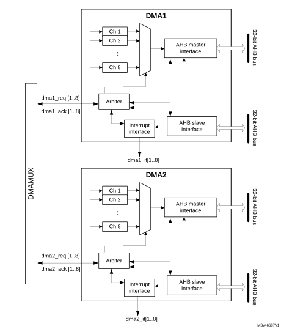

# 12 Direct memory access controller (DMA)

## 12.1 Introduction

The direct memory access (DMA) controller is a bus master and system peripheral.

The DMA is used to perform programmable data transfers between memory-mapped peripherals and/or memories, upon the control of an off-loaded CPU.

The DMA controller features a single AHB master architecture.

There are two instances of DMA, DMA1 and DMA2 (See [Table 87: DMA1 and DMA2 implementation](#XREF_44540__Table_74__DMA1_and_DMA2_implementation18) for number of supported channels).

Each channel is dedicated to managing memory access requests from one or more peripherals. Each DMA includes an arbiter for handling the priority between DMA requests.

## 12.2 DMA main features

- Single AHB master
- Peripheral-to-memory, memory-to-peripheral, memory-to-memory, and peripheral-to-peripheral data transfers
- Access, as source and destination, to on-chip memory-mapped devices such as flash memory, SRAM, and AHB and APB peripherals
- All DMA channels are independently configurable:
 - Each channel is associated either with a DMA request signal coming from a peripheral, or with a software trigger in memory-to-memory transfers. This configuration is done by software.
 - Priority between the requests is programmable by software (four levels per channel: very high, high, medium, low) and by hardware in case of equality (such as request to channel 1 has priority over request to channel 2).
 - Transfer size of source and destination are independent (byte, half-word, word), emulating packing and unpacking. Source and destination addresses must be aligned on the data size.
 - Support of transfers from/to peripherals to/from memory with circular buffer management
 - Programmable number of data to be transferred: 0 to 216 - 1
- Generation of an interrupt request per channel. Each interrupt request is caused from any of the three DMA events: transfer complete, half transfer, or transfer error.

## 12.3 DMA implementation

### 12.3.1 DMA1 and DMA2

DMA1 and DMA2 are implemented with the hardware configuration parameters shown in the table below.

<table class="TableTitle"><caption class="TableCap"><h4 class="TableCap" id="53890734">Table 87. <a id="implementation18" name="XREF_44540__Table_74__DMA1_and_DMA2_implementation18">DMA1 and DMA2 implementation</a></h4></caption><col width="136.51px"/><col width="237.01px"/><col width="82.53px"/><col width="82.53px"/><thead><tr height="28.00px"><th colspan="2">
Feature
</th><th>
DMA1
</th><th>
DMA2
</th></tr></thead><tr height="57.33px"><td>
Number of channels
</td><td>
Category 2 devices<a href="#c7amba%20dma1%20UserSpec%20V1_c7amba%20dma1%20UserSpec%20V1_FTH_1">1</a>

Category 3 devices<a href="#XREF_96976__STM32G4xx_memory_density_18" style="font-family : Arial ; font-weight:normal;font-style:normal;font-size : 9.00pt;text-decoration:none;font-kerning:normal;text-transform:none;font-stretch:normal;color:#000000;background-color:transparent;letter-spacing : 0.00em;">(1)</a>

Category 4 devices<a href="#XREF_96976__STM32G4xx_memory_density_18" style="font-family : Arial ; font-weight:normal;font-style:normal;font-size : 9.00pt;text-decoration:none;font-kerning:normal;text-transform:none;font-stretch:normal;color:#000000;background-color:transparent;letter-spacing : 0.00em;">(1)</a>
</td><td>
6

8

8
</td><td>
6

8

8
</td></tr></table>

<a href="#c7amba%20dma1%20UserSpec%20V1_c7amba%20dma1%20UserSpec%20V1_FTB_1">1.</a><a id="18" name="XREF_96976__STM32G4xx_memory_density_18">See </a><a href="Documentation_conventions.htm#XREF_59754__Table_1__STM32G4xx_memory_density1" style="font-family : Arial ; font-weight:normal;font-style:Italic;font-size : 9.00pt;font-kerning:normal;font-stretch:normal;color:#0000ff;background-color:transparent;letter-spacing : 0.00em;">Table 1: STM32G4 series memory density</a>.

### 12.3.2 DMA request mapping

For the mapping of the different requests, refer to the DMAMUX section.

## 12.4 DMA functional description

### 12.4.1 DMA block diagram

The DMA block diagram is shown in the figure below.

#### Figure 31. DMA block diagram 

**Note:**

See [Figure 31: DMA block diagram](#XREF_84598__Figure_1__DMA_block_diagram18) for feature implementation.

The DMA controller performs direct memory transfer by sharing the AHB system bus with other system masters. The bus matrix implements round-robin scheduling. DMA requests may stop the CPU access to the system bus for a number of bus cycles, when CPU and DMA target the same destination (memory or peripheral).

According to its configuration through the AHB slave interface, the DMA controller arbitrates between the DMA channels and their associated received requests. The DMA controller also schedules the DMA data transfers over the single AHB port master.

The DMA controller generates an interrupt per channel to the interrupt controller.

### 12.4.2 DMA pins and internal signals

  

<table class="TableTitle"><caption class="TableCap"><h4 class="TableCap" id="53896650">Table 88. DMA internal input/output signals</h4></caption><col width="186.06px"/><col width="78.34px"/><col width="274.19px"/><thead><tr height="28.00px"><th>
Signal name
</th><th>
Signal type
</th><th>
Description
</th></tr></thead><tr height="22.67px"><td>
dma_req[x]
</td><td>
Input
</td><td>
DMA channel x request
</td></tr><tr height="22.67px"><td>
dma_ack[x]
</td><td>
Output
</td><td>
DMA channel x acknowledge
</td></tr><tr height="22.67px"><td>
dma_it[x]
</td><td>
Output
</td><td>
DMA channel x interrupt
</td></tr></table>

### 12.4.3 DMA transfers

The software configures the DMA controller at channel level, to perform a block transfer, composed of a sequence of AHB bus transfers.

A DMA block transfer may be requested from a peripheral, or triggered by the software in case of memory-to-memory transfer.

After an event, the following steps of a single DMA transfer occur:

1. The peripheral sends a single DMA request signal to the DMA controller.
2. The DMA controller serves the request, depending on the priority of the channel associated to this peripheral request.
3. As soon as the DMA controller grants the peripheral, an acknowledge is sent to the peripheral by the DMA controller.
4. The peripheral releases its request as soon as it gets the acknowledge from the DMA controller.
5. Once the request is deasserted by the peripheral, the DMA controller releases the acknowledge.

The peripheral may order a further single request and initiate another single DMA transfer.

The request/acknowledge protocol is used when a peripheral is either the source or the destination of the transfer. For example, in case of memory-to-peripheral transfer, the peripheral initiates the transfer by driving its single request signal to the DMA controller. The DMA controller reads then a single data in the memory and writes this data to the peripheral.

For a given channel x, a DMA block transfer consists of a repeated sequence of:

- a single DMA transfer, encapsulating two AHB transfers of a single data, over the DMA AHB bus master:
 - a single data read (byte, half-word, or word) from the peripheral data register or a location in the memory, addressed through an internal current peripheral/memory address register.  
  The start address used for the first single transfer is the base address of the peripheral or memory, and is programmed in the DMA\_CPARx or DMA\_CMARx register.
 - a single data write (byte, half-word, or word) to the peripheral data register or a location in the memory, addressed through an internal current peripheral/memory address register.  
  The start address used for the first transfer is the base address of the peripheral or memory, and is programmed in the DMA\_CPARx or DMA\_CMARx register.
- postdecrementing of the programmed DMA\_CNDTRx register  
  This register contains the remaining number of data items to transfer (number of AHB ‘read followed by write’ transfers).

This sequence is repeated until DMA\_CNDTRx is null.

**Note:**

The AHB master bus source/destination address must be aligned with the programmed size of the transferred single data to the source/destination.

### 12.4.4 DMA arbitration

The DMA arbiter manages the priority between the different channels.

When an active channel x is granted by the arbiter (hardware requested or software triggered), a single DMA transfer is issued (such as an AHB ‘read followed by write’ transfer of a single data). Then, the arbiter considers again the set of active channels and selects the one with the highest priority.

The priorities are managed in two stages:

- software: priority of each channel is configured in the DMA\_CCRx register, to one of the four different levels:
 - very high
 - high
 - medium
 - low
- hardware: if two requests have the same software priority level, the channel with the lowest index gets priority. For example, channel 2 gets priority over channel 4.

When a channel x is programmed for a block transfer in memory-to-memory mode, re arbitration is considered between each single DMA transfer of this channel x. Whenever there is another concurrent active requested channel, the DMA arbiter automatically alternates and grants the other highest-priority requested channel, which may be of lower priority than the memory-to-memory channel.

### 12.4.5 DMA channels

Each channel may handle a DMA transfer between a peripheral register located at a fixed address, and a memory address. The number of data items to transfer is programmable. The register that contains the number of data items to transfer is decremented after each transfer.

A DMA channel is programmed at block transfer level.

#### Programmable data sizes

The transfer sizes of a single data (byte, half-word, or word) to the peripheral and memory are programmable through, respectively, the PSIZE[1:0] and MSIZE[1:0] fields of the DMA\_CCRx register.

#### Pointer incrementation

The peripheral and memory pointers may be automatically incremented after each transfer, depending on the PINC and MINC bits of the DMA\_CCRx register.

If the incremented mode is enabled (PINC or MINC set to 1), the address of the next transfer is the address of the previous one incremented by 1, 2 or 4, depending on the data size defined in PSIZE[1:0] or MSIZE[1:0]. The first transfer address is the one programmed in the DMA\_CPARx or DMA\_CMARx register. During transfers, these registers keep the initially programmed value. The current transfer addresses (in the current internal peripheral/memory address register) are not accessible by software.

If the channel x is configured in noncircular mode, no DMA request is served after the last data transfer (once the number of single data to transfer reaches zero). The DMA channel must be disabled to reload a new number of data items into the DMA\_CNDTRx register.

**Note:**

If the channel x is disabled, the DMA registers are not reset. The DMA channel registers (DMA\_CCRx, DMA\_CPARx and DMA\_CMARx) retain the initial values programmed during the channel configuration phase.

In circular mode, after the last data transfer, the DMA\_CNDTRx register is automatically reloaded with the initially programmed value. The current internal address registers are reloaded with the base address values from the DMA\_CPARx and DMA\_CMARx registers.

#### Channel configuration procedure

The following sequence is needed to configure a DMA channel x:

1. Set the peripheral register address in the DMA\_CPARx register.
  The data is moved from/to this address to/from the memory after the peripheral event, or after the channel is enabled in memory-to-memory mode.
2. Set the memory address in the DMA\_CMARx register.
  The data is written to/read from the memory after the peripheral event or after the channel is enabled in memory-to-memory mode.
3. Configure the total number of data to transfer in the DMA\_CNDTRx register.
  After each data transfer, this value is decremented.
4. Configure the parameters listed below in the DMA\_CCRx register:
 - the channel priority
 - the data transfer direction
 - the circular mode
 - the peripheral and memory incremented mode
 - the peripheral and memory data size
 - the interrupt enable at half and/or full transfer and/or transfer error
5. Activate the channel by setting the EN bit in the DMA\_CCRx register.

A channel, as soon as enabled, may serve any DMA request from the peripheral connected to this channel, or may start a memory-to-memory block transfer.

**Note:**

The two last steps of the channel configuration procedure may be merged into a single access to the DMA\_CCRx register, to configure and enable the channel.

#### Channel state and disabling a channel

A channel x in the active state is an enabled channel (read DMA\_CCRx.EN = 1). An active channel x is a channel that must have been enabled by the software (DMA\_CCRx.EN set to 1) and afterwards with no occurred transfer error (DMA\_ISR.TEIFx = 0). In case there is a transfer error, the channel is automatically disabled by hardware (DMA\_CCRx.EN = 0).

The three following use cases may happen:

- Suspend and resume a channel

This corresponds to the two following actions:

 - An active channel is disabled by software (writing DMA\_CCRx.EN = 0 whereas DMA\_CCRx.EN = 1).
 - The software enables the channel again (DMA\_CCRx.EN set to 1) without reconfiguring the other channel registers (such as DMA\_CNDTRx, DMA\_CPARx and DMA\_CMARx).

This case is not supported by the DMA hardware, which does not guarantee that the remaining data transfers are performed correctly.

- Stop and abort a channel

If the application does not need anymore the channel, this active channel can be disabled by software. The channel is stopped and aborted but the DMA\_CNDTRx register content may not correctly reflect the remaining data transfers versus the aborted source and destination buffer/register.

- Abort and restart a channel

This corresponds to the software sequence: disable an active channel, then reconfigure the channel and enable it again.

This is supported by the hardware if the following conditions are met:

 - The application guarantees that, when the software is disabling the channel, a DMA data transfer is not occurring at the same time over its master port. For example, the application can first disable the peripheral in DMA mode, to ensure that there is no pending hardware DMA request from this peripheral.
 - The software must operate separated write accesses to the same DMA\_CCRx register: First disable the channel. Second reconfigure the channel for a next block transfer including the DMA\_CCRx if a configuration change is needed. There are read-only DMA\_CCRx register fields when DMA\_CCRx.EN=1. Finally enable again the channel.

When a channel transfer error occurs, the EN bit of the DMA\_CCRx register is cleared by hardware. This EN bit cannot be set again by software to reactivate the channel x, until the TEIFx bit of the DMA\_ISR register is set.

#### Circular mode (in memory-to-peripheral/peripheral-to-memory transfers)

The circular mode is available to handle circular buffers and continuous data flows (such as ADC scan mode). This feature is enabled using the CIRC bit in the DMA\_CCRx register.

**Note:**

The circular mode must not be used in memory-to-memory mode. Before enabling a channel in circular mode (CIRC = 1), the software must clear the MEM2MEM bit of the DMA\_CCRx register. When the circular mode is activated, the amount of data to transfer is automatically reloaded with the initial value programmed during the channel configuration phase, and the DMA requests continue to be served.

To stop a circular transfer, the software needs to stop the peripheral from generating DMA requests (such as quit the ADC scan mode), before disabling the DMA channel.   
The software must explicitly program the DMA\_CNDTRx value before starting/enabling a transfer, and after having stopped a circular transfer.

#### Memory-to-memory mode

The DMA channels may operate without being triggered by a request from a peripheral. This mode is called memory-to-memory mode, and is initiated by software.

If the MEM2MEM bit in the DMA\_CCRx register is set, the channel, if enabled, initiates transfers. The transfer stops once the DMA\_CNDTRx register reaches zero.

**Note:**

The memory-to-memory mode must not be used in circular mode. Before enabling a channel in memory-to-memory mode (MEM2MEM = 1), the software must clear the CIRC bit of the DMA\_CCRx register.

#### Peripheral-to-peripheral mode

Any DMA channel can operate in peripheral-to-peripheral mode:

- when the hardware request from a peripheral is selected to trigger the DMA channel

This peripheral is the DMA initiator and paces the data transfer from/to this peripheral to/from a register belonging to another memory-mapped peripheral (this one being not configured in DMA mode).

- when no peripheral request is selected and connected to the DMA channel

The software configures a register-to-register transfer by setting the MEM2MEM bit of the DMA\_CCRx register.

#### Programming transfer direction, assigning source/destination

The value of the DIR bit of the DMA\_CCRx register sets the direction of the transfer, and consequently, it identifies the source and the destination, regardless of the source/destination type (peripheral or memory):

- DIR = 1 defines typically a memory-to-peripheral transfer. More generally, if DIR = 1:
 - The source attributes are defined by the DMA\_MARx register, the MSIZE[1:0] field, and the MINC bit of the DMA\_CCRx register.  
  Regardless of their usual naming, these ‘memory’ register, field, and bit are used to define the source peripheral in peripheral-to-peripheral mode.
 - The destination attributes are defined by the DMA\_PARx register, the PSIZE[1:0] field and the PINC bit of the DMA\_CCRx register.  
  Regardless of their usual naming, these ‘peripheral’ register, field, and bit are used to define the destination memory in memory-to-memory mode.
- DIR = 0 defines typically a peripheral-to-memory transfer. More generally, if DIR = 0:
 - The source attributes are defined by the DMA\_PARx register, the PSIZE[1:0] field and the PINC bit of the DMA\_CCRx register.  
  Regardless of their usual naming, these ‘peripheral’ register, field, and bit are used to define the source memory in memory-to-memory mode
 - The destination attributes are defined by the DMA\_MARx register, the MSIZE[1:0] field and the MINC bit of the DMA\_CCRx register.  
  Regardless of their usual naming, these ‘memory’ register, field, and bit are used to define the destination peripheral in peripheral-to-peripheral mode.

### 12.4.6 DMA data width, alignment, and endianness

When PSIZE[1:0] and MSIZE[1:0] are not equal, the DMA controller performs some data alignments as described in the table below.

 

<table class="TableTitle"><caption class="TableCap"><h4 class="TableCap" id="1029779">Table 89. Source port width</h4></caption></table>

(MSIZE if DIR = 1, else PSIZE)

 Destination port width (PSIZE if DIR = 1, else MSIZE) | Number of data items to transfer (NDT) | Source content: address / data  (DMA\_CMARx if DIR = 1, else DMA\_CPARx) | DMA transfers | Destination content:  address / data  (DMA\_CPARx if DIR = 1, else DMA\_CMARx) || 8 | 8 | 4 | @0x0 / B0  @0x1 / B1  @0x2 / B2  @0x3 / B3 | 1: read B0[7:0] @0x0 then write B0[7:0] @0x0  2: read B1[7:0] @0x1 then write B1[7:0] @0x1  3: read B2[7:0] @0x2 then write B2[7:0] @0x2  4: read B3[7:0] @0x3 then write B3[7:0] @0x3 | @0x0 / B0  @0x1 / B1  @0x2 / B2  @0x3 / B3 |
|8|16|4|@0x0 / B0  @0x1 / B1  @0x2 / B2  @0x3 / B3|1: read B0[7:0] @0x0 then write 00B0[15:0] @0x0  2: read B1[7:0] @0x1 then write 00B1[15:0] @0x2  3: read B2[7:0] @0x2 then write 00B2[15:0] @0x4  4: read B3[7:0] @0x3 then write 00B3[15:0] @0x6|@0x0 / 00B0  @0x2 / 00B1  @0x4 / 00B2  @0x6 / 00B3|
|8|32|4|@0x0 / B0  @0x1 / B1  @0x2 / B2  @0x3 / B3|1: read B0[7:0] @0x0 then write 000000B0[31:0] @0x0  2: read B1[7:0] @0x1 then write 000000B1[31:0] @0x4  3: read B2[7:0] @0x2 then write 000000B2[31:0] @0x8  4: read B3[7:0] @0x3 then write 000000B3[31:0] @0xC|@0x0 / 000000B0  @0x4 / 000000B1  @0x8 / 000000B2  @0xC / 000000B3|
|16|8|4|@0x0 / B1B0  @0x2 / B3B2  @0x4 / B5B4  @0x6 / B7B6|1: read B1B0[15:0] @0x0 then write B0[7:0] @0x0  2: read B3B2[15:0] @0x2 then write B2[7:0] @0x1  3: read B5B4[15:0] @0x4 then write B4[7:0] @0x2  4: read B7B6[15:0] @0x6 then write B6[7:0] @0x3|@0x0 / B0  @0x1 / B2  @0x2 / B4  @0x3 / B6|
|16|16|4|@0x0 / B1B0  @0x2 / B3B2  @0x4 / B5B4  @0x6 / B7B6|1: read B1B0[15:0] @0x0 then write B1B0[15:0] @0x0  2: read B3B2[15:0] @0x2 then write B3B2[15:0] @0x2  3: read B5B4[15:0] @0x4 then write B5B4[15:0] @0x4  4: read B7B6[15:0] @0x6 then write B7B6[15:0] @0x6|@0x0 / B1B0  @0x2 / B3B2  @0x4 / B5B4  @0x6 / B7B6|
|16|32|4|@0x0 / B1B0  @0x2 / B3B2  @0x4 / B5B4  @0x6 / B7B6|1: read B1B0[15:0] @0x0 then write 0000B1B0[31:0] @0x0  2: read B3B2[15:0] @0x2 then write 0000B3B2[31:0] @0x4  3: read B5B4[15:0] @0x4 then write 0000B5B4[31:0] @0x8  4: read B7B6[15:0] @0x6 then write 0000B7B6[31:0] @0xC|@0x0 / 0000B1B0  @0x4 / 0000B3B2  @0x8 / 0000B5B4  @0xC / 0000B7B6|
|32|8|4|@0x0 / B3B2B1B0  @0x4 / B7B6B5B4  @0x8 / BBBAB9B8  @0xC / BFBEBDBC|1: read B3B2B1B0[31:0] @0x0 then write B0[7:0] @0x0  2: read B7B6B5B4[31:0] @0x4 then write B4[7:0] @0x1  3: read BBBAB9B8[31:0] @0x8 then write B8[7:0] @0x2  4: read BFBEBDBC[31:0] @0xC then write BC[7:0] @0x3|@0x0 / B0  @0x1 / B4  @0x2 / B8  @0x3 / BC|
|32|16|4|@0x0 / B3B2B1B0  @0x4 / B7B6B5B4  @0x8 / BBBAB9B8  @0xC / BFBEBDBC|1: read B3B2B1B0[31:0] @0x0 then write B1B0[15:0] @0x0  2: read B7B6B5B4[31:0] @0x4 then write B5B4[15:0] @0x2  3: read BBBAB9B8[31:0] @0x8 then write B9B8[15:0] @0x4  4: read BFBEBDBC[31:0] @0xC then write BDBC[15:0] @0x6|@0x0 / B1B0  @0x2 / B5B4  @0x4 / B9B8  @0x6 / BDBC|
|32|32|4|@0x0 / B3B2B1B0  @0x4 / B7B6B5B4  @0x8 / BBBAB9B8  @0xC / BFBEBDBC|1: read B3B2B1B0[31:0] @0x0 then write B3B2B1B0[31:0] @0x0  2: read B7B6B5B4[31:0] @0x4 then write B7B6B5B4[31:0] @0x4  3: read BBBAB9B8[31:0] @0x8 then write BBBAB9B8[31:0] @0x8  4: read BFBEBDBC[31:0] @0xC then write BFBEBDBC[31:0] @0xC|@0x0 / B3B2B1B0  @0x4 / B7B6B5B4  @0x8 / BBBAB9B8  @0xC / BFBEBDBC|

#### Addressing AHB peripherals not supporting byte/half-word write transfers

When the DMA controller initiates an AHB byte or half-word write transfer, the data are duplicated on the unused lanes of the AHB master 32-bit data bus (HWDATA[31:0]).

When the AHB slave peripheral does not support byte or half-word write transfers and does not generate any error, the DMA controller writes the 32 HWDATA bits as shown in the two examples below:

- To write the half-word 0xABCD, the DMA controller sets the HWDATA bus to 0xABCDABCD with a half-word data size (HSIZE = HalfWord in the AHB master bus).
- To write the byte 0xAB, the DMA controller sets the HWDATA bus to 0xABABABAB with a byte data size (HSIZE = Byte in the AHB master bus).

Assuming the AHB/APB bridge is an AHB 32-bit slave peripheral that does not take into account the HSIZE data, any AHB byte or half-word transfer is changed into a 32-bit APB transfer as described below:

- An AHB byte write transfer of 0xB0 to one of the 0x0, 0x1, 0x2, or 0x3 addresses, is converted to an APB word write transfer of 0xB0B0B0B0 to the 0x0 address.
- An AHB half-word write transfer of 0xB1B0 to the 0x0 or 0x2 addresses is converted to an APB word write transfer of 0xB1B0B1B0 to the 0x0 address.

### 12.4.7 DMA error management

A DMA transfer error is generated when reading from or writing to a reserved address space. When a DMA transfer error occurs during a DMA read or write access, the faulty channel x is automatically disabled through a hardware clear of its EN bit in the corresponding DMA\_CCRx register.

The TEIFx bit of the DMA\_ISR register is set. An interrupt is then generated if the TEIE bit of the DMA\_CCRx register is set.

The EN bit of the DMA\_CCRx register cannot be set again by software (channel x reactivated) until the TEIFx bit of the DMA\_ISR register is cleared (by setting the CTEIFx bit of the DMA\_IFCR register).

When the software is notified with a transfer error over a channel, which involves a peripheral, the software has first to stop this peripheral in DMA mode, in order to disable any pending or future DMA request. Then software may normally reconfigure both the DMA and the peripheral in DMA mode for a new transfer.

## 12.5 DMA interrupts

An interrupt can be generated on a half transfer, transfer complete, or transfer error for each DMA channel x. Separate interrupt enable bits are available for flexibility.

 

<table class="TableTitle"><caption class="TableCap"><h4 class="TableCap" id="1030018">Table 90. DMA interrupt requests</h4></caption><col width="118.40px"/><col width="340.13px"/><col width="72.82px"/><col width="83.65px"/><thead><tr height="42.67px"><th>
Interrupt request
</th><th>
Interrupt event
</th><th>
Event flag
</th><th>
Interrupt enable bit
</th></tr></thead><tr height="22.67px"><td rowspan="4">
Channel x interrupt
</td><td>
Half transfer on channel x
</td><td>
HTIFx
</td><td>
HTIEx
</td></tr><tr height="22.67px"><td>
Transfer complete on channel x
</td><td>
TCIFx
</td><td>
TCIEx
</td></tr><tr height="22.67px"><td>
Transfer error on channel x
</td><td>
TEIFx
</td><td>
TEIEx
</td></tr><tr height="22.67px"><td>
Half transfer or transfer complete or transfer error on channel x
</td><td>
GIFx
</td><td>
-
</td></tr></table>

## 12.6 DMA registers

Refer to [Section 1.2](Documentation_conventions.md#XREF_82797__1_1_List_of_abbreviations_for_registers1) for a list of abbreviations used in register descriptions.

The DMA registers have to be accessed by words (32-bit).

**Note:**

See [Figure 31: DMA block diagram](#XREF_84598__Figure_1__DMA_block_diagram18) for feature implementation.

### 12.6.1 DMA interrupt status register (DMA\_ISR)

Address offset: 0x00

Reset value: 0x0000 0000

Every status bit is cleared by hardware when the software sets the corresponding clear bit or the corresponding global clear bit CGIFx, in the DMA\_IFCR register.

 

<table class="RegBitMap"><col width="38.39px"/><col width="38.39px"/><col width="38.39px"/><col width="38.39px"/><col width="38.39px"/><col width="38.39px"/><col width="38.39px"/><col width="38.39px"/><col width="38.39px"/><col width="38.39px"/><col width="38.39px"/><col width="38.39px"/><col width="38.39px"/><col width="38.39px"/><col width="38.39px"/><col width="38.39px"/><tr height="17.33px"><td style="border-bottom-width:0;border-bottom-style:hidden;border-bottom-color:0;">
31
</td><td style="border-bottom-width:0;border-bottom-style:hidden;border-bottom-color:0;">
30
</td><td style="border-bottom-width:0;border-bottom-style:hidden;border-bottom-color:0;">
29
</td><td style="border-bottom-width:0;border-bottom-style:hidden;border-bottom-color:0;">
28
</td><td style="border-bottom-width:0;border-bottom-style:hidden;border-bottom-color:0;">
27
</td><td style="border-bottom-width:0;border-bottom-style:hidden;border-bottom-color:0;">
26
</td><td style="border-bottom-width:0;border-bottom-style:hidden;border-bottom-color:0;">
25
</td><td style="border-bottom-width:0;border-bottom-style:hidden;border-bottom-color:0;">
24
</td><td style="border-bottom-width:0;border-bottom-style:hidden;border-bottom-color:0;">
23
</td><td style="border-bottom-width:0;border-bottom-style:hidden;border-bottom-color:0;">
22
</td><td style="border-bottom-width:0;border-bottom-style:hidden;border-bottom-color:0;">
21
</td><td style="border-bottom-width:0;border-bottom-style:hidden;border-bottom-color:0;">
20
</td><td style="border-bottom-width:0;border-bottom-style:hidden;border-bottom-color:0;">
19
</td><td style="border-bottom-width:0;border-bottom-style:hidden;border-bottom-color:0;">
18
</td><td style="border-bottom-width:0;border-bottom-style:hidden;border-bottom-color:0;">
17
</td><td style="border-bottom-width:0;border-bottom-style:hidden;border-bottom-color:0;">
16
</td></tr><tr data-conditional="_dma1_8chmax" height="17.33px"><td data-conditional="_dma1_8chmax" style="border-left-width:0.5pt;border-left-style:solid;border-left-color:#000000;border-bottom-width:0.5pt;border-bottom-style:solid;border-bottom-color:#000000;border-right-width:0.5pt;border-right-style:solid;border-right-color:#000000;border-top-width:0.5pt;border-top-style:solid;border-top-color:#000000;">
TEIF8
</td><td data-conditional="_dma1_8chmax" style="border-left-width:0.5pt;border-left-style:solid;border-left-color:#000000;border-bottom-width:0.5pt;border-bottom-style:solid;border-bottom-color:#000000;border-right-width:0.5pt;border-right-style:solid;border-right-color:#000000;border-top-width:0.5pt;border-top-style:solid;border-top-color:#000000;">
HTIF8
</td><td data-conditional="_dma1_8chmax" style="border-left-width:0.5pt;border-left-style:solid;border-left-color:#000000;border-bottom-width:0.5pt;border-bottom-style:solid;border-bottom-color:#000000;border-right-width:0.5pt;border-right-style:solid;border-right-color:#000000;border-top-width:0.5pt;border-top-style:solid;border-top-color:#000000;">
TCIF8
</td><td data-conditional="_dma1_8chmax" style="border-left-width:0.5pt;border-left-style:solid;border-left-color:#000000;border-bottom-width:0.5pt;border-bottom-style:solid;border-bottom-color:#000000;border-right-width:0.5pt;border-right-style:solid;border-right-color:#000000;border-top-width:0.5pt;border-top-style:solid;border-top-color:#000000;">
GIF8
</td><td data-conditional="_dma1_8chmax" style="border-left-width:0.5pt;border-left-style:solid;border-left-color:#000000;border-bottom-width:0.5pt;border-bottom-style:solid;border-bottom-color:#000000;border-right-width:0.5pt;border-right-style:solid;border-right-color:#000000;border-top-width:0.5pt;border-top-style:solid;border-top-color:#000000;">
TEIF7
</td><td data-conditional="_dma1_8chmax" style="border-left-width:0.5pt;border-left-style:solid;border-left-color:#000000;border-bottom-width:0.5pt;border-bottom-style:solid;border-bottom-color:#000000;border-right-width:0.5pt;border-right-style:solid;border-right-color:#000000;border-top-width:0.5pt;border-top-style:solid;border-top-color:#000000;">
HTIF7
</td><td data-conditional="_dma1_8chmax" style="border-left-width:0.5pt;border-left-style:solid;border-left-color:#000000;border-bottom-width:0.5pt;border-bottom-style:solid;border-bottom-color:#000000;border-right-width:0.5pt;border-right-style:solid;border-right-color:#000000;border-top-width:0.5pt;border-top-style:solid;border-top-color:#000000;">
TCIF7
</td><td data-conditional="_dma1_8chmax" style="border-left-width:0.5pt;border-left-style:solid;border-left-color:#000000;border-bottom-width:0.5pt;border-bottom-style:solid;border-bottom-color:#000000;border-right-width:0.5pt;border-right-style:solid;border-right-color:#000000;border-top-width:0.5pt;border-top-style:solid;border-top-color:#000000;">
GIF7
</td><td data-conditional="_dma1_8chmax" style="border-left-width:0.5pt;border-left-style:solid;border-left-color:#000000;border-bottom-width:0.5pt;border-bottom-style:solid;border-bottom-color:#000000;border-right-width:0.5pt;border-right-style:solid;border-right-color:#000000;border-top-width:0.5pt;border-top-style:solid;border-top-color:#000000;">
TEIF6
</td><td data-conditional="_dma1_8chmax" style="border-left-width:0.5pt;border-left-style:solid;border-left-color:#000000;border-bottom-width:0.5pt;border-bottom-style:solid;border-bottom-color:#000000;border-right-width:0.5pt;border-right-style:solid;border-right-color:#000000;border-top-width:0.5pt;border-top-style:solid;border-top-color:#000000;">
HTIF6
</td><td data-conditional="_dma1_8chmax" style="border-left-width:0.5pt;border-left-style:solid;border-left-color:#000000;border-bottom-width:0.5pt;border-bottom-style:solid;border-bottom-color:#000000;border-right-width:0.5pt;border-right-style:solid;border-right-color:#000000;border-top-width:0.5pt;border-top-style:solid;border-top-color:#000000;">
TCIF6
</td><td data-conditional="_dma1_8chmax" style="border-left-width:0.5pt;border-left-style:solid;border-left-color:#000000;border-bottom-width:0.5pt;border-bottom-style:solid;border-bottom-color:#000000;border-right-width:0.5pt;border-right-style:solid;border-right-color:#000000;border-top-width:0.5pt;border-top-style:solid;border-top-color:#000000;">
GIF6
</td><td data-conditional="_dma1_8chmax" style="border-left-width:0.5pt;border-left-style:solid;border-left-color:#000000;border-bottom-width:0.5pt;border-bottom-style:solid;border-bottom-color:#000000;border-right-width:0.5pt;border-right-style:solid;border-right-color:#000000;border-top-width:0.5pt;border-top-style:solid;border-top-color:#000000;">
TEIF5
</td><td data-conditional="_dma1_8chmax" style="border-left-width:0.5pt;border-left-style:solid;border-left-color:#000000;border-bottom-width:0.5pt;border-bottom-style:solid;border-bottom-color:#000000;border-right-width:0.5pt;border-right-style:solid;border-right-color:#000000;border-top-width:0.5pt;border-top-style:solid;border-top-color:#000000;">
HTIF5
</td><td data-conditional="_dma1_8chmax" style="border-left-width:0.5pt;border-left-style:solid;border-left-color:#000000;border-bottom-width:0.5pt;border-bottom-style:solid;border-bottom-color:#000000;border-right-width:0.5pt;border-right-style:solid;border-right-color:#000000;border-top-width:0.5pt;border-top-style:solid;border-top-color:#000000;">
TCIF5
</td><td data-conditional="_dma1_8chmax" style="border-left-width:0.5pt;border-left-style:solid;border-left-color:#000000;border-bottom-width:0.5pt;border-bottom-style:solid;border-bottom-color:#000000;border-right-width:0.5pt;border-right-style:solid;border-right-color:#000000;border-top-width:0.5pt;border-top-style:solid;border-top-color:#000000;">
GIF5
</td></tr><tr data-conditional="_dma1_8chmax" height="17.33px"><td data-conditional="_dma1_8chmax" style="border-left-width:0.5pt;border-left-style:solid;border-left-color:#000000;border-bottom-width:0.5pt;border-bottom-style:solid;border-bottom-color:#000000;border-right-width:0.5pt;border-right-style:solid;border-right-color:#000000;border-top-width:0.5pt;border-top-style:solid;border-top-color:#000000;">
r
</td><td data-conditional="_dma1_8chmax" style="border-left-width:0.5pt;border-left-style:solid;border-left-color:#000000;border-bottom-width:0.5pt;border-bottom-style:solid;border-bottom-color:#000000;border-right-width:0.5pt;border-right-style:solid;border-right-color:#000000;border-top-width:0.5pt;border-top-style:solid;border-top-color:#000000;">
r
</td><td data-conditional="_dma1_8chmax" style="border-left-width:0.5pt;border-left-style:solid;border-left-color:#000000;border-bottom-width:0.5pt;border-bottom-style:solid;border-bottom-color:#000000;border-right-width:0.5pt;border-right-style:solid;border-right-color:#000000;border-top-width:0.5pt;border-top-style:solid;border-top-color:#000000;">
r
</td><td data-conditional="_dma1_8chmax" style="border-left-width:0.5pt;border-left-style:solid;border-left-color:#000000;border-bottom-width:0.5pt;border-bottom-style:solid;border-bottom-color:#000000;border-right-width:0.5pt;border-right-style:solid;border-right-color:#000000;border-top-width:0.5pt;border-top-style:solid;border-top-color:#000000;">
r
</td><td data-conditional="_dma1_8chmax" style="border-left-width:0.5pt;border-left-style:solid;border-left-color:#000000;border-bottom-width:0.5pt;border-bottom-style:solid;border-bottom-color:#000000;border-right-width:0.5pt;border-right-style:solid;border-right-color:#000000;border-top-width:0.5pt;border-top-style:solid;border-top-color:#000000;">
r
</td><td data-conditional="_dma1_8chmax" style="border-left-width:0.5pt;border-left-style:solid;border-left-color:#000000;border-bottom-width:0.5pt;border-bottom-style:solid;border-bottom-color:#000000;border-right-width:0.5pt;border-right-style:solid;border-right-color:#000000;border-top-width:0.5pt;border-top-style:solid;border-top-color:#000000;">
r
</td><td data-conditional="_dma1_8chmax" style="border-left-width:0.5pt;border-left-style:solid;border-left-color:#000000;border-bottom-width:0.5pt;border-bottom-style:solid;border-bottom-color:#000000;border-right-width:0.5pt;border-right-style:solid;border-right-color:#000000;border-top-width:0.5pt;border-top-style:solid;border-top-color:#000000;">
r
</td><td data-conditional="_dma1_8chmax" style="border-left-width:0.5pt;border-left-style:solid;border-left-color:#000000;border-bottom-width:0.5pt;border-bottom-style:solid;border-bottom-color:#000000;border-right-width:0.5pt;border-right-style:solid;border-right-color:#000000;border-top-width:0.5pt;border-top-style:solid;border-top-color:#000000;">
r
</td><td data-conditional="_dma1_8chmax" style="border-left-width:0.5pt;border-left-style:solid;border-left-color:#000000;border-bottom-width:0.5pt;border-bottom-style:solid;border-bottom-color:#000000;border-right-width:0.5pt;border-right-style:solid;border-right-color:#000000;border-top-width:0.5pt;border-top-style:solid;border-top-color:#000000;">
r
</td><td data-conditional="_dma1_8chmax" style="border-left-width:0.5pt;border-left-style:solid;border-left-color:#000000;border-bottom-width:0.5pt;border-bottom-style:solid;border-bottom-color:#000000;border-right-width:0.5pt;border-right-style:solid;border-right-color:#000000;border-top-width:0.5pt;border-top-style:solid;border-top-color:#000000;">
r
</td><td data-conditional="_dma1_8chmax" style="border-left-width:0.5pt;border-left-style:solid;border-left-color:#000000;border-bottom-width:0.5pt;border-bottom-style:solid;border-bottom-color:#000000;border-right-width:0.5pt;border-right-style:solid;border-right-color:#000000;border-top-width:0.5pt;border-top-style:solid;border-top-color:#000000;">
r
</td><td data-conditional="_dma1_8chmax" style="border-left-width:0.5pt;border-left-style:solid;border-left-color:#000000;border-bottom-width:0.5pt;border-bottom-style:solid;border-bottom-color:#000000;border-right-width:0.5pt;border-right-style:solid;border-right-color:#000000;border-top-width:0.5pt;border-top-style:solid;border-top-color:#000000;">
r
</td><td data-conditional="_dma1_8chmax" style="border-left-width:0.5pt;border-left-style:solid;border-left-color:#000000;border-bottom-width:0.5pt;border-bottom-style:solid;border-bottom-color:#000000;border-right-width:0.5pt;border-right-style:solid;border-right-color:#000000;border-top-width:0.5pt;border-top-style:solid;border-top-color:#000000;">
r
</td><td data-conditional="_dma1_8chmax" style="border-left-width:0.5pt;border-left-style:solid;border-left-color:#000000;border-bottom-width:0.5pt;border-bottom-style:solid;border-bottom-color:#000000;border-right-width:0.5pt;border-right-style:solid;border-right-color:#000000;border-top-width:0.5pt;border-top-style:solid;border-top-color:#000000;">
r
</td><td data-conditional="_dma1_8chmax" style="border-left-width:0.5pt;border-left-style:solid;border-left-color:#000000;border-bottom-width:0.5pt;border-bottom-style:solid;border-bottom-color:#000000;border-right-width:0.5pt;border-right-style:solid;border-right-color:#000000;border-top-width:0.5pt;border-top-style:solid;border-top-color:#000000;">
r
</td><td data-conditional="_dma1_8chmax" style="border-left-width:0.5pt;border-left-style:solid;border-left-color:#000000;border-bottom-width:0.5pt;border-bottom-style:solid;border-bottom-color:#000000;border-right-width:0.5pt;border-right-style:solid;border-right-color:#000000;border-top-width:0.5pt;border-top-style:solid;border-top-color:#000000;">
r
</td></tr><tr data-conditional="_dma1_7chmax" height="17.33px" style="display: none"><td data-conditional="_dma1_7chmax" style="border-left-width:0.5pt;border-left-style:solid;border-left-color:#000000;border-bottom-width:0.5pt;border-bottom-style:solid;border-bottom-color:#000000;border-right-width:0.5pt;border-right-style:solid;border-right-color:#000000;border-top-width:0.5pt;border-top-style:solid;border-top-color:#000000;display: none"></td><td data-conditional="_dma1_7chmax" style="border-left-width:0.5pt;border-left-style:solid;border-left-color:#000000;border-bottom-width:0.5pt;border-bottom-style:solid;border-bottom-color:#000000;border-right-width:0.5pt;border-right-style:solid;border-right-color:#000000;border-top-width:0.5pt;border-top-style:solid;border-top-color:#000000;display: none"></td><td data-conditional="_dma1_7chmax" style="border-left-width:0.5pt;border-left-style:solid;border-left-color:#000000;border-bottom-width:0.5pt;border-bottom-style:solid;border-bottom-color:#000000;border-right-width:0.5pt;border-right-style:solid;border-right-color:#000000;border-top-width:0.5pt;border-top-style:solid;border-top-color:#000000;display: none"></td><td data-conditional="_dma1_7chmax" style="border-left-width:0.5pt;border-left-style:solid;border-left-color:#000000;border-bottom-width:0.5pt;border-bottom-style:solid;border-bottom-color:#000000;border-right-width:0.5pt;border-right-style:solid;border-right-color:#000000;border-top-width:0.5pt;border-top-style:solid;border-top-color:#000000;display: none"></td><td data-conditional="_dma1_7chmax" style="border-left-width:0.5pt;border-left-style:solid;border-left-color:#000000;border-bottom-width:0.5pt;border-bottom-style:solid;border-bottom-color:#000000;border-right-width:0.5pt;border-right-style:solid;border-right-color:#000000;border-top-width:0.5pt;border-top-style:solid;border-top-color:#000000;display: none"></td><td data-conditional="_dma1_7chmax" style="border-left-width:0.5pt;border-left-style:solid;border-left-color:#000000;border-bottom-width:0.5pt;border-bottom-style:solid;border-bottom-color:#000000;border-right-width:0.5pt;border-right-style:solid;border-right-color:#000000;border-top-width:0.5pt;border-top-style:solid;border-top-color:#000000;display: none"></td><td data-conditional="_dma1_7chmax" style="border-left-width:0.5pt;border-left-style:solid;border-left-color:#000000;border-bottom-width:0.5pt;border-bottom-style:solid;border-bottom-color:#000000;border-right-width:0.5pt;border-right-style:solid;border-right-color:#000000;border-top-width:0.5pt;border-top-style:solid;border-top-color:#000000;display: none"></td><td data-conditional="_dma1_7chmax" style="border-left-width:0.5pt;border-left-style:solid;border-left-color:#000000;border-bottom-width:0.5pt;border-bottom-style:solid;border-bottom-color:#000000;border-right-width:0.5pt;border-right-style:solid;border-right-color:#000000;border-top-width:0.5pt;border-top-style:solid;border-top-color:#000000;display: none"></td><td data-conditional="_dma1_7chmax" style="border-left-width:0.5pt;border-left-style:solid;border-left-color:#000000;border-bottom-width:0.5pt;border-bottom-style:solid;border-bottom-color:#000000;border-right-width:0.5pt;border-right-style:solid;border-right-color:#000000;border-top-width:0.5pt;border-top-style:solid;border-top-color:#000000;display: none"></td><td data-conditional="_dma1_7chmax" style="border-left-width:0.5pt;border-left-style:solid;border-left-color:#000000;border-bottom-width:0.5pt;border-bottom-style:solid;border-bottom-color:#000000;border-right-width:0.5pt;border-right-style:solid;border-right-color:#000000;border-top-width:0.5pt;border-top-style:solid;border-top-color:#000000;display: none"></td><td data-conditional="_dma1_7chmax" style="border-left-width:0.5pt;border-left-style:solid;border-left-color:#000000;border-bottom-width:0.5pt;border-bottom-style:solid;border-bottom-color:#000000;border-right-width:0.5pt;border-right-style:solid;border-right-color:#000000;border-top-width:0.5pt;border-top-style:solid;border-top-color:#000000;display: none"></td><td data-conditional="_dma1_7chmax" style="border-left-width:0.5pt;border-left-style:solid;border-left-color:#000000;border-bottom-width:0.5pt;border-bottom-style:solid;border-bottom-color:#000000;border-right-width:0.5pt;border-right-style:solid;border-right-color:#000000;border-top-width:0.5pt;border-top-style:solid;border-top-color:#000000;display: none"></td><td data-conditional="_dma1_7chmax" style="border-left-width:0.5pt;border-left-style:solid;border-left-color:#000000;border-bottom-width:0.5pt;border-bottom-style:solid;border-bottom-color:#000000;border-right-width:0.5pt;border-right-style:solid;border-right-color:#000000;border-top-width:0.5pt;border-top-style:solid;border-top-color:#000000;display: none"></td><td data-conditional="_dma1_7chmax" style="border-left-width:0.5pt;border-left-style:solid;border-left-color:#000000;border-bottom-width:0.5pt;border-bottom-style:solid;border-bottom-color:#000000;border-right-width:0.5pt;border-right-style:solid;border-right-color:#000000;border-top-width:0.5pt;border-top-style:solid;border-top-color:#000000;display: none"></td><td data-conditional="_dma1_7chmax" style="border-left-width:0.5pt;border-left-style:solid;border-left-color:#000000;border-bottom-width:0.5pt;border-bottom-style:solid;border-bottom-color:#000000;border-right-width:0.5pt;border-right-style:solid;border-right-color:#000000;border-top-width:0.5pt;border-top-style:solid;border-top-color:#000000;display: none"></td><td data-conditional="_dma1_7chmax" style="border-left-width:0.5pt;border-left-style:solid;border-left-color:#000000;border-bottom-width:0.5pt;border-bottom-style:solid;border-bottom-color:#000000;border-right-width:0.5pt;border-right-style:solid;border-right-color:#000000;border-top-width:0.5pt;border-top-style:solid;border-top-color:#000000;display: none"></td></tr><tr data-conditional="_dma1_7chmax" height="17.33px" style="display: none"><td data-conditional="_dma1_7chmax" style="border-left-width:0.5pt;border-left-style:solid;border-left-color:#000000;border-bottom-width:0.5pt;border-bottom-style:solid;border-bottom-color:#000000;border-right-width:0.5pt;border-right-style:solid;border-right-color:#000000;border-top-width:0.5pt;border-top-style:solid;border-top-color:#000000;display: none"></td><td data-conditional="_dma1_7chmax" style="border-left-width:0.5pt;border-left-style:solid;border-left-color:#000000;border-bottom-width:0.5pt;border-bottom-style:solid;border-bottom-color:#000000;border-right-width:0.5pt;border-right-style:solid;border-right-color:#000000;border-top-width:0.5pt;border-top-style:solid;border-top-color:#000000;display: none"></td><td data-conditional="_dma1_7chmax" style="border-left-width:0.5pt;border-left-style:solid;border-left-color:#000000;border-bottom-width:0.5pt;border-bottom-style:solid;border-bottom-color:#000000;border-right-width:0.5pt;border-right-style:solid;border-right-color:#000000;border-top-width:0.5pt;border-top-style:solid;border-top-color:#000000;display: none"></td><td data-conditional="_dma1_7chmax" style="border-left-width:0.5pt;border-left-style:solid;border-left-color:#000000;border-bottom-width:0.5pt;border-bottom-style:solid;border-bottom-color:#000000;border-right-width:0.5pt;border-right-style:solid;border-right-color:#000000;border-top-width:0.5pt;border-top-style:solid;border-top-color:#000000;display: none"></td><td data-conditional="_dma1_7chmax" style="border-left-width:0.5pt;border-left-style:solid;border-left-color:#000000;border-bottom-width:0.5pt;border-bottom-style:solid;border-bottom-color:#000000;border-right-width:0.5pt;border-right-style:solid;border-right-color:#000000;border-top-width:0.5pt;border-top-style:solid;border-top-color:#000000;display: none"></td><td data-conditional="_dma1_7chmax" style="border-left-width:0.5pt;border-left-style:solid;border-left-color:#000000;border-bottom-width:0.5pt;border-bottom-style:solid;border-bottom-color:#000000;border-right-width:0.5pt;border-right-style:solid;border-right-color:#000000;border-top-width:0.5pt;border-top-style:solid;border-top-color:#000000;display: none"></td><td data-conditional="_dma1_7chmax" style="border-left-width:0.5pt;border-left-style:solid;border-left-color:#000000;border-bottom-width:0.5pt;border-bottom-style:solid;border-bottom-color:#000000;border-right-width:0.5pt;border-right-style:solid;border-right-color:#000000;border-top-width:0.5pt;border-top-style:solid;border-top-color:#000000;display: none"></td><td data-conditional="_dma1_7chmax" style="border-left-width:0.5pt;border-left-style:solid;border-left-color:#000000;border-bottom-width:0.5pt;border-bottom-style:solid;border-bottom-color:#000000;border-right-width:0.5pt;border-right-style:solid;border-right-color:#000000;border-top-width:0.5pt;border-top-style:solid;border-top-color:#000000;display: none"></td><td data-conditional="_dma1_7chmax" style="border-left-width:0.5pt;border-left-style:solid;border-left-color:#000000;border-bottom-width:0.5pt;border-bottom-style:solid;border-bottom-color:#000000;border-right-width:0.5pt;border-right-style:solid;border-right-color:#000000;border-top-width:0.5pt;border-top-style:solid;border-top-color:#000000;display: none"></td><td data-conditional="_dma1_7chmax" style="border-left-width:0.5pt;border-left-style:solid;border-left-color:#000000;border-bottom-width:0.5pt;border-bottom-style:solid;border-bottom-color:#000000;border-right-width:0.5pt;border-right-style:solid;border-right-color:#000000;border-top-width:0.5pt;border-top-style:solid;border-top-color:#000000;display: none"></td><td data-conditional="_dma1_7chmax" style="border-left-width:0.5pt;border-left-style:solid;border-left-color:#000000;border-bottom-width:0.5pt;border-bottom-style:solid;border-bottom-color:#000000;border-right-width:0.5pt;border-right-style:solid;border-right-color:#000000;border-top-width:0.5pt;border-top-style:solid;border-top-color:#000000;display: none"></td><td data-conditional="_dma1_7chmax" style="border-left-width:0.5pt;border-left-style:solid;border-left-color:#000000;border-bottom-width:0.5pt;border-bottom-style:solid;border-bottom-color:#000000;border-right-width:0.5pt;border-right-style:solid;border-right-color:#000000;border-top-width:0.5pt;border-top-style:solid;border-top-color:#000000;display: none"></td><td data-conditional="_dma1_7chmax" style="border-left-width:0.5pt;border-left-style:solid;border-left-color:#000000;border-bottom-width:0.5pt;border-bottom-style:solid;border-bottom-color:#000000;border-right-width:0.5pt;border-right-style:solid;border-right-color:#000000;border-top-width:0.5pt;border-top-style:solid;border-top-color:#000000;display: none"></td><td data-conditional="_dma1_7chmax" style="border-left-width:0.5pt;border-left-style:solid;border-left-color:#000000;border-bottom-width:0.5pt;border-bottom-style:solid;border-bottom-color:#000000;border-right-width:0.5pt;border-right-style:solid;border-right-color:#000000;border-top-width:0.5pt;border-top-style:solid;border-top-color:#000000;display: none"></td><td data-conditional="_dma1_7chmax" style="border-left-width:0.5pt;border-left-style:solid;border-left-color:#000000;border-bottom-width:0.5pt;border-bottom-style:solid;border-bottom-color:#000000;border-right-width:0.5pt;border-right-style:solid;border-right-color:#000000;border-top-width:0.5pt;border-top-style:solid;border-top-color:#000000;display: none"></td><td data-conditional="_dma1_7chmax" style="border-left-width:0.5pt;border-left-style:solid;border-left-color:#000000;border-bottom-width:0.5pt;border-bottom-style:solid;border-bottom-color:#000000;border-right-width:0.5pt;border-right-style:solid;border-right-color:#000000;border-top-width:0.5pt;border-top-style:solid;border-top-color:#000000;display: none"></td></tr><tr data-conditional="_dma1_6chmax" height="17.33px" style="display: none"><td data-conditional="_dma1_6chmax" style="border-left-width:0.5pt;border-left-style:solid;border-left-color:#000000;border-bottom-width:0.5pt;border-bottom-style:solid;border-bottom-color:#000000;border-right-width:0.5pt;border-right-style:solid;border-right-color:#000000;border-top-width:0.5pt;border-top-style:solid;border-top-color:#000000;display: none"></td><td data-conditional="_dma1_6chmax" style="border-left-width:0.5pt;border-left-style:solid;border-left-color:#000000;border-bottom-width:0.5pt;border-bottom-style:solid;border-bottom-color:#000000;border-right-width:0.5pt;border-right-style:solid;border-right-color:#000000;border-top-width:0.5pt;border-top-style:solid;border-top-color:#000000;display: none"></td><td data-conditional="_dma1_6chmax" style="border-left-width:0.5pt;border-left-style:solid;border-left-color:#000000;border-bottom-width:0.5pt;border-bottom-style:solid;border-bottom-color:#000000;border-right-width:0.5pt;border-right-style:solid;border-right-color:#000000;border-top-width:0.5pt;border-top-style:solid;border-top-color:#000000;display: none"></td><td data-conditional="_dma1_6chmax" style="border-left-width:0.5pt;border-left-style:solid;border-left-color:#000000;border-bottom-width:0.5pt;border-bottom-style:solid;border-bottom-color:#000000;border-right-width:0.5pt;border-right-style:solid;border-right-color:#000000;border-top-width:0.5pt;border-top-style:solid;border-top-color:#000000;display: none"></td><td data-conditional="_dma1_6chmax" style="border-left-width:0.5pt;border-left-style:solid;border-left-color:#000000;border-bottom-width:0.5pt;border-bottom-style:solid;border-bottom-color:#000000;border-right-width:0.5pt;border-right-style:solid;border-right-color:#000000;border-top-width:0.5pt;border-top-style:solid;border-top-color:#000000;display: none"></td><td data-conditional="_dma1_6chmax" style="border-left-width:0.5pt;border-left-style:solid;border-left-color:#000000;border-bottom-width:0.5pt;border-bottom-style:solid;border-bottom-color:#000000;border-right-width:0.5pt;border-right-style:solid;border-right-color:#000000;border-top-width:0.5pt;border-top-style:solid;border-top-color:#000000;display: none"></td><td data-conditional="_dma1_6chmax" style="border-left-width:0.5pt;border-left-style:solid;border-left-color:#000000;border-bottom-width:0.5pt;border-bottom-style:solid;border-bottom-color:#000000;border-right-width:0.5pt;border-right-style:solid;border-right-color:#000000;border-top-width:0.5pt;border-top-style:solid;border-top-color:#000000;display: none"></td><td data-conditional="_dma1_6chmax" style="border-left-width:0.5pt;border-left-style:solid;border-left-color:#000000;border-bottom-width:0.5pt;border-bottom-style:solid;border-bottom-color:#000000;border-right-width:0.5pt;border-right-style:solid;border-right-color:#000000;border-top-width:0.5pt;border-top-style:solid;border-top-color:#000000;display: none"></td><td data-conditional="_dma1_6chmax" style="border-left-width:0.5pt;border-left-style:solid;border-left-color:#000000;border-bottom-width:0.5pt;border-bottom-style:solid;border-bottom-color:#000000;border-right-width:0.5pt;border-right-style:solid;border-right-color:#000000;border-top-width:0.5pt;border-top-style:solid;border-top-color:#000000;display: none"></td><td data-conditional="_dma1_6chmax" style="border-left-width:0.5pt;border-left-style:solid;border-left-color:#000000;border-bottom-width:0.5pt;border-bottom-style:solid;border-bottom-color:#000000;border-right-width:0.5pt;border-right-style:solid;border-right-color:#000000;border-top-width:0.5pt;border-top-style:solid;border-top-color:#000000;display: none"></td><td data-conditional="_dma1_6chmax" style="border-left-width:0.5pt;border-left-style:solid;border-left-color:#000000;border-bottom-width:0.5pt;border-bottom-style:solid;border-bottom-color:#000000;border-right-width:0.5pt;border-right-style:solid;border-right-color:#000000;border-top-width:0.5pt;border-top-style:solid;border-top-color:#000000;display: none"></td><td data-conditional="_dma1_6chmax" style="border-left-width:0.5pt;border-left-style:solid;border-left-color:#000000;border-bottom-width:0.5pt;border-bottom-style:solid;border-bottom-color:#000000;border-right-width:0.5pt;border-right-style:solid;border-right-color:#000000;border-top-width:0.5pt;border-top-style:solid;border-top-color:#000000;display: none"></td><td data-conditional="_dma1_6chmax" style="border-left-width:0.5pt;border-left-style:solid;border-left-color:#000000;border-bottom-width:0.5pt;border-bottom-style:solid;border-bottom-color:#000000;border-right-width:0.5pt;border-right-style:solid;border-right-color:#000000;border-top-width:0.5pt;border-top-style:solid;border-top-color:#000000;display: none"></td><td data-conditional="_dma1_6chmax" style="border-left-width:0.5pt;border-left-style:solid;border-left-color:#000000;border-bottom-width:0.5pt;border-bottom-style:solid;border-bottom-color:#000000;border-right-width:0.5pt;border-right-style:solid;border-right-color:#000000;border-top-width:0.5pt;border-top-style:solid;border-top-color:#000000;display: none"></td><td data-conditional="_dma1_6chmax" style="border-left-width:0.5pt;border-left-style:solid;border-left-color:#000000;border-bottom-width:0.5pt;border-bottom-style:solid;border-bottom-color:#000000;border-right-width:0.5pt;border-right-style:solid;border-right-color:#000000;border-top-width:0.5pt;border-top-style:solid;border-top-color:#000000;display: none"></td><td data-conditional="_dma1_6chmax" style="border-left-width:0.5pt;border-left-style:solid;border-left-color:#000000;border-bottom-width:0.5pt;border-bottom-style:solid;border-bottom-color:#000000;border-right-width:0.5pt;border-right-style:solid;border-right-color:#000000;border-top-width:0.5pt;border-top-style:solid;border-top-color:#000000;display: none"></td></tr><tr data-conditional="_dma1_6chmax" height="17.33px" style="display: none"><td data-conditional="_dma1_6chmax" style="border-left-width:0.5pt;border-left-style:solid;border-left-color:#000000;border-bottom-width:0.5pt;border-bottom-style:solid;border-bottom-color:#000000;border-right-width:0.5pt;border-right-style:solid;border-right-color:#000000;border-top-width:0.5pt;border-top-style:solid;border-top-color:#000000;display: none"></td><td data-conditional="_dma1_6chmax" style="border-left-width:0.5pt;border-left-style:solid;border-left-color:#000000;border-bottom-width:0.5pt;border-bottom-style:solid;border-bottom-color:#000000;border-right-width:0.5pt;border-right-style:solid;border-right-color:#000000;border-top-width:0.5pt;border-top-style:solid;border-top-color:#000000;display: none"></td><td data-conditional="_dma1_6chmax" style="border-left-width:0.5pt;border-left-style:solid;border-left-color:#000000;border-bottom-width:0.5pt;border-bottom-style:solid;border-bottom-color:#000000;border-right-width:0.5pt;border-right-style:solid;border-right-color:#000000;border-top-width:0.5pt;border-top-style:solid;border-top-color:#000000;display: none"></td><td data-conditional="_dma1_6chmax" style="border-left-width:0.5pt;border-left-style:solid;border-left-color:#000000;border-bottom-width:0.5pt;border-bottom-style:solid;border-bottom-color:#000000;border-right-width:0.5pt;border-right-style:solid;border-right-color:#000000;border-top-width:0.5pt;border-top-style:solid;border-top-color:#000000;display: none"></td><td data-conditional="_dma1_6chmax" style="border-left-width:0.5pt;border-left-style:solid;border-left-color:#000000;border-bottom-width:0.5pt;border-bottom-style:solid;border-bottom-color:#000000;border-right-width:0.5pt;border-right-style:solid;border-right-color:#000000;border-top-width:0.5pt;border-top-style:solid;border-top-color:#000000;display: none"></td><td data-conditional="_dma1_6chmax" style="border-left-width:0.5pt;border-left-style:solid;border-left-color:#000000;border-bottom-width:0.5pt;border-bottom-style:solid;border-bottom-color:#000000;border-right-width:0.5pt;border-right-style:solid;border-right-color:#000000;border-top-width:0.5pt;border-top-style:solid;border-top-color:#000000;display: none"></td><td data-conditional="_dma1_6chmax" style="border-left-width:0.5pt;border-left-style:solid;border-left-color:#000000;border-bottom-width:0.5pt;border-bottom-style:solid;border-bottom-color:#000000;border-right-width:0.5pt;border-right-style:solid;border-right-color:#000000;border-top-width:0.5pt;border-top-style:solid;border-top-color:#000000;display: none"></td><td data-conditional="_dma1_6chmax" style="border-left-width:0.5pt;border-left-style:solid;border-left-color:#000000;border-bottom-width:0.5pt;border-bottom-style:solid;border-bottom-color:#000000;border-right-width:0.5pt;border-right-style:solid;border-right-color:#000000;border-top-width:0.5pt;border-top-style:solid;border-top-color:#000000;display: none"></td><td data-conditional="_dma1_6chmax" style="border-left-width:0.5pt;border-left-style:solid;border-left-color:#000000;border-bottom-width:0.5pt;border-bottom-style:solid;border-bottom-color:#000000;border-right-width:0.5pt;border-right-style:solid;border-right-color:#000000;border-top-width:0.5pt;border-top-style:solid;border-top-color:#000000;display: none"></td><td data-conditional="_dma1_6chmax" style="border-left-width:0.5pt;border-left-style:solid;border-left-color:#000000;border-bottom-width:0.5pt;border-bottom-style:solid;border-bottom-color:#000000;border-right-width:0.5pt;border-right-style:solid;border-right-color:#000000;border-top-width:0.5pt;border-top-style:solid;border-top-color:#000000;display: none"></td><td data-conditional="_dma1_6chmax" style="border-left-width:0.5pt;border-left-style:solid;border-left-color:#000000;border-bottom-width:0.5pt;border-bottom-style:solid;border-bottom-color:#000000;border-right-width:0.5pt;border-right-style:solid;border-right-color:#000000;border-top-width:0.5pt;border-top-style:solid;border-top-color:#000000;display: none"></td><td data-conditional="_dma1_6chmax" style="border-left-width:0.5pt;border-left-style:solid;border-left-color:#000000;border-bottom-width:0.5pt;border-bottom-style:solid;border-bottom-color:#000000;border-right-width:0.5pt;border-right-style:solid;border-right-color:#000000;border-top-width:0.5pt;border-top-style:solid;border-top-color:#000000;display: none"></td><td data-conditional="_dma1_6chmax" style="border-left-width:0.5pt;border-left-style:solid;border-left-color:#000000;border-bottom-width:0.5pt;border-bottom-style:solid;border-bottom-color:#000000;border-right-width:0.5pt;border-right-style:solid;border-right-color:#000000;border-top-width:0.5pt;border-top-style:solid;border-top-color:#000000;display: none"></td><td data-conditional="_dma1_6chmax" style="border-left-width:0.5pt;border-left-style:solid;border-left-color:#000000;border-bottom-width:0.5pt;border-bottom-style:solid;border-bottom-color:#000000;border-right-width:0.5pt;border-right-style:solid;border-right-color:#000000;border-top-width:0.5pt;border-top-style:solid;border-top-color:#000000;display: none"></td><td data-conditional="_dma1_6chmax" style="border-left-width:0.5pt;border-left-style:solid;border-left-color:#000000;border-bottom-width:0.5pt;border-bottom-style:solid;border-bottom-color:#000000;border-right-width:0.5pt;border-right-style:solid;border-right-color:#000000;border-top-width:0.5pt;border-top-style:solid;border-top-color:#000000;display: none"></td><td data-conditional="_dma1_6chmax" style="border-left-width:0.5pt;border-left-style:solid;border-left-color:#000000;border-bottom-width:0.5pt;border-bottom-style:solid;border-bottom-color:#000000;border-right-width:0.5pt;border-right-style:solid;border-right-color:#000000;border-top-width:0.5pt;border-top-style:solid;border-top-color:#000000;display: none"></td></tr><tr data-conditional="_dma1_5chmax" height="17.33px" style="display: none"><td data-conditional="_dma1_5chmax" style="border-left-width:0.5pt;border-left-style:solid;border-left-color:#000000;border-bottom-width:0.5pt;border-bottom-style:solid;border-bottom-color:#000000;border-right-width:0.5pt;border-right-style:solid;border-right-color:#000000;border-top-width:0.5pt;border-top-style:solid;border-top-color:#000000;display: none"></td><td data-conditional="_dma1_5chmax" style="border-left-width:0.5pt;border-left-style:solid;border-left-color:#000000;border-bottom-width:0.5pt;border-bottom-style:solid;border-bottom-color:#000000;border-right-width:0.5pt;border-right-style:solid;border-right-color:#000000;border-top-width:0.5pt;border-top-style:solid;border-top-color:#000000;display: none"></td><td data-conditional="_dma1_5chmax" style="border-left-width:0.5pt;border-left-style:solid;border-left-color:#000000;border-bottom-width:0.5pt;border-bottom-style:solid;border-bottom-color:#000000;border-right-width:0.5pt;border-right-style:solid;border-right-color:#000000;border-top-width:0.5pt;border-top-style:solid;border-top-color:#000000;display: none"></td><td data-conditional="_dma1_5chmax" style="border-left-width:0.5pt;border-left-style:solid;border-left-color:#000000;border-bottom-width:0.5pt;border-bottom-style:solid;border-bottom-color:#000000;border-right-width:0.5pt;border-right-style:solid;border-right-color:#000000;border-top-width:0.5pt;border-top-style:solid;border-top-color:#000000;display: none"></td><td data-conditional="_dma1_5chmax" style="border-left-width:0.5pt;border-left-style:solid;border-left-color:#000000;border-bottom-width:0.5pt;border-bottom-style:solid;border-bottom-color:#000000;border-right-width:0.5pt;border-right-style:solid;border-right-color:#000000;border-top-width:0.5pt;border-top-style:solid;border-top-color:#000000;display: none"></td><td data-conditional="_dma1_5chmax" style="border-left-width:0.5pt;border-left-style:solid;border-left-color:#000000;border-bottom-width:0.5pt;border-bottom-style:solid;border-bottom-color:#000000;border-right-width:0.5pt;border-right-style:solid;border-right-color:#000000;border-top-width:0.5pt;border-top-style:solid;border-top-color:#000000;display: none"></td><td data-conditional="_dma1_5chmax" style="border-left-width:0.5pt;border-left-style:solid;border-left-color:#000000;border-bottom-width:0.5pt;border-bottom-style:solid;border-bottom-color:#000000;border-right-width:0.5pt;border-right-style:solid;border-right-color:#000000;border-top-width:0.5pt;border-top-style:solid;border-top-color:#000000;display: none"></td><td data-conditional="_dma1_5chmax" style="border-left-width:0.5pt;border-left-style:solid;border-left-color:#000000;border-bottom-width:0.5pt;border-bottom-style:solid;border-bottom-color:#000000;border-right-width:0.5pt;border-right-style:solid;border-right-color:#000000;border-top-width:0.5pt;border-top-style:solid;border-top-color:#000000;display: none"></td><td data-conditional="_dma1_5chmax" style="border-left-width:0.5pt;border-left-style:solid;border-left-color:#000000;border-bottom-width:0.5pt;border-bottom-style:solid;border-bottom-color:#000000;border-right-width:0.5pt;border-right-style:solid;border-right-color:#000000;border-top-width:0.5pt;border-top-style:solid;border-top-color:#000000;display: none"></td><td data-conditional="_dma1_5chmax" style="border-left-width:0.5pt;border-left-style:solid;border-left-color:#000000;border-bottom-width:0.5pt;border-bottom-style:solid;border-bottom-color:#000000;border-right-width:0.5pt;border-right-style:solid;border-right-color:#000000;border-top-width:0.5pt;border-top-style:solid;border-top-color:#000000;display: none"></td><td data-conditional="_dma1_5chmax" style="border-left-width:0.5pt;border-left-style:solid;border-left-color:#000000;border-bottom-width:0.5pt;border-bottom-style:solid;border-bottom-color:#000000;border-right-width:0.5pt;border-right-style:solid;border-right-color:#000000;border-top-width:0.5pt;border-top-style:solid;border-top-color:#000000;display: none"></td><td data-conditional="_dma1_5chmax" style="border-left-width:0.5pt;border-left-style:solid;border-left-color:#000000;border-bottom-width:0.5pt;border-bottom-style:solid;border-bottom-color:#000000;border-right-width:0.5pt;border-right-style:solid;border-right-color:#000000;border-top-width:0.5pt;border-top-style:solid;border-top-color:#000000;display: none"></td><td data-conditional="_dma1_5chmax" style="border-left-width:0.5pt;border-left-style:solid;border-left-color:#000000;border-bottom-width:0.5pt;border-bottom-style:solid;border-bottom-color:#000000;border-right-width:0.5pt;border-right-style:solid;border-right-color:#000000;border-top-width:0.5pt;border-top-style:solid;border-top-color:#000000;display: none"></td><td data-conditional="_dma1_5chmax" style="border-left-width:0.5pt;border-left-style:solid;border-left-color:#000000;border-bottom-width:0.5pt;border-bottom-style:solid;border-bottom-color:#000000;border-right-width:0.5pt;border-right-style:solid;border-right-color:#000000;border-top-width:0.5pt;border-top-style:solid;border-top-color:#000000;display: none"></td><td data-conditional="_dma1_5chmax" style="border-left-width:0.5pt;border-left-style:solid;border-left-color:#000000;border-bottom-width:0.5pt;border-bottom-style:solid;border-bottom-color:#000000;border-right-width:0.5pt;border-right-style:solid;border-right-color:#000000;border-top-width:0.5pt;border-top-style:solid;border-top-color:#000000;display: none"></td><td data-conditional="_dma1_5chmax" style="border-left-width:0.5pt;border-left-style:solid;border-left-color:#000000;border-bottom-width:0.5pt;border-bottom-style:solid;border-bottom-color:#000000;border-right-width:0.5pt;border-right-style:solid;border-right-color:#000000;border-top-width:0.5pt;border-top-style:solid;border-top-color:#000000;display: none"></td></tr><tr data-conditional="_dma1_5chmax" height="17.33px" style="display: none"><td data-conditional="_dma1_5chmax" style="border-left-width:0.5pt;border-left-style:solid;border-left-color:#000000;border-bottom-width:0.5pt;border-bottom-style:solid;border-bottom-color:#000000;border-right-width:0.5pt;border-right-style:solid;border-right-color:#000000;border-top-width:0.5pt;border-top-style:solid;border-top-color:#000000;display: none"></td><td data-conditional="_dma1_5chmax" style="border-left-width:0.5pt;border-left-style:solid;border-left-color:#000000;border-bottom-width:0.5pt;border-bottom-style:solid;border-bottom-color:#000000;border-right-width:0.5pt;border-right-style:solid;border-right-color:#000000;border-top-width:0.5pt;border-top-style:solid;border-top-color:#000000;display: none"></td><td data-conditional="_dma1_5chmax" style="border-left-width:0.5pt;border-left-style:solid;border-left-color:#000000;border-bottom-width:0.5pt;border-bottom-style:solid;border-bottom-color:#000000;border-right-width:0.5pt;border-right-style:solid;border-right-color:#000000;border-top-width:0.5pt;border-top-style:solid;border-top-color:#000000;display: none"></td><td data-conditional="_dma1_5chmax" style="border-left-width:0.5pt;border-left-style:solid;border-left-color:#000000;border-bottom-width:0.5pt;border-bottom-style:solid;border-bottom-color:#000000;border-right-width:0.5pt;border-right-style:solid;border-right-color:#000000;border-top-width:0.5pt;border-top-style:solid;border-top-color:#000000;display: none"></td><td data-conditional="_dma1_5chmax" style="border-left-width:0.5pt;border-left-style:solid;border-left-color:#000000;border-bottom-width:0.5pt;border-bottom-style:solid;border-bottom-color:#000000;border-right-width:0.5pt;border-right-style:solid;border-right-color:#000000;border-top-width:0.5pt;border-top-style:solid;border-top-color:#000000;display: none"></td><td data-conditional="_dma1_5chmax" style="border-left-width:0.5pt;border-left-style:solid;border-left-color:#000000;border-bottom-width:0.5pt;border-bottom-style:solid;border-bottom-color:#000000;border-right-width:0.5pt;border-right-style:solid;border-right-color:#000000;border-top-width:0.5pt;border-top-style:solid;border-top-color:#000000;display: none"></td><td data-conditional="_dma1_5chmax" style="border-left-width:0.5pt;border-left-style:solid;border-left-color:#000000;border-bottom-width:0.5pt;border-bottom-style:solid;border-bottom-color:#000000;border-right-width:0.5pt;border-right-style:solid;border-right-color:#000000;border-top-width:0.5pt;border-top-style:solid;border-top-color:#000000;display: none"></td><td data-conditional="_dma1_5chmax" style="border-left-width:0.5pt;border-left-style:solid;border-left-color:#000000;border-bottom-width:0.5pt;border-bottom-style:solid;border-bottom-color:#000000;border-right-width:0.5pt;border-right-style:solid;border-right-color:#000000;border-top-width:0.5pt;border-top-style:solid;border-top-color:#000000;display: none"></td><td data-conditional="_dma1_5chmax" style="border-left-width:0.5pt;border-left-style:solid;border-left-color:#000000;border-bottom-width:0.5pt;border-bottom-style:solid;border-bottom-color:#000000;border-right-width:0.5pt;border-right-style:solid;border-right-color:#000000;border-top-width:0.5pt;border-top-style:solid;border-top-color:#000000;display: none"></td><td data-conditional="_dma1_5chmax" style="border-left-width:0.5pt;border-left-style:solid;border-left-color:#000000;border-bottom-width:0.5pt;border-bottom-style:solid;border-bottom-color:#000000;border-right-width:0.5pt;border-right-style:solid;border-right-color:#000000;border-top-width:0.5pt;border-top-style:solid;border-top-color:#000000;display: none"></td><td data-conditional="_dma1_5chmax" style="border-left-width:0.5pt;border-left-style:solid;border-left-color:#000000;border-bottom-width:0.5pt;border-bottom-style:solid;border-bottom-color:#000000;border-right-width:0.5pt;border-right-style:solid;border-right-color:#000000;border-top-width:0.5pt;border-top-style:solid;border-top-color:#000000;display: none"></td><td data-conditional="_dma1_5chmax" style="border-left-width:0.5pt;border-left-style:solid;border-left-color:#000000;border-bottom-width:0.5pt;border-bottom-style:solid;border-bottom-color:#000000;border-right-width:0.5pt;border-right-style:solid;border-right-color:#000000;border-top-width:0.5pt;border-top-style:solid;border-top-color:#000000;display: none"></td><td data-conditional="_dma1_5chmax" style="border-left-width:0.5pt;border-left-style:solid;border-left-color:#000000;border-bottom-width:0.5pt;border-bottom-style:solid;border-bottom-color:#000000;border-right-width:0.5pt;border-right-style:solid;border-right-color:#000000;border-top-width:0.5pt;border-top-style:solid;border-top-color:#000000;display: none"></td><td data-conditional="_dma1_5chmax" style="border-left-width:0.5pt;border-left-style:solid;border-left-color:#000000;border-bottom-width:0.5pt;border-bottom-style:solid;border-bottom-color:#000000;border-right-width:0.5pt;border-right-style:solid;border-right-color:#000000;border-top-width:0.5pt;border-top-style:solid;border-top-color:#000000;display: none"></td><td data-conditional="_dma1_5chmax" style="border-left-width:0.5pt;border-left-style:solid;border-left-color:#000000;border-bottom-width:0.5pt;border-bottom-style:solid;border-bottom-color:#000000;border-right-width:0.5pt;border-right-style:solid;border-right-color:#000000;border-top-width:0.5pt;border-top-style:solid;border-top-color:#000000;display: none"></td><td data-conditional="_dma1_5chmax" style="border-left-width:0.5pt;border-left-style:solid;border-left-color:#000000;border-bottom-width:0.5pt;border-bottom-style:solid;border-bottom-color:#000000;border-right-width:0.5pt;border-right-style:solid;border-right-color:#000000;border-top-width:0.5pt;border-top-style:solid;border-top-color:#000000;display: none"></td></tr><tr data-conditional="_dma1_3chmax" height="17.33px" style="display: none"><td data-conditional="_dma1_3chmax" style="border-left-width:0.5pt;border-left-style:solid;border-left-color:#000000;border-bottom-width:0.5pt;border-bottom-style:solid;border-bottom-color:#000000;border-right-width:0.5pt;border-right-style:solid;border-right-color:#000000;border-top-width:0.5pt;border-top-style:solid;border-top-color:#000000;display: none"></td><td data-conditional="_dma1_3chmax" style="border-left-width:0.5pt;border-left-style:solid;border-left-color:#000000;border-bottom-width:0.5pt;border-bottom-style:solid;border-bottom-color:#000000;border-right-width:0.5pt;border-right-style:solid;border-right-color:#000000;border-top-width:0.5pt;border-top-style:solid;border-top-color:#000000;display: none"></td><td data-conditional="_dma1_3chmax" style="border-left-width:0.5pt;border-left-style:solid;border-left-color:#000000;border-bottom-width:0.5pt;border-bottom-style:solid;border-bottom-color:#000000;border-right-width:0.5pt;border-right-style:solid;border-right-color:#000000;border-top-width:0.5pt;border-top-style:solid;border-top-color:#000000;display: none"></td><td data-conditional="_dma1_3chmax" style="border-left-width:0.5pt;border-left-style:solid;border-left-color:#000000;border-bottom-width:0.5pt;border-bottom-style:solid;border-bottom-color:#000000;border-right-width:0.5pt;border-right-style:solid;border-right-color:#000000;border-top-width:0.5pt;border-top-style:solid;border-top-color:#000000;display: none"></td><td data-conditional="_dma1_3chmax" style="border-left-width:0.5pt;border-left-style:solid;border-left-color:#000000;border-bottom-width:0.5pt;border-bottom-style:solid;border-bottom-color:#000000;border-right-width:0.5pt;border-right-style:solid;border-right-color:#000000;border-top-width:0.5pt;border-top-style:solid;border-top-color:#000000;display: none"></td><td data-conditional="_dma1_3chmax" style="border-left-width:0.5pt;border-left-style:solid;border-left-color:#000000;border-bottom-width:0.5pt;border-bottom-style:solid;border-bottom-color:#000000;border-right-width:0.5pt;border-right-style:solid;border-right-color:#000000;border-top-width:0.5pt;border-top-style:solid;border-top-color:#000000;display: none"></td><td data-conditional="_dma1_3chmax" style="border-left-width:0.5pt;border-left-style:solid;border-left-color:#000000;border-bottom-width:0.5pt;border-bottom-style:solid;border-bottom-color:#000000;border-right-width:0.5pt;border-right-style:solid;border-right-color:#000000;border-top-width:0.5pt;border-top-style:solid;border-top-color:#000000;display: none"></td><td data-conditional="_dma1_3chmax" style="border-left-width:0.5pt;border-left-style:solid;border-left-color:#000000;border-bottom-width:0.5pt;border-bottom-style:solid;border-bottom-color:#000000;border-right-width:0.5pt;border-right-style:solid;border-right-color:#000000;border-top-width:0.5pt;border-top-style:solid;border-top-color:#000000;display: none"></td><td data-conditional="_dma1_3chmax" style="border-left-width:0.5pt;border-left-style:solid;border-left-color:#000000;border-bottom-width:0.5pt;border-bottom-style:solid;border-bottom-color:#000000;border-right-width:0.5pt;border-right-style:solid;border-right-color:#000000;border-top-width:0.5pt;border-top-style:solid;border-top-color:#000000;display: none"></td><td data-conditional="_dma1_3chmax" style="border-left-width:0.5pt;border-left-style:solid;border-left-color:#000000;border-bottom-width:0.5pt;border-bottom-style:solid;border-bottom-color:#000000;border-right-width:0.5pt;border-right-style:solid;border-right-color:#000000;border-top-width:0.5pt;border-top-style:solid;border-top-color:#000000;display: none"></td><td data-conditional="_dma1_3chmax" style="border-left-width:0.5pt;border-left-style:solid;border-left-color:#000000;border-bottom-width:0.5pt;border-bottom-style:solid;border-bottom-color:#000000;border-right-width:0.5pt;border-right-style:solid;border-right-color:#000000;border-top-width:0.5pt;border-top-style:solid;border-top-color:#000000;display: none"></td><td data-conditional="_dma1_3chmax" style="border-left-width:0.5pt;border-left-style:solid;border-left-color:#000000;border-bottom-width:0.5pt;border-bottom-style:solid;border-bottom-color:#000000;border-right-width:0.5pt;border-right-style:solid;border-right-color:#000000;border-top-width:0.5pt;border-top-style:solid;border-top-color:#000000;display: none"></td><td data-conditional="_dma1_3chmax" style="border-left-width:0.5pt;border-left-style:solid;border-left-color:#000000;border-bottom-width:0.5pt;border-bottom-style:solid;border-bottom-color:#000000;border-right-width:0.5pt;border-right-style:solid;border-right-color:#000000;border-top-width:0.5pt;border-top-style:solid;border-top-color:#000000;display: none"></td><td data-conditional="_dma1_3chmax" style="border-left-width:0.5pt;border-left-style:solid;border-left-color:#000000;border-bottom-width:0.5pt;border-bottom-style:solid;border-bottom-color:#000000;border-right-width:0.5pt;border-right-style:solid;border-right-color:#000000;border-top-width:0.5pt;border-top-style:solid;border-top-color:#000000;display: none"></td><td data-conditional="_dma1_3chmax" style="border-left-width:0.5pt;border-left-style:solid;border-left-color:#000000;border-bottom-width:0.5pt;border-bottom-style:solid;border-bottom-color:#000000;border-right-width:0.5pt;border-right-style:solid;border-right-color:#000000;border-top-width:0.5pt;border-top-style:solid;border-top-color:#000000;display: none"></td><td data-conditional="_dma1_3chmax" style="border-left-width:0.5pt;border-left-style:solid;border-left-color:#000000;border-bottom-width:0.5pt;border-bottom-style:solid;border-bottom-color:#000000;border-right-width:0.5pt;border-right-style:solid;border-right-color:#000000;border-top-width:0.5pt;border-top-style:solid;border-top-color:#000000;display: none"></td></tr><tr data-conditional="_dma1_3chmax" height="17.33px" style="display: none"><td data-conditional="_dma1_3chmax" style="border-left-width:0.5pt;border-left-style:solid;border-left-color:#000000;border-bottom-width:0.5pt;border-bottom-style:solid;border-bottom-color:#000000;border-right-width:0.5pt;border-right-style:solid;border-right-color:#000000;border-top-width:0.5pt;border-top-style:solid;border-top-color:#000000;display: none"></td><td data-conditional="_dma1_3chmax" style="border-left-width:0.5pt;border-left-style:solid;border-left-color:#000000;border-bottom-width:0.5pt;border-bottom-style:solid;border-bottom-color:#000000;border-right-width:0.5pt;border-right-style:solid;border-right-color:#000000;border-top-width:0.5pt;border-top-style:solid;border-top-color:#000000;display: none"></td><td data-conditional="_dma1_3chmax" style="border-left-width:0.5pt;border-left-style:solid;border-left-color:#000000;border-bottom-width:0.5pt;border-bottom-style:solid;border-bottom-color:#000000;border-right-width:0.5pt;border-right-style:solid;border-right-color:#000000;border-top-width:0.5pt;border-top-style:solid;border-top-color:#000000;display: none"></td><td data-conditional="_dma1_3chmax" style="border-left-width:0.5pt;border-left-style:solid;border-left-color:#000000;border-bottom-width:0.5pt;border-bottom-style:solid;border-bottom-color:#000000;border-right-width:0.5pt;border-right-style:solid;border-right-color:#000000;border-top-width:0.5pt;border-top-style:solid;border-top-color:#000000;display: none"></td><td data-conditional="_dma1_3chmax" style="border-left-width:0.5pt;border-left-style:solid;border-left-color:#000000;border-bottom-width:0.5pt;border-bottom-style:solid;border-bottom-color:#000000;border-right-width:0.5pt;border-right-style:solid;border-right-color:#000000;border-top-width:0.5pt;border-top-style:solid;border-top-color:#000000;display: none"></td><td data-conditional="_dma1_3chmax" style="border-left-width:0.5pt;border-left-style:solid;border-left-color:#000000;border-bottom-width:0.5pt;border-bottom-style:solid;border-bottom-color:#000000;border-right-width:0.5pt;border-right-style:solid;border-right-color:#000000;border-top-width:0.5pt;border-top-style:solid;border-top-color:#000000;display: none"></td><td data-conditional="_dma1_3chmax" style="border-left-width:0.5pt;border-left-style:solid;border-left-color:#000000;border-bottom-width:0.5pt;border-bottom-style:solid;border-bottom-color:#000000;border-right-width:0.5pt;border-right-style:solid;border-right-color:#000000;border-top-width:0.5pt;border-top-style:solid;border-top-color:#000000;display: none"></td><td data-conditional="_dma1_3chmax" style="border-left-width:0.5pt;border-left-style:solid;border-left-color:#000000;border-bottom-width:0.5pt;border-bottom-style:solid;border-bottom-color:#000000;border-right-width:0.5pt;border-right-style:solid;border-right-color:#000000;border-top-width:0.5pt;border-top-style:solid;border-top-color:#000000;display: none"></td><td data-conditional="_dma1_3chmax" style="border-left-width:0.5pt;border-left-style:solid;border-left-color:#000000;border-bottom-width:0.5pt;border-bottom-style:solid;border-bottom-color:#000000;border-right-width:0.5pt;border-right-style:solid;border-right-color:#000000;border-top-width:0.5pt;border-top-style:solid;border-top-color:#000000;display: none"></td><td data-conditional="_dma1_3chmax" style="border-left-width:0.5pt;border-left-style:solid;border-left-color:#000000;border-bottom-width:0.5pt;border-bottom-style:solid;border-bottom-color:#000000;border-right-width:0.5pt;border-right-style:solid;border-right-color:#000000;border-top-width:0.5pt;border-top-style:solid;border-top-color:#000000;display: none"></td><td data-conditional="_dma1_3chmax" style="border-left-width:0.5pt;border-left-style:solid;border-left-color:#000000;border-bottom-width:0.5pt;border-bottom-style:solid;border-bottom-color:#000000;border-right-width:0.5pt;border-right-style:solid;border-right-color:#000000;border-top-width:0.5pt;border-top-style:solid;border-top-color:#000000;display: none"></td><td data-conditional="_dma1_3chmax" style="border-left-width:0.5pt;border-left-style:solid;border-left-color:#000000;border-bottom-width:0.5pt;border-bottom-style:solid;border-bottom-color:#000000;border-right-width:0.5pt;border-right-style:solid;border-right-color:#000000;border-top-width:0.5pt;border-top-style:solid;border-top-color:#000000;display: none"></td><td data-conditional="_dma1_3chmax" style="border-left-width:0.5pt;border-left-style:solid;border-left-color:#000000;border-bottom-width:0.5pt;border-bottom-style:solid;border-bottom-color:#000000;border-right-width:0.5pt;border-right-style:solid;border-right-color:#000000;border-top-width:0.5pt;border-top-style:solid;border-top-color:#000000;display: none"></td><td data-conditional="_dma1_3chmax" style="border-left-width:0.5pt;border-left-style:solid;border-left-color:#000000;border-bottom-width:0.5pt;border-bottom-style:solid;border-bottom-color:#000000;border-right-width:0.5pt;border-right-style:solid;border-right-color:#000000;border-top-width:0.5pt;border-top-style:solid;border-top-color:#000000;display: none"></td><td data-conditional="_dma1_3chmax" style="border-left-width:0.5pt;border-left-style:solid;border-left-color:#000000;border-bottom-width:0.5pt;border-bottom-style:solid;border-bottom-color:#000000;border-right-width:0.5pt;border-right-style:solid;border-right-color:#000000;border-top-width:0.5pt;border-top-style:solid;border-top-color:#000000;display: none"></td><td data-conditional="_dma1_3chmax" style="border-left-width:0.5pt;border-left-style:solid;border-left-color:#000000;border-bottom-width:0.5pt;border-bottom-style:solid;border-bottom-color:#000000;border-right-width:0.5pt;border-right-style:solid;border-right-color:#000000;border-top-width:0.5pt;border-top-style:solid;border-top-color:#000000;display: none"></td></tr><tr height="17.33px"><td style="border-bottom-width:0;border-bottom-style:hidden;border-bottom-color:0;border-top-width:0;border-top-style:hidden;border-top-color:0;">
15
</td><td style="border-bottom-width:0;border-bottom-style:hidden;border-bottom-color:0;border-top-width:0;border-top-style:hidden;border-top-color:0;">
14
</td><td style="border-bottom-width:0;border-bottom-style:hidden;border-bottom-color:0;border-top-width:0;border-top-style:hidden;border-top-color:0;">
13
</td><td style="border-bottom-width:0;border-bottom-style:hidden;border-bottom-color:0;border-top-width:0;border-top-style:hidden;border-top-color:0;">
12
</td><td style="border-bottom-width:0;border-bottom-style:hidden;border-bottom-color:0;border-top-width:0;border-top-style:hidden;border-top-color:0;">
11
</td><td style="border-bottom-width:0;border-bottom-style:hidden;border-bottom-color:0;border-top-width:0;border-top-style:hidden;border-top-color:0;">
10
</td><td style="border-bottom-width:0;border-bottom-style:hidden;border-bottom-color:0;border-top-width:0;border-top-style:hidden;border-top-color:0;">
9
</td><td style="border-bottom-width:0;border-bottom-style:hidden;border-bottom-color:0;border-top-width:0;border-top-style:hidden;border-top-color:0;">
8
</td><td style="border-bottom-width:0;border-bottom-style:hidden;border-bottom-color:0;border-top-width:0;border-top-style:hidden;border-top-color:0;">
7
</td><td style="border-bottom-width:0;border-bottom-style:hidden;border-bottom-color:0;border-top-width:0;border-top-style:hidden;border-top-color:0;">
6
</td><td style="border-bottom-width:0;border-bottom-style:hidden;border-bottom-color:0;border-top-width:0;border-top-style:hidden;border-top-color:0;">
5
</td><td style="border-bottom-width:0;border-bottom-style:hidden;border-bottom-color:0;border-top-width:0;border-top-style:hidden;border-top-color:0;">
4
</td><td style="border-bottom-width:0;border-bottom-style:hidden;border-bottom-color:0;border-top-width:0;border-top-style:hidden;border-top-color:0;">
3
</td><td style="border-bottom-width:0;border-bottom-style:hidden;border-bottom-color:0;border-top-width:0;border-top-style:hidden;border-top-color:0;">
2
</td><td style="border-bottom-width:0;border-bottom-style:hidden;border-bottom-color:0;border-top-width:0;border-top-style:hidden;border-top-color:0;">
1
</td><td style="border-bottom-width:0;border-bottom-style:hidden;border-bottom-color:0;border-top-width:0;border-top-style:hidden;border-top-color:0;">
0
</td></tr><tr data-conditional="_dma1_5chmax,_dma1_6chmax,_dma1_7chmax,_dma1_8chmax" height="17.33px"><td data-conditional="_dma1_5chmax,_dma1_6chmax,_dma1_7chmax,_dma1_8chmax" style="border-left-width:0.5pt;border-left-style:solid;border-left-color:#000000;border-bottom-width:0.5pt;border-bottom-style:solid;border-bottom-color:#000000;border-right-width:0.5pt;border-right-style:solid;border-right-color:#000000;border-top-width:0.5pt;border-top-style:solid;border-top-color:#000000;">
TEIF4
</td><td data-conditional="_dma1_5chmax,_dma1_6chmax,_dma1_7chmax,_dma1_8chmax" style="border-left-width:0.5pt;border-left-style:solid;border-left-color:#000000;border-bottom-width:0.5pt;border-bottom-style:solid;border-bottom-color:#000000;border-right-width:0.5pt;border-right-style:solid;border-right-color:#000000;border-top-width:0.5pt;border-top-style:solid;border-top-color:#000000;">
HTIF4
</td><td data-conditional="_dma1_5chmax,_dma1_6chmax,_dma1_7chmax,_dma1_8chmax" style="border-left-width:0.5pt;border-left-style:solid;border-left-color:#000000;border-bottom-width:0.5pt;border-bottom-style:solid;border-bottom-color:#000000;border-right-width:0.5pt;border-right-style:solid;border-right-color:#000000;border-top-width:0.5pt;border-top-style:solid;border-top-color:#000000;">
TCIF4
</td><td data-conditional="_dma1_5chmax,_dma1_6chmax,_dma1_7chmax,_dma1_8chmax" style="border-left-width:0.5pt;border-left-style:solid;border-left-color:#000000;border-bottom-width:0.5pt;border-bottom-style:solid;border-bottom-color:#000000;border-right-width:0.5pt;border-right-style:solid;border-right-color:#000000;border-top-width:0.5pt;border-top-style:solid;border-top-color:#000000;">
GIF4
</td><td data-conditional="_dma1_5chmax,_dma1_6chmax,_dma1_7chmax,_dma1_8chmax" style="border-left-width:0.5pt;border-left-style:solid;border-left-color:#000000;border-bottom-width:0.5pt;border-bottom-style:solid;border-bottom-color:#000000;border-right-width:0.5pt;border-right-style:solid;border-right-color:#000000;border-top-width:0.5pt;border-top-style:solid;border-top-color:#000000;">
TEIF3
</td><td data-conditional="_dma1_5chmax,_dma1_6chmax,_dma1_7chmax,_dma1_8chmax" style="border-left-width:0.5pt;border-left-style:solid;border-left-color:#000000;border-bottom-width:0.5pt;border-bottom-style:solid;border-bottom-color:#000000;border-right-width:0.5pt;border-right-style:solid;border-right-color:#000000;border-top-width:0.5pt;border-top-style:solid;border-top-color:#000000;">
HTIF3
</td><td data-conditional="_dma1_5chmax,_dma1_6chmax,_dma1_7chmax,_dma1_8chmax" style="border-left-width:0.5pt;border-left-style:solid;border-left-color:#000000;border-bottom-width:0.5pt;border-bottom-style:solid;border-bottom-color:#000000;border-right-width:0.5pt;border-right-style:solid;border-right-color:#000000;border-top-width:0.5pt;border-top-style:solid;border-top-color:#000000;">
TCIF3
</td><td data-conditional="_dma1_5chmax,_dma1_6chmax,_dma1_7chmax,_dma1_8chmax" style="border-left-width:0.5pt;border-left-style:solid;border-left-color:#000000;border-bottom-width:0.5pt;border-bottom-style:solid;border-bottom-color:#000000;border-right-width:0.5pt;border-right-style:solid;border-right-color:#000000;border-top-width:0.5pt;border-top-style:solid;border-top-color:#000000;">
GIF3
</td><td data-conditional="_dma1_5chmax,_dma1_6chmax,_dma1_7chmax,_dma1_8chmax" style="border-left-width:0.5pt;border-left-style:solid;border-left-color:#000000;border-bottom-width:0.5pt;border-bottom-style:solid;border-bottom-color:#000000;border-right-width:0.5pt;border-right-style:solid;border-right-color:#000000;border-top-width:0.5pt;border-top-style:solid;border-top-color:#000000;">
TEIF2
</td><td data-conditional="_dma1_5chmax,_dma1_6chmax,_dma1_7chmax,_dma1_8chmax" style="border-left-width:0.5pt;border-left-style:solid;border-left-color:#000000;border-bottom-width:0.5pt;border-bottom-style:solid;border-bottom-color:#000000;border-right-width:0.5pt;border-right-style:solid;border-right-color:#000000;border-top-width:0.5pt;border-top-style:solid;border-top-color:#000000;">
HTIF2
</td><td data-conditional="_dma1_5chmax,_dma1_6chmax,_dma1_7chmax,_dma1_8chmax" style="border-left-width:0.5pt;border-left-style:solid;border-left-color:#000000;border-bottom-width:0.5pt;border-bottom-style:solid;border-bottom-color:#000000;border-right-width:0.5pt;border-right-style:solid;border-right-color:#000000;border-top-width:0.5pt;border-top-style:solid;border-top-color:#000000;">
TCIF2
</td><td data-conditional="_dma1_5chmax,_dma1_6chmax,_dma1_7chmax,_dma1_8chmax" style="border-left-width:0.5pt;border-left-style:solid;border-left-color:#000000;border-bottom-width:0.5pt;border-bottom-style:solid;border-bottom-color:#000000;border-right-width:0.5pt;border-right-style:solid;border-right-color:#000000;border-top-width:0.5pt;border-top-style:solid;border-top-color:#000000;">
GIF2
</td><td data-conditional="_dma1_5chmax,_dma1_6chmax,_dma1_7chmax,_dma1_8chmax" style="border-left-width:0.5pt;border-left-style:solid;border-left-color:#000000;border-bottom-width:0.5pt;border-bottom-style:solid;border-bottom-color:#000000;border-right-width:0.5pt;border-right-style:solid;border-right-color:#000000;border-top-width:0.5pt;border-top-style:solid;border-top-color:#000000;">
TEIF1
</td><td data-conditional="_dma1_5chmax,_dma1_6chmax,_dma1_7chmax,_dma1_8chmax" style="border-left-width:0.5pt;border-left-style:solid;border-left-color:#000000;border-bottom-width:0.5pt;border-bottom-style:solid;border-bottom-color:#000000;border-right-width:0.5pt;border-right-style:solid;border-right-color:#000000;border-top-width:0.5pt;border-top-style:solid;border-top-color:#000000;">
HTIF1
</td><td data-conditional="_dma1_5chmax,_dma1_6chmax,_dma1_7chmax,_dma1_8chmax" style="border-left-width:0.5pt;border-left-style:solid;border-left-color:#000000;border-bottom-width:0.5pt;border-bottom-style:solid;border-bottom-color:#000000;border-right-width:0.5pt;border-right-style:solid;border-right-color:#000000;border-top-width:0.5pt;border-top-style:solid;border-top-color:#000000;">
TCIF1
</td><td data-conditional="_dma1_5chmax,_dma1_6chmax,_dma1_7chmax,_dma1_8chmax" style="border-left-width:0.5pt;border-left-style:solid;border-left-color:#000000;border-bottom-width:0.5pt;border-bottom-style:solid;border-bottom-color:#000000;border-right-width:0.5pt;border-right-style:solid;border-right-color:#000000;border-top-width:0.5pt;border-top-style:solid;border-top-color:#000000;">
GIF1
</td></tr><tr data-conditional="_dma1_5chmax,_dma1_6chmax,_dma1_7chmax,_dma1_8chmax" height="17.33px"><td data-conditional="_dma1_5chmax,_dma1_6chmax,_dma1_7chmax,_dma1_8chmax" style="border-left-width:0.5pt;border-left-style:solid;border-left-color:#000000;border-bottom-width:0.5pt;border-bottom-style:solid;border-bottom-color:#000000;border-right-width:0.5pt;border-right-style:solid;border-right-color:#000000;border-top-width:0.5pt;border-top-style:solid;border-top-color:#000000;">
r
</td><td data-conditional="_dma1_5chmax,_dma1_6chmax,_dma1_7chmax,_dma1_8chmax" style="border-left-width:0.5pt;border-left-style:solid;border-left-color:#000000;border-bottom-width:0.5pt;border-bottom-style:solid;border-bottom-color:#000000;border-right-width:0.5pt;border-right-style:solid;border-right-color:#000000;border-top-width:0.5pt;border-top-style:solid;border-top-color:#000000;">
r
</td><td data-conditional="_dma1_5chmax,_dma1_6chmax,_dma1_7chmax,_dma1_8chmax" style="border-left-width:0.5pt;border-left-style:solid;border-left-color:#000000;border-bottom-width:0.5pt;border-bottom-style:solid;border-bottom-color:#000000;border-right-width:0.5pt;border-right-style:solid;border-right-color:#000000;border-top-width:0.5pt;border-top-style:solid;border-top-color:#000000;">
r
</td><td data-conditional="_dma1_5chmax,_dma1_6chmax,_dma1_7chmax,_dma1_8chmax" style="border-left-width:0.5pt;border-left-style:solid;border-left-color:#000000;border-bottom-width:0.5pt;border-bottom-style:solid;border-bottom-color:#000000;border-right-width:0.5pt;border-right-style:solid;border-right-color:#000000;border-top-width:0.5pt;border-top-style:solid;border-top-color:#000000;">
r
</td><td data-conditional="_dma1_5chmax,_dma1_6chmax,_dma1_7chmax,_dma1_8chmax" style="border-left-width:0.5pt;border-left-style:solid;border-left-color:#000000;border-bottom-width:0.5pt;border-bottom-style:solid;border-bottom-color:#000000;border-right-width:0.5pt;border-right-style:solid;border-right-color:#000000;border-top-width:0.5pt;border-top-style:solid;border-top-color:#000000;">
r
</td><td data-conditional="_dma1_5chmax,_dma1_6chmax,_dma1_7chmax,_dma1_8chmax" style="border-left-width:0.5pt;border-left-style:solid;border-left-color:#000000;border-bottom-width:0.5pt;border-bottom-style:solid;border-bottom-color:#000000;border-right-width:0.5pt;border-right-style:solid;border-right-color:#000000;border-top-width:0.5pt;border-top-style:solid;border-top-color:#000000;">
r
</td><td data-conditional="_dma1_5chmax,_dma1_6chmax,_dma1_7chmax,_dma1_8chmax" style="border-left-width:0.5pt;border-left-style:solid;border-left-color:#000000;border-bottom-width:0.5pt;border-bottom-style:solid;border-bottom-color:#000000;border-right-width:0.5pt;border-right-style:solid;border-right-color:#000000;border-top-width:0.5pt;border-top-style:solid;border-top-color:#000000;">
r
</td><td data-conditional="_dma1_5chmax,_dma1_6chmax,_dma1_7chmax,_dma1_8chmax" style="border-left-width:0.5pt;border-left-style:solid;border-left-color:#000000;border-bottom-width:0.5pt;border-bottom-style:solid;border-bottom-color:#000000;border-right-width:0.5pt;border-right-style:solid;border-right-color:#000000;border-top-width:0.5pt;border-top-style:solid;border-top-color:#000000;">
r
</td><td data-conditional="_dma1_5chmax,_dma1_6chmax,_dma1_7chmax,_dma1_8chmax" style="border-left-width:0.5pt;border-left-style:solid;border-left-color:#000000;border-bottom-width:0.5pt;border-bottom-style:solid;border-bottom-color:#000000;border-right-width:0.5pt;border-right-style:solid;border-right-color:#000000;border-top-width:0.5pt;border-top-style:solid;border-top-color:#000000;">
r
</td><td data-conditional="_dma1_5chmax,_dma1_6chmax,_dma1_7chmax,_dma1_8chmax" style="border-left-width:0.5pt;border-left-style:solid;border-left-color:#000000;border-bottom-width:0.5pt;border-bottom-style:solid;border-bottom-color:#000000;border-right-width:0.5pt;border-right-style:solid;border-right-color:#000000;border-top-width:0.5pt;border-top-style:solid;border-top-color:#000000;">
r
</td><td data-conditional="_dma1_5chmax,_dma1_6chmax,_dma1_7chmax,_dma1_8chmax" style="border-left-width:0.5pt;border-left-style:solid;border-left-color:#000000;border-bottom-width:0.5pt;border-bottom-style:solid;border-bottom-color:#000000;border-right-width:0.5pt;border-right-style:solid;border-right-color:#000000;border-top-width:0.5pt;border-top-style:solid;border-top-color:#000000;">
r
</td><td data-conditional="_dma1_5chmax,_dma1_6chmax,_dma1_7chmax,_dma1_8chmax" style="border-left-width:0.5pt;border-left-style:solid;border-left-color:#000000;border-bottom-width:0.5pt;border-bottom-style:solid;border-bottom-color:#000000;border-right-width:0.5pt;border-right-style:solid;border-right-color:#000000;border-top-width:0.5pt;border-top-style:solid;border-top-color:#000000;">
r
</td><td data-conditional="_dma1_5chmax,_dma1_6chmax,_dma1_7chmax,_dma1_8chmax" style="border-left-width:0.5pt;border-left-style:solid;border-left-color:#000000;border-bottom-width:0.5pt;border-bottom-style:solid;border-bottom-color:#000000;border-right-width:0.5pt;border-right-style:solid;border-right-color:#000000;border-top-width:0.5pt;border-top-style:solid;border-top-color:#000000;">
r
</td><td data-conditional="_dma1_5chmax,_dma1_6chmax,_dma1_7chmax,_dma1_8chmax" style="border-left-width:0.5pt;border-left-style:solid;border-left-color:#000000;border-bottom-width:0.5pt;border-bottom-style:solid;border-bottom-color:#000000;border-right-width:0.5pt;border-right-style:solid;border-right-color:#000000;border-top-width:0.5pt;border-top-style:solid;border-top-color:#000000;">
r
</td><td data-conditional="_dma1_5chmax,_dma1_6chmax,_dma1_7chmax,_dma1_8chmax" style="border-left-width:0.5pt;border-left-style:solid;border-left-color:#000000;border-bottom-width:0.5pt;border-bottom-style:solid;border-bottom-color:#000000;border-right-width:0.5pt;border-right-style:solid;border-right-color:#000000;border-top-width:0.5pt;border-top-style:solid;border-top-color:#000000;">
r
</td><td data-conditional="_dma1_5chmax,_dma1_6chmax,_dma1_7chmax,_dma1_8chmax" style="border-left-width:0.5pt;border-left-style:solid;border-left-color:#000000;border-bottom-width:0.5pt;border-bottom-style:solid;border-bottom-color:#000000;border-right-width:0.5pt;border-right-style:solid;border-right-color:#000000;border-top-width:0.5pt;border-top-style:solid;border-top-color:#000000;">
r
</td></tr><tr data-conditional="_dma1_3chmax" height="17.33px" style="display: none"><td data-conditional="_dma1_3chmax" style="border-left-width:0.5pt;border-left-style:solid;border-left-color:#000000;border-bottom-width:0.5pt;border-bottom-style:solid;border-bottom-color:#000000;border-right-width:0.5pt;border-right-style:solid;border-right-color:#000000;border-top-width:0.5pt;border-top-style:solid;border-top-color:#000000;display: none"></td><td data-conditional="_dma1_3chmax" style="border-left-width:0.5pt;border-left-style:solid;border-left-color:#000000;border-bottom-width:0.5pt;border-bottom-style:solid;border-bottom-color:#000000;border-right-width:0.5pt;border-right-style:solid;border-right-color:#000000;border-top-width:0.5pt;border-top-style:solid;border-top-color:#000000;display: none"></td><td data-conditional="_dma1_3chmax" style="border-left-width:0.5pt;border-left-style:solid;border-left-color:#000000;border-bottom-width:0.5pt;border-bottom-style:solid;border-bottom-color:#000000;border-right-width:0.5pt;border-right-style:solid;border-right-color:#000000;border-top-width:0.5pt;border-top-style:solid;border-top-color:#000000;display: none"></td><td data-conditional="_dma1_3chmax" style="border-left-width:0.5pt;border-left-style:solid;border-left-color:#000000;border-bottom-width:0.5pt;border-bottom-style:solid;border-bottom-color:#000000;border-right-width:0.5pt;border-right-style:solid;border-right-color:#000000;border-top-width:0.5pt;border-top-style:solid;border-top-color:#000000;display: none"></td><td data-conditional="_dma1_3chmax" style="border-left-width:0.5pt;border-left-style:solid;border-left-color:#000000;border-bottom-width:0.5pt;border-bottom-style:solid;border-bottom-color:#000000;border-right-width:0.5pt;border-right-style:solid;border-right-color:#000000;border-top-width:0.5pt;border-top-style:solid;border-top-color:#000000;display: none"></td><td data-conditional="_dma1_3chmax" style="border-left-width:0.5pt;border-left-style:solid;border-left-color:#000000;border-bottom-width:0.5pt;border-bottom-style:solid;border-bottom-color:#000000;border-right-width:0.5pt;border-right-style:solid;border-right-color:#000000;border-top-width:0.5pt;border-top-style:solid;border-top-color:#000000;display: none"></td><td data-conditional="_dma1_3chmax" style="border-left-width:0.5pt;border-left-style:solid;border-left-color:#000000;border-bottom-width:0.5pt;border-bottom-style:solid;border-bottom-color:#000000;border-right-width:0.5pt;border-right-style:solid;border-right-color:#000000;border-top-width:0.5pt;border-top-style:solid;border-top-color:#000000;display: none"></td><td data-conditional="_dma1_3chmax" style="border-left-width:0.5pt;border-left-style:solid;border-left-color:#000000;border-bottom-width:0.5pt;border-bottom-style:solid;border-bottom-color:#000000;border-right-width:0.5pt;border-right-style:solid;border-right-color:#000000;border-top-width:0.5pt;border-top-style:solid;border-top-color:#000000;display: none"></td><td data-conditional="_dma1_3chmax" style="border-left-width:0.5pt;border-left-style:solid;border-left-color:#000000;border-bottom-width:0.5pt;border-bottom-style:solid;border-bottom-color:#000000;border-right-width:0.5pt;border-right-style:solid;border-right-color:#000000;border-top-width:0.5pt;border-top-style:solid;border-top-color:#000000;display: none"></td><td data-conditional="_dma1_3chmax" style="border-left-width:0.5pt;border-left-style:solid;border-left-color:#000000;border-bottom-width:0.5pt;border-bottom-style:solid;border-bottom-color:#000000;border-right-width:0.5pt;border-right-style:solid;border-right-color:#000000;border-top-width:0.5pt;border-top-style:solid;border-top-color:#000000;display: none"></td><td data-conditional="_dma1_3chmax" style="border-left-width:0.5pt;border-left-style:solid;border-left-color:#000000;border-bottom-width:0.5pt;border-bottom-style:solid;border-bottom-color:#000000;border-right-width:0.5pt;border-right-style:solid;border-right-color:#000000;border-top-width:0.5pt;border-top-style:solid;border-top-color:#000000;display: none"></td><td data-conditional="_dma1_3chmax" style="border-left-width:0.5pt;border-left-style:solid;border-left-color:#000000;border-bottom-width:0.5pt;border-bottom-style:solid;border-bottom-color:#000000;border-right-width:0.5pt;border-right-style:solid;border-right-color:#000000;border-top-width:0.5pt;border-top-style:solid;border-top-color:#000000;display: none"></td><td data-conditional="_dma1_3chmax" style="border-left-width:0.5pt;border-left-style:solid;border-left-color:#000000;border-bottom-width:0.5pt;border-bottom-style:solid;border-bottom-color:#000000;border-right-width:0.5pt;border-right-style:solid;border-right-color:#000000;border-top-width:0.5pt;border-top-style:solid;border-top-color:#000000;display: none"></td><td data-conditional="_dma1_3chmax" style="border-left-width:0.5pt;border-left-style:solid;border-left-color:#000000;border-bottom-width:0.5pt;border-bottom-style:solid;border-bottom-color:#000000;border-right-width:0.5pt;border-right-style:solid;border-right-color:#000000;border-top-width:0.5pt;border-top-style:solid;border-top-color:#000000;display: none"></td><td data-conditional="_dma1_3chmax" style="border-left-width:0.5pt;border-left-style:solid;border-left-color:#000000;border-bottom-width:0.5pt;border-bottom-style:solid;border-bottom-color:#000000;border-right-width:0.5pt;border-right-style:solid;border-right-color:#000000;border-top-width:0.5pt;border-top-style:solid;border-top-color:#000000;display: none"></td><td data-conditional="_dma1_3chmax" style="border-left-width:0.5pt;border-left-style:solid;border-left-color:#000000;border-bottom-width:0.5pt;border-bottom-style:solid;border-bottom-color:#000000;border-right-width:0.5pt;border-right-style:solid;border-right-color:#000000;border-top-width:0.5pt;border-top-style:solid;border-top-color:#000000;display: none"></td></tr><tr data-conditional="_dma1_3chmax" height="17.33px" style="display: none"><td data-conditional="_dma1_3chmax" style="border-left-width:0.5pt;border-left-style:solid;border-left-color:#000000;border-bottom-width:0.5pt;border-bottom-style:solid;border-bottom-color:#000000;border-right-width:0.5pt;border-right-style:solid;border-right-color:#000000;border-top-width:0.5pt;border-top-style:solid;border-top-color:#000000;display: none"></td><td data-conditional="_dma1_3chmax" style="border-left-width:0.5pt;border-left-style:solid;border-left-color:#000000;border-bottom-width:0.5pt;border-bottom-style:solid;border-bottom-color:#000000;border-right-width:0.5pt;border-right-style:solid;border-right-color:#000000;border-top-width:0.5pt;border-top-style:solid;border-top-color:#000000;display: none"></td><td data-conditional="_dma1_3chmax" style="border-left-width:0.5pt;border-left-style:solid;border-left-color:#000000;border-bottom-width:0.5pt;border-bottom-style:solid;border-bottom-color:#000000;border-right-width:0.5pt;border-right-style:solid;border-right-color:#000000;border-top-width:0.5pt;border-top-style:solid;border-top-color:#000000;display: none"></td><td data-conditional="_dma1_3chmax" style="border-left-width:0.5pt;border-left-style:solid;border-left-color:#000000;border-bottom-width:0.5pt;border-bottom-style:solid;border-bottom-color:#000000;border-right-width:0.5pt;border-right-style:solid;border-right-color:#000000;border-top-width:0.5pt;border-top-style:solid;border-top-color:#000000;display: none"></td><td data-conditional="_dma1_3chmax" style="border-left-width:0.5pt;border-left-style:solid;border-left-color:#000000;border-bottom-width:0.5pt;border-bottom-style:solid;border-bottom-color:#000000;border-right-width:0.5pt;border-right-style:solid;border-right-color:#000000;border-top-width:0.5pt;border-top-style:solid;border-top-color:#000000;display: none"></td><td data-conditional="_dma1_3chmax" style="border-left-width:0.5pt;border-left-style:solid;border-left-color:#000000;border-bottom-width:0.5pt;border-bottom-style:solid;border-bottom-color:#000000;border-right-width:0.5pt;border-right-style:solid;border-right-color:#000000;border-top-width:0.5pt;border-top-style:solid;border-top-color:#000000;display: none"></td><td data-conditional="_dma1_3chmax" style="border-left-width:0.5pt;border-left-style:solid;border-left-color:#000000;border-bottom-width:0.5pt;border-bottom-style:solid;border-bottom-color:#000000;border-right-width:0.5pt;border-right-style:solid;border-right-color:#000000;border-top-width:0.5pt;border-top-style:solid;border-top-color:#000000;display: none"></td><td data-conditional="_dma1_3chmax" style="border-left-width:0.5pt;border-left-style:solid;border-left-color:#000000;border-bottom-width:0.5pt;border-bottom-style:solid;border-bottom-color:#000000;border-right-width:0.5pt;border-right-style:solid;border-right-color:#000000;border-top-width:0.5pt;border-top-style:solid;border-top-color:#000000;display: none"></td><td data-conditional="_dma1_3chmax" style="border-left-width:0.5pt;border-left-style:solid;border-left-color:#000000;border-bottom-width:0.5pt;border-bottom-style:solid;border-bottom-color:#000000;border-right-width:0.5pt;border-right-style:solid;border-right-color:#000000;border-top-width:0.5pt;border-top-style:solid;border-top-color:#000000;display: none"></td><td data-conditional="_dma1_3chmax" style="border-left-width:0.5pt;border-left-style:solid;border-left-color:#000000;border-bottom-width:0.5pt;border-bottom-style:solid;border-bottom-color:#000000;border-right-width:0.5pt;border-right-style:solid;border-right-color:#000000;border-top-width:0.5pt;border-top-style:solid;border-top-color:#000000;display: none"></td><td data-conditional="_dma1_3chmax" style="border-left-width:0.5pt;border-left-style:solid;border-left-color:#000000;border-bottom-width:0.5pt;border-bottom-style:solid;border-bottom-color:#000000;border-right-width:0.5pt;border-right-style:solid;border-right-color:#000000;border-top-width:0.5pt;border-top-style:solid;border-top-color:#000000;display: none"></td><td data-conditional="_dma1_3chmax" style="border-left-width:0.5pt;border-left-style:solid;border-left-color:#000000;border-bottom-width:0.5pt;border-bottom-style:solid;border-bottom-color:#000000;border-right-width:0.5pt;border-right-style:solid;border-right-color:#000000;border-top-width:0.5pt;border-top-style:solid;border-top-color:#000000;display: none"></td><td data-conditional="_dma1_3chmax" style="border-left-width:0.5pt;border-left-style:solid;border-left-color:#000000;border-bottom-width:0.5pt;border-bottom-style:solid;border-bottom-color:#000000;border-right-width:0.5pt;border-right-style:solid;border-right-color:#000000;border-top-width:0.5pt;border-top-style:solid;border-top-color:#000000;display: none"></td><td data-conditional="_dma1_3chmax" style="border-left-width:0.5pt;border-left-style:solid;border-left-color:#000000;border-bottom-width:0.5pt;border-bottom-style:solid;border-bottom-color:#000000;border-right-width:0.5pt;border-right-style:solid;border-right-color:#000000;border-top-width:0.5pt;border-top-style:solid;border-top-color:#000000;display: none"></td><td data-conditional="_dma1_3chmax" style="border-left-width:0.5pt;border-left-style:solid;border-left-color:#000000;border-bottom-width:0.5pt;border-bottom-style:solid;border-bottom-color:#000000;border-right-width:0.5pt;border-right-style:solid;border-right-color:#000000;border-top-width:0.5pt;border-top-style:solid;border-top-color:#000000;display: none"></td><td data-conditional="_dma1_3chmax" style="border-left-width:0.5pt;border-left-style:solid;border-left-color:#000000;border-bottom-width:0.5pt;border-bottom-style:solid;border-bottom-color:#000000;border-right-width:0.5pt;border-right-style:solid;border-right-color:#000000;border-top-width:0.5pt;border-top-style:solid;border-top-color:#000000;display: none"></td></tr></table>

 

<table class="RegBitDef"><col width="112.59px"/><col width="501.58px"/><tr data-conditional="_dma1_8chmax" height="56.00px"><td data-conditional="_dma1_8chmax">
Bit 31
</td><td data-conditional="_dma1_8chmax">
TEIF8: Transfer error (TE) flag for channel 8

0: No TE event

1: A TE event occurred.
</td></tr><tr data-conditional="_dma1_8chmax" height="56.00px"><td data-conditional="_dma1_8chmax">
Bit 30
</td><td data-conditional="_dma1_8chmax">
HTIF8: Half transfer (HT) flag for channel 8

0: No HT event 

1: An HT event occurred.
</td></tr><tr data-conditional="_dma1_8chmax" height="56.00px"><td data-conditional="_dma1_8chmax">
Bit 29
</td><td data-conditional="_dma1_8chmax">
TCIF8: Transfer complete (TC) flag for channel 8

0: No TC event

1: A TC event occurred.
</td></tr><tr data-conditional="_dma1_8chmax" height="56.00px"><td data-conditional="_dma1_8chmax">
Bit 28
</td><td data-conditional="_dma1_8chmax">
GIF8: Global interrupt flag for channel 8

0: No TE, HT, or TC event

1: A TE, HT, or TC event occurred.
</td></tr><tr data-conditional="_dma1_7chmax" height="22.67px" style="display: none"><td data-conditional="_dma1_7chmax" style="display: none"></td><td data-conditional="_dma1_7chmax" style="display: none"></td></tr><tr data-conditional="_dma1_7chmax,_dma1_8chmax" height="56.00px"><td data-conditional="_dma1_7chmax,_dma1_8chmax">
Bit 27
</td><td data-conditional="_dma1_7chmax,_dma1_8chmax">
TEIF7: Transfer error (TE) flag for channel 7

0: No TE event

1: A TE event occurred.
</td></tr><tr data-conditional="_dma1_7chmax,_dma1_8chmax" height="56.00px"><td data-conditional="_dma1_7chmax,_dma1_8chmax">
Bit 26
</td><td data-conditional="_dma1_7chmax,_dma1_8chmax">
HTIF7: Half transfer (HT) flag for channel 7

0: No HT event 

1: An HT event occurred.
</td></tr><tr data-conditional="_dma1_7chmax,_dma1_8chmax" height="56.00px"><td data-conditional="_dma1_7chmax,_dma1_8chmax">
Bit 25
</td><td data-conditional="_dma1_7chmax,_dma1_8chmax">
TCIF7: Transfer complete (TC) flag for channel 7

0: No TC event

1: A TC event occurred.
</td></tr><tr data-conditional="_dma1_7chmax,_dma1_8chmax" height="56.00px"><td data-conditional="_dma1_7chmax,_dma1_8chmax">
Bit 24
</td><td data-conditional="_dma1_7chmax,_dma1_8chmax">
GIF7: Global interrupt flag for channel 7

0: No TE, HT, or TC event

1: A TE, HT, or TC event occurred.
</td></tr><tr data-conditional="_dma1_6chmax" height="22.67px" style="display: none"><td data-conditional="_dma1_6chmax" style="display: none"></td><td data-conditional="_dma1_6chmax" style="display: none"></td></tr><tr data-conditional="_dma1_6chmax,_dma1_7chmax,_dma1_8chmax" height="56.00px"><td data-conditional="_dma1_6chmax,_dma1_7chmax,_dma1_8chmax">
Bit 23
</td><td data-conditional="_dma1_6chmax,_dma1_7chmax,_dma1_8chmax">
TEIF6: Transfer error (TE) flag for channel 6

0: No TE event

1: A TE event occurred.
</td></tr><tr data-conditional="_dma1_6chmax,_dma1_7chmax,_dma1_8chmax" height="56.00px"><td data-conditional="_dma1_6chmax,_dma1_7chmax,_dma1_8chmax">
Bit 22
</td><td data-conditional="_dma1_6chmax,_dma1_7chmax,_dma1_8chmax">
HTIF6: Half transfer (HT) flag for channel 6

0: No HT event 

1:An HT event occurred.
</td></tr><tr data-conditional="_dma1_6chmax,_dma1_7chmax,_dma1_8chmax" height="56.00px"><td data-conditional="_dma1_6chmax,_dma1_7chmax,_dma1_8chmax">
Bit 21
</td><td data-conditional="_dma1_6chmax,_dma1_7chmax,_dma1_8chmax">
TCIF6: Transfer complete (TC) flag for channel 6

0: No TC event

1: A TC event occurred.
</td></tr><tr data-conditional="_dma1_6chmax,_dma1_7chmax,_dma1_8chmax" height="56.00px"><td data-conditional="_dma1_6chmax,_dma1_7chmax,_dma1_8chmax">
Bit 20
</td><td data-conditional="_dma1_6chmax,_dma1_7chmax,_dma1_8chmax">
GIF6: Global interrupt flag for channel 6

0: No TE, HT, or TC event

1: A TE, HT, or TC event occurred.
</td></tr><tr data-conditional="_dma1_5chmax" height="22.67px" style="display: none"><td data-conditional="_dma1_5chmax" style="display: none"></td><td data-conditional="_dma1_5chmax" style="display: none"></td></tr><tr data-conditional="_dma1_5chmax,_dma1_6chmax,_dma1_7chmax,_dma1_8chmax" height="56.00px"><td data-conditional="_dma1_5chmax,_dma1_6chmax,_dma1_7chmax,_dma1_8chmax">
Bit 19
</td><td data-conditional="_dma1_5chmax,_dma1_6chmax,_dma1_7chmax,_dma1_8chmax">
TEIF5: Transfer error (TE) flag for channel 5

0: No TE event

1: A TE event occurred.
</td></tr><tr data-conditional="_dma1_5chmax,_dma1_6chmax,_dma1_7chmax,_dma1_8chmax" height="56.00px"><td data-conditional="_dma1_5chmax,_dma1_6chmax,_dma1_7chmax,_dma1_8chmax">
Bit 18
</td><td data-conditional="_dma1_5chmax,_dma1_6chmax,_dma1_7chmax,_dma1_8chmax">
HTIF5: Half transfer (HT) flag for channel 5

0: No HT event 

1: An HT event occurred.
</td></tr><tr data-conditional="_dma1_5chmax,_dma1_6chmax,_dma1_7chmax,_dma1_8chmax" height="56.00px"><td data-conditional="_dma1_5chmax,_dma1_6chmax,_dma1_7chmax,_dma1_8chmax">
Bit 17
</td><td data-conditional="_dma1_5chmax,_dma1_6chmax,_dma1_7chmax,_dma1_8chmax">
TCIF5: Transfer complete (TC) flag for channel 5

0: No TC event

1: A TC event occurred.
</td></tr><tr data-conditional="_dma1_5chmax,_dma1_6chmax,_dma1_7chmax,_dma1_8chmax" height="56.00px"><td data-conditional="_dma1_5chmax,_dma1_6chmax,_dma1_7chmax,_dma1_8chmax">
Bit 16
</td><td data-conditional="_dma1_5chmax,_dma1_6chmax,_dma1_7chmax,_dma1_8chmax">
GIF5: global interrupt flag for channel 5

0: No TE, HT, or TC event

1: A TE, HT, or TC event occurred.
</td></tr><tr data-conditional="_dma1_5chmax,_dma1_6chmax,_dma1_7chmax,_dma1_8chmax" height="56.00px"><td data-conditional="_dma1_5chmax,_dma1_6chmax,_dma1_7chmax,_dma1_8chmax">
Bit 15
</td><td data-conditional="_dma1_5chmax,_dma1_6chmax,_dma1_7chmax,_dma1_8chmax">
TEIF4: Transfer error (TE) flag for channel 4

0: No TE event

1: A TE event occurred.
</td></tr><tr data-conditional="_dma1_5chmax,_dma1_6chmax,_dma1_7chmax,_dma1_8chmax" height="56.00px"><td data-conditional="_dma1_5chmax,_dma1_6chmax,_dma1_7chmax,_dma1_8chmax">
Bit 14
</td><td data-conditional="_dma1_5chmax,_dma1_6chmax,_dma1_7chmax,_dma1_8chmax">
HTIF4: Half transfer (HT) flag for channel 4

0: No HT event 

1: An HT event occurred.
</td></tr><tr data-conditional="_dma1_5chmax,_dma1_6chmax,_dma1_7chmax,_dma1_8chmax" height="56.00px"><td data-conditional="_dma1_5chmax,_dma1_6chmax,_dma1_7chmax,_dma1_8chmax">
Bit 13
</td><td data-conditional="_dma1_5chmax,_dma1_6chmax,_dma1_7chmax,_dma1_8chmax">
TCIF4: Transfer complete (TC) flag for channel 4

0: No TC event

1: A TC event occurred.
</td></tr><tr data-conditional="_dma1_5chmax,_dma1_6chmax,_dma1_7chmax,_dma1_8chmax" height="56.00px"><td data-conditional="_dma1_5chmax,_dma1_6chmax,_dma1_7chmax,_dma1_8chmax">
Bit 12
</td><td data-conditional="_dma1_5chmax,_dma1_6chmax,_dma1_7chmax,_dma1_8chmax">
GIF4: global interrupt flag for channel 4

0: No TE, HT, or TC event

1: A TE, HT, or TC event occurred.
</td></tr><tr data-conditional="_dma1_3chmax" height="22.67px" style="display: none"><td data-conditional="_dma1_3chmax" style="display: none"></td><td data-conditional="_dma1_3chmax" style="display: none"></td></tr><tr height="56.00px"><td>
Bit 11
</td><td>
TEIF3: Transfer error (TE) flag for channel 3

0: No TE event

1: A TE event occurred.
</td></tr><tr height="56.00px"><td>
Bit 10
</td><td>
HTIF3: Half transfer (HT) flag for channel 3

0: No HT event 

1: An HT event occurred.
</td></tr><tr height="56.00px"><td>
Bit 9
</td><td>
TCIF3: Transfer complete (TC) flag for channel 3

0: No TC event

1: A TC event occurred.
</td></tr><tr height="56.00px"><td>
Bit 8
</td><td>
GIF3: Global interrupt flag for channel 3

0: No TE, HT, or TC event

1: A TE, HT, or TC event occurred.
</td></tr><tr height="56.00px"><td>
Bit 7
</td><td>
TEIF2: Transfer error (TE) flag for channel 2

0: No TE event

1: A TE event occurred.
</td></tr><tr height="56.00px"><td>
Bit 6
</td><td>
HTIF2: Half transfer (HT) flag for channel 2

0: No HT event 

1: An HT event occurred.
</td></tr><tr height="56.00px"><td>
Bit 5
</td><td>
TCIF2: Transfer complete (TC) flag for channel 2

0: No TC event

1: A TC event occurred.
</td></tr><tr height="56.00px"><td>
Bit 4
</td><td>
GIF2: Global interrupt flag for channel 2

0: No TE, HT, or TC event

1: A TE, HT, or TC event occurred.
</td></tr><tr height="56.00px"><td>
Bit 3
</td><td>
TEIF1: Transfer error (TE) flag for channel 1

0: No TE event

1: A TE event occurred.
</td></tr><tr height="56.00px"><td>
Bit 2
</td><td>
HTIF1: Half transfer (HT) flag for channel 1

0: No HT event 

1: An HT event occurred.
</td></tr><tr height="56.00px"><td>
Bit 1
</td><td>
TCIF1: Transfer complete (TC) flag for channel 1

0: No TC event

1: A TC event occurred.
</td></tr><tr height="56.00px"><td>
Bit 0
</td><td>
GIF1: Global interrupt flag for channel 1

0: No TE, HT, or TC event

1: A TE, HT, or TC event occurred.
</td></tr></table>

### 12.6.2 DMA interrupt flag clear register (DMA\_IFCR)

Address offset: 0x04

Reset value: 0x0000 0000

Setting the global clear bit CGIFx of the channel x in this DMA\_IFCR register, causes the DMA hardware to clear the corresponding GIFx bit and any individual flag among TEIFx, HTIFx, TCIFx, in the DMA\_ISR register.

Setting any individual clear bit among CTEIFx, CHTIFx, CTCIFx in this DMA\_IFCR register, causes the DMA hardware to clear the corresponding individual flag and the global flag GIFx in the DMA\_ISR register, provided that none of the two other individual flags is set.

Writing 0 into any flag clear bit has no effect.

 

<table class="RegBitMap"><col width="38.39px"/><col width="38.39px"/><col width="38.39px"/><col width="38.39px"/><col width="38.39px"/><col width="38.39px"/><col width="38.39px"/><col width="38.39px"/><col width="38.39px"/><col width="38.39px"/><col width="38.39px"/><col width="38.39px"/><col width="38.39px"/><col width="38.39px"/><col width="38.39px"/><col width="38.39px"/><tr height="17.33px"><td style="border-bottom-width:0;border-bottom-style:hidden;border-bottom-color:0;">
31
</td><td style="border-bottom-width:0;border-bottom-style:hidden;border-bottom-color:0;">
30
</td><td style="border-bottom-width:0;border-bottom-style:hidden;border-bottom-color:0;">
29
</td><td style="border-bottom-width:0;border-bottom-style:hidden;border-bottom-color:0;">
28
</td><td style="border-bottom-width:0;border-bottom-style:hidden;border-bottom-color:0;">
27
</td><td style="border-bottom-width:0;border-bottom-style:hidden;border-bottom-color:0;">
26
</td><td style="border-bottom-width:0;border-bottom-style:hidden;border-bottom-color:0;">
25
</td><td style="border-bottom-width:0;border-bottom-style:hidden;border-bottom-color:0;">
24
</td><td style="border-bottom-width:0;border-bottom-style:hidden;border-bottom-color:0;">
23
</td><td style="border-bottom-width:0;border-bottom-style:hidden;border-bottom-color:0;">
22
</td><td style="border-bottom-width:0;border-bottom-style:hidden;border-bottom-color:0;">
21
</td><td style="border-bottom-width:0;border-bottom-style:hidden;border-bottom-color:0;">
20
</td><td style="border-bottom-width:0;border-bottom-style:hidden;border-bottom-color:0;">
19
</td><td style="border-bottom-width:0;border-bottom-style:hidden;border-bottom-color:0;">
18
</td><td style="border-bottom-width:0;border-bottom-style:hidden;border-bottom-color:0;">
17
</td><td style="border-bottom-width:0;border-bottom-style:hidden;border-bottom-color:0;">
16
</td></tr><tr data-conditional="_dma1_8chmax" height="17.33px"><td data-conditional="_dma1_8chmax" style="border-left-width:0.5pt;border-left-style:solid;border-left-color:#000000;border-bottom-width:0.5pt;border-bottom-style:solid;border-bottom-color:#000000;border-right-width:0.5pt;border-right-style:solid;border-right-color:#000000;border-top-width:0.5pt;border-top-style:solid;border-top-color:#000000;">
CTEIF8
</td><td data-conditional="_dma1_8chmax" style="border-left-width:0.5pt;border-left-style:solid;border-left-color:#000000;border-bottom-width:0.5pt;border-bottom-style:solid;border-bottom-color:#000000;border-right-width:0.5pt;border-right-style:solid;border-right-color:#000000;border-top-width:0.5pt;border-top-style:solid;border-top-color:#000000;">
CHTIF8
</td><td data-conditional="_dma1_8chmax" style="border-left-width:0.5pt;border-left-style:solid;border-left-color:#000000;border-bottom-width:0.5pt;border-bottom-style:solid;border-bottom-color:#000000;border-right-width:0.5pt;border-right-style:solid;border-right-color:#000000;border-top-width:0.5pt;border-top-style:solid;border-top-color:#000000;">
CTCIF8
</td><td data-conditional="_dma1_8chmax" style="border-left-width:0.5pt;border-left-style:solid;border-left-color:#000000;border-bottom-width:0.5pt;border-bottom-style:solid;border-bottom-color:#000000;border-right-width:0.5pt;border-right-style:solid;border-right-color:#000000;border-top-width:0.5pt;border-top-style:solid;border-top-color:#000000;">
CGIF8
</td><td data-conditional="_dma1_8chmax" style="border-left-width:0.5pt;border-left-style:solid;border-left-color:#000000;border-bottom-width:0.5pt;border-bottom-style:solid;border-bottom-color:#000000;border-right-width:0.5pt;border-right-style:solid;border-right-color:#000000;border-top-width:0.5pt;border-top-style:solid;border-top-color:#000000;">
CTEIF7
</td><td data-conditional="_dma1_8chmax" style="border-left-width:0.5pt;border-left-style:solid;border-left-color:#000000;border-bottom-width:0.5pt;border-bottom-style:solid;border-bottom-color:#000000;border-right-width:0.5pt;border-right-style:solid;border-right-color:#000000;border-top-width:0.5pt;border-top-style:solid;border-top-color:#000000;">
CHTIF7
</td><td data-conditional="_dma1_8chmax" style="border-left-width:0.5pt;border-left-style:solid;border-left-color:#000000;border-bottom-width:0.5pt;border-bottom-style:solid;border-bottom-color:#000000;border-right-width:0.5pt;border-right-style:solid;border-right-color:#000000;border-top-width:0.5pt;border-top-style:solid;border-top-color:#000000;">
CTCIF7
</td><td data-conditional="_dma1_8chmax" style="border-left-width:0.5pt;border-left-style:solid;border-left-color:#000000;border-bottom-width:0.5pt;border-bottom-style:solid;border-bottom-color:#000000;border-right-width:0.5pt;border-right-style:solid;border-right-color:#000000;border-top-width:0.5pt;border-top-style:solid;border-top-color:#000000;">
CGIF7
</td><td data-conditional="_dma1_8chmax" style="border-left-width:0.5pt;border-left-style:solid;border-left-color:#000000;border-bottom-width:0.5pt;border-bottom-style:solid;border-bottom-color:#000000;border-right-width:0.5pt;border-right-style:solid;border-right-color:#000000;border-top-width:0.5pt;border-top-style:solid;border-top-color:#000000;">
CTEIF6
</td><td data-conditional="_dma1_8chmax" style="border-left-width:0.5pt;border-left-style:solid;border-left-color:#000000;border-bottom-width:0.5pt;border-bottom-style:solid;border-bottom-color:#000000;border-right-width:0.5pt;border-right-style:solid;border-right-color:#000000;border-top-width:0.5pt;border-top-style:solid;border-top-color:#000000;">
CHTIF6
</td><td data-conditional="_dma1_8chmax" style="border-left-width:0.5pt;border-left-style:solid;border-left-color:#000000;border-bottom-width:0.5pt;border-bottom-style:solid;border-bottom-color:#000000;border-right-width:0.5pt;border-right-style:solid;border-right-color:#000000;border-top-width:0.5pt;border-top-style:solid;border-top-color:#000000;">
CTCIF6
</td><td data-conditional="_dma1_8chmax" style="border-left-width:0.5pt;border-left-style:solid;border-left-color:#000000;border-bottom-width:0.5pt;border-bottom-style:solid;border-bottom-color:#000000;border-right-width:0.5pt;border-right-style:solid;border-right-color:#000000;border-top-width:0.5pt;border-top-style:solid;border-top-color:#000000;">
CGIF6
</td><td data-conditional="_dma1_8chmax" style="border-left-width:0.5pt;border-left-style:solid;border-left-color:#000000;border-bottom-width:0.5pt;border-bottom-style:solid;border-bottom-color:#000000;border-right-width:0.5pt;border-right-style:solid;border-right-color:#000000;border-top-width:0.5pt;border-top-style:solid;border-top-color:#000000;">
CTEIF5
</td><td data-conditional="_dma1_8chmax" style="border-left-width:0.5pt;border-left-style:solid;border-left-color:#000000;border-bottom-width:0.5pt;border-bottom-style:solid;border-bottom-color:#000000;border-right-width:0.5pt;border-right-style:solid;border-right-color:#000000;border-top-width:0.5pt;border-top-style:solid;border-top-color:#000000;">
CHTIF5
</td><td data-conditional="_dma1_8chmax" style="border-left-width:0.5pt;border-left-style:solid;border-left-color:#000000;border-bottom-width:0.5pt;border-bottom-style:solid;border-bottom-color:#000000;border-right-width:0.5pt;border-right-style:solid;border-right-color:#000000;border-top-width:0.5pt;border-top-style:solid;border-top-color:#000000;">
CTCIF5
</td><td data-conditional="_dma1_8chmax" style="border-left-width:0.5pt;border-left-style:solid;border-left-color:#000000;border-bottom-width:0.5pt;border-bottom-style:solid;border-bottom-color:#000000;border-right-width:0.5pt;border-right-style:solid;border-right-color:#000000;border-top-width:0.5pt;border-top-style:solid;border-top-color:#000000;">
CGIF5
</td></tr><tr data-conditional="_dma1_8chmax" height="17.33px"><td data-conditional="_dma1_8chmax" style="border-left-width:0.5pt;border-left-style:solid;border-left-color:#000000;border-bottom-width:0.5pt;border-bottom-style:solid;border-bottom-color:#000000;border-right-width:0.5pt;border-right-style:solid;border-right-color:#000000;border-top-width:0.5pt;border-top-style:solid;border-top-color:#000000;">
w
</td><td data-conditional="_dma1_8chmax" style="border-left-width:0.5pt;border-left-style:solid;border-left-color:#000000;border-bottom-width:0.5pt;border-bottom-style:solid;border-bottom-color:#000000;border-right-width:0.5pt;border-right-style:solid;border-right-color:#000000;border-top-width:0.5pt;border-top-style:solid;border-top-color:#000000;">
w
</td><td data-conditional="_dma1_8chmax" style="border-left-width:0.5pt;border-left-style:solid;border-left-color:#000000;border-bottom-width:0.5pt;border-bottom-style:solid;border-bottom-color:#000000;border-right-width:0.5pt;border-right-style:solid;border-right-color:#000000;border-top-width:0.5pt;border-top-style:solid;border-top-color:#000000;">
w
</td><td data-conditional="_dma1_8chmax" style="border-left-width:0.5pt;border-left-style:solid;border-left-color:#000000;border-bottom-width:0.5pt;border-bottom-style:solid;border-bottom-color:#000000;border-right-width:0.5pt;border-right-style:solid;border-right-color:#000000;border-top-width:0.5pt;border-top-style:solid;border-top-color:#000000;">
w
</td><td data-conditional="_dma1_8chmax" style="border-left-width:0.5pt;border-left-style:solid;border-left-color:#000000;border-bottom-width:0.5pt;border-bottom-style:solid;border-bottom-color:#000000;border-right-width:0.5pt;border-right-style:solid;border-right-color:#000000;border-top-width:0.5pt;border-top-style:solid;border-top-color:#000000;">
w
</td><td data-conditional="_dma1_8chmax" style="border-left-width:0.5pt;border-left-style:solid;border-left-color:#000000;border-bottom-width:0.5pt;border-bottom-style:solid;border-bottom-color:#000000;border-right-width:0.5pt;border-right-style:solid;border-right-color:#000000;border-top-width:0.5pt;border-top-style:solid;border-top-color:#000000;">
w
</td><td data-conditional="_dma1_8chmax" style="border-left-width:0.5pt;border-left-style:solid;border-left-color:#000000;border-bottom-width:0.5pt;border-bottom-style:solid;border-bottom-color:#000000;border-right-width:0.5pt;border-right-style:solid;border-right-color:#000000;border-top-width:0.5pt;border-top-style:solid;border-top-color:#000000;">
w
</td><td data-conditional="_dma1_8chmax" style="border-left-width:0.5pt;border-left-style:solid;border-left-color:#000000;border-bottom-width:0.5pt;border-bottom-style:solid;border-bottom-color:#000000;border-right-width:0.5pt;border-right-style:solid;border-right-color:#000000;border-top-width:0.5pt;border-top-style:solid;border-top-color:#000000;">
w
</td><td data-conditional="_dma1_8chmax" style="border-left-width:0.5pt;border-left-style:solid;border-left-color:#000000;border-bottom-width:0.5pt;border-bottom-style:solid;border-bottom-color:#000000;border-right-width:0.5pt;border-right-style:solid;border-right-color:#000000;border-top-width:0.5pt;border-top-style:solid;border-top-color:#000000;">
w
</td><td data-conditional="_dma1_8chmax" style="border-left-width:0.5pt;border-left-style:solid;border-left-color:#000000;border-bottom-width:0.5pt;border-bottom-style:solid;border-bottom-color:#000000;border-right-width:0.5pt;border-right-style:solid;border-right-color:#000000;border-top-width:0.5pt;border-top-style:solid;border-top-color:#000000;">
w
</td><td data-conditional="_dma1_8chmax" style="border-left-width:0.5pt;border-left-style:solid;border-left-color:#000000;border-bottom-width:0.5pt;border-bottom-style:solid;border-bottom-color:#000000;border-right-width:0.5pt;border-right-style:solid;border-right-color:#000000;border-top-width:0.5pt;border-top-style:solid;border-top-color:#000000;">
w
</td><td data-conditional="_dma1_8chmax" style="border-left-width:0.5pt;border-left-style:solid;border-left-color:#000000;border-bottom-width:0.5pt;border-bottom-style:solid;border-bottom-color:#000000;border-right-width:0.5pt;border-right-style:solid;border-right-color:#000000;border-top-width:0.5pt;border-top-style:solid;border-top-color:#000000;">
w
</td><td data-conditional="_dma1_8chmax" style="border-left-width:0.5pt;border-left-style:solid;border-left-color:#000000;border-bottom-width:0.5pt;border-bottom-style:solid;border-bottom-color:#000000;border-right-width:0.5pt;border-right-style:solid;border-right-color:#000000;border-top-width:0.5pt;border-top-style:solid;border-top-color:#000000;">
w
</td><td data-conditional="_dma1_8chmax" style="border-left-width:0.5pt;border-left-style:solid;border-left-color:#000000;border-bottom-width:0.5pt;border-bottom-style:solid;border-bottom-color:#000000;border-right-width:0.5pt;border-right-style:solid;border-right-color:#000000;border-top-width:0.5pt;border-top-style:solid;border-top-color:#000000;">
w
</td><td data-conditional="_dma1_8chmax" style="border-left-width:0.5pt;border-left-style:solid;border-left-color:#000000;border-bottom-width:0.5pt;border-bottom-style:solid;border-bottom-color:#000000;border-right-width:0.5pt;border-right-style:solid;border-right-color:#000000;border-top-width:0.5pt;border-top-style:solid;border-top-color:#000000;">
w
</td><td data-conditional="_dma1_8chmax" style="border-left-width:0.5pt;border-left-style:solid;border-left-color:#000000;border-bottom-width:0.5pt;border-bottom-style:solid;border-bottom-color:#000000;border-right-width:0.5pt;border-right-style:solid;border-right-color:#000000;border-top-width:0.5pt;border-top-style:solid;border-top-color:#000000;">
w
</td></tr><tr data-conditional="_dma1_7chmax" height="17.33px" style="display: none"><td data-conditional="_dma1_7chmax" style="border-left-width:0.5pt;border-left-style:solid;border-left-color:#000000;border-bottom-width:0.5pt;border-bottom-style:solid;border-bottom-color:#000000;border-right-width:0.5pt;border-right-style:solid;border-right-color:#000000;border-top-width:0.5pt;border-top-style:solid;border-top-color:#000000;display: none"></td><td data-conditional="_dma1_7chmax" style="border-left-width:0.5pt;border-left-style:solid;border-left-color:#000000;border-bottom-width:0.5pt;border-bottom-style:solid;border-bottom-color:#000000;border-right-width:0.5pt;border-right-style:solid;border-right-color:#000000;border-top-width:0.5pt;border-top-style:solid;border-top-color:#000000;display: none"></td><td data-conditional="_dma1_7chmax" style="border-left-width:0.5pt;border-left-style:solid;border-left-color:#000000;border-bottom-width:0.5pt;border-bottom-style:solid;border-bottom-color:#000000;border-right-width:0.5pt;border-right-style:solid;border-right-color:#000000;border-top-width:0.5pt;border-top-style:solid;border-top-color:#000000;display: none"></td><td data-conditional="_dma1_7chmax" style="border-left-width:0.5pt;border-left-style:solid;border-left-color:#000000;border-bottom-width:0.5pt;border-bottom-style:solid;border-bottom-color:#000000;border-right-width:0.5pt;border-right-style:solid;border-right-color:#000000;border-top-width:0.5pt;border-top-style:solid;border-top-color:#000000;display: none"></td><td data-conditional="_dma1_7chmax" style="border-left-width:0.5pt;border-left-style:solid;border-left-color:#000000;border-bottom-width:0.5pt;border-bottom-style:solid;border-bottom-color:#000000;border-right-width:0.5pt;border-right-style:solid;border-right-color:#000000;border-top-width:0.5pt;border-top-style:solid;border-top-color:#000000;display: none"></td><td data-conditional="_dma1_7chmax" style="border-left-width:0.5pt;border-left-style:solid;border-left-color:#000000;border-bottom-width:0.5pt;border-bottom-style:solid;border-bottom-color:#000000;border-right-width:0.5pt;border-right-style:solid;border-right-color:#000000;border-top-width:0.5pt;border-top-style:solid;border-top-color:#000000;display: none"></td><td data-conditional="_dma1_7chmax" style="border-left-width:0.5pt;border-left-style:solid;border-left-color:#000000;border-bottom-width:0.5pt;border-bottom-style:solid;border-bottom-color:#000000;border-right-width:0.5pt;border-right-style:solid;border-right-color:#000000;border-top-width:0.5pt;border-top-style:solid;border-top-color:#000000;display: none"></td><td data-conditional="_dma1_7chmax" style="border-left-width:0.5pt;border-left-style:solid;border-left-color:#000000;border-bottom-width:0.5pt;border-bottom-style:solid;border-bottom-color:#000000;border-right-width:0.5pt;border-right-style:solid;border-right-color:#000000;border-top-width:0.5pt;border-top-style:solid;border-top-color:#000000;display: none"></td><td data-conditional="_dma1_7chmax" style="border-left-width:0.5pt;border-left-style:solid;border-left-color:#000000;border-bottom-width:0.5pt;border-bottom-style:solid;border-bottom-color:#000000;border-right-width:0.5pt;border-right-style:solid;border-right-color:#000000;border-top-width:0.5pt;border-top-style:solid;border-top-color:#000000;display: none"></td><td data-conditional="_dma1_7chmax" style="border-left-width:0.5pt;border-left-style:solid;border-left-color:#000000;border-bottom-width:0.5pt;border-bottom-style:solid;border-bottom-color:#000000;border-right-width:0.5pt;border-right-style:solid;border-right-color:#000000;border-top-width:0.5pt;border-top-style:solid;border-top-color:#000000;display: none"></td><td data-conditional="_dma1_7chmax" style="border-left-width:0.5pt;border-left-style:solid;border-left-color:#000000;border-bottom-width:0.5pt;border-bottom-style:solid;border-bottom-color:#000000;border-right-width:0.5pt;border-right-style:solid;border-right-color:#000000;border-top-width:0.5pt;border-top-style:solid;border-top-color:#000000;display: none"></td><td data-conditional="_dma1_7chmax" style="border-left-width:0.5pt;border-left-style:solid;border-left-color:#000000;border-bottom-width:0.5pt;border-bottom-style:solid;border-bottom-color:#000000;border-right-width:0.5pt;border-right-style:solid;border-right-color:#000000;border-top-width:0.5pt;border-top-style:solid;border-top-color:#000000;display: none"></td><td data-conditional="_dma1_7chmax" style="border-left-width:0.5pt;border-left-style:solid;border-left-color:#000000;border-bottom-width:0.5pt;border-bottom-style:solid;border-bottom-color:#000000;border-right-width:0.5pt;border-right-style:solid;border-right-color:#000000;border-top-width:0.5pt;border-top-style:solid;border-top-color:#000000;display: none"></td><td data-conditional="_dma1_7chmax" style="border-left-width:0.5pt;border-left-style:solid;border-left-color:#000000;border-bottom-width:0.5pt;border-bottom-style:solid;border-bottom-color:#000000;border-right-width:0.5pt;border-right-style:solid;border-right-color:#000000;border-top-width:0.5pt;border-top-style:solid;border-top-color:#000000;display: none"></td><td data-conditional="_dma1_7chmax" style="border-left-width:0.5pt;border-left-style:solid;border-left-color:#000000;border-bottom-width:0.5pt;border-bottom-style:solid;border-bottom-color:#000000;border-right-width:0.5pt;border-right-style:solid;border-right-color:#000000;border-top-width:0.5pt;border-top-style:solid;border-top-color:#000000;display: none"></td><td data-conditional="_dma1_7chmax" style="border-left-width:0.5pt;border-left-style:solid;border-left-color:#000000;border-bottom-width:0.5pt;border-bottom-style:solid;border-bottom-color:#000000;border-right-width:0.5pt;border-right-style:solid;border-right-color:#000000;border-top-width:0.5pt;border-top-style:solid;border-top-color:#000000;display: none"></td></tr><tr data-conditional="_dma1_7chmax" height="17.33px" style="display: none"><td data-conditional="_dma1_7chmax" style="border-left-width:0.5pt;border-left-style:solid;border-left-color:#000000;border-bottom-width:0.5pt;border-bottom-style:solid;border-bottom-color:#000000;border-right-width:0.5pt;border-right-style:solid;border-right-color:#000000;border-top-width:0.5pt;border-top-style:solid;border-top-color:#000000;display: none"></td><td data-conditional="_dma1_7chmax" style="border-left-width:0.5pt;border-left-style:solid;border-left-color:#000000;border-bottom-width:0.5pt;border-bottom-style:solid;border-bottom-color:#000000;border-right-width:0.5pt;border-right-style:solid;border-right-color:#000000;border-top-width:0.5pt;border-top-style:solid;border-top-color:#000000;display: none"></td><td data-conditional="_dma1_7chmax" style="border-left-width:0.5pt;border-left-style:solid;border-left-color:#000000;border-bottom-width:0.5pt;border-bottom-style:solid;border-bottom-color:#000000;border-right-width:0.5pt;border-right-style:solid;border-right-color:#000000;border-top-width:0.5pt;border-top-style:solid;border-top-color:#000000;display: none"></td><td data-conditional="_dma1_7chmax" style="border-left-width:0.5pt;border-left-style:solid;border-left-color:#000000;border-bottom-width:0.5pt;border-bottom-style:solid;border-bottom-color:#000000;border-right-width:0.5pt;border-right-style:solid;border-right-color:#000000;border-top-width:0.5pt;border-top-style:solid;border-top-color:#000000;display: none"></td><td data-conditional="_dma1_7chmax" style="border-left-width:0.5pt;border-left-style:solid;border-left-color:#000000;border-bottom-width:0.5pt;border-bottom-style:solid;border-bottom-color:#000000;border-right-width:0.5pt;border-right-style:solid;border-right-color:#000000;border-top-width:0.5pt;border-top-style:solid;border-top-color:#000000;display: none"></td><td data-conditional="_dma1_7chmax" style="border-left-width:0.5pt;border-left-style:solid;border-left-color:#000000;border-bottom-width:0.5pt;border-bottom-style:solid;border-bottom-color:#000000;border-right-width:0.5pt;border-right-style:solid;border-right-color:#000000;border-top-width:0.5pt;border-top-style:solid;border-top-color:#000000;display: none"></td><td data-conditional="_dma1_7chmax" style="border-left-width:0.5pt;border-left-style:solid;border-left-color:#000000;border-bottom-width:0.5pt;border-bottom-style:solid;border-bottom-color:#000000;border-right-width:0.5pt;border-right-style:solid;border-right-color:#000000;border-top-width:0.5pt;border-top-style:solid;border-top-color:#000000;display: none"></td><td data-conditional="_dma1_7chmax" style="border-left-width:0.5pt;border-left-style:solid;border-left-color:#000000;border-bottom-width:0.5pt;border-bottom-style:solid;border-bottom-color:#000000;border-right-width:0.5pt;border-right-style:solid;border-right-color:#000000;border-top-width:0.5pt;border-top-style:solid;border-top-color:#000000;display: none"></td><td data-conditional="_dma1_7chmax" style="border-left-width:0.5pt;border-left-style:solid;border-left-color:#000000;border-bottom-width:0.5pt;border-bottom-style:solid;border-bottom-color:#000000;border-right-width:0.5pt;border-right-style:solid;border-right-color:#000000;border-top-width:0.5pt;border-top-style:solid;border-top-color:#000000;display: none"></td><td data-conditional="_dma1_7chmax" style="border-left-width:0.5pt;border-left-style:solid;border-left-color:#000000;border-bottom-width:0.5pt;border-bottom-style:solid;border-bottom-color:#000000;border-right-width:0.5pt;border-right-style:solid;border-right-color:#000000;border-top-width:0.5pt;border-top-style:solid;border-top-color:#000000;display: none"></td><td data-conditional="_dma1_7chmax" style="border-left-width:0.5pt;border-left-style:solid;border-left-color:#000000;border-bottom-width:0.5pt;border-bottom-style:solid;border-bottom-color:#000000;border-right-width:0.5pt;border-right-style:solid;border-right-color:#000000;border-top-width:0.5pt;border-top-style:solid;border-top-color:#000000;display: none"></td><td data-conditional="_dma1_7chmax" style="border-left-width:0.5pt;border-left-style:solid;border-left-color:#000000;border-bottom-width:0.5pt;border-bottom-style:solid;border-bottom-color:#000000;border-right-width:0.5pt;border-right-style:solid;border-right-color:#000000;border-top-width:0.5pt;border-top-style:solid;border-top-color:#000000;display: none"></td><td data-conditional="_dma1_7chmax" style="border-left-width:0.5pt;border-left-style:solid;border-left-color:#000000;border-bottom-width:0.5pt;border-bottom-style:solid;border-bottom-color:#000000;border-right-width:0.5pt;border-right-style:solid;border-right-color:#000000;border-top-width:0.5pt;border-top-style:solid;border-top-color:#000000;display: none"></td><td data-conditional="_dma1_7chmax" style="border-left-width:0.5pt;border-left-style:solid;border-left-color:#000000;border-bottom-width:0.5pt;border-bottom-style:solid;border-bottom-color:#000000;border-right-width:0.5pt;border-right-style:solid;border-right-color:#000000;border-top-width:0.5pt;border-top-style:solid;border-top-color:#000000;display: none"></td><td data-conditional="_dma1_7chmax" style="border-left-width:0.5pt;border-left-style:solid;border-left-color:#000000;border-bottom-width:0.5pt;border-bottom-style:solid;border-bottom-color:#000000;border-right-width:0.5pt;border-right-style:solid;border-right-color:#000000;border-top-width:0.5pt;border-top-style:solid;border-top-color:#000000;display: none"></td><td data-conditional="_dma1_7chmax" style="border-left-width:0.5pt;border-left-style:solid;border-left-color:#000000;border-bottom-width:0.5pt;border-bottom-style:solid;border-bottom-color:#000000;border-right-width:0.5pt;border-right-style:solid;border-right-color:#000000;border-top-width:0.5pt;border-top-style:solid;border-top-color:#000000;display: none"></td></tr><tr data-conditional="_dma1_6chmax" height="17.33px" style="display: none"><td data-conditional="_dma1_6chmax" style="border-left-width:0.5pt;border-left-style:solid;border-left-color:#000000;border-bottom-width:0.5pt;border-bottom-style:solid;border-bottom-color:#000000;border-right-width:0.5pt;border-right-style:solid;border-right-color:#000000;border-top-width:0.5pt;border-top-style:solid;border-top-color:#000000;display: none"></td><td data-conditional="_dma1_6chmax" style="border-left-width:0.5pt;border-left-style:solid;border-left-color:#000000;border-bottom-width:0.5pt;border-bottom-style:solid;border-bottom-color:#000000;border-right-width:0.5pt;border-right-style:solid;border-right-color:#000000;border-top-width:0.5pt;border-top-style:solid;border-top-color:#000000;display: none"></td><td data-conditional="_dma1_6chmax" style="border-left-width:0.5pt;border-left-style:solid;border-left-color:#000000;border-bottom-width:0.5pt;border-bottom-style:solid;border-bottom-color:#000000;border-right-width:0.5pt;border-right-style:solid;border-right-color:#000000;border-top-width:0.5pt;border-top-style:solid;border-top-color:#000000;display: none"></td><td data-conditional="_dma1_6chmax" style="border-left-width:0.5pt;border-left-style:solid;border-left-color:#000000;border-bottom-width:0.5pt;border-bottom-style:solid;border-bottom-color:#000000;border-right-width:0.5pt;border-right-style:solid;border-right-color:#000000;border-top-width:0.5pt;border-top-style:solid;border-top-color:#000000;display: none"></td><td data-conditional="_dma1_6chmax" style="border-left-width:0.5pt;border-left-style:solid;border-left-color:#000000;border-bottom-width:0.5pt;border-bottom-style:solid;border-bottom-color:#000000;border-right-width:0.5pt;border-right-style:solid;border-right-color:#000000;border-top-width:0.5pt;border-top-style:solid;border-top-color:#000000;display: none"></td><td data-conditional="_dma1_6chmax" style="border-left-width:0.5pt;border-left-style:solid;border-left-color:#000000;border-bottom-width:0.5pt;border-bottom-style:solid;border-bottom-color:#000000;border-right-width:0.5pt;border-right-style:solid;border-right-color:#000000;border-top-width:0.5pt;border-top-style:solid;border-top-color:#000000;display: none"></td><td data-conditional="_dma1_6chmax" style="border-left-width:0.5pt;border-left-style:solid;border-left-color:#000000;border-bottom-width:0.5pt;border-bottom-style:solid;border-bottom-color:#000000;border-right-width:0.5pt;border-right-style:solid;border-right-color:#000000;border-top-width:0.5pt;border-top-style:solid;border-top-color:#000000;display: none"></td><td data-conditional="_dma1_6chmax" style="border-left-width:0.5pt;border-left-style:solid;border-left-color:#000000;border-bottom-width:0.5pt;border-bottom-style:solid;border-bottom-color:#000000;border-right-width:0.5pt;border-right-style:solid;border-right-color:#000000;border-top-width:0.5pt;border-top-style:solid;border-top-color:#000000;display: none"></td><td data-conditional="_dma1_6chmax" style="border-left-width:0.5pt;border-left-style:solid;border-left-color:#000000;border-bottom-width:0.5pt;border-bottom-style:solid;border-bottom-color:#000000;border-right-width:0.5pt;border-right-style:solid;border-right-color:#000000;border-top-width:0.5pt;border-top-style:solid;border-top-color:#000000;display: none"></td><td data-conditional="_dma1_6chmax" style="border-left-width:0.5pt;border-left-style:solid;border-left-color:#000000;border-bottom-width:0.5pt;border-bottom-style:solid;border-bottom-color:#000000;border-right-width:0.5pt;border-right-style:solid;border-right-color:#000000;border-top-width:0.5pt;border-top-style:solid;border-top-color:#000000;display: none"></td><td data-conditional="_dma1_6chmax" style="border-left-width:0.5pt;border-left-style:solid;border-left-color:#000000;border-bottom-width:0.5pt;border-bottom-style:solid;border-bottom-color:#000000;border-right-width:0.5pt;border-right-style:solid;border-right-color:#000000;border-top-width:0.5pt;border-top-style:solid;border-top-color:#000000;display: none"></td><td data-conditional="_dma1_6chmax" style="border-left-width:0.5pt;border-left-style:solid;border-left-color:#000000;border-bottom-width:0.5pt;border-bottom-style:solid;border-bottom-color:#000000;border-right-width:0.5pt;border-right-style:solid;border-right-color:#000000;border-top-width:0.5pt;border-top-style:solid;border-top-color:#000000;display: none"></td><td data-conditional="_dma1_6chmax" style="border-left-width:0.5pt;border-left-style:solid;border-left-color:#000000;border-bottom-width:0.5pt;border-bottom-style:solid;border-bottom-color:#000000;border-right-width:0.5pt;border-right-style:solid;border-right-color:#000000;border-top-width:0.5pt;border-top-style:solid;border-top-color:#000000;display: none"></td><td data-conditional="_dma1_6chmax" style="border-left-width:0.5pt;border-left-style:solid;border-left-color:#000000;border-bottom-width:0.5pt;border-bottom-style:solid;border-bottom-color:#000000;border-right-width:0.5pt;border-right-style:solid;border-right-color:#000000;border-top-width:0.5pt;border-top-style:solid;border-top-color:#000000;display: none"></td><td data-conditional="_dma1_6chmax" style="border-left-width:0.5pt;border-left-style:solid;border-left-color:#000000;border-bottom-width:0.5pt;border-bottom-style:solid;border-bottom-color:#000000;border-right-width:0.5pt;border-right-style:solid;border-right-color:#000000;border-top-width:0.5pt;border-top-style:solid;border-top-color:#000000;display: none"></td><td data-conditional="_dma1_6chmax" style="border-left-width:0.5pt;border-left-style:solid;border-left-color:#000000;border-bottom-width:0.5pt;border-bottom-style:solid;border-bottom-color:#000000;border-right-width:0.5pt;border-right-style:solid;border-right-color:#000000;border-top-width:0.5pt;border-top-style:solid;border-top-color:#000000;display: none"></td></tr><tr data-conditional="_dma1_6chmax" height="17.33px" style="display: none"><td data-conditional="_dma1_6chmax" style="border-left-width:0.5pt;border-left-style:solid;border-left-color:#000000;border-bottom-width:0.5pt;border-bottom-style:solid;border-bottom-color:#000000;border-right-width:0.5pt;border-right-style:solid;border-right-color:#000000;border-top-width:0.5pt;border-top-style:solid;border-top-color:#000000;display: none"></td><td data-conditional="_dma1_6chmax" style="border-left-width:0.5pt;border-left-style:solid;border-left-color:#000000;border-bottom-width:0.5pt;border-bottom-style:solid;border-bottom-color:#000000;border-right-width:0.5pt;border-right-style:solid;border-right-color:#000000;border-top-width:0.5pt;border-top-style:solid;border-top-color:#000000;display: none"></td><td data-conditional="_dma1_6chmax" style="border-left-width:0.5pt;border-left-style:solid;border-left-color:#000000;border-bottom-width:0.5pt;border-bottom-style:solid;border-bottom-color:#000000;border-right-width:0.5pt;border-right-style:solid;border-right-color:#000000;border-top-width:0.5pt;border-top-style:solid;border-top-color:#000000;display: none"></td><td data-conditional="_dma1_6chmax" style="border-left-width:0.5pt;border-left-style:solid;border-left-color:#000000;border-bottom-width:0.5pt;border-bottom-style:solid;border-bottom-color:#000000;border-right-width:0.5pt;border-right-style:solid;border-right-color:#000000;border-top-width:0.5pt;border-top-style:solid;border-top-color:#000000;display: none"></td><td data-conditional="_dma1_6chmax" style="border-left-width:0.5pt;border-left-style:solid;border-left-color:#000000;border-bottom-width:0.5pt;border-bottom-style:solid;border-bottom-color:#000000;border-right-width:0.5pt;border-right-style:solid;border-right-color:#000000;border-top-width:0.5pt;border-top-style:solid;border-top-color:#000000;display: none"></td><td data-conditional="_dma1_6chmax" style="border-left-width:0.5pt;border-left-style:solid;border-left-color:#000000;border-bottom-width:0.5pt;border-bottom-style:solid;border-bottom-color:#000000;border-right-width:0.5pt;border-right-style:solid;border-right-color:#000000;border-top-width:0.5pt;border-top-style:solid;border-top-color:#000000;display: none"></td><td data-conditional="_dma1_6chmax" style="border-left-width:0.5pt;border-left-style:solid;border-left-color:#000000;border-bottom-width:0.5pt;border-bottom-style:solid;border-bottom-color:#000000;border-right-width:0.5pt;border-right-style:solid;border-right-color:#000000;border-top-width:0.5pt;border-top-style:solid;border-top-color:#000000;display: none"></td><td data-conditional="_dma1_6chmax" style="border-left-width:0.5pt;border-left-style:solid;border-left-color:#000000;border-bottom-width:0.5pt;border-bottom-style:solid;border-bottom-color:#000000;border-right-width:0.5pt;border-right-style:solid;border-right-color:#000000;border-top-width:0.5pt;border-top-style:solid;border-top-color:#000000;display: none"></td><td data-conditional="_dma1_6chmax" style="border-left-width:0.5pt;border-left-style:solid;border-left-color:#000000;border-bottom-width:0.5pt;border-bottom-style:solid;border-bottom-color:#000000;border-right-width:0.5pt;border-right-style:solid;border-right-color:#000000;border-top-width:0.5pt;border-top-style:solid;border-top-color:#000000;display: none"></td><td data-conditional="_dma1_6chmax" style="border-left-width:0.5pt;border-left-style:solid;border-left-color:#000000;border-bottom-width:0.5pt;border-bottom-style:solid;border-bottom-color:#000000;border-right-width:0.5pt;border-right-style:solid;border-right-color:#000000;border-top-width:0.5pt;border-top-style:solid;border-top-color:#000000;display: none"></td><td data-conditional="_dma1_6chmax" style="border-left-width:0.5pt;border-left-style:solid;border-left-color:#000000;border-bottom-width:0.5pt;border-bottom-style:solid;border-bottom-color:#000000;border-right-width:0.5pt;border-right-style:solid;border-right-color:#000000;border-top-width:0.5pt;border-top-style:solid;border-top-color:#000000;display: none"></td><td data-conditional="_dma1_6chmax" style="border-left-width:0.5pt;border-left-style:solid;border-left-color:#000000;border-bottom-width:0.5pt;border-bottom-style:solid;border-bottom-color:#000000;border-right-width:0.5pt;border-right-style:solid;border-right-color:#000000;border-top-width:0.5pt;border-top-style:solid;border-top-color:#000000;display: none"></td><td data-conditional="_dma1_6chmax" style="border-left-width:0.5pt;border-left-style:solid;border-left-color:#000000;border-bottom-width:0.5pt;border-bottom-style:solid;border-bottom-color:#000000;border-right-width:0.5pt;border-right-style:solid;border-right-color:#000000;border-top-width:0.5pt;border-top-style:solid;border-top-color:#000000;display: none"></td><td data-conditional="_dma1_6chmax" style="border-left-width:0.5pt;border-left-style:solid;border-left-color:#000000;border-bottom-width:0.5pt;border-bottom-style:solid;border-bottom-color:#000000;border-right-width:0.5pt;border-right-style:solid;border-right-color:#000000;border-top-width:0.5pt;border-top-style:solid;border-top-color:#000000;display: none"></td><td data-conditional="_dma1_6chmax" style="border-left-width:0.5pt;border-left-style:solid;border-left-color:#000000;border-bottom-width:0.5pt;border-bottom-style:solid;border-bottom-color:#000000;border-right-width:0.5pt;border-right-style:solid;border-right-color:#000000;border-top-width:0.5pt;border-top-style:solid;border-top-color:#000000;display: none"></td><td data-conditional="_dma1_6chmax" style="border-left-width:0.5pt;border-left-style:solid;border-left-color:#000000;border-bottom-width:0.5pt;border-bottom-style:solid;border-bottom-color:#000000;border-right-width:0.5pt;border-right-style:solid;border-right-color:#000000;border-top-width:0.5pt;border-top-style:solid;border-top-color:#000000;display: none"></td></tr><tr data-conditional="_dma1_5chmax" height="17.33px" style="display: none"><td data-conditional="_dma1_5chmax" style="border-left-width:0.5pt;border-left-style:solid;border-left-color:#000000;border-bottom-width:0.5pt;border-bottom-style:solid;border-bottom-color:#000000;border-right-width:0.5pt;border-right-style:solid;border-right-color:#000000;border-top-width:0.5pt;border-top-style:solid;border-top-color:#000000;display: none"></td><td data-conditional="_dma1_5chmax" style="border-left-width:0.5pt;border-left-style:solid;border-left-color:#000000;border-bottom-width:0.5pt;border-bottom-style:solid;border-bottom-color:#000000;border-right-width:0.5pt;border-right-style:solid;border-right-color:#000000;border-top-width:0.5pt;border-top-style:solid;border-top-color:#000000;display: none"></td><td data-conditional="_dma1_5chmax" style="border-left-width:0.5pt;border-left-style:solid;border-left-color:#000000;border-bottom-width:0.5pt;border-bottom-style:solid;border-bottom-color:#000000;border-right-width:0.5pt;border-right-style:solid;border-right-color:#000000;border-top-width:0.5pt;border-top-style:solid;border-top-color:#000000;display: none"></td><td data-conditional="_dma1_5chmax" style="border-left-width:0.5pt;border-left-style:solid;border-left-color:#000000;border-bottom-width:0.5pt;border-bottom-style:solid;border-bottom-color:#000000;border-right-width:0.5pt;border-right-style:solid;border-right-color:#000000;border-top-width:0.5pt;border-top-style:solid;border-top-color:#000000;display: none"></td><td data-conditional="_dma1_5chmax" style="border-left-width:0.5pt;border-left-style:solid;border-left-color:#000000;border-bottom-width:0.5pt;border-bottom-style:solid;border-bottom-color:#000000;border-right-width:0.5pt;border-right-style:solid;border-right-color:#000000;border-top-width:0.5pt;border-top-style:solid;border-top-color:#000000;display: none"></td><td data-conditional="_dma1_5chmax" style="border-left-width:0.5pt;border-left-style:solid;border-left-color:#000000;border-bottom-width:0.5pt;border-bottom-style:solid;border-bottom-color:#000000;border-right-width:0.5pt;border-right-style:solid;border-right-color:#000000;border-top-width:0.5pt;border-top-style:solid;border-top-color:#000000;display: none"></td><td data-conditional="_dma1_5chmax" style="border-left-width:0.5pt;border-left-style:solid;border-left-color:#000000;border-bottom-width:0.5pt;border-bottom-style:solid;border-bottom-color:#000000;border-right-width:0.5pt;border-right-style:solid;border-right-color:#000000;border-top-width:0.5pt;border-top-style:solid;border-top-color:#000000;display: none"></td><td data-conditional="_dma1_5chmax" style="border-left-width:0.5pt;border-left-style:solid;border-left-color:#000000;border-bottom-width:0.5pt;border-bottom-style:solid;border-bottom-color:#000000;border-right-width:0.5pt;border-right-style:solid;border-right-color:#000000;border-top-width:0.5pt;border-top-style:solid;border-top-color:#000000;display: none"></td><td data-conditional="_dma1_5chmax" style="border-left-width:0.5pt;border-left-style:solid;border-left-color:#000000;border-bottom-width:0.5pt;border-bottom-style:solid;border-bottom-color:#000000;border-right-width:0.5pt;border-right-style:solid;border-right-color:#000000;border-top-width:0.5pt;border-top-style:solid;border-top-color:#000000;display: none"></td><td data-conditional="_dma1_5chmax" style="border-left-width:0.5pt;border-left-style:solid;border-left-color:#000000;border-bottom-width:0.5pt;border-bottom-style:solid;border-bottom-color:#000000;border-right-width:0.5pt;border-right-style:solid;border-right-color:#000000;border-top-width:0.5pt;border-top-style:solid;border-top-color:#000000;display: none"></td><td data-conditional="_dma1_5chmax" style="border-left-width:0.5pt;border-left-style:solid;border-left-color:#000000;border-bottom-width:0.5pt;border-bottom-style:solid;border-bottom-color:#000000;border-right-width:0.5pt;border-right-style:solid;border-right-color:#000000;border-top-width:0.5pt;border-top-style:solid;border-top-color:#000000;display: none"></td><td data-conditional="_dma1_5chmax" style="border-left-width:0.5pt;border-left-style:solid;border-left-color:#000000;border-bottom-width:0.5pt;border-bottom-style:solid;border-bottom-color:#000000;border-right-width:0.5pt;border-right-style:solid;border-right-color:#000000;border-top-width:0.5pt;border-top-style:solid;border-top-color:#000000;display: none"></td><td data-conditional="_dma1_5chmax" style="border-left-width:0.5pt;border-left-style:solid;border-left-color:#000000;border-bottom-width:0.5pt;border-bottom-style:solid;border-bottom-color:#000000;border-right-width:0.5pt;border-right-style:solid;border-right-color:#000000;border-top-width:0.5pt;border-top-style:solid;border-top-color:#000000;display: none"></td><td data-conditional="_dma1_5chmax" style="border-left-width:0.5pt;border-left-style:solid;border-left-color:#000000;border-bottom-width:0.5pt;border-bottom-style:solid;border-bottom-color:#000000;border-right-width:0.5pt;border-right-style:solid;border-right-color:#000000;border-top-width:0.5pt;border-top-style:solid;border-top-color:#000000;display: none"></td><td data-conditional="_dma1_5chmax" style="border-left-width:0.5pt;border-left-style:solid;border-left-color:#000000;border-bottom-width:0.5pt;border-bottom-style:solid;border-bottom-color:#000000;border-right-width:0.5pt;border-right-style:solid;border-right-color:#000000;border-top-width:0.5pt;border-top-style:solid;border-top-color:#000000;display: none"></td><td data-conditional="_dma1_5chmax" style="border-left-width:0.5pt;border-left-style:solid;border-left-color:#000000;border-bottom-width:0.5pt;border-bottom-style:solid;border-bottom-color:#000000;border-right-width:0.5pt;border-right-style:solid;border-right-color:#000000;border-top-width:0.5pt;border-top-style:solid;border-top-color:#000000;display: none"></td></tr><tr data-conditional="_dma1_5chmax" height="17.33px" style="display: none"><td data-conditional="_dma1_5chmax" style="border-left-width:0.5pt;border-left-style:solid;border-left-color:#000000;border-bottom-width:0.5pt;border-bottom-style:solid;border-bottom-color:#000000;border-right-width:0.5pt;border-right-style:solid;border-right-color:#000000;border-top-width:0.5pt;border-top-style:solid;border-top-color:#000000;display: none"></td><td data-conditional="_dma1_5chmax" style="border-left-width:0.5pt;border-left-style:solid;border-left-color:#000000;border-bottom-width:0.5pt;border-bottom-style:solid;border-bottom-color:#000000;border-right-width:0.5pt;border-right-style:solid;border-right-color:#000000;border-top-width:0.5pt;border-top-style:solid;border-top-color:#000000;display: none"></td><td data-conditional="_dma1_5chmax" style="border-left-width:0.5pt;border-left-style:solid;border-left-color:#000000;border-bottom-width:0.5pt;border-bottom-style:solid;border-bottom-color:#000000;border-right-width:0.5pt;border-right-style:solid;border-right-color:#000000;border-top-width:0.5pt;border-top-style:solid;border-top-color:#000000;display: none"></td><td data-conditional="_dma1_5chmax" style="border-left-width:0.5pt;border-left-style:solid;border-left-color:#000000;border-bottom-width:0.5pt;border-bottom-style:solid;border-bottom-color:#000000;border-right-width:0.5pt;border-right-style:solid;border-right-color:#000000;border-top-width:0.5pt;border-top-style:solid;border-top-color:#000000;display: none"></td><td data-conditional="_dma1_5chmax" style="border-left-width:0.5pt;border-left-style:solid;border-left-color:#000000;border-bottom-width:0.5pt;border-bottom-style:solid;border-bottom-color:#000000;border-right-width:0.5pt;border-right-style:solid;border-right-color:#000000;border-top-width:0.5pt;border-top-style:solid;border-top-color:#000000;display: none"></td><td data-conditional="_dma1_5chmax" style="border-left-width:0.5pt;border-left-style:solid;border-left-color:#000000;border-bottom-width:0.5pt;border-bottom-style:solid;border-bottom-color:#000000;border-right-width:0.5pt;border-right-style:solid;border-right-color:#000000;border-top-width:0.5pt;border-top-style:solid;border-top-color:#000000;display: none"></td><td data-conditional="_dma1_5chmax" style="border-left-width:0.5pt;border-left-style:solid;border-left-color:#000000;border-bottom-width:0.5pt;border-bottom-style:solid;border-bottom-color:#000000;border-right-width:0.5pt;border-right-style:solid;border-right-color:#000000;border-top-width:0.5pt;border-top-style:solid;border-top-color:#000000;display: none"></td><td data-conditional="_dma1_5chmax" style="border-left-width:0.5pt;border-left-style:solid;border-left-color:#000000;border-bottom-width:0.5pt;border-bottom-style:solid;border-bottom-color:#000000;border-right-width:0.5pt;border-right-style:solid;border-right-color:#000000;border-top-width:0.5pt;border-top-style:solid;border-top-color:#000000;display: none"></td><td data-conditional="_dma1_5chmax" style="border-left-width:0.5pt;border-left-style:solid;border-left-color:#000000;border-bottom-width:0.5pt;border-bottom-style:solid;border-bottom-color:#000000;border-right-width:0.5pt;border-right-style:solid;border-right-color:#000000;border-top-width:0.5pt;border-top-style:solid;border-top-color:#000000;display: none"></td><td data-conditional="_dma1_5chmax" style="border-left-width:0.5pt;border-left-style:solid;border-left-color:#000000;border-bottom-width:0.5pt;border-bottom-style:solid;border-bottom-color:#000000;border-right-width:0.5pt;border-right-style:solid;border-right-color:#000000;border-top-width:0.5pt;border-top-style:solid;border-top-color:#000000;display: none"></td><td data-conditional="_dma1_5chmax" style="border-left-width:0.5pt;border-left-style:solid;border-left-color:#000000;border-bottom-width:0.5pt;border-bottom-style:solid;border-bottom-color:#000000;border-right-width:0.5pt;border-right-style:solid;border-right-color:#000000;border-top-width:0.5pt;border-top-style:solid;border-top-color:#000000;display: none"></td><td data-conditional="_dma1_5chmax" style="border-left-width:0.5pt;border-left-style:solid;border-left-color:#000000;border-bottom-width:0.5pt;border-bottom-style:solid;border-bottom-color:#000000;border-right-width:0.5pt;border-right-style:solid;border-right-color:#000000;border-top-width:0.5pt;border-top-style:solid;border-top-color:#000000;display: none"></td><td data-conditional="_dma1_5chmax" style="border-left-width:0.5pt;border-left-style:solid;border-left-color:#000000;border-bottom-width:0.5pt;border-bottom-style:solid;border-bottom-color:#000000;border-right-width:0.5pt;border-right-style:solid;border-right-color:#000000;border-top-width:0.5pt;border-top-style:solid;border-top-color:#000000;display: none"></td><td data-conditional="_dma1_5chmax" style="border-left-width:0.5pt;border-left-style:solid;border-left-color:#000000;border-bottom-width:0.5pt;border-bottom-style:solid;border-bottom-color:#000000;border-right-width:0.5pt;border-right-style:solid;border-right-color:#000000;border-top-width:0.5pt;border-top-style:solid;border-top-color:#000000;display: none"></td><td data-conditional="_dma1_5chmax" style="border-left-width:0.5pt;border-left-style:solid;border-left-color:#000000;border-bottom-width:0.5pt;border-bottom-style:solid;border-bottom-color:#000000;border-right-width:0.5pt;border-right-style:solid;border-right-color:#000000;border-top-width:0.5pt;border-top-style:solid;border-top-color:#000000;display: none"></td><td data-conditional="_dma1_5chmax" style="border-left-width:0.5pt;border-left-style:solid;border-left-color:#000000;border-bottom-width:0.5pt;border-bottom-style:solid;border-bottom-color:#000000;border-right-width:0.5pt;border-right-style:solid;border-right-color:#000000;border-top-width:0.5pt;border-top-style:solid;border-top-color:#000000;display: none"></td></tr><tr data-conditional="_dma1_3chmax" height="17.33px" style="display: none"><td data-conditional="_dma1_3chmax" style="border-left-width:0.5pt;border-left-style:solid;border-left-color:#000000;border-bottom-width:0.5pt;border-bottom-style:solid;border-bottom-color:#000000;border-right-width:0.5pt;border-right-style:solid;border-right-color:#000000;border-top-width:0.5pt;border-top-style:solid;border-top-color:#000000;display: none"></td><td data-conditional="_dma1_3chmax" style="border-left-width:0.5pt;border-left-style:solid;border-left-color:#000000;border-bottom-width:0.5pt;border-bottom-style:solid;border-bottom-color:#000000;border-right-width:0.5pt;border-right-style:solid;border-right-color:#000000;border-top-width:0.5pt;border-top-style:solid;border-top-color:#000000;display: none"></td><td data-conditional="_dma1_3chmax" style="border-left-width:0.5pt;border-left-style:solid;border-left-color:#000000;border-bottom-width:0.5pt;border-bottom-style:solid;border-bottom-color:#000000;border-right-width:0.5pt;border-right-style:solid;border-right-color:#000000;border-top-width:0.5pt;border-top-style:solid;border-top-color:#000000;display: none"></td><td data-conditional="_dma1_3chmax" style="border-left-width:0.5pt;border-left-style:solid;border-left-color:#000000;border-bottom-width:0.5pt;border-bottom-style:solid;border-bottom-color:#000000;border-right-width:0.5pt;border-right-style:solid;border-right-color:#000000;border-top-width:0.5pt;border-top-style:solid;border-top-color:#000000;display: none"></td><td data-conditional="_dma1_3chmax" style="border-left-width:0.5pt;border-left-style:solid;border-left-color:#000000;border-bottom-width:0.5pt;border-bottom-style:solid;border-bottom-color:#000000;border-right-width:0.5pt;border-right-style:solid;border-right-color:#000000;border-top-width:0.5pt;border-top-style:solid;border-top-color:#000000;display: none"></td><td data-conditional="_dma1_3chmax" style="border-left-width:0.5pt;border-left-style:solid;border-left-color:#000000;border-bottom-width:0.5pt;border-bottom-style:solid;border-bottom-color:#000000;border-right-width:0.5pt;border-right-style:solid;border-right-color:#000000;border-top-width:0.5pt;border-top-style:solid;border-top-color:#000000;display: none"></td><td data-conditional="_dma1_3chmax" style="border-left-width:0.5pt;border-left-style:solid;border-left-color:#000000;border-bottom-width:0.5pt;border-bottom-style:solid;border-bottom-color:#000000;border-right-width:0.5pt;border-right-style:solid;border-right-color:#000000;border-top-width:0.5pt;border-top-style:solid;border-top-color:#000000;display: none"></td><td data-conditional="_dma1_3chmax" style="border-left-width:0.5pt;border-left-style:solid;border-left-color:#000000;border-bottom-width:0.5pt;border-bottom-style:solid;border-bottom-color:#000000;border-right-width:0.5pt;border-right-style:solid;border-right-color:#000000;border-top-width:0.5pt;border-top-style:solid;border-top-color:#000000;display: none"></td><td data-conditional="_dma1_3chmax" style="border-left-width:0.5pt;border-left-style:solid;border-left-color:#000000;border-bottom-width:0.5pt;border-bottom-style:solid;border-bottom-color:#000000;border-right-width:0.5pt;border-right-style:solid;border-right-color:#000000;border-top-width:0.5pt;border-top-style:solid;border-top-color:#000000;display: none"></td><td data-conditional="_dma1_3chmax" style="border-left-width:0.5pt;border-left-style:solid;border-left-color:#000000;border-bottom-width:0.5pt;border-bottom-style:solid;border-bottom-color:#000000;border-right-width:0.5pt;border-right-style:solid;border-right-color:#000000;border-top-width:0.5pt;border-top-style:solid;border-top-color:#000000;display: none"></td><td data-conditional="_dma1_3chmax" style="border-left-width:0.5pt;border-left-style:solid;border-left-color:#000000;border-bottom-width:0.5pt;border-bottom-style:solid;border-bottom-color:#000000;border-right-width:0.5pt;border-right-style:solid;border-right-color:#000000;border-top-width:0.5pt;border-top-style:solid;border-top-color:#000000;display: none"></td><td data-conditional="_dma1_3chmax" style="border-left-width:0.5pt;border-left-style:solid;border-left-color:#000000;border-bottom-width:0.5pt;border-bottom-style:solid;border-bottom-color:#000000;border-right-width:0.5pt;border-right-style:solid;border-right-color:#000000;border-top-width:0.5pt;border-top-style:solid;border-top-color:#000000;display: none"></td><td data-conditional="_dma1_3chmax" style="border-left-width:0.5pt;border-left-style:solid;border-left-color:#000000;border-bottom-width:0.5pt;border-bottom-style:solid;border-bottom-color:#000000;border-right-width:0.5pt;border-right-style:solid;border-right-color:#000000;border-top-width:0.5pt;border-top-style:solid;border-top-color:#000000;display: none"></td><td data-conditional="_dma1_3chmax" style="border-left-width:0.5pt;border-left-style:solid;border-left-color:#000000;border-bottom-width:0.5pt;border-bottom-style:solid;border-bottom-color:#000000;border-right-width:0.5pt;border-right-style:solid;border-right-color:#000000;border-top-width:0.5pt;border-top-style:solid;border-top-color:#000000;display: none"></td><td data-conditional="_dma1_3chmax" style="border-left-width:0.5pt;border-left-style:solid;border-left-color:#000000;border-bottom-width:0.5pt;border-bottom-style:solid;border-bottom-color:#000000;border-right-width:0.5pt;border-right-style:solid;border-right-color:#000000;border-top-width:0.5pt;border-top-style:solid;border-top-color:#000000;display: none"></td><td data-conditional="_dma1_3chmax" style="border-left-width:0.5pt;border-left-style:solid;border-left-color:#000000;border-bottom-width:0.5pt;border-bottom-style:solid;border-bottom-color:#000000;border-right-width:0.5pt;border-right-style:solid;border-right-color:#000000;border-top-width:0.5pt;border-top-style:solid;border-top-color:#000000;display: none"></td></tr><tr data-conditional="_dma1_3chmax" height="17.33px" style="display: none"><td data-conditional="_dma1_3chmax" style="border-left-width:0.5pt;border-left-style:solid;border-left-color:#000000;border-bottom-width:0.5pt;border-bottom-style:solid;border-bottom-color:#000000;border-right-width:0.5pt;border-right-style:solid;border-right-color:#000000;border-top-width:0.5pt;border-top-style:solid;border-top-color:#000000;display: none"></td><td data-conditional="_dma1_3chmax" style="border-left-width:0.5pt;border-left-style:solid;border-left-color:#000000;border-bottom-width:0.5pt;border-bottom-style:solid;border-bottom-color:#000000;border-right-width:0.5pt;border-right-style:solid;border-right-color:#000000;border-top-width:0.5pt;border-top-style:solid;border-top-color:#000000;display: none"></td><td data-conditional="_dma1_3chmax" style="border-left-width:0.5pt;border-left-style:solid;border-left-color:#000000;border-bottom-width:0.5pt;border-bottom-style:solid;border-bottom-color:#000000;border-right-width:0.5pt;border-right-style:solid;border-right-color:#000000;border-top-width:0.5pt;border-top-style:solid;border-top-color:#000000;display: none"></td><td data-conditional="_dma1_3chmax" style="border-left-width:0.5pt;border-left-style:solid;border-left-color:#000000;border-bottom-width:0.5pt;border-bottom-style:solid;border-bottom-color:#000000;border-right-width:0.5pt;border-right-style:solid;border-right-color:#000000;border-top-width:0.5pt;border-top-style:solid;border-top-color:#000000;display: none"></td><td data-conditional="_dma1_3chmax" style="border-left-width:0.5pt;border-left-style:solid;border-left-color:#000000;border-bottom-width:0.5pt;border-bottom-style:solid;border-bottom-color:#000000;border-right-width:0.5pt;border-right-style:solid;border-right-color:#000000;border-top-width:0.5pt;border-top-style:solid;border-top-color:#000000;display: none"></td><td data-conditional="_dma1_3chmax" style="border-left-width:0.5pt;border-left-style:solid;border-left-color:#000000;border-bottom-width:0.5pt;border-bottom-style:solid;border-bottom-color:#000000;border-right-width:0.5pt;border-right-style:solid;border-right-color:#000000;border-top-width:0.5pt;border-top-style:solid;border-top-color:#000000;display: none"></td><td data-conditional="_dma1_3chmax" style="border-left-width:0.5pt;border-left-style:solid;border-left-color:#000000;border-bottom-width:0.5pt;border-bottom-style:solid;border-bottom-color:#000000;border-right-width:0.5pt;border-right-style:solid;border-right-color:#000000;border-top-width:0.5pt;border-top-style:solid;border-top-color:#000000;display: none"></td><td data-conditional="_dma1_3chmax" style="border-left-width:0.5pt;border-left-style:solid;border-left-color:#000000;border-bottom-width:0.5pt;border-bottom-style:solid;border-bottom-color:#000000;border-right-width:0.5pt;border-right-style:solid;border-right-color:#000000;border-top-width:0.5pt;border-top-style:solid;border-top-color:#000000;display: none"></td><td data-conditional="_dma1_3chmax" style="border-left-width:0.5pt;border-left-style:solid;border-left-color:#000000;border-bottom-width:0.5pt;border-bottom-style:solid;border-bottom-color:#000000;border-right-width:0.5pt;border-right-style:solid;border-right-color:#000000;border-top-width:0.5pt;border-top-style:solid;border-top-color:#000000;display: none"></td><td data-conditional="_dma1_3chmax" style="border-left-width:0.5pt;border-left-style:solid;border-left-color:#000000;border-bottom-width:0.5pt;border-bottom-style:solid;border-bottom-color:#000000;border-right-width:0.5pt;border-right-style:solid;border-right-color:#000000;border-top-width:0.5pt;border-top-style:solid;border-top-color:#000000;display: none"></td><td data-conditional="_dma1_3chmax" style="border-left-width:0.5pt;border-left-style:solid;border-left-color:#000000;border-bottom-width:0.5pt;border-bottom-style:solid;border-bottom-color:#000000;border-right-width:0.5pt;border-right-style:solid;border-right-color:#000000;border-top-width:0.5pt;border-top-style:solid;border-top-color:#000000;display: none"></td><td data-conditional="_dma1_3chmax" style="border-left-width:0.5pt;border-left-style:solid;border-left-color:#000000;border-bottom-width:0.5pt;border-bottom-style:solid;border-bottom-color:#000000;border-right-width:0.5pt;border-right-style:solid;border-right-color:#000000;border-top-width:0.5pt;border-top-style:solid;border-top-color:#000000;display: none"></td><td data-conditional="_dma1_3chmax" style="border-left-width:0.5pt;border-left-style:solid;border-left-color:#000000;border-bottom-width:0.5pt;border-bottom-style:solid;border-bottom-color:#000000;border-right-width:0.5pt;border-right-style:solid;border-right-color:#000000;border-top-width:0.5pt;border-top-style:solid;border-top-color:#000000;display: none"></td><td data-conditional="_dma1_3chmax" style="border-left-width:0.5pt;border-left-style:solid;border-left-color:#000000;border-bottom-width:0.5pt;border-bottom-style:solid;border-bottom-color:#000000;border-right-width:0.5pt;border-right-style:solid;border-right-color:#000000;border-top-width:0.5pt;border-top-style:solid;border-top-color:#000000;display: none"></td><td data-conditional="_dma1_3chmax" style="border-left-width:0.5pt;border-left-style:solid;border-left-color:#000000;border-bottom-width:0.5pt;border-bottom-style:solid;border-bottom-color:#000000;border-right-width:0.5pt;border-right-style:solid;border-right-color:#000000;border-top-width:0.5pt;border-top-style:solid;border-top-color:#000000;display: none"></td><td data-conditional="_dma1_3chmax" style="border-left-width:0.5pt;border-left-style:solid;border-left-color:#000000;border-bottom-width:0.5pt;border-bottom-style:solid;border-bottom-color:#000000;border-right-width:0.5pt;border-right-style:solid;border-right-color:#000000;border-top-width:0.5pt;border-top-style:solid;border-top-color:#000000;display: none"></td></tr><tr height="17.33px"><td style="border-bottom-width:0;border-bottom-style:hidden;border-bottom-color:0;border-top-width:0;border-top-style:hidden;border-top-color:0;">
15
</td><td style="border-bottom-width:0;border-bottom-style:hidden;border-bottom-color:0;border-top-width:0;border-top-style:hidden;border-top-color:0;">
14
</td><td style="border-bottom-width:0;border-bottom-style:hidden;border-bottom-color:0;border-top-width:0;border-top-style:hidden;border-top-color:0;">
13
</td><td style="border-bottom-width:0;border-bottom-style:hidden;border-bottom-color:0;border-top-width:0;border-top-style:hidden;border-top-color:0;">
12
</td><td style="border-bottom-width:0;border-bottom-style:hidden;border-bottom-color:0;border-top-width:0;border-top-style:hidden;border-top-color:0;">
11
</td><td style="border-bottom-width:0;border-bottom-style:hidden;border-bottom-color:0;border-top-width:0;border-top-style:hidden;border-top-color:0;">
10
</td><td style="border-bottom-width:0;border-bottom-style:hidden;border-bottom-color:0;border-top-width:0;border-top-style:hidden;border-top-color:0;">
9
</td><td style="border-bottom-width:0;border-bottom-style:hidden;border-bottom-color:0;border-top-width:0;border-top-style:hidden;border-top-color:0;">
8
</td><td style="border-bottom-width:0;border-bottom-style:hidden;border-bottom-color:0;border-top-width:0;border-top-style:hidden;border-top-color:0;">
7
</td><td style="border-bottom-width:0;border-bottom-style:hidden;border-bottom-color:0;border-top-width:0;border-top-style:hidden;border-top-color:0;">
6
</td><td style="border-bottom-width:0;border-bottom-style:hidden;border-bottom-color:0;border-top-width:0;border-top-style:hidden;border-top-color:0;">
5
</td><td style="border-bottom-width:0;border-bottom-style:hidden;border-bottom-color:0;border-top-width:0;border-top-style:hidden;border-top-color:0;">
4
</td><td style="border-bottom-width:0;border-bottom-style:hidden;border-bottom-color:0;border-top-width:0;border-top-style:hidden;border-top-color:0;">
3
</td><td style="border-bottom-width:0;border-bottom-style:hidden;border-bottom-color:0;border-top-width:0;border-top-style:hidden;border-top-color:0;">
2
</td><td style="border-bottom-width:0;border-bottom-style:hidden;border-bottom-color:0;border-top-width:0;border-top-style:hidden;border-top-color:0;">
1
</td><td style="border-bottom-width:0;border-bottom-style:hidden;border-bottom-color:0;border-top-width:0;border-top-style:hidden;border-top-color:0;">
0
</td></tr><tr data-conditional="_dma1_5chmax,_dma1_6chmax,_dma1_7chmax,_dma1_8chmax" height="17.33px"><td data-conditional="_dma1_5chmax,_dma1_6chmax,_dma1_7chmax,_dma1_8chmax" style="border-left-width:0.5pt;border-left-style:solid;border-left-color:#000000;border-bottom-width:0.5pt;border-bottom-style:solid;border-bottom-color:#000000;border-right-width:0.5pt;border-right-style:solid;border-right-color:#000000;border-top-width:0.5pt;border-top-style:solid;border-top-color:#000000;">
CTEIF4
</td><td data-conditional="_dma1_5chmax,_dma1_6chmax,_dma1_7chmax,_dma1_8chmax" style="border-left-width:0.5pt;border-left-style:solid;border-left-color:#000000;border-bottom-width:0.5pt;border-bottom-style:solid;border-bottom-color:#000000;border-right-width:0.5pt;border-right-style:solid;border-right-color:#000000;border-top-width:0.5pt;border-top-style:solid;border-top-color:#000000;">
CHTIF4
</td><td data-conditional="_dma1_5chmax,_dma1_6chmax,_dma1_7chmax,_dma1_8chmax" style="border-left-width:0.5pt;border-left-style:solid;border-left-color:#000000;border-bottom-width:0.5pt;border-bottom-style:solid;border-bottom-color:#000000;border-right-width:0.5pt;border-right-style:solid;border-right-color:#000000;border-top-width:0.5pt;border-top-style:solid;border-top-color:#000000;">
CTCIF4
</td><td data-conditional="_dma1_5chmax,_dma1_6chmax,_dma1_7chmax,_dma1_8chmax" style="border-left-width:0.5pt;border-left-style:solid;border-left-color:#000000;border-bottom-width:0.5pt;border-bottom-style:solid;border-bottom-color:#000000;border-right-width:0.5pt;border-right-style:solid;border-right-color:#000000;border-top-width:0.5pt;border-top-style:solid;border-top-color:#000000;">
CGIF4
</td><td data-conditional="_dma1_5chmax,_dma1_6chmax,_dma1_7chmax,_dma1_8chmax" style="border-left-width:0.5pt;border-left-style:solid;border-left-color:#000000;border-bottom-width:0.5pt;border-bottom-style:solid;border-bottom-color:#000000;border-right-width:0.5pt;border-right-style:solid;border-right-color:#000000;border-top-width:0.5pt;border-top-style:solid;border-top-color:#000000;">
CTEIF3
</td><td data-conditional="_dma1_5chmax,_dma1_6chmax,_dma1_7chmax,_dma1_8chmax" style="border-left-width:0.5pt;border-left-style:solid;border-left-color:#000000;border-bottom-width:0.5pt;border-bottom-style:solid;border-bottom-color:#000000;border-right-width:0.5pt;border-right-style:solid;border-right-color:#000000;border-top-width:0.5pt;border-top-style:solid;border-top-color:#000000;">
CHTIF3
</td><td data-conditional="_dma1_5chmax,_dma1_6chmax,_dma1_7chmax,_dma1_8chmax" style="border-left-width:0.5pt;border-left-style:solid;border-left-color:#000000;border-bottom-width:0.5pt;border-bottom-style:solid;border-bottom-color:#000000;border-right-width:0.5pt;border-right-style:solid;border-right-color:#000000;border-top-width:0.5pt;border-top-style:solid;border-top-color:#000000;">
CTCIF3
</td><td data-conditional="_dma1_5chmax,_dma1_6chmax,_dma1_7chmax,_dma1_8chmax" style="border-left-width:0.5pt;border-left-style:solid;border-left-color:#000000;border-bottom-width:0.5pt;border-bottom-style:solid;border-bottom-color:#000000;border-right-width:0.5pt;border-right-style:solid;border-right-color:#000000;border-top-width:0.5pt;border-top-style:solid;border-top-color:#000000;">
CGIF3
</td><td data-conditional="_dma1_5chmax,_dma1_6chmax,_dma1_7chmax,_dma1_8chmax" style="border-left-width:0.5pt;border-left-style:solid;border-left-color:#000000;border-bottom-width:0.5pt;border-bottom-style:solid;border-bottom-color:#000000;border-right-width:0.5pt;border-right-style:solid;border-right-color:#000000;border-top-width:0.5pt;border-top-style:solid;border-top-color:#000000;">
CTEIF2
</td><td data-conditional="_dma1_5chmax,_dma1_6chmax,_dma1_7chmax,_dma1_8chmax" style="border-left-width:0.5pt;border-left-style:solid;border-left-color:#000000;border-bottom-width:0.5pt;border-bottom-style:solid;border-bottom-color:#000000;border-right-width:0.5pt;border-right-style:solid;border-right-color:#000000;border-top-width:0.5pt;border-top-style:solid;border-top-color:#000000;">
CHTIF2
</td><td data-conditional="_dma1_5chmax,_dma1_6chmax,_dma1_7chmax,_dma1_8chmax" style="border-left-width:0.5pt;border-left-style:solid;border-left-color:#000000;border-bottom-width:0.5pt;border-bottom-style:solid;border-bottom-color:#000000;border-right-width:0.5pt;border-right-style:solid;border-right-color:#000000;border-top-width:0.5pt;border-top-style:solid;border-top-color:#000000;">
CTCIF2
</td><td data-conditional="_dma1_5chmax,_dma1_6chmax,_dma1_7chmax,_dma1_8chmax" style="border-left-width:0.5pt;border-left-style:solid;border-left-color:#000000;border-bottom-width:0.5pt;border-bottom-style:solid;border-bottom-color:#000000;border-right-width:0.5pt;border-right-style:solid;border-right-color:#000000;border-top-width:0.5pt;border-top-style:solid;border-top-color:#000000;">
CGIF2
</td><td data-conditional="_dma1_5chmax,_dma1_6chmax,_dma1_7chmax,_dma1_8chmax" style="border-left-width:0.5pt;border-left-style:solid;border-left-color:#000000;border-bottom-width:0.5pt;border-bottom-style:solid;border-bottom-color:#000000;border-right-width:0.5pt;border-right-style:solid;border-right-color:#000000;border-top-width:0.5pt;border-top-style:solid;border-top-color:#000000;">
CTEIF1
</td><td data-conditional="_dma1_5chmax,_dma1_6chmax,_dma1_7chmax,_dma1_8chmax" style="border-left-width:0.5pt;border-left-style:solid;border-left-color:#000000;border-bottom-width:0.5pt;border-bottom-style:solid;border-bottom-color:#000000;border-right-width:0.5pt;border-right-style:solid;border-right-color:#000000;border-top-width:0.5pt;border-top-style:solid;border-top-color:#000000;">
CHTIF1
</td><td data-conditional="_dma1_5chmax,_dma1_6chmax,_dma1_7chmax,_dma1_8chmax" style="border-left-width:0.5pt;border-left-style:solid;border-left-color:#000000;border-bottom-width:0.5pt;border-bottom-style:solid;border-bottom-color:#000000;border-right-width:0.5pt;border-right-style:solid;border-right-color:#000000;border-top-width:0.5pt;border-top-style:solid;border-top-color:#000000;">
CTCIF1
</td><td data-conditional="_dma1_5chmax,_dma1_6chmax,_dma1_7chmax,_dma1_8chmax" style="border-left-width:0.5pt;border-left-style:solid;border-left-color:#000000;border-bottom-width:0.5pt;border-bottom-style:solid;border-bottom-color:#000000;border-right-width:0.5pt;border-right-style:solid;border-right-color:#000000;border-top-width:0.5pt;border-top-style:solid;border-top-color:#000000;">
CGIF1
</td></tr><tr data-conditional="_dma1_5chmax,_dma1_6chmax,_dma1_7chmax,_dma1_8chmax" height="17.33px"><td data-conditional="_dma1_5chmax,_dma1_6chmax,_dma1_7chmax,_dma1_8chmax" style="border-left-width:0.5pt;border-left-style:solid;border-left-color:#000000;border-bottom-width:0.5pt;border-bottom-style:solid;border-bottom-color:#000000;border-right-width:0.5pt;border-right-style:solid;border-right-color:#000000;border-top-width:0.5pt;border-top-style:solid;border-top-color:#000000;">
w
</td><td data-conditional="_dma1_5chmax,_dma1_6chmax,_dma1_7chmax,_dma1_8chmax" style="border-left-width:0.5pt;border-left-style:solid;border-left-color:#000000;border-bottom-width:0.5pt;border-bottom-style:solid;border-bottom-color:#000000;border-right-width:0.5pt;border-right-style:solid;border-right-color:#000000;border-top-width:0.5pt;border-top-style:solid;border-top-color:#000000;">
w
</td><td data-conditional="_dma1_5chmax,_dma1_6chmax,_dma1_7chmax,_dma1_8chmax" style="border-left-width:0.5pt;border-left-style:solid;border-left-color:#000000;border-bottom-width:0.5pt;border-bottom-style:solid;border-bottom-color:#000000;border-right-width:0.5pt;border-right-style:solid;border-right-color:#000000;border-top-width:0.5pt;border-top-style:solid;border-top-color:#000000;">
w
</td><td data-conditional="_dma1_5chmax,_dma1_6chmax,_dma1_7chmax,_dma1_8chmax" style="border-left-width:0.5pt;border-left-style:solid;border-left-color:#000000;border-bottom-width:0.5pt;border-bottom-style:solid;border-bottom-color:#000000;border-right-width:0.5pt;border-right-style:solid;border-right-color:#000000;border-top-width:0.5pt;border-top-style:solid;border-top-color:#000000;">
w
</td><td data-conditional="_dma1_5chmax,_dma1_6chmax,_dma1_7chmax,_dma1_8chmax" style="border-left-width:0.5pt;border-left-style:solid;border-left-color:#000000;border-bottom-width:0.5pt;border-bottom-style:solid;border-bottom-color:#000000;border-right-width:0.5pt;border-right-style:solid;border-right-color:#000000;border-top-width:0.5pt;border-top-style:solid;border-top-color:#000000;">
w
</td><td data-conditional="_dma1_5chmax,_dma1_6chmax,_dma1_7chmax,_dma1_8chmax" style="border-left-width:0.5pt;border-left-style:solid;border-left-color:#000000;border-bottom-width:0.5pt;border-bottom-style:solid;border-bottom-color:#000000;border-right-width:0.5pt;border-right-style:solid;border-right-color:#000000;border-top-width:0.5pt;border-top-style:solid;border-top-color:#000000;">
w
</td><td data-conditional="_dma1_5chmax,_dma1_6chmax,_dma1_7chmax,_dma1_8chmax" style="border-left-width:0.5pt;border-left-style:solid;border-left-color:#000000;border-bottom-width:0.5pt;border-bottom-style:solid;border-bottom-color:#000000;border-right-width:0.5pt;border-right-style:solid;border-right-color:#000000;border-top-width:0.5pt;border-top-style:solid;border-top-color:#000000;">
w
</td><td data-conditional="_dma1_5chmax,_dma1_6chmax,_dma1_7chmax,_dma1_8chmax" style="border-left-width:0.5pt;border-left-style:solid;border-left-color:#000000;border-bottom-width:0.5pt;border-bottom-style:solid;border-bottom-color:#000000;border-right-width:0.5pt;border-right-style:solid;border-right-color:#000000;border-top-width:0.5pt;border-top-style:solid;border-top-color:#000000;">
w
</td><td data-conditional="_dma1_5chmax,_dma1_6chmax,_dma1_7chmax,_dma1_8chmax" style="border-left-width:0.5pt;border-left-style:solid;border-left-color:#000000;border-bottom-width:0.5pt;border-bottom-style:solid;border-bottom-color:#000000;border-right-width:0.5pt;border-right-style:solid;border-right-color:#000000;border-top-width:0.5pt;border-top-style:solid;border-top-color:#000000;">
w
</td><td data-conditional="_dma1_5chmax,_dma1_6chmax,_dma1_7chmax,_dma1_8chmax" style="border-left-width:0.5pt;border-left-style:solid;border-left-color:#000000;border-bottom-width:0.5pt;border-bottom-style:solid;border-bottom-color:#000000;border-right-width:0.5pt;border-right-style:solid;border-right-color:#000000;border-top-width:0.5pt;border-top-style:solid;border-top-color:#000000;">
w
</td><td data-conditional="_dma1_5chmax,_dma1_6chmax,_dma1_7chmax,_dma1_8chmax" style="border-left-width:0.5pt;border-left-style:solid;border-left-color:#000000;border-bottom-width:0.5pt;border-bottom-style:solid;border-bottom-color:#000000;border-right-width:0.5pt;border-right-style:solid;border-right-color:#000000;border-top-width:0.5pt;border-top-style:solid;border-top-color:#000000;">
w
</td><td data-conditional="_dma1_5chmax,_dma1_6chmax,_dma1_7chmax,_dma1_8chmax" style="border-left-width:0.5pt;border-left-style:solid;border-left-color:#000000;border-bottom-width:0.5pt;border-bottom-style:solid;border-bottom-color:#000000;border-right-width:0.5pt;border-right-style:solid;border-right-color:#000000;border-top-width:0.5pt;border-top-style:solid;border-top-color:#000000;">
w
</td><td data-conditional="_dma1_5chmax,_dma1_6chmax,_dma1_7chmax,_dma1_8chmax" style="border-left-width:0.5pt;border-left-style:solid;border-left-color:#000000;border-bottom-width:0.5pt;border-bottom-style:solid;border-bottom-color:#000000;border-right-width:0.5pt;border-right-style:solid;border-right-color:#000000;border-top-width:0.5pt;border-top-style:solid;border-top-color:#000000;">
w
</td><td data-conditional="_dma1_5chmax,_dma1_6chmax,_dma1_7chmax,_dma1_8chmax" style="border-left-width:0.5pt;border-left-style:solid;border-left-color:#000000;border-bottom-width:0.5pt;border-bottom-style:solid;border-bottom-color:#000000;border-right-width:0.5pt;border-right-style:solid;border-right-color:#000000;border-top-width:0.5pt;border-top-style:solid;border-top-color:#000000;">
w
</td><td data-conditional="_dma1_5chmax,_dma1_6chmax,_dma1_7chmax,_dma1_8chmax" style="border-left-width:0.5pt;border-left-style:solid;border-left-color:#000000;border-bottom-width:0.5pt;border-bottom-style:solid;border-bottom-color:#000000;border-right-width:0.5pt;border-right-style:solid;border-right-color:#000000;border-top-width:0.5pt;border-top-style:solid;border-top-color:#000000;">
w
</td><td data-conditional="_dma1_5chmax,_dma1_6chmax,_dma1_7chmax,_dma1_8chmax" style="border-left-width:0.5pt;border-left-style:solid;border-left-color:#000000;border-bottom-width:0.5pt;border-bottom-style:solid;border-bottom-color:#000000;border-right-width:0.5pt;border-right-style:solid;border-right-color:#000000;border-top-width:0.5pt;border-top-style:solid;border-top-color:#000000;">
w
</td></tr><tr data-conditional="_dma1_3chmax" height="17.33px" style="display: none"><td data-conditional="_dma1_3chmax" style="border-left-width:0.5pt;border-left-style:solid;border-left-color:#000000;border-bottom-width:0.5pt;border-bottom-style:solid;border-bottom-color:#000000;border-right-width:0.5pt;border-right-style:solid;border-right-color:#000000;border-top-width:0.5pt;border-top-style:solid;border-top-color:#000000;display: none"></td><td data-conditional="_dma1_3chmax" style="border-left-width:0.5pt;border-left-style:solid;border-left-color:#000000;border-bottom-width:0.5pt;border-bottom-style:solid;border-bottom-color:#000000;border-right-width:0.5pt;border-right-style:solid;border-right-color:#000000;border-top-width:0.5pt;border-top-style:solid;border-top-color:#000000;display: none"></td><td data-conditional="_dma1_3chmax" style="border-left-width:0.5pt;border-left-style:solid;border-left-color:#000000;border-bottom-width:0.5pt;border-bottom-style:solid;border-bottom-color:#000000;border-right-width:0.5pt;border-right-style:solid;border-right-color:#000000;border-top-width:0.5pt;border-top-style:solid;border-top-color:#000000;display: none"></td><td data-conditional="_dma1_3chmax" style="border-left-width:0.5pt;border-left-style:solid;border-left-color:#000000;border-bottom-width:0.5pt;border-bottom-style:solid;border-bottom-color:#000000;border-right-width:0.5pt;border-right-style:solid;border-right-color:#000000;border-top-width:0.5pt;border-top-style:solid;border-top-color:#000000;display: none"></td><td data-conditional="_dma1_3chmax" style="border-left-width:0.5pt;border-left-style:solid;border-left-color:#000000;border-bottom-width:0.5pt;border-bottom-style:solid;border-bottom-color:#000000;border-right-width:0.5pt;border-right-style:solid;border-right-color:#000000;border-top-width:0.5pt;border-top-style:solid;border-top-color:#000000;display: none"></td><td data-conditional="_dma1_3chmax" style="border-left-width:0.5pt;border-left-style:solid;border-left-color:#000000;border-bottom-width:0.5pt;border-bottom-style:solid;border-bottom-color:#000000;border-right-width:0.5pt;border-right-style:solid;border-right-color:#000000;border-top-width:0.5pt;border-top-style:solid;border-top-color:#000000;display: none"></td><td data-conditional="_dma1_3chmax" style="border-left-width:0.5pt;border-left-style:solid;border-left-color:#000000;border-bottom-width:0.5pt;border-bottom-style:solid;border-bottom-color:#000000;border-right-width:0.5pt;border-right-style:solid;border-right-color:#000000;border-top-width:0.5pt;border-top-style:solid;border-top-color:#000000;display: none"></td><td data-conditional="_dma1_3chmax" style="border-left-width:0.5pt;border-left-style:solid;border-left-color:#000000;border-bottom-width:0.5pt;border-bottom-style:solid;border-bottom-color:#000000;border-right-width:0.5pt;border-right-style:solid;border-right-color:#000000;border-top-width:0.5pt;border-top-style:solid;border-top-color:#000000;display: none"></td><td data-conditional="_dma1_3chmax" style="border-left-width:0.5pt;border-left-style:solid;border-left-color:#000000;border-bottom-width:0.5pt;border-bottom-style:solid;border-bottom-color:#000000;border-right-width:0.5pt;border-right-style:solid;border-right-color:#000000;border-top-width:0.5pt;border-top-style:solid;border-top-color:#000000;display: none"></td><td data-conditional="_dma1_3chmax" style="border-left-width:0.5pt;border-left-style:solid;border-left-color:#000000;border-bottom-width:0.5pt;border-bottom-style:solid;border-bottom-color:#000000;border-right-width:0.5pt;border-right-style:solid;border-right-color:#000000;border-top-width:0.5pt;border-top-style:solid;border-top-color:#000000;display: none"></td><td data-conditional="_dma1_3chmax" style="border-left-width:0.5pt;border-left-style:solid;border-left-color:#000000;border-bottom-width:0.5pt;border-bottom-style:solid;border-bottom-color:#000000;border-right-width:0.5pt;border-right-style:solid;border-right-color:#000000;border-top-width:0.5pt;border-top-style:solid;border-top-color:#000000;display: none"></td><td data-conditional="_dma1_3chmax" style="border-left-width:0.5pt;border-left-style:solid;border-left-color:#000000;border-bottom-width:0.5pt;border-bottom-style:solid;border-bottom-color:#000000;border-right-width:0.5pt;border-right-style:solid;border-right-color:#000000;border-top-width:0.5pt;border-top-style:solid;border-top-color:#000000;display: none"></td><td data-conditional="_dma1_3chmax" style="border-left-width:0.5pt;border-left-style:solid;border-left-color:#000000;border-bottom-width:0.5pt;border-bottom-style:solid;border-bottom-color:#000000;border-right-width:0.5pt;border-right-style:solid;border-right-color:#000000;border-top-width:0.5pt;border-top-style:solid;border-top-color:#000000;display: none"></td><td data-conditional="_dma1_3chmax" style="border-left-width:0.5pt;border-left-style:solid;border-left-color:#000000;border-bottom-width:0.5pt;border-bottom-style:solid;border-bottom-color:#000000;border-right-width:0.5pt;border-right-style:solid;border-right-color:#000000;border-top-width:0.5pt;border-top-style:solid;border-top-color:#000000;display: none"></td><td data-conditional="_dma1_3chmax" style="border-left-width:0.5pt;border-left-style:solid;border-left-color:#000000;border-bottom-width:0.5pt;border-bottom-style:solid;border-bottom-color:#000000;border-right-width:0.5pt;border-right-style:solid;border-right-color:#000000;border-top-width:0.5pt;border-top-style:solid;border-top-color:#000000;display: none"></td><td data-conditional="_dma1_3chmax" style="border-left-width:0.5pt;border-left-style:solid;border-left-color:#000000;border-bottom-width:0.5pt;border-bottom-style:solid;border-bottom-color:#000000;border-right-width:0.5pt;border-right-style:solid;border-right-color:#000000;border-top-width:0.5pt;border-top-style:solid;border-top-color:#000000;display: none"></td></tr><tr data-conditional="_dma1_3chmax" height="17.33px" style="display: none"><td data-conditional="_dma1_3chmax" style="border-left-width:0.5pt;border-left-style:solid;border-left-color:#000000;border-bottom-width:0.5pt;border-bottom-style:solid;border-bottom-color:#000000;border-right-width:0.5pt;border-right-style:solid;border-right-color:#000000;border-top-width:0.5pt;border-top-style:solid;border-top-color:#000000;display: none"></td><td data-conditional="_dma1_3chmax" style="border-left-width:0.5pt;border-left-style:solid;border-left-color:#000000;border-bottom-width:0.5pt;border-bottom-style:solid;border-bottom-color:#000000;border-right-width:0.5pt;border-right-style:solid;border-right-color:#000000;border-top-width:0.5pt;border-top-style:solid;border-top-color:#000000;display: none"></td><td data-conditional="_dma1_3chmax" style="border-left-width:0.5pt;border-left-style:solid;border-left-color:#000000;border-bottom-width:0.5pt;border-bottom-style:solid;border-bottom-color:#000000;border-right-width:0.5pt;border-right-style:solid;border-right-color:#000000;border-top-width:0.5pt;border-top-style:solid;border-top-color:#000000;display: none"></td><td data-conditional="_dma1_3chmax" style="border-left-width:0.5pt;border-left-style:solid;border-left-color:#000000;border-bottom-width:0.5pt;border-bottom-style:solid;border-bottom-color:#000000;border-right-width:0.5pt;border-right-style:solid;border-right-color:#000000;border-top-width:0.5pt;border-top-style:solid;border-top-color:#000000;display: none"></td><td data-conditional="_dma1_3chmax" style="border-left-width:0.5pt;border-left-style:solid;border-left-color:#000000;border-bottom-width:0.5pt;border-bottom-style:solid;border-bottom-color:#000000;border-right-width:0.5pt;border-right-style:solid;border-right-color:#000000;border-top-width:0.5pt;border-top-style:solid;border-top-color:#000000;display: none"></td><td data-conditional="_dma1_3chmax" style="border-left-width:0.5pt;border-left-style:solid;border-left-color:#000000;border-bottom-width:0.5pt;border-bottom-style:solid;border-bottom-color:#000000;border-right-width:0.5pt;border-right-style:solid;border-right-color:#000000;border-top-width:0.5pt;border-top-style:solid;border-top-color:#000000;display: none"></td><td data-conditional="_dma1_3chmax" style="border-left-width:0.5pt;border-left-style:solid;border-left-color:#000000;border-bottom-width:0.5pt;border-bottom-style:solid;border-bottom-color:#000000;border-right-width:0.5pt;border-right-style:solid;border-right-color:#000000;border-top-width:0.5pt;border-top-style:solid;border-top-color:#000000;display: none"></td><td data-conditional="_dma1_3chmax" style="border-left-width:0.5pt;border-left-style:solid;border-left-color:#000000;border-bottom-width:0.5pt;border-bottom-style:solid;border-bottom-color:#000000;border-right-width:0.5pt;border-right-style:solid;border-right-color:#000000;border-top-width:0.5pt;border-top-style:solid;border-top-color:#000000;display: none"></td><td data-conditional="_dma1_3chmax" style="border-left-width:0.5pt;border-left-style:solid;border-left-color:#000000;border-bottom-width:0.5pt;border-bottom-style:solid;border-bottom-color:#000000;border-right-width:0.5pt;border-right-style:solid;border-right-color:#000000;border-top-width:0.5pt;border-top-style:solid;border-top-color:#000000;display: none"></td><td data-conditional="_dma1_3chmax" style="border-left-width:0.5pt;border-left-style:solid;border-left-color:#000000;border-bottom-width:0.5pt;border-bottom-style:solid;border-bottom-color:#000000;border-right-width:0.5pt;border-right-style:solid;border-right-color:#000000;border-top-width:0.5pt;border-top-style:solid;border-top-color:#000000;display: none"></td><td data-conditional="_dma1_3chmax" style="border-left-width:0.5pt;border-left-style:solid;border-left-color:#000000;border-bottom-width:0.5pt;border-bottom-style:solid;border-bottom-color:#000000;border-right-width:0.5pt;border-right-style:solid;border-right-color:#000000;border-top-width:0.5pt;border-top-style:solid;border-top-color:#000000;display: none"></td><td data-conditional="_dma1_3chmax" style="border-left-width:0.5pt;border-left-style:solid;border-left-color:#000000;border-bottom-width:0.5pt;border-bottom-style:solid;border-bottom-color:#000000;border-right-width:0.5pt;border-right-style:solid;border-right-color:#000000;border-top-width:0.5pt;border-top-style:solid;border-top-color:#000000;display: none"></td><td data-conditional="_dma1_3chmax" style="border-left-width:0.5pt;border-left-style:solid;border-left-color:#000000;border-bottom-width:0.5pt;border-bottom-style:solid;border-bottom-color:#000000;border-right-width:0.5pt;border-right-style:solid;border-right-color:#000000;border-top-width:0.5pt;border-top-style:solid;border-top-color:#000000;display: none"></td><td data-conditional="_dma1_3chmax" style="border-left-width:0.5pt;border-left-style:solid;border-left-color:#000000;border-bottom-width:0.5pt;border-bottom-style:solid;border-bottom-color:#000000;border-right-width:0.5pt;border-right-style:solid;border-right-color:#000000;border-top-width:0.5pt;border-top-style:solid;border-top-color:#000000;display: none"></td><td data-conditional="_dma1_3chmax" style="border-left-width:0.5pt;border-left-style:solid;border-left-color:#000000;border-bottom-width:0.5pt;border-bottom-style:solid;border-bottom-color:#000000;border-right-width:0.5pt;border-right-style:solid;border-right-color:#000000;border-top-width:0.5pt;border-top-style:solid;border-top-color:#000000;display: none"></td><td data-conditional="_dma1_3chmax" style="border-left-width:0.5pt;border-left-style:solid;border-left-color:#000000;border-bottom-width:0.5pt;border-bottom-style:solid;border-bottom-color:#000000;border-right-width:0.5pt;border-right-style:solid;border-right-color:#000000;border-top-width:0.5pt;border-top-style:solid;border-top-color:#000000;display: none"></td></tr></table>

 

<table class="RegBitDef"><col width="112.59px"/><col width="501.58px"/><tr data-conditional="_dma1_8chmax" height="22.67px"><td data-conditional="_dma1_8chmax">
Bit 31
</td><td data-conditional="_dma1_8chmax">
CTEIF8: Transfer error flag clear for channel 8
</td></tr><tr data-conditional="_dma1_8chmax" height="22.67px"><td data-conditional="_dma1_8chmax">
Bit 30
</td><td data-conditional="_dma1_8chmax">
CHTIF8: Half transfer flag clear for channel 8
</td></tr><tr data-conditional="_dma1_8chmax" height="22.67px"><td data-conditional="_dma1_8chmax">
Bit 29
</td><td data-conditional="_dma1_8chmax">
CTCIF8: Transfer complete flag clear for channel 8
</td></tr><tr data-conditional="_dma1_8chmax" height="22.67px"><td data-conditional="_dma1_8chmax">
Bit 28
</td><td data-conditional="_dma1_8chmax">
CGIF8: Global interrupt flag clear for channel 8
</td></tr><tr data-conditional="_dma1_7chmax" height="22.67px" style="display: none"><td data-conditional="_dma1_7chmax" style="display: none"></td><td data-conditional="_dma1_7chmax" style="display: none"></td></tr><tr data-conditional="_dma1_7chmax,_dma1_8chmax" height="22.67px"><td data-conditional="_dma1_7chmax,_dma1_8chmax">
Bit 27
</td><td data-conditional="_dma1_7chmax,_dma1_8chmax">
CTEIF7: Transfer error flag clear for channel 7
</td></tr><tr data-conditional="_dma1_7chmax,_dma1_8chmax" height="22.67px"><td data-conditional="_dma1_7chmax,_dma1_8chmax">
Bit 26
</td><td data-conditional="_dma1_7chmax,_dma1_8chmax">
CHTIF7: Half transfer flag clear for channel 7
</td></tr><tr data-conditional="_dma1_7chmax,_dma1_8chmax" height="22.67px"><td data-conditional="_dma1_7chmax,_dma1_8chmax">
Bit 25
</td><td data-conditional="_dma1_7chmax,_dma1_8chmax">
CTCIF7: Transfer complete flag clear for channel 7
</td></tr><tr data-conditional="_dma1_7chmax,_dma1_8chmax" height="22.67px"><td data-conditional="_dma1_7chmax,_dma1_8chmax">
Bit 24
</td><td data-conditional="_dma1_7chmax,_dma1_8chmax">
CGIF7: Global interrupt flag clear for channel 7
</td></tr><tr data-conditional="_dma1_6chmax" height="22.67px" style="display: none"><td data-conditional="_dma1_6chmax" style="display: none"></td><td data-conditional="_dma1_6chmax" style="display: none"></td></tr><tr data-conditional="_dma1_6chmax,_dma1_7chmax,_dma1_8chmax" height="22.67px"><td data-conditional="_dma1_6chmax,_dma1_7chmax,_dma1_8chmax">
Bit 23
</td><td data-conditional="_dma1_6chmax,_dma1_7chmax,_dma1_8chmax">
CTEIF6: Transfer error flag clear for channel 6
</td></tr><tr data-conditional="_dma1_6chmax,_dma1_7chmax,_dma1_8chmax" height="22.67px"><td data-conditional="_dma1_6chmax,_dma1_7chmax,_dma1_8chmax">
Bit 22
</td><td data-conditional="_dma1_6chmax,_dma1_7chmax,_dma1_8chmax">
CHTIF6: Half transfer flag clear for channel 6
</td></tr><tr data-conditional="_dma1_6chmax,_dma1_7chmax,_dma1_8chmax" height="22.67px"><td data-conditional="_dma1_6chmax,_dma1_7chmax,_dma1_8chmax">
Bit 21
</td><td data-conditional="_dma1_6chmax,_dma1_7chmax,_dma1_8chmax">
CTCIF6: Transfer complete flag clear for channel 6
</td></tr><tr data-conditional="_dma1_6chmax,_dma1_7chmax,_dma1_8chmax" height="22.67px"><td data-conditional="_dma1_6chmax,_dma1_7chmax,_dma1_8chmax">
Bit 20
</td><td data-conditional="_dma1_6chmax,_dma1_7chmax,_dma1_8chmax">
CGIF6: Global interrupt flag clear for channel 6
</td></tr><tr data-conditional="_dma1_5chmax" height="22.67px" style="display: none"><td data-conditional="_dma1_5chmax" style="display: none"></td><td data-conditional="_dma1_5chmax" style="display: none"></td></tr><tr data-conditional="_dma1_5chmax,_dma1_6chmax,_dma1_7chmax,_dma1_8chmax" height="22.67px"><td data-conditional="_dma1_5chmax,_dma1_6chmax,_dma1_7chmax,_dma1_8chmax">
Bit 19
</td><td data-conditional="_dma1_5chmax,_dma1_6chmax,_dma1_7chmax,_dma1_8chmax">
CTEIF5: Transfer error flag clear for channel 5
</td></tr><tr data-conditional="_dma1_5chmax,_dma1_6chmax,_dma1_7chmax,_dma1_8chmax" height="22.67px"><td data-conditional="_dma1_5chmax,_dma1_6chmax,_dma1_7chmax,_dma1_8chmax">
Bit 18
</td><td data-conditional="_dma1_5chmax,_dma1_6chmax,_dma1_7chmax,_dma1_8chmax">
CHTIF5: Half transfer flag clear for channel 5
</td></tr><tr data-conditional="_dma1_5chmax,_dma1_6chmax,_dma1_7chmax,_dma1_8chmax" height="22.67px"><td data-conditional="_dma1_5chmax,_dma1_6chmax,_dma1_7chmax,_dma1_8chmax">
Bit 17
</td><td data-conditional="_dma1_5chmax,_dma1_6chmax,_dma1_7chmax,_dma1_8chmax">
CTCIF5: Transfer complete flag clear for channel 5
</td></tr><tr data-conditional="_dma1_5chmax,_dma1_6chmax,_dma1_7chmax,_dma1_8chmax" height="22.67px"><td data-conditional="_dma1_5chmax,_dma1_6chmax,_dma1_7chmax,_dma1_8chmax">
Bit 16
</td><td data-conditional="_dma1_5chmax,_dma1_6chmax,_dma1_7chmax,_dma1_8chmax">
CGIF5: Global interrupt flag clear for channel 5
</td></tr><tr data-conditional="_dma1_5chmax,_dma1_6chmax,_dma1_7chmax,_dma1_8chmax" height="22.67px"><td data-conditional="_dma1_5chmax,_dma1_6chmax,_dma1_7chmax,_dma1_8chmax">
Bit 15
</td><td data-conditional="_dma1_5chmax,_dma1_6chmax,_dma1_7chmax,_dma1_8chmax">
CTEIF4: Transfer error flag clear for channel 4
</td></tr><tr data-conditional="_dma1_5chmax,_dma1_6chmax,_dma1_7chmax,_dma1_8chmax" height="22.67px"><td data-conditional="_dma1_5chmax,_dma1_6chmax,_dma1_7chmax,_dma1_8chmax">
Bit 14
</td><td data-conditional="_dma1_5chmax,_dma1_6chmax,_dma1_7chmax,_dma1_8chmax">
CHTIF4: Half transfer flag clear for channel 4
</td></tr><tr data-conditional="_dma1_5chmax,_dma1_6chmax,_dma1_7chmax,_dma1_8chmax" height="22.67px"><td data-conditional="_dma1_5chmax,_dma1_6chmax,_dma1_7chmax,_dma1_8chmax">
Bit 13
</td><td data-conditional="_dma1_5chmax,_dma1_6chmax,_dma1_7chmax,_dma1_8chmax">
CTCIF4: Transfer complete flag clear for channel 4
</td></tr><tr data-conditional="_dma1_5chmax,_dma1_6chmax,_dma1_7chmax,_dma1_8chmax" height="22.67px"><td data-conditional="_dma1_5chmax,_dma1_6chmax,_dma1_7chmax,_dma1_8chmax">
Bit 12
</td><td data-conditional="_dma1_5chmax,_dma1_6chmax,_dma1_7chmax,_dma1_8chmax">
CGIF4: Global interrupt flag clear for channel 4
</td></tr><tr data-conditional="_dma1_3chmax" height="22.67px" style="display: none"><td data-conditional="_dma1_3chmax" style="display: none"></td><td data-conditional="_dma1_3chmax" style="display: none"></td></tr><tr height="22.67px"><td>
Bit 11
</td><td>
CTEIF3: Transfer error flag clear for channel 3
</td></tr><tr height="22.67px"><td>
Bit 10
</td><td>
CHTIF3: Half transfer flag clear for channel 3
</td></tr><tr height="22.67px"><td>
Bit 9
</td><td>
CTCIF3: Transfer complete flag clear for channel 3
</td></tr><tr height="22.67px"><td>
Bit 8
</td><td>
CGIF3: Global interrupt flag clear for channel 3
</td></tr><tr height="22.67px"><td>
Bit 7
</td><td>
CTEIF2: Transfer error flag clear for channel 2
</td></tr><tr height="22.67px"><td>
Bit 6
</td><td>
CHTIF2: Half transfer flag clear for channel 2
</td></tr><tr height="22.67px"><td>
Bit 5
</td><td>
CTCIF2: Transfer complete flag clear for channel 2
</td></tr><tr height="22.67px"><td>
Bit 4
</td><td>
CGIF2: Global interrupt flag clear for channel 2
</td></tr><tr height="22.67px"><td>
Bit 3
</td><td>
CTEIF1: Transfer error flag clear for channel 1
</td></tr><tr height="22.67px"><td>
Bit 2
</td><td>
CHTIF1: Half transfer flag clear for channel 1
</td></tr><tr height="22.67px"><td>
Bit 1
</td><td>
CTCIF1: Transfer complete flag clear for channel 1
</td></tr><tr height="22.67px"><td>
Bit 0
</td><td>
CGIF1: Global interrupt flag clear for channel 1
</td></tr></table>

### 12.6.3 DMA channel x configuration register (DMA\_CCRx)

Address offset: 0x08 + 0x14 \* (x - 1), (x = 1 to 8)

Reset value: 0x0000 0000

The register fields/bits MEM2MEM, PL[1:0], MSIZE[1:0], PSIZE[1:0], MINC, PINC, and DIR are read-only when EN = 1.

The states of MEM2MEM and CIRC bits must not be both high at the same time.

 

<table class="RegBitMap"><col width="38.39px"/><col width="38.39px"/><col width="38.39px"/><col width="38.39px"/><col width="38.39px"/><col width="38.39px"/><col width="38.39px"/><col width="38.39px"/><col width="38.39px"/><col width="38.39px"/><col width="38.39px"/><col width="38.39px"/><col width="38.39px"/><col width="38.39px"/><col width="38.39px"/><col width="38.39px"/><tr height="17.33px"><td style="border-bottom-width:0;border-bottom-style:hidden;border-bottom-color:0;">
31
</td><td style="border-bottom-width:0;border-bottom-style:hidden;border-bottom-color:0;">
30
</td><td style="border-bottom-width:0;border-bottom-style:hidden;border-bottom-color:0;">
29
</td><td style="border-bottom-width:0;border-bottom-style:hidden;border-bottom-color:0;">
28
</td><td style="border-bottom-width:0;border-bottom-style:hidden;border-bottom-color:0;">
27
</td><td style="border-bottom-width:0;border-bottom-style:hidden;border-bottom-color:0;">
26
</td><td style="border-bottom-width:0;border-bottom-style:hidden;border-bottom-color:0;">
25
</td><td style="border-bottom-width:0;border-bottom-style:hidden;border-bottom-color:0;">
24
</td><td style="border-bottom-width:0;border-bottom-style:hidden;border-bottom-color:0;">
23
</td><td style="border-bottom-width:0;border-bottom-style:hidden;border-bottom-color:0;">
22
</td><td style="border-bottom-width:0;border-bottom-style:hidden;border-bottom-color:0;">
21
</td><td style="border-bottom-width:0;border-bottom-style:hidden;border-bottom-color:0;">
20
</td><td style="border-bottom-width:0;border-bottom-style:hidden;border-bottom-color:0;">
19
</td><td style="border-bottom-width:0;border-bottom-style:hidden;border-bottom-color:0;">
18
</td><td style="border-bottom-width:0;border-bottom-style:hidden;border-bottom-color:0;">
17
</td><td style="border-bottom-width:0;border-bottom-style:hidden;border-bottom-color:0;">
16
</td></tr><tr height="17.33px"><td style="border-left-width:0.5pt;border-left-style:solid;border-left-color:#000000;border-bottom-width:0.5pt;border-bottom-style:solid;border-bottom-color:#000000;border-right-width:0.5pt;border-right-style:solid;border-right-color:#000000;border-top-width:0.5pt;border-top-style:solid;border-top-color:#000000;">
Res.
</td><td style="border-left-width:0.5pt;border-left-style:solid;border-left-color:#000000;border-bottom-width:0.5pt;border-bottom-style:solid;border-bottom-color:#000000;border-right-width:0.5pt;border-right-style:solid;border-right-color:#000000;border-top-width:0.5pt;border-top-style:solid;border-top-color:#000000;">
Res.
</td><td style="border-left-width:0.5pt;border-left-style:solid;border-left-color:#000000;border-bottom-width:0.5pt;border-bottom-style:solid;border-bottom-color:#000000;border-right-width:0.5pt;border-right-style:solid;border-right-color:#000000;border-top-width:0.5pt;border-top-style:solid;border-top-color:#000000;">
Res.
</td><td style="border-left-width:0.5pt;border-left-style:solid;border-left-color:#000000;border-bottom-width:0.5pt;border-bottom-style:solid;border-bottom-color:#000000;border-right-width:0.5pt;border-right-style:solid;border-right-color:#000000;border-top-width:0.5pt;border-top-style:solid;border-top-color:#000000;">
Res.
</td><td style="border-left-width:0.5pt;border-left-style:solid;border-left-color:#000000;border-bottom-width:0.5pt;border-bottom-style:solid;border-bottom-color:#000000;border-right-width:0.5pt;border-right-style:solid;border-right-color:#000000;border-top-width:0.5pt;border-top-style:solid;border-top-color:#000000;">
Res.
</td><td style="border-left-width:0.5pt;border-left-style:solid;border-left-color:#000000;border-bottom-width:0.5pt;border-bottom-style:solid;border-bottom-color:#000000;border-right-width:0.5pt;border-right-style:solid;border-right-color:#000000;border-top-width:0.5pt;border-top-style:solid;border-top-color:#000000;">
Res.
</td><td style="border-left-width:0.5pt;border-left-style:solid;border-left-color:#000000;border-bottom-width:0.5pt;border-bottom-style:solid;border-bottom-color:#000000;border-right-width:0.5pt;border-right-style:solid;border-right-color:#000000;border-top-width:0.5pt;border-top-style:solid;border-top-color:#000000;">
Res.
</td><td style="border-left-width:0.5pt;border-left-style:solid;border-left-color:#000000;border-bottom-width:0.5pt;border-bottom-style:solid;border-bottom-color:#000000;border-right-width:0.5pt;border-right-style:solid;border-right-color:#000000;border-top-width:0.5pt;border-top-style:solid;border-top-color:#000000;">
Res.
</td><td style="border-left-width:0.5pt;border-left-style:solid;border-left-color:#000000;border-bottom-width:0.5pt;border-bottom-style:solid;border-bottom-color:#000000;border-right-width:0.5pt;border-right-style:solid;border-right-color:#000000;border-top-width:0.5pt;border-top-style:solid;border-top-color:#000000;">
Res.
</td><td style="border-left-width:0.5pt;border-left-style:solid;border-left-color:#000000;border-bottom-width:0.5pt;border-bottom-style:solid;border-bottom-color:#000000;border-right-width:0.5pt;border-right-style:solid;border-right-color:#000000;border-top-width:0.5pt;border-top-style:solid;border-top-color:#000000;">
Res.
</td><td style="border-left-width:0.5pt;border-left-style:solid;border-left-color:#000000;border-bottom-width:0.5pt;border-bottom-style:solid;border-bottom-color:#000000;border-right-width:0.5pt;border-right-style:solid;border-right-color:#000000;border-top-width:0.5pt;border-top-style:solid;border-top-color:#000000;">
Res.
</td><td style="border-left-width:0.5pt;border-left-style:solid;border-left-color:#000000;border-bottom-width:0.5pt;border-bottom-style:solid;border-bottom-color:#000000;border-right-width:0.5pt;border-right-style:solid;border-right-color:#000000;border-top-width:0.5pt;border-top-style:solid;border-top-color:#000000;">
Res.
</td><td style="border-left-width:0.5pt;border-left-style:solid;border-left-color:#000000;border-bottom-width:0.5pt;border-bottom-style:solid;border-bottom-color:#000000;border-right-width:0.5pt;border-right-style:solid;border-right-color:#000000;border-top-width:0.5pt;border-top-style:solid;border-top-color:#000000;">
Res.
</td><td style="border-left-width:0.5pt;border-left-style:solid;border-left-color:#000000;border-bottom-width:0.5pt;border-bottom-style:solid;border-bottom-color:#000000;border-right-width:0.5pt;border-right-style:solid;border-right-color:#000000;border-top-width:0.5pt;border-top-style:solid;border-top-color:#000000;">
Res.
</td><td style="border-left-width:0.5pt;border-left-style:solid;border-left-color:#000000;border-bottom-width:0.5pt;border-bottom-style:solid;border-bottom-color:#000000;border-right-width:0.5pt;border-right-style:solid;border-right-color:#000000;border-top-width:0.5pt;border-top-style:solid;border-top-color:#000000;">
Res.
</td><td style="border-left-width:0.5pt;border-left-style:solid;border-left-color:#000000;border-bottom-width:0.5pt;border-bottom-style:solid;border-bottom-color:#000000;border-right-width:0.5pt;border-right-style:solid;border-right-color:#000000;border-top-width:0.5pt;border-top-style:solid;border-top-color:#000000;">
Res.
</td></tr><tr height="17.33px"><td style="border-left-width:0.5pt;border-left-style:solid;border-left-color:#000000;border-bottom-width:0.5pt;border-bottom-style:solid;border-bottom-color:#000000;border-right-width:0.5pt;border-right-style:solid;border-right-color:#000000;border-top-width:0.5pt;border-top-style:solid;border-top-color:#000000;"></td><td style="border-left-width:0.5pt;border-left-style:solid;border-left-color:#000000;border-bottom-width:0.5pt;border-bottom-style:solid;border-bottom-color:#000000;border-right-width:0.5pt;border-right-style:solid;border-right-color:#000000;border-top-width:0.5pt;border-top-style:solid;border-top-color:#000000;"></td><td style="border-left-width:0.5pt;border-left-style:solid;border-left-color:#000000;border-bottom-width:0.5pt;border-bottom-style:solid;border-bottom-color:#000000;border-right-width:0.5pt;border-right-style:solid;border-right-color:#000000;border-top-width:0.5pt;border-top-style:solid;border-top-color:#000000;"></td><td style="border-left-width:0.5pt;border-left-style:solid;border-left-color:#000000;border-bottom-width:0.5pt;border-bottom-style:solid;border-bottom-color:#000000;border-right-width:0.5pt;border-right-style:solid;border-right-color:#000000;border-top-width:0.5pt;border-top-style:solid;border-top-color:#000000;"></td><td style="border-left-width:0.5pt;border-left-style:solid;border-left-color:#000000;border-bottom-width:0.5pt;border-bottom-style:solid;border-bottom-color:#000000;border-right-width:0.5pt;border-right-style:solid;border-right-color:#000000;border-top-width:0.5pt;border-top-style:solid;border-top-color:#000000;"></td><td style="border-left-width:0.5pt;border-left-style:solid;border-left-color:#000000;border-bottom-width:0.5pt;border-bottom-style:solid;border-bottom-color:#000000;border-right-width:0.5pt;border-right-style:solid;border-right-color:#000000;border-top-width:0.5pt;border-top-style:solid;border-top-color:#000000;"></td><td style="border-left-width:0.5pt;border-left-style:solid;border-left-color:#000000;border-bottom-width:0.5pt;border-bottom-style:solid;border-bottom-color:#000000;border-right-width:0.5pt;border-right-style:solid;border-right-color:#000000;border-top-width:0.5pt;border-top-style:solid;border-top-color:#000000;"></td><td style="border-left-width:0.5pt;border-left-style:solid;border-left-color:#000000;border-bottom-width:0.5pt;border-bottom-style:solid;border-bottom-color:#000000;border-right-width:0.5pt;border-right-style:solid;border-right-color:#000000;border-top-width:0.5pt;border-top-style:solid;border-top-color:#000000;"></td><td style="border-left-width:0.5pt;border-left-style:solid;border-left-color:#000000;border-bottom-width:0.5pt;border-bottom-style:solid;border-bottom-color:#000000;border-right-width:0.5pt;border-right-style:solid;border-right-color:#000000;border-top-width:0.5pt;border-top-style:solid;border-top-color:#000000;"></td><td style="border-left-width:0.5pt;border-left-style:solid;border-left-color:#000000;border-bottom-width:0.5pt;border-bottom-style:solid;border-bottom-color:#000000;border-right-width:0.5pt;border-right-style:solid;border-right-color:#000000;border-top-width:0.5pt;border-top-style:solid;border-top-color:#000000;"></td><td style="border-left-width:0.5pt;border-left-style:solid;border-left-color:#000000;border-bottom-width:0.5pt;border-bottom-style:solid;border-bottom-color:#000000;border-right-width:0.5pt;border-right-style:solid;border-right-color:#000000;border-top-width:0.5pt;border-top-style:solid;border-top-color:#000000;"></td><td style="border-left-width:0.5pt;border-left-style:solid;border-left-color:#000000;border-bottom-width:0.5pt;border-bottom-style:solid;border-bottom-color:#000000;border-right-width:0.5pt;border-right-style:solid;border-right-color:#000000;border-top-width:0.5pt;border-top-style:solid;border-top-color:#000000;"></td><td style="border-left-width:0.5pt;border-left-style:solid;border-left-color:#000000;border-bottom-width:0.5pt;border-bottom-style:solid;border-bottom-color:#000000;border-right-width:0.5pt;border-right-style:solid;border-right-color:#000000;border-top-width:0.5pt;border-top-style:solid;border-top-color:#000000;"></td><td style="border-left-width:0.5pt;border-left-style:solid;border-left-color:#000000;border-bottom-width:0.5pt;border-bottom-style:solid;border-bottom-color:#000000;border-right-width:0.5pt;border-right-style:solid;border-right-color:#000000;border-top-width:0.5pt;border-top-style:solid;border-top-color:#000000;"></td><td style="border-left-width:0.5pt;border-left-style:solid;border-left-color:#000000;border-bottom-width:0.5pt;border-bottom-style:solid;border-bottom-color:#000000;border-right-width:0.5pt;border-right-style:solid;border-right-color:#000000;border-top-width:0.5pt;border-top-style:solid;border-top-color:#000000;"></td><td style="border-left-width:0.5pt;border-left-style:solid;border-left-color:#000000;border-bottom-width:0.5pt;border-bottom-style:solid;border-bottom-color:#000000;border-right-width:0.5pt;border-right-style:solid;border-right-color:#000000;border-top-width:0.5pt;border-top-style:solid;border-top-color:#000000;"></td></tr><tr height="17.33px"><td style="border-bottom-width:0;border-bottom-style:hidden;border-bottom-color:0;border-top-width:0;border-top-style:hidden;border-top-color:0;">
15
</td><td style="border-bottom-width:0;border-bottom-style:hidden;border-bottom-color:0;border-top-width:0;border-top-style:hidden;border-top-color:0;">
14
</td><td style="border-bottom-width:0;border-bottom-style:hidden;border-bottom-color:0;border-top-width:0;border-top-style:hidden;border-top-color:0;">
13
</td><td style="border-bottom-width:0;border-bottom-style:hidden;border-bottom-color:0;border-top-width:0;border-top-style:hidden;border-top-color:0;">
12
</td><td style="border-bottom-width:0;border-bottom-style:hidden;border-bottom-color:0;border-top-width:0;border-top-style:hidden;border-top-color:0;">
11
</td><td style="border-bottom-width:0;border-bottom-style:hidden;border-bottom-color:0;border-top-width:0;border-top-style:hidden;border-top-color:0;">
10
</td><td style="border-bottom-width:0;border-bottom-style:hidden;border-bottom-color:0;border-top-width:0;border-top-style:hidden;border-top-color:0;">
9
</td><td style="border-bottom-width:0;border-bottom-style:hidden;border-bottom-color:0;border-top-width:0;border-top-style:hidden;border-top-color:0;">
8
</td><td style="border-bottom-width:0;border-bottom-style:hidden;border-bottom-color:0;border-top-width:0;border-top-style:hidden;border-top-color:0;">
7
</td><td style="border-bottom-width:0;border-bottom-style:hidden;border-bottom-color:0;border-top-width:0;border-top-style:hidden;border-top-color:0;">
6
</td><td style="border-bottom-width:0;border-bottom-style:hidden;border-bottom-color:0;border-top-width:0;border-top-style:hidden;border-top-color:0;">
5
</td><td style="border-bottom-width:0;border-bottom-style:hidden;border-bottom-color:0;border-top-width:0;border-top-style:hidden;border-top-color:0;">
4
</td><td style="border-bottom-width:0;border-bottom-style:hidden;border-bottom-color:0;border-top-width:0;border-top-style:hidden;border-top-color:0;">
3
</td><td style="border-bottom-width:0;border-bottom-style:hidden;border-bottom-color:0;border-top-width:0;border-top-style:hidden;border-top-color:0;">
2
</td><td style="border-bottom-width:0;border-bottom-style:hidden;border-bottom-color:0;border-top-width:0;border-top-style:hidden;border-top-color:0;">
1
</td><td style="border-bottom-width:0;border-bottom-style:hidden;border-bottom-color:0;border-top-width:0;border-top-style:hidden;border-top-color:0;">
0
</td></tr><tr height="28.00px"><td style="border-left-width:0.5pt;border-left-style:solid;border-left-color:#000000;border-bottom-width:0.5pt;border-bottom-style:solid;border-bottom-color:#000000;border-right-width:0.5pt;border-right-style:solid;border-right-color:#000000;border-top-width:0.5pt;border-top-style:solid;border-top-color:#000000;">
Res.
</td><td style="border-left-width:0.5pt;border-left-style:solid;border-left-color:#000000;border-bottom-width:0.5pt;border-bottom-style:solid;border-bottom-color:#000000;border-right-width:0.5pt;border-right-style:solid;border-right-color:#000000;border-top-width:0.5pt;border-top-style:solid;border-top-color:#000000;">
MEM2MEM
</td><td colspan="2" style="border-left-width:0.5pt;border-left-style:solid;border-left-color:#000000;border-bottom-width:0.5pt;border-bottom-style:solid;border-bottom-color:#000000;border-right-width:0.5pt;border-right-style:solid;border-right-color:#000000;border-top-width:0.5pt;border-top-style:solid;border-top-color:#000000;">
PL[1:0]
</td><td colspan="2" style="border-left-width:0.5pt;border-left-style:solid;border-left-color:#000000;border-bottom-width:0.5pt;border-bottom-style:solid;border-bottom-color:#000000;border-right-width:0.5pt;border-right-style:solid;border-right-color:#000000;border-top-width:0.5pt;border-top-style:solid;border-top-color:#000000;">
MSIZE[1:0]
</td><td colspan="2" style="border-left-width:0.5pt;border-left-style:solid;border-left-color:#000000;border-bottom-width:0.5pt;border-bottom-style:solid;border-bottom-color:#000000;border-right-width:0.5pt;border-right-style:solid;border-right-color:#000000;border-top-width:0.5pt;border-top-style:solid;border-top-color:#000000;">
PSIZE[1:0]
</td><td style="border-left-width:0.5pt;border-left-style:solid;border-left-color:#000000;border-bottom-width:0.5pt;border-bottom-style:solid;border-bottom-color:#000000;border-right-width:0.5pt;border-right-style:solid;border-right-color:#000000;border-top-width:0.5pt;border-top-style:solid;border-top-color:#000000;">
MINC
</td><td style="border-left-width:0.5pt;border-left-style:solid;border-left-color:#000000;border-bottom-width:0.5pt;border-bottom-style:solid;border-bottom-color:#000000;border-right-width:0.5pt;border-right-style:solid;border-right-color:#000000;border-top-width:0.5pt;border-top-style:solid;border-top-color:#000000;">
PINC
</td><td style="border-left-width:0.5pt;border-left-style:solid;border-left-color:#000000;border-bottom-width:0.5pt;border-bottom-style:solid;border-bottom-color:#000000;border-right-width:0.5pt;border-right-style:solid;border-right-color:#000000;border-top-width:0.5pt;border-top-style:solid;border-top-color:#000000;">
CIRC
</td><td style="border-left-width:0.5pt;border-left-style:solid;border-left-color:#000000;border-bottom-width:0.5pt;border-bottom-style:solid;border-bottom-color:#000000;border-right-width:0.5pt;border-right-style:solid;border-right-color:#000000;border-top-width:0.5pt;border-top-style:solid;border-top-color:#000000;">
DIR
</td><td style="border-left-width:0.5pt;border-left-style:solid;border-left-color:#000000;border-bottom-width:0.5pt;border-bottom-style:solid;border-bottom-color:#000000;border-right-width:0.5pt;border-right-style:solid;border-right-color:#000000;border-top-width:0.5pt;border-top-style:solid;border-top-color:#000000;">
TEIE
</td><td style="border-left-width:0.5pt;border-left-style:solid;border-left-color:#000000;border-bottom-width:0.5pt;border-bottom-style:solid;border-bottom-color:#000000;border-right-width:0.5pt;border-right-style:solid;border-right-color:#000000;border-top-width:0.5pt;border-top-style:solid;border-top-color:#000000;">
HTIE
</td><td style="border-left-width:0.5pt;border-left-style:solid;border-left-color:#000000;border-bottom-width:0.5pt;border-bottom-style:solid;border-bottom-color:#000000;border-right-width:0.5pt;border-right-style:solid;border-right-color:#000000;border-top-width:0.5pt;border-top-style:solid;border-top-color:#000000;">
TCIE
</td><td style="border-left-width:0.5pt;border-left-style:solid;border-left-color:#000000;border-bottom-width:0.5pt;border-bottom-style:solid;border-bottom-color:#000000;border-right-width:0.5pt;border-right-style:solid;border-right-color:#000000;border-top-width:0.5pt;border-top-style:solid;border-top-color:#000000;">
EN
</td></tr><tr height="17.33px"><td style="border-left-width:0.5pt;border-left-style:solid;border-left-color:#000000;border-bottom-width:0.5pt;border-bottom-style:solid;border-bottom-color:#000000;border-right-width:0.5pt;border-right-style:solid;border-right-color:#000000;border-top-width:0.5pt;border-top-style:solid;border-top-color:#000000;"></td><td style="border-left-width:0.5pt;border-left-style:solid;border-left-color:#000000;border-bottom-width:0.5pt;border-bottom-style:solid;border-bottom-color:#000000;border-right-width:0.5pt;border-right-style:solid;border-right-color:#000000;border-top-width:0.5pt;border-top-style:solid;border-top-color:#000000;">
rw
</td><td style="border-left-width:0.5pt;border-left-style:solid;border-left-color:#000000;border-bottom-width:0.5pt;border-bottom-style:solid;border-bottom-color:#000000;border-right-width:0.5pt;border-right-style:solid;border-right-color:#000000;border-top-width:0.5pt;border-top-style:solid;border-top-color:#000000;">
rw
</td><td style="border-left-width:0.5pt;border-left-style:solid;border-left-color:#000000;border-bottom-width:0.5pt;border-bottom-style:solid;border-bottom-color:#000000;border-right-width:0.5pt;border-right-style:solid;border-right-color:#000000;border-top-width:0.5pt;border-top-style:solid;border-top-color:#000000;">
rw
</td><td style="border-left-width:0.5pt;border-left-style:solid;border-left-color:#000000;border-bottom-width:0.5pt;border-bottom-style:solid;border-bottom-color:#000000;border-right-width:0.5pt;border-right-style:solid;border-right-color:#000000;border-top-width:0.5pt;border-top-style:solid;border-top-color:#000000;">
rw
</td><td style="border-left-width:0.5pt;border-left-style:solid;border-left-color:#000000;border-bottom-width:0.5pt;border-bottom-style:solid;border-bottom-color:#000000;border-right-width:0.5pt;border-right-style:solid;border-right-color:#000000;border-top-width:0.5pt;border-top-style:solid;border-top-color:#000000;">
rw
</td><td style="border-left-width:0.5pt;border-left-style:solid;border-left-color:#000000;border-bottom-width:0.5pt;border-bottom-style:solid;border-bottom-color:#000000;border-right-width:0.5pt;border-right-style:solid;border-right-color:#000000;border-top-width:0.5pt;border-top-style:solid;border-top-color:#000000;">
rw
</td><td style="border-left-width:0.5pt;border-left-style:solid;border-left-color:#000000;border-bottom-width:0.5pt;border-bottom-style:solid;border-bottom-color:#000000;border-right-width:0.5pt;border-right-style:solid;border-right-color:#000000;border-top-width:0.5pt;border-top-style:solid;border-top-color:#000000;">
rw
</td><td style="border-left-width:0.5pt;border-left-style:solid;border-left-color:#000000;border-bottom-width:0.5pt;border-bottom-style:solid;border-bottom-color:#000000;border-right-width:0.5pt;border-right-style:solid;border-right-color:#000000;border-top-width:0.5pt;border-top-style:solid;border-top-color:#000000;">
rw
</td><td style="border-left-width:0.5pt;border-left-style:solid;border-left-color:#000000;border-bottom-width:0.5pt;border-bottom-style:solid;border-bottom-color:#000000;border-right-width:0.5pt;border-right-style:solid;border-right-color:#000000;border-top-width:0.5pt;border-top-style:solid;border-top-color:#000000;">
rw
</td><td style="border-left-width:0.5pt;border-left-style:solid;border-left-color:#000000;border-bottom-width:0.5pt;border-bottom-style:solid;border-bottom-color:#000000;border-right-width:0.5pt;border-right-style:solid;border-right-color:#000000;border-top-width:0.5pt;border-top-style:solid;border-top-color:#000000;">
rw
</td><td style="border-left-width:0.5pt;border-left-style:solid;border-left-color:#000000;border-bottom-width:0.5pt;border-bottom-style:solid;border-bottom-color:#000000;border-right-width:0.5pt;border-right-style:solid;border-right-color:#000000;border-top-width:0.5pt;border-top-style:solid;border-top-color:#000000;">
rw
</td><td style="border-left-width:0.5pt;border-left-style:solid;border-left-color:#000000;border-bottom-width:0.5pt;border-bottom-style:solid;border-bottom-color:#000000;border-right-width:0.5pt;border-right-style:solid;border-right-color:#000000;border-top-width:0.5pt;border-top-style:solid;border-top-color:#000000;">
rw
</td><td style="border-left-width:0.5pt;border-left-style:solid;border-left-color:#000000;border-bottom-width:0.5pt;border-bottom-style:solid;border-bottom-color:#000000;border-right-width:0.5pt;border-right-style:solid;border-right-color:#000000;border-top-width:0.5pt;border-top-style:solid;border-top-color:#000000;">
rw
</td><td style="border-left-width:0.5pt;border-left-style:solid;border-left-color:#000000;border-bottom-width:0.5pt;border-bottom-style:solid;border-bottom-color:#000000;border-right-width:0.5pt;border-right-style:solid;border-right-color:#000000;border-top-width:0.5pt;border-top-style:solid;border-top-color:#000000;">
rw
</td><td style="border-left-width:0.5pt;border-left-style:solid;border-left-color:#000000;border-bottom-width:0.5pt;border-bottom-style:solid;border-bottom-color:#000000;border-right-width:0.5pt;border-right-style:solid;border-right-color:#000000;border-top-width:0.5pt;border-top-style:solid;border-top-color:#000000;">
rw
</td></tr></table>

 

<table class="RegBitDef"><col width="112.59px"/><col width="501.58px"/><tr height="22.67px"><td>
Bits 31:15
</td><td>
Reserved, must be kept at reset value.
</td></tr><tr height="88.00px"><td>
Bit 14
</td><td>
MEM2MEM: Memory-to-memory mode

0: Disabled

1: Enabled

Note:​This bit is set and cleared by software. It must not be written when the channel is enabled (EN = 1). It is read-only when the channel is enabled (EN = 1).
</td></tr><tr height="120.00px"><td>
Bits 13:12
</td><td>
PL[1:0]: Priority level

00: Low

01: Medium

10: High

11: Very high

Note:​This bitfield is set and cleared by software. It must not be written when the channel is enabled (EN = 1). It is read-only when the channel is enabled (EN = 1).
</td></tr><tr height="197.33px"><td>
Bits 11:10
</td><td>
MSIZE[1:0]: Memory size

Defines the data size of each DMA transfer to the identified memory.

In memory-to-memory mode, this bitfield identifies the memory source if DIR = 1 and the memory destination if DIR = 0.

In peripheral-to-peripheral mode, this bitfield identifies the peripheral source if DIR = 1 and the peripheral destination if DIR = 0.

00: 8 bits

01: 16 bits

10: 32 bits

11: Reserved

Note:​This bitfield is set and cleared by software. It must not be written when the channel is enabled (EN = 1). It is read-only when the channel is enabled (EN = 1).
</td></tr><tr height="197.33px"><td>
Bits 9:8
</td><td>
PSIZE[1:0]: Peripheral size

Defines the data size of each DMA transfer to the identified peripheral.

In memory-to-memory mode, this bitfield identifies the memory destination if DIR = 1 and the memory source if DIR = 0.

In peripheral-to-peripheral mode, this bitfield identifies the peripheral destination if DIR = 1 and the peripheral source if DIR = 0.

00: 8 bits

01: 16 bits

10: 32 bits

11: Reserved

Note:​This bitfield is set and cleared by software. It must not be written when the channel is enabled (EN = 1). It is read-only when the channel is enabled (EN = 1).
</td></tr><tr height="165.33px"><td>
Bit 7
</td><td>
MINC: Memory increment mode

Defines the increment mode for each DMA transfer to the identified memory.

In memory-to-memory mode, this bit identifies the memory source if DIR = 1 and the memory destination if DIR = 0.

In peripheral-to-peripheral mode, this bit identifies the peripheral source if DIR = 1 and the peripheral destination if DIR = 0. 

0: Disabled

1: Enabled

Note:​This bit is set and cleared by software. It must not be written when the channel is enabled (EN = 1). It is read-only when the channel is enabled (EN = 1).
</td></tr><tr height="165.33px"><td>
Bit 6
</td><td>
PINC: Peripheral increment mode

Defines the increment mode for each DMA transfer to the identified peripheral.

n memory-to-memory mode, this bit identifies the memory destination if DIR = 1 and the memory source if DIR = 0.

In peripheral-to-peripheral mode, this bit identifies the peripheral destination if DIR = 1 and the peripheral source if DIR = 0.

0: Disabled

1: Enabled

Note:​This bit is set and cleared by software. It must not be written when the channel is enabled (EN = 1). It is read-only when the channel is enabled (EN = 1).
</td></tr><tr height="88.00px"><td>
Bit 5
</td><td>
CIRC: Circular mode

0: Disabled

1: Enabled

Note:​This bit is set and cleared by software. It must not be written when the channel is enabled (EN = 1). It is not read-only when the channel is enabled (EN = 1).
</td></tr><tr height="232.00px"><td>
Bit 4
</td><td>
DIR: Data transfer direction

This bit must be set only in memory-to-peripheral and peripheral-to-memory modes.

0: Read from peripheral

–​Source attributes are defined by PSIZE and PINC, plus the DMA_CPARx register. This is still valid in a memory-to-memory mode.

–​Destination attributes are defined by MSIZE and MINC, plus the DMA_CMARx register. This is still valid in a peripheral-to-peripheral mode.

1: Read from memory

–​Destination attributes are defined by PSIZE and PINC, plus the DMA_CPARx register. This is still valid in a memory-to-memory mode.

–​Source attributes are defined by MSIZE and MINC, plus the DMA_CMARx register. This is still valid in a peripheral-to-peripheral mode.

Note:​This bit is set and cleared by software. It must not be written when the channel is enabled (EN = 1). It is read-only when the channel is enabled (EN = 1).
</td></tr><tr height="88.00px"><td>
Bit 3
</td><td>
TEIE: Transfer error interrupt enable

0: Disabled

1: Enabled

Note:​This bit is set and cleared by software. It must not be written when the channel is enabled (EN = 1). It is not read-only when the channel is enabled (EN = 1).
</td></tr><tr height="88.00px"><td>
Bit 2
</td><td>
HTIE: Half transfer interrupt enable

0: Disabled

1: Enabled

Note:​This bit is set and cleared by software. It must not be written when the channel is enabled (EN = 1). It is not read-only when the channel is enabled (EN = 1).
</td></tr><tr height="88.00px"><td>
Bit 1
</td><td>
TCIE: Transfer complete interrupt enable

0: Disabled

1: Enabled

Note:​This bit is set and cleared by software. It must not be written when the channel is enabled (EN = 1). It is not read-only when the channel is enabled (EN = 1).
</td></tr><tr height="118.67px"><td>
Bit 0
</td><td>
EN: Channel enable

When a channel transfer error occurs, this bit is cleared by hardware. It can not be set again by software (channel x re-activated) until the TEIFx bit of the DMA_ISR register is cleared (by setting the CTEIFx bit of the DMA_IFCR register).

0: Disabled

1: Enabled

Note:​This bit is set and cleared by software.
</td></tr></table>

### 12.6.4 DMA channel x number of data to transfer register (DMA\_CNDTRx)

Address offset: 0x0C + 0x14 \* (x - 1), (x = 1 to 8)

Reset value: 0x0000 0000

 

<table class="RegBitMap"><col width="38.39px"/><col width="38.39px"/><col width="38.39px"/><col width="38.39px"/><col width="38.39px"/><col width="38.39px"/><col width="38.39px"/><col width="38.39px"/><col width="38.39px"/><col width="38.39px"/><col width="38.39px"/><col width="38.39px"/><col width="38.39px"/><col width="38.39px"/><col width="38.39px"/><col width="38.39px"/><tr height="17.33px"><td style="border-bottom-width:0;border-bottom-style:hidden;border-bottom-color:0;">
31
</td><td style="border-bottom-width:0;border-bottom-style:hidden;border-bottom-color:0;">
30
</td><td style="border-bottom-width:0;border-bottom-style:hidden;border-bottom-color:0;">
29
</td><td style="border-bottom-width:0;border-bottom-style:hidden;border-bottom-color:0;">
28
</td><td style="border-bottom-width:0;border-bottom-style:hidden;border-bottom-color:0;">
27
</td><td style="border-bottom-width:0;border-bottom-style:hidden;border-bottom-color:0;">
26
</td><td style="border-bottom-width:0;border-bottom-style:hidden;border-bottom-color:0;">
25
</td><td style="border-bottom-width:0;border-bottom-style:hidden;border-bottom-color:0;">
24
</td><td style="border-bottom-width:0;border-bottom-style:hidden;border-bottom-color:0;">
23
</td><td style="border-bottom-width:0;border-bottom-style:hidden;border-bottom-color:0;">
22
</td><td style="border-bottom-width:0;border-bottom-style:hidden;border-bottom-color:0;">
21
</td><td style="border-bottom-width:0;border-bottom-style:hidden;border-bottom-color:0;">
20
</td><td style="border-bottom-width:0;border-bottom-style:hidden;border-bottom-color:0;">
19
</td><td style="border-bottom-width:0;border-bottom-style:hidden;border-bottom-color:0;">
18
</td><td style="border-bottom-width:0;border-bottom-style:hidden;border-bottom-color:0;">
17
</td><td style="border-bottom-width:0;border-bottom-style:hidden;border-bottom-color:0;">
16
</td></tr><tr height="17.33px"><td style="border-left-width:0.5pt;border-left-style:solid;border-left-color:#000000;border-bottom-width:0.5pt;border-bottom-style:solid;border-bottom-color:#000000;border-right-width:0.5pt;border-right-style:solid;border-right-color:#000000;border-top-width:0.5pt;border-top-style:solid;border-top-color:#000000;">
Res.
</td><td style="border-left-width:0.5pt;border-left-style:solid;border-left-color:#000000;border-bottom-width:0.5pt;border-bottom-style:solid;border-bottom-color:#000000;border-right-width:0.5pt;border-right-style:solid;border-right-color:#000000;border-top-width:0.5pt;border-top-style:solid;border-top-color:#000000;">
Res.
</td><td style="border-left-width:0.5pt;border-left-style:solid;border-left-color:#000000;border-bottom-width:0.5pt;border-bottom-style:solid;border-bottom-color:#000000;border-right-width:0.5pt;border-right-style:solid;border-right-color:#000000;border-top-width:0.5pt;border-top-style:solid;border-top-color:#000000;">
Res.
</td><td style="border-left-width:0.5pt;border-left-style:solid;border-left-color:#000000;border-bottom-width:0.5pt;border-bottom-style:solid;border-bottom-color:#000000;border-right-width:0.5pt;border-right-style:solid;border-right-color:#000000;border-top-width:0.5pt;border-top-style:solid;border-top-color:#000000;">
Res.
</td><td style="border-left-width:0.5pt;border-left-style:solid;border-left-color:#000000;border-bottom-width:0.5pt;border-bottom-style:solid;border-bottom-color:#000000;border-right-width:0.5pt;border-right-style:solid;border-right-color:#000000;border-top-width:0.5pt;border-top-style:solid;border-top-color:#000000;">
Res.
</td><td style="border-left-width:0.5pt;border-left-style:solid;border-left-color:#000000;border-bottom-width:0.5pt;border-bottom-style:solid;border-bottom-color:#000000;border-right-width:0.5pt;border-right-style:solid;border-right-color:#000000;border-top-width:0.5pt;border-top-style:solid;border-top-color:#000000;">
Res.
</td><td style="border-left-width:0.5pt;border-left-style:solid;border-left-color:#000000;border-bottom-width:0.5pt;border-bottom-style:solid;border-bottom-color:#000000;border-right-width:0.5pt;border-right-style:solid;border-right-color:#000000;border-top-width:0.5pt;border-top-style:solid;border-top-color:#000000;">
Res.
</td><td style="border-left-width:0.5pt;border-left-style:solid;border-left-color:#000000;border-bottom-width:0.5pt;border-bottom-style:solid;border-bottom-color:#000000;border-right-width:0.5pt;border-right-style:solid;border-right-color:#000000;border-top-width:0.5pt;border-top-style:solid;border-top-color:#000000;">
Res.
</td><td style="border-left-width:0.5pt;border-left-style:solid;border-left-color:#000000;border-bottom-width:0.5pt;border-bottom-style:solid;border-bottom-color:#000000;border-right-width:0.5pt;border-right-style:solid;border-right-color:#000000;border-top-width:0.5pt;border-top-style:solid;border-top-color:#000000;">
Res.
</td><td style="border-left-width:0.5pt;border-left-style:solid;border-left-color:#000000;border-bottom-width:0.5pt;border-bottom-style:solid;border-bottom-color:#000000;border-right-width:0.5pt;border-right-style:solid;border-right-color:#000000;border-top-width:0.5pt;border-top-style:solid;border-top-color:#000000;">
Res.
</td><td style="border-left-width:0.5pt;border-left-style:solid;border-left-color:#000000;border-bottom-width:0.5pt;border-bottom-style:solid;border-bottom-color:#000000;border-right-width:0.5pt;border-right-style:solid;border-right-color:#000000;border-top-width:0.5pt;border-top-style:solid;border-top-color:#000000;">
Res.
</td><td style="border-left-width:0.5pt;border-left-style:solid;border-left-color:#000000;border-bottom-width:0.5pt;border-bottom-style:solid;border-bottom-color:#000000;border-right-width:0.5pt;border-right-style:solid;border-right-color:#000000;border-top-width:0.5pt;border-top-style:solid;border-top-color:#000000;">
Res.
</td><td style="border-left-width:0.5pt;border-left-style:solid;border-left-color:#000000;border-bottom-width:0.5pt;border-bottom-style:solid;border-bottom-color:#000000;border-right-width:0.5pt;border-right-style:solid;border-right-color:#000000;border-top-width:0.5pt;border-top-style:solid;border-top-color:#000000;">
Res.
</td><td style="border-left-width:0.5pt;border-left-style:solid;border-left-color:#000000;border-bottom-width:0.5pt;border-bottom-style:solid;border-bottom-color:#000000;border-right-width:0.5pt;border-right-style:solid;border-right-color:#000000;border-top-width:0.5pt;border-top-style:solid;border-top-color:#000000;">
Res.
</td><td style="border-left-width:0.5pt;border-left-style:solid;border-left-color:#000000;border-bottom-width:0.5pt;border-bottom-style:solid;border-bottom-color:#000000;border-right-width:0.5pt;border-right-style:solid;border-right-color:#000000;border-top-width:0.5pt;border-top-style:solid;border-top-color:#000000;">
Res.
</td><td style="border-left-width:0.5pt;border-left-style:solid;border-left-color:#000000;border-bottom-width:0.5pt;border-bottom-style:solid;border-bottom-color:#000000;border-right-width:0.5pt;border-right-style:solid;border-right-color:#000000;border-top-width:0.5pt;border-top-style:solid;border-top-color:#000000;">
Res.
</td></tr><tr height="17.33px"><td style="border-left-width:0.5pt;border-left-style:solid;border-left-color:#000000;border-bottom-width:0.5pt;border-bottom-style:solid;border-bottom-color:#000000;border-right-width:0.5pt;border-right-style:solid;border-right-color:#000000;border-top-width:0.5pt;border-top-style:solid;border-top-color:#000000;"></td><td style="border-left-width:0.5pt;border-left-style:solid;border-left-color:#000000;border-bottom-width:0.5pt;border-bottom-style:solid;border-bottom-color:#000000;border-right-width:0.5pt;border-right-style:solid;border-right-color:#000000;border-top-width:0.5pt;border-top-style:solid;border-top-color:#000000;"></td><td style="border-left-width:0.5pt;border-left-style:solid;border-left-color:#000000;border-bottom-width:0.5pt;border-bottom-style:solid;border-bottom-color:#000000;border-right-width:0.5pt;border-right-style:solid;border-right-color:#000000;border-top-width:0.5pt;border-top-style:solid;border-top-color:#000000;"></td><td style="border-left-width:0.5pt;border-left-style:solid;border-left-color:#000000;border-bottom-width:0.5pt;border-bottom-style:solid;border-bottom-color:#000000;border-right-width:0.5pt;border-right-style:solid;border-right-color:#000000;border-top-width:0.5pt;border-top-style:solid;border-top-color:#000000;"></td><td style="border-left-width:0.5pt;border-left-style:solid;border-left-color:#000000;border-bottom-width:0.5pt;border-bottom-style:solid;border-bottom-color:#000000;border-right-width:0.5pt;border-right-style:solid;border-right-color:#000000;border-top-width:0.5pt;border-top-style:solid;border-top-color:#000000;"></td><td style="border-left-width:0.5pt;border-left-style:solid;border-left-color:#000000;border-bottom-width:0.5pt;border-bottom-style:solid;border-bottom-color:#000000;border-right-width:0.5pt;border-right-style:solid;border-right-color:#000000;border-top-width:0.5pt;border-top-style:solid;border-top-color:#000000;"></td><td style="border-left-width:0.5pt;border-left-style:solid;border-left-color:#000000;border-bottom-width:0.5pt;border-bottom-style:solid;border-bottom-color:#000000;border-right-width:0.5pt;border-right-style:solid;border-right-color:#000000;border-top-width:0.5pt;border-top-style:solid;border-top-color:#000000;"></td><td style="border-left-width:0.5pt;border-left-style:solid;border-left-color:#000000;border-bottom-width:0.5pt;border-bottom-style:solid;border-bottom-color:#000000;border-right-width:0.5pt;border-right-style:solid;border-right-color:#000000;border-top-width:0.5pt;border-top-style:solid;border-top-color:#000000;"></td><td style="border-left-width:0.5pt;border-left-style:solid;border-left-color:#000000;border-bottom-width:0.5pt;border-bottom-style:solid;border-bottom-color:#000000;border-right-width:0.5pt;border-right-style:solid;border-right-color:#000000;border-top-width:0.5pt;border-top-style:solid;border-top-color:#000000;"></td><td style="border-left-width:0.5pt;border-left-style:solid;border-left-color:#000000;border-bottom-width:0.5pt;border-bottom-style:solid;border-bottom-color:#000000;border-right-width:0.5pt;border-right-style:solid;border-right-color:#000000;border-top-width:0.5pt;border-top-style:solid;border-top-color:#000000;"></td><td style="border-left-width:0.5pt;border-left-style:solid;border-left-color:#000000;border-bottom-width:0.5pt;border-bottom-style:solid;border-bottom-color:#000000;border-right-width:0.5pt;border-right-style:solid;border-right-color:#000000;border-top-width:0.5pt;border-top-style:solid;border-top-color:#000000;"></td><td style="border-left-width:0.5pt;border-left-style:solid;border-left-color:#000000;border-bottom-width:0.5pt;border-bottom-style:solid;border-bottom-color:#000000;border-right-width:0.5pt;border-right-style:solid;border-right-color:#000000;border-top-width:0.5pt;border-top-style:solid;border-top-color:#000000;"></td><td style="border-left-width:0.5pt;border-left-style:solid;border-left-color:#000000;border-bottom-width:0.5pt;border-bottom-style:solid;border-bottom-color:#000000;border-right-width:0.5pt;border-right-style:solid;border-right-color:#000000;border-top-width:0.5pt;border-top-style:solid;border-top-color:#000000;"></td><td style="border-left-width:0.5pt;border-left-style:solid;border-left-color:#000000;border-bottom-width:0.5pt;border-bottom-style:solid;border-bottom-color:#000000;border-right-width:0.5pt;border-right-style:solid;border-right-color:#000000;border-top-width:0.5pt;border-top-style:solid;border-top-color:#000000;"></td><td style="border-left-width:0.5pt;border-left-style:solid;border-left-color:#000000;border-bottom-width:0.5pt;border-bottom-style:solid;border-bottom-color:#000000;border-right-width:0.5pt;border-right-style:solid;border-right-color:#000000;border-top-width:0.5pt;border-top-style:solid;border-top-color:#000000;"></td><td style="border-left-width:0.5pt;border-left-style:solid;border-left-color:#000000;border-bottom-width:0.5pt;border-bottom-style:solid;border-bottom-color:#000000;border-right-width:0.5pt;border-right-style:solid;border-right-color:#000000;border-top-width:0.5pt;border-top-style:solid;border-top-color:#000000;"></td></tr><tr height="17.33px"><td style="border-bottom-width:0;border-bottom-style:hidden;border-bottom-color:0;border-top-width:0;border-top-style:hidden;border-top-color:0;">
15
</td><td style="border-bottom-width:0;border-bottom-style:hidden;border-bottom-color:0;border-top-width:0;border-top-style:hidden;border-top-color:0;">
14
</td><td style="border-bottom-width:0;border-bottom-style:hidden;border-bottom-color:0;border-top-width:0;border-top-style:hidden;border-top-color:0;">
13
</td><td style="border-bottom-width:0;border-bottom-style:hidden;border-bottom-color:0;border-top-width:0;border-top-style:hidden;border-top-color:0;">
12
</td><td style="border-bottom-width:0;border-bottom-style:hidden;border-bottom-color:0;border-top-width:0;border-top-style:hidden;border-top-color:0;">
11
</td><td style="border-bottom-width:0;border-bottom-style:hidden;border-bottom-color:0;border-top-width:0;border-top-style:hidden;border-top-color:0;">
10
</td><td style="border-bottom-width:0;border-bottom-style:hidden;border-bottom-color:0;border-top-width:0;border-top-style:hidden;border-top-color:0;">
9
</td><td style="border-bottom-width:0;border-bottom-style:hidden;border-bottom-color:0;border-top-width:0;border-top-style:hidden;border-top-color:0;">
8
</td><td style="border-bottom-width:0;border-bottom-style:hidden;border-bottom-color:0;border-top-width:0;border-top-style:hidden;border-top-color:0;">
7
</td><td style="border-bottom-width:0;border-bottom-style:hidden;border-bottom-color:0;border-top-width:0;border-top-style:hidden;border-top-color:0;">
6
</td><td style="border-bottom-width:0;border-bottom-style:hidden;border-bottom-color:0;border-top-width:0;border-top-style:hidden;border-top-color:0;">
5
</td><td style="border-bottom-width:0;border-bottom-style:hidden;border-bottom-color:0;border-top-width:0;border-top-style:hidden;border-top-color:0;">
4
</td><td style="border-bottom-width:0;border-bottom-style:hidden;border-bottom-color:0;border-top-width:0;border-top-style:hidden;border-top-color:0;">
3
</td><td style="border-bottom-width:0;border-bottom-style:hidden;border-bottom-color:0;border-top-width:0;border-top-style:hidden;border-top-color:0;">
2
</td><td style="border-bottom-width:0;border-bottom-style:hidden;border-bottom-color:0;border-top-width:0;border-top-style:hidden;border-top-color:0;">
1
</td><td style="border-bottom-width:0;border-bottom-style:hidden;border-bottom-color:0;border-top-width:0;border-top-style:hidden;border-top-color:0;">
0
</td></tr><tr height="17.33px"><td colspan="16" style="border-left-width:0.5pt;border-left-style:solid;border-left-color:#000000;border-bottom-width:0.5pt;border-bottom-style:solid;border-bottom-color:#000000;border-right-width:0.5pt;border-right-style:solid;border-right-color:#000000;border-top-width:0.5pt;border-top-style:solid;border-top-color:#000000;">
NDT[15:0]
</td></tr><tr height="17.33px"><td style="border-left-width:0.5pt;border-left-style:solid;border-left-color:#000000;border-bottom-width:0.5pt;border-bottom-style:solid;border-bottom-color:#000000;border-right-width:0.5pt;border-right-style:solid;border-right-color:#000000;border-top-width:0.5pt;border-top-style:solid;border-top-color:#000000;">
rw
</td><td style="border-left-width:0.5pt;border-left-style:solid;border-left-color:#000000;border-bottom-width:0.5pt;border-bottom-style:solid;border-bottom-color:#000000;border-right-width:0.5pt;border-right-style:solid;border-right-color:#000000;border-top-width:0.5pt;border-top-style:solid;border-top-color:#000000;">
rw
</td><td style="border-left-width:0.5pt;border-left-style:solid;border-left-color:#000000;border-bottom-width:0.5pt;border-bottom-style:solid;border-bottom-color:#000000;border-right-width:0.5pt;border-right-style:solid;border-right-color:#000000;border-top-width:0.5pt;border-top-style:solid;border-top-color:#000000;">
rw
</td><td style="border-left-width:0.5pt;border-left-style:solid;border-left-color:#000000;border-bottom-width:0.5pt;border-bottom-style:solid;border-bottom-color:#000000;border-right-width:0.5pt;border-right-style:solid;border-right-color:#000000;border-top-width:0.5pt;border-top-style:solid;border-top-color:#000000;">
rw
</td><td style="border-left-width:0.5pt;border-left-style:solid;border-left-color:#000000;border-bottom-width:0.5pt;border-bottom-style:solid;border-bottom-color:#000000;border-right-width:0.5pt;border-right-style:solid;border-right-color:#000000;border-top-width:0.5pt;border-top-style:solid;border-top-color:#000000;">
rw
</td><td style="border-left-width:0.5pt;border-left-style:solid;border-left-color:#000000;border-bottom-width:0.5pt;border-bottom-style:solid;border-bottom-color:#000000;border-right-width:0.5pt;border-right-style:solid;border-right-color:#000000;border-top-width:0.5pt;border-top-style:solid;border-top-color:#000000;">
rw
</td><td style="border-left-width:0.5pt;border-left-style:solid;border-left-color:#000000;border-bottom-width:0.5pt;border-bottom-style:solid;border-bottom-color:#000000;border-right-width:0.5pt;border-right-style:solid;border-right-color:#000000;border-top-width:0.5pt;border-top-style:solid;border-top-color:#000000;">
rw
</td><td style="border-left-width:0.5pt;border-left-style:solid;border-left-color:#000000;border-bottom-width:0.5pt;border-bottom-style:solid;border-bottom-color:#000000;border-right-width:0.5pt;border-right-style:solid;border-right-color:#000000;border-top-width:0.5pt;border-top-style:solid;border-top-color:#000000;">
rw
</td><td style="border-left-width:0.5pt;border-left-style:solid;border-left-color:#000000;border-bottom-width:0.5pt;border-bottom-style:solid;border-bottom-color:#000000;border-right-width:0.5pt;border-right-style:solid;border-right-color:#000000;border-top-width:0.5pt;border-top-style:solid;border-top-color:#000000;">
rw
</td><td style="border-left-width:0.5pt;border-left-style:solid;border-left-color:#000000;border-bottom-width:0.5pt;border-bottom-style:solid;border-bottom-color:#000000;border-right-width:0.5pt;border-right-style:solid;border-right-color:#000000;border-top-width:0.5pt;border-top-style:solid;border-top-color:#000000;">
rw
</td><td style="border-left-width:0.5pt;border-left-style:solid;border-left-color:#000000;border-bottom-width:0.5pt;border-bottom-style:solid;border-bottom-color:#000000;border-right-width:0.5pt;border-right-style:solid;border-right-color:#000000;border-top-width:0.5pt;border-top-style:solid;border-top-color:#000000;">
rw
</td><td style="border-left-width:0.5pt;border-left-style:solid;border-left-color:#000000;border-bottom-width:0.5pt;border-bottom-style:solid;border-bottom-color:#000000;border-right-width:0.5pt;border-right-style:solid;border-right-color:#000000;border-top-width:0.5pt;border-top-style:solid;border-top-color:#000000;">
rw
</td><td style="border-left-width:0.5pt;border-left-style:solid;border-left-color:#000000;border-bottom-width:0.5pt;border-bottom-style:solid;border-bottom-color:#000000;border-right-width:0.5pt;border-right-style:solid;border-right-color:#000000;border-top-width:0.5pt;border-top-style:solid;border-top-color:#000000;">
rw
</td><td style="border-left-width:0.5pt;border-left-style:solid;border-left-color:#000000;border-bottom-width:0.5pt;border-bottom-style:solid;border-bottom-color:#000000;border-right-width:0.5pt;border-right-style:solid;border-right-color:#000000;border-top-width:0.5pt;border-top-style:solid;border-top-color:#000000;">
rw
</td><td style="border-left-width:0.5pt;border-left-style:solid;border-left-color:#000000;border-bottom-width:0.5pt;border-bottom-style:solid;border-bottom-color:#000000;border-right-width:0.5pt;border-right-style:solid;border-right-color:#000000;border-top-width:0.5pt;border-top-style:solid;border-top-color:#000000;">
rw
</td><td style="border-left-width:0.5pt;border-left-style:solid;border-left-color:#000000;border-bottom-width:0.5pt;border-bottom-style:solid;border-bottom-color:#000000;border-right-width:0.5pt;border-right-style:solid;border-right-color:#000000;border-top-width:0.5pt;border-top-style:solid;border-top-color:#000000;">
rw
</td></tr></table>

 

<table class="RegBitDef"><col width="112.59px"/><col width="501.58px"/><tr height="22.67px"><td>
Bits 31:16
</td><td>
Reserved, must be kept at reset value.
</td></tr><tr height="184.00px"><td>
Bits 15:0
</td><td>
NDT[15:0]: Number of data to transfer (0 to 216 - 1)

This bitfield is updated by hardware when the channel is enabled:

–​It is decremented after each single DMA ‘read followed by write’ transfer, indicating the remaining amount of data items to transfer.

–​It is kept at zero when the programmed amount of data to transfer is reached, if the channel is not in circular mode (CIRC = 0 in the DMA_CCRx register).

–​It is reloaded automatically by the previously programmed value, when the transfer is complete, if the channel is in circular mode (CIRC = 1).

If this bitfield is zero, no transfer can be served whatever the channel status (enabled or not).

Note:​This bitfield is set and cleared by software. It must not be written when the channel is enabled (EN = 1). It is read-only when the channel is enabled (EN = 1).
</td></tr></table>

### 12.6.5 DMA channel x peripheral address register (DMA\_CPARx)

Address offset: 0x10 + 0x14 \* (x - 1), (x = 1 to 8)

Reset value: 0x0000 0000

 

<table class="RegBitMap"><col width="38.39px"/><col width="38.39px"/><col width="38.39px"/><col width="38.39px"/><col width="38.39px"/><col width="38.39px"/><col width="38.39px"/><col width="38.39px"/><col width="38.39px"/><col width="38.39px"/><col width="38.39px"/><col width="38.39px"/><col width="38.39px"/><col width="38.39px"/><col width="38.39px"/><col width="38.39px"/><tr height="17.33px"><td style="border-bottom-width:0;border-bottom-style:hidden;border-bottom-color:0;">
31
</td><td style="border-bottom-width:0;border-bottom-style:hidden;border-bottom-color:0;">
30
</td><td style="border-bottom-width:0;border-bottom-style:hidden;border-bottom-color:0;">
29
</td><td style="border-bottom-width:0;border-bottom-style:hidden;border-bottom-color:0;">
28
</td><td style="border-bottom-width:0;border-bottom-style:hidden;border-bottom-color:0;">
27
</td><td style="border-bottom-width:0;border-bottom-style:hidden;border-bottom-color:0;">
26
</td><td style="border-bottom-width:0;border-bottom-style:hidden;border-bottom-color:0;">
25
</td><td style="border-bottom-width:0;border-bottom-style:hidden;border-bottom-color:0;">
24
</td><td style="border-bottom-width:0;border-bottom-style:hidden;border-bottom-color:0;">
23
</td><td style="border-bottom-width:0;border-bottom-style:hidden;border-bottom-color:0;">
22
</td><td style="border-bottom-width:0;border-bottom-style:hidden;border-bottom-color:0;">
21
</td><td style="border-bottom-width:0;border-bottom-style:hidden;border-bottom-color:0;">
20
</td><td style="border-bottom-width:0;border-bottom-style:hidden;border-bottom-color:0;">
19
</td><td style="border-bottom-width:0;border-bottom-style:hidden;border-bottom-color:0;">
18
</td><td style="border-bottom-width:0;border-bottom-style:hidden;border-bottom-color:0;">
17
</td><td style="border-bottom-width:0;border-bottom-style:hidden;border-bottom-color:0;">
16
</td></tr><tr height="17.33px"><td colspan="16" style="border-left-width:0.5pt;border-left-style:solid;border-left-color:#000000;border-bottom-width:0.5pt;border-bottom-style:solid;border-bottom-color:#000000;border-right-width:0.5pt;border-right-style:solid;border-right-color:#000000;border-top-width:0.5pt;border-top-style:solid;border-top-color:#000000;">
PA[31:16]
</td></tr><tr height="17.33px"><td style="border-left-width:0.5pt;border-left-style:solid;border-left-color:#000000;border-bottom-width:0.5pt;border-bottom-style:solid;border-bottom-color:#000000;border-right-width:0.5pt;border-right-style:solid;border-right-color:#000000;border-top-width:0.5pt;border-top-style:solid;border-top-color:#000000;">
rw
</td><td style="border-left-width:0.5pt;border-left-style:solid;border-left-color:#000000;border-bottom-width:0.5pt;border-bottom-style:solid;border-bottom-color:#000000;border-right-width:0.5pt;border-right-style:solid;border-right-color:#000000;border-top-width:0.5pt;border-top-style:solid;border-top-color:#000000;">
rw
</td><td style="border-left-width:0.5pt;border-left-style:solid;border-left-color:#000000;border-bottom-width:0.5pt;border-bottom-style:solid;border-bottom-color:#000000;border-right-width:0.5pt;border-right-style:solid;border-right-color:#000000;border-top-width:0.5pt;border-top-style:solid;border-top-color:#000000;">
rw
</td><td style="border-left-width:0.5pt;border-left-style:solid;border-left-color:#000000;border-bottom-width:0.5pt;border-bottom-style:solid;border-bottom-color:#000000;border-right-width:0.5pt;border-right-style:solid;border-right-color:#000000;border-top-width:0.5pt;border-top-style:solid;border-top-color:#000000;">
rw
</td><td style="border-left-width:0.5pt;border-left-style:solid;border-left-color:#000000;border-bottom-width:0.5pt;border-bottom-style:solid;border-bottom-color:#000000;border-right-width:0.5pt;border-right-style:solid;border-right-color:#000000;border-top-width:0.5pt;border-top-style:solid;border-top-color:#000000;">
rw
</td><td style="border-left-width:0.5pt;border-left-style:solid;border-left-color:#000000;border-bottom-width:0.5pt;border-bottom-style:solid;border-bottom-color:#000000;border-right-width:0.5pt;border-right-style:solid;border-right-color:#000000;border-top-width:0.5pt;border-top-style:solid;border-top-color:#000000;">
rw
</td><td style="border-left-width:0.5pt;border-left-style:solid;border-left-color:#000000;border-bottom-width:0.5pt;border-bottom-style:solid;border-bottom-color:#000000;border-right-width:0.5pt;border-right-style:solid;border-right-color:#000000;border-top-width:0.5pt;border-top-style:solid;border-top-color:#000000;">
rw
</td><td style="border-left-width:0.5pt;border-left-style:solid;border-left-color:#000000;border-bottom-width:0.5pt;border-bottom-style:solid;border-bottom-color:#000000;border-right-width:0.5pt;border-right-style:solid;border-right-color:#000000;border-top-width:0.5pt;border-top-style:solid;border-top-color:#000000;">
rw
</td><td style="border-left-width:0.5pt;border-left-style:solid;border-left-color:#000000;border-bottom-width:0.5pt;border-bottom-style:solid;border-bottom-color:#000000;border-right-width:0.5pt;border-right-style:solid;border-right-color:#000000;border-top-width:0.5pt;border-top-style:solid;border-top-color:#000000;">
rw
</td><td style="border-left-width:0.5pt;border-left-style:solid;border-left-color:#000000;border-bottom-width:0.5pt;border-bottom-style:solid;border-bottom-color:#000000;border-right-width:0.5pt;border-right-style:solid;border-right-color:#000000;border-top-width:0.5pt;border-top-style:solid;border-top-color:#000000;">
rw
</td><td style="border-left-width:0.5pt;border-left-style:solid;border-left-color:#000000;border-bottom-width:0.5pt;border-bottom-style:solid;border-bottom-color:#000000;border-right-width:0.5pt;border-right-style:solid;border-right-color:#000000;border-top-width:0.5pt;border-top-style:solid;border-top-color:#000000;">
rw
</td><td style="border-left-width:0.5pt;border-left-style:solid;border-left-color:#000000;border-bottom-width:0.5pt;border-bottom-style:solid;border-bottom-color:#000000;border-right-width:0.5pt;border-right-style:solid;border-right-color:#000000;border-top-width:0.5pt;border-top-style:solid;border-top-color:#000000;">
rw
</td><td style="border-left-width:0.5pt;border-left-style:solid;border-left-color:#000000;border-bottom-width:0.5pt;border-bottom-style:solid;border-bottom-color:#000000;border-right-width:0.5pt;border-right-style:solid;border-right-color:#000000;border-top-width:0.5pt;border-top-style:solid;border-top-color:#000000;">
rw
</td><td style="border-left-width:0.5pt;border-left-style:solid;border-left-color:#000000;border-bottom-width:0.5pt;border-bottom-style:solid;border-bottom-color:#000000;border-right-width:0.5pt;border-right-style:solid;border-right-color:#000000;border-top-width:0.5pt;border-top-style:solid;border-top-color:#000000;">
rw
</td><td style="border-left-width:0.5pt;border-left-style:solid;border-left-color:#000000;border-bottom-width:0.5pt;border-bottom-style:solid;border-bottom-color:#000000;border-right-width:0.5pt;border-right-style:solid;border-right-color:#000000;border-top-width:0.5pt;border-top-style:solid;border-top-color:#000000;">
rw
</td><td style="border-left-width:0.5pt;border-left-style:solid;border-left-color:#000000;border-bottom-width:0.5pt;border-bottom-style:solid;border-bottom-color:#000000;border-right-width:0.5pt;border-right-style:solid;border-right-color:#000000;border-top-width:0.5pt;border-top-style:solid;border-top-color:#000000;">
rw
</td></tr><tr height="17.33px"><td style="border-bottom-width:0;border-bottom-style:hidden;border-bottom-color:0;border-top-width:0;border-top-style:hidden;border-top-color:0;">
15
</td><td style="border-bottom-width:0;border-bottom-style:hidden;border-bottom-color:0;border-top-width:0;border-top-style:hidden;border-top-color:0;">
14
</td><td style="border-bottom-width:0;border-bottom-style:hidden;border-bottom-color:0;border-top-width:0;border-top-style:hidden;border-top-color:0;">
13
</td><td style="border-bottom-width:0;border-bottom-style:hidden;border-bottom-color:0;border-top-width:0;border-top-style:hidden;border-top-color:0;">
12
</td><td style="border-bottom-width:0;border-bottom-style:hidden;border-bottom-color:0;border-top-width:0;border-top-style:hidden;border-top-color:0;">
11
</td><td style="border-bottom-width:0;border-bottom-style:hidden;border-bottom-color:0;border-top-width:0;border-top-style:hidden;border-top-color:0;">
10
</td><td style="border-bottom-width:0;border-bottom-style:hidden;border-bottom-color:0;border-top-width:0;border-top-style:hidden;border-top-color:0;">
9
</td><td style="border-bottom-width:0;border-bottom-style:hidden;border-bottom-color:0;border-top-width:0;border-top-style:hidden;border-top-color:0;">
8
</td><td style="border-bottom-width:0;border-bottom-style:hidden;border-bottom-color:0;border-top-width:0;border-top-style:hidden;border-top-color:0;">
7
</td><td style="border-bottom-width:0;border-bottom-style:hidden;border-bottom-color:0;border-top-width:0;border-top-style:hidden;border-top-color:0;">
6
</td><td style="border-bottom-width:0;border-bottom-style:hidden;border-bottom-color:0;border-top-width:0;border-top-style:hidden;border-top-color:0;">
5
</td><td style="border-bottom-width:0;border-bottom-style:hidden;border-bottom-color:0;border-top-width:0;border-top-style:hidden;border-top-color:0;">
4
</td><td style="border-bottom-width:0;border-bottom-style:hidden;border-bottom-color:0;border-top-width:0;border-top-style:hidden;border-top-color:0;">
3
</td><td style="border-bottom-width:0;border-bottom-style:hidden;border-bottom-color:0;border-top-width:0;border-top-style:hidden;border-top-color:0;">
2
</td><td style="border-bottom-width:0;border-bottom-style:hidden;border-bottom-color:0;border-top-width:0;border-top-style:hidden;border-top-color:0;">
1
</td><td style="border-bottom-width:0;border-bottom-style:hidden;border-bottom-color:0;border-top-width:0;border-top-style:hidden;border-top-color:0;">
0
</td></tr><tr height="17.33px"><td colspan="16" style="border-left-width:0.5pt;border-left-style:solid;border-left-color:#000000;border-bottom-width:0.5pt;border-bottom-style:solid;border-bottom-color:#000000;border-right-width:0.5pt;border-right-style:solid;border-right-color:#000000;border-top-width:0.5pt;border-top-style:solid;border-top-color:#000000;">
PA[15:0]
</td></tr><tr height="17.33px"><td style="border-left-width:0.5pt;border-left-style:solid;border-left-color:#000000;border-bottom-width:0.5pt;border-bottom-style:solid;border-bottom-color:#000000;border-right-width:0.5pt;border-right-style:solid;border-right-color:#000000;border-top-width:0.5pt;border-top-style:solid;border-top-color:#000000;">
rw
</td><td style="border-left-width:0.5pt;border-left-style:solid;border-left-color:#000000;border-bottom-width:0.5pt;border-bottom-style:solid;border-bottom-color:#000000;border-right-width:0.5pt;border-right-style:solid;border-right-color:#000000;border-top-width:0.5pt;border-top-style:solid;border-top-color:#000000;">
rw
</td><td style="border-left-width:0.5pt;border-left-style:solid;border-left-color:#000000;border-bottom-width:0.5pt;border-bottom-style:solid;border-bottom-color:#000000;border-right-width:0.5pt;border-right-style:solid;border-right-color:#000000;border-top-width:0.5pt;border-top-style:solid;border-top-color:#000000;">
rw
</td><td style="border-left-width:0.5pt;border-left-style:solid;border-left-color:#000000;border-bottom-width:0.5pt;border-bottom-style:solid;border-bottom-color:#000000;border-right-width:0.5pt;border-right-style:solid;border-right-color:#000000;border-top-width:0.5pt;border-top-style:solid;border-top-color:#000000;">
rw
</td><td style="border-left-width:0.5pt;border-left-style:solid;border-left-color:#000000;border-bottom-width:0.5pt;border-bottom-style:solid;border-bottom-color:#000000;border-right-width:0.5pt;border-right-style:solid;border-right-color:#000000;border-top-width:0.5pt;border-top-style:solid;border-top-color:#000000;">
rw
</td><td style="border-left-width:0.5pt;border-left-style:solid;border-left-color:#000000;border-bottom-width:0.5pt;border-bottom-style:solid;border-bottom-color:#000000;border-right-width:0.5pt;border-right-style:solid;border-right-color:#000000;border-top-width:0.5pt;border-top-style:solid;border-top-color:#000000;">
rw
</td><td style="border-left-width:0.5pt;border-left-style:solid;border-left-color:#000000;border-bottom-width:0.5pt;border-bottom-style:solid;border-bottom-color:#000000;border-right-width:0.5pt;border-right-style:solid;border-right-color:#000000;border-top-width:0.5pt;border-top-style:solid;border-top-color:#000000;">
rw
</td><td style="border-left-width:0.5pt;border-left-style:solid;border-left-color:#000000;border-bottom-width:0.5pt;border-bottom-style:solid;border-bottom-color:#000000;border-right-width:0.5pt;border-right-style:solid;border-right-color:#000000;border-top-width:0.5pt;border-top-style:solid;border-top-color:#000000;">
rw
</td><td style="border-left-width:0.5pt;border-left-style:solid;border-left-color:#000000;border-bottom-width:0.5pt;border-bottom-style:solid;border-bottom-color:#000000;border-right-width:0.5pt;border-right-style:solid;border-right-color:#000000;border-top-width:0.5pt;border-top-style:solid;border-top-color:#000000;">
rw
</td><td style="border-left-width:0.5pt;border-left-style:solid;border-left-color:#000000;border-bottom-width:0.5pt;border-bottom-style:solid;border-bottom-color:#000000;border-right-width:0.5pt;border-right-style:solid;border-right-color:#000000;border-top-width:0.5pt;border-top-style:solid;border-top-color:#000000;">
rw
</td><td style="border-left-width:0.5pt;border-left-style:solid;border-left-color:#000000;border-bottom-width:0.5pt;border-bottom-style:solid;border-bottom-color:#000000;border-right-width:0.5pt;border-right-style:solid;border-right-color:#000000;border-top-width:0.5pt;border-top-style:solid;border-top-color:#000000;">
rw
</td><td style="border-left-width:0.5pt;border-left-style:solid;border-left-color:#000000;border-bottom-width:0.5pt;border-bottom-style:solid;border-bottom-color:#000000;border-right-width:0.5pt;border-right-style:solid;border-right-color:#000000;border-top-width:0.5pt;border-top-style:solid;border-top-color:#000000;">
rw
</td><td style="border-left-width:0.5pt;border-left-style:solid;border-left-color:#000000;border-bottom-width:0.5pt;border-bottom-style:solid;border-bottom-color:#000000;border-right-width:0.5pt;border-right-style:solid;border-right-color:#000000;border-top-width:0.5pt;border-top-style:solid;border-top-color:#000000;">
rw
</td><td style="border-left-width:0.5pt;border-left-style:solid;border-left-color:#000000;border-bottom-width:0.5pt;border-bottom-style:solid;border-bottom-color:#000000;border-right-width:0.5pt;border-right-style:solid;border-right-color:#000000;border-top-width:0.5pt;border-top-style:solid;border-top-color:#000000;">
rw
</td><td style="border-left-width:0.5pt;border-left-style:solid;border-left-color:#000000;border-bottom-width:0.5pt;border-bottom-style:solid;border-bottom-color:#000000;border-right-width:0.5pt;border-right-style:solid;border-right-color:#000000;border-top-width:0.5pt;border-top-style:solid;border-top-color:#000000;">
rw
</td><td style="border-left-width:0.5pt;border-left-style:solid;border-left-color:#000000;border-bottom-width:0.5pt;border-bottom-style:solid;border-bottom-color:#000000;border-right-width:0.5pt;border-right-style:solid;border-right-color:#000000;border-top-width:0.5pt;border-top-style:solid;border-top-color:#000000;">
rw
</td></tr></table>

 

<table class="RegBitDef"><col width="112.59px"/><col width="501.58px"/><tr height="209.33px"><td>
Bits 31:0
</td><td>
PA[31:0]: Peripheral address

It contains the base address of the peripheral data register from/to which the data is read/written.

When PSIZE[1:0] = 01 (16 bits), bit 0 of PA[31:0] is ignored. Access is automatically aligned to a half-word address.

When PSIZE[1:0] = 10 (32 bits), bits 1 and 0 of PA[31:0] are ignored. Access is automatically aligned to a word address.

In memory-to-memory mode, this bitfield identifies the memory destination address if DIR = 1 and the memory source address if DIR = 0.

In peripheral-to-peripheral mode, this bitfield identifies the peripheral destination address if DIR = 1 and the peripheral source address if DIR = 0.

Note:​This bitfield is set and cleared by software. It must not be written when the channel is enabled (EN = 1). It is not read-only when the channel is enabled (EN = 1).
</td></tr></table>

### 12.6.6 DMA channel x memory address register (DMA\_CMARx)

Address offset: 0x14 + 0x14 \* (x - 1), (x = 1 to 8)

Reset value: 0x0000 0000

 

<table class="RegBitMap"><col width="38.39px"/><col width="38.39px"/><col width="38.39px"/><col width="38.39px"/><col width="38.39px"/><col width="38.39px"/><col width="38.39px"/><col width="38.39px"/><col width="38.39px"/><col width="38.39px"/><col width="38.39px"/><col width="38.39px"/><col width="38.39px"/><col width="38.39px"/><col width="38.39px"/><col width="38.39px"/><tr height="17.33px"><td style="border-bottom-width:0;border-bottom-style:hidden;border-bottom-color:0;">
31
</td><td style="border-bottom-width:0;border-bottom-style:hidden;border-bottom-color:0;">
30
</td><td style="border-bottom-width:0;border-bottom-style:hidden;border-bottom-color:0;">
29
</td><td style="border-bottom-width:0;border-bottom-style:hidden;border-bottom-color:0;">
28
</td><td style="border-bottom-width:0;border-bottom-style:hidden;border-bottom-color:0;">
27
</td><td style="border-bottom-width:0;border-bottom-style:hidden;border-bottom-color:0;">
26
</td><td style="border-bottom-width:0;border-bottom-style:hidden;border-bottom-color:0;">
25
</td><td style="border-bottom-width:0;border-bottom-style:hidden;border-bottom-color:0;">
24
</td><td style="border-bottom-width:0;border-bottom-style:hidden;border-bottom-color:0;">
23
</td><td style="border-bottom-width:0;border-bottom-style:hidden;border-bottom-color:0;">
22
</td><td style="border-bottom-width:0;border-bottom-style:hidden;border-bottom-color:0;">
21
</td><td style="border-bottom-width:0;border-bottom-style:hidden;border-bottom-color:0;">
20
</td><td style="border-bottom-width:0;border-bottom-style:hidden;border-bottom-color:0;">
19
</td><td style="border-bottom-width:0;border-bottom-style:hidden;border-bottom-color:0;">
18
</td><td style="border-bottom-width:0;border-bottom-style:hidden;border-bottom-color:0;">
17
</td><td style="border-bottom-width:0;border-bottom-style:hidden;border-bottom-color:0;">
16
</td></tr><tr height="17.33px"><td colspan="16" style="border-left-width:0.5pt;border-left-style:solid;border-left-color:#000000;border-bottom-width:0.5pt;border-bottom-style:solid;border-bottom-color:#000000;border-right-width:0.5pt;border-right-style:solid;border-right-color:#000000;border-top-width:0.5pt;border-top-style:solid;border-top-color:#000000;">
MA[31:16]
</td></tr><tr height="17.33px"><td style="border-left-width:0.5pt;border-left-style:solid;border-left-color:#000000;border-bottom-width:0.5pt;border-bottom-style:solid;border-bottom-color:#000000;border-right-width:0.5pt;border-right-style:solid;border-right-color:#000000;border-top-width:0.5pt;border-top-style:solid;border-top-color:#000000;">
rw
</td><td style="border-left-width:0.5pt;border-left-style:solid;border-left-color:#000000;border-bottom-width:0.5pt;border-bottom-style:solid;border-bottom-color:#000000;border-right-width:0.5pt;border-right-style:solid;border-right-color:#000000;border-top-width:0.5pt;border-top-style:solid;border-top-color:#000000;">
rw
</td><td style="border-left-width:0.5pt;border-left-style:solid;border-left-color:#000000;border-bottom-width:0.5pt;border-bottom-style:solid;border-bottom-color:#000000;border-right-width:0.5pt;border-right-style:solid;border-right-color:#000000;border-top-width:0.5pt;border-top-style:solid;border-top-color:#000000;">
rw
</td><td style="border-left-width:0.5pt;border-left-style:solid;border-left-color:#000000;border-bottom-width:0.5pt;border-bottom-style:solid;border-bottom-color:#000000;border-right-width:0.5pt;border-right-style:solid;border-right-color:#000000;border-top-width:0.5pt;border-top-style:solid;border-top-color:#000000;">
rw
</td><td style="border-left-width:0.5pt;border-left-style:solid;border-left-color:#000000;border-bottom-width:0.5pt;border-bottom-style:solid;border-bottom-color:#000000;border-right-width:0.5pt;border-right-style:solid;border-right-color:#000000;border-top-width:0.5pt;border-top-style:solid;border-top-color:#000000;">
rw
</td><td style="border-left-width:0.5pt;border-left-style:solid;border-left-color:#000000;border-bottom-width:0.5pt;border-bottom-style:solid;border-bottom-color:#000000;border-right-width:0.5pt;border-right-style:solid;border-right-color:#000000;border-top-width:0.5pt;border-top-style:solid;border-top-color:#000000;">
rw
</td><td style="border-left-width:0.5pt;border-left-style:solid;border-left-color:#000000;border-bottom-width:0.5pt;border-bottom-style:solid;border-bottom-color:#000000;border-right-width:0.5pt;border-right-style:solid;border-right-color:#000000;border-top-width:0.5pt;border-top-style:solid;border-top-color:#000000;">
rw
</td><td style="border-left-width:0.5pt;border-left-style:solid;border-left-color:#000000;border-bottom-width:0.5pt;border-bottom-style:solid;border-bottom-color:#000000;border-right-width:0.5pt;border-right-style:solid;border-right-color:#000000;border-top-width:0.5pt;border-top-style:solid;border-top-color:#000000;">
rw
</td><td style="border-left-width:0.5pt;border-left-style:solid;border-left-color:#000000;border-bottom-width:0.5pt;border-bottom-style:solid;border-bottom-color:#000000;border-right-width:0.5pt;border-right-style:solid;border-right-color:#000000;border-top-width:0.5pt;border-top-style:solid;border-top-color:#000000;">
rw
</td><td style="border-left-width:0.5pt;border-left-style:solid;border-left-color:#000000;border-bottom-width:0.5pt;border-bottom-style:solid;border-bottom-color:#000000;border-right-width:0.5pt;border-right-style:solid;border-right-color:#000000;border-top-width:0.5pt;border-top-style:solid;border-top-color:#000000;">
rw
</td><td style="border-left-width:0.5pt;border-left-style:solid;border-left-color:#000000;border-bottom-width:0.5pt;border-bottom-style:solid;border-bottom-color:#000000;border-right-width:0.5pt;border-right-style:solid;border-right-color:#000000;border-top-width:0.5pt;border-top-style:solid;border-top-color:#000000;">
rw
</td><td style="border-left-width:0.5pt;border-left-style:solid;border-left-color:#000000;border-bottom-width:0.5pt;border-bottom-style:solid;border-bottom-color:#000000;border-right-width:0.5pt;border-right-style:solid;border-right-color:#000000;border-top-width:0.5pt;border-top-style:solid;border-top-color:#000000;">
rw
</td><td style="border-left-width:0.5pt;border-left-style:solid;border-left-color:#000000;border-bottom-width:0.5pt;border-bottom-style:solid;border-bottom-color:#000000;border-right-width:0.5pt;border-right-style:solid;border-right-color:#000000;border-top-width:0.5pt;border-top-style:solid;border-top-color:#000000;">
rw
</td><td style="border-left-width:0.5pt;border-left-style:solid;border-left-color:#000000;border-bottom-width:0.5pt;border-bottom-style:solid;border-bottom-color:#000000;border-right-width:0.5pt;border-right-style:solid;border-right-color:#000000;border-top-width:0.5pt;border-top-style:solid;border-top-color:#000000;">
rw
</td><td style="border-left-width:0.5pt;border-left-style:solid;border-left-color:#000000;border-bottom-width:0.5pt;border-bottom-style:solid;border-bottom-color:#000000;border-right-width:0.5pt;border-right-style:solid;border-right-color:#000000;border-top-width:0.5pt;border-top-style:solid;border-top-color:#000000;">
rw
</td><td style="border-left-width:0.5pt;border-left-style:solid;border-left-color:#000000;border-bottom-width:0.5pt;border-bottom-style:solid;border-bottom-color:#000000;border-right-width:0.5pt;border-right-style:solid;border-right-color:#000000;border-top-width:0.5pt;border-top-style:solid;border-top-color:#000000;">
rw
</td></tr><tr height="17.33px"><td style="border-bottom-width:0;border-bottom-style:hidden;border-bottom-color:0;border-top-width:0;border-top-style:hidden;border-top-color:0;">
15
</td><td style="border-bottom-width:0;border-bottom-style:hidden;border-bottom-color:0;border-top-width:0;border-top-style:hidden;border-top-color:0;">
14
</td><td style="border-bottom-width:0;border-bottom-style:hidden;border-bottom-color:0;border-top-width:0;border-top-style:hidden;border-top-color:0;">
13
</td><td style="border-bottom-width:0;border-bottom-style:hidden;border-bottom-color:0;border-top-width:0;border-top-style:hidden;border-top-color:0;">
12
</td><td style="border-bottom-width:0;border-bottom-style:hidden;border-bottom-color:0;border-top-width:0;border-top-style:hidden;border-top-color:0;">
11
</td><td style="border-bottom-width:0;border-bottom-style:hidden;border-bottom-color:0;border-top-width:0;border-top-style:hidden;border-top-color:0;">
10
</td><td style="border-bottom-width:0;border-bottom-style:hidden;border-bottom-color:0;border-top-width:0;border-top-style:hidden;border-top-color:0;">
9
</td><td style="border-bottom-width:0;border-bottom-style:hidden;border-bottom-color:0;border-top-width:0;border-top-style:hidden;border-top-color:0;">
8
</td><td style="border-bottom-width:0;border-bottom-style:hidden;border-bottom-color:0;border-top-width:0;border-top-style:hidden;border-top-color:0;">
7
</td><td style="border-bottom-width:0;border-bottom-style:hidden;border-bottom-color:0;border-top-width:0;border-top-style:hidden;border-top-color:0;">
6
</td><td style="border-bottom-width:0;border-bottom-style:hidden;border-bottom-color:0;border-top-width:0;border-top-style:hidden;border-top-color:0;">
5
</td><td style="border-bottom-width:0;border-bottom-style:hidden;border-bottom-color:0;border-top-width:0;border-top-style:hidden;border-top-color:0;">
4
</td><td style="border-bottom-width:0;border-bottom-style:hidden;border-bottom-color:0;border-top-width:0;border-top-style:hidden;border-top-color:0;">
3
</td><td style="border-bottom-width:0;border-bottom-style:hidden;border-bottom-color:0;border-top-width:0;border-top-style:hidden;border-top-color:0;">
2
</td><td style="border-bottom-width:0;border-bottom-style:hidden;border-bottom-color:0;border-top-width:0;border-top-style:hidden;border-top-color:0;">
1
</td><td style="border-bottom-width:0;border-bottom-style:hidden;border-bottom-color:0;border-top-width:0;border-top-style:hidden;border-top-color:0;">
0
</td></tr><tr height="17.33px"><td colspan="16" style="border-left-width:0.5pt;border-left-style:solid;border-left-color:#000000;border-bottom-width:0.5pt;border-bottom-style:solid;border-bottom-color:#000000;border-right-width:0.5pt;border-right-style:solid;border-right-color:#000000;border-top-width:0.5pt;border-top-style:solid;border-top-color:#000000;">
MA[15:0]
</td></tr><tr height="17.33px"><td style="border-left-width:0.5pt;border-left-style:solid;border-left-color:#000000;border-bottom-width:0.5pt;border-bottom-style:solid;border-bottom-color:#000000;border-right-width:0.5pt;border-right-style:solid;border-right-color:#000000;border-top-width:0.5pt;border-top-style:solid;border-top-color:#000000;">
rw
</td><td style="border-left-width:0.5pt;border-left-style:solid;border-left-color:#000000;border-bottom-width:0.5pt;border-bottom-style:solid;border-bottom-color:#000000;border-right-width:0.5pt;border-right-style:solid;border-right-color:#000000;border-top-width:0.5pt;border-top-style:solid;border-top-color:#000000;">
rw
</td><td style="border-left-width:0.5pt;border-left-style:solid;border-left-color:#000000;border-bottom-width:0.5pt;border-bottom-style:solid;border-bottom-color:#000000;border-right-width:0.5pt;border-right-style:solid;border-right-color:#000000;border-top-width:0.5pt;border-top-style:solid;border-top-color:#000000;">
rw
</td><td style="border-left-width:0.5pt;border-left-style:solid;border-left-color:#000000;border-bottom-width:0.5pt;border-bottom-style:solid;border-bottom-color:#000000;border-right-width:0.5pt;border-right-style:solid;border-right-color:#000000;border-top-width:0.5pt;border-top-style:solid;border-top-color:#000000;">
rw
</td><td style="border-left-width:0.5pt;border-left-style:solid;border-left-color:#000000;border-bottom-width:0.5pt;border-bottom-style:solid;border-bottom-color:#000000;border-right-width:0.5pt;border-right-style:solid;border-right-color:#000000;border-top-width:0.5pt;border-top-style:solid;border-top-color:#000000;">
rw
</td><td style="border-left-width:0.5pt;border-left-style:solid;border-left-color:#000000;border-bottom-width:0.5pt;border-bottom-style:solid;border-bottom-color:#000000;border-right-width:0.5pt;border-right-style:solid;border-right-color:#000000;border-top-width:0.5pt;border-top-style:solid;border-top-color:#000000;">
rw
</td><td style="border-left-width:0.5pt;border-left-style:solid;border-left-color:#000000;border-bottom-width:0.5pt;border-bottom-style:solid;border-bottom-color:#000000;border-right-width:0.5pt;border-right-style:solid;border-right-color:#000000;border-top-width:0.5pt;border-top-style:solid;border-top-color:#000000;">
rw
</td><td style="border-left-width:0.5pt;border-left-style:solid;border-left-color:#000000;border-bottom-width:0.5pt;border-bottom-style:solid;border-bottom-color:#000000;border-right-width:0.5pt;border-right-style:solid;border-right-color:#000000;border-top-width:0.5pt;border-top-style:solid;border-top-color:#000000;">
rw
</td><td style="border-left-width:0.5pt;border-left-style:solid;border-left-color:#000000;border-bottom-width:0.5pt;border-bottom-style:solid;border-bottom-color:#000000;border-right-width:0.5pt;border-right-style:solid;border-right-color:#000000;border-top-width:0.5pt;border-top-style:solid;border-top-color:#000000;">
rw
</td><td style="border-left-width:0.5pt;border-left-style:solid;border-left-color:#000000;border-bottom-width:0.5pt;border-bottom-style:solid;border-bottom-color:#000000;border-right-width:0.5pt;border-right-style:solid;border-right-color:#000000;border-top-width:0.5pt;border-top-style:solid;border-top-color:#000000;">
rw
</td><td style="border-left-width:0.5pt;border-left-style:solid;border-left-color:#000000;border-bottom-width:0.5pt;border-bottom-style:solid;border-bottom-color:#000000;border-right-width:0.5pt;border-right-style:solid;border-right-color:#000000;border-top-width:0.5pt;border-top-style:solid;border-top-color:#000000;">
rw
</td><td style="border-left-width:0.5pt;border-left-style:solid;border-left-color:#000000;border-bottom-width:0.5pt;border-bottom-style:solid;border-bottom-color:#000000;border-right-width:0.5pt;border-right-style:solid;border-right-color:#000000;border-top-width:0.5pt;border-top-style:solid;border-top-color:#000000;">
rw
</td><td style="border-left-width:0.5pt;border-left-style:solid;border-left-color:#000000;border-bottom-width:0.5pt;border-bottom-style:solid;border-bottom-color:#000000;border-right-width:0.5pt;border-right-style:solid;border-right-color:#000000;border-top-width:0.5pt;border-top-style:solid;border-top-color:#000000;">
rw
</td><td style="border-left-width:0.5pt;border-left-style:solid;border-left-color:#000000;border-bottom-width:0.5pt;border-bottom-style:solid;border-bottom-color:#000000;border-right-width:0.5pt;border-right-style:solid;border-right-color:#000000;border-top-width:0.5pt;border-top-style:solid;border-top-color:#000000;">
rw
</td><td style="border-left-width:0.5pt;border-left-style:solid;border-left-color:#000000;border-bottom-width:0.5pt;border-bottom-style:solid;border-bottom-color:#000000;border-right-width:0.5pt;border-right-style:solid;border-right-color:#000000;border-top-width:0.5pt;border-top-style:solid;border-top-color:#000000;">
rw
</td><td style="border-left-width:0.5pt;border-left-style:solid;border-left-color:#000000;border-bottom-width:0.5pt;border-bottom-style:solid;border-bottom-color:#000000;border-right-width:0.5pt;border-right-style:solid;border-right-color:#000000;border-top-width:0.5pt;border-top-style:solid;border-top-color:#000000;">
rw
</td></tr></table>

 

<table class="RegBitDef"><col width="112.59px"/><col width="501.58px"/><tr height="194.67px"><td>
Bits 31:0
</td><td>
MA[31:0]: Peripheral address

It contains the base address of the memory from/to which the data is read/written.

When MSIZE[1:0] = 01 (16 bits), bit 0 of MA[31:0] is ignored. Access is automatically aligned to a half-word address.

When MSIZE[1:0] = 10 (32 bits), bits 1 and 0 of MA[31:0] are ignored. Access is automatically aligned to a word address.

In memory-to-memory mode, this bitfield identifies the memory source address if DIR = 1 and the memory destination address if DIR = 0.

In peripheral-to-peripheral mode, this bitfield identifies the peripheral source address if DIR = 1 and the peripheral destination address if DIR = 0.

Note:​This bitfield is set and cleared by software. It must not be written when the channel is enabled (EN = 1). It is not read-only when the channel is enabled (EN = 1).
</td></tr></table>

### 12.6.7 DMA register map

  

<table class="TableTitle"><caption class="TableCap"><h4 class="TableCap" id="53897119">Table 91. <a id="values18" name="XREF_33695__Table_2__HASH_register_map_and_reset_values18">DMA register map and reset values</a></h4></caption><col width="43.74px"/><col width="87.65px"/><col width="15.19px"/><col width="15.19px"/><col width="15.19px"/><col width="15.19px"/><col width="15.19px"/><col width="15.19px"/><col width="15.19px"/><col width="15.19px"/><col width="15.19px"/><col width="15.19px"/><col width="15.19px"/><col width="15.19px"/><col width="15.19px"/><col width="15.19px"/><col width="15.19px"/><col width="15.19px"/><col width="15.19px"/><col width="15.19px"/><col width="15.19px"/><col width="15.19px"/><col width="15.19px"/><col width="15.19px"/><col width="15.19px"/><col width="15.19px"/><col width="15.19px"/><col width="15.19px"/><col width="15.19px"/><col width="15.19px"/><col width="15.19px"/><col width="15.19px"/><col width="14.78px"/><col width="14.78px"/><thead><tr height="37.80px"><th style="padding-left:1.00pt;padding-right:1.00pt;padding-top:3.00pt;padding-bottom:1.00pt;">
Offset
</th><th style="padding-left:1.00pt;padding-right:1.00pt;padding-top:3.00pt;padding-bottom:1.00pt;">
Register name
</th><th style="padding-left:1.00pt;padding-right:1.00pt;padding-top:3.00pt;padding-bottom:1.00pt;">
31
</th><th style="padding-left:1.00pt;padding-right:1.00pt;padding-top:3.00pt;padding-bottom:1.00pt;">
30
</th><th style="padding-left:1.00pt;padding-right:1.00pt;padding-top:3.00pt;padding-bottom:1.00pt;">
29
</th><th style="padding-left:1.00pt;padding-right:1.00pt;padding-top:3.00pt;padding-bottom:1.00pt;">
28
</th><th style="padding-left:1.00pt;padding-right:1.00pt;padding-top:3.00pt;padding-bottom:1.00pt;">
27
</th><th style="padding-left:1.00pt;padding-right:1.00pt;padding-top:3.00pt;padding-bottom:1.00pt;">
26
</th><th style="padding-left:1.00pt;padding-right:1.00pt;padding-top:3.00pt;padding-bottom:1.00pt;">
25
</th><th style="padding-left:1.00pt;padding-right:1.00pt;padding-top:3.00pt;padding-bottom:1.00pt;">
24
</th><th style="padding-left:1.00pt;padding-right:1.00pt;padding-top:3.00pt;padding-bottom:1.00pt;">
23
</th><th style="padding-left:1.00pt;padding-right:1.00pt;padding-top:3.00pt;padding-bottom:1.00pt;">
22
</th><th style="padding-left:1.00pt;padding-right:1.00pt;padding-top:3.00pt;padding-bottom:1.00pt;">
21
</th><th style="padding-left:1.00pt;padding-right:1.00pt;padding-top:3.00pt;padding-bottom:1.00pt;">
20
</th><th style="padding-left:1.00pt;padding-right:1.00pt;padding-top:3.00pt;padding-bottom:1.00pt;">
19
</th><th style="padding-left:1.00pt;padding-right:1.00pt;padding-top:3.00pt;padding-bottom:1.00pt;">
18
</th><th style="padding-left:1.00pt;padding-right:1.00pt;padding-top:3.00pt;padding-bottom:1.00pt;">
17
</th><th style="padding-left:1.00pt;padding-right:1.00pt;padding-top:3.00pt;padding-bottom:1.00pt;">
16
</th><th style="padding-left:1.00pt;padding-right:1.00pt;padding-top:3.00pt;padding-bottom:1.00pt;">
15
</th><th style="padding-left:1.00pt;padding-right:1.00pt;padding-top:3.00pt;padding-bottom:1.00pt;">
14
</th><th style="padding-left:1.00pt;padding-right:1.00pt;padding-top:3.00pt;padding-bottom:1.00pt;">
13
</th><th style="padding-left:1.00pt;padding-right:1.00pt;padding-top:3.00pt;padding-bottom:1.00pt;">
12
</th><th style="padding-left:1.00pt;padding-right:1.00pt;padding-top:3.00pt;padding-bottom:1.00pt;">
11
</th><th style="padding-left:1.00pt;padding-right:1.00pt;padding-top:3.00pt;padding-bottom:1.00pt;">
10
</th><th style="padding-left:1.00pt;padding-right:1.00pt;padding-top:3.00pt;padding-bottom:1.00pt;">
9
</th><th style="padding-left:1.00pt;padding-right:1.00pt;padding-top:3.00pt;padding-bottom:1.00pt;">
8
</th><th style="padding-left:1.00pt;padding-right:1.00pt;padding-top:3.00pt;padding-bottom:1.00pt;">
7
</th><th style="padding-left:1.00pt;padding-right:1.00pt;padding-top:3.00pt;padding-bottom:1.00pt;">
6
</th><th style="padding-left:1.00pt;padding-right:1.00pt;padding-top:3.00pt;padding-bottom:1.00pt;">
5
</th><th style="padding-left:1.00pt;padding-right:1.00pt;padding-top:3.00pt;padding-bottom:1.00pt;">
4
</th><th style="padding-left:1.00pt;padding-right:1.00pt;padding-top:3.00pt;padding-bottom:1.00pt;">
3
</th><th style="padding-left:1.00pt;padding-right:1.00pt;padding-top:3.00pt;padding-bottom:1.00pt;">
2
</th><th style="padding-left:1.00pt;padding-right:1.00pt;padding-top:3.00pt;padding-bottom:1.00pt;">
1
</th><th style="padding-left:1.00pt;padding-right:1.00pt;padding-top:3.00pt;padding-bottom:1.00pt;">
0
</th></tr></thead><tr height="29.33px"><td rowspan="2" style="padding-left:1.00pt;padding-right:1.00pt;padding-top:3.00pt;padding-bottom:1.00pt;">
0x000
</td><td style="padding-left:1.00pt;padding-right:1.00pt;padding-top:3.00pt;padding-bottom:1.00pt;">
DMA_ISR
</td><td style="padding-left:1.00pt;padding-right:1.00pt;padding-top:3.00pt;padding-bottom:1.00pt;">
TEIF8
</td><td style="padding-left:1.00pt;padding-right:1.00pt;padding-top:3.00pt;padding-bottom:1.00pt;">
HTIF8
</td><td style="padding-left:1.00pt;padding-right:1.00pt;padding-top:3.00pt;padding-bottom:1.00pt;">
TCIF8
</td><td style="padding-left:1.00pt;padding-right:1.00pt;padding-top:3.00pt;padding-bottom:1.00pt;">
GIF8
</td><td style="padding-left:1.00pt;padding-right:1.00pt;padding-top:3.00pt;padding-bottom:1.00pt;">
TEIF7
</td><td style="padding-left:1.00pt;padding-right:1.00pt;padding-top:3.00pt;padding-bottom:1.00pt;">
HTIF7
</td><td style="padding-left:1.00pt;padding-right:1.00pt;padding-top:3.00pt;padding-bottom:1.00pt;">
TCIF7
</td><td style="padding-left:1.00pt;padding-right:1.00pt;padding-top:3.00pt;padding-bottom:1.00pt;">
GIF7
</td><td style="padding-left:1.00pt;padding-right:1.00pt;padding-top:3.00pt;padding-bottom:1.00pt;">
TEIF6
</td><td style="padding-left:1.00pt;padding-right:1.00pt;padding-top:3.00pt;padding-bottom:1.00pt;">
HTIF6
</td><td style="padding-left:1.00pt;padding-right:1.00pt;padding-top:3.00pt;padding-bottom:1.00pt;">
TCIF6
</td><td style="padding-left:1.00pt;padding-right:1.00pt;padding-top:3.00pt;padding-bottom:1.00pt;">
GIF6
</td><td style="padding-left:1.00pt;padding-right:1.00pt;padding-top:3.00pt;padding-bottom:1.00pt;">
TEIF5
</td><td style="padding-left:1.00pt;padding-right:1.00pt;padding-top:3.00pt;padding-bottom:1.00pt;">
HTIF5
</td><td style="padding-left:1.00pt;padding-right:1.00pt;padding-top:3.00pt;padding-bottom:1.00pt;">
TCIF5
</td><td style="padding-left:1.00pt;padding-right:1.00pt;padding-top:3.00pt;padding-bottom:1.00pt;">
GIF5
</td><td style="padding-left:1.00pt;padding-right:1.00pt;padding-top:3.00pt;padding-bottom:1.00pt;">
TEIF4
</td><td style="padding-left:1.00pt;padding-right:1.00pt;padding-top:3.00pt;padding-bottom:1.00pt;">
HTIF4
</td><td style="padding-left:1.00pt;padding-right:1.00pt;padding-top:3.00pt;padding-bottom:1.00pt;">
TCIF4
</td><td style="padding-left:1.00pt;padding-right:1.00pt;padding-top:3.00pt;padding-bottom:1.00pt;">
GIF4
</td><td style="padding-left:1.00pt;padding-right:1.00pt;padding-top:3.00pt;padding-bottom:1.00pt;">
TEIF3
</td><td style="padding-left:1.00pt;padding-right:1.00pt;padding-top:3.00pt;padding-bottom:1.00pt;">
HTIF3
</td><td style="padding-left:1.00pt;padding-right:1.00pt;padding-top:3.00pt;padding-bottom:1.00pt;">
TCIF3
</td><td style="padding-left:1.00pt;padding-right:1.00pt;padding-top:3.00pt;padding-bottom:1.00pt;">
GIF3
</td><td style="padding-left:1.00pt;padding-right:1.00pt;padding-top:3.00pt;padding-bottom:1.00pt;">
TEIF2
</td><td style="padding-left:1.00pt;padding-right:1.00pt;padding-top:3.00pt;padding-bottom:1.00pt;">
HTIF2
</td><td style="padding-left:1.00pt;padding-right:1.00pt;padding-top:3.00pt;padding-bottom:1.00pt;">
TCIF2
</td><td style="padding-left:1.00pt;padding-right:1.00pt;padding-top:3.00pt;padding-bottom:1.00pt;">
GIF2
</td><td style="padding-left:1.00pt;padding-right:1.00pt;padding-top:3.00pt;padding-bottom:1.00pt;">
TEIF1
</td><td style="padding-left:1.00pt;padding-right:1.00pt;padding-top:3.00pt;padding-bottom:1.00pt;">
HTIF1
</td><td style="padding-left:1.00pt;padding-right:1.00pt;padding-top:3.00pt;padding-bottom:1.00pt;">
TCIF1
</td><td style="padding-left:1.00pt;padding-right:1.00pt;padding-top:3.00pt;padding-bottom:1.00pt;">
GIF1
</td></tr><tr height="14.67px"><td style="padding-left:1.00pt;padding-right:1.00pt;padding-top:3.00pt;padding-bottom:1.00pt;">
Reset value
</td><td style="padding-left:1.00pt;padding-right:1.00pt;padding-top:3.00pt;padding-bottom:1.00pt;">
0
</td><td style="padding-left:1.00pt;padding-right:1.00pt;padding-top:3.00pt;padding-bottom:1.00pt;">
0
</td><td style="padding-left:1.00pt;padding-right:1.00pt;padding-top:3.00pt;padding-bottom:1.00pt;">
0
</td><td style="padding-left:1.00pt;padding-right:1.00pt;padding-top:3.00pt;padding-bottom:1.00pt;">
0
</td><td style="padding-left:1.00pt;padding-right:1.00pt;padding-top:3.00pt;padding-bottom:1.00pt;">
0
</td><td style="padding-left:1.00pt;padding-right:1.00pt;padding-top:3.00pt;padding-bottom:1.00pt;">
0
</td><td style="padding-left:1.00pt;padding-right:1.00pt;padding-top:3.00pt;padding-bottom:1.00pt;">
0
</td><td style="padding-left:1.00pt;padding-right:1.00pt;padding-top:3.00pt;padding-bottom:1.00pt;">
0
</td><td style="padding-left:1.00pt;padding-right:1.00pt;padding-top:3.00pt;padding-bottom:1.00pt;">
0
</td><td style="padding-left:1.00pt;padding-right:1.00pt;padding-top:3.00pt;padding-bottom:1.00pt;">
0
</td><td style="padding-left:1.00pt;padding-right:1.00pt;padding-top:3.00pt;padding-bottom:1.00pt;">
0
</td><td style="padding-left:1.00pt;padding-right:1.00pt;padding-top:3.00pt;padding-bottom:1.00pt;">
0
</td><td style="padding-left:1.00pt;padding-right:1.00pt;padding-top:3.00pt;padding-bottom:1.00pt;">
0
</td><td style="padding-left:1.00pt;padding-right:1.00pt;padding-top:3.00pt;padding-bottom:1.00pt;">
0
</td><td style="padding-left:1.00pt;padding-right:1.00pt;padding-top:3.00pt;padding-bottom:1.00pt;">
0
</td><td style="padding-left:1.00pt;padding-right:1.00pt;padding-top:3.00pt;padding-bottom:1.00pt;">
0
</td><td style="padding-left:1.00pt;padding-right:1.00pt;padding-top:3.00pt;padding-bottom:1.00pt;">
0
</td><td style="padding-left:1.00pt;padding-right:1.00pt;padding-top:3.00pt;padding-bottom:1.00pt;">
0
</td><td style="padding-left:1.00pt;padding-right:1.00pt;padding-top:3.00pt;padding-bottom:1.00pt;">
0
</td><td style="padding-left:1.00pt;padding-right:1.00pt;padding-top:3.00pt;padding-bottom:1.00pt;">
0
</td><td style="padding-left:1.00pt;padding-right:1.00pt;padding-top:3.00pt;padding-bottom:1.00pt;">
0
</td><td style="padding-left:1.00pt;padding-right:1.00pt;padding-top:3.00pt;padding-bottom:1.00pt;">
0
</td><td style="padding-left:1.00pt;padding-right:1.00pt;padding-top:3.00pt;padding-bottom:1.00pt;">
0
</td><td style="padding-left:1.00pt;padding-right:1.00pt;padding-top:3.00pt;padding-bottom:1.00pt;">
0
</td><td style="padding-left:1.00pt;padding-right:1.00pt;padding-top:3.00pt;padding-bottom:1.00pt;">
0
</td><td style="padding-left:1.00pt;padding-right:1.00pt;padding-top:3.00pt;padding-bottom:1.00pt;">
0
</td><td style="padding-left:1.00pt;padding-right:1.00pt;padding-top:3.00pt;padding-bottom:1.00pt;">
0
</td><td style="padding-left:1.00pt;padding-right:1.00pt;padding-top:3.00pt;padding-bottom:1.00pt;">
0
</td><td style="padding-left:1.00pt;padding-right:1.00pt;padding-top:3.00pt;padding-bottom:1.00pt;">
0
</td><td style="padding-left:1.00pt;padding-right:1.00pt;padding-top:3.00pt;padding-bottom:1.00pt;">
0
</td><td style="padding-left:1.00pt;padding-right:1.00pt;padding-top:3.00pt;padding-bottom:1.00pt;">
0
</td><td style="padding-left:1.00pt;padding-right:1.00pt;padding-top:3.00pt;padding-bottom:1.00pt;">
0
</td></tr><tr height="36.00px"><td rowspan="2" style="padding-left:1.00pt;padding-right:1.00pt;padding-top:3.00pt;padding-bottom:1.00pt;">
0x004
</td><td style="padding-left:1.00pt;padding-right:1.00pt;padding-top:3.00pt;padding-bottom:1.00pt;">
DMA_IFCR
</td><td style="padding-left:1.00pt;padding-right:1.00pt;padding-top:3.00pt;padding-bottom:1.00pt;">
CTEIF8
</td><td style="padding-left:1.00pt;padding-right:1.00pt;padding-top:3.00pt;padding-bottom:1.00pt;">
CHTIF8
</td><td style="padding-left:1.00pt;padding-right:1.00pt;padding-top:3.00pt;padding-bottom:1.00pt;">
CTCIF8
</td><td style="padding-left:1.00pt;padding-right:1.00pt;padding-top:3.00pt;padding-bottom:1.00pt;">
CGIF8
</td><td style="padding-left:1.00pt;padding-right:1.00pt;padding-top:3.00pt;padding-bottom:1.00pt;">
CTEIF7
</td><td style="padding-left:1.00pt;padding-right:1.00pt;padding-top:3.00pt;padding-bottom:1.00pt;">
CHTIF7
</td><td style="padding-left:1.00pt;padding-right:1.00pt;padding-top:3.00pt;padding-bottom:1.00pt;">
CTCIF7
</td><td style="padding-left:1.00pt;padding-right:1.00pt;padding-top:3.00pt;padding-bottom:1.00pt;">
CGIF7
</td><td style="padding-left:1.00pt;padding-right:1.00pt;padding-top:3.00pt;padding-bottom:1.00pt;">
CTEIF6
</td><td style="padding-left:1.00pt;padding-right:1.00pt;padding-top:3.00pt;padding-bottom:1.00pt;">
CHTIF6
</td><td style="padding-left:1.00pt;padding-right:1.00pt;padding-top:3.00pt;padding-bottom:1.00pt;">
CTCIF6
</td><td style="padding-left:1.00pt;padding-right:1.00pt;padding-top:3.00pt;padding-bottom:1.00pt;">
CGIF6
</td><td style="padding-left:1.00pt;padding-right:1.00pt;padding-top:3.00pt;padding-bottom:1.00pt;">
CTEIF5
</td><td style="padding-left:1.00pt;padding-right:1.00pt;padding-top:3.00pt;padding-bottom:1.00pt;">
CHTIF5
</td><td style="padding-left:1.00pt;padding-right:1.00pt;padding-top:3.00pt;padding-bottom:1.00pt;">
CTCIF5
</td><td style="padding-left:1.00pt;padding-right:1.00pt;padding-top:3.00pt;padding-bottom:1.00pt;">
CGIF5
</td><td style="padding-left:1.00pt;padding-right:1.00pt;padding-top:3.00pt;padding-bottom:1.00pt;">
CTEIF4
</td><td style="padding-left:1.00pt;padding-right:1.00pt;padding-top:3.00pt;padding-bottom:1.00pt;">
CHTIF4
</td><td style="padding-left:1.00pt;padding-right:1.00pt;padding-top:3.00pt;padding-bottom:1.00pt;">
CTCIF4
</td><td style="padding-left:1.00pt;padding-right:1.00pt;padding-top:3.00pt;padding-bottom:1.00pt;">
CGIF4
</td><td style="padding-left:1.00pt;padding-right:1.00pt;padding-top:3.00pt;padding-bottom:1.00pt;">
CTEIF3
</td><td style="padding-left:1.00pt;padding-right:1.00pt;padding-top:3.00pt;padding-bottom:1.00pt;">
CHTIF3
</td><td style="padding-left:1.00pt;padding-right:1.00pt;padding-top:3.00pt;padding-bottom:1.00pt;">
CTCIF3
</td><td style="padding-left:1.00pt;padding-right:1.00pt;padding-top:3.00pt;padding-bottom:1.00pt;">
CGIF3
</td><td style="padding-left:1.00pt;padding-right:1.00pt;padding-top:3.00pt;padding-bottom:1.00pt;">
CTEIF2
</td><td style="padding-left:1.00pt;padding-right:1.00pt;padding-top:3.00pt;padding-bottom:1.00pt;">
CHTIF2
</td><td style="padding-left:1.00pt;padding-right:1.00pt;padding-top:3.00pt;padding-bottom:1.00pt;">
CTCIF2
</td><td style="padding-left:1.00pt;padding-right:1.00pt;padding-top:3.00pt;padding-bottom:1.00pt;">
CGIF2
</td><td style="padding-left:1.00pt;padding-right:1.00pt;padding-top:3.00pt;padding-bottom:1.00pt;">
CTEIF1
</td><td style="padding-left:1.00pt;padding-right:1.00pt;padding-top:3.00pt;padding-bottom:1.00pt;">
CHTIF1
</td><td style="padding-left:1.00pt;padding-right:1.00pt;padding-top:3.00pt;padding-bottom:1.00pt;">
CTCIF1
</td><td style="padding-left:1.00pt;padding-right:1.00pt;padding-top:3.00pt;padding-bottom:1.00pt;">
CGIF1
</td></tr><tr height="14.67px"><td style="padding-left:1.00pt;padding-right:1.00pt;padding-top:3.00pt;padding-bottom:1.00pt;">
Reset value
</td><td style="padding-left:1.00pt;padding-right:1.00pt;padding-top:3.00pt;padding-bottom:1.00pt;">
0
</td><td style="padding-left:1.00pt;padding-right:1.00pt;padding-top:3.00pt;padding-bottom:1.00pt;">
0
</td><td style="padding-left:1.00pt;padding-right:1.00pt;padding-top:3.00pt;padding-bottom:1.00pt;">
0
</td><td style="padding-left:1.00pt;padding-right:1.00pt;padding-top:3.00pt;padding-bottom:1.00pt;">
0
</td><td style="padding-left:1.00pt;padding-right:1.00pt;padding-top:3.00pt;padding-bottom:1.00pt;">
0
</td><td style="padding-left:1.00pt;padding-right:1.00pt;padding-top:3.00pt;padding-bottom:1.00pt;">
0
</td><td style="padding-left:1.00pt;padding-right:1.00pt;padding-top:3.00pt;padding-bottom:1.00pt;">
0
</td><td style="padding-left:1.00pt;padding-right:1.00pt;padding-top:3.00pt;padding-bottom:1.00pt;">
0
</td><td style="padding-left:1.00pt;padding-right:1.00pt;padding-top:3.00pt;padding-bottom:1.00pt;">
0
</td><td style="padding-left:1.00pt;padding-right:1.00pt;padding-top:3.00pt;padding-bottom:1.00pt;">
0
</td><td style="padding-left:1.00pt;padding-right:1.00pt;padding-top:3.00pt;padding-bottom:1.00pt;">
0
</td><td style="padding-left:1.00pt;padding-right:1.00pt;padding-top:3.00pt;padding-bottom:1.00pt;">
0
</td><td style="padding-left:1.00pt;padding-right:1.00pt;padding-top:3.00pt;padding-bottom:1.00pt;">
0
</td><td style="padding-left:1.00pt;padding-right:1.00pt;padding-top:3.00pt;padding-bottom:1.00pt;">
0
</td><td style="padding-left:1.00pt;padding-right:1.00pt;padding-top:3.00pt;padding-bottom:1.00pt;">
0
</td><td style="padding-left:1.00pt;padding-right:1.00pt;padding-top:3.00pt;padding-bottom:1.00pt;">
0
</td><td style="padding-left:1.00pt;padding-right:1.00pt;padding-top:3.00pt;padding-bottom:1.00pt;">
0
</td><td style="padding-left:1.00pt;padding-right:1.00pt;padding-top:3.00pt;padding-bottom:1.00pt;">
0
</td><td style="padding-left:1.00pt;padding-right:1.00pt;padding-top:3.00pt;padding-bottom:1.00pt;">
0
</td><td style="padding-left:1.00pt;padding-right:1.00pt;padding-top:3.00pt;padding-bottom:1.00pt;">
0
</td><td style="padding-left:1.00pt;padding-right:1.00pt;padding-top:3.00pt;padding-bottom:1.00pt;">
0
</td><td style="padding-left:1.00pt;padding-right:1.00pt;padding-top:3.00pt;padding-bottom:1.00pt;">
0
</td><td style="padding-left:1.00pt;padding-right:1.00pt;padding-top:3.00pt;padding-bottom:1.00pt;">
0
</td><td style="padding-left:1.00pt;padding-right:1.00pt;padding-top:3.00pt;padding-bottom:1.00pt;">
0
</td><td style="padding-left:1.00pt;padding-right:1.00pt;padding-top:3.00pt;padding-bottom:1.00pt;">
0
</td><td style="padding-left:1.00pt;padding-right:1.00pt;padding-top:3.00pt;padding-bottom:1.00pt;">
0
</td><td style="padding-left:1.00pt;padding-right:1.00pt;padding-top:3.00pt;padding-bottom:1.00pt;">
0
</td><td style="padding-left:1.00pt;padding-right:1.00pt;padding-top:3.00pt;padding-bottom:1.00pt;">
0
</td><td style="padding-left:1.00pt;padding-right:1.00pt;padding-top:3.00pt;padding-bottom:1.00pt;">
0
</td><td style="padding-left:1.00pt;padding-right:1.00pt;padding-top:3.00pt;padding-bottom:1.00pt;">
0
</td><td style="padding-left:1.00pt;padding-right:1.00pt;padding-top:3.00pt;padding-bottom:1.00pt;">
0
</td><td style="padding-left:1.00pt;padding-right:1.00pt;padding-top:3.00pt;padding-bottom:1.00pt;">
0
</td></tr><tr height="52.00px"><td rowspan="2" style="padding-left:1.00pt;padding-right:1.00pt;padding-top:3.00pt;padding-bottom:1.00pt;">
0x008
</td><td style="padding-left:1.00pt;padding-right:1.00pt;padding-top:3.00pt;padding-bottom:1.00pt;">
DMA_CCR1
</td><td style="padding-left:1.00pt;padding-right:1.00pt;padding-top:3.00pt;padding-bottom:1.00pt;">
Res.
</td><td style="padding-left:1.00pt;padding-right:1.00pt;padding-top:3.00pt;padding-bottom:1.00pt;">
Res.
</td><td style="padding-left:1.00pt;padding-right:1.00pt;padding-top:3.00pt;padding-bottom:1.00pt;">
Res.
</td><td style="padding-left:1.00pt;padding-right:1.00pt;padding-top:3.00pt;padding-bottom:1.00pt;">
Res.
</td><td style="padding-left:1.00pt;padding-right:1.00pt;padding-top:3.00pt;padding-bottom:1.00pt;">
Res.
</td><td style="padding-left:1.00pt;padding-right:1.00pt;padding-top:3.00pt;padding-bottom:1.00pt;">
Res.
</td><td style="padding-left:1.00pt;padding-right:1.00pt;padding-top:3.00pt;padding-bottom:1.00pt;">
Res.
</td><td style="padding-left:1.00pt;padding-right:1.00pt;padding-top:3.00pt;padding-bottom:1.00pt;">
Res.
</td><td style="padding-left:1.00pt;padding-right:1.00pt;padding-top:3.00pt;padding-bottom:1.00pt;">
Res.
</td><td style="padding-left:1.00pt;padding-right:1.00pt;padding-top:3.00pt;padding-bottom:1.00pt;">
Res.
</td><td style="padding-left:1.00pt;padding-right:1.00pt;padding-top:3.00pt;padding-bottom:1.00pt;">
Res.
</td><td style="padding-left:1.00pt;padding-right:1.00pt;padding-top:3.00pt;padding-bottom:1.00pt;">
Res.
</td><td style="padding-left:1.00pt;padding-right:1.00pt;padding-top:3.00pt;padding-bottom:1.00pt;">
Res.
</td><td style="padding-left:1.00pt;padding-right:1.00pt;padding-top:3.00pt;padding-bottom:1.00pt;">
Res.
</td><td style="padding-left:1.00pt;padding-right:1.00pt;padding-top:3.00pt;padding-bottom:1.00pt;">
Res.
</td><td style="padding-left:1.00pt;padding-right:1.00pt;padding-top:3.00pt;padding-bottom:1.00pt;">
Res.
</td><td style="padding-left:1.00pt;padding-right:1.00pt;padding-top:3.00pt;padding-bottom:1.00pt;">
Res.
</td><td style="padding-left:1.00pt;padding-right:1.00pt;padding-top:3.00pt;padding-bottom:1.00pt;">
MEM2MEM
</td><td colspan="2" style="padding-left:1.00pt;padding-right:1.00pt;padding-top:3.00pt;padding-bottom:1.00pt;">
PL[1:0]
</td><td colspan="2" style="padding-left:1.00pt;padding-right:1.00pt;padding-top:3.00pt;padding-bottom:1.00pt;">
MSIZE[1:0]
</td><td colspan="2" style="padding-left:1.00pt;padding-right:1.00pt;padding-top:3.00pt;padding-bottom:1.00pt;">
PSIZE[1:0]
</td><td style="padding-left:1.00pt;padding-right:1.00pt;padding-top:3.00pt;padding-bottom:1.00pt;">
MINC
</td><td style="padding-left:1.00pt;padding-right:1.00pt;padding-top:3.00pt;padding-bottom:1.00pt;">
PINC
</td><td style="padding-left:1.00pt;padding-right:1.00pt;padding-top:3.00pt;padding-bottom:1.00pt;">
CIRC
</td><td style="padding-left:1.00pt;padding-right:1.00pt;padding-top:3.00pt;padding-bottom:1.00pt;">
DIR
</td><td style="padding-left:1.00pt;padding-right:1.00pt;padding-top:3.00pt;padding-bottom:1.00pt;">
TEIE
</td><td style="padding-left:1.00pt;padding-right:1.00pt;padding-top:3.00pt;padding-bottom:1.00pt;">
HTIE
</td><td style="padding-left:1.00pt;padding-right:1.00pt;padding-top:3.00pt;padding-bottom:1.00pt;">
TCIE
</td><td style="padding-left:1.00pt;padding-right:1.00pt;padding-top:3.00pt;padding-bottom:1.00pt;">
EN
</td></tr><tr height="14.67px"><td style="padding-left:1.00pt;padding-right:1.00pt;padding-top:3.00pt;padding-bottom:1.00pt;">
Reset value
</td><td style="padding-left:1.00pt;padding-right:1.00pt;padding-top:3.00pt;padding-bottom:1.00pt;"></td><td style="padding-left:1.00pt;padding-right:1.00pt;padding-top:3.00pt;padding-bottom:1.00pt;"></td><td style="padding-left:1.00pt;padding-right:1.00pt;padding-top:3.00pt;padding-bottom:1.00pt;"></td><td style="padding-left:1.00pt;padding-right:1.00pt;padding-top:3.00pt;padding-bottom:1.00pt;"></td><td style="padding-left:1.00pt;padding-right:1.00pt;padding-top:3.00pt;padding-bottom:1.00pt;"></td><td style="padding-left:1.00pt;padding-right:1.00pt;padding-top:3.00pt;padding-bottom:1.00pt;"></td><td style="padding-left:1.00pt;padding-right:1.00pt;padding-top:3.00pt;padding-bottom:1.00pt;"></td><td style="padding-left:1.00pt;padding-right:1.00pt;padding-top:3.00pt;padding-bottom:1.00pt;"></td><td style="padding-left:1.00pt;padding-right:1.00pt;padding-top:3.00pt;padding-bottom:1.00pt;"></td><td style="padding-left:1.00pt;padding-right:1.00pt;padding-top:3.00pt;padding-bottom:1.00pt;"></td><td style="padding-left:1.00pt;padding-right:1.00pt;padding-top:3.00pt;padding-bottom:1.00pt;"></td><td style="padding-left:1.00pt;padding-right:1.00pt;padding-top:3.00pt;padding-bottom:1.00pt;"></td><td style="padding-left:1.00pt;padding-right:1.00pt;padding-top:3.00pt;padding-bottom:1.00pt;"></td><td style="padding-left:1.00pt;padding-right:1.00pt;padding-top:3.00pt;padding-bottom:1.00pt;"></td><td style="padding-left:1.00pt;padding-right:1.00pt;padding-top:3.00pt;padding-bottom:1.00pt;"></td><td style="padding-left:1.00pt;padding-right:1.00pt;padding-top:3.00pt;padding-bottom:1.00pt;"></td><td style="padding-left:1.00pt;padding-right:1.00pt;padding-top:3.00pt;padding-bottom:1.00pt;"></td><td style="padding-left:1.00pt;padding-right:1.00pt;padding-top:3.00pt;padding-bottom:1.00pt;">
0
</td><td style="padding-left:1.00pt;padding-right:1.00pt;padding-top:3.00pt;padding-bottom:1.00pt;">
0
</td><td style="padding-left:1.00pt;padding-right:1.00pt;padding-top:3.00pt;padding-bottom:1.00pt;">
0
</td><td style="padding-left:1.00pt;padding-right:1.00pt;padding-top:3.00pt;padding-bottom:1.00pt;">
0
</td><td style="padding-left:1.00pt;padding-right:1.00pt;padding-top:3.00pt;padding-bottom:1.00pt;">
0
</td><td style="padding-left:1.00pt;padding-right:1.00pt;padding-top:3.00pt;padding-bottom:1.00pt;">
0
</td><td style="padding-left:1.00pt;padding-right:1.00pt;padding-top:3.00pt;padding-bottom:1.00pt;">
0
</td><td style="padding-left:1.00pt;padding-right:1.00pt;padding-top:3.00pt;padding-bottom:1.00pt;">
0
</td><td style="padding-left:1.00pt;padding-right:1.00pt;padding-top:3.00pt;padding-bottom:1.00pt;">
0
</td><td style="padding-left:1.00pt;padding-right:1.00pt;padding-top:3.00pt;padding-bottom:1.00pt;">
0
</td><td style="padding-left:1.00pt;padding-right:1.00pt;padding-top:3.00pt;padding-bottom:1.00pt;">
0
</td><td style="padding-left:1.00pt;padding-right:1.00pt;padding-top:3.00pt;padding-bottom:1.00pt;">
0
</td><td style="padding-left:1.00pt;padding-right:1.00pt;padding-top:3.00pt;padding-bottom:1.00pt;">
0
</td><td style="padding-left:1.00pt;padding-right:1.00pt;padding-top:3.00pt;padding-bottom:1.00pt;">
0
</td><td style="padding-left:1.00pt;padding-right:1.00pt;padding-top:3.00pt;padding-bottom:1.00pt;">
0
</td></tr><tr height="22.67px"><td rowspan="2" style="padding-left:1.00pt;padding-right:1.00pt;padding-top:3.00pt;padding-bottom:1.00pt;">
0x00C
</td><td style="padding-left:1.00pt;padding-right:1.00pt;padding-top:3.00pt;padding-bottom:1.00pt;">
DMA_CNDTR1
</td><td style="padding-left:1.00pt;padding-right:1.00pt;padding-top:3.00pt;padding-bottom:1.00pt;">
Res.
</td><td style="padding-left:1.00pt;padding-right:1.00pt;padding-top:3.00pt;padding-bottom:1.00pt;">
Res.
</td><td style="padding-left:1.00pt;padding-right:1.00pt;padding-top:3.00pt;padding-bottom:1.00pt;">
Res.
</td><td style="padding-left:1.00pt;padding-right:1.00pt;padding-top:3.00pt;padding-bottom:1.00pt;">
Res.
</td><td style="padding-left:1.00pt;padding-right:1.00pt;padding-top:3.00pt;padding-bottom:1.00pt;">
Res.
</td><td style="padding-left:1.00pt;padding-right:1.00pt;padding-top:3.00pt;padding-bottom:1.00pt;">
Res.
</td><td style="padding-left:1.00pt;padding-right:1.00pt;padding-top:3.00pt;padding-bottom:1.00pt;">
Res.
</td><td style="padding-left:1.00pt;padding-right:1.00pt;padding-top:3.00pt;padding-bottom:1.00pt;">
Res.
</td><td style="padding-left:1.00pt;padding-right:1.00pt;padding-top:3.00pt;padding-bottom:1.00pt;">
Res.
</td><td style="padding-left:1.00pt;padding-right:1.00pt;padding-top:3.00pt;padding-bottom:1.00pt;">
Res.
</td><td style="padding-left:1.00pt;padding-right:1.00pt;padding-top:3.00pt;padding-bottom:1.00pt;">
Res.
</td><td style="padding-left:1.00pt;padding-right:1.00pt;padding-top:3.00pt;padding-bottom:1.00pt;">
Res.
</td><td style="padding-left:1.00pt;padding-right:1.00pt;padding-top:3.00pt;padding-bottom:1.00pt;">
Res.
</td><td style="padding-left:1.00pt;padding-right:1.00pt;padding-top:3.00pt;padding-bottom:1.00pt;">
Res.
</td><td style="padding-left:1.00pt;padding-right:1.00pt;padding-top:3.00pt;padding-bottom:1.00pt;">
Res.
</td><td style="padding-left:1.00pt;padding-right:1.00pt;padding-top:3.00pt;padding-bottom:1.00pt;">
Res.
</td><td colspan="16" style="padding-left:1.00pt;padding-right:1.00pt;padding-top:3.00pt;padding-bottom:1.00pt;">
NDTR[15:0]
</td></tr><tr height="14.67px"><td style="padding-left:1.00pt;padding-right:1.00pt;padding-top:3.00pt;padding-bottom:1.00pt;">
Reset value
</td><td style="padding-left:1.00pt;padding-right:1.00pt;padding-top:3.00pt;padding-bottom:1.00pt;"></td><td style="padding-left:1.00pt;padding-right:1.00pt;padding-top:3.00pt;padding-bottom:1.00pt;"></td><td style="padding-left:1.00pt;padding-right:1.00pt;padding-top:3.00pt;padding-bottom:1.00pt;"></td><td style="padding-left:1.00pt;padding-right:1.00pt;padding-top:3.00pt;padding-bottom:1.00pt;"></td><td style="padding-left:1.00pt;padding-right:1.00pt;padding-top:3.00pt;padding-bottom:1.00pt;"></td><td style="padding-left:1.00pt;padding-right:1.00pt;padding-top:3.00pt;padding-bottom:1.00pt;"></td><td style="padding-left:1.00pt;padding-right:1.00pt;padding-top:3.00pt;padding-bottom:1.00pt;"></td><td style="padding-left:1.00pt;padding-right:1.00pt;padding-top:3.00pt;padding-bottom:1.00pt;"></td><td style="padding-left:1.00pt;padding-right:1.00pt;padding-top:3.00pt;padding-bottom:1.00pt;"></td><td style="padding-left:1.00pt;padding-right:1.00pt;padding-top:3.00pt;padding-bottom:1.00pt;"></td><td style="padding-left:1.00pt;padding-right:1.00pt;padding-top:3.00pt;padding-bottom:1.00pt;"></td><td style="padding-left:1.00pt;padding-right:1.00pt;padding-top:3.00pt;padding-bottom:1.00pt;"></td><td style="padding-left:1.00pt;padding-right:1.00pt;padding-top:3.00pt;padding-bottom:1.00pt;"></td><td style="padding-left:1.00pt;padding-right:1.00pt;padding-top:3.00pt;padding-bottom:1.00pt;"></td><td style="padding-left:1.00pt;padding-right:1.00pt;padding-top:3.00pt;padding-bottom:1.00pt;"></td><td style="padding-left:1.00pt;padding-right:1.00pt;padding-top:3.00pt;padding-bottom:1.00pt;"></td><td style="padding-left:1.00pt;padding-right:1.00pt;padding-top:3.00pt;padding-bottom:1.00pt;">
0
</td><td style="padding-left:1.00pt;padding-right:1.00pt;padding-top:3.00pt;padding-bottom:1.00pt;">
0
</td><td style="padding-left:1.00pt;padding-right:1.00pt;padding-top:3.00pt;padding-bottom:1.00pt;">
0
</td><td style="padding-left:1.00pt;padding-right:1.00pt;padding-top:3.00pt;padding-bottom:1.00pt;">
0
</td><td style="padding-left:1.00pt;padding-right:1.00pt;padding-top:3.00pt;padding-bottom:1.00pt;">
0
</td><td style="padding-left:1.00pt;padding-right:1.00pt;padding-top:3.00pt;padding-bottom:1.00pt;">
0
</td><td style="padding-left:1.00pt;padding-right:1.00pt;padding-top:3.00pt;padding-bottom:1.00pt;">
0
</td><td style="padding-left:1.00pt;padding-right:1.00pt;padding-top:3.00pt;padding-bottom:1.00pt;">
0
</td><td style="padding-left:1.00pt;padding-right:1.00pt;padding-top:3.00pt;padding-bottom:1.00pt;">
0
</td><td style="padding-left:1.00pt;padding-right:1.00pt;padding-top:3.00pt;padding-bottom:1.00pt;">
0
</td><td style="padding-left:1.00pt;padding-right:1.00pt;padding-top:3.00pt;padding-bottom:1.00pt;">
0
</td><td style="padding-left:1.00pt;padding-right:1.00pt;padding-top:3.00pt;padding-bottom:1.00pt;">
0
</td><td style="padding-left:1.00pt;padding-right:1.00pt;padding-top:3.00pt;padding-bottom:1.00pt;">
0
</td><td style="padding-left:1.00pt;padding-right:1.00pt;padding-top:3.00pt;padding-bottom:1.00pt;">
0
</td><td style="padding-left:1.00pt;padding-right:1.00pt;padding-top:3.00pt;padding-bottom:1.00pt;">
0
</td><td style="padding-left:1.00pt;padding-right:1.00pt;padding-top:3.00pt;padding-bottom:1.00pt;">
0
</td></tr><tr height="14.67px"><td rowspan="2" style="padding-left:1.00pt;padding-right:1.00pt;padding-top:3.00pt;padding-bottom:1.00pt;">
0x010
</td><td style="padding-left:1.00pt;padding-right:1.00pt;padding-top:3.00pt;padding-bottom:1.00pt;">
DMA_CPAR1
</td><td colspan="32" style="padding-left:1.00pt;padding-right:1.00pt;padding-top:3.00pt;padding-bottom:1.00pt;">
PA[31:0]
</td></tr><tr height="14.67px"><td style="padding-left:1.00pt;padding-right:1.00pt;padding-top:3.00pt;padding-bottom:1.00pt;">
Reset value
</td><td style="padding-left:1.00pt;padding-right:1.00pt;padding-top:3.00pt;padding-bottom:1.00pt;">
0
</td><td style="padding-left:1.00pt;padding-right:1.00pt;padding-top:3.00pt;padding-bottom:1.00pt;">
0
</td><td style="padding-left:1.00pt;padding-right:1.00pt;padding-top:3.00pt;padding-bottom:1.00pt;">
0
</td><td style="padding-left:1.00pt;padding-right:1.00pt;padding-top:3.00pt;padding-bottom:1.00pt;">
0
</td><td style="padding-left:1.00pt;padding-right:1.00pt;padding-top:3.00pt;padding-bottom:1.00pt;">
0
</td><td style="padding-left:1.00pt;padding-right:1.00pt;padding-top:3.00pt;padding-bottom:1.00pt;">
0
</td><td style="padding-left:1.00pt;padding-right:1.00pt;padding-top:3.00pt;padding-bottom:1.00pt;">
0
</td><td style="padding-left:1.00pt;padding-right:1.00pt;padding-top:3.00pt;padding-bottom:1.00pt;">
0
</td><td style="padding-left:1.00pt;padding-right:1.00pt;padding-top:3.00pt;padding-bottom:1.00pt;">
0
</td><td style="padding-left:1.00pt;padding-right:1.00pt;padding-top:3.00pt;padding-bottom:1.00pt;">
0
</td><td style="padding-left:1.00pt;padding-right:1.00pt;padding-top:3.00pt;padding-bottom:1.00pt;">
0
</td><td style="padding-left:1.00pt;padding-right:1.00pt;padding-top:3.00pt;padding-bottom:1.00pt;">
0
</td><td style="padding-left:1.00pt;padding-right:1.00pt;padding-top:3.00pt;padding-bottom:1.00pt;">
0
</td><td style="padding-left:1.00pt;padding-right:1.00pt;padding-top:3.00pt;padding-bottom:1.00pt;">
0
</td><td style="padding-left:1.00pt;padding-right:1.00pt;padding-top:3.00pt;padding-bottom:1.00pt;">
0
</td><td style="padding-left:1.00pt;padding-right:1.00pt;padding-top:3.00pt;padding-bottom:1.00pt;">
0
</td><td style="padding-left:1.00pt;padding-right:1.00pt;padding-top:3.00pt;padding-bottom:1.00pt;">
0
</td><td style="padding-left:1.00pt;padding-right:1.00pt;padding-top:3.00pt;padding-bottom:1.00pt;">
0
</td><td style="padding-left:1.00pt;padding-right:1.00pt;padding-top:3.00pt;padding-bottom:1.00pt;">
0
</td><td style="padding-left:1.00pt;padding-right:1.00pt;padding-top:3.00pt;padding-bottom:1.00pt;">
0
</td><td style="padding-left:1.00pt;padding-right:1.00pt;padding-top:3.00pt;padding-bottom:1.00pt;">
0
</td><td style="padding-left:1.00pt;padding-right:1.00pt;padding-top:3.00pt;padding-bottom:1.00pt;">
0
</td><td style="padding-left:1.00pt;padding-right:1.00pt;padding-top:3.00pt;padding-bottom:1.00pt;">
0
</td><td style="padding-left:1.00pt;padding-right:1.00pt;padding-top:3.00pt;padding-bottom:1.00pt;">
0
</td><td style="padding-left:1.00pt;padding-right:1.00pt;padding-top:3.00pt;padding-bottom:1.00pt;">
0
</td><td style="padding-left:1.00pt;padding-right:1.00pt;padding-top:3.00pt;padding-bottom:1.00pt;">
0
</td><td style="padding-left:1.00pt;padding-right:1.00pt;padding-top:3.00pt;padding-bottom:1.00pt;">
0
</td><td style="padding-left:1.00pt;padding-right:1.00pt;padding-top:3.00pt;padding-bottom:1.00pt;">
0
</td><td style="padding-left:1.00pt;padding-right:1.00pt;padding-top:3.00pt;padding-bottom:1.00pt;">
0
</td><td style="padding-left:1.00pt;padding-right:1.00pt;padding-top:3.00pt;padding-bottom:1.00pt;">
0
</td><td style="padding-left:1.00pt;padding-right:1.00pt;padding-top:3.00pt;padding-bottom:1.00pt;">
0
</td><td style="padding-left:1.00pt;padding-right:1.00pt;padding-top:3.00pt;padding-bottom:1.00pt;">
0
</td></tr><tr height="14.67px"><td rowspan="2" style="padding-left:1.00pt;padding-right:1.00pt;padding-top:3.00pt;padding-bottom:1.00pt;">
0x014
</td><td style="padding-left:1.00pt;padding-right:1.00pt;padding-top:3.00pt;padding-bottom:1.00pt;">
DMA_CMAR1
</td><td colspan="32" style="padding-left:1.00pt;padding-right:1.00pt;padding-top:3.00pt;padding-bottom:1.00pt;">
MA[31:0]
</td></tr><tr height="14.67px"><td style="padding-left:1.00pt;padding-right:1.00pt;padding-top:3.00pt;padding-bottom:1.00pt;">
Reset value
</td><td style="padding-left:1.00pt;padding-right:1.00pt;padding-top:3.00pt;padding-bottom:1.00pt;">
0
</td><td style="padding-left:1.00pt;padding-right:1.00pt;padding-top:3.00pt;padding-bottom:1.00pt;">
0
</td><td style="padding-left:1.00pt;padding-right:1.00pt;padding-top:3.00pt;padding-bottom:1.00pt;">
0
</td><td style="padding-left:1.00pt;padding-right:1.00pt;padding-top:3.00pt;padding-bottom:1.00pt;">
0
</td><td style="padding-left:1.00pt;padding-right:1.00pt;padding-top:3.00pt;padding-bottom:1.00pt;">
0
</td><td style="padding-left:1.00pt;padding-right:1.00pt;padding-top:3.00pt;padding-bottom:1.00pt;">
0
</td><td style="padding-left:1.00pt;padding-right:1.00pt;padding-top:3.00pt;padding-bottom:1.00pt;">
0
</td><td style="padding-left:1.00pt;padding-right:1.00pt;padding-top:3.00pt;padding-bottom:1.00pt;">
0
</td><td style="padding-left:1.00pt;padding-right:1.00pt;padding-top:3.00pt;padding-bottom:1.00pt;">
0
</td><td style="padding-left:1.00pt;padding-right:1.00pt;padding-top:3.00pt;padding-bottom:1.00pt;">
0
</td><td style="padding-left:1.00pt;padding-right:1.00pt;padding-top:3.00pt;padding-bottom:1.00pt;">
0
</td><td style="padding-left:1.00pt;padding-right:1.00pt;padding-top:3.00pt;padding-bottom:1.00pt;">
0
</td><td style="padding-left:1.00pt;padding-right:1.00pt;padding-top:3.00pt;padding-bottom:1.00pt;">
0
</td><td style="padding-left:1.00pt;padding-right:1.00pt;padding-top:3.00pt;padding-bottom:1.00pt;">
0
</td><td style="padding-left:1.00pt;padding-right:1.00pt;padding-top:3.00pt;padding-bottom:1.00pt;">
0
</td><td style="padding-left:1.00pt;padding-right:1.00pt;padding-top:3.00pt;padding-bottom:1.00pt;">
0
</td><td style="padding-left:1.00pt;padding-right:1.00pt;padding-top:3.00pt;padding-bottom:1.00pt;">
0
</td><td style="padding-left:1.00pt;padding-right:1.00pt;padding-top:3.00pt;padding-bottom:1.00pt;">
0
</td><td style="padding-left:1.00pt;padding-right:1.00pt;padding-top:3.00pt;padding-bottom:1.00pt;">
0
</td><td style="padding-left:1.00pt;padding-right:1.00pt;padding-top:3.00pt;padding-bottom:1.00pt;">
0
</td><td style="padding-left:1.00pt;padding-right:1.00pt;padding-top:3.00pt;padding-bottom:1.00pt;">
0
</td><td style="padding-left:1.00pt;padding-right:1.00pt;padding-top:3.00pt;padding-bottom:1.00pt;">
0
</td><td style="padding-left:1.00pt;padding-right:1.00pt;padding-top:3.00pt;padding-bottom:1.00pt;">
0
</td><td style="padding-left:1.00pt;padding-right:1.00pt;padding-top:3.00pt;padding-bottom:1.00pt;">
0
</td><td style="padding-left:1.00pt;padding-right:1.00pt;padding-top:3.00pt;padding-bottom:1.00pt;">
0
</td><td style="padding-left:1.00pt;padding-right:1.00pt;padding-top:3.00pt;padding-bottom:1.00pt;">
0
</td><td style="padding-left:1.00pt;padding-right:1.00pt;padding-top:3.00pt;padding-bottom:1.00pt;">
0
</td><td style="padding-left:1.00pt;padding-right:1.00pt;padding-top:3.00pt;padding-bottom:1.00pt;">
0
</td><td style="padding-left:1.00pt;padding-right:1.00pt;padding-top:3.00pt;padding-bottom:1.00pt;">
0
</td><td style="padding-left:1.00pt;padding-right:1.00pt;padding-top:3.00pt;padding-bottom:1.00pt;">
0
</td><td style="padding-left:1.00pt;padding-right:1.00pt;padding-top:3.00pt;padding-bottom:1.00pt;">
0
</td><td style="padding-left:1.00pt;padding-right:1.00pt;padding-top:3.00pt;padding-bottom:1.00pt;">
0
</td></tr><tr height="14.67px"><td style="padding-left:1.00pt;padding-right:1.00pt;padding-top:3.00pt;padding-bottom:1.00pt;">
0x018
</td><td style="padding-left:1.00pt;padding-right:1.00pt;padding-top:3.00pt;padding-bottom:1.00pt;">
Reserved
</td><td colspan="32" style="padding-left:1.00pt;padding-right:1.00pt;padding-top:3.00pt;padding-bottom:1.00pt;">
Reserved.
</td></tr><tr height="52.00px"><td rowspan="2" style="padding-left:1.00pt;padding-right:1.00pt;padding-top:3.00pt;padding-bottom:1.00pt;">
0x01C
</td><td style="padding-left:1.00pt;padding-right:1.00pt;padding-top:3.00pt;padding-bottom:1.00pt;">
DMA_CCR2
</td><td style="padding-left:1.00pt;padding-right:1.00pt;padding-top:3.00pt;padding-bottom:1.00pt;">
Res.
</td><td style="padding-left:1.00pt;padding-right:1.00pt;padding-top:3.00pt;padding-bottom:1.00pt;">
Res.
</td><td style="padding-left:1.00pt;padding-right:1.00pt;padding-top:3.00pt;padding-bottom:1.00pt;">
Res.
</td><td style="padding-left:1.00pt;padding-right:1.00pt;padding-top:3.00pt;padding-bottom:1.00pt;">
Res.
</td><td style="padding-left:1.00pt;padding-right:1.00pt;padding-top:3.00pt;padding-bottom:1.00pt;">
Res.
</td><td style="padding-left:1.00pt;padding-right:1.00pt;padding-top:3.00pt;padding-bottom:1.00pt;">
Res.
</td><td style="padding-left:1.00pt;padding-right:1.00pt;padding-top:3.00pt;padding-bottom:1.00pt;">
Res.
</td><td style="padding-left:1.00pt;padding-right:1.00pt;padding-top:3.00pt;padding-bottom:1.00pt;">
Res.
</td><td style="padding-left:1.00pt;padding-right:1.00pt;padding-top:3.00pt;padding-bottom:1.00pt;">
Res.
</td><td style="padding-left:1.00pt;padding-right:1.00pt;padding-top:3.00pt;padding-bottom:1.00pt;">
Res.
</td><td style="padding-left:1.00pt;padding-right:1.00pt;padding-top:3.00pt;padding-bottom:1.00pt;">
Res.
</td><td style="padding-left:1.00pt;padding-right:1.00pt;padding-top:3.00pt;padding-bottom:1.00pt;">
Res.
</td><td style="padding-left:1.00pt;padding-right:1.00pt;padding-top:3.00pt;padding-bottom:1.00pt;">
Res.
</td><td style="padding-left:1.00pt;padding-right:1.00pt;padding-top:3.00pt;padding-bottom:1.00pt;">
Res.
</td><td style="padding-left:1.00pt;padding-right:1.00pt;padding-top:3.00pt;padding-bottom:1.00pt;">
Res.
</td><td style="padding-left:1.00pt;padding-right:1.00pt;padding-top:3.00pt;padding-bottom:1.00pt;">
Res.
</td><td style="padding-left:1.00pt;padding-right:1.00pt;padding-top:3.00pt;padding-bottom:1.00pt;">
Res.
</td><td style="padding-left:1.00pt;padding-right:1.00pt;padding-top:3.00pt;padding-bottom:1.00pt;">
MEM2MEM
</td><td colspan="2" style="padding-left:1.00pt;padding-right:1.00pt;padding-top:3.00pt;padding-bottom:1.00pt;">
PL[1:0]
</td><td colspan="2" style="padding-left:1.00pt;padding-right:1.00pt;padding-top:3.00pt;padding-bottom:1.00pt;">
MSIZE[1:0]
</td><td colspan="2" style="padding-left:1.00pt;padding-right:1.00pt;padding-top:3.00pt;padding-bottom:1.00pt;">
PSIZE[1:0]
</td><td style="padding-left:1.00pt;padding-right:1.00pt;padding-top:3.00pt;padding-bottom:1.00pt;">
MINC
</td><td style="padding-left:1.00pt;padding-right:1.00pt;padding-top:3.00pt;padding-bottom:1.00pt;">
PINC
</td><td style="padding-left:1.00pt;padding-right:1.00pt;padding-top:3.00pt;padding-bottom:1.00pt;">
CIRC
</td><td style="padding-left:1.00pt;padding-right:1.00pt;padding-top:3.00pt;padding-bottom:1.00pt;">
DIR
</td><td style="padding-left:1.00pt;padding-right:1.00pt;padding-top:3.00pt;padding-bottom:1.00pt;">
TEIE
</td><td style="padding-left:1.00pt;padding-right:1.00pt;padding-top:3.00pt;padding-bottom:1.00pt;">
HTIE
</td><td style="padding-left:1.00pt;padding-right:1.00pt;padding-top:3.00pt;padding-bottom:1.00pt;">
TCIE
</td><td style="padding-left:1.00pt;padding-right:1.00pt;padding-top:3.00pt;padding-bottom:1.00pt;">
EN
</td></tr><tr height="14.67px"><td style="padding-left:1.00pt;padding-right:1.00pt;padding-top:3.00pt;padding-bottom:1.00pt;">
Reset value
</td><td style="padding-left:1.00pt;padding-right:1.00pt;padding-top:3.00pt;padding-bottom:1.00pt;"></td><td style="padding-left:1.00pt;padding-right:1.00pt;padding-top:3.00pt;padding-bottom:1.00pt;"></td><td style="padding-left:1.00pt;padding-right:1.00pt;padding-top:3.00pt;padding-bottom:1.00pt;"></td><td style="padding-left:1.00pt;padding-right:1.00pt;padding-top:3.00pt;padding-bottom:1.00pt;"></td><td style="padding-left:1.00pt;padding-right:1.00pt;padding-top:3.00pt;padding-bottom:1.00pt;"></td><td style="padding-left:1.00pt;padding-right:1.00pt;padding-top:3.00pt;padding-bottom:1.00pt;"></td><td style="padding-left:1.00pt;padding-right:1.00pt;padding-top:3.00pt;padding-bottom:1.00pt;"></td><td style="padding-left:1.00pt;padding-right:1.00pt;padding-top:3.00pt;padding-bottom:1.00pt;"></td><td style="padding-left:1.00pt;padding-right:1.00pt;padding-top:3.00pt;padding-bottom:1.00pt;"></td><td style="padding-left:1.00pt;padding-right:1.00pt;padding-top:3.00pt;padding-bottom:1.00pt;"></td><td style="padding-left:1.00pt;padding-right:1.00pt;padding-top:3.00pt;padding-bottom:1.00pt;"></td><td style="padding-left:1.00pt;padding-right:1.00pt;padding-top:3.00pt;padding-bottom:1.00pt;"></td><td style="padding-left:1.00pt;padding-right:1.00pt;padding-top:3.00pt;padding-bottom:1.00pt;"></td><td style="padding-left:1.00pt;padding-right:1.00pt;padding-top:3.00pt;padding-bottom:1.00pt;"></td><td style="padding-left:1.00pt;padding-right:1.00pt;padding-top:3.00pt;padding-bottom:1.00pt;"></td><td style="padding-left:1.00pt;padding-right:1.00pt;padding-top:3.00pt;padding-bottom:1.00pt;"></td><td style="padding-left:1.00pt;padding-right:1.00pt;padding-top:3.00pt;padding-bottom:1.00pt;"></td><td style="padding-left:1.00pt;padding-right:1.00pt;padding-top:3.00pt;padding-bottom:1.00pt;">
0
</td><td style="padding-left:1.00pt;padding-right:1.00pt;padding-top:3.00pt;padding-bottom:1.00pt;">
0
</td><td style="padding-left:1.00pt;padding-right:1.00pt;padding-top:3.00pt;padding-bottom:1.00pt;">
0
</td><td style="padding-left:1.00pt;padding-right:1.00pt;padding-top:3.00pt;padding-bottom:1.00pt;">
0
</td><td style="padding-left:1.00pt;padding-right:1.00pt;padding-top:3.00pt;padding-bottom:1.00pt;">
0
</td><td style="padding-left:1.00pt;padding-right:1.00pt;padding-top:3.00pt;padding-bottom:1.00pt;">
0
</td><td style="padding-left:1.00pt;padding-right:1.00pt;padding-top:3.00pt;padding-bottom:1.00pt;">
0
</td><td style="padding-left:1.00pt;padding-right:1.00pt;padding-top:3.00pt;padding-bottom:1.00pt;">
0
</td><td style="padding-left:1.00pt;padding-right:1.00pt;padding-top:3.00pt;padding-bottom:1.00pt;">
0
</td><td style="padding-left:1.00pt;padding-right:1.00pt;padding-top:3.00pt;padding-bottom:1.00pt;">
0
</td><td style="padding-left:1.00pt;padding-right:1.00pt;padding-top:3.00pt;padding-bottom:1.00pt;">
0
</td><td style="padding-left:1.00pt;padding-right:1.00pt;padding-top:3.00pt;padding-bottom:1.00pt;">
0
</td><td style="padding-left:1.00pt;padding-right:1.00pt;padding-top:3.00pt;padding-bottom:1.00pt;">
0
</td><td style="padding-left:1.00pt;padding-right:1.00pt;padding-top:3.00pt;padding-bottom:1.00pt;">
0
</td><td style="padding-left:1.00pt;padding-right:1.00pt;padding-top:3.00pt;padding-bottom:1.00pt;">
0
</td></tr><tr height="22.67px"><td rowspan="2" style="padding-left:1.00pt;padding-right:1.00pt;padding-top:3.00pt;padding-bottom:1.00pt;">
0x020
</td><td style="padding-left:1.00pt;padding-right:1.00pt;padding-top:3.00pt;padding-bottom:1.00pt;">
DMA_CNDTR2
</td><td style="padding-left:1.00pt;padding-right:1.00pt;padding-top:3.00pt;padding-bottom:1.00pt;">
Res.
</td><td style="padding-left:1.00pt;padding-right:1.00pt;padding-top:3.00pt;padding-bottom:1.00pt;">
Res.
</td><td style="padding-left:1.00pt;padding-right:1.00pt;padding-top:3.00pt;padding-bottom:1.00pt;">
Res.
</td><td style="padding-left:1.00pt;padding-right:1.00pt;padding-top:3.00pt;padding-bottom:1.00pt;">
Res.
</td><td style="padding-left:1.00pt;padding-right:1.00pt;padding-top:3.00pt;padding-bottom:1.00pt;">
Res.
</td><td style="padding-left:1.00pt;padding-right:1.00pt;padding-top:3.00pt;padding-bottom:1.00pt;">
Res.
</td><td style="padding-left:1.00pt;padding-right:1.00pt;padding-top:3.00pt;padding-bottom:1.00pt;">
Res.
</td><td style="padding-left:1.00pt;padding-right:1.00pt;padding-top:3.00pt;padding-bottom:1.00pt;">
Res.
</td><td style="padding-left:1.00pt;padding-right:1.00pt;padding-top:3.00pt;padding-bottom:1.00pt;">
Res.
</td><td style="padding-left:1.00pt;padding-right:1.00pt;padding-top:3.00pt;padding-bottom:1.00pt;">
Res.
</td><td style="padding-left:1.00pt;padding-right:1.00pt;padding-top:3.00pt;padding-bottom:1.00pt;">
Res.
</td><td style="padding-left:1.00pt;padding-right:1.00pt;padding-top:3.00pt;padding-bottom:1.00pt;">
Res.
</td><td style="padding-left:1.00pt;padding-right:1.00pt;padding-top:3.00pt;padding-bottom:1.00pt;">
Res.
</td><td style="padding-left:1.00pt;padding-right:1.00pt;padding-top:3.00pt;padding-bottom:1.00pt;">
Res.
</td><td style="padding-left:1.00pt;padding-right:1.00pt;padding-top:3.00pt;padding-bottom:1.00pt;">
Res.
</td><td style="padding-left:1.00pt;padding-right:1.00pt;padding-top:3.00pt;padding-bottom:1.00pt;">
Res.
</td><td colspan="16" style="padding-left:1.00pt;padding-right:1.00pt;padding-top:3.00pt;padding-bottom:1.00pt;">
NDTR[15:0]
</td></tr><tr height="14.67px"><td style="padding-left:1.00pt;padding-right:1.00pt;padding-top:3.00pt;padding-bottom:1.00pt;">
Reset value
</td><td style="padding-left:1.00pt;padding-right:1.00pt;padding-top:3.00pt;padding-bottom:1.00pt;"></td><td style="padding-left:1.00pt;padding-right:1.00pt;padding-top:3.00pt;padding-bottom:1.00pt;"></td><td style="padding-left:1.00pt;padding-right:1.00pt;padding-top:3.00pt;padding-bottom:1.00pt;"></td><td style="padding-left:1.00pt;padding-right:1.00pt;padding-top:3.00pt;padding-bottom:1.00pt;"></td><td style="padding-left:1.00pt;padding-right:1.00pt;padding-top:3.00pt;padding-bottom:1.00pt;"></td><td style="padding-left:1.00pt;padding-right:1.00pt;padding-top:3.00pt;padding-bottom:1.00pt;"></td><td style="padding-left:1.00pt;padding-right:1.00pt;padding-top:3.00pt;padding-bottom:1.00pt;"></td><td style="padding-left:1.00pt;padding-right:1.00pt;padding-top:3.00pt;padding-bottom:1.00pt;"></td><td style="padding-left:1.00pt;padding-right:1.00pt;padding-top:3.00pt;padding-bottom:1.00pt;"></td><td style="padding-left:1.00pt;padding-right:1.00pt;padding-top:3.00pt;padding-bottom:1.00pt;"></td><td style="padding-left:1.00pt;padding-right:1.00pt;padding-top:3.00pt;padding-bottom:1.00pt;"></td><td style="padding-left:1.00pt;padding-right:1.00pt;padding-top:3.00pt;padding-bottom:1.00pt;"></td><td style="padding-left:1.00pt;padding-right:1.00pt;padding-top:3.00pt;padding-bottom:1.00pt;"></td><td style="padding-left:1.00pt;padding-right:1.00pt;padding-top:3.00pt;padding-bottom:1.00pt;"></td><td style="padding-left:1.00pt;padding-right:1.00pt;padding-top:3.00pt;padding-bottom:1.00pt;"></td><td style="padding-left:1.00pt;padding-right:1.00pt;padding-top:3.00pt;padding-bottom:1.00pt;"></td><td style="padding-left:1.00pt;padding-right:1.00pt;padding-top:3.00pt;padding-bottom:1.00pt;">
0
</td><td style="padding-left:1.00pt;padding-right:1.00pt;padding-top:3.00pt;padding-bottom:1.00pt;">
0
</td><td style="padding-left:1.00pt;padding-right:1.00pt;padding-top:3.00pt;padding-bottom:1.00pt;">
0
</td><td style="padding-left:1.00pt;padding-right:1.00pt;padding-top:3.00pt;padding-bottom:1.00pt;">
0
</td><td style="padding-left:1.00pt;padding-right:1.00pt;padding-top:3.00pt;padding-bottom:1.00pt;">
0
</td><td style="padding-left:1.00pt;padding-right:1.00pt;padding-top:3.00pt;padding-bottom:1.00pt;">
0
</td><td style="padding-left:1.00pt;padding-right:1.00pt;padding-top:3.00pt;padding-bottom:1.00pt;">
0
</td><td style="padding-left:1.00pt;padding-right:1.00pt;padding-top:3.00pt;padding-bottom:1.00pt;">
0
</td><td style="padding-left:1.00pt;padding-right:1.00pt;padding-top:3.00pt;padding-bottom:1.00pt;">
0
</td><td style="padding-left:1.00pt;padding-right:1.00pt;padding-top:3.00pt;padding-bottom:1.00pt;">
0
</td><td style="padding-left:1.00pt;padding-right:1.00pt;padding-top:3.00pt;padding-bottom:1.00pt;">
0
</td><td style="padding-left:1.00pt;padding-right:1.00pt;padding-top:3.00pt;padding-bottom:1.00pt;">
0
</td><td style="padding-left:1.00pt;padding-right:1.00pt;padding-top:3.00pt;padding-bottom:1.00pt;">
0
</td><td style="padding-left:1.00pt;padding-right:1.00pt;padding-top:3.00pt;padding-bottom:1.00pt;">
0
</td><td style="padding-left:1.00pt;padding-right:1.00pt;padding-top:3.00pt;padding-bottom:1.00pt;">
0
</td><td style="padding-left:1.00pt;padding-right:1.00pt;padding-top:3.00pt;padding-bottom:1.00pt;">
0
</td></tr><tr height="14.67px"><td rowspan="2" style="padding-left:1.00pt;padding-right:1.00pt;padding-top:3.00pt;padding-bottom:1.00pt;">
0x024
</td><td style="padding-left:1.00pt;padding-right:1.00pt;padding-top:3.00pt;padding-bottom:1.00pt;">
DMA_CPAR2
</td><td colspan="32" style="padding-left:1.00pt;padding-right:1.00pt;padding-top:3.00pt;padding-bottom:1.00pt;">
PA[31:0]
</td></tr><tr height="14.67px"><td style="padding-left:1.00pt;padding-right:1.00pt;padding-top:3.00pt;padding-bottom:1.00pt;">
Reset value
</td><td style="padding-left:1.00pt;padding-right:1.00pt;padding-top:3.00pt;padding-bottom:1.00pt;">
0
</td><td style="padding-left:1.00pt;padding-right:1.00pt;padding-top:3.00pt;padding-bottom:1.00pt;">
0
</td><td style="padding-left:1.00pt;padding-right:1.00pt;padding-top:3.00pt;padding-bottom:1.00pt;">
0
</td><td style="padding-left:1.00pt;padding-right:1.00pt;padding-top:3.00pt;padding-bottom:1.00pt;">
0
</td><td style="padding-left:1.00pt;padding-right:1.00pt;padding-top:3.00pt;padding-bottom:1.00pt;">
0
</td><td style="padding-left:1.00pt;padding-right:1.00pt;padding-top:3.00pt;padding-bottom:1.00pt;">
0
</td><td style="padding-left:1.00pt;padding-right:1.00pt;padding-top:3.00pt;padding-bottom:1.00pt;">
0
</td><td style="padding-left:1.00pt;padding-right:1.00pt;padding-top:3.00pt;padding-bottom:1.00pt;">
0
</td><td style="padding-left:1.00pt;padding-right:1.00pt;padding-top:3.00pt;padding-bottom:1.00pt;">
0
</td><td style="padding-left:1.00pt;padding-right:1.00pt;padding-top:3.00pt;padding-bottom:1.00pt;">
0
</td><td style="padding-left:1.00pt;padding-right:1.00pt;padding-top:3.00pt;padding-bottom:1.00pt;">
0
</td><td style="padding-left:1.00pt;padding-right:1.00pt;padding-top:3.00pt;padding-bottom:1.00pt;">
0
</td><td style="padding-left:1.00pt;padding-right:1.00pt;padding-top:3.00pt;padding-bottom:1.00pt;">
0
</td><td style="padding-left:1.00pt;padding-right:1.00pt;padding-top:3.00pt;padding-bottom:1.00pt;">
0
</td><td style="padding-left:1.00pt;padding-right:1.00pt;padding-top:3.00pt;padding-bottom:1.00pt;">
0
</td><td style="padding-left:1.00pt;padding-right:1.00pt;padding-top:3.00pt;padding-bottom:1.00pt;">
0
</td><td style="padding-left:1.00pt;padding-right:1.00pt;padding-top:3.00pt;padding-bottom:1.00pt;">
0
</td><td style="padding-left:1.00pt;padding-right:1.00pt;padding-top:3.00pt;padding-bottom:1.00pt;">
0
</td><td style="padding-left:1.00pt;padding-right:1.00pt;padding-top:3.00pt;padding-bottom:1.00pt;">
0
</td><td style="padding-left:1.00pt;padding-right:1.00pt;padding-top:3.00pt;padding-bottom:1.00pt;">
0
</td><td style="padding-left:1.00pt;padding-right:1.00pt;padding-top:3.00pt;padding-bottom:1.00pt;">
0
</td><td style="padding-left:1.00pt;padding-right:1.00pt;padding-top:3.00pt;padding-bottom:1.00pt;">
0
</td><td style="padding-left:1.00pt;padding-right:1.00pt;padding-top:3.00pt;padding-bottom:1.00pt;">
0
</td><td style="padding-left:1.00pt;padding-right:1.00pt;padding-top:3.00pt;padding-bottom:1.00pt;">
0
</td><td style="padding-left:1.00pt;padding-right:1.00pt;padding-top:3.00pt;padding-bottom:1.00pt;">
0
</td><td style="padding-left:1.00pt;padding-right:1.00pt;padding-top:3.00pt;padding-bottom:1.00pt;">
0
</td><td style="padding-left:1.00pt;padding-right:1.00pt;padding-top:3.00pt;padding-bottom:1.00pt;">
0
</td><td style="padding-left:1.00pt;padding-right:1.00pt;padding-top:3.00pt;padding-bottom:1.00pt;">
0
</td><td style="padding-left:1.00pt;padding-right:1.00pt;padding-top:3.00pt;padding-bottom:1.00pt;">
0
</td><td style="padding-left:1.00pt;padding-right:1.00pt;padding-top:3.00pt;padding-bottom:1.00pt;">
0
</td><td style="padding-left:1.00pt;padding-right:1.00pt;padding-top:3.00pt;padding-bottom:1.00pt;">
0
</td><td style="padding-left:1.00pt;padding-right:1.00pt;padding-top:3.00pt;padding-bottom:1.00pt;">
0
</td></tr><tr height="14.67px"><td rowspan="2" style="padding-left:1.00pt;padding-right:1.00pt;padding-top:3.00pt;padding-bottom:1.00pt;">
0x028
</td><td style="padding-left:1.00pt;padding-right:1.00pt;padding-top:3.00pt;padding-bottom:1.00pt;">
DMA_CMAR2
</td><td colspan="32" style="padding-left:1.00pt;padding-right:1.00pt;padding-top:3.00pt;padding-bottom:1.00pt;">
MA[31:0]
</td></tr><tr height="14.67px"><td style="padding-left:1.00pt;padding-right:1.00pt;padding-top:3.00pt;padding-bottom:1.00pt;">
Reset value
</td><td style="padding-left:1.00pt;padding-right:1.00pt;padding-top:3.00pt;padding-bottom:1.00pt;">
0
</td><td style="padding-left:1.00pt;padding-right:1.00pt;padding-top:3.00pt;padding-bottom:1.00pt;">
0
</td><td style="padding-left:1.00pt;padding-right:1.00pt;padding-top:3.00pt;padding-bottom:1.00pt;">
0
</td><td style="padding-left:1.00pt;padding-right:1.00pt;padding-top:3.00pt;padding-bottom:1.00pt;">
0
</td><td style="padding-left:1.00pt;padding-right:1.00pt;padding-top:3.00pt;padding-bottom:1.00pt;">
0
</td><td style="padding-left:1.00pt;padding-right:1.00pt;padding-top:3.00pt;padding-bottom:1.00pt;">
0
</td><td style="padding-left:1.00pt;padding-right:1.00pt;padding-top:3.00pt;padding-bottom:1.00pt;">
0
</td><td style="padding-left:1.00pt;padding-right:1.00pt;padding-top:3.00pt;padding-bottom:1.00pt;">
0
</td><td style="padding-left:1.00pt;padding-right:1.00pt;padding-top:3.00pt;padding-bottom:1.00pt;">
0
</td><td style="padding-left:1.00pt;padding-right:1.00pt;padding-top:3.00pt;padding-bottom:1.00pt;">
0
</td><td style="padding-left:1.00pt;padding-right:1.00pt;padding-top:3.00pt;padding-bottom:1.00pt;">
0
</td><td style="padding-left:1.00pt;padding-right:1.00pt;padding-top:3.00pt;padding-bottom:1.00pt;">
0
</td><td style="padding-left:1.00pt;padding-right:1.00pt;padding-top:3.00pt;padding-bottom:1.00pt;">
0
</td><td style="padding-left:1.00pt;padding-right:1.00pt;padding-top:3.00pt;padding-bottom:1.00pt;">
0
</td><td style="padding-left:1.00pt;padding-right:1.00pt;padding-top:3.00pt;padding-bottom:1.00pt;">
0
</td><td style="padding-left:1.00pt;padding-right:1.00pt;padding-top:3.00pt;padding-bottom:1.00pt;">
0
</td><td style="padding-left:1.00pt;padding-right:1.00pt;padding-top:3.00pt;padding-bottom:1.00pt;">
0
</td><td style="padding-left:1.00pt;padding-right:1.00pt;padding-top:3.00pt;padding-bottom:1.00pt;">
0
</td><td style="padding-left:1.00pt;padding-right:1.00pt;padding-top:3.00pt;padding-bottom:1.00pt;">
0
</td><td style="padding-left:1.00pt;padding-right:1.00pt;padding-top:3.00pt;padding-bottom:1.00pt;">
0
</td><td style="padding-left:1.00pt;padding-right:1.00pt;padding-top:3.00pt;padding-bottom:1.00pt;">
0
</td><td style="padding-left:1.00pt;padding-right:1.00pt;padding-top:3.00pt;padding-bottom:1.00pt;">
0
</td><td style="padding-left:1.00pt;padding-right:1.00pt;padding-top:3.00pt;padding-bottom:1.00pt;">
0
</td><td style="padding-left:1.00pt;padding-right:1.00pt;padding-top:3.00pt;padding-bottom:1.00pt;">
0
</td><td style="padding-left:1.00pt;padding-right:1.00pt;padding-top:3.00pt;padding-bottom:1.00pt;">
0
</td><td style="padding-left:1.00pt;padding-right:1.00pt;padding-top:3.00pt;padding-bottom:1.00pt;">
0
</td><td style="padding-left:1.00pt;padding-right:1.00pt;padding-top:3.00pt;padding-bottom:1.00pt;">
0
</td><td style="padding-left:1.00pt;padding-right:1.00pt;padding-top:3.00pt;padding-bottom:1.00pt;">
0
</td><td style="padding-left:1.00pt;padding-right:1.00pt;padding-top:3.00pt;padding-bottom:1.00pt;">
0
</td><td style="padding-left:1.00pt;padding-right:1.00pt;padding-top:3.00pt;padding-bottom:1.00pt;">
0
</td><td style="padding-left:1.00pt;padding-right:1.00pt;padding-top:3.00pt;padding-bottom:1.00pt;">
0
</td><td style="padding-left:1.00pt;padding-right:1.00pt;padding-top:3.00pt;padding-bottom:1.00pt;">
0
</td></tr><tr height="14.67px"><td style="padding-left:1.00pt;padding-right:1.00pt;padding-top:3.00pt;padding-bottom:1.00pt;">
0x02C
</td><td style="padding-left:1.00pt;padding-right:1.00pt;padding-top:3.00pt;padding-bottom:1.00pt;">
Reserved
</td><td colspan="32" style="padding-left:1.00pt;padding-right:1.00pt;padding-top:3.00pt;padding-bottom:1.00pt;">
Reserved.
</td></tr><tr height="52.00px"><td rowspan="2" style="padding-left:1.00pt;padding-right:1.00pt;padding-top:3.00pt;padding-bottom:1.00pt;">
0x030
</td><td style="padding-left:1.00pt;padding-right:1.00pt;padding-top:3.00pt;padding-bottom:1.00pt;">
DMA_CCR3
</td><td style="padding-left:1.00pt;padding-right:1.00pt;padding-top:3.00pt;padding-bottom:1.00pt;">
Res.
</td><td style="padding-left:1.00pt;padding-right:1.00pt;padding-top:3.00pt;padding-bottom:1.00pt;">
Res.
</td><td style="padding-left:1.00pt;padding-right:1.00pt;padding-top:3.00pt;padding-bottom:1.00pt;">
Res.
</td><td style="padding-left:1.00pt;padding-right:1.00pt;padding-top:3.00pt;padding-bottom:1.00pt;">
Res.
</td><td style="padding-left:1.00pt;padding-right:1.00pt;padding-top:3.00pt;padding-bottom:1.00pt;">
Res.
</td><td style="padding-left:1.00pt;padding-right:1.00pt;padding-top:3.00pt;padding-bottom:1.00pt;">
Res.
</td><td style="padding-left:1.00pt;padding-right:1.00pt;padding-top:3.00pt;padding-bottom:1.00pt;">
Res.
</td><td style="padding-left:1.00pt;padding-right:1.00pt;padding-top:3.00pt;padding-bottom:1.00pt;">
Res.
</td><td style="padding-left:1.00pt;padding-right:1.00pt;padding-top:3.00pt;padding-bottom:1.00pt;">
Res.
</td><td style="padding-left:1.00pt;padding-right:1.00pt;padding-top:3.00pt;padding-bottom:1.00pt;">
Res.
</td><td style="padding-left:1.00pt;padding-right:1.00pt;padding-top:3.00pt;padding-bottom:1.00pt;">
Res.
</td><td style="padding-left:1.00pt;padding-right:1.00pt;padding-top:3.00pt;padding-bottom:1.00pt;">
Res.
</td><td style="padding-left:1.00pt;padding-right:1.00pt;padding-top:3.00pt;padding-bottom:1.00pt;">
Res.
</td><td style="padding-left:1.00pt;padding-right:1.00pt;padding-top:3.00pt;padding-bottom:1.00pt;">
Res.
</td><td style="padding-left:1.00pt;padding-right:1.00pt;padding-top:3.00pt;padding-bottom:1.00pt;">
Res.
</td><td style="padding-left:1.00pt;padding-right:1.00pt;padding-top:3.00pt;padding-bottom:1.00pt;">
Res.
</td><td style="padding-left:1.00pt;padding-right:1.00pt;padding-top:3.00pt;padding-bottom:1.00pt;">
Res.
</td><td style="padding-left:1.00pt;padding-right:1.00pt;padding-top:3.00pt;padding-bottom:1.00pt;">
MEM2MEM
</td><td colspan="2" style="padding-left:1.00pt;padding-right:1.00pt;padding-top:3.00pt;padding-bottom:1.00pt;">
PL[1:0]
</td><td colspan="2" style="padding-left:1.00pt;padding-right:1.00pt;padding-top:3.00pt;padding-bottom:1.00pt;">
MSIZE[1:0]
</td><td colspan="2" style="padding-left:1.00pt;padding-right:1.00pt;padding-top:3.00pt;padding-bottom:1.00pt;">
PSIZE[1:0]
</td><td style="padding-left:1.00pt;padding-right:1.00pt;padding-top:3.00pt;padding-bottom:1.00pt;">
MINC
</td><td style="padding-left:1.00pt;padding-right:1.00pt;padding-top:3.00pt;padding-bottom:1.00pt;">
PINC
</td><td style="padding-left:1.00pt;padding-right:1.00pt;padding-top:3.00pt;padding-bottom:1.00pt;">
CIRC
</td><td style="padding-left:1.00pt;padding-right:1.00pt;padding-top:3.00pt;padding-bottom:1.00pt;">
DIR
</td><td style="padding-left:1.00pt;padding-right:1.00pt;padding-top:3.00pt;padding-bottom:1.00pt;">
TEIE
</td><td style="padding-left:1.00pt;padding-right:1.00pt;padding-top:3.00pt;padding-bottom:1.00pt;">
HTIE
</td><td style="padding-left:1.00pt;padding-right:1.00pt;padding-top:3.00pt;padding-bottom:1.00pt;">
TCIE
</td><td style="padding-left:1.00pt;padding-right:1.00pt;padding-top:3.00pt;padding-bottom:1.00pt;">
EN
</td></tr><tr height="14.67px"><td style="padding-left:1.00pt;padding-right:1.00pt;padding-top:3.00pt;padding-bottom:1.00pt;">
Reset value
</td><td style="padding-left:1.00pt;padding-right:1.00pt;padding-top:3.00pt;padding-bottom:1.00pt;"></td><td style="padding-left:1.00pt;padding-right:1.00pt;padding-top:3.00pt;padding-bottom:1.00pt;"></td><td style="padding-left:1.00pt;padding-right:1.00pt;padding-top:3.00pt;padding-bottom:1.00pt;"></td><td style="padding-left:1.00pt;padding-right:1.00pt;padding-top:3.00pt;padding-bottom:1.00pt;"></td><td style="padding-left:1.00pt;padding-right:1.00pt;padding-top:3.00pt;padding-bottom:1.00pt;"></td><td style="padding-left:1.00pt;padding-right:1.00pt;padding-top:3.00pt;padding-bottom:1.00pt;"></td><td style="padding-left:1.00pt;padding-right:1.00pt;padding-top:3.00pt;padding-bottom:1.00pt;"></td><td style="padding-left:1.00pt;padding-right:1.00pt;padding-top:3.00pt;padding-bottom:1.00pt;"></td><td style="padding-left:1.00pt;padding-right:1.00pt;padding-top:3.00pt;padding-bottom:1.00pt;"></td><td style="padding-left:1.00pt;padding-right:1.00pt;padding-top:3.00pt;padding-bottom:1.00pt;"></td><td style="padding-left:1.00pt;padding-right:1.00pt;padding-top:3.00pt;padding-bottom:1.00pt;"></td><td style="padding-left:1.00pt;padding-right:1.00pt;padding-top:3.00pt;padding-bottom:1.00pt;"></td><td style="padding-left:1.00pt;padding-right:1.00pt;padding-top:3.00pt;padding-bottom:1.00pt;"></td><td style="padding-left:1.00pt;padding-right:1.00pt;padding-top:3.00pt;padding-bottom:1.00pt;"></td><td style="padding-left:1.00pt;padding-right:1.00pt;padding-top:3.00pt;padding-bottom:1.00pt;"></td><td style="padding-left:1.00pt;padding-right:1.00pt;padding-top:3.00pt;padding-bottom:1.00pt;"></td><td style="padding-left:1.00pt;padding-right:1.00pt;padding-top:3.00pt;padding-bottom:1.00pt;"></td><td style="padding-left:1.00pt;padding-right:1.00pt;padding-top:3.00pt;padding-bottom:1.00pt;">
0
</td><td style="padding-left:1.00pt;padding-right:1.00pt;padding-top:3.00pt;padding-bottom:1.00pt;">
0
</td><td style="padding-left:1.00pt;padding-right:1.00pt;padding-top:3.00pt;padding-bottom:1.00pt;">
0
</td><td style="padding-left:1.00pt;padding-right:1.00pt;padding-top:3.00pt;padding-bottom:1.00pt;">
0
</td><td style="padding-left:1.00pt;padding-right:1.00pt;padding-top:3.00pt;padding-bottom:1.00pt;">
0
</td><td style="padding-left:1.00pt;padding-right:1.00pt;padding-top:3.00pt;padding-bottom:1.00pt;">
0
</td><td style="padding-left:1.00pt;padding-right:1.00pt;padding-top:3.00pt;padding-bottom:1.00pt;">
0
</td><td style="padding-left:1.00pt;padding-right:1.00pt;padding-top:3.00pt;padding-bottom:1.00pt;">
0
</td><td style="padding-left:1.00pt;padding-right:1.00pt;padding-top:3.00pt;padding-bottom:1.00pt;">
0
</td><td style="padding-left:1.00pt;padding-right:1.00pt;padding-top:3.00pt;padding-bottom:1.00pt;">
0
</td><td style="padding-left:1.00pt;padding-right:1.00pt;padding-top:3.00pt;padding-bottom:1.00pt;">
0
</td><td style="padding-left:1.00pt;padding-right:1.00pt;padding-top:3.00pt;padding-bottom:1.00pt;">
0
</td><td style="padding-left:1.00pt;padding-right:1.00pt;padding-top:3.00pt;padding-bottom:1.00pt;">
0
</td><td style="padding-left:1.00pt;padding-right:1.00pt;padding-top:3.00pt;padding-bottom:1.00pt;">
0
</td><td style="padding-left:1.00pt;padding-right:1.00pt;padding-top:3.00pt;padding-bottom:1.00pt;">
0
</td></tr><tr height="22.67px"><td rowspan="2" style="padding-left:1.00pt;padding-right:1.00pt;padding-top:3.00pt;padding-bottom:1.00pt;">
0x034
</td><td style="padding-left:1.00pt;padding-right:1.00pt;padding-top:3.00pt;padding-bottom:1.00pt;">
DMA_CNDTR3
</td><td style="padding-left:1.00pt;padding-right:1.00pt;padding-top:3.00pt;padding-bottom:1.00pt;">
Res.
</td><td style="padding-left:1.00pt;padding-right:1.00pt;padding-top:3.00pt;padding-bottom:1.00pt;">
Res.
</td><td style="padding-left:1.00pt;padding-right:1.00pt;padding-top:3.00pt;padding-bottom:1.00pt;">
Res.
</td><td style="padding-left:1.00pt;padding-right:1.00pt;padding-top:3.00pt;padding-bottom:1.00pt;">
Res.
</td><td style="padding-left:1.00pt;padding-right:1.00pt;padding-top:3.00pt;padding-bottom:1.00pt;">
Res.
</td><td style="padding-left:1.00pt;padding-right:1.00pt;padding-top:3.00pt;padding-bottom:1.00pt;">
Res.
</td><td style="padding-left:1.00pt;padding-right:1.00pt;padding-top:3.00pt;padding-bottom:1.00pt;">
Res.
</td><td style="padding-left:1.00pt;padding-right:1.00pt;padding-top:3.00pt;padding-bottom:1.00pt;">
Res.
</td><td style="padding-left:1.00pt;padding-right:1.00pt;padding-top:3.00pt;padding-bottom:1.00pt;">
Res.
</td><td style="padding-left:1.00pt;padding-right:1.00pt;padding-top:3.00pt;padding-bottom:1.00pt;">
Res.
</td><td style="padding-left:1.00pt;padding-right:1.00pt;padding-top:3.00pt;padding-bottom:1.00pt;">
Res.
</td><td style="padding-left:1.00pt;padding-right:1.00pt;padding-top:3.00pt;padding-bottom:1.00pt;">
Res.
</td><td style="padding-left:1.00pt;padding-right:1.00pt;padding-top:3.00pt;padding-bottom:1.00pt;">
Res.
</td><td style="padding-left:1.00pt;padding-right:1.00pt;padding-top:3.00pt;padding-bottom:1.00pt;">
Res.
</td><td style="padding-left:1.00pt;padding-right:1.00pt;padding-top:3.00pt;padding-bottom:1.00pt;">
Res.
</td><td style="padding-left:1.00pt;padding-right:1.00pt;padding-top:3.00pt;padding-bottom:1.00pt;">
Res.
</td><td colspan="16" style="padding-left:1.00pt;padding-right:1.00pt;padding-top:3.00pt;padding-bottom:1.00pt;">
NDTR[15:0]
</td></tr><tr height="14.67px"><td style="padding-left:1.00pt;padding-right:1.00pt;padding-top:3.00pt;padding-bottom:1.00pt;">
Reset value
</td><td style="padding-left:1.00pt;padding-right:1.00pt;padding-top:3.00pt;padding-bottom:1.00pt;"></td><td style="padding-left:1.00pt;padding-right:1.00pt;padding-top:3.00pt;padding-bottom:1.00pt;"></td><td style="padding-left:1.00pt;padding-right:1.00pt;padding-top:3.00pt;padding-bottom:1.00pt;"></td><td style="padding-left:1.00pt;padding-right:1.00pt;padding-top:3.00pt;padding-bottom:1.00pt;"></td><td style="padding-left:1.00pt;padding-right:1.00pt;padding-top:3.00pt;padding-bottom:1.00pt;"></td><td style="padding-left:1.00pt;padding-right:1.00pt;padding-top:3.00pt;padding-bottom:1.00pt;"></td><td style="padding-left:1.00pt;padding-right:1.00pt;padding-top:3.00pt;padding-bottom:1.00pt;"></td><td style="padding-left:1.00pt;padding-right:1.00pt;padding-top:3.00pt;padding-bottom:1.00pt;"></td><td style="padding-left:1.00pt;padding-right:1.00pt;padding-top:3.00pt;padding-bottom:1.00pt;"></td><td style="padding-left:1.00pt;padding-right:1.00pt;padding-top:3.00pt;padding-bottom:1.00pt;"></td><td style="padding-left:1.00pt;padding-right:1.00pt;padding-top:3.00pt;padding-bottom:1.00pt;"></td><td style="padding-left:1.00pt;padding-right:1.00pt;padding-top:3.00pt;padding-bottom:1.00pt;"></td><td style="padding-left:1.00pt;padding-right:1.00pt;padding-top:3.00pt;padding-bottom:1.00pt;"></td><td style="padding-left:1.00pt;padding-right:1.00pt;padding-top:3.00pt;padding-bottom:1.00pt;"></td><td style="padding-left:1.00pt;padding-right:1.00pt;padding-top:3.00pt;padding-bottom:1.00pt;"></td><td style="padding-left:1.00pt;padding-right:1.00pt;padding-top:3.00pt;padding-bottom:1.00pt;"></td><td style="padding-left:1.00pt;padding-right:1.00pt;padding-top:3.00pt;padding-bottom:1.00pt;">
0
</td><td style="padding-left:1.00pt;padding-right:1.00pt;padding-top:3.00pt;padding-bottom:1.00pt;">
0
</td><td style="padding-left:1.00pt;padding-right:1.00pt;padding-top:3.00pt;padding-bottom:1.00pt;">
0
</td><td style="padding-left:1.00pt;padding-right:1.00pt;padding-top:3.00pt;padding-bottom:1.00pt;">
0
</td><td style="padding-left:1.00pt;padding-right:1.00pt;padding-top:3.00pt;padding-bottom:1.00pt;">
0
</td><td style="padding-left:1.00pt;padding-right:1.00pt;padding-top:3.00pt;padding-bottom:1.00pt;">
0
</td><td style="padding-left:1.00pt;padding-right:1.00pt;padding-top:3.00pt;padding-bottom:1.00pt;">
0
</td><td style="padding-left:1.00pt;padding-right:1.00pt;padding-top:3.00pt;padding-bottom:1.00pt;">
0
</td><td style="padding-left:1.00pt;padding-right:1.00pt;padding-top:3.00pt;padding-bottom:1.00pt;">
0
</td><td style="padding-left:1.00pt;padding-right:1.00pt;padding-top:3.00pt;padding-bottom:1.00pt;">
0
</td><td style="padding-left:1.00pt;padding-right:1.00pt;padding-top:3.00pt;padding-bottom:1.00pt;">
0
</td><td style="padding-left:1.00pt;padding-right:1.00pt;padding-top:3.00pt;padding-bottom:1.00pt;">
0
</td><td style="padding-left:1.00pt;padding-right:1.00pt;padding-top:3.00pt;padding-bottom:1.00pt;">
0
</td><td style="padding-left:1.00pt;padding-right:1.00pt;padding-top:3.00pt;padding-bottom:1.00pt;">
0
</td><td style="padding-left:1.00pt;padding-right:1.00pt;padding-top:3.00pt;padding-bottom:1.00pt;">
0
</td><td style="padding-left:1.00pt;padding-right:1.00pt;padding-top:3.00pt;padding-bottom:1.00pt;">
0
</td></tr><tr height="14.67px"><td rowspan="2" style="padding-left:1.00pt;padding-right:1.00pt;padding-top:3.00pt;padding-bottom:1.00pt;">
0x038
</td><td style="padding-left:1.00pt;padding-right:1.00pt;padding-top:3.00pt;padding-bottom:1.00pt;">
DMA_CPAR3
</td><td colspan="32" style="padding-left:1.00pt;padding-right:1.00pt;padding-top:3.00pt;padding-bottom:1.00pt;">
PA[31:0]
</td></tr><tr height="14.67px"><td style="padding-left:1.00pt;padding-right:1.00pt;padding-top:3.00pt;padding-bottom:1.00pt;">
Reset value
</td><td style="padding-left:1.00pt;padding-right:1.00pt;padding-top:3.00pt;padding-bottom:1.00pt;">
0
</td><td style="padding-left:1.00pt;padding-right:1.00pt;padding-top:3.00pt;padding-bottom:1.00pt;">
0
</td><td style="padding-left:1.00pt;padding-right:1.00pt;padding-top:3.00pt;padding-bottom:1.00pt;">
0
</td><td style="padding-left:1.00pt;padding-right:1.00pt;padding-top:3.00pt;padding-bottom:1.00pt;">
0
</td><td style="padding-left:1.00pt;padding-right:1.00pt;padding-top:3.00pt;padding-bottom:1.00pt;">
0
</td><td style="padding-left:1.00pt;padding-right:1.00pt;padding-top:3.00pt;padding-bottom:1.00pt;">
0
</td><td style="padding-left:1.00pt;padding-right:1.00pt;padding-top:3.00pt;padding-bottom:1.00pt;">
0
</td><td style="padding-left:1.00pt;padding-right:1.00pt;padding-top:3.00pt;padding-bottom:1.00pt;">
0
</td><td style="padding-left:1.00pt;padding-right:1.00pt;padding-top:3.00pt;padding-bottom:1.00pt;">
0
</td><td style="padding-left:1.00pt;padding-right:1.00pt;padding-top:3.00pt;padding-bottom:1.00pt;">
0
</td><td style="padding-left:1.00pt;padding-right:1.00pt;padding-top:3.00pt;padding-bottom:1.00pt;">
0
</td><td style="padding-left:1.00pt;padding-right:1.00pt;padding-top:3.00pt;padding-bottom:1.00pt;">
0
</td><td style="padding-left:1.00pt;padding-right:1.00pt;padding-top:3.00pt;padding-bottom:1.00pt;">
0
</td><td style="padding-left:1.00pt;padding-right:1.00pt;padding-top:3.00pt;padding-bottom:1.00pt;">
0
</td><td style="padding-left:1.00pt;padding-right:1.00pt;padding-top:3.00pt;padding-bottom:1.00pt;">
0
</td><td style="padding-left:1.00pt;padding-right:1.00pt;padding-top:3.00pt;padding-bottom:1.00pt;">
0
</td><td style="padding-left:1.00pt;padding-right:1.00pt;padding-top:3.00pt;padding-bottom:1.00pt;">
0
</td><td style="padding-left:1.00pt;padding-right:1.00pt;padding-top:3.00pt;padding-bottom:1.00pt;">
0
</td><td style="padding-left:1.00pt;padding-right:1.00pt;padding-top:3.00pt;padding-bottom:1.00pt;">
0
</td><td style="padding-left:1.00pt;padding-right:1.00pt;padding-top:3.00pt;padding-bottom:1.00pt;">
0
</td><td style="padding-left:1.00pt;padding-right:1.00pt;padding-top:3.00pt;padding-bottom:1.00pt;">
0
</td><td style="padding-left:1.00pt;padding-right:1.00pt;padding-top:3.00pt;padding-bottom:1.00pt;">
0
</td><td style="padding-left:1.00pt;padding-right:1.00pt;padding-top:3.00pt;padding-bottom:1.00pt;">
0
</td><td style="padding-left:1.00pt;padding-right:1.00pt;padding-top:3.00pt;padding-bottom:1.00pt;">
0
</td><td style="padding-left:1.00pt;padding-right:1.00pt;padding-top:3.00pt;padding-bottom:1.00pt;">
0
</td><td style="padding-left:1.00pt;padding-right:1.00pt;padding-top:3.00pt;padding-bottom:1.00pt;">
0
</td><td style="padding-left:1.00pt;padding-right:1.00pt;padding-top:3.00pt;padding-bottom:1.00pt;">
0
</td><td style="padding-left:1.00pt;padding-right:1.00pt;padding-top:3.00pt;padding-bottom:1.00pt;">
0
</td><td style="padding-left:1.00pt;padding-right:1.00pt;padding-top:3.00pt;padding-bottom:1.00pt;">
0
</td><td style="padding-left:1.00pt;padding-right:1.00pt;padding-top:3.00pt;padding-bottom:1.00pt;">
0
</td><td style="padding-left:1.00pt;padding-right:1.00pt;padding-top:3.00pt;padding-bottom:1.00pt;">
0
</td><td style="padding-left:1.00pt;padding-right:1.00pt;padding-top:3.00pt;padding-bottom:1.00pt;">
0
</td></tr><tr height="14.67px"><td rowspan="2" style="padding-left:1.00pt;padding-right:1.00pt;padding-top:3.00pt;padding-bottom:1.00pt;">
0x03C
</td><td style="padding-left:1.00pt;padding-right:1.00pt;padding-top:3.00pt;padding-bottom:1.00pt;">
DMA_CMAR3
</td><td colspan="32" style="padding-left:1.00pt;padding-right:1.00pt;padding-top:3.00pt;padding-bottom:1.00pt;">
MA[31:0]
</td></tr><tr height="14.67px"><td style="padding-left:1.00pt;padding-right:1.00pt;padding-top:3.00pt;padding-bottom:1.00pt;">
Reset value
</td><td style="padding-left:1.00pt;padding-right:1.00pt;padding-top:3.00pt;padding-bottom:1.00pt;">
0
</td><td style="padding-left:1.00pt;padding-right:1.00pt;padding-top:3.00pt;padding-bottom:1.00pt;">
0
</td><td style="padding-left:1.00pt;padding-right:1.00pt;padding-top:3.00pt;padding-bottom:1.00pt;">
0
</td><td style="padding-left:1.00pt;padding-right:1.00pt;padding-top:3.00pt;padding-bottom:1.00pt;">
0
</td><td style="padding-left:1.00pt;padding-right:1.00pt;padding-top:3.00pt;padding-bottom:1.00pt;">
0
</td><td style="padding-left:1.00pt;padding-right:1.00pt;padding-top:3.00pt;padding-bottom:1.00pt;">
0
</td><td style="padding-left:1.00pt;padding-right:1.00pt;padding-top:3.00pt;padding-bottom:1.00pt;">
0
</td><td style="padding-left:1.00pt;padding-right:1.00pt;padding-top:3.00pt;padding-bottom:1.00pt;">
0
</td><td style="padding-left:1.00pt;padding-right:1.00pt;padding-top:3.00pt;padding-bottom:1.00pt;">
0
</td><td style="padding-left:1.00pt;padding-right:1.00pt;padding-top:3.00pt;padding-bottom:1.00pt;">
0
</td><td style="padding-left:1.00pt;padding-right:1.00pt;padding-top:3.00pt;padding-bottom:1.00pt;">
0
</td><td style="padding-left:1.00pt;padding-right:1.00pt;padding-top:3.00pt;padding-bottom:1.00pt;">
0
</td><td style="padding-left:1.00pt;padding-right:1.00pt;padding-top:3.00pt;padding-bottom:1.00pt;">
0
</td><td style="padding-left:1.00pt;padding-right:1.00pt;padding-top:3.00pt;padding-bottom:1.00pt;">
0
</td><td style="padding-left:1.00pt;padding-right:1.00pt;padding-top:3.00pt;padding-bottom:1.00pt;">
0
</td><td style="padding-left:1.00pt;padding-right:1.00pt;padding-top:3.00pt;padding-bottom:1.00pt;">
0
</td><td style="padding-left:1.00pt;padding-right:1.00pt;padding-top:3.00pt;padding-bottom:1.00pt;">
0
</td><td style="padding-left:1.00pt;padding-right:1.00pt;padding-top:3.00pt;padding-bottom:1.00pt;">
0
</td><td style="padding-left:1.00pt;padding-right:1.00pt;padding-top:3.00pt;padding-bottom:1.00pt;">
0
</td><td style="padding-left:1.00pt;padding-right:1.00pt;padding-top:3.00pt;padding-bottom:1.00pt;">
0
</td><td style="padding-left:1.00pt;padding-right:1.00pt;padding-top:3.00pt;padding-bottom:1.00pt;">
0
</td><td style="padding-left:1.00pt;padding-right:1.00pt;padding-top:3.00pt;padding-bottom:1.00pt;">
0
</td><td style="padding-left:1.00pt;padding-right:1.00pt;padding-top:3.00pt;padding-bottom:1.00pt;">
0
</td><td style="padding-left:1.00pt;padding-right:1.00pt;padding-top:3.00pt;padding-bottom:1.00pt;">
0
</td><td style="padding-left:1.00pt;padding-right:1.00pt;padding-top:3.00pt;padding-bottom:1.00pt;">
0
</td><td style="padding-left:1.00pt;padding-right:1.00pt;padding-top:3.00pt;padding-bottom:1.00pt;">
0
</td><td style="padding-left:1.00pt;padding-right:1.00pt;padding-top:3.00pt;padding-bottom:1.00pt;">
0
</td><td style="padding-left:1.00pt;padding-right:1.00pt;padding-top:3.00pt;padding-bottom:1.00pt;">
0
</td><td style="padding-left:1.00pt;padding-right:1.00pt;padding-top:3.00pt;padding-bottom:1.00pt;">
0
</td><td style="padding-left:1.00pt;padding-right:1.00pt;padding-top:3.00pt;padding-bottom:1.00pt;">
0
</td><td style="padding-left:1.00pt;padding-right:1.00pt;padding-top:3.00pt;padding-bottom:1.00pt;">
0
</td><td style="padding-left:1.00pt;padding-right:1.00pt;padding-top:3.00pt;padding-bottom:1.00pt;">
0
</td></tr><tr height="14.67px"><td style="padding-left:1.00pt;padding-right:1.00pt;padding-top:3.00pt;padding-bottom:1.00pt;">
0x040
</td><td style="padding-left:1.00pt;padding-right:1.00pt;padding-top:3.00pt;padding-bottom:1.00pt;">
Reserved
</td><td colspan="32" style="padding-left:1.00pt;padding-right:1.00pt;padding-top:3.00pt;padding-bottom:1.00pt;">
Reserved.
</td></tr><tr height="52.00px"><td rowspan="2" style="padding-left:1.00pt;padding-right:1.00pt;padding-top:3.00pt;padding-bottom:1.00pt;">
0x044
</td><td style="padding-left:1.00pt;padding-right:1.00pt;padding-top:3.00pt;padding-bottom:1.00pt;">
DMA_CCR4
</td><td style="padding-left:1.00pt;padding-right:1.00pt;padding-top:3.00pt;padding-bottom:1.00pt;">
Res.
</td><td style="padding-left:1.00pt;padding-right:1.00pt;padding-top:3.00pt;padding-bottom:1.00pt;">
Res.
</td><td style="padding-left:1.00pt;padding-right:1.00pt;padding-top:3.00pt;padding-bottom:1.00pt;">
Res.
</td><td style="padding-left:1.00pt;padding-right:1.00pt;padding-top:3.00pt;padding-bottom:1.00pt;">
Res.
</td><td style="padding-left:1.00pt;padding-right:1.00pt;padding-top:3.00pt;padding-bottom:1.00pt;">
Res.
</td><td style="padding-left:1.00pt;padding-right:1.00pt;padding-top:3.00pt;padding-bottom:1.00pt;">
Res.
</td><td style="padding-left:1.00pt;padding-right:1.00pt;padding-top:3.00pt;padding-bottom:1.00pt;">
Res.
</td><td style="padding-left:1.00pt;padding-right:1.00pt;padding-top:3.00pt;padding-bottom:1.00pt;">
Res.
</td><td style="padding-left:1.00pt;padding-right:1.00pt;padding-top:3.00pt;padding-bottom:1.00pt;">
Res.
</td><td style="padding-left:1.00pt;padding-right:1.00pt;padding-top:3.00pt;padding-bottom:1.00pt;">
Res.
</td><td style="padding-left:1.00pt;padding-right:1.00pt;padding-top:3.00pt;padding-bottom:1.00pt;">
Res.
</td><td style="padding-left:1.00pt;padding-right:1.00pt;padding-top:3.00pt;padding-bottom:1.00pt;">
Res.
</td><td style="padding-left:1.00pt;padding-right:1.00pt;padding-top:3.00pt;padding-bottom:1.00pt;">
Res.
</td><td style="padding-left:1.00pt;padding-right:1.00pt;padding-top:3.00pt;padding-bottom:1.00pt;">
Res.
</td><td style="padding-left:1.00pt;padding-right:1.00pt;padding-top:3.00pt;padding-bottom:1.00pt;">
Res.
</td><td style="padding-left:1.00pt;padding-right:1.00pt;padding-top:3.00pt;padding-bottom:1.00pt;">
Res.
</td><td style="padding-left:1.00pt;padding-right:1.00pt;padding-top:3.00pt;padding-bottom:1.00pt;">
Res.
</td><td style="padding-left:1.00pt;padding-right:1.00pt;padding-top:3.00pt;padding-bottom:1.00pt;">
MEM2MEM
</td><td colspan="2" style="padding-left:1.00pt;padding-right:1.00pt;padding-top:3.00pt;padding-bottom:1.00pt;">
PL[1:0]
</td><td colspan="2" style="padding-left:1.00pt;padding-right:1.00pt;padding-top:3.00pt;padding-bottom:1.00pt;">
MSIZE[1:0]
</td><td colspan="2" style="padding-left:1.00pt;padding-right:1.00pt;padding-top:3.00pt;padding-bottom:1.00pt;">
PSIZE[1:0]
</td><td style="padding-left:1.00pt;padding-right:1.00pt;padding-top:3.00pt;padding-bottom:1.00pt;">
MINC
</td><td style="padding-left:1.00pt;padding-right:1.00pt;padding-top:3.00pt;padding-bottom:1.00pt;">
PINC
</td><td style="padding-left:1.00pt;padding-right:1.00pt;padding-top:3.00pt;padding-bottom:1.00pt;">
CIRC
</td><td style="padding-left:1.00pt;padding-right:1.00pt;padding-top:3.00pt;padding-bottom:1.00pt;">
DIR
</td><td style="padding-left:1.00pt;padding-right:1.00pt;padding-top:3.00pt;padding-bottom:1.00pt;">
TEIE
</td><td style="padding-left:1.00pt;padding-right:1.00pt;padding-top:3.00pt;padding-bottom:1.00pt;">
HTIE
</td><td style="padding-left:1.00pt;padding-right:1.00pt;padding-top:3.00pt;padding-bottom:1.00pt;">
TCIE
</td><td style="padding-left:1.00pt;padding-right:1.00pt;padding-top:3.00pt;padding-bottom:1.00pt;">
EN
</td></tr><tr height="14.67px"><td style="padding-left:1.00pt;padding-right:1.00pt;padding-top:3.00pt;padding-bottom:1.00pt;">
Reset value
</td><td style="padding-left:1.00pt;padding-right:1.00pt;padding-top:3.00pt;padding-bottom:1.00pt;"></td><td style="padding-left:1.00pt;padding-right:1.00pt;padding-top:3.00pt;padding-bottom:1.00pt;"></td><td style="padding-left:1.00pt;padding-right:1.00pt;padding-top:3.00pt;padding-bottom:1.00pt;"></td><td style="padding-left:1.00pt;padding-right:1.00pt;padding-top:3.00pt;padding-bottom:1.00pt;"></td><td style="padding-left:1.00pt;padding-right:1.00pt;padding-top:3.00pt;padding-bottom:1.00pt;"></td><td style="padding-left:1.00pt;padding-right:1.00pt;padding-top:3.00pt;padding-bottom:1.00pt;"></td><td style="padding-left:1.00pt;padding-right:1.00pt;padding-top:3.00pt;padding-bottom:1.00pt;"></td><td style="padding-left:1.00pt;padding-right:1.00pt;padding-top:3.00pt;padding-bottom:1.00pt;"></td><td style="padding-left:1.00pt;padding-right:1.00pt;padding-top:3.00pt;padding-bottom:1.00pt;"></td><td style="padding-left:1.00pt;padding-right:1.00pt;padding-top:3.00pt;padding-bottom:1.00pt;"></td><td style="padding-left:1.00pt;padding-right:1.00pt;padding-top:3.00pt;padding-bottom:1.00pt;"></td><td style="padding-left:1.00pt;padding-right:1.00pt;padding-top:3.00pt;padding-bottom:1.00pt;"></td><td style="padding-left:1.00pt;padding-right:1.00pt;padding-top:3.00pt;padding-bottom:1.00pt;"></td><td style="padding-left:1.00pt;padding-right:1.00pt;padding-top:3.00pt;padding-bottom:1.00pt;"></td><td style="padding-left:1.00pt;padding-right:1.00pt;padding-top:3.00pt;padding-bottom:1.00pt;"></td><td style="padding-left:1.00pt;padding-right:1.00pt;padding-top:3.00pt;padding-bottom:1.00pt;"></td><td style="padding-left:1.00pt;padding-right:1.00pt;padding-top:3.00pt;padding-bottom:1.00pt;"></td><td style="padding-left:1.00pt;padding-right:1.00pt;padding-top:3.00pt;padding-bottom:1.00pt;">
0
</td><td style="padding-left:1.00pt;padding-right:1.00pt;padding-top:3.00pt;padding-bottom:1.00pt;">
0
</td><td style="padding-left:1.00pt;padding-right:1.00pt;padding-top:3.00pt;padding-bottom:1.00pt;">
0
</td><td style="padding-left:1.00pt;padding-right:1.00pt;padding-top:3.00pt;padding-bottom:1.00pt;">
0
</td><td style="padding-left:1.00pt;padding-right:1.00pt;padding-top:3.00pt;padding-bottom:1.00pt;">
0
</td><td style="padding-left:1.00pt;padding-right:1.00pt;padding-top:3.00pt;padding-bottom:1.00pt;">
0
</td><td style="padding-left:1.00pt;padding-right:1.00pt;padding-top:3.00pt;padding-bottom:1.00pt;">
0
</td><td style="padding-left:1.00pt;padding-right:1.00pt;padding-top:3.00pt;padding-bottom:1.00pt;">
0
</td><td style="padding-left:1.00pt;padding-right:1.00pt;padding-top:3.00pt;padding-bottom:1.00pt;">
0
</td><td style="padding-left:1.00pt;padding-right:1.00pt;padding-top:3.00pt;padding-bottom:1.00pt;">
0
</td><td style="padding-left:1.00pt;padding-right:1.00pt;padding-top:3.00pt;padding-bottom:1.00pt;">
0
</td><td style="padding-left:1.00pt;padding-right:1.00pt;padding-top:3.00pt;padding-bottom:1.00pt;">
0
</td><td style="padding-left:1.00pt;padding-right:1.00pt;padding-top:3.00pt;padding-bottom:1.00pt;">
0
</td><td style="padding-left:1.00pt;padding-right:1.00pt;padding-top:3.00pt;padding-bottom:1.00pt;">
0
</td><td style="padding-left:1.00pt;padding-right:1.00pt;padding-top:3.00pt;padding-bottom:1.00pt;">
0
</td></tr><tr height="22.67px"><td rowspan="2" style="padding-left:1.00pt;padding-right:1.00pt;padding-top:3.00pt;padding-bottom:1.00pt;">
0x048
</td><td style="padding-left:1.00pt;padding-right:1.00pt;padding-top:3.00pt;padding-bottom:1.00pt;">
DMA_CNDTR4
</td><td style="padding-left:1.00pt;padding-right:1.00pt;padding-top:3.00pt;padding-bottom:1.00pt;">
Res.
</td><td style="padding-left:1.00pt;padding-right:1.00pt;padding-top:3.00pt;padding-bottom:1.00pt;">
Res.
</td><td style="padding-left:1.00pt;padding-right:1.00pt;padding-top:3.00pt;padding-bottom:1.00pt;">
Res.
</td><td style="padding-left:1.00pt;padding-right:1.00pt;padding-top:3.00pt;padding-bottom:1.00pt;">
Res.
</td><td style="padding-left:1.00pt;padding-right:1.00pt;padding-top:3.00pt;padding-bottom:1.00pt;">
Res.
</td><td style="padding-left:1.00pt;padding-right:1.00pt;padding-top:3.00pt;padding-bottom:1.00pt;">
Res.
</td><td style="padding-left:1.00pt;padding-right:1.00pt;padding-top:3.00pt;padding-bottom:1.00pt;">
Res.
</td><td style="padding-left:1.00pt;padding-right:1.00pt;padding-top:3.00pt;padding-bottom:1.00pt;">
Res.
</td><td style="padding-left:1.00pt;padding-right:1.00pt;padding-top:3.00pt;padding-bottom:1.00pt;">
Res.
</td><td style="padding-left:1.00pt;padding-right:1.00pt;padding-top:3.00pt;padding-bottom:1.00pt;">
Res.
</td><td style="padding-left:1.00pt;padding-right:1.00pt;padding-top:3.00pt;padding-bottom:1.00pt;">
Res.
</td><td style="padding-left:1.00pt;padding-right:1.00pt;padding-top:3.00pt;padding-bottom:1.00pt;">
Res.
</td><td style="padding-left:1.00pt;padding-right:1.00pt;padding-top:3.00pt;padding-bottom:1.00pt;">
Res.
</td><td style="padding-left:1.00pt;padding-right:1.00pt;padding-top:3.00pt;padding-bottom:1.00pt;">
Res.
</td><td style="padding-left:1.00pt;padding-right:1.00pt;padding-top:3.00pt;padding-bottom:1.00pt;">
Res.
</td><td style="padding-left:1.00pt;padding-right:1.00pt;padding-top:3.00pt;padding-bottom:1.00pt;">
Res.
</td><td colspan="16" style="padding-left:1.00pt;padding-right:1.00pt;padding-top:3.00pt;padding-bottom:1.00pt;">
NDTR[15:0]
</td></tr><tr height="14.67px"><td style="padding-left:1.00pt;padding-right:1.00pt;padding-top:3.00pt;padding-bottom:1.00pt;">
Reset value
</td><td style="padding-left:1.00pt;padding-right:1.00pt;padding-top:3.00pt;padding-bottom:1.00pt;"></td><td style="padding-left:1.00pt;padding-right:1.00pt;padding-top:3.00pt;padding-bottom:1.00pt;"></td><td style="padding-left:1.00pt;padding-right:1.00pt;padding-top:3.00pt;padding-bottom:1.00pt;"></td><td style="padding-left:1.00pt;padding-right:1.00pt;padding-top:3.00pt;padding-bottom:1.00pt;"></td><td style="padding-left:1.00pt;padding-right:1.00pt;padding-top:3.00pt;padding-bottom:1.00pt;"></td><td style="padding-left:1.00pt;padding-right:1.00pt;padding-top:3.00pt;padding-bottom:1.00pt;"></td><td style="padding-left:1.00pt;padding-right:1.00pt;padding-top:3.00pt;padding-bottom:1.00pt;"></td><td style="padding-left:1.00pt;padding-right:1.00pt;padding-top:3.00pt;padding-bottom:1.00pt;"></td><td style="padding-left:1.00pt;padding-right:1.00pt;padding-top:3.00pt;padding-bottom:1.00pt;"></td><td style="padding-left:1.00pt;padding-right:1.00pt;padding-top:3.00pt;padding-bottom:1.00pt;"></td><td style="padding-left:1.00pt;padding-right:1.00pt;padding-top:3.00pt;padding-bottom:1.00pt;"></td><td style="padding-left:1.00pt;padding-right:1.00pt;padding-top:3.00pt;padding-bottom:1.00pt;"></td><td style="padding-left:1.00pt;padding-right:1.00pt;padding-top:3.00pt;padding-bottom:1.00pt;"></td><td style="padding-left:1.00pt;padding-right:1.00pt;padding-top:3.00pt;padding-bottom:1.00pt;"></td><td style="padding-left:1.00pt;padding-right:1.00pt;padding-top:3.00pt;padding-bottom:1.00pt;"></td><td style="padding-left:1.00pt;padding-right:1.00pt;padding-top:3.00pt;padding-bottom:1.00pt;"></td><td style="padding-left:1.00pt;padding-right:1.00pt;padding-top:3.00pt;padding-bottom:1.00pt;">
0
</td><td style="padding-left:1.00pt;padding-right:1.00pt;padding-top:3.00pt;padding-bottom:1.00pt;">
0
</td><td style="padding-left:1.00pt;padding-right:1.00pt;padding-top:3.00pt;padding-bottom:1.00pt;">
0
</td><td style="padding-left:1.00pt;padding-right:1.00pt;padding-top:3.00pt;padding-bottom:1.00pt;">
0
</td><td style="padding-left:1.00pt;padding-right:1.00pt;padding-top:3.00pt;padding-bottom:1.00pt;">
0
</td><td style="padding-left:1.00pt;padding-right:1.00pt;padding-top:3.00pt;padding-bottom:1.00pt;">
0
</td><td style="padding-left:1.00pt;padding-right:1.00pt;padding-top:3.00pt;padding-bottom:1.00pt;">
0
</td><td style="padding-left:1.00pt;padding-right:1.00pt;padding-top:3.00pt;padding-bottom:1.00pt;">
0
</td><td style="padding-left:1.00pt;padding-right:1.00pt;padding-top:3.00pt;padding-bottom:1.00pt;">
0
</td><td style="padding-left:1.00pt;padding-right:1.00pt;padding-top:3.00pt;padding-bottom:1.00pt;">
0
</td><td style="padding-left:1.00pt;padding-right:1.00pt;padding-top:3.00pt;padding-bottom:1.00pt;">
0
</td><td style="padding-left:1.00pt;padding-right:1.00pt;padding-top:3.00pt;padding-bottom:1.00pt;">
0
</td><td style="padding-left:1.00pt;padding-right:1.00pt;padding-top:3.00pt;padding-bottom:1.00pt;">
0
</td><td style="padding-left:1.00pt;padding-right:1.00pt;padding-top:3.00pt;padding-bottom:1.00pt;">
0
</td><td style="padding-left:1.00pt;padding-right:1.00pt;padding-top:3.00pt;padding-bottom:1.00pt;">
0
</td><td style="padding-left:1.00pt;padding-right:1.00pt;padding-top:3.00pt;padding-bottom:1.00pt;">
0
</td></tr><tr height="14.67px"><td rowspan="2" style="padding-left:1.00pt;padding-right:1.00pt;padding-top:3.00pt;padding-bottom:1.00pt;">
0x04C
</td><td style="padding-left:1.00pt;padding-right:1.00pt;padding-top:3.00pt;padding-bottom:1.00pt;">
DMA_CPAR4
</td><td colspan="32" style="padding-left:1.00pt;padding-right:1.00pt;padding-top:3.00pt;padding-bottom:1.00pt;">
PA[31:0]
</td></tr><tr height="14.67px"><td style="padding-left:1.00pt;padding-right:1.00pt;padding-top:3.00pt;padding-bottom:1.00pt;">
Reset value
</td><td style="padding-left:1.00pt;padding-right:1.00pt;padding-top:3.00pt;padding-bottom:1.00pt;">
0
</td><td style="padding-left:1.00pt;padding-right:1.00pt;padding-top:3.00pt;padding-bottom:1.00pt;">
0
</td><td style="padding-left:1.00pt;padding-right:1.00pt;padding-top:3.00pt;padding-bottom:1.00pt;">
0
</td><td style="padding-left:1.00pt;padding-right:1.00pt;padding-top:3.00pt;padding-bottom:1.00pt;">
0
</td><td style="padding-left:1.00pt;padding-right:1.00pt;padding-top:3.00pt;padding-bottom:1.00pt;">
0
</td><td style="padding-left:1.00pt;padding-right:1.00pt;padding-top:3.00pt;padding-bottom:1.00pt;">
0
</td><td style="padding-left:1.00pt;padding-right:1.00pt;padding-top:3.00pt;padding-bottom:1.00pt;">
0
</td><td style="padding-left:1.00pt;padding-right:1.00pt;padding-top:3.00pt;padding-bottom:1.00pt;">
0
</td><td style="padding-left:1.00pt;padding-right:1.00pt;padding-top:3.00pt;padding-bottom:1.00pt;">
0
</td><td style="padding-left:1.00pt;padding-right:1.00pt;padding-top:3.00pt;padding-bottom:1.00pt;">
0
</td><td style="padding-left:1.00pt;padding-right:1.00pt;padding-top:3.00pt;padding-bottom:1.00pt;">
0
</td><td style="padding-left:1.00pt;padding-right:1.00pt;padding-top:3.00pt;padding-bottom:1.00pt;">
0
</td><td style="padding-left:1.00pt;padding-right:1.00pt;padding-top:3.00pt;padding-bottom:1.00pt;">
0
</td><td style="padding-left:1.00pt;padding-right:1.00pt;padding-top:3.00pt;padding-bottom:1.00pt;">
0
</td><td style="padding-left:1.00pt;padding-right:1.00pt;padding-top:3.00pt;padding-bottom:1.00pt;">
0
</td><td style="padding-left:1.00pt;padding-right:1.00pt;padding-top:3.00pt;padding-bottom:1.00pt;">
0
</td><td style="padding-left:1.00pt;padding-right:1.00pt;padding-top:3.00pt;padding-bottom:1.00pt;">
0
</td><td style="padding-left:1.00pt;padding-right:1.00pt;padding-top:3.00pt;padding-bottom:1.00pt;">
0
</td><td style="padding-left:1.00pt;padding-right:1.00pt;padding-top:3.00pt;padding-bottom:1.00pt;">
0
</td><td style="padding-left:1.00pt;padding-right:1.00pt;padding-top:3.00pt;padding-bottom:1.00pt;">
0
</td><td style="padding-left:1.00pt;padding-right:1.00pt;padding-top:3.00pt;padding-bottom:1.00pt;">
0
</td><td style="padding-left:1.00pt;padding-right:1.00pt;padding-top:3.00pt;padding-bottom:1.00pt;">
0
</td><td style="padding-left:1.00pt;padding-right:1.00pt;padding-top:3.00pt;padding-bottom:1.00pt;">
0
</td><td style="padding-left:1.00pt;padding-right:1.00pt;padding-top:3.00pt;padding-bottom:1.00pt;">
0
</td><td style="padding-left:1.00pt;padding-right:1.00pt;padding-top:3.00pt;padding-bottom:1.00pt;">
0
</td><td style="padding-left:1.00pt;padding-right:1.00pt;padding-top:3.00pt;padding-bottom:1.00pt;">
0
</td><td style="padding-left:1.00pt;padding-right:1.00pt;padding-top:3.00pt;padding-bottom:1.00pt;">
0
</td><td style="padding-left:1.00pt;padding-right:1.00pt;padding-top:3.00pt;padding-bottom:1.00pt;">
0
</td><td style="padding-left:1.00pt;padding-right:1.00pt;padding-top:3.00pt;padding-bottom:1.00pt;">
0
</td><td style="padding-left:1.00pt;padding-right:1.00pt;padding-top:3.00pt;padding-bottom:1.00pt;">
0
</td><td style="padding-left:1.00pt;padding-right:1.00pt;padding-top:3.00pt;padding-bottom:1.00pt;">
0
</td><td style="padding-left:1.00pt;padding-right:1.00pt;padding-top:3.00pt;padding-bottom:1.00pt;">
0
</td></tr><tr height="14.67px"><td rowspan="2" style="padding-left:1.00pt;padding-right:1.00pt;padding-top:3.00pt;padding-bottom:1.00pt;">
0x050
</td><td style="padding-left:1.00pt;padding-right:1.00pt;padding-top:3.00pt;padding-bottom:1.00pt;">
DMA_CMAR4
</td><td colspan="32" style="padding-left:1.00pt;padding-right:1.00pt;padding-top:3.00pt;padding-bottom:1.00pt;">
MA[31:0]
</td></tr><tr height="14.67px"><td style="padding-left:1.00pt;padding-right:1.00pt;padding-top:3.00pt;padding-bottom:1.00pt;">
Reset value
</td><td style="padding-left:1.00pt;padding-right:1.00pt;padding-top:3.00pt;padding-bottom:1.00pt;">
0
</td><td style="padding-left:1.00pt;padding-right:1.00pt;padding-top:3.00pt;padding-bottom:1.00pt;">
0
</td><td style="padding-left:1.00pt;padding-right:1.00pt;padding-top:3.00pt;padding-bottom:1.00pt;">
0
</td><td style="padding-left:1.00pt;padding-right:1.00pt;padding-top:3.00pt;padding-bottom:1.00pt;">
0
</td><td style="padding-left:1.00pt;padding-right:1.00pt;padding-top:3.00pt;padding-bottom:1.00pt;">
0
</td><td style="padding-left:1.00pt;padding-right:1.00pt;padding-top:3.00pt;padding-bottom:1.00pt;">
0
</td><td style="padding-left:1.00pt;padding-right:1.00pt;padding-top:3.00pt;padding-bottom:1.00pt;">
0
</td><td style="padding-left:1.00pt;padding-right:1.00pt;padding-top:3.00pt;padding-bottom:1.00pt;">
0
</td><td style="padding-left:1.00pt;padding-right:1.00pt;padding-top:3.00pt;padding-bottom:1.00pt;">
0
</td><td style="padding-left:1.00pt;padding-right:1.00pt;padding-top:3.00pt;padding-bottom:1.00pt;">
0
</td><td style="padding-left:1.00pt;padding-right:1.00pt;padding-top:3.00pt;padding-bottom:1.00pt;">
0
</td><td style="padding-left:1.00pt;padding-right:1.00pt;padding-top:3.00pt;padding-bottom:1.00pt;">
0
</td><td style="padding-left:1.00pt;padding-right:1.00pt;padding-top:3.00pt;padding-bottom:1.00pt;">
0
</td><td style="padding-left:1.00pt;padding-right:1.00pt;padding-top:3.00pt;padding-bottom:1.00pt;">
0
</td><td style="padding-left:1.00pt;padding-right:1.00pt;padding-top:3.00pt;padding-bottom:1.00pt;">
0
</td><td style="padding-left:1.00pt;padding-right:1.00pt;padding-top:3.00pt;padding-bottom:1.00pt;">
0
</td><td style="padding-left:1.00pt;padding-right:1.00pt;padding-top:3.00pt;padding-bottom:1.00pt;">
0
</td><td style="padding-left:1.00pt;padding-right:1.00pt;padding-top:3.00pt;padding-bottom:1.00pt;">
0
</td><td style="padding-left:1.00pt;padding-right:1.00pt;padding-top:3.00pt;padding-bottom:1.00pt;">
0
</td><td style="padding-left:1.00pt;padding-right:1.00pt;padding-top:3.00pt;padding-bottom:1.00pt;">
0
</td><td style="padding-left:1.00pt;padding-right:1.00pt;padding-top:3.00pt;padding-bottom:1.00pt;">
0
</td><td style="padding-left:1.00pt;padding-right:1.00pt;padding-top:3.00pt;padding-bottom:1.00pt;">
0
</td><td style="padding-left:1.00pt;padding-right:1.00pt;padding-top:3.00pt;padding-bottom:1.00pt;">
0
</td><td style="padding-left:1.00pt;padding-right:1.00pt;padding-top:3.00pt;padding-bottom:1.00pt;">
0
</td><td style="padding-left:1.00pt;padding-right:1.00pt;padding-top:3.00pt;padding-bottom:1.00pt;">
0
</td><td style="padding-left:1.00pt;padding-right:1.00pt;padding-top:3.00pt;padding-bottom:1.00pt;">
0
</td><td style="padding-left:1.00pt;padding-right:1.00pt;padding-top:3.00pt;padding-bottom:1.00pt;">
0
</td><td style="padding-left:1.00pt;padding-right:1.00pt;padding-top:3.00pt;padding-bottom:1.00pt;">
0
</td><td style="padding-left:1.00pt;padding-right:1.00pt;padding-top:3.00pt;padding-bottom:1.00pt;">
0
</td><td style="padding-left:1.00pt;padding-right:1.00pt;padding-top:3.00pt;padding-bottom:1.00pt;">
0
</td><td style="padding-left:1.00pt;padding-right:1.00pt;padding-top:3.00pt;padding-bottom:1.00pt;">
0
</td><td style="padding-left:1.00pt;padding-right:1.00pt;padding-top:3.00pt;padding-bottom:1.00pt;">
0
</td></tr><tr height="14.67px"><td style="padding-left:1.00pt;padding-right:1.00pt;padding-top:3.00pt;padding-bottom:1.00pt;">
0x054
</td><td style="padding-left:1.00pt;padding-right:1.00pt;padding-top:3.00pt;padding-bottom:1.00pt;">
Reserved
</td><td colspan="32" style="padding-left:1.00pt;padding-right:1.00pt;padding-top:3.00pt;padding-bottom:1.00pt;">
Reserved.
</td></tr><tr height="52.00px"><td rowspan="2" style="padding-left:1.00pt;padding-right:1.00pt;padding-top:3.00pt;padding-bottom:1.00pt;">
0x058
</td><td style="padding-left:1.00pt;padding-right:1.00pt;padding-top:3.00pt;padding-bottom:1.00pt;">
DMA_CCR5
</td><td style="padding-left:1.00pt;padding-right:1.00pt;padding-top:3.00pt;padding-bottom:1.00pt;">
Res.
</td><td style="padding-left:1.00pt;padding-right:1.00pt;padding-top:3.00pt;padding-bottom:1.00pt;">
Res.
</td><td style="padding-left:1.00pt;padding-right:1.00pt;padding-top:3.00pt;padding-bottom:1.00pt;">
Res.
</td><td style="padding-left:1.00pt;padding-right:1.00pt;padding-top:3.00pt;padding-bottom:1.00pt;">
Res.
</td><td style="padding-left:1.00pt;padding-right:1.00pt;padding-top:3.00pt;padding-bottom:1.00pt;">
Res.
</td><td style="padding-left:1.00pt;padding-right:1.00pt;padding-top:3.00pt;padding-bottom:1.00pt;">
Res.
</td><td style="padding-left:1.00pt;padding-right:1.00pt;padding-top:3.00pt;padding-bottom:1.00pt;">
Res.
</td><td style="padding-left:1.00pt;padding-right:1.00pt;padding-top:3.00pt;padding-bottom:1.00pt;">
Res.
</td><td style="padding-left:1.00pt;padding-right:1.00pt;padding-top:3.00pt;padding-bottom:1.00pt;">
Res.
</td><td style="padding-left:1.00pt;padding-right:1.00pt;padding-top:3.00pt;padding-bottom:1.00pt;">
Res.
</td><td style="padding-left:1.00pt;padding-right:1.00pt;padding-top:3.00pt;padding-bottom:1.00pt;">
Res.
</td><td style="padding-left:1.00pt;padding-right:1.00pt;padding-top:3.00pt;padding-bottom:1.00pt;">
Res.
</td><td style="padding-left:1.00pt;padding-right:1.00pt;padding-top:3.00pt;padding-bottom:1.00pt;">
Res.
</td><td style="padding-left:1.00pt;padding-right:1.00pt;padding-top:3.00pt;padding-bottom:1.00pt;">
Res.
</td><td style="padding-left:1.00pt;padding-right:1.00pt;padding-top:3.00pt;padding-bottom:1.00pt;">
Res.
</td><td style="padding-left:1.00pt;padding-right:1.00pt;padding-top:3.00pt;padding-bottom:1.00pt;">
Res.
</td><td style="padding-left:1.00pt;padding-right:1.00pt;padding-top:3.00pt;padding-bottom:1.00pt;">
Res.
</td><td style="padding-left:1.00pt;padding-right:1.00pt;padding-top:3.00pt;padding-bottom:1.00pt;">
MEM2MEM
</td><td colspan="2" style="padding-left:1.00pt;padding-right:1.00pt;padding-top:3.00pt;padding-bottom:1.00pt;">
PL[1:0]
</td><td colspan="2" style="padding-left:1.00pt;padding-right:1.00pt;padding-top:3.00pt;padding-bottom:1.00pt;">
MSIZE[1:0]
</td><td colspan="2" style="padding-left:1.00pt;padding-right:1.00pt;padding-top:3.00pt;padding-bottom:1.00pt;">
PSIZE[1:0]
</td><td style="padding-left:1.00pt;padding-right:1.00pt;padding-top:3.00pt;padding-bottom:1.00pt;">
MINC
</td><td style="padding-left:1.00pt;padding-right:1.00pt;padding-top:3.00pt;padding-bottom:1.00pt;">
PINC
</td><td style="padding-left:1.00pt;padding-right:1.00pt;padding-top:3.00pt;padding-bottom:1.00pt;">
CIRC
</td><td style="padding-left:1.00pt;padding-right:1.00pt;padding-top:3.00pt;padding-bottom:1.00pt;">
DIR
</td><td style="padding-left:1.00pt;padding-right:1.00pt;padding-top:3.00pt;padding-bottom:1.00pt;">
TEIE
</td><td style="padding-left:1.00pt;padding-right:1.00pt;padding-top:3.00pt;padding-bottom:1.00pt;">
HTIE
</td><td style="padding-left:1.00pt;padding-right:1.00pt;padding-top:3.00pt;padding-bottom:1.00pt;">
TCIE
</td><td style="padding-left:1.00pt;padding-right:1.00pt;padding-top:3.00pt;padding-bottom:1.00pt;">
EN
</td></tr><tr height="14.67px"><td style="padding-left:1.00pt;padding-right:1.00pt;padding-top:3.00pt;padding-bottom:1.00pt;">
Reset value
</td><td style="padding-left:1.00pt;padding-right:1.00pt;padding-top:3.00pt;padding-bottom:1.00pt;"></td><td style="padding-left:1.00pt;padding-right:1.00pt;padding-top:3.00pt;padding-bottom:1.00pt;"></td><td style="padding-left:1.00pt;padding-right:1.00pt;padding-top:3.00pt;padding-bottom:1.00pt;"></td><td style="padding-left:1.00pt;padding-right:1.00pt;padding-top:3.00pt;padding-bottom:1.00pt;"></td><td style="padding-left:1.00pt;padding-right:1.00pt;padding-top:3.00pt;padding-bottom:1.00pt;"></td><td style="padding-left:1.00pt;padding-right:1.00pt;padding-top:3.00pt;padding-bottom:1.00pt;"></td><td style="padding-left:1.00pt;padding-right:1.00pt;padding-top:3.00pt;padding-bottom:1.00pt;"></td><td style="padding-left:1.00pt;padding-right:1.00pt;padding-top:3.00pt;padding-bottom:1.00pt;"></td><td style="padding-left:1.00pt;padding-right:1.00pt;padding-top:3.00pt;padding-bottom:1.00pt;"></td><td style="padding-left:1.00pt;padding-right:1.00pt;padding-top:3.00pt;padding-bottom:1.00pt;"></td><td style="padding-left:1.00pt;padding-right:1.00pt;padding-top:3.00pt;padding-bottom:1.00pt;"></td><td style="padding-left:1.00pt;padding-right:1.00pt;padding-top:3.00pt;padding-bottom:1.00pt;"></td><td style="padding-left:1.00pt;padding-right:1.00pt;padding-top:3.00pt;padding-bottom:1.00pt;"></td><td style="padding-left:1.00pt;padding-right:1.00pt;padding-top:3.00pt;padding-bottom:1.00pt;"></td><td style="padding-left:1.00pt;padding-right:1.00pt;padding-top:3.00pt;padding-bottom:1.00pt;"></td><td style="padding-left:1.00pt;padding-right:1.00pt;padding-top:3.00pt;padding-bottom:1.00pt;"></td><td style="padding-left:1.00pt;padding-right:1.00pt;padding-top:3.00pt;padding-bottom:1.00pt;"></td><td style="padding-left:1.00pt;padding-right:1.00pt;padding-top:3.00pt;padding-bottom:1.00pt;">
0
</td><td style="padding-left:1.00pt;padding-right:1.00pt;padding-top:3.00pt;padding-bottom:1.00pt;">
0
</td><td style="padding-left:1.00pt;padding-right:1.00pt;padding-top:3.00pt;padding-bottom:1.00pt;">
0
</td><td style="padding-left:1.00pt;padding-right:1.00pt;padding-top:3.00pt;padding-bottom:1.00pt;">
0
</td><td style="padding-left:1.00pt;padding-right:1.00pt;padding-top:3.00pt;padding-bottom:1.00pt;">
0
</td><td style="padding-left:1.00pt;padding-right:1.00pt;padding-top:3.00pt;padding-bottom:1.00pt;">
0
</td><td style="padding-left:1.00pt;padding-right:1.00pt;padding-top:3.00pt;padding-bottom:1.00pt;">
0
</td><td style="padding-left:1.00pt;padding-right:1.00pt;padding-top:3.00pt;padding-bottom:1.00pt;">
0
</td><td style="padding-left:1.00pt;padding-right:1.00pt;padding-top:3.00pt;padding-bottom:1.00pt;">
0
</td><td style="padding-left:1.00pt;padding-right:1.00pt;padding-top:3.00pt;padding-bottom:1.00pt;">
0
</td><td style="padding-left:1.00pt;padding-right:1.00pt;padding-top:3.00pt;padding-bottom:1.00pt;">
0
</td><td style="padding-left:1.00pt;padding-right:1.00pt;padding-top:3.00pt;padding-bottom:1.00pt;">
0
</td><td style="padding-left:1.00pt;padding-right:1.00pt;padding-top:3.00pt;padding-bottom:1.00pt;">
0
</td><td style="padding-left:1.00pt;padding-right:1.00pt;padding-top:3.00pt;padding-bottom:1.00pt;">
0
</td><td style="padding-left:1.00pt;padding-right:1.00pt;padding-top:3.00pt;padding-bottom:1.00pt;">
0
</td></tr><tr height="22.67px"><td rowspan="2" style="padding-left:1.00pt;padding-right:1.00pt;padding-top:3.00pt;padding-bottom:1.00pt;">
0x05C
</td><td style="padding-left:1.00pt;padding-right:1.00pt;padding-top:3.00pt;padding-bottom:1.00pt;">
DMA_CNDTR5
</td><td style="padding-left:1.00pt;padding-right:1.00pt;padding-top:3.00pt;padding-bottom:1.00pt;">
Res.
</td><td style="padding-left:1.00pt;padding-right:1.00pt;padding-top:3.00pt;padding-bottom:1.00pt;">
Res.
</td><td style="padding-left:1.00pt;padding-right:1.00pt;padding-top:3.00pt;padding-bottom:1.00pt;">
Res.
</td><td style="padding-left:1.00pt;padding-right:1.00pt;padding-top:3.00pt;padding-bottom:1.00pt;">
Res.
</td><td style="padding-left:1.00pt;padding-right:1.00pt;padding-top:3.00pt;padding-bottom:1.00pt;">
Res.
</td><td style="padding-left:1.00pt;padding-right:1.00pt;padding-top:3.00pt;padding-bottom:1.00pt;">
Res.
</td><td style="padding-left:1.00pt;padding-right:1.00pt;padding-top:3.00pt;padding-bottom:1.00pt;">
Res.
</td><td style="padding-left:1.00pt;padding-right:1.00pt;padding-top:3.00pt;padding-bottom:1.00pt;">
Res.
</td><td style="padding-left:1.00pt;padding-right:1.00pt;padding-top:3.00pt;padding-bottom:1.00pt;">
Res.
</td><td style="padding-left:1.00pt;padding-right:1.00pt;padding-top:3.00pt;padding-bottom:1.00pt;">
Res.
</td><td style="padding-left:1.00pt;padding-right:1.00pt;padding-top:3.00pt;padding-bottom:1.00pt;">
Res.
</td><td style="padding-left:1.00pt;padding-right:1.00pt;padding-top:3.00pt;padding-bottom:1.00pt;">
Res.
</td><td style="padding-left:1.00pt;padding-right:1.00pt;padding-top:3.00pt;padding-bottom:1.00pt;">
Res.
</td><td style="padding-left:1.00pt;padding-right:1.00pt;padding-top:3.00pt;padding-bottom:1.00pt;">
Res.
</td><td style="padding-left:1.00pt;padding-right:1.00pt;padding-top:3.00pt;padding-bottom:1.00pt;">
Res.
</td><td style="padding-left:1.00pt;padding-right:1.00pt;padding-top:3.00pt;padding-bottom:1.00pt;">
Res.
</td><td colspan="16" style="padding-left:1.00pt;padding-right:1.00pt;padding-top:3.00pt;padding-bottom:1.00pt;">
NDTR[15:0]
</td></tr><tr height="14.67px"><td style="padding-left:1.00pt;padding-right:1.00pt;padding-top:3.00pt;padding-bottom:1.00pt;">
Reset value
</td><td style="padding-left:1.00pt;padding-right:1.00pt;padding-top:3.00pt;padding-bottom:1.00pt;"></td><td style="padding-left:1.00pt;padding-right:1.00pt;padding-top:3.00pt;padding-bottom:1.00pt;"></td><td style="padding-left:1.00pt;padding-right:1.00pt;padding-top:3.00pt;padding-bottom:1.00pt;"></td><td style="padding-left:1.00pt;padding-right:1.00pt;padding-top:3.00pt;padding-bottom:1.00pt;"></td><td style="padding-left:1.00pt;padding-right:1.00pt;padding-top:3.00pt;padding-bottom:1.00pt;"></td><td style="padding-left:1.00pt;padding-right:1.00pt;padding-top:3.00pt;padding-bottom:1.00pt;"></td><td style="padding-left:1.00pt;padding-right:1.00pt;padding-top:3.00pt;padding-bottom:1.00pt;"></td><td style="padding-left:1.00pt;padding-right:1.00pt;padding-top:3.00pt;padding-bottom:1.00pt;"></td><td style="padding-left:1.00pt;padding-right:1.00pt;padding-top:3.00pt;padding-bottom:1.00pt;"></td><td style="padding-left:1.00pt;padding-right:1.00pt;padding-top:3.00pt;padding-bottom:1.00pt;"></td><td style="padding-left:1.00pt;padding-right:1.00pt;padding-top:3.00pt;padding-bottom:1.00pt;"></td><td style="padding-left:1.00pt;padding-right:1.00pt;padding-top:3.00pt;padding-bottom:1.00pt;"></td><td style="padding-left:1.00pt;padding-right:1.00pt;padding-top:3.00pt;padding-bottom:1.00pt;"></td><td style="padding-left:1.00pt;padding-right:1.00pt;padding-top:3.00pt;padding-bottom:1.00pt;"></td><td style="padding-left:1.00pt;padding-right:1.00pt;padding-top:3.00pt;padding-bottom:1.00pt;"></td><td style="padding-left:1.00pt;padding-right:1.00pt;padding-top:3.00pt;padding-bottom:1.00pt;"></td><td style="padding-left:1.00pt;padding-right:1.00pt;padding-top:3.00pt;padding-bottom:1.00pt;">
0
</td><td style="padding-left:1.00pt;padding-right:1.00pt;padding-top:3.00pt;padding-bottom:1.00pt;">
0
</td><td style="padding-left:1.00pt;padding-right:1.00pt;padding-top:3.00pt;padding-bottom:1.00pt;">
0
</td><td style="padding-left:1.00pt;padding-right:1.00pt;padding-top:3.00pt;padding-bottom:1.00pt;">
0
</td><td style="padding-left:1.00pt;padding-right:1.00pt;padding-top:3.00pt;padding-bottom:1.00pt;">
0
</td><td style="padding-left:1.00pt;padding-right:1.00pt;padding-top:3.00pt;padding-bottom:1.00pt;">
0
</td><td style="padding-left:1.00pt;padding-right:1.00pt;padding-top:3.00pt;padding-bottom:1.00pt;">
0
</td><td style="padding-left:1.00pt;padding-right:1.00pt;padding-top:3.00pt;padding-bottom:1.00pt;">
0
</td><td style="padding-left:1.00pt;padding-right:1.00pt;padding-top:3.00pt;padding-bottom:1.00pt;">
0
</td><td style="padding-left:1.00pt;padding-right:1.00pt;padding-top:3.00pt;padding-bottom:1.00pt;">
0
</td><td style="padding-left:1.00pt;padding-right:1.00pt;padding-top:3.00pt;padding-bottom:1.00pt;">
0
</td><td style="padding-left:1.00pt;padding-right:1.00pt;padding-top:3.00pt;padding-bottom:1.00pt;">
0
</td><td style="padding-left:1.00pt;padding-right:1.00pt;padding-top:3.00pt;padding-bottom:1.00pt;">
0
</td><td style="padding-left:1.00pt;padding-right:1.00pt;padding-top:3.00pt;padding-bottom:1.00pt;">
0
</td><td style="padding-left:1.00pt;padding-right:1.00pt;padding-top:3.00pt;padding-bottom:1.00pt;">
0
</td><td style="padding-left:1.00pt;padding-right:1.00pt;padding-top:3.00pt;padding-bottom:1.00pt;">
0
</td></tr><tr height="14.67px"><td rowspan="2" style="padding-left:1.00pt;padding-right:1.00pt;padding-top:3.00pt;padding-bottom:1.00pt;">
0x060
</td><td style="padding-left:1.00pt;padding-right:1.00pt;padding-top:3.00pt;padding-bottom:1.00pt;">
DMA_CPAR5
</td><td colspan="32" style="padding-left:1.00pt;padding-right:1.00pt;padding-top:3.00pt;padding-bottom:1.00pt;">
PA[31:0]
</td></tr><tr height="14.67px"><td style="padding-left:1.00pt;padding-right:1.00pt;padding-top:3.00pt;padding-bottom:1.00pt;">
Reset value
</td><td style="padding-left:1.00pt;padding-right:1.00pt;padding-top:3.00pt;padding-bottom:1.00pt;">
0
</td><td style="padding-left:1.00pt;padding-right:1.00pt;padding-top:3.00pt;padding-bottom:1.00pt;">
0
</td><td style="padding-left:1.00pt;padding-right:1.00pt;padding-top:3.00pt;padding-bottom:1.00pt;">
0
</td><td style="padding-left:1.00pt;padding-right:1.00pt;padding-top:3.00pt;padding-bottom:1.00pt;">
0
</td><td style="padding-left:1.00pt;padding-right:1.00pt;padding-top:3.00pt;padding-bottom:1.00pt;">
0
</td><td style="padding-left:1.00pt;padding-right:1.00pt;padding-top:3.00pt;padding-bottom:1.00pt;">
0
</td><td style="padding-left:1.00pt;padding-right:1.00pt;padding-top:3.00pt;padding-bottom:1.00pt;">
0
</td><td style="padding-left:1.00pt;padding-right:1.00pt;padding-top:3.00pt;padding-bottom:1.00pt;">
0
</td><td style="padding-left:1.00pt;padding-right:1.00pt;padding-top:3.00pt;padding-bottom:1.00pt;">
0
</td><td style="padding-left:1.00pt;padding-right:1.00pt;padding-top:3.00pt;padding-bottom:1.00pt;">
0
</td><td style="padding-left:1.00pt;padding-right:1.00pt;padding-top:3.00pt;padding-bottom:1.00pt;">
0
</td><td style="padding-left:1.00pt;padding-right:1.00pt;padding-top:3.00pt;padding-bottom:1.00pt;">
0
</td><td style="padding-left:1.00pt;padding-right:1.00pt;padding-top:3.00pt;padding-bottom:1.00pt;">
0
</td><td style="padding-left:1.00pt;padding-right:1.00pt;padding-top:3.00pt;padding-bottom:1.00pt;">
0
</td><td style="padding-left:1.00pt;padding-right:1.00pt;padding-top:3.00pt;padding-bottom:1.00pt;">
0
</td><td style="padding-left:1.00pt;padding-right:1.00pt;padding-top:3.00pt;padding-bottom:1.00pt;">
0
</td><td style="padding-left:1.00pt;padding-right:1.00pt;padding-top:3.00pt;padding-bottom:1.00pt;">
0
</td><td style="padding-left:1.00pt;padding-right:1.00pt;padding-top:3.00pt;padding-bottom:1.00pt;">
0
</td><td style="padding-left:1.00pt;padding-right:1.00pt;padding-top:3.00pt;padding-bottom:1.00pt;">
0
</td><td style="padding-left:1.00pt;padding-right:1.00pt;padding-top:3.00pt;padding-bottom:1.00pt;">
0
</td><td style="padding-left:1.00pt;padding-right:1.00pt;padding-top:3.00pt;padding-bottom:1.00pt;">
0
</td><td style="padding-left:1.00pt;padding-right:1.00pt;padding-top:3.00pt;padding-bottom:1.00pt;">
0
</td><td style="padding-left:1.00pt;padding-right:1.00pt;padding-top:3.00pt;padding-bottom:1.00pt;">
0
</td><td style="padding-left:1.00pt;padding-right:1.00pt;padding-top:3.00pt;padding-bottom:1.00pt;">
0
</td><td style="padding-left:1.00pt;padding-right:1.00pt;padding-top:3.00pt;padding-bottom:1.00pt;">
0
</td><td style="padding-left:1.00pt;padding-right:1.00pt;padding-top:3.00pt;padding-bottom:1.00pt;">
0
</td><td style="padding-left:1.00pt;padding-right:1.00pt;padding-top:3.00pt;padding-bottom:1.00pt;">
0
</td><td style="padding-left:1.00pt;padding-right:1.00pt;padding-top:3.00pt;padding-bottom:1.00pt;">
0
</td><td style="padding-left:1.00pt;padding-right:1.00pt;padding-top:3.00pt;padding-bottom:1.00pt;">
0
</td><td style="padding-left:1.00pt;padding-right:1.00pt;padding-top:3.00pt;padding-bottom:1.00pt;">
0
</td><td style="padding-left:1.00pt;padding-right:1.00pt;padding-top:3.00pt;padding-bottom:1.00pt;">
0
</td><td style="padding-left:1.00pt;padding-right:1.00pt;padding-top:3.00pt;padding-bottom:1.00pt;">
0
</td></tr><tr height="14.67px"><td rowspan="2" style="padding-left:1.00pt;padding-right:1.00pt;padding-top:3.00pt;padding-bottom:1.00pt;">
0x064
</td><td style="padding-left:1.00pt;padding-right:1.00pt;padding-top:3.00pt;padding-bottom:1.00pt;">
DMA_CMAR5
</td><td colspan="32" style="padding-left:1.00pt;padding-right:1.00pt;padding-top:3.00pt;padding-bottom:1.00pt;">
MA[31:0]
</td></tr><tr height="14.67px"><td style="padding-left:1.00pt;padding-right:1.00pt;padding-top:3.00pt;padding-bottom:1.00pt;">
Reset value
</td><td style="padding-left:1.00pt;padding-right:1.00pt;padding-top:3.00pt;padding-bottom:1.00pt;">
0
</td><td style="padding-left:1.00pt;padding-right:1.00pt;padding-top:3.00pt;padding-bottom:1.00pt;">
0
</td><td style="padding-left:1.00pt;padding-right:1.00pt;padding-top:3.00pt;padding-bottom:1.00pt;">
0
</td><td style="padding-left:1.00pt;padding-right:1.00pt;padding-top:3.00pt;padding-bottom:1.00pt;">
0
</td><td style="padding-left:1.00pt;padding-right:1.00pt;padding-top:3.00pt;padding-bottom:1.00pt;">
0
</td><td style="padding-left:1.00pt;padding-right:1.00pt;padding-top:3.00pt;padding-bottom:1.00pt;">
0
</td><td style="padding-left:1.00pt;padding-right:1.00pt;padding-top:3.00pt;padding-bottom:1.00pt;">
0
</td><td style="padding-left:1.00pt;padding-right:1.00pt;padding-top:3.00pt;padding-bottom:1.00pt;">
0
</td><td style="padding-left:1.00pt;padding-right:1.00pt;padding-top:3.00pt;padding-bottom:1.00pt;">
0
</td><td style="padding-left:1.00pt;padding-right:1.00pt;padding-top:3.00pt;padding-bottom:1.00pt;">
0
</td><td style="padding-left:1.00pt;padding-right:1.00pt;padding-top:3.00pt;padding-bottom:1.00pt;">
0
</td><td style="padding-left:1.00pt;padding-right:1.00pt;padding-top:3.00pt;padding-bottom:1.00pt;">
0
</td><td style="padding-left:1.00pt;padding-right:1.00pt;padding-top:3.00pt;padding-bottom:1.00pt;">
0
</td><td style="padding-left:1.00pt;padding-right:1.00pt;padding-top:3.00pt;padding-bottom:1.00pt;">
0
</td><td style="padding-left:1.00pt;padding-right:1.00pt;padding-top:3.00pt;padding-bottom:1.00pt;">
0
</td><td style="padding-left:1.00pt;padding-right:1.00pt;padding-top:3.00pt;padding-bottom:1.00pt;">
0
</td><td style="padding-left:1.00pt;padding-right:1.00pt;padding-top:3.00pt;padding-bottom:1.00pt;">
0
</td><td style="padding-left:1.00pt;padding-right:1.00pt;padding-top:3.00pt;padding-bottom:1.00pt;">
0
</td><td style="padding-left:1.00pt;padding-right:1.00pt;padding-top:3.00pt;padding-bottom:1.00pt;">
0
</td><td style="padding-left:1.00pt;padding-right:1.00pt;padding-top:3.00pt;padding-bottom:1.00pt;">
0
</td><td style="padding-left:1.00pt;padding-right:1.00pt;padding-top:3.00pt;padding-bottom:1.00pt;">
0
</td><td style="padding-left:1.00pt;padding-right:1.00pt;padding-top:3.00pt;padding-bottom:1.00pt;">
0
</td><td style="padding-left:1.00pt;padding-right:1.00pt;padding-top:3.00pt;padding-bottom:1.00pt;">
0
</td><td style="padding-left:1.00pt;padding-right:1.00pt;padding-top:3.00pt;padding-bottom:1.00pt;">
0
</td><td style="padding-left:1.00pt;padding-right:1.00pt;padding-top:3.00pt;padding-bottom:1.00pt;">
0
</td><td style="padding-left:1.00pt;padding-right:1.00pt;padding-top:3.00pt;padding-bottom:1.00pt;">
0
</td><td style="padding-left:1.00pt;padding-right:1.00pt;padding-top:3.00pt;padding-bottom:1.00pt;">
0
</td><td style="padding-left:1.00pt;padding-right:1.00pt;padding-top:3.00pt;padding-bottom:1.00pt;">
0
</td><td style="padding-left:1.00pt;padding-right:1.00pt;padding-top:3.00pt;padding-bottom:1.00pt;">
0
</td><td style="padding-left:1.00pt;padding-right:1.00pt;padding-top:3.00pt;padding-bottom:1.00pt;">
0
</td><td style="padding-left:1.00pt;padding-right:1.00pt;padding-top:3.00pt;padding-bottom:1.00pt;">
0
</td><td style="padding-left:1.00pt;padding-right:1.00pt;padding-top:3.00pt;padding-bottom:1.00pt;">
0
</td></tr><tr height="14.67px"><td style="padding-left:1.00pt;padding-right:1.00pt;padding-top:3.00pt;padding-bottom:1.00pt;">
0x068
</td><td style="padding-left:1.00pt;padding-right:1.00pt;padding-top:3.00pt;padding-bottom:1.00pt;">
Reserved
</td><td colspan="32" style="padding-left:1.00pt;padding-right:1.00pt;padding-top:3.00pt;padding-bottom:1.00pt;">
Reserved.
</td></tr><tr height="52.00px"><td rowspan="2" style="padding-left:1.00pt;padding-right:1.00pt;padding-top:3.00pt;padding-bottom:1.00pt;">
0x06C
</td><td style="padding-left:1.00pt;padding-right:1.00pt;padding-top:3.00pt;padding-bottom:1.00pt;">
DMA_CCR6
</td><td style="padding-left:1.00pt;padding-right:1.00pt;padding-top:3.00pt;padding-bottom:1.00pt;">
Res.
</td><td style="padding-left:1.00pt;padding-right:1.00pt;padding-top:3.00pt;padding-bottom:1.00pt;">
Res.
</td><td style="padding-left:1.00pt;padding-right:1.00pt;padding-top:3.00pt;padding-bottom:1.00pt;">
Res.
</td><td style="padding-left:1.00pt;padding-right:1.00pt;padding-top:3.00pt;padding-bottom:1.00pt;">
Res.
</td><td style="padding-left:1.00pt;padding-right:1.00pt;padding-top:3.00pt;padding-bottom:1.00pt;">
Res.
</td><td style="padding-left:1.00pt;padding-right:1.00pt;padding-top:3.00pt;padding-bottom:1.00pt;">
Res.
</td><td style="padding-left:1.00pt;padding-right:1.00pt;padding-top:3.00pt;padding-bottom:1.00pt;">
Res.
</td><td style="padding-left:1.00pt;padding-right:1.00pt;padding-top:3.00pt;padding-bottom:1.00pt;">
Res.
</td><td style="padding-left:1.00pt;padding-right:1.00pt;padding-top:3.00pt;padding-bottom:1.00pt;">
Res.
</td><td style="padding-left:1.00pt;padding-right:1.00pt;padding-top:3.00pt;padding-bottom:1.00pt;">
Res.
</td><td style="padding-left:1.00pt;padding-right:1.00pt;padding-top:3.00pt;padding-bottom:1.00pt;">
Res.
</td><td style="padding-left:1.00pt;padding-right:1.00pt;padding-top:3.00pt;padding-bottom:1.00pt;">
Res.
</td><td style="padding-left:1.00pt;padding-right:1.00pt;padding-top:3.00pt;padding-bottom:1.00pt;">
Res.
</td><td style="padding-left:1.00pt;padding-right:1.00pt;padding-top:3.00pt;padding-bottom:1.00pt;">
Res.
</td><td style="padding-left:1.00pt;padding-right:1.00pt;padding-top:3.00pt;padding-bottom:1.00pt;">
Res.
</td><td style="padding-left:1.00pt;padding-right:1.00pt;padding-top:3.00pt;padding-bottom:1.00pt;">
Res.
</td><td style="padding-left:1.00pt;padding-right:1.00pt;padding-top:3.00pt;padding-bottom:1.00pt;">
Res.
</td><td style="padding-left:1.00pt;padding-right:1.00pt;padding-top:3.00pt;padding-bottom:1.00pt;">
MEM2MEM
</td><td colspan="2" style="padding-left:1.00pt;padding-right:1.00pt;padding-top:3.00pt;padding-bottom:1.00pt;">
PL[1:0]
</td><td colspan="2" style="padding-left:1.00pt;padding-right:1.00pt;padding-top:3.00pt;padding-bottom:1.00pt;">
MSIZE[1:0]
</td><td colspan="2" style="padding-left:1.00pt;padding-right:1.00pt;padding-top:3.00pt;padding-bottom:1.00pt;">
PSIZE[1:0]
</td><td style="padding-left:1.00pt;padding-right:1.00pt;padding-top:3.00pt;padding-bottom:1.00pt;">
MINC
</td><td style="padding-left:1.00pt;padding-right:1.00pt;padding-top:3.00pt;padding-bottom:1.00pt;">
PINC
</td><td style="padding-left:1.00pt;padding-right:1.00pt;padding-top:3.00pt;padding-bottom:1.00pt;">
CIRC
</td><td style="padding-left:1.00pt;padding-right:1.00pt;padding-top:3.00pt;padding-bottom:1.00pt;">
DIR
</td><td style="padding-left:1.00pt;padding-right:1.00pt;padding-top:3.00pt;padding-bottom:1.00pt;">
TEIE
</td><td style="padding-left:1.00pt;padding-right:1.00pt;padding-top:3.00pt;padding-bottom:1.00pt;">
HTIE
</td><td style="padding-left:1.00pt;padding-right:1.00pt;padding-top:3.00pt;padding-bottom:1.00pt;">
TCIE
</td><td style="padding-left:1.00pt;padding-right:1.00pt;padding-top:3.00pt;padding-bottom:1.00pt;">
EN
</td></tr><tr height="14.67px"><td style="padding-left:1.00pt;padding-right:1.00pt;padding-top:3.00pt;padding-bottom:1.00pt;">
Reset value
</td><td style="padding-left:1.00pt;padding-right:1.00pt;padding-top:3.00pt;padding-bottom:1.00pt;"></td><td style="padding-left:1.00pt;padding-right:1.00pt;padding-top:3.00pt;padding-bottom:1.00pt;"></td><td style="padding-left:1.00pt;padding-right:1.00pt;padding-top:3.00pt;padding-bottom:1.00pt;"></td><td style="padding-left:1.00pt;padding-right:1.00pt;padding-top:3.00pt;padding-bottom:1.00pt;"></td><td style="padding-left:1.00pt;padding-right:1.00pt;padding-top:3.00pt;padding-bottom:1.00pt;"></td><td style="padding-left:1.00pt;padding-right:1.00pt;padding-top:3.00pt;padding-bottom:1.00pt;"></td><td style="padding-left:1.00pt;padding-right:1.00pt;padding-top:3.00pt;padding-bottom:1.00pt;"></td><td style="padding-left:1.00pt;padding-right:1.00pt;padding-top:3.00pt;padding-bottom:1.00pt;"></td><td style="padding-left:1.00pt;padding-right:1.00pt;padding-top:3.00pt;padding-bottom:1.00pt;"></td><td style="padding-left:1.00pt;padding-right:1.00pt;padding-top:3.00pt;padding-bottom:1.00pt;"></td><td style="padding-left:1.00pt;padding-right:1.00pt;padding-top:3.00pt;padding-bottom:1.00pt;"></td><td style="padding-left:1.00pt;padding-right:1.00pt;padding-top:3.00pt;padding-bottom:1.00pt;"></td><td style="padding-left:1.00pt;padding-right:1.00pt;padding-top:3.00pt;padding-bottom:1.00pt;"></td><td style="padding-left:1.00pt;padding-right:1.00pt;padding-top:3.00pt;padding-bottom:1.00pt;"></td><td style="padding-left:1.00pt;padding-right:1.00pt;padding-top:3.00pt;padding-bottom:1.00pt;"></td><td style="padding-left:1.00pt;padding-right:1.00pt;padding-top:3.00pt;padding-bottom:1.00pt;"></td><td style="padding-left:1.00pt;padding-right:1.00pt;padding-top:3.00pt;padding-bottom:1.00pt;"></td><td style="padding-left:1.00pt;padding-right:1.00pt;padding-top:3.00pt;padding-bottom:1.00pt;">
0
</td><td style="padding-left:1.00pt;padding-right:1.00pt;padding-top:3.00pt;padding-bottom:1.00pt;">
0
</td><td style="padding-left:1.00pt;padding-right:1.00pt;padding-top:3.00pt;padding-bottom:1.00pt;">
0
</td><td style="padding-left:1.00pt;padding-right:1.00pt;padding-top:3.00pt;padding-bottom:1.00pt;">
0
</td><td style="padding-left:1.00pt;padding-right:1.00pt;padding-top:3.00pt;padding-bottom:1.00pt;">
0
</td><td style="padding-left:1.00pt;padding-right:1.00pt;padding-top:3.00pt;padding-bottom:1.00pt;">
0
</td><td style="padding-left:1.00pt;padding-right:1.00pt;padding-top:3.00pt;padding-bottom:1.00pt;">
0
</td><td style="padding-left:1.00pt;padding-right:1.00pt;padding-top:3.00pt;padding-bottom:1.00pt;">
0
</td><td style="padding-left:1.00pt;padding-right:1.00pt;padding-top:3.00pt;padding-bottom:1.00pt;">
0
</td><td style="padding-left:1.00pt;padding-right:1.00pt;padding-top:3.00pt;padding-bottom:1.00pt;">
0
</td><td style="padding-left:1.00pt;padding-right:1.00pt;padding-top:3.00pt;padding-bottom:1.00pt;">
0
</td><td style="padding-left:1.00pt;padding-right:1.00pt;padding-top:3.00pt;padding-bottom:1.00pt;">
0
</td><td style="padding-left:1.00pt;padding-right:1.00pt;padding-top:3.00pt;padding-bottom:1.00pt;">
0
</td><td style="padding-left:1.00pt;padding-right:1.00pt;padding-top:3.00pt;padding-bottom:1.00pt;">
0
</td><td style="padding-left:1.00pt;padding-right:1.00pt;padding-top:3.00pt;padding-bottom:1.00pt;">
0
</td></tr><tr height="22.67px"><td rowspan="2" style="padding-left:1.00pt;padding-right:1.00pt;padding-top:3.00pt;padding-bottom:1.00pt;">
0x070
</td><td style="padding-left:1.00pt;padding-right:1.00pt;padding-top:3.00pt;padding-bottom:1.00pt;">
DMA_CNDTR6
</td><td style="padding-left:1.00pt;padding-right:1.00pt;padding-top:3.00pt;padding-bottom:1.00pt;">
Res.
</td><td style="padding-left:1.00pt;padding-right:1.00pt;padding-top:3.00pt;padding-bottom:1.00pt;">
Res.
</td><td style="padding-left:1.00pt;padding-right:1.00pt;padding-top:3.00pt;padding-bottom:1.00pt;">
Res.
</td><td style="padding-left:1.00pt;padding-right:1.00pt;padding-top:3.00pt;padding-bottom:1.00pt;">
Res.
</td><td style="padding-left:1.00pt;padding-right:1.00pt;padding-top:3.00pt;padding-bottom:1.00pt;">
Res.
</td><td style="padding-left:1.00pt;padding-right:1.00pt;padding-top:3.00pt;padding-bottom:1.00pt;">
Res.
</td><td style="padding-left:1.00pt;padding-right:1.00pt;padding-top:3.00pt;padding-bottom:1.00pt;">
Res.
</td><td style="padding-left:1.00pt;padding-right:1.00pt;padding-top:3.00pt;padding-bottom:1.00pt;">
Res.
</td><td style="padding-left:1.00pt;padding-right:1.00pt;padding-top:3.00pt;padding-bottom:1.00pt;">
Res.
</td><td style="padding-left:1.00pt;padding-right:1.00pt;padding-top:3.00pt;padding-bottom:1.00pt;">
Res.
</td><td style="padding-left:1.00pt;padding-right:1.00pt;padding-top:3.00pt;padding-bottom:1.00pt;">
Res.
</td><td style="padding-left:1.00pt;padding-right:1.00pt;padding-top:3.00pt;padding-bottom:1.00pt;">
Res.
</td><td style="padding-left:1.00pt;padding-right:1.00pt;padding-top:3.00pt;padding-bottom:1.00pt;">
Res.
</td><td style="padding-left:1.00pt;padding-right:1.00pt;padding-top:3.00pt;padding-bottom:1.00pt;">
Res.
</td><td style="padding-left:1.00pt;padding-right:1.00pt;padding-top:3.00pt;padding-bottom:1.00pt;">
Res.
</td><td style="padding-left:1.00pt;padding-right:1.00pt;padding-top:3.00pt;padding-bottom:1.00pt;">
Res.
</td><td colspan="16" style="padding-left:1.00pt;padding-right:1.00pt;padding-top:3.00pt;padding-bottom:1.00pt;">
NDTR[15:0]
</td></tr><tr height="14.67px"><td style="padding-left:1.00pt;padding-right:1.00pt;padding-top:3.00pt;padding-bottom:1.00pt;">
Reset value
</td><td style="padding-left:1.00pt;padding-right:1.00pt;padding-top:3.00pt;padding-bottom:1.00pt;"></td><td style="padding-left:1.00pt;padding-right:1.00pt;padding-top:3.00pt;padding-bottom:1.00pt;"></td><td style="padding-left:1.00pt;padding-right:1.00pt;padding-top:3.00pt;padding-bottom:1.00pt;"></td><td style="padding-left:1.00pt;padding-right:1.00pt;padding-top:3.00pt;padding-bottom:1.00pt;"></td><td style="padding-left:1.00pt;padding-right:1.00pt;padding-top:3.00pt;padding-bottom:1.00pt;"></td><td style="padding-left:1.00pt;padding-right:1.00pt;padding-top:3.00pt;padding-bottom:1.00pt;"></td><td style="padding-left:1.00pt;padding-right:1.00pt;padding-top:3.00pt;padding-bottom:1.00pt;"></td><td style="padding-left:1.00pt;padding-right:1.00pt;padding-top:3.00pt;padding-bottom:1.00pt;"></td><td style="padding-left:1.00pt;padding-right:1.00pt;padding-top:3.00pt;padding-bottom:1.00pt;"></td><td style="padding-left:1.00pt;padding-right:1.00pt;padding-top:3.00pt;padding-bottom:1.00pt;"></td><td style="padding-left:1.00pt;padding-right:1.00pt;padding-top:3.00pt;padding-bottom:1.00pt;"></td><td style="padding-left:1.00pt;padding-right:1.00pt;padding-top:3.00pt;padding-bottom:1.00pt;"></td><td style="padding-left:1.00pt;padding-right:1.00pt;padding-top:3.00pt;padding-bottom:1.00pt;"></td><td style="padding-left:1.00pt;padding-right:1.00pt;padding-top:3.00pt;padding-bottom:1.00pt;"></td><td style="padding-left:1.00pt;padding-right:1.00pt;padding-top:3.00pt;padding-bottom:1.00pt;"></td><td style="padding-left:1.00pt;padding-right:1.00pt;padding-top:3.00pt;padding-bottom:1.00pt;"></td><td style="padding-left:1.00pt;padding-right:1.00pt;padding-top:3.00pt;padding-bottom:1.00pt;">
0
</td><td style="padding-left:1.00pt;padding-right:1.00pt;padding-top:3.00pt;padding-bottom:1.00pt;">
0
</td><td style="padding-left:1.00pt;padding-right:1.00pt;padding-top:3.00pt;padding-bottom:1.00pt;">
0
</td><td style="padding-left:1.00pt;padding-right:1.00pt;padding-top:3.00pt;padding-bottom:1.00pt;">
0
</td><td style="padding-left:1.00pt;padding-right:1.00pt;padding-top:3.00pt;padding-bottom:1.00pt;">
0
</td><td style="padding-left:1.00pt;padding-right:1.00pt;padding-top:3.00pt;padding-bottom:1.00pt;">
0
</td><td style="padding-left:1.00pt;padding-right:1.00pt;padding-top:3.00pt;padding-bottom:1.00pt;">
0
</td><td style="padding-left:1.00pt;padding-right:1.00pt;padding-top:3.00pt;padding-bottom:1.00pt;">
0
</td><td style="padding-left:1.00pt;padding-right:1.00pt;padding-top:3.00pt;padding-bottom:1.00pt;">
0
</td><td style="padding-left:1.00pt;padding-right:1.00pt;padding-top:3.00pt;padding-bottom:1.00pt;">
0
</td><td style="padding-left:1.00pt;padding-right:1.00pt;padding-top:3.00pt;padding-bottom:1.00pt;">
0
</td><td style="padding-left:1.00pt;padding-right:1.00pt;padding-top:3.00pt;padding-bottom:1.00pt;">
0
</td><td style="padding-left:1.00pt;padding-right:1.00pt;padding-top:3.00pt;padding-bottom:1.00pt;">
0
</td><td style="padding-left:1.00pt;padding-right:1.00pt;padding-top:3.00pt;padding-bottom:1.00pt;">
0
</td><td style="padding-left:1.00pt;padding-right:1.00pt;padding-top:3.00pt;padding-bottom:1.00pt;">
0
</td><td style="padding-left:1.00pt;padding-right:1.00pt;padding-top:3.00pt;padding-bottom:1.00pt;">
0
</td></tr><tr height="14.67px"><td rowspan="2" style="padding-left:1.00pt;padding-right:1.00pt;padding-top:3.00pt;padding-bottom:1.00pt;">
0x074
</td><td style="padding-left:1.00pt;padding-right:1.00pt;padding-top:3.00pt;padding-bottom:1.00pt;">
DMA_CPAR6
</td><td colspan="32" style="padding-left:1.00pt;padding-right:1.00pt;padding-top:3.00pt;padding-bottom:1.00pt;">
PA[31:0]
</td></tr><tr height="14.67px"><td style="padding-left:1.00pt;padding-right:1.00pt;padding-top:3.00pt;padding-bottom:1.00pt;">
Reset value
</td><td style="padding-left:1.00pt;padding-right:1.00pt;padding-top:3.00pt;padding-bottom:1.00pt;">
0
</td><td style="padding-left:1.00pt;padding-right:1.00pt;padding-top:3.00pt;padding-bottom:1.00pt;">
0
</td><td style="padding-left:1.00pt;padding-right:1.00pt;padding-top:3.00pt;padding-bottom:1.00pt;">
0
</td><td style="padding-left:1.00pt;padding-right:1.00pt;padding-top:3.00pt;padding-bottom:1.00pt;">
0
</td><td style="padding-left:1.00pt;padding-right:1.00pt;padding-top:3.00pt;padding-bottom:1.00pt;">
0
</td><td style="padding-left:1.00pt;padding-right:1.00pt;padding-top:3.00pt;padding-bottom:1.00pt;">
0
</td><td style="padding-left:1.00pt;padding-right:1.00pt;padding-top:3.00pt;padding-bottom:1.00pt;">
0
</td><td style="padding-left:1.00pt;padding-right:1.00pt;padding-top:3.00pt;padding-bottom:1.00pt;">
0
</td><td style="padding-left:1.00pt;padding-right:1.00pt;padding-top:3.00pt;padding-bottom:1.00pt;">
0
</td><td style="padding-left:1.00pt;padding-right:1.00pt;padding-top:3.00pt;padding-bottom:1.00pt;">
0
</td><td style="padding-left:1.00pt;padding-right:1.00pt;padding-top:3.00pt;padding-bottom:1.00pt;">
0
</td><td style="padding-left:1.00pt;padding-right:1.00pt;padding-top:3.00pt;padding-bottom:1.00pt;">
0
</td><td style="padding-left:1.00pt;padding-right:1.00pt;padding-top:3.00pt;padding-bottom:1.00pt;">
0
</td><td style="padding-left:1.00pt;padding-right:1.00pt;padding-top:3.00pt;padding-bottom:1.00pt;">
0
</td><td style="padding-left:1.00pt;padding-right:1.00pt;padding-top:3.00pt;padding-bottom:1.00pt;">
0
</td><td style="padding-left:1.00pt;padding-right:1.00pt;padding-top:3.00pt;padding-bottom:1.00pt;">
0
</td><td style="padding-left:1.00pt;padding-right:1.00pt;padding-top:3.00pt;padding-bottom:1.00pt;">
0
</td><td style="padding-left:1.00pt;padding-right:1.00pt;padding-top:3.00pt;padding-bottom:1.00pt;">
0
</td><td style="padding-left:1.00pt;padding-right:1.00pt;padding-top:3.00pt;padding-bottom:1.00pt;">
0
</td><td style="padding-left:1.00pt;padding-right:1.00pt;padding-top:3.00pt;padding-bottom:1.00pt;">
0
</td><td style="padding-left:1.00pt;padding-right:1.00pt;padding-top:3.00pt;padding-bottom:1.00pt;">
0
</td><td style="padding-left:1.00pt;padding-right:1.00pt;padding-top:3.00pt;padding-bottom:1.00pt;">
0
</td><td style="padding-left:1.00pt;padding-right:1.00pt;padding-top:3.00pt;padding-bottom:1.00pt;">
0
</td><td style="padding-left:1.00pt;padding-right:1.00pt;padding-top:3.00pt;padding-bottom:1.00pt;">
0
</td><td style="padding-left:1.00pt;padding-right:1.00pt;padding-top:3.00pt;padding-bottom:1.00pt;">
0
</td><td style="padding-left:1.00pt;padding-right:1.00pt;padding-top:3.00pt;padding-bottom:1.00pt;">
0
</td><td style="padding-left:1.00pt;padding-right:1.00pt;padding-top:3.00pt;padding-bottom:1.00pt;">
0
</td><td style="padding-left:1.00pt;padding-right:1.00pt;padding-top:3.00pt;padding-bottom:1.00pt;">
0
</td><td style="padding-left:1.00pt;padding-right:1.00pt;padding-top:3.00pt;padding-bottom:1.00pt;">
0
</td><td style="padding-left:1.00pt;padding-right:1.00pt;padding-top:3.00pt;padding-bottom:1.00pt;">
0
</td><td style="padding-left:1.00pt;padding-right:1.00pt;padding-top:3.00pt;padding-bottom:1.00pt;">
0
</td><td style="padding-left:1.00pt;padding-right:1.00pt;padding-top:3.00pt;padding-bottom:1.00pt;">
0
</td></tr><tr height="14.67px"><td rowspan="2" style="padding-left:1.00pt;padding-right:1.00pt;padding-top:3.00pt;padding-bottom:1.00pt;">
0x078
</td><td style="padding-left:1.00pt;padding-right:1.00pt;padding-top:3.00pt;padding-bottom:1.00pt;">
DMA_CMAR6
</td><td colspan="32" style="padding-left:1.00pt;padding-right:1.00pt;padding-top:3.00pt;padding-bottom:1.00pt;">
MA[31:0]
</td></tr><tr height="14.67px"><td style="padding-left:1.00pt;padding-right:1.00pt;padding-top:3.00pt;padding-bottom:1.00pt;">
Reset value
</td><td style="padding-left:1.00pt;padding-right:1.00pt;padding-top:3.00pt;padding-bottom:1.00pt;">
0
</td><td style="padding-left:1.00pt;padding-right:1.00pt;padding-top:3.00pt;padding-bottom:1.00pt;">
0
</td><td style="padding-left:1.00pt;padding-right:1.00pt;padding-top:3.00pt;padding-bottom:1.00pt;">
0
</td><td style="padding-left:1.00pt;padding-right:1.00pt;padding-top:3.00pt;padding-bottom:1.00pt;">
0
</td><td style="padding-left:1.00pt;padding-right:1.00pt;padding-top:3.00pt;padding-bottom:1.00pt;">
0
</td><td style="padding-left:1.00pt;padding-right:1.00pt;padding-top:3.00pt;padding-bottom:1.00pt;">
0
</td><td style="padding-left:1.00pt;padding-right:1.00pt;padding-top:3.00pt;padding-bottom:1.00pt;">
0
</td><td style="padding-left:1.00pt;padding-right:1.00pt;padding-top:3.00pt;padding-bottom:1.00pt;">
0
</td><td style="padding-left:1.00pt;padding-right:1.00pt;padding-top:3.00pt;padding-bottom:1.00pt;">
0
</td><td style="padding-left:1.00pt;padding-right:1.00pt;padding-top:3.00pt;padding-bottom:1.00pt;">
0
</td><td style="padding-left:1.00pt;padding-right:1.00pt;padding-top:3.00pt;padding-bottom:1.00pt;">
0
</td><td style="padding-left:1.00pt;padding-right:1.00pt;padding-top:3.00pt;padding-bottom:1.00pt;">
0
</td><td style="padding-left:1.00pt;padding-right:1.00pt;padding-top:3.00pt;padding-bottom:1.00pt;">
0
</td><td style="padding-left:1.00pt;padding-right:1.00pt;padding-top:3.00pt;padding-bottom:1.00pt;">
0
</td><td style="padding-left:1.00pt;padding-right:1.00pt;padding-top:3.00pt;padding-bottom:1.00pt;">
0
</td><td style="padding-left:1.00pt;padding-right:1.00pt;padding-top:3.00pt;padding-bottom:1.00pt;">
0
</td><td style="padding-left:1.00pt;padding-right:1.00pt;padding-top:3.00pt;padding-bottom:1.00pt;">
0
</td><td style="padding-left:1.00pt;padding-right:1.00pt;padding-top:3.00pt;padding-bottom:1.00pt;">
0
</td><td style="padding-left:1.00pt;padding-right:1.00pt;padding-top:3.00pt;padding-bottom:1.00pt;">
0
</td><td style="padding-left:1.00pt;padding-right:1.00pt;padding-top:3.00pt;padding-bottom:1.00pt;">
0
</td><td style="padding-left:1.00pt;padding-right:1.00pt;padding-top:3.00pt;padding-bottom:1.00pt;">
0
</td><td style="padding-left:1.00pt;padding-right:1.00pt;padding-top:3.00pt;padding-bottom:1.00pt;">
0
</td><td style="padding-left:1.00pt;padding-right:1.00pt;padding-top:3.00pt;padding-bottom:1.00pt;">
0
</td><td style="padding-left:1.00pt;padding-right:1.00pt;padding-top:3.00pt;padding-bottom:1.00pt;">
0
</td><td style="padding-left:1.00pt;padding-right:1.00pt;padding-top:3.00pt;padding-bottom:1.00pt;">
0
</td><td style="padding-left:1.00pt;padding-right:1.00pt;padding-top:3.00pt;padding-bottom:1.00pt;">
0
</td><td style="padding-left:1.00pt;padding-right:1.00pt;padding-top:3.00pt;padding-bottom:1.00pt;">
0
</td><td style="padding-left:1.00pt;padding-right:1.00pt;padding-top:3.00pt;padding-bottom:1.00pt;">
0
</td><td style="padding-left:1.00pt;padding-right:1.00pt;padding-top:3.00pt;padding-bottom:1.00pt;">
0
</td><td style="padding-left:1.00pt;padding-right:1.00pt;padding-top:3.00pt;padding-bottom:1.00pt;">
0
</td><td style="padding-left:1.00pt;padding-right:1.00pt;padding-top:3.00pt;padding-bottom:1.00pt;">
0
</td><td style="padding-left:1.00pt;padding-right:1.00pt;padding-top:3.00pt;padding-bottom:1.00pt;">
0
</td></tr><tr height="14.67px"><td style="padding-left:1.00pt;padding-right:1.00pt;padding-top:3.00pt;padding-bottom:1.00pt;">
0x07C
</td><td style="padding-left:1.00pt;padding-right:1.00pt;padding-top:3.00pt;padding-bottom:1.00pt;">
Reserved
</td><td colspan="32" style="padding-left:1.00pt;padding-right:1.00pt;padding-top:3.00pt;padding-bottom:1.00pt;">
Reserved.
</td></tr><tr height="52.00px"><td rowspan="2" style="padding-left:1.00pt;padding-right:1.00pt;padding-top:3.00pt;padding-bottom:1.00pt;">
0x080
</td><td style="padding-left:1.00pt;padding-right:1.00pt;padding-top:3.00pt;padding-bottom:1.00pt;">
DMA_CCR7
</td><td style="padding-left:1.00pt;padding-right:1.00pt;padding-top:3.00pt;padding-bottom:1.00pt;">
Res.
</td><td style="padding-left:1.00pt;padding-right:1.00pt;padding-top:3.00pt;padding-bottom:1.00pt;">
Res.
</td><td style="padding-left:1.00pt;padding-right:1.00pt;padding-top:3.00pt;padding-bottom:1.00pt;">
Res.
</td><td style="padding-left:1.00pt;padding-right:1.00pt;padding-top:3.00pt;padding-bottom:1.00pt;">
Res.
</td><td style="padding-left:1.00pt;padding-right:1.00pt;padding-top:3.00pt;padding-bottom:1.00pt;">
Res.
</td><td style="padding-left:1.00pt;padding-right:1.00pt;padding-top:3.00pt;padding-bottom:1.00pt;">
Res.
</td><td style="padding-left:1.00pt;padding-right:1.00pt;padding-top:3.00pt;padding-bottom:1.00pt;">
Res.
</td><td style="padding-left:1.00pt;padding-right:1.00pt;padding-top:3.00pt;padding-bottom:1.00pt;">
Res.
</td><td style="padding-left:1.00pt;padding-right:1.00pt;padding-top:3.00pt;padding-bottom:1.00pt;">
Res.
</td><td style="padding-left:1.00pt;padding-right:1.00pt;padding-top:3.00pt;padding-bottom:1.00pt;">
Res.
</td><td style="padding-left:1.00pt;padding-right:1.00pt;padding-top:3.00pt;padding-bottom:1.00pt;">
Res.
</td><td style="padding-left:1.00pt;padding-right:1.00pt;padding-top:3.00pt;padding-bottom:1.00pt;">
Res.
</td><td style="padding-left:1.00pt;padding-right:1.00pt;padding-top:3.00pt;padding-bottom:1.00pt;">
Res.
</td><td style="padding-left:1.00pt;padding-right:1.00pt;padding-top:3.00pt;padding-bottom:1.00pt;">
Res.
</td><td style="padding-left:1.00pt;padding-right:1.00pt;padding-top:3.00pt;padding-bottom:1.00pt;">
Res.
</td><td style="padding-left:1.00pt;padding-right:1.00pt;padding-top:3.00pt;padding-bottom:1.00pt;">
Res.
</td><td style="padding-left:1.00pt;padding-right:1.00pt;padding-top:3.00pt;padding-bottom:1.00pt;">
Res.
</td><td style="padding-left:1.00pt;padding-right:1.00pt;padding-top:3.00pt;padding-bottom:1.00pt;">
MEM2MEM
</td><td colspan="2" style="padding-left:1.00pt;padding-right:1.00pt;padding-top:3.00pt;padding-bottom:1.00pt;">
PL[1:0]
</td><td colspan="2" style="padding-left:1.00pt;padding-right:1.00pt;padding-top:3.00pt;padding-bottom:1.00pt;">
MSIZE[1:0]
</td><td colspan="2" style="padding-left:1.00pt;padding-right:1.00pt;padding-top:3.00pt;padding-bottom:1.00pt;">
PSIZE[1:0]
</td><td style="padding-left:1.00pt;padding-right:1.00pt;padding-top:3.00pt;padding-bottom:1.00pt;">
MINC
</td><td style="padding-left:1.00pt;padding-right:1.00pt;padding-top:3.00pt;padding-bottom:1.00pt;">
PINC
</td><td style="padding-left:1.00pt;padding-right:1.00pt;padding-top:3.00pt;padding-bottom:1.00pt;">
CIRC
</td><td style="padding-left:1.00pt;padding-right:1.00pt;padding-top:3.00pt;padding-bottom:1.00pt;">
DIR
</td><td style="padding-left:1.00pt;padding-right:1.00pt;padding-top:3.00pt;padding-bottom:1.00pt;">
TEIE
</td><td style="padding-left:1.00pt;padding-right:1.00pt;padding-top:3.00pt;padding-bottom:1.00pt;">
HTIE
</td><td style="padding-left:1.00pt;padding-right:1.00pt;padding-top:3.00pt;padding-bottom:1.00pt;">
TCIE
</td><td style="padding-left:1.00pt;padding-right:1.00pt;padding-top:3.00pt;padding-bottom:1.00pt;">
EN
</td></tr><tr height="14.67px"><td style="padding-left:1.00pt;padding-right:1.00pt;padding-top:3.00pt;padding-bottom:1.00pt;">
Reset value
</td><td style="padding-left:1.00pt;padding-right:1.00pt;padding-top:3.00pt;padding-bottom:1.00pt;"></td><td style="padding-left:1.00pt;padding-right:1.00pt;padding-top:3.00pt;padding-bottom:1.00pt;"></td><td style="padding-left:1.00pt;padding-right:1.00pt;padding-top:3.00pt;padding-bottom:1.00pt;"></td><td style="padding-left:1.00pt;padding-right:1.00pt;padding-top:3.00pt;padding-bottom:1.00pt;"></td><td style="padding-left:1.00pt;padding-right:1.00pt;padding-top:3.00pt;padding-bottom:1.00pt;"></td><td style="padding-left:1.00pt;padding-right:1.00pt;padding-top:3.00pt;padding-bottom:1.00pt;"></td><td style="padding-left:1.00pt;padding-right:1.00pt;padding-top:3.00pt;padding-bottom:1.00pt;"></td><td style="padding-left:1.00pt;padding-right:1.00pt;padding-top:3.00pt;padding-bottom:1.00pt;"></td><td style="padding-left:1.00pt;padding-right:1.00pt;padding-top:3.00pt;padding-bottom:1.00pt;"></td><td style="padding-left:1.00pt;padding-right:1.00pt;padding-top:3.00pt;padding-bottom:1.00pt;"></td><td style="padding-left:1.00pt;padding-right:1.00pt;padding-top:3.00pt;padding-bottom:1.00pt;"></td><td style="padding-left:1.00pt;padding-right:1.00pt;padding-top:3.00pt;padding-bottom:1.00pt;"></td><td style="padding-left:1.00pt;padding-right:1.00pt;padding-top:3.00pt;padding-bottom:1.00pt;"></td><td style="padding-left:1.00pt;padding-right:1.00pt;padding-top:3.00pt;padding-bottom:1.00pt;"></td><td style="padding-left:1.00pt;padding-right:1.00pt;padding-top:3.00pt;padding-bottom:1.00pt;"></td><td style="padding-left:1.00pt;padding-right:1.00pt;padding-top:3.00pt;padding-bottom:1.00pt;"></td><td style="padding-left:1.00pt;padding-right:1.00pt;padding-top:3.00pt;padding-bottom:1.00pt;"></td><td style="padding-left:1.00pt;padding-right:1.00pt;padding-top:3.00pt;padding-bottom:1.00pt;">
0
</td><td style="padding-left:1.00pt;padding-right:1.00pt;padding-top:3.00pt;padding-bottom:1.00pt;">
0
</td><td style="padding-left:1.00pt;padding-right:1.00pt;padding-top:3.00pt;padding-bottom:1.00pt;">
0
</td><td style="padding-left:1.00pt;padding-right:1.00pt;padding-top:3.00pt;padding-bottom:1.00pt;">
0
</td><td style="padding-left:1.00pt;padding-right:1.00pt;padding-top:3.00pt;padding-bottom:1.00pt;">
0
</td><td style="padding-left:1.00pt;padding-right:1.00pt;padding-top:3.00pt;padding-bottom:1.00pt;">
0
</td><td style="padding-left:1.00pt;padding-right:1.00pt;padding-top:3.00pt;padding-bottom:1.00pt;">
0
</td><td style="padding-left:1.00pt;padding-right:1.00pt;padding-top:3.00pt;padding-bottom:1.00pt;">
0
</td><td style="padding-left:1.00pt;padding-right:1.00pt;padding-top:3.00pt;padding-bottom:1.00pt;">
0
</td><td style="padding-left:1.00pt;padding-right:1.00pt;padding-top:3.00pt;padding-bottom:1.00pt;">
0
</td><td style="padding-left:1.00pt;padding-right:1.00pt;padding-top:3.00pt;padding-bottom:1.00pt;">
0
</td><td style="padding-left:1.00pt;padding-right:1.00pt;padding-top:3.00pt;padding-bottom:1.00pt;">
0
</td><td style="padding-left:1.00pt;padding-right:1.00pt;padding-top:3.00pt;padding-bottom:1.00pt;">
0
</td><td style="padding-left:1.00pt;padding-right:1.00pt;padding-top:3.00pt;padding-bottom:1.00pt;">
0
</td><td style="padding-left:1.00pt;padding-right:1.00pt;padding-top:3.00pt;padding-bottom:1.00pt;">
0
</td></tr><tr height="22.67px"><td rowspan="2" style="padding-left:1.00pt;padding-right:1.00pt;padding-top:3.00pt;padding-bottom:1.00pt;">
0x084
</td><td style="padding-left:1.00pt;padding-right:1.00pt;padding-top:3.00pt;padding-bottom:1.00pt;">
DMA_CNDTR7
</td><td style="padding-left:1.00pt;padding-right:1.00pt;padding-top:3.00pt;padding-bottom:1.00pt;">
Res.
</td><td style="padding-left:1.00pt;padding-right:1.00pt;padding-top:3.00pt;padding-bottom:1.00pt;">
Res.
</td><td style="padding-left:1.00pt;padding-right:1.00pt;padding-top:3.00pt;padding-bottom:1.00pt;">
Res.
</td><td style="padding-left:1.00pt;padding-right:1.00pt;padding-top:3.00pt;padding-bottom:1.00pt;">
Res.
</td><td style="padding-left:1.00pt;padding-right:1.00pt;padding-top:3.00pt;padding-bottom:1.00pt;">
Res.
</td><td style="padding-left:1.00pt;padding-right:1.00pt;padding-top:3.00pt;padding-bottom:1.00pt;">
Res.
</td><td style="padding-left:1.00pt;padding-right:1.00pt;padding-top:3.00pt;padding-bottom:1.00pt;">
Res.
</td><td style="padding-left:1.00pt;padding-right:1.00pt;padding-top:3.00pt;padding-bottom:1.00pt;">
Res.
</td><td style="padding-left:1.00pt;padding-right:1.00pt;padding-top:3.00pt;padding-bottom:1.00pt;">
Res.
</td><td style="padding-left:1.00pt;padding-right:1.00pt;padding-top:3.00pt;padding-bottom:1.00pt;">
Res.
</td><td style="padding-left:1.00pt;padding-right:1.00pt;padding-top:3.00pt;padding-bottom:1.00pt;">
Res.
</td><td style="padding-left:1.00pt;padding-right:1.00pt;padding-top:3.00pt;padding-bottom:1.00pt;">
Res.
</td><td style="padding-left:1.00pt;padding-right:1.00pt;padding-top:3.00pt;padding-bottom:1.00pt;">
Res.
</td><td style="padding-left:1.00pt;padding-right:1.00pt;padding-top:3.00pt;padding-bottom:1.00pt;">
Res.
</td><td style="padding-left:1.00pt;padding-right:1.00pt;padding-top:3.00pt;padding-bottom:1.00pt;">
Res.
</td><td style="padding-left:1.00pt;padding-right:1.00pt;padding-top:3.00pt;padding-bottom:1.00pt;">
Res.
</td><td colspan="16" style="padding-left:1.00pt;padding-right:1.00pt;padding-top:3.00pt;padding-bottom:1.00pt;">
NDTR[15:0]
</td></tr><tr height="14.67px"><td style="padding-left:1.00pt;padding-right:1.00pt;padding-top:3.00pt;padding-bottom:1.00pt;">
Reset value
</td><td style="padding-left:1.00pt;padding-right:1.00pt;padding-top:3.00pt;padding-bottom:1.00pt;"></td><td style="padding-left:1.00pt;padding-right:1.00pt;padding-top:3.00pt;padding-bottom:1.00pt;"></td><td style="padding-left:1.00pt;padding-right:1.00pt;padding-top:3.00pt;padding-bottom:1.00pt;"></td><td style="padding-left:1.00pt;padding-right:1.00pt;padding-top:3.00pt;padding-bottom:1.00pt;"></td><td style="padding-left:1.00pt;padding-right:1.00pt;padding-top:3.00pt;padding-bottom:1.00pt;"></td><td style="padding-left:1.00pt;padding-right:1.00pt;padding-top:3.00pt;padding-bottom:1.00pt;"></td><td style="padding-left:1.00pt;padding-right:1.00pt;padding-top:3.00pt;padding-bottom:1.00pt;"></td><td style="padding-left:1.00pt;padding-right:1.00pt;padding-top:3.00pt;padding-bottom:1.00pt;"></td><td style="padding-left:1.00pt;padding-right:1.00pt;padding-top:3.00pt;padding-bottom:1.00pt;"></td><td style="padding-left:1.00pt;padding-right:1.00pt;padding-top:3.00pt;padding-bottom:1.00pt;"></td><td style="padding-left:1.00pt;padding-right:1.00pt;padding-top:3.00pt;padding-bottom:1.00pt;"></td><td style="padding-left:1.00pt;padding-right:1.00pt;padding-top:3.00pt;padding-bottom:1.00pt;"></td><td style="padding-left:1.00pt;padding-right:1.00pt;padding-top:3.00pt;padding-bottom:1.00pt;"></td><td style="padding-left:1.00pt;padding-right:1.00pt;padding-top:3.00pt;padding-bottom:1.00pt;"></td><td style="padding-left:1.00pt;padding-right:1.00pt;padding-top:3.00pt;padding-bottom:1.00pt;"></td><td style="padding-left:1.00pt;padding-right:1.00pt;padding-top:3.00pt;padding-bottom:1.00pt;"></td><td style="padding-left:1.00pt;padding-right:1.00pt;padding-top:3.00pt;padding-bottom:1.00pt;">
0
</td><td style="padding-left:1.00pt;padding-right:1.00pt;padding-top:3.00pt;padding-bottom:1.00pt;">
0
</td><td style="padding-left:1.00pt;padding-right:1.00pt;padding-top:3.00pt;padding-bottom:1.00pt;">
0
</td><td style="padding-left:1.00pt;padding-right:1.00pt;padding-top:3.00pt;padding-bottom:1.00pt;">
0
</td><td style="padding-left:1.00pt;padding-right:1.00pt;padding-top:3.00pt;padding-bottom:1.00pt;">
0
</td><td style="padding-left:1.00pt;padding-right:1.00pt;padding-top:3.00pt;padding-bottom:1.00pt;">
0
</td><td style="padding-left:1.00pt;padding-right:1.00pt;padding-top:3.00pt;padding-bottom:1.00pt;">
0
</td><td style="padding-left:1.00pt;padding-right:1.00pt;padding-top:3.00pt;padding-bottom:1.00pt;">
0
</td><td style="padding-left:1.00pt;padding-right:1.00pt;padding-top:3.00pt;padding-bottom:1.00pt;">
0
</td><td style="padding-left:1.00pt;padding-right:1.00pt;padding-top:3.00pt;padding-bottom:1.00pt;">
0
</td><td style="padding-left:1.00pt;padding-right:1.00pt;padding-top:3.00pt;padding-bottom:1.00pt;">
0
</td><td style="padding-left:1.00pt;padding-right:1.00pt;padding-top:3.00pt;padding-bottom:1.00pt;">
0
</td><td style="padding-left:1.00pt;padding-right:1.00pt;padding-top:3.00pt;padding-bottom:1.00pt;">
0
</td><td style="padding-left:1.00pt;padding-right:1.00pt;padding-top:3.00pt;padding-bottom:1.00pt;">
0
</td><td style="padding-left:1.00pt;padding-right:1.00pt;padding-top:3.00pt;padding-bottom:1.00pt;">
0
</td><td style="padding-left:1.00pt;padding-right:1.00pt;padding-top:3.00pt;padding-bottom:1.00pt;">
0
</td></tr><tr height="14.67px"><td rowspan="2" style="padding-left:1.00pt;padding-right:1.00pt;padding-top:3.00pt;padding-bottom:1.00pt;">
0x088
</td><td style="padding-left:1.00pt;padding-right:1.00pt;padding-top:3.00pt;padding-bottom:1.00pt;">
DMA_CPAR7
</td><td colspan="32" style="padding-left:1.00pt;padding-right:1.00pt;padding-top:3.00pt;padding-bottom:1.00pt;">
PA[31:0]
</td></tr><tr height="14.67px"><td style="padding-left:1.00pt;padding-right:1.00pt;padding-top:3.00pt;padding-bottom:1.00pt;">
Reset value
</td><td style="padding-left:1.00pt;padding-right:1.00pt;padding-top:3.00pt;padding-bottom:1.00pt;">
0
</td><td style="padding-left:1.00pt;padding-right:1.00pt;padding-top:3.00pt;padding-bottom:1.00pt;">
0
</td><td style="padding-left:1.00pt;padding-right:1.00pt;padding-top:3.00pt;padding-bottom:1.00pt;">
0
</td><td style="padding-left:1.00pt;padding-right:1.00pt;padding-top:3.00pt;padding-bottom:1.00pt;">
0
</td><td style="padding-left:1.00pt;padding-right:1.00pt;padding-top:3.00pt;padding-bottom:1.00pt;">
0
</td><td style="padding-left:1.00pt;padding-right:1.00pt;padding-top:3.00pt;padding-bottom:1.00pt;">
0
</td><td style="padding-left:1.00pt;padding-right:1.00pt;padding-top:3.00pt;padding-bottom:1.00pt;">
0
</td><td style="padding-left:1.00pt;padding-right:1.00pt;padding-top:3.00pt;padding-bottom:1.00pt;">
0
</td><td style="padding-left:1.00pt;padding-right:1.00pt;padding-top:3.00pt;padding-bottom:1.00pt;">
0
</td><td style="padding-left:1.00pt;padding-right:1.00pt;padding-top:3.00pt;padding-bottom:1.00pt;">
0
</td><td style="padding-left:1.00pt;padding-right:1.00pt;padding-top:3.00pt;padding-bottom:1.00pt;">
0
</td><td style="padding-left:1.00pt;padding-right:1.00pt;padding-top:3.00pt;padding-bottom:1.00pt;">
0
</td><td style="padding-left:1.00pt;padding-right:1.00pt;padding-top:3.00pt;padding-bottom:1.00pt;">
0
</td><td style="padding-left:1.00pt;padding-right:1.00pt;padding-top:3.00pt;padding-bottom:1.00pt;">
0
</td><td style="padding-left:1.00pt;padding-right:1.00pt;padding-top:3.00pt;padding-bottom:1.00pt;">
0
</td><td style="padding-left:1.00pt;padding-right:1.00pt;padding-top:3.00pt;padding-bottom:1.00pt;">
0
</td><td style="padding-left:1.00pt;padding-right:1.00pt;padding-top:3.00pt;padding-bottom:1.00pt;">
0
</td><td style="padding-left:1.00pt;padding-right:1.00pt;padding-top:3.00pt;padding-bottom:1.00pt;">
0
</td><td style="padding-left:1.00pt;padding-right:1.00pt;padding-top:3.00pt;padding-bottom:1.00pt;">
0
</td><td style="padding-left:1.00pt;padding-right:1.00pt;padding-top:3.00pt;padding-bottom:1.00pt;">
0
</td><td style="padding-left:1.00pt;padding-right:1.00pt;padding-top:3.00pt;padding-bottom:1.00pt;">
0
</td><td style="padding-left:1.00pt;padding-right:1.00pt;padding-top:3.00pt;padding-bottom:1.00pt;">
0
</td><td style="padding-left:1.00pt;padding-right:1.00pt;padding-top:3.00pt;padding-bottom:1.00pt;">
0
</td><td style="padding-left:1.00pt;padding-right:1.00pt;padding-top:3.00pt;padding-bottom:1.00pt;">
0
</td><td style="padding-left:1.00pt;padding-right:1.00pt;padding-top:3.00pt;padding-bottom:1.00pt;">
0
</td><td style="padding-left:1.00pt;padding-right:1.00pt;padding-top:3.00pt;padding-bottom:1.00pt;">
0
</td><td style="padding-left:1.00pt;padding-right:1.00pt;padding-top:3.00pt;padding-bottom:1.00pt;">
0
</td><td style="padding-left:1.00pt;padding-right:1.00pt;padding-top:3.00pt;padding-bottom:1.00pt;">
0
</td><td style="padding-left:1.00pt;padding-right:1.00pt;padding-top:3.00pt;padding-bottom:1.00pt;">
0
</td><td style="padding-left:1.00pt;padding-right:1.00pt;padding-top:3.00pt;padding-bottom:1.00pt;">
0
</td><td style="padding-left:1.00pt;padding-right:1.00pt;padding-top:3.00pt;padding-bottom:1.00pt;">
0
</td><td style="padding-left:1.00pt;padding-right:1.00pt;padding-top:3.00pt;padding-bottom:1.00pt;">
0
</td></tr><tr height="14.67px"><td rowspan="2" style="padding-left:1.00pt;padding-right:1.00pt;padding-top:3.00pt;padding-bottom:1.00pt;">
0x08C
</td><td style="padding-left:1.00pt;padding-right:1.00pt;padding-top:3.00pt;padding-bottom:1.00pt;">
DMA_CMAR7
</td><td colspan="32" style="padding-left:1.00pt;padding-right:1.00pt;padding-top:3.00pt;padding-bottom:1.00pt;">
MA[31:0]
</td></tr><tr height="14.67px"><td style="padding-left:1.00pt;padding-right:1.00pt;padding-top:3.00pt;padding-bottom:1.00pt;">
Reset value
</td><td style="padding-left:1.00pt;padding-right:1.00pt;padding-top:3.00pt;padding-bottom:1.00pt;">
0
</td><td style="padding-left:1.00pt;padding-right:1.00pt;padding-top:3.00pt;padding-bottom:1.00pt;">
0
</td><td style="padding-left:1.00pt;padding-right:1.00pt;padding-top:3.00pt;padding-bottom:1.00pt;">
0
</td><td style="padding-left:1.00pt;padding-right:1.00pt;padding-top:3.00pt;padding-bottom:1.00pt;">
0
</td><td style="padding-left:1.00pt;padding-right:1.00pt;padding-top:3.00pt;padding-bottom:1.00pt;">
0
</td><td style="padding-left:1.00pt;padding-right:1.00pt;padding-top:3.00pt;padding-bottom:1.00pt;">
0
</td><td style="padding-left:1.00pt;padding-right:1.00pt;padding-top:3.00pt;padding-bottom:1.00pt;">
0
</td><td style="padding-left:1.00pt;padding-right:1.00pt;padding-top:3.00pt;padding-bottom:1.00pt;">
0
</td><td style="padding-left:1.00pt;padding-right:1.00pt;padding-top:3.00pt;padding-bottom:1.00pt;">
0
</td><td style="padding-left:1.00pt;padding-right:1.00pt;padding-top:3.00pt;padding-bottom:1.00pt;">
0
</td><td style="padding-left:1.00pt;padding-right:1.00pt;padding-top:3.00pt;padding-bottom:1.00pt;">
0
</td><td style="padding-left:1.00pt;padding-right:1.00pt;padding-top:3.00pt;padding-bottom:1.00pt;">
0
</td><td style="padding-left:1.00pt;padding-right:1.00pt;padding-top:3.00pt;padding-bottom:1.00pt;">
0
</td><td style="padding-left:1.00pt;padding-right:1.00pt;padding-top:3.00pt;padding-bottom:1.00pt;">
0
</td><td style="padding-left:1.00pt;padding-right:1.00pt;padding-top:3.00pt;padding-bottom:1.00pt;">
0
</td><td style="padding-left:1.00pt;padding-right:1.00pt;padding-top:3.00pt;padding-bottom:1.00pt;">
0
</td><td style="padding-left:1.00pt;padding-right:1.00pt;padding-top:3.00pt;padding-bottom:1.00pt;">
0
</td><td style="padding-left:1.00pt;padding-right:1.00pt;padding-top:3.00pt;padding-bottom:1.00pt;">
0
</td><td style="padding-left:1.00pt;padding-right:1.00pt;padding-top:3.00pt;padding-bottom:1.00pt;">
0
</td><td style="padding-left:1.00pt;padding-right:1.00pt;padding-top:3.00pt;padding-bottom:1.00pt;">
0
</td><td style="padding-left:1.00pt;padding-right:1.00pt;padding-top:3.00pt;padding-bottom:1.00pt;">
0
</td><td style="padding-left:1.00pt;padding-right:1.00pt;padding-top:3.00pt;padding-bottom:1.00pt;">
0
</td><td style="padding-left:1.00pt;padding-right:1.00pt;padding-top:3.00pt;padding-bottom:1.00pt;">
0
</td><td style="padding-left:1.00pt;padding-right:1.00pt;padding-top:3.00pt;padding-bottom:1.00pt;">
0
</td><td style="padding-left:1.00pt;padding-right:1.00pt;padding-top:3.00pt;padding-bottom:1.00pt;">
0
</td><td style="padding-left:1.00pt;padding-right:1.00pt;padding-top:3.00pt;padding-bottom:1.00pt;">
0
</td><td style="padding-left:1.00pt;padding-right:1.00pt;padding-top:3.00pt;padding-bottom:1.00pt;">
0
</td><td style="padding-left:1.00pt;padding-right:1.00pt;padding-top:3.00pt;padding-bottom:1.00pt;">
0
</td><td style="padding-left:1.00pt;padding-right:1.00pt;padding-top:3.00pt;padding-bottom:1.00pt;">
0
</td><td style="padding-left:1.00pt;padding-right:1.00pt;padding-top:3.00pt;padding-bottom:1.00pt;">
0
</td><td style="padding-left:1.00pt;padding-right:1.00pt;padding-top:3.00pt;padding-bottom:1.00pt;">
0
</td><td style="padding-left:1.00pt;padding-right:1.00pt;padding-top:3.00pt;padding-bottom:1.00pt;">
0
</td></tr><tr height="14.67px"><td style="padding-left:1.00pt;padding-right:1.00pt;padding-top:3.00pt;padding-bottom:1.00pt;">
0x090
</td><td style="padding-left:1.00pt;padding-right:1.00pt;padding-top:3.00pt;padding-bottom:1.00pt;">
Reserved
</td><td colspan="32" style="padding-left:1.00pt;padding-right:1.00pt;padding-top:3.00pt;padding-bottom:1.00pt;">
Reserved.
</td></tr><tr height="52.00px"><td rowspan="2" style="padding-left:1.00pt;padding-right:1.00pt;padding-top:3.00pt;padding-bottom:1.00pt;">
0x094
</td><td style="padding-left:1.00pt;padding-right:1.00pt;padding-top:3.00pt;padding-bottom:1.00pt;">
DMA_CCR8
</td><td style="padding-left:1.00pt;padding-right:1.00pt;padding-top:3.00pt;padding-bottom:1.00pt;">
Res.
</td><td style="padding-left:1.00pt;padding-right:1.00pt;padding-top:3.00pt;padding-bottom:1.00pt;">
Res.
</td><td style="padding-left:1.00pt;padding-right:1.00pt;padding-top:3.00pt;padding-bottom:1.00pt;">
Res.
</td><td style="padding-left:1.00pt;padding-right:1.00pt;padding-top:3.00pt;padding-bottom:1.00pt;">
Res.
</td><td style="padding-left:1.00pt;padding-right:1.00pt;padding-top:3.00pt;padding-bottom:1.00pt;">
Res.
</td><td style="padding-left:1.00pt;padding-right:1.00pt;padding-top:3.00pt;padding-bottom:1.00pt;">
Res.
</td><td style="padding-left:1.00pt;padding-right:1.00pt;padding-top:3.00pt;padding-bottom:1.00pt;">
Res.
</td><td style="padding-left:1.00pt;padding-right:1.00pt;padding-top:3.00pt;padding-bottom:1.00pt;">
Res.
</td><td style="padding-left:1.00pt;padding-right:1.00pt;padding-top:3.00pt;padding-bottom:1.00pt;">
Res.
</td><td style="padding-left:1.00pt;padding-right:1.00pt;padding-top:3.00pt;padding-bottom:1.00pt;">
Res.
</td><td style="padding-left:1.00pt;padding-right:1.00pt;padding-top:3.00pt;padding-bottom:1.00pt;">
Res.
</td><td style="padding-left:1.00pt;padding-right:1.00pt;padding-top:3.00pt;padding-bottom:1.00pt;">
Res.
</td><td style="padding-left:1.00pt;padding-right:1.00pt;padding-top:3.00pt;padding-bottom:1.00pt;">
Res.
</td><td style="padding-left:1.00pt;padding-right:1.00pt;padding-top:3.00pt;padding-bottom:1.00pt;">
Res.
</td><td style="padding-left:1.00pt;padding-right:1.00pt;padding-top:3.00pt;padding-bottom:1.00pt;">
Res.
</td><td style="padding-left:1.00pt;padding-right:1.00pt;padding-top:3.00pt;padding-bottom:1.00pt;">
Res.
</td><td style="padding-left:1.00pt;padding-right:1.00pt;padding-top:3.00pt;padding-bottom:1.00pt;">
Res.
</td><td style="padding-left:1.00pt;padding-right:1.00pt;padding-top:3.00pt;padding-bottom:1.00pt;">
MEM2MEM
</td><td colspan="2" style="padding-left:1.00pt;padding-right:1.00pt;padding-top:3.00pt;padding-bottom:1.00pt;">
PL[1:0]
</td><td colspan="2" style="padding-left:1.00pt;padding-right:1.00pt;padding-top:3.00pt;padding-bottom:1.00pt;">
MSIZE[1:0]
</td><td colspan="2" style="padding-left:1.00pt;padding-right:1.00pt;padding-top:3.00pt;padding-bottom:1.00pt;">
PSIZE[1:0]
</td><td style="padding-left:1.00pt;padding-right:1.00pt;padding-top:3.00pt;padding-bottom:1.00pt;">
MINC
</td><td style="padding-left:1.00pt;padding-right:1.00pt;padding-top:3.00pt;padding-bottom:1.00pt;">
PINC
</td><td style="padding-left:1.00pt;padding-right:1.00pt;padding-top:3.00pt;padding-bottom:1.00pt;">
CIRC
</td><td style="padding-left:1.00pt;padding-right:1.00pt;padding-top:3.00pt;padding-bottom:1.00pt;">
DIR
</td><td style="padding-left:1.00pt;padding-right:1.00pt;padding-top:3.00pt;padding-bottom:1.00pt;">
TEIE
</td><td style="padding-left:1.00pt;padding-right:1.00pt;padding-top:3.00pt;padding-bottom:1.00pt;">
HTIE
</td><td style="padding-left:1.00pt;padding-right:1.00pt;padding-top:3.00pt;padding-bottom:1.00pt;">
TCIE
</td><td style="padding-left:1.00pt;padding-right:1.00pt;padding-top:3.00pt;padding-bottom:1.00pt;">
EN
</td></tr><tr height="14.67px"><td style="padding-left:1.00pt;padding-right:1.00pt;padding-top:3.00pt;padding-bottom:1.00pt;">
Reset value
</td><td style="padding-left:1.00pt;padding-right:1.00pt;padding-top:3.00pt;padding-bottom:1.00pt;"></td><td style="padding-left:1.00pt;padding-right:1.00pt;padding-top:3.00pt;padding-bottom:1.00pt;"></td><td style="padding-left:1.00pt;padding-right:1.00pt;padding-top:3.00pt;padding-bottom:1.00pt;"></td><td style="padding-left:1.00pt;padding-right:1.00pt;padding-top:3.00pt;padding-bottom:1.00pt;"></td><td style="padding-left:1.00pt;padding-right:1.00pt;padding-top:3.00pt;padding-bottom:1.00pt;"></td><td style="padding-left:1.00pt;padding-right:1.00pt;padding-top:3.00pt;padding-bottom:1.00pt;"></td><td style="padding-left:1.00pt;padding-right:1.00pt;padding-top:3.00pt;padding-bottom:1.00pt;"></td><td style="padding-left:1.00pt;padding-right:1.00pt;padding-top:3.00pt;padding-bottom:1.00pt;"></td><td style="padding-left:1.00pt;padding-right:1.00pt;padding-top:3.00pt;padding-bottom:1.00pt;"></td><td style="padding-left:1.00pt;padding-right:1.00pt;padding-top:3.00pt;padding-bottom:1.00pt;"></td><td style="padding-left:1.00pt;padding-right:1.00pt;padding-top:3.00pt;padding-bottom:1.00pt;"></td><td style="padding-left:1.00pt;padding-right:1.00pt;padding-top:3.00pt;padding-bottom:1.00pt;"></td><td style="padding-left:1.00pt;padding-right:1.00pt;padding-top:3.00pt;padding-bottom:1.00pt;"></td><td style="padding-left:1.00pt;padding-right:1.00pt;padding-top:3.00pt;padding-bottom:1.00pt;"></td><td style="padding-left:1.00pt;padding-right:1.00pt;padding-top:3.00pt;padding-bottom:1.00pt;"></td><td style="padding-left:1.00pt;padding-right:1.00pt;padding-top:3.00pt;padding-bottom:1.00pt;"></td><td style="padding-left:1.00pt;padding-right:1.00pt;padding-top:3.00pt;padding-bottom:1.00pt;"></td><td style="padding-left:1.00pt;padding-right:1.00pt;padding-top:3.00pt;padding-bottom:1.00pt;">
0
</td><td style="padding-left:1.00pt;padding-right:1.00pt;padding-top:3.00pt;padding-bottom:1.00pt;">
0
</td><td style="padding-left:1.00pt;padding-right:1.00pt;padding-top:3.00pt;padding-bottom:1.00pt;">
0
</td><td style="padding-left:1.00pt;padding-right:1.00pt;padding-top:3.00pt;padding-bottom:1.00pt;">
0
</td><td style="padding-left:1.00pt;padding-right:1.00pt;padding-top:3.00pt;padding-bottom:1.00pt;">
0
</td><td style="padding-left:1.00pt;padding-right:1.00pt;padding-top:3.00pt;padding-bottom:1.00pt;">
0
</td><td style="padding-left:1.00pt;padding-right:1.00pt;padding-top:3.00pt;padding-bottom:1.00pt;">
0
</td><td style="padding-left:1.00pt;padding-right:1.00pt;padding-top:3.00pt;padding-bottom:1.00pt;">
0
</td><td style="padding-left:1.00pt;padding-right:1.00pt;padding-top:3.00pt;padding-bottom:1.00pt;">
0
</td><td style="padding-left:1.00pt;padding-right:1.00pt;padding-top:3.00pt;padding-bottom:1.00pt;">
0
</td><td style="padding-left:1.00pt;padding-right:1.00pt;padding-top:3.00pt;padding-bottom:1.00pt;">
0
</td><td style="padding-left:1.00pt;padding-right:1.00pt;padding-top:3.00pt;padding-bottom:1.00pt;">
0
</td><td style="padding-left:1.00pt;padding-right:1.00pt;padding-top:3.00pt;padding-bottom:1.00pt;">
0
</td><td style="padding-left:1.00pt;padding-right:1.00pt;padding-top:3.00pt;padding-bottom:1.00pt;">
0
</td><td style="padding-left:1.00pt;padding-right:1.00pt;padding-top:3.00pt;padding-bottom:1.00pt;">
0
</td></tr><tr height="22.67px"><td rowspan="2" style="padding-left:1.00pt;padding-right:1.00pt;padding-top:3.00pt;padding-bottom:1.00pt;">
0x098
</td><td style="padding-left:1.00pt;padding-right:1.00pt;padding-top:3.00pt;padding-bottom:1.00pt;">
DMA_CNDTR8
</td><td style="padding-left:1.00pt;padding-right:1.00pt;padding-top:3.00pt;padding-bottom:1.00pt;">
Res.
</td><td style="padding-left:1.00pt;padding-right:1.00pt;padding-top:3.00pt;padding-bottom:1.00pt;">
Res.
</td><td style="padding-left:1.00pt;padding-right:1.00pt;padding-top:3.00pt;padding-bottom:1.00pt;">
Res.
</td><td style="padding-left:1.00pt;padding-right:1.00pt;padding-top:3.00pt;padding-bottom:1.00pt;">
Res.
</td><td style="padding-left:1.00pt;padding-right:1.00pt;padding-top:3.00pt;padding-bottom:1.00pt;">
Res.
</td><td style="padding-left:1.00pt;padding-right:1.00pt;padding-top:3.00pt;padding-bottom:1.00pt;">
Res.
</td><td style="padding-left:1.00pt;padding-right:1.00pt;padding-top:3.00pt;padding-bottom:1.00pt;">
Res.
</td><td style="padding-left:1.00pt;padding-right:1.00pt;padding-top:3.00pt;padding-bottom:1.00pt;">
Res.
</td><td style="padding-left:1.00pt;padding-right:1.00pt;padding-top:3.00pt;padding-bottom:1.00pt;">
Res.
</td><td style="padding-left:1.00pt;padding-right:1.00pt;padding-top:3.00pt;padding-bottom:1.00pt;">
Res.
</td><td style="padding-left:1.00pt;padding-right:1.00pt;padding-top:3.00pt;padding-bottom:1.00pt;">
Res.
</td><td style="padding-left:1.00pt;padding-right:1.00pt;padding-top:3.00pt;padding-bottom:1.00pt;">
Res.
</td><td style="padding-left:1.00pt;padding-right:1.00pt;padding-top:3.00pt;padding-bottom:1.00pt;">
Res.
</td><td style="padding-left:1.00pt;padding-right:1.00pt;padding-top:3.00pt;padding-bottom:1.00pt;">
Res.
</td><td style="padding-left:1.00pt;padding-right:1.00pt;padding-top:3.00pt;padding-bottom:1.00pt;">
Res.
</td><td style="padding-left:1.00pt;padding-right:1.00pt;padding-top:3.00pt;padding-bottom:1.00pt;">
Res.
</td><td colspan="16" style="padding-left:1.00pt;padding-right:1.00pt;padding-top:3.00pt;padding-bottom:1.00pt;">
NDTR[15:0]
</td></tr><tr height="14.67px"><td style="padding-left:1.00pt;padding-right:1.00pt;padding-top:3.00pt;padding-bottom:1.00pt;">
Reset value
</td><td style="padding-left:1.00pt;padding-right:1.00pt;padding-top:3.00pt;padding-bottom:1.00pt;"></td><td style="padding-left:1.00pt;padding-right:1.00pt;padding-top:3.00pt;padding-bottom:1.00pt;"></td><td style="padding-left:1.00pt;padding-right:1.00pt;padding-top:3.00pt;padding-bottom:1.00pt;"></td><td style="padding-left:1.00pt;padding-right:1.00pt;padding-top:3.00pt;padding-bottom:1.00pt;"></td><td style="padding-left:1.00pt;padding-right:1.00pt;padding-top:3.00pt;padding-bottom:1.00pt;"></td><td style="padding-left:1.00pt;padding-right:1.00pt;padding-top:3.00pt;padding-bottom:1.00pt;"></td><td style="padding-left:1.00pt;padding-right:1.00pt;padding-top:3.00pt;padding-bottom:1.00pt;"></td><td style="padding-left:1.00pt;padding-right:1.00pt;padding-top:3.00pt;padding-bottom:1.00pt;"></td><td style="padding-left:1.00pt;padding-right:1.00pt;padding-top:3.00pt;padding-bottom:1.00pt;"></td><td style="padding-left:1.00pt;padding-right:1.00pt;padding-top:3.00pt;padding-bottom:1.00pt;"></td><td style="padding-left:1.00pt;padding-right:1.00pt;padding-top:3.00pt;padding-bottom:1.00pt;"></td><td style="padding-left:1.00pt;padding-right:1.00pt;padding-top:3.00pt;padding-bottom:1.00pt;"></td><td style="padding-left:1.00pt;padding-right:1.00pt;padding-top:3.00pt;padding-bottom:1.00pt;"></td><td style="padding-left:1.00pt;padding-right:1.00pt;padding-top:3.00pt;padding-bottom:1.00pt;"></td><td style="padding-left:1.00pt;padding-right:1.00pt;padding-top:3.00pt;padding-bottom:1.00pt;"></td><td style="padding-left:1.00pt;padding-right:1.00pt;padding-top:3.00pt;padding-bottom:1.00pt;"></td><td style="padding-left:1.00pt;padding-right:1.00pt;padding-top:3.00pt;padding-bottom:1.00pt;">
0
</td><td style="padding-left:1.00pt;padding-right:1.00pt;padding-top:3.00pt;padding-bottom:1.00pt;">
0
</td><td style="padding-left:1.00pt;padding-right:1.00pt;padding-top:3.00pt;padding-bottom:1.00pt;">
0
</td><td style="padding-left:1.00pt;padding-right:1.00pt;padding-top:3.00pt;padding-bottom:1.00pt;">
0
</td><td style="padding-left:1.00pt;padding-right:1.00pt;padding-top:3.00pt;padding-bottom:1.00pt;">
0
</td><td style="padding-left:1.00pt;padding-right:1.00pt;padding-top:3.00pt;padding-bottom:1.00pt;">
0
</td><td style="padding-left:1.00pt;padding-right:1.00pt;padding-top:3.00pt;padding-bottom:1.00pt;">
0
</td><td style="padding-left:1.00pt;padding-right:1.00pt;padding-top:3.00pt;padding-bottom:1.00pt;">
0
</td><td style="padding-left:1.00pt;padding-right:1.00pt;padding-top:3.00pt;padding-bottom:1.00pt;">
0
</td><td style="padding-left:1.00pt;padding-right:1.00pt;padding-top:3.00pt;padding-bottom:1.00pt;">
0
</td><td style="padding-left:1.00pt;padding-right:1.00pt;padding-top:3.00pt;padding-bottom:1.00pt;">
0
</td><td style="padding-left:1.00pt;padding-right:1.00pt;padding-top:3.00pt;padding-bottom:1.00pt;">
0
</td><td style="padding-left:1.00pt;padding-right:1.00pt;padding-top:3.00pt;padding-bottom:1.00pt;">
0
</td><td style="padding-left:1.00pt;padding-right:1.00pt;padding-top:3.00pt;padding-bottom:1.00pt;">
0
</td><td style="padding-left:1.00pt;padding-right:1.00pt;padding-top:3.00pt;padding-bottom:1.00pt;">
0
</td><td style="padding-left:1.00pt;padding-right:1.00pt;padding-top:3.00pt;padding-bottom:1.00pt;">
0
</td></tr><tr height="14.67px"><td rowspan="2" style="padding-left:1.00pt;padding-right:1.00pt;padding-top:3.00pt;padding-bottom:1.00pt;">
0x09C
</td><td style="padding-left:1.00pt;padding-right:1.00pt;padding-top:3.00pt;padding-bottom:1.00pt;">
DMA_CPAR8
</td><td colspan="32" style="padding-left:1.00pt;padding-right:1.00pt;padding-top:3.00pt;padding-bottom:1.00pt;">
PA[31:0]
</td></tr><tr height="14.67px"><td style="padding-left:1.00pt;padding-right:1.00pt;padding-top:3.00pt;padding-bottom:1.00pt;">
Reset value
</td><td style="padding-left:1.00pt;padding-right:1.00pt;padding-top:3.00pt;padding-bottom:1.00pt;">
0
</td><td style="padding-left:1.00pt;padding-right:1.00pt;padding-top:3.00pt;padding-bottom:1.00pt;">
0
</td><td style="padding-left:1.00pt;padding-right:1.00pt;padding-top:3.00pt;padding-bottom:1.00pt;">
0
</td><td style="padding-left:1.00pt;padding-right:1.00pt;padding-top:3.00pt;padding-bottom:1.00pt;">
0
</td><td style="padding-left:1.00pt;padding-right:1.00pt;padding-top:3.00pt;padding-bottom:1.00pt;">
0
</td><td style="padding-left:1.00pt;padding-right:1.00pt;padding-top:3.00pt;padding-bottom:1.00pt;">
0
</td><td style="padding-left:1.00pt;padding-right:1.00pt;padding-top:3.00pt;padding-bottom:1.00pt;">
0
</td><td style="padding-left:1.00pt;padding-right:1.00pt;padding-top:3.00pt;padding-bottom:1.00pt;">
0
</td><td style="padding-left:1.00pt;padding-right:1.00pt;padding-top:3.00pt;padding-bottom:1.00pt;">
0
</td><td style="padding-left:1.00pt;padding-right:1.00pt;padding-top:3.00pt;padding-bottom:1.00pt;">
0
</td><td style="padding-left:1.00pt;padding-right:1.00pt;padding-top:3.00pt;padding-bottom:1.00pt;">
0
</td><td style="padding-left:1.00pt;padding-right:1.00pt;padding-top:3.00pt;padding-bottom:1.00pt;">
0
</td><td style="padding-left:1.00pt;padding-right:1.00pt;padding-top:3.00pt;padding-bottom:1.00pt;">
0
</td><td style="padding-left:1.00pt;padding-right:1.00pt;padding-top:3.00pt;padding-bottom:1.00pt;">
0
</td><td style="padding-left:1.00pt;padding-right:1.00pt;padding-top:3.00pt;padding-bottom:1.00pt;">
0
</td><td style="padding-left:1.00pt;padding-right:1.00pt;padding-top:3.00pt;padding-bottom:1.00pt;">
0
</td><td style="padding-left:1.00pt;padding-right:1.00pt;padding-top:3.00pt;padding-bottom:1.00pt;">
0
</td><td style="padding-left:1.00pt;padding-right:1.00pt;padding-top:3.00pt;padding-bottom:1.00pt;">
0
</td><td style="padding-left:1.00pt;padding-right:1.00pt;padding-top:3.00pt;padding-bottom:1.00pt;">
0
</td><td style="padding-left:1.00pt;padding-right:1.00pt;padding-top:3.00pt;padding-bottom:1.00pt;">
0
</td><td style="padding-left:1.00pt;padding-right:1.00pt;padding-top:3.00pt;padding-bottom:1.00pt;">
0
</td><td style="padding-left:1.00pt;padding-right:1.00pt;padding-top:3.00pt;padding-bottom:1.00pt;">
0
</td><td style="padding-left:1.00pt;padding-right:1.00pt;padding-top:3.00pt;padding-bottom:1.00pt;">
0
</td><td style="padding-left:1.00pt;padding-right:1.00pt;padding-top:3.00pt;padding-bottom:1.00pt;">
0
</td><td style="padding-left:1.00pt;padding-right:1.00pt;padding-top:3.00pt;padding-bottom:1.00pt;">
0
</td><td style="padding-left:1.00pt;padding-right:1.00pt;padding-top:3.00pt;padding-bottom:1.00pt;">
0
</td><td style="padding-left:1.00pt;padding-right:1.00pt;padding-top:3.00pt;padding-bottom:1.00pt;">
0
</td><td style="padding-left:1.00pt;padding-right:1.00pt;padding-top:3.00pt;padding-bottom:1.00pt;">
0
</td><td style="padding-left:1.00pt;padding-right:1.00pt;padding-top:3.00pt;padding-bottom:1.00pt;">
0
</td><td style="padding-left:1.00pt;padding-right:1.00pt;padding-top:3.00pt;padding-bottom:1.00pt;">
0
</td><td style="padding-left:1.00pt;padding-right:1.00pt;padding-top:3.00pt;padding-bottom:1.00pt;">
0
</td><td style="padding-left:1.00pt;padding-right:1.00pt;padding-top:3.00pt;padding-bottom:1.00pt;">
0
</td></tr><tr height="14.67px"><td rowspan="2" style="padding-left:1.00pt;padding-right:1.00pt;padding-top:3.00pt;padding-bottom:1.00pt;">
0x0A0
</td><td style="padding-left:1.00pt;padding-right:1.00pt;padding-top:3.00pt;padding-bottom:1.00pt;">
DMA_CMAR8
</td><td colspan="32" style="padding-left:1.00pt;padding-right:1.00pt;padding-top:3.00pt;padding-bottom:1.00pt;">
MA[31:0]
</td></tr><tr height="14.67px"><td style="padding-left:1.00pt;padding-right:1.00pt;padding-top:3.00pt;padding-bottom:1.00pt;">
Reset value
</td><td style="padding-left:1.00pt;padding-right:1.00pt;padding-top:3.00pt;padding-bottom:1.00pt;">
0
</td><td style="padding-left:1.00pt;padding-right:1.00pt;padding-top:3.00pt;padding-bottom:1.00pt;">
0
</td><td style="padding-left:1.00pt;padding-right:1.00pt;padding-top:3.00pt;padding-bottom:1.00pt;">
0
</td><td style="padding-left:1.00pt;padding-right:1.00pt;padding-top:3.00pt;padding-bottom:1.00pt;">
0
</td><td style="padding-left:1.00pt;padding-right:1.00pt;padding-top:3.00pt;padding-bottom:1.00pt;">
0
</td><td style="padding-left:1.00pt;padding-right:1.00pt;padding-top:3.00pt;padding-bottom:1.00pt;">
0
</td><td style="padding-left:1.00pt;padding-right:1.00pt;padding-top:3.00pt;padding-bottom:1.00pt;">
0
</td><td style="padding-left:1.00pt;padding-right:1.00pt;padding-top:3.00pt;padding-bottom:1.00pt;">
0
</td><td style="padding-left:1.00pt;padding-right:1.00pt;padding-top:3.00pt;padding-bottom:1.00pt;">
0
</td><td style="padding-left:1.00pt;padding-right:1.00pt;padding-top:3.00pt;padding-bottom:1.00pt;">
0
</td><td style="padding-left:1.00pt;padding-right:1.00pt;padding-top:3.00pt;padding-bottom:1.00pt;">
0
</td><td style="padding-left:1.00pt;padding-right:1.00pt;padding-top:3.00pt;padding-bottom:1.00pt;">
0
</td><td style="padding-left:1.00pt;padding-right:1.00pt;padding-top:3.00pt;padding-bottom:1.00pt;">
0
</td><td style="padding-left:1.00pt;padding-right:1.00pt;padding-top:3.00pt;padding-bottom:1.00pt;">
0
</td><td style="padding-left:1.00pt;padding-right:1.00pt;padding-top:3.00pt;padding-bottom:1.00pt;">
0
</td><td style="padding-left:1.00pt;padding-right:1.00pt;padding-top:3.00pt;padding-bottom:1.00pt;">
0
</td><td style="padding-left:1.00pt;padding-right:1.00pt;padding-top:3.00pt;padding-bottom:1.00pt;">
0
</td><td style="padding-left:1.00pt;padding-right:1.00pt;padding-top:3.00pt;padding-bottom:1.00pt;">
0
</td><td style="padding-left:1.00pt;padding-right:1.00pt;padding-top:3.00pt;padding-bottom:1.00pt;">
0
</td><td style="padding-left:1.00pt;padding-right:1.00pt;padding-top:3.00pt;padding-bottom:1.00pt;">
0
</td><td style="padding-left:1.00pt;padding-right:1.00pt;padding-top:3.00pt;padding-bottom:1.00pt;">
0
</td><td style="padding-left:1.00pt;padding-right:1.00pt;padding-top:3.00pt;padding-bottom:1.00pt;">
0
</td><td style="padding-left:1.00pt;padding-right:1.00pt;padding-top:3.00pt;padding-bottom:1.00pt;">
0
</td><td style="padding-left:1.00pt;padding-right:1.00pt;padding-top:3.00pt;padding-bottom:1.00pt;">
0
</td><td style="padding-left:1.00pt;padding-right:1.00pt;padding-top:3.00pt;padding-bottom:1.00pt;">
0
</td><td style="padding-left:1.00pt;padding-right:1.00pt;padding-top:3.00pt;padding-bottom:1.00pt;">
0
</td><td style="padding-left:1.00pt;padding-right:1.00pt;padding-top:3.00pt;padding-bottom:1.00pt;">
0
</td><td style="padding-left:1.00pt;padding-right:1.00pt;padding-top:3.00pt;padding-bottom:1.00pt;">
0
</td><td style="padding-left:1.00pt;padding-right:1.00pt;padding-top:3.00pt;padding-bottom:1.00pt;">
0
</td><td style="padding-left:1.00pt;padding-right:1.00pt;padding-top:3.00pt;padding-bottom:1.00pt;">
0
</td><td style="padding-left:1.00pt;padding-right:1.00pt;padding-top:3.00pt;padding-bottom:1.00pt;">
0
</td><td style="padding-left:1.00pt;padding-right:1.00pt;padding-top:3.00pt;padding-bottom:1.00pt;">
0
</td></tr></table>

Refer to [Section 2.2](MMAP_UserSpec.md#XREF_74896__2_2_Memory_organization4) for the register boundary addresses.