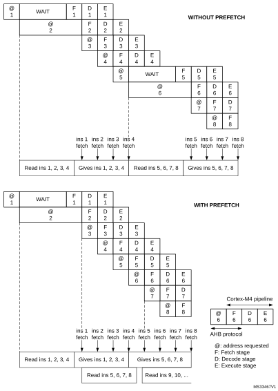
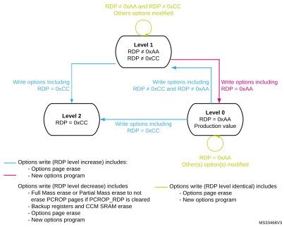
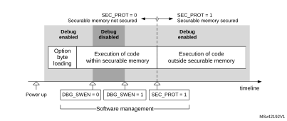

# 4 Embedded flash memory (FLASH) for category 4 devices

## 4.1 Introduction

The flash memory interface manages CPU AHB ICode and DCode accesses to the flash memory. It implements the erase and program flash memory operations and the read and write protection mechanisms.

The flash memory interface accelerates code execution with a system of instruction prefetch and cache lines.

## 4.2 FLASH main features

- Up to 512 Kbytes of flash memory (single bank).
- Flash memory read operations with 64 bits data width
- Page erase and mass erase

Flash memory interface features:

- Flash memory read operations
- Flash memory program/erase operations
- Read protection activated by option (RDP)
- Two write protection areas selected by option
- Proprietary code read protection areas defined by option
- Securable memory areas defined by option
- Prefetch on ICODE
- Instruction cache: 32 cache lines of 4 x 64 bits on ICode (1 KB RAM)
- Data cache: 8 cache lines of 4 x 64 bits on DCode (256B RAM)
- Error code correction ECC: 8 bits per 64-bit double-word
 - 8 + 64 = 72 bits, 2 bits detection, 1 bit correction
- Option byte loader
- Low-power mode

## 4.3 FLASH functional description

### 4.3.1 Flash memory organization

The flash memory has the following main features:

- Capacity up to 512 Kbytes (read width of 64-bit)
- 512 Kbytes organized in one single bank for main memory
- Page size of 2 Kbytes
- 72 bits wide data read (64 bits plus 8 ECC bits)
- Page and mass erase
- Each page is composed of 8 rows of 256 bytes
- An Information block containing:
 - System memory from which the device boots in System memory boot mode. The area is reserved for use by STMicroelectronics and contains the bootloader that is used to reprogram the flash memory through one of the following interfaces: USART, SPI, I2C, USB. It is programmed when the device is manufactured, and protected against spurious write/erase operations. For further details, refer to AN2606, available from www.st.com.
 - 1 Kbyte (128 double word) OTP (one-time programmable) bytes for user data. The OTP data cannot be erased and can be written only once. If only one bit is at 0, the entire double word cannot be written anymore, even with the value 0x0000 0000 0000 0000.
 - Option bytes for user configuration.

The memory organization is based on a main area and an information block as shown in [Table 28](Embedded_flash_memory_%28FLASH%29_for_category_2_devices.md#XREF_70958__Table_7__Flash_module_-_1_MB_dual_bank_organization13).

 

<table class="TableTitle"><caption class="TableTitle"><h4 class="TableCap" id="5061783">Table 18. <a id="(64%11bit13" name="XREF_16393__Table_18__Flash_module_-_256_512_Kbytes_organization_(64%11bit13">Flash module - 256/512 Kbytes organization (64 bits read width)</a></h4></caption><col width="107.81px"/><col width="222.12px"/><col width="70.62px"/><col width="137.48px"/><thead><tr height="42.67px"><th>
Flash area
</th><th>
Flash memory addresses
</th><th>
Size (bytes)
</th><th>
Name
</th></tr></thead><tr height="22.67px"><td rowspan="9">
Main memory 256/512 Kbytes<a href="#RM0440%20MEM%20UserSpec_Embedded%20flash%20memory%20(FLASH)%20for%20category%203%20devices_FTH_1">1</a>
</td><td>
0x0800 0000 - 0x0800 07FF
</td><td>
2 K
</td><td>
Page 0
</td></tr><tr height="22.67px"><td>
0x0800 0800 - 0x0800 0FFF
</td><td>
2 K
</td><td>
Page 1
</td></tr><tr height="22.67px"><td>
0x0800 1000 - 0x0800 17FF
</td><td>
2  K
</td><td>
Page 2
</td></tr><tr height="22.67px"><td>
0x0800 1800 - 0x0800 1FFF
</td><td>
2 K
</td><td>
Page 3
</td></tr><tr height="18.67px"><td rowspan="4">
...
</td><td rowspan="4">
...
</td><td rowspan="4">
...
</td></tr><tr style="height:0.00px"></tr><tr style="height:0.00px"></tr><tr style="height:0.00px"></tr><tr height="22.67px"><td>
0x0807 F800 - 0x0807 FFFF
</td><td>
2 K
</td><td>
Page 255
</td></tr><tr height="22.67px"><td rowspan="5">
Information block
</td><td rowspan="2">
0x1FFF 0000 - 0x1FFF 6FFF
</td><td rowspan="2">
28 K
</td><td rowspan="2">
System memory
</td></tr><tr style="height:0.00px"></tr><tr height="22.67px"><td>
0x1FFF 7000 - 0x1FFF 73FF
</td><td>
1 K
</td><td>
OTP area
</td></tr><tr height="22.67px"><td rowspan="2">
0x1FFF 7800 - 0x1FFF 782F
</td><td rowspan="2">
48
</td><td rowspan="2">
Option bytes
</td></tr><tr style="height:0.00px"></tr></table>

<a href="#RM0440%20MEM%20UserSpec_Embedded%20flash%20memory%20(FLASH)%20for%20category%203%20devices_FTB_1">1.</a>For 256-Kbyte devices: from page 0 to page 127.

### 4.3.2 Error code correction (ECC)

Data in flash memory are 72-bit words: 8 bits are added per double word (64 bits). The ECC mechanism supports:

- One error detection and correction
- Two errors detection

When one error is detected and corrected, the flag ECCC (ECC correction) is set in [Flash ECC register (FLASH\_ECCR)](Embedded_flash_memory_%28FLASH%29_for_category_2_devices.md#XREF_12764__3_7_7_Flash_ECC_register_(FLASH_ECCR)13). If ECCCIE is set, an interrupt is generated.

When two errors are detected, a flag ECCD (ECC detection) is set in FLASH\_ECCR register. In this case, a NMI is generated.

When an ECC error is detected, the address of the failing double word is saved in ADDR\_ECC[20:0] in the FLASH\_ECCR register. ADDR\_ECC[2:0] are always cleared.

When ECCC or ECCD is set, ADDR\_ECC is not updated if a new ECC error occurs. FLASH\_ECCR is updated only when ECC flags are cleared.

**Note:**

For a virgin data: 0xFF FFFF FFFF FFFF FFFF, one error is detected and corrected but two errors detection is not supported.

When an ECC error is reported, a new read at the failing address may not generate an ECC error if the data is still present in the current buffer, even if ECCC and ECCD are cleared.

### 4.3.3 Read access latency

To correctly read data from flash memory, the number of wait states (LATENCY) must be correctly programmed in the [Flash access control register (FLASH\_ACR)](Embedded_flash_memory_%28FLASH%29_for_category_2_devices.md#XREF_21112__3_5_1_Flash_access_control_register_(FLASH_ACR)13) according to the frequency of the CPU clock (HCLK) and the internal voltage range of the device VCORE. Refer to [Section 6.1.5: Dynamic voltage scaling management](Power_control_%28PWR%29.md#XREF_59370__7_1_7_Dynamic_voltage_scaling_management
34). [Table 19](#XREF_53918__Table_19__Number_of_wait_states_according_to_CPU_clock_(HCLK13) shows the correspondence between wait states and CPU clock frequency.

 

<table class="TableTitle"><caption class="TableCap"><h4 class="TableCap" id="5147470">Table 19. <a id="(HCLK13" name="XREF_53918__Table_19__Number_of_wait_states_according_to_CPU_clock_(HCLK13">Number of wait states according to CPU clock (HCLK) frequency</a></h4></caption><col width="135.53px"/><col width="133.53px"/><col width="133.53px"/><col width="133.53px"/><thead><tr height="28.00px"><th rowspan="2">
Wait states (WS)

(LATENCY)
</th><th colspan="3">
HCLK (MHz)
</th></tr><tr height="42.67px"><th>
VCORE Range 1  boost mode
</th><th>
VCORE Range 1  normal mode
</th><th>
VCORE Range 2
</th></tr></thead><tr height="22.67px"><td>
0 WS (1 CPU cycles)
</td><td>
≤ 34
</td><td>
≤ 30
</td><td>
≤ 12
</td></tr><tr height="22.67px"><td>
1 WS (2 CPU cycles)
</td><td>
≤ 68
</td><td>
≤ 60
</td><td>
≤ 24
</td></tr><tr height="22.67px"><td>
2 WS (3 CPU cycles)
</td><td>
≤ 102
</td><td>
≤ 90
</td><td>
≤ 26
</td></tr><tr height="22.67px"><td>
3 WS (4 CPU cycles)
</td><td>
≤ 136
</td><td>
≤ 120
</td><td>
-
</td></tr><tr height="22.67px"><td>
4 WS (5 CPU cycles)
</td><td style="border-left-width:0.299988pt;border-left-style:solid;border-left-color:#000000;border-bottom-width:0.299988pt;border-bottom-style:solid;border-bottom-color:#000000;border-right-width:0.299988pt;border-right-style:solid;border-right-color:#000000;border-top-width:0.299988pt;border-top-style:solid;border-top-color:#000000;">
≤ 170
</td><td style="border-left-width:0.299988pt;border-left-style:solid;border-left-color:#000000;border-bottom-width:0.299988pt;border-bottom-style:solid;border-bottom-color:#000000;border-right-width:0.299988pt;border-right-style:solid;border-right-color:#000000;border-top-width:0.299988pt;border-top-style:solid;border-top-color:#000000;">
≤ 150
</td><td style="border-left-width:0.299988pt;border-left-style:solid;border-left-color:#000000;border-bottom-width:0.299988pt;border-bottom-style:solid;border-bottom-color:#000000;border-right-width:0.299988pt;border-right-style:solid;border-right-color:#000000;border-top-width:0.299988pt;border-top-style:solid;border-top-color:#000000;">
-
</td></tr></table>

After reset, the CPU clock frequency is 16 MHz and 1 wait state (WS) is configured in the FLASH\_ACR register.

When changing the CPU frequency, the following software sequences must be applied in order to tune the number of wait states needed to access the flash memory:

#### Increasing the CPU frequency:

1. Program the new number of wait states to the LATENCY bits in the [Flash access control register (FLASH\_ACR)](Embedded_flash_memory_%28FLASH%29_for_category_2_devices.md#XREF_21112__3_5_1_Flash_access_control_register_(FLASH_ACR)13).
2. Check that the new number of wait states is taken into account to access the flash memory by reading the FLASH\_ACR register.
3. Analyze the change of CPU frequency change caused either by:
 - changing clock source defined by SW bits in RCC\_CFGR register
 - or by CPU clock prescaller defined by HPRE bits in RCC\_CFGR

If some of above two steps decreases the CPU frequency, firstly perform this step and then the rest. Otherwise modify The CPU clock source by writing the SW bits in the RCC\_CFGR register and then (if needed) modify the CPU clock prescaler by writing the HPRE bits in RCC\_CFGR.

4. Check that the new CPU clock source or/and the new CPU clock prescaler value is/are taken into account by reading the clock source status (SWS bits) or/and the AHB prescaler value (HPRE bits), respectively, in the RCC\_CFGR register.

#### Decreasing the CPU frequency:

1. Modify the CPU clock source by writing the SW bits in the RCC\_CFGR register.
2. If needed, modify the CPU clock prescaler by writing the HPRE bits in RCC\_CFGR.
3. Analyze the change of CPU frequency change caused either by:
 - changing clock source defined by SW bits in RCC\_CFGR register
 - or by CPU clock prescaller defined by HPRE bits in RCC\_CFGR

If some of above two steps increases the CPU frequency, firstly perform another step and then this step. Otherwise modify The CPU clock source by writing the SW bits in the RCC\_CFGR register and then (if needed) modify the CPU clock prescaler by writing the HPRE bits in RCC\_CFGR.

4. Check that the new CPU clock source or/and the new CPU clock prescaler value is/are taken into account by reading the clock source status (SWS bits) or/and the AHB prescaler value (HPRE bits), respectively, in the RCC\_CFGR register.
5. Program the new number of wait states to the LATENCY bits in [Flash access control register (FLASH\_ACR)](Embedded_flash_memory_%28FLASH%29_for_category_2_devices.md#XREF_21112__3_5_1_Flash_access_control_register_(FLASH_ACR)13).
6. Check that the new number of wait states is used to access the flash memory by reading the FLASH\_ACR register.

### 4.3.4 Adaptive real-time memory accelerator (ART Accelerator)

The proprietary Adaptive real-time (ART) memory accelerator is optimized for STM32 industry-standard Arm® Cortex®-M4 with FPU processors. It balances the inherent performance advantage of the Arm® Cortex®-M4 with FPU over flash memory technologies, which normally requires the processor to wait for the flash memory at higher operating frequencies.

To release the processor full performance, the accelerator implements an instruction prefetch queue and branch cache which increases program execution speed from the 64- bit flash memory. Based on CoreMark benchmark, the performance achieved thanks to the ART accelerator is equivalent to 0 wait state program execution from flash memory at a CPU frequency up to 170 MHz.

#### Instruction prefetch

The Cortex®-M4 fetches the instruction over the ICode bus and the literal pool (constant/data) over the DCode bus. The prefetch block aims at increasing the efficiency of ICode bus accesses.

Each flash memory read operation provides 64 bits from either two instructions of 32 bits or four instructions of 16 bits depending on the launched program. This 64-bit current instruction line is saved in a current buffer, and in case of sequential code, at least two CPU cycles are needed to execute the previous read instruction line.

Prefetch on the ICode bus can be used to read the next sequential instruction line from the flash memory while the current instruction line is being requested by the CPU.

Prefetch is enabled by setting the PRFTEN bit in the [Flash access control register (FLASH\_ACR)](Embedded_flash_memory_%28FLASH%29_for_category_2_devices.md#XREF_21112__3_5_1_Flash_access_control_register_(FLASH_ACR)13). This feature is useful if at least one wait state is needed to access the flash memory.

[Figure 9](Embedded_flash_memory_%28FLASH%29_for_category_2_devices.md#XREF_94949__Figure_1__Sequential_16_bits_instructions_execution13) shows the execution of sequential 16-bit instructions with and without prefetch when 3 WS are needed to access the flash memory.

#### Figure 6. Sequential 16-bit instructions execution (64-bit read data width)

When the code is not sequential (branch), the instruction may not be present in the currently used instruction line or in the prefetched instruction line. In this case (miss), the penalty in terms of number of cycles is at least equal to the number of wait states.

If a loop is present in the current buffer, no new flash access is performed.

#### Instruction cache memory (I-Cache)

To limit the time lost due to jumps, it is possible to retain 32 lines of 4 x 64 bits in an instruction cache memory.This feature can be enabled by setting the instruction cache enable (ICEN) bit in the [Flash access control register (FLASH\_ACR)](Embedded_flash_memory_%28FLASH%29_for_category_2_devices.md#XREF_21112__3_5_1_Flash_access_control_register_(FLASH_ACR)13). Each time a miss occurs (requested data not present in the currently used instruction line, in the prefetched instruction line or in the instruction cache memory), the line read is copied into the instruction cache memory. If some data contained in the instruction cache memory are requested by the CPU, they are provided without inserting any delay. Once all the instruction cache memory lines have been filled, the LRU (least recently used) policy is used to determine the line to replace in the instruction memory cache. This feature is particularly useful in case of code containing loops.

The Instruction cache memory is enable after system reset.

#### Data cache memory (D-Cache)

Literal pools are fetched from flash memory through the DCode bus during the execution stage of the CPU pipeline. Each DCode bus read access fetches 64 bits which are saved in a current buffer. The CPU pipeline is consequently stalled until the requested literal pool is provided. To limit the time lost due to literal pools, accesses through the AHB databus DCode have priority over accesses through the AHB instruction bus ICode.

If some literal pools are frequently used, the data cache memory can be enabled by setting the data cache enable (DCEN) bit in the [Flash access control register (FLASH\_ACR)](Embedded_flash_memory_%28FLASH%29_for_category_2_devices.md#XREF_21112__3_5_1_Flash_access_control_register_(FLASH_ACR)13). This feature works like the instruction cache memory, but the retained data size is limited to 8 rows of 4\*64 bits.

The Data cache memory is enable after system reset.

**Note:**

The D-Cache is active only when data is requested by the CPU (not by DMA1 and DMA2).

Data in option bytes block are not cacheable.

### 4.3.5 Flash program and erase operations

The STM32G4 series embedded flash memory can be programmed using in-circuit programming or in-application programming.

The in-circuit programming (ICP) method is used to update the entire contents of the flash memory, using the JTAG, SWD protocol or the bootloader to load the user application into the microcontroller. ICP offers quick and efficient design iterations and eliminates unnecessary package handling or socketing of devices.

In contrast to the ICP method, in-application programming (IAP) can use any communication interface supported by the microcontroller (I/Os, USB, CAN, UART, I2C, SPI, etc.) to download programming data into memory. IAP allows the user to reprogram the flash memory while the application is running. Nevertheless, part of the application has to have been previously programmed in the flash memory using ICP.

The contents of the flash memory are not guaranteed if a device reset occurs during a flash memory operation.

The flash erase and programming is only possible in the voltage scaling range 1. The VOS[1:0] bits in the PWR\_CR1 must be programmed to 01b.

During a program/erase operation to the flash memory, any attempt to read the flash memory stalls the bus. The read operation proceeds correctly once the program/erase operation has completed.

#### Unlocking the flash memory

After reset, write is not allowed in the [Flash control register (FLASH\_CR)](Embedded_flash_memory_%28FLASH%29_for_category_2_devices.md#XREF_72826__3_5_Flash_Control_Register_(FLASH_CR)13) to protect the flash memory against possible unwanted operations due, for example, to electric disturbances. The following sequence is used to unlock this register:

1. Write KEY1 = 0x45670123 in the [Flash key register (FLASH\_KEYR)](Embedded_flash_memory_%28FLASH%29_for_category_2_devices.md#XREF_11264__3_6_3_Flash_key_register_(FLASH_KEYR)13)
2. Write KEY2 = 0xCDEF89AB in the FLASH\_KEYR register.

Any wrong sequence locks up the FLASH\_CR register until the next system reset. In the case of a wrong key sequence, a bus error is detected and a Hard Fault interrupt is generated.

The FLASH\_CR register can be locked again by software by setting the LOCK bit in the FLASH\_CR register.

**Note:**

The FLASH\_CR register cannot be written when the BSY bit in the [Flash status register (FLASH\_SR)](Embedded_flash_memory_%28FLASH%29_for_category_2_devices.md#XREF_93545__3_4_Flash_Status_Register_(FLASH_SR)13) is set. Any attempt to write to it with the BSY bit set causes the AHB bus to stall until the BSY bit is cleared.

### 4.3.6 Flash main memory erase sequences

The flash memory erase operation can be performed at page level or on the whole flash memory (mass erase). Mass erase does not affect the Information block (system flash, OTP and option bytes).

#### Page erase

To erase a page, follow the procedure below:

1. Check that no flash memory operation is ongoing by checking the BSY bit in the [Flash status register (FLASH\_SR)](Embedded_flash_memory_%28FLASH%29_for_category_2_devices.md#XREF_93545__3_4_Flash_Status_Register_(FLASH_SR)13).
2. Check and clear all error programming flags due to a previous programming. If not, PGSERR is set.
3. Set the PER bit and select the page to erase (PNB).
4. Set the STRT bit in the FLASH\_CR register.
5. Wait for the BSY bit to be cleared in the FLASH\_SR register.

**Note:**

The internal oscillator HSI16 (16 MHz) is enabled automatically when STRT bit is set, and disabled automatically when STRT bit is cleared, except if the HSI16 is previously enabled with HSION in RCC\_CR register.

If the page erase is part of write-protected area (by WRP or PCROP), WRPERR is set and the page erase request is aborted.

#### Mass erase

To perform a mass erase, follow the procedure below:

1. Check that no flash memory operation is ongoing by checking the BSY bit in the FLASH\_SR register.
2. Check and clear all error programming flags due to a previous programming. If not, PGSERR is set.
3. Set the MER1 bit in the flash memory control register (FLASH\_CR).
4. Set the STRT bit in the FLACH\_CR register.
5. Wait for the BSY bit to be cleared in the flash status register (FLASH\_SR).

**Note:**

The internal oscillator HSI16 (16 MHz) is enabled automatically when STRT bit is set, and disabled automatically when STRT bit is cleared, except if the HSI16 is previously enabled with HSION in RCC\_CR register.

If the Flasb memory contains a write-protected area (by WRP or PCROP), WRPERR is set and the mass erase request is aborted.

### 4.3.7 Flash main memory programming sequences

The flash memory is programmed 72 bits at a time (64 bits + 8 bits ECC).

Programming in a previously programmed address is not allowed except if the data to write is full zero, and any attempt sets PROGERR flag in the [Flash status register (FLASH\_SR)](Embedded_flash_memory_%28FLASH%29_for_category_2_devices.md#XREF_93545__3_4_Flash_Status_Register_(FLASH_SR)13).

It is only possible to program double word (2 x 32-bit data).

- Any attempt to write byte or half-word sets SIZERR flag in the FLASH\_SR register.
- Any attempt to write a double word which is not aligned with a double word address sets PGAERR flag in the FLASH\_SR register.

#### Standard programming

The flash memory programming sequence in standard mode is as follows:

1. Check that no flash main memory operation is ongoing by checking the BSY bit in the [Flash status register (FLASH\_SR)](Embedded_flash_memory_%28FLASH%29_for_category_2_devices.md#XREF_93545__3_4_Flash_Status_Register_(FLASH_SR)13).
2. Check and clear all error programming flags due to a previous programming. If not, PGSERR is set.
3. Set the PG bit in the [Flash control register (FLASH\_CR)](Embedded_flash_memory_%28FLASH%29_for_category_2_devices.md#XREF_72826__3_5_Flash_Control_Register_(FLASH_CR)13).
4. Perform the data write operation at the desired memory address, inside main memory block or OTP area. Only double word can be programmed.
 - Write a first word in an address aligned with double word
 - Write the second word
5. Wait until the BSY bit is cleared in the FLASH\_SR register.
6. Check that EOP flag is set in the FLASH\_SR register (meaning that the programming operation has succeed), and clear it by software.
7. Clear the PG bit in the FLASH\_SR register if there no more programming request anymore.

**Note:**

When the flash interface has received a good sequence (a double word), programming is automatically launched and BSY bit is set. The internal oscillator HSI16 (16 MHz) is enabled automatically when PG bit is set, and disabled automatically when PG bit is cleared, except if the HSI16 is previously enabled with HSION in RCC\_CR register.

If the user needs to program only one word, double word must be completed with the erase value 0xFFFF FFFF to launch automatically the programming.

ECC is calculated from the double word to program.

#### Fast programming

This mode allows to program a row (32 double words), and to reduce the page programming time by eliminating the need for verifying the flash locations before they are programmed and to avoid rising and falling time of high voltage for each double word. During fast programming, the CPU clock frequency (HCLK) must be at least 8 MHz.

Only the main memory can be programmed in Fast programming mode.

The flash main memory programming sequence in standard mode is as follows:

1. Perform a mass erase. If not, PGSERR is set.
2. Check that no flash main memory operation is ongoing by checking the BSY bit in the [Flash status register (FLASH\_SR)](Embedded_flash_memory_%28FLASH%29_for_category_2_devices.md#XREF_93545__3_4_Flash_Status_Register_(FLASH_SR)13).
3. Check and clear all error programming flag due to a previous programming.
4. Set the FSTPG bit in [Flash control register (FLASH\_CR)](Embedded_flash_memory_%28FLASH%29_for_category_2_devices.md#XREF_72826__3_5_Flash_Control_Register_(FLASH_CR)13).
5. Write the 32 double words to program a row. Only double words can be programmed:
 - Write a first word in an address aligned with double word
 - Write the second word.
6. Wait until the BSY bit is cleared in the FLASH\_SR register.
7. Check that EOP flag is set in the FLASH\_SR register (meaning that the programming operation has succeed), and clear it by software.
8. Clear the FSTPG bit in the FLASH\_SR register if there no more programming request anymore.

**Note:**

If the flash is attempted to be written in Fast programming mode while a read operation is on going, the programming is aborted without any system notification (no error flag is set).

When the flash interface has received the first double word, programming is automatically launched. The BSY bit is set when the high voltage is applied for the first double word, and it is cleared when the last double word has been programmed or in case of error. The internal oscillator HSI16 (16 MHz) is enabled automatically when FSTPG bit is set, and disabled automatically when FSTPG bit is cleared, except if the HSI16 is previously enabled with HSION in RCC\_CR register.

The 32 double word must be written successively. The high voltage is kept on the flash for all the programming. Maximum time between two double words write requests is the time programming (around 2 x 25 μs). If a second double word arrives after this time programming, fast programming is interrupted and MISSERR is set.

High voltage cannot exceed 8 ms for a full row between two erases. This is guaranteed by the sequence of 32 double words successively written with a clock system greater or equal to 8 MHz. An internal time-out counter counts 7ms when Fast programming is set and stops the programming when time-out is over. In this case the FASTERR bit is set.

If an error occurs, high voltage is stopped and next double word to programmed is not programmed. Anyway, all previous double words have been properly programmed.

#### Programming errors

Several kind of errors can be detected. In case of error, the flash memory operation (programming or erasing) is aborted.

- PROGERR: Programming error

In standard programming: PROGERR is set if the word to write is not previously erased (except if the value to program is full zero).

- SIZERR: Size programming error

In standard programming or in fast programming: only double word can be programmed and only 32-bit data can be written. SIZERR is set if a byte or an half-word is written.

- PGAERR: Alignment programming error

PGAERR is set if one of the following conditions occurs:

 - In standard programming: the first word to be programmed is not aligned with a double word address, or the second word doesn’t belong to the same double word address.
 - In fast programming: the data to program doesn’t belong to the same row than the previous programmed double words, or the address to program is not greater than the previous one.
- PGSERR: Programming sequence error

PGSERR is set if one of the following conditions occurs:

 - In the standard programming sequence or the fast programming sequence: a data is written when PG and FSTPG are cleared.
 - In the standard programming sequence or the fast programming sequence: MER1, and PER are not cleared when PG or FSTPG is set.
 - In the fast programming sequence: the mass erase is not performed before setting FSTPG bit.
 - In the mass erase sequence: PG, FSTPG, and PER are not cleared when MER1 is set.
 - In the page erase sequence: PG, FSTPG, MER1 are not cleared when PER is set.
 - PGSERR is set also if PROGERR, SIZERR, PGAERR, WRPERR, MISSERR, FASTERR or PGSERR is set due to a previous programming error.
- WRPERR: Write protection error

WRPERR is set if one of the following conditions occurs:

 - Attempt to program or erase in a write protected area (WRP) or in a PCROP area or in a securable memory area.
 - Attempt to perform an erase when one page or more is protected by WRP or PCROP.
 - The debug features are connected or the boot is executed from SRAM or from System flash when the read protection (RDP) is set to Level 1.
 - Attempt to modify the option bytes when the read protection (RDP) is set to  
  Level 2.
- MISSERR: Fast programming data miss error

In fast programming: all the data must be written successively. MISSERR is set if the previous data programmation is finished and the next data to program is not written yet.

- FASTERR: Fast programming error

In fast programming: FASTERR is set if one of the following conditions occurs:

 - When FSTPG bit is set for more than 7ms which generates a time-out detection.
 - When the fast programming has been interrupted by a MISSERR, PGAERR, WRPERR or SIZERR.

If an error occurs during a program or erase operation, one of the following error flags is set in the FLASH\_SR register:

PROGERR, SIZERR, PGAERR, PGSERR, MISSERR (Program error flags),

WRPERR (Protection error flag)

In this case, if the error interrupt enable bit ERRIE is set in the [Flash status register (FLASH\_SR)](Embedded_flash_memory_%28FLASH%29_for_category_2_devices.md#XREF_93545__3_4_Flash_Status_Register_(FLASH_SR)13), an interrupt is generated and the operation error flag OPERR is set in the FLASH\_SR register.

**Note:**

If several successive errors are detected (for example, in case of DMA transfer to the flash memory), the error flags cannot be cleared until the end of the successive write requests.

#### Programming and caches

If a flash memory write access concerns some data in the data cache, the flash write access modifies the data in the flash memory and the data in the cache.

If an erase operation in flash memory also concerns data in the data or instruction cache, you have to make sure that these data are rewritten before they are accessed during code execution. If this cannot be done safely, it is recommended to flush the caches by setting the DCRST and ICRST bits in the [Flash access control register (FLASH\_ACR)](Embedded_flash_memory_%28FLASH%29_for_category_2_devices.md#XREF_21112__3_5_1_Flash_access_control_register_(FLASH_ACR)13).

**Note:**

The I/D cache should be flushed only when it is disabled (I/DCEN = 0).

## 4.4 FLASH option bytes

### 4.4.1 Option bytes description

The option bytes are configured by the end user depending on the application requirements. As a configuration example, the watchdog can be selected in hardware or software mode (refer to [Section 5.4.2: Option bytes programming](Embedded_flash_memory_%28FLASH%29_for_category_2_devices.md#XREF_78344__3_3_9_Option_bytes_programming13)).

A double word is split up as follows in the option bytes:

 

<table class="TableTitle"><caption class="TableCap"><h4 class="TableCap" id="5062834">Table 20. Option byte format</h4></caption><col width="89.49px"/><col width="89.49px"/><col width="89.49px"/><col width="89.49px"/><col width="64.06px"/><col width="64.06px"/><col width="64.06px"/><col width="64.06px"/><thead><tr height="28.00px"><th>
63-24
</th><th>
23-16
</th><th>
15 -8
</th><th>
7-0
</th><th>
31-24
</th><th>
23-16
</th><th>
15 -8
</th><th>
7-0
</th></tr></thead><tr height="37.33px"><td>
Complemented option byte 3
</td><td>
Complemented option byte 2
</td><td>
Complemented option byte 1
</td><td>
Complemented option byte 0
</td><td>
Option byte 3
</td><td>
Option byte 2
</td><td>
Option byte 1
</td><td>
Option byte 0
</td></tr></table>

The organization of these bytes inside the information block is as shown in [Table 31: Option byte organization](Embedded_flash_memory_%28FLASH%29_for_category_2_devices.md#XREF_71586__Table_16__Option_byte_organization13).

The option bytes can be read from the memory locations listed in [Table 31: Option byte organization](Embedded_flash_memory_%28FLASH%29_for_category_2_devices.md#XREF_71586__Table_16__Option_byte_organization13) or from the Option byte registers:

- [Flash option register (FLASH\_OPTR)](Embedded_flash_memory_%28FLASH%29_for_category_2_devices.md#XREF_75933__3_6_8_Flash_option_control_register_(FLASH_OPTR)13)
- [Flash PCROP1 Start address register (FLASH\_PCROP1SR)](Embedded_flash_memory_%28FLASH%29_for_category_2_devices.md#XREF_82644__3_7_9_Flash_Bank_1_PCROP_Start_address_register_(FLASH_PCROP1SR)13)
- [Flash PCROP1 End address register (FLASH\_PCROP1ER)](Embedded_flash_memory_%28FLASH%29_for_category_2_devices.md#XREF_89918__3_7_10_Flash_Bank_1_PCROP_End_address_register_(FLASH_PCROP1ER)13)
- [Flash WRP area A address register (FLASH\_WRP1AR)](Embedded_flash_memory_%28FLASH%29_for_category_2_devices.md#XREF_23909__3_7_11_Flash_Bank_1_WRP_area_A_address_register_(FLASH_WRP1AR)13)
- [Flash WRP area B address register (FLASH\_WRP1BR)](Embedded_flash_memory_%28FLASH%29_for_category_2_devices.md#XREF_93533__3_7_12_Flash_Bank_1_WRP_area_B_address_register_(FLASH_WRP1BR)13)

 

<table class="TableTitle"><caption class="TableCap"><h4 class="TableCap" id="5062931">Table 21. <a id="organization%1113" name="XREF_61643__Table_21__Option_byte_organization%1113">Option byte organization</a><a href="#RM0440%20MEM%20UserSpec_Embedded%20flash%20memory%20(FLASH)%20for%20category%203%20devices_FTH_1">1</a></h4></caption><col width="82.08px"/><col width="62.32px"/><col width="66.14px"/><col width="67.68px"/><col width="71.83px"/><col width="58.16px"/><col width="63.28px"/><col width="69.51px"/><col width="73.17px"/><thead><tr height="28.00px"><th>
Address
</th><th>
[63:56]
</th><th>
[55:48]
</th><th>
[47:40]
</th><th>
[39:32]
</th><th>
[31:24]
</th><th>
[23:16]
</th><th>
[15:8]
</th><th>
[7:0]
</th></tr></thead><tr height="22.67px"><td>
1FFF7800
</td><td colspan="3">
USER OPT
</td><td>
RDP
</td><td colspan="3">
USER OPT
</td><td>
RDP
</td></tr><tr height="37.33px"><td>
1FFF7808
</td><td colspan="2">
Unused
</td><td colspan="2">
Unused and PCROP1_STRT[15:0]
</td><td colspan="2">
Unused
</td><td colspan="2">
Unused and PCROP1_STRT[15:0]
</td></tr><tr height="37.33px"><td>
1FFF7810
</td><td colspan="2">
PCROP_RDP and Unused
</td><td colspan="2">
Unused and PCROP1_END[15:0]
</td><td colspan="2">
PCROP_RDP and Unused
</td><td colspan="2">
Unused and PCROP1_END[15:0]
</td></tr><tr height="52.00px"><td>
1FFF7818
</td><td>
Unused
</td><td>
WRP1A _END [7:0]
</td><td>
Unused
</td><td>
WRP1A _STRT [7:0]
</td><td>
Unused
</td><td>
WRP1A_ END [7:0]
</td><td>
Unused
</td><td>
WRP1A _STRT [7:0]
</td></tr><tr height="52.00px"><td>
1FFF7820
</td><td>
Unused
</td><td>
WRP1B _END [7:0]
</td><td>
Unused
</td><td>
WRP1B _STRT [7:0]
</td><td>
Unused
</td><td>
WRP1B_ END [7:0]
</td><td>
Unused
</td><td>
WRP1B _STRT [7:0]
</td></tr><tr height="37.33px"><td>
1FFF7828
</td><td>
Unused
</td><td>
BOOT_ LOCK
</td><td>
Unused
</td><td>
SEC_ SIZE1
</td><td>
Unused
</td><td>
BOOT_ LOCK
</td><td>
Unused
</td><td>
SEC_ SIZE1
</td></tr></table>

<a href="#RM0440%20MEM%20UserSpec_Embedded%20flash%20memory%20(FLASH)%20for%20category%203%20devices_FTB_1">1.</a>Negated values are overlined.

#### User and read protection option bytes

Flash memory address: 0x1FFF 7800

ST production value: 0xFFEF F8AA

 

<table class="RegBitMap"><col width="32.20px"/><col width="37.89px"/><col width="39.28px"/><col width="35.89px"/><col width="37.59px"/><col width="38.94px"/><col width="54.49px"/><col width="38.94px"/><col width="38.94px"/><col width="39.86px"/><col width="32.20px"/><col width="32.20px"/><col width="38.94px"/><col width="38.94px"/><col width="38.94px"/><col width="38.94px"/><tr height="17.33px"><td style="border-left-width:0;border-left-style:hidden;border-left-color:0;border-bottom-width:0;border-bottom-style:hidden;border-bottom-color:0;border-right-width:0;border-right-style:hidden;border-right-color:0;border-top-width:0;border-top-style:hidden;border-top-color:0;">
31
</td><td style="border-left-width:0;border-left-style:hidden;border-left-color:0;border-bottom-width:0;border-bottom-style:hidden;border-bottom-color:0;border-right-width:0;border-right-style:hidden;border-right-color:0;border-top-width:0;border-top-style:hidden;border-top-color:0;">
30
</td><td style="border-left-width:0;border-left-style:hidden;border-left-color:0;border-bottom-width:0;border-bottom-style:hidden;border-bottom-color:0;border-right-width:0;border-right-style:hidden;border-right-color:0;border-top-width:0;border-top-style:hidden;border-top-color:0;">
29
</td><td style="border-left-width:0;border-left-style:hidden;border-left-color:0;border-bottom-width:0;border-bottom-style:hidden;border-bottom-color:0;border-right-width:0;border-right-style:hidden;border-right-color:0;border-top-width:0;border-top-style:hidden;border-top-color:0;">
28
</td><td style="border-left-width:0;border-left-style:hidden;border-left-color:0;border-bottom-width:0;border-bottom-style:hidden;border-bottom-color:0;border-right-width:0;border-right-style:hidden;border-right-color:0;border-top-width:0;border-top-style:hidden;border-top-color:0;">
27
</td><td style="border-left-width:0;border-left-style:hidden;border-left-color:0;border-bottom-width:0;border-bottom-style:hidden;border-bottom-color:0;border-right-width:0;border-right-style:hidden;border-right-color:0;border-top-width:0;border-top-style:hidden;border-top-color:0;">
26
</td><td style="border-left-width:0;border-left-style:hidden;border-left-color:0;border-bottom-width:0;border-bottom-style:hidden;border-bottom-color:0;border-right-width:0;border-right-style:hidden;border-right-color:0;border-top-width:0;border-top-style:hidden;border-top-color:0;">
25
</td><td style="border-left-width:0;border-left-style:hidden;border-left-color:0;border-bottom-width:0;border-bottom-style:hidden;border-bottom-color:0;border-right-width:0;border-right-style:hidden;border-right-color:0;border-top-width:0;border-top-style:hidden;border-top-color:0;">
24
</td><td style="border-left-width:0;border-left-style:hidden;border-left-color:0;border-bottom-width:0;border-bottom-style:hidden;border-bottom-color:0;border-right-width:0;border-right-style:hidden;border-right-color:0;border-top-width:0;border-top-style:hidden;border-top-color:0;">
23
</td><td style="border-left-width:0;border-left-style:hidden;border-left-color:0;border-bottom-width:0;border-bottom-style:hidden;border-bottom-color:0;border-right-width:0;border-right-style:hidden;border-right-color:0;border-top-width:0;border-top-style:hidden;border-top-color:0;">
22
</td><td style="border-left-width:0;border-left-style:hidden;border-left-color:0;border-bottom-width:0;border-bottom-style:hidden;border-bottom-color:0;border-right-width:0;border-right-style:hidden;border-right-color:0;border-top-width:0;border-top-style:hidden;border-top-color:0;">
21
</td><td style="border-left-width:0;border-left-style:hidden;border-left-color:0;border-bottom-width:0;border-bottom-style:hidden;border-bottom-color:0;border-right-width:0;border-right-style:hidden;border-right-color:0;border-top-width:0;border-top-style:hidden;border-top-color:0;">
20
</td><td style="border-left-width:0;border-left-style:hidden;border-left-color:0;border-bottom-width:0;border-bottom-style:hidden;border-bottom-color:0;border-right-width:0;border-right-style:hidden;border-right-color:0;border-top-width:0;border-top-style:hidden;border-top-color:0;">
19
</td><td style="border-left-width:0;border-left-style:hidden;border-left-color:0;border-bottom-width:0;border-bottom-style:hidden;border-bottom-color:0;border-right-width:0;border-right-style:hidden;border-right-color:0;border-top-width:0;border-top-style:hidden;border-top-color:0;">
18
</td><td style="border-left-width:0;border-left-style:hidden;border-left-color:0;border-bottom-width:0;border-bottom-style:hidden;border-bottom-color:0;border-right-width:0;border-right-style:hidden;border-right-color:0;border-top-width:0;border-top-style:hidden;border-top-color:0;">
17
</td><td style="border-left-width:0;border-left-style:hidden;border-left-color:0;border-bottom-width:0;border-bottom-style:hidden;border-bottom-color:0;border-right-width:0;border-right-style:hidden;border-right-color:0;border-top-width:0;border-top-style:hidden;border-top-color:0;">
16
</td></tr><tr height="28.00px"><td style="border-left-width:0.5pt;border-left-style:solid;border-left-color:#000000;border-bottom-width:0.5pt;border-bottom-style:solid;border-bottom-color:#000000;border-right-width:0.5pt;border-right-style:solid;border-right-color:#000000;border-top-width:0.5pt;border-top-style:solid;border-top-color:#000000;">
Res.
</td><td style="border-left-width:0.5pt;border-left-style:solid;border-left-color:#000000;border-bottom-width:0.5pt;border-bottom-style:solid;border-bottom-color:#000000;border-right-width:0.5pt;border-right-style:solid;border-right-color:#000000;border-top-width:0.5pt;border-top-style:solid;border-top-color:#000000;">
IRH_ EN
</td><td colspan="2" style="border-left-width:0.5pt;border-left-style:solid;border-left-color:#000000;border-bottom-width:0.5pt;border-bottom-style:solid;border-bottom-color:#000000;border-right-width:0.5pt;border-right-style:solid;border-right-color:#000000;border-top-width:0.5pt;border-top-style:solid;border-top-color:#000000;">
NRST_MODE [1:0]
</td><td style="border-left-width:0.5pt;border-left-style:solid;border-left-color:#000000;border-bottom-width:0.5pt;border-bottom-style:solid;border-bottom-color:#000000;border-right-width:0.5pt;border-right-style:solid;border-right-color:#000000;border-top-width:0.5pt;border-top-style:solid;border-top-color:#000000;">
n BOOT0
</td><td style="border-left-width:0.5pt;border-left-style:solid;border-left-color:#000000;border-bottom-width:0.5pt;border-bottom-style:solid;border-bottom-color:#000000;border-right-width:0.5pt;border-right-style:solid;border-right-color:#000000;border-top-width:0.5pt;border-top-style:solid;border-top-color:#000000;">
nSW BOOT0
</td><td style="border-left-width:0.5pt;border-left-style:solid;border-left-color:#000000;border-bottom-width:0.5pt;border-bottom-style:solid;border-bottom-color:#000000;border-right-width:0.5pt;border-right-style:solid;border-right-color:#000000;border-top-width:0.5pt;border-top-style:solid;border-top-color:#000000;">
CCMSRAM _RST
</td><td style="border-left-width:0.5pt;border-left-style:solid;border-left-color:#000000;border-bottom-width:0.5pt;border-bottom-style:solid;border-bottom-color:#000000;border-right-width:0.5pt;border-right-style:solid;border-right-color:#000000;border-top-width:0.5pt;border-top-style:solid;border-top-color:#000000;">
SRAM _PE
</td><td style="border-left-width:0.5pt;border-left-style:solid;border-left-color:#000000;border-bottom-width:0.5pt;border-bottom-style:solid;border-bottom-color:#000000;border-right-width:0.5pt;border-right-style:solid;border-right-color:#000000;border-top-width:0.5pt;border-top-style:solid;border-top-color:#000000;">
n BOOT1
</td><td style="border-left-width:0.5pt;border-left-style:solid;border-left-color:#000000;border-bottom-width:0.5pt;border-bottom-style:solid;border-bottom-color:#000000;border-right-width:0.5pt;border-right-style:solid;border-right-color:#000000;border-top-width:0.5pt;border-top-style:solid;border-top-color:#000000;">
PB4_ PUPEN
</td><td style="border-left-width:0.5pt;border-left-style:solid;border-left-color:#000000;border-bottom-width:0.5pt;border-bottom-style:solid;border-bottom-color:#000000;border-right-width:0.5pt;border-right-style:solid;border-right-color:#000000;border-top-width:0.5pt;border-top-style:solid;border-top-color:#000000;">
Res.
</td><td style="border-left-width:0.5pt;border-left-style:solid;border-left-color:#000000;border-bottom-width:0.5pt;border-bottom-style:solid;border-bottom-color:#000000;border-right-width:0.5pt;border-right-style:solid;border-right-color:#000000;border-top-width:0.5pt;border-top-style:solid;border-top-color:#000000;">
Res.
</td><td style="border-left-width:0.5pt;border-left-style:solid;border-left-color:#000000;border-bottom-width:0.5pt;border-bottom-style:solid;border-bottom-color:#000000;border-right-width:0.5pt;border-right-style:solid;border-right-color:#000000;border-top-width:0.5pt;border-top-style:solid;border-top-color:#000000;">
WWDG_SW
</td><td style="border-left-width:0.5pt;border-left-style:solid;border-left-color:#000000;border-bottom-width:0.5pt;border-bottom-style:solid;border-bottom-color:#000000;border-right-width:0.5pt;border-right-style:solid;border-right-color:#000000;border-top-width:0.5pt;border-top-style:solid;border-top-color:#000000;">
IWGD_ STDBY
</td><td style="border-left-width:0.5pt;border-left-style:solid;border-left-color:#000000;border-bottom-width:0.5pt;border-bottom-style:solid;border-bottom-color:#000000;border-right-width:0.5pt;border-right-style:solid;border-right-color:#000000;border-top-width:0.5pt;border-top-style:solid;border-top-color:#000000;">
IWDG_ STOP
</td><td style="border-left-width:0.5pt;border-left-style:solid;border-left-color:#000000;border-bottom-width:0.5pt;border-bottom-style:solid;border-bottom-color:#000000;border-right-width:0.5pt;border-right-style:solid;border-right-color:#000000;border-top-width:0.5pt;border-top-style:solid;border-top-color:#000000;">
IWDG_ SW
</td></tr><tr height="17.33px"><td style="border-left-width:0.5pt;border-left-style:solid;border-left-color:#000000;border-bottom-width:0.5pt;border-bottom-style:solid;border-bottom-color:#000000;border-right-width:0.5pt;border-right-style:solid;border-right-color:#000000;border-top-width:0.5pt;border-top-style:solid;border-top-color:#000000;"></td><td style="border-left-width:0.5pt;border-left-style:solid;border-left-color:#000000;border-bottom-width:0.5pt;border-bottom-style:solid;border-bottom-color:#000000;border-right-width:0.5pt;border-right-style:solid;border-right-color:#000000;border-top-width:0.5pt;border-top-style:solid;border-top-color:#000000;">
r
</td><td style="border-left-width:0.5pt;border-left-style:solid;border-left-color:#000000;border-bottom-width:0.5pt;border-bottom-style:solid;border-bottom-color:#000000;border-right-width:0.5pt;border-right-style:solid;border-right-color:#000000;border-top-width:0.5pt;border-top-style:solid;border-top-color:#000000;">
r
</td><td style="border-left-width:0.5pt;border-left-style:solid;border-left-color:#000000;border-bottom-width:0.5pt;border-bottom-style:solid;border-bottom-color:#000000;border-right-width:0.5pt;border-right-style:solid;border-right-color:#000000;border-top-width:0.5pt;border-top-style:solid;border-top-color:#000000;">
r
</td><td style="border-left-width:0.5pt;border-left-style:solid;border-left-color:#000000;border-bottom-width:0.5pt;border-bottom-style:solid;border-bottom-color:#000000;border-right-width:0.5pt;border-right-style:solid;border-right-color:#000000;border-top-width:0.5pt;border-top-style:solid;border-top-color:#000000;">
r
</td><td style="border-left-width:0.5pt;border-left-style:solid;border-left-color:#000000;border-bottom-width:0.5pt;border-bottom-style:solid;border-bottom-color:#000000;border-right-width:0.5pt;border-right-style:solid;border-right-color:#000000;border-top-width:0.5pt;border-top-style:solid;border-top-color:#000000;">
r
</td><td style="border-left-width:0.5pt;border-left-style:solid;border-left-color:#000000;border-bottom-width:0.5pt;border-bottom-style:solid;border-bottom-color:#000000;border-right-width:0.5pt;border-right-style:solid;border-right-color:#000000;border-top-width:0.5pt;border-top-style:solid;border-top-color:#000000;">
r
</td><td style="border-left-width:0.5pt;border-left-style:solid;border-left-color:#000000;border-bottom-width:0.5pt;border-bottom-style:solid;border-bottom-color:#000000;border-right-width:0.5pt;border-right-style:solid;border-right-color:#000000;border-top-width:0.5pt;border-top-style:solid;border-top-color:#000000;">
r
</td><td style="border-left-width:0.5pt;border-left-style:solid;border-left-color:#000000;border-bottom-width:0.5pt;border-bottom-style:solid;border-bottom-color:#000000;border-right-width:0.5pt;border-right-style:solid;border-right-color:#000000;border-top-width:0.5pt;border-top-style:solid;border-top-color:#000000;">
r
</td><td style="border-left-width:0.5pt;border-left-style:solid;border-left-color:#000000;border-bottom-width:0.5pt;border-bottom-style:solid;border-bottom-color:#000000;border-right-width:0.5pt;border-right-style:solid;border-right-color:#000000;border-top-width:0.5pt;border-top-style:solid;border-top-color:#000000;">
r
</td><td style="border-left-width:0.5pt;border-left-style:solid;border-left-color:#000000;border-bottom-width:0.5pt;border-bottom-style:solid;border-bottom-color:#000000;border-right-width:0.5pt;border-right-style:solid;border-right-color:#000000;border-top-width:0.5pt;border-top-style:solid;border-top-color:#000000;"></td><td style="border-left-width:0.5pt;border-left-style:solid;border-left-color:#000000;border-bottom-width:0.5pt;border-bottom-style:solid;border-bottom-color:#000000;border-right-width:0.5pt;border-right-style:solid;border-right-color:#000000;border-top-width:0.5pt;border-top-style:solid;border-top-color:#000000;"></td><td style="border-left-width:0.5pt;border-left-style:solid;border-left-color:#000000;border-bottom-width:0.5pt;border-bottom-style:solid;border-bottom-color:#000000;border-right-width:0.5pt;border-right-style:solid;border-right-color:#000000;border-top-width:0.5pt;border-top-style:solid;border-top-color:#000000;">
r
</td><td style="border-left-width:0.5pt;border-left-style:solid;border-left-color:#000000;border-bottom-width:0.5pt;border-bottom-style:solid;border-bottom-color:#000000;border-right-width:0.5pt;border-right-style:solid;border-right-color:#000000;border-top-width:0.5pt;border-top-style:solid;border-top-color:#000000;">
r
</td><td style="border-left-width:0.5pt;border-left-style:solid;border-left-color:#000000;border-bottom-width:0.5pt;border-bottom-style:solid;border-bottom-color:#000000;border-right-width:0.5pt;border-right-style:solid;border-right-color:#000000;border-top-width:0.5pt;border-top-style:solid;border-top-color:#000000;">
r
</td><td style="border-left-width:0.5pt;border-left-style:solid;border-left-color:#000000;border-bottom-width:0.5pt;border-bottom-style:solid;border-bottom-color:#000000;border-right-width:0.5pt;border-right-style:solid;border-right-color:#000000;border-top-width:0.5pt;border-top-style:solid;border-top-color:#000000;">
r
</td></tr><tr height="17.33px"><td style="border-left-width:0;border-left-style:hidden;border-left-color:0;border-bottom-width:0;border-bottom-style:hidden;border-bottom-color:0;border-right-width:0;border-right-style:hidden;border-right-color:0;border-top-width:0;border-top-style:hidden;border-top-color:0;">
15
</td><td style="border-left-width:0;border-left-style:hidden;border-left-color:0;border-bottom-width:0;border-bottom-style:hidden;border-bottom-color:0;border-right-width:0;border-right-style:hidden;border-right-color:0;border-top-width:0;border-top-style:hidden;border-top-color:0;">
14
</td><td style="border-left-width:0;border-left-style:hidden;border-left-color:0;border-bottom-width:0;border-bottom-style:hidden;border-bottom-color:0;border-right-width:0;border-right-style:hidden;border-right-color:0;border-top-width:0;border-top-style:hidden;border-top-color:0;">
13
</td><td style="border-left-width:0;border-left-style:hidden;border-left-color:0;border-bottom-width:0;border-bottom-style:hidden;border-bottom-color:0;border-right-width:0;border-right-style:hidden;border-right-color:0;border-top-width:0;border-top-style:hidden;border-top-color:0;">
12
</td><td style="border-left-width:0;border-left-style:hidden;border-left-color:0;border-bottom-width:0;border-bottom-style:hidden;border-bottom-color:0;border-right-width:0;border-right-style:hidden;border-right-color:0;border-top-width:0;border-top-style:hidden;border-top-color:0;">
11
</td><td style="border-left-width:0;border-left-style:hidden;border-left-color:0;border-bottom-width:0;border-bottom-style:hidden;border-bottom-color:0;border-right-width:0;border-right-style:hidden;border-right-color:0;border-top-width:0;border-top-style:hidden;border-top-color:0;">
10
</td><td style="border-left-width:0;border-left-style:hidden;border-left-color:0;border-bottom-width:0;border-bottom-style:hidden;border-bottom-color:0;border-right-width:0;border-right-style:hidden;border-right-color:0;border-top-width:0;border-top-style:hidden;border-top-color:0;">
9
</td><td style="border-left-width:0;border-left-style:hidden;border-left-color:0;border-bottom-width:0;border-bottom-style:hidden;border-bottom-color:0;border-right-width:0;border-right-style:hidden;border-right-color:0;border-top-width:0;border-top-style:hidden;border-top-color:0;">
8
</td><td style="border-left-width:0;border-left-style:hidden;border-left-color:0;border-bottom-width:0;border-bottom-style:hidden;border-bottom-color:0;border-right-width:0;border-right-style:hidden;border-right-color:0;border-top-width:0;border-top-style:hidden;border-top-color:0;">
7
</td><td style="border-left-width:0;border-left-style:hidden;border-left-color:0;border-bottom-width:0;border-bottom-style:hidden;border-bottom-color:0;border-right-width:0;border-right-style:hidden;border-right-color:0;border-top-width:0;border-top-style:hidden;border-top-color:0;">
6
</td><td style="border-left-width:0;border-left-style:hidden;border-left-color:0;border-bottom-width:0;border-bottom-style:hidden;border-bottom-color:0;border-right-width:0;border-right-style:hidden;border-right-color:0;border-top-width:0;border-top-style:hidden;border-top-color:0;">
5
</td><td style="border-left-width:0;border-left-style:hidden;border-left-color:0;border-bottom-width:0;border-bottom-style:hidden;border-bottom-color:0;border-right-width:0;border-right-style:hidden;border-right-color:0;border-top-width:0;border-top-style:hidden;border-top-color:0;">
4
</td><td style="border-left-width:0;border-left-style:hidden;border-left-color:0;border-bottom-width:0;border-bottom-style:hidden;border-bottom-color:0;border-right-width:0;border-right-style:hidden;border-right-color:0;border-top-width:0;border-top-style:hidden;border-top-color:0;">
3
</td><td style="border-left-width:0;border-left-style:hidden;border-left-color:0;border-bottom-width:0;border-bottom-style:hidden;border-bottom-color:0;border-right-width:0;border-right-style:hidden;border-right-color:0;border-top-width:0;border-top-style:hidden;border-top-color:0;">
2
</td><td style="border-left-width:0;border-left-style:hidden;border-left-color:0;border-bottom-width:0;border-bottom-style:hidden;border-bottom-color:0;border-right-width:0;border-right-style:hidden;border-right-color:0;border-top-width:0;border-top-style:hidden;border-top-color:0;">
1
</td><td style="border-left-width:0;border-left-style:hidden;border-left-color:0;border-bottom-width:0;border-bottom-style:hidden;border-bottom-color:0;border-right-width:0;border-right-style:hidden;border-right-color:0;border-top-width:0;border-top-style:hidden;border-top-color:0;">
0
</td></tr><tr height="28.00px"><td style="border-left-width:0.5pt;border-left-style:solid;border-left-color:#000000;border-bottom-width:0.5pt;border-bottom-style:solid;border-bottom-color:#000000;border-right-width:0.5pt;border-right-style:solid;border-right-color:#000000;border-top-width:0.5pt;border-top-style:solid;border-top-color:#000000;">
Res.
</td><td style="border-left-width:0.5pt;border-left-style:solid;border-left-color:#000000;border-bottom-width:0.5pt;border-bottom-style:solid;border-bottom-color:#000000;border-right-width:0.5pt;border-right-style:solid;border-right-color:#000000;border-top-width:0.5pt;border-top-style:solid;border-top-color:#000000;">
nRST_SHDW
</td><td style="border-left-width:0.5pt;border-left-style:solid;border-left-color:#000000;border-bottom-width:0.5pt;border-bottom-style:solid;border-bottom-color:#000000;border-right-width:0.5pt;border-right-style:solid;border-right-color:#000000;border-top-width:0.5pt;border-top-style:solid;border-top-color:#000000;">
nRST_STDBY
</td><td style="border-left-width:0.5pt;border-left-style:solid;border-left-color:#000000;border-bottom-width:0.5pt;border-bottom-style:solid;border-bottom-color:#000000;border-right-width:0.5pt;border-right-style:solid;border-right-color:#000000;border-top-width:0.5pt;border-top-style:solid;border-top-color:#000000;">
nRST_STOP
</td><td style="border-left-width:0.5pt;border-left-style:solid;border-left-color:#000000;border-bottom-width:0.5pt;border-bottom-style:solid;border-bottom-color:#000000;border-right-width:0.5pt;border-right-style:solid;border-right-color:#000000;border-top-width:0.5pt;border-top-style:solid;border-top-color:#000000;">
Res.
</td><td colspan="3" style="border-left-width:0.5pt;border-left-style:solid;border-left-color:#000000;border-bottom-width:0.5pt;border-bottom-style:solid;border-bottom-color:#000000;border-right-width:0.5pt;border-right-style:solid;border-right-color:#000000;border-top-width:0.5pt;border-top-style:solid;border-top-color:#000000;">
BOR_LEV[2:0]
</td><td colspan="8" style="border-left-width:0.5pt;border-left-style:solid;border-left-color:#000000;border-bottom-width:0.5pt;border-bottom-style:solid;border-bottom-color:#000000;border-right-width:0.5pt;border-right-style:solid;border-right-color:#000000;border-top-width:0.5pt;border-top-style:solid;border-top-color:#000000;">
RDP[7:0]
</td></tr><tr height="17.33px"><td style="border-left-width:0.5pt;border-left-style:solid;border-left-color:#000000;border-bottom-width:0.5pt;border-bottom-style:solid;border-bottom-color:#000000;border-right-width:0.5pt;border-right-style:solid;border-right-color:#000000;border-top-width:0.5pt;border-top-style:solid;border-top-color:#000000;"></td><td style="border-left-width:0.5pt;border-left-style:solid;border-left-color:#000000;border-bottom-width:0.5pt;border-bottom-style:solid;border-bottom-color:#000000;border-right-width:0.5pt;border-right-style:solid;border-right-color:#000000;border-top-width:0.5pt;border-top-style:solid;border-top-color:#000000;">
r
</td><td style="border-left-width:0.5pt;border-left-style:solid;border-left-color:#000000;border-bottom-width:0.5pt;border-bottom-style:solid;border-bottom-color:#000000;border-right-width:0.5pt;border-right-style:solid;border-right-color:#000000;border-top-width:0.5pt;border-top-style:solid;border-top-color:#000000;">
r
</td><td style="border-left-width:0.5pt;border-left-style:solid;border-left-color:#000000;border-bottom-width:0.5pt;border-bottom-style:solid;border-bottom-color:#000000;border-right-width:0.5pt;border-right-style:solid;border-right-color:#000000;border-top-width:0.5pt;border-top-style:solid;border-top-color:#000000;">
r
</td><td style="border-left-width:0.5pt;border-left-style:solid;border-left-color:#000000;border-bottom-width:0.5pt;border-bottom-style:solid;border-bottom-color:#000000;border-right-width:0.5pt;border-right-style:solid;border-right-color:#000000;border-top-width:0.5pt;border-top-style:solid;border-top-color:#000000;"></td><td style="border-left-width:0.5pt;border-left-style:solid;border-left-color:#000000;border-bottom-width:0.5pt;border-bottom-style:solid;border-bottom-color:#000000;border-right-width:0.5pt;border-right-style:solid;border-right-color:#000000;border-top-width:0.5pt;border-top-style:solid;border-top-color:#000000;">
r
</td><td style="border-left-width:0.5pt;border-left-style:solid;border-left-color:#000000;border-bottom-width:0.5pt;border-bottom-style:solid;border-bottom-color:#000000;border-right-width:0.5pt;border-right-style:solid;border-right-color:#000000;border-top-width:0.5pt;border-top-style:solid;border-top-color:#000000;">
r
</td><td style="border-left-width:0.5pt;border-left-style:solid;border-left-color:#000000;border-bottom-width:0.5pt;border-bottom-style:solid;border-bottom-color:#000000;border-right-width:0.5pt;border-right-style:solid;border-right-color:#000000;border-top-width:0.5pt;border-top-style:solid;border-top-color:#000000;">
r
</td><td style="border-left-width:0.5pt;border-left-style:solid;border-left-color:#000000;border-bottom-width:0.5pt;border-bottom-style:solid;border-bottom-color:#000000;border-right-width:0.5pt;border-right-style:solid;border-right-color:#000000;border-top-width:0.5pt;border-top-style:solid;border-top-color:#000000;">
r
</td><td style="border-left-width:0.5pt;border-left-style:solid;border-left-color:#000000;border-bottom-width:0.5pt;border-bottom-style:solid;border-bottom-color:#000000;border-right-width:0.5pt;border-right-style:solid;border-right-color:#000000;border-top-width:0.5pt;border-top-style:solid;border-top-color:#000000;">
r
</td><td style="border-left-width:0.5pt;border-left-style:solid;border-left-color:#000000;border-bottom-width:0.5pt;border-bottom-style:solid;border-bottom-color:#000000;border-right-width:0.5pt;border-right-style:solid;border-right-color:#000000;border-top-width:0.5pt;border-top-style:solid;border-top-color:#000000;">
r
</td><td style="border-left-width:0.5pt;border-left-style:solid;border-left-color:#000000;border-bottom-width:0.5pt;border-bottom-style:solid;border-bottom-color:#000000;border-right-width:0.5pt;border-right-style:solid;border-right-color:#000000;border-top-width:0.5pt;border-top-style:solid;border-top-color:#000000;">
r
</td><td style="border-left-width:0.5pt;border-left-style:solid;border-left-color:#000000;border-bottom-width:0.5pt;border-bottom-style:solid;border-bottom-color:#000000;border-right-width:0.5pt;border-right-style:solid;border-right-color:#000000;border-top-width:0.5pt;border-top-style:solid;border-top-color:#000000;">
r
</td><td style="border-left-width:0.5pt;border-left-style:solid;border-left-color:#000000;border-bottom-width:0.5pt;border-bottom-style:solid;border-bottom-color:#000000;border-right-width:0.5pt;border-right-style:solid;border-right-color:#000000;border-top-width:0.5pt;border-top-style:solid;border-top-color:#000000;">
r
</td><td style="border-left-width:0.5pt;border-left-style:solid;border-left-color:#000000;border-bottom-width:0.5pt;border-bottom-style:solid;border-bottom-color:#000000;border-right-width:0.5pt;border-right-style:solid;border-right-color:#000000;border-top-width:0.5pt;border-top-style:solid;border-top-color:#000000;">
r
</td><td style="border-left-width:0.5pt;border-left-style:solid;border-left-color:#000000;border-bottom-width:0.5pt;border-bottom-style:solid;border-bottom-color:#000000;border-right-width:0.5pt;border-right-style:solid;border-right-color:#000000;border-top-width:0.5pt;border-top-style:solid;border-top-color:#000000;">
r
</td></tr></table>

 

<table class="RegBitDef"><col width="105.30px"/><col width="433.28px"/><tr height="22.67px"><td>
Bit 31
</td><td>
Reserved, keep to 1 during option bytes programming.
</td></tr><tr height="57.33px"><td>
Bit 30
</td><td>
IRH_EN: Internal reset holder on NRST pin

0: IRH disabled

1: IRH enabled
</td></tr><tr height="88.00px"><td>
Bits 29:28
</td><td>
NRST_MODE[1:0]: PG10 pad mode

00: Reset Input/Output 

01: Reset Input only

10: GPIO

11: Reset Input/Output 
</td></tr><tr height="56.00px"><td>
Bit 27
</td><td>
nBOOT0: nBOOT0 option bit

0: nBOOT0 = 0

1: nBOOT0 = 1
</td></tr><tr height="56.00px"><td>
Bit 26
</td><td>
nSWBOOT0: Software BOOT0

0: BOOT0 taken from the option bit nBOOT0

1: BOOT0 taken from PB8/BOOT0 pin
</td></tr><tr height="54.67px"><td>
Bit 25
</td><td>
CCMSRAM_RST: CCM SRAM erase when system reset

0: CCM SRAM erased when a system reset occurs 1: CCM SRAM is not erased when a system reset occurs
</td></tr><tr height="54.67px"><td>
Bit 24
</td><td>
SRAM_PE: SRAM1 and CCM SRAM parity check enable

0: SRAM1 and CCM SRAM parity check enable 1: SRAM1 and CCM SRAM parity check disable
</td></tr><tr height="69.33px"><td>
Bit 23
</td><td>
nBOOT1: Boot configuration

Together with the BOOT0 pin, this bit selects boot mode from the flash main memory, SRAM1 or the System memory. Refer to <a href="RM0440_MAP_UserSpec.htm#XREF_50735__2_5_Boot_configuration3" style="font-family : Arial ; font-weight:normal;font-style:Italic;font-size : 9.00pt;font-kerning:normal;font-stretch:normal;color:#0000ff;background-color:transparent;letter-spacing : 0.00em;">Section 2.6: Boot configuration</a>.
</td></tr><tr height="73.33px"><td>
Bit 22
</td><td>
PB4_PUPEN: PB4 pull-up enable

0: USB power delivery dead-battery enabled/NJTRST pull-up deactivated

1: USB power delivery dead-battery disabled/NJTRST pull-up activated 

Note:​Only for Category 4 devices (otherwise Reserved)
</td></tr><tr height="22.67px"><td>
Bits 21:20
</td><td>
Reserved, keep to 1 during option bytes programming.
</td></tr><tr height="54.67px"><td>
Bit 19
</td><td>
WWDG_SW: Window watchdog selection

0: Hardware window watchdog 1: Software window watchdog
</td></tr><tr height="54.67px"><td>
Bit 18
</td><td>
IWDG_STDBY: Independent watchdog counter freeze in Standby mode

0: Independent watchdog counter is frozen in Standby mode 1: Independent watchdog counter is running in Standby mode
</td></tr><tr height="54.67px"><td>
Bit 17
</td><td>
IWDG_STOP: Independent watchdog counter freeze in Stop mode

0: Independent watchdog counter is frozen in Stop mode 1: Independent watchdog counter is running in Stop mode
</td></tr><tr height="54.67px"><td>
Bit 16
</td><td>
IWDG_SW: Independent watchdog selection

0: Hardware independent watchdog 1: Software independent watchdog
</td></tr><tr height="22.67px"><td>
Bit 15
</td><td>
Reserved, keep to 1 during option bytes programming.
</td></tr><tr height="54.67px"><td>
Bit 14
</td><td>
nRST_SHDW

0: Reset generated when entering the Shutdown mode 1: No reset generated when entering the Shutdown mode
</td></tr><tr height="54.67px"><td>
Bit 13
</td><td>
nRST_STDBY

0: Reset generated when entering the Standby mode 1: No reset generate when entering the Standby mode
</td></tr><tr height="54.67px"><td>
Bit 12
</td><td>
nRST_STOP

0: Reset generated when entering the Stop mode 1: No reset generated when entering the Stop mode
</td></tr><tr height="22.67px"><td>
Bit 11
</td><td>
Reserved, keep to 1 during option bytes programming.
</td></tr><tr height="129.33px"><td>
Bits10:8
</td><td>
BOR_LEV: BOR reset level

These bits contain the VDD supply level threshold that activates/releases the reset. 

000: BOR level 0. Reset level threshold is around 1.7 V 001: BOR level 1. Reset level threshold is around 2.0 V 010: BOR level 2. Reset level threshold is around 2.2 V 011: BOR level 3. Reset level threshold is around 2.5 V 100: BOR level 4. Reset level threshold is around 2.8 V
</td></tr><tr height="69.33px"><td>
Bits 7:0
</td><td>
RDP: Read protection level

0xAA: Level 0, read protection not active 0xCC: Level 2, chip read protection active Others: Level 1, memories read protection active
</td></tr></table>

#### PCROP1 Start address option bytes

Flash memory address: 0x1FFF 7808

Reset value: 0xFFFF FFFF (ST production value)

 

<table class="RegBitMap"><col width="37.83px"/><col width="37.83px"/><col width="37.83px"/><col width="37.83px"/><col width="37.83px"/><col width="37.83px"/><col width="40.04px"/><col width="40.04px"/><col width="37.83px"/><col width="37.83px"/><col width="37.83px"/><col width="37.83px"/><col width="37.83px"/><col width="37.83px"/><col width="40.04px"/><col width="40.04px"/><tr height="17.33px"><td style="border-left-width:0;border-left-style:hidden;border-left-color:0;border-bottom-width:0;border-bottom-style:hidden;border-bottom-color:0;border-right-width:0;border-right-style:hidden;border-right-color:0;border-top-width:0;border-top-style:hidden;border-top-color:0;">
31
</td><td style="border-left-width:0;border-left-style:hidden;border-left-color:0;border-bottom-width:0;border-bottom-style:hidden;border-bottom-color:0;border-right-width:0;border-right-style:hidden;border-right-color:0;border-top-width:0;border-top-style:hidden;border-top-color:0;">
30
</td><td style="border-left-width:0;border-left-style:hidden;border-left-color:0;border-bottom-width:0;border-bottom-style:hidden;border-bottom-color:0;border-right-width:0;border-right-style:hidden;border-right-color:0;border-top-width:0;border-top-style:hidden;border-top-color:0;">
29
</td><td style="border-left-width:0;border-left-style:hidden;border-left-color:0;border-bottom-width:0;border-bottom-style:hidden;border-bottom-color:0;border-right-width:0;border-right-style:hidden;border-right-color:0;border-top-width:0;border-top-style:hidden;border-top-color:0;">
28
</td><td style="border-left-width:0;border-left-style:hidden;border-left-color:0;border-bottom-width:0;border-bottom-style:hidden;border-bottom-color:0;border-right-width:0;border-right-style:hidden;border-right-color:0;border-top-width:0;border-top-style:hidden;border-top-color:0;">
27
</td><td style="border-left-width:0;border-left-style:hidden;border-left-color:0;border-bottom-width:0;border-bottom-style:hidden;border-bottom-color:0;border-right-width:0;border-right-style:hidden;border-right-color:0;border-top-width:0;border-top-style:hidden;border-top-color:0;">
26
</td><td style="border-left-width:0;border-left-style:hidden;border-left-color:0;border-bottom-width:0;border-bottom-style:hidden;border-bottom-color:0;border-right-width:0;border-right-style:hidden;border-right-color:0;border-top-width:0;border-top-style:hidden;border-top-color:0;">
25
</td><td style="border-left-width:0;border-left-style:hidden;border-left-color:0;border-bottom-width:0;border-bottom-style:hidden;border-bottom-color:0;border-right-width:0;border-right-style:hidden;border-right-color:0;border-top-width:0;border-top-style:hidden;border-top-color:0;">
24
</td><td style="border-left-width:0;border-left-style:hidden;border-left-color:0;border-bottom-width:0;border-bottom-style:hidden;border-bottom-color:0;border-right-width:0;border-right-style:hidden;border-right-color:0;border-top-width:0;border-top-style:hidden;border-top-color:0;">
23
</td><td style="border-left-width:0;border-left-style:hidden;border-left-color:0;border-bottom-width:0;border-bottom-style:hidden;border-bottom-color:0;border-right-width:0;border-right-style:hidden;border-right-color:0;border-top-width:0;border-top-style:hidden;border-top-color:0;">
22
</td><td style="border-left-width:0;border-left-style:hidden;border-left-color:0;border-bottom-width:0;border-bottom-style:hidden;border-bottom-color:0;border-right-width:0;border-right-style:hidden;border-right-color:0;border-top-width:0;border-top-style:hidden;border-top-color:0;">
21
</td><td style="border-left-width:0;border-left-style:hidden;border-left-color:0;border-bottom-width:0;border-bottom-style:hidden;border-bottom-color:0;border-right-width:0;border-right-style:hidden;border-right-color:0;border-top-width:0;border-top-style:hidden;border-top-color:0;">
20
</td><td style="border-left-width:0;border-left-style:hidden;border-left-color:0;border-bottom-width:0;border-bottom-style:hidden;border-bottom-color:0;border-right-width:0;border-right-style:hidden;border-right-color:0;border-top-width:0;border-top-style:hidden;border-top-color:0;">
19
</td><td style="border-left-width:0;border-left-style:hidden;border-left-color:0;border-bottom-width:0;border-bottom-style:hidden;border-bottom-color:0;border-right-width:0;border-right-style:hidden;border-right-color:0;border-top-width:0;border-top-style:hidden;border-top-color:0;">
18
</td><td style="border-left-width:0;border-left-style:hidden;border-left-color:0;border-bottom-width:0;border-bottom-style:hidden;border-bottom-color:0;border-right-width:0;border-right-style:hidden;border-right-color:0;border-top-width:0;border-top-style:hidden;border-top-color:0;">
17
</td><td style="border-left-width:0;border-left-style:hidden;border-left-color:0;border-bottom-width:0;border-bottom-style:hidden;border-bottom-color:0;border-right-width:0;border-right-style:hidden;border-right-color:0;border-top-width:0;border-top-style:hidden;border-top-color:0;">
16
</td></tr><tr height="17.33px"><td style="border-left-width:0.5pt;border-left-style:solid;border-left-color:#000000;border-bottom-width:0.5pt;border-bottom-style:solid;border-bottom-color:#000000;border-right-width:0.5pt;border-right-style:solid;border-right-color:#000000;border-top-width:0.5pt;border-top-style:solid;border-top-color:#000000;">
Res.
</td><td style="border-left-width:0.5pt;border-left-style:solid;border-left-color:#000000;border-bottom-width:0.5pt;border-bottom-style:solid;border-bottom-color:#000000;border-right-width:0.5pt;border-right-style:solid;border-right-color:#000000;border-top-width:0.5pt;border-top-style:solid;border-top-color:#000000;">
Res.
</td><td style="border-left-width:0.5pt;border-left-style:solid;border-left-color:#000000;border-bottom-width:0.5pt;border-bottom-style:solid;border-bottom-color:#000000;border-right-width:0.5pt;border-right-style:solid;border-right-color:#000000;border-top-width:0.5pt;border-top-style:solid;border-top-color:#000000;">
Res.
</td><td style="border-left-width:0.5pt;border-left-style:solid;border-left-color:#000000;border-bottom-width:0.5pt;border-bottom-style:solid;border-bottom-color:#000000;border-right-width:0.5pt;border-right-style:solid;border-right-color:#000000;border-top-width:0.5pt;border-top-style:solid;border-top-color:#000000;">
Res.
</td><td style="border-left-width:0.5pt;border-left-style:solid;border-left-color:#000000;border-bottom-width:0.5pt;border-bottom-style:solid;border-bottom-color:#000000;border-right-width:0.5pt;border-right-style:solid;border-right-color:#000000;border-top-width:0.5pt;border-top-style:solid;border-top-color:#000000;">
Res.
</td><td style="border-left-width:0.5pt;border-left-style:solid;border-left-color:#000000;border-bottom-width:0.5pt;border-bottom-style:solid;border-bottom-color:#000000;border-right-width:0.5pt;border-right-style:solid;border-right-color:#000000;border-top-width:0.5pt;border-top-style:solid;border-top-color:#000000;">
Res.
</td><td style="border-left-width:0.5pt;border-left-style:solid;border-left-color:#000000;border-bottom-width:0.5pt;border-bottom-style:solid;border-bottom-color:#000000;border-right-width:0.5pt;border-right-style:solid;border-right-color:#000000;border-top-width:0.5pt;border-top-style:solid;border-top-color:#000000;">
Res.
</td><td style="border-left-width:0.5pt;border-left-style:solid;border-left-color:#000000;border-bottom-width:0.5pt;border-bottom-style:solid;border-bottom-color:#000000;border-right-width:0.5pt;border-right-style:solid;border-right-color:#000000;border-top-width:0.5pt;border-top-style:solid;border-top-color:#000000;">
Res.
</td><td style="border-left-width:0.5pt;border-left-style:solid;border-left-color:#000000;border-bottom-width:0.5pt;border-bottom-style:solid;border-bottom-color:#000000;border-right-width:0.5pt;border-right-style:solid;border-right-color:#000000;border-top-width:0.5pt;border-top-style:solid;border-top-color:#000000;">
Res.
</td><td style="border-left-width:0.5pt;border-left-style:solid;border-left-color:#000000;border-bottom-width:0.5pt;border-bottom-style:solid;border-bottom-color:#000000;border-right-width:0.5pt;border-right-style:solid;border-right-color:#000000;border-top-width:0.5pt;border-top-style:solid;border-top-color:#000000;">
Res.
</td><td style="border-left-width:0.5pt;border-left-style:solid;border-left-color:#000000;border-bottom-width:0.5pt;border-bottom-style:solid;border-bottom-color:#000000;border-right-width:0.5pt;border-right-style:solid;border-right-color:#000000;border-top-width:0.5pt;border-top-style:solid;border-top-color:#000000;">
Res.
</td><td style="border-left-width:0.5pt;border-left-style:solid;border-left-color:#000000;border-bottom-width:0.5pt;border-bottom-style:solid;border-bottom-color:#000000;border-right-width:0.5pt;border-right-style:solid;border-right-color:#000000;border-top-width:0.5pt;border-top-style:solid;border-top-color:#000000;">
Res.
</td><td style="border-left-width:0.5pt;border-left-style:solid;border-left-color:#000000;border-bottom-width:0.5pt;border-bottom-style:solid;border-bottom-color:#000000;border-right-width:0.5pt;border-right-style:solid;border-right-color:#000000;border-top-width:0.5pt;border-top-style:solid;border-top-color:#000000;">
Res.
</td><td style="border-left-width:0.5pt;border-left-style:solid;border-left-color:#000000;border-bottom-width:0.5pt;border-bottom-style:solid;border-bottom-color:#000000;border-right-width:0.5pt;border-right-style:solid;border-right-color:#000000;border-top-width:0.5pt;border-top-style:solid;border-top-color:#000000;">
Res.
</td><td style="border-left-width:0.5pt;border-left-style:solid;border-left-color:#000000;border-bottom-width:0.5pt;border-bottom-style:solid;border-bottom-color:#000000;border-right-width:0.5pt;border-right-style:solid;border-right-color:#000000;border-top-width:0.5pt;border-top-style:solid;border-top-color:#000000;">
Res.
</td><td style="border-left-width:0.5pt;border-left-style:solid;border-left-color:#000000;border-bottom-width:0.5pt;border-bottom-style:solid;border-bottom-color:#000000;border-right-width:0.5pt;border-right-style:solid;border-right-color:#000000;border-top-width:0.5pt;border-top-style:solid;border-top-color:#000000;">
Res.
</td></tr><tr height="17.33px"><td style="border-left-width:0.5pt;border-left-style:solid;border-left-color:#000000;border-bottom-width:0.5pt;border-bottom-style:solid;border-bottom-color:#000000;border-right-width:0.5pt;border-right-style:solid;border-right-color:#000000;border-top-width:0.5pt;border-top-style:solid;border-top-color:#000000;"></td><td style="border-left-width:0.5pt;border-left-style:solid;border-left-color:#000000;border-bottom-width:0.5pt;border-bottom-style:solid;border-bottom-color:#000000;border-right-width:0.5pt;border-right-style:solid;border-right-color:#000000;border-top-width:0.5pt;border-top-style:solid;border-top-color:#000000;"></td><td style="border-left-width:0.5pt;border-left-style:solid;border-left-color:#000000;border-bottom-width:0.5pt;border-bottom-style:solid;border-bottom-color:#000000;border-right-width:0.5pt;border-right-style:solid;border-right-color:#000000;border-top-width:0.5pt;border-top-style:solid;border-top-color:#000000;"></td><td style="border-left-width:0.5pt;border-left-style:solid;border-left-color:#000000;border-bottom-width:0.5pt;border-bottom-style:solid;border-bottom-color:#000000;border-right-width:0.5pt;border-right-style:solid;border-right-color:#000000;border-top-width:0.5pt;border-top-style:solid;border-top-color:#000000;"></td><td style="border-left-width:0.5pt;border-left-style:solid;border-left-color:#000000;border-bottom-width:0.5pt;border-bottom-style:solid;border-bottom-color:#000000;border-right-width:0.5pt;border-right-style:solid;border-right-color:#000000;border-top-width:0.5pt;border-top-style:solid;border-top-color:#000000;"></td><td style="border-left-width:0.5pt;border-left-style:solid;border-left-color:#000000;border-bottom-width:0.5pt;border-bottom-style:solid;border-bottom-color:#000000;border-right-width:0.5pt;border-right-style:solid;border-right-color:#000000;border-top-width:0.5pt;border-top-style:solid;border-top-color:#000000;"></td><td style="border-left-width:0.5pt;border-left-style:solid;border-left-color:#000000;border-bottom-width:0.5pt;border-bottom-style:solid;border-bottom-color:#000000;border-right-width:0.5pt;border-right-style:solid;border-right-color:#000000;border-top-width:0.5pt;border-top-style:solid;border-top-color:#000000;"></td><td style="border-left-width:0.5pt;border-left-style:solid;border-left-color:#000000;border-bottom-width:0.5pt;border-bottom-style:solid;border-bottom-color:#000000;border-right-width:0.5pt;border-right-style:solid;border-right-color:#000000;border-top-width:0.5pt;border-top-style:solid;border-top-color:#000000;"></td><td style="border-left-width:0.5pt;border-left-style:solid;border-left-color:#000000;border-bottom-width:0.5pt;border-bottom-style:solid;border-bottom-color:#000000;border-right-width:0.5pt;border-right-style:solid;border-right-color:#000000;border-top-width:0.5pt;border-top-style:solid;border-top-color:#000000;"></td><td style="border-left-width:0.5pt;border-left-style:solid;border-left-color:#000000;border-bottom-width:0.5pt;border-bottom-style:solid;border-bottom-color:#000000;border-right-width:0.5pt;border-right-style:solid;border-right-color:#000000;border-top-width:0.5pt;border-top-style:solid;border-top-color:#000000;"></td><td style="border-left-width:0.5pt;border-left-style:solid;border-left-color:#000000;border-bottom-width:0.5pt;border-bottom-style:solid;border-bottom-color:#000000;border-right-width:0.5pt;border-right-style:solid;border-right-color:#000000;border-top-width:0.5pt;border-top-style:solid;border-top-color:#000000;"></td><td style="border-left-width:0.5pt;border-left-style:solid;border-left-color:#000000;border-bottom-width:0.5pt;border-bottom-style:solid;border-bottom-color:#000000;border-right-width:0.5pt;border-right-style:solid;border-right-color:#000000;border-top-width:0.5pt;border-top-style:solid;border-top-color:#000000;"></td><td style="border-left-width:0.5pt;border-left-style:solid;border-left-color:#000000;border-bottom-width:0.5pt;border-bottom-style:solid;border-bottom-color:#000000;border-right-width:0.5pt;border-right-style:solid;border-right-color:#000000;border-top-width:0.5pt;border-top-style:solid;border-top-color:#000000;"></td><td style="border-left-width:0.5pt;border-left-style:solid;border-left-color:#000000;border-bottom-width:0.5pt;border-bottom-style:solid;border-bottom-color:#000000;border-right-width:0.5pt;border-right-style:solid;border-right-color:#000000;border-top-width:0.5pt;border-top-style:solid;border-top-color:#000000;"></td><td style="border-left-width:0.5pt;border-left-style:solid;border-left-color:#000000;border-bottom-width:0.5pt;border-bottom-style:solid;border-bottom-color:#000000;border-right-width:0.5pt;border-right-style:solid;border-right-color:#000000;border-top-width:0.5pt;border-top-style:solid;border-top-color:#000000;"></td><td style="border-left-width:0.5pt;border-left-style:solid;border-left-color:#000000;border-bottom-width:0.5pt;border-bottom-style:solid;border-bottom-color:#000000;border-right-width:0.5pt;border-right-style:solid;border-right-color:#000000;border-top-width:0.5pt;border-top-style:solid;border-top-color:#000000;"></td></tr><tr height="17.33px"><td style="border-left-width:0;border-left-style:hidden;border-left-color:0;border-bottom-width:0;border-bottom-style:hidden;border-bottom-color:0;border-right-width:0;border-right-style:hidden;border-right-color:0;border-top-width:0;border-top-style:hidden;border-top-color:0;">
15
</td><td style="border-left-width:0;border-left-style:hidden;border-left-color:0;border-bottom-width:0;border-bottom-style:hidden;border-bottom-color:0;border-right-width:0;border-right-style:hidden;border-right-color:0;border-top-width:0;border-top-style:hidden;border-top-color:0;">
14
</td><td style="border-left-width:0;border-left-style:hidden;border-left-color:0;border-bottom-width:0;border-bottom-style:hidden;border-bottom-color:0;border-right-width:0;border-right-style:hidden;border-right-color:0;border-top-width:0;border-top-style:hidden;border-top-color:0;">
13
</td><td style="border-left-width:0;border-left-style:hidden;border-left-color:0;border-bottom-width:0;border-bottom-style:hidden;border-bottom-color:0;border-right-width:0;border-right-style:hidden;border-right-color:0;border-top-width:0;border-top-style:hidden;border-top-color:0;">
12
</td><td style="border-left-width:0;border-left-style:hidden;border-left-color:0;border-bottom-width:0;border-bottom-style:hidden;border-bottom-color:0;border-right-width:0;border-right-style:hidden;border-right-color:0;border-top-width:0;border-top-style:hidden;border-top-color:0;">
11
</td><td style="border-left-width:0;border-left-style:hidden;border-left-color:0;border-bottom-width:0;border-bottom-style:hidden;border-bottom-color:0;border-right-width:0;border-right-style:hidden;border-right-color:0;border-top-width:0;border-top-style:hidden;border-top-color:0;">
10
</td><td style="border-left-width:0;border-left-style:hidden;border-left-color:0;border-bottom-width:0;border-bottom-style:hidden;border-bottom-color:0;border-right-width:0;border-right-style:hidden;border-right-color:0;border-top-width:0;border-top-style:hidden;border-top-color:0;">
9
</td><td style="border-left-width:0;border-left-style:hidden;border-left-color:0;border-bottom-width:0;border-bottom-style:hidden;border-bottom-color:0;border-right-width:0;border-right-style:hidden;border-right-color:0;border-top-width:0;border-top-style:hidden;border-top-color:0;">
8
</td><td style="border-left-width:0;border-left-style:hidden;border-left-color:0;border-bottom-width:0;border-bottom-style:hidden;border-bottom-color:0;border-right-width:0;border-right-style:hidden;border-right-color:0;border-top-width:0;border-top-style:hidden;border-top-color:0;">
7
</td><td style="border-left-width:0;border-left-style:hidden;border-left-color:0;border-bottom-width:0;border-bottom-style:hidden;border-bottom-color:0;border-right-width:0;border-right-style:hidden;border-right-color:0;border-top-width:0;border-top-style:hidden;border-top-color:0;">
6
</td><td style="border-left-width:0;border-left-style:hidden;border-left-color:0;border-bottom-width:0;border-bottom-style:hidden;border-bottom-color:0;border-right-width:0;border-right-style:hidden;border-right-color:0;border-top-width:0;border-top-style:hidden;border-top-color:0;">
5
</td><td style="border-left-width:0;border-left-style:hidden;border-left-color:0;border-bottom-width:0;border-bottom-style:hidden;border-bottom-color:0;border-right-width:0;border-right-style:hidden;border-right-color:0;border-top-width:0;border-top-style:hidden;border-top-color:0;">
4
</td><td style="border-left-width:0;border-left-style:hidden;border-left-color:0;border-bottom-width:0;border-bottom-style:hidden;border-bottom-color:0;border-right-width:0;border-right-style:hidden;border-right-color:0;border-top-width:0;border-top-style:hidden;border-top-color:0;">
3
</td><td style="border-left-width:0;border-left-style:hidden;border-left-color:0;border-bottom-width:0;border-bottom-style:hidden;border-bottom-color:0;border-right-width:0;border-right-style:hidden;border-right-color:0;border-top-width:0;border-top-style:hidden;border-top-color:0;">
2
</td><td style="border-left-width:0;border-left-style:hidden;border-left-color:0;border-bottom-width:0;border-bottom-style:hidden;border-bottom-color:0;border-right-width:0;border-right-style:hidden;border-right-color:0;border-top-width:0;border-top-style:hidden;border-top-color:0;">
1
</td><td style="border-left-width:0;border-left-style:hidden;border-left-color:0;border-bottom-width:0;border-bottom-style:hidden;border-bottom-color:0;border-right-width:0;border-right-style:hidden;border-right-color:0;border-top-width:0;border-top-style:hidden;border-top-color:0;">
0
</td></tr><tr height="17.33px"><td colspan="16" style="border-left-width:0.5pt;border-left-style:solid;border-left-color:#000000;border-bottom-width:0.5pt;border-bottom-style:solid;border-bottom-color:#000000;border-right-width:0.5pt;border-right-style:solid;border-right-color:#000000;border-top-width:0.5pt;border-top-style:solid;border-top-color:#000000;">
PCROP1_STRT[15:0]
</td></tr><tr height="17.33px"><td style="border-left-width:0.5pt;border-left-style:solid;border-left-color:#000000;border-bottom-width:0.5pt;border-bottom-style:solid;border-bottom-color:#000000;border-right-width:0.5pt;border-right-style:solid;border-right-color:#000000;border-top-width:0.5pt;border-top-style:solid;border-top-color:#000000;">
r
</td><td style="border-left-width:0.5pt;border-left-style:solid;border-left-color:#000000;border-bottom-width:0.5pt;border-bottom-style:solid;border-bottom-color:#000000;border-right-width:0.5pt;border-right-style:solid;border-right-color:#000000;border-top-width:0.5pt;border-top-style:solid;border-top-color:#000000;">
r
</td><td style="border-left-width:0.5pt;border-left-style:solid;border-left-color:#000000;border-bottom-width:0.5pt;border-bottom-style:solid;border-bottom-color:#000000;border-right-width:0.5pt;border-right-style:solid;border-right-color:#000000;border-top-width:0.5pt;border-top-style:solid;border-top-color:#000000;">
r
</td><td style="border-left-width:0.5pt;border-left-style:solid;border-left-color:#000000;border-bottom-width:0.5pt;border-bottom-style:solid;border-bottom-color:#000000;border-right-width:0.5pt;border-right-style:solid;border-right-color:#000000;border-top-width:0.5pt;border-top-style:solid;border-top-color:#000000;">
r
</td><td style="border-left-width:0.5pt;border-left-style:solid;border-left-color:#000000;border-bottom-width:0.5pt;border-bottom-style:solid;border-bottom-color:#000000;border-right-width:0.5pt;border-right-style:solid;border-right-color:#000000;border-top-width:0.5pt;border-top-style:solid;border-top-color:#000000;">
r
</td><td style="border-left-width:0.5pt;border-left-style:solid;border-left-color:#000000;border-bottom-width:0.5pt;border-bottom-style:solid;border-bottom-color:#000000;border-right-width:0.5pt;border-right-style:solid;border-right-color:#000000;border-top-width:0.5pt;border-top-style:solid;border-top-color:#000000;">
r
</td><td style="border-left-width:0.5pt;border-left-style:solid;border-left-color:#000000;border-bottom-width:0.5pt;border-bottom-style:solid;border-bottom-color:#000000;border-right-width:0.5pt;border-right-style:solid;border-right-color:#000000;border-top-width:0.5pt;border-top-style:solid;border-top-color:#000000;">
r
</td><td style="border-left-width:0.5pt;border-left-style:solid;border-left-color:#000000;border-bottom-width:0.5pt;border-bottom-style:solid;border-bottom-color:#000000;border-right-width:0.5pt;border-right-style:solid;border-right-color:#000000;border-top-width:0.5pt;border-top-style:solid;border-top-color:#000000;">
r
</td><td style="border-left-width:0.5pt;border-left-style:solid;border-left-color:#000000;border-bottom-width:0.5pt;border-bottom-style:solid;border-bottom-color:#000000;border-right-width:0.5pt;border-right-style:solid;border-right-color:#000000;border-top-width:0.5pt;border-top-style:solid;border-top-color:#000000;">
r
</td><td style="border-left-width:0.5pt;border-left-style:solid;border-left-color:#000000;border-bottom-width:0.5pt;border-bottom-style:solid;border-bottom-color:#000000;border-right-width:0.5pt;border-right-style:solid;border-right-color:#000000;border-top-width:0.5pt;border-top-style:solid;border-top-color:#000000;">
r
</td><td style="border-left-width:0.5pt;border-left-style:solid;border-left-color:#000000;border-bottom-width:0.5pt;border-bottom-style:solid;border-bottom-color:#000000;border-right-width:0.5pt;border-right-style:solid;border-right-color:#000000;border-top-width:0.5pt;border-top-style:solid;border-top-color:#000000;">
r
</td><td style="border-left-width:0.5pt;border-left-style:solid;border-left-color:#000000;border-bottom-width:0.5pt;border-bottom-style:solid;border-bottom-color:#000000;border-right-width:0.5pt;border-right-style:solid;border-right-color:#000000;border-top-width:0.5pt;border-top-style:solid;border-top-color:#000000;">
r
</td><td style="border-left-width:0.5pt;border-left-style:solid;border-left-color:#000000;border-bottom-width:0.5pt;border-bottom-style:solid;border-bottom-color:#000000;border-right-width:0.5pt;border-right-style:solid;border-right-color:#000000;border-top-width:0.5pt;border-top-style:solid;border-top-color:#000000;">
r
</td><td style="border-left-width:0.5pt;border-left-style:solid;border-left-color:#000000;border-bottom-width:0.5pt;border-bottom-style:solid;border-bottom-color:#000000;border-right-width:0.5pt;border-right-style:solid;border-right-color:#000000;border-top-width:0.5pt;border-top-style:solid;border-top-color:#000000;">
r
</td><td style="border-left-width:0.5pt;border-left-style:solid;border-left-color:#000000;border-bottom-width:0.5pt;border-bottom-style:solid;border-bottom-color:#000000;border-right-width:0.5pt;border-right-style:solid;border-right-color:#000000;border-top-width:0.5pt;border-top-style:solid;border-top-color:#000000;">
r
</td><td style="border-left-width:0.5pt;border-left-style:solid;border-left-color:#000000;border-bottom-width:0.5pt;border-bottom-style:solid;border-bottom-color:#000000;border-right-width:0.5pt;border-right-style:solid;border-right-color:#000000;border-top-width:0.5pt;border-top-style:solid;border-top-color:#000000;">
r
</td></tr></table>

 

<table class="RegBitDef"><col width="105.30px"/><col width="433.28px"/><tr height="22.67px"><td>
Bits 31:16
</td><td>
Reserved, keep to 1 during option bytes programming.
</td></tr><tr height="40.00px"><td>
Bits 15:0
</td><td>
PCROP1_STRT[15:0]: PCROP area start offset

PCROP1_STRT contains the first double-word of the PCROP area for bank1.
</td></tr></table>

#### PCROP1 End address option bytes

Flash memory address: 0x1FFF 7810

Reset value: 0x00FF 0000 (ST production value)

**Note:**

All reserved bits are set after first reprogramming (with no possibility to reset them back).

 

<table class="RegBitMap"><col width="41.22px"/><col width="37.80px"/><col width="37.80px"/><col width="37.80px"/><col width="37.80px"/><col width="37.80px"/><col width="40.00px"/><col width="40.00px"/><col width="37.80px"/><col width="37.80px"/><col width="37.80px"/><col width="37.80px"/><col width="37.80px"/><col width="37.80px"/><col width="40.00px"/><col width="37.15px"/><tr height="17.33px"><td style="border-left-width:0;border-left-style:hidden;border-left-color:0;border-bottom-width:0;border-bottom-style:hidden;border-bottom-color:0;border-right-width:0;border-right-style:hidden;border-right-color:0;border-top-width:0;border-top-style:hidden;border-top-color:0;">
31
</td><td style="border-left-width:0;border-left-style:hidden;border-left-color:0;border-bottom-width:0;border-bottom-style:hidden;border-bottom-color:0;border-right-width:0;border-right-style:hidden;border-right-color:0;border-top-width:0;border-top-style:hidden;border-top-color:0;">
30
</td><td style="border-left-width:0;border-left-style:hidden;border-left-color:0;border-bottom-width:0;border-bottom-style:hidden;border-bottom-color:0;border-right-width:0;border-right-style:hidden;border-right-color:0;border-top-width:0;border-top-style:hidden;border-top-color:0;">
29
</td><td style="border-left-width:0;border-left-style:hidden;border-left-color:0;border-bottom-width:0;border-bottom-style:hidden;border-bottom-color:0;border-right-width:0;border-right-style:hidden;border-right-color:0;border-top-width:0;border-top-style:hidden;border-top-color:0;">
28
</td><td style="border-left-width:0;border-left-style:hidden;border-left-color:0;border-bottom-width:0;border-bottom-style:hidden;border-bottom-color:0;border-right-width:0;border-right-style:hidden;border-right-color:0;border-top-width:0;border-top-style:hidden;border-top-color:0;">
27
</td><td style="border-left-width:0;border-left-style:hidden;border-left-color:0;border-bottom-width:0;border-bottom-style:hidden;border-bottom-color:0;border-right-width:0;border-right-style:hidden;border-right-color:0;border-top-width:0;border-top-style:hidden;border-top-color:0;">
26
</td><td style="border-left-width:0;border-left-style:hidden;border-left-color:0;border-bottom-width:0;border-bottom-style:hidden;border-bottom-color:0;border-right-width:0;border-right-style:hidden;border-right-color:0;border-top-width:0;border-top-style:hidden;border-top-color:0;">
25
</td><td style="border-left-width:0;border-left-style:hidden;border-left-color:0;border-bottom-width:0;border-bottom-style:hidden;border-bottom-color:0;border-right-width:0;border-right-style:hidden;border-right-color:0;border-top-width:0;border-top-style:hidden;border-top-color:0;">
24
</td><td style="border-left-width:0;border-left-style:hidden;border-left-color:0;border-bottom-width:0;border-bottom-style:hidden;border-bottom-color:0;border-right-width:0;border-right-style:hidden;border-right-color:0;border-top-width:0;border-top-style:hidden;border-top-color:0;">
23
</td><td style="border-left-width:0;border-left-style:hidden;border-left-color:0;border-bottom-width:0;border-bottom-style:hidden;border-bottom-color:0;border-right-width:0;border-right-style:hidden;border-right-color:0;border-top-width:0;border-top-style:hidden;border-top-color:0;">
22
</td><td style="border-left-width:0;border-left-style:hidden;border-left-color:0;border-bottom-width:0;border-bottom-style:hidden;border-bottom-color:0;border-right-width:0;border-right-style:hidden;border-right-color:0;border-top-width:0;border-top-style:hidden;border-top-color:0;">
21
</td><td style="border-left-width:0;border-left-style:hidden;border-left-color:0;border-bottom-width:0;border-bottom-style:hidden;border-bottom-color:0;border-right-width:0;border-right-style:hidden;border-right-color:0;border-top-width:0;border-top-style:hidden;border-top-color:0;">
20
</td><td style="border-left-width:0;border-left-style:hidden;border-left-color:0;border-bottom-width:0;border-bottom-style:hidden;border-bottom-color:0;border-right-width:0;border-right-style:hidden;border-right-color:0;border-top-width:0;border-top-style:hidden;border-top-color:0;">
19
</td><td style="border-left-width:0;border-left-style:hidden;border-left-color:0;border-bottom-width:0;border-bottom-style:hidden;border-bottom-color:0;border-right-width:0;border-right-style:hidden;border-right-color:0;border-top-width:0;border-top-style:hidden;border-top-color:0;">
18
</td><td style="border-left-width:0;border-left-style:hidden;border-left-color:0;border-bottom-width:0;border-bottom-style:hidden;border-bottom-color:0;border-right-width:0;border-right-style:hidden;border-right-color:0;border-top-width:0;border-top-style:hidden;border-top-color:0;">
17
</td><td style="border-left-width:0;border-left-style:hidden;border-left-color:0;border-bottom-width:0;border-bottom-style:hidden;border-bottom-color:0;border-right-width:0;border-right-style:hidden;border-right-color:0;border-top-width:0;border-top-style:hidden;border-top-color:0;">
16
</td></tr><tr height="28.00px"><td style="border-left-width:0.5pt;border-left-style:solid;border-left-color:#000000;border-bottom-width:0.5pt;border-bottom-style:solid;border-bottom-color:#000000;border-right-width:0.5pt;border-right-style:solid;border-right-color:#000000;border-top-width:0.5pt;border-top-style:solid;border-top-color:#000000;">
PCROP_RDP
</td><td style="border-left-width:0.5pt;border-left-style:solid;border-left-color:#000000;border-bottom-width:0.5pt;border-bottom-style:solid;border-bottom-color:#000000;border-right-width:0.5pt;border-right-style:solid;border-right-color:#000000;border-top-width:0.5pt;border-top-style:solid;border-top-color:#000000;">
Res.
</td><td style="border-left-width:0.5pt;border-left-style:solid;border-left-color:#000000;border-bottom-width:0.5pt;border-bottom-style:solid;border-bottom-color:#000000;border-right-width:0.5pt;border-right-style:solid;border-right-color:#000000;border-top-width:0.5pt;border-top-style:solid;border-top-color:#000000;">
Res.
</td><td style="border-left-width:0.5pt;border-left-style:solid;border-left-color:#000000;border-bottom-width:0.5pt;border-bottom-style:solid;border-bottom-color:#000000;border-right-width:0.5pt;border-right-style:solid;border-right-color:#000000;border-top-width:0.5pt;border-top-style:solid;border-top-color:#000000;">
Res.
</td><td style="border-left-width:0.5pt;border-left-style:solid;border-left-color:#000000;border-bottom-width:0.5pt;border-bottom-style:solid;border-bottom-color:#000000;border-right-width:0.5pt;border-right-style:solid;border-right-color:#000000;border-top-width:0.5pt;border-top-style:solid;border-top-color:#000000;">
Res.
</td><td style="border-left-width:0.5pt;border-left-style:solid;border-left-color:#000000;border-bottom-width:0.5pt;border-bottom-style:solid;border-bottom-color:#000000;border-right-width:0.5pt;border-right-style:solid;border-right-color:#000000;border-top-width:0.5pt;border-top-style:solid;border-top-color:#000000;">
Res.
</td><td style="border-left-width:0.5pt;border-left-style:solid;border-left-color:#000000;border-bottom-width:0.5pt;border-bottom-style:solid;border-bottom-color:#000000;border-right-width:0.5pt;border-right-style:solid;border-right-color:#000000;border-top-width:0.5pt;border-top-style:solid;border-top-color:#000000;">
Res.
</td><td style="border-left-width:0.5pt;border-left-style:solid;border-left-color:#000000;border-bottom-width:0.5pt;border-bottom-style:solid;border-bottom-color:#000000;border-right-width:0.5pt;border-right-style:solid;border-right-color:#000000;border-top-width:0.5pt;border-top-style:solid;border-top-color:#000000;">
Res.
</td><td style="border-left-width:0.5pt;border-left-style:solid;border-left-color:#000000;border-bottom-width:0.5pt;border-bottom-style:solid;border-bottom-color:#000000;border-right-width:0.5pt;border-right-style:solid;border-right-color:#000000;border-top-width:0.5pt;border-top-style:solid;border-top-color:#000000;">
Res.
</td><td style="border-left-width:0.5pt;border-left-style:solid;border-left-color:#000000;border-bottom-width:0.5pt;border-bottom-style:solid;border-bottom-color:#000000;border-right-width:0.5pt;border-right-style:solid;border-right-color:#000000;border-top-width:0.5pt;border-top-style:solid;border-top-color:#000000;">
Res.
</td><td style="border-left-width:0.5pt;border-left-style:solid;border-left-color:#000000;border-bottom-width:0.5pt;border-bottom-style:solid;border-bottom-color:#000000;border-right-width:0.5pt;border-right-style:solid;border-right-color:#000000;border-top-width:0.5pt;border-top-style:solid;border-top-color:#000000;">
Res.
</td><td style="border-left-width:0.5pt;border-left-style:solid;border-left-color:#000000;border-bottom-width:0.5pt;border-bottom-style:solid;border-bottom-color:#000000;border-right-width:0.5pt;border-right-style:solid;border-right-color:#000000;border-top-width:0.5pt;border-top-style:solid;border-top-color:#000000;">
Res.
</td><td style="border-left-width:0.5pt;border-left-style:solid;border-left-color:#000000;border-bottom-width:0.5pt;border-bottom-style:solid;border-bottom-color:#000000;border-right-width:0.5pt;border-right-style:solid;border-right-color:#000000;border-top-width:0.5pt;border-top-style:solid;border-top-color:#000000;">
Res.
</td><td style="border-left-width:0.5pt;border-left-style:solid;border-left-color:#000000;border-bottom-width:0.5pt;border-bottom-style:solid;border-bottom-color:#000000;border-right-width:0.5pt;border-right-style:solid;border-right-color:#000000;border-top-width:0.5pt;border-top-style:solid;border-top-color:#000000;">
Res.
</td><td style="border-left-width:0.5pt;border-left-style:solid;border-left-color:#000000;border-bottom-width:0.5pt;border-bottom-style:solid;border-bottom-color:#000000;border-right-width:0.5pt;border-right-style:solid;border-right-color:#000000;border-top-width:0.5pt;border-top-style:solid;border-top-color:#000000;">
Res.
</td><td style="border-left-width:0.5pt;border-left-style:solid;border-left-color:#000000;border-bottom-width:0.5pt;border-bottom-style:solid;border-bottom-color:#000000;border-right-width:0.5pt;border-right-style:solid;border-right-color:#000000;border-top-width:0.5pt;border-top-style:solid;border-top-color:#000000;">
Res.
</td></tr><tr height="17.33px"><td style="border-left-width:0.5pt;border-left-style:solid;border-left-color:#000000;border-bottom-width:0.5pt;border-bottom-style:solid;border-bottom-color:#000000;border-right-width:0.5pt;border-right-style:solid;border-right-color:#000000;border-top-width:0.5pt;border-top-style:solid;border-top-color:#000000;">
r
</td><td style="border-left-width:0.5pt;border-left-style:solid;border-left-color:#000000;border-bottom-width:0.5pt;border-bottom-style:solid;border-bottom-color:#000000;border-right-width:0.5pt;border-right-style:solid;border-right-color:#000000;border-top-width:0.5pt;border-top-style:solid;border-top-color:#000000;"></td><td style="border-left-width:0.5pt;border-left-style:solid;border-left-color:#000000;border-bottom-width:0.5pt;border-bottom-style:solid;border-bottom-color:#000000;border-right-width:0.5pt;border-right-style:solid;border-right-color:#000000;border-top-width:0.5pt;border-top-style:solid;border-top-color:#000000;"></td><td style="border-left-width:0.5pt;border-left-style:solid;border-left-color:#000000;border-bottom-width:0.5pt;border-bottom-style:solid;border-bottom-color:#000000;border-right-width:0.5pt;border-right-style:solid;border-right-color:#000000;border-top-width:0.5pt;border-top-style:solid;border-top-color:#000000;"></td><td style="border-left-width:0.5pt;border-left-style:solid;border-left-color:#000000;border-bottom-width:0.5pt;border-bottom-style:solid;border-bottom-color:#000000;border-right-width:0.5pt;border-right-style:solid;border-right-color:#000000;border-top-width:0.5pt;border-top-style:solid;border-top-color:#000000;"></td><td style="border-left-width:0.5pt;border-left-style:solid;border-left-color:#000000;border-bottom-width:0.5pt;border-bottom-style:solid;border-bottom-color:#000000;border-right-width:0.5pt;border-right-style:solid;border-right-color:#000000;border-top-width:0.5pt;border-top-style:solid;border-top-color:#000000;"></td><td style="border-left-width:0.5pt;border-left-style:solid;border-left-color:#000000;border-bottom-width:0.5pt;border-bottom-style:solid;border-bottom-color:#000000;border-right-width:0.5pt;border-right-style:solid;border-right-color:#000000;border-top-width:0.5pt;border-top-style:solid;border-top-color:#000000;"></td><td style="border-left-width:0.5pt;border-left-style:solid;border-left-color:#000000;border-bottom-width:0.5pt;border-bottom-style:solid;border-bottom-color:#000000;border-right-width:0.5pt;border-right-style:solid;border-right-color:#000000;border-top-width:0.5pt;border-top-style:solid;border-top-color:#000000;"></td><td style="border-left-width:0.5pt;border-left-style:solid;border-left-color:#000000;border-bottom-width:0.5pt;border-bottom-style:solid;border-bottom-color:#000000;border-right-width:0.5pt;border-right-style:solid;border-right-color:#000000;border-top-width:0.5pt;border-top-style:solid;border-top-color:#000000;"></td><td style="border-left-width:0.5pt;border-left-style:solid;border-left-color:#000000;border-bottom-width:0.5pt;border-bottom-style:solid;border-bottom-color:#000000;border-right-width:0.5pt;border-right-style:solid;border-right-color:#000000;border-top-width:0.5pt;border-top-style:solid;border-top-color:#000000;"></td><td style="border-left-width:0.5pt;border-left-style:solid;border-left-color:#000000;border-bottom-width:0.5pt;border-bottom-style:solid;border-bottom-color:#000000;border-right-width:0.5pt;border-right-style:solid;border-right-color:#000000;border-top-width:0.5pt;border-top-style:solid;border-top-color:#000000;"></td><td style="border-left-width:0.5pt;border-left-style:solid;border-left-color:#000000;border-bottom-width:0.5pt;border-bottom-style:solid;border-bottom-color:#000000;border-right-width:0.5pt;border-right-style:solid;border-right-color:#000000;border-top-width:0.5pt;border-top-style:solid;border-top-color:#000000;"></td><td style="border-left-width:0.5pt;border-left-style:solid;border-left-color:#000000;border-bottom-width:0.5pt;border-bottom-style:solid;border-bottom-color:#000000;border-right-width:0.5pt;border-right-style:solid;border-right-color:#000000;border-top-width:0.5pt;border-top-style:solid;border-top-color:#000000;"></td><td style="border-left-width:0.5pt;border-left-style:solid;border-left-color:#000000;border-bottom-width:0.5pt;border-bottom-style:solid;border-bottom-color:#000000;border-right-width:0.5pt;border-right-style:solid;border-right-color:#000000;border-top-width:0.5pt;border-top-style:solid;border-top-color:#000000;"></td><td style="border-left-width:0.5pt;border-left-style:solid;border-left-color:#000000;border-bottom-width:0.5pt;border-bottom-style:solid;border-bottom-color:#000000;border-right-width:0.5pt;border-right-style:solid;border-right-color:#000000;border-top-width:0.5pt;border-top-style:solid;border-top-color:#000000;"></td><td style="border-left-width:0.5pt;border-left-style:solid;border-left-color:#000000;border-bottom-width:0.5pt;border-bottom-style:solid;border-bottom-color:#000000;border-right-width:0.5pt;border-right-style:solid;border-right-color:#000000;border-top-width:0.5pt;border-top-style:solid;border-top-color:#000000;"></td></tr><tr height="17.33px"><td style="border-left-width:0;border-left-style:hidden;border-left-color:0;border-bottom-width:0;border-bottom-style:hidden;border-bottom-color:0;border-right-width:0;border-right-style:hidden;border-right-color:0;border-top-width:0;border-top-style:hidden;border-top-color:0;">
15
</td><td style="border-left-width:0;border-left-style:hidden;border-left-color:0;border-bottom-width:0;border-bottom-style:hidden;border-bottom-color:0;border-right-width:0;border-right-style:hidden;border-right-color:0;border-top-width:0;border-top-style:hidden;border-top-color:0;">
14
</td><td style="border-left-width:0;border-left-style:hidden;border-left-color:0;border-bottom-width:0;border-bottom-style:hidden;border-bottom-color:0;border-right-width:0;border-right-style:hidden;border-right-color:0;border-top-width:0;border-top-style:hidden;border-top-color:0;">
13
</td><td style="border-left-width:0;border-left-style:hidden;border-left-color:0;border-bottom-width:0;border-bottom-style:hidden;border-bottom-color:0;border-right-width:0;border-right-style:hidden;border-right-color:0;border-top-width:0;border-top-style:hidden;border-top-color:0;">
12
</td><td style="border-left-width:0;border-left-style:hidden;border-left-color:0;border-bottom-width:0;border-bottom-style:hidden;border-bottom-color:0;border-right-width:0;border-right-style:hidden;border-right-color:0;border-top-width:0;border-top-style:hidden;border-top-color:0;">
11
</td><td style="border-left-width:0;border-left-style:hidden;border-left-color:0;border-bottom-width:0;border-bottom-style:hidden;border-bottom-color:0;border-right-width:0;border-right-style:hidden;border-right-color:0;border-top-width:0;border-top-style:hidden;border-top-color:0;">
10
</td><td style="border-left-width:0;border-left-style:hidden;border-left-color:0;border-bottom-width:0;border-bottom-style:hidden;border-bottom-color:0;border-right-width:0;border-right-style:hidden;border-right-color:0;border-top-width:0;border-top-style:hidden;border-top-color:0;">
9
</td><td style="border-left-width:0;border-left-style:hidden;border-left-color:0;border-bottom-width:0;border-bottom-style:hidden;border-bottom-color:0;border-right-width:0;border-right-style:hidden;border-right-color:0;border-top-width:0;border-top-style:hidden;border-top-color:0;">
8
</td><td style="border-left-width:0;border-left-style:hidden;border-left-color:0;border-bottom-width:0;border-bottom-style:hidden;border-bottom-color:0;border-right-width:0;border-right-style:hidden;border-right-color:0;border-top-width:0;border-top-style:hidden;border-top-color:0;">
7
</td><td style="border-left-width:0;border-left-style:hidden;border-left-color:0;border-bottom-width:0;border-bottom-style:hidden;border-bottom-color:0;border-right-width:0;border-right-style:hidden;border-right-color:0;border-top-width:0;border-top-style:hidden;border-top-color:0;">
6
</td><td style="border-left-width:0;border-left-style:hidden;border-left-color:0;border-bottom-width:0;border-bottom-style:hidden;border-bottom-color:0;border-right-width:0;border-right-style:hidden;border-right-color:0;border-top-width:0;border-top-style:hidden;border-top-color:0;">
5
</td><td style="border-left-width:0;border-left-style:hidden;border-left-color:0;border-bottom-width:0;border-bottom-style:hidden;border-bottom-color:0;border-right-width:0;border-right-style:hidden;border-right-color:0;border-top-width:0;border-top-style:hidden;border-top-color:0;">
4
</td><td style="border-left-width:0;border-left-style:hidden;border-left-color:0;border-bottom-width:0;border-bottom-style:hidden;border-bottom-color:0;border-right-width:0;border-right-style:hidden;border-right-color:0;border-top-width:0;border-top-style:hidden;border-top-color:0;">
3
</td><td style="border-left-width:0;border-left-style:hidden;border-left-color:0;border-bottom-width:0;border-bottom-style:hidden;border-bottom-color:0;border-right-width:0;border-right-style:hidden;border-right-color:0;border-top-width:0;border-top-style:hidden;border-top-color:0;">
2
</td><td style="border-left-width:0;border-left-style:hidden;border-left-color:0;border-bottom-width:0;border-bottom-style:hidden;border-bottom-color:0;border-right-width:0;border-right-style:hidden;border-right-color:0;border-top-width:0;border-top-style:hidden;border-top-color:0;">
1
</td><td style="border-left-width:0;border-left-style:hidden;border-left-color:0;border-bottom-width:0;border-bottom-style:hidden;border-bottom-color:0;border-right-width:0;border-right-style:hidden;border-right-color:0;border-top-width:0;border-top-style:hidden;border-top-color:0;">
0
</td></tr><tr height="17.33px"><td colspan="16" style="border-left-width:0.5pt;border-left-style:solid;border-left-color:#000000;border-bottom-width:0.5pt;border-bottom-style:solid;border-bottom-color:#000000;border-right-width:0.5pt;border-right-style:solid;border-right-color:#000000;border-top-width:0.5pt;border-top-style:solid;border-top-color:#000000;">
PCROP1_END[15:0]
</td></tr><tr height="17.33px"><td style="border-left-width:0.5pt;border-left-style:solid;border-left-color:#000000;border-bottom-width:0.5pt;border-bottom-style:solid;border-bottom-color:#000000;border-right-width:0.5pt;border-right-style:solid;border-right-color:#000000;border-top-width:0.5pt;border-top-style:solid;border-top-color:#000000;">
r
</td><td style="border-left-width:0.5pt;border-left-style:solid;border-left-color:#000000;border-bottom-width:0.5pt;border-bottom-style:solid;border-bottom-color:#000000;border-right-width:0.5pt;border-right-style:solid;border-right-color:#000000;border-top-width:0.5pt;border-top-style:solid;border-top-color:#000000;">
r
</td><td style="border-left-width:0.5pt;border-left-style:solid;border-left-color:#000000;border-bottom-width:0.5pt;border-bottom-style:solid;border-bottom-color:#000000;border-right-width:0.5pt;border-right-style:solid;border-right-color:#000000;border-top-width:0.5pt;border-top-style:solid;border-top-color:#000000;">
r
</td><td style="border-left-width:0.5pt;border-left-style:solid;border-left-color:#000000;border-bottom-width:0.5pt;border-bottom-style:solid;border-bottom-color:#000000;border-right-width:0.5pt;border-right-style:solid;border-right-color:#000000;border-top-width:0.5pt;border-top-style:solid;border-top-color:#000000;">
r
</td><td style="border-left-width:0.5pt;border-left-style:solid;border-left-color:#000000;border-bottom-width:0.5pt;border-bottom-style:solid;border-bottom-color:#000000;border-right-width:0.5pt;border-right-style:solid;border-right-color:#000000;border-top-width:0.5pt;border-top-style:solid;border-top-color:#000000;">
r
</td><td style="border-left-width:0.5pt;border-left-style:solid;border-left-color:#000000;border-bottom-width:0.5pt;border-bottom-style:solid;border-bottom-color:#000000;border-right-width:0.5pt;border-right-style:solid;border-right-color:#000000;border-top-width:0.5pt;border-top-style:solid;border-top-color:#000000;">
r
</td><td style="border-left-width:0.5pt;border-left-style:solid;border-left-color:#000000;border-bottom-width:0.5pt;border-bottom-style:solid;border-bottom-color:#000000;border-right-width:0.5pt;border-right-style:solid;border-right-color:#000000;border-top-width:0.5pt;border-top-style:solid;border-top-color:#000000;">
r
</td><td style="border-left-width:0.5pt;border-left-style:solid;border-left-color:#000000;border-bottom-width:0.5pt;border-bottom-style:solid;border-bottom-color:#000000;border-right-width:0.5pt;border-right-style:solid;border-right-color:#000000;border-top-width:0.5pt;border-top-style:solid;border-top-color:#000000;">
r
</td><td style="border-left-width:0.5pt;border-left-style:solid;border-left-color:#000000;border-bottom-width:0.5pt;border-bottom-style:solid;border-bottom-color:#000000;border-right-width:0.5pt;border-right-style:solid;border-right-color:#000000;border-top-width:0.5pt;border-top-style:solid;border-top-color:#000000;">
r
</td><td style="border-left-width:0.5pt;border-left-style:solid;border-left-color:#000000;border-bottom-width:0.5pt;border-bottom-style:solid;border-bottom-color:#000000;border-right-width:0.5pt;border-right-style:solid;border-right-color:#000000;border-top-width:0.5pt;border-top-style:solid;border-top-color:#000000;">
r
</td><td style="border-left-width:0.5pt;border-left-style:solid;border-left-color:#000000;border-bottom-width:0.5pt;border-bottom-style:solid;border-bottom-color:#000000;border-right-width:0.5pt;border-right-style:solid;border-right-color:#000000;border-top-width:0.5pt;border-top-style:solid;border-top-color:#000000;">
r
</td><td style="border-left-width:0.5pt;border-left-style:solid;border-left-color:#000000;border-bottom-width:0.5pt;border-bottom-style:solid;border-bottom-color:#000000;border-right-width:0.5pt;border-right-style:solid;border-right-color:#000000;border-top-width:0.5pt;border-top-style:solid;border-top-color:#000000;">
r
</td><td style="border-left-width:0.5pt;border-left-style:solid;border-left-color:#000000;border-bottom-width:0.5pt;border-bottom-style:solid;border-bottom-color:#000000;border-right-width:0.5pt;border-right-style:solid;border-right-color:#000000;border-top-width:0.5pt;border-top-style:solid;border-top-color:#000000;">
r
</td><td style="border-left-width:0.5pt;border-left-style:solid;border-left-color:#000000;border-bottom-width:0.5pt;border-bottom-style:solid;border-bottom-color:#000000;border-right-width:0.5pt;border-right-style:solid;border-right-color:#000000;border-top-width:0.5pt;border-top-style:solid;border-top-color:#000000;">
r
</td><td style="border-left-width:0.5pt;border-left-style:solid;border-left-color:#000000;border-bottom-width:0.5pt;border-bottom-style:solid;border-bottom-color:#000000;border-right-width:0.5pt;border-right-style:solid;border-right-color:#000000;border-top-width:0.5pt;border-top-style:solid;border-top-color:#000000;">
r
</td><td style="border-left-width:0.5pt;border-left-style:solid;border-left-color:#000000;border-bottom-width:0.5pt;border-bottom-style:solid;border-bottom-color:#000000;border-right-width:0.5pt;border-right-style:solid;border-right-color:#000000;border-top-width:0.5pt;border-top-style:solid;border-top-color:#000000;">
r
</td></tr></table>

 

<table class="RegBitDef"><col width="105.30px"/><col width="433.28px"/><tr height="120.00px"><td>
Bit 31
</td><td>
PCROP_RDP: PCROP area preserved when RDP level decreased

This bit is set only. It is reset after a full mass erase due to a change of RDP

from Level 1 to Level 0.

0: PCROP area is not erased when the RDP level is decreased from Level 1 to Level 0.

1: PCROP area is erased when the RDP level is decreased from Level 1 to Level 0 (full mass erase).
</td></tr><tr height="22.67px"><td>
Bits 30:16
</td><td>
Reserved, keep to 1 during option bytes programming.
</td></tr><tr height="40.00px"><td>
Bits 15:0
</td><td>
PCROP1_END[15:0]: Bank 1 PCROP area end offset

PCROP1_END contains the last double-word of the PCROP area.
</td></tr></table>

#### WRP1 Area A address option bytes

Flash memory address: 0x1FFF 7818

Reset value: 0xFF00 FFFF (ST production value)

**Note:**

All reserved bits are set after first reprogramming (with no possibility to reset them back).

 

<table class="RegBitMap"><col width="41.22px"/><col width="37.80px"/><col width="37.80px"/><col width="37.80px"/><col width="37.80px"/><col width="37.80px"/><col width="40.00px"/><col width="40.00px"/><col width="37.80px"/><col width="37.80px"/><col width="37.80px"/><col width="37.80px"/><col width="37.80px"/><col width="37.80px"/><col width="40.00px"/><col width="37.15px"/><tr height="17.33px"><td style="border-left-width:0;border-left-style:hidden;border-left-color:0;border-bottom-width:0;border-bottom-style:hidden;border-bottom-color:0;border-right-width:0;border-right-style:hidden;border-right-color:0;border-top-width:0;border-top-style:hidden;border-top-color:0;">
31
</td><td style="border-left-width:0;border-left-style:hidden;border-left-color:0;border-bottom-width:0;border-bottom-style:hidden;border-bottom-color:0;border-right-width:0;border-right-style:hidden;border-right-color:0;border-top-width:0;border-top-style:hidden;border-top-color:0;">
30
</td><td style="border-left-width:0;border-left-style:hidden;border-left-color:0;border-bottom-width:0;border-bottom-style:hidden;border-bottom-color:0;border-right-width:0;border-right-style:hidden;border-right-color:0;border-top-width:0;border-top-style:hidden;border-top-color:0;">
29
</td><td style="border-left-width:0;border-left-style:hidden;border-left-color:0;border-bottom-width:0;border-bottom-style:hidden;border-bottom-color:0;border-right-width:0;border-right-style:hidden;border-right-color:0;border-top-width:0;border-top-style:hidden;border-top-color:0;">
28
</td><td style="border-left-width:0;border-left-style:hidden;border-left-color:0;border-bottom-width:0;border-bottom-style:hidden;border-bottom-color:0;border-right-width:0;border-right-style:hidden;border-right-color:0;border-top-width:0;border-top-style:hidden;border-top-color:0;">
27
</td><td style="border-left-width:0;border-left-style:hidden;border-left-color:0;border-bottom-width:0;border-bottom-style:hidden;border-bottom-color:0;border-right-width:0;border-right-style:hidden;border-right-color:0;border-top-width:0;border-top-style:hidden;border-top-color:0;">
26
</td><td style="border-left-width:0;border-left-style:hidden;border-left-color:0;border-bottom-width:0;border-bottom-style:hidden;border-bottom-color:0;border-right-width:0;border-right-style:hidden;border-right-color:0;border-top-width:0;border-top-style:hidden;border-top-color:0;">
25
</td><td style="border-left-width:0;border-left-style:hidden;border-left-color:0;border-bottom-width:0;border-bottom-style:hidden;border-bottom-color:0;border-right-width:0;border-right-style:hidden;border-right-color:0;border-top-width:0;border-top-style:hidden;border-top-color:0;">
24
</td><td style="border-left-width:0;border-left-style:hidden;border-left-color:0;border-bottom-width:0;border-bottom-style:hidden;border-bottom-color:0;border-right-width:0;border-right-style:hidden;border-right-color:0;border-top-width:0;border-top-style:hidden;border-top-color:0;">
23
</td><td style="border-left-width:0;border-left-style:hidden;border-left-color:0;border-bottom-width:0;border-bottom-style:hidden;border-bottom-color:0;border-right-width:0;border-right-style:hidden;border-right-color:0;border-top-width:0;border-top-style:hidden;border-top-color:0;">
22
</td><td style="border-left-width:0;border-left-style:hidden;border-left-color:0;border-bottom-width:0;border-bottom-style:hidden;border-bottom-color:0;border-right-width:0;border-right-style:hidden;border-right-color:0;border-top-width:0;border-top-style:hidden;border-top-color:0;">
21
</td><td style="border-left-width:0;border-left-style:hidden;border-left-color:0;border-bottom-width:0;border-bottom-style:hidden;border-bottom-color:0;border-right-width:0;border-right-style:hidden;border-right-color:0;border-top-width:0;border-top-style:hidden;border-top-color:0;">
20
</td><td style="border-left-width:0;border-left-style:hidden;border-left-color:0;border-bottom-width:0;border-bottom-style:hidden;border-bottom-color:0;border-right-width:0;border-right-style:hidden;border-right-color:0;border-top-width:0;border-top-style:hidden;border-top-color:0;">
19
</td><td style="border-left-width:0;border-left-style:hidden;border-left-color:0;border-bottom-width:0;border-bottom-style:hidden;border-bottom-color:0;border-right-width:0;border-right-style:hidden;border-right-color:0;border-top-width:0;border-top-style:hidden;border-top-color:0;">
18
</td><td style="border-left-width:0;border-left-style:hidden;border-left-color:0;border-bottom-width:0;border-bottom-style:hidden;border-bottom-color:0;border-right-width:0;border-right-style:hidden;border-right-color:0;border-top-width:0;border-top-style:hidden;border-top-color:0;">
17
</td><td style="border-left-width:0;border-left-style:hidden;border-left-color:0;border-bottom-width:0;border-bottom-style:hidden;border-bottom-color:0;border-right-width:0;border-right-style:hidden;border-right-color:0;border-top-width:0;border-top-style:hidden;border-top-color:0;">
16
</td></tr><tr height="17.33px"><td style="border-left-width:0.5pt;border-left-style:solid;border-left-color:#000000;border-bottom-width:0.5pt;border-bottom-style:solid;border-bottom-color:#000000;border-right-width:0.5pt;border-right-style:solid;border-right-color:#000000;border-top-width:0.5pt;border-top-style:solid;border-top-color:#000000;">
Res.
</td><td style="border-left-width:0.5pt;border-left-style:solid;border-left-color:#000000;border-bottom-width:0.5pt;border-bottom-style:solid;border-bottom-color:#000000;border-right-width:0.5pt;border-right-style:solid;border-right-color:#000000;border-top-width:0.5pt;border-top-style:solid;border-top-color:#000000;">
Res.
</td><td style="border-left-width:0.5pt;border-left-style:solid;border-left-color:#000000;border-bottom-width:0.5pt;border-bottom-style:solid;border-bottom-color:#000000;border-right-width:0.5pt;border-right-style:solid;border-right-color:#000000;border-top-width:0.5pt;border-top-style:solid;border-top-color:#000000;">
Res.
</td><td style="border-left-width:0.5pt;border-left-style:solid;border-left-color:#000000;border-bottom-width:0.5pt;border-bottom-style:solid;border-bottom-color:#000000;border-right-width:0.5pt;border-right-style:solid;border-right-color:#000000;border-top-width:0.5pt;border-top-style:solid;border-top-color:#000000;">
Res.
</td><td style="border-left-width:0.5pt;border-left-style:solid;border-left-color:#000000;border-bottom-width:0.5pt;border-bottom-style:solid;border-bottom-color:#000000;border-right-width:0.5pt;border-right-style:solid;border-right-color:#000000;border-top-width:0.5pt;border-top-style:solid;border-top-color:#000000;">
Res.
</td><td style="border-left-width:0.5pt;border-left-style:solid;border-left-color:#000000;border-bottom-width:0.5pt;border-bottom-style:solid;border-bottom-color:#000000;border-right-width:0.5pt;border-right-style:solid;border-right-color:#000000;border-top-width:0.5pt;border-top-style:solid;border-top-color:#000000;">
Res.
</td><td style="border-left-width:0.5pt;border-left-style:solid;border-left-color:#000000;border-bottom-width:0.5pt;border-bottom-style:solid;border-bottom-color:#000000;border-right-width:0.5pt;border-right-style:solid;border-right-color:#000000;border-top-width:0.5pt;border-top-style:solid;border-top-color:#000000;">
Res.
</td><td style="border-left-width:0.5pt;border-left-style:solid;border-left-color:#000000;border-bottom-width:0.5pt;border-bottom-style:solid;border-bottom-color:#000000;border-right-width:0.5pt;border-right-style:solid;border-right-color:#000000;border-top-width:0.5pt;border-top-style:solid;border-top-color:#000000;">
Res.
</td><td colspan="8" style="border-left-width:0.5pt;border-left-style:solid;border-left-color:#000000;border-bottom-width:0.5pt;border-bottom-style:solid;border-bottom-color:#000000;border-right-width:0.5pt;border-right-style:solid;border-right-color:#000000;border-top-width:0.5pt;border-top-style:solid;border-top-color:#000000;">
WRP1A_END[7:0]
</td></tr><tr height="17.33px"><td style="border-left-width:0.5pt;border-left-style:solid;border-left-color:#000000;border-bottom-width:0.5pt;border-bottom-style:solid;border-bottom-color:#000000;border-right-width:0.5pt;border-right-style:solid;border-right-color:#000000;border-top-width:0.5pt;border-top-style:solid;border-top-color:#000000;"></td><td style="border-left-width:0.5pt;border-left-style:solid;border-left-color:#000000;border-bottom-width:0.5pt;border-bottom-style:solid;border-bottom-color:#000000;border-right-width:0.5pt;border-right-style:solid;border-right-color:#000000;border-top-width:0.5pt;border-top-style:solid;border-top-color:#000000;"></td><td style="border-left-width:0.5pt;border-left-style:solid;border-left-color:#000000;border-bottom-width:0.5pt;border-bottom-style:solid;border-bottom-color:#000000;border-right-width:0.5pt;border-right-style:solid;border-right-color:#000000;border-top-width:0.5pt;border-top-style:solid;border-top-color:#000000;"></td><td style="border-left-width:0.5pt;border-left-style:solid;border-left-color:#000000;border-bottom-width:0.5pt;border-bottom-style:solid;border-bottom-color:#000000;border-right-width:0.5pt;border-right-style:solid;border-right-color:#000000;border-top-width:0.5pt;border-top-style:solid;border-top-color:#000000;"></td><td style="border-left-width:0.5pt;border-left-style:solid;border-left-color:#000000;border-bottom-width:0.5pt;border-bottom-style:solid;border-bottom-color:#000000;border-right-width:0.5pt;border-right-style:solid;border-right-color:#000000;border-top-width:0.5pt;border-top-style:solid;border-top-color:#000000;"></td><td style="border-left-width:0.5pt;border-left-style:solid;border-left-color:#000000;border-bottom-width:0.5pt;border-bottom-style:solid;border-bottom-color:#000000;border-right-width:0.5pt;border-right-style:solid;border-right-color:#000000;border-top-width:0.5pt;border-top-style:solid;border-top-color:#000000;"></td><td style="border-left-width:0.5pt;border-left-style:solid;border-left-color:#000000;border-bottom-width:0.5pt;border-bottom-style:solid;border-bottom-color:#000000;border-right-width:0.5pt;border-right-style:solid;border-right-color:#000000;border-top-width:0.5pt;border-top-style:solid;border-top-color:#000000;"></td><td style="border-left-width:0.5pt;border-left-style:solid;border-left-color:#000000;border-bottom-width:0.5pt;border-bottom-style:solid;border-bottom-color:#000000;border-right-width:0.5pt;border-right-style:solid;border-right-color:#000000;border-top-width:0.5pt;border-top-style:solid;border-top-color:#000000;"></td><td style="border-left-width:0.5pt;border-left-style:solid;border-left-color:#000000;border-bottom-width:0.5pt;border-bottom-style:solid;border-bottom-color:#000000;border-right-width:0.5pt;border-right-style:solid;border-right-color:#000000;border-top-width:0.5pt;border-top-style:solid;border-top-color:#000000;">
r
</td><td style="border-left-width:0.5pt;border-left-style:solid;border-left-color:#000000;border-bottom-width:0.5pt;border-bottom-style:solid;border-bottom-color:#000000;border-right-width:0.5pt;border-right-style:solid;border-right-color:#000000;border-top-width:0.5pt;border-top-style:solid;border-top-color:#000000;">
r
</td><td style="border-left-width:0.5pt;border-left-style:solid;border-left-color:#000000;border-bottom-width:0.5pt;border-bottom-style:solid;border-bottom-color:#000000;border-right-width:0.5pt;border-right-style:solid;border-right-color:#000000;border-top-width:0.5pt;border-top-style:solid;border-top-color:#000000;">
r
</td><td style="border-left-width:0.5pt;border-left-style:solid;border-left-color:#000000;border-bottom-width:0.5pt;border-bottom-style:solid;border-bottom-color:#000000;border-right-width:0.5pt;border-right-style:solid;border-right-color:#000000;border-top-width:0.5pt;border-top-style:solid;border-top-color:#000000;">
r
</td><td style="border-left-width:0.5pt;border-left-style:solid;border-left-color:#000000;border-bottom-width:0.5pt;border-bottom-style:solid;border-bottom-color:#000000;border-right-width:0.5pt;border-right-style:solid;border-right-color:#000000;border-top-width:0.5pt;border-top-style:solid;border-top-color:#000000;">
r
</td><td style="border-left-width:0.5pt;border-left-style:solid;border-left-color:#000000;border-bottom-width:0.5pt;border-bottom-style:solid;border-bottom-color:#000000;border-right-width:0.5pt;border-right-style:solid;border-right-color:#000000;border-top-width:0.5pt;border-top-style:solid;border-top-color:#000000;">
r
</td><td style="border-left-width:0.5pt;border-left-style:solid;border-left-color:#000000;border-bottom-width:0.5pt;border-bottom-style:solid;border-bottom-color:#000000;border-right-width:0.5pt;border-right-style:solid;border-right-color:#000000;border-top-width:0.5pt;border-top-style:solid;border-top-color:#000000;">
r
</td><td style="border-left-width:0.5pt;border-left-style:solid;border-left-color:#000000;border-bottom-width:0.5pt;border-bottom-style:solid;border-bottom-color:#000000;border-right-width:0.5pt;border-right-style:solid;border-right-color:#000000;border-top-width:0.5pt;border-top-style:solid;border-top-color:#000000;">
r
</td></tr><tr height="17.33px"><td style="border-left-width:0;border-left-style:hidden;border-left-color:0;border-bottom-width:0;border-bottom-style:hidden;border-bottom-color:0;border-right-width:0;border-right-style:hidden;border-right-color:0;border-top-width:0;border-top-style:hidden;border-top-color:0;">
15
</td><td style="border-left-width:0;border-left-style:hidden;border-left-color:0;border-bottom-width:0;border-bottom-style:hidden;border-bottom-color:0;border-right-width:0;border-right-style:hidden;border-right-color:0;border-top-width:0;border-top-style:hidden;border-top-color:0;">
14
</td><td style="border-left-width:0;border-left-style:hidden;border-left-color:0;border-bottom-width:0;border-bottom-style:hidden;border-bottom-color:0;border-right-width:0;border-right-style:hidden;border-right-color:0;border-top-width:0;border-top-style:hidden;border-top-color:0;">
13
</td><td style="border-left-width:0;border-left-style:hidden;border-left-color:0;border-bottom-width:0;border-bottom-style:hidden;border-bottom-color:0;border-right-width:0;border-right-style:hidden;border-right-color:0;border-top-width:0;border-top-style:hidden;border-top-color:0;">
12
</td><td style="border-left-width:0;border-left-style:hidden;border-left-color:0;border-bottom-width:0;border-bottom-style:hidden;border-bottom-color:0;border-right-width:0;border-right-style:hidden;border-right-color:0;border-top-width:0;border-top-style:hidden;border-top-color:0;">
11
</td><td style="border-left-width:0;border-left-style:hidden;border-left-color:0;border-bottom-width:0;border-bottom-style:hidden;border-bottom-color:0;border-right-width:0;border-right-style:hidden;border-right-color:0;border-top-width:0;border-top-style:hidden;border-top-color:0;">
10
</td><td style="border-left-width:0;border-left-style:hidden;border-left-color:0;border-bottom-width:0;border-bottom-style:hidden;border-bottom-color:0;border-right-width:0;border-right-style:hidden;border-right-color:0;border-top-width:0;border-top-style:hidden;border-top-color:0;">
9
</td><td style="border-left-width:0;border-left-style:hidden;border-left-color:0;border-bottom-width:0;border-bottom-style:hidden;border-bottom-color:0;border-right-width:0;border-right-style:hidden;border-right-color:0;border-top-width:0;border-top-style:hidden;border-top-color:0;">
8
</td><td style="border-left-width:0;border-left-style:hidden;border-left-color:0;border-bottom-width:0;border-bottom-style:hidden;border-bottom-color:0;border-right-width:0;border-right-style:hidden;border-right-color:0;border-top-width:0;border-top-style:hidden;border-top-color:0;">
7
</td><td style="border-left-width:0;border-left-style:hidden;border-left-color:0;border-bottom-width:0;border-bottom-style:hidden;border-bottom-color:0;border-right-width:0;border-right-style:hidden;border-right-color:0;border-top-width:0;border-top-style:hidden;border-top-color:0;">
6
</td><td style="border-left-width:0;border-left-style:hidden;border-left-color:0;border-bottom-width:0;border-bottom-style:hidden;border-bottom-color:0;border-right-width:0;border-right-style:hidden;border-right-color:0;border-top-width:0;border-top-style:hidden;border-top-color:0;">
5
</td><td style="border-left-width:0;border-left-style:hidden;border-left-color:0;border-bottom-width:0;border-bottom-style:hidden;border-bottom-color:0;border-right-width:0;border-right-style:hidden;border-right-color:0;border-top-width:0;border-top-style:hidden;border-top-color:0;">
4
</td><td style="border-left-width:0;border-left-style:hidden;border-left-color:0;border-bottom-width:0;border-bottom-style:hidden;border-bottom-color:0;border-right-width:0;border-right-style:hidden;border-right-color:0;border-top-width:0;border-top-style:hidden;border-top-color:0;">
3
</td><td style="border-left-width:0;border-left-style:hidden;border-left-color:0;border-bottom-width:0;border-bottom-style:hidden;border-bottom-color:0;border-right-width:0;border-right-style:hidden;border-right-color:0;border-top-width:0;border-top-style:hidden;border-top-color:0;">
2
</td><td style="border-left-width:0;border-left-style:hidden;border-left-color:0;border-bottom-width:0;border-bottom-style:hidden;border-bottom-color:0;border-right-width:0;border-right-style:hidden;border-right-color:0;border-top-width:0;border-top-style:hidden;border-top-color:0;">
1
</td><td style="border-left-width:0;border-left-style:hidden;border-left-color:0;border-bottom-width:0;border-bottom-style:hidden;border-bottom-color:0;border-right-width:0;border-right-style:hidden;border-right-color:0;border-top-width:0;border-top-style:hidden;border-top-color:0;">
0
</td></tr><tr height="17.33px"><td style="border-left-width:0.5pt;border-left-style:solid;border-left-color:#000000;border-bottom-width:0.5pt;border-bottom-style:solid;border-bottom-color:#000000;border-right-width:0.5pt;border-right-style:solid;border-right-color:#000000;border-top-width:0.5pt;border-top-style:solid;border-top-color:#000000;">
Res.
</td><td style="border-left-width:0.5pt;border-left-style:solid;border-left-color:#000000;border-bottom-width:0.5pt;border-bottom-style:solid;border-bottom-color:#000000;border-right-width:0.5pt;border-right-style:solid;border-right-color:#000000;border-top-width:0.5pt;border-top-style:solid;border-top-color:#000000;">
Res.
</td><td style="border-left-width:0.5pt;border-left-style:solid;border-left-color:#000000;border-bottom-width:0.5pt;border-bottom-style:solid;border-bottom-color:#000000;border-right-width:0.5pt;border-right-style:solid;border-right-color:#000000;border-top-width:0.5pt;border-top-style:solid;border-top-color:#000000;">
Res.
</td><td style="border-left-width:0.5pt;border-left-style:solid;border-left-color:#000000;border-bottom-width:0.5pt;border-bottom-style:solid;border-bottom-color:#000000;border-right-width:0.5pt;border-right-style:solid;border-right-color:#000000;border-top-width:0.5pt;border-top-style:solid;border-top-color:#000000;">
Res.
</td><td style="border-left-width:0.5pt;border-left-style:solid;border-left-color:#000000;border-bottom-width:0.5pt;border-bottom-style:solid;border-bottom-color:#000000;border-right-width:0.5pt;border-right-style:solid;border-right-color:#000000;border-top-width:0.5pt;border-top-style:solid;border-top-color:#000000;">
Res.
</td><td style="border-left-width:0.5pt;border-left-style:solid;border-left-color:#000000;border-bottom-width:0.5pt;border-bottom-style:solid;border-bottom-color:#000000;border-right-width:0.5pt;border-right-style:solid;border-right-color:#000000;border-top-width:0.5pt;border-top-style:solid;border-top-color:#000000;">
Res.
</td><td style="border-left-width:0.5pt;border-left-style:solid;border-left-color:#000000;border-bottom-width:0.5pt;border-bottom-style:solid;border-bottom-color:#000000;border-right-width:0.5pt;border-right-style:solid;border-right-color:#000000;border-top-width:0.5pt;border-top-style:solid;border-top-color:#000000;">
Res.
</td><td style="border-left-width:0.5pt;border-left-style:solid;border-left-color:#000000;border-bottom-width:0.5pt;border-bottom-style:solid;border-bottom-color:#000000;border-right-width:0.5pt;border-right-style:solid;border-right-color:#000000;border-top-width:0.5pt;border-top-style:solid;border-top-color:#000000;">
Res.
</td><td colspan="8" style="border-left-width:0.5pt;border-left-style:solid;border-left-color:#000000;border-bottom-width:0.5pt;border-bottom-style:solid;border-bottom-color:#000000;border-right-width:0.5pt;border-right-style:solid;border-right-color:#000000;border-top-width:0.5pt;border-top-style:solid;border-top-color:#000000;">
WRP1A_STRT[7:0]
</td></tr><tr height="17.33px"><td style="border-left-width:0.5pt;border-left-style:solid;border-left-color:#000000;border-bottom-width:0.5pt;border-bottom-style:solid;border-bottom-color:#000000;border-right-width:0.5pt;border-right-style:solid;border-right-color:#000000;border-top-width:0.5pt;border-top-style:solid;border-top-color:#000000;"></td><td style="border-left-width:0.5pt;border-left-style:solid;border-left-color:#000000;border-bottom-width:0.5pt;border-bottom-style:solid;border-bottom-color:#000000;border-right-width:0.5pt;border-right-style:solid;border-right-color:#000000;border-top-width:0.5pt;border-top-style:solid;border-top-color:#000000;"></td><td style="border-left-width:0.5pt;border-left-style:solid;border-left-color:#000000;border-bottom-width:0.5pt;border-bottom-style:solid;border-bottom-color:#000000;border-right-width:0.5pt;border-right-style:solid;border-right-color:#000000;border-top-width:0.5pt;border-top-style:solid;border-top-color:#000000;"></td><td style="border-left-width:0.5pt;border-left-style:solid;border-left-color:#000000;border-bottom-width:0.5pt;border-bottom-style:solid;border-bottom-color:#000000;border-right-width:0.5pt;border-right-style:solid;border-right-color:#000000;border-top-width:0.5pt;border-top-style:solid;border-top-color:#000000;"></td><td style="border-left-width:0.5pt;border-left-style:solid;border-left-color:#000000;border-bottom-width:0.5pt;border-bottom-style:solid;border-bottom-color:#000000;border-right-width:0.5pt;border-right-style:solid;border-right-color:#000000;border-top-width:0.5pt;border-top-style:solid;border-top-color:#000000;"></td><td style="border-left-width:0.5pt;border-left-style:solid;border-left-color:#000000;border-bottom-width:0.5pt;border-bottom-style:solid;border-bottom-color:#000000;border-right-width:0.5pt;border-right-style:solid;border-right-color:#000000;border-top-width:0.5pt;border-top-style:solid;border-top-color:#000000;"></td><td style="border-left-width:0.5pt;border-left-style:solid;border-left-color:#000000;border-bottom-width:0.5pt;border-bottom-style:solid;border-bottom-color:#000000;border-right-width:0.5pt;border-right-style:solid;border-right-color:#000000;border-top-width:0.5pt;border-top-style:solid;border-top-color:#000000;"></td><td style="border-left-width:0.5pt;border-left-style:solid;border-left-color:#000000;border-bottom-width:0.5pt;border-bottom-style:solid;border-bottom-color:#000000;border-right-width:0.5pt;border-right-style:solid;border-right-color:#000000;border-top-width:0.5pt;border-top-style:solid;border-top-color:#000000;"></td><td style="border-left-width:0.5pt;border-left-style:solid;border-left-color:#000000;border-bottom-width:0.5pt;border-bottom-style:solid;border-bottom-color:#000000;border-right-width:0.5pt;border-right-style:solid;border-right-color:#000000;border-top-width:0.5pt;border-top-style:solid;border-top-color:#000000;">
r
</td><td style="border-left-width:0.5pt;border-left-style:solid;border-left-color:#000000;border-bottom-width:0.5pt;border-bottom-style:solid;border-bottom-color:#000000;border-right-width:0.5pt;border-right-style:solid;border-right-color:#000000;border-top-width:0.5pt;border-top-style:solid;border-top-color:#000000;">
r
</td><td style="border-left-width:0.5pt;border-left-style:solid;border-left-color:#000000;border-bottom-width:0.5pt;border-bottom-style:solid;border-bottom-color:#000000;border-right-width:0.5pt;border-right-style:solid;border-right-color:#000000;border-top-width:0.5pt;border-top-style:solid;border-top-color:#000000;">
r
</td><td style="border-left-width:0.5pt;border-left-style:solid;border-left-color:#000000;border-bottom-width:0.5pt;border-bottom-style:solid;border-bottom-color:#000000;border-right-width:0.5pt;border-right-style:solid;border-right-color:#000000;border-top-width:0.5pt;border-top-style:solid;border-top-color:#000000;">
r
</td><td style="border-left-width:0.5pt;border-left-style:solid;border-left-color:#000000;border-bottom-width:0.5pt;border-bottom-style:solid;border-bottom-color:#000000;border-right-width:0.5pt;border-right-style:solid;border-right-color:#000000;border-top-width:0.5pt;border-top-style:solid;border-top-color:#000000;">
r
</td><td style="border-left-width:0.5pt;border-left-style:solid;border-left-color:#000000;border-bottom-width:0.5pt;border-bottom-style:solid;border-bottom-color:#000000;border-right-width:0.5pt;border-right-style:solid;border-right-color:#000000;border-top-width:0.5pt;border-top-style:solid;border-top-color:#000000;">
r
</td><td style="border-left-width:0.5pt;border-left-style:solid;border-left-color:#000000;border-bottom-width:0.5pt;border-bottom-style:solid;border-bottom-color:#000000;border-right-width:0.5pt;border-right-style:solid;border-right-color:#000000;border-top-width:0.5pt;border-top-style:solid;border-top-color:#000000;">
r
</td><td style="border-left-width:0.5pt;border-left-style:solid;border-left-color:#000000;border-bottom-width:0.5pt;border-bottom-style:solid;border-bottom-color:#000000;border-right-width:0.5pt;border-right-style:solid;border-right-color:#000000;border-top-width:0.5pt;border-top-style:solid;border-top-color:#000000;">
r
</td></tr></table>

 

<table class="RegBitDef"><col width="105.30px"/><col width="433.28px"/><tr height="22.67px"><td>
Bits 31:24
</td><td>
Reserved, keep to 1 during option bytes programming.
</td></tr><tr height="40.00px"><td>
Bits 23:16
</td><td>
WRP1A_END[7:0]: WRP first area “A” end offset

WRP1A_END contains the last page of WRP first area.
</td></tr><tr height="22.67px"><td>
Bits 15:8
</td><td>
Reserved, keep to 1 during option bytes programming.
</td></tr><tr height="40.00px"><td>
Bits 7:0
</td><td>
WRP1A_STRT[7:0]: WRP first area “A” start offset

WRP1A_STRT contains the first page of WRP first area.
</td></tr></table>

#### WRP1 Area B address option bytes

Flash memory address: 0x1FFF 7820

Reset value: 0xFF00 FFFF (ST production value)

 

<table class="RegBitMap"><col width="41.22px"/><col width="37.80px"/><col width="37.80px"/><col width="37.80px"/><col width="37.80px"/><col width="37.80px"/><col width="40.00px"/><col width="40.00px"/><col width="37.80px"/><col width="37.80px"/><col width="37.80px"/><col width="37.80px"/><col width="37.80px"/><col width="37.80px"/><col width="40.00px"/><col width="37.15px"/><tr height="17.33px"><td style="border-left-width:0;border-left-style:hidden;border-left-color:0;border-bottom-width:0;border-bottom-style:hidden;border-bottom-color:0;border-right-width:0;border-right-style:hidden;border-right-color:0;border-top-width:0;border-top-style:hidden;border-top-color:0;">
31
</td><td style="border-left-width:0;border-left-style:hidden;border-left-color:0;border-bottom-width:0;border-bottom-style:hidden;border-bottom-color:0;border-right-width:0;border-right-style:hidden;border-right-color:0;border-top-width:0;border-top-style:hidden;border-top-color:0;">
30
</td><td style="border-left-width:0;border-left-style:hidden;border-left-color:0;border-bottom-width:0;border-bottom-style:hidden;border-bottom-color:0;border-right-width:0;border-right-style:hidden;border-right-color:0;border-top-width:0;border-top-style:hidden;border-top-color:0;">
29
</td><td style="border-left-width:0;border-left-style:hidden;border-left-color:0;border-bottom-width:0;border-bottom-style:hidden;border-bottom-color:0;border-right-width:0;border-right-style:hidden;border-right-color:0;border-top-width:0;border-top-style:hidden;border-top-color:0;">
28
</td><td style="border-left-width:0;border-left-style:hidden;border-left-color:0;border-bottom-width:0;border-bottom-style:hidden;border-bottom-color:0;border-right-width:0;border-right-style:hidden;border-right-color:0;border-top-width:0;border-top-style:hidden;border-top-color:0;">
27
</td><td style="border-left-width:0;border-left-style:hidden;border-left-color:0;border-bottom-width:0;border-bottom-style:hidden;border-bottom-color:0;border-right-width:0;border-right-style:hidden;border-right-color:0;border-top-width:0;border-top-style:hidden;border-top-color:0;">
26
</td><td style="border-left-width:0;border-left-style:hidden;border-left-color:0;border-bottom-width:0;border-bottom-style:hidden;border-bottom-color:0;border-right-width:0;border-right-style:hidden;border-right-color:0;border-top-width:0;border-top-style:hidden;border-top-color:0;">
25
</td><td style="border-left-width:0;border-left-style:hidden;border-left-color:0;border-bottom-width:0;border-bottom-style:hidden;border-bottom-color:0;border-right-width:0;border-right-style:hidden;border-right-color:0;border-top-width:0;border-top-style:hidden;border-top-color:0;">
24
</td><td style="border-left-width:0;border-left-style:hidden;border-left-color:0;border-bottom-width:0;border-bottom-style:hidden;border-bottom-color:0;border-right-width:0;border-right-style:hidden;border-right-color:0;border-top-width:0;border-top-style:hidden;border-top-color:0;">
23
</td><td style="border-left-width:0;border-left-style:hidden;border-left-color:0;border-bottom-width:0;border-bottom-style:hidden;border-bottom-color:0;border-right-width:0;border-right-style:hidden;border-right-color:0;border-top-width:0;border-top-style:hidden;border-top-color:0;">
22
</td><td style="border-left-width:0;border-left-style:hidden;border-left-color:0;border-bottom-width:0;border-bottom-style:hidden;border-bottom-color:0;border-right-width:0;border-right-style:hidden;border-right-color:0;border-top-width:0;border-top-style:hidden;border-top-color:0;">
21
</td><td style="border-left-width:0;border-left-style:hidden;border-left-color:0;border-bottom-width:0;border-bottom-style:hidden;border-bottom-color:0;border-right-width:0;border-right-style:hidden;border-right-color:0;border-top-width:0;border-top-style:hidden;border-top-color:0;">
20
</td><td style="border-left-width:0;border-left-style:hidden;border-left-color:0;border-bottom-width:0;border-bottom-style:hidden;border-bottom-color:0;border-right-width:0;border-right-style:hidden;border-right-color:0;border-top-width:0;border-top-style:hidden;border-top-color:0;">
19
</td><td style="border-left-width:0;border-left-style:hidden;border-left-color:0;border-bottom-width:0;border-bottom-style:hidden;border-bottom-color:0;border-right-width:0;border-right-style:hidden;border-right-color:0;border-top-width:0;border-top-style:hidden;border-top-color:0;">
18
</td><td style="border-left-width:0;border-left-style:hidden;border-left-color:0;border-bottom-width:0;border-bottom-style:hidden;border-bottom-color:0;border-right-width:0;border-right-style:hidden;border-right-color:0;border-top-width:0;border-top-style:hidden;border-top-color:0;">
17
</td><td style="border-left-width:0;border-left-style:hidden;border-left-color:0;border-bottom-width:0;border-bottom-style:hidden;border-bottom-color:0;border-right-width:0;border-right-style:hidden;border-right-color:0;border-top-width:0;border-top-style:hidden;border-top-color:0;">
16
</td></tr><tr height="17.33px"><td style="border-left-width:0.5pt;border-left-style:solid;border-left-color:#000000;border-bottom-width:0.5pt;border-bottom-style:solid;border-bottom-color:#000000;border-right-width:0.5pt;border-right-style:solid;border-right-color:#000000;border-top-width:0.5pt;border-top-style:solid;border-top-color:#000000;">
Res.
</td><td style="border-left-width:0.5pt;border-left-style:solid;border-left-color:#000000;border-bottom-width:0.5pt;border-bottom-style:solid;border-bottom-color:#000000;border-right-width:0.5pt;border-right-style:solid;border-right-color:#000000;border-top-width:0.5pt;border-top-style:solid;border-top-color:#000000;">
Res.
</td><td style="border-left-width:0.5pt;border-left-style:solid;border-left-color:#000000;border-bottom-width:0.5pt;border-bottom-style:solid;border-bottom-color:#000000;border-right-width:0.5pt;border-right-style:solid;border-right-color:#000000;border-top-width:0.5pt;border-top-style:solid;border-top-color:#000000;">
Res.
</td><td style="border-left-width:0.5pt;border-left-style:solid;border-left-color:#000000;border-bottom-width:0.5pt;border-bottom-style:solid;border-bottom-color:#000000;border-right-width:0.5pt;border-right-style:solid;border-right-color:#000000;border-top-width:0.5pt;border-top-style:solid;border-top-color:#000000;">
Res.
</td><td style="border-left-width:0.5pt;border-left-style:solid;border-left-color:#000000;border-bottom-width:0.5pt;border-bottom-style:solid;border-bottom-color:#000000;border-right-width:0.5pt;border-right-style:solid;border-right-color:#000000;border-top-width:0.5pt;border-top-style:solid;border-top-color:#000000;">
Res.
</td><td style="border-left-width:0.5pt;border-left-style:solid;border-left-color:#000000;border-bottom-width:0.5pt;border-bottom-style:solid;border-bottom-color:#000000;border-right-width:0.5pt;border-right-style:solid;border-right-color:#000000;border-top-width:0.5pt;border-top-style:solid;border-top-color:#000000;">
Res.
</td><td style="border-left-width:0.5pt;border-left-style:solid;border-left-color:#000000;border-bottom-width:0.5pt;border-bottom-style:solid;border-bottom-color:#000000;border-right-width:0.5pt;border-right-style:solid;border-right-color:#000000;border-top-width:0.5pt;border-top-style:solid;border-top-color:#000000;">
Res.
</td><td style="border-left-width:0.5pt;border-left-style:solid;border-left-color:#000000;border-bottom-width:0.5pt;border-bottom-style:solid;border-bottom-color:#000000;border-right-width:0.5pt;border-right-style:solid;border-right-color:#000000;border-top-width:0.5pt;border-top-style:solid;border-top-color:#000000;">
Res.
</td><td colspan="8" style="border-left-width:0.5pt;border-left-style:solid;border-left-color:#000000;border-bottom-width:0.5pt;border-bottom-style:solid;border-bottom-color:#000000;border-right-width:0.5pt;border-right-style:solid;border-right-color:#000000;border-top-width:0.5pt;border-top-style:solid;border-top-color:#000000;">
WRP1B_END[7:0]
</td></tr><tr height="17.33px"><td style="border-left-width:0.5pt;border-left-style:solid;border-left-color:#000000;border-bottom-width:0.5pt;border-bottom-style:solid;border-bottom-color:#000000;border-right-width:0.5pt;border-right-style:solid;border-right-color:#000000;border-top-width:0.5pt;border-top-style:solid;border-top-color:#000000;"></td><td style="border-left-width:0.5pt;border-left-style:solid;border-left-color:#000000;border-bottom-width:0.5pt;border-bottom-style:solid;border-bottom-color:#000000;border-right-width:0.5pt;border-right-style:solid;border-right-color:#000000;border-top-width:0.5pt;border-top-style:solid;border-top-color:#000000;"></td><td style="border-left-width:0.5pt;border-left-style:solid;border-left-color:#000000;border-bottom-width:0.5pt;border-bottom-style:solid;border-bottom-color:#000000;border-right-width:0.5pt;border-right-style:solid;border-right-color:#000000;border-top-width:0.5pt;border-top-style:solid;border-top-color:#000000;"></td><td style="border-left-width:0.5pt;border-left-style:solid;border-left-color:#000000;border-bottom-width:0.5pt;border-bottom-style:solid;border-bottom-color:#000000;border-right-width:0.5pt;border-right-style:solid;border-right-color:#000000;border-top-width:0.5pt;border-top-style:solid;border-top-color:#000000;"></td><td style="border-left-width:0.5pt;border-left-style:solid;border-left-color:#000000;border-bottom-width:0.5pt;border-bottom-style:solid;border-bottom-color:#000000;border-right-width:0.5pt;border-right-style:solid;border-right-color:#000000;border-top-width:0.5pt;border-top-style:solid;border-top-color:#000000;"></td><td style="border-left-width:0.5pt;border-left-style:solid;border-left-color:#000000;border-bottom-width:0.5pt;border-bottom-style:solid;border-bottom-color:#000000;border-right-width:0.5pt;border-right-style:solid;border-right-color:#000000;border-top-width:0.5pt;border-top-style:solid;border-top-color:#000000;"></td><td style="border-left-width:0.5pt;border-left-style:solid;border-left-color:#000000;border-bottom-width:0.5pt;border-bottom-style:solid;border-bottom-color:#000000;border-right-width:0.5pt;border-right-style:solid;border-right-color:#000000;border-top-width:0.5pt;border-top-style:solid;border-top-color:#000000;"></td><td style="border-left-width:0.5pt;border-left-style:solid;border-left-color:#000000;border-bottom-width:0.5pt;border-bottom-style:solid;border-bottom-color:#000000;border-right-width:0.5pt;border-right-style:solid;border-right-color:#000000;border-top-width:0.5pt;border-top-style:solid;border-top-color:#000000;"></td><td style="border-left-width:0.5pt;border-left-style:solid;border-left-color:#000000;border-bottom-width:0.5pt;border-bottom-style:solid;border-bottom-color:#000000;border-right-width:0.5pt;border-right-style:solid;border-right-color:#000000;border-top-width:0.5pt;border-top-style:solid;border-top-color:#000000;">
r
</td><td style="border-left-width:0.5pt;border-left-style:solid;border-left-color:#000000;border-bottom-width:0.5pt;border-bottom-style:solid;border-bottom-color:#000000;border-right-width:0.5pt;border-right-style:solid;border-right-color:#000000;border-top-width:0.5pt;border-top-style:solid;border-top-color:#000000;">
r
</td><td style="border-left-width:0.5pt;border-left-style:solid;border-left-color:#000000;border-bottom-width:0.5pt;border-bottom-style:solid;border-bottom-color:#000000;border-right-width:0.5pt;border-right-style:solid;border-right-color:#000000;border-top-width:0.5pt;border-top-style:solid;border-top-color:#000000;">
r
</td><td style="border-left-width:0.5pt;border-left-style:solid;border-left-color:#000000;border-bottom-width:0.5pt;border-bottom-style:solid;border-bottom-color:#000000;border-right-width:0.5pt;border-right-style:solid;border-right-color:#000000;border-top-width:0.5pt;border-top-style:solid;border-top-color:#000000;">
r
</td><td style="border-left-width:0.5pt;border-left-style:solid;border-left-color:#000000;border-bottom-width:0.5pt;border-bottom-style:solid;border-bottom-color:#000000;border-right-width:0.5pt;border-right-style:solid;border-right-color:#000000;border-top-width:0.5pt;border-top-style:solid;border-top-color:#000000;">
r
</td><td style="border-left-width:0.5pt;border-left-style:solid;border-left-color:#000000;border-bottom-width:0.5pt;border-bottom-style:solid;border-bottom-color:#000000;border-right-width:0.5pt;border-right-style:solid;border-right-color:#000000;border-top-width:0.5pt;border-top-style:solid;border-top-color:#000000;">
r
</td><td style="border-left-width:0.5pt;border-left-style:solid;border-left-color:#000000;border-bottom-width:0.5pt;border-bottom-style:solid;border-bottom-color:#000000;border-right-width:0.5pt;border-right-style:solid;border-right-color:#000000;border-top-width:0.5pt;border-top-style:solid;border-top-color:#000000;">
r
</td><td style="border-left-width:0.5pt;border-left-style:solid;border-left-color:#000000;border-bottom-width:0.5pt;border-bottom-style:solid;border-bottom-color:#000000;border-right-width:0.5pt;border-right-style:solid;border-right-color:#000000;border-top-width:0.5pt;border-top-style:solid;border-top-color:#000000;">
r
</td></tr><tr height="17.33px"><td style="border-left-width:0;border-left-style:hidden;border-left-color:0;border-bottom-width:0;border-bottom-style:hidden;border-bottom-color:0;border-right-width:0;border-right-style:hidden;border-right-color:0;border-top-width:0;border-top-style:hidden;border-top-color:0;">
15
</td><td style="border-left-width:0;border-left-style:hidden;border-left-color:0;border-bottom-width:0;border-bottom-style:hidden;border-bottom-color:0;border-right-width:0;border-right-style:hidden;border-right-color:0;border-top-width:0;border-top-style:hidden;border-top-color:0;">
14
</td><td style="border-left-width:0;border-left-style:hidden;border-left-color:0;border-bottom-width:0;border-bottom-style:hidden;border-bottom-color:0;border-right-width:0;border-right-style:hidden;border-right-color:0;border-top-width:0;border-top-style:hidden;border-top-color:0;">
13
</td><td style="border-left-width:0;border-left-style:hidden;border-left-color:0;border-bottom-width:0;border-bottom-style:hidden;border-bottom-color:0;border-right-width:0;border-right-style:hidden;border-right-color:0;border-top-width:0;border-top-style:hidden;border-top-color:0;">
12
</td><td style="border-left-width:0;border-left-style:hidden;border-left-color:0;border-bottom-width:0;border-bottom-style:hidden;border-bottom-color:0;border-right-width:0;border-right-style:hidden;border-right-color:0;border-top-width:0;border-top-style:hidden;border-top-color:0;">
11
</td><td style="border-left-width:0;border-left-style:hidden;border-left-color:0;border-bottom-width:0;border-bottom-style:hidden;border-bottom-color:0;border-right-width:0;border-right-style:hidden;border-right-color:0;border-top-width:0;border-top-style:hidden;border-top-color:0;">
10
</td><td style="border-left-width:0;border-left-style:hidden;border-left-color:0;border-bottom-width:0;border-bottom-style:hidden;border-bottom-color:0;border-right-width:0;border-right-style:hidden;border-right-color:0;border-top-width:0;border-top-style:hidden;border-top-color:0;">
9
</td><td style="border-left-width:0;border-left-style:hidden;border-left-color:0;border-bottom-width:0;border-bottom-style:hidden;border-bottom-color:0;border-right-width:0;border-right-style:hidden;border-right-color:0;border-top-width:0;border-top-style:hidden;border-top-color:0;">
8
</td><td style="border-left-width:0;border-left-style:hidden;border-left-color:0;border-bottom-width:0;border-bottom-style:hidden;border-bottom-color:0;border-right-width:0;border-right-style:hidden;border-right-color:0;border-top-width:0;border-top-style:hidden;border-top-color:0;">
7
</td><td style="border-left-width:0;border-left-style:hidden;border-left-color:0;border-bottom-width:0;border-bottom-style:hidden;border-bottom-color:0;border-right-width:0;border-right-style:hidden;border-right-color:0;border-top-width:0;border-top-style:hidden;border-top-color:0;">
6
</td><td style="border-left-width:0;border-left-style:hidden;border-left-color:0;border-bottom-width:0;border-bottom-style:hidden;border-bottom-color:0;border-right-width:0;border-right-style:hidden;border-right-color:0;border-top-width:0;border-top-style:hidden;border-top-color:0;">
5
</td><td style="border-left-width:0;border-left-style:hidden;border-left-color:0;border-bottom-width:0;border-bottom-style:hidden;border-bottom-color:0;border-right-width:0;border-right-style:hidden;border-right-color:0;border-top-width:0;border-top-style:hidden;border-top-color:0;">
4
</td><td style="border-left-width:0;border-left-style:hidden;border-left-color:0;border-bottom-width:0;border-bottom-style:hidden;border-bottom-color:0;border-right-width:0;border-right-style:hidden;border-right-color:0;border-top-width:0;border-top-style:hidden;border-top-color:0;">
3
</td><td style="border-left-width:0;border-left-style:hidden;border-left-color:0;border-bottom-width:0;border-bottom-style:hidden;border-bottom-color:0;border-right-width:0;border-right-style:hidden;border-right-color:0;border-top-width:0;border-top-style:hidden;border-top-color:0;">
2
</td><td style="border-left-width:0;border-left-style:hidden;border-left-color:0;border-bottom-width:0;border-bottom-style:hidden;border-bottom-color:0;border-right-width:0;border-right-style:hidden;border-right-color:0;border-top-width:0;border-top-style:hidden;border-top-color:0;">
1
</td><td style="border-left-width:0;border-left-style:hidden;border-left-color:0;border-bottom-width:0;border-bottom-style:hidden;border-bottom-color:0;border-right-width:0;border-right-style:hidden;border-right-color:0;border-top-width:0;border-top-style:hidden;border-top-color:0;">
0
</td></tr><tr height="17.33px"><td style="border-left-width:0.5pt;border-left-style:solid;border-left-color:#000000;border-bottom-width:0.5pt;border-bottom-style:solid;border-bottom-color:#000000;border-right-width:0.5pt;border-right-style:solid;border-right-color:#000000;border-top-width:0.5pt;border-top-style:solid;border-top-color:#000000;">
Res.
</td><td style="border-left-width:0.5pt;border-left-style:solid;border-left-color:#000000;border-bottom-width:0.5pt;border-bottom-style:solid;border-bottom-color:#000000;border-right-width:0.5pt;border-right-style:solid;border-right-color:#000000;border-top-width:0.5pt;border-top-style:solid;border-top-color:#000000;">
Res.
</td><td style="border-left-width:0.5pt;border-left-style:solid;border-left-color:#000000;border-bottom-width:0.5pt;border-bottom-style:solid;border-bottom-color:#000000;border-right-width:0.5pt;border-right-style:solid;border-right-color:#000000;border-top-width:0.5pt;border-top-style:solid;border-top-color:#000000;">
Res.
</td><td style="border-left-width:0.5pt;border-left-style:solid;border-left-color:#000000;border-bottom-width:0.5pt;border-bottom-style:solid;border-bottom-color:#000000;border-right-width:0.5pt;border-right-style:solid;border-right-color:#000000;border-top-width:0.5pt;border-top-style:solid;border-top-color:#000000;">
Res.
</td><td style="border-left-width:0.5pt;border-left-style:solid;border-left-color:#000000;border-bottom-width:0.5pt;border-bottom-style:solid;border-bottom-color:#000000;border-right-width:0.5pt;border-right-style:solid;border-right-color:#000000;border-top-width:0.5pt;border-top-style:solid;border-top-color:#000000;">
Res.
</td><td style="border-left-width:0.5pt;border-left-style:solid;border-left-color:#000000;border-bottom-width:0.5pt;border-bottom-style:solid;border-bottom-color:#000000;border-right-width:0.5pt;border-right-style:solid;border-right-color:#000000;border-top-width:0.5pt;border-top-style:solid;border-top-color:#000000;">
Res.
</td><td style="border-left-width:0.5pt;border-left-style:solid;border-left-color:#000000;border-bottom-width:0.5pt;border-bottom-style:solid;border-bottom-color:#000000;border-right-width:0.5pt;border-right-style:solid;border-right-color:#000000;border-top-width:0.5pt;border-top-style:solid;border-top-color:#000000;">
Res.
</td><td style="border-left-width:0.5pt;border-left-style:solid;border-left-color:#000000;border-bottom-width:0.5pt;border-bottom-style:solid;border-bottom-color:#000000;border-right-width:0.5pt;border-right-style:solid;border-right-color:#000000;border-top-width:0.5pt;border-top-style:solid;border-top-color:#000000;">
Res.
</td><td colspan="8" style="border-left-width:0.5pt;border-left-style:solid;border-left-color:#000000;border-bottom-width:0.5pt;border-bottom-style:solid;border-bottom-color:#000000;border-right-width:0.5pt;border-right-style:solid;border-right-color:#000000;border-top-width:0.5pt;border-top-style:solid;border-top-color:#000000;">
WRP1B_STRT[7:0]
</td></tr><tr height="17.33px"><td style="border-left-width:0.5pt;border-left-style:solid;border-left-color:#000000;border-bottom-width:0.5pt;border-bottom-style:solid;border-bottom-color:#000000;border-right-width:0.5pt;border-right-style:solid;border-right-color:#000000;border-top-width:0.5pt;border-top-style:solid;border-top-color:#000000;"></td><td style="border-left-width:0.5pt;border-left-style:solid;border-left-color:#000000;border-bottom-width:0.5pt;border-bottom-style:solid;border-bottom-color:#000000;border-right-width:0.5pt;border-right-style:solid;border-right-color:#000000;border-top-width:0.5pt;border-top-style:solid;border-top-color:#000000;"></td><td style="border-left-width:0.5pt;border-left-style:solid;border-left-color:#000000;border-bottom-width:0.5pt;border-bottom-style:solid;border-bottom-color:#000000;border-right-width:0.5pt;border-right-style:solid;border-right-color:#000000;border-top-width:0.5pt;border-top-style:solid;border-top-color:#000000;"></td><td style="border-left-width:0.5pt;border-left-style:solid;border-left-color:#000000;border-bottom-width:0.5pt;border-bottom-style:solid;border-bottom-color:#000000;border-right-width:0.5pt;border-right-style:solid;border-right-color:#000000;border-top-width:0.5pt;border-top-style:solid;border-top-color:#000000;"></td><td style="border-left-width:0.5pt;border-left-style:solid;border-left-color:#000000;border-bottom-width:0.5pt;border-bottom-style:solid;border-bottom-color:#000000;border-right-width:0.5pt;border-right-style:solid;border-right-color:#000000;border-top-width:0.5pt;border-top-style:solid;border-top-color:#000000;"></td><td style="border-left-width:0.5pt;border-left-style:solid;border-left-color:#000000;border-bottom-width:0.5pt;border-bottom-style:solid;border-bottom-color:#000000;border-right-width:0.5pt;border-right-style:solid;border-right-color:#000000;border-top-width:0.5pt;border-top-style:solid;border-top-color:#000000;"></td><td style="border-left-width:0.5pt;border-left-style:solid;border-left-color:#000000;border-bottom-width:0.5pt;border-bottom-style:solid;border-bottom-color:#000000;border-right-width:0.5pt;border-right-style:solid;border-right-color:#000000;border-top-width:0.5pt;border-top-style:solid;border-top-color:#000000;"></td><td style="border-left-width:0.5pt;border-left-style:solid;border-left-color:#000000;border-bottom-width:0.5pt;border-bottom-style:solid;border-bottom-color:#000000;border-right-width:0.5pt;border-right-style:solid;border-right-color:#000000;border-top-width:0.5pt;border-top-style:solid;border-top-color:#000000;"></td><td style="border-left-width:0.5pt;border-left-style:solid;border-left-color:#000000;border-bottom-width:0.5pt;border-bottom-style:solid;border-bottom-color:#000000;border-right-width:0.5pt;border-right-style:solid;border-right-color:#000000;border-top-width:0.5pt;border-top-style:solid;border-top-color:#000000;">
r
</td><td style="border-left-width:0.5pt;border-left-style:solid;border-left-color:#000000;border-bottom-width:0.5pt;border-bottom-style:solid;border-bottom-color:#000000;border-right-width:0.5pt;border-right-style:solid;border-right-color:#000000;border-top-width:0.5pt;border-top-style:solid;border-top-color:#000000;">
r
</td><td style="border-left-width:0.5pt;border-left-style:solid;border-left-color:#000000;border-bottom-width:0.5pt;border-bottom-style:solid;border-bottom-color:#000000;border-right-width:0.5pt;border-right-style:solid;border-right-color:#000000;border-top-width:0.5pt;border-top-style:solid;border-top-color:#000000;">
r
</td><td style="border-left-width:0.5pt;border-left-style:solid;border-left-color:#000000;border-bottom-width:0.5pt;border-bottom-style:solid;border-bottom-color:#000000;border-right-width:0.5pt;border-right-style:solid;border-right-color:#000000;border-top-width:0.5pt;border-top-style:solid;border-top-color:#000000;">
r
</td><td style="border-left-width:0.5pt;border-left-style:solid;border-left-color:#000000;border-bottom-width:0.5pt;border-bottom-style:solid;border-bottom-color:#000000;border-right-width:0.5pt;border-right-style:solid;border-right-color:#000000;border-top-width:0.5pt;border-top-style:solid;border-top-color:#000000;">
r
</td><td style="border-left-width:0.5pt;border-left-style:solid;border-left-color:#000000;border-bottom-width:0.5pt;border-bottom-style:solid;border-bottom-color:#000000;border-right-width:0.5pt;border-right-style:solid;border-right-color:#000000;border-top-width:0.5pt;border-top-style:solid;border-top-color:#000000;">
r
</td><td style="border-left-width:0.5pt;border-left-style:solid;border-left-color:#000000;border-bottom-width:0.5pt;border-bottom-style:solid;border-bottom-color:#000000;border-right-width:0.5pt;border-right-style:solid;border-right-color:#000000;border-top-width:0.5pt;border-top-style:solid;border-top-color:#000000;">
r
</td><td style="border-left-width:0.5pt;border-left-style:solid;border-left-color:#000000;border-bottom-width:0.5pt;border-bottom-style:solid;border-bottom-color:#000000;border-right-width:0.5pt;border-right-style:solid;border-right-color:#000000;border-top-width:0.5pt;border-top-style:solid;border-top-color:#000000;">
r
</td></tr></table>

 

<table class="RegBitDef"><col width="105.30px"/><col width="433.28px"/><tr height="22.67px"><td>
Bits 31:24
</td><td>
Reserved, keep to 1 during option bytes programming.
</td></tr><tr height="40.00px"><td>
Bits 23:16
</td><td>
WRP1B_END[7:0]: WRP second area “B” end offset

WRP1B_END contains the last page of the WRP second area.
</td></tr><tr height="22.67px"><td>
Bits 15:8
</td><td>
Reserved, keep to 1 during option bytes programming.
</td></tr><tr height="40.00px"><td>
Bits 7:0
</td><td>
WRP1B_STRT[7:0]: WRP second area start offset

WRP1B_STRT contains the first page of the WRP second area.
</td></tr></table>

#### Securable memory area option bytes

Flash memory address: 0x1FFF7828

Reset value: 0xFF00FE00 (ST production value)

**Note:**

All reserved bits are set after first reprogramming (with no possibility to reset them back).

 

<table class="RegBitMap"><col width="41.22px"/><col width="37.80px"/><col width="37.80px"/><col width="37.80px"/><col width="37.80px"/><col width="37.80px"/><col width="40.00px"/><col width="40.00px"/><col width="37.80px"/><col width="37.80px"/><col width="37.80px"/><col width="37.80px"/><col width="37.80px"/><col width="37.80px"/><col width="40.00px"/><col width="37.15px"/><tr height="17.33px"><td style="border-left-width:0;border-left-style:hidden;border-left-color:0;border-bottom-width:0;border-bottom-style:hidden;border-bottom-color:0;border-right-width:0;border-right-style:hidden;border-right-color:0;border-top-width:0;border-top-style:hidden;border-top-color:0;">
31
</td><td style="border-left-width:0;border-left-style:hidden;border-left-color:0;border-bottom-width:0;border-bottom-style:hidden;border-bottom-color:0;border-right-width:0;border-right-style:hidden;border-right-color:0;border-top-width:0;border-top-style:hidden;border-top-color:0;">
30
</td><td style="border-left-width:0;border-left-style:hidden;border-left-color:0;border-bottom-width:0;border-bottom-style:hidden;border-bottom-color:0;border-right-width:0;border-right-style:hidden;border-right-color:0;border-top-width:0;border-top-style:hidden;border-top-color:0;">
29
</td><td style="border-left-width:0;border-left-style:hidden;border-left-color:0;border-bottom-width:0;border-bottom-style:hidden;border-bottom-color:0;border-right-width:0;border-right-style:hidden;border-right-color:0;border-top-width:0;border-top-style:hidden;border-top-color:0;">
28
</td><td style="border-left-width:0;border-left-style:hidden;border-left-color:0;border-bottom-width:0;border-bottom-style:hidden;border-bottom-color:0;border-right-width:0;border-right-style:hidden;border-right-color:0;border-top-width:0;border-top-style:hidden;border-top-color:0;">
27
</td><td style="border-left-width:0;border-left-style:hidden;border-left-color:0;border-bottom-width:0;border-bottom-style:hidden;border-bottom-color:0;border-right-width:0;border-right-style:hidden;border-right-color:0;border-top-width:0;border-top-style:hidden;border-top-color:0;">
26
</td><td style="border-left-width:0;border-left-style:hidden;border-left-color:0;border-bottom-width:0;border-bottom-style:hidden;border-bottom-color:0;border-right-width:0;border-right-style:hidden;border-right-color:0;border-top-width:0;border-top-style:hidden;border-top-color:0;">
25
</td><td style="border-left-width:0;border-left-style:hidden;border-left-color:0;border-bottom-width:0;border-bottom-style:hidden;border-bottom-color:0;border-right-width:0;border-right-style:hidden;border-right-color:0;border-top-width:0;border-top-style:hidden;border-top-color:0;">
24
</td><td style="border-left-width:0;border-left-style:hidden;border-left-color:0;border-bottom-width:0;border-bottom-style:hidden;border-bottom-color:0;border-right-width:0;border-right-style:hidden;border-right-color:0;border-top-width:0;border-top-style:hidden;border-top-color:0;">
23
</td><td style="border-left-width:0;border-left-style:hidden;border-left-color:0;border-bottom-width:0;border-bottom-style:hidden;border-bottom-color:0;border-right-width:0;border-right-style:hidden;border-right-color:0;border-top-width:0;border-top-style:hidden;border-top-color:0;">
22
</td><td style="border-left-width:0;border-left-style:hidden;border-left-color:0;border-bottom-width:0;border-bottom-style:hidden;border-bottom-color:0;border-right-width:0;border-right-style:hidden;border-right-color:0;border-top-width:0;border-top-style:hidden;border-top-color:0;">
21
</td><td style="border-left-width:0;border-left-style:hidden;border-left-color:0;border-bottom-width:0;border-bottom-style:hidden;border-bottom-color:0;border-right-width:0;border-right-style:hidden;border-right-color:0;border-top-width:0;border-top-style:hidden;border-top-color:0;">
20
</td><td style="border-left-width:0;border-left-style:hidden;border-left-color:0;border-bottom-width:0;border-bottom-style:hidden;border-bottom-color:0;border-right-width:0;border-right-style:hidden;border-right-color:0;border-top-width:0;border-top-style:hidden;border-top-color:0;">
19
</td><td style="border-left-width:0;border-left-style:hidden;border-left-color:0;border-bottom-width:0;border-bottom-style:hidden;border-bottom-color:0;border-right-width:0;border-right-style:hidden;border-right-color:0;border-top-width:0;border-top-style:hidden;border-top-color:0;">
18
</td><td style="border-left-width:0;border-left-style:hidden;border-left-color:0;border-bottom-width:0;border-bottom-style:hidden;border-bottom-color:0;border-right-width:0;border-right-style:hidden;border-right-color:0;border-top-width:0;border-top-style:hidden;border-top-color:0;">
17
</td><td style="border-left-width:0;border-left-style:hidden;border-left-color:0;border-bottom-width:0;border-bottom-style:hidden;border-bottom-color:0;border-right-width:0;border-right-style:hidden;border-right-color:0;border-top-width:0;border-top-style:hidden;border-top-color:0;">
16
</td></tr><tr height="28.00px"><td style="border-left-width:0.5pt;border-left-style:solid;border-left-color:#000000;border-bottom-width:0.5pt;border-bottom-style:solid;border-bottom-color:#000000;border-right-width:0.5pt;border-right-style:solid;border-right-color:#000000;border-top-width:0.5pt;border-top-style:solid;border-top-color:#000000;">
Res.
</td><td style="border-left-width:0.5pt;border-left-style:solid;border-left-color:#000000;border-bottom-width:0.5pt;border-bottom-style:solid;border-bottom-color:#000000;border-right-width:0.5pt;border-right-style:solid;border-right-color:#000000;border-top-width:0.5pt;border-top-style:solid;border-top-color:#000000;">
Res.
</td><td style="border-left-width:0.5pt;border-left-style:solid;border-left-color:#000000;border-bottom-width:0.5pt;border-bottom-style:solid;border-bottom-color:#000000;border-right-width:0.5pt;border-right-style:solid;border-right-color:#000000;border-top-width:0.5pt;border-top-style:solid;border-top-color:#000000;">
Res.
</td><td style="border-left-width:0.5pt;border-left-style:solid;border-left-color:#000000;border-bottom-width:0.5pt;border-bottom-style:solid;border-bottom-color:#000000;border-right-width:0.5pt;border-right-style:solid;border-right-color:#000000;border-top-width:0.5pt;border-top-style:solid;border-top-color:#000000;">
Res.
</td><td style="border-left-width:0.5pt;border-left-style:solid;border-left-color:#000000;border-bottom-width:0.5pt;border-bottom-style:solid;border-bottom-color:#000000;border-right-width:0.5pt;border-right-style:solid;border-right-color:#000000;border-top-width:0.5pt;border-top-style:solid;border-top-color:#000000;">
Res.
</td><td style="border-left-width:0.5pt;border-left-style:solid;border-left-color:#000000;border-bottom-width:0.5pt;border-bottom-style:solid;border-bottom-color:#000000;border-right-width:0.5pt;border-right-style:solid;border-right-color:#000000;border-top-width:0.5pt;border-top-style:solid;border-top-color:#000000;">
Res.
</td><td style="border-left-width:0.5pt;border-left-style:solid;border-left-color:#000000;border-bottom-width:0.5pt;border-bottom-style:solid;border-bottom-color:#000000;border-right-width:0.5pt;border-right-style:solid;border-right-color:#000000;border-top-width:0.5pt;border-top-style:solid;border-top-color:#000000;">
Res.
</td><td style="border-left-width:0.5pt;border-left-style:solid;border-left-color:#000000;border-bottom-width:0.5pt;border-bottom-style:solid;border-bottom-color:#000000;border-right-width:0.5pt;border-right-style:solid;border-right-color:#000000;border-top-width:0.5pt;border-top-style:solid;border-top-color:#000000;">
Res.
</td><td style="border-left-width:0.5pt;border-left-style:solid;border-left-color:#000000;border-bottom-width:0.5pt;border-bottom-style:solid;border-bottom-color:#000000;border-right-width:0.5pt;border-right-style:solid;border-right-color:#000000;border-top-width:0.5pt;border-top-style:solid;border-top-color:#000000;">
Res.
</td><td style="border-left-width:0.5pt;border-left-style:solid;border-left-color:#000000;border-bottom-width:0.5pt;border-bottom-style:solid;border-bottom-color:#000000;border-right-width:0.5pt;border-right-style:solid;border-right-color:#000000;border-top-width:0.5pt;border-top-style:solid;border-top-color:#000000;">
Res.
</td><td style="border-left-width:0.5pt;border-left-style:solid;border-left-color:#000000;border-bottom-width:0.5pt;border-bottom-style:solid;border-bottom-color:#000000;border-right-width:0.5pt;border-right-style:solid;border-right-color:#000000;border-top-width:0.5pt;border-top-style:solid;border-top-color:#000000;">
Res.
</td><td style="border-left-width:0.5pt;border-left-style:solid;border-left-color:#000000;border-bottom-width:0.5pt;border-bottom-style:solid;border-bottom-color:#000000;border-right-width:0.5pt;border-right-style:solid;border-right-color:#000000;border-top-width:0.5pt;border-top-style:solid;border-top-color:#000000;">
Res.
</td><td style="border-left-width:0.5pt;border-left-style:solid;border-left-color:#000000;border-bottom-width:0.5pt;border-bottom-style:solid;border-bottom-color:#000000;border-right-width:0.5pt;border-right-style:solid;border-right-color:#000000;border-top-width:0.5pt;border-top-style:solid;border-top-color:#000000;">
Res.
</td><td style="border-left-width:0.5pt;border-left-style:solid;border-left-color:#000000;border-bottom-width:0.5pt;border-bottom-style:solid;border-bottom-color:#000000;border-right-width:0.5pt;border-right-style:solid;border-right-color:#000000;border-top-width:0.5pt;border-top-style:solid;border-top-color:#000000;">
Res.
</td><td style="border-left-width:0.5pt;border-left-style:solid;border-left-color:#000000;border-bottom-width:0.5pt;border-bottom-style:solid;border-bottom-color:#000000;border-right-width:0.5pt;border-right-style:solid;border-right-color:#000000;border-top-width:0.5pt;border-top-style:solid;border-top-color:#000000;">
Res.
</td><td style="border-left-width:0.5pt;border-left-style:solid;border-left-color:#000000;border-bottom-width:0.5pt;border-bottom-style:solid;border-bottom-color:#000000;border-right-width:0.5pt;border-right-style:solid;border-right-color:#000000;border-top-width:0.5pt;border-top-style:solid;border-top-color:#000000;">
BOOT_ LOCK
</td></tr><tr height="17.33px"><td style="border-left-width:0.5pt;border-left-style:solid;border-left-color:#000000;border-bottom-width:0.5pt;border-bottom-style:solid;border-bottom-color:#000000;border-right-width:0.5pt;border-right-style:solid;border-right-color:#000000;border-top-width:0.5pt;border-top-style:solid;border-top-color:#000000;"></td><td style="border-left-width:0.5pt;border-left-style:solid;border-left-color:#000000;border-bottom-width:0.5pt;border-bottom-style:solid;border-bottom-color:#000000;border-right-width:0.5pt;border-right-style:solid;border-right-color:#000000;border-top-width:0.5pt;border-top-style:solid;border-top-color:#000000;"></td><td style="border-left-width:0.5pt;border-left-style:solid;border-left-color:#000000;border-bottom-width:0.5pt;border-bottom-style:solid;border-bottom-color:#000000;border-right-width:0.5pt;border-right-style:solid;border-right-color:#000000;border-top-width:0.5pt;border-top-style:solid;border-top-color:#000000;"></td><td style="border-left-width:0.5pt;border-left-style:solid;border-left-color:#000000;border-bottom-width:0.5pt;border-bottom-style:solid;border-bottom-color:#000000;border-right-width:0.5pt;border-right-style:solid;border-right-color:#000000;border-top-width:0.5pt;border-top-style:solid;border-top-color:#000000;"></td><td style="border-left-width:0.5pt;border-left-style:solid;border-left-color:#000000;border-bottom-width:0.5pt;border-bottom-style:solid;border-bottom-color:#000000;border-right-width:0.5pt;border-right-style:solid;border-right-color:#000000;border-top-width:0.5pt;border-top-style:solid;border-top-color:#000000;"></td><td style="border-left-width:0.5pt;border-left-style:solid;border-left-color:#000000;border-bottom-width:0.5pt;border-bottom-style:solid;border-bottom-color:#000000;border-right-width:0.5pt;border-right-style:solid;border-right-color:#000000;border-top-width:0.5pt;border-top-style:solid;border-top-color:#000000;"></td><td style="border-left-width:0.5pt;border-left-style:solid;border-left-color:#000000;border-bottom-width:0.5pt;border-bottom-style:solid;border-bottom-color:#000000;border-right-width:0.5pt;border-right-style:solid;border-right-color:#000000;border-top-width:0.5pt;border-top-style:solid;border-top-color:#000000;"></td><td style="border-left-width:0.5pt;border-left-style:solid;border-left-color:#000000;border-bottom-width:0.5pt;border-bottom-style:solid;border-bottom-color:#000000;border-right-width:0.5pt;border-right-style:solid;border-right-color:#000000;border-top-width:0.5pt;border-top-style:solid;border-top-color:#000000;"></td><td style="border-left-width:0.5pt;border-left-style:solid;border-left-color:#000000;border-bottom-width:0.5pt;border-bottom-style:solid;border-bottom-color:#000000;border-right-width:0.5pt;border-right-style:solid;border-right-color:#000000;border-top-width:0.5pt;border-top-style:solid;border-top-color:#000000;"></td><td style="border-left-width:0.5pt;border-left-style:solid;border-left-color:#000000;border-bottom-width:0.5pt;border-bottom-style:solid;border-bottom-color:#000000;border-right-width:0.5pt;border-right-style:solid;border-right-color:#000000;border-top-width:0.5pt;border-top-style:solid;border-top-color:#000000;"></td><td style="border-left-width:0.5pt;border-left-style:solid;border-left-color:#000000;border-bottom-width:0.5pt;border-bottom-style:solid;border-bottom-color:#000000;border-right-width:0.5pt;border-right-style:solid;border-right-color:#000000;border-top-width:0.5pt;border-top-style:solid;border-top-color:#000000;"></td><td style="border-left-width:0.5pt;border-left-style:solid;border-left-color:#000000;border-bottom-width:0.5pt;border-bottom-style:solid;border-bottom-color:#000000;border-right-width:0.5pt;border-right-style:solid;border-right-color:#000000;border-top-width:0.5pt;border-top-style:solid;border-top-color:#000000;"></td><td style="border-left-width:0.5pt;border-left-style:solid;border-left-color:#000000;border-bottom-width:0.5pt;border-bottom-style:solid;border-bottom-color:#000000;border-right-width:0.5pt;border-right-style:solid;border-right-color:#000000;border-top-width:0.5pt;border-top-style:solid;border-top-color:#000000;"></td><td style="border-left-width:0.5pt;border-left-style:solid;border-left-color:#000000;border-bottom-width:0.5pt;border-bottom-style:solid;border-bottom-color:#000000;border-right-width:0.5pt;border-right-style:solid;border-right-color:#000000;border-top-width:0.5pt;border-top-style:solid;border-top-color:#000000;"></td><td style="border-left-width:0.5pt;border-left-style:solid;border-left-color:#000000;border-bottom-width:0.5pt;border-bottom-style:solid;border-bottom-color:#000000;border-right-width:0.5pt;border-right-style:solid;border-right-color:#000000;border-top-width:0.5pt;border-top-style:solid;border-top-color:#000000;"></td><td style="border-left-width:0.5pt;border-left-style:solid;border-left-color:#000000;border-bottom-width:0.5pt;border-bottom-style:solid;border-bottom-color:#000000;border-right-width:0.5pt;border-right-style:solid;border-right-color:#000000;border-top-width:0.5pt;border-top-style:solid;border-top-color:#000000;">
r
</td></tr><tr height="17.33px"><td style="border-left-width:0;border-left-style:hidden;border-left-color:0;border-bottom-width:0;border-bottom-style:hidden;border-bottom-color:0;border-right-width:0;border-right-style:hidden;border-right-color:0;border-top-width:0;border-top-style:hidden;border-top-color:0;">
15
</td><td style="border-left-width:0;border-left-style:hidden;border-left-color:0;border-bottom-width:0;border-bottom-style:hidden;border-bottom-color:0;border-right-width:0;border-right-style:hidden;border-right-color:0;border-top-width:0;border-top-style:hidden;border-top-color:0;">
14
</td><td style="border-left-width:0;border-left-style:hidden;border-left-color:0;border-bottom-width:0;border-bottom-style:hidden;border-bottom-color:0;border-right-width:0;border-right-style:hidden;border-right-color:0;border-top-width:0;border-top-style:hidden;border-top-color:0;">
13
</td><td style="border-left-width:0;border-left-style:hidden;border-left-color:0;border-bottom-width:0;border-bottom-style:hidden;border-bottom-color:0;border-right-width:0;border-right-style:hidden;border-right-color:0;border-top-width:0;border-top-style:hidden;border-top-color:0;">
12
</td><td style="border-left-width:0;border-left-style:hidden;border-left-color:0;border-bottom-width:0;border-bottom-style:hidden;border-bottom-color:0;border-right-width:0;border-right-style:hidden;border-right-color:0;border-top-width:0;border-top-style:hidden;border-top-color:0;">
11
</td><td style="border-left-width:0;border-left-style:hidden;border-left-color:0;border-bottom-width:0;border-bottom-style:hidden;border-bottom-color:0;border-right-width:0;border-right-style:hidden;border-right-color:0;border-top-width:0;border-top-style:hidden;border-top-color:0;">
10
</td><td style="border-left-width:0;border-left-style:hidden;border-left-color:0;border-bottom-width:0;border-bottom-style:hidden;border-bottom-color:0;border-right-width:0;border-right-style:hidden;border-right-color:0;border-top-width:0;border-top-style:hidden;border-top-color:0;">
9
</td><td style="border-left-width:0;border-left-style:hidden;border-left-color:0;border-bottom-width:0;border-bottom-style:hidden;border-bottom-color:0;border-right-width:0;border-right-style:hidden;border-right-color:0;border-top-width:0;border-top-style:hidden;border-top-color:0;">
8
</td><td style="border-left-width:0;border-left-style:hidden;border-left-color:0;border-bottom-width:0;border-bottom-style:hidden;border-bottom-color:0;border-right-width:0;border-right-style:hidden;border-right-color:0;border-top-width:0;border-top-style:hidden;border-top-color:0;">
7
</td><td style="border-left-width:0;border-left-style:hidden;border-left-color:0;border-bottom-width:0;border-bottom-style:hidden;border-bottom-color:0;border-right-width:0;border-right-style:hidden;border-right-color:0;border-top-width:0;border-top-style:hidden;border-top-color:0;">
6
</td><td style="border-left-width:0;border-left-style:hidden;border-left-color:0;border-bottom-width:0;border-bottom-style:hidden;border-bottom-color:0;border-right-width:0;border-right-style:hidden;border-right-color:0;border-top-width:0;border-top-style:hidden;border-top-color:0;">
5
</td><td style="border-left-width:0;border-left-style:hidden;border-left-color:0;border-bottom-width:0;border-bottom-style:hidden;border-bottom-color:0;border-right-width:0;border-right-style:hidden;border-right-color:0;border-top-width:0;border-top-style:hidden;border-top-color:0;">
4
</td><td style="border-left-width:0;border-left-style:hidden;border-left-color:0;border-bottom-width:0;border-bottom-style:hidden;border-bottom-color:0;border-right-width:0;border-right-style:hidden;border-right-color:0;border-top-width:0;border-top-style:hidden;border-top-color:0;">
3
</td><td style="border-left-width:0;border-left-style:hidden;border-left-color:0;border-bottom-width:0;border-bottom-style:hidden;border-bottom-color:0;border-right-width:0;border-right-style:hidden;border-right-color:0;border-top-width:0;border-top-style:hidden;border-top-color:0;">
2
</td><td style="border-left-width:0;border-left-style:hidden;border-left-color:0;border-bottom-width:0;border-bottom-style:hidden;border-bottom-color:0;border-right-width:0;border-right-style:hidden;border-right-color:0;border-top-width:0;border-top-style:hidden;border-top-color:0;">
1
</td><td style="border-left-width:0;border-left-style:hidden;border-left-color:0;border-bottom-width:0;border-bottom-style:hidden;border-bottom-color:0;border-right-width:0;border-right-style:hidden;border-right-color:0;border-top-width:0;border-top-style:hidden;border-top-color:0;">
0
</td></tr><tr height="17.33px"><td style="border-left-width:0.5pt;border-left-style:solid;border-left-color:#000000;border-bottom-width:0.5pt;border-bottom-style:solid;border-bottom-color:#000000;border-right-width:0.5pt;border-right-style:solid;border-right-color:#000000;border-top-width:0.5pt;border-top-style:solid;border-top-color:#000000;">
Res.
</td><td style="border-left-width:0.5pt;border-left-style:solid;border-left-color:#000000;border-bottom-width:0.5pt;border-bottom-style:solid;border-bottom-color:#000000;border-right-width:0.5pt;border-right-style:solid;border-right-color:#000000;border-top-width:0.5pt;border-top-style:solid;border-top-color:#000000;">
Res.
</td><td style="border-left-width:0.5pt;border-left-style:solid;border-left-color:#000000;border-bottom-width:0.5pt;border-bottom-style:solid;border-bottom-color:#000000;border-right-width:0.5pt;border-right-style:solid;border-right-color:#000000;border-top-width:0.5pt;border-top-style:solid;border-top-color:#000000;">
Res.
</td><td style="border-left-width:0.5pt;border-left-style:solid;border-left-color:#000000;border-bottom-width:0.5pt;border-bottom-style:solid;border-bottom-color:#000000;border-right-width:0.5pt;border-right-style:solid;border-right-color:#000000;border-top-width:0.5pt;border-top-style:solid;border-top-color:#000000;">
Res.
</td><td style="border-left-width:0.5pt;border-left-style:solid;border-left-color:#000000;border-bottom-width:0.5pt;border-bottom-style:solid;border-bottom-color:#000000;border-right-width:0.5pt;border-right-style:solid;border-right-color:#000000;border-top-width:0.5pt;border-top-style:solid;border-top-color:#000000;">
Res.
</td><td style="border-left-width:0.5pt;border-left-style:solid;border-left-color:#000000;border-bottom-width:0.5pt;border-bottom-style:solid;border-bottom-color:#000000;border-right-width:0.5pt;border-right-style:solid;border-right-color:#000000;border-top-width:0.5pt;border-top-style:solid;border-top-color:#000000;">
Res.
</td><td style="border-left-width:0.5pt;border-left-style:solid;border-left-color:#000000;border-bottom-width:0.5pt;border-bottom-style:solid;border-bottom-color:#000000;border-right-width:0.5pt;border-right-style:solid;border-right-color:#000000;border-top-width:0.5pt;border-top-style:solid;border-top-color:#000000;">
Res.
</td><td colspan="9" style="border-left-width:0.5pt;border-left-style:solid;border-left-color:#000000;border-bottom-width:0.5pt;border-bottom-style:solid;border-bottom-color:#000000;border-right-width:0.5pt;border-right-style:solid;border-right-color:#000000;border-top-width:0.5pt;border-top-style:solid;border-top-color:#000000;">
SEC_SIZE1[8:0]
</td></tr><tr height="17.33px"><td style="border-left-width:0.5pt;border-left-style:solid;border-left-color:#000000;border-bottom-width:0.5pt;border-bottom-style:solid;border-bottom-color:#000000;border-right-width:0.5pt;border-right-style:solid;border-right-color:#000000;border-top-width:0.5pt;border-top-style:solid;border-top-color:#000000;"></td><td style="border-left-width:0.5pt;border-left-style:solid;border-left-color:#000000;border-bottom-width:0.5pt;border-bottom-style:solid;border-bottom-color:#000000;border-right-width:0.5pt;border-right-style:solid;border-right-color:#000000;border-top-width:0.5pt;border-top-style:solid;border-top-color:#000000;"></td><td style="border-left-width:0.5pt;border-left-style:solid;border-left-color:#000000;border-bottom-width:0.5pt;border-bottom-style:solid;border-bottom-color:#000000;border-right-width:0.5pt;border-right-style:solid;border-right-color:#000000;border-top-width:0.5pt;border-top-style:solid;border-top-color:#000000;"></td><td style="border-left-width:0.5pt;border-left-style:solid;border-left-color:#000000;border-bottom-width:0.5pt;border-bottom-style:solid;border-bottom-color:#000000;border-right-width:0.5pt;border-right-style:solid;border-right-color:#000000;border-top-width:0.5pt;border-top-style:solid;border-top-color:#000000;"></td><td style="border-left-width:0.5pt;border-left-style:solid;border-left-color:#000000;border-bottom-width:0.5pt;border-bottom-style:solid;border-bottom-color:#000000;border-right-width:0.5pt;border-right-style:solid;border-right-color:#000000;border-top-width:0.5pt;border-top-style:solid;border-top-color:#000000;"></td><td style="border-left-width:0.5pt;border-left-style:solid;border-left-color:#000000;border-bottom-width:0.5pt;border-bottom-style:solid;border-bottom-color:#000000;border-right-width:0.5pt;border-right-style:solid;border-right-color:#000000;border-top-width:0.5pt;border-top-style:solid;border-top-color:#000000;"></td><td style="border-left-width:0.5pt;border-left-style:solid;border-left-color:#000000;border-bottom-width:0.5pt;border-bottom-style:solid;border-bottom-color:#000000;border-right-width:0.5pt;border-right-style:solid;border-right-color:#000000;border-top-width:0.5pt;border-top-style:solid;border-top-color:#000000;"></td><td style="border-left-width:0.5pt;border-left-style:solid;border-left-color:#000000;border-bottom-width:0.5pt;border-bottom-style:solid;border-bottom-color:#000000;border-right-width:0.5pt;border-right-style:solid;border-right-color:#000000;border-top-width:0.5pt;border-top-style:solid;border-top-color:#000000;">
r
</td><td style="border-left-width:0.5pt;border-left-style:solid;border-left-color:#000000;border-bottom-width:0.5pt;border-bottom-style:solid;border-bottom-color:#000000;border-right-width:0.5pt;border-right-style:solid;border-right-color:#000000;border-top-width:0.5pt;border-top-style:solid;border-top-color:#000000;">
r
</td><td style="border-left-width:0.5pt;border-left-style:solid;border-left-color:#000000;border-bottom-width:0.5pt;border-bottom-style:solid;border-bottom-color:#000000;border-right-width:0.5pt;border-right-style:solid;border-right-color:#000000;border-top-width:0.5pt;border-top-style:solid;border-top-color:#000000;">
r
</td><td style="border-left-width:0.5pt;border-left-style:solid;border-left-color:#000000;border-bottom-width:0.5pt;border-bottom-style:solid;border-bottom-color:#000000;border-right-width:0.5pt;border-right-style:solid;border-right-color:#000000;border-top-width:0.5pt;border-top-style:solid;border-top-color:#000000;">
r
</td><td style="border-left-width:0.5pt;border-left-style:solid;border-left-color:#000000;border-bottom-width:0.5pt;border-bottom-style:solid;border-bottom-color:#000000;border-right-width:0.5pt;border-right-style:solid;border-right-color:#000000;border-top-width:0.5pt;border-top-style:solid;border-top-color:#000000;">
r
</td><td style="border-left-width:0.5pt;border-left-style:solid;border-left-color:#000000;border-bottom-width:0.5pt;border-bottom-style:solid;border-bottom-color:#000000;border-right-width:0.5pt;border-right-style:solid;border-right-color:#000000;border-top-width:0.5pt;border-top-style:solid;border-top-color:#000000;">
r
</td><td style="border-left-width:0.5pt;border-left-style:solid;border-left-color:#000000;border-bottom-width:0.5pt;border-bottom-style:solid;border-bottom-color:#000000;border-right-width:0.5pt;border-right-style:solid;border-right-color:#000000;border-top-width:0.5pt;border-top-style:solid;border-top-color:#000000;">
r
</td><td style="border-left-width:0.5pt;border-left-style:solid;border-left-color:#000000;border-bottom-width:0.5pt;border-bottom-style:solid;border-bottom-color:#000000;border-right-width:0.5pt;border-right-style:solid;border-right-color:#000000;border-top-width:0.5pt;border-top-style:solid;border-top-color:#000000;">
r
</td><td style="border-left-width:0.5pt;border-left-style:solid;border-left-color:#000000;border-bottom-width:0.5pt;border-bottom-style:solid;border-bottom-color:#000000;border-right-width:0.5pt;border-right-style:solid;border-right-color:#000000;border-top-width:0.5pt;border-top-style:solid;border-top-color:#000000;">
r
</td></tr></table>

 

<table class="RegBitDef"><col width="105.30px"/><col width="433.28px"/><tr height="22.67px"><td>
Bits 31:17
</td><td>
Reserved, keep to 1 during option bytes programming.
</td></tr><tr height="56.00px"><td>
Bit 16
</td><td>
BOOT_LOCK: used to force boot from user area

0: Boot based on the pad/option bit configuration 

1: Boot forced from main flash memory 
</td></tr><tr height="22.67px"><td>
Bits 15:9
</td><td>
Reserved, keep to 1 during option bytes programming.
</td></tr><tr height="40.00px"><td>
Bits 8:0
</td><td>
SEC_SIZE1[8:0]: Securable memory area size

Contains the number of securable flash memory pages
</td></tr></table>

### 4.4.2 Option bytes programming

After reset, the options related bits in the [Flash control register (FLASH\_CR)](Embedded_flash_memory_%28FLASH%29_for_category_2_devices.md#XREF_72826__3_5_Flash_Control_Register_(FLASH_CR)13) are write-protected. To run any operation on the option bytes page, the option lock bit OPTLOCK in the [Flash control register (FLASH\_CR)](Embedded_flash_memory_%28FLASH%29_for_category_2_devices.md#XREF_72826__3_5_Flash_Control_Register_(FLASH_CR)13) must be cleared. The following sequence is used to unlock this register:

1. Unlock the FLASH\_CR with the LOCK clearing sequence (refer to [Unlocking the flash memory](Embedded_flash_memory_%28FLASH%29_for_category_2_devices.md#XREF_89224__Unlocking_the_Flash_memory13)).
2. Write OPTKEY1 = 0x08192A3B in the [Flash option key register (FLASH\_OPTKEYR)](Embedded_flash_memory_%28FLASH%29_for_category_2_devices.md#XREF_11658__3_6_4_Flash_option_key_register_(FLASH_OPTKEYR)13).
3. Write OPTKEY2 = 0x4C5D6E7F in the FLASH\_OPTKEYR register.

The user options can be protected against unwanted erase/program operations by setting the OPTLOCK bit by software.

**Note:**

If LOCK is set by software, OPTLOCK is automatically set too.

#### Modifying user options

The option bytes are programmed differently from a main memory user address.To modify the user options value, follow the procedure below:

1. Check that no flash memory operation is on going by checking the BSY bit in the [Flash status register (FLASH\_SR)](Embedded_flash_memory_%28FLASH%29_for_category_2_devices.md#XREF_93545__3_4_Flash_Status_Register_(FLASH_SR)13).
2. Clear OPTLOCK option lock bit with the clearing sequence described above.
3. Write the desired options value in the options registers: [Flash option register (FLASH\_OPTR)](Embedded_flash_memory_%28FLASH%29_for_category_2_devices.md#XREF_75933__3_6_8_Flash_option_control_register_(FLASH_OPTR)13), [Flash PCROP1 Start address register (FLASH\_PCROP1SR)](Embedded_flash_memory_%28FLASH%29_for_category_2_devices.md#XREF_82644__3_7_9_Flash_Bank_1_PCROP_Start_address_register_(FLASH_PCROP1SR)13), [Flash PCROP1 End address register (FLASH\_PCROP1ER)](Embedded_flash_memory_%28FLASH%29_for_category_2_devices.md#XREF_89918__3_7_10_Flash_Bank_1_PCROP_End_address_register_(FLASH_PCROP1ER)13), [Flash WRP area A address register (FLASH\_WRP1AR)](Embedded_flash_memory_%28FLASH%29_for_category_2_devices.md#XREF_23909__3_7_11_Flash_Bank_1_WRP_area_A_address_register_(FLASH_WRP1AR)13), [Flash WRP area B address register (FLASH\_WRP1BR)](Embedded_flash_memory_%28FLASH%29_for_category_2_devices.md#XREF_93533__3_7_12_Flash_Bank_1_WRP_area_B_address_register_(FLASH_WRP1BR)13), [Flash securable area register (FLASH\_SEC1R)](#XREF_28917__4_7_13_Flash_Securable_area_register_(FLASH_SEC1R)13).
4. Set the bit OPTSTRT in the [Flash control register (FLASH\_CR)](Embedded_flash_memory_%28FLASH%29_for_category_2_devices.md#XREF_72826__3_5_Flash_Control_Register_(FLASH_CR)13).
5. Wait for the BSY bit to be cleared.

**Note:**

Any modification of the value of one option is automatically performed by erasing both user option bytes pages first and then programming all the option bytes with the values contained in the flash option registers.

#### Option byte loading

After the BSY bit is cleared, all new options are updated into the flash but they are not applied to the system. They have effect on the system when they are loaded. Option bytes loading (OBL) is performed in two cases:

 - when OBL\_LAUNCH bit is set in the [Flash control register (FLASH\_CR)](Embedded_flash_memory_%28FLASH%29_for_category_2_devices.md#XREF_72826__3_5_Flash_Control_Register_(FLASH_CR)13).
 - after a power reset (BOR reset or exit from Standby/Shutdown modes).

Option byte loader performs a read of the options block and stores the data into internal option registers. These internal registers configure the system and cannot be read with by software. Setting OBL\_LAUNCH generates a reset so the option byte loading is performed under system reset.

Each option bit has also its complement in the same double word. During option loading, a verification of the option bit and its complement allows to check the loading has correctly taken place.

During option byte loading, the options are read by double word with ECC. If the word and its complement are matching, the option word/byte is copied into the option register.

If the comparison between the word and its complement fails, a status bit OPTVERR is set. Mismatch values are forced into the option registers:

 - For USR OPT option, the value of mismatch is all options at ‘1’, except for BOR\_LEV which is “000” (lowest threshold)
 - For WRP option, the value of mismatch is the default value “No protection”
 - For RDP option, the value of mismatch is the default value “Level 1”
 - For PCROP, the value of mismatch is “all memory protected”

On system reset rising, internal option registers are copied into option registers which can be read and written by software (FLASH\_OPTR, FLASH\_PCROP1SR, FLASH\_PCROP1ER, FLASH\_WRP1AR, FLASH\_WRP1BR). These registers are also used to modify options. If these registers are not modified by user, they reflects the options states of the system. See [Modifying user options](Embedded_flash_memory_%28FLASH%29_for_category_2_devices.md#XREF_83293__Modifying_user_options13) for more details.

## 4.5 FLASH memory protection

The flash main memory can be protected against external accesses with the Read protection (RDP). The pages of the flash memory can also be protected against unwanted write due to loss of program counter contexts. The write-protection (WRP) granularity is one page (2 Kbytes). Apart of the flash memory can also be protected against read and write from third parties (PCROP). The PCROP granularity is double word (64-bit).

### 4.5.1 Read protection (RDP)

The read protection is activated by setting the RDP option byte and then, by applying a system reset to reload the new RDP option byte. The read protection protects to the flash main memory, the option bytes, the backup registers (TAMP\_BKPxR in the RTC) and the CCM SRAM.

**Note:**

If the read protection is set while the debugger is still connected (or had been connected since the last power on) through JTAG/SWD, apply a POR (power-on reset) instead of a system reset. If the read protection is programmed through software, don't set the OBL\_LAUNCH bit (FLASH\_CR register) but perform a POR to reload the option byte. This can be done with a transition Standby (or Shutdown) mode followed by a wakeup.

There are three levels of read protection from no protection (level 0) to maximum protection or no debug (level 2).

The flash memory is protected when the RDP option byte and its complement contain the pair of values shown in [Table 32](Embedded_flash_memory_%28FLASH%29_for_category_2_devices.md#XREF_62177__Table_2_13).

 

<table class="TableTitle"><caption class="TableCap"><h4 class="TableCap" id="5065920">Table 22. <a id="status%1113" name="XREF_14402__Table_22__Flash_memory_read_protection_status%1113">Flash memory read protection status</a></h4></caption><col width="137.92px"/><col width="243.21px"/><col width="157.45px"/><thead><tr height="28.00px"><th>
RDP byte value
</th><th>
RDP complement value
</th><th>
Read protection level
</th></tr></thead><tr height="22.67px"><td>
0xAA
</td><td>
0x55
</td><td>
Level 0 (production value)
</td></tr><tr height="37.33px"><td>
Any value except 0xAA or 0xCC
</td><td>
Any value (not necessarily complementary) except 0x55 and 0x33
</td><td>
Level 1
</td></tr><tr height="22.67px"><td>
0xCC
</td><td>
0x33
</td><td>
Level 2
</td></tr></table>

The System memory area is read accessible whatever the protection level. It is never accessible for program/erase operation.

#### Level 0: no protection

Read, program and erase operations into the flash main memory area are possible. The option bytes, the CCM SRAM and the backup registers are also accessible by all operations.

#### Level 1: Read protection

This is the default protection level when RDP option byte is erased. It is defined as well when RDP value is at any value different from 0xAA and 0xCC, or even if the complement is not correct.

- User mode: Code executing in user mode (Boot Flash) can access flash main memory, option bytes, CCM SRAM and backup registers with all operations.
- Debug, boot RAM and bootloader modes: In debug mode or when code is running from boot RAM or bootloader, the flash main memory, the backup registers (TAMP\_BKPxR in the RTC) and the CCM SRAM are totally inaccessible. In these modes, a read or write access to the flash generates a bus error and a Hard Fault interrupt.

Caution:In case the Level 1 is configured and no PCROP area is defined, it is mandatory to set PCROP\_RDP bit to 1 (full mass erase when the RDP level is decreased from Level 1 to Level 0). In case the Level 1 is configured and a PCROP area is defined, if user code needs to be protected by RDP but not by PCROP, it must not be placed in a page containing a PCROP area.

#### Level 2: No debug

In this level, the protection level 1 is guaranteed. In addition, the Cortex®-M4 debug port (boundary scan TAP and Cortex®-M4 with FPU TAP), the boot from RAM (boot RAM mode) and the boot from System memory (bootloader mode) are no more available. In user execution mode (boot FLASH mode), all operations are allowed on the flash main memory. On the contrary, only read operations can be performed on the option bytes.

Option bytes cannot be programmed nor erased. Thus, the level 2 cannot be removed at all: it is an irreversible operation. When attempting to modify the options bytes, the protection error flag WRPERR is set in the Flash\_SR register and an interrupt can be generated.

**Note:**

The debug feature is also disabled under reset.

STMicroelectronics is not able to perform analysis on defective parts on which the level 2 protection has been set.

#### Changing the Read protection level

It is easy to move from level 0 to level 1 by changing the value of the RDP byte to any value (except 0xCC). By programming the 0xCC value in the RDP byte, it is possible to go to level 2 either directly from level 0 or from level 1. Once in level 2, it is no more possible to modify the Read protection level.

When the RDP is reprogrammed to the value 0xAA to move from Level 1 to Level 0, a mass erase of the flash main memory is performed if PCROP\_RDP is set in the [Flash PCROP1 End address register (FLASH\_PCROP1ER)](Embedded_flash_memory_%28FLASH%29_for_category_2_devices.md#XREF_89918__3_7_10_Flash_Bank_1_PCROP_End_address_register_(FLASH_PCROP1ER)13). The backup registers (TAMP\_BKPxR in the RTC) and the CCM SRAM are also erased. The user options except PCROP protection are set to their previous values copied from FLASH\_OPTR, FLASH\_WRPxyR (x=1 and y =A or B). PCROP is disable. The OTP area is not affected by mass erase and remains unchanged.

If the bit PCROP\_RDP is cleared in the FLASH\_PCROP1ER, the full mass erase is replaced by a partial mass erase that is successive page erases, except for the pages protected by PCROP. This is done in order to keep the PCROP code. Only when the flash memory is erased, options are re-programmed with their previous values. This is also true for FLASH\_PCROPxSR and FLASH\_PCROPxER registers (x=1).

**Note:**

Full mass erase or partial mass erase is performed only when Level 1 is active and Level 0 requested. When the protection level is increased (0->1, 1->2, 0->2) there is no mass erase.

To validate the protection level change, the option bytes must be reloaded through the OBL\_LAUNCH bit in flash control register.

#### Figure 7. Changing the read protection (RDP) level

 

<table class="TableTitle"><caption class="TableCap"><h4 class="TableCap" id="5065981">Table 23. Access status versus protection level and execution modes</h4></caption><col width="76.77px"/><col width="76.77px"/><col width="76.77px"/><col width="76.77px"/><col width="76.77px"/><col width="76.77px"/><col width="76.77px"/><col width="76.77px"/><thead><tr height="40.00px"><th rowspan="2" style="padding-top:3.00pt;">
Area
</th><th rowspan="2" style="padding-top:3.00pt;">
Protection level 
</th><th colspan="3" style="padding-top:3.00pt;">
User execution (BootFromFlash)
</th><th colspan="3" style="padding-top:3.00pt;">
Debug/ BootFromRam/ BootFromLoader<a href="#RM0440%20MEM%20UserSpec_Embedded%20flash%20memory%20(FLASH)%20for%20category%203%20devices_FTH_1">1</a>
</th></tr><tr height="25.33px"><th style="padding-top:3.00pt;">
Read 
</th><th style="padding-top:3.00pt;">
Write 
</th><th style="padding-top:3.00pt;">
Erase 
</th><th style="padding-top:3.00pt;">
Read 
</th><th style="padding-top:3.00pt;">
Write 
</th><th style="padding-top:3.00pt;">
Erase 
</th></tr></thead><tr height="28.35px"><td rowspan="2" style="padding-top:3.00pt;">
Flash main memory
</td><td style="padding-top:3.00pt;">
1
</td><td style="padding-top:3.00pt;">
Yes 
</td><td style="padding-top:3.00pt;">
Yes 
</td><td style="padding-top:3.00pt;">
Yes 
</td><td style="padding-top:3.00pt;">
No 
</td><td style="padding-top:3.00pt;">
No 
</td><td style="padding-top:3.00pt;">
No<a href="Embedded_flash_memory_%28FLASH%29_for_category_2_devices.htm#XREF_84838__1__The_User_Flash_is_erased_when_ROP_is_programmed_with_level_protection_disable_(0xAA)_13" style="font-family : Arial ; font-weight:normal;font-style:normal;font-size : 9.00pt;text-decoration:none;font-kerning:normal;text-transform:none;font-stretch:normal;color:#000000;background-color:transparent;letter-spacing : 0.00em;">(3)</a> 
</td></tr><tr height="28.35px"><td style="padding-top:3.00pt;">
2
</td><td style="padding-top:3.00pt;">
Yes 
</td><td style="padding-top:3.00pt;">
Yes 
</td><td style="padding-top:3.00pt;">
Yes 
</td><td style="padding-top:3.00pt;">
N/A
</td><td style="padding-top:3.00pt;">
N/A
</td><td style="padding-top:3.00pt;">
N/A
</td></tr><tr height="28.35px"><td rowspan="2" style="padding-top:3.00pt;">
System memory <a href="#RM0440%20MEM%20UserSpec_Embedded%20flash%20memory%20(FLASH)%20for%20category%203%20devices_FTH_2">2</a>
</td><td style="padding-top:3.00pt;">
1
</td><td style="padding-top:3.00pt;">
Yes 
</td><td style="padding-top:3.00pt;">
No 
</td><td style="padding-top:3.00pt;">
No 
</td><td style="padding-top:3.00pt;">
Yes 
</td><td style="padding-top:3.00pt;">
No 
</td><td style="padding-top:3.00pt;">
No 
</td></tr><tr height="28.35px"><td style="padding-top:3.00pt;">
2
</td><td style="padding-top:3.00pt;">
Yes 
</td><td style="padding-top:3.00pt;">
No 
</td><td style="padding-top:3.00pt;">
No 
</td><td style="padding-top:3.00pt;">
N/A
</td><td style="padding-top:3.00pt;">
N/A 
</td><td style="padding-top:3.00pt;">
N/A 
</td></tr><tr height="28.35px"><td rowspan="2" style="padding-top:3.00pt;">
Option bytes
</td><td style="padding-top:3.00pt;">
1
</td><td style="padding-top:3.00pt;">
Yes 
</td><td style="padding-top:3.00pt;">
Yes<a href="#RM0440%20MEM%20UserSpec_Embedded%20flash%20memory%20(FLASH)%20for%20category%203%20devices_FTH_3">3</a>
</td><td style="padding-top:3.00pt;">
Yes 
</td><td style="padding-top:3.00pt;">
Yes 
</td><td style="padding-top:3.00pt;">
Yes<a href="Embedded_flash_memory_%28FLASH%29_for_category_2_devices.htm#XREF_84838__1__The_User_Flash_is_erased_when_ROP_is_programmed_with_level_protection_disable_(0xAA)_13" style="font-family : Arial ; font-weight:normal;font-style:normal;font-size : 9.00pt;text-decoration:none;font-kerning:normal;text-transform:none;font-stretch:normal;color:#000000;background-color:transparent;letter-spacing : 0.00em;">(3)</a> 
</td><td style="padding-top:3.00pt;">
Yes 
</td></tr><tr height="28.35px"><td style="padding-top:3.00pt;">
2
</td><td style="padding-top:3.00pt;">
Yes 
</td><td style="padding-top:3.00pt;">
No
</td><td style="padding-top:3.00pt;">
No 
</td><td style="padding-top:3.00pt;">
N/A 
</td><td style="padding-top:3.00pt;">
N/A 
</td><td style="padding-top:3.00pt;">
N/A 
</td></tr><tr height="28.35px"><td rowspan="2" style="padding-top:3.00pt;">
OTP
</td><td style="padding-top:3.00pt;">
1
</td><td style="padding-top:3.00pt;">
Yes 
</td><td style="padding-top:3.00pt;">
Yes<a href="#RM0440%20MEM%20UserSpec_Embedded%20flash%20memory%20(FLASH)%20for%20category%203%20devices_FTH_4">4</a>
</td><td style="padding-top:3.00pt;">
N/A 
</td><td style="padding-top:3.00pt;">
No 
</td><td style="padding-top:3.00pt;">
No 
</td><td style="padding-top:3.00pt;">
N/A 
</td></tr><tr height="28.35px"><td style="padding-top:3.00pt;">
2
</td><td style="padding-top:3.00pt;">
Yes 
</td><td style="padding-top:3.00pt;">
Yes<a href="Embedded_flash_memory_%28FLASH%29_for_category_2_devices.htm#XREF_65615__4__OTP_can_only_be_written_once_13" style="font-family : Arial ; font-weight:normal;font-style:normal;font-size : 9.00pt;text-decoration:none;font-kerning:normal;text-transform:none;font-stretch:normal;color:#000000;background-color:transparent;letter-spacing : 0.00em;">(4)</a>
</td><td style="padding-top:3.00pt;">
N/A 
</td><td style="padding-top:3.00pt;">
N/A 
</td><td style="padding-top:3.00pt;">
N/A 
</td><td style="padding-top:3.00pt;">
N/A 
</td></tr><tr height="28.35px"><td rowspan="2" style="padding-top:3.00pt;">
Backup registers
</td><td style="padding-top:3.00pt;">
1
</td><td style="padding-top:3.00pt;">
Yes 
</td><td style="padding-top:3.00pt;">
Yes
</td><td style="padding-top:3.00pt;">
N/A 
</td><td style="padding-top:3.00pt;">
No
</td><td style="padding-top:3.00pt;">
No
</td><td style="padding-top:3.00pt;">
No<a href="#RM0440%20MEM%20UserSpec_Embedded%20flash%20memory%20(FLASH)%20for%20category%203%20devices_FTH_5">5</a> 
</td></tr><tr height="28.35px"><td style="padding-top:3.00pt;">
2
</td><td style="padding-top:3.00pt;">
Yes 
</td><td style="padding-top:3.00pt;">
Yes
</td><td style="padding-top:3.00pt;">
N/A 
</td><td style="padding-top:3.00pt;">
N/A 
</td><td style="padding-top:3.00pt;">
N/A 
</td><td style="padding-top:3.00pt;">
N/A 
</td></tr><tr height="28.35px"><td rowspan="2" style="padding-top:3.00pt;">
CCM SRAM
</td><td style="padding-top:3.00pt;">
1
</td><td style="padding-top:3.00pt;">
Yes 
</td><td style="padding-top:3.00pt;">
Yes
</td><td style="padding-top:3.00pt;">
N/A 
</td><td style="padding-top:3.00pt;">
No
</td><td style="padding-top:3.00pt;">
No
</td><td style="padding-top:3.00pt;">
No<a href="#RM0440%20MEM%20UserSpec_Embedded%20flash%20memory%20(FLASH)%20for%20category%203%20devices_FTH_6">6</a> 
</td></tr><tr height="28.35px"><td style="padding-top:3.00pt;">
2
</td><td style="padding-top:3.00pt;">
Yes 
</td><td style="padding-top:3.00pt;">
Yes
</td><td style="padding-top:3.00pt;">
N/A 
</td><td style="padding-top:3.00pt;">
N/A 
</td><td style="padding-top:3.00pt;">
N/A 
</td><td style="padding-top:3.00pt;">
N/A 
</td></tr></table>

<a href="#RM0440%20MEM%20UserSpec_Embedded%20flash%20memory%20(FLASH)%20for%20category%203%20devices_FTB_1">1.</a>When the protection level 2 is active, the Debug port, the boot from RAM and the boot from system memory are disabled.

<a href="#RM0440%20MEM%20UserSpec_Embedded%20flash%20memory%20(FLASH)%20for%20category%203%20devices_FTB_2">2.</a>The system memory is only read-accessible, whatever the protection level (0, 1 or 2) and execution mode.

<a href="#RM0440%20MEM%20UserSpec_Embedded%20flash%20memory%20(FLASH)%20for%20category%203%20devices_FTB_3">3.</a>The flash main memory is erased when the RDP option byte is programmed with all level protections disabled (0xAA).

<a href="#RM0440%20MEM%20UserSpec_Embedded%20flash%20memory%20(FLASH)%20for%20category%203%20devices_FTB_4">4.</a>OTP can only be written once.

<a href="#RM0440%20MEM%20UserSpec_Embedded%20flash%20memory%20(FLASH)%20for%20category%203%20devices_FTB_5">5.</a>The backup registers are erased when RDP changes from level 1 to level 0.

<a href="#RM0440%20MEM%20UserSpec_Embedded%20flash%20memory%20(FLASH)%20for%20category%203%20devices_FTB_6">6.</a>The CCM SRAM is erased when RDP changes from level 1 to level 0.

### 4.5.2 Proprietary code readout protection (PCROP)

Apart of the flash memory can be protected against read and write from third parties. The protected area is execute-only: it can only be reached by the STM32 CPU, as an instruction code, while all other accesses (DMA, debug and CPU data read, write and erase) are strictly prohibited. The PCROP area has a double word (64-bit) granularity. An additional option bit (PCROP\_RDP) allows to select if the PCROP area is erased or not when the RDP protection is changed from Level 1 to Level 0 (refer to [Changing the Read protection level](Embedded_flash_memory_%28FLASH%29_for_category_2_devices.md#XREF_86253__Changing_the_Read_protection_level13)).

Each PCROP area is defined by a start page offset and an end page offset related to the physical flash memory address. These offsets are defined in the PCROP address registers [Flash PCROP1 Start address register (FLASH\_PCROP1SR)](Embedded_flash_memory_%28FLASH%29_for_category_2_devices.md#XREF_82644__3_7_9_Flash_Bank_1_PCROP_Start_address_register_(FLASH_PCROP1SR)13), [Flash PCROP1 End address register (FLASH\_PCROP1ER)](Embedded_flash_memory_%28FLASH%29_for_category_2_devices.md#XREF_89918__3_7_10_Flash_Bank_1_PCROP_End_address_register_(FLASH_PCROP1ER)13).

- The PCROPx (x = 1) area is defined from the address: flash memory base address + [PCROPx\_STRT x 0x8] (included) to the address: flash memory base address + [(PCROPx\_END+1) x 0x8] (excluded). The minimum PCROP area size is two double-words (128 bits).

For example, to protect by PCROP from the address 0x0806 2F80 (included) to the address 0x0807 0004 (included):

- if boot in flash is selected, FLASH\_PCROP1SR and FLASH\_PCROP1ER registers must be programmed with:
 - PCROP1\_STRT = 0xC5F0.
 - PCROP1\_END = 0xE000.

Any read access performed through the D-bus to a PCROP protected area triggers RDERR flag error.

Any PCROP protected address is also write protected and any write access to one of these addresses triggers WRPERR.

Any PCROP area is also erase protected. Consequently, any erase to a page in this zone is impossible (including the page containing the start address and the end address of this zone). A software mass erase cannot be performed if one zone is PCROP protected.

For previous example, due to erase by page, all pages from page 0xC5 to 0xE0 are protected in case of page erase. (All addresses from 0x0806 2800 to 0x0807 07FF can’t be erased).

Deactivation of PCROP can only occurs when the RDP is changing from level 1 to level 0. If the user options modification tries to clear PCROP or to decrease the PCROP area, the options programming is launched but PCROP area stays unchanged. On the contrary, it is possible to increase the PCROP area.

When option bit PCROP\_RDP is cleared, when the RDP is changing from level 1 to level 0, mass erase is replaced by partial mass erase to keep the PCROP area (refer to [Changing the Read protection level](Embedded_flash_memory_%28FLASH%29_for_category_2_devices.md#XREF_86253__Changing_the_Read_protection_level13)). In this case, PCROP1\_STRT and PCROP1\_END are also not erased.

**Note:**

It is recommended to align PCROP area with page granularity when using PCROP\_RDP, or to leave free the rest of the page where PCROP zone starts or ends.

 

<table class="TableTitle"><caption class="TableCap"><h4 class="TableCap" id="5066286">Table 24. PCROP protection<a href="#RM0440%20MEM%20UserSpec_Embedded%20flash%20memory%20(FLASH)%20for%20category%203%20devices_FTH_1">1</a></h4></caption><col width="156.19px"/><col width="382.39px"/><thead><tr height="42.67px"><th>
PCROPx registers values (x = 1)
</th><th>
PCROP protection area
</th></tr></thead><tr height="37.33px"><td>
PCROPx_offset_strt &gt; PCROPx_offset_end
</td><td>
No PCROP area.
</td></tr><tr height="89.33px"><td>
PCROPx_offset_strt &lt; PCROPx_offset_end
</td><td>
The area between PCROPx_offset_strt and PCROPx_offset_end is protected.

it is possible to write:
<li class="TableBullet" id="5066302">–​PCROPx_offset_strt with a lower value</li><li class="TableBullet" id="5066303">–​PCROPx_offset_end with a higher value.</li></td></tr></table>

<a href="#RM0440%20MEM%20UserSpec_Embedded%20flash%20memory%20(FLASH)%20for%20category%203%20devices_FTB_1">1.</a>The minimum PCROP area size is 2xdouble words: PCROPx_offset_strt and PCROPx_offset_end.

### 4.5.3 Write protection (WRP)

The user area in flash memory can be protected against unwanted write operations. It allows either to specify:

- Two write-protected (WRP) areas can be defined, with page (2 Kbytes) granularity.

Each area is defined by a start page offset and an end page offset related to the physical flash base address. These offsets are defined in the WRP address registers: [Flash WRP area A address register (FLASH\_WRP1AR)](Embedded_flash_memory_%28FLASH%29_for_category_2_devices.md#XREF_23909__3_7_11_Flash_Bank_1_WRP_area_A_address_register_(FLASH_WRP1AR)13), [Flash WRP area B address register (FLASH\_WRP1BR)](Embedded_flash_memory_%28FLASH%29_for_category_2_devices.md#XREF_93533__3_7_12_Flash_Bank_1_WRP_area_B_address_register_(FLASH_WRP1BR)13).

The WRP “y” area (x=1 and y=A,B) is defined from the address: Flash memory Base address + [WRPxy\_STRT x 0x800] (included) to the address: Flash memory Base address + [(WRPxy\_END+1) x 0x800] (excluded).

For example, to protect by WRP from the address 0x0801 2800 (included) to the address 0x0801 87FF (included):

- if boot in flash is selected, FLASH\_WRP1AR register must be programmed with:
 - WRP1A\_STRT = 0x25.
 - WRP1A\_END = 0x30.

WRP1B\_STRT and WRP1B\_END in FLASH\_WRP1BR can be used instead (area “B” in the flash memory).

When WRP is active, it cannot be erased or programmed. Consequently, a software mass erase cannot be performed if one area is write-protected.

If an erase/program operation to a write-protected part of the flash memory is attempted, the write protection error flag (WRPERR) is set in the FLASH\_SR register. This flag is also set for any write access to:

 - OTP area
 - part of the flash memory that can never be written like the ICP
 - PCROP area.

**Note:**

When the memory read protection level is selected (RDP level = 1), it is not possible to program or erase flash memory if the CPU debug features are connected (JTAG or single wire) or boot code is being executed from RAM or System flash, even if WRP is not activated.

**Note:**

To validate the WRP options, the option bytes must be reloaded through the OBL\_LAUNCH bit in flash control register.

 

<table class="TableTitle"><caption class="TableCap"><h4 class="TableCap" id="5066364">Table 25. WRP protection</h4></caption><col width="152.63px"/><col width="385.95px"/><thead><tr height="46.67px"><th>
WRP registers values

(x=1 y= A/B)
</th><th>
WRP protection area
</th></tr></thead><tr height="37.33px"><td>
WRPxy_STRT = WRPxy_END
</td><td>
Page WRPxy is protected.
</td></tr><tr height="37.33px"><td>
WRPxy_STRT &gt; WRPxy_END
</td><td>
No WRP area.
</td></tr><tr height="37.33px"><td>
WRPxy_STRT &lt; WRPxy_END
</td><td>
The pages from WRPxy_STRT to WRPxy_END are protected.
</td></tr></table>

### 4.5.4 Securable memory area

This is an area of code that can be executed only once at boot, and never again unless a new reset occurs. The main purpose of the securable memory area is to protect a specific part of flash memory against undesired access. This allows implementing software security services such as secure key storage or safe boot. Securable memory area is located in the main flash memory. It is dedicated to executing trusted code. When not secured, the securable memory behaves like the remainder of main flash memory. When secured (the SEC\_PROT1 bit of the FLASH\_CR register set), any attempt to program or erase in a secure memory area generates a write protection error (WRPERR flag is set) and any attempt to read from it generates a read error (RDERR flag is set).

The size of the securable memory area is defined by the SEC\_SIZE1[8:0] bitfield of the FLASH\_SEC register. It can be modified only in RDP Level 0. Its content is erased upon changing from RDP Level 1 to Level 0, even if it overlaps with PCROP pages.

The securable memory area is defined from the address: Bank base address (included) to the address: Bank base address + (0x800 \* SEC\_SIZE1) (excluded).

### 4.5.5 Disabling core debug access

For executing sensitive code or manipulating sensitive data in securable memory area, the debug access to the core can temporarily be disabled.

In RDP level 2, the debugger is disabled by hardware, , but in other RDP levels, the debugger can be disabled by software using the bit DBG\_SWEN in the FLASH\_ACR register.

[Figure 11](Embedded_flash_memory_%28FLASH%29_for_category_2_devices.md#XREF_11212__Figure_5__Example_of_disabling_core_debug_access13) gives an example of managing DBG\_SWEN and SEC\_PROT bits.

#### Figure 8. Example of disabling core debug access

### 4.5.6 Forcing boot from flash memory

To increase the security and establish a chain of trust, thanks to BOOT\_LOCK option bit of the FLASH\_SEC1R register, it is possible to force the system to boot from the main flash memory, regardless of the other boot options.

BOOT\_LOCK bit can be changed only when:

- RDP is set to Level 0, or
- RDP is set to Level 1, while Level 0 is requested and a full mass-erase is performed.

## 4.6 FLASH interrupts 

<table class="TableTitle"><caption class="TableCap"><h4 class="TableCap" id="5066409">Table 26. Flash interrupt request</h4></caption><col width="113.50px"/><col width="92.26px"/><col width="235.62px"/><col width="172.79px"/><thead><tr height="28.00px"><th>
Interrupt event
</th><th>
Event flag
</th><th>
Event flag/interrupt clearing method
</th><th>
Interrupt enable control bit
</th></tr></thead><tr height="22.67px"><td>
End of operation
</td><td>
EOP<a href="#RM0440%20MEM%20UserSpec_Embedded%20flash%20memory%20(FLASH)%20for%20category%203%20devices_FTH_1">1</a>
</td><td>
Write EOP=1
</td><td>
EOPIE
</td></tr><tr height="22.67px"><td>
Operation error
</td><td>
OPERR<a href="#RM0440%20MEM%20UserSpec_Embedded%20flash%20memory%20(FLASH)%20for%20category%203%20devices_FTH_2">2</a>
</td><td>
Write OPERR=1
</td><td>
ERRIE
</td></tr><tr height="22.67px"><td>
Read error
</td><td>
RDERR
</td><td>
Write RDERR=1
</td><td>
RDERRIE
</td></tr><tr height="22.67px"><td>
ECC correction
</td><td>
ECCC
</td><td>
Write ECCC=1
</td><td>
ECCCIE
</td></tr></table>

<a href="#RM0440%20MEM%20UserSpec_Embedded%20flash%20memory%20(FLASH)%20for%20category%203%20devices_FTB_1">1.</a>EOP is set only if EOPIE is set.

<a href="#RM0440%20MEM%20UserSpec_Embedded%20flash%20memory%20(FLASH)%20for%20category%203%20devices_FTB_2">2.</a>OPERR is set only if ERRIE is set.

## 4.7 FLASH registers

### 4.7.1 Flash access control register (FLASH\_ACR)

Address offset: 0x00

Reset value: 0x0004 0601

Access: no wait state, word, half-word and byte access

 

<table class="RegBitMap"><col width="37.68px"/><col width="37.68px"/><col width="37.68px"/><col width="37.68px"/><col width="37.68px"/><col width="37.68px"/><col width="39.87px"/><col width="44.42px"/><col width="37.68px"/><col width="39.00px"/><col width="37.68px"/><col width="37.68px"/><col width="36.74px"/><col width="39.29px"/><col width="37.88px"/><col width="37.89px"/><tr height="17.33px"><td style="border-left-width:0;border-left-style:hidden;border-left-color:0;border-bottom-width:0;border-bottom-style:hidden;border-bottom-color:0;border-right-width:0;border-right-style:hidden;border-right-color:0;border-top-width:0;border-top-style:hidden;border-top-color:0;">
31
</td><td style="border-left-width:0;border-left-style:hidden;border-left-color:0;border-bottom-width:0;border-bottom-style:hidden;border-bottom-color:0;border-right-width:0;border-right-style:hidden;border-right-color:0;border-top-width:0;border-top-style:hidden;border-top-color:0;">
30
</td><td style="border-left-width:0;border-left-style:hidden;border-left-color:0;border-bottom-width:0;border-bottom-style:hidden;border-bottom-color:0;border-right-width:0;border-right-style:hidden;border-right-color:0;border-top-width:0;border-top-style:hidden;border-top-color:0;">
29
</td><td style="border-left-width:0;border-left-style:hidden;border-left-color:0;border-bottom-width:0;border-bottom-style:hidden;border-bottom-color:0;border-right-width:0;border-right-style:hidden;border-right-color:0;border-top-width:0;border-top-style:hidden;border-top-color:0;">
28
</td><td style="border-left-width:0;border-left-style:hidden;border-left-color:0;border-bottom-width:0;border-bottom-style:hidden;border-bottom-color:0;border-right-width:0;border-right-style:hidden;border-right-color:0;border-top-width:0;border-top-style:hidden;border-top-color:0;">
27
</td><td style="border-left-width:0;border-left-style:hidden;border-left-color:0;border-bottom-width:0;border-bottom-style:hidden;border-bottom-color:0;border-right-width:0;border-right-style:hidden;border-right-color:0;border-top-width:0;border-top-style:hidden;border-top-color:0;">
26
</td><td style="border-left-width:0;border-left-style:hidden;border-left-color:0;border-bottom-width:0;border-bottom-style:hidden;border-bottom-color:0;border-right-width:0;border-right-style:hidden;border-right-color:0;border-top-width:0;border-top-style:hidden;border-top-color:0;">
25
</td><td style="border-left-width:0;border-left-style:hidden;border-left-color:0;border-bottom-width:0;border-bottom-style:hidden;border-bottom-color:0;border-right-width:0;border-right-style:hidden;border-right-color:0;border-top-width:0;border-top-style:hidden;border-top-color:0;">
24
</td><td style="border-left-width:0;border-left-style:hidden;border-left-color:0;border-bottom-width:0;border-bottom-style:hidden;border-bottom-color:0;border-right-width:0;border-right-style:hidden;border-right-color:0;border-top-width:0;border-top-style:hidden;border-top-color:0;">
23
</td><td style="border-left-width:0;border-left-style:hidden;border-left-color:0;border-bottom-width:0;border-bottom-style:hidden;border-bottom-color:0;border-right-width:0;border-right-style:hidden;border-right-color:0;border-top-width:0;border-top-style:hidden;border-top-color:0;">
22
</td><td style="border-left-width:0;border-left-style:hidden;border-left-color:0;border-bottom-width:0;border-bottom-style:hidden;border-bottom-color:0;border-right-width:0;border-right-style:hidden;border-right-color:0;border-top-width:0;border-top-style:hidden;border-top-color:0;">
21
</td><td style="border-left-width:0;border-left-style:hidden;border-left-color:0;border-bottom-width:0;border-bottom-style:hidden;border-bottom-color:0;border-right-width:0;border-right-style:hidden;border-right-color:0;border-top-width:0;border-top-style:hidden;border-top-color:0;">
20
</td><td style="border-left-width:0;border-left-style:hidden;border-left-color:0;border-bottom-width:0;border-bottom-style:hidden;border-bottom-color:0;border-right-width:0;border-right-style:hidden;border-right-color:0;border-top-width:0;border-top-style:hidden;border-top-color:0;">
19
</td><td style="border-left-width:0;border-left-style:hidden;border-left-color:0;border-bottom-width:0;border-bottom-style:hidden;border-bottom-color:0;border-right-width:0;border-right-style:hidden;border-right-color:0;border-top-width:0;border-top-style:hidden;border-top-color:0;">
18
</td><td style="border-left-width:0;border-left-style:hidden;border-left-color:0;border-bottom-width:0;border-bottom-style:hidden;border-bottom-color:0;border-right-width:0;border-right-style:hidden;border-right-color:0;border-top-width:0;border-top-style:hidden;border-top-color:0;">
17
</td><td style="border-left-width:0;border-left-style:hidden;border-left-color:0;border-bottom-width:0;border-bottom-style:hidden;border-bottom-color:0;border-right-width:0;border-right-style:hidden;border-right-color:0;border-top-width:0;border-top-style:hidden;border-top-color:0;">
16
</td></tr><tr height="28.00px"><td style="border-left-width:0.5pt;border-left-style:solid;border-left-color:#000000;border-bottom-width:0.5pt;border-bottom-style:solid;border-bottom-color:#000000;border-right-width:0.5pt;border-right-style:solid;border-right-color:#000000;border-top-width:0.5pt;border-top-style:solid;border-top-color:#000000;">
Res.
</td><td style="border-left-width:0.5pt;border-left-style:solid;border-left-color:#000000;border-bottom-width:0.5pt;border-bottom-style:solid;border-bottom-color:#000000;border-right-width:0.5pt;border-right-style:solid;border-right-color:#000000;border-top-width:0.5pt;border-top-style:solid;border-top-color:#000000;">
Res.
</td><td style="border-left-width:0.5pt;border-left-style:solid;border-left-color:#000000;border-bottom-width:0.5pt;border-bottom-style:solid;border-bottom-color:#000000;border-right-width:0.5pt;border-right-style:solid;border-right-color:#000000;border-top-width:0.5pt;border-top-style:solid;border-top-color:#000000;">
Res.
</td><td style="border-left-width:0.5pt;border-left-style:solid;border-left-color:#000000;border-bottom-width:0.5pt;border-bottom-style:solid;border-bottom-color:#000000;border-right-width:0.5pt;border-right-style:solid;border-right-color:#000000;border-top-width:0.5pt;border-top-style:solid;border-top-color:#000000;">
Res.
</td><td style="border-left-width:0.5pt;border-left-style:solid;border-left-color:#000000;border-bottom-width:0.5pt;border-bottom-style:solid;border-bottom-color:#000000;border-right-width:0.5pt;border-right-style:solid;border-right-color:#000000;border-top-width:0.5pt;border-top-style:solid;border-top-color:#000000;">
Res.
</td><td style="border-left-width:0.5pt;border-left-style:solid;border-left-color:#000000;border-bottom-width:0.5pt;border-bottom-style:solid;border-bottom-color:#000000;border-right-width:0.5pt;border-right-style:solid;border-right-color:#000000;border-top-width:0.5pt;border-top-style:solid;border-top-color:#000000;">
Res.
</td><td style="border-left-width:0.5pt;border-left-style:solid;border-left-color:#000000;border-bottom-width:0.5pt;border-bottom-style:solid;border-bottom-color:#000000;border-right-width:0.5pt;border-right-style:solid;border-right-color:#000000;border-top-width:0.5pt;border-top-style:solid;border-top-color:#000000;">
Res.
</td><td style="border-left-width:0.5pt;border-left-style:solid;border-left-color:#000000;border-bottom-width:0.5pt;border-bottom-style:solid;border-bottom-color:#000000;border-right-width:0.5pt;border-right-style:solid;border-right-color:#000000;border-top-width:0.5pt;border-top-style:solid;border-top-color:#000000;">
Res.
</td><td style="border-left-width:0.5pt;border-left-style:solid;border-left-color:#000000;border-bottom-width:0.5pt;border-bottom-style:solid;border-bottom-color:#000000;border-right-width:0.5pt;border-right-style:solid;border-right-color:#000000;border-top-width:0.5pt;border-top-style:solid;border-top-color:#000000;">
Res.
</td><td style="border-left-width:0.5pt;border-left-style:solid;border-left-color:#000000;border-bottom-width:0.5pt;border-bottom-style:solid;border-bottom-color:#000000;border-right-width:0.5pt;border-right-style:solid;border-right-color:#000000;border-top-width:0.5pt;border-top-style:solid;border-top-color:#000000;">
Res.
</td><td style="border-left-width:0.5pt;border-left-style:solid;border-left-color:#000000;border-bottom-width:0.5pt;border-bottom-style:solid;border-bottom-color:#000000;border-right-width:0.5pt;border-right-style:solid;border-right-color:#000000;border-top-width:0.5pt;border-top-style:solid;border-top-color:#000000;">
Res.
</td><td style="border-left-width:0.5pt;border-left-style:solid;border-left-color:#000000;border-bottom-width:0.5pt;border-bottom-style:solid;border-bottom-color:#000000;border-right-width:0.5pt;border-right-style:solid;border-right-color:#000000;border-top-width:0.5pt;border-top-style:solid;border-top-color:#000000;">
Res.
</td><td style="border-left-width:0.5pt;border-left-style:solid;border-left-color:#000000;border-bottom-width:0.5pt;border-bottom-style:solid;border-bottom-color:#000000;border-right-width:0.5pt;border-right-style:solid;border-right-color:#000000;border-top-width:0.5pt;border-top-style:solid;border-top-color:#000000;">
Res.
</td><td style="border-left-width:0.5pt;border-left-style:solid;border-left-color:#000000;border-bottom-width:0.5pt;border-bottom-style:solid;border-bottom-color:#000000;border-right-width:0.5pt;border-right-style:solid;border-right-color:#000000;border-top-width:0.5pt;border-top-style:solid;border-top-color:#000000;">
DBG_ SWEN
</td><td style="border-left-width:0.5pt;border-left-style:solid;border-left-color:#000000;border-bottom-width:0.5pt;border-bottom-style:solid;border-bottom-color:#000000;border-right-width:0.5pt;border-right-style:solid;border-right-color:#000000;border-top-width:0.5pt;border-top-style:solid;border-top-color:#000000;">
Res.
</td><td style="border-left-width:0.5pt;border-left-style:solid;border-left-color:#000000;border-bottom-width:0.5pt;border-bottom-style:solid;border-bottom-color:#000000;border-right-width:0.5pt;border-right-style:solid;border-right-color:#000000;border-top-width:0.5pt;border-top-style:solid;border-top-color:#000000;">
Res.
</td></tr><tr height="17.33px"><td style="border-left-width:0.5pt;border-left-style:solid;border-left-color:#000000;border-bottom-width:0.5pt;border-bottom-style:solid;border-bottom-color:#000000;border-right-width:0.5pt;border-right-style:solid;border-right-color:#000000;border-top-width:0.5pt;border-top-style:solid;border-top-color:#000000;"></td><td style="border-left-width:0.5pt;border-left-style:solid;border-left-color:#000000;border-bottom-width:0.5pt;border-bottom-style:solid;border-bottom-color:#000000;border-right-width:0.5pt;border-right-style:solid;border-right-color:#000000;border-top-width:0.5pt;border-top-style:solid;border-top-color:#000000;"></td><td style="border-left-width:0.5pt;border-left-style:solid;border-left-color:#000000;border-bottom-width:0.5pt;border-bottom-style:solid;border-bottom-color:#000000;border-right-width:0.5pt;border-right-style:solid;border-right-color:#000000;border-top-width:0.5pt;border-top-style:solid;border-top-color:#000000;"></td><td style="border-left-width:0.5pt;border-left-style:solid;border-left-color:#000000;border-bottom-width:0.5pt;border-bottom-style:solid;border-bottom-color:#000000;border-right-width:0.5pt;border-right-style:solid;border-right-color:#000000;border-top-width:0.5pt;border-top-style:solid;border-top-color:#000000;"></td><td style="border-left-width:0.5pt;border-left-style:solid;border-left-color:#000000;border-bottom-width:0.5pt;border-bottom-style:solid;border-bottom-color:#000000;border-right-width:0.5pt;border-right-style:solid;border-right-color:#000000;border-top-width:0.5pt;border-top-style:solid;border-top-color:#000000;"></td><td style="border-left-width:0.5pt;border-left-style:solid;border-left-color:#000000;border-bottom-width:0.5pt;border-bottom-style:solid;border-bottom-color:#000000;border-right-width:0.5pt;border-right-style:solid;border-right-color:#000000;border-top-width:0.5pt;border-top-style:solid;border-top-color:#000000;"></td><td style="border-left-width:0.5pt;border-left-style:solid;border-left-color:#000000;border-bottom-width:0.5pt;border-bottom-style:solid;border-bottom-color:#000000;border-right-width:0.5pt;border-right-style:solid;border-right-color:#000000;border-top-width:0.5pt;border-top-style:solid;border-top-color:#000000;"></td><td style="border-left-width:0.5pt;border-left-style:solid;border-left-color:#000000;border-bottom-width:0.5pt;border-bottom-style:solid;border-bottom-color:#000000;border-right-width:0.5pt;border-right-style:solid;border-right-color:#000000;border-top-width:0.5pt;border-top-style:solid;border-top-color:#000000;"></td><td style="border-left-width:0.5pt;border-left-style:solid;border-left-color:#000000;border-bottom-width:0.5pt;border-bottom-style:solid;border-bottom-color:#000000;border-right-width:0.5pt;border-right-style:solid;border-right-color:#000000;border-top-width:0.5pt;border-top-style:solid;border-top-color:#000000;"></td><td style="border-left-width:0.5pt;border-left-style:solid;border-left-color:#000000;border-bottom-width:0.5pt;border-bottom-style:solid;border-bottom-color:#000000;border-right-width:0.5pt;border-right-style:solid;border-right-color:#000000;border-top-width:0.5pt;border-top-style:solid;border-top-color:#000000;"></td><td style="border-left-width:0.5pt;border-left-style:solid;border-left-color:#000000;border-bottom-width:0.5pt;border-bottom-style:solid;border-bottom-color:#000000;border-right-width:0.5pt;border-right-style:solid;border-right-color:#000000;border-top-width:0.5pt;border-top-style:solid;border-top-color:#000000;"></td><td style="border-left-width:0.5pt;border-left-style:solid;border-left-color:#000000;border-bottom-width:0.5pt;border-bottom-style:solid;border-bottom-color:#000000;border-right-width:0.5pt;border-right-style:solid;border-right-color:#000000;border-top-width:0.5pt;border-top-style:solid;border-top-color:#000000;"></td><td style="border-left-width:0.5pt;border-left-style:solid;border-left-color:#000000;border-bottom-width:0.5pt;border-bottom-style:solid;border-bottom-color:#000000;border-right-width:0.5pt;border-right-style:solid;border-right-color:#000000;border-top-width:0.5pt;border-top-style:solid;border-top-color:#000000;"></td><td style="border-left-width:0.5pt;border-left-style:solid;border-left-color:#000000;border-bottom-width:0.5pt;border-bottom-style:solid;border-bottom-color:#000000;border-right-width:0.5pt;border-right-style:solid;border-right-color:#000000;border-top-width:0.5pt;border-top-style:solid;border-top-color:#000000;">
rw
</td><td style="border-left-width:0.5pt;border-left-style:solid;border-left-color:#000000;border-bottom-width:0.5pt;border-bottom-style:solid;border-bottom-color:#000000;border-right-width:0.5pt;border-right-style:solid;border-right-color:#000000;border-top-width:0.5pt;border-top-style:solid;border-top-color:#000000;"></td><td style="border-left-width:0.5pt;border-left-style:solid;border-left-color:#000000;border-bottom-width:0.5pt;border-bottom-style:solid;border-bottom-color:#000000;border-right-width:0.5pt;border-right-style:solid;border-right-color:#000000;border-top-width:0.5pt;border-top-style:solid;border-top-color:#000000;"></td></tr><tr height="17.33px"><td style="border-left-width:0;border-left-style:hidden;border-left-color:0;border-bottom-width:0;border-bottom-style:hidden;border-bottom-color:0;border-right-width:0;border-right-style:hidden;border-right-color:0;border-top-width:0;border-top-style:hidden;border-top-color:0;">
15
</td><td style="border-left-width:0;border-left-style:hidden;border-left-color:0;border-bottom-width:0;border-bottom-style:hidden;border-bottom-color:0;border-right-width:0;border-right-style:hidden;border-right-color:0;border-top-width:0;border-top-style:hidden;border-top-color:0;">
14
</td><td style="border-left-width:0;border-left-style:hidden;border-left-color:0;border-bottom-width:0;border-bottom-style:hidden;border-bottom-color:0;border-right-width:0;border-right-style:hidden;border-right-color:0;border-top-width:0;border-top-style:hidden;border-top-color:0;">
13
</td><td style="border-left-width:0;border-left-style:hidden;border-left-color:0;border-bottom-width:0;border-bottom-style:hidden;border-bottom-color:0;border-right-width:0;border-right-style:hidden;border-right-color:0;border-top-width:0;border-top-style:hidden;border-top-color:0;">
12
</td><td style="border-left-width:0;border-left-style:hidden;border-left-color:0;border-bottom-width:0;border-bottom-style:hidden;border-bottom-color:0;border-right-width:0;border-right-style:hidden;border-right-color:0;border-top-width:0;border-top-style:hidden;border-top-color:0;">
11
</td><td style="border-left-width:0;border-left-style:hidden;border-left-color:0;border-bottom-width:0;border-bottom-style:hidden;border-bottom-color:0;border-right-width:0;border-right-style:hidden;border-right-color:0;border-top-width:0;border-top-style:hidden;border-top-color:0;">
10
</td><td style="border-left-width:0;border-left-style:hidden;border-left-color:0;border-bottom-width:0;border-bottom-style:hidden;border-bottom-color:0;border-right-width:0;border-right-style:hidden;border-right-color:0;border-top-width:0;border-top-style:hidden;border-top-color:0;">
9
</td><td style="border-left-width:0;border-left-style:hidden;border-left-color:0;border-bottom-width:0;border-bottom-style:hidden;border-bottom-color:0;border-right-width:0;border-right-style:hidden;border-right-color:0;border-top-width:0;border-top-style:hidden;border-top-color:0;">
8
</td><td style="border-left-width:0;border-left-style:hidden;border-left-color:0;border-bottom-width:0;border-bottom-style:hidden;border-bottom-color:0;border-right-width:0;border-right-style:hidden;border-right-color:0;border-top-width:0;border-top-style:hidden;border-top-color:0;">
7
</td><td style="border-left-width:0;border-left-style:hidden;border-left-color:0;border-bottom-width:0;border-bottom-style:hidden;border-bottom-color:0;border-right-width:0;border-right-style:hidden;border-right-color:0;border-top-width:0;border-top-style:hidden;border-top-color:0;">
6
</td><td style="border-left-width:0;border-left-style:hidden;border-left-color:0;border-bottom-width:0;border-bottom-style:hidden;border-bottom-color:0;border-right-width:0;border-right-style:hidden;border-right-color:0;border-top-width:0;border-top-style:hidden;border-top-color:0;">
5
</td><td style="border-left-width:0;border-left-style:hidden;border-left-color:0;border-bottom-width:0;border-bottom-style:hidden;border-bottom-color:0;border-right-width:0;border-right-style:hidden;border-right-color:0;border-top-width:0;border-top-style:hidden;border-top-color:0;">
4
</td><td style="border-left-width:0;border-left-style:hidden;border-left-color:0;border-bottom-width:0;border-bottom-style:hidden;border-bottom-color:0;border-right-width:0;border-right-style:hidden;border-right-color:0;border-top-width:0;border-top-style:hidden;border-top-color:0;">
3
</td><td style="border-left-width:0;border-left-style:hidden;border-left-color:0;border-bottom-width:0;border-bottom-style:hidden;border-bottom-color:0;border-right-width:0;border-right-style:hidden;border-right-color:0;border-top-width:0;border-top-style:hidden;border-top-color:0;">
2
</td><td style="border-left-width:0;border-left-style:hidden;border-left-color:0;border-bottom-width:0;border-bottom-style:hidden;border-bottom-color:0;border-right-width:0;border-right-style:hidden;border-right-color:0;border-top-width:0;border-top-style:hidden;border-top-color:0;">
1
</td><td style="border-left-width:0;border-left-style:hidden;border-left-color:0;border-bottom-width:0;border-bottom-style:hidden;border-bottom-color:0;border-right-width:0;border-right-style:hidden;border-right-color:0;border-top-width:0;border-top-style:hidden;border-top-color:0;">
0
</td></tr><tr height="28.00px"><td style="border-left-width:0.5pt;border-left-style:solid;border-left-color:#000000;border-bottom-width:0.5pt;border-bottom-style:solid;border-bottom-color:#000000;border-right-width:0.5pt;border-right-style:solid;border-right-color:#000000;border-top-width:0.5pt;border-top-style:solid;border-top-color:#000000;">
Res.
</td><td style="border-left-width:0.5pt;border-left-style:solid;border-left-color:#000000;border-bottom-width:0.5pt;border-bottom-style:solid;border-bottom-color:#000000;border-right-width:0.5pt;border-right-style:solid;border-right-color:#000000;border-top-width:0.5pt;border-top-style:solid;border-top-color:#000000;">
SLEEP_PD
</td><td style="border-left-width:0.5pt;border-left-style:solid;border-left-color:#000000;border-bottom-width:0.5pt;border-bottom-style:solid;border-bottom-color:#000000;border-right-width:0.5pt;border-right-style:solid;border-right-color:#000000;border-top-width:0.5pt;border-top-style:solid;border-top-color:#000000;">
RUN_ PD
</td><td style="border-left-width:0.5pt;border-left-style:solid;border-left-color:#000000;border-bottom-width:0.5pt;border-bottom-style:solid;border-bottom-color:#000000;border-right-width:0.5pt;border-right-style:solid;border-right-color:#000000;border-top-width:0.5pt;border-top-style:solid;border-top-color:#000000;">
DCRST
</td><td style="border-left-width:0.5pt;border-left-style:solid;border-left-color:#000000;border-bottom-width:0.5pt;border-bottom-style:solid;border-bottom-color:#000000;border-right-width:0.5pt;border-right-style:solid;border-right-color:#000000;border-top-width:0.5pt;border-top-style:solid;border-top-color:#000000;">
ICRST
</td><td style="border-left-width:0.5pt;border-left-style:solid;border-left-color:#000000;border-bottom-width:0.5pt;border-bottom-style:solid;border-bottom-color:#000000;border-right-width:0.5pt;border-right-style:solid;border-right-color:#000000;border-top-width:0.5pt;border-top-style:solid;border-top-color:#000000;">
DCEN
</td><td style="border-left-width:0.5pt;border-left-style:solid;border-left-color:#000000;border-bottom-width:0.5pt;border-bottom-style:solid;border-bottom-color:#000000;border-right-width:0.5pt;border-right-style:solid;border-right-color:#000000;border-top-width:0.5pt;border-top-style:solid;border-top-color:#000000;">
ICEN
</td><td style="border-left-width:0.5pt;border-left-style:solid;border-left-color:#000000;border-bottom-width:0.5pt;border-bottom-style:solid;border-bottom-color:#000000;border-right-width:0.5pt;border-right-style:solid;border-right-color:#000000;border-top-width:0.5pt;border-top-style:solid;border-top-color:#000000;">
PRFTEN
</td><td style="border-left-width:0.5pt;border-left-style:solid;border-left-color:#000000;border-bottom-width:0.5pt;border-bottom-style:solid;border-bottom-color:#000000;border-right-width:0.5pt;border-right-style:solid;border-right-color:#000000;border-top-width:0.5pt;border-top-style:solid;border-top-color:#000000;">
Res.
</td><td style="border-left-width:0.5pt;border-left-style:solid;border-left-color:#000000;border-bottom-width:0.5pt;border-bottom-style:solid;border-bottom-color:#000000;border-right-width:0.5pt;border-right-style:solid;border-right-color:#000000;border-top-width:0.5pt;border-top-style:solid;border-top-color:#000000;">
Res.
</td><td style="border-left-width:0.5pt;border-left-style:solid;border-left-color:#000000;border-bottom-width:0.5pt;border-bottom-style:solid;border-bottom-color:#000000;border-right-width:0.5pt;border-right-style:solid;border-right-color:#000000;border-top-width:0.5pt;border-top-style:solid;border-top-color:#000000;">
Res.
</td><td style="border-left-width:0.5pt;border-left-style:solid;border-left-color:#000000;border-bottom-width:0.5pt;border-bottom-style:solid;border-bottom-color:#000000;border-right-width:0.5pt;border-right-style:solid;border-right-color:#000000;border-top-width:0.5pt;border-top-style:solid;border-top-color:#000000;">
Res.
</td><td colspan="4" style="border-left-width:0.5pt;border-left-style:solid;border-left-color:#000000;border-bottom-width:0.5pt;border-bottom-style:solid;border-bottom-color:#000000;border-right-width:0.5pt;border-right-style:solid;border-right-color:#000000;border-top-width:0.5pt;border-top-style:solid;border-top-color:#000000;">
LATENCY[3:0]
</td></tr><tr height="17.33px"><td style="border-left-width:0.5pt;border-left-style:solid;border-left-color:#000000;border-bottom-width:0.5pt;border-bottom-style:solid;border-bottom-color:#000000;border-right-width:0.5pt;border-right-style:solid;border-right-color:#000000;border-top-width:0.5pt;border-top-style:solid;border-top-color:#000000;"></td><td style="border-left-width:0.5pt;border-left-style:solid;border-left-color:#000000;border-bottom-width:0.5pt;border-bottom-style:solid;border-bottom-color:#000000;border-right-width:0.5pt;border-right-style:solid;border-right-color:#000000;border-top-width:0.5pt;border-top-style:solid;border-top-color:#000000;">
rw
</td><td style="border-left-width:0.5pt;border-left-style:solid;border-left-color:#000000;border-bottom-width:0.5pt;border-bottom-style:solid;border-bottom-color:#000000;border-right-width:0.5pt;border-right-style:solid;border-right-color:#000000;border-top-width:0.5pt;border-top-style:solid;border-top-color:#000000;">
rw
</td><td style="border-left-width:0.5pt;border-left-style:solid;border-left-color:#000000;border-bottom-width:0.5pt;border-bottom-style:solid;border-bottom-color:#000000;border-right-width:0.5pt;border-right-style:solid;border-right-color:#000000;border-top-width:0.5pt;border-top-style:solid;border-top-color:#000000;">
rw
</td><td style="border-left-width:0.5pt;border-left-style:solid;border-left-color:#000000;border-bottom-width:0.5pt;border-bottom-style:solid;border-bottom-color:#000000;border-right-width:0.5pt;border-right-style:solid;border-right-color:#000000;border-top-width:0.5pt;border-top-style:solid;border-top-color:#000000;">
rw
</td><td style="border-left-width:0.5pt;border-left-style:solid;border-left-color:#000000;border-bottom-width:0.5pt;border-bottom-style:solid;border-bottom-color:#000000;border-right-width:0.5pt;border-right-style:solid;border-right-color:#000000;border-top-width:0.5pt;border-top-style:solid;border-top-color:#000000;">
rw
</td><td style="border-left-width:0.5pt;border-left-style:solid;border-left-color:#000000;border-bottom-width:0.5pt;border-bottom-style:solid;border-bottom-color:#000000;border-right-width:0.5pt;border-right-style:solid;border-right-color:#000000;border-top-width:0.5pt;border-top-style:solid;border-top-color:#000000;">
rw
</td><td style="border-left-width:0.5pt;border-left-style:solid;border-left-color:#000000;border-bottom-width:0.5pt;border-bottom-style:solid;border-bottom-color:#000000;border-right-width:0.5pt;border-right-style:solid;border-right-color:#000000;border-top-width:0.5pt;border-top-style:solid;border-top-color:#000000;">
rw
</td><td style="border-left-width:0.5pt;border-left-style:solid;border-left-color:#000000;border-bottom-width:0.5pt;border-bottom-style:solid;border-bottom-color:#000000;border-right-width:0.5pt;border-right-style:solid;border-right-color:#000000;border-top-width:0.5pt;border-top-style:solid;border-top-color:#000000;"></td><td style="border-left-width:0.5pt;border-left-style:solid;border-left-color:#000000;border-bottom-width:0.5pt;border-bottom-style:solid;border-bottom-color:#000000;border-right-width:0.5pt;border-right-style:solid;border-right-color:#000000;border-top-width:0.5pt;border-top-style:solid;border-top-color:#000000;"></td><td style="border-left-width:0.5pt;border-left-style:solid;border-left-color:#000000;border-bottom-width:0.5pt;border-bottom-style:solid;border-bottom-color:#000000;border-right-width:0.5pt;border-right-style:solid;border-right-color:#000000;border-top-width:0.5pt;border-top-style:solid;border-top-color:#000000;"></td><td style="border-left-width:0.5pt;border-left-style:solid;border-left-color:#000000;border-bottom-width:0.5pt;border-bottom-style:solid;border-bottom-color:#000000;border-right-width:0.5pt;border-right-style:solid;border-right-color:#000000;border-top-width:0.5pt;border-top-style:solid;border-top-color:#000000;"></td><td style="border-left-width:0.5pt;border-left-style:solid;border-left-color:#000000;border-bottom-width:0.5pt;border-bottom-style:solid;border-bottom-color:#000000;border-right-width:0.5pt;border-right-style:solid;border-right-color:#000000;border-top-width:0.5pt;border-top-style:solid;border-top-color:#000000;">
rw
</td><td style="border-left-width:0.5pt;border-left-style:solid;border-left-color:#000000;border-bottom-width:0.5pt;border-bottom-style:solid;border-bottom-color:#000000;border-right-width:0.5pt;border-right-style:solid;border-right-color:#000000;border-top-width:0.5pt;border-top-style:solid;border-top-color:#000000;">
rw
</td><td style="border-left-width:0.5pt;border-left-style:solid;border-left-color:#000000;border-bottom-width:0.5pt;border-bottom-style:solid;border-bottom-color:#000000;border-right-width:0.5pt;border-right-style:solid;border-right-color:#000000;border-top-width:0.5pt;border-top-style:solid;border-top-color:#000000;">
rw
</td><td style="border-left-width:0.5pt;border-left-style:solid;border-left-color:#000000;border-bottom-width:0.5pt;border-bottom-style:solid;border-bottom-color:#000000;border-right-width:0.5pt;border-right-style:solid;border-right-color:#000000;border-top-width:0.5pt;border-top-style:solid;border-top-color:#000000;">
rw
</td></tr></table>

  --

<table class="RegBitDef"><col width="101.20px"/><col width="437.38px"/><tr height="22.67px"><td>
Bits 31:19
</td><td>
Reserved, must be kept at reset value.
</td></tr><tr height="73.33px"><td>
Bit 18
</td><td>
DBG_SWEN: Debug software enable 

SW may use this bit to enable/disable the debugger. 

0: Debugger disabled 

1: Debugger enabled 
</td></tr><tr height="22.67px"><td>
Bits 17:15
</td><td>
Reserved, must be kept at reset value.
</td></tr><tr height="122.67px"><td>
Bit 14
</td><td>
SLEEP_PD: Flash Power-down mode during Sleep or Low-power sleep mode

This bit determines whether the flash memory is in Power-down mode or Idle mode when the device is in Sleep or Low-power sleep mode.

0: Flash in Idle mode during Sleep and Low-power sleep modes

1: Flash in Power-down mode during Sleep and Low-power sleep modes

Caution:​The flash must not be put in power-down while a program or an erase operation is on-going.
</td></tr><tr height="168.00px"><td>
Bit 13
</td><td>
RUN_PD: Flash Power-down mode during Run or Low-power run mode

This bit is write-protected with FLASH_PDKEYR.

This bit determines whether the flash memory is in Power-down mode or Idle mode when the device is in Run or Low-power run mode. The flash memory can be put in power-down mode only when the code is executed from RAM. The flash must not be accessed when RUN_PD is set.

0: Flash in Idle mode

1: Flash in Power-down mode

Caution:​The flash must not be put in power-down while a program or an erase operation is on-going.
</td></tr><tr height="72.00px"><td>
Bit 12
</td><td>
DCRST: Data cache reset

0: Data cache is not reset

1: Data cache is reset

This bit can be written only when the data cache is disabled.
</td></tr><tr height="72.00px"><td>
Bit 11
</td><td>
ICRST: Instruction cache reset

0: Instruction cache is not reset

1: Instruction cache is reset

This bit can be written only when the instruction cache is disabled.
</td></tr><tr height="56.00px"><td>
Bit 10
</td><td>
DCEN: Data cache enable

0: Data cache is disabled

1: Data cache is enabled
</td></tr><tr height="56.00px"><td>
Bit 9
</td><td>
ICEN: Instruction cache enable

0: Instruction cache is disabled

1: Instruction cache is enabled
</td></tr><tr height="56.00px"><td>
Bit 8
</td><td>
PRFTEN: Prefetch enable

0: Prefetch disabled

1: Prefetch enabled
</td></tr><tr height="22.67px"><td>
Bits 7:4
</td><td>
Reserved, must be kept at reset value.
</td></tr><tr height="166.67px"><td>
Bits 3:0
</td><td>
LATENCY[3:0]: Latency

These bits represent the ratio of the SYSCLK (system clock) period to the flash memory access time.

0000: Zero wait state

0001: One wait state

0010: Two wait states

0011: Three wait states

0100: Four wait states

...

1111: Fifteen wait states
</td></tr></table>

### 4.7.2 Flash power-down key register (FLASH\_PDKEYR)

Address offset: 0x04

Reset value: 0x0000 0000

Access: no wait state, word access

 

<table class="RegBitMap"><col width="37.96px"/><col width="37.96px"/><col width="37.96px"/><col width="37.96px"/><col width="37.96px"/><col width="37.96px"/><col width="40.17px"/><col width="40.17px"/><col width="37.96px"/><col width="39.29px"/><col width="37.96px"/><col width="37.96px"/><col width="37.01px"/><col width="39.58px"/><col width="38.17px"/><col width="38.17px"/><tr height="17.33px"><td style="border-left-width:0;border-left-style:hidden;border-left-color:0;border-bottom-width:0;border-bottom-style:hidden;border-bottom-color:0;border-right-width:0;border-right-style:hidden;border-right-color:0;border-top-width:0;border-top-style:hidden;border-top-color:0;">
31
</td><td style="border-left-width:0;border-left-style:hidden;border-left-color:0;border-bottom-width:0;border-bottom-style:hidden;border-bottom-color:0;border-right-width:0;border-right-style:hidden;border-right-color:0;border-top-width:0;border-top-style:hidden;border-top-color:0;">
30
</td><td style="border-left-width:0;border-left-style:hidden;border-left-color:0;border-bottom-width:0;border-bottom-style:hidden;border-bottom-color:0;border-right-width:0;border-right-style:hidden;border-right-color:0;border-top-width:0;border-top-style:hidden;border-top-color:0;">
29
</td><td style="border-left-width:0;border-left-style:hidden;border-left-color:0;border-bottom-width:0;border-bottom-style:hidden;border-bottom-color:0;border-right-width:0;border-right-style:hidden;border-right-color:0;border-top-width:0;border-top-style:hidden;border-top-color:0;">
28
</td><td style="border-left-width:0;border-left-style:hidden;border-left-color:0;border-bottom-width:0;border-bottom-style:hidden;border-bottom-color:0;border-right-width:0;border-right-style:hidden;border-right-color:0;border-top-width:0;border-top-style:hidden;border-top-color:0;">
27
</td><td style="border-left-width:0;border-left-style:hidden;border-left-color:0;border-bottom-width:0;border-bottom-style:hidden;border-bottom-color:0;border-right-width:0;border-right-style:hidden;border-right-color:0;border-top-width:0;border-top-style:hidden;border-top-color:0;">
26
</td><td style="border-left-width:0;border-left-style:hidden;border-left-color:0;border-bottom-width:0;border-bottom-style:hidden;border-bottom-color:0;border-right-width:0;border-right-style:hidden;border-right-color:0;border-top-width:0;border-top-style:hidden;border-top-color:0;">
25
</td><td style="border-left-width:0;border-left-style:hidden;border-left-color:0;border-bottom-width:0;border-bottom-style:hidden;border-bottom-color:0;border-right-width:0;border-right-style:hidden;border-right-color:0;border-top-width:0;border-top-style:hidden;border-top-color:0;">
24
</td><td style="border-left-width:0;border-left-style:hidden;border-left-color:0;border-bottom-width:0;border-bottom-style:hidden;border-bottom-color:0;border-right-width:0;border-right-style:hidden;border-right-color:0;border-top-width:0;border-top-style:hidden;border-top-color:0;">
23
</td><td style="border-left-width:0;border-left-style:hidden;border-left-color:0;border-bottom-width:0;border-bottom-style:hidden;border-bottom-color:0;border-right-width:0;border-right-style:hidden;border-right-color:0;border-top-width:0;border-top-style:hidden;border-top-color:0;">
22
</td><td style="border-left-width:0;border-left-style:hidden;border-left-color:0;border-bottom-width:0;border-bottom-style:hidden;border-bottom-color:0;border-right-width:0;border-right-style:hidden;border-right-color:0;border-top-width:0;border-top-style:hidden;border-top-color:0;">
21
</td><td style="border-left-width:0;border-left-style:hidden;border-left-color:0;border-bottom-width:0;border-bottom-style:hidden;border-bottom-color:0;border-right-width:0;border-right-style:hidden;border-right-color:0;border-top-width:0;border-top-style:hidden;border-top-color:0;">
20
</td><td style="border-left-width:0;border-left-style:hidden;border-left-color:0;border-bottom-width:0;border-bottom-style:hidden;border-bottom-color:0;border-right-width:0;border-right-style:hidden;border-right-color:0;border-top-width:0;border-top-style:hidden;border-top-color:0;">
19
</td><td style="border-left-width:0;border-left-style:hidden;border-left-color:0;border-bottom-width:0;border-bottom-style:hidden;border-bottom-color:0;border-right-width:0;border-right-style:hidden;border-right-color:0;border-top-width:0;border-top-style:hidden;border-top-color:0;">
18
</td><td style="border-left-width:0;border-left-style:hidden;border-left-color:0;border-bottom-width:0;border-bottom-style:hidden;border-bottom-color:0;border-right-width:0;border-right-style:hidden;border-right-color:0;border-top-width:0;border-top-style:hidden;border-top-color:0;">
17
</td><td style="border-left-width:0;border-left-style:hidden;border-left-color:0;border-bottom-width:0;border-bottom-style:hidden;border-bottom-color:0;border-right-width:0;border-right-style:hidden;border-right-color:0;border-top-width:0;border-top-style:hidden;border-top-color:0;">
16
</td></tr><tr height="17.33px"><td colspan="16" style="border-left-width:0.5pt;border-left-style:solid;border-left-color:#000000;border-bottom-width:0.5pt;border-bottom-style:solid;border-bottom-color:#000000;border-right-width:0.5pt;border-right-style:solid;border-right-color:#000000;border-top-width:0.5pt;border-top-style:solid;border-top-color:#000000;">
PDKEYR[31:16]
</td></tr><tr height="17.33px"><td style="border-left-width:0.5pt;border-left-style:solid;border-left-color:#000000;border-bottom-width:0.5pt;border-bottom-style:solid;border-bottom-color:#000000;border-right-width:0.5pt;border-right-style:solid;border-right-color:#000000;border-top-width:0.5pt;border-top-style:solid;border-top-color:#000000;">
w
</td><td style="border-left-width:0.5pt;border-left-style:solid;border-left-color:#000000;border-bottom-width:0.5pt;border-bottom-style:solid;border-bottom-color:#000000;border-right-width:0.5pt;border-right-style:solid;border-right-color:#000000;border-top-width:0.5pt;border-top-style:solid;border-top-color:#000000;">
w
</td><td style="border-left-width:0.5pt;border-left-style:solid;border-left-color:#000000;border-bottom-width:0.5pt;border-bottom-style:solid;border-bottom-color:#000000;border-right-width:0.5pt;border-right-style:solid;border-right-color:#000000;border-top-width:0.5pt;border-top-style:solid;border-top-color:#000000;">
w
</td><td style="border-left-width:0.5pt;border-left-style:solid;border-left-color:#000000;border-bottom-width:0.5pt;border-bottom-style:solid;border-bottom-color:#000000;border-right-width:0.5pt;border-right-style:solid;border-right-color:#000000;border-top-width:0.5pt;border-top-style:solid;border-top-color:#000000;">
w
</td><td style="border-left-width:0.5pt;border-left-style:solid;border-left-color:#000000;border-bottom-width:0.5pt;border-bottom-style:solid;border-bottom-color:#000000;border-right-width:0.5pt;border-right-style:solid;border-right-color:#000000;border-top-width:0.5pt;border-top-style:solid;border-top-color:#000000;">
w
</td><td style="border-left-width:0.5pt;border-left-style:solid;border-left-color:#000000;border-bottom-width:0.5pt;border-bottom-style:solid;border-bottom-color:#000000;border-right-width:0.5pt;border-right-style:solid;border-right-color:#000000;border-top-width:0.5pt;border-top-style:solid;border-top-color:#000000;">
w
</td><td style="border-left-width:0.5pt;border-left-style:solid;border-left-color:#000000;border-bottom-width:0.5pt;border-bottom-style:solid;border-bottom-color:#000000;border-right-width:0.5pt;border-right-style:solid;border-right-color:#000000;border-top-width:0.5pt;border-top-style:solid;border-top-color:#000000;">
w
</td><td style="border-left-width:0.5pt;border-left-style:solid;border-left-color:#000000;border-bottom-width:0.5pt;border-bottom-style:solid;border-bottom-color:#000000;border-right-width:0.5pt;border-right-style:solid;border-right-color:#000000;border-top-width:0.5pt;border-top-style:solid;border-top-color:#000000;">
w
</td><td style="border-left-width:0.5pt;border-left-style:solid;border-left-color:#000000;border-bottom-width:0.5pt;border-bottom-style:solid;border-bottom-color:#000000;border-right-width:0.5pt;border-right-style:solid;border-right-color:#000000;border-top-width:0.5pt;border-top-style:solid;border-top-color:#000000;">
w
</td><td style="border-left-width:0.5pt;border-left-style:solid;border-left-color:#000000;border-bottom-width:0.5pt;border-bottom-style:solid;border-bottom-color:#000000;border-right-width:0.5pt;border-right-style:solid;border-right-color:#000000;border-top-width:0.5pt;border-top-style:solid;border-top-color:#000000;">
w
</td><td style="border-left-width:0.5pt;border-left-style:solid;border-left-color:#000000;border-bottom-width:0.5pt;border-bottom-style:solid;border-bottom-color:#000000;border-right-width:0.5pt;border-right-style:solid;border-right-color:#000000;border-top-width:0.5pt;border-top-style:solid;border-top-color:#000000;">
w
</td><td style="border-left-width:0.5pt;border-left-style:solid;border-left-color:#000000;border-bottom-width:0.5pt;border-bottom-style:solid;border-bottom-color:#000000;border-right-width:0.5pt;border-right-style:solid;border-right-color:#000000;border-top-width:0.5pt;border-top-style:solid;border-top-color:#000000;">
w
</td><td style="border-left-width:0.5pt;border-left-style:solid;border-left-color:#000000;border-bottom-width:0.5pt;border-bottom-style:solid;border-bottom-color:#000000;border-right-width:0.5pt;border-right-style:solid;border-right-color:#000000;border-top-width:0.5pt;border-top-style:solid;border-top-color:#000000;">
w
</td><td style="border-left-width:0.5pt;border-left-style:solid;border-left-color:#000000;border-bottom-width:0.5pt;border-bottom-style:solid;border-bottom-color:#000000;border-right-width:0.5pt;border-right-style:solid;border-right-color:#000000;border-top-width:0.5pt;border-top-style:solid;border-top-color:#000000;">
w
</td><td style="border-left-width:0.5pt;border-left-style:solid;border-left-color:#000000;border-bottom-width:0.5pt;border-bottom-style:solid;border-bottom-color:#000000;border-right-width:0.5pt;border-right-style:solid;border-right-color:#000000;border-top-width:0.5pt;border-top-style:solid;border-top-color:#000000;">
w
</td><td style="border-left-width:0.5pt;border-left-style:solid;border-left-color:#000000;border-bottom-width:0.5pt;border-bottom-style:solid;border-bottom-color:#000000;border-right-width:0.5pt;border-right-style:solid;border-right-color:#000000;border-top-width:0.5pt;border-top-style:solid;border-top-color:#000000;">
w
</td></tr><tr height="17.33px"><td style="border-left-width:0;border-left-style:hidden;border-left-color:0;border-bottom-width:0;border-bottom-style:hidden;border-bottom-color:0;border-right-width:0;border-right-style:hidden;border-right-color:0;border-top-width:0;border-top-style:hidden;border-top-color:0;">
15
</td><td style="border-left-width:0;border-left-style:hidden;border-left-color:0;border-bottom-width:0;border-bottom-style:hidden;border-bottom-color:0;border-right-width:0;border-right-style:hidden;border-right-color:0;border-top-width:0;border-top-style:hidden;border-top-color:0;">
14
</td><td style="border-left-width:0;border-left-style:hidden;border-left-color:0;border-bottom-width:0;border-bottom-style:hidden;border-bottom-color:0;border-right-width:0;border-right-style:hidden;border-right-color:0;border-top-width:0;border-top-style:hidden;border-top-color:0;">
13
</td><td style="border-left-width:0;border-left-style:hidden;border-left-color:0;border-bottom-width:0;border-bottom-style:hidden;border-bottom-color:0;border-right-width:0;border-right-style:hidden;border-right-color:0;border-top-width:0;border-top-style:hidden;border-top-color:0;">
12
</td><td style="border-left-width:0;border-left-style:hidden;border-left-color:0;border-bottom-width:0;border-bottom-style:hidden;border-bottom-color:0;border-right-width:0;border-right-style:hidden;border-right-color:0;border-top-width:0;border-top-style:hidden;border-top-color:0;">
11
</td><td style="border-left-width:0;border-left-style:hidden;border-left-color:0;border-bottom-width:0;border-bottom-style:hidden;border-bottom-color:0;border-right-width:0;border-right-style:hidden;border-right-color:0;border-top-width:0;border-top-style:hidden;border-top-color:0;">
10
</td><td style="border-left-width:0;border-left-style:hidden;border-left-color:0;border-bottom-width:0;border-bottom-style:hidden;border-bottom-color:0;border-right-width:0;border-right-style:hidden;border-right-color:0;border-top-width:0;border-top-style:hidden;border-top-color:0;">
9
</td><td style="border-left-width:0;border-left-style:hidden;border-left-color:0;border-bottom-width:0;border-bottom-style:hidden;border-bottom-color:0;border-right-width:0;border-right-style:hidden;border-right-color:0;border-top-width:0;border-top-style:hidden;border-top-color:0;">
8
</td><td style="border-left-width:0;border-left-style:hidden;border-left-color:0;border-bottom-width:0;border-bottom-style:hidden;border-bottom-color:0;border-right-width:0;border-right-style:hidden;border-right-color:0;border-top-width:0;border-top-style:hidden;border-top-color:0;">
7
</td><td style="border-left-width:0;border-left-style:hidden;border-left-color:0;border-bottom-width:0;border-bottom-style:hidden;border-bottom-color:0;border-right-width:0;border-right-style:hidden;border-right-color:0;border-top-width:0;border-top-style:hidden;border-top-color:0;">
6
</td><td style="border-left-width:0;border-left-style:hidden;border-left-color:0;border-bottom-width:0;border-bottom-style:hidden;border-bottom-color:0;border-right-width:0;border-right-style:hidden;border-right-color:0;border-top-width:0;border-top-style:hidden;border-top-color:0;">
5
</td><td style="border-left-width:0;border-left-style:hidden;border-left-color:0;border-bottom-width:0;border-bottom-style:hidden;border-bottom-color:0;border-right-width:0;border-right-style:hidden;border-right-color:0;border-top-width:0;border-top-style:hidden;border-top-color:0;">
4
</td><td style="border-left-width:0;border-left-style:hidden;border-left-color:0;border-bottom-width:0;border-bottom-style:hidden;border-bottom-color:0;border-right-width:0;border-right-style:hidden;border-right-color:0;border-top-width:0;border-top-style:hidden;border-top-color:0;">
3
</td><td style="border-left-width:0;border-left-style:hidden;border-left-color:0;border-bottom-width:0;border-bottom-style:hidden;border-bottom-color:0;border-right-width:0;border-right-style:hidden;border-right-color:0;border-top-width:0;border-top-style:hidden;border-top-color:0;">
2
</td><td style="border-left-width:0;border-left-style:hidden;border-left-color:0;border-bottom-width:0;border-bottom-style:hidden;border-bottom-color:0;border-right-width:0;border-right-style:hidden;border-right-color:0;border-top-width:0;border-top-style:hidden;border-top-color:0;">
1
</td><td style="border-left-width:0;border-left-style:hidden;border-left-color:0;border-bottom-width:0;border-bottom-style:hidden;border-bottom-color:0;border-right-width:0;border-right-style:hidden;border-right-color:0;border-top-width:0;border-top-style:hidden;border-top-color:0;">
0
</td></tr><tr height="17.33px"><td colspan="16" style="border-left-width:0.5pt;border-left-style:solid;border-left-color:#000000;border-bottom-width:0.5pt;border-bottom-style:solid;border-bottom-color:#000000;border-right-width:0.5pt;border-right-style:solid;border-right-color:#000000;border-top-width:0.5pt;border-top-style:solid;border-top-color:#000000;">
PDKEYR[15:0]
</td></tr><tr height="17.33px"><td style="border-left-width:0.5pt;border-left-style:solid;border-left-color:#000000;border-bottom-width:0.5pt;border-bottom-style:solid;border-bottom-color:#000000;border-right-width:0.5pt;border-right-style:solid;border-right-color:#000000;border-top-width:0.5pt;border-top-style:solid;border-top-color:#000000;">
w
</td><td style="border-left-width:0.5pt;border-left-style:solid;border-left-color:#000000;border-bottom-width:0.5pt;border-bottom-style:solid;border-bottom-color:#000000;border-right-width:0.5pt;border-right-style:solid;border-right-color:#000000;border-top-width:0.5pt;border-top-style:solid;border-top-color:#000000;">
w
</td><td style="border-left-width:0.5pt;border-left-style:solid;border-left-color:#000000;border-bottom-width:0.5pt;border-bottom-style:solid;border-bottom-color:#000000;border-right-width:0.5pt;border-right-style:solid;border-right-color:#000000;border-top-width:0.5pt;border-top-style:solid;border-top-color:#000000;">
w
</td><td style="border-left-width:0.5pt;border-left-style:solid;border-left-color:#000000;border-bottom-width:0.5pt;border-bottom-style:solid;border-bottom-color:#000000;border-right-width:0.5pt;border-right-style:solid;border-right-color:#000000;border-top-width:0.5pt;border-top-style:solid;border-top-color:#000000;">
w
</td><td style="border-left-width:0.5pt;border-left-style:solid;border-left-color:#000000;border-bottom-width:0.5pt;border-bottom-style:solid;border-bottom-color:#000000;border-right-width:0.5pt;border-right-style:solid;border-right-color:#000000;border-top-width:0.5pt;border-top-style:solid;border-top-color:#000000;">
w
</td><td style="border-left-width:0.5pt;border-left-style:solid;border-left-color:#000000;border-bottom-width:0.5pt;border-bottom-style:solid;border-bottom-color:#000000;border-right-width:0.5pt;border-right-style:solid;border-right-color:#000000;border-top-width:0.5pt;border-top-style:solid;border-top-color:#000000;">
w
</td><td style="border-left-width:0.5pt;border-left-style:solid;border-left-color:#000000;border-bottom-width:0.5pt;border-bottom-style:solid;border-bottom-color:#000000;border-right-width:0.5pt;border-right-style:solid;border-right-color:#000000;border-top-width:0.5pt;border-top-style:solid;border-top-color:#000000;">
w
</td><td style="border-left-width:0.5pt;border-left-style:solid;border-left-color:#000000;border-bottom-width:0.5pt;border-bottom-style:solid;border-bottom-color:#000000;border-right-width:0.5pt;border-right-style:solid;border-right-color:#000000;border-top-width:0.5pt;border-top-style:solid;border-top-color:#000000;">
w
</td><td style="border-left-width:0.5pt;border-left-style:solid;border-left-color:#000000;border-bottom-width:0.5pt;border-bottom-style:solid;border-bottom-color:#000000;border-right-width:0.5pt;border-right-style:solid;border-right-color:#000000;border-top-width:0.5pt;border-top-style:solid;border-top-color:#000000;">
w
</td><td style="border-left-width:0.5pt;border-left-style:solid;border-left-color:#000000;border-bottom-width:0.5pt;border-bottom-style:solid;border-bottom-color:#000000;border-right-width:0.5pt;border-right-style:solid;border-right-color:#000000;border-top-width:0.5pt;border-top-style:solid;border-top-color:#000000;">
w
</td><td style="border-left-width:0.5pt;border-left-style:solid;border-left-color:#000000;border-bottom-width:0.5pt;border-bottom-style:solid;border-bottom-color:#000000;border-right-width:0.5pt;border-right-style:solid;border-right-color:#000000;border-top-width:0.5pt;border-top-style:solid;border-top-color:#000000;">
w
</td><td style="border-left-width:0.5pt;border-left-style:solid;border-left-color:#000000;border-bottom-width:0.5pt;border-bottom-style:solid;border-bottom-color:#000000;border-right-width:0.5pt;border-right-style:solid;border-right-color:#000000;border-top-width:0.5pt;border-top-style:solid;border-top-color:#000000;">
w
</td><td style="border-left-width:0.5pt;border-left-style:solid;border-left-color:#000000;border-bottom-width:0.5pt;border-bottom-style:solid;border-bottom-color:#000000;border-right-width:0.5pt;border-right-style:solid;border-right-color:#000000;border-top-width:0.5pt;border-top-style:solid;border-top-color:#000000;">
w
</td><td style="border-left-width:0.5pt;border-left-style:solid;border-left-color:#000000;border-bottom-width:0.5pt;border-bottom-style:solid;border-bottom-color:#000000;border-right-width:0.5pt;border-right-style:solid;border-right-color:#000000;border-top-width:0.5pt;border-top-style:solid;border-top-color:#000000;">
w
</td><td style="border-left-width:0.5pt;border-left-style:solid;border-left-color:#000000;border-bottom-width:0.5pt;border-bottom-style:solid;border-bottom-color:#000000;border-right-width:0.5pt;border-right-style:solid;border-right-color:#000000;border-top-width:0.5pt;border-top-style:solid;border-top-color:#000000;">
w
</td><td style="border-left-width:0.5pt;border-left-style:solid;border-left-color:#000000;border-bottom-width:0.5pt;border-bottom-style:solid;border-bottom-color:#000000;border-right-width:0.5pt;border-right-style:solid;border-right-color:#000000;border-top-width:0.5pt;border-top-style:solid;border-top-color:#000000;">
w
</td></tr></table>

 

<table class="RegBitDef"><col width="101.36px"/><col width="437.22px"/><tr height="86.67px"><td>
Bits 31:0
</td><td>
PDKEYR[31:0]: Power-down in Run mode flash key

The following values must be written consecutively to unlock the RUN_PD bit in FLASH_ACR:

PDKEY1: 0x0415 2637

PDKEY2: 0xFAFB FCFD
</td></tr></table>

### 4.7.3 Flash key register (FLASH\_KEYR)

Address offset: 0x08

Reset value: 0x0000 0000

Access: no wait state, word access

 

<table class="RegBitMap"><col width="37.96px"/><col width="37.96px"/><col width="37.96px"/><col width="37.96px"/><col width="37.96px"/><col width="37.96px"/><col width="40.17px"/><col width="40.17px"/><col width="37.96px"/><col width="39.29px"/><col width="37.96px"/><col width="37.96px"/><col width="37.01px"/><col width="39.58px"/><col width="38.17px"/><col width="38.17px"/><tr height="17.33px"><td style="border-left-width:0;border-left-style:hidden;border-left-color:0;border-bottom-width:0;border-bottom-style:hidden;border-bottom-color:0;border-right-width:0;border-right-style:hidden;border-right-color:0;border-top-width:0;border-top-style:hidden;border-top-color:0;">
31
</td><td style="border-left-width:0;border-left-style:hidden;border-left-color:0;border-bottom-width:0;border-bottom-style:hidden;border-bottom-color:0;border-right-width:0;border-right-style:hidden;border-right-color:0;border-top-width:0;border-top-style:hidden;border-top-color:0;">
30
</td><td style="border-left-width:0;border-left-style:hidden;border-left-color:0;border-bottom-width:0;border-bottom-style:hidden;border-bottom-color:0;border-right-width:0;border-right-style:hidden;border-right-color:0;border-top-width:0;border-top-style:hidden;border-top-color:0;">
29
</td><td style="border-left-width:0;border-left-style:hidden;border-left-color:0;border-bottom-width:0;border-bottom-style:hidden;border-bottom-color:0;border-right-width:0;border-right-style:hidden;border-right-color:0;border-top-width:0;border-top-style:hidden;border-top-color:0;">
28
</td><td style="border-left-width:0;border-left-style:hidden;border-left-color:0;border-bottom-width:0;border-bottom-style:hidden;border-bottom-color:0;border-right-width:0;border-right-style:hidden;border-right-color:0;border-top-width:0;border-top-style:hidden;border-top-color:0;">
27
</td><td style="border-left-width:0;border-left-style:hidden;border-left-color:0;border-bottom-width:0;border-bottom-style:hidden;border-bottom-color:0;border-right-width:0;border-right-style:hidden;border-right-color:0;border-top-width:0;border-top-style:hidden;border-top-color:0;">
26
</td><td style="border-left-width:0;border-left-style:hidden;border-left-color:0;border-bottom-width:0;border-bottom-style:hidden;border-bottom-color:0;border-right-width:0;border-right-style:hidden;border-right-color:0;border-top-width:0;border-top-style:hidden;border-top-color:0;">
25
</td><td style="border-left-width:0;border-left-style:hidden;border-left-color:0;border-bottom-width:0;border-bottom-style:hidden;border-bottom-color:0;border-right-width:0;border-right-style:hidden;border-right-color:0;border-top-width:0;border-top-style:hidden;border-top-color:0;">
24
</td><td style="border-left-width:0;border-left-style:hidden;border-left-color:0;border-bottom-width:0;border-bottom-style:hidden;border-bottom-color:0;border-right-width:0;border-right-style:hidden;border-right-color:0;border-top-width:0;border-top-style:hidden;border-top-color:0;">
23
</td><td style="border-left-width:0;border-left-style:hidden;border-left-color:0;border-bottom-width:0;border-bottom-style:hidden;border-bottom-color:0;border-right-width:0;border-right-style:hidden;border-right-color:0;border-top-width:0;border-top-style:hidden;border-top-color:0;">
22
</td><td style="border-left-width:0;border-left-style:hidden;border-left-color:0;border-bottom-width:0;border-bottom-style:hidden;border-bottom-color:0;border-right-width:0;border-right-style:hidden;border-right-color:0;border-top-width:0;border-top-style:hidden;border-top-color:0;">
21
</td><td style="border-left-width:0;border-left-style:hidden;border-left-color:0;border-bottom-width:0;border-bottom-style:hidden;border-bottom-color:0;border-right-width:0;border-right-style:hidden;border-right-color:0;border-top-width:0;border-top-style:hidden;border-top-color:0;">
20
</td><td style="border-left-width:0;border-left-style:hidden;border-left-color:0;border-bottom-width:0;border-bottom-style:hidden;border-bottom-color:0;border-right-width:0;border-right-style:hidden;border-right-color:0;border-top-width:0;border-top-style:hidden;border-top-color:0;">
19
</td><td style="border-left-width:0;border-left-style:hidden;border-left-color:0;border-bottom-width:0;border-bottom-style:hidden;border-bottom-color:0;border-right-width:0;border-right-style:hidden;border-right-color:0;border-top-width:0;border-top-style:hidden;border-top-color:0;">
18
</td><td style="border-left-width:0;border-left-style:hidden;border-left-color:0;border-bottom-width:0;border-bottom-style:hidden;border-bottom-color:0;border-right-width:0;border-right-style:hidden;border-right-color:0;border-top-width:0;border-top-style:hidden;border-top-color:0;">
17
</td><td style="border-left-width:0;border-left-style:hidden;border-left-color:0;border-bottom-width:0;border-bottom-style:hidden;border-bottom-color:0;border-right-width:0;border-right-style:hidden;border-right-color:0;border-top-width:0;border-top-style:hidden;border-top-color:0;">
16
</td></tr><tr height="17.33px"><td colspan="16" style="border-left-width:0.5pt;border-left-style:solid;border-left-color:#000000;border-bottom-width:0.5pt;border-bottom-style:solid;border-bottom-color:#000000;border-right-width:0.5pt;border-right-style:solid;border-right-color:#000000;border-top-width:0.5pt;border-top-style:solid;border-top-color:#000000;">
KEYR[31:16]
</td></tr><tr height="17.33px"><td style="border-left-width:0.5pt;border-left-style:solid;border-left-color:#000000;border-bottom-width:0.5pt;border-bottom-style:solid;border-bottom-color:#000000;border-right-width:0.5pt;border-right-style:solid;border-right-color:#000000;border-top-width:0.5pt;border-top-style:solid;border-top-color:#000000;">
w
</td><td style="border-left-width:0.5pt;border-left-style:solid;border-left-color:#000000;border-bottom-width:0.5pt;border-bottom-style:solid;border-bottom-color:#000000;border-right-width:0.5pt;border-right-style:solid;border-right-color:#000000;border-top-width:0.5pt;border-top-style:solid;border-top-color:#000000;">
w
</td><td style="border-left-width:0.5pt;border-left-style:solid;border-left-color:#000000;border-bottom-width:0.5pt;border-bottom-style:solid;border-bottom-color:#000000;border-right-width:0.5pt;border-right-style:solid;border-right-color:#000000;border-top-width:0.5pt;border-top-style:solid;border-top-color:#000000;">
w
</td><td style="border-left-width:0.5pt;border-left-style:solid;border-left-color:#000000;border-bottom-width:0.5pt;border-bottom-style:solid;border-bottom-color:#000000;border-right-width:0.5pt;border-right-style:solid;border-right-color:#000000;border-top-width:0.5pt;border-top-style:solid;border-top-color:#000000;">
w
</td><td style="border-left-width:0.5pt;border-left-style:solid;border-left-color:#000000;border-bottom-width:0.5pt;border-bottom-style:solid;border-bottom-color:#000000;border-right-width:0.5pt;border-right-style:solid;border-right-color:#000000;border-top-width:0.5pt;border-top-style:solid;border-top-color:#000000;">
w
</td><td style="border-left-width:0.5pt;border-left-style:solid;border-left-color:#000000;border-bottom-width:0.5pt;border-bottom-style:solid;border-bottom-color:#000000;border-right-width:0.5pt;border-right-style:solid;border-right-color:#000000;border-top-width:0.5pt;border-top-style:solid;border-top-color:#000000;">
w
</td><td style="border-left-width:0.5pt;border-left-style:solid;border-left-color:#000000;border-bottom-width:0.5pt;border-bottom-style:solid;border-bottom-color:#000000;border-right-width:0.5pt;border-right-style:solid;border-right-color:#000000;border-top-width:0.5pt;border-top-style:solid;border-top-color:#000000;">
w
</td><td style="border-left-width:0.5pt;border-left-style:solid;border-left-color:#000000;border-bottom-width:0.5pt;border-bottom-style:solid;border-bottom-color:#000000;border-right-width:0.5pt;border-right-style:solid;border-right-color:#000000;border-top-width:0.5pt;border-top-style:solid;border-top-color:#000000;">
w
</td><td style="border-left-width:0.5pt;border-left-style:solid;border-left-color:#000000;border-bottom-width:0.5pt;border-bottom-style:solid;border-bottom-color:#000000;border-right-width:0.5pt;border-right-style:solid;border-right-color:#000000;border-top-width:0.5pt;border-top-style:solid;border-top-color:#000000;">
w
</td><td style="border-left-width:0.5pt;border-left-style:solid;border-left-color:#000000;border-bottom-width:0.5pt;border-bottom-style:solid;border-bottom-color:#000000;border-right-width:0.5pt;border-right-style:solid;border-right-color:#000000;border-top-width:0.5pt;border-top-style:solid;border-top-color:#000000;">
w
</td><td style="border-left-width:0.5pt;border-left-style:solid;border-left-color:#000000;border-bottom-width:0.5pt;border-bottom-style:solid;border-bottom-color:#000000;border-right-width:0.5pt;border-right-style:solid;border-right-color:#000000;border-top-width:0.5pt;border-top-style:solid;border-top-color:#000000;">
w
</td><td style="border-left-width:0.5pt;border-left-style:solid;border-left-color:#000000;border-bottom-width:0.5pt;border-bottom-style:solid;border-bottom-color:#000000;border-right-width:0.5pt;border-right-style:solid;border-right-color:#000000;border-top-width:0.5pt;border-top-style:solid;border-top-color:#000000;">
w
</td><td style="border-left-width:0.5pt;border-left-style:solid;border-left-color:#000000;border-bottom-width:0.5pt;border-bottom-style:solid;border-bottom-color:#000000;border-right-width:0.5pt;border-right-style:solid;border-right-color:#000000;border-top-width:0.5pt;border-top-style:solid;border-top-color:#000000;">
w
</td><td style="border-left-width:0.5pt;border-left-style:solid;border-left-color:#000000;border-bottom-width:0.5pt;border-bottom-style:solid;border-bottom-color:#000000;border-right-width:0.5pt;border-right-style:solid;border-right-color:#000000;border-top-width:0.5pt;border-top-style:solid;border-top-color:#000000;">
w
</td><td style="border-left-width:0.5pt;border-left-style:solid;border-left-color:#000000;border-bottom-width:0.5pt;border-bottom-style:solid;border-bottom-color:#000000;border-right-width:0.5pt;border-right-style:solid;border-right-color:#000000;border-top-width:0.5pt;border-top-style:solid;border-top-color:#000000;">
w
</td><td style="border-left-width:0.5pt;border-left-style:solid;border-left-color:#000000;border-bottom-width:0.5pt;border-bottom-style:solid;border-bottom-color:#000000;border-right-width:0.5pt;border-right-style:solid;border-right-color:#000000;border-top-width:0.5pt;border-top-style:solid;border-top-color:#000000;">
w
</td></tr><tr height="17.33px"><td style="border-left-width:0;border-left-style:hidden;border-left-color:0;border-bottom-width:0;border-bottom-style:hidden;border-bottom-color:0;border-right-width:0;border-right-style:hidden;border-right-color:0;border-top-width:0;border-top-style:hidden;border-top-color:0;">
15
</td><td style="border-left-width:0;border-left-style:hidden;border-left-color:0;border-bottom-width:0;border-bottom-style:hidden;border-bottom-color:0;border-right-width:0;border-right-style:hidden;border-right-color:0;border-top-width:0;border-top-style:hidden;border-top-color:0;">
14
</td><td style="border-left-width:0;border-left-style:hidden;border-left-color:0;border-bottom-width:0;border-bottom-style:hidden;border-bottom-color:0;border-right-width:0;border-right-style:hidden;border-right-color:0;border-top-width:0;border-top-style:hidden;border-top-color:0;">
13
</td><td style="border-left-width:0;border-left-style:hidden;border-left-color:0;border-bottom-width:0;border-bottom-style:hidden;border-bottom-color:0;border-right-width:0;border-right-style:hidden;border-right-color:0;border-top-width:0;border-top-style:hidden;border-top-color:0;">
12
</td><td style="border-left-width:0;border-left-style:hidden;border-left-color:0;border-bottom-width:0;border-bottom-style:hidden;border-bottom-color:0;border-right-width:0;border-right-style:hidden;border-right-color:0;border-top-width:0;border-top-style:hidden;border-top-color:0;">
11
</td><td style="border-left-width:0;border-left-style:hidden;border-left-color:0;border-bottom-width:0;border-bottom-style:hidden;border-bottom-color:0;border-right-width:0;border-right-style:hidden;border-right-color:0;border-top-width:0;border-top-style:hidden;border-top-color:0;">
10
</td><td style="border-left-width:0;border-left-style:hidden;border-left-color:0;border-bottom-width:0;border-bottom-style:hidden;border-bottom-color:0;border-right-width:0;border-right-style:hidden;border-right-color:0;border-top-width:0;border-top-style:hidden;border-top-color:0;">
9
</td><td style="border-left-width:0;border-left-style:hidden;border-left-color:0;border-bottom-width:0;border-bottom-style:hidden;border-bottom-color:0;border-right-width:0;border-right-style:hidden;border-right-color:0;border-top-width:0;border-top-style:hidden;border-top-color:0;">
8
</td><td style="border-left-width:0;border-left-style:hidden;border-left-color:0;border-bottom-width:0;border-bottom-style:hidden;border-bottom-color:0;border-right-width:0;border-right-style:hidden;border-right-color:0;border-top-width:0;border-top-style:hidden;border-top-color:0;">
7
</td><td style="border-left-width:0;border-left-style:hidden;border-left-color:0;border-bottom-width:0;border-bottom-style:hidden;border-bottom-color:0;border-right-width:0;border-right-style:hidden;border-right-color:0;border-top-width:0;border-top-style:hidden;border-top-color:0;">
6
</td><td style="border-left-width:0;border-left-style:hidden;border-left-color:0;border-bottom-width:0;border-bottom-style:hidden;border-bottom-color:0;border-right-width:0;border-right-style:hidden;border-right-color:0;border-top-width:0;border-top-style:hidden;border-top-color:0;">
5
</td><td style="border-left-width:0;border-left-style:hidden;border-left-color:0;border-bottom-width:0;border-bottom-style:hidden;border-bottom-color:0;border-right-width:0;border-right-style:hidden;border-right-color:0;border-top-width:0;border-top-style:hidden;border-top-color:0;">
4
</td><td style="border-left-width:0;border-left-style:hidden;border-left-color:0;border-bottom-width:0;border-bottom-style:hidden;border-bottom-color:0;border-right-width:0;border-right-style:hidden;border-right-color:0;border-top-width:0;border-top-style:hidden;border-top-color:0;">
3
</td><td style="border-left-width:0;border-left-style:hidden;border-left-color:0;border-bottom-width:0;border-bottom-style:hidden;border-bottom-color:0;border-right-width:0;border-right-style:hidden;border-right-color:0;border-top-width:0;border-top-style:hidden;border-top-color:0;">
2
</td><td style="border-left-width:0;border-left-style:hidden;border-left-color:0;border-bottom-width:0;border-bottom-style:hidden;border-bottom-color:0;border-right-width:0;border-right-style:hidden;border-right-color:0;border-top-width:0;border-top-style:hidden;border-top-color:0;">
1
</td><td style="border-left-width:0;border-left-style:hidden;border-left-color:0;border-bottom-width:0;border-bottom-style:hidden;border-bottom-color:0;border-right-width:0;border-right-style:hidden;border-right-color:0;border-top-width:0;border-top-style:hidden;border-top-color:0;">
0
</td></tr><tr height="17.33px"><td colspan="16" style="border-left-width:0.5pt;border-left-style:solid;border-left-color:#000000;border-bottom-width:0.5pt;border-bottom-style:solid;border-bottom-color:#000000;border-right-width:0.5pt;border-right-style:solid;border-right-color:#000000;border-top-width:0.5pt;border-top-style:solid;border-top-color:#000000;">
KEYR[15:0]
</td></tr><tr height="17.33px"><td style="border-left-width:0.5pt;border-left-style:solid;border-left-color:#000000;border-bottom-width:0.5pt;border-bottom-style:solid;border-bottom-color:#000000;border-right-width:0.5pt;border-right-style:solid;border-right-color:#000000;border-top-width:0.5pt;border-top-style:solid;border-top-color:#000000;">
w
</td><td style="border-left-width:0.5pt;border-left-style:solid;border-left-color:#000000;border-bottom-width:0.5pt;border-bottom-style:solid;border-bottom-color:#000000;border-right-width:0.5pt;border-right-style:solid;border-right-color:#000000;border-top-width:0.5pt;border-top-style:solid;border-top-color:#000000;">
w
</td><td style="border-left-width:0.5pt;border-left-style:solid;border-left-color:#000000;border-bottom-width:0.5pt;border-bottom-style:solid;border-bottom-color:#000000;border-right-width:0.5pt;border-right-style:solid;border-right-color:#000000;border-top-width:0.5pt;border-top-style:solid;border-top-color:#000000;">
w
</td><td style="border-left-width:0.5pt;border-left-style:solid;border-left-color:#000000;border-bottom-width:0.5pt;border-bottom-style:solid;border-bottom-color:#000000;border-right-width:0.5pt;border-right-style:solid;border-right-color:#000000;border-top-width:0.5pt;border-top-style:solid;border-top-color:#000000;">
w
</td><td style="border-left-width:0.5pt;border-left-style:solid;border-left-color:#000000;border-bottom-width:0.5pt;border-bottom-style:solid;border-bottom-color:#000000;border-right-width:0.5pt;border-right-style:solid;border-right-color:#000000;border-top-width:0.5pt;border-top-style:solid;border-top-color:#000000;">
w
</td><td style="border-left-width:0.5pt;border-left-style:solid;border-left-color:#000000;border-bottom-width:0.5pt;border-bottom-style:solid;border-bottom-color:#000000;border-right-width:0.5pt;border-right-style:solid;border-right-color:#000000;border-top-width:0.5pt;border-top-style:solid;border-top-color:#000000;">
w
</td><td style="border-left-width:0.5pt;border-left-style:solid;border-left-color:#000000;border-bottom-width:0.5pt;border-bottom-style:solid;border-bottom-color:#000000;border-right-width:0.5pt;border-right-style:solid;border-right-color:#000000;border-top-width:0.5pt;border-top-style:solid;border-top-color:#000000;">
w
</td><td style="border-left-width:0.5pt;border-left-style:solid;border-left-color:#000000;border-bottom-width:0.5pt;border-bottom-style:solid;border-bottom-color:#000000;border-right-width:0.5pt;border-right-style:solid;border-right-color:#000000;border-top-width:0.5pt;border-top-style:solid;border-top-color:#000000;">
w
</td><td style="border-left-width:0.5pt;border-left-style:solid;border-left-color:#000000;border-bottom-width:0.5pt;border-bottom-style:solid;border-bottom-color:#000000;border-right-width:0.5pt;border-right-style:solid;border-right-color:#000000;border-top-width:0.5pt;border-top-style:solid;border-top-color:#000000;">
w
</td><td style="border-left-width:0.5pt;border-left-style:solid;border-left-color:#000000;border-bottom-width:0.5pt;border-bottom-style:solid;border-bottom-color:#000000;border-right-width:0.5pt;border-right-style:solid;border-right-color:#000000;border-top-width:0.5pt;border-top-style:solid;border-top-color:#000000;">
w
</td><td style="border-left-width:0.5pt;border-left-style:solid;border-left-color:#000000;border-bottom-width:0.5pt;border-bottom-style:solid;border-bottom-color:#000000;border-right-width:0.5pt;border-right-style:solid;border-right-color:#000000;border-top-width:0.5pt;border-top-style:solid;border-top-color:#000000;">
w
</td><td style="border-left-width:0.5pt;border-left-style:solid;border-left-color:#000000;border-bottom-width:0.5pt;border-bottom-style:solid;border-bottom-color:#000000;border-right-width:0.5pt;border-right-style:solid;border-right-color:#000000;border-top-width:0.5pt;border-top-style:solid;border-top-color:#000000;">
w
</td><td style="border-left-width:0.5pt;border-left-style:solid;border-left-color:#000000;border-bottom-width:0.5pt;border-bottom-style:solid;border-bottom-color:#000000;border-right-width:0.5pt;border-right-style:solid;border-right-color:#000000;border-top-width:0.5pt;border-top-style:solid;border-top-color:#000000;">
w
</td><td style="border-left-width:0.5pt;border-left-style:solid;border-left-color:#000000;border-bottom-width:0.5pt;border-bottom-style:solid;border-bottom-color:#000000;border-right-width:0.5pt;border-right-style:solid;border-right-color:#000000;border-top-width:0.5pt;border-top-style:solid;border-top-color:#000000;">
w
</td><td style="border-left-width:0.5pt;border-left-style:solid;border-left-color:#000000;border-bottom-width:0.5pt;border-bottom-style:solid;border-bottom-color:#000000;border-right-width:0.5pt;border-right-style:solid;border-right-color:#000000;border-top-width:0.5pt;border-top-style:solid;border-top-color:#000000;">
w
</td><td style="border-left-width:0.5pt;border-left-style:solid;border-left-color:#000000;border-bottom-width:0.5pt;border-bottom-style:solid;border-bottom-color:#000000;border-right-width:0.5pt;border-right-style:solid;border-right-color:#000000;border-top-width:0.5pt;border-top-style:solid;border-top-color:#000000;">
w
</td></tr></table>

 

<table class="RegBitDef"><col width="101.36px"/><col width="437.22px"/><tr height="86.67px"><td>
Bits 31:0
</td><td>
KEYR[31:0]: Flash key

The following values must be written consecutively to unlock the FLACH_CR register allowing flash programming/erasing operations:

KEY1: 0x4567 0123

KEY2: 0xCDEF 89AB
</td></tr></table>

### 4.7.4 Flash option key register (FLASH\_OPTKEYR)

Address offset: 0x0C

Reset value: 0x0000 0000

Access: no wait state, word access

 

<table class="RegBitMap"><col width="37.96px"/><col width="37.96px"/><col width="37.96px"/><col width="37.96px"/><col width="37.96px"/><col width="37.96px"/><col width="40.17px"/><col width="40.17px"/><col width="37.96px"/><col width="39.29px"/><col width="37.96px"/><col width="37.96px"/><col width="37.01px"/><col width="39.58px"/><col width="38.17px"/><col width="38.17px"/><tr height="17.33px"><td style="border-left-width:0;border-left-style:hidden;border-left-color:0;border-bottom-width:0;border-bottom-style:hidden;border-bottom-color:0;border-right-width:0;border-right-style:hidden;border-right-color:0;border-top-width:0;border-top-style:hidden;border-top-color:0;">
31
</td><td style="border-left-width:0;border-left-style:hidden;border-left-color:0;border-bottom-width:0;border-bottom-style:hidden;border-bottom-color:0;border-right-width:0;border-right-style:hidden;border-right-color:0;border-top-width:0;border-top-style:hidden;border-top-color:0;">
30
</td><td style="border-left-width:0;border-left-style:hidden;border-left-color:0;border-bottom-width:0;border-bottom-style:hidden;border-bottom-color:0;border-right-width:0;border-right-style:hidden;border-right-color:0;border-top-width:0;border-top-style:hidden;border-top-color:0;">
29
</td><td style="border-left-width:0;border-left-style:hidden;border-left-color:0;border-bottom-width:0;border-bottom-style:hidden;border-bottom-color:0;border-right-width:0;border-right-style:hidden;border-right-color:0;border-top-width:0;border-top-style:hidden;border-top-color:0;">
28
</td><td style="border-left-width:0;border-left-style:hidden;border-left-color:0;border-bottom-width:0;border-bottom-style:hidden;border-bottom-color:0;border-right-width:0;border-right-style:hidden;border-right-color:0;border-top-width:0;border-top-style:hidden;border-top-color:0;">
27
</td><td style="border-left-width:0;border-left-style:hidden;border-left-color:0;border-bottom-width:0;border-bottom-style:hidden;border-bottom-color:0;border-right-width:0;border-right-style:hidden;border-right-color:0;border-top-width:0;border-top-style:hidden;border-top-color:0;">
26
</td><td style="border-left-width:0;border-left-style:hidden;border-left-color:0;border-bottom-width:0;border-bottom-style:hidden;border-bottom-color:0;border-right-width:0;border-right-style:hidden;border-right-color:0;border-top-width:0;border-top-style:hidden;border-top-color:0;">
25
</td><td style="border-left-width:0;border-left-style:hidden;border-left-color:0;border-bottom-width:0;border-bottom-style:hidden;border-bottom-color:0;border-right-width:0;border-right-style:hidden;border-right-color:0;border-top-width:0;border-top-style:hidden;border-top-color:0;">
24
</td><td style="border-left-width:0;border-left-style:hidden;border-left-color:0;border-bottom-width:0;border-bottom-style:hidden;border-bottom-color:0;border-right-width:0;border-right-style:hidden;border-right-color:0;border-top-width:0;border-top-style:hidden;border-top-color:0;">
23
</td><td style="border-left-width:0;border-left-style:hidden;border-left-color:0;border-bottom-width:0;border-bottom-style:hidden;border-bottom-color:0;border-right-width:0;border-right-style:hidden;border-right-color:0;border-top-width:0;border-top-style:hidden;border-top-color:0;">
22
</td><td style="border-left-width:0;border-left-style:hidden;border-left-color:0;border-bottom-width:0;border-bottom-style:hidden;border-bottom-color:0;border-right-width:0;border-right-style:hidden;border-right-color:0;border-top-width:0;border-top-style:hidden;border-top-color:0;">
21
</td><td style="border-left-width:0;border-left-style:hidden;border-left-color:0;border-bottom-width:0;border-bottom-style:hidden;border-bottom-color:0;border-right-width:0;border-right-style:hidden;border-right-color:0;border-top-width:0;border-top-style:hidden;border-top-color:0;">
20
</td><td style="border-left-width:0;border-left-style:hidden;border-left-color:0;border-bottom-width:0;border-bottom-style:hidden;border-bottom-color:0;border-right-width:0;border-right-style:hidden;border-right-color:0;border-top-width:0;border-top-style:hidden;border-top-color:0;">
19
</td><td style="border-left-width:0;border-left-style:hidden;border-left-color:0;border-bottom-width:0;border-bottom-style:hidden;border-bottom-color:0;border-right-width:0;border-right-style:hidden;border-right-color:0;border-top-width:0;border-top-style:hidden;border-top-color:0;">
18
</td><td style="border-left-width:0;border-left-style:hidden;border-left-color:0;border-bottom-width:0;border-bottom-style:hidden;border-bottom-color:0;border-right-width:0;border-right-style:hidden;border-right-color:0;border-top-width:0;border-top-style:hidden;border-top-color:0;">
17
</td><td style="border-left-width:0;border-left-style:hidden;border-left-color:0;border-bottom-width:0;border-bottom-style:hidden;border-bottom-color:0;border-right-width:0;border-right-style:hidden;border-right-color:0;border-top-width:0;border-top-style:hidden;border-top-color:0;">
16
</td></tr><tr height="17.33px"><td colspan="16" style="border-left-width:0.5pt;border-left-style:solid;border-left-color:#000000;border-bottom-width:0.5pt;border-bottom-style:solid;border-bottom-color:#000000;border-right-width:0.5pt;border-right-style:solid;border-right-color:#000000;border-top-width:0.5pt;border-top-style:solid;border-top-color:#000000;">
OPTKEYR[31:16]
</td></tr><tr height="17.33px"><td style="border-left-width:0.5pt;border-left-style:solid;border-left-color:#000000;border-bottom-width:0.5pt;border-bottom-style:solid;border-bottom-color:#000000;border-right-width:0.5pt;border-right-style:solid;border-right-color:#000000;border-top-width:0.5pt;border-top-style:solid;border-top-color:#000000;">
w
</td><td style="border-left-width:0.5pt;border-left-style:solid;border-left-color:#000000;border-bottom-width:0.5pt;border-bottom-style:solid;border-bottom-color:#000000;border-right-width:0.5pt;border-right-style:solid;border-right-color:#000000;border-top-width:0.5pt;border-top-style:solid;border-top-color:#000000;">
w
</td><td style="border-left-width:0.5pt;border-left-style:solid;border-left-color:#000000;border-bottom-width:0.5pt;border-bottom-style:solid;border-bottom-color:#000000;border-right-width:0.5pt;border-right-style:solid;border-right-color:#000000;border-top-width:0.5pt;border-top-style:solid;border-top-color:#000000;">
w
</td><td style="border-left-width:0.5pt;border-left-style:solid;border-left-color:#000000;border-bottom-width:0.5pt;border-bottom-style:solid;border-bottom-color:#000000;border-right-width:0.5pt;border-right-style:solid;border-right-color:#000000;border-top-width:0.5pt;border-top-style:solid;border-top-color:#000000;">
w
</td><td style="border-left-width:0.5pt;border-left-style:solid;border-left-color:#000000;border-bottom-width:0.5pt;border-bottom-style:solid;border-bottom-color:#000000;border-right-width:0.5pt;border-right-style:solid;border-right-color:#000000;border-top-width:0.5pt;border-top-style:solid;border-top-color:#000000;">
w
</td><td style="border-left-width:0.5pt;border-left-style:solid;border-left-color:#000000;border-bottom-width:0.5pt;border-bottom-style:solid;border-bottom-color:#000000;border-right-width:0.5pt;border-right-style:solid;border-right-color:#000000;border-top-width:0.5pt;border-top-style:solid;border-top-color:#000000;">
w
</td><td style="border-left-width:0.5pt;border-left-style:solid;border-left-color:#000000;border-bottom-width:0.5pt;border-bottom-style:solid;border-bottom-color:#000000;border-right-width:0.5pt;border-right-style:solid;border-right-color:#000000;border-top-width:0.5pt;border-top-style:solid;border-top-color:#000000;">
w
</td><td style="border-left-width:0.5pt;border-left-style:solid;border-left-color:#000000;border-bottom-width:0.5pt;border-bottom-style:solid;border-bottom-color:#000000;border-right-width:0.5pt;border-right-style:solid;border-right-color:#000000;border-top-width:0.5pt;border-top-style:solid;border-top-color:#000000;">
w
</td><td style="border-left-width:0.5pt;border-left-style:solid;border-left-color:#000000;border-bottom-width:0.5pt;border-bottom-style:solid;border-bottom-color:#000000;border-right-width:0.5pt;border-right-style:solid;border-right-color:#000000;border-top-width:0.5pt;border-top-style:solid;border-top-color:#000000;">
w
</td><td style="border-left-width:0.5pt;border-left-style:solid;border-left-color:#000000;border-bottom-width:0.5pt;border-bottom-style:solid;border-bottom-color:#000000;border-right-width:0.5pt;border-right-style:solid;border-right-color:#000000;border-top-width:0.5pt;border-top-style:solid;border-top-color:#000000;">
w
</td><td style="border-left-width:0.5pt;border-left-style:solid;border-left-color:#000000;border-bottom-width:0.5pt;border-bottom-style:solid;border-bottom-color:#000000;border-right-width:0.5pt;border-right-style:solid;border-right-color:#000000;border-top-width:0.5pt;border-top-style:solid;border-top-color:#000000;">
w
</td><td style="border-left-width:0.5pt;border-left-style:solid;border-left-color:#000000;border-bottom-width:0.5pt;border-bottom-style:solid;border-bottom-color:#000000;border-right-width:0.5pt;border-right-style:solid;border-right-color:#000000;border-top-width:0.5pt;border-top-style:solid;border-top-color:#000000;">
w
</td><td style="border-left-width:0.5pt;border-left-style:solid;border-left-color:#000000;border-bottom-width:0.5pt;border-bottom-style:solid;border-bottom-color:#000000;border-right-width:0.5pt;border-right-style:solid;border-right-color:#000000;border-top-width:0.5pt;border-top-style:solid;border-top-color:#000000;">
w
</td><td style="border-left-width:0.5pt;border-left-style:solid;border-left-color:#000000;border-bottom-width:0.5pt;border-bottom-style:solid;border-bottom-color:#000000;border-right-width:0.5pt;border-right-style:solid;border-right-color:#000000;border-top-width:0.5pt;border-top-style:solid;border-top-color:#000000;">
w
</td><td style="border-left-width:0.5pt;border-left-style:solid;border-left-color:#000000;border-bottom-width:0.5pt;border-bottom-style:solid;border-bottom-color:#000000;border-right-width:0.5pt;border-right-style:solid;border-right-color:#000000;border-top-width:0.5pt;border-top-style:solid;border-top-color:#000000;">
w
</td><td style="border-left-width:0.5pt;border-left-style:solid;border-left-color:#000000;border-bottom-width:0.5pt;border-bottom-style:solid;border-bottom-color:#000000;border-right-width:0.5pt;border-right-style:solid;border-right-color:#000000;border-top-width:0.5pt;border-top-style:solid;border-top-color:#000000;">
w
</td></tr><tr height="17.33px"><td style="border-left-width:0;border-left-style:hidden;border-left-color:0;border-bottom-width:0;border-bottom-style:hidden;border-bottom-color:0;border-right-width:0;border-right-style:hidden;border-right-color:0;border-top-width:0;border-top-style:hidden;border-top-color:0;">
15
</td><td style="border-left-width:0;border-left-style:hidden;border-left-color:0;border-bottom-width:0;border-bottom-style:hidden;border-bottom-color:0;border-right-width:0;border-right-style:hidden;border-right-color:0;border-top-width:0;border-top-style:hidden;border-top-color:0;">
14
</td><td style="border-left-width:0;border-left-style:hidden;border-left-color:0;border-bottom-width:0;border-bottom-style:hidden;border-bottom-color:0;border-right-width:0;border-right-style:hidden;border-right-color:0;border-top-width:0;border-top-style:hidden;border-top-color:0;">
13
</td><td style="border-left-width:0;border-left-style:hidden;border-left-color:0;border-bottom-width:0;border-bottom-style:hidden;border-bottom-color:0;border-right-width:0;border-right-style:hidden;border-right-color:0;border-top-width:0;border-top-style:hidden;border-top-color:0;">
12
</td><td style="border-left-width:0;border-left-style:hidden;border-left-color:0;border-bottom-width:0;border-bottom-style:hidden;border-bottom-color:0;border-right-width:0;border-right-style:hidden;border-right-color:0;border-top-width:0;border-top-style:hidden;border-top-color:0;">
11
</td><td style="border-left-width:0;border-left-style:hidden;border-left-color:0;border-bottom-width:0;border-bottom-style:hidden;border-bottom-color:0;border-right-width:0;border-right-style:hidden;border-right-color:0;border-top-width:0;border-top-style:hidden;border-top-color:0;">
10
</td><td style="border-left-width:0;border-left-style:hidden;border-left-color:0;border-bottom-width:0;border-bottom-style:hidden;border-bottom-color:0;border-right-width:0;border-right-style:hidden;border-right-color:0;border-top-width:0;border-top-style:hidden;border-top-color:0;">
9
</td><td style="border-left-width:0;border-left-style:hidden;border-left-color:0;border-bottom-width:0;border-bottom-style:hidden;border-bottom-color:0;border-right-width:0;border-right-style:hidden;border-right-color:0;border-top-width:0;border-top-style:hidden;border-top-color:0;">
8
</td><td style="border-left-width:0;border-left-style:hidden;border-left-color:0;border-bottom-width:0;border-bottom-style:hidden;border-bottom-color:0;border-right-width:0;border-right-style:hidden;border-right-color:0;border-top-width:0;border-top-style:hidden;border-top-color:0;">
7
</td><td style="border-left-width:0;border-left-style:hidden;border-left-color:0;border-bottom-width:0;border-bottom-style:hidden;border-bottom-color:0;border-right-width:0;border-right-style:hidden;border-right-color:0;border-top-width:0;border-top-style:hidden;border-top-color:0;">
6
</td><td style="border-left-width:0;border-left-style:hidden;border-left-color:0;border-bottom-width:0;border-bottom-style:hidden;border-bottom-color:0;border-right-width:0;border-right-style:hidden;border-right-color:0;border-top-width:0;border-top-style:hidden;border-top-color:0;">
5
</td><td style="border-left-width:0;border-left-style:hidden;border-left-color:0;border-bottom-width:0;border-bottom-style:hidden;border-bottom-color:0;border-right-width:0;border-right-style:hidden;border-right-color:0;border-top-width:0;border-top-style:hidden;border-top-color:0;">
4
</td><td style="border-left-width:0;border-left-style:hidden;border-left-color:0;border-bottom-width:0;border-bottom-style:hidden;border-bottom-color:0;border-right-width:0;border-right-style:hidden;border-right-color:0;border-top-width:0;border-top-style:hidden;border-top-color:0;">
3
</td><td style="border-left-width:0;border-left-style:hidden;border-left-color:0;border-bottom-width:0;border-bottom-style:hidden;border-bottom-color:0;border-right-width:0;border-right-style:hidden;border-right-color:0;border-top-width:0;border-top-style:hidden;border-top-color:0;">
2
</td><td style="border-left-width:0;border-left-style:hidden;border-left-color:0;border-bottom-width:0;border-bottom-style:hidden;border-bottom-color:0;border-right-width:0;border-right-style:hidden;border-right-color:0;border-top-width:0;border-top-style:hidden;border-top-color:0;">
1
</td><td style="border-left-width:0;border-left-style:hidden;border-left-color:0;border-bottom-width:0;border-bottom-style:hidden;border-bottom-color:0;border-right-width:0;border-right-style:hidden;border-right-color:0;border-top-width:0;border-top-style:hidden;border-top-color:0;">
0
</td></tr><tr height="17.33px"><td colspan="16" style="border-left-width:0.5pt;border-left-style:solid;border-left-color:#000000;border-bottom-width:0.5pt;border-bottom-style:solid;border-bottom-color:#000000;border-right-width:0.5pt;border-right-style:solid;border-right-color:#000000;border-top-width:0.5pt;border-top-style:solid;border-top-color:#000000;">
OPTKEYR[15:0]
</td></tr><tr height="17.33px"><td style="border-left-width:0.5pt;border-left-style:solid;border-left-color:#000000;border-bottom-width:0.5pt;border-bottom-style:solid;border-bottom-color:#000000;border-right-width:0.5pt;border-right-style:solid;border-right-color:#000000;border-top-width:0.5pt;border-top-style:solid;border-top-color:#000000;">
w
</td><td style="border-left-width:0.5pt;border-left-style:solid;border-left-color:#000000;border-bottom-width:0.5pt;border-bottom-style:solid;border-bottom-color:#000000;border-right-width:0.5pt;border-right-style:solid;border-right-color:#000000;border-top-width:0.5pt;border-top-style:solid;border-top-color:#000000;">
w
</td><td style="border-left-width:0.5pt;border-left-style:solid;border-left-color:#000000;border-bottom-width:0.5pt;border-bottom-style:solid;border-bottom-color:#000000;border-right-width:0.5pt;border-right-style:solid;border-right-color:#000000;border-top-width:0.5pt;border-top-style:solid;border-top-color:#000000;">
w
</td><td style="border-left-width:0.5pt;border-left-style:solid;border-left-color:#000000;border-bottom-width:0.5pt;border-bottom-style:solid;border-bottom-color:#000000;border-right-width:0.5pt;border-right-style:solid;border-right-color:#000000;border-top-width:0.5pt;border-top-style:solid;border-top-color:#000000;">
w
</td><td style="border-left-width:0.5pt;border-left-style:solid;border-left-color:#000000;border-bottom-width:0.5pt;border-bottom-style:solid;border-bottom-color:#000000;border-right-width:0.5pt;border-right-style:solid;border-right-color:#000000;border-top-width:0.5pt;border-top-style:solid;border-top-color:#000000;">
w
</td><td style="border-left-width:0.5pt;border-left-style:solid;border-left-color:#000000;border-bottom-width:0.5pt;border-bottom-style:solid;border-bottom-color:#000000;border-right-width:0.5pt;border-right-style:solid;border-right-color:#000000;border-top-width:0.5pt;border-top-style:solid;border-top-color:#000000;">
w
</td><td style="border-left-width:0.5pt;border-left-style:solid;border-left-color:#000000;border-bottom-width:0.5pt;border-bottom-style:solid;border-bottom-color:#000000;border-right-width:0.5pt;border-right-style:solid;border-right-color:#000000;border-top-width:0.5pt;border-top-style:solid;border-top-color:#000000;">
w
</td><td style="border-left-width:0.5pt;border-left-style:solid;border-left-color:#000000;border-bottom-width:0.5pt;border-bottom-style:solid;border-bottom-color:#000000;border-right-width:0.5pt;border-right-style:solid;border-right-color:#000000;border-top-width:0.5pt;border-top-style:solid;border-top-color:#000000;">
w
</td><td style="border-left-width:0.5pt;border-left-style:solid;border-left-color:#000000;border-bottom-width:0.5pt;border-bottom-style:solid;border-bottom-color:#000000;border-right-width:0.5pt;border-right-style:solid;border-right-color:#000000;border-top-width:0.5pt;border-top-style:solid;border-top-color:#000000;">
w
</td><td style="border-left-width:0.5pt;border-left-style:solid;border-left-color:#000000;border-bottom-width:0.5pt;border-bottom-style:solid;border-bottom-color:#000000;border-right-width:0.5pt;border-right-style:solid;border-right-color:#000000;border-top-width:0.5pt;border-top-style:solid;border-top-color:#000000;">
w
</td><td style="border-left-width:0.5pt;border-left-style:solid;border-left-color:#000000;border-bottom-width:0.5pt;border-bottom-style:solid;border-bottom-color:#000000;border-right-width:0.5pt;border-right-style:solid;border-right-color:#000000;border-top-width:0.5pt;border-top-style:solid;border-top-color:#000000;">
w
</td><td style="border-left-width:0.5pt;border-left-style:solid;border-left-color:#000000;border-bottom-width:0.5pt;border-bottom-style:solid;border-bottom-color:#000000;border-right-width:0.5pt;border-right-style:solid;border-right-color:#000000;border-top-width:0.5pt;border-top-style:solid;border-top-color:#000000;">
w
</td><td style="border-left-width:0.5pt;border-left-style:solid;border-left-color:#000000;border-bottom-width:0.5pt;border-bottom-style:solid;border-bottom-color:#000000;border-right-width:0.5pt;border-right-style:solid;border-right-color:#000000;border-top-width:0.5pt;border-top-style:solid;border-top-color:#000000;">
w
</td><td style="border-left-width:0.5pt;border-left-style:solid;border-left-color:#000000;border-bottom-width:0.5pt;border-bottom-style:solid;border-bottom-color:#000000;border-right-width:0.5pt;border-right-style:solid;border-right-color:#000000;border-top-width:0.5pt;border-top-style:solid;border-top-color:#000000;">
w
</td><td style="border-left-width:0.5pt;border-left-style:solid;border-left-color:#000000;border-bottom-width:0.5pt;border-bottom-style:solid;border-bottom-color:#000000;border-right-width:0.5pt;border-right-style:solid;border-right-color:#000000;border-top-width:0.5pt;border-top-style:solid;border-top-color:#000000;">
w
</td><td style="border-left-width:0.5pt;border-left-style:solid;border-left-color:#000000;border-bottom-width:0.5pt;border-bottom-style:solid;border-bottom-color:#000000;border-right-width:0.5pt;border-right-style:solid;border-right-color:#000000;border-top-width:0.5pt;border-top-style:solid;border-top-color:#000000;">
w
</td></tr></table>

 

<table class="RegBitDef"><col width="98.66px"/><col width="439.92px"/><tr height="86.67px"><td>
Bits 31:0
</td><td>
OPTKEYR[31:0]: Option byte key

The following values must be written consecutively to unlock the FLACH_OPTR register allowing option byte programming/erasing operations:

KEY1: 0x0819 2A3B

KEY2: 0x4C5D 6E7F
</td></tr></table>

### 4.7.5 Flash status register (FLASH\_SR)

Address offset: 0x10

Reset value: 0x0000 0000

Access: no wait state, word, half-word and byte access

 

<table class="RegBitMap"><col width="37.71px"/><col width="37.71px"/><col width="37.71px"/><col width="37.71px"/><col width="37.71px"/><col width="37.71px"/><col width="39.91px"/><col width="39.91px"/><col width="37.71px"/><col width="39.03px"/><col width="38.07px"/><col width="39.89px"/><col width="37.12px"/><col width="39.70px"/><col width="38.28px"/><col width="38.28px"/><tr height="17.33px"><td style="border-left-width:0;border-left-style:hidden;border-left-color:0;border-bottom-width:0;border-bottom-style:hidden;border-bottom-color:0;border-right-width:0;border-right-style:hidden;border-right-color:0;border-top-width:0;border-top-style:hidden;border-top-color:0;">
31
</td><td style="border-left-width:0;border-left-style:hidden;border-left-color:0;border-bottom-width:0;border-bottom-style:hidden;border-bottom-color:0;border-right-width:0;border-right-style:hidden;border-right-color:0;border-top-width:0;border-top-style:hidden;border-top-color:0;">
30
</td><td style="border-left-width:0;border-left-style:hidden;border-left-color:0;border-bottom-width:0;border-bottom-style:hidden;border-bottom-color:0;border-right-width:0;border-right-style:hidden;border-right-color:0;border-top-width:0;border-top-style:hidden;border-top-color:0;">
29
</td><td style="border-left-width:0;border-left-style:hidden;border-left-color:0;border-bottom-width:0;border-bottom-style:hidden;border-bottom-color:0;border-right-width:0;border-right-style:hidden;border-right-color:0;border-top-width:0;border-top-style:hidden;border-top-color:0;">
28
</td><td style="border-left-width:0;border-left-style:hidden;border-left-color:0;border-bottom-width:0;border-bottom-style:hidden;border-bottom-color:0;border-right-width:0;border-right-style:hidden;border-right-color:0;border-top-width:0;border-top-style:hidden;border-top-color:0;">
27
</td><td style="border-left-width:0;border-left-style:hidden;border-left-color:0;border-bottom-width:0;border-bottom-style:hidden;border-bottom-color:0;border-right-width:0;border-right-style:hidden;border-right-color:0;border-top-width:0;border-top-style:hidden;border-top-color:0;">
26
</td><td style="border-left-width:0;border-left-style:hidden;border-left-color:0;border-bottom-width:0;border-bottom-style:hidden;border-bottom-color:0;border-right-width:0;border-right-style:hidden;border-right-color:0;border-top-width:0;border-top-style:hidden;border-top-color:0;">
25
</td><td style="border-left-width:0;border-left-style:hidden;border-left-color:0;border-bottom-width:0;border-bottom-style:hidden;border-bottom-color:0;border-right-width:0;border-right-style:hidden;border-right-color:0;border-top-width:0;border-top-style:hidden;border-top-color:0;">
24
</td><td style="border-left-width:0;border-left-style:hidden;border-left-color:0;border-bottom-width:0;border-bottom-style:hidden;border-bottom-color:0;border-right-width:0;border-right-style:hidden;border-right-color:0;border-top-width:0;border-top-style:hidden;border-top-color:0;">
23
</td><td style="border-left-width:0;border-left-style:hidden;border-left-color:0;border-bottom-width:0;border-bottom-style:hidden;border-bottom-color:0;border-right-width:0;border-right-style:hidden;border-right-color:0;border-top-width:0;border-top-style:hidden;border-top-color:0;">
22
</td><td style="border-left-width:0;border-left-style:hidden;border-left-color:0;border-bottom-width:0;border-bottom-style:hidden;border-bottom-color:0;border-right-width:0;border-right-style:hidden;border-right-color:0;border-top-width:0;border-top-style:hidden;border-top-color:0;">
21
</td><td style="border-left-width:0;border-left-style:hidden;border-left-color:0;border-bottom-width:0;border-bottom-style:hidden;border-bottom-color:0;border-right-width:0;border-right-style:hidden;border-right-color:0;border-top-width:0;border-top-style:hidden;border-top-color:0;">
20
</td><td style="border-left-width:0;border-left-style:hidden;border-left-color:0;border-bottom-width:0;border-bottom-style:hidden;border-bottom-color:0;border-right-width:0;border-right-style:hidden;border-right-color:0;border-top-width:0;border-top-style:hidden;border-top-color:0;">
19
</td><td style="border-left-width:0;border-left-style:hidden;border-left-color:0;border-bottom-width:0;border-bottom-style:hidden;border-bottom-color:0;border-right-width:0;border-right-style:hidden;border-right-color:0;border-top-width:0;border-top-style:hidden;border-top-color:0;">
18
</td><td style="border-left-width:0;border-left-style:hidden;border-left-color:0;border-bottom-width:0;border-bottom-style:hidden;border-bottom-color:0;border-right-width:0;border-right-style:hidden;border-right-color:0;border-top-width:0;border-top-style:hidden;border-top-color:0;">
17
</td><td style="border-left-width:0;border-left-style:hidden;border-left-color:0;border-bottom-width:0;border-bottom-style:hidden;border-bottom-color:0;border-right-width:0;border-right-style:hidden;border-right-color:0;border-top-width:0;border-top-style:hidden;border-top-color:0;">
16
</td></tr><tr height="17.33px"><td style="border-left-width:0.5pt;border-left-style:solid;border-left-color:#000000;border-bottom-width:0.5pt;border-bottom-style:solid;border-bottom-color:#000000;border-right-width:0.5pt;border-right-style:solid;border-right-color:#000000;border-top-width:0.5pt;border-top-style:solid;border-top-color:#000000;">
Res.
</td><td style="border-left-width:0.5pt;border-left-style:solid;border-left-color:#000000;border-bottom-width:0.5pt;border-bottom-style:solid;border-bottom-color:#000000;border-right-width:0.5pt;border-right-style:solid;border-right-color:#000000;border-top-width:0.5pt;border-top-style:solid;border-top-color:#000000;">
Res.
</td><td style="border-left-width:0.5pt;border-left-style:solid;border-left-color:#000000;border-bottom-width:0.5pt;border-bottom-style:solid;border-bottom-color:#000000;border-right-width:0.5pt;border-right-style:solid;border-right-color:#000000;border-top-width:0.5pt;border-top-style:solid;border-top-color:#000000;">
Res.
</td><td style="border-left-width:0.5pt;border-left-style:solid;border-left-color:#000000;border-bottom-width:0.5pt;border-bottom-style:solid;border-bottom-color:#000000;border-right-width:0.5pt;border-right-style:solid;border-right-color:#000000;border-top-width:0.5pt;border-top-style:solid;border-top-color:#000000;">
Res.
</td><td style="border-left-width:0.5pt;border-left-style:solid;border-left-color:#000000;border-bottom-width:0.5pt;border-bottom-style:solid;border-bottom-color:#000000;border-right-width:0.5pt;border-right-style:solid;border-right-color:#000000;border-top-width:0.5pt;border-top-style:solid;border-top-color:#000000;">
Res.
</td><td style="border-left-width:0.5pt;border-left-style:solid;border-left-color:#000000;border-bottom-width:0.5pt;border-bottom-style:solid;border-bottom-color:#000000;border-right-width:0.5pt;border-right-style:solid;border-right-color:#000000;border-top-width:0.5pt;border-top-style:solid;border-top-color:#000000;">
Res.
</td><td style="border-left-width:0.5pt;border-left-style:solid;border-left-color:#000000;border-bottom-width:0.5pt;border-bottom-style:solid;border-bottom-color:#000000;border-right-width:0.5pt;border-right-style:solid;border-right-color:#000000;border-top-width:0.5pt;border-top-style:solid;border-top-color:#000000;">
Res.
</td><td style="border-left-width:0.5pt;border-left-style:solid;border-left-color:#000000;border-bottom-width:0.5pt;border-bottom-style:solid;border-bottom-color:#000000;border-right-width:0.5pt;border-right-style:solid;border-right-color:#000000;border-top-width:0.5pt;border-top-style:solid;border-top-color:#000000;">
Res.
</td><td style="border-left-width:0.5pt;border-left-style:solid;border-left-color:#000000;border-bottom-width:0.5pt;border-bottom-style:solid;border-bottom-color:#000000;border-right-width:0.5pt;border-right-style:solid;border-right-color:#000000;border-top-width:0.5pt;border-top-style:solid;border-top-color:#000000;">
Res.
</td><td style="border-left-width:0.5pt;border-left-style:solid;border-left-color:#000000;border-bottom-width:0.5pt;border-bottom-style:solid;border-bottom-color:#000000;border-right-width:0.5pt;border-right-style:solid;border-right-color:#000000;border-top-width:0.5pt;border-top-style:solid;border-top-color:#000000;">
Res.
</td><td style="border-left-width:0.5pt;border-left-style:solid;border-left-color:#000000;border-bottom-width:0.5pt;border-bottom-style:solid;border-bottom-color:#000000;border-right-width:0.5pt;border-right-style:solid;border-right-color:#000000;border-top-width:0.5pt;border-top-style:solid;border-top-color:#000000;">
Res.
</td><td style="border-left-width:0.5pt;border-left-style:solid;border-left-color:#000000;border-bottom-width:0.5pt;border-bottom-style:solid;border-bottom-color:#000000;border-right-width:0.5pt;border-right-style:solid;border-right-color:#000000;border-top-width:0.5pt;border-top-style:solid;border-top-color:#000000;">
Res.
</td><td style="border-left-width:0.5pt;border-left-style:solid;border-left-color:#000000;border-bottom-width:0.5pt;border-bottom-style:solid;border-bottom-color:#000000;border-right-width:0.5pt;border-right-style:solid;border-right-color:#000000;border-top-width:0.5pt;border-top-style:solid;border-top-color:#000000;">
Res.
</td><td style="border-left-width:0.5pt;border-left-style:solid;border-left-color:#000000;border-bottom-width:0.5pt;border-bottom-style:solid;border-bottom-color:#000000;border-right-width:0.5pt;border-right-style:solid;border-right-color:#000000;border-top-width:0.5pt;border-top-style:solid;border-top-color:#000000;">
Res.
</td><td style="border-left-width:0.5pt;border-left-style:solid;border-left-color:#000000;border-bottom-width:0.5pt;border-bottom-style:solid;border-bottom-color:#000000;border-right-width:0.5pt;border-right-style:solid;border-right-color:#000000;border-top-width:0.5pt;border-top-style:solid;border-top-color:#000000;">
Res.
</td><td style="border-left-width:0.5pt;border-left-style:solid;border-left-color:#000000;border-bottom-width:0.5pt;border-bottom-style:solid;border-bottom-color:#000000;border-right-width:0.5pt;border-right-style:solid;border-right-color:#000000;border-top-width:0.5pt;border-top-style:solid;border-top-color:#000000;">
BSY
</td></tr><tr height="17.33px"><td style="border-left-width:0.5pt;border-left-style:solid;border-left-color:#000000;border-bottom-width:0.5pt;border-bottom-style:solid;border-bottom-color:#000000;border-right-width:0.5pt;border-right-style:solid;border-right-color:#000000;border-top-width:0.5pt;border-top-style:solid;border-top-color:#000000;"></td><td style="border-left-width:0.5pt;border-left-style:solid;border-left-color:#000000;border-bottom-width:0.5pt;border-bottom-style:solid;border-bottom-color:#000000;border-right-width:0.5pt;border-right-style:solid;border-right-color:#000000;border-top-width:0.5pt;border-top-style:solid;border-top-color:#000000;"></td><td style="border-left-width:0.5pt;border-left-style:solid;border-left-color:#000000;border-bottom-width:0.5pt;border-bottom-style:solid;border-bottom-color:#000000;border-right-width:0.5pt;border-right-style:solid;border-right-color:#000000;border-top-width:0.5pt;border-top-style:solid;border-top-color:#000000;"></td><td style="border-left-width:0.5pt;border-left-style:solid;border-left-color:#000000;border-bottom-width:0.5pt;border-bottom-style:solid;border-bottom-color:#000000;border-right-width:0.5pt;border-right-style:solid;border-right-color:#000000;border-top-width:0.5pt;border-top-style:solid;border-top-color:#000000;"></td><td style="border-left-width:0.5pt;border-left-style:solid;border-left-color:#000000;border-bottom-width:0.5pt;border-bottom-style:solid;border-bottom-color:#000000;border-right-width:0.5pt;border-right-style:solid;border-right-color:#000000;border-top-width:0.5pt;border-top-style:solid;border-top-color:#000000;"></td><td style="border-left-width:0.5pt;border-left-style:solid;border-left-color:#000000;border-bottom-width:0.5pt;border-bottom-style:solid;border-bottom-color:#000000;border-right-width:0.5pt;border-right-style:solid;border-right-color:#000000;border-top-width:0.5pt;border-top-style:solid;border-top-color:#000000;"></td><td style="border-left-width:0.5pt;border-left-style:solid;border-left-color:#000000;border-bottom-width:0.5pt;border-bottom-style:solid;border-bottom-color:#000000;border-right-width:0.5pt;border-right-style:solid;border-right-color:#000000;border-top-width:0.5pt;border-top-style:solid;border-top-color:#000000;"></td><td style="border-left-width:0.5pt;border-left-style:solid;border-left-color:#000000;border-bottom-width:0.5pt;border-bottom-style:solid;border-bottom-color:#000000;border-right-width:0.5pt;border-right-style:solid;border-right-color:#000000;border-top-width:0.5pt;border-top-style:solid;border-top-color:#000000;"></td><td style="border-left-width:0.5pt;border-left-style:solid;border-left-color:#000000;border-bottom-width:0.5pt;border-bottom-style:solid;border-bottom-color:#000000;border-right-width:0.5pt;border-right-style:solid;border-right-color:#000000;border-top-width:0.5pt;border-top-style:solid;border-top-color:#000000;"></td><td style="border-left-width:0.5pt;border-left-style:solid;border-left-color:#000000;border-bottom-width:0.5pt;border-bottom-style:solid;border-bottom-color:#000000;border-right-width:0.5pt;border-right-style:solid;border-right-color:#000000;border-top-width:0.5pt;border-top-style:solid;border-top-color:#000000;"></td><td style="border-left-width:0.5pt;border-left-style:solid;border-left-color:#000000;border-bottom-width:0.5pt;border-bottom-style:solid;border-bottom-color:#000000;border-right-width:0.5pt;border-right-style:solid;border-right-color:#000000;border-top-width:0.5pt;border-top-style:solid;border-top-color:#000000;"></td><td style="border-left-width:0.5pt;border-left-style:solid;border-left-color:#000000;border-bottom-width:0.5pt;border-bottom-style:solid;border-bottom-color:#000000;border-right-width:0.5pt;border-right-style:solid;border-right-color:#000000;border-top-width:0.5pt;border-top-style:solid;border-top-color:#000000;"></td><td style="border-left-width:0.5pt;border-left-style:solid;border-left-color:#000000;border-bottom-width:0.5pt;border-bottom-style:solid;border-bottom-color:#000000;border-right-width:0.5pt;border-right-style:solid;border-right-color:#000000;border-top-width:0.5pt;border-top-style:solid;border-top-color:#000000;"></td><td style="border-left-width:0.5pt;border-left-style:solid;border-left-color:#000000;border-bottom-width:0.5pt;border-bottom-style:solid;border-bottom-color:#000000;border-right-width:0.5pt;border-right-style:solid;border-right-color:#000000;border-top-width:0.5pt;border-top-style:solid;border-top-color:#000000;"></td><td style="border-left-width:0.5pt;border-left-style:solid;border-left-color:#000000;border-bottom-width:0.5pt;border-bottom-style:solid;border-bottom-color:#000000;border-right-width:0.5pt;border-right-style:solid;border-right-color:#000000;border-top-width:0.5pt;border-top-style:solid;border-top-color:#000000;"></td><td style="border-left-width:0.5pt;border-left-style:solid;border-left-color:#000000;border-bottom-width:0.5pt;border-bottom-style:solid;border-bottom-color:#000000;border-right-width:0.5pt;border-right-style:solid;border-right-color:#000000;border-top-width:0.5pt;border-top-style:solid;border-top-color:#000000;">
r
</td></tr><tr height="17.33px"><td style="border-left-width:0;border-left-style:hidden;border-left-color:0;border-bottom-width:0;border-bottom-style:hidden;border-bottom-color:0;border-right-width:0;border-right-style:hidden;border-right-color:0;border-top-width:0;border-top-style:hidden;border-top-color:0;">
15
</td><td style="border-left-width:0;border-left-style:hidden;border-left-color:0;border-bottom-width:0;border-bottom-style:hidden;border-bottom-color:0;border-right-width:0;border-right-style:hidden;border-right-color:0;border-top-width:0;border-top-style:hidden;border-top-color:0;">
14
</td><td style="border-left-width:0;border-left-style:hidden;border-left-color:0;border-bottom-width:0;border-bottom-style:hidden;border-bottom-color:0;border-right-width:0;border-right-style:hidden;border-right-color:0;border-top-width:0;border-top-style:hidden;border-top-color:0;">
13
</td><td style="border-left-width:0;border-left-style:hidden;border-left-color:0;border-bottom-width:0;border-bottom-style:hidden;border-bottom-color:0;border-right-width:0;border-right-style:hidden;border-right-color:0;border-top-width:0;border-top-style:hidden;border-top-color:0;">
12
</td><td style="border-left-width:0;border-left-style:hidden;border-left-color:0;border-bottom-width:0;border-bottom-style:hidden;border-bottom-color:0;border-right-width:0;border-right-style:hidden;border-right-color:0;border-top-width:0;border-top-style:hidden;border-top-color:0;">
11
</td><td style="border-left-width:0;border-left-style:hidden;border-left-color:0;border-bottom-width:0;border-bottom-style:hidden;border-bottom-color:0;border-right-width:0;border-right-style:hidden;border-right-color:0;border-top-width:0;border-top-style:hidden;border-top-color:0;">
10
</td><td style="border-left-width:0;border-left-style:hidden;border-left-color:0;border-bottom-width:0;border-bottom-style:hidden;border-bottom-color:0;border-right-width:0;border-right-style:hidden;border-right-color:0;border-top-width:0;border-top-style:hidden;border-top-color:0;">
9
</td><td style="border-left-width:0;border-left-style:hidden;border-left-color:0;border-bottom-width:0;border-bottom-style:hidden;border-bottom-color:0;border-right-width:0;border-right-style:hidden;border-right-color:0;border-top-width:0;border-top-style:hidden;border-top-color:0;">
8
</td><td style="border-left-width:0;border-left-style:hidden;border-left-color:0;border-bottom-width:0;border-bottom-style:hidden;border-bottom-color:0;border-right-width:0;border-right-style:hidden;border-right-color:0;border-top-width:0;border-top-style:hidden;border-top-color:0;">
7
</td><td style="border-left-width:0;border-left-style:hidden;border-left-color:0;border-bottom-width:0;border-bottom-style:hidden;border-bottom-color:0;border-right-width:0;border-right-style:hidden;border-right-color:0;border-top-width:0;border-top-style:hidden;border-top-color:0;">
6
</td><td style="border-left-width:0;border-left-style:hidden;border-left-color:0;border-bottom-width:0;border-bottom-style:hidden;border-bottom-color:0;border-right-width:0;border-right-style:hidden;border-right-color:0;border-top-width:0;border-top-style:hidden;border-top-color:0;">
5
</td><td style="border-left-width:0;border-left-style:hidden;border-left-color:0;border-bottom-width:0;border-bottom-style:hidden;border-bottom-color:0;border-right-width:0;border-right-style:hidden;border-right-color:0;border-top-width:0;border-top-style:hidden;border-top-color:0;">
4
</td><td style="border-left-width:0;border-left-style:hidden;border-left-color:0;border-bottom-width:0;border-bottom-style:hidden;border-bottom-color:0;border-right-width:0;border-right-style:hidden;border-right-color:0;border-top-width:0;border-top-style:hidden;border-top-color:0;">
3
</td><td style="border-left-width:0;border-left-style:hidden;border-left-color:0;border-bottom-width:0;border-bottom-style:hidden;border-bottom-color:0;border-right-width:0;border-right-style:hidden;border-right-color:0;border-top-width:0;border-top-style:hidden;border-top-color:0;">
2
</td><td style="border-left-width:0;border-left-style:hidden;border-left-color:0;border-bottom-width:0;border-bottom-style:hidden;border-bottom-color:0;border-right-width:0;border-right-style:hidden;border-right-color:0;border-top-width:0;border-top-style:hidden;border-top-color:0;">
1
</td><td style="border-left-width:0;border-left-style:hidden;border-left-color:0;border-bottom-width:0;border-bottom-style:hidden;border-bottom-color:0;border-right-width:0;border-right-style:hidden;border-right-color:0;border-top-width:0;border-top-style:hidden;border-top-color:0;">
0
</td></tr><tr height="28.00px"><td style="border-left-width:0.5pt;border-left-style:solid;border-left-color:#000000;border-bottom-width:0.5pt;border-bottom-style:solid;border-bottom-color:#000000;border-right-width:0.5pt;border-right-style:solid;border-right-color:#000000;border-top-width:0.5pt;border-top-style:solid;border-top-color:#000000;">
OPTV ERR
</td><td style="border-left-width:0.5pt;border-left-style:solid;border-left-color:#000000;border-bottom-width:0.5pt;border-bottom-style:solid;border-bottom-color:#000000;border-right-width:0.5pt;border-right-style:solid;border-right-color:#000000;border-top-width:0.5pt;border-top-style:solid;border-top-color:#000000;">
RD ERR
</td><td style="border-left-width:0.5pt;border-left-style:solid;border-left-color:#000000;border-bottom-width:0.5pt;border-bottom-style:solid;border-bottom-color:#000000;border-right-width:0.5pt;border-right-style:solid;border-right-color:#000000;border-top-width:0.5pt;border-top-style:solid;border-top-color:#000000;">
Res.
</td><td style="border-left-width:0.5pt;border-left-style:solid;border-left-color:#000000;border-bottom-width:0.5pt;border-bottom-style:solid;border-bottom-color:#000000;border-right-width:0.5pt;border-right-style:solid;border-right-color:#000000;border-top-width:0.5pt;border-top-style:solid;border-top-color:#000000;">
Res.
</td><td style="border-left-width:0.5pt;border-left-style:solid;border-left-color:#000000;border-bottom-width:0.5pt;border-bottom-style:solid;border-bottom-color:#000000;border-right-width:0.5pt;border-right-style:solid;border-right-color:#000000;border-top-width:0.5pt;border-top-style:solid;border-top-color:#000000;">
Res.
</td><td style="border-left-width:0.5pt;border-left-style:solid;border-left-color:#000000;border-bottom-width:0.5pt;border-bottom-style:solid;border-bottom-color:#000000;border-right-width:0.5pt;border-right-style:solid;border-right-color:#000000;border-top-width:0.5pt;border-top-style:solid;border-top-color:#000000;">
Res.
</td><td style="border-left-width:0.5pt;border-left-style:solid;border-left-color:#000000;border-bottom-width:0.5pt;border-bottom-style:solid;border-bottom-color:#000000;border-right-width:0.5pt;border-right-style:solid;border-right-color:#000000;border-top-width:0.5pt;border-top-style:solid;border-top-color:#000000;">
FAST ERR
</td><td style="border-left-width:0.5pt;border-left-style:solid;border-left-color:#000000;border-bottom-width:0.5pt;border-bottom-style:solid;border-bottom-color:#000000;border-right-width:0.5pt;border-right-style:solid;border-right-color:#000000;border-top-width:0.5pt;border-top-style:solid;border-top-color:#000000;">
MISS ERR
</td><td style="border-left-width:0.5pt;border-left-style:solid;border-left-color:#000000;border-bottom-width:0.5pt;border-bottom-style:solid;border-bottom-color:#000000;border-right-width:0.5pt;border-right-style:solid;border-right-color:#000000;border-top-width:0.5pt;border-top-style:solid;border-top-color:#000000;">
PGS ERR
</td><td style="border-left-width:0.5pt;border-left-style:solid;border-left-color:#000000;border-bottom-width:0.5pt;border-bottom-style:solid;border-bottom-color:#000000;border-right-width:0.5pt;border-right-style:solid;border-right-color:#000000;border-top-width:0.5pt;border-top-style:solid;border-top-color:#000000;">
SIZ ERR
</td><td style="border-left-width:0.5pt;border-left-style:solid;border-left-color:#000000;border-bottom-width:0.5pt;border-bottom-style:solid;border-bottom-color:#000000;border-right-width:0.5pt;border-right-style:solid;border-right-color:#000000;border-top-width:0.5pt;border-top-style:solid;border-top-color:#000000;">
PGA ERR
</td><td style="border-left-width:0.5pt;border-left-style:solid;border-left-color:#000000;border-bottom-width:0.5pt;border-bottom-style:solid;border-bottom-color:#000000;border-right-width:0.5pt;border-right-style:solid;border-right-color:#000000;border-top-width:0.5pt;border-top-style:solid;border-top-color:#000000;">
WRP ERR
</td><td style="border-left-width:0.5pt;border-left-style:solid;border-left-color:#000000;border-bottom-width:0.5pt;border-bottom-style:solid;border-bottom-color:#000000;border-right-width:0.5pt;border-right-style:solid;border-right-color:#000000;border-top-width:0.5pt;border-top-style:solid;border-top-color:#000000;">
PROGERR
</td><td style="border-left-width:0.5pt;border-left-style:solid;border-left-color:#000000;border-bottom-width:0.5pt;border-bottom-style:solid;border-bottom-color:#000000;border-right-width:0.5pt;border-right-style:solid;border-right-color:#000000;border-top-width:0.5pt;border-top-style:solid;border-top-color:#000000;">
Res.
</td><td style="border-left-width:0.5pt;border-left-style:solid;border-left-color:#000000;border-bottom-width:0.5pt;border-bottom-style:solid;border-bottom-color:#000000;border-right-width:0.5pt;border-right-style:solid;border-right-color:#000000;border-top-width:0.5pt;border-top-style:solid;border-top-color:#000000;">
OP ERR
</td><td style="border-left-width:0.5pt;border-left-style:solid;border-left-color:#000000;border-bottom-width:0.5pt;border-bottom-style:solid;border-bottom-color:#000000;border-right-width:0.5pt;border-right-style:solid;border-right-color:#000000;border-top-width:0.5pt;border-top-style:solid;border-top-color:#000000;">
EOP
</td></tr><tr height="17.33px"><td style="border-left-width:0.5pt;border-left-style:solid;border-left-color:#000000;border-bottom-width:0.5pt;border-bottom-style:solid;border-bottom-color:#000000;border-right-width:0.5pt;border-right-style:solid;border-right-color:#000000;border-top-width:0.5pt;border-top-style:solid;border-top-color:#000000;">
rc_w1
</td><td style="border-left-width:0.5pt;border-left-style:solid;border-left-color:#000000;border-bottom-width:0.5pt;border-bottom-style:solid;border-bottom-color:#000000;border-right-width:0.5pt;border-right-style:solid;border-right-color:#000000;border-top-width:0.5pt;border-top-style:solid;border-top-color:#000000;">
rc_w1
</td><td style="border-left-width:0.5pt;border-left-style:solid;border-left-color:#000000;border-bottom-width:0.5pt;border-bottom-style:solid;border-bottom-color:#000000;border-right-width:0.5pt;border-right-style:solid;border-right-color:#000000;border-top-width:0.5pt;border-top-style:solid;border-top-color:#000000;"></td><td style="border-left-width:0.5pt;border-left-style:solid;border-left-color:#000000;border-bottom-width:0.5pt;border-bottom-style:solid;border-bottom-color:#000000;border-right-width:0.5pt;border-right-style:solid;border-right-color:#000000;border-top-width:0.5pt;border-top-style:solid;border-top-color:#000000;"></td><td style="border-left-width:0.5pt;border-left-style:solid;border-left-color:#000000;border-bottom-width:0.5pt;border-bottom-style:solid;border-bottom-color:#000000;border-right-width:0.5pt;border-right-style:solid;border-right-color:#000000;border-top-width:0.5pt;border-top-style:solid;border-top-color:#000000;"></td><td style="border-left-width:0.5pt;border-left-style:solid;border-left-color:#000000;border-bottom-width:0.5pt;border-bottom-style:solid;border-bottom-color:#000000;border-right-width:0.5pt;border-right-style:solid;border-right-color:#000000;border-top-width:0.5pt;border-top-style:solid;border-top-color:#000000;"></td><td style="border-left-width:0.5pt;border-left-style:solid;border-left-color:#000000;border-bottom-width:0.5pt;border-bottom-style:solid;border-bottom-color:#000000;border-right-width:0.5pt;border-right-style:solid;border-right-color:#000000;border-top-width:0.5pt;border-top-style:solid;border-top-color:#000000;">
rc_w1
</td><td style="border-left-width:0.5pt;border-left-style:solid;border-left-color:#000000;border-bottom-width:0.5pt;border-bottom-style:solid;border-bottom-color:#000000;border-right-width:0.5pt;border-right-style:solid;border-right-color:#000000;border-top-width:0.5pt;border-top-style:solid;border-top-color:#000000;">
rc_w1
</td><td style="border-left-width:0.5pt;border-left-style:solid;border-left-color:#000000;border-bottom-width:0.5pt;border-bottom-style:solid;border-bottom-color:#000000;border-right-width:0.5pt;border-right-style:solid;border-right-color:#000000;border-top-width:0.5pt;border-top-style:solid;border-top-color:#000000;">
rc_w1
</td><td style="border-left-width:0.5pt;border-left-style:solid;border-left-color:#000000;border-bottom-width:0.5pt;border-bottom-style:solid;border-bottom-color:#000000;border-right-width:0.5pt;border-right-style:solid;border-right-color:#000000;border-top-width:0.5pt;border-top-style:solid;border-top-color:#000000;">
rc_w1
</td><td style="border-left-width:0.5pt;border-left-style:solid;border-left-color:#000000;border-bottom-width:0.5pt;border-bottom-style:solid;border-bottom-color:#000000;border-right-width:0.5pt;border-right-style:solid;border-right-color:#000000;border-top-width:0.5pt;border-top-style:solid;border-top-color:#000000;">
rc_w1
</td><td style="border-left-width:0.5pt;border-left-style:solid;border-left-color:#000000;border-bottom-width:0.5pt;border-bottom-style:solid;border-bottom-color:#000000;border-right-width:0.5pt;border-right-style:solid;border-right-color:#000000;border-top-width:0.5pt;border-top-style:solid;border-top-color:#000000;">
rc_w1
</td><td style="border-left-width:0.5pt;border-left-style:solid;border-left-color:#000000;border-bottom-width:0.5pt;border-bottom-style:solid;border-bottom-color:#000000;border-right-width:0.5pt;border-right-style:solid;border-right-color:#000000;border-top-width:0.5pt;border-top-style:solid;border-top-color:#000000;">
rc_w1
</td><td style="border-left-width:0.5pt;border-left-style:solid;border-left-color:#000000;border-bottom-width:0.5pt;border-bottom-style:solid;border-bottom-color:#000000;border-right-width:0.5pt;border-right-style:solid;border-right-color:#000000;border-top-width:0.5pt;border-top-style:solid;border-top-color:#000000;"></td><td style="border-left-width:0.5pt;border-left-style:solid;border-left-color:#000000;border-bottom-width:0.5pt;border-bottom-style:solid;border-bottom-color:#000000;border-right-width:0.5pt;border-right-style:solid;border-right-color:#000000;border-top-width:0.5pt;border-top-style:solid;border-top-color:#000000;">
rc_w1
</td><td style="border-left-width:0.5pt;border-left-style:solid;border-left-color:#000000;border-bottom-width:0.5pt;border-bottom-style:solid;border-bottom-color:#000000;border-right-width:0.5pt;border-right-style:solid;border-right-color:#000000;border-top-width:0.5pt;border-top-style:solid;border-top-color:#000000;">
rc_w1
</td></tr></table>

 

<table class="RegBitDef"><col width="101.38px"/><col width="437.20px"/><tr height="22.67px"><td>
Bits 31:17
</td><td>
Reserved, must be kept at reset value.
</td></tr><tr height="54.67px"><td>
Bit 16
</td><td>
BSY: Busy

This indicates that a flash operation is in progress. This is set on the beginning of a flash operation and reset when the operation finishes or when an error occurs.
</td></tr><tr height="85.33px"><td>
Bit 15
</td><td>
OPTVERR: Option validity error 

Set by hardware when the options read may not be the one configured by the user. If option haven’t been properly loaded, OPTVERR is set again after each system reset.

Cleared by writing 1.
</td></tr><tr height="85.33px"><td>
Bit 14
</td><td>
RDERR: PCROP read error 

Set by hardware when an address to be read through the D-bus belongs to a read protected area of the flash (PCROP protection). An interrupt is generated if RDERRIE is set in FLASH_CR.

Cleared by writing 1.
</td></tr><tr height="22.67px"><td>
Bits 13:10
</td><td>
Reserved, must be kept at reset value.
</td></tr><tr height="100.00px"><td>
Bit 9
</td><td>
FASTERR: Fast programming error

Set by hardware when a fast programming sequence (activated by FSTPG) is interrupted due to an error (alignment, size, write protection or data miss). The corresponding status bit (PGAERR, SIZERR, WRPERR or MISSERR) is set at the same time.

Cleared by writing 1.
</td></tr><tr height="100.00px"><td>
Bit 8
</td><td>
MISSERR: Fast programming data miss error

In Fast programming mode, 32 double words must be sent to flash successively, and the new data must be sent to the flash logic control before the current data is fully programmed. MISSERR is set by hardware when the new data is not present in time.

Cleared by writing 1.
</td></tr><tr height="100.00px"><td>
Bit 7
</td><td>
PGSERR: Programming sequence error

Set by hardware when a write access to the flash memory is performed by the code while PG or FSTPG have not been set previously. Set also by hardware when PROGERR, SIZERR, PGAERR, WRPERR, MISSERR or FASTERR is set due to a previous programming error.

Cleared by writing 1.
</td></tr><tr height="85.33px"><td>
Bit 6
</td><td>
SIZERR: Size error

Set by hardware when the size of the access is a byte or half-word during a program or a fast program sequence. Only double word programming is allowed (consequently: word access).

Cleared by writing 1.
</td></tr><tr height="85.33px"><td>
Bit 5
</td><td>
PGAERR: Programming alignment error

Set by hardware when the data to program cannot be contained in the same 64-bit flash memory row in case of standard programming, or if there is a change of page during fast programming.

Cleared by writing 1.
</td></tr><tr height="70.67px"><td>
Bit 4
</td><td>
WRPERR: Write protection error

Set by hardware when an address to be erased/programmed belongs to a write-protected part (by WRP, PCROP or RDP level 1) of the flash memory.

Cleared by writing 1.
</td></tr><tr height="85.33px"><td>
Bit 3
</td><td>
PROGERR: Programming error

Set by hardware when a double-word address to be programmed contains a value different from '0xFFFF FFFF FFFF FFFF' before programming, except if the data to write is 0x0000 0000 0000 0000.

Cleared by writing 1.
</td></tr><tr height="22.67px"><td>
Bit 2
</td><td>
Reserved, must be kept at reset value.
</td></tr><tr height="86.67px"><td>
Bit 1
</td><td>
OPERR: Operation error

Set by hardware when a flash memory operation (program / erase) completes unsuccessfully.

This bit is set only if error interrupts are enabled (ERRIE = 1).

Cleared by writing 1.
</td></tr><tr height="86.67px"><td>
Bit 0
</td><td>
EOP: End of operation

Set by hardware when one or more flash memory operation (programming / erase) has been completed successfully. 

This bit is set only if the end of operation interrupts are enabled (EOPIE = 1).

Cleared by writing 1.
</td></tr></table>

### 4.7.6 Flash control register (FLASH\_CR)

Address offset: 0x14

Reset value: 0xC000 0000

Access: no wait state when no flash memory operation is on going, word, half-word and byte access

 

<table class="RegBitMap"><col width="36.71px"/><col width="36.71px"/><col width="36.71px"/><col width="37.92px"/><col width="48.19px"/><col width="37.92px"/><col width="43.76px"/><col width="40.13px"/><col width="37.92px"/><col width="37.54px"/><col width="36.78px"/><col width="33.93px"/><col width="34.13px"/><col width="39.54px"/><col width="38.13px"/><col width="38.13px"/><tr height="17.33px"><td style="border-left-width:0;border-left-style:hidden;border-left-color:0;border-bottom-width:0;border-bottom-style:hidden;border-bottom-color:0;border-right-width:0;border-right-style:hidden;border-right-color:0;border-top-width:0;border-top-style:hidden;border-top-color:0;">
31
</td><td style="border-left-width:0;border-left-style:hidden;border-left-color:0;border-bottom-width:0;border-bottom-style:hidden;border-bottom-color:0;border-right-width:0;border-right-style:hidden;border-right-color:0;border-top-width:0;border-top-style:hidden;border-top-color:0;">
30
</td><td style="border-left-width:0;border-left-style:hidden;border-left-color:0;border-bottom-width:0;border-bottom-style:hidden;border-bottom-color:0;border-right-width:0;border-right-style:hidden;border-right-color:0;border-top-width:0;border-top-style:hidden;border-top-color:0;">
29
</td><td style="border-left-width:0;border-left-style:hidden;border-left-color:0;border-bottom-width:0;border-bottom-style:hidden;border-bottom-color:0;border-right-width:0;border-right-style:hidden;border-right-color:0;border-top-width:0;border-top-style:hidden;border-top-color:0;">
28
</td><td style="border-left-width:0;border-left-style:hidden;border-left-color:0;border-bottom-width:0;border-bottom-style:hidden;border-bottom-color:0;border-right-width:0;border-right-style:hidden;border-right-color:0;border-top-width:0;border-top-style:hidden;border-top-color:0;">
27
</td><td style="border-left-width:0;border-left-style:hidden;border-left-color:0;border-bottom-width:0;border-bottom-style:hidden;border-bottom-color:0;border-right-width:0;border-right-style:hidden;border-right-color:0;border-top-width:0;border-top-style:hidden;border-top-color:0;">
26
</td><td style="border-left-width:0;border-left-style:hidden;border-left-color:0;border-bottom-width:0;border-bottom-style:hidden;border-bottom-color:0;border-right-width:0;border-right-style:hidden;border-right-color:0;border-top-width:0;border-top-style:hidden;border-top-color:0;">
25
</td><td style="border-left-width:0;border-left-style:hidden;border-left-color:0;border-bottom-width:0;border-bottom-style:hidden;border-bottom-color:0;border-right-width:0;border-right-style:hidden;border-right-color:0;border-top-width:0;border-top-style:hidden;border-top-color:0;">
24
</td><td style="border-left-width:0;border-left-style:hidden;border-left-color:0;border-bottom-width:0;border-bottom-style:hidden;border-bottom-color:0;border-right-width:0;border-right-style:hidden;border-right-color:0;border-top-width:0;border-top-style:hidden;border-top-color:0;">
23
</td><td style="border-left-width:0;border-left-style:hidden;border-left-color:0;border-bottom-width:0;border-bottom-style:hidden;border-bottom-color:0;border-right-width:0;border-right-style:hidden;border-right-color:0;border-top-width:0;border-top-style:hidden;border-top-color:0;">
22
</td><td style="border-left-width:0;border-left-style:hidden;border-left-color:0;border-bottom-width:0;border-bottom-style:hidden;border-bottom-color:0;border-right-width:0;border-right-style:hidden;border-right-color:0;border-top-width:0;border-top-style:hidden;border-top-color:0;">
21
</td><td style="border-left-width:0;border-left-style:hidden;border-left-color:0;border-bottom-width:0;border-bottom-style:hidden;border-bottom-color:0;border-right-width:0;border-right-style:hidden;border-right-color:0;border-top-width:0;border-top-style:hidden;border-top-color:0;">
20
</td><td style="border-left-width:0;border-left-style:hidden;border-left-color:0;border-bottom-width:0;border-bottom-style:hidden;border-bottom-color:0;border-right-width:0;border-right-style:hidden;border-right-color:0;border-top-width:0;border-top-style:hidden;border-top-color:0;">
19
</td><td style="border-left-width:0;border-left-style:hidden;border-left-color:0;border-bottom-width:0;border-bottom-style:hidden;border-bottom-color:0;border-right-width:0;border-right-style:hidden;border-right-color:0;border-top-width:0;border-top-style:hidden;border-top-color:0;">
18
</td><td style="border-left-width:0;border-left-style:hidden;border-left-color:0;border-bottom-width:0;border-bottom-style:hidden;border-bottom-color:0;border-right-width:0;border-right-style:hidden;border-right-color:0;border-top-width:0;border-top-style:hidden;border-top-color:0;">
17
</td><td style="border-left-width:0;border-left-style:hidden;border-left-color:0;border-bottom-width:0;border-bottom-style:hidden;border-bottom-color:0;border-right-width:0;border-right-style:hidden;border-right-color:0;border-top-width:0;border-top-style:hidden;border-top-color:0;">
16
</td></tr><tr height="28.00px"><td style="border-left-width:0.5pt;border-left-style:solid;border-left-color:#000000;border-bottom-width:0.5pt;border-bottom-style:solid;border-bottom-color:#000000;border-right-width:0.5pt;border-right-style:solid;border-right-color:#000000;border-top-width:0.5pt;border-top-style:solid;border-top-color:#000000;">
LOCK
</td><td style="border-left-width:0.5pt;border-left-style:solid;border-left-color:#000000;border-bottom-width:0.5pt;border-bottom-style:solid;border-bottom-color:#000000;border-right-width:0.5pt;border-right-style:solid;border-right-color:#000000;border-top-width:0.5pt;border-top-style:solid;border-top-color:#000000;">
OPT LOCK
</td><td style="border-left-width:0.5pt;border-left-style:solid;border-left-color:#000000;border-bottom-width:0.5pt;border-bottom-style:solid;border-bottom-color:#000000;border-right-width:0.5pt;border-right-style:solid;border-right-color:#000000;border-top-width:0.5pt;border-top-style:solid;border-top-color:#000000;">
Res.
</td><td style="border-left-width:0.5pt;border-left-style:solid;border-left-color:#000000;border-bottom-width:0.5pt;border-bottom-style:solid;border-bottom-color:#000000;border-right-width:0.5pt;border-right-style:solid;border-right-color:#000000;border-top-width:0.5pt;border-top-style:solid;border-top-color:#000000;">
SEC_ PROT1
</td><td style="border-left-width:0.5pt;border-left-style:solid;border-left-color:#000000;border-bottom-width:0.5pt;border-bottom-style:solid;border-bottom-color:#000000;border-right-width:0.5pt;border-right-style:solid;border-right-color:#000000;border-top-width:0.5pt;border-top-style:solid;border-top-color:#000000;">
OBL_ LAUNCH
</td><td style="border-left-width:0.5pt;border-left-style:solid;border-left-color:#000000;border-bottom-width:0.5pt;border-bottom-style:solid;border-bottom-color:#000000;border-right-width:0.5pt;border-right-style:solid;border-right-color:#000000;border-top-width:0.5pt;border-top-style:solid;border-top-color:#000000;">
RD ERRIE
</td><td style="border-left-width:0.5pt;border-left-style:solid;border-left-color:#000000;border-bottom-width:0.5pt;border-bottom-style:solid;border-bottom-color:#000000;border-right-width:0.5pt;border-right-style:solid;border-right-color:#000000;border-top-width:0.5pt;border-top-style:solid;border-top-color:#000000;">
ERR IE
</td><td style="border-left-width:0.5pt;border-left-style:solid;border-left-color:#000000;border-bottom-width:0.5pt;border-bottom-style:solid;border-bottom-color:#000000;border-right-width:0.5pt;border-right-style:solid;border-right-color:#000000;border-top-width:0.5pt;border-top-style:solid;border-top-color:#000000;">
EOP IE
</td><td style="border-left-width:0.5pt;border-left-style:solid;border-left-color:#000000;border-bottom-width:0.5pt;border-bottom-style:solid;border-bottom-color:#000000;border-right-width:0.5pt;border-right-style:solid;border-right-color:#000000;border-top-width:0.5pt;border-top-style:solid;border-top-color:#000000;">
Res.
</td><td style="border-left-width:0.5pt;border-left-style:solid;border-left-color:#000000;border-bottom-width:0.5pt;border-bottom-style:solid;border-bottom-color:#000000;border-right-width:0.5pt;border-right-style:solid;border-right-color:#000000;border-top-width:0.5pt;border-top-style:solid;border-top-color:#000000;">
Res.
</td><td style="border-left-width:0.5pt;border-left-style:solid;border-left-color:#000000;border-bottom-width:0.5pt;border-bottom-style:solid;border-bottom-color:#000000;border-right-width:0.5pt;border-right-style:solid;border-right-color:#000000;border-top-width:0.5pt;border-top-style:solid;border-top-color:#000000;">
Res.
</td><td style="border-left-width:0.5pt;border-left-style:solid;border-left-color:#000000;border-bottom-width:0.5pt;border-bottom-style:solid;border-bottom-color:#000000;border-right-width:0.5pt;border-right-style:solid;border-right-color:#000000;border-top-width:0.5pt;border-top-style:solid;border-top-color:#000000;">
Res.
</td><td style="border-left-width:0.5pt;border-left-style:solid;border-left-color:#000000;border-bottom-width:0.5pt;border-bottom-style:solid;border-bottom-color:#000000;border-right-width:0.5pt;border-right-style:solid;border-right-color:#000000;border-top-width:0.5pt;border-top-style:solid;border-top-color:#000000;">
Res.
</td><td style="border-left-width:0.5pt;border-left-style:solid;border-left-color:#000000;border-bottom-width:0.5pt;border-bottom-style:solid;border-bottom-color:#000000;border-right-width:0.5pt;border-right-style:solid;border-right-color:#000000;border-top-width:0.5pt;border-top-style:solid;border-top-color:#000000;">
FSTPG
</td><td style="border-left-width:0.5pt;border-left-style:solid;border-left-color:#000000;border-bottom-width:0.5pt;border-bottom-style:solid;border-bottom-color:#000000;border-right-width:0.5pt;border-right-style:solid;border-right-color:#000000;border-top-width:0.5pt;border-top-style:solid;border-top-color:#000000;">
OPT STRT
</td><td style="border-left-width:0.5pt;border-left-style:solid;border-left-color:#000000;border-bottom-width:0.5pt;border-bottom-style:solid;border-bottom-color:#000000;border-right-width:0.5pt;border-right-style:solid;border-right-color:#000000;border-top-width:0.5pt;border-top-style:solid;border-top-color:#000000;">
START
</td></tr><tr height="17.33px"><td style="border-left-width:0.5pt;border-left-style:solid;border-left-color:#000000;border-bottom-width:0.5pt;border-bottom-style:solid;border-bottom-color:#000000;border-right-width:0.5pt;border-right-style:solid;border-right-color:#000000;border-top-width:0.5pt;border-top-style:solid;border-top-color:#000000;">
rs
</td><td style="border-left-width:0.5pt;border-left-style:solid;border-left-color:#000000;border-bottom-width:0.5pt;border-bottom-style:solid;border-bottom-color:#000000;border-right-width:0.5pt;border-right-style:solid;border-right-color:#000000;border-top-width:0.5pt;border-top-style:solid;border-top-color:#000000;">
rs
</td><td style="border-left-width:0.5pt;border-left-style:solid;border-left-color:#000000;border-bottom-width:0.5pt;border-bottom-style:solid;border-bottom-color:#000000;border-right-width:0.5pt;border-right-style:solid;border-right-color:#000000;border-top-width:0.5pt;border-top-style:solid;border-top-color:#000000;"></td><td style="border-left-width:0.5pt;border-left-style:solid;border-left-color:#000000;border-bottom-width:0.5pt;border-bottom-style:solid;border-bottom-color:#000000;border-right-width:0.5pt;border-right-style:solid;border-right-color:#000000;border-top-width:0.5pt;border-top-style:solid;border-top-color:#000000;">
rs
</td><td style="border-left-width:0.5pt;border-left-style:solid;border-left-color:#000000;border-bottom-width:0.5pt;border-bottom-style:solid;border-bottom-color:#000000;border-right-width:0.5pt;border-right-style:solid;border-right-color:#000000;border-top-width:0.5pt;border-top-style:solid;border-top-color:#000000;">
rc_w1
</td><td style="border-left-width:0.5pt;border-left-style:solid;border-left-color:#000000;border-bottom-width:0.5pt;border-bottom-style:solid;border-bottom-color:#000000;border-right-width:0.5pt;border-right-style:solid;border-right-color:#000000;border-top-width:0.5pt;border-top-style:solid;border-top-color:#000000;">
rw
</td><td style="border-left-width:0.5pt;border-left-style:solid;border-left-color:#000000;border-bottom-width:0.5pt;border-bottom-style:solid;border-bottom-color:#000000;border-right-width:0.5pt;border-right-style:solid;border-right-color:#000000;border-top-width:0.5pt;border-top-style:solid;border-top-color:#000000;">
rw
</td><td style="border-left-width:0.5pt;border-left-style:solid;border-left-color:#000000;border-bottom-width:0.5pt;border-bottom-style:solid;border-bottom-color:#000000;border-right-width:0.5pt;border-right-style:solid;border-right-color:#000000;border-top-width:0.5pt;border-top-style:solid;border-top-color:#000000;">
rw
</td><td style="border-left-width:0.5pt;border-left-style:solid;border-left-color:#000000;border-bottom-width:0.5pt;border-bottom-style:solid;border-bottom-color:#000000;border-right-width:0.5pt;border-right-style:solid;border-right-color:#000000;border-top-width:0.5pt;border-top-style:solid;border-top-color:#000000;"></td><td style="border-left-width:0.5pt;border-left-style:solid;border-left-color:#000000;border-bottom-width:0.5pt;border-bottom-style:solid;border-bottom-color:#000000;border-right-width:0.5pt;border-right-style:solid;border-right-color:#000000;border-top-width:0.5pt;border-top-style:solid;border-top-color:#000000;"></td><td style="border-left-width:0.5pt;border-left-style:solid;border-left-color:#000000;border-bottom-width:0.5pt;border-bottom-style:solid;border-bottom-color:#000000;border-right-width:0.5pt;border-right-style:solid;border-right-color:#000000;border-top-width:0.5pt;border-top-style:solid;border-top-color:#000000;"></td><td style="border-left-width:0.5pt;border-left-style:solid;border-left-color:#000000;border-bottom-width:0.5pt;border-bottom-style:solid;border-bottom-color:#000000;border-right-width:0.5pt;border-right-style:solid;border-right-color:#000000;border-top-width:0.5pt;border-top-style:solid;border-top-color:#000000;"></td><td style="border-left-width:0.5pt;border-left-style:solid;border-left-color:#000000;border-bottom-width:0.5pt;border-bottom-style:solid;border-bottom-color:#000000;border-right-width:0.5pt;border-right-style:solid;border-right-color:#000000;border-top-width:0.5pt;border-top-style:solid;border-top-color:#000000;"></td><td style="border-left-width:0.5pt;border-left-style:solid;border-left-color:#000000;border-bottom-width:0.5pt;border-bottom-style:solid;border-bottom-color:#000000;border-right-width:0.5pt;border-right-style:solid;border-right-color:#000000;border-top-width:0.5pt;border-top-style:solid;border-top-color:#000000;">
rw
</td><td style="border-left-width:0.5pt;border-left-style:solid;border-left-color:#000000;border-bottom-width:0.5pt;border-bottom-style:solid;border-bottom-color:#000000;border-right-width:0.5pt;border-right-style:solid;border-right-color:#000000;border-top-width:0.5pt;border-top-style:solid;border-top-color:#000000;">
rs
</td><td style="border-left-width:0.5pt;border-left-style:solid;border-left-color:#000000;border-bottom-width:0.5pt;border-bottom-style:solid;border-bottom-color:#000000;border-right-width:0.5pt;border-right-style:solid;border-right-color:#000000;border-top-width:0.5pt;border-top-style:solid;border-top-color:#000000;">
rs
</td></tr><tr height="17.33px"><td style="border-left-width:0;border-left-style:hidden;border-left-color:0;border-bottom-width:0;border-bottom-style:hidden;border-bottom-color:0;border-right-width:0;border-right-style:hidden;border-right-color:0;border-top-width:0;border-top-style:hidden;border-top-color:0;">
15
</td><td style="border-left-width:0;border-left-style:hidden;border-left-color:0;border-bottom-width:0;border-bottom-style:hidden;border-bottom-color:0;border-right-width:0;border-right-style:hidden;border-right-color:0;border-top-width:0;border-top-style:hidden;border-top-color:0;">
14
</td><td style="border-left-width:0;border-left-style:hidden;border-left-color:0;border-bottom-width:0;border-bottom-style:hidden;border-bottom-color:0;border-right-width:0;border-right-style:hidden;border-right-color:0;border-top-width:0;border-top-style:hidden;border-top-color:0;">
13
</td><td style="border-left-width:0;border-left-style:hidden;border-left-color:0;border-bottom-width:0;border-bottom-style:hidden;border-bottom-color:0;border-right-width:0;border-right-style:hidden;border-right-color:0;border-top-width:0;border-top-style:hidden;border-top-color:0;">
12
</td><td style="border-left-width:0;border-left-style:hidden;border-left-color:0;border-bottom-width:0;border-bottom-style:hidden;border-bottom-color:0;border-right-width:0;border-right-style:hidden;border-right-color:0;border-top-width:0;border-top-style:hidden;border-top-color:0;">
11
</td><td style="border-left-width:0;border-left-style:hidden;border-left-color:0;border-bottom-width:0;border-bottom-style:hidden;border-bottom-color:0;border-right-width:0;border-right-style:hidden;border-right-color:0;border-top-width:0;border-top-style:hidden;border-top-color:0;">
10
</td><td style="border-left-width:0;border-left-style:hidden;border-left-color:0;border-bottom-width:0;border-bottom-style:hidden;border-bottom-color:0;border-right-width:0;border-right-style:hidden;border-right-color:0;border-top-width:0;border-top-style:hidden;border-top-color:0;">
9
</td><td style="border-left-width:0;border-left-style:hidden;border-left-color:0;border-bottom-width:0;border-bottom-style:hidden;border-bottom-color:0;border-right-width:0;border-right-style:hidden;border-right-color:0;border-top-width:0;border-top-style:hidden;border-top-color:0;">
8
</td><td style="border-left-width:0;border-left-style:hidden;border-left-color:0;border-bottom-width:0;border-bottom-style:hidden;border-bottom-color:0;border-right-width:0;border-right-style:hidden;border-right-color:0;border-top-width:0;border-top-style:hidden;border-top-color:0;">
7
</td><td style="border-left-width:0;border-left-style:hidden;border-left-color:0;border-bottom-width:0;border-bottom-style:hidden;border-bottom-color:0;border-right-width:0;border-right-style:hidden;border-right-color:0;border-top-width:0;border-top-style:hidden;border-top-color:0;">
6
</td><td style="border-left-width:0;border-left-style:hidden;border-left-color:0;border-bottom-width:0;border-bottom-style:hidden;border-bottom-color:0;border-right-width:0;border-right-style:hidden;border-right-color:0;border-top-width:0;border-top-style:hidden;border-top-color:0;">
5
</td><td style="border-left-width:0;border-left-style:hidden;border-left-color:0;border-bottom-width:0;border-bottom-style:hidden;border-bottom-color:0;border-right-width:0;border-right-style:hidden;border-right-color:0;border-top-width:0;border-top-style:hidden;border-top-color:0;">
4
</td><td style="border-left-width:0;border-left-style:hidden;border-left-color:0;border-bottom-width:0;border-bottom-style:hidden;border-bottom-color:0;border-right-width:0;border-right-style:hidden;border-right-color:0;border-top-width:0;border-top-style:hidden;border-top-color:0;">
3
</td><td style="border-left-width:0;border-left-style:hidden;border-left-color:0;border-bottom-width:0;border-bottom-style:hidden;border-bottom-color:0;border-right-width:0;border-right-style:hidden;border-right-color:0;border-top-width:0;border-top-style:hidden;border-top-color:0;">
2
</td><td style="border-left-width:0;border-left-style:hidden;border-left-color:0;border-bottom-width:0;border-bottom-style:hidden;border-bottom-color:0;border-right-width:0;border-right-style:hidden;border-right-color:0;border-top-width:0;border-top-style:hidden;border-top-color:0;">
1
</td><td style="border-left-width:0;border-left-style:hidden;border-left-color:0;border-bottom-width:0;border-bottom-style:hidden;border-bottom-color:0;border-right-width:0;border-right-style:hidden;border-right-color:0;border-top-width:0;border-top-style:hidden;border-top-color:0;">
0
</td></tr><tr height="17.33px"><td style="border-left-width:0.5pt;border-left-style:solid;border-left-color:#000000;border-bottom-width:0.5pt;border-bottom-style:solid;border-bottom-color:#000000;border-right-width:0.5pt;border-right-style:solid;border-right-color:#000000;border-top-width:0.5pt;border-top-style:solid;border-top-color:#000000;">
Res.
</td><td style="border-left-width:0.5pt;border-left-style:solid;border-left-color:#000000;border-bottom-width:0.5pt;border-bottom-style:solid;border-bottom-color:#000000;border-right-width:0.5pt;border-right-style:solid;border-right-color:#000000;border-top-width:0.5pt;border-top-style:solid;border-top-color:#000000;">
Res.
</td><td style="border-left-width:0.5pt;border-left-style:solid;border-left-color:#000000;border-bottom-width:0.5pt;border-bottom-style:solid;border-bottom-color:#000000;border-right-width:0.5pt;border-right-style:solid;border-right-color:#000000;border-top-width:0.5pt;border-top-style:solid;border-top-color:#000000;">
Res.
</td><td style="border-left-width:0.5pt;border-left-style:solid;border-left-color:#000000;border-bottom-width:0.5pt;border-bottom-style:solid;border-bottom-color:#000000;border-right-width:0.5pt;border-right-style:solid;border-right-color:#000000;border-top-width:0.5pt;border-top-style:solid;border-top-color:#000000;">
Res.
</td><td style="border-left-width:0.5pt;border-left-style:solid;border-left-color:#000000;border-bottom-width:0.5pt;border-bottom-style:solid;border-bottom-color:#000000;border-right-width:0.5pt;border-right-style:solid;border-right-color:#000000;border-top-width:0.5pt;border-top-style:solid;border-top-color:#000000;">
Res.
</td><td colspan="8" style="border-left-width:0.5pt;border-left-style:solid;border-left-color:#000000;border-bottom-width:0.5pt;border-bottom-style:solid;border-bottom-color:#000000;border-right-width:0.5pt;border-right-style:solid;border-right-color:#000000;border-top-width:0.5pt;border-top-style:solid;border-top-color:#000000;">
PNB[7:0]
</td><td style="border-left-width:0.5pt;border-left-style:solid;border-left-color:#000000;border-bottom-width:0.5pt;border-bottom-style:solid;border-bottom-color:#000000;border-right-width:0.5pt;border-right-style:solid;border-right-color:#000000;border-top-width:0.5pt;border-top-style:solid;border-top-color:#000000;">
MER1
</td><td style="border-left-width:0.5pt;border-left-style:solid;border-left-color:#000000;border-bottom-width:0.5pt;border-bottom-style:solid;border-bottom-color:#000000;border-right-width:0.5pt;border-right-style:solid;border-right-color:#000000;border-top-width:0.5pt;border-top-style:solid;border-top-color:#000000;">
PER
</td><td style="border-left-width:0.5pt;border-left-style:solid;border-left-color:#000000;border-bottom-width:0.5pt;border-bottom-style:solid;border-bottom-color:#000000;border-right-width:0.5pt;border-right-style:solid;border-right-color:#000000;border-top-width:0.5pt;border-top-style:solid;border-top-color:#000000;">
PG
</td></tr><tr height="17.33px"><td style="border-left-width:0.5pt;border-left-style:solid;border-left-color:#000000;border-bottom-width:0.5pt;border-bottom-style:solid;border-bottom-color:#000000;border-right-width:0.5pt;border-right-style:solid;border-right-color:#000000;border-top-width:0.5pt;border-top-style:solid;border-top-color:#000000;"></td><td style="border-left-width:0.5pt;border-left-style:solid;border-left-color:#000000;border-bottom-width:0.5pt;border-bottom-style:solid;border-bottom-color:#000000;border-right-width:0.5pt;border-right-style:solid;border-right-color:#000000;border-top-width:0.5pt;border-top-style:solid;border-top-color:#000000;"></td><td style="border-left-width:0.5pt;border-left-style:solid;border-left-color:#000000;border-bottom-width:0.5pt;border-bottom-style:solid;border-bottom-color:#000000;border-right-width:0.5pt;border-right-style:solid;border-right-color:#000000;border-top-width:0.5pt;border-top-style:solid;border-top-color:#000000;"></td><td style="border-left-width:0.5pt;border-left-style:solid;border-left-color:#000000;border-bottom-width:0.5pt;border-bottom-style:solid;border-bottom-color:#000000;border-right-width:0.5pt;border-right-style:solid;border-right-color:#000000;border-top-width:0.5pt;border-top-style:solid;border-top-color:#000000;"></td><td style="border-left-width:0.5pt;border-left-style:solid;border-left-color:#000000;border-bottom-width:0.5pt;border-bottom-style:solid;border-bottom-color:#000000;border-right-width:0.5pt;border-right-style:solid;border-right-color:#000000;border-top-width:0.5pt;border-top-style:solid;border-top-color:#000000;"></td><td style="border-left-width:0.5pt;border-left-style:solid;border-left-color:#000000;border-bottom-width:0.5pt;border-bottom-style:solid;border-bottom-color:#000000;border-right-width:0.5pt;border-right-style:solid;border-right-color:#000000;border-top-width:0.5pt;border-top-style:solid;border-top-color:#000000;">
rw
</td><td style="border-left-width:0.5pt;border-left-style:solid;border-left-color:#000000;border-bottom-width:0.5pt;border-bottom-style:solid;border-bottom-color:#000000;border-right-width:0.5pt;border-right-style:solid;border-right-color:#000000;border-top-width:0.5pt;border-top-style:solid;border-top-color:#000000;">
rw
</td><td style="border-left-width:0.5pt;border-left-style:solid;border-left-color:#000000;border-bottom-width:0.5pt;border-bottom-style:solid;border-bottom-color:#000000;border-right-width:0.5pt;border-right-style:solid;border-right-color:#000000;border-top-width:0.5pt;border-top-style:solid;border-top-color:#000000;">
rw
</td><td style="border-left-width:0.5pt;border-left-style:solid;border-left-color:#000000;border-bottom-width:0.5pt;border-bottom-style:solid;border-bottom-color:#000000;border-right-width:0.5pt;border-right-style:solid;border-right-color:#000000;border-top-width:0.5pt;border-top-style:solid;border-top-color:#000000;">
rw
</td><td style="border-left-width:0.5pt;border-left-style:solid;border-left-color:#000000;border-bottom-width:0.5pt;border-bottom-style:solid;border-bottom-color:#000000;border-right-width:0.5pt;border-right-style:solid;border-right-color:#000000;border-top-width:0.5pt;border-top-style:solid;border-top-color:#000000;">
rw
</td><td style="border-left-width:0.5pt;border-left-style:solid;border-left-color:#000000;border-bottom-width:0.5pt;border-bottom-style:solid;border-bottom-color:#000000;border-right-width:0.5pt;border-right-style:solid;border-right-color:#000000;border-top-width:0.5pt;border-top-style:solid;border-top-color:#000000;">
rw
</td><td style="border-left-width:0.5pt;border-left-style:solid;border-left-color:#000000;border-bottom-width:0.5pt;border-bottom-style:solid;border-bottom-color:#000000;border-right-width:0.5pt;border-right-style:solid;border-right-color:#000000;border-top-width:0.5pt;border-top-style:solid;border-top-color:#000000;">
rw
</td><td style="border-left-width:0.5pt;border-left-style:solid;border-left-color:#000000;border-bottom-width:0.5pt;border-bottom-style:solid;border-bottom-color:#000000;border-right-width:0.5pt;border-right-style:solid;border-right-color:#000000;border-top-width:0.5pt;border-top-style:solid;border-top-color:#000000;">
rw
</td><td style="border-left-width:0.5pt;border-left-style:solid;border-left-color:#000000;border-bottom-width:0.5pt;border-bottom-style:solid;border-bottom-color:#000000;border-right-width:0.5pt;border-right-style:solid;border-right-color:#000000;border-top-width:0.5pt;border-top-style:solid;border-top-color:#000000;">
rw
</td><td style="border-left-width:0.5pt;border-left-style:solid;border-left-color:#000000;border-bottom-width:0.5pt;border-bottom-style:solid;border-bottom-color:#000000;border-right-width:0.5pt;border-right-style:solid;border-right-color:#000000;border-top-width:0.5pt;border-top-style:solid;border-top-color:#000000;">
rw
</td><td style="border-left-width:0.5pt;border-left-style:solid;border-left-color:#000000;border-bottom-width:0.5pt;border-bottom-style:solid;border-bottom-color:#000000;border-right-width:0.5pt;border-right-style:solid;border-right-color:#000000;border-top-width:0.5pt;border-top-style:solid;border-top-color:#000000;">
rw
</td></tr></table>

 

<table class="RegBitDef"><col width="100.38px"/><col width="438.20px"/><tr height="84.00px"><td>
Bit 31
</td><td>
LOCK: FLASH_CR lock

This bit is set only. When set, the FLASH_CR register is locked. It is cleared by hardware after detecting the unlock sequence. In case of an unsuccessful unlock operation, this bit remains set until the next system reset.
</td></tr><tr height="114.67px"><td>
Bit 30
</td><td>
OPTLOCK: Options lock

This bit is set only. When set, all bits concerning user option in FLASH_CR register and so option page are locked. This bit is cleared by hardware after detecting the unlock sequence. The LOCK bit must be cleared before doing the unlock sequence for OPTLOCK bit.

In case of an unsuccessful unlock operation, this bit remains set until the next reset.
</td></tr><tr height="22.67px"><td>
Bit 29
</td><td>
Reserved, must be kept at reset value.
</td></tr><tr height="52.00px"><td>
Bit 28
</td><td>
SEC_PROT1: Securable memory area protection bit. This bit is set to lock the access to the securable memory area. It is set by software when exiting the securable memory area, and can only be written once. 
</td></tr><tr height="86.67px"><td>
Bit 27
</td><td>
OBL_LAUNCH: Force the option byte loading

When set to 1, this bit forces the option byte reloading. This bit is cleared only when the option byte loading is complete. It cannot be written if OPTLOCK is set.

0: Option byte loading complete

1: Option byte loading requested
</td></tr><tr height="85.33px"><td>
Bit 26
</td><td>
RDERRIE: PCROP read error interrupt enable

This bit enables the interrupt generation when the RDERR bit in the FLASH_SR is set to 1.

0: PCROP read error interrupt disabled 1: PCROP read error interrupt enabled
</td></tr><tr height="85.33px"><td>
Bit 25
</td><td>
ERRIE: Error interrupt enable

This bit enables the interrupt generation when the OPERR bit in the FLASH_SR is set to 1.

0: OPERR error interrupt disabled 1: OPERR error interrupt enabled
</td></tr><tr height="86.67px"><td>
Bit 24
</td><td>
EOPIE: End of operation interrupt enable

This bit enables the interrupt generation when the EOP bit in the FLASH_SR is set to 1.

0: EOP Interrupt disabled

1: EOP Interrupt enabled
</td></tr><tr height="22.67px"><td>
Bits 23:19
</td><td>
Reserved, must be kept at reset value.
</td></tr><tr height="56.00px"><td>
Bit 18
</td><td>
FSTPG: Fast programming

0: Fast programming disabled

1: Fast programming enabled
</td></tr><tr height="70.67px"><td>
Bit 17
</td><td>
OPTSTRT: Options modification start

This bit triggers an options operation when set.

This bit is set only by software, and is cleared when the BSY bit is cleared in FLASH_SR.
</td></tr><tr height="100.00px"><td>
Bit 16
</td><td>
START: Start 

This bit triggers an erase operation when set. If MER1, MER2 and PER bits are reset and the STRT bit is set, an unpredictable behavior may occur without generating any error flag. This condition should be forbidden.

This bit is set only by software, and is cleared when the BSY bit is cleared in FLASH_SR.
</td></tr><tr height="22.67px"><td>
Bits 15:11
</td><td>
Reserved, must be kept at reset value.
</td></tr><tr height="105.33px"><td>
Bits 10:3
</td><td>
PNB[7:0]: Page number selection

These bits select the page to erase:

00000000:   page 0

00000001:   page 1

...

11111111:   page 255
</td></tr><tr height="40.00px"><td>
Bit 2
</td><td>
MER1: Mass erase

This bit triggers the mass erase (all user pages) when set.
</td></tr><tr height="56.00px"><td>
Bit 1
</td><td>
PER: Page erase

0: page erase disabled

1: page erase enabled
</td></tr><tr height="56.00px"><td>
Bit 0
</td><td>
PG: Programming

0: Flash programming disabled

1: Flash programming enabled
</td></tr></table>

### 4.7.7 Flash ECC register (FLASH\_ECCR)

Address offset: 0x18

Reset value: 0x0000 0000

Access: no wait state when no flash memory operation is on going, word, half-word and byte access

 

<table class="RegBitMap"><col width="37.83px"/><col width="37.83px"/><col width="37.83px"/><col width="37.83px"/><col width="37.83px"/><col width="37.83px"/><col width="40.04px"/><col width="40.04px"/><col width="37.83px"/><col width="37.83px"/><col width="37.83px"/><col width="37.83px"/><col width="37.83px"/><col width="37.83px"/><col width="40.04px"/><col width="40.04px"/><tr height="17.33px"><td style="border-left-width:0;border-left-style:hidden;border-left-color:0;border-bottom-width:0;border-bottom-style:hidden;border-bottom-color:0;border-right-width:0;border-right-style:hidden;border-right-color:0;border-top-width:0;border-top-style:hidden;border-top-color:0;">
31
</td><td style="border-left-width:0;border-left-style:hidden;border-left-color:0;border-bottom-width:0;border-bottom-style:hidden;border-bottom-color:0;border-right-width:0;border-right-style:hidden;border-right-color:0;border-top-width:0;border-top-style:hidden;border-top-color:0;">
30
</td><td style="border-left-width:0;border-left-style:hidden;border-left-color:0;border-bottom-width:0;border-bottom-style:hidden;border-bottom-color:0;border-right-width:0;border-right-style:hidden;border-right-color:0;border-top-width:0;border-top-style:hidden;border-top-color:0;">
29
</td><td style="border-left-width:0;border-left-style:hidden;border-left-color:0;border-bottom-width:0;border-bottom-style:hidden;border-bottom-color:0;border-right-width:0;border-right-style:hidden;border-right-color:0;border-top-width:0;border-top-style:hidden;border-top-color:0;">
28
</td><td style="border-left-width:0;border-left-style:hidden;border-left-color:0;border-bottom-width:0;border-bottom-style:hidden;border-bottom-color:0;border-right-width:0;border-right-style:hidden;border-right-color:0;border-top-width:0;border-top-style:hidden;border-top-color:0;">
27
</td><td style="border-left-width:0;border-left-style:hidden;border-left-color:0;border-bottom-width:0;border-bottom-style:hidden;border-bottom-color:0;border-right-width:0;border-right-style:hidden;border-right-color:0;border-top-width:0;border-top-style:hidden;border-top-color:0;">
26
</td><td style="border-left-width:0;border-left-style:hidden;border-left-color:0;border-bottom-width:0;border-bottom-style:hidden;border-bottom-color:0;border-right-width:0;border-right-style:hidden;border-right-color:0;border-top-width:0;border-top-style:hidden;border-top-color:0;">
25
</td><td style="border-left-width:0;border-left-style:hidden;border-left-color:0;border-bottom-width:0;border-bottom-style:hidden;border-bottom-color:0;border-right-width:0;border-right-style:hidden;border-right-color:0;border-top-width:0;border-top-style:hidden;border-top-color:0;">
24
</td><td style="border-left-width:0;border-left-style:hidden;border-left-color:0;border-bottom-width:0;border-bottom-style:hidden;border-bottom-color:0;border-right-width:0;border-right-style:hidden;border-right-color:0;border-top-width:0;border-top-style:hidden;border-top-color:0;">
23
</td><td style="border-left-width:0;border-left-style:hidden;border-left-color:0;border-bottom-width:0;border-bottom-style:hidden;border-bottom-color:0;border-right-width:0;border-right-style:hidden;border-right-color:0;border-top-width:0;border-top-style:hidden;border-top-color:0;">
22
</td><td style="border-left-width:0;border-left-style:hidden;border-left-color:0;border-bottom-width:0;border-bottom-style:hidden;border-bottom-color:0;border-right-width:0;border-right-style:hidden;border-right-color:0;border-top-width:0;border-top-style:hidden;border-top-color:0;">
21
</td><td style="border-left-width:0;border-left-style:hidden;border-left-color:0;border-bottom-width:0;border-bottom-style:hidden;border-bottom-color:0;border-right-width:0;border-right-style:hidden;border-right-color:0;border-top-width:0;border-top-style:hidden;border-top-color:0;">
20
</td><td style="border-left-width:0;border-left-style:hidden;border-left-color:0;border-bottom-width:0;border-bottom-style:hidden;border-bottom-color:0;border-right-width:0;border-right-style:hidden;border-right-color:0;border-top-width:0;border-top-style:hidden;border-top-color:0;">
19
</td><td style="border-left-width:0;border-left-style:hidden;border-left-color:0;border-bottom-width:0;border-bottom-style:hidden;border-bottom-color:0;border-right-width:0;border-right-style:hidden;border-right-color:0;border-top-width:0;border-top-style:hidden;border-top-color:0;">
18
</td><td style="border-left-width:0;border-left-style:hidden;border-left-color:0;border-bottom-width:0;border-bottom-style:hidden;border-bottom-color:0;border-right-width:0;border-right-style:hidden;border-right-color:0;border-top-width:0;border-top-style:hidden;border-top-color:0;">
17
</td><td style="border-left-width:0;border-left-style:hidden;border-left-color:0;border-bottom-width:0;border-bottom-style:hidden;border-bottom-color:0;border-right-width:0;border-right-style:hidden;border-right-color:0;border-top-width:0;border-top-style:hidden;border-top-color:0;">
16
</td></tr><tr height="28.00px"><td style="border-left-width:0.5pt;border-left-style:solid;border-left-color:#000000;border-bottom-width:0.5pt;border-bottom-style:solid;border-bottom-color:#000000;border-right-width:0.5pt;border-right-style:solid;border-right-color:#000000;border-top-width:0.5pt;border-top-style:solid;border-top-color:#000000;">
ECCD
</td><td style="border-left-width:0.5pt;border-left-style:solid;border-left-color:#000000;border-bottom-width:0.5pt;border-bottom-style:solid;border-bottom-color:#000000;border-right-width:0.5pt;border-right-style:solid;border-right-color:#000000;border-top-width:0.5pt;border-top-style:solid;border-top-color:#000000;">
ECCC
</td><td style="border-left-width:0.5pt;border-left-style:solid;border-left-color:#000000;border-bottom-width:0.5pt;border-bottom-style:solid;border-bottom-color:#000000;border-right-width:0.5pt;border-right-style:solid;border-right-color:#000000;border-top-width:0.5pt;border-top-style:solid;border-top-color:#000000;">
Res.
</td><td style="border-left-width:0.5pt;border-left-style:solid;border-left-color:#000000;border-bottom-width:0.5pt;border-bottom-style:solid;border-bottom-color:#000000;border-right-width:0.5pt;border-right-style:solid;border-right-color:#000000;border-top-width:0.5pt;border-top-style:solid;border-top-color:#000000;">
Res.
</td><td style="border-left-width:0.5pt;border-left-style:solid;border-left-color:#000000;border-bottom-width:0.5pt;border-bottom-style:solid;border-bottom-color:#000000;border-right-width:0.5pt;border-right-style:solid;border-right-color:#000000;border-top-width:0.5pt;border-top-style:solid;border-top-color:#000000;">
Res.
</td><td style="border-left-width:0.5pt;border-left-style:solid;border-left-color:#000000;border-bottom-width:0.5pt;border-bottom-style:solid;border-bottom-color:#000000;border-right-width:0.5pt;border-right-style:solid;border-right-color:#000000;border-top-width:0.5pt;border-top-style:solid;border-top-color:#000000;">
Res.
</td><td style="border-left-width:0.5pt;border-left-style:solid;border-left-color:#000000;border-bottom-width:0.5pt;border-bottom-style:solid;border-bottom-color:#000000;border-right-width:0.5pt;border-right-style:solid;border-right-color:#000000;border-top-width:0.5pt;border-top-style:solid;border-top-color:#000000;">
Res.
</td><td style="border-left-width:0.5pt;border-left-style:solid;border-left-color:#000000;border-bottom-width:0.5pt;border-bottom-style:solid;border-bottom-color:#000000;border-right-width:0.5pt;border-right-style:solid;border-right-color:#000000;border-top-width:0.5pt;border-top-style:solid;border-top-color:#000000;">
ECCC IE
</td><td style="border-left-width:0.5pt;border-left-style:solid;border-left-color:#000000;border-bottom-width:0.5pt;border-bottom-style:solid;border-bottom-color:#000000;border-right-width:0.5pt;border-right-style:solid;border-right-color:#000000;border-top-width:0.5pt;border-top-style:solid;border-top-color:#000000;">
Res.
</td><td style="border-left-width:0.5pt;border-left-style:solid;border-left-color:#000000;border-bottom-width:0.5pt;border-bottom-style:solid;border-bottom-color:#000000;border-right-width:0.5pt;border-right-style:solid;border-right-color:#000000;border-top-width:0.5pt;border-top-style:solid;border-top-color:#000000;">
SYSF_ECC
</td><td style="border-left-width:0.5pt;border-left-style:solid;border-left-color:#000000;border-bottom-width:0.5pt;border-bottom-style:solid;border-bottom-color:#000000;border-right-width:0.5pt;border-right-style:solid;border-right-color:#000000;border-top-width:0.5pt;border-top-style:solid;border-top-color:#000000;">
Res.
</td><td style="border-left-width:0.5pt;border-left-style:solid;border-left-color:#000000;border-bottom-width:0.5pt;border-bottom-style:solid;border-bottom-color:#000000;border-right-width:0.5pt;border-right-style:solid;border-right-color:#000000;border-top-width:0.5pt;border-top-style:solid;border-top-color:#000000;">
Res.
</td><td style="border-left-width:0.5pt;border-left-style:solid;border-left-color:#000000;border-bottom-width:0.5pt;border-bottom-style:solid;border-bottom-color:#000000;border-right-width:0.5pt;border-right-style:solid;border-right-color:#000000;border-top-width:0.5pt;border-top-style:solid;border-top-color:#000000;">
Res.
</td><td colspan="3" style="border-left-width:0.5pt;border-left-style:solid;border-left-color:#000000;border-bottom-width:0.5pt;border-bottom-style:solid;border-bottom-color:#000000;border-right-width:0.5pt;border-right-style:solid;border-right-color:#000000;border-top-width:0.5pt;border-top-style:solid;border-top-color:#000000;">
ADDR_ECC[18:16]
</td></tr><tr height="17.33px"><td style="border-left-width:0.5pt;border-left-style:solid;border-left-color:#000000;border-bottom-width:0.5pt;border-bottom-style:solid;border-bottom-color:#000000;border-right-width:0.5pt;border-right-style:solid;border-right-color:#000000;border-top-width:0.5pt;border-top-style:solid;border-top-color:#000000;">
rc_w1
</td><td style="border-left-width:0.5pt;border-left-style:solid;border-left-color:#000000;border-bottom-width:0.5pt;border-bottom-style:solid;border-bottom-color:#000000;border-right-width:0.5pt;border-right-style:solid;border-right-color:#000000;border-top-width:0.5pt;border-top-style:solid;border-top-color:#000000;">
rc_w1
</td><td style="border-left-width:0.5pt;border-left-style:solid;border-left-color:#000000;border-bottom-width:0.5pt;border-bottom-style:solid;border-bottom-color:#000000;border-right-width:0.5pt;border-right-style:solid;border-right-color:#000000;border-top-width:0.5pt;border-top-style:solid;border-top-color:#000000;"></td><td style="border-left-width:0.5pt;border-left-style:solid;border-left-color:#000000;border-bottom-width:0.5pt;border-bottom-style:solid;border-bottom-color:#000000;border-right-width:0.5pt;border-right-style:solid;border-right-color:#000000;border-top-width:0.5pt;border-top-style:solid;border-top-color:#000000;"></td><td style="border-left-width:0.5pt;border-left-style:solid;border-left-color:#000000;border-bottom-width:0.5pt;border-bottom-style:solid;border-bottom-color:#000000;border-right-width:0.5pt;border-right-style:solid;border-right-color:#000000;border-top-width:0.5pt;border-top-style:solid;border-top-color:#000000;"></td><td style="border-left-width:0.5pt;border-left-style:solid;border-left-color:#000000;border-bottom-width:0.5pt;border-bottom-style:solid;border-bottom-color:#000000;border-right-width:0.5pt;border-right-style:solid;border-right-color:#000000;border-top-width:0.5pt;border-top-style:solid;border-top-color:#000000;"></td><td style="border-left-width:0.5pt;border-left-style:solid;border-left-color:#000000;border-bottom-width:0.5pt;border-bottom-style:solid;border-bottom-color:#000000;border-right-width:0.5pt;border-right-style:solid;border-right-color:#000000;border-top-width:0.5pt;border-top-style:solid;border-top-color:#000000;"></td><td style="border-left-width:0.5pt;border-left-style:solid;border-left-color:#000000;border-bottom-width:0.5pt;border-bottom-style:solid;border-bottom-color:#000000;border-right-width:0.5pt;border-right-style:solid;border-right-color:#000000;border-top-width:0.5pt;border-top-style:solid;border-top-color:#000000;">
rw
</td><td style="border-left-width:0.5pt;border-left-style:solid;border-left-color:#000000;border-bottom-width:0.5pt;border-bottom-style:solid;border-bottom-color:#000000;border-right-width:0.5pt;border-right-style:solid;border-right-color:#000000;border-top-width:0.5pt;border-top-style:solid;border-top-color:#000000;"></td><td style="border-left-width:0.5pt;border-left-style:solid;border-left-color:#000000;border-bottom-width:0.5pt;border-bottom-style:solid;border-bottom-color:#000000;border-right-width:0.5pt;border-right-style:solid;border-right-color:#000000;border-top-width:0.5pt;border-top-style:solid;border-top-color:#000000;">
r
</td><td style="border-left-width:0.5pt;border-left-style:solid;border-left-color:#000000;border-bottom-width:0.5pt;border-bottom-style:solid;border-bottom-color:#000000;border-right-width:0.5pt;border-right-style:solid;border-right-color:#000000;border-top-width:0.5pt;border-top-style:solid;border-top-color:#000000;"></td><td style="border-left-width:0.5pt;border-left-style:solid;border-left-color:#000000;border-bottom-width:0.5pt;border-bottom-style:solid;border-bottom-color:#000000;border-right-width:0.5pt;border-right-style:solid;border-right-color:#000000;border-top-width:0.5pt;border-top-style:solid;border-top-color:#000000;"></td><td style="border-left-width:0.5pt;border-left-style:solid;border-left-color:#000000;border-bottom-width:0.5pt;border-bottom-style:solid;border-bottom-color:#000000;border-right-width:0.5pt;border-right-style:solid;border-right-color:#000000;border-top-width:0.5pt;border-top-style:solid;border-top-color:#000000;"></td><td style="border-left-width:0.5pt;border-left-style:solid;border-left-color:#000000;border-bottom-width:0.5pt;border-bottom-style:solid;border-bottom-color:#000000;border-right-width:0.5pt;border-right-style:solid;border-right-color:#000000;border-top-width:0.5pt;border-top-style:solid;border-top-color:#000000;">
r
</td><td style="border-left-width:0.5pt;border-left-style:solid;border-left-color:#000000;border-bottom-width:0.5pt;border-bottom-style:solid;border-bottom-color:#000000;border-right-width:0.5pt;border-right-style:solid;border-right-color:#000000;border-top-width:0.5pt;border-top-style:solid;border-top-color:#000000;">
r
</td><td style="border-left-width:0.5pt;border-left-style:solid;border-left-color:#000000;border-bottom-width:0.5pt;border-bottom-style:solid;border-bottom-color:#000000;border-right-width:0.5pt;border-right-style:solid;border-right-color:#000000;border-top-width:0.5pt;border-top-style:solid;border-top-color:#000000;">
r
</td></tr><tr height="17.33px"><td style="border-left-width:0;border-left-style:hidden;border-left-color:0;border-bottom-width:0;border-bottom-style:hidden;border-bottom-color:0;border-right-width:0;border-right-style:hidden;border-right-color:0;border-top-width:0;border-top-style:hidden;border-top-color:0;">
15
</td><td style="border-left-width:0;border-left-style:hidden;border-left-color:0;border-bottom-width:0;border-bottom-style:hidden;border-bottom-color:0;border-right-width:0;border-right-style:hidden;border-right-color:0;border-top-width:0;border-top-style:hidden;border-top-color:0;">
14
</td><td style="border-left-width:0;border-left-style:hidden;border-left-color:0;border-bottom-width:0;border-bottom-style:hidden;border-bottom-color:0;border-right-width:0;border-right-style:hidden;border-right-color:0;border-top-width:0;border-top-style:hidden;border-top-color:0;">
13
</td><td style="border-left-width:0;border-left-style:hidden;border-left-color:0;border-bottom-width:0;border-bottom-style:hidden;border-bottom-color:0;border-right-width:0;border-right-style:hidden;border-right-color:0;border-top-width:0;border-top-style:hidden;border-top-color:0;">
12
</td><td style="border-left-width:0;border-left-style:hidden;border-left-color:0;border-bottom-width:0;border-bottom-style:hidden;border-bottom-color:0;border-right-width:0;border-right-style:hidden;border-right-color:0;border-top-width:0;border-top-style:hidden;border-top-color:0;">
11
</td><td style="border-left-width:0;border-left-style:hidden;border-left-color:0;border-bottom-width:0;border-bottom-style:hidden;border-bottom-color:0;border-right-width:0;border-right-style:hidden;border-right-color:0;border-top-width:0;border-top-style:hidden;border-top-color:0;">
10
</td><td style="border-left-width:0;border-left-style:hidden;border-left-color:0;border-bottom-width:0;border-bottom-style:hidden;border-bottom-color:0;border-right-width:0;border-right-style:hidden;border-right-color:0;border-top-width:0;border-top-style:hidden;border-top-color:0;">
9
</td><td style="border-left-width:0;border-left-style:hidden;border-left-color:0;border-bottom-width:0;border-bottom-style:hidden;border-bottom-color:0;border-right-width:0;border-right-style:hidden;border-right-color:0;border-top-width:0;border-top-style:hidden;border-top-color:0;">
8
</td><td style="border-left-width:0;border-left-style:hidden;border-left-color:0;border-bottom-width:0;border-bottom-style:hidden;border-bottom-color:0;border-right-width:0;border-right-style:hidden;border-right-color:0;border-top-width:0;border-top-style:hidden;border-top-color:0;">
7
</td><td style="border-left-width:0;border-left-style:hidden;border-left-color:0;border-bottom-width:0;border-bottom-style:hidden;border-bottom-color:0;border-right-width:0;border-right-style:hidden;border-right-color:0;border-top-width:0;border-top-style:hidden;border-top-color:0;">
6
</td><td style="border-left-width:0;border-left-style:hidden;border-left-color:0;border-bottom-width:0;border-bottom-style:hidden;border-bottom-color:0;border-right-width:0;border-right-style:hidden;border-right-color:0;border-top-width:0;border-top-style:hidden;border-top-color:0;">
5
</td><td style="border-left-width:0;border-left-style:hidden;border-left-color:0;border-bottom-width:0;border-bottom-style:hidden;border-bottom-color:0;border-right-width:0;border-right-style:hidden;border-right-color:0;border-top-width:0;border-top-style:hidden;border-top-color:0;">
4
</td><td style="border-left-width:0;border-left-style:hidden;border-left-color:0;border-bottom-width:0;border-bottom-style:hidden;border-bottom-color:0;border-right-width:0;border-right-style:hidden;border-right-color:0;border-top-width:0;border-top-style:hidden;border-top-color:0;">
3
</td><td style="border-left-width:0;border-left-style:hidden;border-left-color:0;border-bottom-width:0;border-bottom-style:hidden;border-bottom-color:0;border-right-width:0;border-right-style:hidden;border-right-color:0;border-top-width:0;border-top-style:hidden;border-top-color:0;">
2
</td><td style="border-left-width:0;border-left-style:hidden;border-left-color:0;border-bottom-width:0;border-bottom-style:hidden;border-bottom-color:0;border-right-width:0;border-right-style:hidden;border-right-color:0;border-top-width:0;border-top-style:hidden;border-top-color:0;">
1
</td><td style="border-left-width:0;border-left-style:hidden;border-left-color:0;border-bottom-width:0;border-bottom-style:hidden;border-bottom-color:0;border-right-width:0;border-right-style:hidden;border-right-color:0;border-top-width:0;border-top-style:hidden;border-top-color:0;">
0
</td></tr><tr height="17.33px"><td colspan="16" style="border-left-width:0.5pt;border-left-style:solid;border-left-color:#000000;border-bottom-width:0.5pt;border-bottom-style:solid;border-bottom-color:#000000;border-right-width:0.5pt;border-right-style:solid;border-right-color:#000000;border-top-width:0.5pt;border-top-style:solid;border-top-color:#000000;">
ADDR_ECC[15:0]
</td></tr><tr height="17.33px"><td style="border-left-width:0.5pt;border-left-style:solid;border-left-color:#000000;border-bottom-width:0.5pt;border-bottom-style:solid;border-bottom-color:#000000;border-right-width:0.5pt;border-right-style:solid;border-right-color:#000000;border-top-width:0.5pt;border-top-style:solid;border-top-color:#000000;">
r
</td><td style="border-left-width:0.5pt;border-left-style:solid;border-left-color:#000000;border-bottom-width:0.5pt;border-bottom-style:solid;border-bottom-color:#000000;border-right-width:0.5pt;border-right-style:solid;border-right-color:#000000;border-top-width:0.5pt;border-top-style:solid;border-top-color:#000000;">
r
</td><td style="border-left-width:0.5pt;border-left-style:solid;border-left-color:#000000;border-bottom-width:0.5pt;border-bottom-style:solid;border-bottom-color:#000000;border-right-width:0.5pt;border-right-style:solid;border-right-color:#000000;border-top-width:0.5pt;border-top-style:solid;border-top-color:#000000;">
r
</td><td style="border-left-width:0.5pt;border-left-style:solid;border-left-color:#000000;border-bottom-width:0.5pt;border-bottom-style:solid;border-bottom-color:#000000;border-right-width:0.5pt;border-right-style:solid;border-right-color:#000000;border-top-width:0.5pt;border-top-style:solid;border-top-color:#000000;">
r
</td><td style="border-left-width:0.5pt;border-left-style:solid;border-left-color:#000000;border-bottom-width:0.5pt;border-bottom-style:solid;border-bottom-color:#000000;border-right-width:0.5pt;border-right-style:solid;border-right-color:#000000;border-top-width:0.5pt;border-top-style:solid;border-top-color:#000000;">
r
</td><td style="border-left-width:0.5pt;border-left-style:solid;border-left-color:#000000;border-bottom-width:0.5pt;border-bottom-style:solid;border-bottom-color:#000000;border-right-width:0.5pt;border-right-style:solid;border-right-color:#000000;border-top-width:0.5pt;border-top-style:solid;border-top-color:#000000;">
r
</td><td style="border-left-width:0.5pt;border-left-style:solid;border-left-color:#000000;border-bottom-width:0.5pt;border-bottom-style:solid;border-bottom-color:#000000;border-right-width:0.5pt;border-right-style:solid;border-right-color:#000000;border-top-width:0.5pt;border-top-style:solid;border-top-color:#000000;">
r
</td><td style="border-left-width:0.5pt;border-left-style:solid;border-left-color:#000000;border-bottom-width:0.5pt;border-bottom-style:solid;border-bottom-color:#000000;border-right-width:0.5pt;border-right-style:solid;border-right-color:#000000;border-top-width:0.5pt;border-top-style:solid;border-top-color:#000000;">
r
</td><td style="border-left-width:0.5pt;border-left-style:solid;border-left-color:#000000;border-bottom-width:0.5pt;border-bottom-style:solid;border-bottom-color:#000000;border-right-width:0.5pt;border-right-style:solid;border-right-color:#000000;border-top-width:0.5pt;border-top-style:solid;border-top-color:#000000;">
r
</td><td style="border-left-width:0.5pt;border-left-style:solid;border-left-color:#000000;border-bottom-width:0.5pt;border-bottom-style:solid;border-bottom-color:#000000;border-right-width:0.5pt;border-right-style:solid;border-right-color:#000000;border-top-width:0.5pt;border-top-style:solid;border-top-color:#000000;">
r
</td><td style="border-left-width:0.5pt;border-left-style:solid;border-left-color:#000000;border-bottom-width:0.5pt;border-bottom-style:solid;border-bottom-color:#000000;border-right-width:0.5pt;border-right-style:solid;border-right-color:#000000;border-top-width:0.5pt;border-top-style:solid;border-top-color:#000000;">
r
</td><td style="border-left-width:0.5pt;border-left-style:solid;border-left-color:#000000;border-bottom-width:0.5pt;border-bottom-style:solid;border-bottom-color:#000000;border-right-width:0.5pt;border-right-style:solid;border-right-color:#000000;border-top-width:0.5pt;border-top-style:solid;border-top-color:#000000;">
r
</td><td style="border-left-width:0.5pt;border-left-style:solid;border-left-color:#000000;border-bottom-width:0.5pt;border-bottom-style:solid;border-bottom-color:#000000;border-right-width:0.5pt;border-right-style:solid;border-right-color:#000000;border-top-width:0.5pt;border-top-style:solid;border-top-color:#000000;">
r
</td><td style="border-left-width:0.5pt;border-left-style:solid;border-left-color:#000000;border-bottom-width:0.5pt;border-bottom-style:solid;border-bottom-color:#000000;border-right-width:0.5pt;border-right-style:solid;border-right-color:#000000;border-top-width:0.5pt;border-top-style:solid;border-top-color:#000000;">
r
</td><td style="border-left-width:0.5pt;border-left-style:solid;border-left-color:#000000;border-bottom-width:0.5pt;border-bottom-style:solid;border-bottom-color:#000000;border-right-width:0.5pt;border-right-style:solid;border-right-color:#000000;border-top-width:0.5pt;border-top-style:solid;border-top-color:#000000;">
r
</td><td style="border-left-width:0.5pt;border-left-style:solid;border-left-color:#000000;border-bottom-width:0.5pt;border-bottom-style:solid;border-bottom-color:#000000;border-right-width:0.5pt;border-right-style:solid;border-right-color:#000000;border-top-width:0.5pt;border-top-style:solid;border-top-color:#000000;">
r
</td></tr></table>

 

<table class="RegBitDef"><col width="101.11px"/><col width="437.47px"/><tr height="70.67px"><td>
Bit 31
</td><td>
ECCD: ECC detection

Set by hardware when two ECC errors have been detected (only if ECCC/ECCD are previously cleared). When this bit is set, a NMI is generated.

Cleared by writing 1.
</td></tr><tr height="85.33px"><td>
Bit 30
</td><td>
ECCC: ECC correction

Set by hardware when one ECC error has been detected and corrected (only if ECCC/ECCC2/ECCD/ECCD2 are previously cleared). An interrupt is generated if ECCCIE is set.

Cleared by writing 1.
</td></tr><tr height="22.67px"><td>
Bits 29:25
</td><td>
Reserved, must be kept at reset value.
</td></tr><tr height="88.00px"><td>
Bit 24
</td><td>
ECCCIE: ECC correction interrupt enable

0: ECCC interrupt disabled

1: ECCC interrupt enabled.

This bit enables the interrupt generation when the ECCC bit in the FLASH_ECCR register is set.
</td></tr><tr height="22.67px"><td>
Bit 23
</td><td>
Reserved, must be kept at reset value.
</td></tr><tr height="54.67px"><td>
Bit 22
</td><td>
SYSF_ECC: System flash ECC fail

This bit indicates that the ECC error correction or double ECC error detection is located in the System flash.
</td></tr><tr height="22.67px"><td>
Bits 21:19
</td><td>
Reserved, must be kept at reset value.
</td></tr><tr height="54.67px"><td>
Bits 18:0
</td><td>
ADDR_ECC[18:0]: ECC fail address

This bit indicates which address in the flash memory is concerned by the ECC error correction or by the double ECC error detection.
</td></tr></table>

### 4.7.8 Flash option register (FLASH\_OPTR)

Address offset: 0x20

Reset value: 0xFXXX XXXX. Register bits are loaded with values from flash memory at OBL.

Access: no wait state when no flash memory operation is on going, word, half-word and byte access

 

<table class="RegBitMap"><col width="38.08px"/><col width="38.08px"/><col width="38.08px"/><col width="38.08px"/><col width="38.08px"/><col width="38.08px"/><col width="38.08px"/><col width="38.08px"/><col width="43.04px"/><col width="38.08px"/><col width="38.08px"/><col width="38.08px"/><col width="38.08px"/><col width="38.08px"/><col width="38.08px"/><col width="38.08px"/><tr height="17.33px"><td style="border-left-width:0;border-left-style:hidden;border-left-color:0;border-bottom-width:0;border-bottom-style:hidden;border-bottom-color:0;border-right-width:0;border-right-style:hidden;border-right-color:0;border-top-width:0;border-top-style:hidden;border-top-color:0;">
31
</td><td style="border-left-width:0;border-left-style:hidden;border-left-color:0;border-bottom-width:0;border-bottom-style:hidden;border-bottom-color:0;border-right-width:0;border-right-style:hidden;border-right-color:0;border-top-width:0;border-top-style:hidden;border-top-color:0;">
30
</td><td style="border-left-width:0;border-left-style:hidden;border-left-color:0;border-bottom-width:0;border-bottom-style:hidden;border-bottom-color:0;border-right-width:0;border-right-style:hidden;border-right-color:0;border-top-width:0;border-top-style:hidden;border-top-color:0;">
29
</td><td style="border-left-width:0;border-left-style:hidden;border-left-color:0;border-bottom-width:0;border-bottom-style:hidden;border-bottom-color:0;border-right-width:0;border-right-style:hidden;border-right-color:0;border-top-width:0;border-top-style:hidden;border-top-color:0;">
28
</td><td style="border-left-width:0;border-left-style:hidden;border-left-color:0;border-bottom-width:0;border-bottom-style:hidden;border-bottom-color:0;border-right-width:0;border-right-style:hidden;border-right-color:0;border-top-width:0;border-top-style:hidden;border-top-color:0;">
27
</td><td style="border-left-width:0;border-left-style:hidden;border-left-color:0;border-bottom-width:0;border-bottom-style:hidden;border-bottom-color:0;border-right-width:0;border-right-style:hidden;border-right-color:0;border-top-width:0;border-top-style:hidden;border-top-color:0;">
26
</td><td style="border-left-width:0;border-left-style:hidden;border-left-color:0;border-bottom-width:0;border-bottom-style:hidden;border-bottom-color:0;border-right-width:0;border-right-style:hidden;border-right-color:0;border-top-width:0;border-top-style:hidden;border-top-color:0;">
25
</td><td style="border-left-width:0;border-left-style:hidden;border-left-color:0;border-bottom-width:0;border-bottom-style:hidden;border-bottom-color:0;border-right-width:0;border-right-style:hidden;border-right-color:0;border-top-width:0;border-top-style:hidden;border-top-color:0;">
24
</td><td style="border-left-width:0;border-left-style:hidden;border-left-color:0;border-bottom-width:0;border-bottom-style:hidden;border-bottom-color:0;border-right-width:0;border-right-style:hidden;border-right-color:0;border-top-width:0;border-top-style:hidden;border-top-color:0;">
23
</td><td style="border-left-width:0;border-left-style:hidden;border-left-color:0;border-bottom-width:0;border-bottom-style:hidden;border-bottom-color:0;border-right-width:0;border-right-style:hidden;border-right-color:0;border-top-width:0;border-top-style:hidden;border-top-color:0;">
22
</td><td style="border-left-width:0;border-left-style:hidden;border-left-color:0;border-bottom-width:0;border-bottom-style:hidden;border-bottom-color:0;border-right-width:0;border-right-style:hidden;border-right-color:0;border-top-width:0;border-top-style:hidden;border-top-color:0;">
21
</td><td style="border-left-width:0;border-left-style:hidden;border-left-color:0;border-bottom-width:0;border-bottom-style:hidden;border-bottom-color:0;border-right-width:0;border-right-style:hidden;border-right-color:0;border-top-width:0;border-top-style:hidden;border-top-color:0;">
20
</td><td style="border-left-width:0;border-left-style:hidden;border-left-color:0;border-bottom-width:0;border-bottom-style:hidden;border-bottom-color:0;border-right-width:0;border-right-style:hidden;border-right-color:0;border-top-width:0;border-top-style:hidden;border-top-color:0;">
19
</td><td style="border-left-width:0;border-left-style:hidden;border-left-color:0;border-bottom-width:0;border-bottom-style:hidden;border-bottom-color:0;border-right-width:0;border-right-style:hidden;border-right-color:0;border-top-width:0;border-top-style:hidden;border-top-color:0;">
18
</td><td style="border-left-width:0;border-left-style:hidden;border-left-color:0;border-bottom-width:0;border-bottom-style:hidden;border-bottom-color:0;border-right-width:0;border-right-style:hidden;border-right-color:0;border-top-width:0;border-top-style:hidden;border-top-color:0;">
17
</td><td style="border-left-width:0;border-left-style:hidden;border-left-color:0;border-bottom-width:0;border-bottom-style:hidden;border-bottom-color:0;border-right-width:0;border-right-style:hidden;border-right-color:0;border-top-width:0;border-top-style:hidden;border-top-color:0;">
16
</td></tr><tr height="38.67px"><td style="border-left-width:0.5pt;border-left-style:solid;border-left-color:#000000;border-bottom-width:0.5pt;border-bottom-style:solid;border-bottom-color:#000000;border-right-width:0.5pt;border-right-style:solid;border-right-color:#000000;border-top-width:0.5pt;border-top-style:solid;border-top-color:#000000;">
Res.
</td><td style="border-left-width:0.5pt;border-left-style:solid;border-left-color:#000000;border-bottom-width:0.5pt;border-bottom-style:solid;border-bottom-color:#000000;border-right-width:0.5pt;border-right-style:solid;border-right-color:#000000;border-top-width:0.5pt;border-top-style:solid;border-top-color:#000000;">
IRHEN
</td><td colspan="2" style="border-left-width:0.5pt;border-left-style:solid;border-left-color:#000000;border-bottom-width:0.5pt;border-bottom-style:solid;border-bottom-color:#000000;border-right-width:0.5pt;border-right-style:solid;border-right-color:#000000;border-top-width:0.5pt;border-top-style:solid;border-top-color:#000000;">
NRST_MODE [1:0]
</td><td style="border-left-width:0.5pt;border-left-style:solid;border-left-color:#000000;border-bottom-width:0.5pt;border-bottom-style:solid;border-bottom-color:#000000;border-right-width:0.5pt;border-right-style:solid;border-right-color:#000000;border-top-width:0.5pt;border-top-style:solid;border-top-color:#000000;">
n BOOT0
</td><td style="border-left-width:0.5pt;border-left-style:solid;border-left-color:#000000;border-bottom-width:0.5pt;border-bottom-style:solid;border-bottom-color:#000000;border-right-width:0.5pt;border-right-style:solid;border-right-color:#000000;border-top-width:0.5pt;border-top-style:solid;border-top-color:#000000;">
nSW BOOT0
</td><td style="border-left-width:0.5pt;border-left-style:solid;border-left-color:#000000;border-bottom-width:0.5pt;border-bottom-style:solid;border-bottom-color:#000000;border-right-width:0.5pt;border-right-style:solid;border-right-color:#000000;border-top-width:0.5pt;border-top-style:solid;border-top-color:#000000;">
CCM SRAM_RST
</td><td style="border-left-width:0.5pt;border-left-style:solid;border-left-color:#000000;border-bottom-width:0.5pt;border-bottom-style:solid;border-bottom-color:#000000;border-right-width:0.5pt;border-right-style:solid;border-right-color:#000000;border-top-width:0.5pt;border-top-style:solid;border-top-color:#000000;">
SRAM _PE
</td><td style="border-left-width:0.5pt;border-left-style:solid;border-left-color:#000000;border-bottom-width:0.5pt;border-bottom-style:solid;border-bottom-color:#000000;border-right-width:0.5pt;border-right-style:solid;border-right-color:#000000;border-top-width:0.5pt;border-top-style:solid;border-top-color:#000000;">
nBOOT1
</td><td style="border-left-width:0.5pt;border-left-style:solid;border-left-color:#000000;border-bottom-width:0.5pt;border-bottom-style:solid;border-bottom-color:#000000;border-right-width:0.5pt;border-right-style:solid;border-right-color:#000000;border-top-width:0.5pt;border-top-style:solid;border-top-color:#000000;">
PB4_PUPEN
</td><td style="border-left-width:0.5pt;border-left-style:solid;border-left-color:#000000;border-bottom-width:0.5pt;border-bottom-style:solid;border-bottom-color:#000000;border-right-width:0.5pt;border-right-style:solid;border-right-color:#000000;border-top-width:0.5pt;border-top-style:solid;border-top-color:#000000;">
Res.
</td><td style="border-left-width:0.5pt;border-left-style:solid;border-left-color:#000000;border-bottom-width:0.5pt;border-bottom-style:solid;border-bottom-color:#000000;border-right-width:0.5pt;border-right-style:solid;border-right-color:#000000;border-top-width:0.5pt;border-top-style:solid;border-top-color:#000000;">
Res.
</td><td style="border-left-width:0.5pt;border-left-style:solid;border-left-color:#000000;border-bottom-width:0.5pt;border-bottom-style:solid;border-bottom-color:#000000;border-right-width:0.5pt;border-right-style:solid;border-right-color:#000000;border-top-width:0.5pt;border-top-style:solid;border-top-color:#000000;">
WWDG_SW
</td><td style="border-left-width:0.5pt;border-left-style:solid;border-left-color:#000000;border-bottom-width:0.5pt;border-bottom-style:solid;border-bottom-color:#000000;border-right-width:0.5pt;border-right-style:solid;border-right-color:#000000;border-top-width:0.5pt;border-top-style:solid;border-top-color:#000000;">
IWGD_ STDBY
</td><td style="border-left-width:0.5pt;border-left-style:solid;border-left-color:#000000;border-bottom-width:0.5pt;border-bottom-style:solid;border-bottom-color:#000000;border-right-width:0.5pt;border-right-style:solid;border-right-color:#000000;border-top-width:0.5pt;border-top-style:solid;border-top-color:#000000;">
IWDG_ STOP
</td><td style="border-left-width:0.5pt;border-left-style:solid;border-left-color:#000000;border-bottom-width:0.5pt;border-bottom-style:solid;border-bottom-color:#000000;border-right-width:0.5pt;border-right-style:solid;border-right-color:#000000;border-top-width:0.5pt;border-top-style:solid;border-top-color:#000000;">
IWDG_ SW
</td></tr><tr height="17.33px"><td style="border-left-width:0.5pt;border-left-style:solid;border-left-color:#000000;border-bottom-width:0.5pt;border-bottom-style:solid;border-bottom-color:#000000;border-right-width:0.5pt;border-right-style:solid;border-right-color:#000000;border-top-width:0.5pt;border-top-style:solid;border-top-color:#000000;"></td><td style="border-left-width:0.5pt;border-left-style:solid;border-left-color:#000000;border-bottom-width:0.5pt;border-bottom-style:solid;border-bottom-color:#000000;border-right-width:0.5pt;border-right-style:solid;border-right-color:#000000;border-top-width:0.5pt;border-top-style:solid;border-top-color:#000000;">
rw
</td><td style="border-left-width:0.5pt;border-left-style:solid;border-left-color:#000000;border-bottom-width:0.5pt;border-bottom-style:solid;border-bottom-color:#000000;border-right-width:0.5pt;border-right-style:solid;border-right-color:#000000;border-top-width:0.5pt;border-top-style:solid;border-top-color:#000000;">
rw
</td><td style="border-left-width:0.5pt;border-left-style:solid;border-left-color:#000000;border-bottom-width:0.5pt;border-bottom-style:solid;border-bottom-color:#000000;border-right-width:0.5pt;border-right-style:solid;border-right-color:#000000;border-top-width:0.5pt;border-top-style:solid;border-top-color:#000000;">
rw
</td><td style="border-left-width:0.5pt;border-left-style:solid;border-left-color:#000000;border-bottom-width:0.5pt;border-bottom-style:solid;border-bottom-color:#000000;border-right-width:0.5pt;border-right-style:solid;border-right-color:#000000;border-top-width:0.5pt;border-top-style:solid;border-top-color:#000000;">
rw
</td><td style="border-left-width:0.5pt;border-left-style:solid;border-left-color:#000000;border-bottom-width:0.5pt;border-bottom-style:solid;border-bottom-color:#000000;border-right-width:0.5pt;border-right-style:solid;border-right-color:#000000;border-top-width:0.5pt;border-top-style:solid;border-top-color:#000000;">
rw
</td><td style="border-left-width:0.5pt;border-left-style:solid;border-left-color:#000000;border-bottom-width:0.5pt;border-bottom-style:solid;border-bottom-color:#000000;border-right-width:0.5pt;border-right-style:solid;border-right-color:#000000;border-top-width:0.5pt;border-top-style:solid;border-top-color:#000000;">
rw
</td><td style="border-left-width:0.5pt;border-left-style:solid;border-left-color:#000000;border-bottom-width:0.5pt;border-bottom-style:solid;border-bottom-color:#000000;border-right-width:0.5pt;border-right-style:solid;border-right-color:#000000;border-top-width:0.5pt;border-top-style:solid;border-top-color:#000000;">
rw
</td><td style="border-left-width:0.5pt;border-left-style:solid;border-left-color:#000000;border-bottom-width:0.5pt;border-bottom-style:solid;border-bottom-color:#000000;border-right-width:0.5pt;border-right-style:solid;border-right-color:#000000;border-top-width:0.5pt;border-top-style:solid;border-top-color:#000000;">
rw
</td><td style="border-left-width:0.5pt;border-left-style:solid;border-left-color:#000000;border-bottom-width:0.5pt;border-bottom-style:solid;border-bottom-color:#000000;border-right-width:0.5pt;border-right-style:solid;border-right-color:#000000;border-top-width:0.5pt;border-top-style:solid;border-top-color:#000000;">
rw
</td><td style="border-left-width:0.5pt;border-left-style:solid;border-left-color:#000000;border-bottom-width:0.5pt;border-bottom-style:solid;border-bottom-color:#000000;border-right-width:0.5pt;border-right-style:solid;border-right-color:#000000;border-top-width:0.5pt;border-top-style:solid;border-top-color:#000000;"></td><td style="border-left-width:0.5pt;border-left-style:solid;border-left-color:#000000;border-bottom-width:0.5pt;border-bottom-style:solid;border-bottom-color:#000000;border-right-width:0.5pt;border-right-style:solid;border-right-color:#000000;border-top-width:0.5pt;border-top-style:solid;border-top-color:#000000;"></td><td style="border-left-width:0.5pt;border-left-style:solid;border-left-color:#000000;border-bottom-width:0.5pt;border-bottom-style:solid;border-bottom-color:#000000;border-right-width:0.5pt;border-right-style:solid;border-right-color:#000000;border-top-width:0.5pt;border-top-style:solid;border-top-color:#000000;">
rw
</td><td style="border-left-width:0.5pt;border-left-style:solid;border-left-color:#000000;border-bottom-width:0.5pt;border-bottom-style:solid;border-bottom-color:#000000;border-right-width:0.5pt;border-right-style:solid;border-right-color:#000000;border-top-width:0.5pt;border-top-style:solid;border-top-color:#000000;">
rw
</td><td style="border-left-width:0.5pt;border-left-style:solid;border-left-color:#000000;border-bottom-width:0.5pt;border-bottom-style:solid;border-bottom-color:#000000;border-right-width:0.5pt;border-right-style:solid;border-right-color:#000000;border-top-width:0.5pt;border-top-style:solid;border-top-color:#000000;">
rw
</td><td style="border-left-width:0.5pt;border-left-style:solid;border-left-color:#000000;border-bottom-width:0.5pt;border-bottom-style:solid;border-bottom-color:#000000;border-right-width:0.5pt;border-right-style:solid;border-right-color:#000000;border-top-width:0.5pt;border-top-style:solid;border-top-color:#000000;">
rw
</td></tr><tr height="17.33px"><td style="border-left-width:0;border-left-style:hidden;border-left-color:0;border-bottom-width:0;border-bottom-style:hidden;border-bottom-color:0;border-right-width:0;border-right-style:hidden;border-right-color:0;border-top-width:0;border-top-style:hidden;border-top-color:0;">
15
</td><td style="border-left-width:0;border-left-style:hidden;border-left-color:0;border-bottom-width:0;border-bottom-style:hidden;border-bottom-color:0;border-right-width:0;border-right-style:hidden;border-right-color:0;border-top-width:0;border-top-style:hidden;border-top-color:0;">
14
</td><td style="border-left-width:0;border-left-style:hidden;border-left-color:0;border-bottom-width:0;border-bottom-style:hidden;border-bottom-color:0;border-right-width:0;border-right-style:hidden;border-right-color:0;border-top-width:0;border-top-style:hidden;border-top-color:0;">
13
</td><td style="border-left-width:0;border-left-style:hidden;border-left-color:0;border-bottom-width:0;border-bottom-style:hidden;border-bottom-color:0;border-right-width:0;border-right-style:hidden;border-right-color:0;border-top-width:0;border-top-style:hidden;border-top-color:0;">
12
</td><td style="border-left-width:0;border-left-style:hidden;border-left-color:0;border-bottom-width:0;border-bottom-style:hidden;border-bottom-color:0;border-right-width:0;border-right-style:hidden;border-right-color:0;border-top-width:0;border-top-style:hidden;border-top-color:0;">
11
</td><td style="border-left-width:0;border-left-style:hidden;border-left-color:0;border-bottom-width:0;border-bottom-style:hidden;border-bottom-color:0;border-right-width:0;border-right-style:hidden;border-right-color:0;border-top-width:0;border-top-style:hidden;border-top-color:0;">
10
</td><td style="border-left-width:0;border-left-style:hidden;border-left-color:0;border-bottom-width:0;border-bottom-style:hidden;border-bottom-color:0;border-right-width:0;border-right-style:hidden;border-right-color:0;border-top-width:0;border-top-style:hidden;border-top-color:0;">
9
</td><td style="border-left-width:0;border-left-style:hidden;border-left-color:0;border-bottom-width:0;border-bottom-style:hidden;border-bottom-color:0;border-right-width:0;border-right-style:hidden;border-right-color:0;border-top-width:0;border-top-style:hidden;border-top-color:0;">
8
</td><td style="border-left-width:0;border-left-style:hidden;border-left-color:0;border-bottom-width:0;border-bottom-style:hidden;border-bottom-color:0;border-right-width:0;border-right-style:hidden;border-right-color:0;border-top-width:0;border-top-style:hidden;border-top-color:0;">
7
</td><td style="border-left-width:0;border-left-style:hidden;border-left-color:0;border-bottom-width:0;border-bottom-style:hidden;border-bottom-color:0;border-right-width:0;border-right-style:hidden;border-right-color:0;border-top-width:0;border-top-style:hidden;border-top-color:0;">
6
</td><td style="border-left-width:0;border-left-style:hidden;border-left-color:0;border-bottom-width:0;border-bottom-style:hidden;border-bottom-color:0;border-right-width:0;border-right-style:hidden;border-right-color:0;border-top-width:0;border-top-style:hidden;border-top-color:0;">
5
</td><td style="border-left-width:0;border-left-style:hidden;border-left-color:0;border-bottom-width:0;border-bottom-style:hidden;border-bottom-color:0;border-right-width:0;border-right-style:hidden;border-right-color:0;border-top-width:0;border-top-style:hidden;border-top-color:0;">
4
</td><td style="border-left-width:0;border-left-style:hidden;border-left-color:0;border-bottom-width:0;border-bottom-style:hidden;border-bottom-color:0;border-right-width:0;border-right-style:hidden;border-right-color:0;border-top-width:0;border-top-style:hidden;border-top-color:0;">
3
</td><td style="border-left-width:0;border-left-style:hidden;border-left-color:0;border-bottom-width:0;border-bottom-style:hidden;border-bottom-color:0;border-right-width:0;border-right-style:hidden;border-right-color:0;border-top-width:0;border-top-style:hidden;border-top-color:0;">
2
</td><td style="border-left-width:0;border-left-style:hidden;border-left-color:0;border-bottom-width:0;border-bottom-style:hidden;border-bottom-color:0;border-right-width:0;border-right-style:hidden;border-right-color:0;border-top-width:0;border-top-style:hidden;border-top-color:0;">
1
</td><td style="border-left-width:0;border-left-style:hidden;border-left-color:0;border-bottom-width:0;border-bottom-style:hidden;border-bottom-color:0;border-right-width:0;border-right-style:hidden;border-right-color:0;border-top-width:0;border-top-style:hidden;border-top-color:0;">
0
</td></tr><tr height="28.00px"><td style="border-left-width:0.5pt;border-left-style:solid;border-left-color:#000000;border-bottom-width:0.5pt;border-bottom-style:solid;border-bottom-color:#000000;border-right-width:0.5pt;border-right-style:solid;border-right-color:#000000;border-top-width:0.5pt;border-top-style:solid;border-top-color:#000000;">
Res.
</td><td style="border-left-width:0.5pt;border-left-style:solid;border-left-color:#000000;border-bottom-width:0.5pt;border-bottom-style:solid;border-bottom-color:#000000;border-right-width:0.5pt;border-right-style:solid;border-right-color:#000000;border-top-width:0.5pt;border-top-style:solid;border-top-color:#000000;">
nRST_SHDW
</td><td style="border-left-width:0.5pt;border-left-style:solid;border-left-color:#000000;border-bottom-width:0.5pt;border-bottom-style:solid;border-bottom-color:#000000;border-right-width:0.5pt;border-right-style:solid;border-right-color:#000000;border-top-width:0.5pt;border-top-style:solid;border-top-color:#000000;">
nRST_STDBY
</td><td style="border-left-width:0.5pt;border-left-style:solid;border-left-color:#000000;border-bottom-width:0.5pt;border-bottom-style:solid;border-bottom-color:#000000;border-right-width:0.5pt;border-right-style:solid;border-right-color:#000000;border-top-width:0.5pt;border-top-style:solid;border-top-color:#000000;">
nRST_STOP
</td><td style="border-left-width:0.5pt;border-left-style:solid;border-left-color:#000000;border-bottom-width:0.5pt;border-bottom-style:solid;border-bottom-color:#000000;border-right-width:0.5pt;border-right-style:solid;border-right-color:#000000;border-top-width:0.5pt;border-top-style:solid;border-top-color:#000000;">
Res.
</td><td colspan="3" style="border-left-width:0.5pt;border-left-style:solid;border-left-color:#000000;border-bottom-width:0.5pt;border-bottom-style:solid;border-bottom-color:#000000;border-right-width:0.5pt;border-right-style:solid;border-right-color:#000000;border-top-width:0.5pt;border-top-style:solid;border-top-color:#000000;">
BOR_LEV[2:0]
</td><td colspan="8" style="border-left-width:0.5pt;border-left-style:solid;border-left-color:#000000;border-bottom-width:0.5pt;border-bottom-style:solid;border-bottom-color:#000000;border-right-width:0.5pt;border-right-style:solid;border-right-color:#000000;border-top-width:0.5pt;border-top-style:solid;border-top-color:#000000;">
RDP[7:0]
</td></tr><tr height="17.33px"><td style="border-left-width:0.5pt;border-left-style:solid;border-left-color:#000000;border-bottom-width:0.5pt;border-bottom-style:solid;border-bottom-color:#000000;border-right-width:0.5pt;border-right-style:solid;border-right-color:#000000;border-top-width:0.5pt;border-top-style:solid;border-top-color:#000000;"></td><td style="border-left-width:0.5pt;border-left-style:solid;border-left-color:#000000;border-bottom-width:0.5pt;border-bottom-style:solid;border-bottom-color:#000000;border-right-width:0.5pt;border-right-style:solid;border-right-color:#000000;border-top-width:0.5pt;border-top-style:solid;border-top-color:#000000;">
rw
</td><td style="border-left-width:0.5pt;border-left-style:solid;border-left-color:#000000;border-bottom-width:0.5pt;border-bottom-style:solid;border-bottom-color:#000000;border-right-width:0.5pt;border-right-style:solid;border-right-color:#000000;border-top-width:0.5pt;border-top-style:solid;border-top-color:#000000;">
rw
</td><td style="border-left-width:0.5pt;border-left-style:solid;border-left-color:#000000;border-bottom-width:0.5pt;border-bottom-style:solid;border-bottom-color:#000000;border-right-width:0.5pt;border-right-style:solid;border-right-color:#000000;border-top-width:0.5pt;border-top-style:solid;border-top-color:#000000;">
rw
</td><td style="border-left-width:0.5pt;border-left-style:solid;border-left-color:#000000;border-bottom-width:0.5pt;border-bottom-style:solid;border-bottom-color:#000000;border-right-width:0.5pt;border-right-style:solid;border-right-color:#000000;border-top-width:0.5pt;border-top-style:solid;border-top-color:#000000;"></td><td style="border-left-width:0.5pt;border-left-style:solid;border-left-color:#000000;border-bottom-width:0.5pt;border-bottom-style:solid;border-bottom-color:#000000;border-right-width:0.5pt;border-right-style:solid;border-right-color:#000000;border-top-width:0.5pt;border-top-style:solid;border-top-color:#000000;">
rw
</td><td style="border-left-width:0.5pt;border-left-style:solid;border-left-color:#000000;border-bottom-width:0.5pt;border-bottom-style:solid;border-bottom-color:#000000;border-right-width:0.5pt;border-right-style:solid;border-right-color:#000000;border-top-width:0.5pt;border-top-style:solid;border-top-color:#000000;">
rw
</td><td style="border-left-width:0.5pt;border-left-style:solid;border-left-color:#000000;border-bottom-width:0.5pt;border-bottom-style:solid;border-bottom-color:#000000;border-right-width:0.5pt;border-right-style:solid;border-right-color:#000000;border-top-width:0.5pt;border-top-style:solid;border-top-color:#000000;">
rw
</td><td style="border-left-width:0.5pt;border-left-style:solid;border-left-color:#000000;border-bottom-width:0.5pt;border-bottom-style:solid;border-bottom-color:#000000;border-right-width:0.5pt;border-right-style:solid;border-right-color:#000000;border-top-width:0.5pt;border-top-style:solid;border-top-color:#000000;">
rw
</td><td style="border-left-width:0.5pt;border-left-style:solid;border-left-color:#000000;border-bottom-width:0.5pt;border-bottom-style:solid;border-bottom-color:#000000;border-right-width:0.5pt;border-right-style:solid;border-right-color:#000000;border-top-width:0.5pt;border-top-style:solid;border-top-color:#000000;">
rw
</td><td style="border-left-width:0.5pt;border-left-style:solid;border-left-color:#000000;border-bottom-width:0.5pt;border-bottom-style:solid;border-bottom-color:#000000;border-right-width:0.5pt;border-right-style:solid;border-right-color:#000000;border-top-width:0.5pt;border-top-style:solid;border-top-color:#000000;">
rw
</td><td style="border-left-width:0.5pt;border-left-style:solid;border-left-color:#000000;border-bottom-width:0.5pt;border-bottom-style:solid;border-bottom-color:#000000;border-right-width:0.5pt;border-right-style:solid;border-right-color:#000000;border-top-width:0.5pt;border-top-style:solid;border-top-color:#000000;">
rw
</td><td style="border-left-width:0.5pt;border-left-style:solid;border-left-color:#000000;border-bottom-width:0.5pt;border-bottom-style:solid;border-bottom-color:#000000;border-right-width:0.5pt;border-right-style:solid;border-right-color:#000000;border-top-width:0.5pt;border-top-style:solid;border-top-color:#000000;">
rw
</td><td style="border-left-width:0.5pt;border-left-style:solid;border-left-color:#000000;border-bottom-width:0.5pt;border-bottom-style:solid;border-bottom-color:#000000;border-right-width:0.5pt;border-right-style:solid;border-right-color:#000000;border-top-width:0.5pt;border-top-style:solid;border-top-color:#000000;">
rw
</td><td style="border-left-width:0.5pt;border-left-style:solid;border-left-color:#000000;border-bottom-width:0.5pt;border-bottom-style:solid;border-bottom-color:#000000;border-right-width:0.5pt;border-right-style:solid;border-right-color:#000000;border-top-width:0.5pt;border-top-style:solid;border-top-color:#000000;">
rw
</td><td style="border-left-width:0.5pt;border-left-style:solid;border-left-color:#000000;border-bottom-width:0.5pt;border-bottom-style:solid;border-bottom-color:#000000;border-right-width:0.5pt;border-right-style:solid;border-right-color:#000000;border-top-width:0.5pt;border-top-style:solid;border-top-color:#000000;">
rw
</td></tr></table>

 

<table class="RegBitDef"><col width="101.11px"/><col width="437.47px"/><tr height="22.67px"><td>
Bit 31
</td><td>
Reserved, must be kept at reset value.
</td></tr><tr height="56.00px"><td>
Bit 30
</td><td>
IRHEN: Internal reset holder enable bit 

0: Internal resets are propagated as simple pulse on NRST pin 

1: Internal resets drives NRST pin low until it is seen as low level
</td></tr><tr height="117.33px"><td>
Bits 29:28
</td><td>
NRST_MODE[1:0]:

00: Reserved

01: Reset Input only: a low level on the NRST pin generates system reset, internal RESET not propagated to the NSRT pin

10: GPIO: standard GPIO pad functionality, only internal RESET possible 

11: Bidirectional reset: NRST pin configured in reset input/output mode (legacy mode) 
</td></tr><tr height="56.00px"><td>
Bit 27
</td><td>
nBOOT0: nBOOT0 option bit

0: nBOOT0 = 0

1: nBOOT0 = 1
</td></tr><tr height="56.00px"><td>
Bit 26
</td><td>
nSWBOOT0: Software BOOT0

0: BOOT0 taken from the option bit nBOOT0

1: BOOT0 taken from PB8/BOOT0 pin
</td></tr><tr height="54.67px"><td>
Bit 25
</td><td>
CCMSRAM_RST: CCM SRAM Erase when system reset

0: CCM SRAM erased when a system reset occurs 1: CCM SRAM is not erased when a system reset occurs
</td></tr><tr height="54.67px"><td>
Bit 24
</td><td>
SRAM_PE: SRAM1 and CCM SRAM parity check enable

0: SRAM1 and CCM SRAM parity check enable 1: SRAM1 and CCM SRAM parity check disable
</td></tr><tr height="69.33px"><td>
Bit 23
</td><td>
nBOOT1: Boot configuration

Together with the BOOT0 pin, this bit selects boot mode from the flash main memory, SRAM1 or the System memory. Refer to <a href="RM0440_MAP_UserSpec.htm#XREF_50735__2_5_Boot_configuration3" style="font-family : Arial ; font-weight:normal;font-style:Italic;font-size : 9.00pt;font-kerning:normal;font-stretch:normal;color:#0000ff;background-color:transparent;letter-spacing : 0.00em;">Section 2.6: Boot configuration</a>.
</td></tr><tr height="73.33px"><td>
Bit 22
</td><td>
PB4_PUPEN: PB4 pull-up enable 

0: USB power delivery dead-battery enabled/ NJTRST pull-up deactivated

1: USB power delivery dead-battery disabled/ NJTRST pull-up activated 

Note:​Only for Category 4 devices (otherwise Reserved)
</td></tr><tr height="22.67px"><td>
Bits: 21:20
</td><td>
Reserved, must be kept at reset value.
</td></tr><tr height="54.67px"><td>
Bit 19
</td><td>
WWDG_SW: Window watchdog selection

0: Hardware window watchdog 1: Software window watchdog
</td></tr><tr height="54.67px"><td>
Bit 18
</td><td>
IWDG_STDBY: Independent watchdog counter freeze in Standby mode

0: Independent watchdog counter is frozen in Standby mode 1: Independent watchdog counter is running in Standby mode
</td></tr><tr height="54.67px"><td>
Bit 17
</td><td>
IWDG_STOP: Independent watchdog counter freeze in Stop mode

0: Independent watchdog counter is frozen in Stop mode 1: Independent watchdog counter is running in Stop mode
</td></tr><tr height="54.67px"><td>
Bit 16
</td><td>
IWDG_SW: Independent watchdog selection

0: Hardware independent watchdog 1: Software independent watchdog
</td></tr><tr height="22.67px"><td>
Bit 15
</td><td>
Reserved, must be kept at reset value.
</td></tr><tr height="54.67px"><td>
Bit 14
</td><td>
nRST_SHDW

0: Reset generated when entering the Shutdown mode 1: No reset generated when entering the Shutdown mode
</td></tr><tr height="54.67px"><td>
Bit 13
</td><td>
nRST_STDBY

0: Reset generated when entering the Standby mode 1: No reset generate when entering the Standby mode
</td></tr><tr height="54.67px"><td>
Bit 12
</td><td>
nRST_STOP

0: Reset generated when entering the Stop mode 1: No reset generated when entering the Stop mode
</td></tr><tr height="22.67px"><td>
Bit 11
</td><td>
Reserved, must be kept at reset value.
</td></tr><tr height="129.33px"><td>
Bits10:8
</td><td>
BOR_LEV: BOR reset level

These bits contain the VDD supply level threshold that activates/releases the reset.

000: BOR level 0. Reset level threshold is around 1.7 V 001: BOR level 1. Reset level threshold is around 2.0 V 010: BOR level 2. Reset level threshold is around 2.2 V 011: BOR level 3. Reset level threshold is around 2.5 V 100: BOR level 4. Reset level threshold is around 2.8 V
</td></tr><tr height="101.33px"><td>
Bits 7:0
</td><td>
RDP: Read protection level

0xAA: Level 0, read protection not active 0xCC: Level 2, chip read protection active Others: Level 1, memories read protection active

Note:​Take care about PCROP_RDP configuration in Level 1. Refer to <a href="Embedded_flash_memory_%28FLASH%29_for_category_2_devices.htm#XREF_94262__Read_protection13" style="font-family : Arial ; font-weight:normal;font-style:Italic;font-size : 9.00pt;font-kerning:normal;font-stretch:normal;color:#0000ff;background-color:transparent;letter-spacing : 0.00em;">Level 1: Read protection</a> for more details.
</td></tr></table>

### 4.7.9 Flash PCROP1 Start address register (FLASH\_PCROP1SR)

Address offset: 0x24

Reset value: 0xFFFF XXXX

Register bits are loaded with values from flash memory at OBL.

Access: no wait state when no flash memory operation is on going, word access.

 

<table class="RegBitMap"><col width="37.83px"/><col width="37.83px"/><col width="37.83px"/><col width="37.83px"/><col width="37.83px"/><col width="37.83px"/><col width="40.04px"/><col width="40.04px"/><col width="37.83px"/><col width="37.83px"/><col width="37.83px"/><col width="37.83px"/><col width="37.83px"/><col width="37.83px"/><col width="40.04px"/><col width="40.04px"/><tr height="17.33px"><td style="border-left-width:0;border-left-style:hidden;border-left-color:0;border-bottom-width:0;border-bottom-style:hidden;border-bottom-color:0;border-right-width:0;border-right-style:hidden;border-right-color:0;border-top-width:0;border-top-style:hidden;border-top-color:0;">
31
</td><td style="border-left-width:0;border-left-style:hidden;border-left-color:0;border-bottom-width:0;border-bottom-style:hidden;border-bottom-color:0;border-right-width:0;border-right-style:hidden;border-right-color:0;border-top-width:0;border-top-style:hidden;border-top-color:0;">
30
</td><td style="border-left-width:0;border-left-style:hidden;border-left-color:0;border-bottom-width:0;border-bottom-style:hidden;border-bottom-color:0;border-right-width:0;border-right-style:hidden;border-right-color:0;border-top-width:0;border-top-style:hidden;border-top-color:0;">
29
</td><td style="border-left-width:0;border-left-style:hidden;border-left-color:0;border-bottom-width:0;border-bottom-style:hidden;border-bottom-color:0;border-right-width:0;border-right-style:hidden;border-right-color:0;border-top-width:0;border-top-style:hidden;border-top-color:0;">
28
</td><td style="border-left-width:0;border-left-style:hidden;border-left-color:0;border-bottom-width:0;border-bottom-style:hidden;border-bottom-color:0;border-right-width:0;border-right-style:hidden;border-right-color:0;border-top-width:0;border-top-style:hidden;border-top-color:0;">
27
</td><td style="border-left-width:0;border-left-style:hidden;border-left-color:0;border-bottom-width:0;border-bottom-style:hidden;border-bottom-color:0;border-right-width:0;border-right-style:hidden;border-right-color:0;border-top-width:0;border-top-style:hidden;border-top-color:0;">
26
</td><td style="border-left-width:0;border-left-style:hidden;border-left-color:0;border-bottom-width:0;border-bottom-style:hidden;border-bottom-color:0;border-right-width:0;border-right-style:hidden;border-right-color:0;border-top-width:0;border-top-style:hidden;border-top-color:0;">
25
</td><td style="border-left-width:0;border-left-style:hidden;border-left-color:0;border-bottom-width:0;border-bottom-style:hidden;border-bottom-color:0;border-right-width:0;border-right-style:hidden;border-right-color:0;border-top-width:0;border-top-style:hidden;border-top-color:0;">
24
</td><td style="border-left-width:0;border-left-style:hidden;border-left-color:0;border-bottom-width:0;border-bottom-style:hidden;border-bottom-color:0;border-right-width:0;border-right-style:hidden;border-right-color:0;border-top-width:0;border-top-style:hidden;border-top-color:0;">
23
</td><td style="border-left-width:0;border-left-style:hidden;border-left-color:0;border-bottom-width:0;border-bottom-style:hidden;border-bottom-color:0;border-right-width:0;border-right-style:hidden;border-right-color:0;border-top-width:0;border-top-style:hidden;border-top-color:0;">
22
</td><td style="border-left-width:0;border-left-style:hidden;border-left-color:0;border-bottom-width:0;border-bottom-style:hidden;border-bottom-color:0;border-right-width:0;border-right-style:hidden;border-right-color:0;border-top-width:0;border-top-style:hidden;border-top-color:0;">
21
</td><td style="border-left-width:0;border-left-style:hidden;border-left-color:0;border-bottom-width:0;border-bottom-style:hidden;border-bottom-color:0;border-right-width:0;border-right-style:hidden;border-right-color:0;border-top-width:0;border-top-style:hidden;border-top-color:0;">
20
</td><td style="border-left-width:0;border-left-style:hidden;border-left-color:0;border-bottom-width:0;border-bottom-style:hidden;border-bottom-color:0;border-right-width:0;border-right-style:hidden;border-right-color:0;border-top-width:0;border-top-style:hidden;border-top-color:0;">
19
</td><td style="border-left-width:0;border-left-style:hidden;border-left-color:0;border-bottom-width:0;border-bottom-style:hidden;border-bottom-color:0;border-right-width:0;border-right-style:hidden;border-right-color:0;border-top-width:0;border-top-style:hidden;border-top-color:0;">
18
</td><td style="border-left-width:0;border-left-style:hidden;border-left-color:0;border-bottom-width:0;border-bottom-style:hidden;border-bottom-color:0;border-right-width:0;border-right-style:hidden;border-right-color:0;border-top-width:0;border-top-style:hidden;border-top-color:0;">
17
</td><td style="border-left-width:0;border-left-style:hidden;border-left-color:0;border-bottom-width:0;border-bottom-style:hidden;border-bottom-color:0;border-right-width:0;border-right-style:hidden;border-right-color:0;border-top-width:0;border-top-style:hidden;border-top-color:0;">
16
</td></tr><tr height="17.33px"><td style="border-left-width:0.5pt;border-left-style:solid;border-left-color:#000000;border-bottom-width:0.5pt;border-bottom-style:solid;border-bottom-color:#000000;border-right-width:0.5pt;border-right-style:solid;border-right-color:#000000;border-top-width:0.5pt;border-top-style:solid;border-top-color:#000000;">
Res.
</td><td style="border-left-width:0.5pt;border-left-style:solid;border-left-color:#000000;border-bottom-width:0.5pt;border-bottom-style:solid;border-bottom-color:#000000;border-right-width:0.5pt;border-right-style:solid;border-right-color:#000000;border-top-width:0.5pt;border-top-style:solid;border-top-color:#000000;">
Res.
</td><td style="border-left-width:0.5pt;border-left-style:solid;border-left-color:#000000;border-bottom-width:0.5pt;border-bottom-style:solid;border-bottom-color:#000000;border-right-width:0.5pt;border-right-style:solid;border-right-color:#000000;border-top-width:0.5pt;border-top-style:solid;border-top-color:#000000;">
Res.
</td><td style="border-left-width:0.5pt;border-left-style:solid;border-left-color:#000000;border-bottom-width:0.5pt;border-bottom-style:solid;border-bottom-color:#000000;border-right-width:0.5pt;border-right-style:solid;border-right-color:#000000;border-top-width:0.5pt;border-top-style:solid;border-top-color:#000000;">
Res.
</td><td style="border-left-width:0.5pt;border-left-style:solid;border-left-color:#000000;border-bottom-width:0.5pt;border-bottom-style:solid;border-bottom-color:#000000;border-right-width:0.5pt;border-right-style:solid;border-right-color:#000000;border-top-width:0.5pt;border-top-style:solid;border-top-color:#000000;">
Res.
</td><td style="border-left-width:0.5pt;border-left-style:solid;border-left-color:#000000;border-bottom-width:0.5pt;border-bottom-style:solid;border-bottom-color:#000000;border-right-width:0.5pt;border-right-style:solid;border-right-color:#000000;border-top-width:0.5pt;border-top-style:solid;border-top-color:#000000;">
Res.
</td><td style="border-left-width:0.5pt;border-left-style:solid;border-left-color:#000000;border-bottom-width:0.5pt;border-bottom-style:solid;border-bottom-color:#000000;border-right-width:0.5pt;border-right-style:solid;border-right-color:#000000;border-top-width:0.5pt;border-top-style:solid;border-top-color:#000000;">
Res.
</td><td style="border-left-width:0.5pt;border-left-style:solid;border-left-color:#000000;border-bottom-width:0.5pt;border-bottom-style:solid;border-bottom-color:#000000;border-right-width:0.5pt;border-right-style:solid;border-right-color:#000000;border-top-width:0.5pt;border-top-style:solid;border-top-color:#000000;">
Res.
</td><td style="border-left-width:0.5pt;border-left-style:solid;border-left-color:#000000;border-bottom-width:0.5pt;border-bottom-style:solid;border-bottom-color:#000000;border-right-width:0.5pt;border-right-style:solid;border-right-color:#000000;border-top-width:0.5pt;border-top-style:solid;border-top-color:#000000;">
Res.
</td><td style="border-left-width:0.5pt;border-left-style:solid;border-left-color:#000000;border-bottom-width:0.5pt;border-bottom-style:solid;border-bottom-color:#000000;border-right-width:0.5pt;border-right-style:solid;border-right-color:#000000;border-top-width:0.5pt;border-top-style:solid;border-top-color:#000000;">
Res.
</td><td style="border-left-width:0.5pt;border-left-style:solid;border-left-color:#000000;border-bottom-width:0.5pt;border-bottom-style:solid;border-bottom-color:#000000;border-right-width:0.5pt;border-right-style:solid;border-right-color:#000000;border-top-width:0.5pt;border-top-style:solid;border-top-color:#000000;">
Res.
</td><td style="border-left-width:0.5pt;border-left-style:solid;border-left-color:#000000;border-bottom-width:0.5pt;border-bottom-style:solid;border-bottom-color:#000000;border-right-width:0.5pt;border-right-style:solid;border-right-color:#000000;border-top-width:0.5pt;border-top-style:solid;border-top-color:#000000;">
Res.
</td><td style="border-left-width:0.5pt;border-left-style:solid;border-left-color:#000000;border-bottom-width:0.5pt;border-bottom-style:solid;border-bottom-color:#000000;border-right-width:0.5pt;border-right-style:solid;border-right-color:#000000;border-top-width:0.5pt;border-top-style:solid;border-top-color:#000000;">
Res.
</td><td style="border-left-width:0.5pt;border-left-style:solid;border-left-color:#000000;border-bottom-width:0.5pt;border-bottom-style:solid;border-bottom-color:#000000;border-right-width:0.5pt;border-right-style:solid;border-right-color:#000000;border-top-width:0.5pt;border-top-style:solid;border-top-color:#000000;">
Res.
</td><td style="border-left-width:0.5pt;border-left-style:solid;border-left-color:#000000;border-bottom-width:0.5pt;border-bottom-style:solid;border-bottom-color:#000000;border-right-width:0.5pt;border-right-style:solid;border-right-color:#000000;border-top-width:0.5pt;border-top-style:solid;border-top-color:#000000;">
Res.
</td><td style="border-left-width:0.5pt;border-left-style:solid;border-left-color:#000000;border-bottom-width:0.5pt;border-bottom-style:solid;border-bottom-color:#000000;border-right-width:0.5pt;border-right-style:solid;border-right-color:#000000;border-top-width:0.5pt;border-top-style:solid;border-top-color:#000000;">
Res.
</td></tr><tr height="17.33px"><td style="border-left-width:0.5pt;border-left-style:solid;border-left-color:#000000;border-bottom-width:0.5pt;border-bottom-style:solid;border-bottom-color:#000000;border-right-width:0.5pt;border-right-style:solid;border-right-color:#000000;border-top-width:0.5pt;border-top-style:solid;border-top-color:#000000;"></td><td style="border-left-width:0.5pt;border-left-style:solid;border-left-color:#000000;border-bottom-width:0.5pt;border-bottom-style:solid;border-bottom-color:#000000;border-right-width:0.5pt;border-right-style:solid;border-right-color:#000000;border-top-width:0.5pt;border-top-style:solid;border-top-color:#000000;"></td><td style="border-left-width:0.5pt;border-left-style:solid;border-left-color:#000000;border-bottom-width:0.5pt;border-bottom-style:solid;border-bottom-color:#000000;border-right-width:0.5pt;border-right-style:solid;border-right-color:#000000;border-top-width:0.5pt;border-top-style:solid;border-top-color:#000000;"></td><td style="border-left-width:0.5pt;border-left-style:solid;border-left-color:#000000;border-bottom-width:0.5pt;border-bottom-style:solid;border-bottom-color:#000000;border-right-width:0.5pt;border-right-style:solid;border-right-color:#000000;border-top-width:0.5pt;border-top-style:solid;border-top-color:#000000;"></td><td style="border-left-width:0.5pt;border-left-style:solid;border-left-color:#000000;border-bottom-width:0.5pt;border-bottom-style:solid;border-bottom-color:#000000;border-right-width:0.5pt;border-right-style:solid;border-right-color:#000000;border-top-width:0.5pt;border-top-style:solid;border-top-color:#000000;"></td><td style="border-left-width:0.5pt;border-left-style:solid;border-left-color:#000000;border-bottom-width:0.5pt;border-bottom-style:solid;border-bottom-color:#000000;border-right-width:0.5pt;border-right-style:solid;border-right-color:#000000;border-top-width:0.5pt;border-top-style:solid;border-top-color:#000000;"></td><td style="border-left-width:0.5pt;border-left-style:solid;border-left-color:#000000;border-bottom-width:0.5pt;border-bottom-style:solid;border-bottom-color:#000000;border-right-width:0.5pt;border-right-style:solid;border-right-color:#000000;border-top-width:0.5pt;border-top-style:solid;border-top-color:#000000;"></td><td style="border-left-width:0.5pt;border-left-style:solid;border-left-color:#000000;border-bottom-width:0.5pt;border-bottom-style:solid;border-bottom-color:#000000;border-right-width:0.5pt;border-right-style:solid;border-right-color:#000000;border-top-width:0.5pt;border-top-style:solid;border-top-color:#000000;"></td><td style="border-left-width:0.5pt;border-left-style:solid;border-left-color:#000000;border-bottom-width:0.5pt;border-bottom-style:solid;border-bottom-color:#000000;border-right-width:0.5pt;border-right-style:solid;border-right-color:#000000;border-top-width:0.5pt;border-top-style:solid;border-top-color:#000000;"></td><td style="border-left-width:0.5pt;border-left-style:solid;border-left-color:#000000;border-bottom-width:0.5pt;border-bottom-style:solid;border-bottom-color:#000000;border-right-width:0.5pt;border-right-style:solid;border-right-color:#000000;border-top-width:0.5pt;border-top-style:solid;border-top-color:#000000;"></td><td style="border-left-width:0.5pt;border-left-style:solid;border-left-color:#000000;border-bottom-width:0.5pt;border-bottom-style:solid;border-bottom-color:#000000;border-right-width:0.5pt;border-right-style:solid;border-right-color:#000000;border-top-width:0.5pt;border-top-style:solid;border-top-color:#000000;"></td><td style="border-left-width:0.5pt;border-left-style:solid;border-left-color:#000000;border-bottom-width:0.5pt;border-bottom-style:solid;border-bottom-color:#000000;border-right-width:0.5pt;border-right-style:solid;border-right-color:#000000;border-top-width:0.5pt;border-top-style:solid;border-top-color:#000000;"></td><td style="border-left-width:0.5pt;border-left-style:solid;border-left-color:#000000;border-bottom-width:0.5pt;border-bottom-style:solid;border-bottom-color:#000000;border-right-width:0.5pt;border-right-style:solid;border-right-color:#000000;border-top-width:0.5pt;border-top-style:solid;border-top-color:#000000;"></td><td style="border-left-width:0.5pt;border-left-style:solid;border-left-color:#000000;border-bottom-width:0.5pt;border-bottom-style:solid;border-bottom-color:#000000;border-right-width:0.5pt;border-right-style:solid;border-right-color:#000000;border-top-width:0.5pt;border-top-style:solid;border-top-color:#000000;"></td><td style="border-left-width:0.5pt;border-left-style:solid;border-left-color:#000000;border-bottom-width:0.5pt;border-bottom-style:solid;border-bottom-color:#000000;border-right-width:0.5pt;border-right-style:solid;border-right-color:#000000;border-top-width:0.5pt;border-top-style:solid;border-top-color:#000000;"></td><td style="border-left-width:0.5pt;border-left-style:solid;border-left-color:#000000;border-bottom-width:0.5pt;border-bottom-style:solid;border-bottom-color:#000000;border-right-width:0.5pt;border-right-style:solid;border-right-color:#000000;border-top-width:0.5pt;border-top-style:solid;border-top-color:#000000;"></td></tr><tr height="17.33px"><td style="border-left-width:0;border-left-style:hidden;border-left-color:0;border-bottom-width:0;border-bottom-style:hidden;border-bottom-color:0;border-right-width:0;border-right-style:hidden;border-right-color:0;border-top-width:0;border-top-style:hidden;border-top-color:0;">
15
</td><td style="border-left-width:0;border-left-style:hidden;border-left-color:0;border-bottom-width:0;border-bottom-style:hidden;border-bottom-color:0;border-right-width:0;border-right-style:hidden;border-right-color:0;border-top-width:0;border-top-style:hidden;border-top-color:0;">
14
</td><td style="border-left-width:0;border-left-style:hidden;border-left-color:0;border-bottom-width:0;border-bottom-style:hidden;border-bottom-color:0;border-right-width:0;border-right-style:hidden;border-right-color:0;border-top-width:0;border-top-style:hidden;border-top-color:0;">
13
</td><td style="border-left-width:0;border-left-style:hidden;border-left-color:0;border-bottom-width:0;border-bottom-style:hidden;border-bottom-color:0;border-right-width:0;border-right-style:hidden;border-right-color:0;border-top-width:0;border-top-style:hidden;border-top-color:0;">
12
</td><td style="border-left-width:0;border-left-style:hidden;border-left-color:0;border-bottom-width:0;border-bottom-style:hidden;border-bottom-color:0;border-right-width:0;border-right-style:hidden;border-right-color:0;border-top-width:0;border-top-style:hidden;border-top-color:0;">
11
</td><td style="border-left-width:0;border-left-style:hidden;border-left-color:0;border-bottom-width:0;border-bottom-style:hidden;border-bottom-color:0;border-right-width:0;border-right-style:hidden;border-right-color:0;border-top-width:0;border-top-style:hidden;border-top-color:0;">
10
</td><td style="border-left-width:0;border-left-style:hidden;border-left-color:0;border-bottom-width:0;border-bottom-style:hidden;border-bottom-color:0;border-right-width:0;border-right-style:hidden;border-right-color:0;border-top-width:0;border-top-style:hidden;border-top-color:0;">
9
</td><td style="border-left-width:0;border-left-style:hidden;border-left-color:0;border-bottom-width:0;border-bottom-style:hidden;border-bottom-color:0;border-right-width:0;border-right-style:hidden;border-right-color:0;border-top-width:0;border-top-style:hidden;border-top-color:0;">
8
</td><td style="border-left-width:0;border-left-style:hidden;border-left-color:0;border-bottom-width:0;border-bottom-style:hidden;border-bottom-color:0;border-right-width:0;border-right-style:hidden;border-right-color:0;border-top-width:0;border-top-style:hidden;border-top-color:0;">
7
</td><td style="border-left-width:0;border-left-style:hidden;border-left-color:0;border-bottom-width:0;border-bottom-style:hidden;border-bottom-color:0;border-right-width:0;border-right-style:hidden;border-right-color:0;border-top-width:0;border-top-style:hidden;border-top-color:0;">
6
</td><td style="border-left-width:0;border-left-style:hidden;border-left-color:0;border-bottom-width:0;border-bottom-style:hidden;border-bottom-color:0;border-right-width:0;border-right-style:hidden;border-right-color:0;border-top-width:0;border-top-style:hidden;border-top-color:0;">
5
</td><td style="border-left-width:0;border-left-style:hidden;border-left-color:0;border-bottom-width:0;border-bottom-style:hidden;border-bottom-color:0;border-right-width:0;border-right-style:hidden;border-right-color:0;border-top-width:0;border-top-style:hidden;border-top-color:0;">
4
</td><td style="border-left-width:0;border-left-style:hidden;border-left-color:0;border-bottom-width:0;border-bottom-style:hidden;border-bottom-color:0;border-right-width:0;border-right-style:hidden;border-right-color:0;border-top-width:0;border-top-style:hidden;border-top-color:0;">
3
</td><td style="border-left-width:0;border-left-style:hidden;border-left-color:0;border-bottom-width:0;border-bottom-style:hidden;border-bottom-color:0;border-right-width:0;border-right-style:hidden;border-right-color:0;border-top-width:0;border-top-style:hidden;border-top-color:0;">
2
</td><td style="border-left-width:0;border-left-style:hidden;border-left-color:0;border-bottom-width:0;border-bottom-style:hidden;border-bottom-color:0;border-right-width:0;border-right-style:hidden;border-right-color:0;border-top-width:0;border-top-style:hidden;border-top-color:0;">
1
</td><td style="border-left-width:0;border-left-style:hidden;border-left-color:0;border-bottom-width:0;border-bottom-style:hidden;border-bottom-color:0;border-right-width:0;border-right-style:hidden;border-right-color:0;border-top-width:0;border-top-style:hidden;border-top-color:0;">
0
</td></tr><tr height="17.33px"><td colspan="16" style="border-left-width:0.5pt;border-left-style:solid;border-left-color:#000000;border-bottom-width:0.5pt;border-bottom-style:solid;border-bottom-color:#000000;border-right-width:0.5pt;border-right-style:solid;border-right-color:#000000;border-top-width:0.5pt;border-top-style:solid;border-top-color:#000000;">
PCROP1_STRT[15:0]
</td></tr><tr height="17.33px"><td style="border-left-width:0.5pt;border-left-style:solid;border-left-color:#000000;border-bottom-width:0.5pt;border-bottom-style:solid;border-bottom-color:#000000;border-right-width:0.5pt;border-right-style:solid;border-right-color:#000000;border-top-width:0.5pt;border-top-style:solid;border-top-color:#000000;">
rw
</td><td style="border-left-width:0.5pt;border-left-style:solid;border-left-color:#000000;border-bottom-width:0.5pt;border-bottom-style:solid;border-bottom-color:#000000;border-right-width:0.5pt;border-right-style:solid;border-right-color:#000000;border-top-width:0.5pt;border-top-style:solid;border-top-color:#000000;">
rw
</td><td style="border-left-width:0.5pt;border-left-style:solid;border-left-color:#000000;border-bottom-width:0.5pt;border-bottom-style:solid;border-bottom-color:#000000;border-right-width:0.5pt;border-right-style:solid;border-right-color:#000000;border-top-width:0.5pt;border-top-style:solid;border-top-color:#000000;">
rw
</td><td style="border-left-width:0.5pt;border-left-style:solid;border-left-color:#000000;border-bottom-width:0.5pt;border-bottom-style:solid;border-bottom-color:#000000;border-right-width:0.5pt;border-right-style:solid;border-right-color:#000000;border-top-width:0.5pt;border-top-style:solid;border-top-color:#000000;">
rw
</td><td style="border-left-width:0.5pt;border-left-style:solid;border-left-color:#000000;border-bottom-width:0.5pt;border-bottom-style:solid;border-bottom-color:#000000;border-right-width:0.5pt;border-right-style:solid;border-right-color:#000000;border-top-width:0.5pt;border-top-style:solid;border-top-color:#000000;">
rw
</td><td style="border-left-width:0.5pt;border-left-style:solid;border-left-color:#000000;border-bottom-width:0.5pt;border-bottom-style:solid;border-bottom-color:#000000;border-right-width:0.5pt;border-right-style:solid;border-right-color:#000000;border-top-width:0.5pt;border-top-style:solid;border-top-color:#000000;">
rw
</td><td style="border-left-width:0.5pt;border-left-style:solid;border-left-color:#000000;border-bottom-width:0.5pt;border-bottom-style:solid;border-bottom-color:#000000;border-right-width:0.5pt;border-right-style:solid;border-right-color:#000000;border-top-width:0.5pt;border-top-style:solid;border-top-color:#000000;">
rw
</td><td style="border-left-width:0.5pt;border-left-style:solid;border-left-color:#000000;border-bottom-width:0.5pt;border-bottom-style:solid;border-bottom-color:#000000;border-right-width:0.5pt;border-right-style:solid;border-right-color:#000000;border-top-width:0.5pt;border-top-style:solid;border-top-color:#000000;">
rw
</td><td style="border-left-width:0.5pt;border-left-style:solid;border-left-color:#000000;border-bottom-width:0.5pt;border-bottom-style:solid;border-bottom-color:#000000;border-right-width:0.5pt;border-right-style:solid;border-right-color:#000000;border-top-width:0.5pt;border-top-style:solid;border-top-color:#000000;">
rw
</td><td style="border-left-width:0.5pt;border-left-style:solid;border-left-color:#000000;border-bottom-width:0.5pt;border-bottom-style:solid;border-bottom-color:#000000;border-right-width:0.5pt;border-right-style:solid;border-right-color:#000000;border-top-width:0.5pt;border-top-style:solid;border-top-color:#000000;">
rw
</td><td style="border-left-width:0.5pt;border-left-style:solid;border-left-color:#000000;border-bottom-width:0.5pt;border-bottom-style:solid;border-bottom-color:#000000;border-right-width:0.5pt;border-right-style:solid;border-right-color:#000000;border-top-width:0.5pt;border-top-style:solid;border-top-color:#000000;">
rw
</td><td style="border-left-width:0.5pt;border-left-style:solid;border-left-color:#000000;border-bottom-width:0.5pt;border-bottom-style:solid;border-bottom-color:#000000;border-right-width:0.5pt;border-right-style:solid;border-right-color:#000000;border-top-width:0.5pt;border-top-style:solid;border-top-color:#000000;">
rw
</td><td style="border-left-width:0.5pt;border-left-style:solid;border-left-color:#000000;border-bottom-width:0.5pt;border-bottom-style:solid;border-bottom-color:#000000;border-right-width:0.5pt;border-right-style:solid;border-right-color:#000000;border-top-width:0.5pt;border-top-style:solid;border-top-color:#000000;">
rw
</td><td style="border-left-width:0.5pt;border-left-style:solid;border-left-color:#000000;border-bottom-width:0.5pt;border-bottom-style:solid;border-bottom-color:#000000;border-right-width:0.5pt;border-right-style:solid;border-right-color:#000000;border-top-width:0.5pt;border-top-style:solid;border-top-color:#000000;">
rw
</td><td style="border-left-width:0.5pt;border-left-style:solid;border-left-color:#000000;border-bottom-width:0.5pt;border-bottom-style:solid;border-bottom-color:#000000;border-right-width:0.5pt;border-right-style:solid;border-right-color:#000000;border-top-width:0.5pt;border-top-style:solid;border-top-color:#000000;">
rw
</td><td style="border-left-width:0.5pt;border-left-style:solid;border-left-color:#000000;border-bottom-width:0.5pt;border-bottom-style:solid;border-bottom-color:#000000;border-right-width:0.5pt;border-right-style:solid;border-right-color:#000000;border-top-width:0.5pt;border-top-style:solid;border-top-color:#000000;">
rw
</td></tr></table>

 

<table class="RegBitDef"><col width="105.30px"/><col width="433.28px"/><tr height="22.67px"><td>
Bits 31:16
</td><td>
Reserved, must be kept at reset value.
</td></tr><tr height="40.00px"><td>
Bits 15:0
</td><td>
PCROP1_STRT[15:0]: PCROP area start offset

PCROP1_STRT contains the first double-word of the PCROP area.
</td></tr></table>

### 4.7.10 Flash PCROP1 End address register (FLASH\_PCROP1ER)

Address offset: 0x28

Reset value: 0xX000 XXXX

Register bits are loaded with values from flash memory at OBL.

Access: no wait state when no flash memory operation is on going, word, half-word access. PCROP\_RDP bit can be accessed with byte access.

 

<table class="RegBitMap"><col width="41.22px"/><col width="37.80px"/><col width="37.80px"/><col width="37.80px"/><col width="37.80px"/><col width="37.80px"/><col width="40.00px"/><col width="40.00px"/><col width="37.80px"/><col width="37.80px"/><col width="37.80px"/><col width="37.80px"/><col width="37.80px"/><col width="37.80px"/><col width="40.00px"/><col width="37.15px"/><tr height="17.33px"><td style="border-left-width:0;border-left-style:hidden;border-left-color:0;border-bottom-width:0;border-bottom-style:hidden;border-bottom-color:0;border-right-width:0;border-right-style:hidden;border-right-color:0;border-top-width:0;border-top-style:hidden;border-top-color:0;">
31
</td><td style="border-left-width:0;border-left-style:hidden;border-left-color:0;border-bottom-width:0;border-bottom-style:hidden;border-bottom-color:0;border-right-width:0;border-right-style:hidden;border-right-color:0;border-top-width:0;border-top-style:hidden;border-top-color:0;">
30
</td><td style="border-left-width:0;border-left-style:hidden;border-left-color:0;border-bottom-width:0;border-bottom-style:hidden;border-bottom-color:0;border-right-width:0;border-right-style:hidden;border-right-color:0;border-top-width:0;border-top-style:hidden;border-top-color:0;">
29
</td><td style="border-left-width:0;border-left-style:hidden;border-left-color:0;border-bottom-width:0;border-bottom-style:hidden;border-bottom-color:0;border-right-width:0;border-right-style:hidden;border-right-color:0;border-top-width:0;border-top-style:hidden;border-top-color:0;">
28
</td><td style="border-left-width:0;border-left-style:hidden;border-left-color:0;border-bottom-width:0;border-bottom-style:hidden;border-bottom-color:0;border-right-width:0;border-right-style:hidden;border-right-color:0;border-top-width:0;border-top-style:hidden;border-top-color:0;">
27
</td><td style="border-left-width:0;border-left-style:hidden;border-left-color:0;border-bottom-width:0;border-bottom-style:hidden;border-bottom-color:0;border-right-width:0;border-right-style:hidden;border-right-color:0;border-top-width:0;border-top-style:hidden;border-top-color:0;">
26
</td><td style="border-left-width:0;border-left-style:hidden;border-left-color:0;border-bottom-width:0;border-bottom-style:hidden;border-bottom-color:0;border-right-width:0;border-right-style:hidden;border-right-color:0;border-top-width:0;border-top-style:hidden;border-top-color:0;">
25
</td><td style="border-left-width:0;border-left-style:hidden;border-left-color:0;border-bottom-width:0;border-bottom-style:hidden;border-bottom-color:0;border-right-width:0;border-right-style:hidden;border-right-color:0;border-top-width:0;border-top-style:hidden;border-top-color:0;">
24
</td><td style="border-left-width:0;border-left-style:hidden;border-left-color:0;border-bottom-width:0;border-bottom-style:hidden;border-bottom-color:0;border-right-width:0;border-right-style:hidden;border-right-color:0;border-top-width:0;border-top-style:hidden;border-top-color:0;">
23
</td><td style="border-left-width:0;border-left-style:hidden;border-left-color:0;border-bottom-width:0;border-bottom-style:hidden;border-bottom-color:0;border-right-width:0;border-right-style:hidden;border-right-color:0;border-top-width:0;border-top-style:hidden;border-top-color:0;">
22
</td><td style="border-left-width:0;border-left-style:hidden;border-left-color:0;border-bottom-width:0;border-bottom-style:hidden;border-bottom-color:0;border-right-width:0;border-right-style:hidden;border-right-color:0;border-top-width:0;border-top-style:hidden;border-top-color:0;">
21
</td><td style="border-left-width:0;border-left-style:hidden;border-left-color:0;border-bottom-width:0;border-bottom-style:hidden;border-bottom-color:0;border-right-width:0;border-right-style:hidden;border-right-color:0;border-top-width:0;border-top-style:hidden;border-top-color:0;">
20
</td><td style="border-left-width:0;border-left-style:hidden;border-left-color:0;border-bottom-width:0;border-bottom-style:hidden;border-bottom-color:0;border-right-width:0;border-right-style:hidden;border-right-color:0;border-top-width:0;border-top-style:hidden;border-top-color:0;">
19
</td><td style="border-left-width:0;border-left-style:hidden;border-left-color:0;border-bottom-width:0;border-bottom-style:hidden;border-bottom-color:0;border-right-width:0;border-right-style:hidden;border-right-color:0;border-top-width:0;border-top-style:hidden;border-top-color:0;">
18
</td><td style="border-left-width:0;border-left-style:hidden;border-left-color:0;border-bottom-width:0;border-bottom-style:hidden;border-bottom-color:0;border-right-width:0;border-right-style:hidden;border-right-color:0;border-top-width:0;border-top-style:hidden;border-top-color:0;">
17
</td><td style="border-left-width:0;border-left-style:hidden;border-left-color:0;border-bottom-width:0;border-bottom-style:hidden;border-bottom-color:0;border-right-width:0;border-right-style:hidden;border-right-color:0;border-top-width:0;border-top-style:hidden;border-top-color:0;">
16
</td></tr><tr height="28.00px"><td style="border-left-width:0.5pt;border-left-style:solid;border-left-color:#000000;border-bottom-width:0.5pt;border-bottom-style:solid;border-bottom-color:#000000;border-right-width:0.5pt;border-right-style:solid;border-right-color:#000000;border-top-width:0.5pt;border-top-style:solid;border-top-color:#000000;">
PCROP_RDP
</td><td style="border-left-width:0.5pt;border-left-style:solid;border-left-color:#000000;border-bottom-width:0.5pt;border-bottom-style:solid;border-bottom-color:#000000;border-right-width:0.5pt;border-right-style:solid;border-right-color:#000000;border-top-width:0.5pt;border-top-style:solid;border-top-color:#000000;">
Res.
</td><td style="border-left-width:0.5pt;border-left-style:solid;border-left-color:#000000;border-bottom-width:0.5pt;border-bottom-style:solid;border-bottom-color:#000000;border-right-width:0.5pt;border-right-style:solid;border-right-color:#000000;border-top-width:0.5pt;border-top-style:solid;border-top-color:#000000;">
Res.
</td><td style="border-left-width:0.5pt;border-left-style:solid;border-left-color:#000000;border-bottom-width:0.5pt;border-bottom-style:solid;border-bottom-color:#000000;border-right-width:0.5pt;border-right-style:solid;border-right-color:#000000;border-top-width:0.5pt;border-top-style:solid;border-top-color:#000000;">
Res.
</td><td style="border-left-width:0.5pt;border-left-style:solid;border-left-color:#000000;border-bottom-width:0.5pt;border-bottom-style:solid;border-bottom-color:#000000;border-right-width:0.5pt;border-right-style:solid;border-right-color:#000000;border-top-width:0.5pt;border-top-style:solid;border-top-color:#000000;">
Res.
</td><td style="border-left-width:0.5pt;border-left-style:solid;border-left-color:#000000;border-bottom-width:0.5pt;border-bottom-style:solid;border-bottom-color:#000000;border-right-width:0.5pt;border-right-style:solid;border-right-color:#000000;border-top-width:0.5pt;border-top-style:solid;border-top-color:#000000;">
Res.
</td><td style="border-left-width:0.5pt;border-left-style:solid;border-left-color:#000000;border-bottom-width:0.5pt;border-bottom-style:solid;border-bottom-color:#000000;border-right-width:0.5pt;border-right-style:solid;border-right-color:#000000;border-top-width:0.5pt;border-top-style:solid;border-top-color:#000000;">
Res.
</td><td style="border-left-width:0.5pt;border-left-style:solid;border-left-color:#000000;border-bottom-width:0.5pt;border-bottom-style:solid;border-bottom-color:#000000;border-right-width:0.5pt;border-right-style:solid;border-right-color:#000000;border-top-width:0.5pt;border-top-style:solid;border-top-color:#000000;">
Res.
</td><td style="border-left-width:0.5pt;border-left-style:solid;border-left-color:#000000;border-bottom-width:0.5pt;border-bottom-style:solid;border-bottom-color:#000000;border-right-width:0.5pt;border-right-style:solid;border-right-color:#000000;border-top-width:0.5pt;border-top-style:solid;border-top-color:#000000;">
Res.
</td><td style="border-left-width:0.5pt;border-left-style:solid;border-left-color:#000000;border-bottom-width:0.5pt;border-bottom-style:solid;border-bottom-color:#000000;border-right-width:0.5pt;border-right-style:solid;border-right-color:#000000;border-top-width:0.5pt;border-top-style:solid;border-top-color:#000000;">
Res.
</td><td style="border-left-width:0.5pt;border-left-style:solid;border-left-color:#000000;border-bottom-width:0.5pt;border-bottom-style:solid;border-bottom-color:#000000;border-right-width:0.5pt;border-right-style:solid;border-right-color:#000000;border-top-width:0.5pt;border-top-style:solid;border-top-color:#000000;">
Res.
</td><td style="border-left-width:0.5pt;border-left-style:solid;border-left-color:#000000;border-bottom-width:0.5pt;border-bottom-style:solid;border-bottom-color:#000000;border-right-width:0.5pt;border-right-style:solid;border-right-color:#000000;border-top-width:0.5pt;border-top-style:solid;border-top-color:#000000;">
Res.
</td><td style="border-left-width:0.5pt;border-left-style:solid;border-left-color:#000000;border-bottom-width:0.5pt;border-bottom-style:solid;border-bottom-color:#000000;border-right-width:0.5pt;border-right-style:solid;border-right-color:#000000;border-top-width:0.5pt;border-top-style:solid;border-top-color:#000000;">
Res.
</td><td style="border-left-width:0.5pt;border-left-style:solid;border-left-color:#000000;border-bottom-width:0.5pt;border-bottom-style:solid;border-bottom-color:#000000;border-right-width:0.5pt;border-right-style:solid;border-right-color:#000000;border-top-width:0.5pt;border-top-style:solid;border-top-color:#000000;">
Res.
</td><td style="border-left-width:0.5pt;border-left-style:solid;border-left-color:#000000;border-bottom-width:0.5pt;border-bottom-style:solid;border-bottom-color:#000000;border-right-width:0.5pt;border-right-style:solid;border-right-color:#000000;border-top-width:0.5pt;border-top-style:solid;border-top-color:#000000;">
Res.
</td><td style="border-left-width:0.5pt;border-left-style:solid;border-left-color:#000000;border-bottom-width:0.5pt;border-bottom-style:solid;border-bottom-color:#000000;border-right-width:0.5pt;border-right-style:solid;border-right-color:#000000;border-top-width:0.5pt;border-top-style:solid;border-top-color:#000000;">
Res.
</td></tr><tr height="17.33px"><td style="border-left-width:0.5pt;border-left-style:solid;border-left-color:#000000;border-bottom-width:0.5pt;border-bottom-style:solid;border-bottom-color:#000000;border-right-width:0.5pt;border-right-style:solid;border-right-color:#000000;border-top-width:0.5pt;border-top-style:solid;border-top-color:#000000;">
rs
</td><td style="border-left-width:0.5pt;border-left-style:solid;border-left-color:#000000;border-bottom-width:0.5pt;border-bottom-style:solid;border-bottom-color:#000000;border-right-width:0.5pt;border-right-style:solid;border-right-color:#000000;border-top-width:0.5pt;border-top-style:solid;border-top-color:#000000;"></td><td style="border-left-width:0.5pt;border-left-style:solid;border-left-color:#000000;border-bottom-width:0.5pt;border-bottom-style:solid;border-bottom-color:#000000;border-right-width:0.5pt;border-right-style:solid;border-right-color:#000000;border-top-width:0.5pt;border-top-style:solid;border-top-color:#000000;"></td><td style="border-left-width:0.5pt;border-left-style:solid;border-left-color:#000000;border-bottom-width:0.5pt;border-bottom-style:solid;border-bottom-color:#000000;border-right-width:0.5pt;border-right-style:solid;border-right-color:#000000;border-top-width:0.5pt;border-top-style:solid;border-top-color:#000000;"></td><td style="border-left-width:0.5pt;border-left-style:solid;border-left-color:#000000;border-bottom-width:0.5pt;border-bottom-style:solid;border-bottom-color:#000000;border-right-width:0.5pt;border-right-style:solid;border-right-color:#000000;border-top-width:0.5pt;border-top-style:solid;border-top-color:#000000;"></td><td style="border-left-width:0.5pt;border-left-style:solid;border-left-color:#000000;border-bottom-width:0.5pt;border-bottom-style:solid;border-bottom-color:#000000;border-right-width:0.5pt;border-right-style:solid;border-right-color:#000000;border-top-width:0.5pt;border-top-style:solid;border-top-color:#000000;"></td><td style="border-left-width:0.5pt;border-left-style:solid;border-left-color:#000000;border-bottom-width:0.5pt;border-bottom-style:solid;border-bottom-color:#000000;border-right-width:0.5pt;border-right-style:solid;border-right-color:#000000;border-top-width:0.5pt;border-top-style:solid;border-top-color:#000000;"></td><td style="border-left-width:0.5pt;border-left-style:solid;border-left-color:#000000;border-bottom-width:0.5pt;border-bottom-style:solid;border-bottom-color:#000000;border-right-width:0.5pt;border-right-style:solid;border-right-color:#000000;border-top-width:0.5pt;border-top-style:solid;border-top-color:#000000;"></td><td style="border-left-width:0.5pt;border-left-style:solid;border-left-color:#000000;border-bottom-width:0.5pt;border-bottom-style:solid;border-bottom-color:#000000;border-right-width:0.5pt;border-right-style:solid;border-right-color:#000000;border-top-width:0.5pt;border-top-style:solid;border-top-color:#000000;"></td><td style="border-left-width:0.5pt;border-left-style:solid;border-left-color:#000000;border-bottom-width:0.5pt;border-bottom-style:solid;border-bottom-color:#000000;border-right-width:0.5pt;border-right-style:solid;border-right-color:#000000;border-top-width:0.5pt;border-top-style:solid;border-top-color:#000000;"></td><td style="border-left-width:0.5pt;border-left-style:solid;border-left-color:#000000;border-bottom-width:0.5pt;border-bottom-style:solid;border-bottom-color:#000000;border-right-width:0.5pt;border-right-style:solid;border-right-color:#000000;border-top-width:0.5pt;border-top-style:solid;border-top-color:#000000;"></td><td style="border-left-width:0.5pt;border-left-style:solid;border-left-color:#000000;border-bottom-width:0.5pt;border-bottom-style:solid;border-bottom-color:#000000;border-right-width:0.5pt;border-right-style:solid;border-right-color:#000000;border-top-width:0.5pt;border-top-style:solid;border-top-color:#000000;"></td><td style="border-left-width:0.5pt;border-left-style:solid;border-left-color:#000000;border-bottom-width:0.5pt;border-bottom-style:solid;border-bottom-color:#000000;border-right-width:0.5pt;border-right-style:solid;border-right-color:#000000;border-top-width:0.5pt;border-top-style:solid;border-top-color:#000000;"></td><td style="border-left-width:0.5pt;border-left-style:solid;border-left-color:#000000;border-bottom-width:0.5pt;border-bottom-style:solid;border-bottom-color:#000000;border-right-width:0.5pt;border-right-style:solid;border-right-color:#000000;border-top-width:0.5pt;border-top-style:solid;border-top-color:#000000;"></td><td style="border-left-width:0.5pt;border-left-style:solid;border-left-color:#000000;border-bottom-width:0.5pt;border-bottom-style:solid;border-bottom-color:#000000;border-right-width:0.5pt;border-right-style:solid;border-right-color:#000000;border-top-width:0.5pt;border-top-style:solid;border-top-color:#000000;"></td><td style="border-left-width:0.5pt;border-left-style:solid;border-left-color:#000000;border-bottom-width:0.5pt;border-bottom-style:solid;border-bottom-color:#000000;border-right-width:0.5pt;border-right-style:solid;border-right-color:#000000;border-top-width:0.5pt;border-top-style:solid;border-top-color:#000000;"></td></tr><tr height="17.33px"><td style="border-left-width:0;border-left-style:hidden;border-left-color:0;border-bottom-width:0;border-bottom-style:hidden;border-bottom-color:0;border-right-width:0;border-right-style:hidden;border-right-color:0;border-top-width:0;border-top-style:hidden;border-top-color:0;">
15
</td><td style="border-left-width:0;border-left-style:hidden;border-left-color:0;border-bottom-width:0;border-bottom-style:hidden;border-bottom-color:0;border-right-width:0;border-right-style:hidden;border-right-color:0;border-top-width:0;border-top-style:hidden;border-top-color:0;">
14
</td><td style="border-left-width:0;border-left-style:hidden;border-left-color:0;border-bottom-width:0;border-bottom-style:hidden;border-bottom-color:0;border-right-width:0;border-right-style:hidden;border-right-color:0;border-top-width:0;border-top-style:hidden;border-top-color:0;">
13
</td><td style="border-left-width:0;border-left-style:hidden;border-left-color:0;border-bottom-width:0;border-bottom-style:hidden;border-bottom-color:0;border-right-width:0;border-right-style:hidden;border-right-color:0;border-top-width:0;border-top-style:hidden;border-top-color:0;">
12
</td><td style="border-left-width:0;border-left-style:hidden;border-left-color:0;border-bottom-width:0;border-bottom-style:hidden;border-bottom-color:0;border-right-width:0;border-right-style:hidden;border-right-color:0;border-top-width:0;border-top-style:hidden;border-top-color:0;">
11
</td><td style="border-left-width:0;border-left-style:hidden;border-left-color:0;border-bottom-width:0;border-bottom-style:hidden;border-bottom-color:0;border-right-width:0;border-right-style:hidden;border-right-color:0;border-top-width:0;border-top-style:hidden;border-top-color:0;">
10
</td><td style="border-left-width:0;border-left-style:hidden;border-left-color:0;border-bottom-width:0;border-bottom-style:hidden;border-bottom-color:0;border-right-width:0;border-right-style:hidden;border-right-color:0;border-top-width:0;border-top-style:hidden;border-top-color:0;">
9
</td><td style="border-left-width:0;border-left-style:hidden;border-left-color:0;border-bottom-width:0;border-bottom-style:hidden;border-bottom-color:0;border-right-width:0;border-right-style:hidden;border-right-color:0;border-top-width:0;border-top-style:hidden;border-top-color:0;">
8
</td><td style="border-left-width:0;border-left-style:hidden;border-left-color:0;border-bottom-width:0;border-bottom-style:hidden;border-bottom-color:0;border-right-width:0;border-right-style:hidden;border-right-color:0;border-top-width:0;border-top-style:hidden;border-top-color:0;">
7
</td><td style="border-left-width:0;border-left-style:hidden;border-left-color:0;border-bottom-width:0;border-bottom-style:hidden;border-bottom-color:0;border-right-width:0;border-right-style:hidden;border-right-color:0;border-top-width:0;border-top-style:hidden;border-top-color:0;">
6
</td><td style="border-left-width:0;border-left-style:hidden;border-left-color:0;border-bottom-width:0;border-bottom-style:hidden;border-bottom-color:0;border-right-width:0;border-right-style:hidden;border-right-color:0;border-top-width:0;border-top-style:hidden;border-top-color:0;">
5
</td><td style="border-left-width:0;border-left-style:hidden;border-left-color:0;border-bottom-width:0;border-bottom-style:hidden;border-bottom-color:0;border-right-width:0;border-right-style:hidden;border-right-color:0;border-top-width:0;border-top-style:hidden;border-top-color:0;">
4
</td><td style="border-left-width:0;border-left-style:hidden;border-left-color:0;border-bottom-width:0;border-bottom-style:hidden;border-bottom-color:0;border-right-width:0;border-right-style:hidden;border-right-color:0;border-top-width:0;border-top-style:hidden;border-top-color:0;">
3
</td><td style="border-left-width:0;border-left-style:hidden;border-left-color:0;border-bottom-width:0;border-bottom-style:hidden;border-bottom-color:0;border-right-width:0;border-right-style:hidden;border-right-color:0;border-top-width:0;border-top-style:hidden;border-top-color:0;">
2
</td><td style="border-left-width:0;border-left-style:hidden;border-left-color:0;border-bottom-width:0;border-bottom-style:hidden;border-bottom-color:0;border-right-width:0;border-right-style:hidden;border-right-color:0;border-top-width:0;border-top-style:hidden;border-top-color:0;">
1
</td><td style="border-left-width:0;border-left-style:hidden;border-left-color:0;border-bottom-width:0;border-bottom-style:hidden;border-bottom-color:0;border-right-width:0;border-right-style:hidden;border-right-color:0;border-top-width:0;border-top-style:hidden;border-top-color:0;">
0
</td></tr><tr height="17.33px"><td colspan="16" style="border-left-width:0.5pt;border-left-style:solid;border-left-color:#000000;border-bottom-width:0.5pt;border-bottom-style:solid;border-bottom-color:#000000;border-right-width:0.5pt;border-right-style:solid;border-right-color:#000000;border-top-width:0.5pt;border-top-style:solid;border-top-color:#000000;">
PCROP1_END[15:0]
</td></tr><tr height="17.33px"><td style="border-left-width:0.5pt;border-left-style:solid;border-left-color:#000000;border-bottom-width:0.5pt;border-bottom-style:solid;border-bottom-color:#000000;border-right-width:0.5pt;border-right-style:solid;border-right-color:#000000;border-top-width:0.5pt;border-top-style:solid;border-top-color:#000000;">
rw
</td><td style="border-left-width:0.5pt;border-left-style:solid;border-left-color:#000000;border-bottom-width:0.5pt;border-bottom-style:solid;border-bottom-color:#000000;border-right-width:0.5pt;border-right-style:solid;border-right-color:#000000;border-top-width:0.5pt;border-top-style:solid;border-top-color:#000000;">
rw
</td><td style="border-left-width:0.5pt;border-left-style:solid;border-left-color:#000000;border-bottom-width:0.5pt;border-bottom-style:solid;border-bottom-color:#000000;border-right-width:0.5pt;border-right-style:solid;border-right-color:#000000;border-top-width:0.5pt;border-top-style:solid;border-top-color:#000000;">
rw
</td><td style="border-left-width:0.5pt;border-left-style:solid;border-left-color:#000000;border-bottom-width:0.5pt;border-bottom-style:solid;border-bottom-color:#000000;border-right-width:0.5pt;border-right-style:solid;border-right-color:#000000;border-top-width:0.5pt;border-top-style:solid;border-top-color:#000000;">
rw
</td><td style="border-left-width:0.5pt;border-left-style:solid;border-left-color:#000000;border-bottom-width:0.5pt;border-bottom-style:solid;border-bottom-color:#000000;border-right-width:0.5pt;border-right-style:solid;border-right-color:#000000;border-top-width:0.5pt;border-top-style:solid;border-top-color:#000000;">
rw
</td><td style="border-left-width:0.5pt;border-left-style:solid;border-left-color:#000000;border-bottom-width:0.5pt;border-bottom-style:solid;border-bottom-color:#000000;border-right-width:0.5pt;border-right-style:solid;border-right-color:#000000;border-top-width:0.5pt;border-top-style:solid;border-top-color:#000000;">
rw
</td><td style="border-left-width:0.5pt;border-left-style:solid;border-left-color:#000000;border-bottom-width:0.5pt;border-bottom-style:solid;border-bottom-color:#000000;border-right-width:0.5pt;border-right-style:solid;border-right-color:#000000;border-top-width:0.5pt;border-top-style:solid;border-top-color:#000000;">
rw
</td><td style="border-left-width:0.5pt;border-left-style:solid;border-left-color:#000000;border-bottom-width:0.5pt;border-bottom-style:solid;border-bottom-color:#000000;border-right-width:0.5pt;border-right-style:solid;border-right-color:#000000;border-top-width:0.5pt;border-top-style:solid;border-top-color:#000000;">
rw
</td><td style="border-left-width:0.5pt;border-left-style:solid;border-left-color:#000000;border-bottom-width:0.5pt;border-bottom-style:solid;border-bottom-color:#000000;border-right-width:0.5pt;border-right-style:solid;border-right-color:#000000;border-top-width:0.5pt;border-top-style:solid;border-top-color:#000000;">
rw
</td><td style="border-left-width:0.5pt;border-left-style:solid;border-left-color:#000000;border-bottom-width:0.5pt;border-bottom-style:solid;border-bottom-color:#000000;border-right-width:0.5pt;border-right-style:solid;border-right-color:#000000;border-top-width:0.5pt;border-top-style:solid;border-top-color:#000000;">
rw
</td><td style="border-left-width:0.5pt;border-left-style:solid;border-left-color:#000000;border-bottom-width:0.5pt;border-bottom-style:solid;border-bottom-color:#000000;border-right-width:0.5pt;border-right-style:solid;border-right-color:#000000;border-top-width:0.5pt;border-top-style:solid;border-top-color:#000000;">
rw
</td><td style="border-left-width:0.5pt;border-left-style:solid;border-left-color:#000000;border-bottom-width:0.5pt;border-bottom-style:solid;border-bottom-color:#000000;border-right-width:0.5pt;border-right-style:solid;border-right-color:#000000;border-top-width:0.5pt;border-top-style:solid;border-top-color:#000000;">
rw
</td><td style="border-left-width:0.5pt;border-left-style:solid;border-left-color:#000000;border-bottom-width:0.5pt;border-bottom-style:solid;border-bottom-color:#000000;border-right-width:0.5pt;border-right-style:solid;border-right-color:#000000;border-top-width:0.5pt;border-top-style:solid;border-top-color:#000000;">
rw
</td><td style="border-left-width:0.5pt;border-left-style:solid;border-left-color:#000000;border-bottom-width:0.5pt;border-bottom-style:solid;border-bottom-color:#000000;border-right-width:0.5pt;border-right-style:solid;border-right-color:#000000;border-top-width:0.5pt;border-top-style:solid;border-top-color:#000000;">
rw
</td><td style="border-left-width:0.5pt;border-left-style:solid;border-left-color:#000000;border-bottom-width:0.5pt;border-bottom-style:solid;border-bottom-color:#000000;border-right-width:0.5pt;border-right-style:solid;border-right-color:#000000;border-top-width:0.5pt;border-top-style:solid;border-top-color:#000000;">
rw
</td><td style="border-left-width:0.5pt;border-left-style:solid;border-left-color:#000000;border-bottom-width:0.5pt;border-bottom-style:solid;border-bottom-color:#000000;border-right-width:0.5pt;border-right-style:solid;border-right-color:#000000;border-top-width:0.5pt;border-top-style:solid;border-top-color:#000000;">
rw
</td></tr></table>

 

<table class="RegBitDef"><col width="105.30px"/><col width="433.28px"/><tr height="116.00px"><td>
Bit 31
</td><td>
PCROP_RDP: PCROP area preserved when RDP level decreased

This bit is set only. It is reset after a full mass erase due to a change of RDP from Level 1 to Level 0.

0: PCROP area is not erased when the RDP level is decreased from Level 1 to Level 0. 

1: PCROP area is erased when the RDP level is decreased from Level 1 to Level 0 (full mass erase).
</td></tr><tr height="22.67px"><td>
Bits 30:16
</td><td>
Reserved, must be kept at reset value.
</td></tr><tr height="40.00px"><td>
Bits 15:0
</td><td>
PCROP1_END[15:0]: PCROP area end offset

PCROP1_END contains the last double-word of the PCROP area.
</td></tr></table>

### 4.7.11 Flash WRP area A address register (FLASH\_WRP1AR)

Address offset: 0x2C

Reset value: 0x00XX 00XX

Register bits are loaded with values from flash memory at OBL.

Access: no wait state when no flash memory operation is on going, word, half-word and byte access

 

<table class="RegBitMap"><col width="41.22px"/><col width="37.80px"/><col width="37.80px"/><col width="37.80px"/><col width="37.80px"/><col width="37.80px"/><col width="40.00px"/><col width="40.00px"/><col width="37.80px"/><col width="37.80px"/><col width="37.80px"/><col width="37.80px"/><col width="37.80px"/><col width="37.80px"/><col width="40.00px"/><col width="37.15px"/><tr height="17.33px"><td style="border-left-width:0;border-left-style:hidden;border-left-color:0;border-bottom-width:0;border-bottom-style:hidden;border-bottom-color:0;border-right-width:0;border-right-style:hidden;border-right-color:0;border-top-width:0;border-top-style:hidden;border-top-color:0;">
31
</td><td style="border-left-width:0;border-left-style:hidden;border-left-color:0;border-bottom-width:0;border-bottom-style:hidden;border-bottom-color:0;border-right-width:0;border-right-style:hidden;border-right-color:0;border-top-width:0;border-top-style:hidden;border-top-color:0;">
30
</td><td style="border-left-width:0;border-left-style:hidden;border-left-color:0;border-bottom-width:0;border-bottom-style:hidden;border-bottom-color:0;border-right-width:0;border-right-style:hidden;border-right-color:0;border-top-width:0;border-top-style:hidden;border-top-color:0;">
29
</td><td style="border-left-width:0;border-left-style:hidden;border-left-color:0;border-bottom-width:0;border-bottom-style:hidden;border-bottom-color:0;border-right-width:0;border-right-style:hidden;border-right-color:0;border-top-width:0;border-top-style:hidden;border-top-color:0;">
28
</td><td style="border-left-width:0;border-left-style:hidden;border-left-color:0;border-bottom-width:0;border-bottom-style:hidden;border-bottom-color:0;border-right-width:0;border-right-style:hidden;border-right-color:0;border-top-width:0;border-top-style:hidden;border-top-color:0;">
27
</td><td style="border-left-width:0;border-left-style:hidden;border-left-color:0;border-bottom-width:0;border-bottom-style:hidden;border-bottom-color:0;border-right-width:0;border-right-style:hidden;border-right-color:0;border-top-width:0;border-top-style:hidden;border-top-color:0;">
26
</td><td style="border-left-width:0;border-left-style:hidden;border-left-color:0;border-bottom-width:0;border-bottom-style:hidden;border-bottom-color:0;border-right-width:0;border-right-style:hidden;border-right-color:0;border-top-width:0;border-top-style:hidden;border-top-color:0;">
25
</td><td style="border-left-width:0;border-left-style:hidden;border-left-color:0;border-bottom-width:0;border-bottom-style:hidden;border-bottom-color:0;border-right-width:0;border-right-style:hidden;border-right-color:0;border-top-width:0;border-top-style:hidden;border-top-color:0;">
24
</td><td style="border-left-width:0;border-left-style:hidden;border-left-color:0;border-bottom-width:0;border-bottom-style:hidden;border-bottom-color:0;border-right-width:0;border-right-style:hidden;border-right-color:0;border-top-width:0;border-top-style:hidden;border-top-color:0;">
23
</td><td style="border-left-width:0;border-left-style:hidden;border-left-color:0;border-bottom-width:0;border-bottom-style:hidden;border-bottom-color:0;border-right-width:0;border-right-style:hidden;border-right-color:0;border-top-width:0;border-top-style:hidden;border-top-color:0;">
22
</td><td style="border-left-width:0;border-left-style:hidden;border-left-color:0;border-bottom-width:0;border-bottom-style:hidden;border-bottom-color:0;border-right-width:0;border-right-style:hidden;border-right-color:0;border-top-width:0;border-top-style:hidden;border-top-color:0;">
21
</td><td style="border-left-width:0;border-left-style:hidden;border-left-color:0;border-bottom-width:0;border-bottom-style:hidden;border-bottom-color:0;border-right-width:0;border-right-style:hidden;border-right-color:0;border-top-width:0;border-top-style:hidden;border-top-color:0;">
20
</td><td style="border-left-width:0;border-left-style:hidden;border-left-color:0;border-bottom-width:0;border-bottom-style:hidden;border-bottom-color:0;border-right-width:0;border-right-style:hidden;border-right-color:0;border-top-width:0;border-top-style:hidden;border-top-color:0;">
19
</td><td style="border-left-width:0;border-left-style:hidden;border-left-color:0;border-bottom-width:0;border-bottom-style:hidden;border-bottom-color:0;border-right-width:0;border-right-style:hidden;border-right-color:0;border-top-width:0;border-top-style:hidden;border-top-color:0;">
18
</td><td style="border-left-width:0;border-left-style:hidden;border-left-color:0;border-bottom-width:0;border-bottom-style:hidden;border-bottom-color:0;border-right-width:0;border-right-style:hidden;border-right-color:0;border-top-width:0;border-top-style:hidden;border-top-color:0;">
17
</td><td style="border-left-width:0;border-left-style:hidden;border-left-color:0;border-bottom-width:0;border-bottom-style:hidden;border-bottom-color:0;border-right-width:0;border-right-style:hidden;border-right-color:0;border-top-width:0;border-top-style:hidden;border-top-color:0;">
16
</td></tr><tr height="17.33px"><td style="border-left-width:0.5pt;border-left-style:solid;border-left-color:#000000;border-bottom-width:0.5pt;border-bottom-style:solid;border-bottom-color:#000000;border-right-width:0.5pt;border-right-style:solid;border-right-color:#000000;border-top-width:0.5pt;border-top-style:solid;border-top-color:#000000;">
Res.
</td><td style="border-left-width:0.5pt;border-left-style:solid;border-left-color:#000000;border-bottom-width:0.5pt;border-bottom-style:solid;border-bottom-color:#000000;border-right-width:0.5pt;border-right-style:solid;border-right-color:#000000;border-top-width:0.5pt;border-top-style:solid;border-top-color:#000000;">
Res.
</td><td style="border-left-width:0.5pt;border-left-style:solid;border-left-color:#000000;border-bottom-width:0.5pt;border-bottom-style:solid;border-bottom-color:#000000;border-right-width:0.5pt;border-right-style:solid;border-right-color:#000000;border-top-width:0.5pt;border-top-style:solid;border-top-color:#000000;">
Res.
</td><td style="border-left-width:0.5pt;border-left-style:solid;border-left-color:#000000;border-bottom-width:0.5pt;border-bottom-style:solid;border-bottom-color:#000000;border-right-width:0.5pt;border-right-style:solid;border-right-color:#000000;border-top-width:0.5pt;border-top-style:solid;border-top-color:#000000;">
Res.
</td><td style="border-left-width:0.5pt;border-left-style:solid;border-left-color:#000000;border-bottom-width:0.5pt;border-bottom-style:solid;border-bottom-color:#000000;border-right-width:0.5pt;border-right-style:solid;border-right-color:#000000;border-top-width:0.5pt;border-top-style:solid;border-top-color:#000000;">
Res.
</td><td style="border-left-width:0.5pt;border-left-style:solid;border-left-color:#000000;border-bottom-width:0.5pt;border-bottom-style:solid;border-bottom-color:#000000;border-right-width:0.5pt;border-right-style:solid;border-right-color:#000000;border-top-width:0.5pt;border-top-style:solid;border-top-color:#000000;">
Res.
</td><td style="border-left-width:0.5pt;border-left-style:solid;border-left-color:#000000;border-bottom-width:0.5pt;border-bottom-style:solid;border-bottom-color:#000000;border-right-width:0.5pt;border-right-style:solid;border-right-color:#000000;border-top-width:0.5pt;border-top-style:solid;border-top-color:#000000;">
Res.
</td><td style="border-left-width:0.5pt;border-left-style:solid;border-left-color:#000000;border-bottom-width:0.5pt;border-bottom-style:solid;border-bottom-color:#000000;border-right-width:0.5pt;border-right-style:solid;border-right-color:#000000;border-top-width:0.5pt;border-top-style:solid;border-top-color:#000000;">
Res.
</td><td colspan="8" style="border-left-width:0.5pt;border-left-style:solid;border-left-color:#000000;border-bottom-width:0.5pt;border-bottom-style:solid;border-bottom-color:#000000;border-right-width:0.5pt;border-right-style:solid;border-right-color:#000000;border-top-width:0.5pt;border-top-style:solid;border-top-color:#000000;">
WRP1A_END[7:0]
</td></tr><tr height="17.33px"><td style="border-left-width:0.5pt;border-left-style:solid;border-left-color:#000000;border-bottom-width:0.5pt;border-bottom-style:solid;border-bottom-color:#000000;border-right-width:0.5pt;border-right-style:solid;border-right-color:#000000;border-top-width:0.5pt;border-top-style:solid;border-top-color:#000000;"></td><td style="border-left-width:0.5pt;border-left-style:solid;border-left-color:#000000;border-bottom-width:0.5pt;border-bottom-style:solid;border-bottom-color:#000000;border-right-width:0.5pt;border-right-style:solid;border-right-color:#000000;border-top-width:0.5pt;border-top-style:solid;border-top-color:#000000;"></td><td style="border-left-width:0.5pt;border-left-style:solid;border-left-color:#000000;border-bottom-width:0.5pt;border-bottom-style:solid;border-bottom-color:#000000;border-right-width:0.5pt;border-right-style:solid;border-right-color:#000000;border-top-width:0.5pt;border-top-style:solid;border-top-color:#000000;"></td><td style="border-left-width:0.5pt;border-left-style:solid;border-left-color:#000000;border-bottom-width:0.5pt;border-bottom-style:solid;border-bottom-color:#000000;border-right-width:0.5pt;border-right-style:solid;border-right-color:#000000;border-top-width:0.5pt;border-top-style:solid;border-top-color:#000000;"></td><td style="border-left-width:0.5pt;border-left-style:solid;border-left-color:#000000;border-bottom-width:0.5pt;border-bottom-style:solid;border-bottom-color:#000000;border-right-width:0.5pt;border-right-style:solid;border-right-color:#000000;border-top-width:0.5pt;border-top-style:solid;border-top-color:#000000;"></td><td style="border-left-width:0.5pt;border-left-style:solid;border-left-color:#000000;border-bottom-width:0.5pt;border-bottom-style:solid;border-bottom-color:#000000;border-right-width:0.5pt;border-right-style:solid;border-right-color:#000000;border-top-width:0.5pt;border-top-style:solid;border-top-color:#000000;"></td><td style="border-left-width:0.5pt;border-left-style:solid;border-left-color:#000000;border-bottom-width:0.5pt;border-bottom-style:solid;border-bottom-color:#000000;border-right-width:0.5pt;border-right-style:solid;border-right-color:#000000;border-top-width:0.5pt;border-top-style:solid;border-top-color:#000000;"></td><td style="border-left-width:0.5pt;border-left-style:solid;border-left-color:#000000;border-bottom-width:0.5pt;border-bottom-style:solid;border-bottom-color:#000000;border-right-width:0.5pt;border-right-style:solid;border-right-color:#000000;border-top-width:0.5pt;border-top-style:solid;border-top-color:#000000;"></td><td style="border-left-width:0.5pt;border-left-style:solid;border-left-color:#000000;border-bottom-width:0.5pt;border-bottom-style:solid;border-bottom-color:#000000;border-right-width:0.5pt;border-right-style:solid;border-right-color:#000000;border-top-width:0.5pt;border-top-style:solid;border-top-color:#000000;">
rw
</td><td style="border-left-width:0.5pt;border-left-style:solid;border-left-color:#000000;border-bottom-width:0.5pt;border-bottom-style:solid;border-bottom-color:#000000;border-right-width:0.5pt;border-right-style:solid;border-right-color:#000000;border-top-width:0.5pt;border-top-style:solid;border-top-color:#000000;">
rw
</td><td style="border-left-width:0.5pt;border-left-style:solid;border-left-color:#000000;border-bottom-width:0.5pt;border-bottom-style:solid;border-bottom-color:#000000;border-right-width:0.5pt;border-right-style:solid;border-right-color:#000000;border-top-width:0.5pt;border-top-style:solid;border-top-color:#000000;">
rw
</td><td style="border-left-width:0.5pt;border-left-style:solid;border-left-color:#000000;border-bottom-width:0.5pt;border-bottom-style:solid;border-bottom-color:#000000;border-right-width:0.5pt;border-right-style:solid;border-right-color:#000000;border-top-width:0.5pt;border-top-style:solid;border-top-color:#000000;">
rw
</td><td style="border-left-width:0.5pt;border-left-style:solid;border-left-color:#000000;border-bottom-width:0.5pt;border-bottom-style:solid;border-bottom-color:#000000;border-right-width:0.5pt;border-right-style:solid;border-right-color:#000000;border-top-width:0.5pt;border-top-style:solid;border-top-color:#000000;">
rw
</td><td style="border-left-width:0.5pt;border-left-style:solid;border-left-color:#000000;border-bottom-width:0.5pt;border-bottom-style:solid;border-bottom-color:#000000;border-right-width:0.5pt;border-right-style:solid;border-right-color:#000000;border-top-width:0.5pt;border-top-style:solid;border-top-color:#000000;">
rw
</td><td style="border-left-width:0.5pt;border-left-style:solid;border-left-color:#000000;border-bottom-width:0.5pt;border-bottom-style:solid;border-bottom-color:#000000;border-right-width:0.5pt;border-right-style:solid;border-right-color:#000000;border-top-width:0.5pt;border-top-style:solid;border-top-color:#000000;">
rw
</td><td style="border-left-width:0.5pt;border-left-style:solid;border-left-color:#000000;border-bottom-width:0.5pt;border-bottom-style:solid;border-bottom-color:#000000;border-right-width:0.5pt;border-right-style:solid;border-right-color:#000000;border-top-width:0.5pt;border-top-style:solid;border-top-color:#000000;">
rw
</td></tr><tr height="17.33px"><td style="border-left-width:0;border-left-style:hidden;border-left-color:0;border-bottom-width:0;border-bottom-style:hidden;border-bottom-color:0;border-right-width:0;border-right-style:hidden;border-right-color:0;border-top-width:0;border-top-style:hidden;border-top-color:0;">
15
</td><td style="border-left-width:0;border-left-style:hidden;border-left-color:0;border-bottom-width:0;border-bottom-style:hidden;border-bottom-color:0;border-right-width:0;border-right-style:hidden;border-right-color:0;border-top-width:0;border-top-style:hidden;border-top-color:0;">
14
</td><td style="border-left-width:0;border-left-style:hidden;border-left-color:0;border-bottom-width:0;border-bottom-style:hidden;border-bottom-color:0;border-right-width:0;border-right-style:hidden;border-right-color:0;border-top-width:0;border-top-style:hidden;border-top-color:0;">
13
</td><td style="border-left-width:0;border-left-style:hidden;border-left-color:0;border-bottom-width:0;border-bottom-style:hidden;border-bottom-color:0;border-right-width:0;border-right-style:hidden;border-right-color:0;border-top-width:0;border-top-style:hidden;border-top-color:0;">
12
</td><td style="border-left-width:0;border-left-style:hidden;border-left-color:0;border-bottom-width:0;border-bottom-style:hidden;border-bottom-color:0;border-right-width:0;border-right-style:hidden;border-right-color:0;border-top-width:0;border-top-style:hidden;border-top-color:0;">
11
</td><td style="border-left-width:0;border-left-style:hidden;border-left-color:0;border-bottom-width:0;border-bottom-style:hidden;border-bottom-color:0;border-right-width:0;border-right-style:hidden;border-right-color:0;border-top-width:0;border-top-style:hidden;border-top-color:0;">
10
</td><td style="border-left-width:0;border-left-style:hidden;border-left-color:0;border-bottom-width:0;border-bottom-style:hidden;border-bottom-color:0;border-right-width:0;border-right-style:hidden;border-right-color:0;border-top-width:0;border-top-style:hidden;border-top-color:0;">
9
</td><td style="border-left-width:0;border-left-style:hidden;border-left-color:0;border-bottom-width:0;border-bottom-style:hidden;border-bottom-color:0;border-right-width:0;border-right-style:hidden;border-right-color:0;border-top-width:0;border-top-style:hidden;border-top-color:0;">
8
</td><td style="border-left-width:0;border-left-style:hidden;border-left-color:0;border-bottom-width:0;border-bottom-style:hidden;border-bottom-color:0;border-right-width:0;border-right-style:hidden;border-right-color:0;border-top-width:0;border-top-style:hidden;border-top-color:0;">
7
</td><td style="border-left-width:0;border-left-style:hidden;border-left-color:0;border-bottom-width:0;border-bottom-style:hidden;border-bottom-color:0;border-right-width:0;border-right-style:hidden;border-right-color:0;border-top-width:0;border-top-style:hidden;border-top-color:0;">
6
</td><td style="border-left-width:0;border-left-style:hidden;border-left-color:0;border-bottom-width:0;border-bottom-style:hidden;border-bottom-color:0;border-right-width:0;border-right-style:hidden;border-right-color:0;border-top-width:0;border-top-style:hidden;border-top-color:0;">
5
</td><td style="border-left-width:0;border-left-style:hidden;border-left-color:0;border-bottom-width:0;border-bottom-style:hidden;border-bottom-color:0;border-right-width:0;border-right-style:hidden;border-right-color:0;border-top-width:0;border-top-style:hidden;border-top-color:0;">
4
</td><td style="border-left-width:0;border-left-style:hidden;border-left-color:0;border-bottom-width:0;border-bottom-style:hidden;border-bottom-color:0;border-right-width:0;border-right-style:hidden;border-right-color:0;border-top-width:0;border-top-style:hidden;border-top-color:0;">
3
</td><td style="border-left-width:0;border-left-style:hidden;border-left-color:0;border-bottom-width:0;border-bottom-style:hidden;border-bottom-color:0;border-right-width:0;border-right-style:hidden;border-right-color:0;border-top-width:0;border-top-style:hidden;border-top-color:0;">
2
</td><td style="border-left-width:0;border-left-style:hidden;border-left-color:0;border-bottom-width:0;border-bottom-style:hidden;border-bottom-color:0;border-right-width:0;border-right-style:hidden;border-right-color:0;border-top-width:0;border-top-style:hidden;border-top-color:0;">
1
</td><td style="border-left-width:0;border-left-style:hidden;border-left-color:0;border-bottom-width:0;border-bottom-style:hidden;border-bottom-color:0;border-right-width:0;border-right-style:hidden;border-right-color:0;border-top-width:0;border-top-style:hidden;border-top-color:0;">
0
</td></tr><tr height="17.33px"><td style="border-left-width:0.5pt;border-left-style:solid;border-left-color:#000000;border-bottom-width:0.5pt;border-bottom-style:solid;border-bottom-color:#000000;border-right-width:0.5pt;border-right-style:solid;border-right-color:#000000;border-top-width:0.5pt;border-top-style:solid;border-top-color:#000000;">
Res.
</td><td style="border-left-width:0.5pt;border-left-style:solid;border-left-color:#000000;border-bottom-width:0.5pt;border-bottom-style:solid;border-bottom-color:#000000;border-right-width:0.5pt;border-right-style:solid;border-right-color:#000000;border-top-width:0.5pt;border-top-style:solid;border-top-color:#000000;">
Res.
</td><td style="border-left-width:0.5pt;border-left-style:solid;border-left-color:#000000;border-bottom-width:0.5pt;border-bottom-style:solid;border-bottom-color:#000000;border-right-width:0.5pt;border-right-style:solid;border-right-color:#000000;border-top-width:0.5pt;border-top-style:solid;border-top-color:#000000;">
Res.
</td><td style="border-left-width:0.5pt;border-left-style:solid;border-left-color:#000000;border-bottom-width:0.5pt;border-bottom-style:solid;border-bottom-color:#000000;border-right-width:0.5pt;border-right-style:solid;border-right-color:#000000;border-top-width:0.5pt;border-top-style:solid;border-top-color:#000000;">
Res.
</td><td style="border-left-width:0.5pt;border-left-style:solid;border-left-color:#000000;border-bottom-width:0.5pt;border-bottom-style:solid;border-bottom-color:#000000;border-right-width:0.5pt;border-right-style:solid;border-right-color:#000000;border-top-width:0.5pt;border-top-style:solid;border-top-color:#000000;">
Res.
</td><td style="border-left-width:0.5pt;border-left-style:solid;border-left-color:#000000;border-bottom-width:0.5pt;border-bottom-style:solid;border-bottom-color:#000000;border-right-width:0.5pt;border-right-style:solid;border-right-color:#000000;border-top-width:0.5pt;border-top-style:solid;border-top-color:#000000;">
Res.
</td><td style="border-left-width:0.5pt;border-left-style:solid;border-left-color:#000000;border-bottom-width:0.5pt;border-bottom-style:solid;border-bottom-color:#000000;border-right-width:0.5pt;border-right-style:solid;border-right-color:#000000;border-top-width:0.5pt;border-top-style:solid;border-top-color:#000000;">
Res.
</td><td style="border-left-width:0.5pt;border-left-style:solid;border-left-color:#000000;border-bottom-width:0.5pt;border-bottom-style:solid;border-bottom-color:#000000;border-right-width:0.5pt;border-right-style:solid;border-right-color:#000000;border-top-width:0.5pt;border-top-style:solid;border-top-color:#000000;">
Res.
</td><td colspan="8" style="border-left-width:0.5pt;border-left-style:solid;border-left-color:#000000;border-bottom-width:0.5pt;border-bottom-style:solid;border-bottom-color:#000000;border-right-width:0.5pt;border-right-style:solid;border-right-color:#000000;border-top-width:0.5pt;border-top-style:solid;border-top-color:#000000;">
WRP1A_STRT[7:0]
</td></tr><tr height="17.33px"><td style="border-left-width:0.5pt;border-left-style:solid;border-left-color:#000000;border-bottom-width:0.5pt;border-bottom-style:solid;border-bottom-color:#000000;border-right-width:0.5pt;border-right-style:solid;border-right-color:#000000;border-top-width:0.5pt;border-top-style:solid;border-top-color:#000000;"></td><td style="border-left-width:0.5pt;border-left-style:solid;border-left-color:#000000;border-bottom-width:0.5pt;border-bottom-style:solid;border-bottom-color:#000000;border-right-width:0.5pt;border-right-style:solid;border-right-color:#000000;border-top-width:0.5pt;border-top-style:solid;border-top-color:#000000;"></td><td style="border-left-width:0.5pt;border-left-style:solid;border-left-color:#000000;border-bottom-width:0.5pt;border-bottom-style:solid;border-bottom-color:#000000;border-right-width:0.5pt;border-right-style:solid;border-right-color:#000000;border-top-width:0.5pt;border-top-style:solid;border-top-color:#000000;"></td><td style="border-left-width:0.5pt;border-left-style:solid;border-left-color:#000000;border-bottom-width:0.5pt;border-bottom-style:solid;border-bottom-color:#000000;border-right-width:0.5pt;border-right-style:solid;border-right-color:#000000;border-top-width:0.5pt;border-top-style:solid;border-top-color:#000000;"></td><td style="border-left-width:0.5pt;border-left-style:solid;border-left-color:#000000;border-bottom-width:0.5pt;border-bottom-style:solid;border-bottom-color:#000000;border-right-width:0.5pt;border-right-style:solid;border-right-color:#000000;border-top-width:0.5pt;border-top-style:solid;border-top-color:#000000;"></td><td style="border-left-width:0.5pt;border-left-style:solid;border-left-color:#000000;border-bottom-width:0.5pt;border-bottom-style:solid;border-bottom-color:#000000;border-right-width:0.5pt;border-right-style:solid;border-right-color:#000000;border-top-width:0.5pt;border-top-style:solid;border-top-color:#000000;"></td><td style="border-left-width:0.5pt;border-left-style:solid;border-left-color:#000000;border-bottom-width:0.5pt;border-bottom-style:solid;border-bottom-color:#000000;border-right-width:0.5pt;border-right-style:solid;border-right-color:#000000;border-top-width:0.5pt;border-top-style:solid;border-top-color:#000000;"></td><td style="border-left-width:0.5pt;border-left-style:solid;border-left-color:#000000;border-bottom-width:0.5pt;border-bottom-style:solid;border-bottom-color:#000000;border-right-width:0.5pt;border-right-style:solid;border-right-color:#000000;border-top-width:0.5pt;border-top-style:solid;border-top-color:#000000;"></td><td style="border-left-width:0.5pt;border-left-style:solid;border-left-color:#000000;border-bottom-width:0.5pt;border-bottom-style:solid;border-bottom-color:#000000;border-right-width:0.5pt;border-right-style:solid;border-right-color:#000000;border-top-width:0.5pt;border-top-style:solid;border-top-color:#000000;">
rw
</td><td style="border-left-width:0.5pt;border-left-style:solid;border-left-color:#000000;border-bottom-width:0.5pt;border-bottom-style:solid;border-bottom-color:#000000;border-right-width:0.5pt;border-right-style:solid;border-right-color:#000000;border-top-width:0.5pt;border-top-style:solid;border-top-color:#000000;">
rw
</td><td style="border-left-width:0.5pt;border-left-style:solid;border-left-color:#000000;border-bottom-width:0.5pt;border-bottom-style:solid;border-bottom-color:#000000;border-right-width:0.5pt;border-right-style:solid;border-right-color:#000000;border-top-width:0.5pt;border-top-style:solid;border-top-color:#000000;">
rw
</td><td style="border-left-width:0.5pt;border-left-style:solid;border-left-color:#000000;border-bottom-width:0.5pt;border-bottom-style:solid;border-bottom-color:#000000;border-right-width:0.5pt;border-right-style:solid;border-right-color:#000000;border-top-width:0.5pt;border-top-style:solid;border-top-color:#000000;">
rw
</td><td style="border-left-width:0.5pt;border-left-style:solid;border-left-color:#000000;border-bottom-width:0.5pt;border-bottom-style:solid;border-bottom-color:#000000;border-right-width:0.5pt;border-right-style:solid;border-right-color:#000000;border-top-width:0.5pt;border-top-style:solid;border-top-color:#000000;">
rw
</td><td style="border-left-width:0.5pt;border-left-style:solid;border-left-color:#000000;border-bottom-width:0.5pt;border-bottom-style:solid;border-bottom-color:#000000;border-right-width:0.5pt;border-right-style:solid;border-right-color:#000000;border-top-width:0.5pt;border-top-style:solid;border-top-color:#000000;">
rw
</td><td style="border-left-width:0.5pt;border-left-style:solid;border-left-color:#000000;border-bottom-width:0.5pt;border-bottom-style:solid;border-bottom-color:#000000;border-right-width:0.5pt;border-right-style:solid;border-right-color:#000000;border-top-width:0.5pt;border-top-style:solid;border-top-color:#000000;">
rw
</td><td style="border-left-width:0.5pt;border-left-style:solid;border-left-color:#000000;border-bottom-width:0.5pt;border-bottom-style:solid;border-bottom-color:#000000;border-right-width:0.5pt;border-right-style:solid;border-right-color:#000000;border-top-width:0.5pt;border-top-style:solid;border-top-color:#000000;">
rw
</td></tr></table>

 

<table class="RegBitDef"><col width="105.30px"/><col width="433.28px"/><tr height="22.67px"><td>
Bits 31:24
</td><td>
Reserved, must be kept at reset value.
</td></tr><tr height="40.00px"><td>
Bits 23:16
</td><td>
WRP1A_END[7:0]: WRP first area “A” end offset

WRP1A_END contains the last page of WRP first area.
</td></tr><tr height="22.67px"><td>
Bits 15:8
</td><td>
Reserved, must be kept at reset value.
</td></tr><tr height="40.00px"><td>
Bits 7:0
</td><td>
WRP1A_STRT[7:0]: WRP first area “A” start offset

WRP1A_STRT contains the first page of WRP first area.
</td></tr></table>

### 4.7.12 Flash WRP area B address register (FLASH\_WRP1BR)

Address offset: 0x30

Reset value: 0x00XX 00XX

Register bits are loaded with values from flash memory at OBL.

Access: no wait state when no flash memory operation is on going, word, half-word and byte access

 

<table class="RegBitMap"><col width="41.22px"/><col width="37.80px"/><col width="37.80px"/><col width="37.80px"/><col width="37.80px"/><col width="37.80px"/><col width="40.00px"/><col width="40.00px"/><col width="37.80px"/><col width="37.80px"/><col width="37.80px"/><col width="37.80px"/><col width="37.80px"/><col width="37.80px"/><col width="40.00px"/><col width="37.15px"/><tr height="17.33px"><td style="border-left-width:0;border-left-style:hidden;border-left-color:0;border-bottom-width:0;border-bottom-style:hidden;border-bottom-color:0;border-right-width:0;border-right-style:hidden;border-right-color:0;border-top-width:0;border-top-style:hidden;border-top-color:0;">
31
</td><td style="border-left-width:0;border-left-style:hidden;border-left-color:0;border-bottom-width:0;border-bottom-style:hidden;border-bottom-color:0;border-right-width:0;border-right-style:hidden;border-right-color:0;border-top-width:0;border-top-style:hidden;border-top-color:0;">
30
</td><td style="border-left-width:0;border-left-style:hidden;border-left-color:0;border-bottom-width:0;border-bottom-style:hidden;border-bottom-color:0;border-right-width:0;border-right-style:hidden;border-right-color:0;border-top-width:0;border-top-style:hidden;border-top-color:0;">
29
</td><td style="border-left-width:0;border-left-style:hidden;border-left-color:0;border-bottom-width:0;border-bottom-style:hidden;border-bottom-color:0;border-right-width:0;border-right-style:hidden;border-right-color:0;border-top-width:0;border-top-style:hidden;border-top-color:0;">
28
</td><td style="border-left-width:0;border-left-style:hidden;border-left-color:0;border-bottom-width:0;border-bottom-style:hidden;border-bottom-color:0;border-right-width:0;border-right-style:hidden;border-right-color:0;border-top-width:0;border-top-style:hidden;border-top-color:0;">
27
</td><td style="border-left-width:0;border-left-style:hidden;border-left-color:0;border-bottom-width:0;border-bottom-style:hidden;border-bottom-color:0;border-right-width:0;border-right-style:hidden;border-right-color:0;border-top-width:0;border-top-style:hidden;border-top-color:0;">
26
</td><td style="border-left-width:0;border-left-style:hidden;border-left-color:0;border-bottom-width:0;border-bottom-style:hidden;border-bottom-color:0;border-right-width:0;border-right-style:hidden;border-right-color:0;border-top-width:0;border-top-style:hidden;border-top-color:0;">
25
</td><td style="border-left-width:0;border-left-style:hidden;border-left-color:0;border-bottom-width:0;border-bottom-style:hidden;border-bottom-color:0;border-right-width:0;border-right-style:hidden;border-right-color:0;border-top-width:0;border-top-style:hidden;border-top-color:0;">
24
</td><td style="border-left-width:0;border-left-style:hidden;border-left-color:0;border-bottom-width:0;border-bottom-style:hidden;border-bottom-color:0;border-right-width:0;border-right-style:hidden;border-right-color:0;border-top-width:0;border-top-style:hidden;border-top-color:0;">
23
</td><td style="border-left-width:0;border-left-style:hidden;border-left-color:0;border-bottom-width:0;border-bottom-style:hidden;border-bottom-color:0;border-right-width:0;border-right-style:hidden;border-right-color:0;border-top-width:0;border-top-style:hidden;border-top-color:0;">
22
</td><td style="border-left-width:0;border-left-style:hidden;border-left-color:0;border-bottom-width:0;border-bottom-style:hidden;border-bottom-color:0;border-right-width:0;border-right-style:hidden;border-right-color:0;border-top-width:0;border-top-style:hidden;border-top-color:0;">
21
</td><td style="border-left-width:0;border-left-style:hidden;border-left-color:0;border-bottom-width:0;border-bottom-style:hidden;border-bottom-color:0;border-right-width:0;border-right-style:hidden;border-right-color:0;border-top-width:0;border-top-style:hidden;border-top-color:0;">
20
</td><td style="border-left-width:0;border-left-style:hidden;border-left-color:0;border-bottom-width:0;border-bottom-style:hidden;border-bottom-color:0;border-right-width:0;border-right-style:hidden;border-right-color:0;border-top-width:0;border-top-style:hidden;border-top-color:0;">
19
</td><td style="border-left-width:0;border-left-style:hidden;border-left-color:0;border-bottom-width:0;border-bottom-style:hidden;border-bottom-color:0;border-right-width:0;border-right-style:hidden;border-right-color:0;border-top-width:0;border-top-style:hidden;border-top-color:0;">
18
</td><td style="border-left-width:0;border-left-style:hidden;border-left-color:0;border-bottom-width:0;border-bottom-style:hidden;border-bottom-color:0;border-right-width:0;border-right-style:hidden;border-right-color:0;border-top-width:0;border-top-style:hidden;border-top-color:0;">
17
</td><td style="border-left-width:0;border-left-style:hidden;border-left-color:0;border-bottom-width:0;border-bottom-style:hidden;border-bottom-color:0;border-right-width:0;border-right-style:hidden;border-right-color:0;border-top-width:0;border-top-style:hidden;border-top-color:0;">
16
</td></tr><tr height="17.33px"><td style="border-left-width:0.5pt;border-left-style:solid;border-left-color:#000000;border-bottom-width:0.5pt;border-bottom-style:solid;border-bottom-color:#000000;border-right-width:0.5pt;border-right-style:solid;border-right-color:#000000;border-top-width:0.5pt;border-top-style:solid;border-top-color:#000000;">
Res.
</td><td style="border-left-width:0.5pt;border-left-style:solid;border-left-color:#000000;border-bottom-width:0.5pt;border-bottom-style:solid;border-bottom-color:#000000;border-right-width:0.5pt;border-right-style:solid;border-right-color:#000000;border-top-width:0.5pt;border-top-style:solid;border-top-color:#000000;">
Res.
</td><td style="border-left-width:0.5pt;border-left-style:solid;border-left-color:#000000;border-bottom-width:0.5pt;border-bottom-style:solid;border-bottom-color:#000000;border-right-width:0.5pt;border-right-style:solid;border-right-color:#000000;border-top-width:0.5pt;border-top-style:solid;border-top-color:#000000;">
Res.
</td><td style="border-left-width:0.5pt;border-left-style:solid;border-left-color:#000000;border-bottom-width:0.5pt;border-bottom-style:solid;border-bottom-color:#000000;border-right-width:0.5pt;border-right-style:solid;border-right-color:#000000;border-top-width:0.5pt;border-top-style:solid;border-top-color:#000000;">
Res.
</td><td style="border-left-width:0.5pt;border-left-style:solid;border-left-color:#000000;border-bottom-width:0.5pt;border-bottom-style:solid;border-bottom-color:#000000;border-right-width:0.5pt;border-right-style:solid;border-right-color:#000000;border-top-width:0.5pt;border-top-style:solid;border-top-color:#000000;">
Res.
</td><td style="border-left-width:0.5pt;border-left-style:solid;border-left-color:#000000;border-bottom-width:0.5pt;border-bottom-style:solid;border-bottom-color:#000000;border-right-width:0.5pt;border-right-style:solid;border-right-color:#000000;border-top-width:0.5pt;border-top-style:solid;border-top-color:#000000;">
Res.
</td><td style="border-left-width:0.5pt;border-left-style:solid;border-left-color:#000000;border-bottom-width:0.5pt;border-bottom-style:solid;border-bottom-color:#000000;border-right-width:0.5pt;border-right-style:solid;border-right-color:#000000;border-top-width:0.5pt;border-top-style:solid;border-top-color:#000000;">
Res.
</td><td style="border-left-width:0.5pt;border-left-style:solid;border-left-color:#000000;border-bottom-width:0.5pt;border-bottom-style:solid;border-bottom-color:#000000;border-right-width:0.5pt;border-right-style:solid;border-right-color:#000000;border-top-width:0.5pt;border-top-style:solid;border-top-color:#000000;">
Res.
</td><td colspan="8" style="border-left-width:0.5pt;border-left-style:solid;border-left-color:#000000;border-bottom-width:0.5pt;border-bottom-style:solid;border-bottom-color:#000000;border-right-width:0.5pt;border-right-style:solid;border-right-color:#000000;border-top-width:0.5pt;border-top-style:solid;border-top-color:#000000;">
WRP1B_END[7:0]
</td></tr><tr height="17.33px"><td style="border-left-width:0.5pt;border-left-style:solid;border-left-color:#000000;border-bottom-width:0.5pt;border-bottom-style:solid;border-bottom-color:#000000;border-right-width:0.5pt;border-right-style:solid;border-right-color:#000000;border-top-width:0.5pt;border-top-style:solid;border-top-color:#000000;"></td><td style="border-left-width:0.5pt;border-left-style:solid;border-left-color:#000000;border-bottom-width:0.5pt;border-bottom-style:solid;border-bottom-color:#000000;border-right-width:0.5pt;border-right-style:solid;border-right-color:#000000;border-top-width:0.5pt;border-top-style:solid;border-top-color:#000000;"></td><td style="border-left-width:0.5pt;border-left-style:solid;border-left-color:#000000;border-bottom-width:0.5pt;border-bottom-style:solid;border-bottom-color:#000000;border-right-width:0.5pt;border-right-style:solid;border-right-color:#000000;border-top-width:0.5pt;border-top-style:solid;border-top-color:#000000;"></td><td style="border-left-width:0.5pt;border-left-style:solid;border-left-color:#000000;border-bottom-width:0.5pt;border-bottom-style:solid;border-bottom-color:#000000;border-right-width:0.5pt;border-right-style:solid;border-right-color:#000000;border-top-width:0.5pt;border-top-style:solid;border-top-color:#000000;"></td><td style="border-left-width:0.5pt;border-left-style:solid;border-left-color:#000000;border-bottom-width:0.5pt;border-bottom-style:solid;border-bottom-color:#000000;border-right-width:0.5pt;border-right-style:solid;border-right-color:#000000;border-top-width:0.5pt;border-top-style:solid;border-top-color:#000000;"></td><td style="border-left-width:0.5pt;border-left-style:solid;border-left-color:#000000;border-bottom-width:0.5pt;border-bottom-style:solid;border-bottom-color:#000000;border-right-width:0.5pt;border-right-style:solid;border-right-color:#000000;border-top-width:0.5pt;border-top-style:solid;border-top-color:#000000;"></td><td style="border-left-width:0.5pt;border-left-style:solid;border-left-color:#000000;border-bottom-width:0.5pt;border-bottom-style:solid;border-bottom-color:#000000;border-right-width:0.5pt;border-right-style:solid;border-right-color:#000000;border-top-width:0.5pt;border-top-style:solid;border-top-color:#000000;"></td><td style="border-left-width:0.5pt;border-left-style:solid;border-left-color:#000000;border-bottom-width:0.5pt;border-bottom-style:solid;border-bottom-color:#000000;border-right-width:0.5pt;border-right-style:solid;border-right-color:#000000;border-top-width:0.5pt;border-top-style:solid;border-top-color:#000000;"></td><td style="border-left-width:0.5pt;border-left-style:solid;border-left-color:#000000;border-bottom-width:0.5pt;border-bottom-style:solid;border-bottom-color:#000000;border-right-width:0.5pt;border-right-style:solid;border-right-color:#000000;border-top-width:0.5pt;border-top-style:solid;border-top-color:#000000;">
rw
</td><td style="border-left-width:0.5pt;border-left-style:solid;border-left-color:#000000;border-bottom-width:0.5pt;border-bottom-style:solid;border-bottom-color:#000000;border-right-width:0.5pt;border-right-style:solid;border-right-color:#000000;border-top-width:0.5pt;border-top-style:solid;border-top-color:#000000;">
rw
</td><td style="border-left-width:0.5pt;border-left-style:solid;border-left-color:#000000;border-bottom-width:0.5pt;border-bottom-style:solid;border-bottom-color:#000000;border-right-width:0.5pt;border-right-style:solid;border-right-color:#000000;border-top-width:0.5pt;border-top-style:solid;border-top-color:#000000;">
rw
</td><td style="border-left-width:0.5pt;border-left-style:solid;border-left-color:#000000;border-bottom-width:0.5pt;border-bottom-style:solid;border-bottom-color:#000000;border-right-width:0.5pt;border-right-style:solid;border-right-color:#000000;border-top-width:0.5pt;border-top-style:solid;border-top-color:#000000;">
rw
</td><td style="border-left-width:0.5pt;border-left-style:solid;border-left-color:#000000;border-bottom-width:0.5pt;border-bottom-style:solid;border-bottom-color:#000000;border-right-width:0.5pt;border-right-style:solid;border-right-color:#000000;border-top-width:0.5pt;border-top-style:solid;border-top-color:#000000;">
rw
</td><td style="border-left-width:0.5pt;border-left-style:solid;border-left-color:#000000;border-bottom-width:0.5pt;border-bottom-style:solid;border-bottom-color:#000000;border-right-width:0.5pt;border-right-style:solid;border-right-color:#000000;border-top-width:0.5pt;border-top-style:solid;border-top-color:#000000;">
rw
</td><td style="border-left-width:0.5pt;border-left-style:solid;border-left-color:#000000;border-bottom-width:0.5pt;border-bottom-style:solid;border-bottom-color:#000000;border-right-width:0.5pt;border-right-style:solid;border-right-color:#000000;border-top-width:0.5pt;border-top-style:solid;border-top-color:#000000;">
rw
</td><td style="border-left-width:0.5pt;border-left-style:solid;border-left-color:#000000;border-bottom-width:0.5pt;border-bottom-style:solid;border-bottom-color:#000000;border-right-width:0.5pt;border-right-style:solid;border-right-color:#000000;border-top-width:0.5pt;border-top-style:solid;border-top-color:#000000;">
rw
</td></tr><tr height="17.33px"><td style="border-left-width:0;border-left-style:hidden;border-left-color:0;border-bottom-width:0;border-bottom-style:hidden;border-bottom-color:0;border-right-width:0;border-right-style:hidden;border-right-color:0;border-top-width:0;border-top-style:hidden;border-top-color:0;">
15
</td><td style="border-left-width:0;border-left-style:hidden;border-left-color:0;border-bottom-width:0;border-bottom-style:hidden;border-bottom-color:0;border-right-width:0;border-right-style:hidden;border-right-color:0;border-top-width:0;border-top-style:hidden;border-top-color:0;">
14
</td><td style="border-left-width:0;border-left-style:hidden;border-left-color:0;border-bottom-width:0;border-bottom-style:hidden;border-bottom-color:0;border-right-width:0;border-right-style:hidden;border-right-color:0;border-top-width:0;border-top-style:hidden;border-top-color:0;">
13
</td><td style="border-left-width:0;border-left-style:hidden;border-left-color:0;border-bottom-width:0;border-bottom-style:hidden;border-bottom-color:0;border-right-width:0;border-right-style:hidden;border-right-color:0;border-top-width:0;border-top-style:hidden;border-top-color:0;">
12
</td><td style="border-left-width:0;border-left-style:hidden;border-left-color:0;border-bottom-width:0;border-bottom-style:hidden;border-bottom-color:0;border-right-width:0;border-right-style:hidden;border-right-color:0;border-top-width:0;border-top-style:hidden;border-top-color:0;">
11
</td><td style="border-left-width:0;border-left-style:hidden;border-left-color:0;border-bottom-width:0;border-bottom-style:hidden;border-bottom-color:0;border-right-width:0;border-right-style:hidden;border-right-color:0;border-top-width:0;border-top-style:hidden;border-top-color:0;">
10
</td><td style="border-left-width:0;border-left-style:hidden;border-left-color:0;border-bottom-width:0;border-bottom-style:hidden;border-bottom-color:0;border-right-width:0;border-right-style:hidden;border-right-color:0;border-top-width:0;border-top-style:hidden;border-top-color:0;">
9
</td><td style="border-left-width:0;border-left-style:hidden;border-left-color:0;border-bottom-width:0;border-bottom-style:hidden;border-bottom-color:0;border-right-width:0;border-right-style:hidden;border-right-color:0;border-top-width:0;border-top-style:hidden;border-top-color:0;">
8
</td><td style="border-left-width:0;border-left-style:hidden;border-left-color:0;border-bottom-width:0;border-bottom-style:hidden;border-bottom-color:0;border-right-width:0;border-right-style:hidden;border-right-color:0;border-top-width:0;border-top-style:hidden;border-top-color:0;">
7
</td><td style="border-left-width:0;border-left-style:hidden;border-left-color:0;border-bottom-width:0;border-bottom-style:hidden;border-bottom-color:0;border-right-width:0;border-right-style:hidden;border-right-color:0;border-top-width:0;border-top-style:hidden;border-top-color:0;">
6
</td><td style="border-left-width:0;border-left-style:hidden;border-left-color:0;border-bottom-width:0;border-bottom-style:hidden;border-bottom-color:0;border-right-width:0;border-right-style:hidden;border-right-color:0;border-top-width:0;border-top-style:hidden;border-top-color:0;">
5
</td><td style="border-left-width:0;border-left-style:hidden;border-left-color:0;border-bottom-width:0;border-bottom-style:hidden;border-bottom-color:0;border-right-width:0;border-right-style:hidden;border-right-color:0;border-top-width:0;border-top-style:hidden;border-top-color:0;">
4
</td><td style="border-left-width:0;border-left-style:hidden;border-left-color:0;border-bottom-width:0;border-bottom-style:hidden;border-bottom-color:0;border-right-width:0;border-right-style:hidden;border-right-color:0;border-top-width:0;border-top-style:hidden;border-top-color:0;">
3
</td><td style="border-left-width:0;border-left-style:hidden;border-left-color:0;border-bottom-width:0;border-bottom-style:hidden;border-bottom-color:0;border-right-width:0;border-right-style:hidden;border-right-color:0;border-top-width:0;border-top-style:hidden;border-top-color:0;">
2
</td><td style="border-left-width:0;border-left-style:hidden;border-left-color:0;border-bottom-width:0;border-bottom-style:hidden;border-bottom-color:0;border-right-width:0;border-right-style:hidden;border-right-color:0;border-top-width:0;border-top-style:hidden;border-top-color:0;">
1
</td><td style="border-left-width:0;border-left-style:hidden;border-left-color:0;border-bottom-width:0;border-bottom-style:hidden;border-bottom-color:0;border-right-width:0;border-right-style:hidden;border-right-color:0;border-top-width:0;border-top-style:hidden;border-top-color:0;">
0
</td></tr><tr height="17.33px"><td style="border-left-width:0.5pt;border-left-style:solid;border-left-color:#000000;border-bottom-width:0.5pt;border-bottom-style:solid;border-bottom-color:#000000;border-right-width:0.5pt;border-right-style:solid;border-right-color:#000000;border-top-width:0.5pt;border-top-style:solid;border-top-color:#000000;">
Res.
</td><td style="border-left-width:0.5pt;border-left-style:solid;border-left-color:#000000;border-bottom-width:0.5pt;border-bottom-style:solid;border-bottom-color:#000000;border-right-width:0.5pt;border-right-style:solid;border-right-color:#000000;border-top-width:0.5pt;border-top-style:solid;border-top-color:#000000;">
Res.
</td><td style="border-left-width:0.5pt;border-left-style:solid;border-left-color:#000000;border-bottom-width:0.5pt;border-bottom-style:solid;border-bottom-color:#000000;border-right-width:0.5pt;border-right-style:solid;border-right-color:#000000;border-top-width:0.5pt;border-top-style:solid;border-top-color:#000000;">
Res.
</td><td style="border-left-width:0.5pt;border-left-style:solid;border-left-color:#000000;border-bottom-width:0.5pt;border-bottom-style:solid;border-bottom-color:#000000;border-right-width:0.5pt;border-right-style:solid;border-right-color:#000000;border-top-width:0.5pt;border-top-style:solid;border-top-color:#000000;">
Res.
</td><td style="border-left-width:0.5pt;border-left-style:solid;border-left-color:#000000;border-bottom-width:0.5pt;border-bottom-style:solid;border-bottom-color:#000000;border-right-width:0.5pt;border-right-style:solid;border-right-color:#000000;border-top-width:0.5pt;border-top-style:solid;border-top-color:#000000;">
Res.
</td><td style="border-left-width:0.5pt;border-left-style:solid;border-left-color:#000000;border-bottom-width:0.5pt;border-bottom-style:solid;border-bottom-color:#000000;border-right-width:0.5pt;border-right-style:solid;border-right-color:#000000;border-top-width:0.5pt;border-top-style:solid;border-top-color:#000000;">
Res.
</td><td style="border-left-width:0.5pt;border-left-style:solid;border-left-color:#000000;border-bottom-width:0.5pt;border-bottom-style:solid;border-bottom-color:#000000;border-right-width:0.5pt;border-right-style:solid;border-right-color:#000000;border-top-width:0.5pt;border-top-style:solid;border-top-color:#000000;">
Res.
</td><td style="border-left-width:0.5pt;border-left-style:solid;border-left-color:#000000;border-bottom-width:0.5pt;border-bottom-style:solid;border-bottom-color:#000000;border-right-width:0.5pt;border-right-style:solid;border-right-color:#000000;border-top-width:0.5pt;border-top-style:solid;border-top-color:#000000;">
Res.
</td><td colspan="8" style="border-left-width:0.5pt;border-left-style:solid;border-left-color:#000000;border-bottom-width:0.5pt;border-bottom-style:solid;border-bottom-color:#000000;border-right-width:0.5pt;border-right-style:solid;border-right-color:#000000;border-top-width:0.5pt;border-top-style:solid;border-top-color:#000000;">
WRP1B_STRT[7:0]
</td></tr><tr height="17.33px"><td style="border-left-width:0.5pt;border-left-style:solid;border-left-color:#000000;border-bottom-width:0.5pt;border-bottom-style:solid;border-bottom-color:#000000;border-right-width:0.5pt;border-right-style:solid;border-right-color:#000000;border-top-width:0.5pt;border-top-style:solid;border-top-color:#000000;"></td><td style="border-left-width:0.5pt;border-left-style:solid;border-left-color:#000000;border-bottom-width:0.5pt;border-bottom-style:solid;border-bottom-color:#000000;border-right-width:0.5pt;border-right-style:solid;border-right-color:#000000;border-top-width:0.5pt;border-top-style:solid;border-top-color:#000000;"></td><td style="border-left-width:0.5pt;border-left-style:solid;border-left-color:#000000;border-bottom-width:0.5pt;border-bottom-style:solid;border-bottom-color:#000000;border-right-width:0.5pt;border-right-style:solid;border-right-color:#000000;border-top-width:0.5pt;border-top-style:solid;border-top-color:#000000;"></td><td style="border-left-width:0.5pt;border-left-style:solid;border-left-color:#000000;border-bottom-width:0.5pt;border-bottom-style:solid;border-bottom-color:#000000;border-right-width:0.5pt;border-right-style:solid;border-right-color:#000000;border-top-width:0.5pt;border-top-style:solid;border-top-color:#000000;"></td><td style="border-left-width:0.5pt;border-left-style:solid;border-left-color:#000000;border-bottom-width:0.5pt;border-bottom-style:solid;border-bottom-color:#000000;border-right-width:0.5pt;border-right-style:solid;border-right-color:#000000;border-top-width:0.5pt;border-top-style:solid;border-top-color:#000000;"></td><td style="border-left-width:0.5pt;border-left-style:solid;border-left-color:#000000;border-bottom-width:0.5pt;border-bottom-style:solid;border-bottom-color:#000000;border-right-width:0.5pt;border-right-style:solid;border-right-color:#000000;border-top-width:0.5pt;border-top-style:solid;border-top-color:#000000;"></td><td style="border-left-width:0.5pt;border-left-style:solid;border-left-color:#000000;border-bottom-width:0.5pt;border-bottom-style:solid;border-bottom-color:#000000;border-right-width:0.5pt;border-right-style:solid;border-right-color:#000000;border-top-width:0.5pt;border-top-style:solid;border-top-color:#000000;"></td><td style="border-left-width:0.5pt;border-left-style:solid;border-left-color:#000000;border-bottom-width:0.5pt;border-bottom-style:solid;border-bottom-color:#000000;border-right-width:0.5pt;border-right-style:solid;border-right-color:#000000;border-top-width:0.5pt;border-top-style:solid;border-top-color:#000000;"></td><td style="border-left-width:0.5pt;border-left-style:solid;border-left-color:#000000;border-bottom-width:0.5pt;border-bottom-style:solid;border-bottom-color:#000000;border-right-width:0.5pt;border-right-style:solid;border-right-color:#000000;border-top-width:0.5pt;border-top-style:solid;border-top-color:#000000;">
rw
</td><td style="border-left-width:0.5pt;border-left-style:solid;border-left-color:#000000;border-bottom-width:0.5pt;border-bottom-style:solid;border-bottom-color:#000000;border-right-width:0.5pt;border-right-style:solid;border-right-color:#000000;border-top-width:0.5pt;border-top-style:solid;border-top-color:#000000;">
rw
</td><td style="border-left-width:0.5pt;border-left-style:solid;border-left-color:#000000;border-bottom-width:0.5pt;border-bottom-style:solid;border-bottom-color:#000000;border-right-width:0.5pt;border-right-style:solid;border-right-color:#000000;border-top-width:0.5pt;border-top-style:solid;border-top-color:#000000;">
rw
</td><td style="border-left-width:0.5pt;border-left-style:solid;border-left-color:#000000;border-bottom-width:0.5pt;border-bottom-style:solid;border-bottom-color:#000000;border-right-width:0.5pt;border-right-style:solid;border-right-color:#000000;border-top-width:0.5pt;border-top-style:solid;border-top-color:#000000;">
rw
</td><td style="border-left-width:0.5pt;border-left-style:solid;border-left-color:#000000;border-bottom-width:0.5pt;border-bottom-style:solid;border-bottom-color:#000000;border-right-width:0.5pt;border-right-style:solid;border-right-color:#000000;border-top-width:0.5pt;border-top-style:solid;border-top-color:#000000;">
rw
</td><td style="border-left-width:0.5pt;border-left-style:solid;border-left-color:#000000;border-bottom-width:0.5pt;border-bottom-style:solid;border-bottom-color:#000000;border-right-width:0.5pt;border-right-style:solid;border-right-color:#000000;border-top-width:0.5pt;border-top-style:solid;border-top-color:#000000;">
rw
</td><td style="border-left-width:0.5pt;border-left-style:solid;border-left-color:#000000;border-bottom-width:0.5pt;border-bottom-style:solid;border-bottom-color:#000000;border-right-width:0.5pt;border-right-style:solid;border-right-color:#000000;border-top-width:0.5pt;border-top-style:solid;border-top-color:#000000;">
rw
</td><td style="border-left-width:0.5pt;border-left-style:solid;border-left-color:#000000;border-bottom-width:0.5pt;border-bottom-style:solid;border-bottom-color:#000000;border-right-width:0.5pt;border-right-style:solid;border-right-color:#000000;border-top-width:0.5pt;border-top-style:solid;border-top-color:#000000;">
rw
</td></tr></table>

 

<table class="RegBitDef"><col width="105.30px"/><col width="433.28px"/><tr height="22.67px"><td>
Bits 31:24
</td><td>
Reserved, must be kept at reset value.
</td></tr><tr height="40.00px"><td>
Bits 23:16
</td><td>
WRP1B_END[7:0]: WRP second area “B” end offset

WRP1B_END contains the last page of the WRP second area.
</td></tr><tr height="22.67px"><td>
Bits 15:8
</td><td>
Reserved, must be kept at reset value.
</td></tr><tr height="40.00px"><td>
Bits 7:0
</td><td>
WRP1B_STRT[7:0]: WRP second area “B” start offset

WRP1B_STRT contains the first page of the WRP second area.
</td></tr></table>

### 4.7.13 Flash securable area register (FLASH\_SEC1R)

Address offset: 0x70

Reset value: 0xFFFX FXXX

Access: no wait state when no flash memory operation is on going, word, half-word and byte access

 

<table class="RegBitMap"><col width="41.22px"/><col width="37.80px"/><col width="37.80px"/><col width="37.80px"/><col width="37.80px"/><col width="37.80px"/><col width="40.00px"/><col width="40.00px"/><col width="37.80px"/><col width="37.80px"/><col width="37.80px"/><col width="37.80px"/><col width="37.80px"/><col width="37.80px"/><col width="40.00px"/><col width="37.15px"/><tr height="17.33px"><td style="border-left-width:0;border-left-style:hidden;border-left-color:0;border-bottom-width:0;border-bottom-style:hidden;border-bottom-color:0;border-right-width:0;border-right-style:hidden;border-right-color:0;border-top-width:0;border-top-style:hidden;border-top-color:0;">
31
</td><td style="border-left-width:0;border-left-style:hidden;border-left-color:0;border-bottom-width:0;border-bottom-style:hidden;border-bottom-color:0;border-right-width:0;border-right-style:hidden;border-right-color:0;border-top-width:0;border-top-style:hidden;border-top-color:0;">
30
</td><td style="border-left-width:0;border-left-style:hidden;border-left-color:0;border-bottom-width:0;border-bottom-style:hidden;border-bottom-color:0;border-right-width:0;border-right-style:hidden;border-right-color:0;border-top-width:0;border-top-style:hidden;border-top-color:0;">
29
</td><td style="border-left-width:0;border-left-style:hidden;border-left-color:0;border-bottom-width:0;border-bottom-style:hidden;border-bottom-color:0;border-right-width:0;border-right-style:hidden;border-right-color:0;border-top-width:0;border-top-style:hidden;border-top-color:0;">
28
</td><td style="border-left-width:0;border-left-style:hidden;border-left-color:0;border-bottom-width:0;border-bottom-style:hidden;border-bottom-color:0;border-right-width:0;border-right-style:hidden;border-right-color:0;border-top-width:0;border-top-style:hidden;border-top-color:0;">
27
</td><td style="border-left-width:0;border-left-style:hidden;border-left-color:0;border-bottom-width:0;border-bottom-style:hidden;border-bottom-color:0;border-right-width:0;border-right-style:hidden;border-right-color:0;border-top-width:0;border-top-style:hidden;border-top-color:0;">
26
</td><td style="border-left-width:0;border-left-style:hidden;border-left-color:0;border-bottom-width:0;border-bottom-style:hidden;border-bottom-color:0;border-right-width:0;border-right-style:hidden;border-right-color:0;border-top-width:0;border-top-style:hidden;border-top-color:0;">
25
</td><td style="border-left-width:0;border-left-style:hidden;border-left-color:0;border-bottom-width:0;border-bottom-style:hidden;border-bottom-color:0;border-right-width:0;border-right-style:hidden;border-right-color:0;border-top-width:0;border-top-style:hidden;border-top-color:0;">
24
</td><td style="border-left-width:0;border-left-style:hidden;border-left-color:0;border-bottom-width:0;border-bottom-style:hidden;border-bottom-color:0;border-right-width:0;border-right-style:hidden;border-right-color:0;border-top-width:0;border-top-style:hidden;border-top-color:0;">
23
</td><td style="border-left-width:0;border-left-style:hidden;border-left-color:0;border-bottom-width:0;border-bottom-style:hidden;border-bottom-color:0;border-right-width:0;border-right-style:hidden;border-right-color:0;border-top-width:0;border-top-style:hidden;border-top-color:0;">
22
</td><td style="border-left-width:0;border-left-style:hidden;border-left-color:0;border-bottom-width:0;border-bottom-style:hidden;border-bottom-color:0;border-right-width:0;border-right-style:hidden;border-right-color:0;border-top-width:0;border-top-style:hidden;border-top-color:0;">
21
</td><td style="border-left-width:0;border-left-style:hidden;border-left-color:0;border-bottom-width:0;border-bottom-style:hidden;border-bottom-color:0;border-right-width:0;border-right-style:hidden;border-right-color:0;border-top-width:0;border-top-style:hidden;border-top-color:0;">
20
</td><td style="border-left-width:0;border-left-style:hidden;border-left-color:0;border-bottom-width:0;border-bottom-style:hidden;border-bottom-color:0;border-right-width:0;border-right-style:hidden;border-right-color:0;border-top-width:0;border-top-style:hidden;border-top-color:0;">
19
</td><td style="border-left-width:0;border-left-style:hidden;border-left-color:0;border-bottom-width:0;border-bottom-style:hidden;border-bottom-color:0;border-right-width:0;border-right-style:hidden;border-right-color:0;border-top-width:0;border-top-style:hidden;border-top-color:0;">
18
</td><td style="border-left-width:0;border-left-style:hidden;border-left-color:0;border-bottom-width:0;border-bottom-style:hidden;border-bottom-color:0;border-right-width:0;border-right-style:hidden;border-right-color:0;border-top-width:0;border-top-style:hidden;border-top-color:0;">
17
</td><td style="border-left-width:0;border-left-style:hidden;border-left-color:0;border-bottom-width:0;border-bottom-style:hidden;border-bottom-color:0;border-right-width:0;border-right-style:hidden;border-right-color:0;border-top-width:0;border-top-style:hidden;border-top-color:0;">
16
</td></tr><tr height="28.00px"><td style="border-left-width:0.5pt;border-left-style:solid;border-left-color:#000000;border-bottom-width:0.5pt;border-bottom-style:solid;border-bottom-color:#000000;border-right-width:0.5pt;border-right-style:solid;border-right-color:#000000;border-top-width:0.5pt;border-top-style:solid;border-top-color:#000000;">
Res.
</td><td style="border-left-width:0.5pt;border-left-style:solid;border-left-color:#000000;border-bottom-width:0.5pt;border-bottom-style:solid;border-bottom-color:#000000;border-right-width:0.5pt;border-right-style:solid;border-right-color:#000000;border-top-width:0.5pt;border-top-style:solid;border-top-color:#000000;">
Res.
</td><td style="border-left-width:0.5pt;border-left-style:solid;border-left-color:#000000;border-bottom-width:0.5pt;border-bottom-style:solid;border-bottom-color:#000000;border-right-width:0.5pt;border-right-style:solid;border-right-color:#000000;border-top-width:0.5pt;border-top-style:solid;border-top-color:#000000;">
Res.
</td><td style="border-left-width:0.5pt;border-left-style:solid;border-left-color:#000000;border-bottom-width:0.5pt;border-bottom-style:solid;border-bottom-color:#000000;border-right-width:0.5pt;border-right-style:solid;border-right-color:#000000;border-top-width:0.5pt;border-top-style:solid;border-top-color:#000000;">
Res.
</td><td style="border-left-width:0.5pt;border-left-style:solid;border-left-color:#000000;border-bottom-width:0.5pt;border-bottom-style:solid;border-bottom-color:#000000;border-right-width:0.5pt;border-right-style:solid;border-right-color:#000000;border-top-width:0.5pt;border-top-style:solid;border-top-color:#000000;">
Res.
</td><td style="border-left-width:0.5pt;border-left-style:solid;border-left-color:#000000;border-bottom-width:0.5pt;border-bottom-style:solid;border-bottom-color:#000000;border-right-width:0.5pt;border-right-style:solid;border-right-color:#000000;border-top-width:0.5pt;border-top-style:solid;border-top-color:#000000;">
Res.
</td><td style="border-left-width:0.5pt;border-left-style:solid;border-left-color:#000000;border-bottom-width:0.5pt;border-bottom-style:solid;border-bottom-color:#000000;border-right-width:0.5pt;border-right-style:solid;border-right-color:#000000;border-top-width:0.5pt;border-top-style:solid;border-top-color:#000000;">
Res.
</td><td style="border-left-width:0.5pt;border-left-style:solid;border-left-color:#000000;border-bottom-width:0.5pt;border-bottom-style:solid;border-bottom-color:#000000;border-right-width:0.5pt;border-right-style:solid;border-right-color:#000000;border-top-width:0.5pt;border-top-style:solid;border-top-color:#000000;">
Res.
</td><td style="border-left-width:0.5pt;border-left-style:solid;border-left-color:#000000;border-bottom-width:0.5pt;border-bottom-style:solid;border-bottom-color:#000000;border-right-width:0.5pt;border-right-style:solid;border-right-color:#000000;border-top-width:0.5pt;border-top-style:solid;border-top-color:#000000;">
Res.
</td><td style="border-left-width:0.5pt;border-left-style:solid;border-left-color:#000000;border-bottom-width:0.5pt;border-bottom-style:solid;border-bottom-color:#000000;border-right-width:0.5pt;border-right-style:solid;border-right-color:#000000;border-top-width:0.5pt;border-top-style:solid;border-top-color:#000000;">
Res.
</td><td style="border-left-width:0.5pt;border-left-style:solid;border-left-color:#000000;border-bottom-width:0.5pt;border-bottom-style:solid;border-bottom-color:#000000;border-right-width:0.5pt;border-right-style:solid;border-right-color:#000000;border-top-width:0.5pt;border-top-style:solid;border-top-color:#000000;">
Res.
</td><td style="border-left-width:0.5pt;border-left-style:solid;border-left-color:#000000;border-bottom-width:0.5pt;border-bottom-style:solid;border-bottom-color:#000000;border-right-width:0.5pt;border-right-style:solid;border-right-color:#000000;border-top-width:0.5pt;border-top-style:solid;border-top-color:#000000;">
Res.
</td><td style="border-left-width:0.5pt;border-left-style:solid;border-left-color:#000000;border-bottom-width:0.5pt;border-bottom-style:solid;border-bottom-color:#000000;border-right-width:0.5pt;border-right-style:solid;border-right-color:#000000;border-top-width:0.5pt;border-top-style:solid;border-top-color:#000000;">
Res.
</td><td style="border-left-width:0.5pt;border-left-style:solid;border-left-color:#000000;border-bottom-width:0.5pt;border-bottom-style:solid;border-bottom-color:#000000;border-right-width:0.5pt;border-right-style:solid;border-right-color:#000000;border-top-width:0.5pt;border-top-style:solid;border-top-color:#000000;">
Res.
</td><td style="border-left-width:0.5pt;border-left-style:solid;border-left-color:#000000;border-bottom-width:0.5pt;border-bottom-style:solid;border-bottom-color:#000000;border-right-width:0.5pt;border-right-style:solid;border-right-color:#000000;border-top-width:0.5pt;border-top-style:solid;border-top-color:#000000;">
Res.
</td><td style="border-left-width:0.5pt;border-left-style:solid;border-left-color:#000000;border-bottom-width:0.5pt;border-bottom-style:solid;border-bottom-color:#000000;border-right-width:0.5pt;border-right-style:solid;border-right-color:#000000;border-top-width:0.5pt;border-top-style:solid;border-top-color:#000000;">
BOOT_ LOCK
</td></tr><tr height="17.33px"><td style="border-left-width:0.5pt;border-left-style:solid;border-left-color:#000000;border-bottom-width:0.5pt;border-bottom-style:solid;border-bottom-color:#000000;border-right-width:0.5pt;border-right-style:solid;border-right-color:#000000;border-top-width:0.5pt;border-top-style:solid;border-top-color:#000000;"></td><td style="border-left-width:0.5pt;border-left-style:solid;border-left-color:#000000;border-bottom-width:0.5pt;border-bottom-style:solid;border-bottom-color:#000000;border-right-width:0.5pt;border-right-style:solid;border-right-color:#000000;border-top-width:0.5pt;border-top-style:solid;border-top-color:#000000;"></td><td style="border-left-width:0.5pt;border-left-style:solid;border-left-color:#000000;border-bottom-width:0.5pt;border-bottom-style:solid;border-bottom-color:#000000;border-right-width:0.5pt;border-right-style:solid;border-right-color:#000000;border-top-width:0.5pt;border-top-style:solid;border-top-color:#000000;"></td><td style="border-left-width:0.5pt;border-left-style:solid;border-left-color:#000000;border-bottom-width:0.5pt;border-bottom-style:solid;border-bottom-color:#000000;border-right-width:0.5pt;border-right-style:solid;border-right-color:#000000;border-top-width:0.5pt;border-top-style:solid;border-top-color:#000000;"></td><td style="border-left-width:0.5pt;border-left-style:solid;border-left-color:#000000;border-bottom-width:0.5pt;border-bottom-style:solid;border-bottom-color:#000000;border-right-width:0.5pt;border-right-style:solid;border-right-color:#000000;border-top-width:0.5pt;border-top-style:solid;border-top-color:#000000;"></td><td style="border-left-width:0.5pt;border-left-style:solid;border-left-color:#000000;border-bottom-width:0.5pt;border-bottom-style:solid;border-bottom-color:#000000;border-right-width:0.5pt;border-right-style:solid;border-right-color:#000000;border-top-width:0.5pt;border-top-style:solid;border-top-color:#000000;"></td><td style="border-left-width:0.5pt;border-left-style:solid;border-left-color:#000000;border-bottom-width:0.5pt;border-bottom-style:solid;border-bottom-color:#000000;border-right-width:0.5pt;border-right-style:solid;border-right-color:#000000;border-top-width:0.5pt;border-top-style:solid;border-top-color:#000000;"></td><td style="border-left-width:0.5pt;border-left-style:solid;border-left-color:#000000;border-bottom-width:0.5pt;border-bottom-style:solid;border-bottom-color:#000000;border-right-width:0.5pt;border-right-style:solid;border-right-color:#000000;border-top-width:0.5pt;border-top-style:solid;border-top-color:#000000;"></td><td style="border-left-width:0.5pt;border-left-style:solid;border-left-color:#000000;border-bottom-width:0.5pt;border-bottom-style:solid;border-bottom-color:#000000;border-right-width:0.5pt;border-right-style:solid;border-right-color:#000000;border-top-width:0.5pt;border-top-style:solid;border-top-color:#000000;"></td><td style="border-left-width:0.5pt;border-left-style:solid;border-left-color:#000000;border-bottom-width:0.5pt;border-bottom-style:solid;border-bottom-color:#000000;border-right-width:0.5pt;border-right-style:solid;border-right-color:#000000;border-top-width:0.5pt;border-top-style:solid;border-top-color:#000000;"></td><td style="border-left-width:0.5pt;border-left-style:solid;border-left-color:#000000;border-bottom-width:0.5pt;border-bottom-style:solid;border-bottom-color:#000000;border-right-width:0.5pt;border-right-style:solid;border-right-color:#000000;border-top-width:0.5pt;border-top-style:solid;border-top-color:#000000;"></td><td style="border-left-width:0.5pt;border-left-style:solid;border-left-color:#000000;border-bottom-width:0.5pt;border-bottom-style:solid;border-bottom-color:#000000;border-right-width:0.5pt;border-right-style:solid;border-right-color:#000000;border-top-width:0.5pt;border-top-style:solid;border-top-color:#000000;"></td><td style="border-left-width:0.5pt;border-left-style:solid;border-left-color:#000000;border-bottom-width:0.5pt;border-bottom-style:solid;border-bottom-color:#000000;border-right-width:0.5pt;border-right-style:solid;border-right-color:#000000;border-top-width:0.5pt;border-top-style:solid;border-top-color:#000000;"></td><td style="border-left-width:0.5pt;border-left-style:solid;border-left-color:#000000;border-bottom-width:0.5pt;border-bottom-style:solid;border-bottom-color:#000000;border-right-width:0.5pt;border-right-style:solid;border-right-color:#000000;border-top-width:0.5pt;border-top-style:solid;border-top-color:#000000;"></td><td style="border-left-width:0.5pt;border-left-style:solid;border-left-color:#000000;border-bottom-width:0.5pt;border-bottom-style:solid;border-bottom-color:#000000;border-right-width:0.5pt;border-right-style:solid;border-right-color:#000000;border-top-width:0.5pt;border-top-style:solid;border-top-color:#000000;"></td><td style="border-left-width:0.5pt;border-left-style:solid;border-left-color:#000000;border-bottom-width:0.5pt;border-bottom-style:solid;border-bottom-color:#000000;border-right-width:0.5pt;border-right-style:solid;border-right-color:#000000;border-top-width:0.5pt;border-top-style:solid;border-top-color:#000000;">
rw
</td></tr><tr height="17.33px"><td style="border-left-width:0;border-left-style:hidden;border-left-color:0;border-bottom-width:0;border-bottom-style:hidden;border-bottom-color:0;border-right-width:0;border-right-style:hidden;border-right-color:0;border-top-width:0;border-top-style:hidden;border-top-color:0;">
15
</td><td style="border-left-width:0;border-left-style:hidden;border-left-color:0;border-bottom-width:0;border-bottom-style:hidden;border-bottom-color:0;border-right-width:0;border-right-style:hidden;border-right-color:0;border-top-width:0;border-top-style:hidden;border-top-color:0;">
14
</td><td style="border-left-width:0;border-left-style:hidden;border-left-color:0;border-bottom-width:0;border-bottom-style:hidden;border-bottom-color:0;border-right-width:0;border-right-style:hidden;border-right-color:0;border-top-width:0;border-top-style:hidden;border-top-color:0;">
13
</td><td style="border-left-width:0;border-left-style:hidden;border-left-color:0;border-bottom-width:0;border-bottom-style:hidden;border-bottom-color:0;border-right-width:0;border-right-style:hidden;border-right-color:0;border-top-width:0;border-top-style:hidden;border-top-color:0;">
12
</td><td style="border-left-width:0;border-left-style:hidden;border-left-color:0;border-bottom-width:0;border-bottom-style:hidden;border-bottom-color:0;border-right-width:0;border-right-style:hidden;border-right-color:0;border-top-width:0;border-top-style:hidden;border-top-color:0;">
11
</td><td style="border-left-width:0;border-left-style:hidden;border-left-color:0;border-bottom-width:0;border-bottom-style:hidden;border-bottom-color:0;border-right-width:0;border-right-style:hidden;border-right-color:0;border-top-width:0;border-top-style:hidden;border-top-color:0;">
10
</td><td style="border-left-width:0;border-left-style:hidden;border-left-color:0;border-bottom-width:0;border-bottom-style:hidden;border-bottom-color:0;border-right-width:0;border-right-style:hidden;border-right-color:0;border-top-width:0;border-top-style:hidden;border-top-color:0;">
9
</td><td style="border-left-width:0;border-left-style:hidden;border-left-color:0;border-bottom-width:0;border-bottom-style:hidden;border-bottom-color:0;border-right-width:0;border-right-style:hidden;border-right-color:0;border-top-width:0;border-top-style:hidden;border-top-color:0;">
8
</td><td style="border-left-width:0;border-left-style:hidden;border-left-color:0;border-bottom-width:0;border-bottom-style:hidden;border-bottom-color:0;border-right-width:0;border-right-style:hidden;border-right-color:0;border-top-width:0;border-top-style:hidden;border-top-color:0;">
7
</td><td style="border-left-width:0;border-left-style:hidden;border-left-color:0;border-bottom-width:0;border-bottom-style:hidden;border-bottom-color:0;border-right-width:0;border-right-style:hidden;border-right-color:0;border-top-width:0;border-top-style:hidden;border-top-color:0;">
6
</td><td style="border-left-width:0;border-left-style:hidden;border-left-color:0;border-bottom-width:0;border-bottom-style:hidden;border-bottom-color:0;border-right-width:0;border-right-style:hidden;border-right-color:0;border-top-width:0;border-top-style:hidden;border-top-color:0;">
5
</td><td style="border-left-width:0;border-left-style:hidden;border-left-color:0;border-bottom-width:0;border-bottom-style:hidden;border-bottom-color:0;border-right-width:0;border-right-style:hidden;border-right-color:0;border-top-width:0;border-top-style:hidden;border-top-color:0;">
4
</td><td style="border-left-width:0;border-left-style:hidden;border-left-color:0;border-bottom-width:0;border-bottom-style:hidden;border-bottom-color:0;border-right-width:0;border-right-style:hidden;border-right-color:0;border-top-width:0;border-top-style:hidden;border-top-color:0;">
3
</td><td style="border-left-width:0;border-left-style:hidden;border-left-color:0;border-bottom-width:0;border-bottom-style:hidden;border-bottom-color:0;border-right-width:0;border-right-style:hidden;border-right-color:0;border-top-width:0;border-top-style:hidden;border-top-color:0;">
2
</td><td style="border-left-width:0;border-left-style:hidden;border-left-color:0;border-bottom-width:0;border-bottom-style:hidden;border-bottom-color:0;border-right-width:0;border-right-style:hidden;border-right-color:0;border-top-width:0;border-top-style:hidden;border-top-color:0;">
1
</td><td style="border-left-width:0;border-left-style:hidden;border-left-color:0;border-bottom-width:0;border-bottom-style:hidden;border-bottom-color:0;border-right-width:0;border-right-style:hidden;border-right-color:0;border-top-width:0;border-top-style:hidden;border-top-color:0;">
0
</td></tr><tr height="17.33px"><td style="border-left-width:0.5pt;border-left-style:solid;border-left-color:#000000;border-bottom-width:0.5pt;border-bottom-style:solid;border-bottom-color:#000000;border-right-width:0.5pt;border-right-style:solid;border-right-color:#000000;border-top-width:0.5pt;border-top-style:solid;border-top-color:#000000;">
Res.
</td><td style="border-left-width:0.5pt;border-left-style:solid;border-left-color:#000000;border-bottom-width:0.5pt;border-bottom-style:solid;border-bottom-color:#000000;border-right-width:0.5pt;border-right-style:solid;border-right-color:#000000;border-top-width:0.5pt;border-top-style:solid;border-top-color:#000000;">
Res.
</td><td style="border-left-width:0.5pt;border-left-style:solid;border-left-color:#000000;border-bottom-width:0.5pt;border-bottom-style:solid;border-bottom-color:#000000;border-right-width:0.5pt;border-right-style:solid;border-right-color:#000000;border-top-width:0.5pt;border-top-style:solid;border-top-color:#000000;">
Res.
</td><td style="border-left-width:0.5pt;border-left-style:solid;border-left-color:#000000;border-bottom-width:0.5pt;border-bottom-style:solid;border-bottom-color:#000000;border-right-width:0.5pt;border-right-style:solid;border-right-color:#000000;border-top-width:0.5pt;border-top-style:solid;border-top-color:#000000;">
Res.
</td><td style="border-left-width:0.5pt;border-left-style:solid;border-left-color:#000000;border-bottom-width:0.5pt;border-bottom-style:solid;border-bottom-color:#000000;border-right-width:0.5pt;border-right-style:solid;border-right-color:#000000;border-top-width:0.5pt;border-top-style:solid;border-top-color:#000000;">
Res.
</td><td style="border-left-width:0.5pt;border-left-style:solid;border-left-color:#000000;border-bottom-width:0.5pt;border-bottom-style:solid;border-bottom-color:#000000;border-right-width:0.5pt;border-right-style:solid;border-right-color:#000000;border-top-width:0.5pt;border-top-style:solid;border-top-color:#000000;">
Res.
</td><td style="border-left-width:0.5pt;border-left-style:solid;border-left-color:#000000;border-bottom-width:0.5pt;border-bottom-style:solid;border-bottom-color:#000000;border-right-width:0.5pt;border-right-style:solid;border-right-color:#000000;border-top-width:0.5pt;border-top-style:solid;border-top-color:#000000;">
Res.
</td><td colspan="9" style="border-left-width:0.5pt;border-left-style:solid;border-left-color:#000000;border-bottom-width:0.5pt;border-bottom-style:solid;border-bottom-color:#000000;border-right-width:0.5pt;border-right-style:solid;border-right-color:#000000;border-top-width:0.5pt;border-top-style:solid;border-top-color:#000000;">
SEC_SIZE1[8:0]
</td></tr><tr height="17.33px"><td style="border-left-width:0.5pt;border-left-style:solid;border-left-color:#000000;border-bottom-width:0.5pt;border-bottom-style:solid;border-bottom-color:#000000;border-right-width:0.5pt;border-right-style:solid;border-right-color:#000000;border-top-width:0.5pt;border-top-style:solid;border-top-color:#000000;"></td><td style="border-left-width:0.5pt;border-left-style:solid;border-left-color:#000000;border-bottom-width:0.5pt;border-bottom-style:solid;border-bottom-color:#000000;border-right-width:0.5pt;border-right-style:solid;border-right-color:#000000;border-top-width:0.5pt;border-top-style:solid;border-top-color:#000000;"></td><td style="border-left-width:0.5pt;border-left-style:solid;border-left-color:#000000;border-bottom-width:0.5pt;border-bottom-style:solid;border-bottom-color:#000000;border-right-width:0.5pt;border-right-style:solid;border-right-color:#000000;border-top-width:0.5pt;border-top-style:solid;border-top-color:#000000;"></td><td style="border-left-width:0.5pt;border-left-style:solid;border-left-color:#000000;border-bottom-width:0.5pt;border-bottom-style:solid;border-bottom-color:#000000;border-right-width:0.5pt;border-right-style:solid;border-right-color:#000000;border-top-width:0.5pt;border-top-style:solid;border-top-color:#000000;"></td><td style="border-left-width:0.5pt;border-left-style:solid;border-left-color:#000000;border-bottom-width:0.5pt;border-bottom-style:solid;border-bottom-color:#000000;border-right-width:0.5pt;border-right-style:solid;border-right-color:#000000;border-top-width:0.5pt;border-top-style:solid;border-top-color:#000000;"></td><td style="border-left-width:0.5pt;border-left-style:solid;border-left-color:#000000;border-bottom-width:0.5pt;border-bottom-style:solid;border-bottom-color:#000000;border-right-width:0.5pt;border-right-style:solid;border-right-color:#000000;border-top-width:0.5pt;border-top-style:solid;border-top-color:#000000;"></td><td style="border-left-width:0.5pt;border-left-style:solid;border-left-color:#000000;border-bottom-width:0.5pt;border-bottom-style:solid;border-bottom-color:#000000;border-right-width:0.5pt;border-right-style:solid;border-right-color:#000000;border-top-width:0.5pt;border-top-style:solid;border-top-color:#000000;"></td><td style="border-left-width:0.5pt;border-left-style:solid;border-left-color:#000000;border-bottom-width:0.5pt;border-bottom-style:solid;border-bottom-color:#000000;border-right-width:0.5pt;border-right-style:solid;border-right-color:#000000;border-top-width:0.5pt;border-top-style:solid;border-top-color:#000000;">
rw
</td><td style="border-left-width:0.5pt;border-left-style:solid;border-left-color:#000000;border-bottom-width:0.5pt;border-bottom-style:solid;border-bottom-color:#000000;border-right-width:0.5pt;border-right-style:solid;border-right-color:#000000;border-top-width:0.5pt;border-top-style:solid;border-top-color:#000000;">
rw
</td><td style="border-left-width:0.5pt;border-left-style:solid;border-left-color:#000000;border-bottom-width:0.5pt;border-bottom-style:solid;border-bottom-color:#000000;border-right-width:0.5pt;border-right-style:solid;border-right-color:#000000;border-top-width:0.5pt;border-top-style:solid;border-top-color:#000000;">
rw
</td><td style="border-left-width:0.5pt;border-left-style:solid;border-left-color:#000000;border-bottom-width:0.5pt;border-bottom-style:solid;border-bottom-color:#000000;border-right-width:0.5pt;border-right-style:solid;border-right-color:#000000;border-top-width:0.5pt;border-top-style:solid;border-top-color:#000000;">
rw
</td><td style="border-left-width:0.5pt;border-left-style:solid;border-left-color:#000000;border-bottom-width:0.5pt;border-bottom-style:solid;border-bottom-color:#000000;border-right-width:0.5pt;border-right-style:solid;border-right-color:#000000;border-top-width:0.5pt;border-top-style:solid;border-top-color:#000000;">
rw
</td><td style="border-left-width:0.5pt;border-left-style:solid;border-left-color:#000000;border-bottom-width:0.5pt;border-bottom-style:solid;border-bottom-color:#000000;border-right-width:0.5pt;border-right-style:solid;border-right-color:#000000;border-top-width:0.5pt;border-top-style:solid;border-top-color:#000000;">
rw
</td><td style="border-left-width:0.5pt;border-left-style:solid;border-left-color:#000000;border-bottom-width:0.5pt;border-bottom-style:solid;border-bottom-color:#000000;border-right-width:0.5pt;border-right-style:solid;border-right-color:#000000;border-top-width:0.5pt;border-top-style:solid;border-top-color:#000000;">
rw
</td><td style="border-left-width:0.5pt;border-left-style:solid;border-left-color:#000000;border-bottom-width:0.5pt;border-bottom-style:solid;border-bottom-color:#000000;border-right-width:0.5pt;border-right-style:solid;border-right-color:#000000;border-top-width:0.5pt;border-top-style:solid;border-top-color:#000000;">
rw
</td><td style="border-left-width:0.5pt;border-left-style:solid;border-left-color:#000000;border-bottom-width:0.5pt;border-bottom-style:solid;border-bottom-color:#000000;border-right-width:0.5pt;border-right-style:solid;border-right-color:#000000;border-top-width:0.5pt;border-top-style:solid;border-top-color:#000000;">
rw
</td></tr></table>

 

<table class="RegBitDef"><col width="105.30px"/><col width="433.28px"/><tr height="22.67px"><td>
Bits 31:17
</td><td>
Reserved, must be kept at reset value.
</td></tr><tr height="86.67px"><td>
Bit 16
</td><td>
BOOT_LOCK: used to force boot from user flash area

0: Boot based on the pad/option bit configuration

1: Boot forced from main flash memory

This bit can only be changed in RDP level 0 or when doing regression from RDP level 1 to RDP level 0.
</td></tr><tr height="22.67px"><td>
Bits 15:9
</td><td>
Reserved, must be kept at reset value.
</td></tr><tr height="85.33px"><td>
Bits 8:0
</td><td>
SEC_SIZE1[8:0]: sets the number of pages used in the securable area.

Securable area starts at 0x0800 0000 and its size is SEC_SIZE1 * page size. This field can be changed in RDP level0 only. 

Any attempt to modify in RDP level1 silently fails, and does not change register value.
</td></tr></table>

### 4.7.14 FLASH register map

 

<table class="TableTitle"><caption class="TableCap"><h4 class="TableCap" id="5070704">Table 27. Flash interface - register map and reset values</h4></caption><col width="43.33px"/><col width="73.62px"/><col width="15.54px"/><col width="15.54px"/><col width="18.21px"/><col width="17.54px"/><col width="15.54px"/><col width="15.54px"/><col width="15.54px"/><col width="15.54px"/><col width="15.54px"/><col width="15.54px"/><col width="15.54px"/><col width="15.54px"/><col width="15.54px"/><col width="15.54px"/><col width="15.54px"/><col width="15.54px"/><col width="15.54px"/><col width="15.54px"/><col width="15.54px"/><col width="15.54px"/><col width="15.54px"/><col width="15.54px"/><col width="15.54px"/><col width="15.54px"/><col width="15.54px"/><col width="15.54px"/><col width="15.54px"/><col width="15.54px"/><col width="15.54px"/><col width="15.54px"/><col width="15.54px"/><col width="15.54px"/><thead><tr height="37.80px"><th style="padding-left:1.00pt;padding-right:1.00pt;">
Offset
</th><th style="padding-left:1.00pt;padding-right:1.00pt;">
Register
</th><th style="padding-left:1.00pt;padding-right:1.00pt;">
31
</th><th style="padding-left:1.00pt;padding-right:1.00pt;">
30
</th><th style="padding-left:1.00pt;padding-right:1.00pt;">
29
</th><th style="padding-left:1.00pt;padding-right:1.00pt;">
28
</th><th style="padding-left:1.00pt;padding-right:1.00pt;">
27
</th><th style="padding-left:1.00pt;padding-right:1.00pt;">
26
</th><th style="padding-left:1.00pt;padding-right:1.00pt;">
25
</th><th style="padding-left:1.00pt;padding-right:1.00pt;">
24
</th><th style="padding-left:1.00pt;padding-right:1.00pt;">
23
</th><th style="padding-left:1.00pt;padding-right:1.00pt;">
22
</th><th style="padding-left:1.00pt;padding-right:1.00pt;">
21
</th><th style="padding-left:1.00pt;padding-right:1.00pt;">
20
</th><th style="padding-left:1.00pt;padding-right:1.00pt;">
19
</th><th style="padding-left:1.00pt;padding-right:1.00pt;">
18
</th><th style="padding-left:1.00pt;padding-right:1.00pt;">
17
</th><th style="padding-left:1.00pt;padding-right:1.00pt;">
16
</th><th style="padding-left:1.00pt;padding-right:1.00pt;">
15
</th><th style="padding-left:1.00pt;padding-right:1.00pt;">
14
</th><th style="padding-left:1.00pt;padding-right:1.00pt;">
13
</th><th style="padding-left:1.00pt;padding-right:1.00pt;">
12
</th><th style="padding-left:1.00pt;padding-right:1.00pt;">
11
</th><th style="padding-left:1.00pt;padding-right:1.00pt;">
10
</th><th style="padding-left:1.00pt;padding-right:1.00pt;">
9
</th><th style="padding-left:1.00pt;padding-right:1.00pt;">
8
</th><th style="padding-left:1.00pt;padding-right:1.00pt;">
7
</th><th style="padding-left:1.00pt;padding-right:1.00pt;">
6
</th><th style="padding-left:1.00pt;padding-right:1.00pt;">
5
</th><th style="padding-left:1.00pt;padding-right:1.00pt;">
4
</th><th style="padding-left:1.00pt;padding-right:1.00pt;">
3
</th><th style="padding-left:1.00pt;padding-right:1.00pt;">
2
</th><th style="padding-left:1.00pt;padding-right:1.00pt;">
1
</th><th style="padding-left:1.00pt;padding-right:1.00pt;">
0
</th></tr></thead><tr height="56.00px"><td rowspan="2" style="padding-left:1.00pt;padding-right:1.00pt;">
0x00
</td><td style="padding-left:1.00pt;padding-right:1.00pt;">
FLASH_ACR
</td><td style="padding-left:1.00pt;padding-right:1.00pt;">
Res.
</td><td style="padding-left:1.00pt;padding-right:1.00pt;">
Res.
</td><td style="padding-left:1.00pt;padding-right:1.00pt;">
Res.
</td><td style="padding-left:1.00pt;padding-right:1.00pt;">
Res.
</td><td style="padding-left:1.00pt;padding-right:1.00pt;">
Res.
</td><td style="padding-left:1.00pt;padding-right:1.00pt;">
Res.
</td><td style="padding-left:1.00pt;padding-right:1.00pt;">
Res.
</td><td style="padding-left:1.00pt;padding-right:1.00pt;">
Res.
</td><td style="padding-left:1.00pt;padding-right:1.00pt;">
Res.
</td><td style="padding-left:1.00pt;padding-right:1.00pt;">
Res.
</td><td style="padding-left:1.00pt;padding-right:1.00pt;">
Res.
</td><td style="padding-left:1.00pt;padding-right:1.00pt;">
Res.
</td><td style="padding-left:1.00pt;padding-right:1.00pt;">
Res.
</td><td style="padding-left:1.00pt;padding-right:1.00pt;">
DBG_SWEN
</td><td style="padding-left:1.00pt;padding-right:1.00pt;">
Res.
</td><td style="padding-left:1.00pt;padding-right:1.00pt;">
Res.
</td><td style="padding-left:1.00pt;padding-right:1.00pt;">
Res.
</td><td style="padding-left:1.00pt;padding-right:1.00pt;">
SLEEP_PD
</td><td style="padding-left:1.00pt;padding-right:1.00pt;">
RUN_PD
</td><td style="padding-left:1.00pt;padding-right:1.00pt;">
DCRST
</td><td style="padding-left:1.00pt;padding-right:1.00pt;">
ICRST
</td><td style="padding-left:1.00pt;padding-right:1.00pt;">
DCEN
</td><td style="padding-left:1.00pt;padding-right:1.00pt;">
ICEN
</td><td style="padding-left:1.00pt;padding-right:1.00pt;">
PRFTEN
</td><td style="padding-left:1.00pt;padding-right:1.00pt;">
Res.
</td><td style="padding-left:1.00pt;padding-right:1.00pt;">
Res.
</td><td style="padding-left:1.00pt;padding-right:1.00pt;">
Res.
</td><td style="padding-left:1.00pt;padding-right:1.00pt;">
Res.
</td><td colspan="4" style="padding-left:1.00pt;padding-right:1.00pt;">
LATENCY [3:0]
</td></tr><tr height="20.00px"><td style="padding-left:1.00pt;padding-right:1.00pt;">
Reset value
</td><td style="padding-left:1.00pt;padding-right:1.00pt;"></td><td style="padding-left:1.00pt;padding-right:1.00pt;"></td><td style="padding-left:1.00pt;padding-right:1.00pt;"></td><td style="padding-left:1.00pt;padding-right:1.00pt;"></td><td style="padding-left:1.00pt;padding-right:1.00pt;"></td><td style="padding-left:1.00pt;padding-right:1.00pt;"></td><td style="padding-left:1.00pt;padding-right:1.00pt;"></td><td style="padding-left:1.00pt;padding-right:1.00pt;"></td><td style="padding-left:1.00pt;padding-right:1.00pt;"></td><td style="padding-left:1.00pt;padding-right:1.00pt;"></td><td style="padding-left:1.00pt;padding-right:1.00pt;"></td><td style="padding-left:1.00pt;padding-right:1.00pt;"></td><td style="padding-left:1.00pt;padding-right:1.00pt;"></td><td style="padding-left:1.00pt;padding-right:1.00pt;">
1
</td><td style="padding-left:1.00pt;padding-right:1.00pt;"></td><td style="padding-left:1.00pt;padding-right:1.00pt;"></td><td style="padding-left:1.00pt;padding-right:1.00pt;"></td><td style="padding-left:1.00pt;padding-right:1.00pt;">
0
</td><td style="padding-left:1.00pt;padding-right:1.00pt;">
0
</td><td style="padding-left:1.00pt;padding-right:1.00pt;">
0
</td><td style="padding-left:1.00pt;padding-right:1.00pt;">
0
</td><td style="padding-left:1.00pt;padding-right:1.00pt;">
1
</td><td style="padding-left:1.00pt;padding-right:1.00pt;">
1
</td><td style="padding-left:1.00pt;padding-right:1.00pt;">
0
</td><td style="padding-left:1.00pt;padding-right:1.00pt;"></td><td style="padding-left:1.00pt;padding-right:1.00pt;"></td><td style="padding-left:1.00pt;padding-right:1.00pt;"></td><td style="padding-left:1.00pt;padding-right:1.00pt;"></td><td style="padding-left:1.00pt;padding-right:1.00pt;">
0
</td><td style="padding-left:1.00pt;padding-right:1.00pt;">
0
</td><td style="padding-left:1.00pt;padding-right:1.00pt;">
0
</td><td style="padding-left:1.00pt;padding-right:1.00pt;">
1
</td></tr><tr height="30.67px"><td rowspan="2" style="padding-left:1.00pt;padding-right:1.00pt;">
0x04
</td><td style="padding-left:1.00pt;padding-right:1.00pt;">
FLASH_ PDKEYR
</td><td colspan="32" style="padding-left:1.00pt;padding-right:1.00pt;">
PDKEYR[31:0]
</td></tr><tr height="20.00px"><td style="padding-left:1.00pt;padding-right:1.00pt;">
Reset value
</td><td style="padding-left:1.00pt;padding-right:1.00pt;">
0
</td><td style="padding-left:1.00pt;padding-right:1.00pt;">
0
</td><td style="padding-left:1.00pt;padding-right:1.00pt;">
0
</td><td style="padding-left:1.00pt;padding-right:1.00pt;">
0
</td><td style="padding-left:1.00pt;padding-right:1.00pt;">
0
</td><td style="padding-left:1.00pt;padding-right:1.00pt;">
0
</td><td style="padding-left:1.00pt;padding-right:1.00pt;">
0
</td><td style="padding-left:1.00pt;padding-right:1.00pt;">
0
</td><td style="padding-left:1.00pt;padding-right:1.00pt;">
0
</td><td style="padding-left:1.00pt;padding-right:1.00pt;">
0
</td><td style="padding-left:1.00pt;padding-right:1.00pt;">
0
</td><td style="padding-left:1.00pt;padding-right:1.00pt;">
0
</td><td style="padding-left:1.00pt;padding-right:1.00pt;">
0
</td><td style="padding-left:1.00pt;padding-right:1.00pt;">
0
</td><td style="padding-left:1.00pt;padding-right:1.00pt;">
0
</td><td style="padding-left:1.00pt;padding-right:1.00pt;">
0
</td><td style="padding-left:1.00pt;padding-right:1.00pt;">
0
</td><td style="padding-left:1.00pt;padding-right:1.00pt;">
0
</td><td style="padding-left:1.00pt;padding-right:1.00pt;">
0
</td><td style="padding-left:1.00pt;padding-right:1.00pt;">
0
</td><td style="padding-left:1.00pt;padding-right:1.00pt;">
0
</td><td style="padding-left:1.00pt;padding-right:1.00pt;">
0
</td><td style="padding-left:1.00pt;padding-right:1.00pt;">
0
</td><td style="padding-left:1.00pt;padding-right:1.00pt;">
0
</td><td style="padding-left:1.00pt;padding-right:1.00pt;">
0
</td><td style="padding-left:1.00pt;padding-right:1.00pt;">
0
</td><td style="padding-left:1.00pt;padding-right:1.00pt;">
0
</td><td style="padding-left:1.00pt;padding-right:1.00pt;">
0
</td><td style="padding-left:1.00pt;padding-right:1.00pt;">
0
</td><td style="padding-left:1.00pt;padding-right:1.00pt;">
0
</td><td style="padding-left:1.00pt;padding-right:1.00pt;">
0
</td><td style="padding-left:1.00pt;padding-right:1.00pt;">
0
</td></tr><tr height="20.00px"><td rowspan="2" style="padding-left:1.00pt;padding-right:1.00pt;">
0x08
</td><td style="padding-left:1.00pt;padding-right:1.00pt;">
FLASH_KEYR
</td><td colspan="32" style="padding-left:1.00pt;padding-right:1.00pt;">
KEYR[31:0]
</td></tr><tr height="20.00px"><td style="padding-left:1.00pt;padding-right:1.00pt;">
Reset value
</td><td style="padding-left:1.00pt;padding-right:1.00pt;">
0
</td><td style="padding-left:1.00pt;padding-right:1.00pt;">
0
</td><td style="padding-left:1.00pt;padding-right:1.00pt;">
0
</td><td style="padding-left:1.00pt;padding-right:1.00pt;">
0
</td><td style="padding-left:1.00pt;padding-right:1.00pt;">
0
</td><td style="padding-left:1.00pt;padding-right:1.00pt;">
0
</td><td style="padding-left:1.00pt;padding-right:1.00pt;">
0
</td><td style="padding-left:1.00pt;padding-right:1.00pt;">
0
</td><td style="padding-left:1.00pt;padding-right:1.00pt;">
0
</td><td style="padding-left:1.00pt;padding-right:1.00pt;">
0
</td><td style="padding-left:1.00pt;padding-right:1.00pt;">
0
</td><td style="padding-left:1.00pt;padding-right:1.00pt;">
0
</td><td style="padding-left:1.00pt;padding-right:1.00pt;">
0
</td><td style="padding-left:1.00pt;padding-right:1.00pt;">
0
</td><td style="padding-left:1.00pt;padding-right:1.00pt;">
0
</td><td style="padding-left:1.00pt;padding-right:1.00pt;">
0
</td><td style="padding-left:1.00pt;padding-right:1.00pt;">
0
</td><td style="padding-left:1.00pt;padding-right:1.00pt;">
0
</td><td style="padding-left:1.00pt;padding-right:1.00pt;">
0
</td><td style="padding-left:1.00pt;padding-right:1.00pt;">
0
</td><td style="padding-left:1.00pt;padding-right:1.00pt;">
0
</td><td style="padding-left:1.00pt;padding-right:1.00pt;">
0
</td><td style="padding-left:1.00pt;padding-right:1.00pt;">
0
</td><td style="padding-left:1.00pt;padding-right:1.00pt;">
0
</td><td style="padding-left:1.00pt;padding-right:1.00pt;">
0
</td><td style="padding-left:1.00pt;padding-right:1.00pt;">
0
</td><td style="padding-left:1.00pt;padding-right:1.00pt;">
0
</td><td style="padding-left:1.00pt;padding-right:1.00pt;">
0
</td><td style="padding-left:1.00pt;padding-right:1.00pt;">
0
</td><td style="padding-left:1.00pt;padding-right:1.00pt;">
0
</td><td style="padding-left:1.00pt;padding-right:1.00pt;">
0
</td><td style="padding-left:1.00pt;padding-right:1.00pt;">
0
</td></tr><tr height="30.67px"><td rowspan="2" style="padding-left:1.00pt;padding-right:1.00pt;">
0x0C
</td><td style="padding-left:1.00pt;padding-right:1.00pt;">
FLASH_OPT KEYR
</td><td colspan="32" style="padding-left:1.00pt;padding-right:1.00pt;">
OPTKEYR[31:0]
</td></tr><tr height="20.00px"><td style="padding-left:1.00pt;padding-right:1.00pt;">
Reset value
</td><td style="padding-left:1.00pt;padding-right:1.00pt;">
0
</td><td style="padding-left:1.00pt;padding-right:1.00pt;">
0
</td><td style="padding-left:1.00pt;padding-right:1.00pt;">
0
</td><td style="padding-left:1.00pt;padding-right:1.00pt;">
0
</td><td style="padding-left:1.00pt;padding-right:1.00pt;">
0
</td><td style="padding-left:1.00pt;padding-right:1.00pt;">
0
</td><td style="padding-left:1.00pt;padding-right:1.00pt;">
0
</td><td style="padding-left:1.00pt;padding-right:1.00pt;">
0
</td><td style="padding-left:1.00pt;padding-right:1.00pt;">
0
</td><td style="padding-left:1.00pt;padding-right:1.00pt;">
0
</td><td style="padding-left:1.00pt;padding-right:1.00pt;">
0
</td><td style="padding-left:1.00pt;padding-right:1.00pt;">
0
</td><td style="padding-left:1.00pt;padding-right:1.00pt;">
0
</td><td style="padding-left:1.00pt;padding-right:1.00pt;">
0
</td><td style="padding-left:1.00pt;padding-right:1.00pt;">
0
</td><td style="padding-left:1.00pt;padding-right:1.00pt;">
0
</td><td style="padding-left:1.00pt;padding-right:1.00pt;">
0
</td><td style="padding-left:1.00pt;padding-right:1.00pt;">
0
</td><td style="padding-left:1.00pt;padding-right:1.00pt;">
0
</td><td style="padding-left:1.00pt;padding-right:1.00pt;">
0
</td><td style="padding-left:1.00pt;padding-right:1.00pt;">
0
</td><td style="padding-left:1.00pt;padding-right:1.00pt;">
0
</td><td style="padding-left:1.00pt;padding-right:1.00pt;">
0
</td><td style="padding-left:1.00pt;padding-right:1.00pt;">
0
</td><td style="padding-left:1.00pt;padding-right:1.00pt;">
0
</td><td style="padding-left:1.00pt;padding-right:1.00pt;">
0
</td><td style="padding-left:1.00pt;padding-right:1.00pt;">
0
</td><td style="padding-left:1.00pt;padding-right:1.00pt;">
0
</td><td style="padding-left:1.00pt;padding-right:1.00pt;">
0
</td><td style="padding-left:1.00pt;padding-right:1.00pt;">
0
</td><td style="padding-left:1.00pt;padding-right:1.00pt;">
0
</td><td style="padding-left:1.00pt;padding-right:1.00pt;">
0
</td></tr><tr height="50.67px"><td rowspan="2" style="padding-left:1.00pt;padding-right:1.00pt;">
0x10
</td><td style="padding-left:1.00pt;padding-right:1.00pt;">
FLASH_SR
</td><td style="padding-left:1.00pt;padding-right:1.00pt;">
Res.
</td><td style="padding-left:1.00pt;padding-right:1.00pt;">
Res.
</td><td style="padding-left:1.00pt;padding-right:1.00pt;">
Res.
</td><td style="padding-left:1.00pt;padding-right:1.00pt;">
Res.
</td><td style="padding-left:1.00pt;padding-right:1.00pt;">
Res.
</td><td style="padding-left:1.00pt;padding-right:1.00pt;">
Res.
</td><td style="padding-left:1.00pt;padding-right:1.00pt;">
Res.
</td><td style="padding-left:1.00pt;padding-right:1.00pt;">
Res.
</td><td style="padding-left:1.00pt;padding-right:1.00pt;">
Res.
</td><td style="padding-left:1.00pt;padding-right:1.00pt;">
Res.
</td><td style="padding-left:1.00pt;padding-right:1.00pt;">
Res.
</td><td style="padding-left:1.00pt;padding-right:1.00pt;">
Res.
</td><td style="padding-left:1.00pt;padding-right:1.00pt;">
Res.
</td><td style="padding-left:1.00pt;padding-right:1.00pt;">
Res.
</td><td style="padding-left:1.00pt;padding-right:1.00pt;">
Res.
</td><td style="padding-left:1.00pt;padding-right:1.00pt;">
BSY
</td><td style="padding-left:1.00pt;padding-right:1.00pt;">
OPTVERR
</td><td style="padding-left:1.00pt;padding-right:1.00pt;">
RDERR
</td><td style="padding-left:1.00pt;padding-right:1.00pt;">
Res.
</td><td style="padding-left:1.00pt;padding-right:1.00pt;">
Res.
</td><td style="padding-left:1.00pt;padding-right:1.00pt;">
Res.
</td><td style="padding-left:1.00pt;padding-right:1.00pt;">
Res.
</td><td style="padding-left:1.00pt;padding-right:1.00pt;">
FASTERR
</td><td style="padding-left:1.00pt;padding-right:1.00pt;">
MISSERR
</td><td style="padding-left:1.00pt;padding-right:1.00pt;">
PGSERR
</td><td style="padding-left:1.00pt;padding-right:1.00pt;">
SIZERR
</td><td style="padding-left:1.00pt;padding-right:1.00pt;">
PGAERR
</td><td style="padding-left:1.00pt;padding-right:1.00pt;">
WRPERR
</td><td style="padding-left:1.00pt;padding-right:1.00pt;">
PROGERR
</td><td style="padding-left:1.00pt;padding-right:1.00pt;">
Res.
</td><td style="padding-left:1.00pt;padding-right:1.00pt;">
OPERR
</td><td style="padding-left:1.00pt;padding-right:1.00pt;">
EOP
</td></tr><tr height="20.00px"><td style="padding-left:1.00pt;padding-right:1.00pt;">
Reset value
</td><td style="padding-left:1.00pt;padding-right:1.00pt;"></td><td style="padding-left:1.00pt;padding-right:1.00pt;"></td><td style="padding-left:1.00pt;padding-right:1.00pt;"></td><td style="padding-left:1.00pt;padding-right:1.00pt;"></td><td style="padding-left:1.00pt;padding-right:1.00pt;"></td><td style="padding-left:1.00pt;padding-right:1.00pt;"></td><td style="padding-left:1.00pt;padding-right:1.00pt;"></td><td style="padding-left:1.00pt;padding-right:1.00pt;"></td><td style="padding-left:1.00pt;padding-right:1.00pt;"></td><td style="padding-left:1.00pt;padding-right:1.00pt;"></td><td style="padding-left:1.00pt;padding-right:1.00pt;"></td><td style="padding-left:1.00pt;padding-right:1.00pt;"></td><td style="padding-left:1.00pt;padding-right:1.00pt;"></td><td style="padding-left:1.00pt;padding-right:1.00pt;"></td><td style="padding-left:1.00pt;padding-right:1.00pt;"></td><td style="padding-left:1.00pt;padding-right:1.00pt;">
0
</td><td style="padding-left:1.00pt;padding-right:1.00pt;">
0
</td><td style="padding-left:1.00pt;padding-right:1.00pt;">
0
</td><td style="padding-left:1.00pt;padding-right:1.00pt;"></td><td style="padding-left:1.00pt;padding-right:1.00pt;"></td><td style="padding-left:1.00pt;padding-right:1.00pt;"></td><td style="padding-left:1.00pt;padding-right:1.00pt;"></td><td style="padding-left:1.00pt;padding-right:1.00pt;">
0
</td><td style="padding-left:1.00pt;padding-right:1.00pt;">
0
</td><td style="padding-left:1.00pt;padding-right:1.00pt;">
0
</td><td style="padding-left:1.00pt;padding-right:1.00pt;">
0
</td><td style="padding-left:1.00pt;padding-right:1.00pt;">
0
</td><td style="padding-left:1.00pt;padding-right:1.00pt;">
0
</td><td style="padding-left:1.00pt;padding-right:1.00pt;">
0
</td><td style="padding-left:1.00pt;padding-right:1.00pt;"></td><td style="padding-left:1.00pt;padding-right:1.00pt;">
0
</td><td style="padding-left:1.00pt;padding-right:1.00pt;">
0
</td></tr><tr height="65.33px"><td rowspan="2" style="padding-left:1.00pt;padding-right:1.00pt;">
0x14
</td><td style="padding-left:1.00pt;padding-right:1.00pt;">
FLASH_CR
</td><td style="padding-left:1.00pt;padding-right:1.00pt;">
LOCK
</td><td style="padding-left:1.00pt;padding-right:1.00pt;">
OPTLOCK
</td><td style="padding-left:1.00pt;padding-right:1.00pt;">
Res.
</td><td style="padding-left:1.00pt;padding-right:1.00pt;">
SEC_PROT1
</td><td style="padding-left:1.00pt;padding-right:1.00pt;">
OBL_LAUNCH
</td><td style="padding-left:1.00pt;padding-right:1.00pt;">
RDERRIE
</td><td style="padding-left:1.00pt;padding-right:1.00pt;">
ERRIE
</td><td style="padding-left:1.00pt;padding-right:1.00pt;">
EOPIE
</td><td style="padding-left:1.00pt;padding-right:1.00pt;">
Res.
</td><td style="padding-left:1.00pt;padding-right:1.00pt;">
Res.
</td><td style="padding-left:1.00pt;padding-right:1.00pt;">
Res.
</td><td style="padding-left:1.00pt;padding-right:1.00pt;">
Res.
</td><td style="padding-left:1.00pt;padding-right:1.00pt;">
Res.
</td><td style="padding-left:1.00pt;padding-right:1.00pt;">
FSTPG
</td><td style="padding-left:1.00pt;padding-right:1.00pt;">
OPTSTRT
</td><td style="padding-left:1.00pt;padding-right:1.00pt;">
STRT
</td><td style="padding-left:1.00pt;padding-right:1.00pt;">
Res.
</td><td style="padding-left:1.00pt;padding-right:1.00pt;">
Res.
</td><td style="padding-left:1.00pt;padding-right:1.00pt;">
Res.
</td><td style="padding-left:1.00pt;padding-right:1.00pt;">
Res.
</td><td style="padding-left:1.00pt;padding-right:1.00pt;">
Res.
</td><td colspan="8" style="padding-left:1.00pt;padding-right:1.00pt;">
PNB[7:0]
</td><td style="padding-left:1.00pt;padding-right:1.00pt;">
MER1
</td><td style="padding-left:1.00pt;padding-right:1.00pt;">
PER
</td><td style="padding-left:1.00pt;padding-right:1.00pt;">
PG
</td></tr><tr height="20.00px"><td style="padding-left:1.00pt;padding-right:1.00pt;">
Reset value
</td><td style="padding-left:1.00pt;padding-right:1.00pt;">
1
</td><td style="padding-left:1.00pt;padding-right:1.00pt;">
1
</td><td style="padding-left:1.00pt;padding-right:1.00pt;"></td><td style="padding-left:1.00pt;padding-right:1.00pt;">
1
</td><td style="padding-left:1.00pt;padding-right:1.00pt;">
0
</td><td style="padding-left:1.00pt;padding-right:1.00pt;">
0
</td><td style="padding-left:1.00pt;padding-right:1.00pt;">
0
</td><td style="padding-left:1.00pt;padding-right:1.00pt;">
0
</td><td style="padding-left:1.00pt;padding-right:1.00pt;"></td><td style="padding-left:1.00pt;padding-right:1.00pt;"></td><td style="padding-left:1.00pt;padding-right:1.00pt;"></td><td style="padding-left:1.00pt;padding-right:1.00pt;"></td><td style="padding-left:1.00pt;padding-right:1.00pt;"></td><td style="padding-left:1.00pt;padding-right:1.00pt;">
0
</td><td style="padding-left:1.00pt;padding-right:1.00pt;">
0
</td><td style="padding-left:1.00pt;padding-right:1.00pt;">
0
</td><td style="padding-left:1.00pt;padding-right:1.00pt;"></td><td style="padding-left:1.00pt;padding-right:1.00pt;"></td><td style="padding-left:1.00pt;padding-right:1.00pt;"></td><td style="padding-left:1.00pt;padding-right:1.00pt;"></td><td style="padding-left:1.00pt;padding-right:1.00pt;"></td><td style="padding-left:1.00pt;padding-right:1.00pt;">
0
</td><td style="padding-left:1.00pt;padding-right:1.00pt;">
0
</td><td style="padding-left:1.00pt;padding-right:1.00pt;">
0
</td><td style="padding-left:1.00pt;padding-right:1.00pt;">
0
</td><td style="padding-left:1.00pt;padding-right:1.00pt;">
0
</td><td style="padding-left:1.00pt;padding-right:1.00pt;">
0
</td><td style="padding-left:1.00pt;padding-right:1.00pt;">
0
</td><td style="padding-left:1.00pt;padding-right:1.00pt;">
0
</td><td style="padding-left:1.00pt;padding-right:1.00pt;">
0
</td><td style="padding-left:1.00pt;padding-right:1.00pt;">
0
</td><td style="padding-left:1.00pt;padding-right:1.00pt;">
0
</td></tr><tr height="52.00px"><td rowspan="2" style="padding-left:1.00pt;padding-right:1.00pt;">
0x18
</td><td style="padding-left:1.00pt;padding-right:1.00pt;">
FLASH_ECCR
</td><td style="padding-left:1.00pt;padding-right:1.00pt;">
ECCD
</td><td style="padding-left:1.00pt;padding-right:1.00pt;">
ECCC
</td><td style="padding-left:1.00pt;padding-right:1.00pt;">
Res.
</td><td style="padding-left:1.00pt;padding-right:1.00pt;">
Res.
</td><td style="padding-left:1.00pt;padding-right:1.00pt;">
Res.
</td><td style="padding-left:1.00pt;padding-right:1.00pt;">
Res.
</td><td style="padding-left:1.00pt;padding-right:1.00pt;">
Res.
</td><td style="padding-left:1.00pt;padding-right:1.00pt;">
ECCCIE
</td><td style="padding-left:1.00pt;padding-right:1.00pt;">
Res.
</td><td style="padding-left:1.00pt;padding-right:1.00pt;">
SYSF_ECC
</td><td style="padding-left:1.00pt;padding-right:1.00pt;">
Res.
</td><td style="padding-left:1.00pt;padding-right:1.00pt;">
Res.
</td><td style="padding-left:1.00pt;padding-right:1.00pt;">
Res.
</td><td colspan="19" style="padding-left:1.00pt;padding-right:1.00pt;">
ADDR_ECC[18:0]
</td></tr><tr height="20.00px"><td style="padding-left:1.00pt;padding-right:1.00pt;">
Reset value
</td><td style="padding-left:1.00pt;padding-right:1.00pt;">
0
</td><td style="padding-left:1.00pt;padding-right:1.00pt;">
0
</td><td style="padding-left:1.00pt;padding-right:1.00pt;"></td><td style="padding-left:1.00pt;padding-right:1.00pt;"></td><td style="padding-left:1.00pt;padding-right:1.00pt;"></td><td style="padding-left:1.00pt;padding-right:1.00pt;"></td><td style="padding-left:1.00pt;padding-right:1.00pt;"></td><td style="padding-left:1.00pt;padding-right:1.00pt;">
0
</td><td style="padding-left:1.00pt;padding-right:1.00pt;"></td><td style="padding-left:1.00pt;padding-right:1.00pt;">
0
</td><td style="padding-left:1.00pt;padding-right:1.00pt;"></td><td style="padding-left:1.00pt;padding-right:1.00pt;"></td><td style="padding-left:1.00pt;padding-right:1.00pt;"></td><td style="padding-left:1.00pt;padding-right:1.00pt;">
0
</td><td style="padding-left:1.00pt;padding-right:1.00pt;">
0
</td><td style="padding-left:1.00pt;padding-right:1.00pt;">
0
</td><td style="padding-left:1.00pt;padding-right:1.00pt;">
0
</td><td style="padding-left:1.00pt;padding-right:1.00pt;">
0
</td><td style="padding-left:1.00pt;padding-right:1.00pt;">
0
</td><td style="padding-left:1.00pt;padding-right:1.00pt;">
0
</td><td style="padding-left:1.00pt;padding-right:1.00pt;">
0
</td><td style="padding-left:1.00pt;padding-right:1.00pt;">
0
</td><td style="padding-left:1.00pt;padding-right:1.00pt;">
0
</td><td style="padding-left:1.00pt;padding-right:1.00pt;">
0
</td><td style="padding-left:1.00pt;padding-right:1.00pt;">
0
</td><td style="padding-left:1.00pt;padding-right:1.00pt;">
0
</td><td style="padding-left:1.00pt;padding-right:1.00pt;">
0
</td><td style="padding-left:1.00pt;padding-right:1.00pt;">
0
</td><td style="padding-left:1.00pt;padding-right:1.00pt;">
0
</td><td style="padding-left:1.00pt;padding-right:1.00pt;">
0
</td><td style="padding-left:1.00pt;padding-right:1.00pt;">
0
</td><td style="padding-left:1.00pt;padding-right:1.00pt;">
0
</td></tr><tr height="74.67px"><td rowspan="2" style="padding-left:1.00pt;padding-right:1.00pt;">
0x20
</td><td style="padding-left:1.00pt;padding-right:1.00pt;">
FLASH_OPTR
</td><td style="padding-left:1.00pt;padding-right:1.00pt;">
Res.
</td><td style="padding-left:1.00pt;padding-right:1.00pt;">
Res.
</td><td style="padding-left:1.00pt;padding-right:1.00pt;">
Res.
</td><td style="padding-left:1.00pt;padding-right:1.00pt;">
Res.
</td><td style="padding-left:1.00pt;padding-right:1.00pt;">
.nBOOT0
</td><td style="padding-left:1.00pt;padding-right:1.00pt;">
nSWBOOT0
</td><td style="padding-left:1.00pt;padding-right:1.00pt;">
CCMSRAM_RST
</td><td style="padding-left:1.00pt;padding-right:1.00pt;">
SRAM_PE
</td><td style="padding-left:1.00pt;padding-right:1.00pt;">
nBOOT1
</td><td style="padding-left:1.00pt;padding-right:1.00pt;">
PB4_PUPEN
</td><td style="padding-left:1.00pt;padding-right:1.00pt;">
Res.
</td><td style="padding-left:1.00pt;padding-right:1.00pt;">
Res.
</td><td style="padding-left:1.00pt;padding-right:1.00pt;">
WWDG_SW
</td><td style="padding-left:1.00pt;padding-right:1.00pt;">
IWDG_STBY
</td><td style="padding-left:1.00pt;padding-right:1.00pt;">
IWDG_STOP
</td><td style="padding-left:1.00pt;padding-right:1.00pt;">
IWDG_SW
</td><td style="padding-left:1.00pt;padding-right:1.00pt;">
Res.
</td><td style="padding-left:1.00pt;padding-right:1.00pt;">
nRST_SHDW
</td><td style="padding-left:1.00pt;padding-right:1.00pt;">
nRST_STDBY
</td><td style="padding-left:1.00pt;padding-right:1.00pt;">
nRST_STOP
</td><td style="padding-left:1.00pt;padding-right:1.00pt;">
Res.
</td><td colspan="3" style="padding-left:1.00pt;padding-right:1.00pt;">
BOR_ LEV[2:0]
</td><td colspan="8" style="padding-left:1.00pt;padding-right:1.00pt;">
RDP[7:0]
</td></tr><tr height="20.00px"><td style="padding-left:1.00pt;padding-right:1.00pt;">
Reset value
</td><td style="padding-left:1.00pt;padding-right:1.00pt;"></td><td style="padding-left:1.00pt;padding-right:1.00pt;"></td><td style="padding-left:1.00pt;padding-right:1.00pt;"></td><td style="padding-left:1.00pt;padding-right:1.00pt;"></td><td style="padding-left:1.00pt;padding-right:1.00pt;">
X
</td><td style="padding-left:1.00pt;padding-right:1.00pt;">
X
</td><td style="padding-left:1.00pt;padding-right:1.00pt;">
X
</td><td style="padding-left:1.00pt;padding-right:1.00pt;">
X
</td><td style="padding-left:1.00pt;padding-right:1.00pt;">
X
</td><td style="padding-left:1.00pt;padding-right:1.00pt;">
X
</td><td style="padding-left:1.00pt;padding-right:1.00pt;"></td><td style="padding-left:1.00pt;padding-right:1.00pt;"></td><td style="padding-left:1.00pt;padding-right:1.00pt;">
X
</td><td style="padding-left:1.00pt;padding-right:1.00pt;">
X
</td><td style="padding-left:1.00pt;padding-right:1.00pt;">
X
</td><td style="padding-left:1.00pt;padding-right:1.00pt;">
X
</td><td style="padding-left:1.00pt;padding-right:1.00pt;"></td><td style="padding-left:1.00pt;padding-right:1.00pt;">
X
</td><td style="padding-left:1.00pt;padding-right:1.00pt;">
X
</td><td style="padding-left:1.00pt;padding-right:1.00pt;">
X
</td><td style="padding-left:1.00pt;padding-right:1.00pt;"></td><td style="padding-left:1.00pt;padding-right:1.00pt;">
X
</td><td style="padding-left:1.00pt;padding-right:1.00pt;">
X
</td><td style="padding-left:1.00pt;padding-right:1.00pt;">
X
</td><td style="padding-left:1.00pt;padding-right:1.00pt;">
X
</td><td style="padding-left:1.00pt;padding-right:1.00pt;">
X
</td><td style="padding-left:1.00pt;padding-right:1.00pt;">
X
</td><td style="padding-left:1.00pt;padding-right:1.00pt;">
X
</td><td style="padding-left:1.00pt;padding-right:1.00pt;">
X
</td><td style="padding-left:1.00pt;padding-right:1.00pt;">
X
</td><td style="padding-left:1.00pt;padding-right:1.00pt;">
X
</td><td style="padding-left:1.00pt;padding-right:1.00pt;">
X
</td></tr><tr height="30.67px"><td rowspan="2" style="padding-left:1.00pt;padding-right:1.00pt;">
0x24
</td><td style="padding-left:1.00pt;padding-right:1.00pt;">
FLASH_ PCROP1SR
</td><td style="padding-left:1.00pt;padding-right:1.00pt;">
Res.
</td><td style="padding-left:1.00pt;padding-right:1.00pt;">
Res.
</td><td style="padding-left:1.00pt;padding-right:1.00pt;">
Res.
</td><td style="padding-left:1.00pt;padding-right:1.00pt;">
Res.
</td><td style="padding-left:1.00pt;padding-right:1.00pt;">
Res.
</td><td style="padding-left:1.00pt;padding-right:1.00pt;">
Res.
</td><td style="padding-left:1.00pt;padding-right:1.00pt;">
Res.
</td><td style="padding-left:1.00pt;padding-right:1.00pt;">
Res.
</td><td style="padding-left:1.00pt;padding-right:1.00pt;">
Res.
</td><td style="padding-left:1.00pt;padding-right:1.00pt;">
Res.
</td><td style="padding-left:1.00pt;padding-right:1.00pt;">
Res.
</td><td style="padding-left:1.00pt;padding-right:1.00pt;">
Res.
</td><td style="padding-left:1.00pt;padding-right:1.00pt;">
Res.
</td><td style="padding-left:1.00pt;padding-right:1.00pt;">
Res.
</td><td style="padding-left:1.00pt;padding-right:1.00pt;">
Res.
</td><td style="padding-left:1.00pt;padding-right:1.00pt;">
Res.
</td><td colspan="16" style="padding-left:1.00pt;padding-right:1.00pt;">
PCROP1_STRT[15:0]
</td></tr><tr height="20.00px"><td style="padding-left:1.00pt;padding-right:1.00pt;">
Reset value
</td><td style="padding-left:1.00pt;padding-right:1.00pt;"></td><td style="padding-left:1.00pt;padding-right:1.00pt;"></td><td style="padding-left:1.00pt;padding-right:1.00pt;"></td><td style="padding-left:1.00pt;padding-right:1.00pt;"></td><td style="padding-left:1.00pt;padding-right:1.00pt;"></td><td style="padding-left:1.00pt;padding-right:1.00pt;"></td><td style="padding-left:1.00pt;padding-right:1.00pt;"></td><td style="padding-left:1.00pt;padding-right:1.00pt;"></td><td style="padding-left:1.00pt;padding-right:1.00pt;"></td><td style="padding-left:1.00pt;padding-right:1.00pt;"></td><td style="padding-left:1.00pt;padding-right:1.00pt;"></td><td style="padding-left:1.00pt;padding-right:1.00pt;"></td><td style="padding-left:1.00pt;padding-right:1.00pt;"></td><td style="padding-left:1.00pt;padding-right:1.00pt;"></td><td style="padding-left:1.00pt;padding-right:1.00pt;"></td><td style="padding-left:1.00pt;padding-right:1.00pt;"></td><td style="padding-left:1.00pt;padding-right:1.00pt;">
X
</td><td style="padding-left:1.00pt;padding-right:1.00pt;">
X
</td><td style="padding-left:1.00pt;padding-right:1.00pt;">
X
</td><td style="padding-left:1.00pt;padding-right:1.00pt;">
X
</td><td style="padding-left:1.00pt;padding-right:1.00pt;">
X
</td><td style="padding-left:1.00pt;padding-right:1.00pt;">
X
</td><td style="padding-left:1.00pt;padding-right:1.00pt;">
X
</td><td style="padding-left:1.00pt;padding-right:1.00pt;">
X
</td><td style="padding-left:1.00pt;padding-right:1.00pt;">
X
</td><td style="padding-left:1.00pt;padding-right:1.00pt;">
X
</td><td style="padding-left:1.00pt;padding-right:1.00pt;">
X
</td><td style="padding-left:1.00pt;padding-right:1.00pt;">
X
</td><td style="padding-left:1.00pt;padding-right:1.00pt;">
X
</td><td style="padding-left:1.00pt;padding-right:1.00pt;">
X
</td><td style="padding-left:1.00pt;padding-right:1.00pt;">
X
</td><td style="padding-left:1.00pt;padding-right:1.00pt;">
X
</td></tr><tr height="62.67px"><td rowspan="2" style="padding-left:1.00pt;padding-right:1.00pt;">
0x28
</td><td style="padding-left:1.00pt;padding-right:1.00pt;">
FLASH_ PCROP1ER
</td><td style="padding-left:1.00pt;padding-right:1.00pt;">
PCROP_RDP.
</td><td style="padding-left:1.00pt;padding-right:1.00pt;">
Res.
</td><td style="padding-left:1.00pt;padding-right:1.00pt;">
Res.
</td><td style="padding-left:1.00pt;padding-right:1.00pt;">
Res.
</td><td style="padding-left:1.00pt;padding-right:1.00pt;">
Res.
</td><td style="padding-left:1.00pt;padding-right:1.00pt;">
Res.
</td><td style="padding-left:1.00pt;padding-right:1.00pt;">
Res.
</td><td style="padding-left:1.00pt;padding-right:1.00pt;">
Res.
</td><td style="padding-left:1.00pt;padding-right:1.00pt;">
Res.
</td><td style="padding-left:1.00pt;padding-right:1.00pt;">
Res.
</td><td style="padding-left:1.00pt;padding-right:1.00pt;">
Res.
</td><td style="padding-left:1.00pt;padding-right:1.00pt;">
Res.
</td><td style="padding-left:1.00pt;padding-right:1.00pt;">
Res.
</td><td style="padding-left:1.00pt;padding-right:1.00pt;">
Res.
</td><td style="padding-left:1.00pt;padding-right:1.00pt;">
Res.
</td><td style="padding-left:1.00pt;padding-right:1.00pt;">
Res.
</td><td colspan="16" style="padding-left:1.00pt;padding-right:1.00pt;">
PCROP1_END[15:0]
</td></tr><tr height="20.00px"><td style="padding-left:1.00pt;padding-right:1.00pt;">
Reset value
</td><td style="padding-left:1.00pt;padding-right:1.00pt;">
x
</td><td style="padding-left:1.00pt;padding-right:1.00pt;"></td><td style="padding-left:1.00pt;padding-right:1.00pt;"></td><td style="padding-left:1.00pt;padding-right:1.00pt;"></td><td style="padding-left:1.00pt;padding-right:1.00pt;"></td><td style="padding-left:1.00pt;padding-right:1.00pt;"></td><td style="padding-left:1.00pt;padding-right:1.00pt;"></td><td style="padding-left:1.00pt;padding-right:1.00pt;"></td><td style="padding-left:1.00pt;padding-right:1.00pt;"></td><td style="padding-left:1.00pt;padding-right:1.00pt;"></td><td style="padding-left:1.00pt;padding-right:1.00pt;"></td><td style="padding-left:1.00pt;padding-right:1.00pt;"></td><td style="padding-left:1.00pt;padding-right:1.00pt;"></td><td style="padding-left:1.00pt;padding-right:1.00pt;"></td><td style="padding-left:1.00pt;padding-right:1.00pt;"></td><td style="padding-left:1.00pt;padding-right:1.00pt;"></td><td style="padding-left:1.00pt;padding-right:1.00pt;">
X
</td><td style="padding-left:1.00pt;padding-right:1.00pt;">
X
</td><td style="padding-left:1.00pt;padding-right:1.00pt;">
X
</td><td style="padding-left:1.00pt;padding-right:1.00pt;">
X
</td><td style="padding-left:1.00pt;padding-right:1.00pt;">
X
</td><td style="padding-left:1.00pt;padding-right:1.00pt;">
X
</td><td style="padding-left:1.00pt;padding-right:1.00pt;">
X
</td><td style="padding-left:1.00pt;padding-right:1.00pt;">
X
</td><td style="padding-left:1.00pt;padding-right:1.00pt;">
X
</td><td style="padding-left:1.00pt;padding-right:1.00pt;">
X
</td><td style="padding-left:1.00pt;padding-right:1.00pt;">
X
</td><td style="padding-left:1.00pt;padding-right:1.00pt;">
X
</td><td style="padding-left:1.00pt;padding-right:1.00pt;">
X
</td><td style="padding-left:1.00pt;padding-right:1.00pt;">
X
</td><td style="padding-left:1.00pt;padding-right:1.00pt;">
X
</td><td style="padding-left:1.00pt;padding-right:1.00pt;">
X
</td></tr><tr height="30.67px"><td rowspan="2" style="padding-left:1.00pt;padding-right:1.00pt;">
0x2C
</td><td style="padding-left:1.00pt;padding-right:1.00pt;">
FLASH_ WRP1AR
</td><td style="padding-left:1.00pt;padding-right:1.00pt;">
Res.
</td><td style="padding-left:1.00pt;padding-right:1.00pt;">
Res.
</td><td style="padding-left:1.00pt;padding-right:1.00pt;">
Res.
</td><td style="padding-left:1.00pt;padding-right:1.00pt;">
Res.
</td><td style="padding-left:1.00pt;padding-right:1.00pt;">
Res.
</td><td style="padding-left:1.00pt;padding-right:1.00pt;">
Res.
</td><td style="padding-left:1.00pt;padding-right:1.00pt;">
Res.
</td><td style="padding-left:1.00pt;padding-right:1.00pt;">
Res.
</td><td colspan="8" style="padding-left:1.00pt;padding-right:1.00pt;">
WRP1A_END[7:0]
</td><td style="padding-left:1.00pt;padding-right:1.00pt;">
Res.
</td><td style="padding-left:1.00pt;padding-right:1.00pt;">
Res.
</td><td style="padding-left:1.00pt;padding-right:1.00pt;">
Res.
</td><td style="padding-left:1.00pt;padding-right:1.00pt;">
Res.
</td><td style="padding-left:1.00pt;padding-right:1.00pt;">
Res.
</td><td style="padding-left:1.00pt;padding-right:1.00pt;">
Res.
</td><td style="padding-left:1.00pt;padding-right:1.00pt;">
Res.
</td><td style="padding-left:1.00pt;padding-right:1.00pt;">
Res.
</td><td colspan="8" style="padding-left:1.00pt;padding-right:1.00pt;">
WRP1A_STRT[7:0]
</td></tr><tr height="20.00px"><td style="padding-left:1.00pt;padding-right:1.00pt;">
Reset value
</td><td style="padding-left:1.00pt;padding-right:1.00pt;"></td><td style="padding-left:1.00pt;padding-right:1.00pt;"></td><td style="padding-left:1.00pt;padding-right:1.00pt;"></td><td style="padding-left:1.00pt;padding-right:1.00pt;"></td><td style="padding-left:1.00pt;padding-right:1.00pt;"></td><td style="padding-left:1.00pt;padding-right:1.00pt;"></td><td style="padding-left:1.00pt;padding-right:1.00pt;"></td><td style="padding-left:1.00pt;padding-right:1.00pt;"></td><td style="padding-left:1.00pt;padding-right:1.00pt;">
X
</td><td style="padding-left:1.00pt;padding-right:1.00pt;">
X
</td><td style="padding-left:1.00pt;padding-right:1.00pt;">
X
</td><td style="padding-left:1.00pt;padding-right:1.00pt;">
X
</td><td style="padding-left:1.00pt;padding-right:1.00pt;">
X
</td><td style="padding-left:1.00pt;padding-right:1.00pt;">
X
</td><td style="padding-left:1.00pt;padding-right:1.00pt;">
X
</td><td style="padding-left:1.00pt;padding-right:1.00pt;">
X
</td><td style="padding-left:1.00pt;padding-right:1.00pt;"></td><td style="padding-left:1.00pt;padding-right:1.00pt;"></td><td style="padding-left:1.00pt;padding-right:1.00pt;"></td><td style="padding-left:1.00pt;padding-right:1.00pt;"></td><td style="padding-left:1.00pt;padding-right:1.00pt;"></td><td style="padding-left:1.00pt;padding-right:1.00pt;"></td><td style="padding-left:1.00pt;padding-right:1.00pt;"></td><td style="padding-left:1.00pt;padding-right:1.00pt;"></td><td style="padding-left:1.00pt;padding-right:1.00pt;">
X
</td><td style="padding-left:1.00pt;padding-right:1.00pt;">
X
</td><td style="padding-left:1.00pt;padding-right:1.00pt;">
X
</td><td style="padding-left:1.00pt;padding-right:1.00pt;">
X
</td><td style="padding-left:1.00pt;padding-right:1.00pt;">
X
</td><td style="padding-left:1.00pt;padding-right:1.00pt;">
X
</td><td style="padding-left:1.00pt;padding-right:1.00pt;">
X
</td><td style="padding-left:1.00pt;padding-right:1.00pt;">
X
</td></tr><tr height="30.67px"><td rowspan="2" style="padding-left:1.00pt;padding-right:1.00pt;">
0x30
</td><td style="padding-left:1.00pt;padding-right:1.00pt;">
FLASH_ WRP1BR
</td><td style="padding-left:1.00pt;padding-right:1.00pt;">
Res.
</td><td style="padding-left:1.00pt;padding-right:1.00pt;">
Res.
</td><td style="padding-left:1.00pt;padding-right:1.00pt;">
Res.
</td><td style="padding-left:1.00pt;padding-right:1.00pt;">
Res.
</td><td style="padding-left:1.00pt;padding-right:1.00pt;">
Res.
</td><td style="padding-left:1.00pt;padding-right:1.00pt;">
Res.
</td><td style="padding-left:1.00pt;padding-right:1.00pt;">
Res.
</td><td style="padding-left:1.00pt;padding-right:1.00pt;">
Res.
</td><td colspan="8" style="padding-left:1.00pt;padding-right:1.00pt;">
WRP1B_END[7:0]
</td><td style="padding-left:1.00pt;padding-right:1.00pt;">
Res.
</td><td style="padding-left:1.00pt;padding-right:1.00pt;">
Res.
</td><td style="padding-left:1.00pt;padding-right:1.00pt;">
Res.
</td><td style="padding-left:1.00pt;padding-right:1.00pt;">
Res.
</td><td style="padding-left:1.00pt;padding-right:1.00pt;">
Res.
</td><td style="padding-left:1.00pt;padding-right:1.00pt;">
Res.
</td><td style="padding-left:1.00pt;padding-right:1.00pt;">
Res.
</td><td style="padding-left:1.00pt;padding-right:1.00pt;">
Res.
</td><td colspan="8" style="padding-left:1.00pt;padding-right:1.00pt;">
WRP1B_STRT[7:0]
</td></tr><tr height="20.00px"><td style="padding-left:1.00pt;padding-right:1.00pt;">
Reset value
</td><td style="padding-left:1.00pt;padding-right:1.00pt;"></td><td style="padding-left:1.00pt;padding-right:1.00pt;"></td><td style="padding-left:1.00pt;padding-right:1.00pt;"></td><td style="padding-left:1.00pt;padding-right:1.00pt;"></td><td style="padding-left:1.00pt;padding-right:1.00pt;"></td><td style="padding-left:1.00pt;padding-right:1.00pt;"></td><td style="padding-left:1.00pt;padding-right:1.00pt;"></td><td style="padding-left:1.00pt;padding-right:1.00pt;"></td><td style="padding-left:1.00pt;padding-right:1.00pt;">
X
</td><td style="padding-left:1.00pt;padding-right:1.00pt;">
X
</td><td style="padding-left:1.00pt;padding-right:1.00pt;">
X
</td><td style="padding-left:1.00pt;padding-right:1.00pt;">
X
</td><td style="padding-left:1.00pt;padding-right:1.00pt;">
X
</td><td style="padding-left:1.00pt;padding-right:1.00pt;">
X
</td><td style="padding-left:1.00pt;padding-right:1.00pt;">
X
</td><td style="padding-left:1.00pt;padding-right:1.00pt;">
X
</td><td style="padding-left:1.00pt;padding-right:1.00pt;"></td><td style="padding-left:1.00pt;padding-right:1.00pt;"></td><td style="padding-left:1.00pt;padding-right:1.00pt;"></td><td style="padding-left:1.00pt;padding-right:1.00pt;"></td><td style="padding-left:1.00pt;padding-right:1.00pt;"></td><td style="padding-left:1.00pt;padding-right:1.00pt;"></td><td style="padding-left:1.00pt;padding-right:1.00pt;"></td><td style="padding-left:1.00pt;padding-right:1.00pt;"></td><td style="padding-left:1.00pt;padding-right:1.00pt;">
X
</td><td style="padding-left:1.00pt;padding-right:1.00pt;">
X
</td><td style="padding-left:1.00pt;padding-right:1.00pt;">
X
</td><td style="padding-left:1.00pt;padding-right:1.00pt;">
X
</td><td style="padding-left:1.00pt;padding-right:1.00pt;">
X
</td><td style="padding-left:1.00pt;padding-right:1.00pt;">
X
</td><td style="padding-left:1.00pt;padding-right:1.00pt;">
X
</td><td style="padding-left:1.00pt;padding-right:1.00pt;">
X
</td></tr><tr height="60.00px"><td rowspan="2" style="padding-left:1.00pt;padding-right:1.00pt;">
0x70
</td><td style="padding-left:1.00pt;padding-right:1.00pt;">
FLASH_ SEC1R
</td><td style="padding-left:1.00pt;padding-right:1.00pt;">
Res.
</td><td style="padding-left:1.00pt;padding-right:1.00pt;">
Res.
</td><td style="padding-left:1.00pt;padding-right:1.00pt;">
Res.
</td><td style="padding-left:1.00pt;padding-right:1.00pt;">
Res.
</td><td style="padding-left:1.00pt;padding-right:1.00pt;">
Res.
</td><td style="padding-left:1.00pt;padding-right:1.00pt;">
Res.
</td><td style="padding-left:1.00pt;padding-right:1.00pt;">
Res.
</td><td style="padding-left:1.00pt;padding-right:1.00pt;">
Res.
</td><td style="padding-left:1.00pt;padding-right:1.00pt;">
Res.
</td><td style="padding-left:1.00pt;padding-right:1.00pt;">
Res.
</td><td style="padding-left:1.00pt;padding-right:1.00pt;">
Res.
</td><td style="padding-left:1.00pt;padding-right:1.00pt;">
Res.
</td><td style="padding-left:1.00pt;padding-right:1.00pt;">
Res.
</td><td style="padding-left:1.00pt;padding-right:1.00pt;">
Res.
</td><td style="padding-left:1.00pt;padding-right:1.00pt;">
Res.
</td><td style="padding-left:1.00pt;padding-right:1.00pt;">
BOOT_LOCK
</td><td style="padding-left:1.00pt;padding-right:1.00pt;">
Res.
</td><td style="padding-left:1.00pt;padding-right:1.00pt;">
Res.
</td><td style="padding-left:1.00pt;padding-right:1.00pt;">
Res.
</td><td style="padding-left:1.00pt;padding-right:1.00pt;">
Res.
</td><td style="padding-left:1.00pt;padding-right:1.00pt;">
Res.
</td><td style="padding-left:1.00pt;padding-right:1.00pt;">
Res.
</td><td style="padding-left:1.00pt;padding-right:1.00pt;">
Res.
</td><td colspan="9" style="padding-left:1.00pt;padding-right:1.00pt;">
SEC_SIZE1[8:0]
</td></tr><tr height="20.00px"><td style="padding-left:1.00pt;padding-right:1.00pt;">
Reset value
</td><td style="padding-left:1.00pt;padding-right:1.00pt;"></td><td style="padding-left:1.00pt;padding-right:1.00pt;"></td><td style="padding-left:1.00pt;padding-right:1.00pt;"></td><td style="padding-left:1.00pt;padding-right:1.00pt;"></td><td style="padding-left:1.00pt;padding-right:1.00pt;"></td><td style="padding-left:1.00pt;padding-right:1.00pt;"></td><td style="padding-left:1.00pt;padding-right:1.00pt;"></td><td style="padding-left:1.00pt;padding-right:1.00pt;"></td><td style="padding-left:1.00pt;padding-right:1.00pt;"></td><td style="padding-left:1.00pt;padding-right:1.00pt;"></td><td style="padding-left:1.00pt;padding-right:1.00pt;"></td><td style="padding-left:1.00pt;padding-right:1.00pt;"></td><td style="padding-left:1.00pt;padding-right:1.00pt;"></td><td style="padding-left:1.00pt;padding-right:1.00pt;"></td><td style="padding-left:1.00pt;padding-right:1.00pt;"></td><td style="padding-left:1.00pt;padding-right:1.00pt;">
X
</td><td style="padding-left:1.00pt;padding-right:1.00pt;"></td><td style="padding-left:1.00pt;padding-right:1.00pt;"></td><td style="padding-left:1.00pt;padding-right:1.00pt;"></td><td style="padding-left:1.00pt;padding-right:1.00pt;"></td><td style="padding-left:1.00pt;padding-right:1.00pt;"></td><td style="padding-left:1.00pt;padding-right:1.00pt;"></td><td style="padding-left:1.00pt;padding-right:1.00pt;"></td><td style="padding-left:1.00pt;padding-right:1.00pt;">
X
</td><td style="padding-left:1.00pt;padding-right:1.00pt;">
X
</td><td style="padding-left:1.00pt;padding-right:1.00pt;">
X
</td><td style="padding-left:1.00pt;padding-right:1.00pt;">
X
</td><td style="padding-left:1.00pt;padding-right:1.00pt;">
X
</td><td style="padding-left:1.00pt;padding-right:1.00pt;">
X
</td><td style="padding-left:1.00pt;padding-right:1.00pt;">
X
</td><td style="padding-left:1.00pt;padding-right:1.00pt;">
X
</td><td style="padding-left:1.00pt;padding-right:1.00pt;">
X
</td></tr></table>

Refer to [Section 2.2 on page 82](MMAP_UserSpec.md#XREF_74896__2_2_Memory_organization4) for the register boundary addresses.