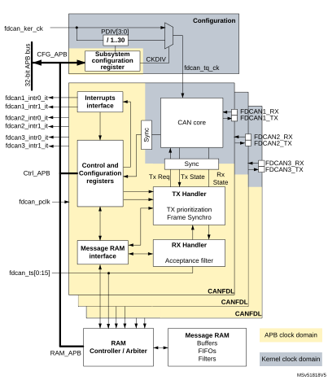
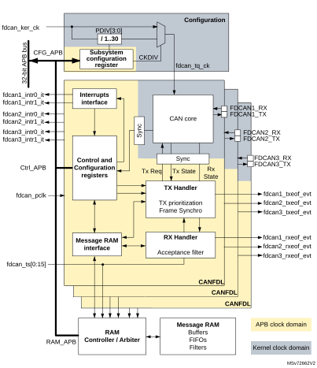
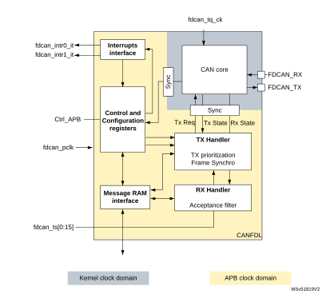
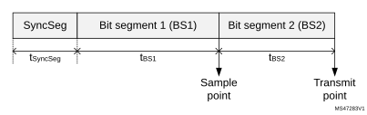
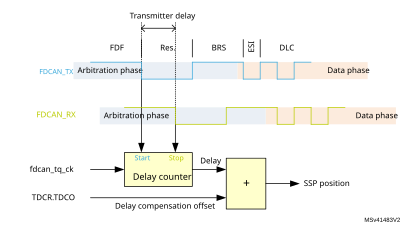
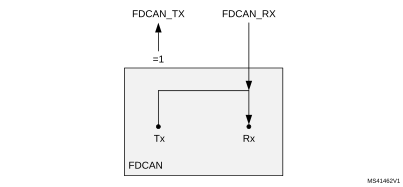
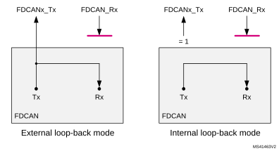
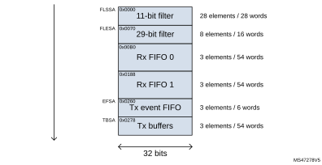
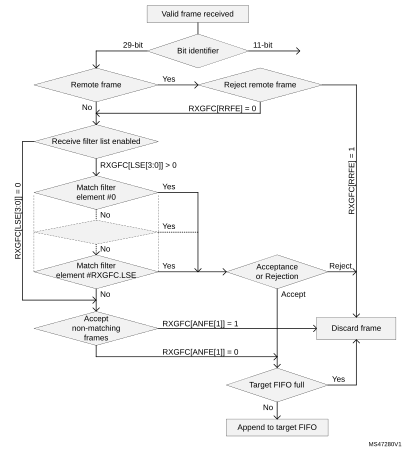

# 44 FD controller area network (FDCAN)

## 44.1 Introduction

The controller area network (CAN) subsystem (see [Figure 663](#XREF_66742__Figure_1__CAN_subsystem30)) consists of three CAN modules, a shared message RAM, and a configuration block. Refer to the memory map for the base address of each of these parts.

The modules (FDCAN) are compliant with ISO 11898-1: 2015 (CAN protocol specification version 2.0 part A, B) and CAN FD protocol specification version 1.0.

A 0.8-Kbyte message RAM per FDCAN instance is used for filtering, transmitting event FIFOs, and receiving and transmitting FIFOs.

#### Figure 663. CAN subsystem 

<table class="_Invisible"><col width="536.14px"/><tr data-conditional="_nofdcan2_txrx_eof_evt" height="626.52px"><td data-conditional="_nofdcan2_txrx_eof_evt" style="padding-top:0.00pt;padding-bottom:0.00pt;">
          
</td></tr><tr data-conditional="_fdcan2_txrx_eof_evt" height="1344.00px" style="display: none"><td data-conditional="_fdcan2_txrx_eof_evt" style="padding-top:0.00pt;padding-bottom:0.00pt;display: none">
          

          

          
</td></tr></table>

 .

## 44.2 FDCAN main features

- Conform with CAN protocol version 2.0 part A, B, and ISO 11898-1: 2015
- CAN FD with maximum 64 data bytes supported
- CAN error logging
- AUTOSAR and J1939 support
- Improved acceptance filtering
- Two receive FIFOs of three payloads each (up to 64 bytes per payload)
- Separate signaling on reception of high priority messages
- Configurable transmit FIFO/queue of three payloads (up to 64 bytes per payload)
- Transmit event FIFO
- Programmable loop-back test mode
- Maskable module interrupts
- Two clock domains: APB bus interface and CAN core kernel clock
- Power-down support

## 44.3 FDCAN functional description

### 44.3.1 FDCAN block diagram

#### Figure 664. FDCAN block diagram

#### Dual interrupt lines

The FDCAN peripheral provides two interrupt lines, fdcan\_intr0\_it and fdcan\_intr1\_it.

By programming the EINT0 and EINT1 bits of the FDCAN\_ILE register, the interrupt lines can be independently enabled or disabled.

#### CAN core

The CAN core contains the protocol controller and receive/transmit shift registers. It handles all ISO 11898-1: 2015 protocol functions and supports both 11-bit and 29-bit identifiers.

#### Sync

This block synchronizes signals from the APB clock domain to the CAN kernel clock domain and vice versa.

#### Tx handler

The Tx handler controls the message transfer from the message RAM to the CAN core. A maximum of three Tx buffers is available for transmission. The Tx buffer can be used as Tx FIFO or as a Tx queue. Tx event FIFO stores Tx timestamps together with the corresponding message ID. Transmit cancellation is also supported.

#### Rx handler

The Rx handler controls the transfer of received messages from the CAN core to the external message RAM. The Rx handler supports two receive FIFOs, for storage of all messages that have passed acceptance filtering. An Rx timestamp is stored together with each message. Up to 28 filters can be defined for 11-bit IDs; up to eight filters for 29-bit IDs.

#### APB interface

The APB interface connects the FDCAN to the APB bus for configuration registers, controller configuration, and RAM access.

#### Message RAM interface

The message RAM interface connects the FDCAN access to an external 1-Kbyte message RAM through a RAM controller/arbiter.

### 44.3.2 FDCAN pins and internal signals

The CAN subsystem I/O signals and pins are detailed, respectively, in [Table 407](#XREF_27495__Table_597__CAN_subsystem_I/O_signals%1130), [Table 408](#XREF_42836__Table_598__CAN_subsystem_I/O_pins30), and [Figure 663](#XREF_66742__Figure_1__CAN_subsystem30).

 

<table class="TableTitle"><caption class="TableCap"><h4 class="TableCap" id="5129889">Table 407. <a id="signals%1130" name="XREF_27495__Table_597__CAN_subsystem_I_O_signals%1130">CAN subsystem I/O signals</a></h4></caption><col width="134.05px"/><col width="110.93px"/><col width="293.61px"/><thead><tr height="28.00px"><th>
Name
</th><th>
Type
</th><th>
Description
</th></tr></thead><tr height="22.67px"><td>
fdcan_ker_ck
</td><td rowspan="2">
Digital input
</td><td>
CAN subsystem kernel clock input
</td></tr><tr height="22.67px"><td>
fdcan_pclk
</td><td>
CAN subsystem APB interface clock input
</td></tr><tr height="22.67px"><td>
fdcann_intr0_it
</td><td rowspan="2">
Digital output
</td><td>
FDCAN interrupt0
</td></tr><tr height="22.67px"><td>
fdcann_intr1_it
</td><td>
FDCAN interrupt1
</td></tr><tr height="22.67px"><td>
fdcan_ts[0:15]
</td><td>
-
</td><td>
External timestamp vector
</td></tr><tr data-conditional="_fdcan2_txrx_eof_evt" height="22.67px" style="display: none"><td data-conditional="_fdcan2_txrx_eof_evt" style="display: none">
fdcann_txeof_evt
</td><td data-conditional="_fdcan2_txrx_eof_evt" style="display: none">
Digital output
</td><td data-conditional="_fdcan2_txrx_eof_evt" style="display: none">
End-of-frame transmission event
</td></tr><tr data-conditional="_fdcan2_txrx_eof_evt" height="22.67px" style="display: none"><td data-conditional="_fdcan2_txrx_eof_evt" style="display: none">
fdcann_rxeof_evt
</td><td data-conditional="_fdcan2_txrx_eof_evt" style="display: none">
Digital output
</td><td data-conditional="_fdcan2_txrx_eof_evt" style="display: none">
End-of-frame reception event
</td></tr><tr height="37.33px"><td>
APB interface
</td><td>
Digital input/output
</td><td>
Single APP with multiple psel for configuration, control and RAM access
</td></tr></table>

 

<table class="TableTitle"><caption class="TableCap"><h4 class="TableCap" id="5129955">Table 408. <a id="pins30" name="XREF_42836__Table_598__CAN_subsystem_I_O_pins30">CAN subsystem I/O pins</a></h4></caption><col width="134.05px"/><col width="110.93px"/><col width="293.61px"/><thead><tr height="28.00px"><th>
Name
</th><th>
Type
</th><th>
Description
</th></tr></thead><tr data-conditional="nonuser" height="22.67px" style="display: none"><td data-conditional="nonuser" style="display: none">
FDCAN_RXFD_MODE
</td><td data-conditional="nonuser" style="display: none">
Digital output
</td><td data-conditional="nonuser" style="display: none">
Indicate if the current RX CAN frame is in FD mode
</td></tr><tr data-conditional="nonuser" height="22.67px" style="display: none"><td data-conditional="nonuser" style="display: none">
FDCAN_TXFD_MODE
</td><td data-conditional="nonuser" style="display: none">
Digital output
</td><td data-conditional="nonuser" style="display: none">
Indicate if the current TX CAN frame is in FD mode
</td></tr><tr height="22.67px"><td>
FDCANn_RX
</td><td>
Digital input
</td><td>
FDCAN receive pin
</td></tr><tr height="22.67px"><td>
FDCANn_TX
</td><td>
Digital output
</td><td>
FDCAN transmit pin
</td></tr></table>

### 44.3.3 Bit timing

The bit timing logic monitors the serial bus-line and performs sampling and adjustment of the sample point by synchronizing on the start-bit edge and resynchronizing on the following edges.

As shown in [Figure 665](#XREF_18635__Figure_11___Bit_Timing30), this operation can be explained simply by splitting the bit time in three segments, as follows:

- Synchronization segment (SYNC\_SEG): a bit change is expected to occur within this time segment, having a fixed length of one time quantum (1 × tq).
- Bit segment 1 (BS1): defines the location of the sample point. It includes the PROP\_SEG and PHASE\_SEG1 of the CAN standard. Its duration is programmable from 1 to 16 time quanta, but can be automatically lengthened to compensate for positive phase drifts due to differences in the frequency of various nodes of the network.
- Bit segment 2 (BS2): defines the location of the transmit point. It represents the PHASE\_SEG2 of the CAN standard, its duration is programmable between one and eight time quanta, but can also be automatically shortened to compensate for negative phase drifts.

#### Figure 665. Bit timing

The baud rate is the inverse of the bit time (baud rate = 1 / bit time), which, in turn, is the sum of three components (see [Figure 665](#XREF_18635__Figure_11___Bit_Timing30)):

bit time = tSyncSeg + tBS1 + tBS2

Where:

 - For the nominal bit time

tq = (NBRP[8:0] + 1) × tfdcan\_tq\_clk

tSyncSeg = 1 × tq

tBS1 = tq × (NTSEG1[7:0] + 1)

tBS2 = tq × (NTSEG2[6:0] + 1)

Where NBRP[8:0], NTSEG1[7:0], and NTSEG2[6:0] bitfields belong to the FDCAN\_NBTP register.

 - For the data bit time

tq = (DBRP[4:0] + 1) × tfdcan\_tq\_clk

tSyncSeg = 1 × tq

tBS1 = tq × (DTSEG1[4:0] + 1)

tBS2 = tq × (DTSEG2[3:0] + 1)

Where DBRP[4:0], DTSEG1[4:0], and DTSEG2[3:0] belong to the FDCAN\_DBTP register.

The (re)synchronization jump width (SJW) defines an upper bound for the amount of lengthening or shortening of the bit segments. It is programmable between one and four time quanta.

A valid edge is defined as the first transition in a bit time from dominant to recessive bus level, provided the controller itself does not send a recessive bit.

If a valid edge is detected in BS1 instead of SYNC\_SEG, BS1 is extended by up to SJW, so that the sample point is delayed.

Conversely, if a valid edge is detected in BS2 instead of SYNC\_SEG, BS2 is shortened by up to SJW, so that the transmit point is moved earlier.

As a safeguard against programming errors, the configuration of the bit timing register is only possible while the device is in Standby mode. The FDCAN\_DBTP and FDCAN\_NBTP registers (dedicated, respectively, to data and nominal bit timing) are only accessible when the CCE and INIT of the FDCA\_CCCR register are set.

The FDCAN requires that the CAN time quanta clock is always below or equal to the APB clock (fdcan\_tq\_ck < fdcan\_pclk).

**Note:**

For a detailed description of the CAN bit timing and resynchronization mechanism, refer to the ISO 11898-1 standard.

### 44.3.4 Operating modes

#### Configuration

Access to peripheral version, hardware, and input clock divider configuration. When the clock divider is set to 0, the primary input clock is used as it is.

#### Software initialization

Software initialization is started by setting the INIT bit of the FDCAN\_CCCR register, by software, by a hardware reset, or by entering bus-off state. While the INIT bit is set, message transfers from and to the CAN bus are stopped, and the status of the CAN bus output FDCAN\_TX is recessive (high). The EML (error management logic) counters are unchanged. Setting the INIT bit does not change any configuration register. Clearing INIT bit of FDCAN\_CCCR finishes the software initialization. Afterwards the bit stream processor (BSP) synchronizes itself to the data transfer on the CAN bus by waiting for the occurrence of a sequence of 11 consecutive recessive bits (bus-idle) before it can take part in bus activities and start the message transfer.

Access to the FDCAN configuration registers is only enabled when the INIT bit and the CCE bit of the FDCAN\_CCCR register are both set.

The CCE bit of the FDCAN\_CCCR register can only be set/cleared while the INIT bit of FDCAN\_CCCR is set. The CCE bit is automatically cleared when the INIT bit is cleared.

The following registers are reset when the CCE bit of the FDCAN\_CCCR register is set:

- FDCAN\_HPMS: High priority message status
- FDCAN\_RXF0S: Rx FIFO 0 status
- FDCAN\_RXF1S: Rx FIFO 1 status
- FDCAN\_TXFQS: Tx FIFO/queue status
- FDCAN\_TXBRP: Tx buffer request pending
- FDCAN\_TXBTO: Tx buffer transmission occurred
- FDCAN\_TXBCF: Tx buffer cancellation finished
- FDCAN\_TXEFS: Tx event FIFO status

The timeout counter value (TOC[15:0] bit of the FDCAN\_TOCV register) is preset to the value configured by the TOP[15:0] of the FDCAN\_TOCC register when the CCE bit of the FDCAN\_CCCR is set.

In addition, the state machines of the Tx handler and Rx handler are held in idle state while the CCE bit is set.

The following registers can be written only when the CCE bit is cleared:

- FDCAN\_TXBAR: Tx buffer add request
- FDCAN\_TXBCR: Tx buffer cancellation request

The TEST and the MON bits of the FDCAN\_CCCR register can be set only by software while the INIT and the CCE bits of the FDCAN\_CCCR register are both set. Both bits can be reset at any time. The DAR bit of FDCAN\_CCCR can only be set/cleared while the INIT and CCE bits are both set.

#### Normal operation

The FDCAN default operating mode after hardware reset is event-driven CAN communication. TT operation mode is not supported.

Once the FDCAN is initialized and the INIT bit of the FDCAN\_CCCR register is cleared, the FDCAN synchronizes itself to the CAN bus and is ready for communication.

After passing the acceptance filtering, received messages including message ID and DLC are stored into the Rx FIFO 0 or Rx FIFO 1.

For messages to be transmitted, the Tx FIFO or the Tx queue can be initialized or updated. Automated transmission on reception of remote frames is not supported.

#### CAN FD operation

There are two variants in the FDCAN protocol:

- Long frame mode (LFM), where the data field of a CAN frame may be longer than eight bytes.
- Fast frame mode (FFM), where the control field, data field, and CRC field of a CAN frame are transmitted with a higher bit rate compared to the beginning and to the end of the frame.

The fast frame mode can be used in combination with the long frame mode.

The previously reserved bit in CAN frames with 11-bit identifiers and the first previously reserved bit in CAN frames with 29-bit identifiers are decoded as FDF bit: FDF recessive signifies a CAN FD frame, while FDF dominant signifies a classic CAN frame.

In a CAN FD frame, the two bits following FDF (res and BRS) decide whether the bit rate inside this CAN FD frame is switched. A CAN FD bit rate switch is signified by res dominant and BRS recessive. The coding of res recessive is reserved for future expansion of the protocol. In case the FDCAN receives a frame with FDF recessive and res recessive, it signals a protocol exception event by setting the PXE bit of the FDCAN\_PSR register. When protocol exception handling is enabled (PXHD = 0 in FDCAN\_CCCR), this causes the operation state to change from receiver (ACT[1:0] = 10 in FDCAN\_PSR) to integrating (ACT[1:0] = 00 in FDCAN\_PSR) at the next sample point. If protocol exception handling is disabled (PXHD = 1 in FDCAN\_CCCR), the FDCAN treats a recessive res bit as a form error and responds with an error frame.

CAN FD operation is enabled by programming the FDOE bit of the FDCAN\_CCCR register. In case FDOE = 1, transmission and reception of CAN FD frames are enabled. Transmission and reception of classic CAN frames are always possible. Whether a CAN FD frame or a classic CAN frame is transmitted can be configured via the FDF bit in the respective Tx buffer element. With FDOE = 0, received frames are interpreted as classic CAN frames, which leads to the transmission of an error frame when receiving a CAN FD frame. When CAN FD operation is disabled, no CAN FD frames are transmitted even if the FDF bit of a Tx buffer element is set. The FDOE and BRSE bits of the FDCAN\_CCCR register can only be changed while the INIT and CCE bits are both set.

With FDOE = 0, the setting of the FDF and BRS bits is ignored, and frames are transmitted in classic CAN format. With FDOE = 1 and BRSE = 0, only the FDF bit of a Tx buffer element is evaluated. With FDOE = 1 and BRSE = 1, transmission of CAN FD frames with bit rate switching is enabled. All Tx buffer elements with FDF and BRS bits set are transmitted in CAN FD format with bit rate switching.

A mode change during CAN operation is recommended only under the following conditions:

- The failure rate in the CAN FD data phase is significant higher than in the CAN FD arbitration phase. In this case, disable the CAN FD bit rate switching option for transmissions.
- During system startup, all nodes transmit classic CAN messages until it is verified that they are able to communicate in CAN FD format. If this is true, all nodes switch to CAN FD operation.
- Wake-up messages in CAN partial networking have to be transmitted in classic CAN format.
- End-of-line programming in case not all nodes are CAN FD capable. Non-CAN FD nodes are held in silent mode until programming is complete. Then all nodes switch back to classic CAN communication.

In the FDCAN format, the coding of the DLC differs from that of the standard CAN format. The DLC codes 0 to 8 have the same coding as in standard CAN, the codes 9 to 15 (that in standard CAN all code a data field of 8 bytes) are coded according to [Table 409](#XREF_68741__Table_8__DLC_coding_in_FDCAN30).

 

<table class="TableTitle"><caption class="TableCap"><h4 class="TableCap" id="1032694">Table 409. <a id="FDCAN30" name="XREF_68741__Table_8__DLC_coding_in_FDCAN30">DLC coding in FDCAN</a></h4></caption><col width="132.85px"/><col width="57.96px"/><col width="57.96px"/><col width="57.96px"/><col width="57.96px"/><col width="57.96px"/><col width="57.96px"/><col width="57.96px"/><thead><tr height="28.00px"><th>
DLC
</th><th>
9
</th><th>
10
</th><th>
11
</th><th>
12
</th><th>
13
</th><th>
14
</th><th>
15
</th></tr></thead><tr height="22.67px"><td>
Number of data bytes
</td><td>
12
</td><td>
16
</td><td>
20
</td><td>
24
</td><td>
32
</td><td>
48
</td><td>
64
</td></tr></table>

:

In CAN FD fast frames, the bit timing is switched inside the frame, after the BRS (bit rate switch) bit, if this bit is recessive. Before the BRS bit, in the FDCAN arbitration phase, the standard CAN bit timing is used as defined by the FDCAN\_DBTP register. In the following FDCAN data phase, the fast CAN bit timing is used as defined by the FDCAN\_DBTP register. The bit timing is switched back from the fast timing at the CRC delimiter or when an error is detected, whichever occurs first.

The maximum configurable bit rate in the CAN FD data phase depends on the FDCAN kernel clock frequency. For example, with an FDCAN kernel clock frequency of 20 MHz and the shortest configurable bit time of four time quanta (tq), the bit rate in the data phase is 5 Mbit/s.

In both data frame formats (CAN FD long frames and CAN FD fast frames), the value of bit ESI (error status indicator) is determined by the transmitter error state at the start of the transmission. If the transmitter is error passive, ESI is transmitted recessive, else it is transmitted dominant. In CAN FD remote frames, the ESI bit is always transmitted dominant, independent of the transmitter error state. The data length code of CAN FD remote frames is transmitted as 0.

In case an FDCAN Tx buffer is configured for FDCAN transmission with DLC > 8, the first eight bytes are transmitted as configured in the Tx buffer while the remaining part of the data field is padded with 0xCC. When the FDCAN receives a FDCAN frame with DLC > 8, the first eight bytes of that frame are stored into the matching Rx FIFO. The remaining bytes are discarded.

#### Transceiver delay compensation

During the data phase of an FDCAN transmission, only one node is transmitting, all others are receivers. The length of the bus line has no impact. When transmitting via pin FDCAN\_TX, the protocol controller receives the transmitted data from its local CAN transceiver via pin FDCAN\_RX. The received data is delayed by the CAN transceiver loop delay. If this delay is greater than TSEG1 (time segment before sample point), and a bit error is detected. Without transceiver delay compensation, the bit rate in the data phase of an FDCAN frame is limited by the transceiver loop delay.

The FDCAN implements a delay compensation mechanism to compensate the CAN transceiver loop delay, thereby enabling transmission with higher bit rates during the FDCAN data phase independent of the delay of a specific CAN transceiver.

To check for bit errors during the data phase of transmitting nodes, the delayed transmit data is compared against the received data at the secondary sample point (SSP). If a bit error is detected, the transmitter reacts on this bit error at the next following regular sample point. During the arbitration phase, the delay compensation is always disabled.

The transmitter delay compensation enables configurations where the data bit time is shorter than the transmitter delay. This is enabled by setting the TDC bit of the FDCAN\_DBTP register, and described in detail in the ISO11898-1 specification.

The received bit is compared against the transmitted bit at the SSP. The SSP position is defined as the sum of the measured delay from the FDCAN transmit output pin FDCAN\_TX through the transceiver to the receive input pin FDCAN\_RX plus the transmitter delay compensation offset as configured by TDCO[6:0] of FDCAN\_TDCR. The transmitter delay compensation offset is used to adjust the position of the SSP inside the received bit (for example, half of the bit time in the data phase). The position of the secondary sample point is rounded down to the next integer number of mtq (minimum time quantum, one period of fdcan\_tq\_ck clock).

The TDCV[6:0] bitfield of the FDCAN\_PSR register shows the actual transmitter delay compensation value. TDCV[6:0] is cleared when the INIT is set in the FDCAN\_CCCR. It is updated at each transmission of an FD frame while the TDC bit of the FDCAN\_DBTP register is set.

The following boundary conditions have to be considered for the transmitter delay compensation implemented in the FDCAN:

- The sum of the measured delay from FDCAN\_Tx to FDCAN\_Rx and the configured transmitter delay compensation offset TDCO[6:0] has to be lower than 6-bit times in the data phase.
- The sum of the measured delay from FDCAN\_TX to FDCAN\_RX and the configured transmitter delay compensation offset TDCO[6:0] has to be lower than or equal to 127 × mtq. If the sum exceeds this value, the maximum value (127 × mtq) is used for transmitter delay compensation.
- The data phase ends at the sample point of the CRC delimiter, which stops checking received bits at the SSPs.

If transmitter delay compensation is enabled by setting the TDC bit of the FDCAN\_DBTP; the measurement is started within each transmitted CAN FD frame at the falling edge of bit FDF to bit res. The measurement is stopped when this edge is seen at the receive input pin FDCAN\_TX of the transmitter. The resolution of this measurement is one mtq.

#### Figure 666. Transceiver delay measurement

To avoid that a dominant glitch inside the received FDF bit ends the delay compensation measurement before the falling edge of the received res bit (resulting in a too early SSP position), the use of a transmitter delay compensation filter window can be enabled by programming the TDCF[6:0] bitfield of the FDCAN\_TDCR register. This defines a minimum value for the SSP position. Dominant edges on FDCAN\_RX that would result in an earlier SSP position are ignored for transmitter delay measurement. The measurement is stopped when the SSP position is at least TDCF[6:0] and FDCAN\_RX is low.

#### Restricted operation mode

In restricted operation mode, the node is able to receive data and remote frames, and to give acknowledge to valid frames, but it does not send data frames, remote frames, active error frames, or overload frames. In case of an error condition or overload condition, it does not send dominant bits. Instead, it waits for the occurrence of a bus-idle condition to resynchronize itself to the CAN communication. The error counters (REC[6:0] and TEC[7:0] in FDCAN\_ECR) are frozen while the error logging (CEL[7:0]) is active. The software can set the FDCAN into restricted operation mode by setting the ASM bit of FDCAN\_CCCR. The bit can only be set by software when both CCE and INIT bits are set in FDCAN\_CCCR. The bit can be cleared by software at any time.

Restricted operation mode is automatically entered when the Tx handler is not able to read data from the message RAM in time. To leave restricted operation mode, the software has to clear the ASM bit of FDCAN\_CCCR.

The restricted operation mode can be used in applications that adapt themselves to different CAN bit rates. In this case, the application tests different bit rates and leaves the restricted operation mode after it has received a valid frame.

**Note:**

The restricted operation mode must not be combined with the loop-back mode (internal or external).

#### Bus monitoring mode

The FDCAN is set in bus monitoring mode by setting the MON bit of the FDCAN\_CCCR register. In bus monitoring mode (for more details refer to ISO11898-1, 10.12 bus monitoring), the FDCAN is able to receive valid data frames and valid remote frames, but cannot start a transmission. In this mode, it sends only recessive bits on the CAN bus. If the FDCAN is required to send a dominant bit (ACK bit, overload flag, active error flag), the bit is rerouted internally so that the FDCAN can monitor it, even if the CAN bus remains in recessive state. In bus monitoring mode, the FDCAN\_TXBRP register is held in reset state.

The bus monitoring mode can be used to analyze the traffic on a CAN bus without affecting it by the transmission of dominant bits. [Figure 667](#XREF_50555__Figure_4__Pin_control_in_Bus_Monitoring_mode30) shows the connection of FDCAN\_TX and FDCAN\_RX signals to the FDCAN in bus monitoring mode.

#### Figure 667. Pin control in bus monitoring mode

#### Disabled automatic retransmission mode (DAR)

According to the CAN specification (see ISO11898-1, 6.3.3 Recovery Management), the FDCAN provides means for automatic retransmission of frames that have lost arbitration or have been disturbed by errors during transmission. By default, automatic retransmission is enabled. The DAR mode can be disabled through the DAR bit of the FDCAN\_CCCR register.

Frame transmission in DAR mode

In DAR mode, all transmissions are automatically canceled after they have been started on the CAN bus. A Tx buffer Tx request pending bit (TRPx in FDCAN\_TXBRP) is reset after successful transmission, when a transmission has not yet been started at the point of cancellation, when it has been aborted due to lost arbitration, or when an error has occurred during frame transmission.

- Successful transmission
 - The corresponding Tx buffer transmission occurred bit TOx is set in FDCAN\_TXBTO register.
 - The corresponding Tx buffer cancellation finished bit CFx is cleared in the FDCAN\_TXBCF register.
- Successful transmission in spite of cancellation
 - The corresponding Tx buffer transmission occurred bit TOx is set in the FDCAN\_TXBTO register.
 - The corresponding Tx buffer cancellation finished bit CFx is set in the FDCAN\_TXBCF register.
- Arbitration loss or frame transmission disturbed
 - The corresponding Tx buffer transmission occurred bit TOx is cleared in the FDCAN\_TXBTO register.
 - The corresponding Tx buffer cancellation finished bit CFx is set in the FDCAN\_TXBCF register.

In case of a successful frame transmission, and if the storage of Tx events is enabled, a Tx event FIFO element is written with event type ET = 10 (transmission in spite of cancellation).

#### Power-down (Sleep mode)

Power-down entry

The FDCAN can be set into power-down mode controlled by setting the CSR bit of the FDCAN\_CCCR register. As long as the clock stop request is active, CSR is read as 1.

When all pending transmission requests have completed, the FDCAN waits until the bus-idle state is detected. The FDCAN then sets the INIT bit of the FDCAN\_CCCR register to prevent any further CAN transfers. Now, the FDCAN acknowledges that it is ready for power-down by setting the CSA bit of the FDCAN\_CCCR register. In this state, before the clocks are switched off, further register accesses can be made. A write access to the INIT bit has no effect. Now, the module clock inputs can be switched off.

Power-down exit

To leave power-down mode, the application has to turn on the module clocks before clearing the CSR bit. The FDCAN acknowledges this by clearing the CSA bit. Afterwards, the application can restart CAN communication by clearing the INIT bit.

#### Test modes

To enable write access to [FDCAN test register (FDCAN\_TEST)](#XREF_63827__1_4_4_FDCAN_Test_Register_(FDCAN_TEST)30), the TEST bit of the FDCAN\_CCCR register must be set, thus enabling the configuration of test modes and functions.

Four output functions are available for the CAN transmit pin FDCAN\_TX by programming the TX[1:0] bitfield of the FDCAN\_TEST register. In addition to its default function (the serial data output), it can drive the CAN sample point signal to monitor the FDCAN bit timing as well as drive constant dominant or recessive values. The actual value at pin FDCAN\_RX can be read from the RX bit of FDCAN\_TEST. Both functions can be used to check the CAN bus physical layer.

Due to the synchronization mechanism between CAN kernel clock and APB clock domain, there can be a delay of several APB clock periods between writing to TX[1:0] until the new configuration is visible at FDCAN\_TX output pin. This applies also when reading FDCAN\_RX input pin via RX.

**Note:**

Test modes must be used for production tests or self-test only. The software control for FDCAN\_TX pin interferes with all CAN protocol functions. It is not recommended to use test modes for application.

#### External loop-back mode

The FDCAN can be set in external loop-back mode by setting the LBCK bit of the FDCAN\_TEST register. In loop-back mode, the FDCAN treats its own transmitted messages as received messages and stores them (if they pass acceptance filtering) into Rx FIFOs. [Figure 668](#XREF_42592__Figure_3__Bonding_diagram_for_LQFP48_(7x7_mm)30) shows the connection of transmit and receive signals FDCAN\_TX and FDCAN\_RX to the FDCAN in external loop-back mode.

This mode is provided for hardware self-test. To be independent from external stimulation, the FDCAN ignores acknowledge errors (recessive bit sampled in the acknowledge slot of a data/remote frame) in loop-back mode. In this mode, the FDCAN performs an internal feedback from its transmit output to its receive input. The actual value of the FDCAN\_RX input pin is disregarded by the FDCAN. The transmitted messages can be monitored at the FDCAN\_TX transmit pin.

#### Internal loop-back mode

Internal loop-back mode is entered by setting both the LBCK bit of FDCAN\_TEST and the MON bit of FDCAN\_CCR. This mode can be used for a “hot self-test”, meaning the FDCAN can be tested without affecting a running CAN system connected to the FDCAN\_TX and FDCAN\_RX pins. In this mode, FDCAN\_RX pin is disconnected from the FDCAN and FDCAN\_TX pin is held recessive. [Figure 668](#XREF_42592__Figure_3__Bonding_diagram_for_LQFP48_(7x7_mm)30) shows the connection of FDCAN\_TX and FDCAN\_RX pins to the FDCAN in case of internal loop-back mode.

#### Figure 668. Pin control in loop-back mode

#### Timestamp generation

For timestamp generation, the FDCAN supplies a 16-bit wrap-around counter. A prescaler (TCP[3:0] of FDCAN\_TSCC) can be configured to clock the counter in multiples of CAN bit times (1 to 16). The counter is readable via the TCV[15:0] bitfield of the FDCAN\_TSCV register. A write access to TSCV15:0] resets the counter to 0. When the timestamp counter wraps around, the interrupt flag (TSW bit of FDCAN\_ISR) is set.

On start of frame reception/transmission, the counter value is captured and stored into the timestamp section of an Rx FIFO (RXTS[15:0]) or Tx event FIFO (TXTS[15:0]) element.

By programming TSS[1:0] of FDCAN\_TSCC, a 16-bit timestamp can be used.

#### Debug mode behavior

In debug mode, the set/reset on read feature is automatically disabled during the debugger register access, and enabled during normal MCU operation

#### Timeout counter

To signal timeout conditions for Rx FIFO 0, Rx FIFO 1, and the Tx event FIFO the FDCAN supplies a 16-bit timeout counter. It operates as a down-counter and uses the same prescaler controlled by TCP[3:0] of FDCAN\_TSCC as the timestamp counter. The timeout counter is configured via the FDCAN\_TOCC register. The actual counter value can be read from the TOC[15:0] bitfield of FDCAN\_TOCV. The timeout counter can only be started while the INIT bit of FDCAN\_CCCR is cleared. It is stopped when INIT is set, for example, when the FDCAN enters bus-off state.

The operation mode is selected by TOS[1:0] of FDCAN\_TOCC. When operating in continuous mode, the counter starts when INIT is cleared. A write to FDCAN\_TOCV presets the counter to the value configured by TOP[15:0] in FDCAN\_TOCC and continues down-counting.

When the timeout counter is controlled by one of the FIFOs, an empty FIFO presets the counter to the value configured by TOP[15:0]. Down-counting is started when the first FIFO element is stored. Writing to FDCAN\_TOCV has no effect.

When the counter reaches 0, the TOO interrupt flag is set in the FDCAN\_IR register. In continuous mode, the counter is immediately restarted at TOP[15:0].

**Note:**

The clock signal for the timeout counter is derived from the CAN core sample point signal. Therefore, the point in time where the timeout counter is decremented may vary due to the synchronization/resynchronization mechanism of the CAN core. If the baud rate switch feature in FDCAN is used, the timeout counter is clocked differently in the arbitration and data fields.

### 44.3.5 Error management

As described in the CAN protocol, the error management is handled entirely by hardware using the transmit error counter (the TEC[7:0] bitfield of the [FDCAN error counter register (FDCAN\_ECR)](#XREF_78366__44_4_12_FDCAN_error_counter_register_(FDCAN_ECR)30)) and the receive error counter (the REC[6:0] bitfield of the [FDCAN error counter register (FDCAN\_ECR)](#XREF_78366__44_4_12_FDCAN_error_counter_register_(FDCAN_ECR)30)). These values are incremented or decremented according to the error condition. For detailed information on TEC[7:0] and REC[6:0] management, refer to the CAN standard. Both values can be read by software to determine the stability of the network.

The bus-off state is reached when TEC[7:0] is greater than 255. This state is also indicated by the BO flag of the [FDCAN protocol status register (FDCAN\_PSR)](#XREF_52360__44_4_13_FDCAN_protocol_status_register_(FDCAN_PSR)30). In bus-off state, the CAN is no longer able to transmit and receive messages. It has to wait at least for the duration of the recovery sequence specified in the CAN standard (128 occurrences of 11 consecutive recessive bits monitored on FDCAN\_RX input).

#### Figure 669. CAN error state diagram

**Note:**

In initialization mode, the CAN does not monitor the FDCAN\_RX signal, and therefore cannot complete the recovery sequence. To recover from an error state, the CAN must operate in normal mode.

### 44.3.6 Message RAM

The message RAM is 32-bit wide, and the FDCAN module is configured to allocate up to 212 words in it. It is not necessary to configure each of the sections shown in [Figure 670](#XREF_81745__Figure_6__Message_RAM_configuration30).

#### Figure 670. Message RAM configuration

When the FDCAN addresses the message RAM, it addresses 32-bit words (aligned), not a single byte. The RAM addresses are 32-bit words, that is, only bits 15 to 2 are evaluated, the two least significant bits are ignored.

In case of multiple instances, the RAM start address for the FDCANn is computed by end address + 4 of FDCANn - 1, and the FDCANn end address is computed by FDCANn start address + 0x0350 - 4.

As an example, for two instances:

- FDCAN1:
 - Start address 0x0000
 - End address 0x034C (as in [Figure 670](#XREF_81745__Figure_6__Message_RAM_configuration30))
- FDCAN2:
 - Start address = 0x034C (FDCAN1 end address) + 4 = 0x0350
 - End address = 0x0350 (FDCAN2 start address) + 0x0350 - 4 = 0x069C.

#### Rx handling

The Rx handler controls the acceptance filtering, the transfer of received messages to one of the two Rx FIFOs, as well as the Rx FIFO put and get indices.

#### Acceptance filter

The FDCAN offers the possibility to configure two sets of acceptance filters, one for standard identifiers and another for extended identifiers. These filters can be assigned to Rx FIFO 0 or Rx FIFO 1. For acceptance filtering, each list of filters is executed from element #0 until the first matching element. Acceptance filtering stops at the first matching element, and the following filter elements are not evaluated for this message.

The main features are:

- Each filter element can be configured as
 - Range filter (from - to)
 - Filter for one or two dedicated IDs
 - Classic bit mask filter
- Each filter element is configurable for acceptance or rejection filtering.
- Each filter element can be enabled/disabled individually.
- Filters are checked sequentially, execution stops with the first matching filter element

Related configuration registers are:

- Global filter configuration (RXGFC)
- Extended ID AND mask (XIDAM)

Depending on the configuration of the filter element (SFEC[2:0]/EFEC[2:0]), a match triggers one of the following actions:

- Store received frame in FIFO 0 or FIFO 1
- Reject received frame
- Set the high priority message interrupt flag HPM in FDCAN\_IR
- Set the high priority message interrupt flag HPM in FDCAN\_IR, and store the received frame in FIFO 0 or FIFO 1.

Acceptance filtering is started after the complete identifier has been received. After acceptance filtering has completed, and if a matching Rx FIFO has been found, the message handler starts writing the received message data in 32-bit portions to the matching Rx FIFO. If the CAN protocol controller has detected an error condition (for example, CRC error), this message is discarded with the following impact:

- Rx FIFO

The put index of the matching Rx FIFO is not updated, but the related Rx FIFO element is partly overwritten with the received data. For error type, see LEC[2:0] and DLEC[2:0] bitfields of the FDCAN\_PSR register. In case the matching Rx FIFO is operated in overwrite mode, the boundary conditions described in [Rx FIFO overwrite mode](#XREF_67744__Rx_FIFO_Overwrite_Mode30) have to be considered.

**Note:**

When an accepted message is written to one of the two Rx FIFOs, the unmodified received identifier is stored independently from the used filters. The result of the acceptance filter process strongly depends on the sequence of configured filter elements.

#### Range filter

The filter matches for all received frames with message IDs in the range defined by SF1ID/SF2ID and EF1ID/EF2ID.

There are two possibilities when range filtering is used together with extended frames:

- EFT[1:0] = 00: the message ID of received frames is AND-ed with the extended ID AND mask (XIDAM) before the range filter is applied.
- EFT[1:0] = 11: the extended ID AND mask (XIDAM) is not used for range filtering.

#### Filter for dedicated IDs

A filter element can be configured to filter for one or two specific message IDs. To filter for one specific message ID, the filter element has to be configured with SF1ID = SF2ID and EF1ID = EF2ID.

#### Classic bit mask filter

The classic bit mask filtering is intended to filter groups of message IDs by masking single bits of a received message ID. With classic bit mask filtering SF1ID/EF1ID is used as message ID filter, while SF2ID/EF2ID is used as filter mask.

0 bit at the filter mask masks out the corresponding bit position of the configured ID filter. For example, the value of the received message ID at that bit position is not relevant for acceptance filtering. Only the bits of the received message ID where the corresponding mask bits are 1 are relevant for acceptance filtering.

In case all mask bits are 1, a match occurs only when the received message ID and the message ID filter are identical. If all mask bits are 0, all message IDs match.

#### Standard message ID filtering

[Figure 671](#XREF_62820__Figure_7__Standard_Message_ID_filter_path30) shows the flow for standard message ID (11-bit identifier) filtering. The standard message ID filter element is described in [Section 44.3.11](#XREF_40924__1_3_19_FDCAN_Standard_message_ID_Filter_element30).

The standard message filtering is controlled by the FDCAN\_RXGFC register. The standard message ID, the remote transmission request bit (RTR), and the identifier extension bit (IDE) of the received frames are compared against the list of configured filter elements.

#### Figure 671. Standard message ID filter path

#### Extended message ID filtering

[Figure 672](#XREF_72123__Figure_8__Extended_Message_ID_filter_path30) shows the flow for extended message ID (29-bit identifier) filtering. The extended message ID filter element is described in [Section 44.3.12](#XREF_46017__1_3_20_FDCAN_Extended_message_ID_filter_element30).

The extended message filtering is controlled by the FDCAN\_RXGFC register. The extended message ID, the remote transmission request bit (RTR), and the identifier extension bit (IDE) of the received frames are compared against the list of configured filter elements.

#### Figure 672. Extended message ID filter path

The extended ID AND mask (XIDAM) is AND-ed with the received identifier before the filter list is executed.

#### Rx FIFOs

Rx FIFO 0 and Rx FIFO 1 can hold up to three elements each.

Received messages that passed acceptance filtering are transferred to the Rx FIFO as configured by the matching filter element. For a description of the filter mechanisms available for Rx FIFO 0 and Rx FIFO 1, see [Acceptance filter](#XREF_18320__Acceptance_filter30). The Rx FIFO element is described in [Section 44.3.8](#XREF_51975__1_3_16_FDCAN_Rx_Buffer_and_FIFO_element30).

When an Rx FIFO full condition is signaled by RFnF in FDCAN\_IR (where n is the FIFO number), no further messages are written to the corresponding Rx FIFO until at least one message has been read out, and the Rx FIFO get index has been incremented. In case a message is received while the corresponding Rx FIFO is full, this message is discarded, and the interrupt flag RFnL is set in the FDCAN\_IR register.

When reading from an Rx FIFO, the Rx FIFO get index (FnGI of FDCAN\_RXFnS) + FIFO element size has to be added to the corresponding Rx FIFO start address (FnSA).

#### Rx FIFO blocking mode

The Rx FIFO blocking mode is configured by clearing the FnOM bit in the FDCAN\_RXGFC register. This is the default operation mode for the Rx FIFOs.

When an Rx FIFO full condition is reached (FnPI = FnGI in FDCAN\_RXFnS), no further messages are written to the corresponding Rx FIFO until at least one message has been read out and the Rx FIFO get index has been incremented. An Rx FIFO full condition is signaled by FnF = 1 in FDCAN\_RXFnS. In addition, the RFnF interrupt flag is set in FDCAN\_IR.

In case a message is received while the corresponding Rx FIFO is full, this message is discarded, and the message lost condition is signaled by setting RFnL bit in FDCAN\_RXFnS. In addition, the RFnL interrupt flag is set in FDCAN\_IR.

#### Rx FIFO overwrite mode

The Rx FIFO overwrite mode is configured by setting the FnOM bit of the FDCAN\_RXGFC register.

When an Rx FIFO full condition (FnPI = FnGI of FDCAN\_RXFnS) is signaled by FnF = 1 in FDCAN\_RXFnS, the next message accepted for the FIFO overwrites the oldest FIFO message. Put and get indices are both incremented by one.

When an Rx FIFO is operated in overwrite mode and an Rx FIFO full condition is signaled, reading from the Rx FIFO elements must start at least at get index + 1. This is because it may happen that a received message is written to the message RAM (put index) while the CPU is reading from the message RAM (get index). In this case, inconsistent data can be read from the respective Rx FIFO element. Adding an offset to the get index when reading from the Rx FIFO avoids this problem. The offset depends on how fast the CPU accesses the Rx FIFO.

After reading from the Rx FIFO, the number of the last element read has to be written to the Rx FIFO acknowledge index (FnA of FDCAN\_RXFnA). This increments the get index to that element number. In case the put index has not been incremented to this Rx FIFO element, the Rx FIFO full condition is reset (FnF = 0 in FDCAN\_RXFnS).

#### Tx handling

The Tx handler handles transmission requests for the Tx FIFO and the Tx queue. It controls the transfer of transmit messages to the CAN core, the put and get indices, and the Tx event FIFO. Up to three Tx buffers can be set up for message transmission. The CAN message data field is configured to 64 bytes. the Tx FIFO allocates eighteen 32-bit words for storage of a Tx element.

 

<table class="TableTitle"><caption class="TableCap"><h4 class="TableCap" id="1033081">Table 410. Possible configurations for frame transmission</h4></caption><col width="90.71px"/><col width="90.71px"/><col width="90.71px"/><col width="90.71px"/><col width="175.75px"/><thead><tr height="28.00px"><th colspan="2">
CCCR
</th><th colspan="2">
Tx buffer element
</th><th rowspan="2">
Frame transmission
</th></tr><tr height="28.00px"><th>
BRSE
</th><th>
FDOE
</th><th>
FDF
</th><th>
BRS
</th></tr></thead><tr height="22.67px"><td>
Ignored
</td><td>
0
</td><td>
Ignored
</td><td>
Ignored
</td><td>
Classic CAN
</td></tr><tr height="22.67px"><td>
0
</td><td>
1
</td><td>
0
</td><td>
Ignored
</td><td>
Classic CAN
</td></tr><tr height="22.67px"><td>
0
</td><td>
1
</td><td>
1
</td><td>
Ignored
</td><td>
FD without bit rate switching
</td></tr><tr height="22.67px"><td>
1
</td><td>
1
</td><td>
0
</td><td>
Ignored
</td><td>
Classic CAN
</td></tr><tr height="22.67px"><td>
1
</td><td>
1
</td><td>
1
</td><td>
0
</td><td>
FD without bit rate switching
</td></tr><tr height="22.67px"><td>
1
</td><td>
1
</td><td>
1
</td><td>
1
</td><td>
FD with bit rate switching
</td></tr></table>

**Note:**

AUTOSAR requires at least three Tx queue buffers and support of transmit cancellation.

The Tx handler starts a Tx scan to check for the highest priority pending Tx request (Tx buffer with lowest message ID) when the Tx buffer request pending register (FDCAN\_TXBRP) is updated, or when a transmission has been started.

#### Transmit pause

The transmit pause feature is intended for use in CAN systems where the CAN message identifiers are permanently specified to specific values and cannot easily be changed. These message identifiers can have a higher CAN arbitration priority than other defined messages, while in a specific application their relative arbitration priority must be inverse. This may lead to a case where one ECU sends a burst of CAN messages that cause another ECU CAN messages to be delayed because that other messages have a lower CAN arbitration priority.

As an example, if CAN ECU-1 has the feature enabled and is requested by its application software to transmit four messages, it waits, after the first successful message transmission, for two CAN bit times of bus-idle before it is allowed to start the next requested message. If there are other ECUs with pending messages, these messages are started in the idle time, and they would not need to arbitrate with the next message of ECU-1. After having received a message, ECU-1 is allowed to start its next transmission as soon as the received message releases the CAN bus.

The feature is controlled by the TXP bit of the CCCR register. If the bit is set, the FDCAN, each time it has successfully transmitted a message, pauses for two CAN bit times before starting the next transmission. This enables other CAN nodes in the network to transmit messages even if their messages have lower prior identifiers. By default, this feature is disabled (TXP = 0 in FDCAN\_CCCR).

This feature looses up burst transmissions coming from a single node and it protects against "babbling idiot" scenarios where the application program erroneously requests too many transmissions.

#### Tx FIFO

Tx FIFO operation is configured by clearing the TFQM bit of the FDCAN\_TXBC register. Messages stored in the Tx FIFO are transmitted starting with the message referenced by the get index (TFGI[1:0] bitfield of FDCAN\_TXFQS). After each transmission, the get index is incremented cyclically until the Tx FIFO is empty. The Tx FIFO enables transmission of messages with the same message ID from different Tx buffers in the order that these messages have been written to the Tx FIFO. The FDCAN calculates the Tx FIFO free level (TFFL[2:0] bitfield of FDCAN\_TXFQS) as the difference between the get and put index. It indicates the number of available (free) Tx FIFO elements.

New transmit messages have to be written to the Tx FIFO starting with the Tx buffer referenced by the put index (TFQPI[1:0] bitfield of FDCAN\_TXFQS). An add request increments the put index to the next free Tx FIFO element. When the put index reaches the get index, Tx FIFO full (TFQF = 1 in FDCAN\_TXFQS) is signaled. In this case, no further messages must be written to the Tx FIFO until the next message has been transmitted and the get index has been incremented.

When a single message is added to the Tx FIFO, the transmission is requested by setting the FDCAN\_TXBAR bit related to the Tx buffer referenced by the Tx FIFO put index.

When multiple (n) messages are added to the Tx FIFO, they are written to n consecutive Tx buffers starting with the put index. The transmissions are then requested via the FDCA\_TXBAR register. The put index is then cyclically incremented by n. The number of requested Tx buffers must not exceed the number of free Tx buffers as indicated by the Tx FIFO free level.

When a transmission request for the Tx buffer referenced by the get index is canceled, the get index is incremented to the next Tx buffer with a transmission request is pending and the Tx FIFO free level is recalculated. When transmission cancellation is applied to any other Tx buffer, the get index and the FIFO Free Level remain unchanged.

A Tx FIFO element allocates eighteen 32-bit words in the message RAM. The Therefore, the start address of the next available (free) Tx FIFO buffer, is calculated by adding 18 times the put index TFQPI[1:0] (0 … 2) to the Tx buffer start address TBSA.

#### Tx queue

Tx queue operation is configured by setting the TFQM of the FDCAN\_TXBC register. Messages stored in the Tx queue are transmitted starting with the message with the lowest message ID (highest priority).

In case of mixing of standard and extended message IDs, the standard message IDs are compared to bits [28:18] of extended message IDs.

In case multiple queue buffers are configured with the same message ID, the queue buffer with the lowest buffer number is transmitted first.

New messages have to be written to the Tx buffer referenced by the put index (TFQPI[1:0] in FDCAN\_TXFQS). An add request cyclically increments the put index to the next free Tx buffer. In case the Tx queue is full (TFQF = 1 in FDCAN\_TXFQS), the put index is not valid and no further message must be written to the Tx queue until at least one of the requested messages has been sent out or a pending transmission request has been canceled.

The application can use the FDCAN\_TXBRP register instead of the put index and can place messages to any Tx buffer without pending transmission request.

A Tx queue buffer allocates eighteen 32-bit words in the message RAM. The start address of Therefore, the next available (free) Tx queue buffer is calculated by adding 18 times the Tx queue put index TFQPI[1:0] (0 ... 2) to the Tx buffer start address TBSA.

#### Transmit cancellation

The FDCAN supports transmit cancellation. To cancel a requested transmission from a Tx queue buffer, the host has to write 1 to the corresponding bit position (= number of Tx buffer) of the FDCAN\_TXBCR register. Transmit cancellation is not intended for Tx FIFO operation.

Successful cancellation is signaled by setting the corresponding bit of the FDCAN\_TXBCF register.

In case a transmit cancellation is requested while a transmission from a Tx buffer is already ongoing, the corresponding FDCAN \_TXBRP bit remains set as long as the transmission is in progress. If the transmission is successful, the corresponding FDCAN\_TXBTO and FDCAN\_TXBCF bits are set. If the transmission is not successful, it is not repeated and only the corresponding FDCAN\_TXBCF bit is set.

**Note:**

In case a pending transmission is canceled immediately before it has been started, there is a short time window where no transmission is started even if another message is pending in the node. This can enable another node to transmit a message that can have a priority lower than that of the second message in the node.

#### Tx event handling

To support Tx event handling the FDCAN has implemented a Tx event FIFO. After the FDCAN has transmitted a message on the CAN bus, message ID and timestamp are stored in a Tx event FIFO element. To link a Tx event to a Tx event FIFO element, the message marker from the transmitted Tx buffer is copied into the Tx event FIFO element.

The Tx event FIFO is configured to three elements. The Tx event FIFO element is described in [Tx FIFO](#XREF_85206__Tx_FIFO30).

The purpose of the Tx event FIFO is to decouple handling transmit status information from transmit message handling that is, a Tx buffer holds only the message to be transmitted, while the transmit status is stored separately in the Tx event FIFO. This has the advantage, especially when operating a dynamically managed transmit queue, that a Tx buffer can be used for a new message immediately after successful transmission. There is no need to save transmit status information from a Tx buffer before overwriting that Tx buffer.

When a Tx event FIFO full condition is signaled by the TEFF bit of the FDCAN\_IR, no further elements are written to the Tx event FIFO until at least one element has been read out and the Tx event FIFO get index has been incremented. In case a Tx event occurs while the Tx event FIFO is full, this event is discarded and the TEFL interrupt flag is set in the FDCAN\_IR register.

When reading from the Tx event FIFO, the Tx event FIFO get index (EFGI[1:0] of FDCAN\_TXEFS) has to be added twice to the Tx event FIFO start address EFSA.

### 44.3.7 FIFO acknowledge handling

The get indices of Rx FIFO 0, Rx FIFO 1, and the Tx event FIFO are controlled by writing to the corresponding FIFO acknowledge index (see [Section 44.4.23](#XREF_41758__1_4_28_CAN_Rx_FIFO_0_Acknowledge_Register_(FDCAN_RXF0A)30) and [Section 44.4.25](#XREF_52001__1_4_32_FDCAN_Rx_FIFO_1_Acknowledge_Register_(FDCAN_RXF1A)30)). Writing to the FIFO acknowledge index sets the FIFO get index to the FIFO acknowledge index plus one and thereby updates the FIFO fill level. There are two use cases:

- When only a single element has been read from the FIFO (the one being pointed to by the get index), this get index value is written to the FIFO acknowledge index.
- When a sequence of elements has been read from the FIFO, it is sufficient to write the FIFO acknowledge index only once at the end of that read sequence (value = index of the last element read), to update the FIFO get index.

Because the CPU has free access to the FDCAN message RAM, special care has to be taken when reading FIFO elements in an arbitrary order (get index not considered). This might be useful when reading a high priority message from one of the two Rx FIFOs. In this case, the FIFO acknowledge index must not be written because this would set the get index to a wrong position and alter the FIFO fill level. In this case, some of the older FIFO elements would be lost.

**Note:**

The application has to ensure that a valid value is written to the FIFO acknowledge index. The FDCAN does not check for erroneous values.

### 44.3.8 FDCAN Rx FIFO element

Two Rx FIFOs are configured in the message RAM. Each Rx FIFO section can be configured to store up to three received messages. The structure of an Rx FIFO element is described in [Table 411](#XREF_95551__Table_15__Rx_Buffer_and_FIFO_element30). The description is provided in [Table 412](#XREF_50951__Table_16__Rx_Buffer_and_FIFO_Element_description%1130).

 

<table class="TableTitle"><caption class="TableCap"><h4 class="TableCap" id="1033237">Table 411. <a id="element30" name="XREF_95551__Table_15__Rx_Buffer_and_FIFO_element30">Rx FIFO element</a></h4></caption><col width="28.94px"/><col width="44.38px"/><col width="42.30px"/><col width="42.30px"/><col width="42.30px"/><col width="37.80px"/><col width="37.80px"/><col width="37.80px"/><col width="55.75px"/><col width="42.30px"/><col width="42.30px"/><col width="42.30px"/><col width="42.30px"/><thead><tr height="28.00px"><th>
Bit
</th><th style="border-right-width:0;border-right-style:hidden;border-right-color:0;">
31
</th><th style="border-right-width:0;border-right-style:hidden;border-right-color:0;"></th><th style="border-right-width:0;border-right-style:hidden;border-right-color:0;"></th><th>
24
</th><th style="border-right-width:0;border-right-style:hidden;border-right-color:0;">
23
</th><th style="border-right-width:0;border-right-style:hidden;border-right-color:0;"></th><th style="border-right-width:0;border-right-style:hidden;border-right-color:0;"></th><th>
16
</th><th style="border-right-width:0;border-right-style:hidden;border-right-color:0;">
15
</th><th>
8
</th><th style="border-right-width:0;border-right-style:hidden;border-right-color:0;">
7
</th><th>
0
</th></tr></thead><tr height="22.67px"><td>
R0
</td><td>
ESI
</td><td>
XTD
</td><td>
RTR
</td><td colspan="9">
ID[28:0]
</td></tr><tr height="22.67px"><td>
R1
</td><td>
ANMF
</td><td colspan="3">
FIDX[6:0]
</td><td>
Res.
</td><td>
FDF
</td><td>
BRS
</td><td>
DLC[3:0]
</td><td colspan="4">
RXTS[15:0]
</td></tr><tr height="22.67px"><td>
R2
</td><td colspan="4">
DB3[7:0]
</td><td colspan="4">
DB2[7:0]
</td><td colspan="2">
DB1[7:0]
</td><td colspan="2">
D[7:0]
</td></tr><tr height="22.67px"><td>
R3
</td><td colspan="4">
DB7[7:0]
</td><td colspan="4">
DB6[7:0]
</td><td colspan="2">
DB5[7:0]
</td><td colspan="2">
DB4[7:0]
</td></tr><tr height="18.67px"><td>
...
</td><td colspan="4">
...
</td><td colspan="4">
...
</td><td colspan="4">
...
</td></tr><tr height="22.67px"><td>
Rn
</td><td colspan="4">
DBm[7:0]
</td><td colspan="4">
DBm-1[7:0]
</td><td colspan="2">
DBm-2[7:0]
</td><td colspan="2">
DBm-3[7:0]
</td></tr></table>

The element size configured for storage of CAN FD messages is set to 64-byte data field.

 

<table class="TableTitle"><caption class="TableCap"><h4 class="TableCap" id="1033452">Table 412. <a id="description%1130" name="XREF_50951__Table_16__Rx_Buffer_and_FIFO_Element_description%1130">Rx FIFO element description</a></h4></caption><col width="79.31px"/><col width="459.28px"/><thead><tr height="28.00px"><th>
Field
</th><th>
Description
</th></tr></thead><tr height="57.33px"><td>
R0 Bit 31

ESI
</td><td>
Error state indicator
<li class="TableBullet" id="1033464">–​0: Transmitting node is error active</li><li class="TableBullet" id="1033465">–​1: Transmitting node is error passive</li></td></tr><tr height="74.67px"><td>
R0 Bit 30

XTD
</td><td>
Extended identifier

Signals to the host whether the received frame has a standard or extended identifier.
<li class="TableBullet" id="1033472">–​0: 11-bit standard identifier</li><li class="TableBullet" id="1033473">–​1: 29-bit extended identifier</li></td></tr><tr height="74.67px"><td>
R0 Bit 29

RTR
</td><td>
Remote transmission request

Signals to the host whether the received frame is a data frame or a remote frame.
<li class="TableBullet" id="1033480">–​0: Received frame is a data frame</li><li class="TableBullet" id="1033481">–​1: Received frame is a remote frame</li></td></tr><tr height="54.67px"><td>
R0 Bits 28:0

ID[28:0]
</td><td>
Identifier

Standard or extended identifier depending on bit XTD. A standard identifier is stored into ID[28:18].
</td></tr><tr height="89.33px"><td>
R1 Bit 31

ANMF
</td><td>
Accepted non-matching frame

Acceptance of non-matching frames can be enabled via ANFS[1:0] and ANFE[1:0] bitfield of FDCAN_RXGFC.
<li class="TableBullet" id="1033494">–​0: Received frame matching filter index FIDX</li><li class="TableBullet" id="1033495">–​1: Received frame did not match any Rx filter element</li></td></tr><tr height="57.33px"><td>
R1 Bits 30:24

FIDX[6:0]
</td><td>
Filter index

0-27=Index of matching Rx acceptance filter element (invalid if ANMF = 1).

Range: 0 to LSS[4:0] - 1 or LSE[3:0] - 1 in FDCAN_RXGFC.
</td></tr><tr height="57.33px"><td>
R1 Bit 21

FDF
</td><td>
FD format
<li class="TableBullet" id="1033508">–​0: Standard frame format</li><li class="TableBullet" id="1033509">–​1: FDCAN frame format (new DLC-coding and CRC)</li></td></tr><tr height="57.33px"><td>
R1 Bit 20

BRS
</td><td>
Bit rate switch
<li class="TableBullet" id="1033515">–​0: Frame received without bit rate switching</li><li class="TableBullet" id="1033516">–​1: Frame received with bit rate switching</li></td></tr><tr height="74.67px"><td>
R1 Bits 19:16

DLC[3:0]
</td><td>
Data length code
<li class="TableBullet" id="1033522">–​0-8: Classic CAN + CAN FD: received frame has 0-8 data bytes</li><li class="TableBullet" id="1033523">–​9-15: Classic CAN: received frame has 8 data bytes</li><li class="TableBullet" id="1033524">–​9-15: CAN FD: received frame has 12/16/20/24/32/48/64 data bytes</li></td></tr><tr height="54.67px"><td>
R1 Bits 15:0

RXTS[15:0]
</td><td>
Rx timestamp

Timestamp Counter value captured on start of frame reception. Resolution depending on configuration of the timestamp counter prescaler TCP[3:0] of FDCAN_TSCC.
</td></tr><tr height="40.00px"><td>
R2 Bits 31:24

DB3[7:0]
</td><td>
Data byte 3
</td></tr><tr height="40.00px"><td>
R2 Bits 23:16

DB2[7:0]
</td><td>
Data byte 2
</td></tr><tr height="40.00px"><td>
R2 Bits 15:8

DB1[7:0]
</td><td>
Data byte 1
</td></tr><tr height="40.00px"><td>
R2 Bits 7:0

D[7:0]
</td><td>
Data byte 0
</td></tr><tr height="40.00px"><td>
R3 Bits 31:24

DB7[7:0]
</td><td>
Data byte 7
</td></tr><tr height="40.00px"><td>
R3 Bits 23:16

DB6[7:0]
</td><td>
Data byte 6
</td></tr><tr height="40.00px"><td>
R3 Bits 15:8

DB5[7:0]
</td><td>
Data byte 5
</td></tr><tr height="40.00px"><td>
R3 Bits 7:0

DB4[7:0]
</td><td>
Data byte 4
</td></tr><tr height="30.24px"><td>
... 
</td><td>
...
</td></tr><tr height="40.00px"><td>
Rn Bits 31:24

DBm[7:0]
</td><td>
Data byte m
</td></tr><tr height="40.00px"><td>
Rn Bits 23:16

DBm-1[7:0]
</td><td>
Data byte m-1
</td></tr><tr height="40.00px"><td>
Rn Bits 15:8

DBm-2[7:0]
</td><td>
Data byte m-2
</td></tr><tr height="40.00px"><td>
Rn Bits 7:0

DBm-3[7:0]
</td><td>
Data byte m-3
</td></tr></table>

### 44.3.9 FDCAN Tx buffer element

The Tx buffers section (three elements) can be configured to hold Tx FIFO or Tx queue. The Tx handler distinguishes between Tx FIFO and Tx queue using the Tx buffer configuration TFQM bit of the FDCAN\_TXBC register. The element size is configured for storage of CAN FD messages with up to 64-byte data.

 

<table class="TableTitle"><caption class="TableCap"><h4 class="TableCap" id="1033604">Table 413. <a id="element%1130" name="XREF_23765__Table_17__Rx_Buffer_and_FIFO_element%1130">Tx buffer and FIFO element</a></h4></caption><col width="29.93px"/><col width="45.89px"/><col width="43.75px"/><col width="43.75px"/><col width="35.18px"/><col width="35.18px"/><col width="35.18px"/><col width="35.18px"/><col width="35.18px"/><col width="58.63px"/><col width="35.18px"/><col width="35.18px"/><col width="35.18px"/><col width="35.18px"/><thead><tr height="28.00px"><th>
Bit
</th><th style="border-right-width:0;border-right-style:hidden;border-right-color:0;">
31
</th><th style="border-right-width:0;border-right-style:hidden;border-right-color:0;"></th><th style="border-right-width:0;border-right-style:hidden;border-right-color:0;"></th><th>
24
</th><th style="border-right-width:0;border-right-style:hidden;border-right-color:0;">
23
</th><th style="border-right-width:0;border-right-style:hidden;border-right-color:0;"></th><th style="border-right-width:0;border-right-style:hidden;border-right-color:0;"></th><th style="border-right-width:0;border-right-style:hidden;border-right-color:0;"></th><th>
16
</th><th style="border-right-width:0;border-right-style:hidden;border-right-color:0;">
15
</th><th>
8
</th><th style="border-right-width:0;border-right-style:hidden;border-right-color:0;">
7
</th><th>
0
</th></tr></thead><tr height="22.67px"><td>
T0
</td><td>
ESI
</td><td>
XTD
</td><td>
RTR
</td><td colspan="10">
ID[28:0]
</td></tr><tr height="22.67px"><td>
T1
</td><td colspan="4">
MM[7:0]
</td><td>
EFC
</td><td>
Res.
</td><td>
FDF
</td><td>
BRS
</td><td>
DLC[3:0]
</td><td colspan="4">
Res.
</td></tr><tr height="22.67px"><td>
T2
</td><td colspan="4">
DB3[7:0]
</td><td colspan="5">
DB2[7:0]
</td><td colspan="2">
DB1[7:0]
</td><td colspan="2">
D[7:0]
</td></tr><tr height="22.67px"><td>
T3
</td><td colspan="4">
DB7[7:0]
</td><td colspan="5">
DB6[7:0]
</td><td colspan="2">
DB5[7:0]
</td><td colspan="2">
DB4[7:0]
</td></tr><tr height="18.67px"><td>
...
</td><td colspan="4">
...
</td><td colspan="5">
...
</td><td colspan="4">
...
</td></tr><tr height="22.67px"><td>
Tn
</td><td colspan="4">
DBm[7:0]
</td><td colspan="5">
DBm-1[7:0]
</td><td colspan="2">
DBm-2[7:0]
</td><td colspan="2">
DBm-3[7:0]
</td></tr></table>

 

<table class="TableTitle"><caption class="TableCap"><h4 class="TableCap" id="1033833">Table 414. Tx buffer element description</h4></caption><col width="79.31px"/><col width="459.28px"/><thead><tr height="28.00px"><th>
Field
</th><th>
Description
</th></tr></thead><tr height="57.33px"><td>
T0 Bit 31

ESI<a href="#c7amba%20fdcan2%20UserSpec_c7amba%20fdcan2%20UserSpec_FTH_1">1</a>
</td><td>
Error state indicator
<li class="TableBullet" id="1033848">–​0: ESI bit in CAN FD format depends only on error passive flag</li><li class="TableBullet" id="1033849">–​1: ESI bit in CAN FD format transmitted recessive</li></td></tr><tr height="57.33px"><td>
T0 Bit 30

XTD
</td><td>
Extended identifier
<li class="TableBullet" id="1033855">–​0: 11-bit standard identifier</li><li class="TableBullet" id="1033856">–​1: 29-bit extended identifier</li></td></tr><tr height="57.33px"><td>
T0 Bit 29

RTR<a href="#c7amba%20fdcan2%20UserSpec_c7amba%20fdcan2%20UserSpec_FTH_2">2</a>
</td><td>
Remote transmission request
<li class="TableBullet" id="1033865">–​0: Transmit data frame</li><li class="TableBullet" id="1033866">–​1: Transmit remote frame</li></td></tr><tr height="54.67px"><td>
T0 Bits 28:0

ID[28:0]
</td><td>
Identifier

Standard or extended identifier depending on bit XTD. A standard identifier has to be written to ID[28:18].
</td></tr><tr height="54.67px"><td>
T1 Bits 31:24

MM[7:0]
</td><td>
Message marker

Written by CPU during Tx buffer configuration. Copied into Tx event FIFO element for identification of Tx message status.
</td></tr><tr height="57.33px"><td>
T1 Bit 23

EFC
</td><td>
Event FIFO control
<li class="TableBullet" id="1033884">–​0: Do not store Tx events</li><li class="TableBullet" id="1033885">–​1: Store Tx events</li></td></tr><tr height="57.33px"><td>
T1 Bit 21

FDF
</td><td>
FD format
<li class="TableBullet" id="1033891">–​0: Frame transmitted in classic CAN format</li><li class="TableBullet" id="1033892">–​1: Frame transmitted in CAN FD format</li></td></tr><tr height="57.33px"><td>
T1 Bit 20

BRS<a href="#c7amba%20fdcan2%20UserSpec_c7amba%20fdcan2%20UserSpec_FTH_3">3</a>
</td><td>
Bit rate switching
<li class="TableBullet" id="1033901">–​0: CAN FD frames transmitted without bit rate switching</li><li class="TableBullet" id="1033902">–​1: CAN FD frames transmitted with bit rate switching</li></td></tr><tr height="74.67px"><td>
T1 Bits 19:16

DLC[3:0]
</td><td>
Data length code
<li class="TableBullet" id="1033908">–​0 - 8: Classic CAN + CAN FD: received frame has 0-8 data bytes</li><li class="TableBullet" id="1033909">–​9 - 15: Classic CAN: received frame has 8 data bytes</li><li class="TableBullet" id="1033910">–​9 - 15: CAN FD: received frame has 12/16/20/24/32/48/64 data bytes</li></td></tr><tr height="40.00px"><td>
T2 Bits 31:24

DB3[7:0]
</td><td>
Data byte 3
</td></tr><tr height="40.00px"><td>
T2 Bits 23:16

DB2[7:0]
</td><td>
Data byte 2
</td></tr><tr height="40.00px"><td>
T2 Bits 15:8

DB1[7:0]
</td><td>
Data byte 1
</td></tr><tr height="40.00px"><td>
T2 Bits 7:0

D[7:0]
</td><td>
Data byte 0
</td></tr><tr height="40.00px"><td>
T3 Bits 31:24

DB7[7:0]
</td><td>
Data byte 7
</td></tr><tr height="40.00px"><td>
T3 Bits 23:16

DB6[7:0]
</td><td>
Data byte 6
</td></tr><tr height="40.00px"><td>
T3 Bits 15:8

DB5[7:0]
</td><td>
Data byte 5
</td></tr><tr height="37.33px"><td>
T3 Bits 7:0 DB4[7:0]
</td><td>
Data byte 4
</td></tr><tr height="30.24px"><td>
... 
</td><td>
...
</td></tr><tr height="40.00px"><td>
Tn Bits 31:24

DBm[7:0]
</td><td>
Data byte m
</td></tr><tr height="40.00px"><td>
Tn Bits 23:16

DBm-1[7:0]
</td><td>
Data byte m-1
</td></tr><tr height="40.00px"><td>
Tn Bits 15:8

DBm-2[7:0]
</td><td>
Data byte m-2
</td></tr><tr height="40.00px"><td>
Tn Bits 7:0

DBm-3[7:0]
</td><td>
Data byte m-3
</td></tr></table>

<a href="#c7amba%20fdcan2%20UserSpec_c7amba%20fdcan2%20UserSpec_FTB_1">1.</a>The ESI bit of the transmit buffer is OR-ed with the error passive flag to decide the value of the ESI bit in the transmitted FD frame. As required by the CAN FD protocol specification, an error active node can optionally transmit the ESI bit recessive, but an error passive node always transmits the ESI bit recessive.

<a href="#c7amba%20fdcan2%20UserSpec_c7amba%20fdcan2%20UserSpec_FTB_2">2.</a>When RTR = 1, the FDCAN transmits a remote frame according to ISO11898-1, even if the transmission in CAN FD format is enabled by the FDOE bit of the FDCAN_CCCR.

<a href="#c7amba%20fdcan2%20UserSpec_c7amba%20fdcan2%20UserSpec_FTB_3">3.</a>Bits ESI, FDF, and BRS are only evaluated when CAN FD operation is enabled by setting the FDOE bit of the FDCAN_CCCR. Bit BRS is only evaluated when in addition BRSE bit is set in FDCAN_CCCR.

### 44.3.10 FDCAN Tx event FIFO element

Each element stores information about transmitted messages. By reading the Tx event, FIFO the host CPU gets this information in the order that the messages were transmitted. Status information about the Tx event FIFO can be obtained from FDCAN\_TXEFS register.

 

<table class="TableTitle"><caption class="TableCap"><h4 class="TableCap" id="1033982">Table 415. Tx event FIFO element</h4></caption><col width="31.17px"/><col width="47.80px"/><col width="45.56px"/><col width="45.56px"/><col width="36.64px"/><col width="50.96px"/><col width="36.64px"/><col width="36.64px"/><col width="61.06px"/><col width="36.64px"/><col width="36.64px"/><col width="36.64px"/><col width="36.64px"/><thead><tr height="28.00px"><th>
Bit
</th><th style="border-right-width:0;border-right-style:hidden;border-right-color:0;">
31
</th><th style="border-right-width:0;border-right-style:hidden;border-right-color:0;"></th><th style="border-right-width:0;border-right-style:hidden;border-right-color:0;"></th><th>
24
</th><th style="border-right-width:0;border-right-style:hidden;border-right-color:0;">
23
</th><th style="border-right-width:0;border-right-style:hidden;border-right-color:0;"></th><th style="border-right-width:0;border-right-style:hidden;border-right-color:0;"></th><th>
16
</th><th style="border-right-width:0;border-right-style:hidden;border-right-color:0;">
15
</th><th>
8
</th><th style="border-right-width:0;border-right-style:hidden;border-right-color:0;">
7
</th><th>
0
</th></tr></thead><tr height="22.67px"><td>
E0
</td><td>
ESI
</td><td>
XTD
</td><td>
RTR
</td><td colspan="9">
ID[28:0]
</td></tr><tr height="22.67px"><td>
E1
</td><td colspan="4">
MM[7:0]
</td><td>
ET[1:0]
</td><td>
EDL
</td><td>
BRS
</td><td>
DLC[3:0]
</td><td colspan="4">
TXTS[15:0]
</td></tr></table>

 

<table class="TableTitle"><caption class="TableCap"><h4 class="TableCap" id="1034091">Table 416. Tx event FIFO element description</h4></caption><col width="79.31px"/><col width="459.28px"/><thead><tr height="28.00px"><th>
Field
</th><th>
Description
</th></tr></thead><tr height="57.33px"><td>
E0 Bit 31

ESI
</td><td>
Error state indicator
<li class="TableBullet" id="1034103">–​0: Transmitting node is error active</li><li class="TableBullet" id="1034104">–​1: Transmitting node is error passive</li></td></tr><tr height="57.33px"><td>
E0 Bit 30

XTD
</td><td>
Extended identifier
<li class="TableBullet" id="1034110">–​0: 11-bit standard identifier</li><li class="TableBullet" id="1034111">–​1: 29-bit extended identifier</li></td></tr><tr height="57.33px"><td>
E0 Bit 29

RTR
</td><td>
Remote transmission request
<li class="TableBullet" id="1034117">–​0: Transmit data frame</li><li class="TableBullet" id="1034118">–​1: Transmit remote frame</li></td></tr><tr height="54.67px"><td>
E0 Bits 28:0

ID[28:0]
</td><td>
Identifier

Standard or extended identifier depending on bit XTD. A standard identifier has to be written to ID[28:18].
</td></tr><tr height="54.67px"><td>
E1 Bits 31:24

MM[7:0]
</td><td>
Message marker

Copied from Tx buffer into Tx event FIFO element for identification of Tx message status.
</td></tr><tr height="106.67px"><td>
E1 Bits 23:22

EFC
</td><td>
Event type
<li class="TableBullet" id="1034136">–​00: Reserved</li><li class="TableBullet" id="1034137">–​01: Tx event</li><li class="TableBullet" id="1034138">–​10: Transmission in spite of cancellation (always set for transmissions in DAR mode)</li><li class="TableBullet" id="1034139">–​11: Reserved</li></td></tr><tr height="57.33px"><td>
E1 Bit 21

EDL
</td><td>
Extended data length
<li class="TableBullet" id="1034145">–​0: Standard frame format</li><li class="TableBullet" id="1034146">–​1: FDCAN frame format (new DLC-coding and CRC)</li></td></tr><tr height="57.33px"><td>
E1 Bit 20

BRS
</td><td>
Bit rate switching
<li class="TableBullet" id="1034152">–​0: Frame transmitted without bit rate switching</li><li class="TableBullet" id="1034153">–​1: Frame transmitted with bit rate switching</li></td></tr><tr height="57.33px"><td>
T1 Bits 19:16

DLC[3:0]
</td><td>
Data length code

0 - 8: Frame with 0-8 data bytes transmitted

9 - 15: Frame with 8 data bytes transmitted
</td></tr><tr height="69.33px"><td>
E1 Bits 15:0

TXTS[15:0]
</td><td>
Tx Timestamp

Timestamp counter value captured on start of frame transmission. Resolution depending on configuration of the timestamp counter prescaler TCP[3:0] of FDCAN_TSCC.
</td></tr></table>

### 44.3.11 FDCAN standard message ID filter element

Up to 28 filter elements can be configured for 11-bit standard IDs. When accessing a standard message ID filter element, its address is the filter list standard start address FLSSA plus the index of the filter element (0 … 27).

 

<table class="TableTitle"><caption class="TableCap"><h4 class="TableCap" id="1034177">Table 417. <a id="element%1130" name="XREF_41423__Table_21__Standard_Message_ID_Filter_element%1130">Standard message ID filter element</a></h4></caption><col width="32.24px"/><col width="59.77px"/><col width="69.52px"/><col width="37.89px"/><col width="52.70px"/><col width="37.89px"/><col width="37.89px"/><col width="45.69px"/><col width="51.32px"/><col width="37.89px"/><col width="37.89px"/><col width="37.89px"/><thead><tr height="28.00px"><th>
Bit
</th><th style="border-right-width:0;border-right-style:hidden;border-right-color:0;">
31
</th><th style="border-right-width:0;border-right-style:hidden;border-right-color:0;"></th><th>
24
</th><th style="border-right-width:0;border-right-style:hidden;border-right-color:0;">
23
</th><th style="border-right-width:0;border-right-style:hidden;border-right-color:0;"></th><th style="border-right-width:0;border-right-style:hidden;border-right-color:0;"></th><th>
16
</th><th style="border-right-width:0;border-right-style:hidden;border-right-color:0;">
15
</th><th>
8
</th><th style="border-right-width:0;border-right-style:hidden;border-right-color:0;">
7
</th><th>
0
</th></tr></thead><tr height="22.67px"><td>
S0
</td><td>
SFT[1:0]
</td><td>
SFEC[2:0]
</td><td colspan="5">
SFID1[10:0]
</td><td>
Res.
</td><td colspan="3">
SFID2[10:0]
</td></tr></table>

 

<table class="TableTitle"><caption class="TableCap"><h4 class="TableCap" id="1053811">Table 418. Standard message ID filter element field description</h4></caption><col width="79.31px"/><col width="459.27px"/><thead><tr height="28.00px"><th>
Field
</th><th>
Description
</th></tr></thead><tr height="92.00px"><td>
Bit 31:30

SFT[1:0]<a href="#c7amba%20fdcan2%20UserSpec_c7amba%20fdcan2%20UserSpec_FTH_1">1</a>
</td><td>
Standard filter type
<li class="TableBullet" id="1053826">–​00: Range filter from SFID1 to SFID2 </li><li class="TableBullet" id="1053827">–​01: Dual ID filter for SFID1 or SFID2</li><li class="TableBullet" id="1053828">–​10: Classic filter: SFID1 = filter, SFID2 = mask</li><li class="TableBullet" id="1053829">–​11: Filter element disabled</li></td></tr><tr height="237.33px"><td>
Bit 29:27

SFEC[2:0]
</td><td>
Standard filter element configuration

All enabled filter elements are used for acceptance filtering of standard frames. Acceptance filtering stops at the first matching enabled filter element or when the end of the filter list is reached. If SFEC[2:0] = 100, 101 or 110 a match sets interrupt flag IR.HPM and, if enabled, an interrupt is generated. In this case register HPMS is updated with the status of the priority match.
<li class="TableBullet" id="1053836">–​000: Disable filter element</li><li class="TableBullet" id="1053837">–​001: Store in Rx FIFO 0 if filter matches</li><li class="TableBullet" id="1053838">–​010: Store in Rx FIFO 1 if filter matches</li><li class="TableBullet" id="1053839">–​011: Reject ID if filter matches</li><li class="TableBullet" id="1053840">–​100: Set priority if filter matches</li><li class="TableBullet" id="1053841">–​101: Set priority and store in FIFO 0 if filter matches</li><li class="TableBullet" id="1053842">–​110: Set priority and store in FIFO 1 if filter matches</li><li class="TableBullet" id="1053843">–​111: Not used</li></td></tr><tr height="40.00px"><td>
Bits 26:16

SFID1[10:0]
</td><td>
Standard filter ID 1

First ID of standard ID filter element.
</td></tr><tr height="40.00px"><td>
Bits 10:0

SFID2[10:0]
</td><td>
Standard filter ID 2

Second ID of standard ID filter element.
</td></tr></table>

<a href="#c7amba%20fdcan2%20UserSpec_c7amba%20fdcan2%20UserSpec_FTB_1">1.</a>With SFT[1:0] = 11 the filter element is disabled and the acceptance filtering continues (same behavior as with SFEC[2:0] = 000).

**Note:**

In case a reserved value is configured, the filter element is considered disabled.

### 44.3.12 FDCAN extended message ID filter element

Up to eight filter elements can be configured for 29-bit extended IDs. When accessing an extended message ID filter element, its address is the filter list extended start address FLESA plus twice the index of the filter element (0 … 7).

 

<table class="TableTitle"><caption class="TableCap"><h4 class="TableCap" id="1034322">Table 419. <a id="element%1130" name="XREF_31916__Table_23__Extended_Message_ID_Filter_element%1130">Extended message ID filter element</a></h4></caption><col width="31.70px"/><col width="48.60px"/><col width="46.33px"/><col width="37.26px"/><col width="37.26px"/><col width="51.82px"/><col width="37.26px"/><col width="37.26px"/><col width="62.09px"/><col width="37.26px"/><col width="37.26px"/><col width="37.26px"/><col width="37.26px"/><thead><tr height="28.00px"><th>
Bit
</th><th style="border-right-width:0;border-right-style:hidden;border-right-color:0;">
31
</th><th style="border-right-width:0;border-right-style:hidden;border-right-color:0;"></th><th></th><th>
24
</th><th style="border-right-width:0;border-right-style:hidden;border-right-color:0;">
23
</th><th style="border-right-width:0;border-right-style:hidden;border-right-color:0;"></th><th style="border-right-width:0;border-right-style:hidden;border-right-color:0;"></th><th>
16
</th><th style="border-right-width:0;border-right-style:hidden;border-right-color:0;">
15
</th><th>
8
</th><th style="border-right-width:0;border-right-style:hidden;border-right-color:0;">
7
</th><th>
0
</th></tr></thead><tr height="22.67px"><td>
F0
</td><td colspan="3">
EFEC[2:0]
</td><td colspan="9">
EFID1[28:0]
</td></tr><tr height="22.67px"><td>
F1
</td><td colspan="2">
EFT[1:0]
</td><td>
Res.
</td><td colspan="9">
EFID2[28:0]
</td></tr></table>

 

<table class="TableTitle"><caption class="TableCap"><h4 class="TableCap" id="1061943">Table 420. Extended message ID filter element field description</h4></caption><col width="79.31px"/><col width="459.27px"/><thead><tr height="28.00px"><th>
Field
</th><th>
Description
</th></tr></thead><tr height="237.33px"><td>
F0 Bits 31:29

EFEC[2:0]
</td><td>
Extended filter element configuration

All enabled filter elements are used for acceptance filtering of extended frames. Acceptance filtering stops at the first matching enabled filter element or when the end of the filter list is reached. If EFEC[2:0] = 100, 101 or 110 a match sets interrupt flag IR[HPM] and, if enabled, an interrupt is generated. In this case register HPMS is updated with the status of the priority match.
<li class="TableBullet" id="1061956">–​000: Disable filter element</li><li class="TableBullet" id="1061957">–​001: Store in Rx FIFO 0 if filter matches</li><li class="TableBullet" id="1061958">–​010: Store in Rx FIFO 1 if filter matches</li><li class="TableBullet" id="1061959">–​011: Reject ID if filter matches</li><li class="TableBullet" id="1061960">–​100: Set priority if filter matches</li><li class="TableBullet" id="1061961">–​101: Set priority and store in FIFO 0 if filter matches</li><li class="TableBullet" id="1061962">–​110: Set priority and store in FIFO 1 if filter matches</li><li class="TableBullet" id="1061963">–​111: Not used</li></td></tr><tr height="86.67px"><td>
F0 Bits 28:0

EFID1[28:0]
</td><td>
Extended filter ID 1

First ID of extended ID filter element.

When filtering for Rx FIFO, this field defines the ID of an extended message to be stored. The received identifiers must match exactly, only XIDAM masking mechanism.
</td></tr><tr height="92.00px"><td>
F1 Bits 31:30

EFT[1:0]
</td><td>
Extended filter type
<li class="TableBullet" id="1061976">–​00: Range filter from EF1ID to EF2ID (EF2ID ≥ EF1ID)</li><li class="TableBullet" id="1061977">–​01: Dual ID filter for EF1ID or EF2ID</li><li class="TableBullet" id="1061978">–​10: Classic filter: EF1ID = filter, EF2ID = mask</li><li class="TableBullet" id="1061979">–​11: Range filter from EF1ID to EF2ID (EF2ID ≥ EF1ID), XIDAM mask not applied</li></td></tr><tr height="22.67px"><td>
F1 Bit 29
</td><td>
Not used
</td></tr><tr height="40.00px"><td>
F1 Bits 28:0

EFID2[28:0]
</td><td>
Extended filter ID 2

Second ID of extended ID filter element.
</td></tr></table>

## 44.4 FDCAN registers

### 44.4.1 FDCAN core release register (FDCAN\_CREL)

Address offset: 0x0000

Reset value: 0x3214 1218

 

<table class="RegBitMap"><col width="38.39px"/><col width="38.39px"/><col width="38.39px"/><col width="38.39px"/><col width="38.39px"/><col width="38.39px"/><col width="38.39px"/><col width="38.39px"/><col width="38.39px"/><col width="38.39px"/><col width="38.39px"/><col width="38.39px"/><col width="38.39px"/><col width="38.39px"/><col width="38.39px"/><col width="38.39px"/><tr height="17.33px"><td style="border-bottom-width:0;border-bottom-style:hidden;border-bottom-color:0;">
31
</td><td style="border-bottom-width:0;border-bottom-style:hidden;border-bottom-color:0;">
30
</td><td style="border-bottom-width:0;border-bottom-style:hidden;border-bottom-color:0;">
29
</td><td style="border-bottom-width:0;border-bottom-style:hidden;border-bottom-color:0;">
28
</td><td style="border-bottom-width:0;border-bottom-style:hidden;border-bottom-color:0;">
27
</td><td style="border-bottom-width:0;border-bottom-style:hidden;border-bottom-color:0;">
26
</td><td style="border-bottom-width:0;border-bottom-style:hidden;border-bottom-color:0;">
25
</td><td style="border-bottom-width:0;border-bottom-style:hidden;border-bottom-color:0;">
24
</td><td style="border-bottom-width:0;border-bottom-style:hidden;border-bottom-color:0;">
23
</td><td style="border-bottom-width:0;border-bottom-style:hidden;border-bottom-color:0;">
22
</td><td style="border-bottom-width:0;border-bottom-style:hidden;border-bottom-color:0;">
21
</td><td style="border-bottom-width:0;border-bottom-style:hidden;border-bottom-color:0;">
20
</td><td style="border-bottom-width:0;border-bottom-style:hidden;border-bottom-color:0;">
19
</td><td style="border-bottom-width:0;border-bottom-style:hidden;border-bottom-color:0;">
18
</td><td style="border-bottom-width:0;border-bottom-style:hidden;border-bottom-color:0;">
17
</td><td style="border-bottom-width:0;border-bottom-style:hidden;border-bottom-color:0;">
16
</td></tr><tr height="17.33px"><td colspan="4" style="border-left-width:0.5pt;border-left-style:solid;border-left-color:#000000;border-bottom-width:0.5pt;border-bottom-style:solid;border-bottom-color:#000000;border-right-width:0.5pt;border-right-style:solid;border-right-color:#000000;border-top-width:0.5pt;border-top-style:solid;border-top-color:#000000;">
REL[3:0]
</td><td colspan="4" style="border-left-width:0.5pt;border-left-style:solid;border-left-color:#000000;border-bottom-width:0.5pt;border-bottom-style:solid;border-bottom-color:#000000;border-right-width:0.5pt;border-right-style:solid;border-right-color:#000000;border-top-width:0.5pt;border-top-style:solid;border-top-color:#000000;">
STEP[3:0]
</td><td colspan="4" style="border-left-width:0.5pt;border-left-style:solid;border-left-color:#000000;border-bottom-width:0.5pt;border-bottom-style:solid;border-bottom-color:#000000;border-right-width:0.5pt;border-right-style:solid;border-right-color:#000000;border-top-width:0.5pt;border-top-style:solid;border-top-color:#000000;">
SUBSTEP[3:0]
</td><td colspan="4" style="border-left-width:0.5pt;border-left-style:solid;border-left-color:#000000;border-bottom-width:0.5pt;border-bottom-style:solid;border-bottom-color:#000000;border-right-width:0.5pt;border-right-style:solid;border-right-color:#000000;border-top-width:0.5pt;border-top-style:solid;border-top-color:#000000;">
YEAR[3:0]
</td></tr><tr height="17.33px"><td style="border-left-width:0.5pt;border-left-style:solid;border-left-color:#000000;border-bottom-width:0.5pt;border-bottom-style:solid;border-bottom-color:#000000;border-right-width:0.5pt;border-right-style:solid;border-right-color:#000000;border-top-width:0.5pt;border-top-style:solid;border-top-color:#000000;">
r
</td><td style="border-left-width:0.5pt;border-left-style:solid;border-left-color:#000000;border-bottom-width:0.5pt;border-bottom-style:solid;border-bottom-color:#000000;border-right-width:0.5pt;border-right-style:solid;border-right-color:#000000;border-top-width:0.5pt;border-top-style:solid;border-top-color:#000000;">
r
</td><td style="border-left-width:0.5pt;border-left-style:solid;border-left-color:#000000;border-bottom-width:0.5pt;border-bottom-style:solid;border-bottom-color:#000000;border-right-width:0.5pt;border-right-style:solid;border-right-color:#000000;border-top-width:0.5pt;border-top-style:solid;border-top-color:#000000;">
r
</td><td style="border-left-width:0.5pt;border-left-style:solid;border-left-color:#000000;border-bottom-width:0.5pt;border-bottom-style:solid;border-bottom-color:#000000;border-right-width:0.5pt;border-right-style:solid;border-right-color:#000000;border-top-width:0.5pt;border-top-style:solid;border-top-color:#000000;">
r
</td><td style="border-left-width:0.5pt;border-left-style:solid;border-left-color:#000000;border-bottom-width:0.5pt;border-bottom-style:solid;border-bottom-color:#000000;border-right-width:0.5pt;border-right-style:solid;border-right-color:#000000;border-top-width:0.5pt;border-top-style:solid;border-top-color:#000000;">
r
</td><td style="border-left-width:0.5pt;border-left-style:solid;border-left-color:#000000;border-bottom-width:0.5pt;border-bottom-style:solid;border-bottom-color:#000000;border-right-width:0.5pt;border-right-style:solid;border-right-color:#000000;border-top-width:0.5pt;border-top-style:solid;border-top-color:#000000;">
r
</td><td style="border-left-width:0.5pt;border-left-style:solid;border-left-color:#000000;border-bottom-width:0.5pt;border-bottom-style:solid;border-bottom-color:#000000;border-right-width:0.5pt;border-right-style:solid;border-right-color:#000000;border-top-width:0.5pt;border-top-style:solid;border-top-color:#000000;">
r
</td><td style="border-left-width:0.5pt;border-left-style:solid;border-left-color:#000000;border-bottom-width:0.5pt;border-bottom-style:solid;border-bottom-color:#000000;border-right-width:0.5pt;border-right-style:solid;border-right-color:#000000;border-top-width:0.5pt;border-top-style:solid;border-top-color:#000000;">
r
</td><td style="border-left-width:0.5pt;border-left-style:solid;border-left-color:#000000;border-bottom-width:0.5pt;border-bottom-style:solid;border-bottom-color:#000000;border-right-width:0.5pt;border-right-style:solid;border-right-color:#000000;border-top-width:0.5pt;border-top-style:solid;border-top-color:#000000;">
r
</td><td style="border-left-width:0.5pt;border-left-style:solid;border-left-color:#000000;border-bottom-width:0.5pt;border-bottom-style:solid;border-bottom-color:#000000;border-right-width:0.5pt;border-right-style:solid;border-right-color:#000000;border-top-width:0.5pt;border-top-style:solid;border-top-color:#000000;">
r
</td><td style="border-left-width:0.5pt;border-left-style:solid;border-left-color:#000000;border-bottom-width:0.5pt;border-bottom-style:solid;border-bottom-color:#000000;border-right-width:0.5pt;border-right-style:solid;border-right-color:#000000;border-top-width:0.5pt;border-top-style:solid;border-top-color:#000000;">
r
</td><td style="border-left-width:0.5pt;border-left-style:solid;border-left-color:#000000;border-bottom-width:0.5pt;border-bottom-style:solid;border-bottom-color:#000000;border-right-width:0.5pt;border-right-style:solid;border-right-color:#000000;border-top-width:0.5pt;border-top-style:solid;border-top-color:#000000;">
r
</td><td style="border-left-width:0.5pt;border-left-style:solid;border-left-color:#000000;border-bottom-width:0.5pt;border-bottom-style:solid;border-bottom-color:#000000;border-right-width:0.5pt;border-right-style:solid;border-right-color:#000000;border-top-width:0.5pt;border-top-style:solid;border-top-color:#000000;">
r
</td><td style="border-left-width:0.5pt;border-left-style:solid;border-left-color:#000000;border-bottom-width:0.5pt;border-bottom-style:solid;border-bottom-color:#000000;border-right-width:0.5pt;border-right-style:solid;border-right-color:#000000;border-top-width:0.5pt;border-top-style:solid;border-top-color:#000000;">
r
</td><td style="border-left-width:0.5pt;border-left-style:solid;border-left-color:#000000;border-bottom-width:0.5pt;border-bottom-style:solid;border-bottom-color:#000000;border-right-width:0.5pt;border-right-style:solid;border-right-color:#000000;border-top-width:0.5pt;border-top-style:solid;border-top-color:#000000;">
r
</td><td style="border-left-width:0.5pt;border-left-style:solid;border-left-color:#000000;border-bottom-width:0.5pt;border-bottom-style:solid;border-bottom-color:#000000;border-right-width:0.5pt;border-right-style:solid;border-right-color:#000000;border-top-width:0.5pt;border-top-style:solid;border-top-color:#000000;">
r
</td></tr><tr height="17.33px"><td style="border-bottom-width:0.5pt;border-bottom-style:solid;border-bottom-color:#000000;border-top-width:0.5pt;border-top-style:solid;border-top-color:#000000;">
15
</td><td style="border-bottom-width:0.5pt;border-bottom-style:solid;border-bottom-color:#000000;border-top-width:0.5pt;border-top-style:solid;border-top-color:#000000;">
14
</td><td style="border-bottom-width:0.5pt;border-bottom-style:solid;border-bottom-color:#000000;border-top-width:0.5pt;border-top-style:solid;border-top-color:#000000;">
13
</td><td style="border-bottom-width:0.5pt;border-bottom-style:solid;border-bottom-color:#000000;border-top-width:0.5pt;border-top-style:solid;border-top-color:#000000;">
12
</td><td style="border-bottom-width:0.5pt;border-bottom-style:solid;border-bottom-color:#000000;border-top-width:0.5pt;border-top-style:solid;border-top-color:#000000;">
11
</td><td style="border-bottom-width:0.5pt;border-bottom-style:solid;border-bottom-color:#000000;border-top-width:0.5pt;border-top-style:solid;border-top-color:#000000;">
10
</td><td style="border-bottom-width:0.5pt;border-bottom-style:solid;border-bottom-color:#000000;border-top-width:0.5pt;border-top-style:solid;border-top-color:#000000;">
9
</td><td style="border-bottom-width:0.5pt;border-bottom-style:solid;border-bottom-color:#000000;border-top-width:0.5pt;border-top-style:solid;border-top-color:#000000;">
8
</td><td style="border-bottom-width:0.5pt;border-bottom-style:solid;border-bottom-color:#000000;border-top-width:0.5pt;border-top-style:solid;border-top-color:#000000;">
7
</td><td style="border-bottom-width:0.5pt;border-bottom-style:solid;border-bottom-color:#000000;border-top-width:0.5pt;border-top-style:solid;border-top-color:#000000;">
6
</td><td style="border-bottom-width:0.5pt;border-bottom-style:solid;border-bottom-color:#000000;border-top-width:0.5pt;border-top-style:solid;border-top-color:#000000;">
5
</td><td style="border-bottom-width:0.5pt;border-bottom-style:solid;border-bottom-color:#000000;border-top-width:0.5pt;border-top-style:solid;border-top-color:#000000;">
4
</td><td style="border-bottom-width:0.5pt;border-bottom-style:solid;border-bottom-color:#000000;border-top-width:0.5pt;border-top-style:solid;border-top-color:#000000;">
3
</td><td style="border-bottom-width:0.5pt;border-bottom-style:solid;border-bottom-color:#000000;border-top-width:0.5pt;border-top-style:solid;border-top-color:#000000;">
2
</td><td style="border-bottom-width:0.5pt;border-bottom-style:solid;border-bottom-color:#000000;border-top-width:0.5pt;border-top-style:solid;border-top-color:#000000;">
1
</td><td style="border-bottom-width:0.5pt;border-bottom-style:solid;border-bottom-color:#000000;border-top-width:0.5pt;border-top-style:solid;border-top-color:#000000;">
0
</td></tr><tr height="17.33px"><td colspan="8" style="border-left-width:0.5pt;border-left-style:solid;border-left-color:#000000;border-bottom-width:0.5pt;border-bottom-style:solid;border-bottom-color:#000000;border-right-width:0.5pt;border-right-style:solid;border-right-color:#000000;border-top-width:0.5pt;border-top-style:solid;border-top-color:#000000;">
MON[7:0]
</td><td colspan="8" style="border-left-width:0.5pt;border-left-style:solid;border-left-color:#000000;border-bottom-width:0.5pt;border-bottom-style:solid;border-bottom-color:#000000;border-right-width:0.5pt;border-right-style:solid;border-right-color:#000000;border-top-width:0.5pt;border-top-style:solid;border-top-color:#000000;">
DAY[7:0]
</td></tr><tr height="17.33px"><td style="border-left-width:0.5pt;border-left-style:solid;border-left-color:#000000;border-bottom-width:0.5pt;border-bottom-style:solid;border-bottom-color:#000000;border-right-width:0.5pt;border-right-style:solid;border-right-color:#000000;border-top-width:0.5pt;border-top-style:solid;border-top-color:#000000;">
r
</td><td style="border-left-width:0.5pt;border-left-style:solid;border-left-color:#000000;border-bottom-width:0.5pt;border-bottom-style:solid;border-bottom-color:#000000;border-right-width:0.5pt;border-right-style:solid;border-right-color:#000000;border-top-width:0.5pt;border-top-style:solid;border-top-color:#000000;">
r
</td><td style="border-left-width:0.5pt;border-left-style:solid;border-left-color:#000000;border-bottom-width:0.5pt;border-bottom-style:solid;border-bottom-color:#000000;border-right-width:0.5pt;border-right-style:solid;border-right-color:#000000;border-top-width:0.5pt;border-top-style:solid;border-top-color:#000000;">
r
</td><td style="border-left-width:0.5pt;border-left-style:solid;border-left-color:#000000;border-bottom-width:0.5pt;border-bottom-style:solid;border-bottom-color:#000000;border-right-width:0.5pt;border-right-style:solid;border-right-color:#000000;border-top-width:0.5pt;border-top-style:solid;border-top-color:#000000;">
r
</td><td style="border-left-width:0.5pt;border-left-style:solid;border-left-color:#000000;border-bottom-width:0.5pt;border-bottom-style:solid;border-bottom-color:#000000;border-right-width:0.5pt;border-right-style:solid;border-right-color:#000000;border-top-width:0.5pt;border-top-style:solid;border-top-color:#000000;">
r
</td><td style="border-left-width:0.5pt;border-left-style:solid;border-left-color:#000000;border-bottom-width:0.5pt;border-bottom-style:solid;border-bottom-color:#000000;border-right-width:0.5pt;border-right-style:solid;border-right-color:#000000;border-top-width:0.5pt;border-top-style:solid;border-top-color:#000000;">
r
</td><td style="border-left-width:0.5pt;border-left-style:solid;border-left-color:#000000;border-bottom-width:0.5pt;border-bottom-style:solid;border-bottom-color:#000000;border-right-width:0.5pt;border-right-style:solid;border-right-color:#000000;border-top-width:0.5pt;border-top-style:solid;border-top-color:#000000;">
r
</td><td style="border-left-width:0.5pt;border-left-style:solid;border-left-color:#000000;border-bottom-width:0.5pt;border-bottom-style:solid;border-bottom-color:#000000;border-right-width:0.5pt;border-right-style:solid;border-right-color:#000000;border-top-width:0.5pt;border-top-style:solid;border-top-color:#000000;">
r
</td><td style="border-left-width:0.5pt;border-left-style:solid;border-left-color:#000000;border-bottom-width:0.5pt;border-bottom-style:solid;border-bottom-color:#000000;border-right-width:0.5pt;border-right-style:solid;border-right-color:#000000;border-top-width:0.5pt;border-top-style:solid;border-top-color:#000000;">
r
</td><td style="border-left-width:0.5pt;border-left-style:solid;border-left-color:#000000;border-bottom-width:0.5pt;border-bottom-style:solid;border-bottom-color:#000000;border-right-width:0.5pt;border-right-style:solid;border-right-color:#000000;border-top-width:0.5pt;border-top-style:solid;border-top-color:#000000;">
r
</td><td style="border-left-width:0.5pt;border-left-style:solid;border-left-color:#000000;border-bottom-width:0.5pt;border-bottom-style:solid;border-bottom-color:#000000;border-right-width:0.5pt;border-right-style:solid;border-right-color:#000000;border-top-width:0.5pt;border-top-style:solid;border-top-color:#000000;">
r
</td><td style="border-left-width:0.5pt;border-left-style:solid;border-left-color:#000000;border-bottom-width:0.5pt;border-bottom-style:solid;border-bottom-color:#000000;border-right-width:0.5pt;border-right-style:solid;border-right-color:#000000;border-top-width:0.5pt;border-top-style:solid;border-top-color:#000000;">
r
</td><td style="border-left-width:0.5pt;border-left-style:solid;border-left-color:#000000;border-bottom-width:0.5pt;border-bottom-style:solid;border-bottom-color:#000000;border-right-width:0.5pt;border-right-style:solid;border-right-color:#000000;border-top-width:0.5pt;border-top-style:solid;border-top-color:#000000;">
r
</td><td style="border-left-width:0.5pt;border-left-style:solid;border-left-color:#000000;border-bottom-width:0.5pt;border-bottom-style:solid;border-bottom-color:#000000;border-right-width:0.5pt;border-right-style:solid;border-right-color:#000000;border-top-width:0.5pt;border-top-style:solid;border-top-color:#000000;">
r
</td><td style="border-left-width:0.5pt;border-left-style:solid;border-left-color:#000000;border-bottom-width:0.5pt;border-bottom-style:solid;border-bottom-color:#000000;border-right-width:0.5pt;border-right-style:solid;border-right-color:#000000;border-top-width:0.5pt;border-top-style:solid;border-top-color:#000000;">
r
</td><td style="border-left-width:0.5pt;border-left-style:solid;border-left-color:#000000;border-bottom-width:0.5pt;border-bottom-style:solid;border-bottom-color:#000000;border-right-width:0.5pt;border-right-style:solid;border-right-color:#000000;border-top-width:0.5pt;border-top-style:solid;border-top-color:#000000;">
r
</td></tr></table>

 

<table class="RegBitDef"><col width="113.39px"/><col width="500.79px"/><tr height="22.67px"><td>
Bits 31:28
</td><td>
REL[3:0]: 3
</td></tr><tr height="22.67px"><td>
Bits 27:24
</td><td>
STEP[3:0]: 2
</td></tr><tr height="22.67px"><td>
Bits 23:20
</td><td>
SUBSTEP[3:0]: 1
</td></tr><tr height="22.67px"><td>
Bits 19:16
</td><td>
YEAR[3:0]: 4
</td></tr><tr height="22.67px"><td>
Bits 15:8
</td><td>
MON[7:0]: 12
</td></tr><tr height="22.67px"><td>
Bits 7:0
</td><td>
DAY[7:0]: 18
</td></tr></table>

### 44.4.2 FDCAN endian register (FDCAN\_ENDN)

Address offset: 0x0004

Reset value: 0x8765 4321

 

<table class="RegBitMap"><col width="38.39px"/><col width="38.39px"/><col width="38.39px"/><col width="38.39px"/><col width="38.39px"/><col width="38.39px"/><col width="38.39px"/><col width="38.39px"/><col width="38.39px"/><col width="38.39px"/><col width="38.39px"/><col width="38.39px"/><col width="38.39px"/><col width="38.39px"/><col width="38.39px"/><col width="38.39px"/><tr height="17.33px"><td style="border-bottom-width:0;border-bottom-style:hidden;border-bottom-color:0;">
31
</td><td style="border-bottom-width:0;border-bottom-style:hidden;border-bottom-color:0;">
30
</td><td style="border-bottom-width:0;border-bottom-style:hidden;border-bottom-color:0;">
29
</td><td style="border-bottom-width:0;border-bottom-style:hidden;border-bottom-color:0;">
28
</td><td style="border-bottom-width:0;border-bottom-style:hidden;border-bottom-color:0;">
27
</td><td style="border-bottom-width:0;border-bottom-style:hidden;border-bottom-color:0;">
26
</td><td style="border-bottom-width:0;border-bottom-style:hidden;border-bottom-color:0;">
25
</td><td style="border-bottom-width:0;border-bottom-style:hidden;border-bottom-color:0;">
24
</td><td style="border-bottom-width:0;border-bottom-style:hidden;border-bottom-color:0;">
23
</td><td style="border-bottom-width:0;border-bottom-style:hidden;border-bottom-color:0;">
22
</td><td style="border-bottom-width:0;border-bottom-style:hidden;border-bottom-color:0;">
21
</td><td style="border-bottom-width:0;border-bottom-style:hidden;border-bottom-color:0;">
20
</td><td style="border-bottom-width:0;border-bottom-style:hidden;border-bottom-color:0;">
19
</td><td style="border-bottom-width:0;border-bottom-style:hidden;border-bottom-color:0;">
18
</td><td style="border-bottom-width:0;border-bottom-style:hidden;border-bottom-color:0;">
17
</td><td style="border-bottom-width:0;border-bottom-style:hidden;border-bottom-color:0;">
16
</td></tr><tr height="17.33px"><td colspan="16" style="border-left-width:0.5pt;border-left-style:solid;border-left-color:#000000;border-bottom-width:0.5pt;border-bottom-style:solid;border-bottom-color:#000000;border-right-width:0.5pt;border-right-style:solid;border-right-color:#000000;border-top-width:0.5pt;border-top-style:solid;border-top-color:#000000;">
ETV[31:16]
</td></tr><tr height="17.33px"><td style="border-left-width:0.5pt;border-left-style:solid;border-left-color:#000000;border-bottom-width:0.5pt;border-bottom-style:solid;border-bottom-color:#000000;border-right-width:0.5pt;border-right-style:solid;border-right-color:#000000;border-top-width:0.5pt;border-top-style:solid;border-top-color:#000000;">
r
</td><td style="border-left-width:0.5pt;border-left-style:solid;border-left-color:#000000;border-bottom-width:0.5pt;border-bottom-style:solid;border-bottom-color:#000000;border-right-width:0.5pt;border-right-style:solid;border-right-color:#000000;border-top-width:0.5pt;border-top-style:solid;border-top-color:#000000;">
r
</td><td style="border-left-width:0.5pt;border-left-style:solid;border-left-color:#000000;border-bottom-width:0.5pt;border-bottom-style:solid;border-bottom-color:#000000;border-right-width:0.5pt;border-right-style:solid;border-right-color:#000000;border-top-width:0.5pt;border-top-style:solid;border-top-color:#000000;">
r
</td><td style="border-left-width:0.5pt;border-left-style:solid;border-left-color:#000000;border-bottom-width:0.5pt;border-bottom-style:solid;border-bottom-color:#000000;border-right-width:0.5pt;border-right-style:solid;border-right-color:#000000;border-top-width:0.5pt;border-top-style:solid;border-top-color:#000000;">
r
</td><td style="border-left-width:0.5pt;border-left-style:solid;border-left-color:#000000;border-bottom-width:0.5pt;border-bottom-style:solid;border-bottom-color:#000000;border-right-width:0.5pt;border-right-style:solid;border-right-color:#000000;border-top-width:0.5pt;border-top-style:solid;border-top-color:#000000;">
r
</td><td style="border-left-width:0.5pt;border-left-style:solid;border-left-color:#000000;border-bottom-width:0.5pt;border-bottom-style:solid;border-bottom-color:#000000;border-right-width:0.5pt;border-right-style:solid;border-right-color:#000000;border-top-width:0.5pt;border-top-style:solid;border-top-color:#000000;">
r
</td><td style="border-left-width:0.5pt;border-left-style:solid;border-left-color:#000000;border-bottom-width:0.5pt;border-bottom-style:solid;border-bottom-color:#000000;border-right-width:0.5pt;border-right-style:solid;border-right-color:#000000;border-top-width:0.5pt;border-top-style:solid;border-top-color:#000000;">
r
</td><td style="border-left-width:0.5pt;border-left-style:solid;border-left-color:#000000;border-bottom-width:0.5pt;border-bottom-style:solid;border-bottom-color:#000000;border-right-width:0.5pt;border-right-style:solid;border-right-color:#000000;border-top-width:0.5pt;border-top-style:solid;border-top-color:#000000;">
r
</td><td style="border-left-width:0.5pt;border-left-style:solid;border-left-color:#000000;border-bottom-width:0.5pt;border-bottom-style:solid;border-bottom-color:#000000;border-right-width:0.5pt;border-right-style:solid;border-right-color:#000000;border-top-width:0.5pt;border-top-style:solid;border-top-color:#000000;">
r
</td><td style="border-left-width:0.5pt;border-left-style:solid;border-left-color:#000000;border-bottom-width:0.5pt;border-bottom-style:solid;border-bottom-color:#000000;border-right-width:0.5pt;border-right-style:solid;border-right-color:#000000;border-top-width:0.5pt;border-top-style:solid;border-top-color:#000000;">
r
</td><td style="border-left-width:0.5pt;border-left-style:solid;border-left-color:#000000;border-bottom-width:0.5pt;border-bottom-style:solid;border-bottom-color:#000000;border-right-width:0.5pt;border-right-style:solid;border-right-color:#000000;border-top-width:0.5pt;border-top-style:solid;border-top-color:#000000;">
r
</td><td style="border-left-width:0.5pt;border-left-style:solid;border-left-color:#000000;border-bottom-width:0.5pt;border-bottom-style:solid;border-bottom-color:#000000;border-right-width:0.5pt;border-right-style:solid;border-right-color:#000000;border-top-width:0.5pt;border-top-style:solid;border-top-color:#000000;">
r
</td><td style="border-left-width:0.5pt;border-left-style:solid;border-left-color:#000000;border-bottom-width:0.5pt;border-bottom-style:solid;border-bottom-color:#000000;border-right-width:0.5pt;border-right-style:solid;border-right-color:#000000;border-top-width:0.5pt;border-top-style:solid;border-top-color:#000000;">
r
</td><td style="border-left-width:0.5pt;border-left-style:solid;border-left-color:#000000;border-bottom-width:0.5pt;border-bottom-style:solid;border-bottom-color:#000000;border-right-width:0.5pt;border-right-style:solid;border-right-color:#000000;border-top-width:0.5pt;border-top-style:solid;border-top-color:#000000;">
r
</td><td style="border-left-width:0.5pt;border-left-style:solid;border-left-color:#000000;border-bottom-width:0.5pt;border-bottom-style:solid;border-bottom-color:#000000;border-right-width:0.5pt;border-right-style:solid;border-right-color:#000000;border-top-width:0.5pt;border-top-style:solid;border-top-color:#000000;">
r
</td><td style="border-left-width:0.5pt;border-left-style:solid;border-left-color:#000000;border-bottom-width:0.5pt;border-bottom-style:solid;border-bottom-color:#000000;border-right-width:0.5pt;border-right-style:solid;border-right-color:#000000;border-top-width:0.5pt;border-top-style:solid;border-top-color:#000000;">
r
</td></tr><tr height="17.33px"><td style="border-bottom-width:0.5pt;border-bottom-style:solid;border-bottom-color:#000000;border-top-width:0.5pt;border-top-style:solid;border-top-color:#000000;">
15
</td><td style="border-bottom-width:0.5pt;border-bottom-style:solid;border-bottom-color:#000000;border-top-width:0.5pt;border-top-style:solid;border-top-color:#000000;">
14
</td><td style="border-bottom-width:0.5pt;border-bottom-style:solid;border-bottom-color:#000000;border-top-width:0.5pt;border-top-style:solid;border-top-color:#000000;">
13
</td><td style="border-bottom-width:0.5pt;border-bottom-style:solid;border-bottom-color:#000000;border-top-width:0.5pt;border-top-style:solid;border-top-color:#000000;">
12
</td><td style="border-bottom-width:0.5pt;border-bottom-style:solid;border-bottom-color:#000000;border-top-width:0.5pt;border-top-style:solid;border-top-color:#000000;">
11
</td><td style="border-bottom-width:0.5pt;border-bottom-style:solid;border-bottom-color:#000000;border-top-width:0.5pt;border-top-style:solid;border-top-color:#000000;">
10
</td><td style="border-bottom-width:0.5pt;border-bottom-style:solid;border-bottom-color:#000000;border-top-width:0.5pt;border-top-style:solid;border-top-color:#000000;">
9
</td><td style="border-bottom-width:0.5pt;border-bottom-style:solid;border-bottom-color:#000000;border-top-width:0.5pt;border-top-style:solid;border-top-color:#000000;">
8
</td><td style="border-bottom-width:0.5pt;border-bottom-style:solid;border-bottom-color:#000000;border-top-width:0.5pt;border-top-style:solid;border-top-color:#000000;">
7
</td><td style="border-bottom-width:0.5pt;border-bottom-style:solid;border-bottom-color:#000000;border-top-width:0.5pt;border-top-style:solid;border-top-color:#000000;">
6
</td><td style="border-bottom-width:0.5pt;border-bottom-style:solid;border-bottom-color:#000000;border-top-width:0.5pt;border-top-style:solid;border-top-color:#000000;">
5
</td><td style="border-bottom-width:0.5pt;border-bottom-style:solid;border-bottom-color:#000000;border-top-width:0.5pt;border-top-style:solid;border-top-color:#000000;">
4
</td><td style="border-bottom-width:0.5pt;border-bottom-style:solid;border-bottom-color:#000000;border-top-width:0.5pt;border-top-style:solid;border-top-color:#000000;">
3
</td><td style="border-bottom-width:0.5pt;border-bottom-style:solid;border-bottom-color:#000000;border-top-width:0.5pt;border-top-style:solid;border-top-color:#000000;">
2
</td><td style="border-bottom-width:0.5pt;border-bottom-style:solid;border-bottom-color:#000000;border-top-width:0.5pt;border-top-style:solid;border-top-color:#000000;">
1
</td><td style="border-bottom-width:0.5pt;border-bottom-style:solid;border-bottom-color:#000000;border-top-width:0.5pt;border-top-style:solid;border-top-color:#000000;">
0
</td></tr><tr height="17.33px"><td colspan="16" style="border-left-width:0.5pt;border-left-style:solid;border-left-color:#000000;border-bottom-width:0.5pt;border-bottom-style:solid;border-bottom-color:#000000;border-right-width:0.5pt;border-right-style:solid;border-right-color:#000000;border-top-width:0.5pt;border-top-style:solid;border-top-color:#000000;">
ETV[15:0]
</td></tr><tr height="17.33px"><td style="border-left-width:0.5pt;border-left-style:solid;border-left-color:#000000;border-bottom-width:0.5pt;border-bottom-style:solid;border-bottom-color:#000000;border-right-width:0.5pt;border-right-style:solid;border-right-color:#000000;border-top-width:0.5pt;border-top-style:solid;border-top-color:#000000;">
r
</td><td style="border-left-width:0.5pt;border-left-style:solid;border-left-color:#000000;border-bottom-width:0.5pt;border-bottom-style:solid;border-bottom-color:#000000;border-right-width:0.5pt;border-right-style:solid;border-right-color:#000000;border-top-width:0.5pt;border-top-style:solid;border-top-color:#000000;">
r
</td><td style="border-left-width:0.5pt;border-left-style:solid;border-left-color:#000000;border-bottom-width:0.5pt;border-bottom-style:solid;border-bottom-color:#000000;border-right-width:0.5pt;border-right-style:solid;border-right-color:#000000;border-top-width:0.5pt;border-top-style:solid;border-top-color:#000000;">
r
</td><td style="border-left-width:0.5pt;border-left-style:solid;border-left-color:#000000;border-bottom-width:0.5pt;border-bottom-style:solid;border-bottom-color:#000000;border-right-width:0.5pt;border-right-style:solid;border-right-color:#000000;border-top-width:0.5pt;border-top-style:solid;border-top-color:#000000;">
r
</td><td style="border-left-width:0.5pt;border-left-style:solid;border-left-color:#000000;border-bottom-width:0.5pt;border-bottom-style:solid;border-bottom-color:#000000;border-right-width:0.5pt;border-right-style:solid;border-right-color:#000000;border-top-width:0.5pt;border-top-style:solid;border-top-color:#000000;">
r
</td><td style="border-left-width:0.5pt;border-left-style:solid;border-left-color:#000000;border-bottom-width:0.5pt;border-bottom-style:solid;border-bottom-color:#000000;border-right-width:0.5pt;border-right-style:solid;border-right-color:#000000;border-top-width:0.5pt;border-top-style:solid;border-top-color:#000000;">
r
</td><td style="border-left-width:0.5pt;border-left-style:solid;border-left-color:#000000;border-bottom-width:0.5pt;border-bottom-style:solid;border-bottom-color:#000000;border-right-width:0.5pt;border-right-style:solid;border-right-color:#000000;border-top-width:0.5pt;border-top-style:solid;border-top-color:#000000;">
r
</td><td style="border-left-width:0.5pt;border-left-style:solid;border-left-color:#000000;border-bottom-width:0.5pt;border-bottom-style:solid;border-bottom-color:#000000;border-right-width:0.5pt;border-right-style:solid;border-right-color:#000000;border-top-width:0.5pt;border-top-style:solid;border-top-color:#000000;">
r
</td><td style="border-left-width:0.5pt;border-left-style:solid;border-left-color:#000000;border-bottom-width:0.5pt;border-bottom-style:solid;border-bottom-color:#000000;border-right-width:0.5pt;border-right-style:solid;border-right-color:#000000;border-top-width:0.5pt;border-top-style:solid;border-top-color:#000000;">
r
</td><td style="border-left-width:0.5pt;border-left-style:solid;border-left-color:#000000;border-bottom-width:0.5pt;border-bottom-style:solid;border-bottom-color:#000000;border-right-width:0.5pt;border-right-style:solid;border-right-color:#000000;border-top-width:0.5pt;border-top-style:solid;border-top-color:#000000;">
r
</td><td style="border-left-width:0.5pt;border-left-style:solid;border-left-color:#000000;border-bottom-width:0.5pt;border-bottom-style:solid;border-bottom-color:#000000;border-right-width:0.5pt;border-right-style:solid;border-right-color:#000000;border-top-width:0.5pt;border-top-style:solid;border-top-color:#000000;">
r
</td><td style="border-left-width:0.5pt;border-left-style:solid;border-left-color:#000000;border-bottom-width:0.5pt;border-bottom-style:solid;border-bottom-color:#000000;border-right-width:0.5pt;border-right-style:solid;border-right-color:#000000;border-top-width:0.5pt;border-top-style:solid;border-top-color:#000000;">
r
</td><td style="border-left-width:0.5pt;border-left-style:solid;border-left-color:#000000;border-bottom-width:0.5pt;border-bottom-style:solid;border-bottom-color:#000000;border-right-width:0.5pt;border-right-style:solid;border-right-color:#000000;border-top-width:0.5pt;border-top-style:solid;border-top-color:#000000;">
r
</td><td style="border-left-width:0.5pt;border-left-style:solid;border-left-color:#000000;border-bottom-width:0.5pt;border-bottom-style:solid;border-bottom-color:#000000;border-right-width:0.5pt;border-right-style:solid;border-right-color:#000000;border-top-width:0.5pt;border-top-style:solid;border-top-color:#000000;">
r
</td><td style="border-left-width:0.5pt;border-left-style:solid;border-left-color:#000000;border-bottom-width:0.5pt;border-bottom-style:solid;border-bottom-color:#000000;border-right-width:0.5pt;border-right-style:solid;border-right-color:#000000;border-top-width:0.5pt;border-top-style:solid;border-top-color:#000000;">
r
</td><td style="border-left-width:0.5pt;border-left-style:solid;border-left-color:#000000;border-bottom-width:0.5pt;border-bottom-style:solid;border-bottom-color:#000000;border-right-width:0.5pt;border-right-style:solid;border-right-color:#000000;border-top-width:0.5pt;border-top-style:solid;border-top-color:#000000;">
r
</td></tr></table>

 

<table class="RegBitDef"><col width="113.39px"/><col width="500.79px"/><tr height="40.00px"><td>
Bits 31:0
</td><td>
ETV[31:0]: Endianness test value

The endianness test value is 0x8765 4321.
</td></tr></table>

**Note:**

The register read must give the reset value to ensure no endianness issue.

### 44.4.3 FDCAN data bit timing and prescaler register (FDCAN\_DBTP)

Address offset: 0x000C

Reset value: 0x0000 0A33

This register is only writable if the CCE and INIT bits of the FDCAN\_CCCR are set. The CAN time quantum can be programmed in the range of 1 to 32 FDCAN clock periods: tq = (DBRP[4:0] + 1) FDCAN clock periods.

DTSEG1[4:0] is the sum of PROP\_SEG and PHASE\_SEG1. DTSEG2[3:0] is PHASE\_SEG2. Therefore, the length of the bit time is (programmed values) × [DTSEG1[4:0] + DTSEG2[3:0] + 3] × tq or (functional values) × [SYNC\_SEG + PROP\_SEG + PHASE\_SEG1 + PHASE\_SEG2] × tq.

The information processing time (IPT) is 0, meaning the data for the next bit is available at the first clock edge after the sample point.

 

<table class="RegBitMap"><col width="38.39px"/><col width="38.39px"/><col width="38.39px"/><col width="38.39px"/><col width="38.39px"/><col width="38.39px"/><col width="38.39px"/><col width="38.39px"/><col width="38.39px"/><col width="38.39px"/><col width="38.39px"/><col width="38.39px"/><col width="38.39px"/><col width="38.39px"/><col width="38.39px"/><col width="38.39px"/><tr height="17.33px"><td style="border-bottom-width:0;border-bottom-style:hidden;border-bottom-color:0;">
31
</td><td style="border-bottom-width:0;border-bottom-style:hidden;border-bottom-color:0;">
30
</td><td style="border-bottom-width:0;border-bottom-style:hidden;border-bottom-color:0;">
29
</td><td style="border-bottom-width:0;border-bottom-style:hidden;border-bottom-color:0;">
28
</td><td style="border-bottom-width:0;border-bottom-style:hidden;border-bottom-color:0;">
27
</td><td style="border-bottom-width:0;border-bottom-style:hidden;border-bottom-color:0;">
26
</td><td style="border-bottom-width:0;border-bottom-style:hidden;border-bottom-color:0;">
25
</td><td style="border-bottom-width:0;border-bottom-style:hidden;border-bottom-color:0;">
24
</td><td style="border-bottom-width:0;border-bottom-style:hidden;border-bottom-color:0;">
23
</td><td style="border-bottom-width:0;border-bottom-style:hidden;border-bottom-color:0;">
22
</td><td style="border-bottom-width:0;border-bottom-style:hidden;border-bottom-color:0;">
21
</td><td style="border-bottom-width:0;border-bottom-style:hidden;border-bottom-color:0;">
20
</td><td style="border-bottom-width:0;border-bottom-style:hidden;border-bottom-color:0;">
19
</td><td style="border-bottom-width:0;border-bottom-style:hidden;border-bottom-color:0;">
18
</td><td style="border-bottom-width:0;border-bottom-style:hidden;border-bottom-color:0;">
17
</td><td style="border-bottom-width:0;border-bottom-style:hidden;border-bottom-color:0;">
16
</td></tr><tr height="17.33px"><td style="border-left-width:0.5pt;border-left-style:solid;border-left-color:#000000;border-bottom-width:0.5pt;border-bottom-style:solid;border-bottom-color:#000000;border-right-width:0.5pt;border-right-style:solid;border-right-color:#000000;border-top-width:0.5pt;border-top-style:solid;border-top-color:#000000;">
Res.
</td><td style="border-left-width:0.5pt;border-left-style:solid;border-left-color:#000000;border-bottom-width:0.5pt;border-bottom-style:solid;border-bottom-color:#000000;border-right-width:0.5pt;border-right-style:solid;border-right-color:#000000;border-top-width:0.5pt;border-top-style:solid;border-top-color:#000000;">
Res.
</td><td style="border-left-width:0.5pt;border-left-style:solid;border-left-color:#000000;border-bottom-width:0.5pt;border-bottom-style:solid;border-bottom-color:#000000;border-right-width:0.5pt;border-right-style:solid;border-right-color:#000000;border-top-width:0.5pt;border-top-style:solid;border-top-color:#000000;">
Res.
</td><td style="border-left-width:0.5pt;border-left-style:solid;border-left-color:#000000;border-bottom-width:0.5pt;border-bottom-style:solid;border-bottom-color:#000000;border-right-width:0.5pt;border-right-style:solid;border-right-color:#000000;border-top-width:0.5pt;border-top-style:solid;border-top-color:#000000;">
Res.
</td><td style="border-left-width:0.5pt;border-left-style:solid;border-left-color:#000000;border-bottom-width:0.5pt;border-bottom-style:solid;border-bottom-color:#000000;border-right-width:0.5pt;border-right-style:solid;border-right-color:#000000;border-top-width:0.5pt;border-top-style:solid;border-top-color:#000000;">
Res.
</td><td style="border-left-width:0.5pt;border-left-style:solid;border-left-color:#000000;border-bottom-width:0.5pt;border-bottom-style:solid;border-bottom-color:#000000;border-right-width:0.5pt;border-right-style:solid;border-right-color:#000000;border-top-width:0.5pt;border-top-style:solid;border-top-color:#000000;">
Res.
</td><td style="border-left-width:0.5pt;border-left-style:solid;border-left-color:#000000;border-bottom-width:0.5pt;border-bottom-style:solid;border-bottom-color:#000000;border-right-width:0.5pt;border-right-style:solid;border-right-color:#000000;border-top-width:0.5pt;border-top-style:solid;border-top-color:#000000;">
Res.
</td><td style="border-left-width:0.5pt;border-left-style:solid;border-left-color:#000000;border-bottom-width:0.5pt;border-bottom-style:solid;border-bottom-color:#000000;border-right-width:0.5pt;border-right-style:solid;border-right-color:#000000;border-top-width:0.5pt;border-top-style:solid;border-top-color:#000000;">
Res.
</td><td style="border-left-width:0.5pt;border-left-style:solid;border-left-color:#000000;border-bottom-width:0.5pt;border-bottom-style:solid;border-bottom-color:#000000;border-right-width:0.5pt;border-right-style:solid;border-right-color:#000000;border-top-width:0.5pt;border-top-style:solid;border-top-color:#000000;">
TDC
</td><td style="border-left-width:0.5pt;border-left-style:solid;border-left-color:#000000;border-bottom-width:0.5pt;border-bottom-style:solid;border-bottom-color:#000000;border-right-width:0.5pt;border-right-style:solid;border-right-color:#000000;border-top-width:0.5pt;border-top-style:solid;border-top-color:#000000;">
Res.
</td><td style="border-left-width:0.5pt;border-left-style:solid;border-left-color:#000000;border-bottom-width:0.5pt;border-bottom-style:solid;border-bottom-color:#000000;border-right-width:0.5pt;border-right-style:solid;border-right-color:#000000;border-top-width:0.5pt;border-top-style:solid;border-top-color:#000000;">
Res.
</td><td colspan="5" style="border-left-width:0.5pt;border-left-style:solid;border-left-color:#000000;border-bottom-width:0.5pt;border-bottom-style:solid;border-bottom-color:#000000;border-right-width:0.5pt;border-right-style:solid;border-right-color:#000000;border-top-width:0.5pt;border-top-style:solid;border-top-color:#000000;">
DBRP[4:0]
</td></tr><tr height="17.33px"><td style="border-left-width:0.5pt;border-left-style:solid;border-left-color:#000000;border-bottom-width:0.5pt;border-bottom-style:solid;border-bottom-color:#000000;border-right-width:0.5pt;border-right-style:solid;border-right-color:#000000;border-top-width:0.5pt;border-top-style:solid;border-top-color:#000000;"></td><td style="border-left-width:0.5pt;border-left-style:solid;border-left-color:#000000;border-bottom-width:0.5pt;border-bottom-style:solid;border-bottom-color:#000000;border-right-width:0.5pt;border-right-style:solid;border-right-color:#000000;border-top-width:0.5pt;border-top-style:solid;border-top-color:#000000;"></td><td style="border-left-width:0.5pt;border-left-style:solid;border-left-color:#000000;border-bottom-width:0.5pt;border-bottom-style:solid;border-bottom-color:#000000;border-right-width:0.5pt;border-right-style:solid;border-right-color:#000000;border-top-width:0.5pt;border-top-style:solid;border-top-color:#000000;"></td><td style="border-left-width:0.5pt;border-left-style:solid;border-left-color:#000000;border-bottom-width:0.5pt;border-bottom-style:solid;border-bottom-color:#000000;border-right-width:0.5pt;border-right-style:solid;border-right-color:#000000;border-top-width:0.5pt;border-top-style:solid;border-top-color:#000000;"></td><td style="border-left-width:0.5pt;border-left-style:solid;border-left-color:#000000;border-bottom-width:0.5pt;border-bottom-style:solid;border-bottom-color:#000000;border-right-width:0.5pt;border-right-style:solid;border-right-color:#000000;border-top-width:0.5pt;border-top-style:solid;border-top-color:#000000;"></td><td style="border-left-width:0.5pt;border-left-style:solid;border-left-color:#000000;border-bottom-width:0.5pt;border-bottom-style:solid;border-bottom-color:#000000;border-right-width:0.5pt;border-right-style:solid;border-right-color:#000000;border-top-width:0.5pt;border-top-style:solid;border-top-color:#000000;"></td><td style="border-left-width:0.5pt;border-left-style:solid;border-left-color:#000000;border-bottom-width:0.5pt;border-bottom-style:solid;border-bottom-color:#000000;border-right-width:0.5pt;border-right-style:solid;border-right-color:#000000;border-top-width:0.5pt;border-top-style:solid;border-top-color:#000000;"></td><td style="border-left-width:0.5pt;border-left-style:solid;border-left-color:#000000;border-bottom-width:0.5pt;border-bottom-style:solid;border-bottom-color:#000000;border-right-width:0.5pt;border-right-style:solid;border-right-color:#000000;border-top-width:0.5pt;border-top-style:solid;border-top-color:#000000;"></td><td style="border-left-width:0.5pt;border-left-style:solid;border-left-color:#000000;border-bottom-width:0.5pt;border-bottom-style:solid;border-bottom-color:#000000;border-right-width:0.5pt;border-right-style:solid;border-right-color:#000000;border-top-width:0.5pt;border-top-style:solid;border-top-color:#000000;">
rw
</td><td style="border-left-width:0.5pt;border-left-style:solid;border-left-color:#000000;border-bottom-width:0.5pt;border-bottom-style:solid;border-bottom-color:#000000;border-right-width:0.5pt;border-right-style:solid;border-right-color:#000000;border-top-width:0.5pt;border-top-style:solid;border-top-color:#000000;"></td><td style="border-left-width:0.5pt;border-left-style:solid;border-left-color:#000000;border-bottom-width:0.5pt;border-bottom-style:solid;border-bottom-color:#000000;border-right-width:0.5pt;border-right-style:solid;border-right-color:#000000;border-top-width:0.5pt;border-top-style:solid;border-top-color:#000000;"></td><td style="border-left-width:0.5pt;border-left-style:solid;border-left-color:#000000;border-bottom-width:0.5pt;border-bottom-style:solid;border-bottom-color:#000000;border-right-width:0.5pt;border-right-style:solid;border-right-color:#000000;border-top-width:0.5pt;border-top-style:solid;border-top-color:#000000;">
rw
</td><td style="border-left-width:0.5pt;border-left-style:solid;border-left-color:#000000;border-bottom-width:0.5pt;border-bottom-style:solid;border-bottom-color:#000000;border-right-width:0.5pt;border-right-style:solid;border-right-color:#000000;border-top-width:0.5pt;border-top-style:solid;border-top-color:#000000;">
rw
</td><td style="border-left-width:0.5pt;border-left-style:solid;border-left-color:#000000;border-bottom-width:0.5pt;border-bottom-style:solid;border-bottom-color:#000000;border-right-width:0.5pt;border-right-style:solid;border-right-color:#000000;border-top-width:0.5pt;border-top-style:solid;border-top-color:#000000;">
rw
</td><td style="border-left-width:0.5pt;border-left-style:solid;border-left-color:#000000;border-bottom-width:0.5pt;border-bottom-style:solid;border-bottom-color:#000000;border-right-width:0.5pt;border-right-style:solid;border-right-color:#000000;border-top-width:0.5pt;border-top-style:solid;border-top-color:#000000;">
rw
</td><td style="border-left-width:0.5pt;border-left-style:solid;border-left-color:#000000;border-bottom-width:0.5pt;border-bottom-style:solid;border-bottom-color:#000000;border-right-width:0.5pt;border-right-style:solid;border-right-color:#000000;border-top-width:0.5pt;border-top-style:solid;border-top-color:#000000;">
rw
</td></tr><tr height="17.33px"><td style="border-bottom-width:0.5pt;border-bottom-style:solid;border-bottom-color:#000000;border-top-width:0.5pt;border-top-style:solid;border-top-color:#000000;">
15
</td><td style="border-bottom-width:0.5pt;border-bottom-style:solid;border-bottom-color:#000000;border-top-width:0.5pt;border-top-style:solid;border-top-color:#000000;">
14
</td><td style="border-bottom-width:0.5pt;border-bottom-style:solid;border-bottom-color:#000000;border-top-width:0.5pt;border-top-style:solid;border-top-color:#000000;">
13
</td><td style="border-bottom-width:0.5pt;border-bottom-style:solid;border-bottom-color:#000000;border-top-width:0.5pt;border-top-style:solid;border-top-color:#000000;">
12
</td><td style="border-bottom-width:0.5pt;border-bottom-style:solid;border-bottom-color:#000000;border-top-width:0.5pt;border-top-style:solid;border-top-color:#000000;">
11
</td><td style="border-bottom-width:0.5pt;border-bottom-style:solid;border-bottom-color:#000000;border-top-width:0.5pt;border-top-style:solid;border-top-color:#000000;">
10
</td><td style="border-bottom-width:0.5pt;border-bottom-style:solid;border-bottom-color:#000000;border-top-width:0.5pt;border-top-style:solid;border-top-color:#000000;">
9
</td><td style="border-bottom-width:0.5pt;border-bottom-style:solid;border-bottom-color:#000000;border-top-width:0.5pt;border-top-style:solid;border-top-color:#000000;">
8
</td><td style="border-bottom-width:0.5pt;border-bottom-style:solid;border-bottom-color:#000000;border-top-width:0.5pt;border-top-style:solid;border-top-color:#000000;">
7
</td><td style="border-bottom-width:0.5pt;border-bottom-style:solid;border-bottom-color:#000000;border-top-width:0.5pt;border-top-style:solid;border-top-color:#000000;">
6
</td><td style="border-bottom-width:0.5pt;border-bottom-style:solid;border-bottom-color:#000000;border-top-width:0.5pt;border-top-style:solid;border-top-color:#000000;">
5
</td><td style="border-bottom-width:0.5pt;border-bottom-style:solid;border-bottom-color:#000000;border-top-width:0.5pt;border-top-style:solid;border-top-color:#000000;">
4
</td><td style="border-bottom-width:0.5pt;border-bottom-style:solid;border-bottom-color:#000000;border-top-width:0.5pt;border-top-style:solid;border-top-color:#000000;">
3
</td><td style="border-bottom-width:0.5pt;border-bottom-style:solid;border-bottom-color:#000000;border-top-width:0.5pt;border-top-style:solid;border-top-color:#000000;">
2
</td><td style="border-bottom-width:0.5pt;border-bottom-style:solid;border-bottom-color:#000000;border-top-width:0.5pt;border-top-style:solid;border-top-color:#000000;">
1
</td><td style="border-bottom-width:0.5pt;border-bottom-style:solid;border-bottom-color:#000000;border-top-width:0.5pt;border-top-style:solid;border-top-color:#000000;">
0
</td></tr><tr height="17.33px"><td style="border-left-width:0.5pt;border-left-style:solid;border-left-color:#000000;border-bottom-width:0.5pt;border-bottom-style:solid;border-bottom-color:#000000;border-right-width:0.5pt;border-right-style:solid;border-right-color:#000000;border-top-width:0.5pt;border-top-style:solid;border-top-color:#000000;">
Res.
</td><td style="border-left-width:0.5pt;border-left-style:solid;border-left-color:#000000;border-bottom-width:0.5pt;border-bottom-style:solid;border-bottom-color:#000000;border-right-width:0.5pt;border-right-style:solid;border-right-color:#000000;border-top-width:0.5pt;border-top-style:solid;border-top-color:#000000;">
Res.
</td><td style="border-left-width:0.5pt;border-left-style:solid;border-left-color:#000000;border-bottom-width:0.5pt;border-bottom-style:solid;border-bottom-color:#000000;border-right-width:0.5pt;border-right-style:solid;border-right-color:#000000;border-top-width:0.5pt;border-top-style:solid;border-top-color:#000000;">
Res.
</td><td colspan="5" style="border-left-width:0.5pt;border-left-style:solid;border-left-color:#000000;border-bottom-width:0.5pt;border-bottom-style:solid;border-bottom-color:#000000;border-right-width:0.5pt;border-right-style:solid;border-right-color:#000000;border-top-width:0.5pt;border-top-style:solid;border-top-color:#000000;">
DTSEG1[4:0]
</td><td colspan="4" style="border-left-width:0.5pt;border-left-style:solid;border-left-color:#000000;border-bottom-width:0.5pt;border-bottom-style:solid;border-bottom-color:#000000;border-right-width:0.5pt;border-right-style:solid;border-right-color:#000000;border-top-width:0.5pt;border-top-style:solid;border-top-color:#000000;">
DTSEG2[3:0]
</td><td colspan="4" style="border-left-width:0.5pt;border-left-style:solid;border-left-color:#000000;border-bottom-width:0.5pt;border-bottom-style:solid;border-bottom-color:#000000;border-right-width:0.5pt;border-right-style:solid;border-right-color:#000000;border-top-width:0.5pt;border-top-style:solid;border-top-color:#000000;">
DSJW[3:0]
</td></tr><tr height="17.33px"><td style="border-left-width:0.5pt;border-left-style:solid;border-left-color:#000000;border-bottom-width:0.5pt;border-bottom-style:solid;border-bottom-color:#000000;border-right-width:0.5pt;border-right-style:solid;border-right-color:#000000;border-top-width:0.5pt;border-top-style:solid;border-top-color:#000000;"></td><td style="border-left-width:0.5pt;border-left-style:solid;border-left-color:#000000;border-bottom-width:0.5pt;border-bottom-style:solid;border-bottom-color:#000000;border-right-width:0.5pt;border-right-style:solid;border-right-color:#000000;border-top-width:0.5pt;border-top-style:solid;border-top-color:#000000;"></td><td style="border-left-width:0.5pt;border-left-style:solid;border-left-color:#000000;border-bottom-width:0.5pt;border-bottom-style:solid;border-bottom-color:#000000;border-right-width:0.5pt;border-right-style:solid;border-right-color:#000000;border-top-width:0.5pt;border-top-style:solid;border-top-color:#000000;"></td><td style="border-left-width:0.5pt;border-left-style:solid;border-left-color:#000000;border-bottom-width:0.5pt;border-bottom-style:solid;border-bottom-color:#000000;border-right-width:0.5pt;border-right-style:solid;border-right-color:#000000;border-top-width:0.5pt;border-top-style:solid;border-top-color:#000000;">
rw
</td><td style="border-left-width:0.5pt;border-left-style:solid;border-left-color:#000000;border-bottom-width:0.5pt;border-bottom-style:solid;border-bottom-color:#000000;border-right-width:0.5pt;border-right-style:solid;border-right-color:#000000;border-top-width:0.5pt;border-top-style:solid;border-top-color:#000000;">
rw
</td><td style="border-left-width:0.5pt;border-left-style:solid;border-left-color:#000000;border-bottom-width:0.5pt;border-bottom-style:solid;border-bottom-color:#000000;border-right-width:0.5pt;border-right-style:solid;border-right-color:#000000;border-top-width:0.5pt;border-top-style:solid;border-top-color:#000000;">
rw
</td><td style="border-left-width:0.5pt;border-left-style:solid;border-left-color:#000000;border-bottom-width:0.5pt;border-bottom-style:solid;border-bottom-color:#000000;border-right-width:0.5pt;border-right-style:solid;border-right-color:#000000;border-top-width:0.5pt;border-top-style:solid;border-top-color:#000000;">
rw
</td><td style="border-left-width:0.5pt;border-left-style:solid;border-left-color:#000000;border-bottom-width:0.5pt;border-bottom-style:solid;border-bottom-color:#000000;border-right-width:0.5pt;border-right-style:solid;border-right-color:#000000;border-top-width:0.5pt;border-top-style:solid;border-top-color:#000000;">
rw
</td><td style="border-left-width:0.5pt;border-left-style:solid;border-left-color:#000000;border-bottom-width:0.5pt;border-bottom-style:solid;border-bottom-color:#000000;border-right-width:0.5pt;border-right-style:solid;border-right-color:#000000;border-top-width:0.5pt;border-top-style:solid;border-top-color:#000000;">
rw
</td><td style="border-left-width:0.5pt;border-left-style:solid;border-left-color:#000000;border-bottom-width:0.5pt;border-bottom-style:solid;border-bottom-color:#000000;border-right-width:0.5pt;border-right-style:solid;border-right-color:#000000;border-top-width:0.5pt;border-top-style:solid;border-top-color:#000000;">
rw
</td><td style="border-left-width:0.5pt;border-left-style:solid;border-left-color:#000000;border-bottom-width:0.5pt;border-bottom-style:solid;border-bottom-color:#000000;border-right-width:0.5pt;border-right-style:solid;border-right-color:#000000;border-top-width:0.5pt;border-top-style:solid;border-top-color:#000000;">
rw
</td><td style="border-left-width:0.5pt;border-left-style:solid;border-left-color:#000000;border-bottom-width:0.5pt;border-bottom-style:solid;border-bottom-color:#000000;border-right-width:0.5pt;border-right-style:solid;border-right-color:#000000;border-top-width:0.5pt;border-top-style:solid;border-top-color:#000000;">
rw
</td><td style="border-left-width:0.5pt;border-left-style:solid;border-left-color:#000000;border-bottom-width:0.5pt;border-bottom-style:solid;border-bottom-color:#000000;border-right-width:0.5pt;border-right-style:solid;border-right-color:#000000;border-top-width:0.5pt;border-top-style:solid;border-top-color:#000000;">
rw
</td><td style="border-left-width:0.5pt;border-left-style:solid;border-left-color:#000000;border-bottom-width:0.5pt;border-bottom-style:solid;border-bottom-color:#000000;border-right-width:0.5pt;border-right-style:solid;border-right-color:#000000;border-top-width:0.5pt;border-top-style:solid;border-top-color:#000000;">
rw
</td><td style="border-left-width:0.5pt;border-left-style:solid;border-left-color:#000000;border-bottom-width:0.5pt;border-bottom-style:solid;border-bottom-color:#000000;border-right-width:0.5pt;border-right-style:solid;border-right-color:#000000;border-top-width:0.5pt;border-top-style:solid;border-top-color:#000000;">
rw
</td><td style="border-left-width:0.5pt;border-left-style:solid;border-left-color:#000000;border-bottom-width:0.5pt;border-bottom-style:solid;border-bottom-color:#000000;border-right-width:0.5pt;border-right-style:solid;border-right-color:#000000;border-top-width:0.5pt;border-top-style:solid;border-top-color:#000000;">
rw
</td></tr></table>

 

<table class="RegBitDef"><col width="113.39px"/><col width="501.71px"/><tr height="22.67px"><td>
Bits 31:24
</td><td>
Reserved, must be kept at reset value.
</td></tr><tr height="56.00px"><td>
Bit 23
</td><td>
TDC: Transceiver delay compensation

0: Transceiver delay compensation disabled

1: Transceiver delay compensation enabled
</td></tr><tr height="22.67px"><td>
Bits 22:21
</td><td>
Reserved, must be kept at reset value.
</td></tr><tr height="69.33px"><td>
Bits 20:16
</td><td>
DBRP[4:0]: Data bit rate prescaler

The value by which the oscillator frequency is divided to generate the bit time quanta. The bit time is built up from a multiple of this quantum. Valid values for the baud rate prescaler are 0 to 31. The hardware interpreters this value as the value programmed plus 1.
</td></tr><tr height="22.67px"><td>
Bits 15:13
</td><td>
Reserved, must be kept at reset value.
</td></tr><tr height="54.67px"><td>
Bits 12:8
</td><td>
DTSEG1[4:0]: Data time segment before sample point

Valid values are 0 to 31. The value used by the hardware is the one programmed, incremented by 1, that is tBS1 = (DTSEG1[4:0] + 1) × tq.
</td></tr><tr height="54.67px"><td>
Bits 7:4
</td><td>
DTSEG2[3:0]: Data time segment after sample point

Valid values are 0 to 15. The value used by the hardware is the one programmed, incremented by 1, i.e. tBS2 = (DTSEG2[3:0] + 1) × tq.
</td></tr><tr height="54.67px"><td>
Bits 3:0
</td><td>
DSJW[3:0]: Synchronization jump width

Valid values are 0 to 15. The value used by the hardware is the one programmed, incremented by 1: tSJW = (DSJW[3:0] + 1) × tq.
</td></tr></table>

**Note:**

With an FDCAN clock of 8 MHz, the reset value 0x0000 0A33 configures the FDCAN for a fast bit rate of 500 kbit/s.

The data phase bit rate must be higher than or equal to the nominal bit rate.

### 44.4.4 FDCAN test register (FDCAN\_TEST)

Write access to this register is enabled by setting the TEST bit of the FDCAN\_CCCR register. All register functions are set to their reset values when this bit is cleared.

Loop-back mode and software control of Tx pin FDCANx\_TX are hardware test modes. Programming TX[1:0] differently from 00 can disturb the message transfer on the CAN bus.

Address offset: 0x0010

Reset value: 0x0000 0000

 

<table class="RegBitMap"><col width="38.39px"/><col width="38.39px"/><col width="38.39px"/><col width="38.39px"/><col width="38.39px"/><col width="38.39px"/><col width="38.39px"/><col width="38.39px"/><col width="38.39px"/><col width="38.39px"/><col width="38.39px"/><col width="38.39px"/><col width="38.39px"/><col width="38.39px"/><col width="38.39px"/><col width="38.39px"/><tr height="17.33px"><td style="border-bottom-width:0;border-bottom-style:hidden;border-bottom-color:0;">
31
</td><td style="border-bottom-width:0;border-bottom-style:hidden;border-bottom-color:0;">
30
</td><td style="border-bottom-width:0;border-bottom-style:hidden;border-bottom-color:0;">
29
</td><td style="border-bottom-width:0;border-bottom-style:hidden;border-bottom-color:0;">
28
</td><td style="border-bottom-width:0;border-bottom-style:hidden;border-bottom-color:0;">
27
</td><td style="border-bottom-width:0;border-bottom-style:hidden;border-bottom-color:0;">
26
</td><td style="border-bottom-width:0;border-bottom-style:hidden;border-bottom-color:0;">
25
</td><td style="border-bottom-width:0;border-bottom-style:hidden;border-bottom-color:0;">
24
</td><td style="border-bottom-width:0;border-bottom-style:hidden;border-bottom-color:0;">
23
</td><td style="border-bottom-width:0;border-bottom-style:hidden;border-bottom-color:0;">
22
</td><td style="border-bottom-width:0;border-bottom-style:hidden;border-bottom-color:0;">
21
</td><td style="border-bottom-width:0;border-bottom-style:hidden;border-bottom-color:0;">
20
</td><td style="border-bottom-width:0;border-bottom-style:hidden;border-bottom-color:0;">
19
</td><td style="border-bottom-width:0;border-bottom-style:hidden;border-bottom-color:0;">
18
</td><td style="border-bottom-width:0;border-bottom-style:hidden;border-bottom-color:0;">
17
</td><td style="border-bottom-width:0;border-bottom-style:hidden;border-bottom-color:0;">
16
</td></tr><tr height="17.33px"><td style="border-left-width:0.5pt;border-left-style:solid;border-left-color:#000000;border-bottom-width:0.5pt;border-bottom-style:solid;border-bottom-color:#000000;border-right-width:0.5pt;border-right-style:solid;border-right-color:#000000;border-top-width:0.5pt;border-top-style:solid;border-top-color:#000000;">
Res.
</td><td style="border-left-width:0.5pt;border-left-style:solid;border-left-color:#000000;border-bottom-width:0.5pt;border-bottom-style:solid;border-bottom-color:#000000;border-right-width:0.5pt;border-right-style:solid;border-right-color:#000000;border-top-width:0.5pt;border-top-style:solid;border-top-color:#000000;">
Res.
</td><td style="border-left-width:0.5pt;border-left-style:solid;border-left-color:#000000;border-bottom-width:0.5pt;border-bottom-style:solid;border-bottom-color:#000000;border-right-width:0.5pt;border-right-style:solid;border-right-color:#000000;border-top-width:0.5pt;border-top-style:solid;border-top-color:#000000;">
Res.
</td><td style="border-left-width:0.5pt;border-left-style:solid;border-left-color:#000000;border-bottom-width:0.5pt;border-bottom-style:solid;border-bottom-color:#000000;border-right-width:0.5pt;border-right-style:solid;border-right-color:#000000;border-top-width:0.5pt;border-top-style:solid;border-top-color:#000000;">
Res.
</td><td style="border-left-width:0.5pt;border-left-style:solid;border-left-color:#000000;border-bottom-width:0.5pt;border-bottom-style:solid;border-bottom-color:#000000;border-right-width:0.5pt;border-right-style:solid;border-right-color:#000000;border-top-width:0.5pt;border-top-style:solid;border-top-color:#000000;">
Res.
</td><td style="border-left-width:0.5pt;border-left-style:solid;border-left-color:#000000;border-bottom-width:0.5pt;border-bottom-style:solid;border-bottom-color:#000000;border-right-width:0.5pt;border-right-style:solid;border-right-color:#000000;border-top-width:0.5pt;border-top-style:solid;border-top-color:#000000;">
Res.
</td><td style="border-left-width:0.5pt;border-left-style:solid;border-left-color:#000000;border-bottom-width:0.5pt;border-bottom-style:solid;border-bottom-color:#000000;border-right-width:0.5pt;border-right-style:solid;border-right-color:#000000;border-top-width:0.5pt;border-top-style:solid;border-top-color:#000000;">
Res.
</td><td style="border-left-width:0.5pt;border-left-style:solid;border-left-color:#000000;border-bottom-width:0.5pt;border-bottom-style:solid;border-bottom-color:#000000;border-right-width:0.5pt;border-right-style:solid;border-right-color:#000000;border-top-width:0.5pt;border-top-style:solid;border-top-color:#000000;">
Res.
</td><td style="border-left-width:0.5pt;border-left-style:solid;border-left-color:#000000;border-bottom-width:0.5pt;border-bottom-style:solid;border-bottom-color:#000000;border-right-width:0.5pt;border-right-style:solid;border-right-color:#000000;border-top-width:0.5pt;border-top-style:solid;border-top-color:#000000;">
Res.
</td><td style="border-left-width:0.5pt;border-left-style:solid;border-left-color:#000000;border-bottom-width:0.5pt;border-bottom-style:solid;border-bottom-color:#000000;border-right-width:0.5pt;border-right-style:solid;border-right-color:#000000;border-top-width:0.5pt;border-top-style:solid;border-top-color:#000000;">
Res.
</td><td style="border-left-width:0.5pt;border-left-style:solid;border-left-color:#000000;border-bottom-width:0.5pt;border-bottom-style:solid;border-bottom-color:#000000;border-right-width:0.5pt;border-right-style:solid;border-right-color:#000000;border-top-width:0.5pt;border-top-style:solid;border-top-color:#000000;">
Res.
</td><td style="border-left-width:0.5pt;border-left-style:solid;border-left-color:#000000;border-bottom-width:0.5pt;border-bottom-style:solid;border-bottom-color:#000000;border-right-width:0.5pt;border-right-style:solid;border-right-color:#000000;border-top-width:0.5pt;border-top-style:solid;border-top-color:#000000;">
Res.
</td><td style="border-left-width:0.5pt;border-left-style:solid;border-left-color:#000000;border-bottom-width:0.5pt;border-bottom-style:solid;border-bottom-color:#000000;border-right-width:0.5pt;border-right-style:solid;border-right-color:#000000;border-top-width:0.5pt;border-top-style:solid;border-top-color:#000000;">
Res.
</td><td style="border-left-width:0.5pt;border-left-style:solid;border-left-color:#000000;border-bottom-width:0.5pt;border-bottom-style:solid;border-bottom-color:#000000;border-right-width:0.5pt;border-right-style:solid;border-right-color:#000000;border-top-width:0.5pt;border-top-style:solid;border-top-color:#000000;">
Res.
</td><td style="border-left-width:0.5pt;border-left-style:solid;border-left-color:#000000;border-bottom-width:0.5pt;border-bottom-style:solid;border-bottom-color:#000000;border-right-width:0.5pt;border-right-style:solid;border-right-color:#000000;border-top-width:0.5pt;border-top-style:solid;border-top-color:#000000;">
Res.
</td><td style="border-left-width:0.5pt;border-left-style:solid;border-left-color:#000000;border-bottom-width:0.5pt;border-bottom-style:solid;border-bottom-color:#000000;border-right-width:0.5pt;border-right-style:solid;border-right-color:#000000;border-top-width:0.5pt;border-top-style:solid;border-top-color:#000000;">
Res.
</td></tr><tr height="17.33px"><td style="border-left-width:0.5pt;border-left-style:solid;border-left-color:#000000;border-bottom-width:0.5pt;border-bottom-style:solid;border-bottom-color:#000000;border-right-width:0.5pt;border-right-style:solid;border-right-color:#000000;border-top-width:0.5pt;border-top-style:solid;border-top-color:#000000;"></td><td style="border-left-width:0.5pt;border-left-style:solid;border-left-color:#000000;border-bottom-width:0.5pt;border-bottom-style:solid;border-bottom-color:#000000;border-right-width:0.5pt;border-right-style:solid;border-right-color:#000000;border-top-width:0.5pt;border-top-style:solid;border-top-color:#000000;"></td><td style="border-left-width:0.5pt;border-left-style:solid;border-left-color:#000000;border-bottom-width:0.5pt;border-bottom-style:solid;border-bottom-color:#000000;border-right-width:0.5pt;border-right-style:solid;border-right-color:#000000;border-top-width:0.5pt;border-top-style:solid;border-top-color:#000000;"></td><td style="border-left-width:0.5pt;border-left-style:solid;border-left-color:#000000;border-bottom-width:0.5pt;border-bottom-style:solid;border-bottom-color:#000000;border-right-width:0.5pt;border-right-style:solid;border-right-color:#000000;border-top-width:0.5pt;border-top-style:solid;border-top-color:#000000;"></td><td style="border-left-width:0.5pt;border-left-style:solid;border-left-color:#000000;border-bottom-width:0.5pt;border-bottom-style:solid;border-bottom-color:#000000;border-right-width:0.5pt;border-right-style:solid;border-right-color:#000000;border-top-width:0.5pt;border-top-style:solid;border-top-color:#000000;"></td><td style="border-left-width:0.5pt;border-left-style:solid;border-left-color:#000000;border-bottom-width:0.5pt;border-bottom-style:solid;border-bottom-color:#000000;border-right-width:0.5pt;border-right-style:solid;border-right-color:#000000;border-top-width:0.5pt;border-top-style:solid;border-top-color:#000000;"></td><td style="border-left-width:0.5pt;border-left-style:solid;border-left-color:#000000;border-bottom-width:0.5pt;border-bottom-style:solid;border-bottom-color:#000000;border-right-width:0.5pt;border-right-style:solid;border-right-color:#000000;border-top-width:0.5pt;border-top-style:solid;border-top-color:#000000;"></td><td style="border-left-width:0.5pt;border-left-style:solid;border-left-color:#000000;border-bottom-width:0.5pt;border-bottom-style:solid;border-bottom-color:#000000;border-right-width:0.5pt;border-right-style:solid;border-right-color:#000000;border-top-width:0.5pt;border-top-style:solid;border-top-color:#000000;"></td><td style="border-left-width:0.5pt;border-left-style:solid;border-left-color:#000000;border-bottom-width:0.5pt;border-bottom-style:solid;border-bottom-color:#000000;border-right-width:0.5pt;border-right-style:solid;border-right-color:#000000;border-top-width:0.5pt;border-top-style:solid;border-top-color:#000000;"></td><td style="border-left-width:0.5pt;border-left-style:solid;border-left-color:#000000;border-bottom-width:0.5pt;border-bottom-style:solid;border-bottom-color:#000000;border-right-width:0.5pt;border-right-style:solid;border-right-color:#000000;border-top-width:0.5pt;border-top-style:solid;border-top-color:#000000;"></td><td style="border-left-width:0.5pt;border-left-style:solid;border-left-color:#000000;border-bottom-width:0.5pt;border-bottom-style:solid;border-bottom-color:#000000;border-right-width:0.5pt;border-right-style:solid;border-right-color:#000000;border-top-width:0.5pt;border-top-style:solid;border-top-color:#000000;"></td><td style="border-left-width:0.5pt;border-left-style:solid;border-left-color:#000000;border-bottom-width:0.5pt;border-bottom-style:solid;border-bottom-color:#000000;border-right-width:0.5pt;border-right-style:solid;border-right-color:#000000;border-top-width:0.5pt;border-top-style:solid;border-top-color:#000000;"></td><td style="border-left-width:0.5pt;border-left-style:solid;border-left-color:#000000;border-bottom-width:0.5pt;border-bottom-style:solid;border-bottom-color:#000000;border-right-width:0.5pt;border-right-style:solid;border-right-color:#000000;border-top-width:0.5pt;border-top-style:solid;border-top-color:#000000;"></td><td style="border-left-width:0.5pt;border-left-style:solid;border-left-color:#000000;border-bottom-width:0.5pt;border-bottom-style:solid;border-bottom-color:#000000;border-right-width:0.5pt;border-right-style:solid;border-right-color:#000000;border-top-width:0.5pt;border-top-style:solid;border-top-color:#000000;"></td><td style="border-left-width:0.5pt;border-left-style:solid;border-left-color:#000000;border-bottom-width:0.5pt;border-bottom-style:solid;border-bottom-color:#000000;border-right-width:0.5pt;border-right-style:solid;border-right-color:#000000;border-top-width:0.5pt;border-top-style:solid;border-top-color:#000000;"></td><td style="border-left-width:0.5pt;border-left-style:solid;border-left-color:#000000;border-bottom-width:0.5pt;border-bottom-style:solid;border-bottom-color:#000000;border-right-width:0.5pt;border-right-style:solid;border-right-color:#000000;border-top-width:0.5pt;border-top-style:solid;border-top-color:#000000;"></td></tr><tr height="17.33px"><td style="border-bottom-width:0.5pt;border-bottom-style:solid;border-bottom-color:#000000;border-top-width:0.5pt;border-top-style:solid;border-top-color:#000000;">
15
</td><td style="border-bottom-width:0.5pt;border-bottom-style:solid;border-bottom-color:#000000;border-top-width:0.5pt;border-top-style:solid;border-top-color:#000000;">
14
</td><td style="border-bottom-width:0.5pt;border-bottom-style:solid;border-bottom-color:#000000;border-top-width:0.5pt;border-top-style:solid;border-top-color:#000000;">
13
</td><td style="border-bottom-width:0.5pt;border-bottom-style:solid;border-bottom-color:#000000;border-top-width:0.5pt;border-top-style:solid;border-top-color:#000000;">
12
</td><td style="border-bottom-width:0.5pt;border-bottom-style:solid;border-bottom-color:#000000;border-top-width:0.5pt;border-top-style:solid;border-top-color:#000000;">
11
</td><td style="border-bottom-width:0.5pt;border-bottom-style:solid;border-bottom-color:#000000;border-top-width:0.5pt;border-top-style:solid;border-top-color:#000000;">
10
</td><td style="border-bottom-width:0.5pt;border-bottom-style:solid;border-bottom-color:#000000;border-top-width:0.5pt;border-top-style:solid;border-top-color:#000000;">
9
</td><td style="border-bottom-width:0.5pt;border-bottom-style:solid;border-bottom-color:#000000;border-top-width:0.5pt;border-top-style:solid;border-top-color:#000000;">
8
</td><td style="border-bottom-width:0.5pt;border-bottom-style:solid;border-bottom-color:#000000;border-top-width:0.5pt;border-top-style:solid;border-top-color:#000000;">
7
</td><td style="border-bottom-width:0.5pt;border-bottom-style:solid;border-bottom-color:#000000;border-top-width:0.5pt;border-top-style:solid;border-top-color:#000000;">
6
</td><td style="border-bottom-width:0.5pt;border-bottom-style:solid;border-bottom-color:#000000;border-top-width:0.5pt;border-top-style:solid;border-top-color:#000000;">
5
</td><td style="border-bottom-width:0.5pt;border-bottom-style:solid;border-bottom-color:#000000;border-top-width:0.5pt;border-top-style:solid;border-top-color:#000000;">
4
</td><td style="border-bottom-width:0.5pt;border-bottom-style:solid;border-bottom-color:#000000;border-top-width:0.5pt;border-top-style:solid;border-top-color:#000000;">
3
</td><td style="border-bottom-width:0.5pt;border-bottom-style:solid;border-bottom-color:#000000;border-top-width:0.5pt;border-top-style:solid;border-top-color:#000000;">
2
</td><td style="border-bottom-width:0.5pt;border-bottom-style:solid;border-bottom-color:#000000;border-top-width:0.5pt;border-top-style:solid;border-top-color:#000000;">
1
</td><td style="border-bottom-width:0.5pt;border-bottom-style:solid;border-bottom-color:#000000;border-top-width:0.5pt;border-top-style:solid;border-top-color:#000000;">
0
</td></tr><tr height="17.33px"><td style="border-left-width:0.5pt;border-left-style:solid;border-left-color:#000000;border-bottom-width:0.5pt;border-bottom-style:solid;border-bottom-color:#000000;border-right-width:0.5pt;border-right-style:solid;border-right-color:#000000;border-top-width:0.5pt;border-top-style:solid;border-top-color:#000000;">
Res.
</td><td style="border-left-width:0.5pt;border-left-style:solid;border-left-color:#000000;border-bottom-width:0.5pt;border-bottom-style:solid;border-bottom-color:#000000;border-right-width:0.5pt;border-right-style:solid;border-right-color:#000000;border-top-width:0.5pt;border-top-style:solid;border-top-color:#000000;">
Res.
</td><td style="border-left-width:0.5pt;border-left-style:solid;border-left-color:#000000;border-bottom-width:0.5pt;border-bottom-style:solid;border-bottom-color:#000000;border-right-width:0.5pt;border-right-style:solid;border-right-color:#000000;border-top-width:0.5pt;border-top-style:solid;border-top-color:#000000;">
Res.
</td><td style="border-left-width:0.5pt;border-left-style:solid;border-left-color:#000000;border-bottom-width:0.5pt;border-bottom-style:solid;border-bottom-color:#000000;border-right-width:0.5pt;border-right-style:solid;border-right-color:#000000;border-top-width:0.5pt;border-top-style:solid;border-top-color:#000000;">
Res.
</td><td style="border-left-width:0.5pt;border-left-style:solid;border-left-color:#000000;border-bottom-width:0.5pt;border-bottom-style:solid;border-bottom-color:#000000;border-right-width:0.5pt;border-right-style:solid;border-right-color:#000000;border-top-width:0.5pt;border-top-style:solid;border-top-color:#000000;">
Res.
</td><td style="border-left-width:0.5pt;border-left-style:solid;border-left-color:#000000;border-bottom-width:0.5pt;border-bottom-style:solid;border-bottom-color:#000000;border-right-width:0.5pt;border-right-style:solid;border-right-color:#000000;border-top-width:0.5pt;border-top-style:solid;border-top-color:#000000;">
Res.
</td><td style="border-left-width:0.5pt;border-left-style:solid;border-left-color:#000000;border-bottom-width:0.5pt;border-bottom-style:solid;border-bottom-color:#000000;border-right-width:0.5pt;border-right-style:solid;border-right-color:#000000;border-top-width:0.5pt;border-top-style:solid;border-top-color:#000000;">
Res.
</td><td style="border-left-width:0.5pt;border-left-style:solid;border-left-color:#000000;border-bottom-width:0.5pt;border-bottom-style:solid;border-bottom-color:#000000;border-right-width:0.5pt;border-right-style:solid;border-right-color:#000000;border-top-width:0.5pt;border-top-style:solid;border-top-color:#000000;">
Res.
</td><td style="border-left-width:0.5pt;border-left-style:solid;border-left-color:#000000;border-bottom-width:0.5pt;border-bottom-style:solid;border-bottom-color:#000000;border-right-width:0.5pt;border-right-style:solid;border-right-color:#000000;border-top-width:0.5pt;border-top-style:solid;border-top-color:#000000;">
RX
</td><td colspan="2" style="border-left-width:0.5pt;border-left-style:solid;border-left-color:#000000;border-bottom-width:0.5pt;border-bottom-style:solid;border-bottom-color:#000000;border-right-width:0.5pt;border-right-style:solid;border-right-color:#000000;border-top-width:0.5pt;border-top-style:solid;border-top-color:#000000;">
TX[1:0]
</td><td style="border-left-width:0.5pt;border-left-style:solid;border-left-color:#000000;border-bottom-width:0.5pt;border-bottom-style:solid;border-bottom-color:#000000;border-right-width:0.5pt;border-right-style:solid;border-right-color:#000000;border-top-width:0.5pt;border-top-style:solid;border-top-color:#000000;">
LBCK
</td><td style="border-left-width:0.5pt;border-left-style:solid;border-left-color:#000000;border-bottom-width:0.5pt;border-bottom-style:solid;border-bottom-color:#000000;border-right-width:0.5pt;border-right-style:solid;border-right-color:#000000;border-top-width:0.5pt;border-top-style:solid;border-top-color:#000000;">
Res.
</td><td style="border-left-width:0.5pt;border-left-style:solid;border-left-color:#000000;border-bottom-width:0.5pt;border-bottom-style:solid;border-bottom-color:#000000;border-right-width:0.5pt;border-right-style:solid;border-right-color:#000000;border-top-width:0.5pt;border-top-style:solid;border-top-color:#000000;">
Res.
</td><td style="border-left-width:0.5pt;border-left-style:solid;border-left-color:#000000;border-bottom-width:0.5pt;border-bottom-style:solid;border-bottom-color:#000000;border-right-width:0.5pt;border-right-style:solid;border-right-color:#000000;border-top-width:0.5pt;border-top-style:solid;border-top-color:#000000;">
Res.
</td><td style="border-left-width:0.5pt;border-left-style:solid;border-left-color:#000000;border-bottom-width:0.5pt;border-bottom-style:solid;border-bottom-color:#000000;border-right-width:0.5pt;border-right-style:solid;border-right-color:#000000;border-top-width:0.5pt;border-top-style:solid;border-top-color:#000000;">
Res.
</td></tr><tr height="17.33px"><td style="border-left-width:0.5pt;border-left-style:solid;border-left-color:#000000;border-bottom-width:0.5pt;border-bottom-style:solid;border-bottom-color:#000000;border-right-width:0.5pt;border-right-style:solid;border-right-color:#000000;border-top-width:0.5pt;border-top-style:solid;border-top-color:#000000;"></td><td style="border-left-width:0.5pt;border-left-style:solid;border-left-color:#000000;border-bottom-width:0.5pt;border-bottom-style:solid;border-bottom-color:#000000;border-right-width:0.5pt;border-right-style:solid;border-right-color:#000000;border-top-width:0.5pt;border-top-style:solid;border-top-color:#000000;"></td><td style="border-left-width:0.5pt;border-left-style:solid;border-left-color:#000000;border-bottom-width:0.5pt;border-bottom-style:solid;border-bottom-color:#000000;border-right-width:0.5pt;border-right-style:solid;border-right-color:#000000;border-top-width:0.5pt;border-top-style:solid;border-top-color:#000000;"></td><td style="border-left-width:0.5pt;border-left-style:solid;border-left-color:#000000;border-bottom-width:0.5pt;border-bottom-style:solid;border-bottom-color:#000000;border-right-width:0.5pt;border-right-style:solid;border-right-color:#000000;border-top-width:0.5pt;border-top-style:solid;border-top-color:#000000;"></td><td style="border-left-width:0.5pt;border-left-style:solid;border-left-color:#000000;border-bottom-width:0.5pt;border-bottom-style:solid;border-bottom-color:#000000;border-right-width:0.5pt;border-right-style:solid;border-right-color:#000000;border-top-width:0.5pt;border-top-style:solid;border-top-color:#000000;"></td><td style="border-left-width:0.5pt;border-left-style:solid;border-left-color:#000000;border-bottom-width:0.5pt;border-bottom-style:solid;border-bottom-color:#000000;border-right-width:0.5pt;border-right-style:solid;border-right-color:#000000;border-top-width:0.5pt;border-top-style:solid;border-top-color:#000000;"></td><td style="border-left-width:0.5pt;border-left-style:solid;border-left-color:#000000;border-bottom-width:0.5pt;border-bottom-style:solid;border-bottom-color:#000000;border-right-width:0.5pt;border-right-style:solid;border-right-color:#000000;border-top-width:0.5pt;border-top-style:solid;border-top-color:#000000;"></td><td style="border-left-width:0.5pt;border-left-style:solid;border-left-color:#000000;border-bottom-width:0.5pt;border-bottom-style:solid;border-bottom-color:#000000;border-right-width:0.5pt;border-right-style:solid;border-right-color:#000000;border-top-width:0.5pt;border-top-style:solid;border-top-color:#000000;"></td><td style="border-left-width:0.5pt;border-left-style:solid;border-left-color:#000000;border-bottom-width:0.5pt;border-bottom-style:solid;border-bottom-color:#000000;border-right-width:0.5pt;border-right-style:solid;border-right-color:#000000;border-top-width:0.5pt;border-top-style:solid;border-top-color:#000000;">
r
</td><td style="border-left-width:0.5pt;border-left-style:solid;border-left-color:#000000;border-bottom-width:0.5pt;border-bottom-style:solid;border-bottom-color:#000000;border-right-width:0.5pt;border-right-style:solid;border-right-color:#000000;border-top-width:0.5pt;border-top-style:solid;border-top-color:#000000;">
rw
</td><td style="border-left-width:0.5pt;border-left-style:solid;border-left-color:#000000;border-bottom-width:0.5pt;border-bottom-style:solid;border-bottom-color:#000000;border-right-width:0.5pt;border-right-style:solid;border-right-color:#000000;border-top-width:0.5pt;border-top-style:solid;border-top-color:#000000;">
rw
</td><td style="border-left-width:0.5pt;border-left-style:solid;border-left-color:#000000;border-bottom-width:0.5pt;border-bottom-style:solid;border-bottom-color:#000000;border-right-width:0.5pt;border-right-style:solid;border-right-color:#000000;border-top-width:0.5pt;border-top-style:solid;border-top-color:#000000;">
rw
</td><td style="border-left-width:0.5pt;border-left-style:solid;border-left-color:#000000;border-bottom-width:0.5pt;border-bottom-style:solid;border-bottom-color:#000000;border-right-width:0.5pt;border-right-style:solid;border-right-color:#000000;border-top-width:0.5pt;border-top-style:solid;border-top-color:#000000;"></td><td style="border-left-width:0.5pt;border-left-style:solid;border-left-color:#000000;border-bottom-width:0.5pt;border-bottom-style:solid;border-bottom-color:#000000;border-right-width:0.5pt;border-right-style:solid;border-right-color:#000000;border-top-width:0.5pt;border-top-style:solid;border-top-color:#000000;"></td><td style="border-left-width:0.5pt;border-left-style:solid;border-left-color:#000000;border-bottom-width:0.5pt;border-bottom-style:solid;border-bottom-color:#000000;border-right-width:0.5pt;border-right-style:solid;border-right-color:#000000;border-top-width:0.5pt;border-top-style:solid;border-top-color:#000000;"></td><td style="border-left-width:0.5pt;border-left-style:solid;border-left-color:#000000;border-bottom-width:0.5pt;border-bottom-style:solid;border-bottom-color:#000000;border-right-width:0.5pt;border-right-style:solid;border-right-color:#000000;border-top-width:0.5pt;border-top-style:solid;border-top-color:#000000;"></td></tr></table>

 

<table class="RegBitDef"><col width="113.39px"/><col width="501.71px"/><tr height="22.67px"><td>
Bits 31:8
</td><td>
Reserved, must be kept at reset value.
</td></tr><tr height="86.67px"><td>
Bit 7
</td><td>
RX: Receive pin

This bit is used to monitor the actual value of FDCANx_RX. It is synchronized with the FDCANx_RX pin, so it is set after reset if the FDCAN is connected to a network.

0: The CAN bus is dominant (FDCANx_RX = 0)

1: The CAN bus is recessive (FDCANx_RX = 1)
</td></tr><tr height="102.67px"><td>
Bits 6:5
</td><td>
TX[1:0]: Control of transmit pin

00: Reset value, FDCANx_TX TX is controlled by the CAN core, updated at the end of the CAN bit time

01: Sample point can be monitored at pin FDCANx_TX

10: Dominant (0) level at pin FDCANx_TX

11: Recessive (1) at pin FDCANx_TX
</td></tr><tr height="56.00px"><td>
Bit 4
</td><td>
LBCK: Loop-back mode

0: Reset value, loop-back mode is disabled

1: Loop-back mode is enabled (see <a href="#XREF_44146__Test_modes30" style="font-family : Arial ; font-weight:normal;font-style:Italic;font-size : 9.00pt;font-kerning:normal;font-stretch:normal;color:#0000ff;background-color:transparent;letter-spacing : 0.00em;">Power-down (Sleep mode)</a>)
</td></tr><tr height="22.67px"><td>
Bits 3:0
</td><td>
Reserved, must be kept at reset value.
</td></tr></table>

### 44.4.5 FDCAN RAM watchdog register (FDCAN\_RWD)

The RAM watchdog monitors the READY output of the message RAM. A message RAM access starts the message RAM watchdog counter with the value configured through the WDC[7:0] bitfield of the FDCAN\_RWD register.

The counter is reloaded with WDC[7:0] when the message RAM signals successful completion by activating its READY output. In case there is no response from the message RAM until the counter has counted down to 0, the counter stops, and the interrupt flag WDI is set in the FDCAN\_IR register. The RAM watchdog counter is clocked by the fdcan\_pclk clock.

Address offset: 0x0014

Reset value: 0x0000 0000

 

<table class="RegBitMap"><col width="38.39px"/><col width="38.39px"/><col width="38.39px"/><col width="38.39px"/><col width="38.39px"/><col width="38.39px"/><col width="38.39px"/><col width="38.39px"/><col width="38.39px"/><col width="38.39px"/><col width="38.39px"/><col width="38.39px"/><col width="38.39px"/><col width="38.39px"/><col width="38.39px"/><col width="38.39px"/><tr height="17.33px"><td style="border-bottom-width:0;border-bottom-style:hidden;border-bottom-color:0;">
31
</td><td style="border-bottom-width:0;border-bottom-style:hidden;border-bottom-color:0;">
30
</td><td style="border-bottom-width:0;border-bottom-style:hidden;border-bottom-color:0;">
29
</td><td style="border-bottom-width:0;border-bottom-style:hidden;border-bottom-color:0;">
28
</td><td style="border-bottom-width:0;border-bottom-style:hidden;border-bottom-color:0;">
27
</td><td style="border-bottom-width:0;border-bottom-style:hidden;border-bottom-color:0;">
26
</td><td style="border-bottom-width:0;border-bottom-style:hidden;border-bottom-color:0;">
25
</td><td style="border-bottom-width:0;border-bottom-style:hidden;border-bottom-color:0;">
24
</td><td style="border-bottom-width:0;border-bottom-style:hidden;border-bottom-color:0;">
23
</td><td style="border-bottom-width:0;border-bottom-style:hidden;border-bottom-color:0;">
22
</td><td style="border-bottom-width:0;border-bottom-style:hidden;border-bottom-color:0;">
21
</td><td style="border-bottom-width:0;border-bottom-style:hidden;border-bottom-color:0;">
20
</td><td style="border-bottom-width:0;border-bottom-style:hidden;border-bottom-color:0;">
19
</td><td style="border-bottom-width:0;border-bottom-style:hidden;border-bottom-color:0;">
18
</td><td style="border-bottom-width:0;border-bottom-style:hidden;border-bottom-color:0;">
17
</td><td style="border-bottom-width:0;border-bottom-style:hidden;border-bottom-color:0;">
16
</td></tr><tr height="17.33px"><td style="border-left-width:0.5pt;border-left-style:solid;border-left-color:#000000;border-bottom-width:0.5pt;border-bottom-style:solid;border-bottom-color:#000000;border-right-width:0.5pt;border-right-style:solid;border-right-color:#000000;border-top-width:0.5pt;border-top-style:solid;border-top-color:#000000;">
Res.
</td><td style="border-left-width:0.5pt;border-left-style:solid;border-left-color:#000000;border-bottom-width:0.5pt;border-bottom-style:solid;border-bottom-color:#000000;border-right-width:0.5pt;border-right-style:solid;border-right-color:#000000;border-top-width:0.5pt;border-top-style:solid;border-top-color:#000000;">
Res.
</td><td style="border-left-width:0.5pt;border-left-style:solid;border-left-color:#000000;border-bottom-width:0.5pt;border-bottom-style:solid;border-bottom-color:#000000;border-right-width:0.5pt;border-right-style:solid;border-right-color:#000000;border-top-width:0.5pt;border-top-style:solid;border-top-color:#000000;">
Res.
</td><td style="border-left-width:0.5pt;border-left-style:solid;border-left-color:#000000;border-bottom-width:0.5pt;border-bottom-style:solid;border-bottom-color:#000000;border-right-width:0.5pt;border-right-style:solid;border-right-color:#000000;border-top-width:0.5pt;border-top-style:solid;border-top-color:#000000;">
Res.
</td><td style="border-left-width:0.5pt;border-left-style:solid;border-left-color:#000000;border-bottom-width:0.5pt;border-bottom-style:solid;border-bottom-color:#000000;border-right-width:0.5pt;border-right-style:solid;border-right-color:#000000;border-top-width:0.5pt;border-top-style:solid;border-top-color:#000000;">
Res.
</td><td style="border-left-width:0.5pt;border-left-style:solid;border-left-color:#000000;border-bottom-width:0.5pt;border-bottom-style:solid;border-bottom-color:#000000;border-right-width:0.5pt;border-right-style:solid;border-right-color:#000000;border-top-width:0.5pt;border-top-style:solid;border-top-color:#000000;">
Res.
</td><td style="border-left-width:0.5pt;border-left-style:solid;border-left-color:#000000;border-bottom-width:0.5pt;border-bottom-style:solid;border-bottom-color:#000000;border-right-width:0.5pt;border-right-style:solid;border-right-color:#000000;border-top-width:0.5pt;border-top-style:solid;border-top-color:#000000;">
Res.
</td><td style="border-left-width:0.5pt;border-left-style:solid;border-left-color:#000000;border-bottom-width:0.5pt;border-bottom-style:solid;border-bottom-color:#000000;border-right-width:0.5pt;border-right-style:solid;border-right-color:#000000;border-top-width:0.5pt;border-top-style:solid;border-top-color:#000000;">
Res.
</td><td style="border-left-width:0.5pt;border-left-style:solid;border-left-color:#000000;border-bottom-width:0.5pt;border-bottom-style:solid;border-bottom-color:#000000;border-right-width:0.5pt;border-right-style:solid;border-right-color:#000000;border-top-width:0.5pt;border-top-style:solid;border-top-color:#000000;">
Res.
</td><td style="border-left-width:0.5pt;border-left-style:solid;border-left-color:#000000;border-bottom-width:0.5pt;border-bottom-style:solid;border-bottom-color:#000000;border-right-width:0.5pt;border-right-style:solid;border-right-color:#000000;border-top-width:0.5pt;border-top-style:solid;border-top-color:#000000;">
Res.
</td><td style="border-left-width:0.5pt;border-left-style:solid;border-left-color:#000000;border-bottom-width:0.5pt;border-bottom-style:solid;border-bottom-color:#000000;border-right-width:0.5pt;border-right-style:solid;border-right-color:#000000;border-top-width:0.5pt;border-top-style:solid;border-top-color:#000000;">
Res.
</td><td style="border-left-width:0.5pt;border-left-style:solid;border-left-color:#000000;border-bottom-width:0.5pt;border-bottom-style:solid;border-bottom-color:#000000;border-right-width:0.5pt;border-right-style:solid;border-right-color:#000000;border-top-width:0.5pt;border-top-style:solid;border-top-color:#000000;">
Res.
</td><td style="border-left-width:0.5pt;border-left-style:solid;border-left-color:#000000;border-bottom-width:0.5pt;border-bottom-style:solid;border-bottom-color:#000000;border-right-width:0.5pt;border-right-style:solid;border-right-color:#000000;border-top-width:0.5pt;border-top-style:solid;border-top-color:#000000;">
Res.
</td><td style="border-left-width:0.5pt;border-left-style:solid;border-left-color:#000000;border-bottom-width:0.5pt;border-bottom-style:solid;border-bottom-color:#000000;border-right-width:0.5pt;border-right-style:solid;border-right-color:#000000;border-top-width:0.5pt;border-top-style:solid;border-top-color:#000000;">
Res.
</td><td style="border-left-width:0.5pt;border-left-style:solid;border-left-color:#000000;border-bottom-width:0.5pt;border-bottom-style:solid;border-bottom-color:#000000;border-right-width:0.5pt;border-right-style:solid;border-right-color:#000000;border-top-width:0.5pt;border-top-style:solid;border-top-color:#000000;">
Res.
</td><td style="border-left-width:0.5pt;border-left-style:solid;border-left-color:#000000;border-bottom-width:0.5pt;border-bottom-style:solid;border-bottom-color:#000000;border-right-width:0.5pt;border-right-style:solid;border-right-color:#000000;border-top-width:0.5pt;border-top-style:solid;border-top-color:#000000;">
Res.
</td></tr><tr height="17.33px"><td style="border-left-width:0.5pt;border-left-style:solid;border-left-color:#000000;border-bottom-width:0.5pt;border-bottom-style:solid;border-bottom-color:#000000;border-right-width:0.5pt;border-right-style:solid;border-right-color:#000000;border-top-width:0.5pt;border-top-style:solid;border-top-color:#000000;"></td><td style="border-left-width:0.5pt;border-left-style:solid;border-left-color:#000000;border-bottom-width:0.5pt;border-bottom-style:solid;border-bottom-color:#000000;border-right-width:0.5pt;border-right-style:solid;border-right-color:#000000;border-top-width:0.5pt;border-top-style:solid;border-top-color:#000000;"></td><td style="border-left-width:0.5pt;border-left-style:solid;border-left-color:#000000;border-bottom-width:0.5pt;border-bottom-style:solid;border-bottom-color:#000000;border-right-width:0.5pt;border-right-style:solid;border-right-color:#000000;border-top-width:0.5pt;border-top-style:solid;border-top-color:#000000;"></td><td style="border-left-width:0.5pt;border-left-style:solid;border-left-color:#000000;border-bottom-width:0.5pt;border-bottom-style:solid;border-bottom-color:#000000;border-right-width:0.5pt;border-right-style:solid;border-right-color:#000000;border-top-width:0.5pt;border-top-style:solid;border-top-color:#000000;"></td><td style="border-left-width:0.5pt;border-left-style:solid;border-left-color:#000000;border-bottom-width:0.5pt;border-bottom-style:solid;border-bottom-color:#000000;border-right-width:0.5pt;border-right-style:solid;border-right-color:#000000;border-top-width:0.5pt;border-top-style:solid;border-top-color:#000000;"></td><td style="border-left-width:0.5pt;border-left-style:solid;border-left-color:#000000;border-bottom-width:0.5pt;border-bottom-style:solid;border-bottom-color:#000000;border-right-width:0.5pt;border-right-style:solid;border-right-color:#000000;border-top-width:0.5pt;border-top-style:solid;border-top-color:#000000;"></td><td style="border-left-width:0.5pt;border-left-style:solid;border-left-color:#000000;border-bottom-width:0.5pt;border-bottom-style:solid;border-bottom-color:#000000;border-right-width:0.5pt;border-right-style:solid;border-right-color:#000000;border-top-width:0.5pt;border-top-style:solid;border-top-color:#000000;"></td><td style="border-left-width:0.5pt;border-left-style:solid;border-left-color:#000000;border-bottom-width:0.5pt;border-bottom-style:solid;border-bottom-color:#000000;border-right-width:0.5pt;border-right-style:solid;border-right-color:#000000;border-top-width:0.5pt;border-top-style:solid;border-top-color:#000000;"></td><td style="border-left-width:0.5pt;border-left-style:solid;border-left-color:#000000;border-bottom-width:0.5pt;border-bottom-style:solid;border-bottom-color:#000000;border-right-width:0.5pt;border-right-style:solid;border-right-color:#000000;border-top-width:0.5pt;border-top-style:solid;border-top-color:#000000;"></td><td style="border-left-width:0.5pt;border-left-style:solid;border-left-color:#000000;border-bottom-width:0.5pt;border-bottom-style:solid;border-bottom-color:#000000;border-right-width:0.5pt;border-right-style:solid;border-right-color:#000000;border-top-width:0.5pt;border-top-style:solid;border-top-color:#000000;"></td><td style="border-left-width:0.5pt;border-left-style:solid;border-left-color:#000000;border-bottom-width:0.5pt;border-bottom-style:solid;border-bottom-color:#000000;border-right-width:0.5pt;border-right-style:solid;border-right-color:#000000;border-top-width:0.5pt;border-top-style:solid;border-top-color:#000000;"></td><td style="border-left-width:0.5pt;border-left-style:solid;border-left-color:#000000;border-bottom-width:0.5pt;border-bottom-style:solid;border-bottom-color:#000000;border-right-width:0.5pt;border-right-style:solid;border-right-color:#000000;border-top-width:0.5pt;border-top-style:solid;border-top-color:#000000;"></td><td style="border-left-width:0.5pt;border-left-style:solid;border-left-color:#000000;border-bottom-width:0.5pt;border-bottom-style:solid;border-bottom-color:#000000;border-right-width:0.5pt;border-right-style:solid;border-right-color:#000000;border-top-width:0.5pt;border-top-style:solid;border-top-color:#000000;"></td><td style="border-left-width:0.5pt;border-left-style:solid;border-left-color:#000000;border-bottom-width:0.5pt;border-bottom-style:solid;border-bottom-color:#000000;border-right-width:0.5pt;border-right-style:solid;border-right-color:#000000;border-top-width:0.5pt;border-top-style:solid;border-top-color:#000000;"></td><td style="border-left-width:0.5pt;border-left-style:solid;border-left-color:#000000;border-bottom-width:0.5pt;border-bottom-style:solid;border-bottom-color:#000000;border-right-width:0.5pt;border-right-style:solid;border-right-color:#000000;border-top-width:0.5pt;border-top-style:solid;border-top-color:#000000;"></td><td style="border-left-width:0.5pt;border-left-style:solid;border-left-color:#000000;border-bottom-width:0.5pt;border-bottom-style:solid;border-bottom-color:#000000;border-right-width:0.5pt;border-right-style:solid;border-right-color:#000000;border-top-width:0.5pt;border-top-style:solid;border-top-color:#000000;"></td></tr><tr height="17.33px"><td style="border-bottom-width:0.5pt;border-bottom-style:solid;border-bottom-color:#000000;border-top-width:0.5pt;border-top-style:solid;border-top-color:#000000;">
15
</td><td style="border-bottom-width:0.5pt;border-bottom-style:solid;border-bottom-color:#000000;border-top-width:0.5pt;border-top-style:solid;border-top-color:#000000;">
14
</td><td style="border-bottom-width:0.5pt;border-bottom-style:solid;border-bottom-color:#000000;border-top-width:0.5pt;border-top-style:solid;border-top-color:#000000;">
13
</td><td style="border-bottom-width:0.5pt;border-bottom-style:solid;border-bottom-color:#000000;border-top-width:0.5pt;border-top-style:solid;border-top-color:#000000;">
12
</td><td style="border-bottom-width:0.5pt;border-bottom-style:solid;border-bottom-color:#000000;border-top-width:0.5pt;border-top-style:solid;border-top-color:#000000;">
11
</td><td style="border-bottom-width:0.5pt;border-bottom-style:solid;border-bottom-color:#000000;border-top-width:0.5pt;border-top-style:solid;border-top-color:#000000;">
10
</td><td style="border-bottom-width:0.5pt;border-bottom-style:solid;border-bottom-color:#000000;border-top-width:0.5pt;border-top-style:solid;border-top-color:#000000;">
9
</td><td style="border-bottom-width:0.5pt;border-bottom-style:solid;border-bottom-color:#000000;border-top-width:0.5pt;border-top-style:solid;border-top-color:#000000;">
8
</td><td style="border-bottom-width:0.5pt;border-bottom-style:solid;border-bottom-color:#000000;border-top-width:0.5pt;border-top-style:solid;border-top-color:#000000;">
7
</td><td style="border-bottom-width:0.5pt;border-bottom-style:solid;border-bottom-color:#000000;border-top-width:0.5pt;border-top-style:solid;border-top-color:#000000;">
6
</td><td style="border-bottom-width:0.5pt;border-bottom-style:solid;border-bottom-color:#000000;border-top-width:0.5pt;border-top-style:solid;border-top-color:#000000;">
5
</td><td style="border-bottom-width:0.5pt;border-bottom-style:solid;border-bottom-color:#000000;border-top-width:0.5pt;border-top-style:solid;border-top-color:#000000;">
4
</td><td style="border-bottom-width:0.5pt;border-bottom-style:solid;border-bottom-color:#000000;border-top-width:0.5pt;border-top-style:solid;border-top-color:#000000;">
3
</td><td style="border-bottom-width:0.5pt;border-bottom-style:solid;border-bottom-color:#000000;border-top-width:0.5pt;border-top-style:solid;border-top-color:#000000;">
2
</td><td style="border-bottom-width:0.5pt;border-bottom-style:solid;border-bottom-color:#000000;border-top-width:0.5pt;border-top-style:solid;border-top-color:#000000;">
1
</td><td style="border-bottom-width:0.5pt;border-bottom-style:solid;border-bottom-color:#000000;border-top-width:0.5pt;border-top-style:solid;border-top-color:#000000;">
0
</td></tr><tr height="17.33px"><td colspan="8" style="border-left-width:0.5pt;border-left-style:solid;border-left-color:#000000;border-bottom-width:0.5pt;border-bottom-style:solid;border-bottom-color:#000000;border-right-width:0.5pt;border-right-style:solid;border-right-color:#000000;border-top-width:0.5pt;border-top-style:solid;border-top-color:#000000;">
WDV[7:0]
</td><td colspan="8" style="border-left-width:0.5pt;border-left-style:solid;border-left-color:#000000;border-bottom-width:0.5pt;border-bottom-style:solid;border-bottom-color:#000000;border-right-width:0.5pt;border-right-style:solid;border-right-color:#000000;border-top-width:0.5pt;border-top-style:solid;border-top-color:#000000;">
WDC[7:0]
</td></tr><tr height="17.33px"><td style="border-left-width:0.5pt;border-left-style:solid;border-left-color:#000000;border-bottom-width:0.5pt;border-bottom-style:solid;border-bottom-color:#000000;border-right-width:0.5pt;border-right-style:solid;border-right-color:#000000;border-top-width:0.5pt;border-top-style:solid;border-top-color:#000000;">
r
</td><td style="border-left-width:0.5pt;border-left-style:solid;border-left-color:#000000;border-bottom-width:0.5pt;border-bottom-style:solid;border-bottom-color:#000000;border-right-width:0.5pt;border-right-style:solid;border-right-color:#000000;border-top-width:0.5pt;border-top-style:solid;border-top-color:#000000;">
r
</td><td style="border-left-width:0.5pt;border-left-style:solid;border-left-color:#000000;border-bottom-width:0.5pt;border-bottom-style:solid;border-bottom-color:#000000;border-right-width:0.5pt;border-right-style:solid;border-right-color:#000000;border-top-width:0.5pt;border-top-style:solid;border-top-color:#000000;">
r
</td><td style="border-left-width:0.5pt;border-left-style:solid;border-left-color:#000000;border-bottom-width:0.5pt;border-bottom-style:solid;border-bottom-color:#000000;border-right-width:0.5pt;border-right-style:solid;border-right-color:#000000;border-top-width:0.5pt;border-top-style:solid;border-top-color:#000000;">
r
</td><td style="border-left-width:0.5pt;border-left-style:solid;border-left-color:#000000;border-bottom-width:0.5pt;border-bottom-style:solid;border-bottom-color:#000000;border-right-width:0.5pt;border-right-style:solid;border-right-color:#000000;border-top-width:0.5pt;border-top-style:solid;border-top-color:#000000;">
r
</td><td style="border-left-width:0.5pt;border-left-style:solid;border-left-color:#000000;border-bottom-width:0.5pt;border-bottom-style:solid;border-bottom-color:#000000;border-right-width:0.5pt;border-right-style:solid;border-right-color:#000000;border-top-width:0.5pt;border-top-style:solid;border-top-color:#000000;">
r
</td><td style="border-left-width:0.5pt;border-left-style:solid;border-left-color:#000000;border-bottom-width:0.5pt;border-bottom-style:solid;border-bottom-color:#000000;border-right-width:0.5pt;border-right-style:solid;border-right-color:#000000;border-top-width:0.5pt;border-top-style:solid;border-top-color:#000000;">
r
</td><td style="border-left-width:0.5pt;border-left-style:solid;border-left-color:#000000;border-bottom-width:0.5pt;border-bottom-style:solid;border-bottom-color:#000000;border-right-width:0.5pt;border-right-style:solid;border-right-color:#000000;border-top-width:0.5pt;border-top-style:solid;border-top-color:#000000;">
r
</td><td style="border-left-width:0.5pt;border-left-style:solid;border-left-color:#000000;border-bottom-width:0.5pt;border-bottom-style:solid;border-bottom-color:#000000;border-right-width:0.5pt;border-right-style:solid;border-right-color:#000000;border-top-width:0.5pt;border-top-style:solid;border-top-color:#000000;">
rw
</td><td style="border-left-width:0.5pt;border-left-style:solid;border-left-color:#000000;border-bottom-width:0.5pt;border-bottom-style:solid;border-bottom-color:#000000;border-right-width:0.5pt;border-right-style:solid;border-right-color:#000000;border-top-width:0.5pt;border-top-style:solid;border-top-color:#000000;">
rw
</td><td style="border-left-width:0.5pt;border-left-style:solid;border-left-color:#000000;border-bottom-width:0.5pt;border-bottom-style:solid;border-bottom-color:#000000;border-right-width:0.5pt;border-right-style:solid;border-right-color:#000000;border-top-width:0.5pt;border-top-style:solid;border-top-color:#000000;">
rw
</td><td style="border-left-width:0.5pt;border-left-style:solid;border-left-color:#000000;border-bottom-width:0.5pt;border-bottom-style:solid;border-bottom-color:#000000;border-right-width:0.5pt;border-right-style:solid;border-right-color:#000000;border-top-width:0.5pt;border-top-style:solid;border-top-color:#000000;">
rw
</td><td style="border-left-width:0.5pt;border-left-style:solid;border-left-color:#000000;border-bottom-width:0.5pt;border-bottom-style:solid;border-bottom-color:#000000;border-right-width:0.5pt;border-right-style:solid;border-right-color:#000000;border-top-width:0.5pt;border-top-style:solid;border-top-color:#000000;">
rw
</td><td style="border-left-width:0.5pt;border-left-style:solid;border-left-color:#000000;border-bottom-width:0.5pt;border-bottom-style:solid;border-bottom-color:#000000;border-right-width:0.5pt;border-right-style:solid;border-right-color:#000000;border-top-width:0.5pt;border-top-style:solid;border-top-color:#000000;">
rw
</td><td style="border-left-width:0.5pt;border-left-style:solid;border-left-color:#000000;border-bottom-width:0.5pt;border-bottom-style:solid;border-bottom-color:#000000;border-right-width:0.5pt;border-right-style:solid;border-right-color:#000000;border-top-width:0.5pt;border-top-style:solid;border-top-color:#000000;">
rw
</td><td style="border-left-width:0.5pt;border-left-style:solid;border-left-color:#000000;border-bottom-width:0.5pt;border-bottom-style:solid;border-bottom-color:#000000;border-right-width:0.5pt;border-right-style:solid;border-right-color:#000000;border-top-width:0.5pt;border-top-style:solid;border-top-color:#000000;">
rw
</td></tr></table>

 

<table class="RegBitDef"><col width="113.39px"/><col width="501.71px"/><tr height="22.67px"><td>
Bits 31:16
</td><td>
Reserved, must be kept at reset value.
</td></tr><tr height="40.00px"><td>
Bits 15:8
</td><td>
WDV[7:0]: Watchdog value

Actual message RAM watchdog counter value.
</td></tr><tr height="85.33px"><td>
Bits 7:0
</td><td>
WDC[7:0]: Watchdog configuration

Start value of the message RAM watchdog counter. With the reset value of 00, the counter is disabled.

This bitfield is write-protected (P): write access is possible only when the CCE and INIT bits of the FDCAN_CCCR register are both set.
</td></tr></table>

### 44.4.6 FDCAN CC control register (FDCAN\_CCCR)

Address offset: 0x0018

Reset value: 0x0000 0001

For details about setting and clearing single bits, see [Software initialization](#XREF_80010__Software_initialization30).

 

<table class="RegBitMap"><col width="38.39px"/><col width="38.39px"/><col width="38.39px"/><col width="38.39px"/><col width="38.39px"/><col width="38.39px"/><col width="38.39px"/><col width="38.39px"/><col width="38.39px"/><col width="38.39px"/><col width="38.39px"/><col width="38.39px"/><col width="38.39px"/><col width="38.39px"/><col width="38.39px"/><col width="38.39px"/><tr height="17.33px"><td style="border-bottom-width:0;border-bottom-style:hidden;border-bottom-color:0;">
31
</td><td style="border-bottom-width:0;border-bottom-style:hidden;border-bottom-color:0;">
30
</td><td style="border-bottom-width:0;border-bottom-style:hidden;border-bottom-color:0;">
29
</td><td style="border-bottom-width:0;border-bottom-style:hidden;border-bottom-color:0;">
28
</td><td style="border-bottom-width:0;border-bottom-style:hidden;border-bottom-color:0;">
27
</td><td style="border-bottom-width:0;border-bottom-style:hidden;border-bottom-color:0;">
26
</td><td style="border-bottom-width:0;border-bottom-style:hidden;border-bottom-color:0;">
25
</td><td style="border-bottom-width:0;border-bottom-style:hidden;border-bottom-color:0;">
24
</td><td style="border-bottom-width:0;border-bottom-style:hidden;border-bottom-color:0;">
23
</td><td style="border-bottom-width:0;border-bottom-style:hidden;border-bottom-color:0;">
22
</td><td style="border-bottom-width:0;border-bottom-style:hidden;border-bottom-color:0;">
21
</td><td style="border-bottom-width:0;border-bottom-style:hidden;border-bottom-color:0;">
20
</td><td style="border-bottom-width:0;border-bottom-style:hidden;border-bottom-color:0;">
19
</td><td style="border-bottom-width:0;border-bottom-style:hidden;border-bottom-color:0;">
18
</td><td style="border-bottom-width:0;border-bottom-style:hidden;border-bottom-color:0;">
17
</td><td style="border-bottom-width:0;border-bottom-style:hidden;border-bottom-color:0;">
16
</td></tr><tr height="17.33px"><td style="border-left-width:0.5pt;border-left-style:solid;border-left-color:#000000;border-bottom-width:0.5pt;border-bottom-style:solid;border-bottom-color:#000000;border-right-width:0.5pt;border-right-style:solid;border-right-color:#000000;border-top-width:0.5pt;border-top-style:solid;border-top-color:#000000;">
Res.
</td><td style="border-left-width:0.5pt;border-left-style:solid;border-left-color:#000000;border-bottom-width:0.5pt;border-bottom-style:solid;border-bottom-color:#000000;border-right-width:0.5pt;border-right-style:solid;border-right-color:#000000;border-top-width:0.5pt;border-top-style:solid;border-top-color:#000000;">
Res.
</td><td style="border-left-width:0.5pt;border-left-style:solid;border-left-color:#000000;border-bottom-width:0.5pt;border-bottom-style:solid;border-bottom-color:#000000;border-right-width:0.5pt;border-right-style:solid;border-right-color:#000000;border-top-width:0.5pt;border-top-style:solid;border-top-color:#000000;">
Res.
</td><td style="border-left-width:0.5pt;border-left-style:solid;border-left-color:#000000;border-bottom-width:0.5pt;border-bottom-style:solid;border-bottom-color:#000000;border-right-width:0.5pt;border-right-style:solid;border-right-color:#000000;border-top-width:0.5pt;border-top-style:solid;border-top-color:#000000;">
Res.
</td><td style="border-left-width:0.5pt;border-left-style:solid;border-left-color:#000000;border-bottom-width:0.5pt;border-bottom-style:solid;border-bottom-color:#000000;border-right-width:0.5pt;border-right-style:solid;border-right-color:#000000;border-top-width:0.5pt;border-top-style:solid;border-top-color:#000000;">
Res.
</td><td style="border-left-width:0.5pt;border-left-style:solid;border-left-color:#000000;border-bottom-width:0.5pt;border-bottom-style:solid;border-bottom-color:#000000;border-right-width:0.5pt;border-right-style:solid;border-right-color:#000000;border-top-width:0.5pt;border-top-style:solid;border-top-color:#000000;">
Res.
</td><td style="border-left-width:0.5pt;border-left-style:solid;border-left-color:#000000;border-bottom-width:0.5pt;border-bottom-style:solid;border-bottom-color:#000000;border-right-width:0.5pt;border-right-style:solid;border-right-color:#000000;border-top-width:0.5pt;border-top-style:solid;border-top-color:#000000;">
Res.
</td><td style="border-left-width:0.5pt;border-left-style:solid;border-left-color:#000000;border-bottom-width:0.5pt;border-bottom-style:solid;border-bottom-color:#000000;border-right-width:0.5pt;border-right-style:solid;border-right-color:#000000;border-top-width:0.5pt;border-top-style:solid;border-top-color:#000000;">
Res.
</td><td style="border-left-width:0.5pt;border-left-style:solid;border-left-color:#000000;border-bottom-width:0.5pt;border-bottom-style:solid;border-bottom-color:#000000;border-right-width:0.5pt;border-right-style:solid;border-right-color:#000000;border-top-width:0.5pt;border-top-style:solid;border-top-color:#000000;">
Res.
</td><td style="border-left-width:0.5pt;border-left-style:solid;border-left-color:#000000;border-bottom-width:0.5pt;border-bottom-style:solid;border-bottom-color:#000000;border-right-width:0.5pt;border-right-style:solid;border-right-color:#000000;border-top-width:0.5pt;border-top-style:solid;border-top-color:#000000;">
Res.
</td><td style="border-left-width:0.5pt;border-left-style:solid;border-left-color:#000000;border-bottom-width:0.5pt;border-bottom-style:solid;border-bottom-color:#000000;border-right-width:0.5pt;border-right-style:solid;border-right-color:#000000;border-top-width:0.5pt;border-top-style:solid;border-top-color:#000000;">
Res.
</td><td style="border-left-width:0.5pt;border-left-style:solid;border-left-color:#000000;border-bottom-width:0.5pt;border-bottom-style:solid;border-bottom-color:#000000;border-right-width:0.5pt;border-right-style:solid;border-right-color:#000000;border-top-width:0.5pt;border-top-style:solid;border-top-color:#000000;">
Res.
</td><td style="border-left-width:0.5pt;border-left-style:solid;border-left-color:#000000;border-bottom-width:0.5pt;border-bottom-style:solid;border-bottom-color:#000000;border-right-width:0.5pt;border-right-style:solid;border-right-color:#000000;border-top-width:0.5pt;border-top-style:solid;border-top-color:#000000;">
Res.
</td><td style="border-left-width:0.5pt;border-left-style:solid;border-left-color:#000000;border-bottom-width:0.5pt;border-bottom-style:solid;border-bottom-color:#000000;border-right-width:0.5pt;border-right-style:solid;border-right-color:#000000;border-top-width:0.5pt;border-top-style:solid;border-top-color:#000000;">
Res.
</td><td style="border-left-width:0.5pt;border-left-style:solid;border-left-color:#000000;border-bottom-width:0.5pt;border-bottom-style:solid;border-bottom-color:#000000;border-right-width:0.5pt;border-right-style:solid;border-right-color:#000000;border-top-width:0.5pt;border-top-style:solid;border-top-color:#000000;">
Res.
</td><td style="border-left-width:0.5pt;border-left-style:solid;border-left-color:#000000;border-bottom-width:0.5pt;border-bottom-style:solid;border-bottom-color:#000000;border-right-width:0.5pt;border-right-style:solid;border-right-color:#000000;border-top-width:0.5pt;border-top-style:solid;border-top-color:#000000;">
Res.
</td></tr><tr height="17.33px"><td style="border-left-width:0.5pt;border-left-style:solid;border-left-color:#000000;border-bottom-width:0.5pt;border-bottom-style:solid;border-bottom-color:#000000;border-right-width:0.5pt;border-right-style:solid;border-right-color:#000000;border-top-width:0.5pt;border-top-style:solid;border-top-color:#000000;"></td><td style="border-left-width:0.5pt;border-left-style:solid;border-left-color:#000000;border-bottom-width:0.5pt;border-bottom-style:solid;border-bottom-color:#000000;border-right-width:0.5pt;border-right-style:solid;border-right-color:#000000;border-top-width:0.5pt;border-top-style:solid;border-top-color:#000000;"></td><td style="border-left-width:0.5pt;border-left-style:solid;border-left-color:#000000;border-bottom-width:0.5pt;border-bottom-style:solid;border-bottom-color:#000000;border-right-width:0.5pt;border-right-style:solid;border-right-color:#000000;border-top-width:0.5pt;border-top-style:solid;border-top-color:#000000;"></td><td style="border-left-width:0.5pt;border-left-style:solid;border-left-color:#000000;border-bottom-width:0.5pt;border-bottom-style:solid;border-bottom-color:#000000;border-right-width:0.5pt;border-right-style:solid;border-right-color:#000000;border-top-width:0.5pt;border-top-style:solid;border-top-color:#000000;"></td><td style="border-left-width:0.5pt;border-left-style:solid;border-left-color:#000000;border-bottom-width:0.5pt;border-bottom-style:solid;border-bottom-color:#000000;border-right-width:0.5pt;border-right-style:solid;border-right-color:#000000;border-top-width:0.5pt;border-top-style:solid;border-top-color:#000000;"></td><td style="border-left-width:0.5pt;border-left-style:solid;border-left-color:#000000;border-bottom-width:0.5pt;border-bottom-style:solid;border-bottom-color:#000000;border-right-width:0.5pt;border-right-style:solid;border-right-color:#000000;border-top-width:0.5pt;border-top-style:solid;border-top-color:#000000;"></td><td style="border-left-width:0.5pt;border-left-style:solid;border-left-color:#000000;border-bottom-width:0.5pt;border-bottom-style:solid;border-bottom-color:#000000;border-right-width:0.5pt;border-right-style:solid;border-right-color:#000000;border-top-width:0.5pt;border-top-style:solid;border-top-color:#000000;"></td><td style="border-left-width:0.5pt;border-left-style:solid;border-left-color:#000000;border-bottom-width:0.5pt;border-bottom-style:solid;border-bottom-color:#000000;border-right-width:0.5pt;border-right-style:solid;border-right-color:#000000;border-top-width:0.5pt;border-top-style:solid;border-top-color:#000000;"></td><td style="border-left-width:0.5pt;border-left-style:solid;border-left-color:#000000;border-bottom-width:0.5pt;border-bottom-style:solid;border-bottom-color:#000000;border-right-width:0.5pt;border-right-style:solid;border-right-color:#000000;border-top-width:0.5pt;border-top-style:solid;border-top-color:#000000;"></td><td style="border-left-width:0.5pt;border-left-style:solid;border-left-color:#000000;border-bottom-width:0.5pt;border-bottom-style:solid;border-bottom-color:#000000;border-right-width:0.5pt;border-right-style:solid;border-right-color:#000000;border-top-width:0.5pt;border-top-style:solid;border-top-color:#000000;"></td><td style="border-left-width:0.5pt;border-left-style:solid;border-left-color:#000000;border-bottom-width:0.5pt;border-bottom-style:solid;border-bottom-color:#000000;border-right-width:0.5pt;border-right-style:solid;border-right-color:#000000;border-top-width:0.5pt;border-top-style:solid;border-top-color:#000000;"></td><td style="border-left-width:0.5pt;border-left-style:solid;border-left-color:#000000;border-bottom-width:0.5pt;border-bottom-style:solid;border-bottom-color:#000000;border-right-width:0.5pt;border-right-style:solid;border-right-color:#000000;border-top-width:0.5pt;border-top-style:solid;border-top-color:#000000;"></td><td style="border-left-width:0.5pt;border-left-style:solid;border-left-color:#000000;border-bottom-width:0.5pt;border-bottom-style:solid;border-bottom-color:#000000;border-right-width:0.5pt;border-right-style:solid;border-right-color:#000000;border-top-width:0.5pt;border-top-style:solid;border-top-color:#000000;"></td><td style="border-left-width:0.5pt;border-left-style:solid;border-left-color:#000000;border-bottom-width:0.5pt;border-bottom-style:solid;border-bottom-color:#000000;border-right-width:0.5pt;border-right-style:solid;border-right-color:#000000;border-top-width:0.5pt;border-top-style:solid;border-top-color:#000000;"></td><td style="border-left-width:0.5pt;border-left-style:solid;border-left-color:#000000;border-bottom-width:0.5pt;border-bottom-style:solid;border-bottom-color:#000000;border-right-width:0.5pt;border-right-style:solid;border-right-color:#000000;border-top-width:0.5pt;border-top-style:solid;border-top-color:#000000;"></td><td style="border-left-width:0.5pt;border-left-style:solid;border-left-color:#000000;border-bottom-width:0.5pt;border-bottom-style:solid;border-bottom-color:#000000;border-right-width:0.5pt;border-right-style:solid;border-right-color:#000000;border-top-width:0.5pt;border-top-style:solid;border-top-color:#000000;"></td></tr><tr height="17.33px"><td style="border-bottom-width:0.5pt;border-bottom-style:solid;border-bottom-color:#000000;border-top-width:0.5pt;border-top-style:solid;border-top-color:#000000;">
15
</td><td style="border-bottom-width:0.5pt;border-bottom-style:solid;border-bottom-color:#000000;border-top-width:0.5pt;border-top-style:solid;border-top-color:#000000;">
14
</td><td style="border-bottom-width:0.5pt;border-bottom-style:solid;border-bottom-color:#000000;border-top-width:0.5pt;border-top-style:solid;border-top-color:#000000;">
13
</td><td style="border-bottom-width:0.5pt;border-bottom-style:solid;border-bottom-color:#000000;border-top-width:0.5pt;border-top-style:solid;border-top-color:#000000;">
12
</td><td style="border-bottom-width:0.5pt;border-bottom-style:solid;border-bottom-color:#000000;border-top-width:0.5pt;border-top-style:solid;border-top-color:#000000;">
11
</td><td style="border-bottom-width:0.5pt;border-bottom-style:solid;border-bottom-color:#000000;border-top-width:0.5pt;border-top-style:solid;border-top-color:#000000;">
10
</td><td style="border-bottom-width:0.5pt;border-bottom-style:solid;border-bottom-color:#000000;border-top-width:0.5pt;border-top-style:solid;border-top-color:#000000;">
9
</td><td style="border-bottom-width:0.5pt;border-bottom-style:solid;border-bottom-color:#000000;border-top-width:0.5pt;border-top-style:solid;border-top-color:#000000;">
8
</td><td style="border-bottom-width:0.5pt;border-bottom-style:solid;border-bottom-color:#000000;border-top-width:0.5pt;border-top-style:solid;border-top-color:#000000;">
7
</td><td style="border-bottom-width:0.5pt;border-bottom-style:solid;border-bottom-color:#000000;border-top-width:0.5pt;border-top-style:solid;border-top-color:#000000;">
6
</td><td style="border-bottom-width:0.5pt;border-bottom-style:solid;border-bottom-color:#000000;border-top-width:0.5pt;border-top-style:solid;border-top-color:#000000;">
5
</td><td style="border-bottom-width:0.5pt;border-bottom-style:solid;border-bottom-color:#000000;border-top-width:0.5pt;border-top-style:solid;border-top-color:#000000;">
4
</td><td style="border-bottom-width:0.5pt;border-bottom-style:solid;border-bottom-color:#000000;border-top-width:0.5pt;border-top-style:solid;border-top-color:#000000;">
3
</td><td style="border-bottom-width:0.5pt;border-bottom-style:solid;border-bottom-color:#000000;border-top-width:0.5pt;border-top-style:solid;border-top-color:#000000;">
2
</td><td style="border-bottom-width:0.5pt;border-bottom-style:solid;border-bottom-color:#000000;border-top-width:0.5pt;border-top-style:solid;border-top-color:#000000;">
1
</td><td style="border-bottom-width:0.5pt;border-bottom-style:solid;border-bottom-color:#000000;border-top-width:0.5pt;border-top-style:solid;border-top-color:#000000;">
0
</td></tr><tr height="17.33px"><td style="border-left-width:0.5pt;border-left-style:solid;border-left-color:#000000;border-bottom-width:0.5pt;border-bottom-style:solid;border-bottom-color:#000000;border-right-width:0.5pt;border-right-style:solid;border-right-color:#000000;border-top-width:0.5pt;border-top-style:solid;border-top-color:#000000;">
NISO
</td><td style="border-left-width:0.5pt;border-left-style:solid;border-left-color:#000000;border-bottom-width:0.5pt;border-bottom-style:solid;border-bottom-color:#000000;border-right-width:0.5pt;border-right-style:solid;border-right-color:#000000;border-top-width:0.5pt;border-top-style:solid;border-top-color:#000000;">
TXP
</td><td style="border-left-width:0.5pt;border-left-style:solid;border-left-color:#000000;border-bottom-width:0.5pt;border-bottom-style:solid;border-bottom-color:#000000;border-right-width:0.5pt;border-right-style:solid;border-right-color:#000000;border-top-width:0.5pt;border-top-style:solid;border-top-color:#000000;">
EFBI
</td><td style="border-left-width:0.5pt;border-left-style:solid;border-left-color:#000000;border-bottom-width:0.5pt;border-bottom-style:solid;border-bottom-color:#000000;border-right-width:0.5pt;border-right-style:solid;border-right-color:#000000;border-top-width:0.5pt;border-top-style:solid;border-top-color:#000000;">
PXHD
</td><td style="border-left-width:0.5pt;border-left-style:solid;border-left-color:#000000;border-bottom-width:0.5pt;border-bottom-style:solid;border-bottom-color:#000000;border-right-width:0.5pt;border-right-style:solid;border-right-color:#000000;border-top-width:0.5pt;border-top-style:solid;border-top-color:#000000;">
Res.
</td><td style="border-left-width:0.5pt;border-left-style:solid;border-left-color:#000000;border-bottom-width:0.5pt;border-bottom-style:solid;border-bottom-color:#000000;border-right-width:0.5pt;border-right-style:solid;border-right-color:#000000;border-top-width:0.5pt;border-top-style:solid;border-top-color:#000000;">
Res.
</td><td style="border-left-width:0.5pt;border-left-style:solid;border-left-color:#000000;border-bottom-width:0.5pt;border-bottom-style:solid;border-bottom-color:#000000;border-right-width:0.5pt;border-right-style:solid;border-right-color:#000000;border-top-width:0.5pt;border-top-style:solid;border-top-color:#000000;">
BRSE
</td><td style="border-left-width:0.5pt;border-left-style:solid;border-left-color:#000000;border-bottom-width:0.5pt;border-bottom-style:solid;border-bottom-color:#000000;border-right-width:0.5pt;border-right-style:solid;border-right-color:#000000;border-top-width:0.5pt;border-top-style:solid;border-top-color:#000000;">
FDOE
</td><td style="border-left-width:0.5pt;border-left-style:solid;border-left-color:#000000;border-bottom-width:0.5pt;border-bottom-style:solid;border-bottom-color:#000000;border-right-width:0.5pt;border-right-style:solid;border-right-color:#000000;border-top-width:0.5pt;border-top-style:solid;border-top-color:#000000;">
TEST
</td><td style="border-left-width:0.5pt;border-left-style:solid;border-left-color:#000000;border-bottom-width:0.5pt;border-bottom-style:solid;border-bottom-color:#000000;border-right-width:0.5pt;border-right-style:solid;border-right-color:#000000;border-top-width:0.5pt;border-top-style:solid;border-top-color:#000000;">
DAR
</td><td style="border-left-width:0.5pt;border-left-style:solid;border-left-color:#000000;border-bottom-width:0.5pt;border-bottom-style:solid;border-bottom-color:#000000;border-right-width:0.5pt;border-right-style:solid;border-right-color:#000000;border-top-width:0.5pt;border-top-style:solid;border-top-color:#000000;">
MON
</td><td style="border-left-width:0.5pt;border-left-style:solid;border-left-color:#000000;border-bottom-width:0.5pt;border-bottom-style:solid;border-bottom-color:#000000;border-right-width:0.5pt;border-right-style:solid;border-right-color:#000000;border-top-width:0.5pt;border-top-style:solid;border-top-color:#000000;">
CSR
</td><td style="border-left-width:0.5pt;border-left-style:solid;border-left-color:#000000;border-bottom-width:0.5pt;border-bottom-style:solid;border-bottom-color:#000000;border-right-width:0.5pt;border-right-style:solid;border-right-color:#000000;border-top-width:0.5pt;border-top-style:solid;border-top-color:#000000;">
CSA
</td><td style="border-left-width:0.5pt;border-left-style:solid;border-left-color:#000000;border-bottom-width:0.5pt;border-bottom-style:solid;border-bottom-color:#000000;border-right-width:0.5pt;border-right-style:solid;border-right-color:#000000;border-top-width:0.5pt;border-top-style:solid;border-top-color:#000000;">
ASM
</td><td style="border-left-width:0.5pt;border-left-style:solid;border-left-color:#000000;border-bottom-width:0.5pt;border-bottom-style:solid;border-bottom-color:#000000;border-right-width:0.5pt;border-right-style:solid;border-right-color:#000000;border-top-width:0.5pt;border-top-style:solid;border-top-color:#000000;">
CCE
</td><td style="border-left-width:0.5pt;border-left-style:solid;border-left-color:#000000;border-bottom-width:0.5pt;border-bottom-style:solid;border-bottom-color:#000000;border-right-width:0.5pt;border-right-style:solid;border-right-color:#000000;border-top-width:0.5pt;border-top-style:solid;border-top-color:#000000;">
INIT
</td></tr><tr height="17.33px"><td style="border-left-width:0.5pt;border-left-style:solid;border-left-color:#000000;border-bottom-width:0.5pt;border-bottom-style:solid;border-bottom-color:#000000;border-right-width:0.5pt;border-right-style:solid;border-right-color:#000000;border-top-width:0.5pt;border-top-style:solid;border-top-color:#000000;">
rw
</td><td style="border-left-width:0.5pt;border-left-style:solid;border-left-color:#000000;border-bottom-width:0.5pt;border-bottom-style:solid;border-bottom-color:#000000;border-right-width:0.5pt;border-right-style:solid;border-right-color:#000000;border-top-width:0.5pt;border-top-style:solid;border-top-color:#000000;">
rw
</td><td style="border-left-width:0.5pt;border-left-style:solid;border-left-color:#000000;border-bottom-width:0.5pt;border-bottom-style:solid;border-bottom-color:#000000;border-right-width:0.5pt;border-right-style:solid;border-right-color:#000000;border-top-width:0.5pt;border-top-style:solid;border-top-color:#000000;">
rw
</td><td style="border-left-width:0.5pt;border-left-style:solid;border-left-color:#000000;border-bottom-width:0.5pt;border-bottom-style:solid;border-bottom-color:#000000;border-right-width:0.5pt;border-right-style:solid;border-right-color:#000000;border-top-width:0.5pt;border-top-style:solid;border-top-color:#000000;">
rw
</td><td style="border-left-width:0.5pt;border-left-style:solid;border-left-color:#000000;border-bottom-width:0.5pt;border-bottom-style:solid;border-bottom-color:#000000;border-right-width:0.5pt;border-right-style:solid;border-right-color:#000000;border-top-width:0.5pt;border-top-style:solid;border-top-color:#000000;"></td><td style="border-left-width:0.5pt;border-left-style:solid;border-left-color:#000000;border-bottom-width:0.5pt;border-bottom-style:solid;border-bottom-color:#000000;border-right-width:0.5pt;border-right-style:solid;border-right-color:#000000;border-top-width:0.5pt;border-top-style:solid;border-top-color:#000000;"></td><td style="border-left-width:0.5pt;border-left-style:solid;border-left-color:#000000;border-bottom-width:0.5pt;border-bottom-style:solid;border-bottom-color:#000000;border-right-width:0.5pt;border-right-style:solid;border-right-color:#000000;border-top-width:0.5pt;border-top-style:solid;border-top-color:#000000;">
rw
</td><td style="border-left-width:0.5pt;border-left-style:solid;border-left-color:#000000;border-bottom-width:0.5pt;border-bottom-style:solid;border-bottom-color:#000000;border-right-width:0.5pt;border-right-style:solid;border-right-color:#000000;border-top-width:0.5pt;border-top-style:solid;border-top-color:#000000;">
rw
</td><td style="border-left-width:0.5pt;border-left-style:solid;border-left-color:#000000;border-bottom-width:0.5pt;border-bottom-style:solid;border-bottom-color:#000000;border-right-width:0.5pt;border-right-style:solid;border-right-color:#000000;border-top-width:0.5pt;border-top-style:solid;border-top-color:#000000;">
rw
</td><td style="border-left-width:0.5pt;border-left-style:solid;border-left-color:#000000;border-bottom-width:0.5pt;border-bottom-style:solid;border-bottom-color:#000000;border-right-width:0.5pt;border-right-style:solid;border-right-color:#000000;border-top-width:0.5pt;border-top-style:solid;border-top-color:#000000;">
rw
</td><td style="border-left-width:0.5pt;border-left-style:solid;border-left-color:#000000;border-bottom-width:0.5pt;border-bottom-style:solid;border-bottom-color:#000000;border-right-width:0.5pt;border-right-style:solid;border-right-color:#000000;border-top-width:0.5pt;border-top-style:solid;border-top-color:#000000;">
rw
</td><td style="border-left-width:0.5pt;border-left-style:solid;border-left-color:#000000;border-bottom-width:0.5pt;border-bottom-style:solid;border-bottom-color:#000000;border-right-width:0.5pt;border-right-style:solid;border-right-color:#000000;border-top-width:0.5pt;border-top-style:solid;border-top-color:#000000;">
rw
</td><td style="border-left-width:0.5pt;border-left-style:solid;border-left-color:#000000;border-bottom-width:0.5pt;border-bottom-style:solid;border-bottom-color:#000000;border-right-width:0.5pt;border-right-style:solid;border-right-color:#000000;border-top-width:0.5pt;border-top-style:solid;border-top-color:#000000;">
r
</td><td style="border-left-width:0.5pt;border-left-style:solid;border-left-color:#000000;border-bottom-width:0.5pt;border-bottom-style:solid;border-bottom-color:#000000;border-right-width:0.5pt;border-right-style:solid;border-right-color:#000000;border-top-width:0.5pt;border-top-style:solid;border-top-color:#000000;">
rw
</td><td style="border-left-width:0.5pt;border-left-style:solid;border-left-color:#000000;border-bottom-width:0.5pt;border-bottom-style:solid;border-bottom-color:#000000;border-right-width:0.5pt;border-right-style:solid;border-right-color:#000000;border-top-width:0.5pt;border-top-style:solid;border-top-color:#000000;">
rw
</td><td style="border-left-width:0.5pt;border-left-style:solid;border-left-color:#000000;border-bottom-width:0.5pt;border-bottom-style:solid;border-bottom-color:#000000;border-right-width:0.5pt;border-right-style:solid;border-right-color:#000000;border-top-width:0.5pt;border-top-style:solid;border-top-color:#000000;">
rw
</td></tr></table>

 

<table class="RegBitDef"><col width="113.39px"/><col width="500.88px"/><tr height="22.67px"><td>
Bits 31:16
</td><td>
Reserved, must be kept at reset value.
</td></tr><tr height="86.67px"><td>
Bit 15
</td><td>
NISO: Non-ISO operation

If this bit is set, the FDCAN uses the CAN FD frame format as specified by the Bosch CAN FD Specification V1.0.

0: CAN FD frame format according to ISO11898-1

1: CAN FD frame format according to Bosch CAN FD Specification V1.0
</td></tr><tr height="86.67px"><td>
Bit 14
</td><td>
TXP: Transmit pause enable

If this bit is set, the FDCAN pauses for two CAN bit times before starting the next transmission after successfully transmitting a frame.

0: Disabled

1: Enabled
</td></tr><tr height="56.00px"><td>
Bit 13
</td><td>
EFBI: Edge filtering during bus integration

0: Edge filtering disabled

1: Two consecutive dominant tq required to detect an edge for hard synchronization
</td></tr><tr height="56.00px"><td>
Bit 12
</td><td>
PXHD: Protocol exception handling disable

0: Protocol exception handling enabled

1: Protocol exception handling disabled
</td></tr><tr height="22.67px"><td>
Bits 11:10
</td><td>
Reserved, must be kept at reset value.
</td></tr><tr height="56.00px"><td>
Bit 9
</td><td>
BRSE: FDCAN bit rate switching

0: Bit rate switching for transmissions disabled

1: Bit rate switching for transmissions enabled
</td></tr><tr height="56.00px"><td>
Bit 8
</td><td>
FDOE: FD operation enable

0: FD operation disabled

1: FD operation enabled
</td></tr><tr height="56.00px"><td>
Bit 7
</td><td>
TEST: Test mode enable

0: Normal operation, FDCAN_TEST holds reset values

1: Test mode, write access to FDCAN_TEST enabled
</td></tr><tr height="56.00px"><td>
Bit 6
</td><td>
DAR: Disable automatic retransmission

0: Automatic retransmission of messages not transmitted successfully enabled

1: Automatic retransmission disabled
</td></tr><tr height="86.67px"><td>
Bit 5
</td><td>
MON: Bus monitoring mode

This bit can only be set by software when both CCE and INIT are set. The bit can be cleared by the host at any time.

0: Bus monitoring mode disabled

1: Bus monitoring mode enabled
</td></tr><tr height="70.67px"><td>
Bit 4
</td><td>
CSR: Clock stop request

0: No clock stop requested

1: Clock stop requested. When clock stop is requested, first INIT and then CSA is set after all pending transfer requests have been completed and the CAN bus is idle.
</td></tr><tr height="56.00px"><td>
Bit 3
</td><td>
CSA: Clock stop acknowledge

0: No clock stop acknowledged

1: FDCAN can be set in power-down by stopping APB clock and kernel clock.
</td></tr><tr height="189.33px"><td>
Bit 2
</td><td>
ASM: ASM restricted operation mode

The restricted operation mode is intended for applications that adapt themselves to different CAN bit rates. The application tests different bit rates and leaves the restricted operation mode after it has received a valid frame. In the optional restricted operation mode the node is able to transmit and receive data and remote frames and it gives acknowledge to valid frames, but it does not send active error frames or over.load frames. In case of an error condition or overload condition, it does not send dominant bits, instead it waits for the occurrence of bus-idle condition to resynchronize itself to the CAN communication. The error counters are not incremented. Bit ASM can only be set by software when both CCE and INIT are set. The bit can be cleared by the software at any time.

0: Normal CAN operation

1: Restricted operation mode active
</td></tr><tr height="70.67px"><td>
Bit 1
</td><td>
CCE: Configuration change enable

0: The CPU has no write access to the protected configuration registers.

1: The CPU has write access to the protected configuration registers (while INIT set in FDCAN_CCCR).
</td></tr><tr height="56.00px"><td>
Bit 0
</td><td>
INIT: Initialization

0: Normal operation

1: Initialization started
</td></tr></table>

**Note:**

Due to the synchronization mechanism between the two clock domains, there can be a delay until the value written to INIT can be read back. Therefore, the programmer has to assure that the previous value written to INIT has been accepted by reading INIT before setting INIT to a new value.

### 44.4.7 FDCAN nominal bit timing and prescaler register(FDCAN\_NBTP)

Address offset: 0x001C

Reset value: 0x0600 0A03

This register is only writable if the CCE and INIT bits of the FDCAN\_CCCR register are both set. The CAN bit time can be programed in the range of 4 to 81 × tq. The CAN time quantum can be programmed in the range of 1 to 1024 FDCAN kernel clock periods: tq = (BRP + 1) × FDCAN clock period fdcan\_ker\_ck.

NTSEG1[7:0] is the sum of PROP\_SEG and PHASE\_SEG1. NTSEG2[6:0] is PHASE\_SEG2. Therefore, the length of the bit time is (programmed values) × [NTSEG1[7:0] + NTSEG2[6:0] + 3] × tq or (functional values) × [SYNC\_SEG + PROP\_SEG + PHASE\_SEG1 + PHASE\_SEG2] × tq.

The information processing time (IPT) is 0, meaning the data for the next bit is available at the first clock edge after the sample point.

 

<table class="RegBitMap"><col width="38.39px"/><col width="38.39px"/><col width="38.39px"/><col width="38.39px"/><col width="38.39px"/><col width="38.39px"/><col width="38.39px"/><col width="38.39px"/><col width="38.39px"/><col width="38.39px"/><col width="38.39px"/><col width="38.39px"/><col width="38.39px"/><col width="38.39px"/><col width="38.39px"/><col width="38.39px"/><tr height="17.33px"><td style="border-bottom-width:0;border-bottom-style:hidden;border-bottom-color:0;">
31
</td><td style="border-bottom-width:0;border-bottom-style:hidden;border-bottom-color:0;">
30
</td><td style="border-bottom-width:0;border-bottom-style:hidden;border-bottom-color:0;">
29
</td><td style="border-bottom-width:0;border-bottom-style:hidden;border-bottom-color:0;">
28
</td><td style="border-bottom-width:0;border-bottom-style:hidden;border-bottom-color:0;">
27
</td><td style="border-bottom-width:0;border-bottom-style:hidden;border-bottom-color:0;">
26
</td><td style="border-bottom-width:0;border-bottom-style:hidden;border-bottom-color:0;">
25
</td><td style="border-bottom-width:0;border-bottom-style:hidden;border-bottom-color:0;">
24
</td><td style="border-bottom-width:0;border-bottom-style:hidden;border-bottom-color:0;">
23
</td><td style="border-bottom-width:0;border-bottom-style:hidden;border-bottom-color:0;">
22
</td><td style="border-bottom-width:0;border-bottom-style:hidden;border-bottom-color:0;">
21
</td><td style="border-bottom-width:0;border-bottom-style:hidden;border-bottom-color:0;">
20
</td><td style="border-bottom-width:0;border-bottom-style:hidden;border-bottom-color:0;">
19
</td><td style="border-bottom-width:0;border-bottom-style:hidden;border-bottom-color:0;">
18
</td><td style="border-bottom-width:0;border-bottom-style:hidden;border-bottom-color:0;">
17
</td><td style="border-bottom-width:0;border-bottom-style:hidden;border-bottom-color:0;">
16
</td></tr><tr height="17.33px"><td colspan="7" style="border-left-width:0.5pt;border-left-style:solid;border-left-color:#000000;border-bottom-width:0.5pt;border-bottom-style:solid;border-bottom-color:#000000;border-right-width:0.5pt;border-right-style:solid;border-right-color:#000000;border-top-width:0.5pt;border-top-style:solid;border-top-color:#000000;">
NSJW[6:0]
</td><td colspan="9" style="border-left-width:0.5pt;border-left-style:solid;border-left-color:#000000;border-bottom-width:0.5pt;border-bottom-style:solid;border-bottom-color:#000000;border-right-width:0.5pt;border-right-style:solid;border-right-color:#000000;border-top-width:0.5pt;border-top-style:solid;border-top-color:#000000;">
NBRP[8:0]
</td></tr><tr height="17.33px"><td style="border-left-width:0.5pt;border-left-style:solid;border-left-color:#000000;border-bottom-width:0.5pt;border-bottom-style:solid;border-bottom-color:#000000;border-right-width:0.5pt;border-right-style:solid;border-right-color:#000000;border-top-width:0.5pt;border-top-style:solid;border-top-color:#000000;">
rw
</td><td style="border-left-width:0.5pt;border-left-style:solid;border-left-color:#000000;border-bottom-width:0.5pt;border-bottom-style:solid;border-bottom-color:#000000;border-right-width:0.5pt;border-right-style:solid;border-right-color:#000000;border-top-width:0.5pt;border-top-style:solid;border-top-color:#000000;">
rw
</td><td style="border-left-width:0.5pt;border-left-style:solid;border-left-color:#000000;border-bottom-width:0.5pt;border-bottom-style:solid;border-bottom-color:#000000;border-right-width:0.5pt;border-right-style:solid;border-right-color:#000000;border-top-width:0.5pt;border-top-style:solid;border-top-color:#000000;">
rw
</td><td style="border-left-width:0.5pt;border-left-style:solid;border-left-color:#000000;border-bottom-width:0.5pt;border-bottom-style:solid;border-bottom-color:#000000;border-right-width:0.5pt;border-right-style:solid;border-right-color:#000000;border-top-width:0.5pt;border-top-style:solid;border-top-color:#000000;">
rw
</td><td style="border-left-width:0.5pt;border-left-style:solid;border-left-color:#000000;border-bottom-width:0.5pt;border-bottom-style:solid;border-bottom-color:#000000;border-right-width:0.5pt;border-right-style:solid;border-right-color:#000000;border-top-width:0.5pt;border-top-style:solid;border-top-color:#000000;">
rw
</td><td style="border-left-width:0.5pt;border-left-style:solid;border-left-color:#000000;border-bottom-width:0.5pt;border-bottom-style:solid;border-bottom-color:#000000;border-right-width:0.5pt;border-right-style:solid;border-right-color:#000000;border-top-width:0.5pt;border-top-style:solid;border-top-color:#000000;">
rw
</td><td style="border-left-width:0.5pt;border-left-style:solid;border-left-color:#000000;border-bottom-width:0.5pt;border-bottom-style:solid;border-bottom-color:#000000;border-right-width:0.5pt;border-right-style:solid;border-right-color:#000000;border-top-width:0.5pt;border-top-style:solid;border-top-color:#000000;">
rw
</td><td style="border-left-width:0.5pt;border-left-style:solid;border-left-color:#000000;border-bottom-width:0.5pt;border-bottom-style:solid;border-bottom-color:#000000;border-right-width:0.5pt;border-right-style:solid;border-right-color:#000000;border-top-width:0.5pt;border-top-style:solid;border-top-color:#000000;">
rw
</td><td style="border-left-width:0.5pt;border-left-style:solid;border-left-color:#000000;border-bottom-width:0.5pt;border-bottom-style:solid;border-bottom-color:#000000;border-right-width:0.5pt;border-right-style:solid;border-right-color:#000000;border-top-width:0.5pt;border-top-style:solid;border-top-color:#000000;">
rw
</td><td style="border-left-width:0.5pt;border-left-style:solid;border-left-color:#000000;border-bottom-width:0.5pt;border-bottom-style:solid;border-bottom-color:#000000;border-right-width:0.5pt;border-right-style:solid;border-right-color:#000000;border-top-width:0.5pt;border-top-style:solid;border-top-color:#000000;">
rw
</td><td style="border-left-width:0.5pt;border-left-style:solid;border-left-color:#000000;border-bottom-width:0.5pt;border-bottom-style:solid;border-bottom-color:#000000;border-right-width:0.5pt;border-right-style:solid;border-right-color:#000000;border-top-width:0.5pt;border-top-style:solid;border-top-color:#000000;">
rw
</td><td style="border-left-width:0.5pt;border-left-style:solid;border-left-color:#000000;border-bottom-width:0.5pt;border-bottom-style:solid;border-bottom-color:#000000;border-right-width:0.5pt;border-right-style:solid;border-right-color:#000000;border-top-width:0.5pt;border-top-style:solid;border-top-color:#000000;">
rw
</td><td style="border-left-width:0.5pt;border-left-style:solid;border-left-color:#000000;border-bottom-width:0.5pt;border-bottom-style:solid;border-bottom-color:#000000;border-right-width:0.5pt;border-right-style:solid;border-right-color:#000000;border-top-width:0.5pt;border-top-style:solid;border-top-color:#000000;">
rw
</td><td style="border-left-width:0.5pt;border-left-style:solid;border-left-color:#000000;border-bottom-width:0.5pt;border-bottom-style:solid;border-bottom-color:#000000;border-right-width:0.5pt;border-right-style:solid;border-right-color:#000000;border-top-width:0.5pt;border-top-style:solid;border-top-color:#000000;">
rw
</td><td style="border-left-width:0.5pt;border-left-style:solid;border-left-color:#000000;border-bottom-width:0.5pt;border-bottom-style:solid;border-bottom-color:#000000;border-right-width:0.5pt;border-right-style:solid;border-right-color:#000000;border-top-width:0.5pt;border-top-style:solid;border-top-color:#000000;">
rw
</td><td style="border-left-width:0.5pt;border-left-style:solid;border-left-color:#000000;border-bottom-width:0.5pt;border-bottom-style:solid;border-bottom-color:#000000;border-right-width:0.5pt;border-right-style:solid;border-right-color:#000000;border-top-width:0.5pt;border-top-style:solid;border-top-color:#000000;">
rw
</td></tr><tr height="17.33px"><td style="border-bottom-width:0.5pt;border-bottom-style:solid;border-bottom-color:#000000;border-top-width:0.5pt;border-top-style:solid;border-top-color:#000000;">
15
</td><td style="border-bottom-width:0.5pt;border-bottom-style:solid;border-bottom-color:#000000;border-top-width:0.5pt;border-top-style:solid;border-top-color:#000000;">
14
</td><td style="border-bottom-width:0.5pt;border-bottom-style:solid;border-bottom-color:#000000;border-top-width:0.5pt;border-top-style:solid;border-top-color:#000000;">
13
</td><td style="border-bottom-width:0.5pt;border-bottom-style:solid;border-bottom-color:#000000;border-top-width:0.5pt;border-top-style:solid;border-top-color:#000000;">
12
</td><td style="border-bottom-width:0.5pt;border-bottom-style:solid;border-bottom-color:#000000;border-top-width:0.5pt;border-top-style:solid;border-top-color:#000000;">
11
</td><td style="border-bottom-width:0.5pt;border-bottom-style:solid;border-bottom-color:#000000;border-top-width:0.5pt;border-top-style:solid;border-top-color:#000000;">
10
</td><td style="border-bottom-width:0.5pt;border-bottom-style:solid;border-bottom-color:#000000;border-top-width:0.5pt;border-top-style:solid;border-top-color:#000000;">
9
</td><td style="border-bottom-width:0.5pt;border-bottom-style:solid;border-bottom-color:#000000;border-top-width:0.5pt;border-top-style:solid;border-top-color:#000000;">
8
</td><td style="border-bottom-width:0.5pt;border-bottom-style:solid;border-bottom-color:#000000;border-top-width:0.5pt;border-top-style:solid;border-top-color:#000000;">
7
</td><td style="border-bottom-width:0.5pt;border-bottom-style:solid;border-bottom-color:#000000;border-top-width:0.5pt;border-top-style:solid;border-top-color:#000000;">
6
</td><td style="border-bottom-width:0.5pt;border-bottom-style:solid;border-bottom-color:#000000;border-top-width:0.5pt;border-top-style:solid;border-top-color:#000000;">
5
</td><td style="border-bottom-width:0.5pt;border-bottom-style:solid;border-bottom-color:#000000;border-top-width:0.5pt;border-top-style:solid;border-top-color:#000000;">
4
</td><td style="border-bottom-width:0.5pt;border-bottom-style:solid;border-bottom-color:#000000;border-top-width:0.5pt;border-top-style:solid;border-top-color:#000000;">
3
</td><td style="border-bottom-width:0.5pt;border-bottom-style:solid;border-bottom-color:#000000;border-top-width:0.5pt;border-top-style:solid;border-top-color:#000000;">
2
</td><td style="border-bottom-width:0.5pt;border-bottom-style:solid;border-bottom-color:#000000;border-top-width:0.5pt;border-top-style:solid;border-top-color:#000000;">
1
</td><td style="border-bottom-width:0.5pt;border-bottom-style:solid;border-bottom-color:#000000;border-top-width:0.5pt;border-top-style:solid;border-top-color:#000000;">
0
</td></tr><tr height="17.33px"><td colspan="8" style="border-left-width:0.5pt;border-left-style:solid;border-left-color:#000000;border-bottom-width:0.5pt;border-bottom-style:solid;border-bottom-color:#000000;border-right-width:0.5pt;border-right-style:solid;border-right-color:#000000;border-top-width:0.5pt;border-top-style:solid;border-top-color:#000000;">
NTSEG1[7:0]
</td><td style="border-left-width:0.5pt;border-left-style:solid;border-left-color:#000000;border-bottom-width:0.5pt;border-bottom-style:solid;border-bottom-color:#000000;border-right-width:0.5pt;border-right-style:solid;border-right-color:#000000;border-top-width:0.5pt;border-top-style:solid;border-top-color:#000000;">
Res.
</td><td colspan="7" style="border-left-width:0.5pt;border-left-style:solid;border-left-color:#000000;border-bottom-width:0.5pt;border-bottom-style:solid;border-bottom-color:#000000;border-right-width:0.5pt;border-right-style:solid;border-right-color:#000000;border-top-width:0.5pt;border-top-style:solid;border-top-color:#000000;">
NTSEG2[6:0]
</td></tr><tr height="17.33px"><td style="border-left-width:0.5pt;border-left-style:solid;border-left-color:#000000;border-bottom-width:0.5pt;border-bottom-style:solid;border-bottom-color:#000000;border-right-width:0.5pt;border-right-style:solid;border-right-color:#000000;border-top-width:0.5pt;border-top-style:solid;border-top-color:#000000;">
rw
</td><td style="border-left-width:0.5pt;border-left-style:solid;border-left-color:#000000;border-bottom-width:0.5pt;border-bottom-style:solid;border-bottom-color:#000000;border-right-width:0.5pt;border-right-style:solid;border-right-color:#000000;border-top-width:0.5pt;border-top-style:solid;border-top-color:#000000;">
rw
</td><td style="border-left-width:0.5pt;border-left-style:solid;border-left-color:#000000;border-bottom-width:0.5pt;border-bottom-style:solid;border-bottom-color:#000000;border-right-width:0.5pt;border-right-style:solid;border-right-color:#000000;border-top-width:0.5pt;border-top-style:solid;border-top-color:#000000;">
rw
</td><td style="border-left-width:0.5pt;border-left-style:solid;border-left-color:#000000;border-bottom-width:0.5pt;border-bottom-style:solid;border-bottom-color:#000000;border-right-width:0.5pt;border-right-style:solid;border-right-color:#000000;border-top-width:0.5pt;border-top-style:solid;border-top-color:#000000;">
rw
</td><td style="border-left-width:0.5pt;border-left-style:solid;border-left-color:#000000;border-bottom-width:0.5pt;border-bottom-style:solid;border-bottom-color:#000000;border-right-width:0.5pt;border-right-style:solid;border-right-color:#000000;border-top-width:0.5pt;border-top-style:solid;border-top-color:#000000;">
rw
</td><td style="border-left-width:0.5pt;border-left-style:solid;border-left-color:#000000;border-bottom-width:0.5pt;border-bottom-style:solid;border-bottom-color:#000000;border-right-width:0.5pt;border-right-style:solid;border-right-color:#000000;border-top-width:0.5pt;border-top-style:solid;border-top-color:#000000;">
rw
</td><td style="border-left-width:0.5pt;border-left-style:solid;border-left-color:#000000;border-bottom-width:0.5pt;border-bottom-style:solid;border-bottom-color:#000000;border-right-width:0.5pt;border-right-style:solid;border-right-color:#000000;border-top-width:0.5pt;border-top-style:solid;border-top-color:#000000;">
rw
</td><td style="border-left-width:0.5pt;border-left-style:solid;border-left-color:#000000;border-bottom-width:0.5pt;border-bottom-style:solid;border-bottom-color:#000000;border-right-width:0.5pt;border-right-style:solid;border-right-color:#000000;border-top-width:0.5pt;border-top-style:solid;border-top-color:#000000;">
rw
</td><td style="border-left-width:0.5pt;border-left-style:solid;border-left-color:#000000;border-bottom-width:0.5pt;border-bottom-style:solid;border-bottom-color:#000000;border-right-width:0.5pt;border-right-style:solid;border-right-color:#000000;border-top-width:0.5pt;border-top-style:solid;border-top-color:#000000;"></td><td style="border-left-width:0.5pt;border-left-style:solid;border-left-color:#000000;border-bottom-width:0.5pt;border-bottom-style:solid;border-bottom-color:#000000;border-right-width:0.5pt;border-right-style:solid;border-right-color:#000000;border-top-width:0.5pt;border-top-style:solid;border-top-color:#000000;">
rw
</td><td style="border-left-width:0.5pt;border-left-style:solid;border-left-color:#000000;border-bottom-width:0.5pt;border-bottom-style:solid;border-bottom-color:#000000;border-right-width:0.5pt;border-right-style:solid;border-right-color:#000000;border-top-width:0.5pt;border-top-style:solid;border-top-color:#000000;">
rw
</td><td style="border-left-width:0.5pt;border-left-style:solid;border-left-color:#000000;border-bottom-width:0.5pt;border-bottom-style:solid;border-bottom-color:#000000;border-right-width:0.5pt;border-right-style:solid;border-right-color:#000000;border-top-width:0.5pt;border-top-style:solid;border-top-color:#000000;">
rw
</td><td style="border-left-width:0.5pt;border-left-style:solid;border-left-color:#000000;border-bottom-width:0.5pt;border-bottom-style:solid;border-bottom-color:#000000;border-right-width:0.5pt;border-right-style:solid;border-right-color:#000000;border-top-width:0.5pt;border-top-style:solid;border-top-color:#000000;">
rw
</td><td style="border-left-width:0.5pt;border-left-style:solid;border-left-color:#000000;border-bottom-width:0.5pt;border-bottom-style:solid;border-bottom-color:#000000;border-right-width:0.5pt;border-right-style:solid;border-right-color:#000000;border-top-width:0.5pt;border-top-style:solid;border-top-color:#000000;">
rw
</td><td style="border-left-width:0.5pt;border-left-style:solid;border-left-color:#000000;border-bottom-width:0.5pt;border-bottom-style:solid;border-bottom-color:#000000;border-right-width:0.5pt;border-right-style:solid;border-right-color:#000000;border-top-width:0.5pt;border-top-style:solid;border-top-color:#000000;">
rw
</td><td style="border-left-width:0.5pt;border-left-style:solid;border-left-color:#000000;border-bottom-width:0.5pt;border-bottom-style:solid;border-bottom-color:#000000;border-right-width:0.5pt;border-right-style:solid;border-right-color:#000000;border-top-width:0.5pt;border-top-style:solid;border-top-color:#000000;">
rw
</td></tr></table>

 

<table class="RegBitDef"><col width="113.39px"/><col width="502.54px"/><tr height="85.33px"><td>
Bits 31:25
</td><td>
NSJW[6:0]: Nominal (re)synchronization jump width

Valid values are 0 to 127. The actual interpretation by the hardware of this value is such that the used value is the one programmed incremented by one.

This bitfield is write-protected (P): write access is possible only when the CCE and INIT bits of the FDCAN_CCCR register are both set.
</td></tr><tr height="114.67px"><td>
Bits 24:16
</td><td>
NBRP[8:0]: Bit rate prescaler

Value by which the oscillator frequency is divided for generating the bit time quanta. The bit time is built up from a multiple of this quantum. Valid values are 0 to 511. The actual interpretation by the hardware of this value is such that one more than the value programmed here is used.

This bitfield is write-protected (P): write access is possible only when the CCE and INIT bits of the FDCAN_CCCR register are both set.
</td></tr><tr height="85.33px"><td>
Bits 15:8
</td><td>
NTSEG1[7:0]: Nominal time segment before sample point

Valid values are 0 to 255. The actual interpretation by the hardware of this value is such that one more than the programmed value is used.

This bitfield is write-protected write (P): write access is possible only when the CCE and INIT bits of the FDCAN_CCCR register are both set.
</td></tr><tr height="22.67px"><td>
Bit 7
</td><td>
Reserved, must be kept at reset value.
</td></tr><tr height="54.67px"><td>
Bits 6:0
</td><td>
NTSEG2[6:0]: Nominal time segment after sample point

Valid values are 0 to 127. The actual interpretation by the hardware of this value is such that one more than the programmed value is used.
</td></tr></table>

**Note:**

With a CAN kernel clock of 48 MHz, the reset value of 0x0600 0A03 configures the FDCAN for a bit rate of 3 Mbit/s.

### 44.4.8 FDCAN timestamp counter configuration register (FDCAN\_TSCC)

Address offset: 0x0020

Reset value: 0x0000 0000

 

<table class="RegBitMap"><col width="38.39px"/><col width="38.39px"/><col width="38.39px"/><col width="38.39px"/><col width="38.39px"/><col width="38.39px"/><col width="38.39px"/><col width="38.39px"/><col width="38.39px"/><col width="38.39px"/><col width="38.39px"/><col width="38.39px"/><col width="38.39px"/><col width="38.39px"/><col width="38.39px"/><col width="38.39px"/><tr height="17.33px"><td style="border-bottom-width:0;border-bottom-style:hidden;border-bottom-color:0;">
31
</td><td style="border-bottom-width:0;border-bottom-style:hidden;border-bottom-color:0;">
30
</td><td style="border-bottom-width:0;border-bottom-style:hidden;border-bottom-color:0;">
29
</td><td style="border-bottom-width:0;border-bottom-style:hidden;border-bottom-color:0;">
28
</td><td style="border-bottom-width:0;border-bottom-style:hidden;border-bottom-color:0;">
27
</td><td style="border-bottom-width:0;border-bottom-style:hidden;border-bottom-color:0;">
26
</td><td style="border-bottom-width:0;border-bottom-style:hidden;border-bottom-color:0;">
25
</td><td style="border-bottom-width:0;border-bottom-style:hidden;border-bottom-color:0;">
24
</td><td style="border-bottom-width:0;border-bottom-style:hidden;border-bottom-color:0;">
23
</td><td style="border-bottom-width:0;border-bottom-style:hidden;border-bottom-color:0;">
22
</td><td style="border-bottom-width:0;border-bottom-style:hidden;border-bottom-color:0;">
21
</td><td style="border-bottom-width:0;border-bottom-style:hidden;border-bottom-color:0;">
20
</td><td style="border-bottom-width:0;border-bottom-style:hidden;border-bottom-color:0;">
19
</td><td style="border-bottom-width:0;border-bottom-style:hidden;border-bottom-color:0;">
18
</td><td style="border-bottom-width:0;border-bottom-style:hidden;border-bottom-color:0;">
17
</td><td style="border-bottom-width:0;border-bottom-style:hidden;border-bottom-color:0;">
16
</td></tr><tr height="17.33px"><td style="border-left-width:0.5pt;border-left-style:solid;border-left-color:#000000;border-bottom-width:0.5pt;border-bottom-style:solid;border-bottom-color:#000000;border-right-width:0.5pt;border-right-style:solid;border-right-color:#000000;border-top-width:0.5pt;border-top-style:solid;border-top-color:#000000;">
Res.
</td><td style="border-left-width:0.5pt;border-left-style:solid;border-left-color:#000000;border-bottom-width:0.5pt;border-bottom-style:solid;border-bottom-color:#000000;border-right-width:0.5pt;border-right-style:solid;border-right-color:#000000;border-top-width:0.5pt;border-top-style:solid;border-top-color:#000000;">
Res.
</td><td style="border-left-width:0.5pt;border-left-style:solid;border-left-color:#000000;border-bottom-width:0.5pt;border-bottom-style:solid;border-bottom-color:#000000;border-right-width:0.5pt;border-right-style:solid;border-right-color:#000000;border-top-width:0.5pt;border-top-style:solid;border-top-color:#000000;">
Res.
</td><td style="border-left-width:0.5pt;border-left-style:solid;border-left-color:#000000;border-bottom-width:0.5pt;border-bottom-style:solid;border-bottom-color:#000000;border-right-width:0.5pt;border-right-style:solid;border-right-color:#000000;border-top-width:0.5pt;border-top-style:solid;border-top-color:#000000;">
Res.
</td><td style="border-left-width:0.5pt;border-left-style:solid;border-left-color:#000000;border-bottom-width:0.5pt;border-bottom-style:solid;border-bottom-color:#000000;border-right-width:0.5pt;border-right-style:solid;border-right-color:#000000;border-top-width:0.5pt;border-top-style:solid;border-top-color:#000000;">
Res.
</td><td style="border-left-width:0.5pt;border-left-style:solid;border-left-color:#000000;border-bottom-width:0.5pt;border-bottom-style:solid;border-bottom-color:#000000;border-right-width:0.5pt;border-right-style:solid;border-right-color:#000000;border-top-width:0.5pt;border-top-style:solid;border-top-color:#000000;">
Res.
</td><td style="border-left-width:0.5pt;border-left-style:solid;border-left-color:#000000;border-bottom-width:0.5pt;border-bottom-style:solid;border-bottom-color:#000000;border-right-width:0.5pt;border-right-style:solid;border-right-color:#000000;border-top-width:0.5pt;border-top-style:solid;border-top-color:#000000;">
Res.
</td><td style="border-left-width:0.5pt;border-left-style:solid;border-left-color:#000000;border-bottom-width:0.5pt;border-bottom-style:solid;border-bottom-color:#000000;border-right-width:0.5pt;border-right-style:solid;border-right-color:#000000;border-top-width:0.5pt;border-top-style:solid;border-top-color:#000000;">
Res.
</td><td style="border-left-width:0.5pt;border-left-style:solid;border-left-color:#000000;border-bottom-width:0.5pt;border-bottom-style:solid;border-bottom-color:#000000;border-right-width:0.5pt;border-right-style:solid;border-right-color:#000000;border-top-width:0.5pt;border-top-style:solid;border-top-color:#000000;">
Res.
</td><td style="border-left-width:0.5pt;border-left-style:solid;border-left-color:#000000;border-bottom-width:0.5pt;border-bottom-style:solid;border-bottom-color:#000000;border-right-width:0.5pt;border-right-style:solid;border-right-color:#000000;border-top-width:0.5pt;border-top-style:solid;border-top-color:#000000;">
Res.
</td><td style="border-left-width:0.5pt;border-left-style:solid;border-left-color:#000000;border-bottom-width:0.5pt;border-bottom-style:solid;border-bottom-color:#000000;border-right-width:0.5pt;border-right-style:solid;border-right-color:#000000;border-top-width:0.5pt;border-top-style:solid;border-top-color:#000000;">
Res.
</td><td style="border-left-width:0.5pt;border-left-style:solid;border-left-color:#000000;border-bottom-width:0.5pt;border-bottom-style:solid;border-bottom-color:#000000;border-right-width:0.5pt;border-right-style:solid;border-right-color:#000000;border-top-width:0.5pt;border-top-style:solid;border-top-color:#000000;">
Res.
</td><td colspan="4" style="border-left-width:0.5pt;border-left-style:solid;border-left-color:#000000;border-bottom-width:0.5pt;border-bottom-style:solid;border-bottom-color:#000000;border-right-width:0.5pt;border-right-style:solid;border-right-color:#000000;border-top-width:0.5pt;border-top-style:solid;border-top-color:#000000;">
TCP[3:0]
</td></tr><tr height="17.33px"><td style="border-left-width:0.5pt;border-left-style:solid;border-left-color:#000000;border-bottom-width:0.5pt;border-bottom-style:solid;border-bottom-color:#000000;border-right-width:0.5pt;border-right-style:solid;border-right-color:#000000;border-top-width:0.5pt;border-top-style:solid;border-top-color:#000000;"></td><td style="border-left-width:0.5pt;border-left-style:solid;border-left-color:#000000;border-bottom-width:0.5pt;border-bottom-style:solid;border-bottom-color:#000000;border-right-width:0.5pt;border-right-style:solid;border-right-color:#000000;border-top-width:0.5pt;border-top-style:solid;border-top-color:#000000;"></td><td style="border-left-width:0.5pt;border-left-style:solid;border-left-color:#000000;border-bottom-width:0.5pt;border-bottom-style:solid;border-bottom-color:#000000;border-right-width:0.5pt;border-right-style:solid;border-right-color:#000000;border-top-width:0.5pt;border-top-style:solid;border-top-color:#000000;"></td><td style="border-left-width:0.5pt;border-left-style:solid;border-left-color:#000000;border-bottom-width:0.5pt;border-bottom-style:solid;border-bottom-color:#000000;border-right-width:0.5pt;border-right-style:solid;border-right-color:#000000;border-top-width:0.5pt;border-top-style:solid;border-top-color:#000000;"></td><td style="border-left-width:0.5pt;border-left-style:solid;border-left-color:#000000;border-bottom-width:0.5pt;border-bottom-style:solid;border-bottom-color:#000000;border-right-width:0.5pt;border-right-style:solid;border-right-color:#000000;border-top-width:0.5pt;border-top-style:solid;border-top-color:#000000;"></td><td style="border-left-width:0.5pt;border-left-style:solid;border-left-color:#000000;border-bottom-width:0.5pt;border-bottom-style:solid;border-bottom-color:#000000;border-right-width:0.5pt;border-right-style:solid;border-right-color:#000000;border-top-width:0.5pt;border-top-style:solid;border-top-color:#000000;"></td><td style="border-left-width:0.5pt;border-left-style:solid;border-left-color:#000000;border-bottom-width:0.5pt;border-bottom-style:solid;border-bottom-color:#000000;border-right-width:0.5pt;border-right-style:solid;border-right-color:#000000;border-top-width:0.5pt;border-top-style:solid;border-top-color:#000000;"></td><td style="border-left-width:0.5pt;border-left-style:solid;border-left-color:#000000;border-bottom-width:0.5pt;border-bottom-style:solid;border-bottom-color:#000000;border-right-width:0.5pt;border-right-style:solid;border-right-color:#000000;border-top-width:0.5pt;border-top-style:solid;border-top-color:#000000;"></td><td style="border-left-width:0.5pt;border-left-style:solid;border-left-color:#000000;border-bottom-width:0.5pt;border-bottom-style:solid;border-bottom-color:#000000;border-right-width:0.5pt;border-right-style:solid;border-right-color:#000000;border-top-width:0.5pt;border-top-style:solid;border-top-color:#000000;"></td><td style="border-left-width:0.5pt;border-left-style:solid;border-left-color:#000000;border-bottom-width:0.5pt;border-bottom-style:solid;border-bottom-color:#000000;border-right-width:0.5pt;border-right-style:solid;border-right-color:#000000;border-top-width:0.5pt;border-top-style:solid;border-top-color:#000000;"></td><td style="border-left-width:0.5pt;border-left-style:solid;border-left-color:#000000;border-bottom-width:0.5pt;border-bottom-style:solid;border-bottom-color:#000000;border-right-width:0.5pt;border-right-style:solid;border-right-color:#000000;border-top-width:0.5pt;border-top-style:solid;border-top-color:#000000;"></td><td style="border-left-width:0.5pt;border-left-style:solid;border-left-color:#000000;border-bottom-width:0.5pt;border-bottom-style:solid;border-bottom-color:#000000;border-right-width:0.5pt;border-right-style:solid;border-right-color:#000000;border-top-width:0.5pt;border-top-style:solid;border-top-color:#000000;"></td><td style="border-left-width:0.5pt;border-left-style:solid;border-left-color:#000000;border-bottom-width:0.5pt;border-bottom-style:solid;border-bottom-color:#000000;border-right-width:0.5pt;border-right-style:solid;border-right-color:#000000;border-top-width:0.5pt;border-top-style:solid;border-top-color:#000000;">
rw
</td><td style="border-left-width:0.5pt;border-left-style:solid;border-left-color:#000000;border-bottom-width:0.5pt;border-bottom-style:solid;border-bottom-color:#000000;border-right-width:0.5pt;border-right-style:solid;border-right-color:#000000;border-top-width:0.5pt;border-top-style:solid;border-top-color:#000000;">
rw
</td><td style="border-left-width:0.5pt;border-left-style:solid;border-left-color:#000000;border-bottom-width:0.5pt;border-bottom-style:solid;border-bottom-color:#000000;border-right-width:0.5pt;border-right-style:solid;border-right-color:#000000;border-top-width:0.5pt;border-top-style:solid;border-top-color:#000000;">
rw
</td><td style="border-left-width:0.5pt;border-left-style:solid;border-left-color:#000000;border-bottom-width:0.5pt;border-bottom-style:solid;border-bottom-color:#000000;border-right-width:0.5pt;border-right-style:solid;border-right-color:#000000;border-top-width:0.5pt;border-top-style:solid;border-top-color:#000000;">
rw
</td></tr><tr height="17.33px"><td style="border-bottom-width:0.5pt;border-bottom-style:solid;border-bottom-color:#000000;border-top-width:0.5pt;border-top-style:solid;border-top-color:#000000;">
15
</td><td style="border-bottom-width:0.5pt;border-bottom-style:solid;border-bottom-color:#000000;border-top-width:0.5pt;border-top-style:solid;border-top-color:#000000;">
14
</td><td style="border-bottom-width:0.5pt;border-bottom-style:solid;border-bottom-color:#000000;border-top-width:0.5pt;border-top-style:solid;border-top-color:#000000;">
13
</td><td style="border-bottom-width:0.5pt;border-bottom-style:solid;border-bottom-color:#000000;border-top-width:0.5pt;border-top-style:solid;border-top-color:#000000;">
12
</td><td style="border-bottom-width:0.5pt;border-bottom-style:solid;border-bottom-color:#000000;border-top-width:0.5pt;border-top-style:solid;border-top-color:#000000;">
11
</td><td style="border-bottom-width:0.5pt;border-bottom-style:solid;border-bottom-color:#000000;border-top-width:0.5pt;border-top-style:solid;border-top-color:#000000;">
10
</td><td style="border-bottom-width:0.5pt;border-bottom-style:solid;border-bottom-color:#000000;border-top-width:0.5pt;border-top-style:solid;border-top-color:#000000;">
9
</td><td style="border-bottom-width:0.5pt;border-bottom-style:solid;border-bottom-color:#000000;border-top-width:0.5pt;border-top-style:solid;border-top-color:#000000;">
8
</td><td style="border-bottom-width:0.5pt;border-bottom-style:solid;border-bottom-color:#000000;border-top-width:0.5pt;border-top-style:solid;border-top-color:#000000;">
7
</td><td style="border-bottom-width:0.5pt;border-bottom-style:solid;border-bottom-color:#000000;border-top-width:0.5pt;border-top-style:solid;border-top-color:#000000;">
6
</td><td style="border-bottom-width:0.5pt;border-bottom-style:solid;border-bottom-color:#000000;border-top-width:0.5pt;border-top-style:solid;border-top-color:#000000;">
5
</td><td style="border-bottom-width:0.5pt;border-bottom-style:solid;border-bottom-color:#000000;border-top-width:0.5pt;border-top-style:solid;border-top-color:#000000;">
4
</td><td style="border-bottom-width:0.5pt;border-bottom-style:solid;border-bottom-color:#000000;border-top-width:0.5pt;border-top-style:solid;border-top-color:#000000;">
3
</td><td style="border-bottom-width:0.5pt;border-bottom-style:solid;border-bottom-color:#000000;border-top-width:0.5pt;border-top-style:solid;border-top-color:#000000;">
2
</td><td style="border-bottom-width:0.5pt;border-bottom-style:solid;border-bottom-color:#000000;border-top-width:0.5pt;border-top-style:solid;border-top-color:#000000;">
1
</td><td style="border-bottom-width:0.5pt;border-bottom-style:solid;border-bottom-color:#000000;border-top-width:0.5pt;border-top-style:solid;border-top-color:#000000;">
0
</td></tr><tr height="17.33px"><td style="border-left-width:0.5pt;border-left-style:solid;border-left-color:#000000;border-bottom-width:0.5pt;border-bottom-style:solid;border-bottom-color:#000000;border-right-width:0.5pt;border-right-style:solid;border-right-color:#000000;border-top-width:0.5pt;border-top-style:solid;border-top-color:#000000;">
Res.
</td><td style="border-left-width:0.5pt;border-left-style:solid;border-left-color:#000000;border-bottom-width:0.5pt;border-bottom-style:solid;border-bottom-color:#000000;border-right-width:0.5pt;border-right-style:solid;border-right-color:#000000;border-top-width:0.5pt;border-top-style:solid;border-top-color:#000000;">
Res.
</td><td style="border-left-width:0.5pt;border-left-style:solid;border-left-color:#000000;border-bottom-width:0.5pt;border-bottom-style:solid;border-bottom-color:#000000;border-right-width:0.5pt;border-right-style:solid;border-right-color:#000000;border-top-width:0.5pt;border-top-style:solid;border-top-color:#000000;">
Res.
</td><td style="border-left-width:0.5pt;border-left-style:solid;border-left-color:#000000;border-bottom-width:0.5pt;border-bottom-style:solid;border-bottom-color:#000000;border-right-width:0.5pt;border-right-style:solid;border-right-color:#000000;border-top-width:0.5pt;border-top-style:solid;border-top-color:#000000;">
Res.
</td><td style="border-left-width:0.5pt;border-left-style:solid;border-left-color:#000000;border-bottom-width:0.5pt;border-bottom-style:solid;border-bottom-color:#000000;border-right-width:0.5pt;border-right-style:solid;border-right-color:#000000;border-top-width:0.5pt;border-top-style:solid;border-top-color:#000000;">
Res.
</td><td style="border-left-width:0.5pt;border-left-style:solid;border-left-color:#000000;border-bottom-width:0.5pt;border-bottom-style:solid;border-bottom-color:#000000;border-right-width:0.5pt;border-right-style:solid;border-right-color:#000000;border-top-width:0.5pt;border-top-style:solid;border-top-color:#000000;">
Res.
</td><td style="border-left-width:0.5pt;border-left-style:solid;border-left-color:#000000;border-bottom-width:0.5pt;border-bottom-style:solid;border-bottom-color:#000000;border-right-width:0.5pt;border-right-style:solid;border-right-color:#000000;border-top-width:0.5pt;border-top-style:solid;border-top-color:#000000;">
Res.
</td><td style="border-left-width:0.5pt;border-left-style:solid;border-left-color:#000000;border-bottom-width:0.5pt;border-bottom-style:solid;border-bottom-color:#000000;border-right-width:0.5pt;border-right-style:solid;border-right-color:#000000;border-top-width:0.5pt;border-top-style:solid;border-top-color:#000000;">
Res.
</td><td style="border-left-width:0.5pt;border-left-style:solid;border-left-color:#000000;border-bottom-width:0.5pt;border-bottom-style:solid;border-bottom-color:#000000;border-right-width:0.5pt;border-right-style:solid;border-right-color:#000000;border-top-width:0.5pt;border-top-style:solid;border-top-color:#000000;">
Res.
</td><td style="border-left-width:0.5pt;border-left-style:solid;border-left-color:#000000;border-bottom-width:0.5pt;border-bottom-style:solid;border-bottom-color:#000000;border-right-width:0.5pt;border-right-style:solid;border-right-color:#000000;border-top-width:0.5pt;border-top-style:solid;border-top-color:#000000;">
Res.
</td><td style="border-left-width:0.5pt;border-left-style:solid;border-left-color:#000000;border-bottom-width:0.5pt;border-bottom-style:solid;border-bottom-color:#000000;border-right-width:0.5pt;border-right-style:solid;border-right-color:#000000;border-top-width:0.5pt;border-top-style:solid;border-top-color:#000000;">
Res.
</td><td style="border-left-width:0.5pt;border-left-style:solid;border-left-color:#000000;border-bottom-width:0.5pt;border-bottom-style:solid;border-bottom-color:#000000;border-right-width:0.5pt;border-right-style:solid;border-right-color:#000000;border-top-width:0.5pt;border-top-style:solid;border-top-color:#000000;">
Res.
</td><td style="border-left-width:0.5pt;border-left-style:solid;border-left-color:#000000;border-bottom-width:0.5pt;border-bottom-style:solid;border-bottom-color:#000000;border-right-width:0.5pt;border-right-style:solid;border-right-color:#000000;border-top-width:0.5pt;border-top-style:solid;border-top-color:#000000;">
Res.
</td><td style="border-left-width:0.5pt;border-left-style:solid;border-left-color:#000000;border-bottom-width:0.5pt;border-bottom-style:solid;border-bottom-color:#000000;border-right-width:0.5pt;border-right-style:solid;border-right-color:#000000;border-top-width:0.5pt;border-top-style:solid;border-top-color:#000000;">
Res.
</td><td colspan="2" style="border-left-width:0.5pt;border-left-style:solid;border-left-color:#000000;border-bottom-width:0.5pt;border-bottom-style:solid;border-bottom-color:#000000;border-right-width:0.5pt;border-right-style:solid;border-right-color:#000000;border-top-width:0.5pt;border-top-style:solid;border-top-color:#000000;">
TSS[1:0]
</td></tr><tr height="17.33px"><td style="border-left-width:0.5pt;border-left-style:solid;border-left-color:#000000;border-bottom-width:0.5pt;border-bottom-style:solid;border-bottom-color:#000000;border-right-width:0.5pt;border-right-style:solid;border-right-color:#000000;border-top-width:0.5pt;border-top-style:solid;border-top-color:#000000;"></td><td style="border-left-width:0.5pt;border-left-style:solid;border-left-color:#000000;border-bottom-width:0.5pt;border-bottom-style:solid;border-bottom-color:#000000;border-right-width:0.5pt;border-right-style:solid;border-right-color:#000000;border-top-width:0.5pt;border-top-style:solid;border-top-color:#000000;"></td><td style="border-left-width:0.5pt;border-left-style:solid;border-left-color:#000000;border-bottom-width:0.5pt;border-bottom-style:solid;border-bottom-color:#000000;border-right-width:0.5pt;border-right-style:solid;border-right-color:#000000;border-top-width:0.5pt;border-top-style:solid;border-top-color:#000000;"></td><td style="border-left-width:0.5pt;border-left-style:solid;border-left-color:#000000;border-bottom-width:0.5pt;border-bottom-style:solid;border-bottom-color:#000000;border-right-width:0.5pt;border-right-style:solid;border-right-color:#000000;border-top-width:0.5pt;border-top-style:solid;border-top-color:#000000;"></td><td style="border-left-width:0.5pt;border-left-style:solid;border-left-color:#000000;border-bottom-width:0.5pt;border-bottom-style:solid;border-bottom-color:#000000;border-right-width:0.5pt;border-right-style:solid;border-right-color:#000000;border-top-width:0.5pt;border-top-style:solid;border-top-color:#000000;"></td><td style="border-left-width:0.5pt;border-left-style:solid;border-left-color:#000000;border-bottom-width:0.5pt;border-bottom-style:solid;border-bottom-color:#000000;border-right-width:0.5pt;border-right-style:solid;border-right-color:#000000;border-top-width:0.5pt;border-top-style:solid;border-top-color:#000000;"></td><td style="border-left-width:0.5pt;border-left-style:solid;border-left-color:#000000;border-bottom-width:0.5pt;border-bottom-style:solid;border-bottom-color:#000000;border-right-width:0.5pt;border-right-style:solid;border-right-color:#000000;border-top-width:0.5pt;border-top-style:solid;border-top-color:#000000;"></td><td style="border-left-width:0.5pt;border-left-style:solid;border-left-color:#000000;border-bottom-width:0.5pt;border-bottom-style:solid;border-bottom-color:#000000;border-right-width:0.5pt;border-right-style:solid;border-right-color:#000000;border-top-width:0.5pt;border-top-style:solid;border-top-color:#000000;"></td><td style="border-left-width:0.5pt;border-left-style:solid;border-left-color:#000000;border-bottom-width:0.5pt;border-bottom-style:solid;border-bottom-color:#000000;border-right-width:0.5pt;border-right-style:solid;border-right-color:#000000;border-top-width:0.5pt;border-top-style:solid;border-top-color:#000000;"></td><td style="border-left-width:0.5pt;border-left-style:solid;border-left-color:#000000;border-bottom-width:0.5pt;border-bottom-style:solid;border-bottom-color:#000000;border-right-width:0.5pt;border-right-style:solid;border-right-color:#000000;border-top-width:0.5pt;border-top-style:solid;border-top-color:#000000;"></td><td style="border-left-width:0.5pt;border-left-style:solid;border-left-color:#000000;border-bottom-width:0.5pt;border-bottom-style:solid;border-bottom-color:#000000;border-right-width:0.5pt;border-right-style:solid;border-right-color:#000000;border-top-width:0.5pt;border-top-style:solid;border-top-color:#000000;"></td><td style="border-left-width:0.5pt;border-left-style:solid;border-left-color:#000000;border-bottom-width:0.5pt;border-bottom-style:solid;border-bottom-color:#000000;border-right-width:0.5pt;border-right-style:solid;border-right-color:#000000;border-top-width:0.5pt;border-top-style:solid;border-top-color:#000000;"></td><td style="border-left-width:0.5pt;border-left-style:solid;border-left-color:#000000;border-bottom-width:0.5pt;border-bottom-style:solid;border-bottom-color:#000000;border-right-width:0.5pt;border-right-style:solid;border-right-color:#000000;border-top-width:0.5pt;border-top-style:solid;border-top-color:#000000;"></td><td style="border-left-width:0.5pt;border-left-style:solid;border-left-color:#000000;border-bottom-width:0.5pt;border-bottom-style:solid;border-bottom-color:#000000;border-right-width:0.5pt;border-right-style:solid;border-right-color:#000000;border-top-width:0.5pt;border-top-style:solid;border-top-color:#000000;"></td><td style="border-left-width:0.5pt;border-left-style:solid;border-left-color:#000000;border-bottom-width:0.5pt;border-bottom-style:solid;border-bottom-color:#000000;border-right-width:0.5pt;border-right-style:solid;border-right-color:#000000;border-top-width:0.5pt;border-top-style:solid;border-top-color:#000000;">
rw
</td><td style="border-left-width:0.5pt;border-left-style:solid;border-left-color:#000000;border-bottom-width:0.5pt;border-bottom-style:solid;border-bottom-color:#000000;border-right-width:0.5pt;border-right-style:solid;border-right-color:#000000;border-top-width:0.5pt;border-top-style:solid;border-top-color:#000000;">
rw
</td></tr></table>

 

<table class="RegBitDef"><col width="113.39px"/><col width="501.71px"/><tr height="22.67px"><td>
Bits 31:20
</td><td>
Reserved, must be kept at reset value.
</td></tr><tr height="161.33px"><td>
Bits 19:16
</td><td>
TCP[3:0]: Timestamp counter prescaler

Configures the timestamp and timeout counters time unit in multiples of CAN bit times [1…16].

The actual interpretation by the hardware of this value is such that one more than the value programmed here is used.

In CAN FD mode, the internal timestamp counter TCP does not provide a constant time base due to the different CAN bit times between arbitration phase and data phase. Thus CAN FD requires an external counter for timestamp generation (TSS[1:0] = 10).

This bitfield is write-protected (P): write access is possible only when the CCE and INIT bits of the FDCAN_CCCR register are both set.
</td></tr><tr height="22.67px"><td>
Bits 15:2
</td><td>
Reserved, must be kept at reset value.
</td></tr><tr height="118.67px"><td>
Bits 1:0
</td><td>
TSS[1:0]: Timestamp select

00: Timestamp counter value always 0x0000

01: Timestamp counter value incremented according to TCP

10: External timestamp counter from TIM3 value (tim3_cnt[0:15])

11: Same as 00.

These bits are write-protected write (P): write access is possible only when the CCE and INIT bits of the FDCAN_CCCR register are both set.
</td></tr></table>

### 44.4.9 FDCAN timestamp counter value register (FDCAN\_TSCV)

Address offset: 0x0024

Reset value: 0x0000 0000

 

<table class="RegBitMap"><col width="38.39px"/><col width="38.39px"/><col width="38.39px"/><col width="38.39px"/><col width="38.39px"/><col width="38.39px"/><col width="38.39px"/><col width="38.39px"/><col width="38.39px"/><col width="38.39px"/><col width="38.39px"/><col width="38.39px"/><col width="38.39px"/><col width="38.39px"/><col width="38.39px"/><col width="38.39px"/><tr height="17.33px"><td style="border-bottom-width:0;border-bottom-style:hidden;border-bottom-color:0;">
31
</td><td style="border-bottom-width:0;border-bottom-style:hidden;border-bottom-color:0;">
30
</td><td style="border-bottom-width:0;border-bottom-style:hidden;border-bottom-color:0;">
29
</td><td style="border-bottom-width:0;border-bottom-style:hidden;border-bottom-color:0;">
28
</td><td style="border-bottom-width:0;border-bottom-style:hidden;border-bottom-color:0;">
27
</td><td style="border-bottom-width:0;border-bottom-style:hidden;border-bottom-color:0;">
26
</td><td style="border-bottom-width:0;border-bottom-style:hidden;border-bottom-color:0;">
25
</td><td style="border-bottom-width:0;border-bottom-style:hidden;border-bottom-color:0;">
24
</td><td style="border-bottom-width:0;border-bottom-style:hidden;border-bottom-color:0;">
23
</td><td style="border-bottom-width:0;border-bottom-style:hidden;border-bottom-color:0;">
22
</td><td style="border-bottom-width:0;border-bottom-style:hidden;border-bottom-color:0;">
21
</td><td style="border-bottom-width:0;border-bottom-style:hidden;border-bottom-color:0;">
20
</td><td style="border-bottom-width:0;border-bottom-style:hidden;border-bottom-color:0;">
19
</td><td style="border-bottom-width:0;border-bottom-style:hidden;border-bottom-color:0;">
18
</td><td style="border-bottom-width:0;border-bottom-style:hidden;border-bottom-color:0;">
17
</td><td style="border-bottom-width:0;border-bottom-style:hidden;border-bottom-color:0;">
16
</td></tr><tr height="17.33px"><td style="border-left-width:0.5pt;border-left-style:solid;border-left-color:#000000;border-bottom-width:0.5pt;border-bottom-style:solid;border-bottom-color:#000000;border-right-width:0.5pt;border-right-style:solid;border-right-color:#000000;border-top-width:0.5pt;border-top-style:solid;border-top-color:#000000;">
Res.
</td><td style="border-left-width:0.5pt;border-left-style:solid;border-left-color:#000000;border-bottom-width:0.5pt;border-bottom-style:solid;border-bottom-color:#000000;border-right-width:0.5pt;border-right-style:solid;border-right-color:#000000;border-top-width:0.5pt;border-top-style:solid;border-top-color:#000000;">
Res.
</td><td style="border-left-width:0.5pt;border-left-style:solid;border-left-color:#000000;border-bottom-width:0.5pt;border-bottom-style:solid;border-bottom-color:#000000;border-right-width:0.5pt;border-right-style:solid;border-right-color:#000000;border-top-width:0.5pt;border-top-style:solid;border-top-color:#000000;">
Res.
</td><td style="border-left-width:0.5pt;border-left-style:solid;border-left-color:#000000;border-bottom-width:0.5pt;border-bottom-style:solid;border-bottom-color:#000000;border-right-width:0.5pt;border-right-style:solid;border-right-color:#000000;border-top-width:0.5pt;border-top-style:solid;border-top-color:#000000;">
Res.
</td><td style="border-left-width:0.5pt;border-left-style:solid;border-left-color:#000000;border-bottom-width:0.5pt;border-bottom-style:solid;border-bottom-color:#000000;border-right-width:0.5pt;border-right-style:solid;border-right-color:#000000;border-top-width:0.5pt;border-top-style:solid;border-top-color:#000000;">
Res.
</td><td style="border-left-width:0.5pt;border-left-style:solid;border-left-color:#000000;border-bottom-width:0.5pt;border-bottom-style:solid;border-bottom-color:#000000;border-right-width:0.5pt;border-right-style:solid;border-right-color:#000000;border-top-width:0.5pt;border-top-style:solid;border-top-color:#000000;">
Res.
</td><td style="border-left-width:0.5pt;border-left-style:solid;border-left-color:#000000;border-bottom-width:0.5pt;border-bottom-style:solid;border-bottom-color:#000000;border-right-width:0.5pt;border-right-style:solid;border-right-color:#000000;border-top-width:0.5pt;border-top-style:solid;border-top-color:#000000;">
Res.
</td><td style="border-left-width:0.5pt;border-left-style:solid;border-left-color:#000000;border-bottom-width:0.5pt;border-bottom-style:solid;border-bottom-color:#000000;border-right-width:0.5pt;border-right-style:solid;border-right-color:#000000;border-top-width:0.5pt;border-top-style:solid;border-top-color:#000000;">
Res.
</td><td style="border-left-width:0.5pt;border-left-style:solid;border-left-color:#000000;border-bottom-width:0.5pt;border-bottom-style:solid;border-bottom-color:#000000;border-right-width:0.5pt;border-right-style:solid;border-right-color:#000000;border-top-width:0.5pt;border-top-style:solid;border-top-color:#000000;">
Res.
</td><td style="border-left-width:0.5pt;border-left-style:solid;border-left-color:#000000;border-bottom-width:0.5pt;border-bottom-style:solid;border-bottom-color:#000000;border-right-width:0.5pt;border-right-style:solid;border-right-color:#000000;border-top-width:0.5pt;border-top-style:solid;border-top-color:#000000;">
Res.
</td><td style="border-left-width:0.5pt;border-left-style:solid;border-left-color:#000000;border-bottom-width:0.5pt;border-bottom-style:solid;border-bottom-color:#000000;border-right-width:0.5pt;border-right-style:solid;border-right-color:#000000;border-top-width:0.5pt;border-top-style:solid;border-top-color:#000000;">
Res.
</td><td style="border-left-width:0.5pt;border-left-style:solid;border-left-color:#000000;border-bottom-width:0.5pt;border-bottom-style:solid;border-bottom-color:#000000;border-right-width:0.5pt;border-right-style:solid;border-right-color:#000000;border-top-width:0.5pt;border-top-style:solid;border-top-color:#000000;">
Res.
</td><td style="border-left-width:0.5pt;border-left-style:solid;border-left-color:#000000;border-bottom-width:0.5pt;border-bottom-style:solid;border-bottom-color:#000000;border-right-width:0.5pt;border-right-style:solid;border-right-color:#000000;border-top-width:0.5pt;border-top-style:solid;border-top-color:#000000;">
Res.
</td><td style="border-left-width:0.5pt;border-left-style:solid;border-left-color:#000000;border-bottom-width:0.5pt;border-bottom-style:solid;border-bottom-color:#000000;border-right-width:0.5pt;border-right-style:solid;border-right-color:#000000;border-top-width:0.5pt;border-top-style:solid;border-top-color:#000000;">
Res.
</td><td style="border-left-width:0.5pt;border-left-style:solid;border-left-color:#000000;border-bottom-width:0.5pt;border-bottom-style:solid;border-bottom-color:#000000;border-right-width:0.5pt;border-right-style:solid;border-right-color:#000000;border-top-width:0.5pt;border-top-style:solid;border-top-color:#000000;">
Res.
</td><td style="border-left-width:0.5pt;border-left-style:solid;border-left-color:#000000;border-bottom-width:0.5pt;border-bottom-style:solid;border-bottom-color:#000000;border-right-width:0.5pt;border-right-style:solid;border-right-color:#000000;border-top-width:0.5pt;border-top-style:solid;border-top-color:#000000;">
Res.
</td></tr><tr height="17.33px"><td style="border-left-width:0.5pt;border-left-style:solid;border-left-color:#000000;border-bottom-width:0.5pt;border-bottom-style:solid;border-bottom-color:#000000;border-right-width:0.5pt;border-right-style:solid;border-right-color:#000000;border-top-width:0.5pt;border-top-style:solid;border-top-color:#000000;"></td><td style="border-left-width:0.5pt;border-left-style:solid;border-left-color:#000000;border-bottom-width:0.5pt;border-bottom-style:solid;border-bottom-color:#000000;border-right-width:0.5pt;border-right-style:solid;border-right-color:#000000;border-top-width:0.5pt;border-top-style:solid;border-top-color:#000000;"></td><td style="border-left-width:0.5pt;border-left-style:solid;border-left-color:#000000;border-bottom-width:0.5pt;border-bottom-style:solid;border-bottom-color:#000000;border-right-width:0.5pt;border-right-style:solid;border-right-color:#000000;border-top-width:0.5pt;border-top-style:solid;border-top-color:#000000;"></td><td style="border-left-width:0.5pt;border-left-style:solid;border-left-color:#000000;border-bottom-width:0.5pt;border-bottom-style:solid;border-bottom-color:#000000;border-right-width:0.5pt;border-right-style:solid;border-right-color:#000000;border-top-width:0.5pt;border-top-style:solid;border-top-color:#000000;"></td><td style="border-left-width:0.5pt;border-left-style:solid;border-left-color:#000000;border-bottom-width:0.5pt;border-bottom-style:solid;border-bottom-color:#000000;border-right-width:0.5pt;border-right-style:solid;border-right-color:#000000;border-top-width:0.5pt;border-top-style:solid;border-top-color:#000000;"></td><td style="border-left-width:0.5pt;border-left-style:solid;border-left-color:#000000;border-bottom-width:0.5pt;border-bottom-style:solid;border-bottom-color:#000000;border-right-width:0.5pt;border-right-style:solid;border-right-color:#000000;border-top-width:0.5pt;border-top-style:solid;border-top-color:#000000;"></td><td style="border-left-width:0.5pt;border-left-style:solid;border-left-color:#000000;border-bottom-width:0.5pt;border-bottom-style:solid;border-bottom-color:#000000;border-right-width:0.5pt;border-right-style:solid;border-right-color:#000000;border-top-width:0.5pt;border-top-style:solid;border-top-color:#000000;"></td><td style="border-left-width:0.5pt;border-left-style:solid;border-left-color:#000000;border-bottom-width:0.5pt;border-bottom-style:solid;border-bottom-color:#000000;border-right-width:0.5pt;border-right-style:solid;border-right-color:#000000;border-top-width:0.5pt;border-top-style:solid;border-top-color:#000000;"></td><td style="border-left-width:0.5pt;border-left-style:solid;border-left-color:#000000;border-bottom-width:0.5pt;border-bottom-style:solid;border-bottom-color:#000000;border-right-width:0.5pt;border-right-style:solid;border-right-color:#000000;border-top-width:0.5pt;border-top-style:solid;border-top-color:#000000;"></td><td style="border-left-width:0.5pt;border-left-style:solid;border-left-color:#000000;border-bottom-width:0.5pt;border-bottom-style:solid;border-bottom-color:#000000;border-right-width:0.5pt;border-right-style:solid;border-right-color:#000000;border-top-width:0.5pt;border-top-style:solid;border-top-color:#000000;"></td><td style="border-left-width:0.5pt;border-left-style:solid;border-left-color:#000000;border-bottom-width:0.5pt;border-bottom-style:solid;border-bottom-color:#000000;border-right-width:0.5pt;border-right-style:solid;border-right-color:#000000;border-top-width:0.5pt;border-top-style:solid;border-top-color:#000000;"></td><td style="border-left-width:0.5pt;border-left-style:solid;border-left-color:#000000;border-bottom-width:0.5pt;border-bottom-style:solid;border-bottom-color:#000000;border-right-width:0.5pt;border-right-style:solid;border-right-color:#000000;border-top-width:0.5pt;border-top-style:solid;border-top-color:#000000;"></td><td style="border-left-width:0.5pt;border-left-style:solid;border-left-color:#000000;border-bottom-width:0.5pt;border-bottom-style:solid;border-bottom-color:#000000;border-right-width:0.5pt;border-right-style:solid;border-right-color:#000000;border-top-width:0.5pt;border-top-style:solid;border-top-color:#000000;"></td><td style="border-left-width:0.5pt;border-left-style:solid;border-left-color:#000000;border-bottom-width:0.5pt;border-bottom-style:solid;border-bottom-color:#000000;border-right-width:0.5pt;border-right-style:solid;border-right-color:#000000;border-top-width:0.5pt;border-top-style:solid;border-top-color:#000000;"></td><td style="border-left-width:0.5pt;border-left-style:solid;border-left-color:#000000;border-bottom-width:0.5pt;border-bottom-style:solid;border-bottom-color:#000000;border-right-width:0.5pt;border-right-style:solid;border-right-color:#000000;border-top-width:0.5pt;border-top-style:solid;border-top-color:#000000;"></td><td style="border-left-width:0.5pt;border-left-style:solid;border-left-color:#000000;border-bottom-width:0.5pt;border-bottom-style:solid;border-bottom-color:#000000;border-right-width:0.5pt;border-right-style:solid;border-right-color:#000000;border-top-width:0.5pt;border-top-style:solid;border-top-color:#000000;"></td></tr><tr height="17.33px"><td style="border-bottom-width:0.5pt;border-bottom-style:solid;border-bottom-color:#000000;border-top-width:0.5pt;border-top-style:solid;border-top-color:#000000;">
15
</td><td style="border-bottom-width:0.5pt;border-bottom-style:solid;border-bottom-color:#000000;border-top-width:0.5pt;border-top-style:solid;border-top-color:#000000;">
14
</td><td style="border-bottom-width:0.5pt;border-bottom-style:solid;border-bottom-color:#000000;border-top-width:0.5pt;border-top-style:solid;border-top-color:#000000;">
13
</td><td style="border-bottom-width:0.5pt;border-bottom-style:solid;border-bottom-color:#000000;border-top-width:0.5pt;border-top-style:solid;border-top-color:#000000;">
12
</td><td style="border-bottom-width:0.5pt;border-bottom-style:solid;border-bottom-color:#000000;border-top-width:0.5pt;border-top-style:solid;border-top-color:#000000;">
11
</td><td style="border-bottom-width:0.5pt;border-bottom-style:solid;border-bottom-color:#000000;border-top-width:0.5pt;border-top-style:solid;border-top-color:#000000;">
10
</td><td style="border-bottom-width:0.5pt;border-bottom-style:solid;border-bottom-color:#000000;border-top-width:0.5pt;border-top-style:solid;border-top-color:#000000;">
9
</td><td style="border-bottom-width:0.5pt;border-bottom-style:solid;border-bottom-color:#000000;border-top-width:0.5pt;border-top-style:solid;border-top-color:#000000;">
8
</td><td style="border-bottom-width:0.5pt;border-bottom-style:solid;border-bottom-color:#000000;border-top-width:0.5pt;border-top-style:solid;border-top-color:#000000;">
7
</td><td style="border-bottom-width:0.5pt;border-bottom-style:solid;border-bottom-color:#000000;border-top-width:0.5pt;border-top-style:solid;border-top-color:#000000;">
6
</td><td style="border-bottom-width:0.5pt;border-bottom-style:solid;border-bottom-color:#000000;border-top-width:0.5pt;border-top-style:solid;border-top-color:#000000;">
5
</td><td style="border-bottom-width:0.5pt;border-bottom-style:solid;border-bottom-color:#000000;border-top-width:0.5pt;border-top-style:solid;border-top-color:#000000;">
4
</td><td style="border-bottom-width:0.5pt;border-bottom-style:solid;border-bottom-color:#000000;border-top-width:0.5pt;border-top-style:solid;border-top-color:#000000;">
3
</td><td style="border-bottom-width:0.5pt;border-bottom-style:solid;border-bottom-color:#000000;border-top-width:0.5pt;border-top-style:solid;border-top-color:#000000;">
2
</td><td style="border-bottom-width:0.5pt;border-bottom-style:solid;border-bottom-color:#000000;border-top-width:0.5pt;border-top-style:solid;border-top-color:#000000;">
1
</td><td style="border-bottom-width:0.5pt;border-bottom-style:solid;border-bottom-color:#000000;border-top-width:0.5pt;border-top-style:solid;border-top-color:#000000;">
0
</td></tr><tr height="17.33px"><td colspan="16" style="border-left-width:0.5pt;border-left-style:solid;border-left-color:#000000;border-bottom-width:0.5pt;border-bottom-style:solid;border-bottom-color:#000000;border-right-width:0.5pt;border-right-style:solid;border-right-color:#000000;border-top-width:0.5pt;border-top-style:solid;border-top-color:#000000;">
TSC[15:0]
</td></tr><tr height="17.33px"><td style="border-left-width:0.5pt;border-left-style:solid;border-left-color:#000000;border-bottom-width:0.5pt;border-bottom-style:solid;border-bottom-color:#000000;border-right-width:0.5pt;border-right-style:solid;border-right-color:#000000;border-top-width:0.5pt;border-top-style:solid;border-top-color:#000000;">
rc_w
</td><td style="border-left-width:0.5pt;border-left-style:solid;border-left-color:#000000;border-bottom-width:0.5pt;border-bottom-style:solid;border-bottom-color:#000000;border-right-width:0.5pt;border-right-style:solid;border-right-color:#000000;border-top-width:0.5pt;border-top-style:solid;border-top-color:#000000;">
rc_w
</td><td style="border-left-width:0.5pt;border-left-style:solid;border-left-color:#000000;border-bottom-width:0.5pt;border-bottom-style:solid;border-bottom-color:#000000;border-right-width:0.5pt;border-right-style:solid;border-right-color:#000000;border-top-width:0.5pt;border-top-style:solid;border-top-color:#000000;">
rc_w
</td><td style="border-left-width:0.5pt;border-left-style:solid;border-left-color:#000000;border-bottom-width:0.5pt;border-bottom-style:solid;border-bottom-color:#000000;border-right-width:0.5pt;border-right-style:solid;border-right-color:#000000;border-top-width:0.5pt;border-top-style:solid;border-top-color:#000000;">
rc_w
</td><td style="border-left-width:0.5pt;border-left-style:solid;border-left-color:#000000;border-bottom-width:0.5pt;border-bottom-style:solid;border-bottom-color:#000000;border-right-width:0.5pt;border-right-style:solid;border-right-color:#000000;border-top-width:0.5pt;border-top-style:solid;border-top-color:#000000;">
rc_w
</td><td style="border-left-width:0.5pt;border-left-style:solid;border-left-color:#000000;border-bottom-width:0.5pt;border-bottom-style:solid;border-bottom-color:#000000;border-right-width:0.5pt;border-right-style:solid;border-right-color:#000000;border-top-width:0.5pt;border-top-style:solid;border-top-color:#000000;">
rc_w
</td><td style="border-left-width:0.5pt;border-left-style:solid;border-left-color:#000000;border-bottom-width:0.5pt;border-bottom-style:solid;border-bottom-color:#000000;border-right-width:0.5pt;border-right-style:solid;border-right-color:#000000;border-top-width:0.5pt;border-top-style:solid;border-top-color:#000000;">
rc_w
</td><td style="border-left-width:0.5pt;border-left-style:solid;border-left-color:#000000;border-bottom-width:0.5pt;border-bottom-style:solid;border-bottom-color:#000000;border-right-width:0.5pt;border-right-style:solid;border-right-color:#000000;border-top-width:0.5pt;border-top-style:solid;border-top-color:#000000;">
rc_w
</td><td style="border-left-width:0.5pt;border-left-style:solid;border-left-color:#000000;border-bottom-width:0.5pt;border-bottom-style:solid;border-bottom-color:#000000;border-right-width:0.5pt;border-right-style:solid;border-right-color:#000000;border-top-width:0.5pt;border-top-style:solid;border-top-color:#000000;">
rc_w
</td><td style="border-left-width:0.5pt;border-left-style:solid;border-left-color:#000000;border-bottom-width:0.5pt;border-bottom-style:solid;border-bottom-color:#000000;border-right-width:0.5pt;border-right-style:solid;border-right-color:#000000;border-top-width:0.5pt;border-top-style:solid;border-top-color:#000000;">
rc_w
</td><td style="border-left-width:0.5pt;border-left-style:solid;border-left-color:#000000;border-bottom-width:0.5pt;border-bottom-style:solid;border-bottom-color:#000000;border-right-width:0.5pt;border-right-style:solid;border-right-color:#000000;border-top-width:0.5pt;border-top-style:solid;border-top-color:#000000;">
rc_w
</td><td style="border-left-width:0.5pt;border-left-style:solid;border-left-color:#000000;border-bottom-width:0.5pt;border-bottom-style:solid;border-bottom-color:#000000;border-right-width:0.5pt;border-right-style:solid;border-right-color:#000000;border-top-width:0.5pt;border-top-style:solid;border-top-color:#000000;">
rc_w
</td><td style="border-left-width:0.5pt;border-left-style:solid;border-left-color:#000000;border-bottom-width:0.5pt;border-bottom-style:solid;border-bottom-color:#000000;border-right-width:0.5pt;border-right-style:solid;border-right-color:#000000;border-top-width:0.5pt;border-top-style:solid;border-top-color:#000000;">
rc_w
</td><td style="border-left-width:0.5pt;border-left-style:solid;border-left-color:#000000;border-bottom-width:0.5pt;border-bottom-style:solid;border-bottom-color:#000000;border-right-width:0.5pt;border-right-style:solid;border-right-color:#000000;border-top-width:0.5pt;border-top-style:solid;border-top-color:#000000;">
rc_w
</td><td style="border-left-width:0.5pt;border-left-style:solid;border-left-color:#000000;border-bottom-width:0.5pt;border-bottom-style:solid;border-bottom-color:#000000;border-right-width:0.5pt;border-right-style:solid;border-right-color:#000000;border-top-width:0.5pt;border-top-style:solid;border-top-color:#000000;">
rc_w
</td><td style="border-left-width:0.5pt;border-left-style:solid;border-left-color:#000000;border-bottom-width:0.5pt;border-bottom-style:solid;border-bottom-color:#000000;border-right-width:0.5pt;border-right-style:solid;border-right-color:#000000;border-top-width:0.5pt;border-top-style:solid;border-top-color:#000000;">
rc_w
</td></tr></table>

 

<table class="RegBitDef"><col width="113.39px"/><col width="501.71px"/><tr height="22.67px"><td>
Bits 31:16
</td><td>
Reserved, must be kept at reset value.
</td></tr><tr height="114.67px"><td>
Bits 15:0
</td><td>
TSC[15:0]: Timestamp counter

The internal/external timestamp counter value is captured on start of frame (both Rx and Tx). When TSS[1:0] = 01 in FDCAN_TSCC, the timestamp counter is incremented in multiples of CAN bit times [1 … 16] depending on the configuration of TCP[3:0] in FDCAN_TSCC. A wrap around sets the TSW interrupt flag in FDCAN_IR. Write access resets the counter to 0.

When TSS[1:0] = 10, TSC[15:0] reflects the external timestamp counter value. A write access has no impact.
</td></tr></table>

**Note:**

A “wrap around” is a change of the timestamp counter value from non-0 to 0 that is not caused by write access to FDCAN\_TSCV.

### 44.4.10 FDCAN timeout counter configuration register (FDCAN\_TOCC)

Address offset: 0x0028

Reset value: 0xFFFF 0000

 

<table class="RegBitMap"><col width="38.39px"/><col width="38.39px"/><col width="38.39px"/><col width="38.39px"/><col width="38.39px"/><col width="38.39px"/><col width="38.39px"/><col width="38.39px"/><col width="38.39px"/><col width="38.39px"/><col width="38.39px"/><col width="38.39px"/><col width="38.39px"/><col width="38.39px"/><col width="38.39px"/><col width="38.39px"/><tr height="17.33px"><td style="border-bottom-width:0;border-bottom-style:hidden;border-bottom-color:0;">
31
</td><td style="border-bottom-width:0;border-bottom-style:hidden;border-bottom-color:0;">
30
</td><td style="border-bottom-width:0;border-bottom-style:hidden;border-bottom-color:0;">
29
</td><td style="border-bottom-width:0;border-bottom-style:hidden;border-bottom-color:0;">
28
</td><td style="border-bottom-width:0;border-bottom-style:hidden;border-bottom-color:0;">
27
</td><td style="border-bottom-width:0;border-bottom-style:hidden;border-bottom-color:0;">
26
</td><td style="border-bottom-width:0;border-bottom-style:hidden;border-bottom-color:0;">
25
</td><td style="border-bottom-width:0;border-bottom-style:hidden;border-bottom-color:0;">
24
</td><td style="border-bottom-width:0;border-bottom-style:hidden;border-bottom-color:0;">
23
</td><td style="border-bottom-width:0;border-bottom-style:hidden;border-bottom-color:0;">
22
</td><td style="border-bottom-width:0;border-bottom-style:hidden;border-bottom-color:0;">
21
</td><td style="border-bottom-width:0;border-bottom-style:hidden;border-bottom-color:0;">
20
</td><td style="border-bottom-width:0;border-bottom-style:hidden;border-bottom-color:0;">
19
</td><td style="border-bottom-width:0;border-bottom-style:hidden;border-bottom-color:0;">
18
</td><td style="border-bottom-width:0;border-bottom-style:hidden;border-bottom-color:0;">
17
</td><td style="border-bottom-width:0;border-bottom-style:hidden;border-bottom-color:0;">
16
</td></tr><tr height="17.33px"><td colspan="16" style="border-left-width:0.5pt;border-left-style:solid;border-left-color:#000000;border-bottom-width:0.5pt;border-bottom-style:solid;border-bottom-color:#000000;border-right-width:0.5pt;border-right-style:solid;border-right-color:#000000;border-top-width:0.5pt;border-top-style:solid;border-top-color:#000000;">
TOP[15:0]
</td></tr><tr height="17.33px"><td style="border-left-width:0.5pt;border-left-style:solid;border-left-color:#000000;border-bottom-width:0.5pt;border-bottom-style:solid;border-bottom-color:#000000;border-right-width:0.5pt;border-right-style:solid;border-right-color:#000000;border-top-width:0.5pt;border-top-style:solid;border-top-color:#000000;">
rw
</td><td style="border-left-width:0.5pt;border-left-style:solid;border-left-color:#000000;border-bottom-width:0.5pt;border-bottom-style:solid;border-bottom-color:#000000;border-right-width:0.5pt;border-right-style:solid;border-right-color:#000000;border-top-width:0.5pt;border-top-style:solid;border-top-color:#000000;">
rw
</td><td style="border-left-width:0.5pt;border-left-style:solid;border-left-color:#000000;border-bottom-width:0.5pt;border-bottom-style:solid;border-bottom-color:#000000;border-right-width:0.5pt;border-right-style:solid;border-right-color:#000000;border-top-width:0.5pt;border-top-style:solid;border-top-color:#000000;">
rw
</td><td style="border-left-width:0.5pt;border-left-style:solid;border-left-color:#000000;border-bottom-width:0.5pt;border-bottom-style:solid;border-bottom-color:#000000;border-right-width:0.5pt;border-right-style:solid;border-right-color:#000000;border-top-width:0.5pt;border-top-style:solid;border-top-color:#000000;">
rw
</td><td style="border-left-width:0.5pt;border-left-style:solid;border-left-color:#000000;border-bottom-width:0.5pt;border-bottom-style:solid;border-bottom-color:#000000;border-right-width:0.5pt;border-right-style:solid;border-right-color:#000000;border-top-width:0.5pt;border-top-style:solid;border-top-color:#000000;">
rw
</td><td style="border-left-width:0.5pt;border-left-style:solid;border-left-color:#000000;border-bottom-width:0.5pt;border-bottom-style:solid;border-bottom-color:#000000;border-right-width:0.5pt;border-right-style:solid;border-right-color:#000000;border-top-width:0.5pt;border-top-style:solid;border-top-color:#000000;">
rw
</td><td style="border-left-width:0.5pt;border-left-style:solid;border-left-color:#000000;border-bottom-width:0.5pt;border-bottom-style:solid;border-bottom-color:#000000;border-right-width:0.5pt;border-right-style:solid;border-right-color:#000000;border-top-width:0.5pt;border-top-style:solid;border-top-color:#000000;">
rw
</td><td style="border-left-width:0.5pt;border-left-style:solid;border-left-color:#000000;border-bottom-width:0.5pt;border-bottom-style:solid;border-bottom-color:#000000;border-right-width:0.5pt;border-right-style:solid;border-right-color:#000000;border-top-width:0.5pt;border-top-style:solid;border-top-color:#000000;">
rw
</td><td style="border-left-width:0.5pt;border-left-style:solid;border-left-color:#000000;border-bottom-width:0.5pt;border-bottom-style:solid;border-bottom-color:#000000;border-right-width:0.5pt;border-right-style:solid;border-right-color:#000000;border-top-width:0.5pt;border-top-style:solid;border-top-color:#000000;">
rw
</td><td style="border-left-width:0.5pt;border-left-style:solid;border-left-color:#000000;border-bottom-width:0.5pt;border-bottom-style:solid;border-bottom-color:#000000;border-right-width:0.5pt;border-right-style:solid;border-right-color:#000000;border-top-width:0.5pt;border-top-style:solid;border-top-color:#000000;">
rw
</td><td style="border-left-width:0.5pt;border-left-style:solid;border-left-color:#000000;border-bottom-width:0.5pt;border-bottom-style:solid;border-bottom-color:#000000;border-right-width:0.5pt;border-right-style:solid;border-right-color:#000000;border-top-width:0.5pt;border-top-style:solid;border-top-color:#000000;">
rw
</td><td style="border-left-width:0.5pt;border-left-style:solid;border-left-color:#000000;border-bottom-width:0.5pt;border-bottom-style:solid;border-bottom-color:#000000;border-right-width:0.5pt;border-right-style:solid;border-right-color:#000000;border-top-width:0.5pt;border-top-style:solid;border-top-color:#000000;">
rw
</td><td style="border-left-width:0.5pt;border-left-style:solid;border-left-color:#000000;border-bottom-width:0.5pt;border-bottom-style:solid;border-bottom-color:#000000;border-right-width:0.5pt;border-right-style:solid;border-right-color:#000000;border-top-width:0.5pt;border-top-style:solid;border-top-color:#000000;">
rw
</td><td style="border-left-width:0.5pt;border-left-style:solid;border-left-color:#000000;border-bottom-width:0.5pt;border-bottom-style:solid;border-bottom-color:#000000;border-right-width:0.5pt;border-right-style:solid;border-right-color:#000000;border-top-width:0.5pt;border-top-style:solid;border-top-color:#000000;">
rw
</td><td style="border-left-width:0.5pt;border-left-style:solid;border-left-color:#000000;border-bottom-width:0.5pt;border-bottom-style:solid;border-bottom-color:#000000;border-right-width:0.5pt;border-right-style:solid;border-right-color:#000000;border-top-width:0.5pt;border-top-style:solid;border-top-color:#000000;">
rw
</td><td style="border-left-width:0.5pt;border-left-style:solid;border-left-color:#000000;border-bottom-width:0.5pt;border-bottom-style:solid;border-bottom-color:#000000;border-right-width:0.5pt;border-right-style:solid;border-right-color:#000000;border-top-width:0.5pt;border-top-style:solid;border-top-color:#000000;">
rw
</td></tr><tr height="17.33px"><td style="border-bottom-width:0.5pt;border-bottom-style:solid;border-bottom-color:#000000;border-top-width:0.5pt;border-top-style:solid;border-top-color:#000000;">
15
</td><td style="border-bottom-width:0.5pt;border-bottom-style:solid;border-bottom-color:#000000;border-top-width:0.5pt;border-top-style:solid;border-top-color:#000000;">
14
</td><td style="border-bottom-width:0.5pt;border-bottom-style:solid;border-bottom-color:#000000;border-top-width:0.5pt;border-top-style:solid;border-top-color:#000000;">
13
</td><td style="border-bottom-width:0.5pt;border-bottom-style:solid;border-bottom-color:#000000;border-top-width:0.5pt;border-top-style:solid;border-top-color:#000000;">
12
</td><td style="border-bottom-width:0.5pt;border-bottom-style:solid;border-bottom-color:#000000;border-top-width:0.5pt;border-top-style:solid;border-top-color:#000000;">
11
</td><td style="border-bottom-width:0.5pt;border-bottom-style:solid;border-bottom-color:#000000;border-top-width:0.5pt;border-top-style:solid;border-top-color:#000000;">
10
</td><td style="border-bottom-width:0.5pt;border-bottom-style:solid;border-bottom-color:#000000;border-top-width:0.5pt;border-top-style:solid;border-top-color:#000000;">
9
</td><td style="border-bottom-width:0.5pt;border-bottom-style:solid;border-bottom-color:#000000;border-top-width:0.5pt;border-top-style:solid;border-top-color:#000000;">
8
</td><td style="border-bottom-width:0.5pt;border-bottom-style:solid;border-bottom-color:#000000;border-top-width:0.5pt;border-top-style:solid;border-top-color:#000000;">
7
</td><td style="border-bottom-width:0.5pt;border-bottom-style:solid;border-bottom-color:#000000;border-top-width:0.5pt;border-top-style:solid;border-top-color:#000000;">
6
</td><td style="border-bottom-width:0.5pt;border-bottom-style:solid;border-bottom-color:#000000;border-top-width:0.5pt;border-top-style:solid;border-top-color:#000000;">
5
</td><td style="border-bottom-width:0.5pt;border-bottom-style:solid;border-bottom-color:#000000;border-top-width:0.5pt;border-top-style:solid;border-top-color:#000000;">
4
</td><td style="border-bottom-width:0.5pt;border-bottom-style:solid;border-bottom-color:#000000;border-top-width:0.5pt;border-top-style:solid;border-top-color:#000000;">
3
</td><td style="border-bottom-width:0.5pt;border-bottom-style:solid;border-bottom-color:#000000;border-top-width:0.5pt;border-top-style:solid;border-top-color:#000000;">
2
</td><td style="border-bottom-width:0.5pt;border-bottom-style:solid;border-bottom-color:#000000;border-top-width:0.5pt;border-top-style:solid;border-top-color:#000000;">
1
</td><td style="border-bottom-width:0.5pt;border-bottom-style:solid;border-bottom-color:#000000;border-top-width:0.5pt;border-top-style:solid;border-top-color:#000000;">
0
</td></tr><tr height="17.33px"><td style="border-left-width:0.5pt;border-left-style:solid;border-left-color:#000000;border-bottom-width:0.5pt;border-bottom-style:solid;border-bottom-color:#000000;border-right-width:0.5pt;border-right-style:solid;border-right-color:#000000;border-top-width:0.5pt;border-top-style:solid;border-top-color:#000000;">
Res.
</td><td style="border-left-width:0.5pt;border-left-style:solid;border-left-color:#000000;border-bottom-width:0.5pt;border-bottom-style:solid;border-bottom-color:#000000;border-right-width:0.5pt;border-right-style:solid;border-right-color:#000000;border-top-width:0.5pt;border-top-style:solid;border-top-color:#000000;">
Res.
</td><td style="border-left-width:0.5pt;border-left-style:solid;border-left-color:#000000;border-bottom-width:0.5pt;border-bottom-style:solid;border-bottom-color:#000000;border-right-width:0.5pt;border-right-style:solid;border-right-color:#000000;border-top-width:0.5pt;border-top-style:solid;border-top-color:#000000;">
Res.
</td><td style="border-left-width:0.5pt;border-left-style:solid;border-left-color:#000000;border-bottom-width:0.5pt;border-bottom-style:solid;border-bottom-color:#000000;border-right-width:0.5pt;border-right-style:solid;border-right-color:#000000;border-top-width:0.5pt;border-top-style:solid;border-top-color:#000000;">
Res.
</td><td style="border-left-width:0.5pt;border-left-style:solid;border-left-color:#000000;border-bottom-width:0.5pt;border-bottom-style:solid;border-bottom-color:#000000;border-right-width:0.5pt;border-right-style:solid;border-right-color:#000000;border-top-width:0.5pt;border-top-style:solid;border-top-color:#000000;">
Res.
</td><td style="border-left-width:0.5pt;border-left-style:solid;border-left-color:#000000;border-bottom-width:0.5pt;border-bottom-style:solid;border-bottom-color:#000000;border-right-width:0.5pt;border-right-style:solid;border-right-color:#000000;border-top-width:0.5pt;border-top-style:solid;border-top-color:#000000;">
Res.
</td><td style="border-left-width:0.5pt;border-left-style:solid;border-left-color:#000000;border-bottom-width:0.5pt;border-bottom-style:solid;border-bottom-color:#000000;border-right-width:0.5pt;border-right-style:solid;border-right-color:#000000;border-top-width:0.5pt;border-top-style:solid;border-top-color:#000000;">
Res.
</td><td style="border-left-width:0.5pt;border-left-style:solid;border-left-color:#000000;border-bottom-width:0.5pt;border-bottom-style:solid;border-bottom-color:#000000;border-right-width:0.5pt;border-right-style:solid;border-right-color:#000000;border-top-width:0.5pt;border-top-style:solid;border-top-color:#000000;">
Res.
</td><td style="border-left-width:0.5pt;border-left-style:solid;border-left-color:#000000;border-bottom-width:0.5pt;border-bottom-style:solid;border-bottom-color:#000000;border-right-width:0.5pt;border-right-style:solid;border-right-color:#000000;border-top-width:0.5pt;border-top-style:solid;border-top-color:#000000;">
Res.
</td><td style="border-left-width:0.5pt;border-left-style:solid;border-left-color:#000000;border-bottom-width:0.5pt;border-bottom-style:solid;border-bottom-color:#000000;border-right-width:0.5pt;border-right-style:solid;border-right-color:#000000;border-top-width:0.5pt;border-top-style:solid;border-top-color:#000000;">
Res.
</td><td style="border-left-width:0.5pt;border-left-style:solid;border-left-color:#000000;border-bottom-width:0.5pt;border-bottom-style:solid;border-bottom-color:#000000;border-right-width:0.5pt;border-right-style:solid;border-right-color:#000000;border-top-width:0.5pt;border-top-style:solid;border-top-color:#000000;">
Res.
</td><td style="border-left-width:0.5pt;border-left-style:solid;border-left-color:#000000;border-bottom-width:0.5pt;border-bottom-style:solid;border-bottom-color:#000000;border-right-width:0.5pt;border-right-style:solid;border-right-color:#000000;border-top-width:0.5pt;border-top-style:solid;border-top-color:#000000;">
Res.
</td><td style="border-left-width:0.5pt;border-left-style:solid;border-left-color:#000000;border-bottom-width:0.5pt;border-bottom-style:solid;border-bottom-color:#000000;border-right-width:0.5pt;border-right-style:solid;border-right-color:#000000;border-top-width:0.5pt;border-top-style:solid;border-top-color:#000000;">
Res.
</td><td colspan="2" style="border-left-width:0.5pt;border-left-style:solid;border-left-color:#000000;border-bottom-width:0.5pt;border-bottom-style:solid;border-bottom-color:#000000;border-right-width:0.5pt;border-right-style:solid;border-right-color:#000000;border-top-width:0.5pt;border-top-style:solid;border-top-color:#000000;">
TOS[1:0]
</td><td style="border-left-width:0.5pt;border-left-style:solid;border-left-color:#000000;border-bottom-width:0.5pt;border-bottom-style:solid;border-bottom-color:#000000;border-right-width:0.5pt;border-right-style:solid;border-right-color:#000000;border-top-width:0.5pt;border-top-style:solid;border-top-color:#000000;">
ETOC
</td></tr><tr height="17.33px"><td style="border-left-width:0.5pt;border-left-style:solid;border-left-color:#000000;border-bottom-width:0.5pt;border-bottom-style:solid;border-bottom-color:#000000;border-right-width:0.5pt;border-right-style:solid;border-right-color:#000000;border-top-width:0.5pt;border-top-style:solid;border-top-color:#000000;"></td><td style="border-left-width:0.5pt;border-left-style:solid;border-left-color:#000000;border-bottom-width:0.5pt;border-bottom-style:solid;border-bottom-color:#000000;border-right-width:0.5pt;border-right-style:solid;border-right-color:#000000;border-top-width:0.5pt;border-top-style:solid;border-top-color:#000000;"></td><td style="border-left-width:0.5pt;border-left-style:solid;border-left-color:#000000;border-bottom-width:0.5pt;border-bottom-style:solid;border-bottom-color:#000000;border-right-width:0.5pt;border-right-style:solid;border-right-color:#000000;border-top-width:0.5pt;border-top-style:solid;border-top-color:#000000;"></td><td style="border-left-width:0.5pt;border-left-style:solid;border-left-color:#000000;border-bottom-width:0.5pt;border-bottom-style:solid;border-bottom-color:#000000;border-right-width:0.5pt;border-right-style:solid;border-right-color:#000000;border-top-width:0.5pt;border-top-style:solid;border-top-color:#000000;"></td><td style="border-left-width:0.5pt;border-left-style:solid;border-left-color:#000000;border-bottom-width:0.5pt;border-bottom-style:solid;border-bottom-color:#000000;border-right-width:0.5pt;border-right-style:solid;border-right-color:#000000;border-top-width:0.5pt;border-top-style:solid;border-top-color:#000000;"></td><td style="border-left-width:0.5pt;border-left-style:solid;border-left-color:#000000;border-bottom-width:0.5pt;border-bottom-style:solid;border-bottom-color:#000000;border-right-width:0.5pt;border-right-style:solid;border-right-color:#000000;border-top-width:0.5pt;border-top-style:solid;border-top-color:#000000;"></td><td style="border-left-width:0.5pt;border-left-style:solid;border-left-color:#000000;border-bottom-width:0.5pt;border-bottom-style:solid;border-bottom-color:#000000;border-right-width:0.5pt;border-right-style:solid;border-right-color:#000000;border-top-width:0.5pt;border-top-style:solid;border-top-color:#000000;"></td><td style="border-left-width:0.5pt;border-left-style:solid;border-left-color:#000000;border-bottom-width:0.5pt;border-bottom-style:solid;border-bottom-color:#000000;border-right-width:0.5pt;border-right-style:solid;border-right-color:#000000;border-top-width:0.5pt;border-top-style:solid;border-top-color:#000000;"></td><td style="border-left-width:0.5pt;border-left-style:solid;border-left-color:#000000;border-bottom-width:0.5pt;border-bottom-style:solid;border-bottom-color:#000000;border-right-width:0.5pt;border-right-style:solid;border-right-color:#000000;border-top-width:0.5pt;border-top-style:solid;border-top-color:#000000;"></td><td style="border-left-width:0.5pt;border-left-style:solid;border-left-color:#000000;border-bottom-width:0.5pt;border-bottom-style:solid;border-bottom-color:#000000;border-right-width:0.5pt;border-right-style:solid;border-right-color:#000000;border-top-width:0.5pt;border-top-style:solid;border-top-color:#000000;"></td><td style="border-left-width:0.5pt;border-left-style:solid;border-left-color:#000000;border-bottom-width:0.5pt;border-bottom-style:solid;border-bottom-color:#000000;border-right-width:0.5pt;border-right-style:solid;border-right-color:#000000;border-top-width:0.5pt;border-top-style:solid;border-top-color:#000000;"></td><td style="border-left-width:0.5pt;border-left-style:solid;border-left-color:#000000;border-bottom-width:0.5pt;border-bottom-style:solid;border-bottom-color:#000000;border-right-width:0.5pt;border-right-style:solid;border-right-color:#000000;border-top-width:0.5pt;border-top-style:solid;border-top-color:#000000;"></td><td style="border-left-width:0.5pt;border-left-style:solid;border-left-color:#000000;border-bottom-width:0.5pt;border-bottom-style:solid;border-bottom-color:#000000;border-right-width:0.5pt;border-right-style:solid;border-right-color:#000000;border-top-width:0.5pt;border-top-style:solid;border-top-color:#000000;"></td><td style="border-left-width:0.5pt;border-left-style:solid;border-left-color:#000000;border-bottom-width:0.5pt;border-bottom-style:solid;border-bottom-color:#000000;border-right-width:0.5pt;border-right-style:solid;border-right-color:#000000;border-top-width:0.5pt;border-top-style:solid;border-top-color:#000000;">
rw
</td><td style="border-left-width:0.5pt;border-left-style:solid;border-left-color:#000000;border-bottom-width:0.5pt;border-bottom-style:solid;border-bottom-color:#000000;border-right-width:0.5pt;border-right-style:solid;border-right-color:#000000;border-top-width:0.5pt;border-top-style:solid;border-top-color:#000000;">
rw
</td><td style="border-left-width:0.5pt;border-left-style:solid;border-left-color:#000000;border-bottom-width:0.5pt;border-bottom-style:solid;border-bottom-color:#000000;border-right-width:0.5pt;border-right-style:solid;border-right-color:#000000;border-top-width:0.5pt;border-top-style:solid;border-top-color:#000000;">
rw
</td></tr></table>

 

<table class="RegBitDef"><col width="113.39px"/><col width="503.38px"/><tr height="70.67px"><td>
Bits 31:16
</td><td>
TOP[15:0]: Timeout period

Start value of the timeout counter (down-counter). Configures the timeout period.

This bitfield is write-protected (P), write access is possible only when the CCE and INIT bits of the FDCAN_CCCR register are both set.
</td></tr><tr height="22.67px"><td>
Bits 15:3
</td><td>
Reserved, must be kept at reset value.
</td></tr><tr height="193.33px"><td>
Bits 2:1
</td><td>
TOS[1:0]: Timeout select

When operating in continuous mode, a write to FDCAN_TOCV presets the counter to the value configured by TOP[15:0] in FDCAN_TOCC and continues down-counting. When the timeout counter is controlled by one of the FIFOs, an empty FIFO presets the counter to the value configured by TOP[15:0]. Down-counting is started when the first FIFO element is stored.

00: Continuous operation

01: Timeout controlled by Tx event FIFO

10: Timeout controlled by Rx FIFO 0

11: Timeout controlled by Rx FIFO 1

This bitfield is write-protected (P), write access is possible only when the CCE and INIT bits of the FDCAN_CCCR register are both set.
</td></tr><tr height="86.67px"><td>
Bit 0
</td><td>
ETOC: Timeout counter enable

0: Timeout counter disabled

1: Timeout counter enabled

This bit is write-protected (P), write access is possible only when the CCE and INIT bits of the FDCAN_CCCR register are both set.
</td></tr></table>

For more details, see [Timeout counter](#XREF_56376__Timeout_counter30).

### 44.4.11 FDCAN timeout counter value register (FDCAN\_TOCV)

Address offset: 0x002C

Reset value: 0x0000 FFFF

 

<table class="RegBitMap"><col width="38.39px"/><col width="38.39px"/><col width="38.39px"/><col width="38.39px"/><col width="38.39px"/><col width="38.39px"/><col width="38.39px"/><col width="38.39px"/><col width="38.39px"/><col width="38.39px"/><col width="38.39px"/><col width="38.39px"/><col width="38.39px"/><col width="38.39px"/><col width="38.39px"/><col width="38.39px"/><tr height="17.33px"><td style="border-bottom-width:0;border-bottom-style:hidden;border-bottom-color:0;">
31
</td><td style="border-bottom-width:0;border-bottom-style:hidden;border-bottom-color:0;">
30
</td><td style="border-bottom-width:0;border-bottom-style:hidden;border-bottom-color:0;">
29
</td><td style="border-bottom-width:0;border-bottom-style:hidden;border-bottom-color:0;">
28
</td><td style="border-bottom-width:0;border-bottom-style:hidden;border-bottom-color:0;">
27
</td><td style="border-bottom-width:0;border-bottom-style:hidden;border-bottom-color:0;">
26
</td><td style="border-bottom-width:0;border-bottom-style:hidden;border-bottom-color:0;">
25
</td><td style="border-bottom-width:0;border-bottom-style:hidden;border-bottom-color:0;">
24
</td><td style="border-bottom-width:0;border-bottom-style:hidden;border-bottom-color:0;">
23
</td><td style="border-bottom-width:0;border-bottom-style:hidden;border-bottom-color:0;">
22
</td><td style="border-bottom-width:0;border-bottom-style:hidden;border-bottom-color:0;">
21
</td><td style="border-bottom-width:0;border-bottom-style:hidden;border-bottom-color:0;">
20
</td><td style="border-bottom-width:0;border-bottom-style:hidden;border-bottom-color:0;">
19
</td><td style="border-bottom-width:0;border-bottom-style:hidden;border-bottom-color:0;">
18
</td><td style="border-bottom-width:0;border-bottom-style:hidden;border-bottom-color:0;">
17
</td><td style="border-bottom-width:0;border-bottom-style:hidden;border-bottom-color:0;">
16
</td></tr><tr height="17.33px"><td style="border-left-width:0.5pt;border-left-style:solid;border-left-color:#000000;border-bottom-width:0.5pt;border-bottom-style:solid;border-bottom-color:#000000;border-right-width:0.5pt;border-right-style:solid;border-right-color:#000000;border-top-width:0.5pt;border-top-style:solid;border-top-color:#000000;">
Res.
</td><td style="border-left-width:0.5pt;border-left-style:solid;border-left-color:#000000;border-bottom-width:0.5pt;border-bottom-style:solid;border-bottom-color:#000000;border-right-width:0.5pt;border-right-style:solid;border-right-color:#000000;border-top-width:0.5pt;border-top-style:solid;border-top-color:#000000;">
Res.
</td><td style="border-left-width:0.5pt;border-left-style:solid;border-left-color:#000000;border-bottom-width:0.5pt;border-bottom-style:solid;border-bottom-color:#000000;border-right-width:0.5pt;border-right-style:solid;border-right-color:#000000;border-top-width:0.5pt;border-top-style:solid;border-top-color:#000000;">
Res.
</td><td style="border-left-width:0.5pt;border-left-style:solid;border-left-color:#000000;border-bottom-width:0.5pt;border-bottom-style:solid;border-bottom-color:#000000;border-right-width:0.5pt;border-right-style:solid;border-right-color:#000000;border-top-width:0.5pt;border-top-style:solid;border-top-color:#000000;">
Res.
</td><td style="border-left-width:0.5pt;border-left-style:solid;border-left-color:#000000;border-bottom-width:0.5pt;border-bottom-style:solid;border-bottom-color:#000000;border-right-width:0.5pt;border-right-style:solid;border-right-color:#000000;border-top-width:0.5pt;border-top-style:solid;border-top-color:#000000;">
Res.
</td><td style="border-left-width:0.5pt;border-left-style:solid;border-left-color:#000000;border-bottom-width:0.5pt;border-bottom-style:solid;border-bottom-color:#000000;border-right-width:0.5pt;border-right-style:solid;border-right-color:#000000;border-top-width:0.5pt;border-top-style:solid;border-top-color:#000000;">
Res.
</td><td style="border-left-width:0.5pt;border-left-style:solid;border-left-color:#000000;border-bottom-width:0.5pt;border-bottom-style:solid;border-bottom-color:#000000;border-right-width:0.5pt;border-right-style:solid;border-right-color:#000000;border-top-width:0.5pt;border-top-style:solid;border-top-color:#000000;">
Res.
</td><td style="border-left-width:0.5pt;border-left-style:solid;border-left-color:#000000;border-bottom-width:0.5pt;border-bottom-style:solid;border-bottom-color:#000000;border-right-width:0.5pt;border-right-style:solid;border-right-color:#000000;border-top-width:0.5pt;border-top-style:solid;border-top-color:#000000;">
Res.
</td><td style="border-left-width:0.5pt;border-left-style:solid;border-left-color:#000000;border-bottom-width:0.5pt;border-bottom-style:solid;border-bottom-color:#000000;border-right-width:0.5pt;border-right-style:solid;border-right-color:#000000;border-top-width:0.5pt;border-top-style:solid;border-top-color:#000000;">
Res.
</td><td style="border-left-width:0.5pt;border-left-style:solid;border-left-color:#000000;border-bottom-width:0.5pt;border-bottom-style:solid;border-bottom-color:#000000;border-right-width:0.5pt;border-right-style:solid;border-right-color:#000000;border-top-width:0.5pt;border-top-style:solid;border-top-color:#000000;">
Res.
</td><td style="border-left-width:0.5pt;border-left-style:solid;border-left-color:#000000;border-bottom-width:0.5pt;border-bottom-style:solid;border-bottom-color:#000000;border-right-width:0.5pt;border-right-style:solid;border-right-color:#000000;border-top-width:0.5pt;border-top-style:solid;border-top-color:#000000;">
Res.
</td><td style="border-left-width:0.5pt;border-left-style:solid;border-left-color:#000000;border-bottom-width:0.5pt;border-bottom-style:solid;border-bottom-color:#000000;border-right-width:0.5pt;border-right-style:solid;border-right-color:#000000;border-top-width:0.5pt;border-top-style:solid;border-top-color:#000000;">
Res.
</td><td style="border-left-width:0.5pt;border-left-style:solid;border-left-color:#000000;border-bottom-width:0.5pt;border-bottom-style:solid;border-bottom-color:#000000;border-right-width:0.5pt;border-right-style:solid;border-right-color:#000000;border-top-width:0.5pt;border-top-style:solid;border-top-color:#000000;">
Res.
</td><td style="border-left-width:0.5pt;border-left-style:solid;border-left-color:#000000;border-bottom-width:0.5pt;border-bottom-style:solid;border-bottom-color:#000000;border-right-width:0.5pt;border-right-style:solid;border-right-color:#000000;border-top-width:0.5pt;border-top-style:solid;border-top-color:#000000;">
Res.
</td><td style="border-left-width:0.5pt;border-left-style:solid;border-left-color:#000000;border-bottom-width:0.5pt;border-bottom-style:solid;border-bottom-color:#000000;border-right-width:0.5pt;border-right-style:solid;border-right-color:#000000;border-top-width:0.5pt;border-top-style:solid;border-top-color:#000000;">
Res.
</td><td style="border-left-width:0.5pt;border-left-style:solid;border-left-color:#000000;border-bottom-width:0.5pt;border-bottom-style:solid;border-bottom-color:#000000;border-right-width:0.5pt;border-right-style:solid;border-right-color:#000000;border-top-width:0.5pt;border-top-style:solid;border-top-color:#000000;">
Res.
</td></tr><tr height="17.33px"><td style="border-left-width:0.5pt;border-left-style:solid;border-left-color:#000000;border-bottom-width:0.5pt;border-bottom-style:solid;border-bottom-color:#000000;border-right-width:0.5pt;border-right-style:solid;border-right-color:#000000;border-top-width:0.5pt;border-top-style:solid;border-top-color:#000000;"></td><td style="border-left-width:0.5pt;border-left-style:solid;border-left-color:#000000;border-bottom-width:0.5pt;border-bottom-style:solid;border-bottom-color:#000000;border-right-width:0.5pt;border-right-style:solid;border-right-color:#000000;border-top-width:0.5pt;border-top-style:solid;border-top-color:#000000;"></td><td style="border-left-width:0.5pt;border-left-style:solid;border-left-color:#000000;border-bottom-width:0.5pt;border-bottom-style:solid;border-bottom-color:#000000;border-right-width:0.5pt;border-right-style:solid;border-right-color:#000000;border-top-width:0.5pt;border-top-style:solid;border-top-color:#000000;"></td><td style="border-left-width:0.5pt;border-left-style:solid;border-left-color:#000000;border-bottom-width:0.5pt;border-bottom-style:solid;border-bottom-color:#000000;border-right-width:0.5pt;border-right-style:solid;border-right-color:#000000;border-top-width:0.5pt;border-top-style:solid;border-top-color:#000000;"></td><td style="border-left-width:0.5pt;border-left-style:solid;border-left-color:#000000;border-bottom-width:0.5pt;border-bottom-style:solid;border-bottom-color:#000000;border-right-width:0.5pt;border-right-style:solid;border-right-color:#000000;border-top-width:0.5pt;border-top-style:solid;border-top-color:#000000;"></td><td style="border-left-width:0.5pt;border-left-style:solid;border-left-color:#000000;border-bottom-width:0.5pt;border-bottom-style:solid;border-bottom-color:#000000;border-right-width:0.5pt;border-right-style:solid;border-right-color:#000000;border-top-width:0.5pt;border-top-style:solid;border-top-color:#000000;"></td><td style="border-left-width:0.5pt;border-left-style:solid;border-left-color:#000000;border-bottom-width:0.5pt;border-bottom-style:solid;border-bottom-color:#000000;border-right-width:0.5pt;border-right-style:solid;border-right-color:#000000;border-top-width:0.5pt;border-top-style:solid;border-top-color:#000000;"></td><td style="border-left-width:0.5pt;border-left-style:solid;border-left-color:#000000;border-bottom-width:0.5pt;border-bottom-style:solid;border-bottom-color:#000000;border-right-width:0.5pt;border-right-style:solid;border-right-color:#000000;border-top-width:0.5pt;border-top-style:solid;border-top-color:#000000;"></td><td style="border-left-width:0.5pt;border-left-style:solid;border-left-color:#000000;border-bottom-width:0.5pt;border-bottom-style:solid;border-bottom-color:#000000;border-right-width:0.5pt;border-right-style:solid;border-right-color:#000000;border-top-width:0.5pt;border-top-style:solid;border-top-color:#000000;"></td><td style="border-left-width:0.5pt;border-left-style:solid;border-left-color:#000000;border-bottom-width:0.5pt;border-bottom-style:solid;border-bottom-color:#000000;border-right-width:0.5pt;border-right-style:solid;border-right-color:#000000;border-top-width:0.5pt;border-top-style:solid;border-top-color:#000000;"></td><td style="border-left-width:0.5pt;border-left-style:solid;border-left-color:#000000;border-bottom-width:0.5pt;border-bottom-style:solid;border-bottom-color:#000000;border-right-width:0.5pt;border-right-style:solid;border-right-color:#000000;border-top-width:0.5pt;border-top-style:solid;border-top-color:#000000;"></td><td style="border-left-width:0.5pt;border-left-style:solid;border-left-color:#000000;border-bottom-width:0.5pt;border-bottom-style:solid;border-bottom-color:#000000;border-right-width:0.5pt;border-right-style:solid;border-right-color:#000000;border-top-width:0.5pt;border-top-style:solid;border-top-color:#000000;"></td><td style="border-left-width:0.5pt;border-left-style:solid;border-left-color:#000000;border-bottom-width:0.5pt;border-bottom-style:solid;border-bottom-color:#000000;border-right-width:0.5pt;border-right-style:solid;border-right-color:#000000;border-top-width:0.5pt;border-top-style:solid;border-top-color:#000000;"></td><td style="border-left-width:0.5pt;border-left-style:solid;border-left-color:#000000;border-bottom-width:0.5pt;border-bottom-style:solid;border-bottom-color:#000000;border-right-width:0.5pt;border-right-style:solid;border-right-color:#000000;border-top-width:0.5pt;border-top-style:solid;border-top-color:#000000;"></td><td style="border-left-width:0.5pt;border-left-style:solid;border-left-color:#000000;border-bottom-width:0.5pt;border-bottom-style:solid;border-bottom-color:#000000;border-right-width:0.5pt;border-right-style:solid;border-right-color:#000000;border-top-width:0.5pt;border-top-style:solid;border-top-color:#000000;"></td><td style="border-left-width:0.5pt;border-left-style:solid;border-left-color:#000000;border-bottom-width:0.5pt;border-bottom-style:solid;border-bottom-color:#000000;border-right-width:0.5pt;border-right-style:solid;border-right-color:#000000;border-top-width:0.5pt;border-top-style:solid;border-top-color:#000000;"></td></tr><tr height="17.33px"><td style="border-bottom-width:0.5pt;border-bottom-style:solid;border-bottom-color:#000000;border-top-width:0.5pt;border-top-style:solid;border-top-color:#000000;">
15
</td><td style="border-bottom-width:0.5pt;border-bottom-style:solid;border-bottom-color:#000000;border-top-width:0.5pt;border-top-style:solid;border-top-color:#000000;">
14
</td><td style="border-bottom-width:0.5pt;border-bottom-style:solid;border-bottom-color:#000000;border-top-width:0.5pt;border-top-style:solid;border-top-color:#000000;">
13
</td><td style="border-bottom-width:0.5pt;border-bottom-style:solid;border-bottom-color:#000000;border-top-width:0.5pt;border-top-style:solid;border-top-color:#000000;">
12
</td><td style="border-bottom-width:0.5pt;border-bottom-style:solid;border-bottom-color:#000000;border-top-width:0.5pt;border-top-style:solid;border-top-color:#000000;">
11
</td><td style="border-bottom-width:0.5pt;border-bottom-style:solid;border-bottom-color:#000000;border-top-width:0.5pt;border-top-style:solid;border-top-color:#000000;">
10
</td><td style="border-bottom-width:0.5pt;border-bottom-style:solid;border-bottom-color:#000000;border-top-width:0.5pt;border-top-style:solid;border-top-color:#000000;">
9
</td><td style="border-bottom-width:0.5pt;border-bottom-style:solid;border-bottom-color:#000000;border-top-width:0.5pt;border-top-style:solid;border-top-color:#000000;">
8
</td><td style="border-bottom-width:0.5pt;border-bottom-style:solid;border-bottom-color:#000000;border-top-width:0.5pt;border-top-style:solid;border-top-color:#000000;">
7
</td><td style="border-bottom-width:0.5pt;border-bottom-style:solid;border-bottom-color:#000000;border-top-width:0.5pt;border-top-style:solid;border-top-color:#000000;">
6
</td><td style="border-bottom-width:0.5pt;border-bottom-style:solid;border-bottom-color:#000000;border-top-width:0.5pt;border-top-style:solid;border-top-color:#000000;">
5
</td><td style="border-bottom-width:0.5pt;border-bottom-style:solid;border-bottom-color:#000000;border-top-width:0.5pt;border-top-style:solid;border-top-color:#000000;">
4
</td><td style="border-bottom-width:0.5pt;border-bottom-style:solid;border-bottom-color:#000000;border-top-width:0.5pt;border-top-style:solid;border-top-color:#000000;">
3
</td><td style="border-bottom-width:0.5pt;border-bottom-style:solid;border-bottom-color:#000000;border-top-width:0.5pt;border-top-style:solid;border-top-color:#000000;">
2
</td><td style="border-bottom-width:0.5pt;border-bottom-style:solid;border-bottom-color:#000000;border-top-width:0.5pt;border-top-style:solid;border-top-color:#000000;">
1
</td><td style="border-bottom-width:0.5pt;border-bottom-style:solid;border-bottom-color:#000000;border-top-width:0.5pt;border-top-style:solid;border-top-color:#000000;">
0
</td></tr><tr height="17.33px"><td colspan="16" style="border-left-width:0.5pt;border-left-style:solid;border-left-color:#000000;border-bottom-width:0.5pt;border-bottom-style:solid;border-bottom-color:#000000;border-right-width:0.5pt;border-right-style:solid;border-right-color:#000000;border-top-width:0.5pt;border-top-style:solid;border-top-color:#000000;">
TOC[15:0]
</td></tr><tr height="17.33px"><td style="border-left-width:0.5pt;border-left-style:solid;border-left-color:#000000;border-bottom-width:0.5pt;border-bottom-style:solid;border-bottom-color:#000000;border-right-width:0.5pt;border-right-style:solid;border-right-color:#000000;border-top-width:0.5pt;border-top-style:solid;border-top-color:#000000;">
rc_w
</td><td style="border-left-width:0.5pt;border-left-style:solid;border-left-color:#000000;border-bottom-width:0.5pt;border-bottom-style:solid;border-bottom-color:#000000;border-right-width:0.5pt;border-right-style:solid;border-right-color:#000000;border-top-width:0.5pt;border-top-style:solid;border-top-color:#000000;">
rc_w
</td><td style="border-left-width:0.5pt;border-left-style:solid;border-left-color:#000000;border-bottom-width:0.5pt;border-bottom-style:solid;border-bottom-color:#000000;border-right-width:0.5pt;border-right-style:solid;border-right-color:#000000;border-top-width:0.5pt;border-top-style:solid;border-top-color:#000000;">
rc_w
</td><td style="border-left-width:0.5pt;border-left-style:solid;border-left-color:#000000;border-bottom-width:0.5pt;border-bottom-style:solid;border-bottom-color:#000000;border-right-width:0.5pt;border-right-style:solid;border-right-color:#000000;border-top-width:0.5pt;border-top-style:solid;border-top-color:#000000;">
rc_w
</td><td style="border-left-width:0.5pt;border-left-style:solid;border-left-color:#000000;border-bottom-width:0.5pt;border-bottom-style:solid;border-bottom-color:#000000;border-right-width:0.5pt;border-right-style:solid;border-right-color:#000000;border-top-width:0.5pt;border-top-style:solid;border-top-color:#000000;">
rc_w
</td><td style="border-left-width:0.5pt;border-left-style:solid;border-left-color:#000000;border-bottom-width:0.5pt;border-bottom-style:solid;border-bottom-color:#000000;border-right-width:0.5pt;border-right-style:solid;border-right-color:#000000;border-top-width:0.5pt;border-top-style:solid;border-top-color:#000000;">
rc_w
</td><td style="border-left-width:0.5pt;border-left-style:solid;border-left-color:#000000;border-bottom-width:0.5pt;border-bottom-style:solid;border-bottom-color:#000000;border-right-width:0.5pt;border-right-style:solid;border-right-color:#000000;border-top-width:0.5pt;border-top-style:solid;border-top-color:#000000;">
rc_w
</td><td style="border-left-width:0.5pt;border-left-style:solid;border-left-color:#000000;border-bottom-width:0.5pt;border-bottom-style:solid;border-bottom-color:#000000;border-right-width:0.5pt;border-right-style:solid;border-right-color:#000000;border-top-width:0.5pt;border-top-style:solid;border-top-color:#000000;">
rc_w
</td><td style="border-left-width:0.5pt;border-left-style:solid;border-left-color:#000000;border-bottom-width:0.5pt;border-bottom-style:solid;border-bottom-color:#000000;border-right-width:0.5pt;border-right-style:solid;border-right-color:#000000;border-top-width:0.5pt;border-top-style:solid;border-top-color:#000000;">
rc_w
</td><td style="border-left-width:0.5pt;border-left-style:solid;border-left-color:#000000;border-bottom-width:0.5pt;border-bottom-style:solid;border-bottom-color:#000000;border-right-width:0.5pt;border-right-style:solid;border-right-color:#000000;border-top-width:0.5pt;border-top-style:solid;border-top-color:#000000;">
rc_w
</td><td style="border-left-width:0.5pt;border-left-style:solid;border-left-color:#000000;border-bottom-width:0.5pt;border-bottom-style:solid;border-bottom-color:#000000;border-right-width:0.5pt;border-right-style:solid;border-right-color:#000000;border-top-width:0.5pt;border-top-style:solid;border-top-color:#000000;">
rc_w
</td><td style="border-left-width:0.5pt;border-left-style:solid;border-left-color:#000000;border-bottom-width:0.5pt;border-bottom-style:solid;border-bottom-color:#000000;border-right-width:0.5pt;border-right-style:solid;border-right-color:#000000;border-top-width:0.5pt;border-top-style:solid;border-top-color:#000000;">
rc_w
</td><td style="border-left-width:0.5pt;border-left-style:solid;border-left-color:#000000;border-bottom-width:0.5pt;border-bottom-style:solid;border-bottom-color:#000000;border-right-width:0.5pt;border-right-style:solid;border-right-color:#000000;border-top-width:0.5pt;border-top-style:solid;border-top-color:#000000;">
rc_w
</td><td style="border-left-width:0.5pt;border-left-style:solid;border-left-color:#000000;border-bottom-width:0.5pt;border-bottom-style:solid;border-bottom-color:#000000;border-right-width:0.5pt;border-right-style:solid;border-right-color:#000000;border-top-width:0.5pt;border-top-style:solid;border-top-color:#000000;">
rc_w
</td><td style="border-left-width:0.5pt;border-left-style:solid;border-left-color:#000000;border-bottom-width:0.5pt;border-bottom-style:solid;border-bottom-color:#000000;border-right-width:0.5pt;border-right-style:solid;border-right-color:#000000;border-top-width:0.5pt;border-top-style:solid;border-top-color:#000000;">
rc_w
</td><td style="border-left-width:0.5pt;border-left-style:solid;border-left-color:#000000;border-bottom-width:0.5pt;border-bottom-style:solid;border-bottom-color:#000000;border-right-width:0.5pt;border-right-style:solid;border-right-color:#000000;border-top-width:0.5pt;border-top-style:solid;border-top-color:#000000;">
rc_w
</td></tr></table>

 

<table class="RegBitDef"><col width="113.39px"/><col width="502.54px"/><tr height="22.67px"><td>
Bits 31:16
</td><td>
Reserved, must be kept at reset value.
</td></tr><tr height="84.00px"><td>
Bits 15:0
</td><td>
TOC[15:0]: Timeout counter

The timeout counter is decremented in multiples of CAN bit times [1 … 16] depending on the configuration of the TCP[3:0] bitfield of the FDCAN_TSCC register. When decremented to 0, the TOO interrupt flag is set in FDCAN_IR and the timeout counter is stopped. Start and reset/restart conditions are configured via TOS[1:0] in FDCAN_TOCC.
</td></tr></table>

### 44.4.12 FDCAN error counter register (FDCAN\_ECR)

Address offset: 0x0040

Reset value: 0x0000 0000

 

<table class="RegBitMap"><col width="38.39px"/><col width="38.39px"/><col width="38.39px"/><col width="38.39px"/><col width="38.39px"/><col width="38.39px"/><col width="38.39px"/><col width="38.39px"/><col width="38.39px"/><col width="38.39px"/><col width="38.39px"/><col width="38.39px"/><col width="38.39px"/><col width="38.39px"/><col width="38.39px"/><col width="38.39px"/><tr height="17.33px"><td style="border-bottom-width:0;border-bottom-style:hidden;border-bottom-color:0;">
31
</td><td style="border-bottom-width:0;border-bottom-style:hidden;border-bottom-color:0;">
30
</td><td style="border-bottom-width:0;border-bottom-style:hidden;border-bottom-color:0;">
29
</td><td style="border-bottom-width:0;border-bottom-style:hidden;border-bottom-color:0;">
28
</td><td style="border-bottom-width:0;border-bottom-style:hidden;border-bottom-color:0;">
27
</td><td style="border-bottom-width:0;border-bottom-style:hidden;border-bottom-color:0;">
26
</td><td style="border-bottom-width:0;border-bottom-style:hidden;border-bottom-color:0;">
25
</td><td style="border-bottom-width:0;border-bottom-style:hidden;border-bottom-color:0;">
24
</td><td style="border-bottom-width:0;border-bottom-style:hidden;border-bottom-color:0;">
23
</td><td style="border-bottom-width:0;border-bottom-style:hidden;border-bottom-color:0;">
22
</td><td style="border-bottom-width:0;border-bottom-style:hidden;border-bottom-color:0;">
21
</td><td style="border-bottom-width:0;border-bottom-style:hidden;border-bottom-color:0;">
20
</td><td style="border-bottom-width:0;border-bottom-style:hidden;border-bottom-color:0;">
19
</td><td style="border-bottom-width:0;border-bottom-style:hidden;border-bottom-color:0;">
18
</td><td style="border-bottom-width:0;border-bottom-style:hidden;border-bottom-color:0;">
17
</td><td style="border-bottom-width:0;border-bottom-style:hidden;border-bottom-color:0;">
16
</td></tr><tr height="17.33px"><td style="border-left-width:0.5pt;border-left-style:solid;border-left-color:#000000;border-bottom-width:0.5pt;border-bottom-style:solid;border-bottom-color:#000000;border-right-width:0.5pt;border-right-style:solid;border-right-color:#000000;border-top-width:0.5pt;border-top-style:solid;border-top-color:#000000;">
Res.
</td><td style="border-left-width:0.5pt;border-left-style:solid;border-left-color:#000000;border-bottom-width:0.5pt;border-bottom-style:solid;border-bottom-color:#000000;border-right-width:0.5pt;border-right-style:solid;border-right-color:#000000;border-top-width:0.5pt;border-top-style:solid;border-top-color:#000000;">
Res.
</td><td style="border-left-width:0.5pt;border-left-style:solid;border-left-color:#000000;border-bottom-width:0.5pt;border-bottom-style:solid;border-bottom-color:#000000;border-right-width:0.5pt;border-right-style:solid;border-right-color:#000000;border-top-width:0.5pt;border-top-style:solid;border-top-color:#000000;">
Res.
</td><td style="border-left-width:0.5pt;border-left-style:solid;border-left-color:#000000;border-bottom-width:0.5pt;border-bottom-style:solid;border-bottom-color:#000000;border-right-width:0.5pt;border-right-style:solid;border-right-color:#000000;border-top-width:0.5pt;border-top-style:solid;border-top-color:#000000;">
Res.
</td><td style="border-left-width:0.5pt;border-left-style:solid;border-left-color:#000000;border-bottom-width:0.5pt;border-bottom-style:solid;border-bottom-color:#000000;border-right-width:0.5pt;border-right-style:solid;border-right-color:#000000;border-top-width:0.5pt;border-top-style:solid;border-top-color:#000000;">
Res.
</td><td style="border-left-width:0.5pt;border-left-style:solid;border-left-color:#000000;border-bottom-width:0.5pt;border-bottom-style:solid;border-bottom-color:#000000;border-right-width:0.5pt;border-right-style:solid;border-right-color:#000000;border-top-width:0.5pt;border-top-style:solid;border-top-color:#000000;">
Res.
</td><td style="border-left-width:0.5pt;border-left-style:solid;border-left-color:#000000;border-bottom-width:0.5pt;border-bottom-style:solid;border-bottom-color:#000000;border-right-width:0.5pt;border-right-style:solid;border-right-color:#000000;border-top-width:0.5pt;border-top-style:solid;border-top-color:#000000;">
Res.
</td><td style="border-left-width:0.5pt;border-left-style:solid;border-left-color:#000000;border-bottom-width:0.5pt;border-bottom-style:solid;border-bottom-color:#000000;border-right-width:0.5pt;border-right-style:solid;border-right-color:#000000;border-top-width:0.5pt;border-top-style:solid;border-top-color:#000000;">
Res.
</td><td colspan="8" style="border-left-width:0.5pt;border-left-style:solid;border-left-color:#000000;border-bottom-width:0.5pt;border-bottom-style:solid;border-bottom-color:#000000;border-right-width:0.5pt;border-right-style:solid;border-right-color:#000000;border-top-width:0.5pt;border-top-style:solid;border-top-color:#000000;">
CEL[7:0]
</td></tr><tr height="17.33px"><td style="border-left-width:0.5pt;border-left-style:solid;border-left-color:#000000;border-bottom-width:0.5pt;border-bottom-style:solid;border-bottom-color:#000000;border-right-width:0.5pt;border-right-style:solid;border-right-color:#000000;border-top-width:0.5pt;border-top-style:solid;border-top-color:#000000;"></td><td style="border-left-width:0.5pt;border-left-style:solid;border-left-color:#000000;border-bottom-width:0.5pt;border-bottom-style:solid;border-bottom-color:#000000;border-right-width:0.5pt;border-right-style:solid;border-right-color:#000000;border-top-width:0.5pt;border-top-style:solid;border-top-color:#000000;"></td><td style="border-left-width:0.5pt;border-left-style:solid;border-left-color:#000000;border-bottom-width:0.5pt;border-bottom-style:solid;border-bottom-color:#000000;border-right-width:0.5pt;border-right-style:solid;border-right-color:#000000;border-top-width:0.5pt;border-top-style:solid;border-top-color:#000000;"></td><td style="border-left-width:0.5pt;border-left-style:solid;border-left-color:#000000;border-bottom-width:0.5pt;border-bottom-style:solid;border-bottom-color:#000000;border-right-width:0.5pt;border-right-style:solid;border-right-color:#000000;border-top-width:0.5pt;border-top-style:solid;border-top-color:#000000;"></td><td style="border-left-width:0.5pt;border-left-style:solid;border-left-color:#000000;border-bottom-width:0.5pt;border-bottom-style:solid;border-bottom-color:#000000;border-right-width:0.5pt;border-right-style:solid;border-right-color:#000000;border-top-width:0.5pt;border-top-style:solid;border-top-color:#000000;"></td><td style="border-left-width:0.5pt;border-left-style:solid;border-left-color:#000000;border-bottom-width:0.5pt;border-bottom-style:solid;border-bottom-color:#000000;border-right-width:0.5pt;border-right-style:solid;border-right-color:#000000;border-top-width:0.5pt;border-top-style:solid;border-top-color:#000000;"></td><td style="border-left-width:0.5pt;border-left-style:solid;border-left-color:#000000;border-bottom-width:0.5pt;border-bottom-style:solid;border-bottom-color:#000000;border-right-width:0.5pt;border-right-style:solid;border-right-color:#000000;border-top-width:0.5pt;border-top-style:solid;border-top-color:#000000;"></td><td style="border-left-width:0.5pt;border-left-style:solid;border-left-color:#000000;border-bottom-width:0.5pt;border-bottom-style:solid;border-bottom-color:#000000;border-right-width:0.5pt;border-right-style:solid;border-right-color:#000000;border-top-width:0.5pt;border-top-style:solid;border-top-color:#000000;"></td><td style="border-left-width:0.5pt;border-left-style:solid;border-left-color:#000000;border-bottom-width:0.5pt;border-bottom-style:solid;border-bottom-color:#000000;border-right-width:0.5pt;border-right-style:solid;border-right-color:#000000;border-top-width:0.5pt;border-top-style:solid;border-top-color:#000000;">
rc_r
</td><td style="border-left-width:0.5pt;border-left-style:solid;border-left-color:#000000;border-bottom-width:0.5pt;border-bottom-style:solid;border-bottom-color:#000000;border-right-width:0.5pt;border-right-style:solid;border-right-color:#000000;border-top-width:0.5pt;border-top-style:solid;border-top-color:#000000;">
rc_r
</td><td style="border-left-width:0.5pt;border-left-style:solid;border-left-color:#000000;border-bottom-width:0.5pt;border-bottom-style:solid;border-bottom-color:#000000;border-right-width:0.5pt;border-right-style:solid;border-right-color:#000000;border-top-width:0.5pt;border-top-style:solid;border-top-color:#000000;">
rc_r
</td><td style="border-left-width:0.5pt;border-left-style:solid;border-left-color:#000000;border-bottom-width:0.5pt;border-bottom-style:solid;border-bottom-color:#000000;border-right-width:0.5pt;border-right-style:solid;border-right-color:#000000;border-top-width:0.5pt;border-top-style:solid;border-top-color:#000000;">
rc_r
</td><td style="border-left-width:0.5pt;border-left-style:solid;border-left-color:#000000;border-bottom-width:0.5pt;border-bottom-style:solid;border-bottom-color:#000000;border-right-width:0.5pt;border-right-style:solid;border-right-color:#000000;border-top-width:0.5pt;border-top-style:solid;border-top-color:#000000;">
rc_r
</td><td style="border-left-width:0.5pt;border-left-style:solid;border-left-color:#000000;border-bottom-width:0.5pt;border-bottom-style:solid;border-bottom-color:#000000;border-right-width:0.5pt;border-right-style:solid;border-right-color:#000000;border-top-width:0.5pt;border-top-style:solid;border-top-color:#000000;">
rc_r
</td><td style="border-left-width:0.5pt;border-left-style:solid;border-left-color:#000000;border-bottom-width:0.5pt;border-bottom-style:solid;border-bottom-color:#000000;border-right-width:0.5pt;border-right-style:solid;border-right-color:#000000;border-top-width:0.5pt;border-top-style:solid;border-top-color:#000000;">
rc_r
</td><td style="border-left-width:0.5pt;border-left-style:solid;border-left-color:#000000;border-bottom-width:0.5pt;border-bottom-style:solid;border-bottom-color:#000000;border-right-width:0.5pt;border-right-style:solid;border-right-color:#000000;border-top-width:0.5pt;border-top-style:solid;border-top-color:#000000;">
rc_r
</td></tr><tr height="17.33px"><td style="border-bottom-width:0.5pt;border-bottom-style:solid;border-bottom-color:#000000;border-top-width:0.5pt;border-top-style:solid;border-top-color:#000000;">
15
</td><td style="border-bottom-width:0.5pt;border-bottom-style:solid;border-bottom-color:#000000;border-top-width:0.5pt;border-top-style:solid;border-top-color:#000000;">
14
</td><td style="border-bottom-width:0.5pt;border-bottom-style:solid;border-bottom-color:#000000;border-top-width:0.5pt;border-top-style:solid;border-top-color:#000000;">
13
</td><td style="border-bottom-width:0.5pt;border-bottom-style:solid;border-bottom-color:#000000;border-top-width:0.5pt;border-top-style:solid;border-top-color:#000000;">
12
</td><td style="border-bottom-width:0.5pt;border-bottom-style:solid;border-bottom-color:#000000;border-top-width:0.5pt;border-top-style:solid;border-top-color:#000000;">
11
</td><td style="border-bottom-width:0.5pt;border-bottom-style:solid;border-bottom-color:#000000;border-top-width:0.5pt;border-top-style:solid;border-top-color:#000000;">
10
</td><td style="border-bottom-width:0.5pt;border-bottom-style:solid;border-bottom-color:#000000;border-top-width:0.5pt;border-top-style:solid;border-top-color:#000000;">
9
</td><td style="border-bottom-width:0.5pt;border-bottom-style:solid;border-bottom-color:#000000;border-top-width:0.5pt;border-top-style:solid;border-top-color:#000000;">
8
</td><td style="border-bottom-width:0.5pt;border-bottom-style:solid;border-bottom-color:#000000;border-top-width:0.5pt;border-top-style:solid;border-top-color:#000000;">
7
</td><td style="border-bottom-width:0.5pt;border-bottom-style:solid;border-bottom-color:#000000;border-top-width:0.5pt;border-top-style:solid;border-top-color:#000000;">
6
</td><td style="border-bottom-width:0.5pt;border-bottom-style:solid;border-bottom-color:#000000;border-top-width:0.5pt;border-top-style:solid;border-top-color:#000000;">
5
</td><td style="border-bottom-width:0.5pt;border-bottom-style:solid;border-bottom-color:#000000;border-top-width:0.5pt;border-top-style:solid;border-top-color:#000000;">
4
</td><td style="border-bottom-width:0.5pt;border-bottom-style:solid;border-bottom-color:#000000;border-top-width:0.5pt;border-top-style:solid;border-top-color:#000000;">
3
</td><td style="border-bottom-width:0.5pt;border-bottom-style:solid;border-bottom-color:#000000;border-top-width:0.5pt;border-top-style:solid;border-top-color:#000000;">
2
</td><td style="border-bottom-width:0.5pt;border-bottom-style:solid;border-bottom-color:#000000;border-top-width:0.5pt;border-top-style:solid;border-top-color:#000000;">
1
</td><td style="border-bottom-width:0.5pt;border-bottom-style:solid;border-bottom-color:#000000;border-top-width:0.5pt;border-top-style:solid;border-top-color:#000000;">
0
</td></tr><tr height="17.33px"><td style="border-left-width:0.5pt;border-left-style:solid;border-left-color:#000000;border-bottom-width:0.5pt;border-bottom-style:solid;border-bottom-color:#000000;border-right-width:0.5pt;border-right-style:solid;border-right-color:#000000;border-top-width:0.5pt;border-top-style:solid;border-top-color:#000000;">
RP
</td><td colspan="7" style="border-left-width:0.5pt;border-left-style:solid;border-left-color:#000000;border-bottom-width:0.5pt;border-bottom-style:solid;border-bottom-color:#000000;border-right-width:0.5pt;border-right-style:solid;border-right-color:#000000;border-top-width:0.5pt;border-top-style:solid;border-top-color:#000000;">
REC[6:0]
</td><td colspan="8" style="border-left-width:0.5pt;border-left-style:solid;border-left-color:#000000;border-bottom-width:0.5pt;border-bottom-style:solid;border-bottom-color:#000000;border-right-width:0.5pt;border-right-style:solid;border-right-color:#000000;border-top-width:0.5pt;border-top-style:solid;border-top-color:#000000;">
TEC[7:0]
</td></tr><tr height="17.33px"><td style="border-left-width:0.5pt;border-left-style:solid;border-left-color:#000000;border-bottom-width:0.5pt;border-bottom-style:solid;border-bottom-color:#000000;border-right-width:0.5pt;border-right-style:solid;border-right-color:#000000;border-top-width:0.5pt;border-top-style:solid;border-top-color:#000000;">
r
</td><td style="border-left-width:0.5pt;border-left-style:solid;border-left-color:#000000;border-bottom-width:0.5pt;border-bottom-style:solid;border-bottom-color:#000000;border-right-width:0.5pt;border-right-style:solid;border-right-color:#000000;border-top-width:0.5pt;border-top-style:solid;border-top-color:#000000;">
r
</td><td style="border-left-width:0.5pt;border-left-style:solid;border-left-color:#000000;border-bottom-width:0.5pt;border-bottom-style:solid;border-bottom-color:#000000;border-right-width:0.5pt;border-right-style:solid;border-right-color:#000000;border-top-width:0.5pt;border-top-style:solid;border-top-color:#000000;">
r
</td><td style="border-left-width:0.5pt;border-left-style:solid;border-left-color:#000000;border-bottom-width:0.5pt;border-bottom-style:solid;border-bottom-color:#000000;border-right-width:0.5pt;border-right-style:solid;border-right-color:#000000;border-top-width:0.5pt;border-top-style:solid;border-top-color:#000000;">
r
</td><td style="border-left-width:0.5pt;border-left-style:solid;border-left-color:#000000;border-bottom-width:0.5pt;border-bottom-style:solid;border-bottom-color:#000000;border-right-width:0.5pt;border-right-style:solid;border-right-color:#000000;border-top-width:0.5pt;border-top-style:solid;border-top-color:#000000;">
r
</td><td style="border-left-width:0.5pt;border-left-style:solid;border-left-color:#000000;border-bottom-width:0.5pt;border-bottom-style:solid;border-bottom-color:#000000;border-right-width:0.5pt;border-right-style:solid;border-right-color:#000000;border-top-width:0.5pt;border-top-style:solid;border-top-color:#000000;">
r
</td><td style="border-left-width:0.5pt;border-left-style:solid;border-left-color:#000000;border-bottom-width:0.5pt;border-bottom-style:solid;border-bottom-color:#000000;border-right-width:0.5pt;border-right-style:solid;border-right-color:#000000;border-top-width:0.5pt;border-top-style:solid;border-top-color:#000000;">
r
</td><td style="border-left-width:0.5pt;border-left-style:solid;border-left-color:#000000;border-bottom-width:0.5pt;border-bottom-style:solid;border-bottom-color:#000000;border-right-width:0.5pt;border-right-style:solid;border-right-color:#000000;border-top-width:0.5pt;border-top-style:solid;border-top-color:#000000;">
r
</td><td style="border-left-width:0.5pt;border-left-style:solid;border-left-color:#000000;border-bottom-width:0.5pt;border-bottom-style:solid;border-bottom-color:#000000;border-right-width:0.5pt;border-right-style:solid;border-right-color:#000000;border-top-width:0.5pt;border-top-style:solid;border-top-color:#000000;">
r
</td><td style="border-left-width:0.5pt;border-left-style:solid;border-left-color:#000000;border-bottom-width:0.5pt;border-bottom-style:solid;border-bottom-color:#000000;border-right-width:0.5pt;border-right-style:solid;border-right-color:#000000;border-top-width:0.5pt;border-top-style:solid;border-top-color:#000000;">
r
</td><td style="border-left-width:0.5pt;border-left-style:solid;border-left-color:#000000;border-bottom-width:0.5pt;border-bottom-style:solid;border-bottom-color:#000000;border-right-width:0.5pt;border-right-style:solid;border-right-color:#000000;border-top-width:0.5pt;border-top-style:solid;border-top-color:#000000;">
r
</td><td style="border-left-width:0.5pt;border-left-style:solid;border-left-color:#000000;border-bottom-width:0.5pt;border-bottom-style:solid;border-bottom-color:#000000;border-right-width:0.5pt;border-right-style:solid;border-right-color:#000000;border-top-width:0.5pt;border-top-style:solid;border-top-color:#000000;">
r
</td><td style="border-left-width:0.5pt;border-left-style:solid;border-left-color:#000000;border-bottom-width:0.5pt;border-bottom-style:solid;border-bottom-color:#000000;border-right-width:0.5pt;border-right-style:solid;border-right-color:#000000;border-top-width:0.5pt;border-top-style:solid;border-top-color:#000000;">
r
</td><td style="border-left-width:0.5pt;border-left-style:solid;border-left-color:#000000;border-bottom-width:0.5pt;border-bottom-style:solid;border-bottom-color:#000000;border-right-width:0.5pt;border-right-style:solid;border-right-color:#000000;border-top-width:0.5pt;border-top-style:solid;border-top-color:#000000;">
r
</td><td style="border-left-width:0.5pt;border-left-style:solid;border-left-color:#000000;border-bottom-width:0.5pt;border-bottom-style:solid;border-bottom-color:#000000;border-right-width:0.5pt;border-right-style:solid;border-right-color:#000000;border-top-width:0.5pt;border-top-style:solid;border-top-color:#000000;">
r
</td><td style="border-left-width:0.5pt;border-left-style:solid;border-left-color:#000000;border-bottom-width:0.5pt;border-bottom-style:solid;border-bottom-color:#000000;border-right-width:0.5pt;border-right-style:solid;border-right-color:#000000;border-top-width:0.5pt;border-top-style:solid;border-top-color:#000000;">
r
</td></tr></table>

 

<table class="RegBitDef"><col width="113.39px"/><col width="500.04px"/><tr height="22.67px"><td>
Bits 31:24
</td><td>
Reserved, must be kept at reset value.
</td></tr><tr height="100.00px"><td>
Bits 23:16
</td><td>
CEL[7:0]: CAN error logging

The counter is incremented each time when a CAN protocol error causes the transmit error counter or the receive error counter to be incremented. It is reset by read access to CEL[7:0]. The counter stops at 0xFF; the next increment of TEC[7:0] or REC[6:0] sets the ELO interrupt flag in FDCAN_IR.

Access type is rc_r: cleared on read.
</td></tr><tr height="56.00px"><td>
Bit 15
</td><td>
RP: Receive error passive

0: The receive error counter is below the error passive level of 128.

1: The receive error counter has reached the error passive level of 128.
</td></tr><tr height="40.00px"><td>
Bits 14:8
</td><td>
REC[6:0]: Receive error counter

Actual state of the receive error counter, values between 0 and 127.
</td></tr><tr height="85.33px"><td>
Bits 7:0
</td><td>
TEC[7:0]: Transmit error counter

Actual state of the transmit error counter, values between 0 and 255.

When the ASM bit of the FDCAN_CCCR is set, the CAN protocol controller does not increment TEC and REC when a CAN protocol error is detected, but CEL[7:0] is still incremented.
</td></tr></table>

### 44.4.13 FDCAN protocol status register (FDCAN\_PSR)

Address offset: 0x0044

Reset value: 0x0000 0707

 

<table class="RegBitMap"><col width="38.39px"/><col width="38.39px"/><col width="38.39px"/><col width="38.39px"/><col width="38.39px"/><col width="38.39px"/><col width="38.39px"/><col width="38.39px"/><col width="38.39px"/><col width="38.39px"/><col width="38.39px"/><col width="38.39px"/><col width="38.39px"/><col width="38.39px"/><col width="38.39px"/><col width="38.39px"/><tr height="17.33px"><td style="border-bottom-width:0;border-bottom-style:hidden;border-bottom-color:0;">
31
</td><td style="border-bottom-width:0;border-bottom-style:hidden;border-bottom-color:0;">
30
</td><td style="border-bottom-width:0;border-bottom-style:hidden;border-bottom-color:0;">
29
</td><td style="border-bottom-width:0;border-bottom-style:hidden;border-bottom-color:0;">
28
</td><td style="border-bottom-width:0;border-bottom-style:hidden;border-bottom-color:0;">
27
</td><td style="border-bottom-width:0;border-bottom-style:hidden;border-bottom-color:0;">
26
</td><td style="border-bottom-width:0;border-bottom-style:hidden;border-bottom-color:0;">
25
</td><td style="border-bottom-width:0;border-bottom-style:hidden;border-bottom-color:0;">
24
</td><td style="border-bottom-width:0;border-bottom-style:hidden;border-bottom-color:0;">
23
</td><td style="border-bottom-width:0;border-bottom-style:hidden;border-bottom-color:0;">
22
</td><td style="border-bottom-width:0;border-bottom-style:hidden;border-bottom-color:0;">
21
</td><td style="border-bottom-width:0;border-bottom-style:hidden;border-bottom-color:0;">
20
</td><td style="border-bottom-width:0;border-bottom-style:hidden;border-bottom-color:0;">
19
</td><td style="border-bottom-width:0;border-bottom-style:hidden;border-bottom-color:0;">
18
</td><td style="border-bottom-width:0;border-bottom-style:hidden;border-bottom-color:0;">
17
</td><td style="border-bottom-width:0;border-bottom-style:hidden;border-bottom-color:0;">
16
</td></tr><tr height="17.33px"><td style="border-left-width:0.5pt;border-left-style:solid;border-left-color:#000000;border-bottom-width:0.5pt;border-bottom-style:solid;border-bottom-color:#000000;border-right-width:0.5pt;border-right-style:solid;border-right-color:#000000;border-top-width:0.5pt;border-top-style:solid;border-top-color:#000000;">
Res.
</td><td style="border-left-width:0.5pt;border-left-style:solid;border-left-color:#000000;border-bottom-width:0.5pt;border-bottom-style:solid;border-bottom-color:#000000;border-right-width:0.5pt;border-right-style:solid;border-right-color:#000000;border-top-width:0.5pt;border-top-style:solid;border-top-color:#000000;">
Res.
</td><td style="border-left-width:0.5pt;border-left-style:solid;border-left-color:#000000;border-bottom-width:0.5pt;border-bottom-style:solid;border-bottom-color:#000000;border-right-width:0.5pt;border-right-style:solid;border-right-color:#000000;border-top-width:0.5pt;border-top-style:solid;border-top-color:#000000;">
Res.
</td><td style="border-left-width:0.5pt;border-left-style:solid;border-left-color:#000000;border-bottom-width:0.5pt;border-bottom-style:solid;border-bottom-color:#000000;border-right-width:0.5pt;border-right-style:solid;border-right-color:#000000;border-top-width:0.5pt;border-top-style:solid;border-top-color:#000000;">
Res.
</td><td style="border-left-width:0.5pt;border-left-style:solid;border-left-color:#000000;border-bottom-width:0.5pt;border-bottom-style:solid;border-bottom-color:#000000;border-right-width:0.5pt;border-right-style:solid;border-right-color:#000000;border-top-width:0.5pt;border-top-style:solid;border-top-color:#000000;">
Res.
</td><td style="border-left-width:0.5pt;border-left-style:solid;border-left-color:#000000;border-bottom-width:0.5pt;border-bottom-style:solid;border-bottom-color:#000000;border-right-width:0.5pt;border-right-style:solid;border-right-color:#000000;border-top-width:0.5pt;border-top-style:solid;border-top-color:#000000;">
Res.
</td><td style="border-left-width:0.5pt;border-left-style:solid;border-left-color:#000000;border-bottom-width:0.5pt;border-bottom-style:solid;border-bottom-color:#000000;border-right-width:0.5pt;border-right-style:solid;border-right-color:#000000;border-top-width:0.5pt;border-top-style:solid;border-top-color:#000000;">
Res.
</td><td style="border-left-width:0.5pt;border-left-style:solid;border-left-color:#000000;border-bottom-width:0.5pt;border-bottom-style:solid;border-bottom-color:#000000;border-right-width:0.5pt;border-right-style:solid;border-right-color:#000000;border-top-width:0.5pt;border-top-style:solid;border-top-color:#000000;">
Res.
</td><td style="border-left-width:0.5pt;border-left-style:solid;border-left-color:#000000;border-bottom-width:0.5pt;border-bottom-style:solid;border-bottom-color:#000000;border-right-width:0.5pt;border-right-style:solid;border-right-color:#000000;border-top-width:0.5pt;border-top-style:solid;border-top-color:#000000;">
Res.
</td><td colspan="7" style="border-left-width:0.5pt;border-left-style:solid;border-left-color:#000000;border-bottom-width:0.5pt;border-bottom-style:solid;border-bottom-color:#000000;border-right-width:0.5pt;border-right-style:solid;border-right-color:#000000;border-top-width:0.5pt;border-top-style:solid;border-top-color:#000000;">
TDCV[6:0]
</td></tr><tr height="17.33px"><td style="border-left-width:0.5pt;border-left-style:solid;border-left-color:#000000;border-bottom-width:0.5pt;border-bottom-style:solid;border-bottom-color:#000000;border-right-width:0.5pt;border-right-style:solid;border-right-color:#000000;border-top-width:0.5pt;border-top-style:solid;border-top-color:#000000;"></td><td style="border-left-width:0.5pt;border-left-style:solid;border-left-color:#000000;border-bottom-width:0.5pt;border-bottom-style:solid;border-bottom-color:#000000;border-right-width:0.5pt;border-right-style:solid;border-right-color:#000000;border-top-width:0.5pt;border-top-style:solid;border-top-color:#000000;"></td><td style="border-left-width:0.5pt;border-left-style:solid;border-left-color:#000000;border-bottom-width:0.5pt;border-bottom-style:solid;border-bottom-color:#000000;border-right-width:0.5pt;border-right-style:solid;border-right-color:#000000;border-top-width:0.5pt;border-top-style:solid;border-top-color:#000000;"></td><td style="border-left-width:0.5pt;border-left-style:solid;border-left-color:#000000;border-bottom-width:0.5pt;border-bottom-style:solid;border-bottom-color:#000000;border-right-width:0.5pt;border-right-style:solid;border-right-color:#000000;border-top-width:0.5pt;border-top-style:solid;border-top-color:#000000;"></td><td style="border-left-width:0.5pt;border-left-style:solid;border-left-color:#000000;border-bottom-width:0.5pt;border-bottom-style:solid;border-bottom-color:#000000;border-right-width:0.5pt;border-right-style:solid;border-right-color:#000000;border-top-width:0.5pt;border-top-style:solid;border-top-color:#000000;"></td><td style="border-left-width:0.5pt;border-left-style:solid;border-left-color:#000000;border-bottom-width:0.5pt;border-bottom-style:solid;border-bottom-color:#000000;border-right-width:0.5pt;border-right-style:solid;border-right-color:#000000;border-top-width:0.5pt;border-top-style:solid;border-top-color:#000000;"></td><td style="border-left-width:0.5pt;border-left-style:solid;border-left-color:#000000;border-bottom-width:0.5pt;border-bottom-style:solid;border-bottom-color:#000000;border-right-width:0.5pt;border-right-style:solid;border-right-color:#000000;border-top-width:0.5pt;border-top-style:solid;border-top-color:#000000;"></td><td style="border-left-width:0.5pt;border-left-style:solid;border-left-color:#000000;border-bottom-width:0.5pt;border-bottom-style:solid;border-bottom-color:#000000;border-right-width:0.5pt;border-right-style:solid;border-right-color:#000000;border-top-width:0.5pt;border-top-style:solid;border-top-color:#000000;"></td><td style="border-left-width:0.5pt;border-left-style:solid;border-left-color:#000000;border-bottom-width:0.5pt;border-bottom-style:solid;border-bottom-color:#000000;border-right-width:0.5pt;border-right-style:solid;border-right-color:#000000;border-top-width:0.5pt;border-top-style:solid;border-top-color:#000000;"></td><td style="border-left-width:0.5pt;border-left-style:solid;border-left-color:#000000;border-bottom-width:0.5pt;border-bottom-style:solid;border-bottom-color:#000000;border-right-width:0.5pt;border-right-style:solid;border-right-color:#000000;border-top-width:0.5pt;border-top-style:solid;border-top-color:#000000;">
r
</td><td style="border-left-width:0.5pt;border-left-style:solid;border-left-color:#000000;border-bottom-width:0.5pt;border-bottom-style:solid;border-bottom-color:#000000;border-right-width:0.5pt;border-right-style:solid;border-right-color:#000000;border-top-width:0.5pt;border-top-style:solid;border-top-color:#000000;">
r
</td><td style="border-left-width:0.5pt;border-left-style:solid;border-left-color:#000000;border-bottom-width:0.5pt;border-bottom-style:solid;border-bottom-color:#000000;border-right-width:0.5pt;border-right-style:solid;border-right-color:#000000;border-top-width:0.5pt;border-top-style:solid;border-top-color:#000000;">
r
</td><td style="border-left-width:0.5pt;border-left-style:solid;border-left-color:#000000;border-bottom-width:0.5pt;border-bottom-style:solid;border-bottom-color:#000000;border-right-width:0.5pt;border-right-style:solid;border-right-color:#000000;border-top-width:0.5pt;border-top-style:solid;border-top-color:#000000;">
r
</td><td style="border-left-width:0.5pt;border-left-style:solid;border-left-color:#000000;border-bottom-width:0.5pt;border-bottom-style:solid;border-bottom-color:#000000;border-right-width:0.5pt;border-right-style:solid;border-right-color:#000000;border-top-width:0.5pt;border-top-style:solid;border-top-color:#000000;">
r
</td><td style="border-left-width:0.5pt;border-left-style:solid;border-left-color:#000000;border-bottom-width:0.5pt;border-bottom-style:solid;border-bottom-color:#000000;border-right-width:0.5pt;border-right-style:solid;border-right-color:#000000;border-top-width:0.5pt;border-top-style:solid;border-top-color:#000000;">
r
</td><td style="border-left-width:0.5pt;border-left-style:solid;border-left-color:#000000;border-bottom-width:0.5pt;border-bottom-style:solid;border-bottom-color:#000000;border-right-width:0.5pt;border-right-style:solid;border-right-color:#000000;border-top-width:0.5pt;border-top-style:solid;border-top-color:#000000;">
r
</td></tr><tr height="17.33px"><td style="border-bottom-width:0.5pt;border-bottom-style:solid;border-bottom-color:#000000;border-top-width:0.5pt;border-top-style:solid;border-top-color:#000000;">
15
</td><td style="border-bottom-width:0.5pt;border-bottom-style:solid;border-bottom-color:#000000;border-top-width:0.5pt;border-top-style:solid;border-top-color:#000000;">
14
</td><td style="border-bottom-width:0.5pt;border-bottom-style:solid;border-bottom-color:#000000;border-top-width:0.5pt;border-top-style:solid;border-top-color:#000000;">
13
</td><td style="border-bottom-width:0.5pt;border-bottom-style:solid;border-bottom-color:#000000;border-top-width:0.5pt;border-top-style:solid;border-top-color:#000000;">
12
</td><td style="border-bottom-width:0.5pt;border-bottom-style:solid;border-bottom-color:#000000;border-top-width:0.5pt;border-top-style:solid;border-top-color:#000000;">
11
</td><td style="border-bottom-width:0.5pt;border-bottom-style:solid;border-bottom-color:#000000;border-top-width:0.5pt;border-top-style:solid;border-top-color:#000000;">
10
</td><td style="border-bottom-width:0.5pt;border-bottom-style:solid;border-bottom-color:#000000;border-top-width:0.5pt;border-top-style:solid;border-top-color:#000000;">
9
</td><td style="border-bottom-width:0.5pt;border-bottom-style:solid;border-bottom-color:#000000;border-top-width:0.5pt;border-top-style:solid;border-top-color:#000000;">
8
</td><td style="border-bottom-width:0.5pt;border-bottom-style:solid;border-bottom-color:#000000;border-top-width:0.5pt;border-top-style:solid;border-top-color:#000000;">
7
</td><td style="border-bottom-width:0.5pt;border-bottom-style:solid;border-bottom-color:#000000;border-top-width:0.5pt;border-top-style:solid;border-top-color:#000000;">
6
</td><td style="border-bottom-width:0.5pt;border-bottom-style:solid;border-bottom-color:#000000;border-top-width:0.5pt;border-top-style:solid;border-top-color:#000000;">
5
</td><td style="border-bottom-width:0.5pt;border-bottom-style:solid;border-bottom-color:#000000;border-top-width:0.5pt;border-top-style:solid;border-top-color:#000000;">
4
</td><td style="border-bottom-width:0.5pt;border-bottom-style:solid;border-bottom-color:#000000;border-top-width:0.5pt;border-top-style:solid;border-top-color:#000000;">
3
</td><td style="border-bottom-width:0.5pt;border-bottom-style:solid;border-bottom-color:#000000;border-top-width:0.5pt;border-top-style:solid;border-top-color:#000000;">
2
</td><td style="border-bottom-width:0.5pt;border-bottom-style:solid;border-bottom-color:#000000;border-top-width:0.5pt;border-top-style:solid;border-top-color:#000000;">
1
</td><td style="border-bottom-width:0.5pt;border-bottom-style:solid;border-bottom-color:#000000;border-top-width:0.5pt;border-top-style:solid;border-top-color:#000000;">
0
</td></tr><tr height="17.33px"><td style="border-left-width:0.5pt;border-left-style:solid;border-left-color:#000000;border-bottom-width:0.5pt;border-bottom-style:solid;border-bottom-color:#000000;border-right-width:0.5pt;border-right-style:solid;border-right-color:#000000;border-top-width:0.5pt;border-top-style:solid;border-top-color:#000000;">
Res.
</td><td style="border-left-width:0.5pt;border-left-style:solid;border-left-color:#000000;border-bottom-width:0.5pt;border-bottom-style:solid;border-bottom-color:#000000;border-right-width:0.5pt;border-right-style:solid;border-right-color:#000000;border-top-width:0.5pt;border-top-style:solid;border-top-color:#000000;">
PXE
</td><td style="border-left-width:0.5pt;border-left-style:solid;border-left-color:#000000;border-bottom-width:0.5pt;border-bottom-style:solid;border-bottom-color:#000000;border-right-width:0.5pt;border-right-style:solid;border-right-color:#000000;border-top-width:0.5pt;border-top-style:solid;border-top-color:#000000;">
REDL
</td><td style="border-left-width:0.5pt;border-left-style:solid;border-left-color:#000000;border-bottom-width:0.5pt;border-bottom-style:solid;border-bottom-color:#000000;border-right-width:0.5pt;border-right-style:solid;border-right-color:#000000;border-top-width:0.5pt;border-top-style:solid;border-top-color:#000000;">
RBRS
</td><td style="border-left-width:0.5pt;border-left-style:solid;border-left-color:#000000;border-bottom-width:0.5pt;border-bottom-style:solid;border-bottom-color:#000000;border-right-width:0.5pt;border-right-style:solid;border-right-color:#000000;border-top-width:0.5pt;border-top-style:solid;border-top-color:#000000;">
RESI
</td><td colspan="3" style="border-left-width:0.5pt;border-left-style:solid;border-left-color:#000000;border-bottom-width:0.5pt;border-bottom-style:solid;border-bottom-color:#000000;border-right-width:0.5pt;border-right-style:solid;border-right-color:#000000;border-top-width:0.5pt;border-top-style:solid;border-top-color:#000000;">
DLEC[2:0]
</td><td style="border-left-width:0.5pt;border-left-style:solid;border-left-color:#000000;border-bottom-width:0.5pt;border-bottom-style:solid;border-bottom-color:#000000;border-right-width:0.5pt;border-right-style:solid;border-right-color:#000000;border-top-width:0.5pt;border-top-style:solid;border-top-color:#000000;">
BO
</td><td style="border-left-width:0.5pt;border-left-style:solid;border-left-color:#000000;border-bottom-width:0.5pt;border-bottom-style:solid;border-bottom-color:#000000;border-right-width:0.5pt;border-right-style:solid;border-right-color:#000000;border-top-width:0.5pt;border-top-style:solid;border-top-color:#000000;">
EW
</td><td style="border-left-width:0.5pt;border-left-style:solid;border-left-color:#000000;border-bottom-width:0.5pt;border-bottom-style:solid;border-bottom-color:#000000;border-right-width:0.5pt;border-right-style:solid;border-right-color:#000000;border-top-width:0.5pt;border-top-style:solid;border-top-color:#000000;">
EP
</td><td colspan="2" style="border-left-width:0.5pt;border-left-style:solid;border-left-color:#000000;border-bottom-width:0.5pt;border-bottom-style:solid;border-bottom-color:#000000;border-right-width:0.5pt;border-right-style:solid;border-right-color:#000000;border-top-width:0.5pt;border-top-style:solid;border-top-color:#000000;">
ACT[1:0]
</td><td colspan="3" style="border-left-width:0.5pt;border-left-style:solid;border-left-color:#000000;border-bottom-width:0.5pt;border-bottom-style:solid;border-bottom-color:#000000;border-right-width:0.5pt;border-right-style:solid;border-right-color:#000000;border-top-width:0.5pt;border-top-style:solid;border-top-color:#000000;">
LEC[2:0]
</td></tr><tr height="17.33px"><td style="border-left-width:0.5pt;border-left-style:solid;border-left-color:#000000;border-bottom-width:0.5pt;border-bottom-style:solid;border-bottom-color:#000000;border-right-width:0.5pt;border-right-style:solid;border-right-color:#000000;border-top-width:0.5pt;border-top-style:solid;border-top-color:#000000;"></td><td style="border-left-width:0.5pt;border-left-style:solid;border-left-color:#000000;border-bottom-width:0.5pt;border-bottom-style:solid;border-bottom-color:#000000;border-right-width:0.5pt;border-right-style:solid;border-right-color:#000000;border-top-width:0.5pt;border-top-style:solid;border-top-color:#000000;">
rc_r
</td><td style="border-left-width:0.5pt;border-left-style:solid;border-left-color:#000000;border-bottom-width:0.5pt;border-bottom-style:solid;border-bottom-color:#000000;border-right-width:0.5pt;border-right-style:solid;border-right-color:#000000;border-top-width:0.5pt;border-top-style:solid;border-top-color:#000000;">
rc_r
</td><td style="border-left-width:0.5pt;border-left-style:solid;border-left-color:#000000;border-bottom-width:0.5pt;border-bottom-style:solid;border-bottom-color:#000000;border-right-width:0.5pt;border-right-style:solid;border-right-color:#000000;border-top-width:0.5pt;border-top-style:solid;border-top-color:#000000;">
rc_r
</td><td style="border-left-width:0.5pt;border-left-style:solid;border-left-color:#000000;border-bottom-width:0.5pt;border-bottom-style:solid;border-bottom-color:#000000;border-right-width:0.5pt;border-right-style:solid;border-right-color:#000000;border-top-width:0.5pt;border-top-style:solid;border-top-color:#000000;">
rc_r
</td><td style="border-left-width:0.5pt;border-left-style:solid;border-left-color:#000000;border-bottom-width:0.5pt;border-bottom-style:solid;border-bottom-color:#000000;border-right-width:0.5pt;border-right-style:solid;border-right-color:#000000;border-top-width:0.5pt;border-top-style:solid;border-top-color:#000000;">
rs
</td><td style="border-left-width:0.5pt;border-left-style:solid;border-left-color:#000000;border-bottom-width:0.5pt;border-bottom-style:solid;border-bottom-color:#000000;border-right-width:0.5pt;border-right-style:solid;border-right-color:#000000;border-top-width:0.5pt;border-top-style:solid;border-top-color:#000000;">
rs
</td><td style="border-left-width:0.5pt;border-left-style:solid;border-left-color:#000000;border-bottom-width:0.5pt;border-bottom-style:solid;border-bottom-color:#000000;border-right-width:0.5pt;border-right-style:solid;border-right-color:#000000;border-top-width:0.5pt;border-top-style:solid;border-top-color:#000000;">
rs
</td><td style="border-left-width:0.5pt;border-left-style:solid;border-left-color:#000000;border-bottom-width:0.5pt;border-bottom-style:solid;border-bottom-color:#000000;border-right-width:0.5pt;border-right-style:solid;border-right-color:#000000;border-top-width:0.5pt;border-top-style:solid;border-top-color:#000000;">
r
</td><td style="border-left-width:0.5pt;border-left-style:solid;border-left-color:#000000;border-bottom-width:0.5pt;border-bottom-style:solid;border-bottom-color:#000000;border-right-width:0.5pt;border-right-style:solid;border-right-color:#000000;border-top-width:0.5pt;border-top-style:solid;border-top-color:#000000;">
r
</td><td style="border-left-width:0.5pt;border-left-style:solid;border-left-color:#000000;border-bottom-width:0.5pt;border-bottom-style:solid;border-bottom-color:#000000;border-right-width:0.5pt;border-right-style:solid;border-right-color:#000000;border-top-width:0.5pt;border-top-style:solid;border-top-color:#000000;">
r
</td><td style="border-left-width:0.5pt;border-left-style:solid;border-left-color:#000000;border-bottom-width:0.5pt;border-bottom-style:solid;border-bottom-color:#000000;border-right-width:0.5pt;border-right-style:solid;border-right-color:#000000;border-top-width:0.5pt;border-top-style:solid;border-top-color:#000000;">
r
</td><td style="border-left-width:0.5pt;border-left-style:solid;border-left-color:#000000;border-bottom-width:0.5pt;border-bottom-style:solid;border-bottom-color:#000000;border-right-width:0.5pt;border-right-style:solid;border-right-color:#000000;border-top-width:0.5pt;border-top-style:solid;border-top-color:#000000;">
r
</td><td style="border-left-width:0.5pt;border-left-style:solid;border-left-color:#000000;border-bottom-width:0.5pt;border-bottom-style:solid;border-bottom-color:#000000;border-right-width:0.5pt;border-right-style:solid;border-right-color:#000000;border-top-width:0.5pt;border-top-style:solid;border-top-color:#000000;">
rs
</td><td style="border-left-width:0.5pt;border-left-style:solid;border-left-color:#000000;border-bottom-width:0.5pt;border-bottom-style:solid;border-bottom-color:#000000;border-right-width:0.5pt;border-right-style:solid;border-right-color:#000000;border-top-width:0.5pt;border-top-style:solid;border-top-color:#000000;">
rs
</td><td style="border-left-width:0.5pt;border-left-style:solid;border-left-color:#000000;border-bottom-width:0.5pt;border-bottom-style:solid;border-bottom-color:#000000;border-right-width:0.5pt;border-right-style:solid;border-right-color:#000000;border-top-width:0.5pt;border-top-style:solid;border-top-color:#000000;">
rs
</td></tr></table>

 

<table class="RegBitDef"><col width="113.39px"/><col width="501.71px"/><tr height="22.67px"><td>
Bits 31:23
</td><td>
Reserved, must be kept at reset value.
</td></tr><tr height="84.00px"><td>
Bits 22:16
</td><td>
TDCV[6:0]: Transmitter delay compensation value

Position of the secondary sample point, defined by the sum of the measured delay from FDCAN_TX to FDCAN_RX and TDCO[6:0] in FDCAN_TDCR. The SSP position is, in the data phase, the number of minimum time quanta (mtq) between the start of the transmitted bit and the secondary sample point. Valid values are 0 to 127 × mtq.
</td></tr><tr height="22.67px"><td>
Bit 15
</td><td>
Reserved, must be kept at reset value.
</td></tr><tr height="56.00px"><td>
Bit 14
</td><td>
PXE: Protocol exception event

0: No protocol exception event occurred since last read access

1: Protocol exception event occurred
</td></tr><tr height="88.00px"><td>
Bit 13
</td><td>
REDL: Received FDCAN message

This bit is set independent of acceptance filtering.

0: Since this bit was cleared by the CPU, no FDCAN message has been received.

1: Message in FDCAN format with EDL flag set has been received.

Access type is rc_r: cleared on read.
</td></tr><tr height="88.00px"><td>
Bit 12
</td><td>
RBRS: BRS flag of last received FDCAN message

This bit is set together with REDL, independent of acceptance filtering.

0: Last received FDCAN message did not have its BRS flag set.

1: Last received FDCAN message had its BRS flag set.

Access type is rc_r: cleared on read.
</td></tr><tr height="88.00px"><td>
Bit 11
</td><td>
RESI: ESI flag of last received FDCAN message

This bit is set together with REDL, independent of acceptance filtering.

0: Last received FDCAN message did not have its ESI flag set.

1: Last received FDCAN message had its ESI flag set.

Access type is rc_r: cleared on read.
</td></tr><tr height="85.33px"><td>
Bits 10:8
</td><td>
DLEC[2:0]: Data last error code

Type of last error that occurred in the data phase of a FDCAN format frame with its BRS flag set. Coding is the same as for LEC[2:0]. This field is cleared when a FDCAN format frame with its BRS flag set has been transferred (reception or transmission) without error.

Access type is rs: set on read.
</td></tr><tr height="56.00px"><td>
Bit 7
</td><td>
BO: Bus-off status

0: The FDCAN is not in bus-off state.

1: The FDCAN is in bus-off state.
</td></tr><tr height="56.00px"><td>
Bit 6
</td><td>
EW: Warning status

0: Both error counters are below the error-warning limit of 96.

1: At least one of error counter has reached the error-warning limit of 96.
</td></tr><tr height="70.67px"><td>
Bit 5
</td><td>
EP: Error passive

0: The FDCAN is in the error-active state. It normally takes part in bus communication and sends an active error flag when an error has been detected.

1: The FDCAN is in the error-passive state.
</td></tr><tr height="104.00px"><td>
Bits 4:3
</td><td>
ACT[1:0]: Activity

Monitors the module’s CAN communication state.

00: Synchronizing: node is synchronizing on CAN communication.

01: Idle: node is neither receiver nor transmitter.

10: Receiver: node is operating as receiver.

11: Transmitter: node is operating as transmitter.
</td></tr><tr height="389.33px"><td>
Bits 2:0
</td><td>
LEC[2:0]: Last error code

LEC[2:0] indicates the type of the last error to occur on the CAN bus. This bitfield is cleared when a message has been transferred (reception or transmission) without error.

000: No error occurred since LEC[2:0] has been cleared by successful reception or transmission.

001: Stuff error. More than five equal bits in a sequence have occurred in a part of a received message where this is not allowed.

010: Form error. A fixed format part of a received frame has the wrong format.

011: Ack error. The message transmitted by the FDCAN was not acknowledged by another node.

100: Bit1 error. During the transmission of a message (with the exception of the arbitration field), the device wanted to send a recessive level (bit of logical value 1), but the monitored bus value was dominant.

101: Bit0 error. During the transmission of a message (or acknowledge bit, or active error flag, or overload flag), the device wanted to send a dominant level (data or identifier bit logical value 0), but the monitored bus value was recessive. During bus-off recovery this status is set each time a sequence of 11 recessive bits has been monitored. This enables the CPU to monitor the proceeding of the bus-off recovery sequence (indicating the bus is not stuck at dominant or continuously disturbed).

110: CRC error. The CRC check sum of a received message was incorrect. The CRC of an incoming message does not match with the CRC calculated from the received data.

111: No change. Any read access to the protocol status register reinitializes LEC[2:0] to 7. When the LEC[2:0] shows the value 7, no CAN bus event was detected since the last CPU read access to the protocol status register.

Access type is rs: set on read.
</td></tr></table>

**Note:**

When a frame in FDCAN format has reached the data phase with the BRS flag set, the next CAN event (error or valid frame) is shown in DLEC[2:0] instead of LEC[2:0]. An error in a fixed stuff bit of an FDCAN CRC sequence is shown as a form error, not as a stuff error.

The bus-off recovery sequence (see CAN Specification Rev. 2.0 or ISO11898-1) cannot be shortened by setting or clearing the INIT bit of the FDCAN\_CCCR register. If the device enters bus-off, it sets the INIT bit of its own, stopping all bus activities. Once INIT has been cleared by the CPU, the device waits for 129 occurrences of bus-idle (129 × 11 consecutive recessive bits) before resuming normal operation. At the end of the bus-off recovery sequence, the error management counters are reset. During the waiting time after clearing INIT, each time a sequence of 11 recessive bits has been monitored, a bit0 error code is written to LEC[2:0] of FDCAN\_PSR, enabling the CPU to check up whether the CAN bus is stuck at dominant or continuously disturbed, and to monitor the bus-off recovery sequence. The REC[6:0] bitfield of the FDCAN\_ECR register is used to count these sequences.

### 44.4.14 FDCAN transmitter delay compensation register (FDCAN\_TDCR)

Address offset: 0x0048

Reset value: 0x0000 0000

 

<table class="RegBitMap"><col width="38.39px"/><col width="38.39px"/><col width="38.39px"/><col width="38.39px"/><col width="38.39px"/><col width="38.39px"/><col width="38.39px"/><col width="38.39px"/><col width="38.39px"/><col width="38.39px"/><col width="38.39px"/><col width="38.39px"/><col width="38.39px"/><col width="38.39px"/><col width="38.39px"/><col width="38.39px"/><tr height="17.33px"><td style="border-bottom-width:0;border-bottom-style:hidden;border-bottom-color:0;">
31
</td><td style="border-bottom-width:0;border-bottom-style:hidden;border-bottom-color:0;">
30
</td><td style="border-bottom-width:0;border-bottom-style:hidden;border-bottom-color:0;">
29
</td><td style="border-bottom-width:0;border-bottom-style:hidden;border-bottom-color:0;">
28
</td><td style="border-bottom-width:0;border-bottom-style:hidden;border-bottom-color:0;">
27
</td><td style="border-bottom-width:0;border-bottom-style:hidden;border-bottom-color:0;">
26
</td><td style="border-bottom-width:0;border-bottom-style:hidden;border-bottom-color:0;">
25
</td><td style="border-bottom-width:0;border-bottom-style:hidden;border-bottom-color:0;">
24
</td><td style="border-bottom-width:0;border-bottom-style:hidden;border-bottom-color:0;">
23
</td><td style="border-bottom-width:0;border-bottom-style:hidden;border-bottom-color:0;">
22
</td><td style="border-bottom-width:0;border-bottom-style:hidden;border-bottom-color:0;">
21
</td><td style="border-bottom-width:0;border-bottom-style:hidden;border-bottom-color:0;">
20
</td><td style="border-bottom-width:0;border-bottom-style:hidden;border-bottom-color:0;">
19
</td><td style="border-bottom-width:0;border-bottom-style:hidden;border-bottom-color:0;">
18
</td><td style="border-bottom-width:0;border-bottom-style:hidden;border-bottom-color:0;">
17
</td><td style="border-bottom-width:0;border-bottom-style:hidden;border-bottom-color:0;">
16
</td></tr><tr height="17.33px"><td style="border-left-width:0.5pt;border-left-style:solid;border-left-color:#000000;border-bottom-width:0.5pt;border-bottom-style:solid;border-bottom-color:#000000;border-right-width:0.5pt;border-right-style:solid;border-right-color:#000000;border-top-width:0.5pt;border-top-style:solid;border-top-color:#000000;">
Res.
</td><td style="border-left-width:0.5pt;border-left-style:solid;border-left-color:#000000;border-bottom-width:0.5pt;border-bottom-style:solid;border-bottom-color:#000000;border-right-width:0.5pt;border-right-style:solid;border-right-color:#000000;border-top-width:0.5pt;border-top-style:solid;border-top-color:#000000;">
Res.
</td><td style="border-left-width:0.5pt;border-left-style:solid;border-left-color:#000000;border-bottom-width:0.5pt;border-bottom-style:solid;border-bottom-color:#000000;border-right-width:0.5pt;border-right-style:solid;border-right-color:#000000;border-top-width:0.5pt;border-top-style:solid;border-top-color:#000000;">
Res.
</td><td style="border-left-width:0.5pt;border-left-style:solid;border-left-color:#000000;border-bottom-width:0.5pt;border-bottom-style:solid;border-bottom-color:#000000;border-right-width:0.5pt;border-right-style:solid;border-right-color:#000000;border-top-width:0.5pt;border-top-style:solid;border-top-color:#000000;">
Res.
</td><td style="border-left-width:0.5pt;border-left-style:solid;border-left-color:#000000;border-bottom-width:0.5pt;border-bottom-style:solid;border-bottom-color:#000000;border-right-width:0.5pt;border-right-style:solid;border-right-color:#000000;border-top-width:0.5pt;border-top-style:solid;border-top-color:#000000;">
Res.
</td><td style="border-left-width:0.5pt;border-left-style:solid;border-left-color:#000000;border-bottom-width:0.5pt;border-bottom-style:solid;border-bottom-color:#000000;border-right-width:0.5pt;border-right-style:solid;border-right-color:#000000;border-top-width:0.5pt;border-top-style:solid;border-top-color:#000000;">
Res.
</td><td style="border-left-width:0.5pt;border-left-style:solid;border-left-color:#000000;border-bottom-width:0.5pt;border-bottom-style:solid;border-bottom-color:#000000;border-right-width:0.5pt;border-right-style:solid;border-right-color:#000000;border-top-width:0.5pt;border-top-style:solid;border-top-color:#000000;">
Res.
</td><td style="border-left-width:0.5pt;border-left-style:solid;border-left-color:#000000;border-bottom-width:0.5pt;border-bottom-style:solid;border-bottom-color:#000000;border-right-width:0.5pt;border-right-style:solid;border-right-color:#000000;border-top-width:0.5pt;border-top-style:solid;border-top-color:#000000;">
Res.
</td><td style="border-left-width:0.5pt;border-left-style:solid;border-left-color:#000000;border-bottom-width:0.5pt;border-bottom-style:solid;border-bottom-color:#000000;border-right-width:0.5pt;border-right-style:solid;border-right-color:#000000;border-top-width:0.5pt;border-top-style:solid;border-top-color:#000000;">
Res.
</td><td style="border-left-width:0.5pt;border-left-style:solid;border-left-color:#000000;border-bottom-width:0.5pt;border-bottom-style:solid;border-bottom-color:#000000;border-right-width:0.5pt;border-right-style:solid;border-right-color:#000000;border-top-width:0.5pt;border-top-style:solid;border-top-color:#000000;">
Res.
</td><td style="border-left-width:0.5pt;border-left-style:solid;border-left-color:#000000;border-bottom-width:0.5pt;border-bottom-style:solid;border-bottom-color:#000000;border-right-width:0.5pt;border-right-style:solid;border-right-color:#000000;border-top-width:0.5pt;border-top-style:solid;border-top-color:#000000;">
Res.
</td><td style="border-left-width:0.5pt;border-left-style:solid;border-left-color:#000000;border-bottom-width:0.5pt;border-bottom-style:solid;border-bottom-color:#000000;border-right-width:0.5pt;border-right-style:solid;border-right-color:#000000;border-top-width:0.5pt;border-top-style:solid;border-top-color:#000000;">
Res.
</td><td style="border-left-width:0.5pt;border-left-style:solid;border-left-color:#000000;border-bottom-width:0.5pt;border-bottom-style:solid;border-bottom-color:#000000;border-right-width:0.5pt;border-right-style:solid;border-right-color:#000000;border-top-width:0.5pt;border-top-style:solid;border-top-color:#000000;">
Res.
</td><td style="border-left-width:0.5pt;border-left-style:solid;border-left-color:#000000;border-bottom-width:0.5pt;border-bottom-style:solid;border-bottom-color:#000000;border-right-width:0.5pt;border-right-style:solid;border-right-color:#000000;border-top-width:0.5pt;border-top-style:solid;border-top-color:#000000;">
Res.
</td><td style="border-left-width:0.5pt;border-left-style:solid;border-left-color:#000000;border-bottom-width:0.5pt;border-bottom-style:solid;border-bottom-color:#000000;border-right-width:0.5pt;border-right-style:solid;border-right-color:#000000;border-top-width:0.5pt;border-top-style:solid;border-top-color:#000000;">
Res.
</td><td style="border-left-width:0.5pt;border-left-style:solid;border-left-color:#000000;border-bottom-width:0.5pt;border-bottom-style:solid;border-bottom-color:#000000;border-right-width:0.5pt;border-right-style:solid;border-right-color:#000000;border-top-width:0.5pt;border-top-style:solid;border-top-color:#000000;">
Res.
</td></tr><tr height="17.33px"><td style="border-left-width:0.5pt;border-left-style:solid;border-left-color:#000000;border-bottom-width:0.5pt;border-bottom-style:solid;border-bottom-color:#000000;border-right-width:0.5pt;border-right-style:solid;border-right-color:#000000;border-top-width:0.5pt;border-top-style:solid;border-top-color:#000000;"></td><td style="border-left-width:0.5pt;border-left-style:solid;border-left-color:#000000;border-bottom-width:0.5pt;border-bottom-style:solid;border-bottom-color:#000000;border-right-width:0.5pt;border-right-style:solid;border-right-color:#000000;border-top-width:0.5pt;border-top-style:solid;border-top-color:#000000;"></td><td style="border-left-width:0.5pt;border-left-style:solid;border-left-color:#000000;border-bottom-width:0.5pt;border-bottom-style:solid;border-bottom-color:#000000;border-right-width:0.5pt;border-right-style:solid;border-right-color:#000000;border-top-width:0.5pt;border-top-style:solid;border-top-color:#000000;"></td><td style="border-left-width:0.5pt;border-left-style:solid;border-left-color:#000000;border-bottom-width:0.5pt;border-bottom-style:solid;border-bottom-color:#000000;border-right-width:0.5pt;border-right-style:solid;border-right-color:#000000;border-top-width:0.5pt;border-top-style:solid;border-top-color:#000000;"></td><td style="border-left-width:0.5pt;border-left-style:solid;border-left-color:#000000;border-bottom-width:0.5pt;border-bottom-style:solid;border-bottom-color:#000000;border-right-width:0.5pt;border-right-style:solid;border-right-color:#000000;border-top-width:0.5pt;border-top-style:solid;border-top-color:#000000;"></td><td style="border-left-width:0.5pt;border-left-style:solid;border-left-color:#000000;border-bottom-width:0.5pt;border-bottom-style:solid;border-bottom-color:#000000;border-right-width:0.5pt;border-right-style:solid;border-right-color:#000000;border-top-width:0.5pt;border-top-style:solid;border-top-color:#000000;"></td><td style="border-left-width:0.5pt;border-left-style:solid;border-left-color:#000000;border-bottom-width:0.5pt;border-bottom-style:solid;border-bottom-color:#000000;border-right-width:0.5pt;border-right-style:solid;border-right-color:#000000;border-top-width:0.5pt;border-top-style:solid;border-top-color:#000000;"></td><td style="border-left-width:0.5pt;border-left-style:solid;border-left-color:#000000;border-bottom-width:0.5pt;border-bottom-style:solid;border-bottom-color:#000000;border-right-width:0.5pt;border-right-style:solid;border-right-color:#000000;border-top-width:0.5pt;border-top-style:solid;border-top-color:#000000;"></td><td style="border-left-width:0.5pt;border-left-style:solid;border-left-color:#000000;border-bottom-width:0.5pt;border-bottom-style:solid;border-bottom-color:#000000;border-right-width:0.5pt;border-right-style:solid;border-right-color:#000000;border-top-width:0.5pt;border-top-style:solid;border-top-color:#000000;"></td><td style="border-left-width:0.5pt;border-left-style:solid;border-left-color:#000000;border-bottom-width:0.5pt;border-bottom-style:solid;border-bottom-color:#000000;border-right-width:0.5pt;border-right-style:solid;border-right-color:#000000;border-top-width:0.5pt;border-top-style:solid;border-top-color:#000000;"></td><td style="border-left-width:0.5pt;border-left-style:solid;border-left-color:#000000;border-bottom-width:0.5pt;border-bottom-style:solid;border-bottom-color:#000000;border-right-width:0.5pt;border-right-style:solid;border-right-color:#000000;border-top-width:0.5pt;border-top-style:solid;border-top-color:#000000;"></td><td style="border-left-width:0.5pt;border-left-style:solid;border-left-color:#000000;border-bottom-width:0.5pt;border-bottom-style:solid;border-bottom-color:#000000;border-right-width:0.5pt;border-right-style:solid;border-right-color:#000000;border-top-width:0.5pt;border-top-style:solid;border-top-color:#000000;"></td><td style="border-left-width:0.5pt;border-left-style:solid;border-left-color:#000000;border-bottom-width:0.5pt;border-bottom-style:solid;border-bottom-color:#000000;border-right-width:0.5pt;border-right-style:solid;border-right-color:#000000;border-top-width:0.5pt;border-top-style:solid;border-top-color:#000000;"></td><td style="border-left-width:0.5pt;border-left-style:solid;border-left-color:#000000;border-bottom-width:0.5pt;border-bottom-style:solid;border-bottom-color:#000000;border-right-width:0.5pt;border-right-style:solid;border-right-color:#000000;border-top-width:0.5pt;border-top-style:solid;border-top-color:#000000;"></td><td style="border-left-width:0.5pt;border-left-style:solid;border-left-color:#000000;border-bottom-width:0.5pt;border-bottom-style:solid;border-bottom-color:#000000;border-right-width:0.5pt;border-right-style:solid;border-right-color:#000000;border-top-width:0.5pt;border-top-style:solid;border-top-color:#000000;"></td><td style="border-left-width:0.5pt;border-left-style:solid;border-left-color:#000000;border-bottom-width:0.5pt;border-bottom-style:solid;border-bottom-color:#000000;border-right-width:0.5pt;border-right-style:solid;border-right-color:#000000;border-top-width:0.5pt;border-top-style:solid;border-top-color:#000000;"></td></tr><tr height="17.33px"><td style="border-bottom-width:0.5pt;border-bottom-style:solid;border-bottom-color:#000000;border-top-width:0.5pt;border-top-style:solid;border-top-color:#000000;">
15
</td><td style="border-bottom-width:0.5pt;border-bottom-style:solid;border-bottom-color:#000000;border-top-width:0.5pt;border-top-style:solid;border-top-color:#000000;">
14
</td><td style="border-bottom-width:0.5pt;border-bottom-style:solid;border-bottom-color:#000000;border-top-width:0.5pt;border-top-style:solid;border-top-color:#000000;">
13
</td><td style="border-bottom-width:0.5pt;border-bottom-style:solid;border-bottom-color:#000000;border-top-width:0.5pt;border-top-style:solid;border-top-color:#000000;">
12
</td><td style="border-bottom-width:0.5pt;border-bottom-style:solid;border-bottom-color:#000000;border-top-width:0.5pt;border-top-style:solid;border-top-color:#000000;">
11
</td><td style="border-bottom-width:0.5pt;border-bottom-style:solid;border-bottom-color:#000000;border-top-width:0.5pt;border-top-style:solid;border-top-color:#000000;">
10
</td><td style="border-bottom-width:0.5pt;border-bottom-style:solid;border-bottom-color:#000000;border-top-width:0.5pt;border-top-style:solid;border-top-color:#000000;">
9
</td><td style="border-bottom-width:0.5pt;border-bottom-style:solid;border-bottom-color:#000000;border-top-width:0.5pt;border-top-style:solid;border-top-color:#000000;">
8
</td><td style="border-bottom-width:0.5pt;border-bottom-style:solid;border-bottom-color:#000000;border-top-width:0.5pt;border-top-style:solid;border-top-color:#000000;">
7
</td><td style="border-bottom-width:0.5pt;border-bottom-style:solid;border-bottom-color:#000000;border-top-width:0.5pt;border-top-style:solid;border-top-color:#000000;">
6
</td><td style="border-bottom-width:0.5pt;border-bottom-style:solid;border-bottom-color:#000000;border-top-width:0.5pt;border-top-style:solid;border-top-color:#000000;">
5
</td><td style="border-bottom-width:0.5pt;border-bottom-style:solid;border-bottom-color:#000000;border-top-width:0.5pt;border-top-style:solid;border-top-color:#000000;">
4
</td><td style="border-bottom-width:0.5pt;border-bottom-style:solid;border-bottom-color:#000000;border-top-width:0.5pt;border-top-style:solid;border-top-color:#000000;">
3
</td><td style="border-bottom-width:0.5pt;border-bottom-style:solid;border-bottom-color:#000000;border-top-width:0.5pt;border-top-style:solid;border-top-color:#000000;">
2
</td><td style="border-bottom-width:0.5pt;border-bottom-style:solid;border-bottom-color:#000000;border-top-width:0.5pt;border-top-style:solid;border-top-color:#000000;">
1
</td><td style="border-bottom-width:0.5pt;border-bottom-style:solid;border-bottom-color:#000000;border-top-width:0.5pt;border-top-style:solid;border-top-color:#000000;">
0
</td></tr><tr height="17.33px"><td style="border-left-width:0.5pt;border-left-style:solid;border-left-color:#000000;border-bottom-width:0.5pt;border-bottom-style:solid;border-bottom-color:#000000;border-right-width:0.5pt;border-right-style:solid;border-right-color:#000000;border-top-width:0.5pt;border-top-style:solid;border-top-color:#000000;">
Res.
</td><td colspan="7" style="border-left-width:0.5pt;border-left-style:solid;border-left-color:#000000;border-bottom-width:0.5pt;border-bottom-style:solid;border-bottom-color:#000000;border-right-width:0.5pt;border-right-style:solid;border-right-color:#000000;border-top-width:0.5pt;border-top-style:solid;border-top-color:#000000;">
TDCO[6:0]
</td><td style="border-left-width:0.5pt;border-left-style:solid;border-left-color:#000000;border-bottom-width:0.5pt;border-bottom-style:solid;border-bottom-color:#000000;border-right-width:0.5pt;border-right-style:solid;border-right-color:#000000;border-top-width:0.5pt;border-top-style:solid;border-top-color:#000000;">
Res.
</td><td colspan="7" style="border-left-width:0.5pt;border-left-style:solid;border-left-color:#000000;border-bottom-width:0.5pt;border-bottom-style:solid;border-bottom-color:#000000;border-right-width:0.5pt;border-right-style:solid;border-right-color:#000000;border-top-width:0.5pt;border-top-style:solid;border-top-color:#000000;">
TDCF[6:0]
</td></tr><tr height="17.33px"><td style="border-left-width:0.5pt;border-left-style:solid;border-left-color:#000000;border-bottom-width:0.5pt;border-bottom-style:solid;border-bottom-color:#000000;border-right-width:0.5pt;border-right-style:solid;border-right-color:#000000;border-top-width:0.5pt;border-top-style:solid;border-top-color:#000000;"></td><td style="border-left-width:0.5pt;border-left-style:solid;border-left-color:#000000;border-bottom-width:0.5pt;border-bottom-style:solid;border-bottom-color:#000000;border-right-width:0.5pt;border-right-style:solid;border-right-color:#000000;border-top-width:0.5pt;border-top-style:solid;border-top-color:#000000;">
rw
</td><td style="border-left-width:0.5pt;border-left-style:solid;border-left-color:#000000;border-bottom-width:0.5pt;border-bottom-style:solid;border-bottom-color:#000000;border-right-width:0.5pt;border-right-style:solid;border-right-color:#000000;border-top-width:0.5pt;border-top-style:solid;border-top-color:#000000;">
rw
</td><td style="border-left-width:0.5pt;border-left-style:solid;border-left-color:#000000;border-bottom-width:0.5pt;border-bottom-style:solid;border-bottom-color:#000000;border-right-width:0.5pt;border-right-style:solid;border-right-color:#000000;border-top-width:0.5pt;border-top-style:solid;border-top-color:#000000;">
rw
</td><td style="border-left-width:0.5pt;border-left-style:solid;border-left-color:#000000;border-bottom-width:0.5pt;border-bottom-style:solid;border-bottom-color:#000000;border-right-width:0.5pt;border-right-style:solid;border-right-color:#000000;border-top-width:0.5pt;border-top-style:solid;border-top-color:#000000;">
rw
</td><td style="border-left-width:0.5pt;border-left-style:solid;border-left-color:#000000;border-bottom-width:0.5pt;border-bottom-style:solid;border-bottom-color:#000000;border-right-width:0.5pt;border-right-style:solid;border-right-color:#000000;border-top-width:0.5pt;border-top-style:solid;border-top-color:#000000;">
rw
</td><td style="border-left-width:0.5pt;border-left-style:solid;border-left-color:#000000;border-bottom-width:0.5pt;border-bottom-style:solid;border-bottom-color:#000000;border-right-width:0.5pt;border-right-style:solid;border-right-color:#000000;border-top-width:0.5pt;border-top-style:solid;border-top-color:#000000;">
rw
</td><td style="border-left-width:0.5pt;border-left-style:solid;border-left-color:#000000;border-bottom-width:0.5pt;border-bottom-style:solid;border-bottom-color:#000000;border-right-width:0.5pt;border-right-style:solid;border-right-color:#000000;border-top-width:0.5pt;border-top-style:solid;border-top-color:#000000;">
rw
</td><td style="border-left-width:0.5pt;border-left-style:solid;border-left-color:#000000;border-bottom-width:0.5pt;border-bottom-style:solid;border-bottom-color:#000000;border-right-width:0.5pt;border-right-style:solid;border-right-color:#000000;border-top-width:0.5pt;border-top-style:solid;border-top-color:#000000;"></td><td style="border-left-width:0.5pt;border-left-style:solid;border-left-color:#000000;border-bottom-width:0.5pt;border-bottom-style:solid;border-bottom-color:#000000;border-right-width:0.5pt;border-right-style:solid;border-right-color:#000000;border-top-width:0.5pt;border-top-style:solid;border-top-color:#000000;">
rw
</td><td style="border-left-width:0.5pt;border-left-style:solid;border-left-color:#000000;border-bottom-width:0.5pt;border-bottom-style:solid;border-bottom-color:#000000;border-right-width:0.5pt;border-right-style:solid;border-right-color:#000000;border-top-width:0.5pt;border-top-style:solid;border-top-color:#000000;">
rw
</td><td style="border-left-width:0.5pt;border-left-style:solid;border-left-color:#000000;border-bottom-width:0.5pt;border-bottom-style:solid;border-bottom-color:#000000;border-right-width:0.5pt;border-right-style:solid;border-right-color:#000000;border-top-width:0.5pt;border-top-style:solid;border-top-color:#000000;">
rw
</td><td style="border-left-width:0.5pt;border-left-style:solid;border-left-color:#000000;border-bottom-width:0.5pt;border-bottom-style:solid;border-bottom-color:#000000;border-right-width:0.5pt;border-right-style:solid;border-right-color:#000000;border-top-width:0.5pt;border-top-style:solid;border-top-color:#000000;">
rw
</td><td style="border-left-width:0.5pt;border-left-style:solid;border-left-color:#000000;border-bottom-width:0.5pt;border-bottom-style:solid;border-bottom-color:#000000;border-right-width:0.5pt;border-right-style:solid;border-right-color:#000000;border-top-width:0.5pt;border-top-style:solid;border-top-color:#000000;">
rw
</td><td style="border-left-width:0.5pt;border-left-style:solid;border-left-color:#000000;border-bottom-width:0.5pt;border-bottom-style:solid;border-bottom-color:#000000;border-right-width:0.5pt;border-right-style:solid;border-right-color:#000000;border-top-width:0.5pt;border-top-style:solid;border-top-color:#000000;">
rw
</td><td style="border-left-width:0.5pt;border-left-style:solid;border-left-color:#000000;border-bottom-width:0.5pt;border-bottom-style:solid;border-bottom-color:#000000;border-right-width:0.5pt;border-right-style:solid;border-right-color:#000000;border-top-width:0.5pt;border-top-style:solid;border-top-color:#000000;">
rw
</td></tr></table>

 

<table class="RegBitDef"><col width="113.39px"/><col width="500.04px"/><tr height="22.67px"><td>
Bits 31:15
</td><td>
Reserved, must be kept at reset value.
</td></tr><tr height="85.33px"><td>
Bits 14:8
</td><td>
TDCO[6:0]: Transmitter delay compensation offset

Offset value defining the distance between the measured delay from FDCAN_TX to FDCAN_RX and the secondary sample point. Valid values are 0 to 127 × mtq.

This bitfield is write-protected (P), which means that write access is possible only when the CCE and INIT bits of the FDCAN_CCCR register are both set.
</td></tr><tr height="22.67px"><td>
Bit 7
</td><td>
Reserved, must be kept at reset value.
</td></tr><tr height="85.33px"><td>
Bits 6:0
</td><td>
TDCF[6:0]: Transmitter delay compensation filter window length

Defines the minimum value for the SSP position, dominant edges on FDCAN_RX that would result in an earlier SSP position are ignored for transmitter delay measurements.

This bitfield is write-protected (P), which means that write access is possible only when the CCE and INIT bits of the FDCAN_CCCR register are both set.
</td></tr></table>

### 44.4.15 FDCAN interrupt register (FDCAN\_IR)

The flags are set when one of the listed conditions is detected (edge-sensitive). The flags remain set until the host clears them. A flag is cleared by writing 1 to the corresponding bit position.

Writing 0 has no effect. A hard reset clears the register. The configuration of FDCAN\_IE controls whether an interrupt is generated. The configuration of FDCAN\_ILS controls on which interrupt line an interrupt is signaled.

Address offset: 0x0050

Reset value: 0x0000 0000

 

<table class="RegBitMap"><col width="38.39px"/><col width="38.39px"/><col width="38.39px"/><col width="38.39px"/><col width="38.39px"/><col width="38.39px"/><col width="38.39px"/><col width="38.39px"/><col width="38.39px"/><col width="38.39px"/><col width="38.39px"/><col width="38.39px"/><col width="38.39px"/><col width="38.39px"/><col width="38.39px"/><col width="38.39px"/><tr height="17.33px"><td style="border-bottom-width:0;border-bottom-style:hidden;border-bottom-color:0;">
31
</td><td style="border-bottom-width:0;border-bottom-style:hidden;border-bottom-color:0;">
30
</td><td style="border-bottom-width:0;border-bottom-style:hidden;border-bottom-color:0;">
29
</td><td style="border-bottom-width:0;border-bottom-style:hidden;border-bottom-color:0;">
28
</td><td style="border-bottom-width:0;border-bottom-style:hidden;border-bottom-color:0;">
27
</td><td style="border-bottom-width:0;border-bottom-style:hidden;border-bottom-color:0;">
26
</td><td style="border-bottom-width:0;border-bottom-style:hidden;border-bottom-color:0;">
25
</td><td style="border-bottom-width:0;border-bottom-style:hidden;border-bottom-color:0;">
24
</td><td style="border-bottom-width:0;border-bottom-style:hidden;border-bottom-color:0;">
23
</td><td style="border-bottom-width:0;border-bottom-style:hidden;border-bottom-color:0;">
22
</td><td style="border-bottom-width:0;border-bottom-style:hidden;border-bottom-color:0;">
21
</td><td style="border-bottom-width:0;border-bottom-style:hidden;border-bottom-color:0;">
20
</td><td style="border-bottom-width:0;border-bottom-style:hidden;border-bottom-color:0;">
19
</td><td style="border-bottom-width:0;border-bottom-style:hidden;border-bottom-color:0;">
18
</td><td style="border-bottom-width:0;border-bottom-style:hidden;border-bottom-color:0;">
17
</td><td style="border-bottom-width:0;border-bottom-style:hidden;border-bottom-color:0;">
16
</td></tr><tr height="17.33px"><td style="border-left-width:0.5pt;border-left-style:solid;border-left-color:#000000;border-bottom-width:0.5pt;border-bottom-style:solid;border-bottom-color:#000000;border-right-width:0.5pt;border-right-style:solid;border-right-color:#000000;border-top-width:0.5pt;border-top-style:solid;border-top-color:#000000;">
Res.
</td><td style="border-left-width:0.5pt;border-left-style:solid;border-left-color:#000000;border-bottom-width:0.5pt;border-bottom-style:solid;border-bottom-color:#000000;border-right-width:0.5pt;border-right-style:solid;border-right-color:#000000;border-top-width:0.5pt;border-top-style:solid;border-top-color:#000000;">
Res.
</td><td style="border-left-width:0.5pt;border-left-style:solid;border-left-color:#000000;border-bottom-width:0.5pt;border-bottom-style:solid;border-bottom-color:#000000;border-right-width:0.5pt;border-right-style:solid;border-right-color:#000000;border-top-width:0.5pt;border-top-style:solid;border-top-color:#000000;">
Res.
</td><td style="border-left-width:0.5pt;border-left-style:solid;border-left-color:#000000;border-bottom-width:0.5pt;border-bottom-style:solid;border-bottom-color:#000000;border-right-width:0.5pt;border-right-style:solid;border-right-color:#000000;border-top-width:0.5pt;border-top-style:solid;border-top-color:#000000;">
Res.
</td><td style="border-left-width:0.5pt;border-left-style:solid;border-left-color:#000000;border-bottom-width:0.5pt;border-bottom-style:solid;border-bottom-color:#000000;border-right-width:0.5pt;border-right-style:solid;border-right-color:#000000;border-top-width:0.5pt;border-top-style:solid;border-top-color:#000000;">
Res.
</td><td style="border-left-width:0.5pt;border-left-style:solid;border-left-color:#000000;border-bottom-width:0.5pt;border-bottom-style:solid;border-bottom-color:#000000;border-right-width:0.5pt;border-right-style:solid;border-right-color:#000000;border-top-width:0.5pt;border-top-style:solid;border-top-color:#000000;">
Res.
</td><td style="border-left-width:0.5pt;border-left-style:solid;border-left-color:#000000;border-bottom-width:0.5pt;border-bottom-style:solid;border-bottom-color:#000000;border-right-width:0.5pt;border-right-style:solid;border-right-color:#000000;border-top-width:0.5pt;border-top-style:solid;border-top-color:#000000;">
Res.
</td><td style="border-left-width:0.5pt;border-left-style:solid;border-left-color:#000000;border-bottom-width:0.5pt;border-bottom-style:solid;border-bottom-color:#000000;border-right-width:0.5pt;border-right-style:solid;border-right-color:#000000;border-top-width:0.5pt;border-top-style:solid;border-top-color:#000000;">
Res.
</td><td style="border-left-width:0.5pt;border-left-style:solid;border-left-color:#000000;border-bottom-width:0.5pt;border-bottom-style:solid;border-bottom-color:#000000;border-right-width:0.5pt;border-right-style:solid;border-right-color:#000000;border-top-width:0.5pt;border-top-style:solid;border-top-color:#000000;">
ARA
</td><td style="border-left-width:0.5pt;border-left-style:solid;border-left-color:#000000;border-bottom-width:0.5pt;border-bottom-style:solid;border-bottom-color:#000000;border-right-width:0.5pt;border-right-style:solid;border-right-color:#000000;border-top-width:0.5pt;border-top-style:solid;border-top-color:#000000;">
PED
</td><td style="border-left-width:0.5pt;border-left-style:solid;border-left-color:#000000;border-bottom-width:0.5pt;border-bottom-style:solid;border-bottom-color:#000000;border-right-width:0.5pt;border-right-style:solid;border-right-color:#000000;border-top-width:0.5pt;border-top-style:solid;border-top-color:#000000;">
PEA
</td><td style="border-left-width:0.5pt;border-left-style:solid;border-left-color:#000000;border-bottom-width:0.5pt;border-bottom-style:solid;border-bottom-color:#000000;border-right-width:0.5pt;border-right-style:solid;border-right-color:#000000;border-top-width:0.5pt;border-top-style:solid;border-top-color:#000000;">
WDI
</td><td style="border-left-width:0.5pt;border-left-style:solid;border-left-color:#000000;border-bottom-width:0.5pt;border-bottom-style:solid;border-bottom-color:#000000;border-right-width:0.5pt;border-right-style:solid;border-right-color:#000000;border-top-width:0.5pt;border-top-style:solid;border-top-color:#000000;">
BO
</td><td style="border-left-width:0.5pt;border-left-style:solid;border-left-color:#000000;border-bottom-width:0.5pt;border-bottom-style:solid;border-bottom-color:#000000;border-right-width:0.5pt;border-right-style:solid;border-right-color:#000000;border-top-width:0.5pt;border-top-style:solid;border-top-color:#000000;">
EW
</td><td style="border-left-width:0.5pt;border-left-style:solid;border-left-color:#000000;border-bottom-width:0.5pt;border-bottom-style:solid;border-bottom-color:#000000;border-right-width:0.5pt;border-right-style:solid;border-right-color:#000000;border-top-width:0.5pt;border-top-style:solid;border-top-color:#000000;">
EP
</td><td style="border-left-width:0.5pt;border-left-style:solid;border-left-color:#000000;border-bottom-width:0.5pt;border-bottom-style:solid;border-bottom-color:#000000;border-right-width:0.5pt;border-right-style:solid;border-right-color:#000000;border-top-width:0.5pt;border-top-style:solid;border-top-color:#000000;">
ELO
</td></tr><tr height="17.33px"><td style="border-left-width:0.5pt;border-left-style:solid;border-left-color:#000000;border-bottom-width:0.5pt;border-bottom-style:solid;border-bottom-color:#000000;border-right-width:0.5pt;border-right-style:solid;border-right-color:#000000;border-top-width:0.5pt;border-top-style:solid;border-top-color:#000000;"></td><td style="border-left-width:0.5pt;border-left-style:solid;border-left-color:#000000;border-bottom-width:0.5pt;border-bottom-style:solid;border-bottom-color:#000000;border-right-width:0.5pt;border-right-style:solid;border-right-color:#000000;border-top-width:0.5pt;border-top-style:solid;border-top-color:#000000;"></td><td style="border-left-width:0.5pt;border-left-style:solid;border-left-color:#000000;border-bottom-width:0.5pt;border-bottom-style:solid;border-bottom-color:#000000;border-right-width:0.5pt;border-right-style:solid;border-right-color:#000000;border-top-width:0.5pt;border-top-style:solid;border-top-color:#000000;"></td><td style="border-left-width:0.5pt;border-left-style:solid;border-left-color:#000000;border-bottom-width:0.5pt;border-bottom-style:solid;border-bottom-color:#000000;border-right-width:0.5pt;border-right-style:solid;border-right-color:#000000;border-top-width:0.5pt;border-top-style:solid;border-top-color:#000000;"></td><td style="border-left-width:0.5pt;border-left-style:solid;border-left-color:#000000;border-bottom-width:0.5pt;border-bottom-style:solid;border-bottom-color:#000000;border-right-width:0.5pt;border-right-style:solid;border-right-color:#000000;border-top-width:0.5pt;border-top-style:solid;border-top-color:#000000;"></td><td style="border-left-width:0.5pt;border-left-style:solid;border-left-color:#000000;border-bottom-width:0.5pt;border-bottom-style:solid;border-bottom-color:#000000;border-right-width:0.5pt;border-right-style:solid;border-right-color:#000000;border-top-width:0.5pt;border-top-style:solid;border-top-color:#000000;"></td><td style="border-left-width:0.5pt;border-left-style:solid;border-left-color:#000000;border-bottom-width:0.5pt;border-bottom-style:solid;border-bottom-color:#000000;border-right-width:0.5pt;border-right-style:solid;border-right-color:#000000;border-top-width:0.5pt;border-top-style:solid;border-top-color:#000000;"></td><td style="border-left-width:0.5pt;border-left-style:solid;border-left-color:#000000;border-bottom-width:0.5pt;border-bottom-style:solid;border-bottom-color:#000000;border-right-width:0.5pt;border-right-style:solid;border-right-color:#000000;border-top-width:0.5pt;border-top-style:solid;border-top-color:#000000;"></td><td style="border-left-width:0.5pt;border-left-style:solid;border-left-color:#000000;border-bottom-width:0.5pt;border-bottom-style:solid;border-bottom-color:#000000;border-right-width:0.5pt;border-right-style:solid;border-right-color:#000000;border-top-width:0.5pt;border-top-style:solid;border-top-color:#000000;">
rc_w1
</td><td style="border-left-width:0.5pt;border-left-style:solid;border-left-color:#000000;border-bottom-width:0.5pt;border-bottom-style:solid;border-bottom-color:#000000;border-right-width:0.5pt;border-right-style:solid;border-right-color:#000000;border-top-width:0.5pt;border-top-style:solid;border-top-color:#000000;">
rc_w1
</td><td style="border-left-width:0.5pt;border-left-style:solid;border-left-color:#000000;border-bottom-width:0.5pt;border-bottom-style:solid;border-bottom-color:#000000;border-right-width:0.5pt;border-right-style:solid;border-right-color:#000000;border-top-width:0.5pt;border-top-style:solid;border-top-color:#000000;">
rc_w1
</td><td style="border-left-width:0.5pt;border-left-style:solid;border-left-color:#000000;border-bottom-width:0.5pt;border-bottom-style:solid;border-bottom-color:#000000;border-right-width:0.5pt;border-right-style:solid;border-right-color:#000000;border-top-width:0.5pt;border-top-style:solid;border-top-color:#000000;">
rc_w1
</td><td style="border-left-width:0.5pt;border-left-style:solid;border-left-color:#000000;border-bottom-width:0.5pt;border-bottom-style:solid;border-bottom-color:#000000;border-right-width:0.5pt;border-right-style:solid;border-right-color:#000000;border-top-width:0.5pt;border-top-style:solid;border-top-color:#000000;">
rc_w1
</td><td style="border-left-width:0.5pt;border-left-style:solid;border-left-color:#000000;border-bottom-width:0.5pt;border-bottom-style:solid;border-bottom-color:#000000;border-right-width:0.5pt;border-right-style:solid;border-right-color:#000000;border-top-width:0.5pt;border-top-style:solid;border-top-color:#000000;">
rc_w1
</td><td style="border-left-width:0.5pt;border-left-style:solid;border-left-color:#000000;border-bottom-width:0.5pt;border-bottom-style:solid;border-bottom-color:#000000;border-right-width:0.5pt;border-right-style:solid;border-right-color:#000000;border-top-width:0.5pt;border-top-style:solid;border-top-color:#000000;">
rc_w1
</td><td style="border-left-width:0.5pt;border-left-style:solid;border-left-color:#000000;border-bottom-width:0.5pt;border-bottom-style:solid;border-bottom-color:#000000;border-right-width:0.5pt;border-right-style:solid;border-right-color:#000000;border-top-width:0.5pt;border-top-style:solid;border-top-color:#000000;">
rc_w1
</td></tr><tr height="17.33px"><td style="border-bottom-width:0.5pt;border-bottom-style:solid;border-bottom-color:#000000;border-top-width:0.5pt;border-top-style:solid;border-top-color:#000000;">
15
</td><td style="border-bottom-width:0.5pt;border-bottom-style:solid;border-bottom-color:#000000;border-top-width:0.5pt;border-top-style:solid;border-top-color:#000000;">
14
</td><td style="border-bottom-width:0.5pt;border-bottom-style:solid;border-bottom-color:#000000;border-top-width:0.5pt;border-top-style:solid;border-top-color:#000000;">
13
</td><td style="border-bottom-width:0.5pt;border-bottom-style:solid;border-bottom-color:#000000;border-top-width:0.5pt;border-top-style:solid;border-top-color:#000000;">
12
</td><td style="border-bottom-width:0.5pt;border-bottom-style:solid;border-bottom-color:#000000;border-top-width:0.5pt;border-top-style:solid;border-top-color:#000000;">
11
</td><td style="border-bottom-width:0.5pt;border-bottom-style:solid;border-bottom-color:#000000;border-top-width:0.5pt;border-top-style:solid;border-top-color:#000000;">
10
</td><td style="border-bottom-width:0.5pt;border-bottom-style:solid;border-bottom-color:#000000;border-top-width:0.5pt;border-top-style:solid;border-top-color:#000000;">
9
</td><td style="border-bottom-width:0.5pt;border-bottom-style:solid;border-bottom-color:#000000;border-top-width:0.5pt;border-top-style:solid;border-top-color:#000000;">
8
</td><td style="border-bottom-width:0.5pt;border-bottom-style:solid;border-bottom-color:#000000;border-top-width:0.5pt;border-top-style:solid;border-top-color:#000000;">
7
</td><td style="border-bottom-width:0.5pt;border-bottom-style:solid;border-bottom-color:#000000;border-top-width:0.5pt;border-top-style:solid;border-top-color:#000000;">
6
</td><td style="border-bottom-width:0.5pt;border-bottom-style:solid;border-bottom-color:#000000;border-top-width:0.5pt;border-top-style:solid;border-top-color:#000000;">
5
</td><td style="border-bottom-width:0.5pt;border-bottom-style:solid;border-bottom-color:#000000;border-top-width:0.5pt;border-top-style:solid;border-top-color:#000000;">
4
</td><td style="border-bottom-width:0.5pt;border-bottom-style:solid;border-bottom-color:#000000;border-top-width:0.5pt;border-top-style:solid;border-top-color:#000000;">
3
</td><td style="border-bottom-width:0.5pt;border-bottom-style:solid;border-bottom-color:#000000;border-top-width:0.5pt;border-top-style:solid;border-top-color:#000000;">
2
</td><td style="border-bottom-width:0.5pt;border-bottom-style:solid;border-bottom-color:#000000;border-top-width:0.5pt;border-top-style:solid;border-top-color:#000000;">
1
</td><td style="border-bottom-width:0.5pt;border-bottom-style:solid;border-bottom-color:#000000;border-top-width:0.5pt;border-top-style:solid;border-top-color:#000000;">
0
</td></tr><tr height="17.33px"><td style="border-left-width:0.5pt;border-left-style:solid;border-left-color:#000000;border-bottom-width:0.5pt;border-bottom-style:solid;border-bottom-color:#000000;border-right-width:0.5pt;border-right-style:solid;border-right-color:#000000;border-top-width:0.5pt;border-top-style:solid;border-top-color:#000000;">
TOO
</td><td style="border-left-width:0.5pt;border-left-style:solid;border-left-color:#000000;border-bottom-width:0.5pt;border-bottom-style:solid;border-bottom-color:#000000;border-right-width:0.5pt;border-right-style:solid;border-right-color:#000000;border-top-width:0.5pt;border-top-style:solid;border-top-color:#000000;">
MRAF
</td><td style="border-left-width:0.5pt;border-left-style:solid;border-left-color:#000000;border-bottom-width:0.5pt;border-bottom-style:solid;border-bottom-color:#000000;border-right-width:0.5pt;border-right-style:solid;border-right-color:#000000;border-top-width:0.5pt;border-top-style:solid;border-top-color:#000000;">
TSW
</td><td style="border-left-width:0.5pt;border-left-style:solid;border-left-color:#000000;border-bottom-width:0.5pt;border-bottom-style:solid;border-bottom-color:#000000;border-right-width:0.5pt;border-right-style:solid;border-right-color:#000000;border-top-width:0.5pt;border-top-style:solid;border-top-color:#000000;">
TEFL
</td><td style="border-left-width:0.5pt;border-left-style:solid;border-left-color:#000000;border-bottom-width:0.5pt;border-bottom-style:solid;border-bottom-color:#000000;border-right-width:0.5pt;border-right-style:solid;border-right-color:#000000;border-top-width:0.5pt;border-top-style:solid;border-top-color:#000000;">
TEFF
</td><td style="border-left-width:0.5pt;border-left-style:solid;border-left-color:#000000;border-bottom-width:0.5pt;border-bottom-style:solid;border-bottom-color:#000000;border-right-width:0.5pt;border-right-style:solid;border-right-color:#000000;border-top-width:0.5pt;border-top-style:solid;border-top-color:#000000;">
TEFN
</td><td style="border-left-width:0.5pt;border-left-style:solid;border-left-color:#000000;border-bottom-width:0.5pt;border-bottom-style:solid;border-bottom-color:#000000;border-right-width:0.5pt;border-right-style:solid;border-right-color:#000000;border-top-width:0.5pt;border-top-style:solid;border-top-color:#000000;">
TFE
</td><td style="border-left-width:0.5pt;border-left-style:solid;border-left-color:#000000;border-bottom-width:0.5pt;border-bottom-style:solid;border-bottom-color:#000000;border-right-width:0.5pt;border-right-style:solid;border-right-color:#000000;border-top-width:0.5pt;border-top-style:solid;border-top-color:#000000;">
TCF
</td><td style="border-left-width:0.5pt;border-left-style:solid;border-left-color:#000000;border-bottom-width:0.5pt;border-bottom-style:solid;border-bottom-color:#000000;border-right-width:0.5pt;border-right-style:solid;border-right-color:#000000;border-top-width:0.5pt;border-top-style:solid;border-top-color:#000000;">
TC
</td><td style="border-left-width:0.5pt;border-left-style:solid;border-left-color:#000000;border-bottom-width:0.5pt;border-bottom-style:solid;border-bottom-color:#000000;border-right-width:0.5pt;border-right-style:solid;border-right-color:#000000;border-top-width:0.5pt;border-top-style:solid;border-top-color:#000000;">
HPM
</td><td style="border-left-width:0.5pt;border-left-style:solid;border-left-color:#000000;border-bottom-width:0.5pt;border-bottom-style:solid;border-bottom-color:#000000;border-right-width:0.5pt;border-right-style:solid;border-right-color:#000000;border-top-width:0.5pt;border-top-style:solid;border-top-color:#000000;">
RF1L
</td><td style="border-left-width:0.5pt;border-left-style:solid;border-left-color:#000000;border-bottom-width:0.5pt;border-bottom-style:solid;border-bottom-color:#000000;border-right-width:0.5pt;border-right-style:solid;border-right-color:#000000;border-top-width:0.5pt;border-top-style:solid;border-top-color:#000000;">
RF1F
</td><td style="border-left-width:0.5pt;border-left-style:solid;border-left-color:#000000;border-bottom-width:0.5pt;border-bottom-style:solid;border-bottom-color:#000000;border-right-width:0.5pt;border-right-style:solid;border-right-color:#000000;border-top-width:0.5pt;border-top-style:solid;border-top-color:#000000;">
RF1N
</td><td style="border-left-width:0.5pt;border-left-style:solid;border-left-color:#000000;border-bottom-width:0.5pt;border-bottom-style:solid;border-bottom-color:#000000;border-right-width:0.5pt;border-right-style:solid;border-right-color:#000000;border-top-width:0.5pt;border-top-style:solid;border-top-color:#000000;">
RF0L
</td><td style="border-left-width:0.5pt;border-left-style:solid;border-left-color:#000000;border-bottom-width:0.5pt;border-bottom-style:solid;border-bottom-color:#000000;border-right-width:0.5pt;border-right-style:solid;border-right-color:#000000;border-top-width:0.5pt;border-top-style:solid;border-top-color:#000000;">
RF0F
</td><td style="border-left-width:0.5pt;border-left-style:solid;border-left-color:#000000;border-bottom-width:0.5pt;border-bottom-style:solid;border-bottom-color:#000000;border-right-width:0.5pt;border-right-style:solid;border-right-color:#000000;border-top-width:0.5pt;border-top-style:solid;border-top-color:#000000;">
RF0N
</td></tr><tr height="17.33px"><td style="border-left-width:0.5pt;border-left-style:solid;border-left-color:#000000;border-bottom-width:0.5pt;border-bottom-style:solid;border-bottom-color:#000000;border-right-width:0.5pt;border-right-style:solid;border-right-color:#000000;border-top-width:0.5pt;border-top-style:solid;border-top-color:#000000;">
rc_w1
</td><td style="border-left-width:0.5pt;border-left-style:solid;border-left-color:#000000;border-bottom-width:0.5pt;border-bottom-style:solid;border-bottom-color:#000000;border-right-width:0.5pt;border-right-style:solid;border-right-color:#000000;border-top-width:0.5pt;border-top-style:solid;border-top-color:#000000;">
rc_w1
</td><td style="border-left-width:0.5pt;border-left-style:solid;border-left-color:#000000;border-bottom-width:0.5pt;border-bottom-style:solid;border-bottom-color:#000000;border-right-width:0.5pt;border-right-style:solid;border-right-color:#000000;border-top-width:0.5pt;border-top-style:solid;border-top-color:#000000;">
rc_w1
</td><td style="border-left-width:0.5pt;border-left-style:solid;border-left-color:#000000;border-bottom-width:0.5pt;border-bottom-style:solid;border-bottom-color:#000000;border-right-width:0.5pt;border-right-style:solid;border-right-color:#000000;border-top-width:0.5pt;border-top-style:solid;border-top-color:#000000;">
rc_w1
</td><td style="border-left-width:0.5pt;border-left-style:solid;border-left-color:#000000;border-bottom-width:0.5pt;border-bottom-style:solid;border-bottom-color:#000000;border-right-width:0.5pt;border-right-style:solid;border-right-color:#000000;border-top-width:0.5pt;border-top-style:solid;border-top-color:#000000;">
rc_w1
</td><td style="border-left-width:0.5pt;border-left-style:solid;border-left-color:#000000;border-bottom-width:0.5pt;border-bottom-style:solid;border-bottom-color:#000000;border-right-width:0.5pt;border-right-style:solid;border-right-color:#000000;border-top-width:0.5pt;border-top-style:solid;border-top-color:#000000;">
rc_w1
</td><td style="border-left-width:0.5pt;border-left-style:solid;border-left-color:#000000;border-bottom-width:0.5pt;border-bottom-style:solid;border-bottom-color:#000000;border-right-width:0.5pt;border-right-style:solid;border-right-color:#000000;border-top-width:0.5pt;border-top-style:solid;border-top-color:#000000;">
rc_w1
</td><td style="border-left-width:0.5pt;border-left-style:solid;border-left-color:#000000;border-bottom-width:0.5pt;border-bottom-style:solid;border-bottom-color:#000000;border-right-width:0.5pt;border-right-style:solid;border-right-color:#000000;border-top-width:0.5pt;border-top-style:solid;border-top-color:#000000;">
rc_w1
</td><td style="border-left-width:0.5pt;border-left-style:solid;border-left-color:#000000;border-bottom-width:0.5pt;border-bottom-style:solid;border-bottom-color:#000000;border-right-width:0.5pt;border-right-style:solid;border-right-color:#000000;border-top-width:0.5pt;border-top-style:solid;border-top-color:#000000;">
rc_w1
</td><td style="border-left-width:0.5pt;border-left-style:solid;border-left-color:#000000;border-bottom-width:0.5pt;border-bottom-style:solid;border-bottom-color:#000000;border-right-width:0.5pt;border-right-style:solid;border-right-color:#000000;border-top-width:0.5pt;border-top-style:solid;border-top-color:#000000;">
rc_w1
</td><td style="border-left-width:0.5pt;border-left-style:solid;border-left-color:#000000;border-bottom-width:0.5pt;border-bottom-style:solid;border-bottom-color:#000000;border-right-width:0.5pt;border-right-style:solid;border-right-color:#000000;border-top-width:0.5pt;border-top-style:solid;border-top-color:#000000;">
rc_w1
</td><td style="border-left-width:0.5pt;border-left-style:solid;border-left-color:#000000;border-bottom-width:0.5pt;border-bottom-style:solid;border-bottom-color:#000000;border-right-width:0.5pt;border-right-style:solid;border-right-color:#000000;border-top-width:0.5pt;border-top-style:solid;border-top-color:#000000;">
rc_w1
</td><td style="border-left-width:0.5pt;border-left-style:solid;border-left-color:#000000;border-bottom-width:0.5pt;border-bottom-style:solid;border-bottom-color:#000000;border-right-width:0.5pt;border-right-style:solid;border-right-color:#000000;border-top-width:0.5pt;border-top-style:solid;border-top-color:#000000;">
rc_w1
</td><td style="border-left-width:0.5pt;border-left-style:solid;border-left-color:#000000;border-bottom-width:0.5pt;border-bottom-style:solid;border-bottom-color:#000000;border-right-width:0.5pt;border-right-style:solid;border-right-color:#000000;border-top-width:0.5pt;border-top-style:solid;border-top-color:#000000;">
rc_w1
</td><td style="border-left-width:0.5pt;border-left-style:solid;border-left-color:#000000;border-bottom-width:0.5pt;border-bottom-style:solid;border-bottom-color:#000000;border-right-width:0.5pt;border-right-style:solid;border-right-color:#000000;border-top-width:0.5pt;border-top-style:solid;border-top-color:#000000;">
rc_w1
</td><td style="border-left-width:0.5pt;border-left-style:solid;border-left-color:#000000;border-bottom-width:0.5pt;border-bottom-style:solid;border-bottom-color:#000000;border-right-width:0.5pt;border-right-style:solid;border-right-color:#000000;border-top-width:0.5pt;border-top-style:solid;border-top-color:#000000;">
rc_w1
</td></tr></table>

 

<table class="RegBitDef"><col width="113.39px"/><col width="501.71px"/><tr height="22.67px"><td>
Bits 31:24
</td><td>
Reserved, must be kept at reset value.
</td></tr><tr height="56.00px"><td>
Bit 23
</td><td>
ARA: Access to reserved address

0: No access to reserved address occurred

1: Access to reserved address occurred
</td></tr><tr height="56.00px"><td>
Bit 22
</td><td>
PED: Protocol error in data phase (data bit time is used)

0: No protocol error in data phase

1: Protocol error in data phase detected (DLEC[2:0] different from 0 and 7 in FDCAN_PSR)
</td></tr><tr height="70.67px"><td>
Bit 21
</td><td>
PEA: Protocol error in arbitration phase (nominal bit time is used)

0: No protocol error in arbitration phase

1: Protocol error in arbitration phase detected (LEC[2:0] different from 0 and 7 in FDCAN_PSR)
</td></tr><tr height="56.00px"><td>
Bit 20
</td><td>
WDI: Watchdog interrupt

0: No message RAM watchdog event occurred

1: Message RAM watchdog event due to missing READY
</td></tr><tr height="56.00px"><td>
Bit 19
</td><td>
BO: Bus-off status

0: Bus-off status unchanged

1: Bus-off status changed
</td></tr><tr height="56.00px"><td>
Bit 18
</td><td>
EW: Warning status

0: Error-warning status unchanged

1: Error-warning status changed
</td></tr><tr height="56.00px"><td>
Bit 17
</td><td>
EP: Error passive

0: Error-passive status unchanged

1: Error-passive status changed
</td></tr><tr height="56.00px"><td>
Bit 16
</td><td>
ELO: Error logging overflow

0: CAN error logging counter did not overflow.

1: Overflow of CAN error logging counter occurred.
</td></tr><tr height="56.00px"><td>
Bit 15
</td><td>
TOO: Timeout occurred

0: No timeout

1: Timeout reached
</td></tr><tr height="270.67px"><td>
Bit 14
</td><td>
MRAF: Message RAM access failure

The flag is set when the Rx handler:

-​has not completed acceptance filtering or storage of an accepted message until the arbitration field of the following message has been received. In this case acceptance filtering or message storage is aborted and the Rx handler starts processing of the following message. 

-​was unable to write a message to the message RAM. In this case message storage is aborted.

In both cases the FIFO put index is not updated. The partly stored message is overwritten when the next message is stored to this location.

The flag is also set when the Tx handler was not able to read a message from the message RAM in time. In this case message transmission is aborted. In case of a Tx handler access failure, the FDCAN is switched into restricted operation mode (see <a href="#XREF_70108__Restricted_Operation_Mode30" style="font-family : Arial ; font-weight:normal;font-style:Italic;font-size : 9.00pt;font-kerning:normal;font-stretch:normal;color:#0000ff;background-color:transparent;letter-spacing : 0.00em;">Restricted operation mode</a>). To leave restricted operation mode, the host CPU has to clear the ASM of the FDCAN_CCCR register.

0: No message RAM access failure occurred

1: Message RAM access failure occurred
</td></tr><tr height="56.00px"><td>
Bit 13
</td><td>
TSW: Timestamp wraparound

0: No timestamp counter wrap-around

1: Timestamp counter wrapped around
</td></tr><tr height="56.00px"><td>
Bit 12
</td><td>
TEFL: Tx event FIFO element lost

0: No Tx event FIFO element lost

1: Tx event FIFO element lost
</td></tr><tr height="56.00px"><td>
Bit 11
</td><td>
TEFF: Tx event FIFO full

0: Tx event FIFO Not full

1: Tx event FIFO full
</td></tr><tr height="56.00px"><td>
Bit 10
</td><td>
TEFN: Tx event FIFO new entry

0: Tx event FIFO unchanged

1: Tx handler wrote Tx event FIFO element.
</td></tr><tr height="56.00px"><td>
Bit 9
</td><td>
TFE: Tx FIFO empty 

0: Tx FIFO non-empty

1: Tx FIFO empty
</td></tr><tr height="56.00px"><td>
Bit 8
</td><td>
TCF: Transmission cancellation finished

0: No transmission cancellation finished

1: Transmission cancellation finished
</td></tr><tr height="56.00px"><td>
Bit 7
</td><td>
TC: Transmission completed

0: No transmission completed

1: Transmission completed
</td></tr><tr height="56.00px"><td>
Bit 6
</td><td>
HPM: High-priority message

0: No high-priority message received

1: High-priority message received
</td></tr><tr height="56.00px"><td>
Bit 5
</td><td>
RF1L: Rx FIFO 1 message lost

0: No Rx FIFO 1 message lost

1: Rx FIFO 1 message lost
</td></tr><tr height="56.00px"><td>
Bit 4
</td><td>
RF1F: Rx FIFO 1 full

0: Rx FIFO 1 not full

1: Rx FIFO 1 full
</td></tr><tr height="56.00px"><td>
Bit 3
</td><td>
RF1N: Rx FIFO 1 new message

0: No new message written to Rx FIFO 1

1: New message written to Rx FIFO 1
</td></tr><tr height="56.00px"><td>
Bit 2
</td><td>
RF0L: Rx FIFO 0 message lost

0: No Rx FIFO 0 message lost

1: Rx FIFO 0 message lost
</td></tr><tr height="56.00px"><td>
Bit 1
</td><td>
RF0F: Rx FIFO 0 full

0: Rx FIFO 0 not full

1: Rx FIFO 0 full
</td></tr><tr height="56.00px"><td>
Bit 0
</td><td>
RF0N: Rx FIFO 0 new message

0: No new message written to Rx FIFO 0

1: New message written to Rx FIFO 0
</td></tr></table>

### 44.4.16 FDCAN interrupt enable register (FDCAN\_IE)

The settings in the interrupt enable register determine which status changes in the interrupt register are signaled on an interrupt line.

Address offset: 0x0054

Reset value: 0x0000 0000

 

<table class="RegBitMap"><col width="38.39px"/><col width="38.39px"/><col width="38.39px"/><col width="38.39px"/><col width="38.39px"/><col width="38.39px"/><col width="38.39px"/><col width="38.39px"/><col width="38.39px"/><col width="38.39px"/><col width="38.39px"/><col width="38.39px"/><col width="38.39px"/><col width="38.39px"/><col width="38.39px"/><col width="38.39px"/><tr height="17.33px"><td style="border-bottom-width:0;border-bottom-style:hidden;border-bottom-color:0;">
31
</td><td style="border-bottom-width:0;border-bottom-style:hidden;border-bottom-color:0;">
30
</td><td style="border-bottom-width:0;border-bottom-style:hidden;border-bottom-color:0;">
29
</td><td style="border-bottom-width:0;border-bottom-style:hidden;border-bottom-color:0;">
28
</td><td style="border-bottom-width:0;border-bottom-style:hidden;border-bottom-color:0;">
27
</td><td style="border-bottom-width:0;border-bottom-style:hidden;border-bottom-color:0;">
26
</td><td style="border-bottom-width:0;border-bottom-style:hidden;border-bottom-color:0;">
25
</td><td style="border-bottom-width:0;border-bottom-style:hidden;border-bottom-color:0;">
24
</td><td style="border-bottom-width:0;border-bottom-style:hidden;border-bottom-color:0;">
23
</td><td style="border-bottom-width:0;border-bottom-style:hidden;border-bottom-color:0;">
22
</td><td style="border-bottom-width:0;border-bottom-style:hidden;border-bottom-color:0;">
21
</td><td style="border-bottom-width:0;border-bottom-style:hidden;border-bottom-color:0;">
20
</td><td style="border-bottom-width:0;border-bottom-style:hidden;border-bottom-color:0;">
19
</td><td style="border-bottom-width:0;border-bottom-style:hidden;border-bottom-color:0;">
18
</td><td style="border-bottom-width:0;border-bottom-style:hidden;border-bottom-color:0;">
17
</td><td style="border-bottom-width:0;border-bottom-style:hidden;border-bottom-color:0;">
16
</td></tr><tr height="17.33px"><td style="border-left-width:0.5pt;border-left-style:solid;border-left-color:#000000;border-bottom-width:0.5pt;border-bottom-style:solid;border-bottom-color:#000000;border-right-width:0.5pt;border-right-style:solid;border-right-color:#000000;border-top-width:0.5pt;border-top-style:solid;border-top-color:#000000;">
Res.
</td><td style="border-left-width:0.5pt;border-left-style:solid;border-left-color:#000000;border-bottom-width:0.5pt;border-bottom-style:solid;border-bottom-color:#000000;border-right-width:0.5pt;border-right-style:solid;border-right-color:#000000;border-top-width:0.5pt;border-top-style:solid;border-top-color:#000000;">
Res.
</td><td style="border-left-width:0.5pt;border-left-style:solid;border-left-color:#000000;border-bottom-width:0.5pt;border-bottom-style:solid;border-bottom-color:#000000;border-right-width:0.5pt;border-right-style:solid;border-right-color:#000000;border-top-width:0.5pt;border-top-style:solid;border-top-color:#000000;">
Res.
</td><td style="border-left-width:0.5pt;border-left-style:solid;border-left-color:#000000;border-bottom-width:0.5pt;border-bottom-style:solid;border-bottom-color:#000000;border-right-width:0.5pt;border-right-style:solid;border-right-color:#000000;border-top-width:0.5pt;border-top-style:solid;border-top-color:#000000;">
Res.
</td><td style="border-left-width:0.5pt;border-left-style:solid;border-left-color:#000000;border-bottom-width:0.5pt;border-bottom-style:solid;border-bottom-color:#000000;border-right-width:0.5pt;border-right-style:solid;border-right-color:#000000;border-top-width:0.5pt;border-top-style:solid;border-top-color:#000000;">
Res.
</td><td style="border-left-width:0.5pt;border-left-style:solid;border-left-color:#000000;border-bottom-width:0.5pt;border-bottom-style:solid;border-bottom-color:#000000;border-right-width:0.5pt;border-right-style:solid;border-right-color:#000000;border-top-width:0.5pt;border-top-style:solid;border-top-color:#000000;">
Res.
</td><td style="border-left-width:0.5pt;border-left-style:solid;border-left-color:#000000;border-bottom-width:0.5pt;border-bottom-style:solid;border-bottom-color:#000000;border-right-width:0.5pt;border-right-style:solid;border-right-color:#000000;border-top-width:0.5pt;border-top-style:solid;border-top-color:#000000;">
Res.
</td><td style="border-left-width:0.5pt;border-left-style:solid;border-left-color:#000000;border-bottom-width:0.5pt;border-bottom-style:solid;border-bottom-color:#000000;border-right-width:0.5pt;border-right-style:solid;border-right-color:#000000;border-top-width:0.5pt;border-top-style:solid;border-top-color:#000000;">
Res.
</td><td style="border-left-width:0.5pt;border-left-style:solid;border-left-color:#000000;border-bottom-width:0.5pt;border-bottom-style:solid;border-bottom-color:#000000;border-right-width:0.5pt;border-right-style:solid;border-right-color:#000000;border-top-width:0.5pt;border-top-style:solid;border-top-color:#000000;">
ARAE
</td><td style="border-left-width:0.5pt;border-left-style:solid;border-left-color:#000000;border-bottom-width:0.5pt;border-bottom-style:solid;border-bottom-color:#000000;border-right-width:0.5pt;border-right-style:solid;border-right-color:#000000;border-top-width:0.5pt;border-top-style:solid;border-top-color:#000000;">
PEDE
</td><td style="border-left-width:0.5pt;border-left-style:solid;border-left-color:#000000;border-bottom-width:0.5pt;border-bottom-style:solid;border-bottom-color:#000000;border-right-width:0.5pt;border-right-style:solid;border-right-color:#000000;border-top-width:0.5pt;border-top-style:solid;border-top-color:#000000;">
PEAE
</td><td style="border-left-width:0.5pt;border-left-style:solid;border-left-color:#000000;border-bottom-width:0.5pt;border-bottom-style:solid;border-bottom-color:#000000;border-right-width:0.5pt;border-right-style:solid;border-right-color:#000000;border-top-width:0.5pt;border-top-style:solid;border-top-color:#000000;">
WDIE
</td><td style="border-left-width:0.5pt;border-left-style:solid;border-left-color:#000000;border-bottom-width:0.5pt;border-bottom-style:solid;border-bottom-color:#000000;border-right-width:0.5pt;border-right-style:solid;border-right-color:#000000;border-top-width:0.5pt;border-top-style:solid;border-top-color:#000000;">
BOE
</td><td style="border-left-width:0.5pt;border-left-style:solid;border-left-color:#000000;border-bottom-width:0.5pt;border-bottom-style:solid;border-bottom-color:#000000;border-right-width:0.5pt;border-right-style:solid;border-right-color:#000000;border-top-width:0.5pt;border-top-style:solid;border-top-color:#000000;">
EWE
</td><td style="border-left-width:0.5pt;border-left-style:solid;border-left-color:#000000;border-bottom-width:0.5pt;border-bottom-style:solid;border-bottom-color:#000000;border-right-width:0.5pt;border-right-style:solid;border-right-color:#000000;border-top-width:0.5pt;border-top-style:solid;border-top-color:#000000;">
EPE
</td><td style="border-left-width:0.5pt;border-left-style:solid;border-left-color:#000000;border-bottom-width:0.5pt;border-bottom-style:solid;border-bottom-color:#000000;border-right-width:0.5pt;border-right-style:solid;border-right-color:#000000;border-top-width:0.5pt;border-top-style:solid;border-top-color:#000000;">
ELOE
</td></tr><tr height="17.33px"><td style="border-left-width:0.5pt;border-left-style:solid;border-left-color:#000000;border-bottom-width:0.5pt;border-bottom-style:solid;border-bottom-color:#000000;border-right-width:0.5pt;border-right-style:solid;border-right-color:#000000;border-top-width:0.5pt;border-top-style:solid;border-top-color:#000000;"></td><td style="border-left-width:0.5pt;border-left-style:solid;border-left-color:#000000;border-bottom-width:0.5pt;border-bottom-style:solid;border-bottom-color:#000000;border-right-width:0.5pt;border-right-style:solid;border-right-color:#000000;border-top-width:0.5pt;border-top-style:solid;border-top-color:#000000;"></td><td style="border-left-width:0.5pt;border-left-style:solid;border-left-color:#000000;border-bottom-width:0.5pt;border-bottom-style:solid;border-bottom-color:#000000;border-right-width:0.5pt;border-right-style:solid;border-right-color:#000000;border-top-width:0.5pt;border-top-style:solid;border-top-color:#000000;"></td><td style="border-left-width:0.5pt;border-left-style:solid;border-left-color:#000000;border-bottom-width:0.5pt;border-bottom-style:solid;border-bottom-color:#000000;border-right-width:0.5pt;border-right-style:solid;border-right-color:#000000;border-top-width:0.5pt;border-top-style:solid;border-top-color:#000000;"></td><td style="border-left-width:0.5pt;border-left-style:solid;border-left-color:#000000;border-bottom-width:0.5pt;border-bottom-style:solid;border-bottom-color:#000000;border-right-width:0.5pt;border-right-style:solid;border-right-color:#000000;border-top-width:0.5pt;border-top-style:solid;border-top-color:#000000;"></td><td style="border-left-width:0.5pt;border-left-style:solid;border-left-color:#000000;border-bottom-width:0.5pt;border-bottom-style:solid;border-bottom-color:#000000;border-right-width:0.5pt;border-right-style:solid;border-right-color:#000000;border-top-width:0.5pt;border-top-style:solid;border-top-color:#000000;"></td><td style="border-left-width:0.5pt;border-left-style:solid;border-left-color:#000000;border-bottom-width:0.5pt;border-bottom-style:solid;border-bottom-color:#000000;border-right-width:0.5pt;border-right-style:solid;border-right-color:#000000;border-top-width:0.5pt;border-top-style:solid;border-top-color:#000000;"></td><td style="border-left-width:0.5pt;border-left-style:solid;border-left-color:#000000;border-bottom-width:0.5pt;border-bottom-style:solid;border-bottom-color:#000000;border-right-width:0.5pt;border-right-style:solid;border-right-color:#000000;border-top-width:0.5pt;border-top-style:solid;border-top-color:#000000;"></td><td style="border-left-width:0.5pt;border-left-style:solid;border-left-color:#000000;border-bottom-width:0.5pt;border-bottom-style:solid;border-bottom-color:#000000;border-right-width:0.5pt;border-right-style:solid;border-right-color:#000000;border-top-width:0.5pt;border-top-style:solid;border-top-color:#000000;">
rw
</td><td style="border-left-width:0.5pt;border-left-style:solid;border-left-color:#000000;border-bottom-width:0.5pt;border-bottom-style:solid;border-bottom-color:#000000;border-right-width:0.5pt;border-right-style:solid;border-right-color:#000000;border-top-width:0.5pt;border-top-style:solid;border-top-color:#000000;">
rw
</td><td style="border-left-width:0.5pt;border-left-style:solid;border-left-color:#000000;border-bottom-width:0.5pt;border-bottom-style:solid;border-bottom-color:#000000;border-right-width:0.5pt;border-right-style:solid;border-right-color:#000000;border-top-width:0.5pt;border-top-style:solid;border-top-color:#000000;">
rw
</td><td style="border-left-width:0.5pt;border-left-style:solid;border-left-color:#000000;border-bottom-width:0.5pt;border-bottom-style:solid;border-bottom-color:#000000;border-right-width:0.5pt;border-right-style:solid;border-right-color:#000000;border-top-width:0.5pt;border-top-style:solid;border-top-color:#000000;">
rw
</td><td style="border-left-width:0.5pt;border-left-style:solid;border-left-color:#000000;border-bottom-width:0.5pt;border-bottom-style:solid;border-bottom-color:#000000;border-right-width:0.5pt;border-right-style:solid;border-right-color:#000000;border-top-width:0.5pt;border-top-style:solid;border-top-color:#000000;">
rw
</td><td style="border-left-width:0.5pt;border-left-style:solid;border-left-color:#000000;border-bottom-width:0.5pt;border-bottom-style:solid;border-bottom-color:#000000;border-right-width:0.5pt;border-right-style:solid;border-right-color:#000000;border-top-width:0.5pt;border-top-style:solid;border-top-color:#000000;">
rw
</td><td style="border-left-width:0.5pt;border-left-style:solid;border-left-color:#000000;border-bottom-width:0.5pt;border-bottom-style:solid;border-bottom-color:#000000;border-right-width:0.5pt;border-right-style:solid;border-right-color:#000000;border-top-width:0.5pt;border-top-style:solid;border-top-color:#000000;">
rw
</td><td style="border-left-width:0.5pt;border-left-style:solid;border-left-color:#000000;border-bottom-width:0.5pt;border-bottom-style:solid;border-bottom-color:#000000;border-right-width:0.5pt;border-right-style:solid;border-right-color:#000000;border-top-width:0.5pt;border-top-style:solid;border-top-color:#000000;">
rw
</td></tr><tr height="17.33px"><td style="border-bottom-width:0.5pt;border-bottom-style:solid;border-bottom-color:#000000;border-top-width:0.5pt;border-top-style:solid;border-top-color:#000000;">
15
</td><td style="border-bottom-width:0.5pt;border-bottom-style:solid;border-bottom-color:#000000;border-top-width:0.5pt;border-top-style:solid;border-top-color:#000000;">
14
</td><td style="border-bottom-width:0.5pt;border-bottom-style:solid;border-bottom-color:#000000;border-top-width:0.5pt;border-top-style:solid;border-top-color:#000000;">
13
</td><td style="border-bottom-width:0.5pt;border-bottom-style:solid;border-bottom-color:#000000;border-top-width:0.5pt;border-top-style:solid;border-top-color:#000000;">
12
</td><td style="border-bottom-width:0.5pt;border-bottom-style:solid;border-bottom-color:#000000;border-top-width:0.5pt;border-top-style:solid;border-top-color:#000000;">
11
</td><td style="border-bottom-width:0.5pt;border-bottom-style:solid;border-bottom-color:#000000;border-top-width:0.5pt;border-top-style:solid;border-top-color:#000000;">
10
</td><td style="border-bottom-width:0.5pt;border-bottom-style:solid;border-bottom-color:#000000;border-top-width:0.5pt;border-top-style:solid;border-top-color:#000000;">
9
</td><td style="border-bottom-width:0.5pt;border-bottom-style:solid;border-bottom-color:#000000;border-top-width:0.5pt;border-top-style:solid;border-top-color:#000000;">
8
</td><td style="border-bottom-width:0.5pt;border-bottom-style:solid;border-bottom-color:#000000;border-top-width:0.5pt;border-top-style:solid;border-top-color:#000000;">
7
</td><td style="border-bottom-width:0.5pt;border-bottom-style:solid;border-bottom-color:#000000;border-top-width:0.5pt;border-top-style:solid;border-top-color:#000000;">
6
</td><td style="border-bottom-width:0.5pt;border-bottom-style:solid;border-bottom-color:#000000;border-top-width:0.5pt;border-top-style:solid;border-top-color:#000000;">
5
</td><td style="border-bottom-width:0.5pt;border-bottom-style:solid;border-bottom-color:#000000;border-top-width:0.5pt;border-top-style:solid;border-top-color:#000000;">
4
</td><td style="border-bottom-width:0.5pt;border-bottom-style:solid;border-bottom-color:#000000;border-top-width:0.5pt;border-top-style:solid;border-top-color:#000000;">
3
</td><td style="border-bottom-width:0.5pt;border-bottom-style:solid;border-bottom-color:#000000;border-top-width:0.5pt;border-top-style:solid;border-top-color:#000000;">
2
</td><td style="border-bottom-width:0.5pt;border-bottom-style:solid;border-bottom-color:#000000;border-top-width:0.5pt;border-top-style:solid;border-top-color:#000000;">
1
</td><td style="border-bottom-width:0.5pt;border-bottom-style:solid;border-bottom-color:#000000;border-top-width:0.5pt;border-top-style:solid;border-top-color:#000000;">
0
</td></tr><tr height="17.33px"><td style="border-left-width:0.5pt;border-left-style:solid;border-left-color:#000000;border-bottom-width:0.5pt;border-bottom-style:solid;border-bottom-color:#000000;border-right-width:0.5pt;border-right-style:solid;border-right-color:#000000;border-top-width:0.5pt;border-top-style:solid;border-top-color:#000000;">
TOOE
</td><td style="border-left-width:0.5pt;border-left-style:solid;border-left-color:#000000;border-bottom-width:0.5pt;border-bottom-style:solid;border-bottom-color:#000000;border-right-width:0.5pt;border-right-style:solid;border-right-color:#000000;border-top-width:0.5pt;border-top-style:solid;border-top-color:#000000;">
MRAFE
</td><td style="border-left-width:0.5pt;border-left-style:solid;border-left-color:#000000;border-bottom-width:0.5pt;border-bottom-style:solid;border-bottom-color:#000000;border-right-width:0.5pt;border-right-style:solid;border-right-color:#000000;border-top-width:0.5pt;border-top-style:solid;border-top-color:#000000;">
TSWE
</td><td style="border-left-width:0.5pt;border-left-style:solid;border-left-color:#000000;border-bottom-width:0.5pt;border-bottom-style:solid;border-bottom-color:#000000;border-right-width:0.5pt;border-right-style:solid;border-right-color:#000000;border-top-width:0.5pt;border-top-style:solid;border-top-color:#000000;">
TEFLE
</td><td style="border-left-width:0.5pt;border-left-style:solid;border-left-color:#000000;border-bottom-width:0.5pt;border-bottom-style:solid;border-bottom-color:#000000;border-right-width:0.5pt;border-right-style:solid;border-right-color:#000000;border-top-width:0.5pt;border-top-style:solid;border-top-color:#000000;">
TEFFE
</td><td style="border-left-width:0.5pt;border-left-style:solid;border-left-color:#000000;border-bottom-width:0.5pt;border-bottom-style:solid;border-bottom-color:#000000;border-right-width:0.5pt;border-right-style:solid;border-right-color:#000000;border-top-width:0.5pt;border-top-style:solid;border-top-color:#000000;">
TEFNE
</td><td style="border-left-width:0.5pt;border-left-style:solid;border-left-color:#000000;border-bottom-width:0.5pt;border-bottom-style:solid;border-bottom-color:#000000;border-right-width:0.5pt;border-right-style:solid;border-right-color:#000000;border-top-width:0.5pt;border-top-style:solid;border-top-color:#000000;">
TFEE
</td><td style="border-left-width:0.5pt;border-left-style:solid;border-left-color:#000000;border-bottom-width:0.5pt;border-bottom-style:solid;border-bottom-color:#000000;border-right-width:0.5pt;border-right-style:solid;border-right-color:#000000;border-top-width:0.5pt;border-top-style:solid;border-top-color:#000000;">
TCFE
</td><td style="border-left-width:0.5pt;border-left-style:solid;border-left-color:#000000;border-bottom-width:0.5pt;border-bottom-style:solid;border-bottom-color:#000000;border-right-width:0.5pt;border-right-style:solid;border-right-color:#000000;border-top-width:0.5pt;border-top-style:solid;border-top-color:#000000;">
TCE
</td><td style="border-left-width:0.5pt;border-left-style:solid;border-left-color:#000000;border-bottom-width:0.5pt;border-bottom-style:solid;border-bottom-color:#000000;border-right-width:0.5pt;border-right-style:solid;border-right-color:#000000;border-top-width:0.5pt;border-top-style:solid;border-top-color:#000000;">
HPME
</td><td style="border-left-width:0.5pt;border-left-style:solid;border-left-color:#000000;border-bottom-width:0.5pt;border-bottom-style:solid;border-bottom-color:#000000;border-right-width:0.5pt;border-right-style:solid;border-right-color:#000000;border-top-width:0.5pt;border-top-style:solid;border-top-color:#000000;">
RF1LE
</td><td style="border-left-width:0.5pt;border-left-style:solid;border-left-color:#000000;border-bottom-width:0.5pt;border-bottom-style:solid;border-bottom-color:#000000;border-right-width:0.5pt;border-right-style:solid;border-right-color:#000000;border-top-width:0.5pt;border-top-style:solid;border-top-color:#000000;">
RF1FE
</td><td style="border-left-width:0.5pt;border-left-style:solid;border-left-color:#000000;border-bottom-width:0.5pt;border-bottom-style:solid;border-bottom-color:#000000;border-right-width:0.5pt;border-right-style:solid;border-right-color:#000000;border-top-width:0.5pt;border-top-style:solid;border-top-color:#000000;">
RF1NE
</td><td style="border-left-width:0.5pt;border-left-style:solid;border-left-color:#000000;border-bottom-width:0.5pt;border-bottom-style:solid;border-bottom-color:#000000;border-right-width:0.5pt;border-right-style:solid;border-right-color:#000000;border-top-width:0.5pt;border-top-style:solid;border-top-color:#000000;">
RF0LE
</td><td style="border-left-width:0.5pt;border-left-style:solid;border-left-color:#000000;border-bottom-width:0.5pt;border-bottom-style:solid;border-bottom-color:#000000;border-right-width:0.5pt;border-right-style:solid;border-right-color:#000000;border-top-width:0.5pt;border-top-style:solid;border-top-color:#000000;">
RF0FE
</td><td style="border-left-width:0.5pt;border-left-style:solid;border-left-color:#000000;border-bottom-width:0.5pt;border-bottom-style:solid;border-bottom-color:#000000;border-right-width:0.5pt;border-right-style:solid;border-right-color:#000000;border-top-width:0.5pt;border-top-style:solid;border-top-color:#000000;">
RF0NE
</td></tr><tr height="17.33px"><td style="border-left-width:0.5pt;border-left-style:solid;border-left-color:#000000;border-bottom-width:0.5pt;border-bottom-style:solid;border-bottom-color:#000000;border-right-width:0.5pt;border-right-style:solid;border-right-color:#000000;border-top-width:0.5pt;border-top-style:solid;border-top-color:#000000;">
rw
</td><td style="border-left-width:0.5pt;border-left-style:solid;border-left-color:#000000;border-bottom-width:0.5pt;border-bottom-style:solid;border-bottom-color:#000000;border-right-width:0.5pt;border-right-style:solid;border-right-color:#000000;border-top-width:0.5pt;border-top-style:solid;border-top-color:#000000;">
rw
</td><td style="border-left-width:0.5pt;border-left-style:solid;border-left-color:#000000;border-bottom-width:0.5pt;border-bottom-style:solid;border-bottom-color:#000000;border-right-width:0.5pt;border-right-style:solid;border-right-color:#000000;border-top-width:0.5pt;border-top-style:solid;border-top-color:#000000;">
rw
</td><td style="border-left-width:0.5pt;border-left-style:solid;border-left-color:#000000;border-bottom-width:0.5pt;border-bottom-style:solid;border-bottom-color:#000000;border-right-width:0.5pt;border-right-style:solid;border-right-color:#000000;border-top-width:0.5pt;border-top-style:solid;border-top-color:#000000;">
rw
</td><td style="border-left-width:0.5pt;border-left-style:solid;border-left-color:#000000;border-bottom-width:0.5pt;border-bottom-style:solid;border-bottom-color:#000000;border-right-width:0.5pt;border-right-style:solid;border-right-color:#000000;border-top-width:0.5pt;border-top-style:solid;border-top-color:#000000;">
rw
</td><td style="border-left-width:0.5pt;border-left-style:solid;border-left-color:#000000;border-bottom-width:0.5pt;border-bottom-style:solid;border-bottom-color:#000000;border-right-width:0.5pt;border-right-style:solid;border-right-color:#000000;border-top-width:0.5pt;border-top-style:solid;border-top-color:#000000;">
rw
</td><td style="border-left-width:0.5pt;border-left-style:solid;border-left-color:#000000;border-bottom-width:0.5pt;border-bottom-style:solid;border-bottom-color:#000000;border-right-width:0.5pt;border-right-style:solid;border-right-color:#000000;border-top-width:0.5pt;border-top-style:solid;border-top-color:#000000;">
rw
</td><td style="border-left-width:0.5pt;border-left-style:solid;border-left-color:#000000;border-bottom-width:0.5pt;border-bottom-style:solid;border-bottom-color:#000000;border-right-width:0.5pt;border-right-style:solid;border-right-color:#000000;border-top-width:0.5pt;border-top-style:solid;border-top-color:#000000;">
rw
</td><td style="border-left-width:0.5pt;border-left-style:solid;border-left-color:#000000;border-bottom-width:0.5pt;border-bottom-style:solid;border-bottom-color:#000000;border-right-width:0.5pt;border-right-style:solid;border-right-color:#000000;border-top-width:0.5pt;border-top-style:solid;border-top-color:#000000;">
rw
</td><td style="border-left-width:0.5pt;border-left-style:solid;border-left-color:#000000;border-bottom-width:0.5pt;border-bottom-style:solid;border-bottom-color:#000000;border-right-width:0.5pt;border-right-style:solid;border-right-color:#000000;border-top-width:0.5pt;border-top-style:solid;border-top-color:#000000;">
rw
</td><td style="border-left-width:0.5pt;border-left-style:solid;border-left-color:#000000;border-bottom-width:0.5pt;border-bottom-style:solid;border-bottom-color:#000000;border-right-width:0.5pt;border-right-style:solid;border-right-color:#000000;border-top-width:0.5pt;border-top-style:solid;border-top-color:#000000;">
rw
</td><td style="border-left-width:0.5pt;border-left-style:solid;border-left-color:#000000;border-bottom-width:0.5pt;border-bottom-style:solid;border-bottom-color:#000000;border-right-width:0.5pt;border-right-style:solid;border-right-color:#000000;border-top-width:0.5pt;border-top-style:solid;border-top-color:#000000;">
rw
</td><td style="border-left-width:0.5pt;border-left-style:solid;border-left-color:#000000;border-bottom-width:0.5pt;border-bottom-style:solid;border-bottom-color:#000000;border-right-width:0.5pt;border-right-style:solid;border-right-color:#000000;border-top-width:0.5pt;border-top-style:solid;border-top-color:#000000;">
rw
</td><td style="border-left-width:0.5pt;border-left-style:solid;border-left-color:#000000;border-bottom-width:0.5pt;border-bottom-style:solid;border-bottom-color:#000000;border-right-width:0.5pt;border-right-style:solid;border-right-color:#000000;border-top-width:0.5pt;border-top-style:solid;border-top-color:#000000;">
rw
</td><td style="border-left-width:0.5pt;border-left-style:solid;border-left-color:#000000;border-bottom-width:0.5pt;border-bottom-style:solid;border-bottom-color:#000000;border-right-width:0.5pt;border-right-style:solid;border-right-color:#000000;border-top-width:0.5pt;border-top-style:solid;border-top-color:#000000;">
rw
</td><td style="border-left-width:0.5pt;border-left-style:solid;border-left-color:#000000;border-bottom-width:0.5pt;border-bottom-style:solid;border-bottom-color:#000000;border-right-width:0.5pt;border-right-style:solid;border-right-color:#000000;border-top-width:0.5pt;border-top-style:solid;border-top-color:#000000;">
rw
</td></tr></table>

 

<table class="RegBitDef"><col width="113.39px"/><col width="501.71px"/><tr height="22.67px"><td>
Bits 31:24
</td><td>
Reserved, must be kept at reset value.
</td></tr><tr height="22.67px"><td>
Bit 23
</td><td>
ARAE: Access to reserved address enable
</td></tr><tr height="22.67px"><td>
Bit 22
</td><td>
PEDE: Protocol error in data phase enable
</td></tr><tr height="22.67px"><td>
Bit 21
</td><td>
PEAE: Protocol error in arbitration phase enable
</td></tr><tr height="56.00px"><td>
Bit 20
</td><td>
WDIE: Watchdog interrupt enable

0: Interrupt disabled

1: Interrupt enabled
</td></tr><tr height="56.00px"><td>
Bit 19
</td><td>
BOE: Bus-off status

0: Interrupt disabled

1: Interrupt enabled
</td></tr><tr height="56.00px"><td>
Bit 18
</td><td>
EWE: Warning status interrupt enable

0: Interrupt disabled

1: Interrupt enabled
</td></tr><tr height="56.00px"><td>
Bit 17
</td><td>
EPE: Error passive interrupt enable

0: Interrupt disabled

1: Interrupt enabled
</td></tr><tr height="56.00px"><td>
Bit 16
</td><td>
ELOE: Error logging overflow interrupt enable

0: Interrupt disabled

1: Interrupt enabled
</td></tr><tr height="56.00px"><td>
Bit 15
</td><td>
TOOE: Timeout occurred interrupt enable

0: Interrupt disabled

1: Interrupt enabled
</td></tr><tr height="56.00px"><td>
Bit 14
</td><td>
MRAFE: Message RAM access failure interrupt enable

0: Interrupt disabled

1: Interrupt enabled
</td></tr><tr height="56.00px"><td>
Bit 13
</td><td>
TSWE: Timestamp wraparound interrupt enable

0: Interrupt disabled

1: Interrupt enabled
</td></tr><tr height="56.00px"><td>
Bit 12
</td><td>
TEFLE: Tx event FIFO element lost interrupt enable

0: Interrupt disabled

1: Interrupt enabled
</td></tr><tr height="56.00px"><td>
Bit 11
</td><td>
TEFFE: Tx event FIFO full interrupt enable

0: Interrupt disabled

1: Interrupt enabled
</td></tr><tr height="56.00px"><td>
Bit 10
</td><td>
TEFNE: Tx event FIFO new entry interrupt enable

0: Interrupt disabled

1: Interrupt enabled
</td></tr><tr height="56.00px"><td>
Bit 9
</td><td>
TFEE: Tx FIFO empty interrupt enable

0: Interrupt disabled

1: Interrupt enabled
</td></tr><tr height="56.00px"><td>
Bit 8
</td><td>
TCFE: Transmission cancellation finished interrupt enable

0: Interrupt disabled

1: Interrupt enabled
</td></tr><tr height="56.00px"><td>
Bit 7
</td><td>
TCE: Transmission completed interrupt enable

0: Interrupt disabled

1: Interrupt enabled
</td></tr><tr height="56.00px"><td>
Bit 6
</td><td>
HPME: High-priority message interrupt enable

0: Interrupt disabled

1: Interrupt enabled
</td></tr><tr height="56.00px"><td>
Bit 5
</td><td>
RF1LE: Rx FIFO 1 message lost interrupt enable

0: Interrupt disabled

1: Interrupt enabled
</td></tr><tr height="56.00px"><td>
Bit 4
</td><td>
RF1FE: Rx FIFO 1 full interrupt enable

0: Interrupt disabled

1: Interrupt enabled
</td></tr><tr height="56.00px"><td>
Bit 3
</td><td>
RF1NE: Rx FIFO 1 new message interrupt enable

0: Interrupt disabled

1: Interrupt enabled
</td></tr><tr height="56.00px"><td>
Bit 2
</td><td>
RF0LE: Rx FIFO 0 message lost interrupt enable

0: Interrupt disabled

1: Interrupt enabled
</td></tr><tr height="56.00px"><td>
Bit 1
</td><td>
RF0FE: Rx FIFO 0 full interrupt enable

0: Interrupt disabled

1: Interrupt enabled
</td></tr><tr height="56.00px"><td>
Bit 0
</td><td>
RF0NE: Rx FIFO 0 new message interrupt enable

0: Interrupt disabled

1: Interrupt enabled
</td></tr></table>

### 44.4.17 FDCAN interrupt line select register (FDCAN\_ILS)

This register assigns an interrupt generated by a specific group of interrupt flags from the interrupt register to one of the two module interrupt lines. For interrupt generation, the respective interrupt line has to be enabled via the EINT0 and EINT1 bit of the FDCAN\_ILE register.

Address offset: 0x0058

Reset value: 0x0000 0000

 

<table class="RegBitMap"><col width="38.39px"/><col width="38.39px"/><col width="38.39px"/><col width="38.39px"/><col width="38.39px"/><col width="38.39px"/><col width="38.39px"/><col width="38.39px"/><col width="38.39px"/><col width="38.39px"/><col width="38.39px"/><col width="38.39px"/><col width="38.39px"/><col width="38.39px"/><col width="38.39px"/><col width="38.39px"/><tr height="17.33px"><td style="border-bottom-width:0;border-bottom-style:hidden;border-bottom-color:0;">
31
</td><td style="border-bottom-width:0;border-bottom-style:hidden;border-bottom-color:0;">
30
</td><td style="border-bottom-width:0;border-bottom-style:hidden;border-bottom-color:0;">
29
</td><td style="border-bottom-width:0;border-bottom-style:hidden;border-bottom-color:0;">
28
</td><td style="border-bottom-width:0;border-bottom-style:hidden;border-bottom-color:0;">
27
</td><td style="border-bottom-width:0;border-bottom-style:hidden;border-bottom-color:0;">
26
</td><td style="border-bottom-width:0;border-bottom-style:hidden;border-bottom-color:0;">
25
</td><td style="border-bottom-width:0;border-bottom-style:hidden;border-bottom-color:0;">
24
</td><td style="border-bottom-width:0;border-bottom-style:hidden;border-bottom-color:0;">
23
</td><td style="border-bottom-width:0;border-bottom-style:hidden;border-bottom-color:0;">
22
</td><td style="border-bottom-width:0;border-bottom-style:hidden;border-bottom-color:0;">
21
</td><td style="border-bottom-width:0;border-bottom-style:hidden;border-bottom-color:0;">
20
</td><td style="border-bottom-width:0;border-bottom-style:hidden;border-bottom-color:0;">
19
</td><td style="border-bottom-width:0;border-bottom-style:hidden;border-bottom-color:0;">
18
</td><td style="border-bottom-width:0;border-bottom-style:hidden;border-bottom-color:0;">
17
</td><td style="border-bottom-width:0;border-bottom-style:hidden;border-bottom-color:0;">
16
</td></tr><tr height="17.33px"><td style="border-left-width:0.5pt;border-left-style:solid;border-left-color:#000000;border-bottom-width:0.5pt;border-bottom-style:solid;border-bottom-color:#000000;border-right-width:0.5pt;border-right-style:solid;border-right-color:#000000;border-top-width:0.5pt;border-top-style:solid;border-top-color:#000000;">
Res.
</td><td style="border-left-width:0.5pt;border-left-style:solid;border-left-color:#000000;border-bottom-width:0.5pt;border-bottom-style:solid;border-bottom-color:#000000;border-right-width:0.5pt;border-right-style:solid;border-right-color:#000000;border-top-width:0.5pt;border-top-style:solid;border-top-color:#000000;">
Res.
</td><td style="border-left-width:0.5pt;border-left-style:solid;border-left-color:#000000;border-bottom-width:0.5pt;border-bottom-style:solid;border-bottom-color:#000000;border-right-width:0.5pt;border-right-style:solid;border-right-color:#000000;border-top-width:0.5pt;border-top-style:solid;border-top-color:#000000;">
Res.
</td><td style="border-left-width:0.5pt;border-left-style:solid;border-left-color:#000000;border-bottom-width:0.5pt;border-bottom-style:solid;border-bottom-color:#000000;border-right-width:0.5pt;border-right-style:solid;border-right-color:#000000;border-top-width:0.5pt;border-top-style:solid;border-top-color:#000000;">
Res.
</td><td style="border-left-width:0.5pt;border-left-style:solid;border-left-color:#000000;border-bottom-width:0.5pt;border-bottom-style:solid;border-bottom-color:#000000;border-right-width:0.5pt;border-right-style:solid;border-right-color:#000000;border-top-width:0.5pt;border-top-style:solid;border-top-color:#000000;">
Res.
</td><td style="border-left-width:0.5pt;border-left-style:solid;border-left-color:#000000;border-bottom-width:0.5pt;border-bottom-style:solid;border-bottom-color:#000000;border-right-width:0.5pt;border-right-style:solid;border-right-color:#000000;border-top-width:0.5pt;border-top-style:solid;border-top-color:#000000;">
Res.
</td><td style="border-left-width:0.5pt;border-left-style:solid;border-left-color:#000000;border-bottom-width:0.5pt;border-bottom-style:solid;border-bottom-color:#000000;border-right-width:0.5pt;border-right-style:solid;border-right-color:#000000;border-top-width:0.5pt;border-top-style:solid;border-top-color:#000000;">
Res.
</td><td style="border-left-width:0.5pt;border-left-style:solid;border-left-color:#000000;border-bottom-width:0.5pt;border-bottom-style:solid;border-bottom-color:#000000;border-right-width:0.5pt;border-right-style:solid;border-right-color:#000000;border-top-width:0.5pt;border-top-style:solid;border-top-color:#000000;">
Res.
</td><td style="border-left-width:0.5pt;border-left-style:solid;border-left-color:#000000;border-bottom-width:0.5pt;border-bottom-style:solid;border-bottom-color:#000000;border-right-width:0.5pt;border-right-style:solid;border-right-color:#000000;border-top-width:0.5pt;border-top-style:solid;border-top-color:#000000;">
Res.
</td><td style="border-left-width:0.5pt;border-left-style:solid;border-left-color:#000000;border-bottom-width:0.5pt;border-bottom-style:solid;border-bottom-color:#000000;border-right-width:0.5pt;border-right-style:solid;border-right-color:#000000;border-top-width:0.5pt;border-top-style:solid;border-top-color:#000000;">
Res.
</td><td style="border-left-width:0.5pt;border-left-style:solid;border-left-color:#000000;border-bottom-width:0.5pt;border-bottom-style:solid;border-bottom-color:#000000;border-right-width:0.5pt;border-right-style:solid;border-right-color:#000000;border-top-width:0.5pt;border-top-style:solid;border-top-color:#000000;">
Res.
</td><td style="border-left-width:0.5pt;border-left-style:solid;border-left-color:#000000;border-bottom-width:0.5pt;border-bottom-style:solid;border-bottom-color:#000000;border-right-width:0.5pt;border-right-style:solid;border-right-color:#000000;border-top-width:0.5pt;border-top-style:solid;border-top-color:#000000;">
Res.
</td><td style="border-left-width:0.5pt;border-left-style:solid;border-left-color:#000000;border-bottom-width:0.5pt;border-bottom-style:solid;border-bottom-color:#000000;border-right-width:0.5pt;border-right-style:solid;border-right-color:#000000;border-top-width:0.5pt;border-top-style:solid;border-top-color:#000000;">
Res.
</td><td style="border-left-width:0.5pt;border-left-style:solid;border-left-color:#000000;border-bottom-width:0.5pt;border-bottom-style:solid;border-bottom-color:#000000;border-right-width:0.5pt;border-right-style:solid;border-right-color:#000000;border-top-width:0.5pt;border-top-style:solid;border-top-color:#000000;">
Res.
</td><td style="border-left-width:0.5pt;border-left-style:solid;border-left-color:#000000;border-bottom-width:0.5pt;border-bottom-style:solid;border-bottom-color:#000000;border-right-width:0.5pt;border-right-style:solid;border-right-color:#000000;border-top-width:0.5pt;border-top-style:solid;border-top-color:#000000;">
Res.
</td><td style="border-left-width:0.5pt;border-left-style:solid;border-left-color:#000000;border-bottom-width:0.5pt;border-bottom-style:solid;border-bottom-color:#000000;border-right-width:0.5pt;border-right-style:solid;border-right-color:#000000;border-top-width:0.5pt;border-top-style:solid;border-top-color:#000000;">
Res.
</td></tr><tr height="17.33px"><td style="border-left-width:0.5pt;border-left-style:solid;border-left-color:#000000;border-bottom-width:0.5pt;border-bottom-style:solid;border-bottom-color:#000000;border-right-width:0.5pt;border-right-style:solid;border-right-color:#000000;border-top-width:0.5pt;border-top-style:solid;border-top-color:#000000;"></td><td style="border-left-width:0.5pt;border-left-style:solid;border-left-color:#000000;border-bottom-width:0.5pt;border-bottom-style:solid;border-bottom-color:#000000;border-right-width:0.5pt;border-right-style:solid;border-right-color:#000000;border-top-width:0.5pt;border-top-style:solid;border-top-color:#000000;"></td><td style="border-left-width:0.5pt;border-left-style:solid;border-left-color:#000000;border-bottom-width:0.5pt;border-bottom-style:solid;border-bottom-color:#000000;border-right-width:0.5pt;border-right-style:solid;border-right-color:#000000;border-top-width:0.5pt;border-top-style:solid;border-top-color:#000000;"></td><td style="border-left-width:0.5pt;border-left-style:solid;border-left-color:#000000;border-bottom-width:0.5pt;border-bottom-style:solid;border-bottom-color:#000000;border-right-width:0.5pt;border-right-style:solid;border-right-color:#000000;border-top-width:0.5pt;border-top-style:solid;border-top-color:#000000;"></td><td style="border-left-width:0.5pt;border-left-style:solid;border-left-color:#000000;border-bottom-width:0.5pt;border-bottom-style:solid;border-bottom-color:#000000;border-right-width:0.5pt;border-right-style:solid;border-right-color:#000000;border-top-width:0.5pt;border-top-style:solid;border-top-color:#000000;"></td><td style="border-left-width:0.5pt;border-left-style:solid;border-left-color:#000000;border-bottom-width:0.5pt;border-bottom-style:solid;border-bottom-color:#000000;border-right-width:0.5pt;border-right-style:solid;border-right-color:#000000;border-top-width:0.5pt;border-top-style:solid;border-top-color:#000000;"></td><td style="border-left-width:0.5pt;border-left-style:solid;border-left-color:#000000;border-bottom-width:0.5pt;border-bottom-style:solid;border-bottom-color:#000000;border-right-width:0.5pt;border-right-style:solid;border-right-color:#000000;border-top-width:0.5pt;border-top-style:solid;border-top-color:#000000;"></td><td style="border-left-width:0.5pt;border-left-style:solid;border-left-color:#000000;border-bottom-width:0.5pt;border-bottom-style:solid;border-bottom-color:#000000;border-right-width:0.5pt;border-right-style:solid;border-right-color:#000000;border-top-width:0.5pt;border-top-style:solid;border-top-color:#000000;"></td><td style="border-left-width:0.5pt;border-left-style:solid;border-left-color:#000000;border-bottom-width:0.5pt;border-bottom-style:solid;border-bottom-color:#000000;border-right-width:0.5pt;border-right-style:solid;border-right-color:#000000;border-top-width:0.5pt;border-top-style:solid;border-top-color:#000000;"></td><td style="border-left-width:0.5pt;border-left-style:solid;border-left-color:#000000;border-bottom-width:0.5pt;border-bottom-style:solid;border-bottom-color:#000000;border-right-width:0.5pt;border-right-style:solid;border-right-color:#000000;border-top-width:0.5pt;border-top-style:solid;border-top-color:#000000;"></td><td style="border-left-width:0.5pt;border-left-style:solid;border-left-color:#000000;border-bottom-width:0.5pt;border-bottom-style:solid;border-bottom-color:#000000;border-right-width:0.5pt;border-right-style:solid;border-right-color:#000000;border-top-width:0.5pt;border-top-style:solid;border-top-color:#000000;"></td><td style="border-left-width:0.5pt;border-left-style:solid;border-left-color:#000000;border-bottom-width:0.5pt;border-bottom-style:solid;border-bottom-color:#000000;border-right-width:0.5pt;border-right-style:solid;border-right-color:#000000;border-top-width:0.5pt;border-top-style:solid;border-top-color:#000000;"></td><td style="border-left-width:0.5pt;border-left-style:solid;border-left-color:#000000;border-bottom-width:0.5pt;border-bottom-style:solid;border-bottom-color:#000000;border-right-width:0.5pt;border-right-style:solid;border-right-color:#000000;border-top-width:0.5pt;border-top-style:solid;border-top-color:#000000;"></td><td style="border-left-width:0.5pt;border-left-style:solid;border-left-color:#000000;border-bottom-width:0.5pt;border-bottom-style:solid;border-bottom-color:#000000;border-right-width:0.5pt;border-right-style:solid;border-right-color:#000000;border-top-width:0.5pt;border-top-style:solid;border-top-color:#000000;"></td><td style="border-left-width:0.5pt;border-left-style:solid;border-left-color:#000000;border-bottom-width:0.5pt;border-bottom-style:solid;border-bottom-color:#000000;border-right-width:0.5pt;border-right-style:solid;border-right-color:#000000;border-top-width:0.5pt;border-top-style:solid;border-top-color:#000000;"></td><td style="border-left-width:0.5pt;border-left-style:solid;border-left-color:#000000;border-bottom-width:0.5pt;border-bottom-style:solid;border-bottom-color:#000000;border-right-width:0.5pt;border-right-style:solid;border-right-color:#000000;border-top-width:0.5pt;border-top-style:solid;border-top-color:#000000;"></td></tr><tr height="17.33px"><td style="border-bottom-width:0.5pt;border-bottom-style:solid;border-bottom-color:#000000;border-top-width:0.5pt;border-top-style:solid;border-top-color:#000000;">
15
</td><td style="border-bottom-width:0.5pt;border-bottom-style:solid;border-bottom-color:#000000;border-top-width:0.5pt;border-top-style:solid;border-top-color:#000000;">
14
</td><td style="border-bottom-width:0.5pt;border-bottom-style:solid;border-bottom-color:#000000;border-top-width:0.5pt;border-top-style:solid;border-top-color:#000000;">
13
</td><td style="border-bottom-width:0.5pt;border-bottom-style:solid;border-bottom-color:#000000;border-top-width:0.5pt;border-top-style:solid;border-top-color:#000000;">
12
</td><td style="border-bottom-width:0.5pt;border-bottom-style:solid;border-bottom-color:#000000;border-top-width:0.5pt;border-top-style:solid;border-top-color:#000000;">
11
</td><td style="border-bottom-width:0.5pt;border-bottom-style:solid;border-bottom-color:#000000;border-top-width:0.5pt;border-top-style:solid;border-top-color:#000000;">
10
</td><td style="border-bottom-width:0.5pt;border-bottom-style:solid;border-bottom-color:#000000;border-top-width:0.5pt;border-top-style:solid;border-top-color:#000000;">
9
</td><td style="border-bottom-width:0.5pt;border-bottom-style:solid;border-bottom-color:#000000;border-top-width:0.5pt;border-top-style:solid;border-top-color:#000000;">
8
</td><td style="border-bottom-width:0.5pt;border-bottom-style:solid;border-bottom-color:#000000;border-top-width:0.5pt;border-top-style:solid;border-top-color:#000000;">
7
</td><td style="border-bottom-width:0.5pt;border-bottom-style:solid;border-bottom-color:#000000;border-top-width:0.5pt;border-top-style:solid;border-top-color:#000000;">
6
</td><td style="border-bottom-width:0.5pt;border-bottom-style:solid;border-bottom-color:#000000;border-top-width:0.5pt;border-top-style:solid;border-top-color:#000000;">
5
</td><td style="border-bottom-width:0.5pt;border-bottom-style:solid;border-bottom-color:#000000;border-top-width:0.5pt;border-top-style:solid;border-top-color:#000000;">
4
</td><td style="border-bottom-width:0.5pt;border-bottom-style:solid;border-bottom-color:#000000;border-top-width:0.5pt;border-top-style:solid;border-top-color:#000000;">
3
</td><td style="border-bottom-width:0.5pt;border-bottom-style:solid;border-bottom-color:#000000;border-top-width:0.5pt;border-top-style:solid;border-top-color:#000000;">
2
</td><td style="border-bottom-width:0.5pt;border-bottom-style:solid;border-bottom-color:#000000;border-top-width:0.5pt;border-top-style:solid;border-top-color:#000000;">
1
</td><td style="border-bottom-width:0.5pt;border-bottom-style:solid;border-bottom-color:#000000;border-top-width:0.5pt;border-top-style:solid;border-top-color:#000000;">
0
</td></tr><tr height="28.00px"><td style="border-left-width:0.5pt;border-left-style:solid;border-left-color:#000000;border-bottom-width:0.5pt;border-bottom-style:solid;border-bottom-color:#000000;border-right-width:0.5pt;border-right-style:solid;border-right-color:#000000;border-top-width:0.5pt;border-top-style:solid;border-top-color:#000000;">
Res.
</td><td style="border-left-width:0.5pt;border-left-style:solid;border-left-color:#000000;border-bottom-width:0.5pt;border-bottom-style:solid;border-bottom-color:#000000;border-right-width:0.5pt;border-right-style:solid;border-right-color:#000000;border-top-width:0.5pt;border-top-style:solid;border-top-color:#000000;">
Res.
</td><td style="border-left-width:0.5pt;border-left-style:solid;border-left-color:#000000;border-bottom-width:0.5pt;border-bottom-style:solid;border-bottom-color:#000000;border-right-width:0.5pt;border-right-style:solid;border-right-color:#000000;border-top-width:0.5pt;border-top-style:solid;border-top-color:#000000;">
Res.
</td><td style="border-left-width:0.5pt;border-left-style:solid;border-left-color:#000000;border-bottom-width:0.5pt;border-bottom-style:solid;border-bottom-color:#000000;border-right-width:0.5pt;border-right-style:solid;border-right-color:#000000;border-top-width:0.5pt;border-top-style:solid;border-top-color:#000000;">
Res.
</td><td style="border-left-width:0.5pt;border-left-style:solid;border-left-color:#000000;border-bottom-width:0.5pt;border-bottom-style:solid;border-bottom-color:#000000;border-right-width:0.5pt;border-right-style:solid;border-right-color:#000000;border-top-width:0.5pt;border-top-style:solid;border-top-color:#000000;">
Res.
</td><td style="border-left-width:0.5pt;border-left-style:solid;border-left-color:#000000;border-bottom-width:0.5pt;border-bottom-style:solid;border-bottom-color:#000000;border-right-width:0.5pt;border-right-style:solid;border-right-color:#000000;border-top-width:0.5pt;border-top-style:solid;border-top-color:#000000;">
Res.
</td><td style="border-left-width:0.5pt;border-left-style:solid;border-left-color:#000000;border-bottom-width:0.5pt;border-bottom-style:solid;border-bottom-color:#000000;border-right-width:0.5pt;border-right-style:solid;border-right-color:#000000;border-top-width:0.5pt;border-top-style:solid;border-top-color:#000000;">
Res.
</td><td style="border-left-width:0.5pt;border-left-style:solid;border-left-color:#000000;border-bottom-width:0.5pt;border-bottom-style:solid;border-bottom-color:#000000;border-right-width:0.5pt;border-right-style:solid;border-right-color:#000000;border-top-width:0.5pt;border-top-style:solid;border-top-color:#000000;">
Res.
</td><td style="border-left-width:0.5pt;border-left-style:solid;border-left-color:#000000;border-bottom-width:0.5pt;border-bottom-style:solid;border-bottom-color:#000000;border-right-width:0.5pt;border-right-style:solid;border-right-color:#000000;border-top-width:0.5pt;border-top-style:solid;border-top-color:#000000;">
Res.
</td><td style="border-left-width:0.5pt;border-left-style:solid;border-left-color:#000000;border-bottom-width:0.5pt;border-bottom-style:solid;border-bottom-color:#000000;border-right-width:0.5pt;border-right-style:solid;border-right-color:#000000;border-top-width:0.5pt;border-top-style:solid;border-top-color:#000000;">
PERR
</td><td style="border-left-width:0.5pt;border-left-style:solid;border-left-color:#000000;border-bottom-width:0.5pt;border-bottom-style:solid;border-bottom-color:#000000;border-right-width:0.5pt;border-right-style:solid;border-right-color:#000000;border-top-width:0.5pt;border-top-style:solid;border-top-color:#000000;">
BERR
</td><td style="border-left-width:0.5pt;border-left-style:solid;border-left-color:#000000;border-bottom-width:0.5pt;border-bottom-style:solid;border-bottom-color:#000000;border-right-width:0.5pt;border-right-style:solid;border-right-color:#000000;border-top-width:0.5pt;border-top-style:solid;border-top-color:#000000;">
MISC
</td><td style="border-left-width:0.5pt;border-left-style:solid;border-left-color:#000000;border-bottom-width:0.5pt;border-bottom-style:solid;border-bottom-color:#000000;border-right-width:0.5pt;border-right-style:solid;border-right-color:#000000;border-top-width:0.5pt;border-top-style:solid;border-top-color:#000000;">
TFERR
</td><td style="border-left-width:0.5pt;border-left-style:solid;border-left-color:#000000;border-bottom-width:0.5pt;border-bottom-style:solid;border-bottom-color:#000000;border-right-width:0.5pt;border-right-style:solid;border-right-color:#000000;border-top-width:0.5pt;border-top-style:solid;border-top-color:#000000;">
SMSG
</td><td style="border-left-width:0.5pt;border-left-style:solid;border-left-color:#000000;border-bottom-width:0.5pt;border-bottom-style:solid;border-bottom-color:#000000;border-right-width:0.5pt;border-right-style:solid;border-right-color:#000000;border-top-width:0.5pt;border-top-style:solid;border-top-color:#000000;">
RXFIFO1
</td><td style="border-left-width:0.5pt;border-left-style:solid;border-left-color:#000000;border-bottom-width:0.5pt;border-bottom-style:solid;border-bottom-color:#000000;border-right-width:0.5pt;border-right-style:solid;border-right-color:#000000;border-top-width:0.5pt;border-top-style:solid;border-top-color:#000000;">
RXFIFO0
</td></tr><tr height="17.33px"><td style="border-left-width:0.5pt;border-left-style:solid;border-left-color:#000000;border-bottom-width:0.5pt;border-bottom-style:solid;border-bottom-color:#000000;border-right-width:0.5pt;border-right-style:solid;border-right-color:#000000;border-top-width:0.5pt;border-top-style:solid;border-top-color:#000000;"></td><td style="border-left-width:0.5pt;border-left-style:solid;border-left-color:#000000;border-bottom-width:0.5pt;border-bottom-style:solid;border-bottom-color:#000000;border-right-width:0.5pt;border-right-style:solid;border-right-color:#000000;border-top-width:0.5pt;border-top-style:solid;border-top-color:#000000;"></td><td style="border-left-width:0.5pt;border-left-style:solid;border-left-color:#000000;border-bottom-width:0.5pt;border-bottom-style:solid;border-bottom-color:#000000;border-right-width:0.5pt;border-right-style:solid;border-right-color:#000000;border-top-width:0.5pt;border-top-style:solid;border-top-color:#000000;"></td><td style="border-left-width:0.5pt;border-left-style:solid;border-left-color:#000000;border-bottom-width:0.5pt;border-bottom-style:solid;border-bottom-color:#000000;border-right-width:0.5pt;border-right-style:solid;border-right-color:#000000;border-top-width:0.5pt;border-top-style:solid;border-top-color:#000000;"></td><td style="border-left-width:0.5pt;border-left-style:solid;border-left-color:#000000;border-bottom-width:0.5pt;border-bottom-style:solid;border-bottom-color:#000000;border-right-width:0.5pt;border-right-style:solid;border-right-color:#000000;border-top-width:0.5pt;border-top-style:solid;border-top-color:#000000;"></td><td style="border-left-width:0.5pt;border-left-style:solid;border-left-color:#000000;border-bottom-width:0.5pt;border-bottom-style:solid;border-bottom-color:#000000;border-right-width:0.5pt;border-right-style:solid;border-right-color:#000000;border-top-width:0.5pt;border-top-style:solid;border-top-color:#000000;"></td><td style="border-left-width:0.5pt;border-left-style:solid;border-left-color:#000000;border-bottom-width:0.5pt;border-bottom-style:solid;border-bottom-color:#000000;border-right-width:0.5pt;border-right-style:solid;border-right-color:#000000;border-top-width:0.5pt;border-top-style:solid;border-top-color:#000000;"></td><td style="border-left-width:0.5pt;border-left-style:solid;border-left-color:#000000;border-bottom-width:0.5pt;border-bottom-style:solid;border-bottom-color:#000000;border-right-width:0.5pt;border-right-style:solid;border-right-color:#000000;border-top-width:0.5pt;border-top-style:solid;border-top-color:#000000;"></td><td style="border-left-width:0.5pt;border-left-style:solid;border-left-color:#000000;border-bottom-width:0.5pt;border-bottom-style:solid;border-bottom-color:#000000;border-right-width:0.5pt;border-right-style:solid;border-right-color:#000000;border-top-width:0.5pt;border-top-style:solid;border-top-color:#000000;"></td><td style="border-left-width:0.5pt;border-left-style:solid;border-left-color:#000000;border-bottom-width:0.5pt;border-bottom-style:solid;border-bottom-color:#000000;border-right-width:0.5pt;border-right-style:solid;border-right-color:#000000;border-top-width:0.5pt;border-top-style:solid;border-top-color:#000000;">
rw
</td><td style="border-left-width:0.5pt;border-left-style:solid;border-left-color:#000000;border-bottom-width:0.5pt;border-bottom-style:solid;border-bottom-color:#000000;border-right-width:0.5pt;border-right-style:solid;border-right-color:#000000;border-top-width:0.5pt;border-top-style:solid;border-top-color:#000000;">
rw
</td><td style="border-left-width:0.5pt;border-left-style:solid;border-left-color:#000000;border-bottom-width:0.5pt;border-bottom-style:solid;border-bottom-color:#000000;border-right-width:0.5pt;border-right-style:solid;border-right-color:#000000;border-top-width:0.5pt;border-top-style:solid;border-top-color:#000000;">
rw
</td><td style="border-left-width:0.5pt;border-left-style:solid;border-left-color:#000000;border-bottom-width:0.5pt;border-bottom-style:solid;border-bottom-color:#000000;border-right-width:0.5pt;border-right-style:solid;border-right-color:#000000;border-top-width:0.5pt;border-top-style:solid;border-top-color:#000000;">
rw
</td><td style="border-left-width:0.5pt;border-left-style:solid;border-left-color:#000000;border-bottom-width:0.5pt;border-bottom-style:solid;border-bottom-color:#000000;border-right-width:0.5pt;border-right-style:solid;border-right-color:#000000;border-top-width:0.5pt;border-top-style:solid;border-top-color:#000000;">
rw
</td><td style="border-left-width:0.5pt;border-left-style:solid;border-left-color:#000000;border-bottom-width:0.5pt;border-bottom-style:solid;border-bottom-color:#000000;border-right-width:0.5pt;border-right-style:solid;border-right-color:#000000;border-top-width:0.5pt;border-top-style:solid;border-top-color:#000000;">
rw
</td><td style="border-left-width:0.5pt;border-left-style:solid;border-left-color:#000000;border-bottom-width:0.5pt;border-bottom-style:solid;border-bottom-color:#000000;border-right-width:0.5pt;border-right-style:solid;border-right-color:#000000;border-top-width:0.5pt;border-top-style:solid;border-top-color:#000000;">
rw
</td></tr></table>

 

<table class="RegBitDef"><col width="113.39px"/><col width="499.21px"/><tr height="22.67px"><td>
Bits 31:7
</td><td>
Reserved, must be kept at reset value.
</td></tr><tr height="120.00px"><td>
Bit 6
</td><td>
PERR: Protocol error grouping the following interruption 

ARAL: Access to reserved address line

PEDL: Protocol error in data phase line

PEAL: Protocol error in arbitration phase line

WDIL: Watchdog interrupt line

BOL: Bus-off status

EWL: Warning status interrupt line
</td></tr><tr height="56.00px"><td>
Bit 5
</td><td>
BERR: Bit and line error grouping the following interruption 

EPL Error passive interrupt line

ELOL: Error logging overflow interrupt line
</td></tr><tr height="72.00px"><td>
Bit 4
</td><td>
MISC: Interrupt regrouping the following interruption

TOOL: Timeout occurred interrupt line

MRAFL: Message RAM access failure interrupt line

TSWL: Timestamp wraparound interrupt line
</td></tr><tr height="88.00px"><td>
Bit 3
</td><td>
TFERR: Tx FIFO ERROR grouping the following interruption

TEFLL: Tx event FIFO element lost interrupt line

TEFFL: Tx event FIFO full interrupt line

TEFNL: Tx event FIFO new entry interrupt line

TFEL: Tx FIFO empty interrupt line
</td></tr><tr height="72.00px"><td>
Bit 2
</td><td>
SMSG: Status message bit grouping the following interruption

TCFL: Transmission cancellation finished interrupt line

TCL: Transmission completed interrupt line

HPML: High-priority message interrupt line
</td></tr><tr height="72.00px"><td>
Bit 1
</td><td>
RXFIFO1: RX FIFO bit grouping the following interruption

RF1LL: Rx FIFO 1 message lost interrupt line

RF1FL: Rx FIFO 1 full interrupt line

RF1NL: Rx FIFO 1 new message interrupt line
</td></tr><tr height="72.00px"><td>
Bit 0
</td><td>
RXFIFO0: RX FIFO bit grouping the following interruption

RF0LL: Rx FIFO 0 message lost interrupt line

RF0FL: Rx FIFO 0 full interrupt line

RF0NL: Rx FIFO 0 new message interrupt line
</td></tr></table>

### 44.4.18 FDCAN interrupt line enable register (FDCAN\_ILE)

Each of the two interrupt lines to the CPU can be enabled/disabled separately by programming the EINT0 and EINT1 bits.

Address offset: 0x005C

Reset value: 0x0000 0000

 

<table class="RegBitMap"><col width="38.39px"/><col width="38.39px"/><col width="38.39px"/><col width="38.39px"/><col width="38.39px"/><col width="38.39px"/><col width="38.39px"/><col width="38.39px"/><col width="38.39px"/><col width="38.39px"/><col width="38.39px"/><col width="38.39px"/><col width="38.39px"/><col width="38.39px"/><col width="38.39px"/><col width="38.39px"/><tr height="17.33px"><td style="border-bottom-width:0;border-bottom-style:hidden;border-bottom-color:0;">
31
</td><td style="border-bottom-width:0;border-bottom-style:hidden;border-bottom-color:0;">
30
</td><td style="border-bottom-width:0;border-bottom-style:hidden;border-bottom-color:0;">
29
</td><td style="border-bottom-width:0;border-bottom-style:hidden;border-bottom-color:0;">
28
</td><td style="border-bottom-width:0;border-bottom-style:hidden;border-bottom-color:0;">
27
</td><td style="border-bottom-width:0;border-bottom-style:hidden;border-bottom-color:0;">
26
</td><td style="border-bottom-width:0;border-bottom-style:hidden;border-bottom-color:0;">
25
</td><td style="border-bottom-width:0;border-bottom-style:hidden;border-bottom-color:0;">
24
</td><td style="border-bottom-width:0;border-bottom-style:hidden;border-bottom-color:0;">
23
</td><td style="border-bottom-width:0;border-bottom-style:hidden;border-bottom-color:0;">
22
</td><td style="border-bottom-width:0;border-bottom-style:hidden;border-bottom-color:0;">
21
</td><td style="border-bottom-width:0;border-bottom-style:hidden;border-bottom-color:0;">
20
</td><td style="border-bottom-width:0;border-bottom-style:hidden;border-bottom-color:0;">
19
</td><td style="border-bottom-width:0;border-bottom-style:hidden;border-bottom-color:0;">
18
</td><td style="border-bottom-width:0;border-bottom-style:hidden;border-bottom-color:0;">
17
</td><td style="border-bottom-width:0;border-bottom-style:hidden;border-bottom-color:0;">
16
</td></tr><tr height="17.33px"><td style="border-left-width:0.5pt;border-left-style:solid;border-left-color:#000000;border-bottom-width:0.5pt;border-bottom-style:solid;border-bottom-color:#000000;border-right-width:0.5pt;border-right-style:solid;border-right-color:#000000;border-top-width:0.5pt;border-top-style:solid;border-top-color:#000000;">
Res.
</td><td style="border-left-width:0.5pt;border-left-style:solid;border-left-color:#000000;border-bottom-width:0.5pt;border-bottom-style:solid;border-bottom-color:#000000;border-right-width:0.5pt;border-right-style:solid;border-right-color:#000000;border-top-width:0.5pt;border-top-style:solid;border-top-color:#000000;">
Res.
</td><td style="border-left-width:0.5pt;border-left-style:solid;border-left-color:#000000;border-bottom-width:0.5pt;border-bottom-style:solid;border-bottom-color:#000000;border-right-width:0.5pt;border-right-style:solid;border-right-color:#000000;border-top-width:0.5pt;border-top-style:solid;border-top-color:#000000;">
Res.
</td><td style="border-left-width:0.5pt;border-left-style:solid;border-left-color:#000000;border-bottom-width:0.5pt;border-bottom-style:solid;border-bottom-color:#000000;border-right-width:0.5pt;border-right-style:solid;border-right-color:#000000;border-top-width:0.5pt;border-top-style:solid;border-top-color:#000000;">
Res.
</td><td style="border-left-width:0.5pt;border-left-style:solid;border-left-color:#000000;border-bottom-width:0.5pt;border-bottom-style:solid;border-bottom-color:#000000;border-right-width:0.5pt;border-right-style:solid;border-right-color:#000000;border-top-width:0.5pt;border-top-style:solid;border-top-color:#000000;">
Res.
</td><td style="border-left-width:0.5pt;border-left-style:solid;border-left-color:#000000;border-bottom-width:0.5pt;border-bottom-style:solid;border-bottom-color:#000000;border-right-width:0.5pt;border-right-style:solid;border-right-color:#000000;border-top-width:0.5pt;border-top-style:solid;border-top-color:#000000;">
Res.
</td><td style="border-left-width:0.5pt;border-left-style:solid;border-left-color:#000000;border-bottom-width:0.5pt;border-bottom-style:solid;border-bottom-color:#000000;border-right-width:0.5pt;border-right-style:solid;border-right-color:#000000;border-top-width:0.5pt;border-top-style:solid;border-top-color:#000000;">
Res.
</td><td style="border-left-width:0.5pt;border-left-style:solid;border-left-color:#000000;border-bottom-width:0.5pt;border-bottom-style:solid;border-bottom-color:#000000;border-right-width:0.5pt;border-right-style:solid;border-right-color:#000000;border-top-width:0.5pt;border-top-style:solid;border-top-color:#000000;">
Res.
</td><td style="border-left-width:0.5pt;border-left-style:solid;border-left-color:#000000;border-bottom-width:0.5pt;border-bottom-style:solid;border-bottom-color:#000000;border-right-width:0.5pt;border-right-style:solid;border-right-color:#000000;border-top-width:0.5pt;border-top-style:solid;border-top-color:#000000;">
Res.
</td><td style="border-left-width:0.5pt;border-left-style:solid;border-left-color:#000000;border-bottom-width:0.5pt;border-bottom-style:solid;border-bottom-color:#000000;border-right-width:0.5pt;border-right-style:solid;border-right-color:#000000;border-top-width:0.5pt;border-top-style:solid;border-top-color:#000000;">
Res.
</td><td style="border-left-width:0.5pt;border-left-style:solid;border-left-color:#000000;border-bottom-width:0.5pt;border-bottom-style:solid;border-bottom-color:#000000;border-right-width:0.5pt;border-right-style:solid;border-right-color:#000000;border-top-width:0.5pt;border-top-style:solid;border-top-color:#000000;">
Res.
</td><td style="border-left-width:0.5pt;border-left-style:solid;border-left-color:#000000;border-bottom-width:0.5pt;border-bottom-style:solid;border-bottom-color:#000000;border-right-width:0.5pt;border-right-style:solid;border-right-color:#000000;border-top-width:0.5pt;border-top-style:solid;border-top-color:#000000;">
Res.
</td><td style="border-left-width:0.5pt;border-left-style:solid;border-left-color:#000000;border-bottom-width:0.5pt;border-bottom-style:solid;border-bottom-color:#000000;border-right-width:0.5pt;border-right-style:solid;border-right-color:#000000;border-top-width:0.5pt;border-top-style:solid;border-top-color:#000000;">
Res.
</td><td style="border-left-width:0.5pt;border-left-style:solid;border-left-color:#000000;border-bottom-width:0.5pt;border-bottom-style:solid;border-bottom-color:#000000;border-right-width:0.5pt;border-right-style:solid;border-right-color:#000000;border-top-width:0.5pt;border-top-style:solid;border-top-color:#000000;">
Res.
</td><td style="border-left-width:0.5pt;border-left-style:solid;border-left-color:#000000;border-bottom-width:0.5pt;border-bottom-style:solid;border-bottom-color:#000000;border-right-width:0.5pt;border-right-style:solid;border-right-color:#000000;border-top-width:0.5pt;border-top-style:solid;border-top-color:#000000;">
Res.
</td><td style="border-left-width:0.5pt;border-left-style:solid;border-left-color:#000000;border-bottom-width:0.5pt;border-bottom-style:solid;border-bottom-color:#000000;border-right-width:0.5pt;border-right-style:solid;border-right-color:#000000;border-top-width:0.5pt;border-top-style:solid;border-top-color:#000000;">
Res.
</td></tr><tr height="17.33px"><td style="border-left-width:0.5pt;border-left-style:solid;border-left-color:#000000;border-bottom-width:0.5pt;border-bottom-style:solid;border-bottom-color:#000000;border-right-width:0.5pt;border-right-style:solid;border-right-color:#000000;border-top-width:0.5pt;border-top-style:solid;border-top-color:#000000;"></td><td style="border-left-width:0.5pt;border-left-style:solid;border-left-color:#000000;border-bottom-width:0.5pt;border-bottom-style:solid;border-bottom-color:#000000;border-right-width:0.5pt;border-right-style:solid;border-right-color:#000000;border-top-width:0.5pt;border-top-style:solid;border-top-color:#000000;"></td><td style="border-left-width:0.5pt;border-left-style:solid;border-left-color:#000000;border-bottom-width:0.5pt;border-bottom-style:solid;border-bottom-color:#000000;border-right-width:0.5pt;border-right-style:solid;border-right-color:#000000;border-top-width:0.5pt;border-top-style:solid;border-top-color:#000000;"></td><td style="border-left-width:0.5pt;border-left-style:solid;border-left-color:#000000;border-bottom-width:0.5pt;border-bottom-style:solid;border-bottom-color:#000000;border-right-width:0.5pt;border-right-style:solid;border-right-color:#000000;border-top-width:0.5pt;border-top-style:solid;border-top-color:#000000;"></td><td style="border-left-width:0.5pt;border-left-style:solid;border-left-color:#000000;border-bottom-width:0.5pt;border-bottom-style:solid;border-bottom-color:#000000;border-right-width:0.5pt;border-right-style:solid;border-right-color:#000000;border-top-width:0.5pt;border-top-style:solid;border-top-color:#000000;"></td><td style="border-left-width:0.5pt;border-left-style:solid;border-left-color:#000000;border-bottom-width:0.5pt;border-bottom-style:solid;border-bottom-color:#000000;border-right-width:0.5pt;border-right-style:solid;border-right-color:#000000;border-top-width:0.5pt;border-top-style:solid;border-top-color:#000000;"></td><td style="border-left-width:0.5pt;border-left-style:solid;border-left-color:#000000;border-bottom-width:0.5pt;border-bottom-style:solid;border-bottom-color:#000000;border-right-width:0.5pt;border-right-style:solid;border-right-color:#000000;border-top-width:0.5pt;border-top-style:solid;border-top-color:#000000;"></td><td style="border-left-width:0.5pt;border-left-style:solid;border-left-color:#000000;border-bottom-width:0.5pt;border-bottom-style:solid;border-bottom-color:#000000;border-right-width:0.5pt;border-right-style:solid;border-right-color:#000000;border-top-width:0.5pt;border-top-style:solid;border-top-color:#000000;"></td><td style="border-left-width:0.5pt;border-left-style:solid;border-left-color:#000000;border-bottom-width:0.5pt;border-bottom-style:solid;border-bottom-color:#000000;border-right-width:0.5pt;border-right-style:solid;border-right-color:#000000;border-top-width:0.5pt;border-top-style:solid;border-top-color:#000000;"></td><td style="border-left-width:0.5pt;border-left-style:solid;border-left-color:#000000;border-bottom-width:0.5pt;border-bottom-style:solid;border-bottom-color:#000000;border-right-width:0.5pt;border-right-style:solid;border-right-color:#000000;border-top-width:0.5pt;border-top-style:solid;border-top-color:#000000;"></td><td style="border-left-width:0.5pt;border-left-style:solid;border-left-color:#000000;border-bottom-width:0.5pt;border-bottom-style:solid;border-bottom-color:#000000;border-right-width:0.5pt;border-right-style:solid;border-right-color:#000000;border-top-width:0.5pt;border-top-style:solid;border-top-color:#000000;"></td><td style="border-left-width:0.5pt;border-left-style:solid;border-left-color:#000000;border-bottom-width:0.5pt;border-bottom-style:solid;border-bottom-color:#000000;border-right-width:0.5pt;border-right-style:solid;border-right-color:#000000;border-top-width:0.5pt;border-top-style:solid;border-top-color:#000000;"></td><td style="border-left-width:0.5pt;border-left-style:solid;border-left-color:#000000;border-bottom-width:0.5pt;border-bottom-style:solid;border-bottom-color:#000000;border-right-width:0.5pt;border-right-style:solid;border-right-color:#000000;border-top-width:0.5pt;border-top-style:solid;border-top-color:#000000;"></td><td style="border-left-width:0.5pt;border-left-style:solid;border-left-color:#000000;border-bottom-width:0.5pt;border-bottom-style:solid;border-bottom-color:#000000;border-right-width:0.5pt;border-right-style:solid;border-right-color:#000000;border-top-width:0.5pt;border-top-style:solid;border-top-color:#000000;"></td><td style="border-left-width:0.5pt;border-left-style:solid;border-left-color:#000000;border-bottom-width:0.5pt;border-bottom-style:solid;border-bottom-color:#000000;border-right-width:0.5pt;border-right-style:solid;border-right-color:#000000;border-top-width:0.5pt;border-top-style:solid;border-top-color:#000000;"></td><td style="border-left-width:0.5pt;border-left-style:solid;border-left-color:#000000;border-bottom-width:0.5pt;border-bottom-style:solid;border-bottom-color:#000000;border-right-width:0.5pt;border-right-style:solid;border-right-color:#000000;border-top-width:0.5pt;border-top-style:solid;border-top-color:#000000;"></td></tr><tr height="17.33px"><td style="border-bottom-width:0.5pt;border-bottom-style:solid;border-bottom-color:#000000;border-top-width:0.5pt;border-top-style:solid;border-top-color:#000000;">
15
</td><td style="border-bottom-width:0.5pt;border-bottom-style:solid;border-bottom-color:#000000;border-top-width:0.5pt;border-top-style:solid;border-top-color:#000000;">
14
</td><td style="border-bottom-width:0.5pt;border-bottom-style:solid;border-bottom-color:#000000;border-top-width:0.5pt;border-top-style:solid;border-top-color:#000000;">
13
</td><td style="border-bottom-width:0.5pt;border-bottom-style:solid;border-bottom-color:#000000;border-top-width:0.5pt;border-top-style:solid;border-top-color:#000000;">
12
</td><td style="border-bottom-width:0.5pt;border-bottom-style:solid;border-bottom-color:#000000;border-top-width:0.5pt;border-top-style:solid;border-top-color:#000000;">
11
</td><td style="border-bottom-width:0.5pt;border-bottom-style:solid;border-bottom-color:#000000;border-top-width:0.5pt;border-top-style:solid;border-top-color:#000000;">
10
</td><td style="border-bottom-width:0.5pt;border-bottom-style:solid;border-bottom-color:#000000;border-top-width:0.5pt;border-top-style:solid;border-top-color:#000000;">
9
</td><td style="border-bottom-width:0.5pt;border-bottom-style:solid;border-bottom-color:#000000;border-top-width:0.5pt;border-top-style:solid;border-top-color:#000000;">
8
</td><td style="border-bottom-width:0.5pt;border-bottom-style:solid;border-bottom-color:#000000;border-top-width:0.5pt;border-top-style:solid;border-top-color:#000000;">
7
</td><td style="border-bottom-width:0.5pt;border-bottom-style:solid;border-bottom-color:#000000;border-top-width:0.5pt;border-top-style:solid;border-top-color:#000000;">
6
</td><td style="border-bottom-width:0.5pt;border-bottom-style:solid;border-bottom-color:#000000;border-top-width:0.5pt;border-top-style:solid;border-top-color:#000000;">
5
</td><td style="border-bottom-width:0.5pt;border-bottom-style:solid;border-bottom-color:#000000;border-top-width:0.5pt;border-top-style:solid;border-top-color:#000000;">
4
</td><td style="border-bottom-width:0.5pt;border-bottom-style:solid;border-bottom-color:#000000;border-top-width:0.5pt;border-top-style:solid;border-top-color:#000000;">
3
</td><td style="border-bottom-width:0.5pt;border-bottom-style:solid;border-bottom-color:#000000;border-top-width:0.5pt;border-top-style:solid;border-top-color:#000000;">
2
</td><td style="border-bottom-width:0.5pt;border-bottom-style:solid;border-bottom-color:#000000;border-top-width:0.5pt;border-top-style:solid;border-top-color:#000000;">
1
</td><td style="border-bottom-width:0.5pt;border-bottom-style:solid;border-bottom-color:#000000;border-top-width:0.5pt;border-top-style:solid;border-top-color:#000000;">
0
</td></tr><tr height="17.33px"><td style="border-left-width:0.5pt;border-left-style:solid;border-left-color:#000000;border-bottom-width:0.5pt;border-bottom-style:solid;border-bottom-color:#000000;border-right-width:0.5pt;border-right-style:solid;border-right-color:#000000;border-top-width:0.5pt;border-top-style:solid;border-top-color:#000000;">
Res.
</td><td style="border-left-width:0.5pt;border-left-style:solid;border-left-color:#000000;border-bottom-width:0.5pt;border-bottom-style:solid;border-bottom-color:#000000;border-right-width:0.5pt;border-right-style:solid;border-right-color:#000000;border-top-width:0.5pt;border-top-style:solid;border-top-color:#000000;">
Res.
</td><td style="border-left-width:0.5pt;border-left-style:solid;border-left-color:#000000;border-bottom-width:0.5pt;border-bottom-style:solid;border-bottom-color:#000000;border-right-width:0.5pt;border-right-style:solid;border-right-color:#000000;border-top-width:0.5pt;border-top-style:solid;border-top-color:#000000;">
Res.
</td><td style="border-left-width:0.5pt;border-left-style:solid;border-left-color:#000000;border-bottom-width:0.5pt;border-bottom-style:solid;border-bottom-color:#000000;border-right-width:0.5pt;border-right-style:solid;border-right-color:#000000;border-top-width:0.5pt;border-top-style:solid;border-top-color:#000000;">
Res.
</td><td style="border-left-width:0.5pt;border-left-style:solid;border-left-color:#000000;border-bottom-width:0.5pt;border-bottom-style:solid;border-bottom-color:#000000;border-right-width:0.5pt;border-right-style:solid;border-right-color:#000000;border-top-width:0.5pt;border-top-style:solid;border-top-color:#000000;">
Res.
</td><td style="border-left-width:0.5pt;border-left-style:solid;border-left-color:#000000;border-bottom-width:0.5pt;border-bottom-style:solid;border-bottom-color:#000000;border-right-width:0.5pt;border-right-style:solid;border-right-color:#000000;border-top-width:0.5pt;border-top-style:solid;border-top-color:#000000;">
Res.
</td><td style="border-left-width:0.5pt;border-left-style:solid;border-left-color:#000000;border-bottom-width:0.5pt;border-bottom-style:solid;border-bottom-color:#000000;border-right-width:0.5pt;border-right-style:solid;border-right-color:#000000;border-top-width:0.5pt;border-top-style:solid;border-top-color:#000000;">
Res.
</td><td style="border-left-width:0.5pt;border-left-style:solid;border-left-color:#000000;border-bottom-width:0.5pt;border-bottom-style:solid;border-bottom-color:#000000;border-right-width:0.5pt;border-right-style:solid;border-right-color:#000000;border-top-width:0.5pt;border-top-style:solid;border-top-color:#000000;">
Res.
</td><td style="border-left-width:0.5pt;border-left-style:solid;border-left-color:#000000;border-bottom-width:0.5pt;border-bottom-style:solid;border-bottom-color:#000000;border-right-width:0.5pt;border-right-style:solid;border-right-color:#000000;border-top-width:0.5pt;border-top-style:solid;border-top-color:#000000;">
Res.
</td><td style="border-left-width:0.5pt;border-left-style:solid;border-left-color:#000000;border-bottom-width:0.5pt;border-bottom-style:solid;border-bottom-color:#000000;border-right-width:0.5pt;border-right-style:solid;border-right-color:#000000;border-top-width:0.5pt;border-top-style:solid;border-top-color:#000000;">
Res.
</td><td style="border-left-width:0.5pt;border-left-style:solid;border-left-color:#000000;border-bottom-width:0.5pt;border-bottom-style:solid;border-bottom-color:#000000;border-right-width:0.5pt;border-right-style:solid;border-right-color:#000000;border-top-width:0.5pt;border-top-style:solid;border-top-color:#000000;">
Res.
</td><td style="border-left-width:0.5pt;border-left-style:solid;border-left-color:#000000;border-bottom-width:0.5pt;border-bottom-style:solid;border-bottom-color:#000000;border-right-width:0.5pt;border-right-style:solid;border-right-color:#000000;border-top-width:0.5pt;border-top-style:solid;border-top-color:#000000;">
Res.
</td><td style="border-left-width:0.5pt;border-left-style:solid;border-left-color:#000000;border-bottom-width:0.5pt;border-bottom-style:solid;border-bottom-color:#000000;border-right-width:0.5pt;border-right-style:solid;border-right-color:#000000;border-top-width:0.5pt;border-top-style:solid;border-top-color:#000000;">
Res.
</td><td style="border-left-width:0.5pt;border-left-style:solid;border-left-color:#000000;border-bottom-width:0.5pt;border-bottom-style:solid;border-bottom-color:#000000;border-right-width:0.5pt;border-right-style:solid;border-right-color:#000000;border-top-width:0.5pt;border-top-style:solid;border-top-color:#000000;">
Res.
</td><td style="border-left-width:0.5pt;border-left-style:solid;border-left-color:#000000;border-bottom-width:0.5pt;border-bottom-style:solid;border-bottom-color:#000000;border-right-width:0.5pt;border-right-style:solid;border-right-color:#000000;border-top-width:0.5pt;border-top-style:solid;border-top-color:#000000;">
EINT1
</td><td style="border-left-width:0.5pt;border-left-style:solid;border-left-color:#000000;border-bottom-width:0.5pt;border-bottom-style:solid;border-bottom-color:#000000;border-right-width:0.5pt;border-right-style:solid;border-right-color:#000000;border-top-width:0.5pt;border-top-style:solid;border-top-color:#000000;">
EINT0
</td></tr><tr height="17.33px"><td style="border-left-width:0.5pt;border-left-style:solid;border-left-color:#000000;border-bottom-width:0.5pt;border-bottom-style:solid;border-bottom-color:#000000;border-right-width:0.5pt;border-right-style:solid;border-right-color:#000000;border-top-width:0.5pt;border-top-style:solid;border-top-color:#000000;"></td><td style="border-left-width:0.5pt;border-left-style:solid;border-left-color:#000000;border-bottom-width:0.5pt;border-bottom-style:solid;border-bottom-color:#000000;border-right-width:0.5pt;border-right-style:solid;border-right-color:#000000;border-top-width:0.5pt;border-top-style:solid;border-top-color:#000000;"></td><td style="border-left-width:0.5pt;border-left-style:solid;border-left-color:#000000;border-bottom-width:0.5pt;border-bottom-style:solid;border-bottom-color:#000000;border-right-width:0.5pt;border-right-style:solid;border-right-color:#000000;border-top-width:0.5pt;border-top-style:solid;border-top-color:#000000;"></td><td style="border-left-width:0.5pt;border-left-style:solid;border-left-color:#000000;border-bottom-width:0.5pt;border-bottom-style:solid;border-bottom-color:#000000;border-right-width:0.5pt;border-right-style:solid;border-right-color:#000000;border-top-width:0.5pt;border-top-style:solid;border-top-color:#000000;"></td><td style="border-left-width:0.5pt;border-left-style:solid;border-left-color:#000000;border-bottom-width:0.5pt;border-bottom-style:solid;border-bottom-color:#000000;border-right-width:0.5pt;border-right-style:solid;border-right-color:#000000;border-top-width:0.5pt;border-top-style:solid;border-top-color:#000000;"></td><td style="border-left-width:0.5pt;border-left-style:solid;border-left-color:#000000;border-bottom-width:0.5pt;border-bottom-style:solid;border-bottom-color:#000000;border-right-width:0.5pt;border-right-style:solid;border-right-color:#000000;border-top-width:0.5pt;border-top-style:solid;border-top-color:#000000;"></td><td style="border-left-width:0.5pt;border-left-style:solid;border-left-color:#000000;border-bottom-width:0.5pt;border-bottom-style:solid;border-bottom-color:#000000;border-right-width:0.5pt;border-right-style:solid;border-right-color:#000000;border-top-width:0.5pt;border-top-style:solid;border-top-color:#000000;"></td><td style="border-left-width:0.5pt;border-left-style:solid;border-left-color:#000000;border-bottom-width:0.5pt;border-bottom-style:solid;border-bottom-color:#000000;border-right-width:0.5pt;border-right-style:solid;border-right-color:#000000;border-top-width:0.5pt;border-top-style:solid;border-top-color:#000000;"></td><td style="border-left-width:0.5pt;border-left-style:solid;border-left-color:#000000;border-bottom-width:0.5pt;border-bottom-style:solid;border-bottom-color:#000000;border-right-width:0.5pt;border-right-style:solid;border-right-color:#000000;border-top-width:0.5pt;border-top-style:solid;border-top-color:#000000;"></td><td style="border-left-width:0.5pt;border-left-style:solid;border-left-color:#000000;border-bottom-width:0.5pt;border-bottom-style:solid;border-bottom-color:#000000;border-right-width:0.5pt;border-right-style:solid;border-right-color:#000000;border-top-width:0.5pt;border-top-style:solid;border-top-color:#000000;"></td><td style="border-left-width:0.5pt;border-left-style:solid;border-left-color:#000000;border-bottom-width:0.5pt;border-bottom-style:solid;border-bottom-color:#000000;border-right-width:0.5pt;border-right-style:solid;border-right-color:#000000;border-top-width:0.5pt;border-top-style:solid;border-top-color:#000000;"></td><td style="border-left-width:0.5pt;border-left-style:solid;border-left-color:#000000;border-bottom-width:0.5pt;border-bottom-style:solid;border-bottom-color:#000000;border-right-width:0.5pt;border-right-style:solid;border-right-color:#000000;border-top-width:0.5pt;border-top-style:solid;border-top-color:#000000;"></td><td style="border-left-width:0.5pt;border-left-style:solid;border-left-color:#000000;border-bottom-width:0.5pt;border-bottom-style:solid;border-bottom-color:#000000;border-right-width:0.5pt;border-right-style:solid;border-right-color:#000000;border-top-width:0.5pt;border-top-style:solid;border-top-color:#000000;"></td><td style="border-left-width:0.5pt;border-left-style:solid;border-left-color:#000000;border-bottom-width:0.5pt;border-bottom-style:solid;border-bottom-color:#000000;border-right-width:0.5pt;border-right-style:solid;border-right-color:#000000;border-top-width:0.5pt;border-top-style:solid;border-top-color:#000000;"></td><td style="border-left-width:0.5pt;border-left-style:solid;border-left-color:#000000;border-bottom-width:0.5pt;border-bottom-style:solid;border-bottom-color:#000000;border-right-width:0.5pt;border-right-style:solid;border-right-color:#000000;border-top-width:0.5pt;border-top-style:solid;border-top-color:#000000;">
rw
</td><td style="border-left-width:0.5pt;border-left-style:solid;border-left-color:#000000;border-bottom-width:0.5pt;border-bottom-style:solid;border-bottom-color:#000000;border-right-width:0.5pt;border-right-style:solid;border-right-color:#000000;border-top-width:0.5pt;border-top-style:solid;border-top-color:#000000;">
rw
</td></tr></table>

 

<table class="RegBitDef"><col width="113.39px"/><col width="502.54px"/><tr height="22.67px"><td>
Bits 31:2
</td><td>
Reserved, must be kept at reset value.
</td></tr><tr height="56.00px"><td>
Bit 1
</td><td>
EINT1: Enable interrupt line 1

0: Interrupt line fdcan_intr0_it disabled

1: Interrupt line fdcan_intr0_it enabled
</td></tr><tr height="56.00px"><td>
Bit 0
</td><td>
EINT0: Enable interrupt line 0

0: Interrupt line fdcan_intr1_it disabled

1: Interrupt line fdcan_intr1_it enabled
</td></tr></table>

### 44.4.19 FDCAN global filter configuration register (FDCAN\_RXGFC)

Global settings for message ID filtering. The global filter configuration controls the filter path for standard and extended messages as described in [Figure 671](#XREF_62820__Figure_7__Standard_Message_ID_filter_path30) and [Figure 672](#XREF_72123__Figure_8__Extended_Message_ID_filter_path30).

Address offset: 0x0080

Reset value: 0x0000 0000

 

<table class="RegBitMap"><col width="38.39px"/><col width="38.39px"/><col width="38.39px"/><col width="38.39px"/><col width="38.39px"/><col width="38.39px"/><col width="38.39px"/><col width="38.39px"/><col width="38.39px"/><col width="38.39px"/><col width="38.39px"/><col width="38.39px"/><col width="38.39px"/><col width="38.39px"/><col width="38.39px"/><col width="38.39px"/><tr height="17.33px"><td style="border-bottom-width:0;border-bottom-style:hidden;border-bottom-color:0;">
31
</td><td style="border-bottom-width:0;border-bottom-style:hidden;border-bottom-color:0;">
30
</td><td style="border-bottom-width:0;border-bottom-style:hidden;border-bottom-color:0;">
29
</td><td style="border-bottom-width:0;border-bottom-style:hidden;border-bottom-color:0;">
28
</td><td style="border-bottom-width:0;border-bottom-style:hidden;border-bottom-color:0;">
27
</td><td style="border-bottom-width:0;border-bottom-style:hidden;border-bottom-color:0;">
26
</td><td style="border-bottom-width:0;border-bottom-style:hidden;border-bottom-color:0;">
25
</td><td style="border-bottom-width:0;border-bottom-style:hidden;border-bottom-color:0;">
24
</td><td style="border-bottom-width:0;border-bottom-style:hidden;border-bottom-color:0;">
23
</td><td style="border-bottom-width:0;border-bottom-style:hidden;border-bottom-color:0;">
22
</td><td style="border-bottom-width:0;border-bottom-style:hidden;border-bottom-color:0;">
21
</td><td style="border-bottom-width:0;border-bottom-style:hidden;border-bottom-color:0;">
20
</td><td style="border-bottom-width:0;border-bottom-style:hidden;border-bottom-color:0;">
19
</td><td style="border-bottom-width:0;border-bottom-style:hidden;border-bottom-color:0;">
18
</td><td style="border-bottom-width:0;border-bottom-style:hidden;border-bottom-color:0;">
17
</td><td style="border-bottom-width:0;border-bottom-style:hidden;border-bottom-color:0;">
16
</td></tr><tr height="17.33px"><td style="border-left-width:0.5pt;border-left-style:solid;border-left-color:#000000;border-bottom-width:0.5pt;border-bottom-style:solid;border-bottom-color:#000000;border-right-width:0.5pt;border-right-style:solid;border-right-color:#000000;border-top-width:0.5pt;border-top-style:solid;border-top-color:#000000;">
Res.
</td><td style="border-left-width:0.5pt;border-left-style:solid;border-left-color:#000000;border-bottom-width:0.5pt;border-bottom-style:solid;border-bottom-color:#000000;border-right-width:0.5pt;border-right-style:solid;border-right-color:#000000;border-top-width:0.5pt;border-top-style:solid;border-top-color:#000000;">
Res.
</td><td style="border-left-width:0.5pt;border-left-style:solid;border-left-color:#000000;border-bottom-width:0.5pt;border-bottom-style:solid;border-bottom-color:#000000;border-right-width:0.5pt;border-right-style:solid;border-right-color:#000000;border-top-width:0.5pt;border-top-style:solid;border-top-color:#000000;">
Res.
</td><td style="border-left-width:0.5pt;border-left-style:solid;border-left-color:#000000;border-bottom-width:0.5pt;border-bottom-style:solid;border-bottom-color:#000000;border-right-width:0.5pt;border-right-style:solid;border-right-color:#000000;border-top-width:0.5pt;border-top-style:solid;border-top-color:#000000;">
Res.
</td><td colspan="4" style="border-left-width:0.5pt;border-left-style:solid;border-left-color:#000000;border-bottom-width:0.5pt;border-bottom-style:solid;border-bottom-color:#000000;border-right-width:0.5pt;border-right-style:solid;border-right-color:#000000;border-top-width:0.5pt;border-top-style:solid;border-top-color:#000000;">
LSE[3:0]
</td><td style="border-left-width:0.5pt;border-left-style:solid;border-left-color:#000000;border-bottom-width:0.5pt;border-bottom-style:solid;border-bottom-color:#000000;border-right-width:0.5pt;border-right-style:solid;border-right-color:#000000;border-top-width:0.5pt;border-top-style:solid;border-top-color:#000000;">
Res.
</td><td style="border-left-width:0.5pt;border-left-style:solid;border-left-color:#000000;border-bottom-width:0.5pt;border-bottom-style:solid;border-bottom-color:#000000;border-right-width:0.5pt;border-right-style:solid;border-right-color:#000000;border-top-width:0.5pt;border-top-style:solid;border-top-color:#000000;">
Res.
</td><td style="border-left-width:0.5pt;border-left-style:solid;border-left-color:#000000;border-bottom-width:0.5pt;border-bottom-style:solid;border-bottom-color:#000000;border-right-width:0.5pt;border-right-style:solid;border-right-color:#000000;border-top-width:0.5pt;border-top-style:solid;border-top-color:#000000;">
Res.
</td><td colspan="5" style="border-left-width:0.5pt;border-left-style:solid;border-left-color:#000000;border-bottom-width:0.5pt;border-bottom-style:solid;border-bottom-color:#000000;border-right-width:0.5pt;border-right-style:solid;border-right-color:#000000;border-top-width:0.5pt;border-top-style:solid;border-top-color:#000000;">
LSS[4:0]
</td></tr><tr height="17.33px"><td style="border-left-width:0.5pt;border-left-style:solid;border-left-color:#000000;border-bottom-width:0.5pt;border-bottom-style:solid;border-bottom-color:#000000;border-right-width:0.5pt;border-right-style:solid;border-right-color:#000000;border-top-width:0.5pt;border-top-style:solid;border-top-color:#000000;"></td><td style="border-left-width:0.5pt;border-left-style:solid;border-left-color:#000000;border-bottom-width:0.5pt;border-bottom-style:solid;border-bottom-color:#000000;border-right-width:0.5pt;border-right-style:solid;border-right-color:#000000;border-top-width:0.5pt;border-top-style:solid;border-top-color:#000000;"></td><td style="border-left-width:0.5pt;border-left-style:solid;border-left-color:#000000;border-bottom-width:0.5pt;border-bottom-style:solid;border-bottom-color:#000000;border-right-width:0.5pt;border-right-style:solid;border-right-color:#000000;border-top-width:0.5pt;border-top-style:solid;border-top-color:#000000;"></td><td style="border-left-width:0.5pt;border-left-style:solid;border-left-color:#000000;border-bottom-width:0.5pt;border-bottom-style:solid;border-bottom-color:#000000;border-right-width:0.5pt;border-right-style:solid;border-right-color:#000000;border-top-width:0.5pt;border-top-style:solid;border-top-color:#000000;"></td><td style="border-left-width:0.5pt;border-left-style:solid;border-left-color:#000000;border-bottom-width:0.5pt;border-bottom-style:solid;border-bottom-color:#000000;border-right-width:0.5pt;border-right-style:solid;border-right-color:#000000;border-top-width:0.5pt;border-top-style:solid;border-top-color:#000000;">
rw
</td><td style="border-left-width:0.5pt;border-left-style:solid;border-left-color:#000000;border-bottom-width:0.5pt;border-bottom-style:solid;border-bottom-color:#000000;border-right-width:0.5pt;border-right-style:solid;border-right-color:#000000;border-top-width:0.5pt;border-top-style:solid;border-top-color:#000000;">
rw
</td><td style="border-left-width:0.5pt;border-left-style:solid;border-left-color:#000000;border-bottom-width:0.5pt;border-bottom-style:solid;border-bottom-color:#000000;border-right-width:0.5pt;border-right-style:solid;border-right-color:#000000;border-top-width:0.5pt;border-top-style:solid;border-top-color:#000000;">
rw
</td><td style="border-left-width:0.5pt;border-left-style:solid;border-left-color:#000000;border-bottom-width:0.5pt;border-bottom-style:solid;border-bottom-color:#000000;border-right-width:0.5pt;border-right-style:solid;border-right-color:#000000;border-top-width:0.5pt;border-top-style:solid;border-top-color:#000000;">
rw
</td><td style="border-left-width:0.5pt;border-left-style:solid;border-left-color:#000000;border-bottom-width:0.5pt;border-bottom-style:solid;border-bottom-color:#000000;border-right-width:0.5pt;border-right-style:solid;border-right-color:#000000;border-top-width:0.5pt;border-top-style:solid;border-top-color:#000000;"></td><td style="border-left-width:0.5pt;border-left-style:solid;border-left-color:#000000;border-bottom-width:0.5pt;border-bottom-style:solid;border-bottom-color:#000000;border-right-width:0.5pt;border-right-style:solid;border-right-color:#000000;border-top-width:0.5pt;border-top-style:solid;border-top-color:#000000;"></td><td style="border-left-width:0.5pt;border-left-style:solid;border-left-color:#000000;border-bottom-width:0.5pt;border-bottom-style:solid;border-bottom-color:#000000;border-right-width:0.5pt;border-right-style:solid;border-right-color:#000000;border-top-width:0.5pt;border-top-style:solid;border-top-color:#000000;"></td><td style="border-left-width:0.5pt;border-left-style:solid;border-left-color:#000000;border-bottom-width:0.5pt;border-bottom-style:solid;border-bottom-color:#000000;border-right-width:0.5pt;border-right-style:solid;border-right-color:#000000;border-top-width:0.5pt;border-top-style:solid;border-top-color:#000000;">
rw
</td><td style="border-left-width:0.5pt;border-left-style:solid;border-left-color:#000000;border-bottom-width:0.5pt;border-bottom-style:solid;border-bottom-color:#000000;border-right-width:0.5pt;border-right-style:solid;border-right-color:#000000;border-top-width:0.5pt;border-top-style:solid;border-top-color:#000000;">
rw
</td><td style="border-left-width:0.5pt;border-left-style:solid;border-left-color:#000000;border-bottom-width:0.5pt;border-bottom-style:solid;border-bottom-color:#000000;border-right-width:0.5pt;border-right-style:solid;border-right-color:#000000;border-top-width:0.5pt;border-top-style:solid;border-top-color:#000000;">
rw
</td><td style="border-left-width:0.5pt;border-left-style:solid;border-left-color:#000000;border-bottom-width:0.5pt;border-bottom-style:solid;border-bottom-color:#000000;border-right-width:0.5pt;border-right-style:solid;border-right-color:#000000;border-top-width:0.5pt;border-top-style:solid;border-top-color:#000000;">
rw
</td><td style="border-left-width:0.5pt;border-left-style:solid;border-left-color:#000000;border-bottom-width:0.5pt;border-bottom-style:solid;border-bottom-color:#000000;border-right-width:0.5pt;border-right-style:solid;border-right-color:#000000;border-top-width:0.5pt;border-top-style:solid;border-top-color:#000000;">
rw
</td></tr><tr height="17.33px"><td style="border-bottom-width:0.5pt;border-bottom-style:solid;border-bottom-color:#000000;border-top-width:0.5pt;border-top-style:solid;border-top-color:#000000;">
15
</td><td style="border-bottom-width:0.5pt;border-bottom-style:solid;border-bottom-color:#000000;border-top-width:0.5pt;border-top-style:solid;border-top-color:#000000;">
14
</td><td style="border-bottom-width:0.5pt;border-bottom-style:solid;border-bottom-color:#000000;border-top-width:0.5pt;border-top-style:solid;border-top-color:#000000;">
13
</td><td style="border-bottom-width:0.5pt;border-bottom-style:solid;border-bottom-color:#000000;border-top-width:0.5pt;border-top-style:solid;border-top-color:#000000;">
12
</td><td style="border-bottom-width:0.5pt;border-bottom-style:solid;border-bottom-color:#000000;border-top-width:0.5pt;border-top-style:solid;border-top-color:#000000;">
11
</td><td style="border-bottom-width:0.5pt;border-bottom-style:solid;border-bottom-color:#000000;border-top-width:0.5pt;border-top-style:solid;border-top-color:#000000;">
10
</td><td style="border-bottom-width:0.5pt;border-bottom-style:solid;border-bottom-color:#000000;border-top-width:0.5pt;border-top-style:solid;border-top-color:#000000;">
9
</td><td style="border-bottom-width:0.5pt;border-bottom-style:solid;border-bottom-color:#000000;border-top-width:0.5pt;border-top-style:solid;border-top-color:#000000;">
8
</td><td style="border-bottom-width:0.5pt;border-bottom-style:solid;border-bottom-color:#000000;border-top-width:0.5pt;border-top-style:solid;border-top-color:#000000;">
7
</td><td style="border-bottom-width:0.5pt;border-bottom-style:solid;border-bottom-color:#000000;border-top-width:0.5pt;border-top-style:solid;border-top-color:#000000;">
6
</td><td style="border-bottom-width:0.5pt;border-bottom-style:solid;border-bottom-color:#000000;border-top-width:0.5pt;border-top-style:solid;border-top-color:#000000;">
5
</td><td style="border-bottom-width:0.5pt;border-bottom-style:solid;border-bottom-color:#000000;border-top-width:0.5pt;border-top-style:solid;border-top-color:#000000;">
4
</td><td style="border-bottom-width:0.5pt;border-bottom-style:solid;border-bottom-color:#000000;border-top-width:0.5pt;border-top-style:solid;border-top-color:#000000;">
3
</td><td style="border-bottom-width:0.5pt;border-bottom-style:solid;border-bottom-color:#000000;border-top-width:0.5pt;border-top-style:solid;border-top-color:#000000;">
2
</td><td style="border-bottom-width:0.5pt;border-bottom-style:solid;border-bottom-color:#000000;border-top-width:0.5pt;border-top-style:solid;border-top-color:#000000;">
1
</td><td style="border-bottom-width:0.5pt;border-bottom-style:solid;border-bottom-color:#000000;border-top-width:0.5pt;border-top-style:solid;border-top-color:#000000;">
0
</td></tr><tr height="17.33px"><td style="border-left-width:0.5pt;border-left-style:solid;border-left-color:#000000;border-bottom-width:0.5pt;border-bottom-style:solid;border-bottom-color:#000000;border-right-width:0.5pt;border-right-style:solid;border-right-color:#000000;border-top-width:0.5pt;border-top-style:solid;border-top-color:#000000;">
Res.
</td><td style="border-left-width:0.5pt;border-left-style:solid;border-left-color:#000000;border-bottom-width:0.5pt;border-bottom-style:solid;border-bottom-color:#000000;border-right-width:0.5pt;border-right-style:solid;border-right-color:#000000;border-top-width:0.5pt;border-top-style:solid;border-top-color:#000000;">
Res.
</td><td style="border-left-width:0.5pt;border-left-style:solid;border-left-color:#000000;border-bottom-width:0.5pt;border-bottom-style:solid;border-bottom-color:#000000;border-right-width:0.5pt;border-right-style:solid;border-right-color:#000000;border-top-width:0.5pt;border-top-style:solid;border-top-color:#000000;">
Res.
</td><td style="border-left-width:0.5pt;border-left-style:solid;border-left-color:#000000;border-bottom-width:0.5pt;border-bottom-style:solid;border-bottom-color:#000000;border-right-width:0.5pt;border-right-style:solid;border-right-color:#000000;border-top-width:0.5pt;border-top-style:solid;border-top-color:#000000;">
Res.
</td><td style="border-left-width:0.5pt;border-left-style:solid;border-left-color:#000000;border-bottom-width:0.5pt;border-bottom-style:solid;border-bottom-color:#000000;border-right-width:0.5pt;border-right-style:solid;border-right-color:#000000;border-top-width:0.5pt;border-top-style:solid;border-top-color:#000000;">
Res.
</td><td style="border-left-width:0.5pt;border-left-style:solid;border-left-color:#000000;border-bottom-width:0.5pt;border-bottom-style:solid;border-bottom-color:#000000;border-right-width:0.5pt;border-right-style:solid;border-right-color:#000000;border-top-width:0.5pt;border-top-style:solid;border-top-color:#000000;">
Res.
</td><td style="border-left-width:0.5pt;border-left-style:solid;border-left-color:#000000;border-bottom-width:0.5pt;border-bottom-style:solid;border-bottom-color:#000000;border-right-width:0.5pt;border-right-style:solid;border-right-color:#000000;border-top-width:0.5pt;border-top-style:solid;border-top-color:#000000;">
F0OM
</td><td style="border-left-width:0.5pt;border-left-style:solid;border-left-color:#000000;border-bottom-width:0.5pt;border-bottom-style:solid;border-bottom-color:#000000;border-right-width:0.5pt;border-right-style:solid;border-right-color:#000000;border-top-width:0.5pt;border-top-style:solid;border-top-color:#000000;">
F1OM
</td><td style="border-left-width:0.5pt;border-left-style:solid;border-left-color:#000000;border-bottom-width:0.5pt;border-bottom-style:solid;border-bottom-color:#000000;border-right-width:0.5pt;border-right-style:solid;border-right-color:#000000;border-top-width:0.5pt;border-top-style:solid;border-top-color:#000000;">
Res.
</td><td style="border-left-width:0.5pt;border-left-style:solid;border-left-color:#000000;border-bottom-width:0.5pt;border-bottom-style:solid;border-bottom-color:#000000;border-right-width:0.5pt;border-right-style:solid;border-right-color:#000000;border-top-width:0.5pt;border-top-style:solid;border-top-color:#000000;">
Res.
</td><td colspan="2" style="border-left-width:0.5pt;border-left-style:solid;border-left-color:#000000;border-bottom-width:0.5pt;border-bottom-style:solid;border-bottom-color:#000000;border-right-width:0.5pt;border-right-style:solid;border-right-color:#000000;border-top-width:0.5pt;border-top-style:solid;border-top-color:#000000;">
ANFS[1:0]
</td><td colspan="2" style="border-left-width:0.5pt;border-left-style:solid;border-left-color:#000000;border-bottom-width:0.5pt;border-bottom-style:solid;border-bottom-color:#000000;border-right-width:0.5pt;border-right-style:solid;border-right-color:#000000;border-top-width:0.5pt;border-top-style:solid;border-top-color:#000000;">
ANFE[1:0]
</td><td style="border-left-width:0.5pt;border-left-style:solid;border-left-color:#000000;border-bottom-width:0.5pt;border-bottom-style:solid;border-bottom-color:#000000;border-right-width:0.5pt;border-right-style:solid;border-right-color:#000000;border-top-width:0.5pt;border-top-style:solid;border-top-color:#000000;">
RRFS
</td><td style="border-left-width:0.5pt;border-left-style:solid;border-left-color:#000000;border-bottom-width:0.5pt;border-bottom-style:solid;border-bottom-color:#000000;border-right-width:0.5pt;border-right-style:solid;border-right-color:#000000;border-top-width:0.5pt;border-top-style:solid;border-top-color:#000000;">
RRFE
</td></tr><tr height="17.33px"><td style="border-left-width:0.5pt;border-left-style:solid;border-left-color:#000000;border-bottom-width:0.5pt;border-bottom-style:solid;border-bottom-color:#000000;border-right-width:0.5pt;border-right-style:solid;border-right-color:#000000;border-top-width:0.5pt;border-top-style:solid;border-top-color:#000000;"></td><td style="border-left-width:0.5pt;border-left-style:solid;border-left-color:#000000;border-bottom-width:0.5pt;border-bottom-style:solid;border-bottom-color:#000000;border-right-width:0.5pt;border-right-style:solid;border-right-color:#000000;border-top-width:0.5pt;border-top-style:solid;border-top-color:#000000;"></td><td style="border-left-width:0.5pt;border-left-style:solid;border-left-color:#000000;border-bottom-width:0.5pt;border-bottom-style:solid;border-bottom-color:#000000;border-right-width:0.5pt;border-right-style:solid;border-right-color:#000000;border-top-width:0.5pt;border-top-style:solid;border-top-color:#000000;"></td><td style="border-left-width:0.5pt;border-left-style:solid;border-left-color:#000000;border-bottom-width:0.5pt;border-bottom-style:solid;border-bottom-color:#000000;border-right-width:0.5pt;border-right-style:solid;border-right-color:#000000;border-top-width:0.5pt;border-top-style:solid;border-top-color:#000000;"></td><td style="border-left-width:0.5pt;border-left-style:solid;border-left-color:#000000;border-bottom-width:0.5pt;border-bottom-style:solid;border-bottom-color:#000000;border-right-width:0.5pt;border-right-style:solid;border-right-color:#000000;border-top-width:0.5pt;border-top-style:solid;border-top-color:#000000;"></td><td style="border-left-width:0.5pt;border-left-style:solid;border-left-color:#000000;border-bottom-width:0.5pt;border-bottom-style:solid;border-bottom-color:#000000;border-right-width:0.5pt;border-right-style:solid;border-right-color:#000000;border-top-width:0.5pt;border-top-style:solid;border-top-color:#000000;"></td><td style="border-left-width:0.5pt;border-left-style:solid;border-left-color:#000000;border-bottom-width:0.5pt;border-bottom-style:solid;border-bottom-color:#000000;border-right-width:0.5pt;border-right-style:solid;border-right-color:#000000;border-top-width:0.5pt;border-top-style:solid;border-top-color:#000000;">
rw
</td><td style="border-left-width:0.5pt;border-left-style:solid;border-left-color:#000000;border-bottom-width:0.5pt;border-bottom-style:solid;border-bottom-color:#000000;border-right-width:0.5pt;border-right-style:solid;border-right-color:#000000;border-top-width:0.5pt;border-top-style:solid;border-top-color:#000000;">
rw
</td><td style="border-left-width:0.5pt;border-left-style:solid;border-left-color:#000000;border-bottom-width:0.5pt;border-bottom-style:solid;border-bottom-color:#000000;border-right-width:0.5pt;border-right-style:solid;border-right-color:#000000;border-top-width:0.5pt;border-top-style:solid;border-top-color:#000000;"></td><td style="border-left-width:0.5pt;border-left-style:solid;border-left-color:#000000;border-bottom-width:0.5pt;border-bottom-style:solid;border-bottom-color:#000000;border-right-width:0.5pt;border-right-style:solid;border-right-color:#000000;border-top-width:0.5pt;border-top-style:solid;border-top-color:#000000;"></td><td style="border-left-width:0.5pt;border-left-style:solid;border-left-color:#000000;border-bottom-width:0.5pt;border-bottom-style:solid;border-bottom-color:#000000;border-right-width:0.5pt;border-right-style:solid;border-right-color:#000000;border-top-width:0.5pt;border-top-style:solid;border-top-color:#000000;">
rw
</td><td style="border-left-width:0.5pt;border-left-style:solid;border-left-color:#000000;border-bottom-width:0.5pt;border-bottom-style:solid;border-bottom-color:#000000;border-right-width:0.5pt;border-right-style:solid;border-right-color:#000000;border-top-width:0.5pt;border-top-style:solid;border-top-color:#000000;">
rw
</td><td style="border-left-width:0.5pt;border-left-style:solid;border-left-color:#000000;border-bottom-width:0.5pt;border-bottom-style:solid;border-bottom-color:#000000;border-right-width:0.5pt;border-right-style:solid;border-right-color:#000000;border-top-width:0.5pt;border-top-style:solid;border-top-color:#000000;">
rw
</td><td style="border-left-width:0.5pt;border-left-style:solid;border-left-color:#000000;border-bottom-width:0.5pt;border-bottom-style:solid;border-bottom-color:#000000;border-right-width:0.5pt;border-right-style:solid;border-right-color:#000000;border-top-width:0.5pt;border-top-style:solid;border-top-color:#000000;">
rw
</td><td style="border-left-width:0.5pt;border-left-style:solid;border-left-color:#000000;border-bottom-width:0.5pt;border-bottom-style:solid;border-bottom-color:#000000;border-right-width:0.5pt;border-right-style:solid;border-right-color:#000000;border-top-width:0.5pt;border-top-style:solid;border-top-color:#000000;">
rw
</td><td style="border-left-width:0.5pt;border-left-style:solid;border-left-color:#000000;border-bottom-width:0.5pt;border-bottom-style:solid;border-bottom-color:#000000;border-right-width:0.5pt;border-right-style:solid;border-right-color:#000000;border-top-width:0.5pt;border-top-style:solid;border-top-color:#000000;">
rw
</td></tr></table>

 

<table class="RegBitDef"><col width="113.39px"/><col width="502.54px"/><tr height="22.67px"><td>
Bits 31:28
</td><td>
Reserved, must be kept at reset value.
</td></tr><tr height="102.67px"><td>
Bits 27:24
</td><td>
LSE[3:0]: Number of extended filter elements in the list

0: No extended message ID filter

1 to 8: Number of extended message ID filter elements

&gt; 8: Values greater than 8 are interpreted as 8.

This bitfield is write-protected (P), which means that write access is possible only when the CCE and INIT bits of the FDCAN_CCCR register are both set.
</td></tr><tr height="22.67px"><td>
Bits 23:21
</td><td>
Reserved, must be kept at reset value.
</td></tr><tr height="102.67px"><td>
Bits 20:16
</td><td>
LSS[4:0]: Number of standard filter elements in the list

0: No standard message ID filter

1 to 28: Number of standard message ID filter elements

&gt; 28: Values greater than 28 are interpreted as 28.

This bitfield is write protected (P), which means that write access by the bits is possible only when the CCE and INIT bits of the FDCAN_CCCR register are both set.
</td></tr><tr height="22.67px"><td>
Bits 15:10
</td><td>
Reserved, must be kept at reset value.
</td></tr><tr height="54.67px"><td>
Bit 9
</td><td>
F0OM: FIFO 0 operation mode (overwrite or blocking)

This bit is write-protected (P), which means that write access is possible only when the CCE and INIT bits of the FDCAN_CCCR register are both set.
</td></tr><tr height="54.67px"><td>
Bit 8
</td><td>
F1OM: FIFO 1 operation mode (overwrite or blocking)

This bit is write-protected (P), which means that write access is possible only when the CCE and INIT bits of the FDCAN_CCCR register are both set.
</td></tr><tr height="22.67px"><td>
Bits 7:6
</td><td>
Reserved, must be kept at reset value.
</td></tr><tr height="149.33px"><td>
Bits 5:4
</td><td>
ANFS[1:0]: Accept Non-matching frames standard

Defines how received messages with 11-bit IDs that do not match any element of the filter list are treated.

00: Accept in Rx FIFO 0

01: Accept in Rx FIFO 1

10: Reject

11: Reject

This bitfield is write-protected (P), which means write access is possible only when the CCE and INIT bits of the FDCAN_CCCR register are both set.
</td></tr><tr height="149.33px"><td>
Bits 3:2
</td><td>
ANFE[1:0]: Accept non-matching frames extended

Defines how received messages with 29-bit IDs that do not match any element of the filter list are treated.

00: Accept in Rx FIFO 0

01: Accept in Rx FIFO 1

10: Reject

11: Reject

This bitfield is write-protected (P), which means that write access is possible only when the CCE and INIT bits of the FDCAN_CCCR register are both set.
</td></tr><tr height="86.67px"><td>
Bit 1
</td><td>
RRFS: Reject remote frames standard

0: Filter remote frames with 11-bit standard IDs

1: Reject all remote frames with 11-bit standard IDs

This bit is write-protected (P), which means that write access is possible only when the CCE and INIT bits of the FDCAN_CCCR register are both set.
</td></tr><tr height="86.67px"><td>
Bit 0
</td><td>
RRFE: Reject remote frames extended

0: Filter remote frames with 29-bit standard IDs

1: Reject all remote frames with 29-bit standard IDs

This bit is write-protected (P), which means that write access is possible only when the CCE and INIT bits of the FDCAN_CCCR register are both set.
</td></tr></table>

### 44.4.20 FDCAN extended ID and mask register (FDCAN\_XIDAM)

Address offset: 0x0084

Reset value: 0x1FFF FFFF

 

<table class="RegBitMap"><col width="38.39px"/><col width="38.39px"/><col width="38.39px"/><col width="38.39px"/><col width="38.39px"/><col width="38.39px"/><col width="38.39px"/><col width="38.39px"/><col width="38.39px"/><col width="38.39px"/><col width="38.39px"/><col width="38.39px"/><col width="38.39px"/><col width="38.39px"/><col width="38.39px"/><col width="38.39px"/><tr height="17.33px"><td style="border-bottom-width:0;border-bottom-style:hidden;border-bottom-color:0;">
31
</td><td style="border-bottom-width:0;border-bottom-style:hidden;border-bottom-color:0;">
30
</td><td style="border-bottom-width:0;border-bottom-style:hidden;border-bottom-color:0;">
29
</td><td style="border-bottom-width:0;border-bottom-style:hidden;border-bottom-color:0;">
28
</td><td style="border-bottom-width:0;border-bottom-style:hidden;border-bottom-color:0;">
27
</td><td style="border-bottom-width:0;border-bottom-style:hidden;border-bottom-color:0;">
26
</td><td style="border-bottom-width:0;border-bottom-style:hidden;border-bottom-color:0;">
25
</td><td style="border-bottom-width:0;border-bottom-style:hidden;border-bottom-color:0;">
24
</td><td style="border-bottom-width:0;border-bottom-style:hidden;border-bottom-color:0;">
23
</td><td style="border-bottom-width:0;border-bottom-style:hidden;border-bottom-color:0;">
22
</td><td style="border-bottom-width:0;border-bottom-style:hidden;border-bottom-color:0;">
21
</td><td style="border-bottom-width:0;border-bottom-style:hidden;border-bottom-color:0;">
20
</td><td style="border-bottom-width:0;border-bottom-style:hidden;border-bottom-color:0;">
19
</td><td style="border-bottom-width:0;border-bottom-style:hidden;border-bottom-color:0;">
18
</td><td style="border-bottom-width:0;border-bottom-style:hidden;border-bottom-color:0;">
17
</td><td style="border-bottom-width:0;border-bottom-style:hidden;border-bottom-color:0;">
16
</td></tr><tr height="17.33px"><td style="border-left-width:0.5pt;border-left-style:solid;border-left-color:#000000;border-bottom-width:0.5pt;border-bottom-style:solid;border-bottom-color:#000000;border-right-width:0.5pt;border-right-style:solid;border-right-color:#000000;border-top-width:0.5pt;border-top-style:solid;border-top-color:#000000;">
Res.
</td><td style="border-left-width:0.5pt;border-left-style:solid;border-left-color:#000000;border-bottom-width:0.5pt;border-bottom-style:solid;border-bottom-color:#000000;border-right-width:0.5pt;border-right-style:solid;border-right-color:#000000;border-top-width:0.5pt;border-top-style:solid;border-top-color:#000000;">
Res.
</td><td style="border-left-width:0.5pt;border-left-style:solid;border-left-color:#000000;border-bottom-width:0.5pt;border-bottom-style:solid;border-bottom-color:#000000;border-right-width:0.5pt;border-right-style:solid;border-right-color:#000000;border-top-width:0.5pt;border-top-style:solid;border-top-color:#000000;">
Res.
</td><td colspan="13" style="border-left-width:0.5pt;border-left-style:solid;border-left-color:#000000;border-bottom-width:0.5pt;border-bottom-style:solid;border-bottom-color:#000000;border-right-width:0.5pt;border-right-style:solid;border-right-color:#000000;border-top-width:0.5pt;border-top-style:solid;border-top-color:#000000;">
EIDM[28:16]
</td></tr><tr height="17.33px"><td style="border-left-width:0.5pt;border-left-style:solid;border-left-color:#000000;border-bottom-width:0.5pt;border-bottom-style:solid;border-bottom-color:#000000;border-right-width:0.5pt;border-right-style:solid;border-right-color:#000000;border-top-width:0.5pt;border-top-style:solid;border-top-color:#000000;"></td><td style="border-left-width:0.5pt;border-left-style:solid;border-left-color:#000000;border-bottom-width:0.5pt;border-bottom-style:solid;border-bottom-color:#000000;border-right-width:0.5pt;border-right-style:solid;border-right-color:#000000;border-top-width:0.5pt;border-top-style:solid;border-top-color:#000000;"></td><td style="border-left-width:0.5pt;border-left-style:solid;border-left-color:#000000;border-bottom-width:0.5pt;border-bottom-style:solid;border-bottom-color:#000000;border-right-width:0.5pt;border-right-style:solid;border-right-color:#000000;border-top-width:0.5pt;border-top-style:solid;border-top-color:#000000;"></td><td style="border-left-width:0.5pt;border-left-style:solid;border-left-color:#000000;border-bottom-width:0.5pt;border-bottom-style:solid;border-bottom-color:#000000;border-right-width:0.5pt;border-right-style:solid;border-right-color:#000000;border-top-width:0.5pt;border-top-style:solid;border-top-color:#000000;">
rw
</td><td style="border-left-width:0.5pt;border-left-style:solid;border-left-color:#000000;border-bottom-width:0.5pt;border-bottom-style:solid;border-bottom-color:#000000;border-right-width:0.5pt;border-right-style:solid;border-right-color:#000000;border-top-width:0.5pt;border-top-style:solid;border-top-color:#000000;">
rw
</td><td style="border-left-width:0.5pt;border-left-style:solid;border-left-color:#000000;border-bottom-width:0.5pt;border-bottom-style:solid;border-bottom-color:#000000;border-right-width:0.5pt;border-right-style:solid;border-right-color:#000000;border-top-width:0.5pt;border-top-style:solid;border-top-color:#000000;">
rw
</td><td style="border-left-width:0.5pt;border-left-style:solid;border-left-color:#000000;border-bottom-width:0.5pt;border-bottom-style:solid;border-bottom-color:#000000;border-right-width:0.5pt;border-right-style:solid;border-right-color:#000000;border-top-width:0.5pt;border-top-style:solid;border-top-color:#000000;">
rw
</td><td style="border-left-width:0.5pt;border-left-style:solid;border-left-color:#000000;border-bottom-width:0.5pt;border-bottom-style:solid;border-bottom-color:#000000;border-right-width:0.5pt;border-right-style:solid;border-right-color:#000000;border-top-width:0.5pt;border-top-style:solid;border-top-color:#000000;">
rw
</td><td style="border-left-width:0.5pt;border-left-style:solid;border-left-color:#000000;border-bottom-width:0.5pt;border-bottom-style:solid;border-bottom-color:#000000;border-right-width:0.5pt;border-right-style:solid;border-right-color:#000000;border-top-width:0.5pt;border-top-style:solid;border-top-color:#000000;">
rw
</td><td style="border-left-width:0.5pt;border-left-style:solid;border-left-color:#000000;border-bottom-width:0.5pt;border-bottom-style:solid;border-bottom-color:#000000;border-right-width:0.5pt;border-right-style:solid;border-right-color:#000000;border-top-width:0.5pt;border-top-style:solid;border-top-color:#000000;">
rw
</td><td style="border-left-width:0.5pt;border-left-style:solid;border-left-color:#000000;border-bottom-width:0.5pt;border-bottom-style:solid;border-bottom-color:#000000;border-right-width:0.5pt;border-right-style:solid;border-right-color:#000000;border-top-width:0.5pt;border-top-style:solid;border-top-color:#000000;">
rw
</td><td style="border-left-width:0.5pt;border-left-style:solid;border-left-color:#000000;border-bottom-width:0.5pt;border-bottom-style:solid;border-bottom-color:#000000;border-right-width:0.5pt;border-right-style:solid;border-right-color:#000000;border-top-width:0.5pt;border-top-style:solid;border-top-color:#000000;">
rw
</td><td style="border-left-width:0.5pt;border-left-style:solid;border-left-color:#000000;border-bottom-width:0.5pt;border-bottom-style:solid;border-bottom-color:#000000;border-right-width:0.5pt;border-right-style:solid;border-right-color:#000000;border-top-width:0.5pt;border-top-style:solid;border-top-color:#000000;">
rw
</td><td style="border-left-width:0.5pt;border-left-style:solid;border-left-color:#000000;border-bottom-width:0.5pt;border-bottom-style:solid;border-bottom-color:#000000;border-right-width:0.5pt;border-right-style:solid;border-right-color:#000000;border-top-width:0.5pt;border-top-style:solid;border-top-color:#000000;">
rw
</td><td style="border-left-width:0.5pt;border-left-style:solid;border-left-color:#000000;border-bottom-width:0.5pt;border-bottom-style:solid;border-bottom-color:#000000;border-right-width:0.5pt;border-right-style:solid;border-right-color:#000000;border-top-width:0.5pt;border-top-style:solid;border-top-color:#000000;">
rw
</td><td style="border-left-width:0.5pt;border-left-style:solid;border-left-color:#000000;border-bottom-width:0.5pt;border-bottom-style:solid;border-bottom-color:#000000;border-right-width:0.5pt;border-right-style:solid;border-right-color:#000000;border-top-width:0.5pt;border-top-style:solid;border-top-color:#000000;">
rw
</td></tr><tr height="17.33px"><td style="border-bottom-width:0.5pt;border-bottom-style:solid;border-bottom-color:#000000;border-top-width:0.5pt;border-top-style:solid;border-top-color:#000000;">
15
</td><td style="border-bottom-width:0.5pt;border-bottom-style:solid;border-bottom-color:#000000;border-top-width:0.5pt;border-top-style:solid;border-top-color:#000000;">
14
</td><td style="border-bottom-width:0.5pt;border-bottom-style:solid;border-bottom-color:#000000;border-top-width:0.5pt;border-top-style:solid;border-top-color:#000000;">
13
</td><td style="border-bottom-width:0.5pt;border-bottom-style:solid;border-bottom-color:#000000;border-top-width:0.5pt;border-top-style:solid;border-top-color:#000000;">
12
</td><td style="border-bottom-width:0.5pt;border-bottom-style:solid;border-bottom-color:#000000;border-top-width:0.5pt;border-top-style:solid;border-top-color:#000000;">
11
</td><td style="border-bottom-width:0.5pt;border-bottom-style:solid;border-bottom-color:#000000;border-top-width:0.5pt;border-top-style:solid;border-top-color:#000000;">
10
</td><td style="border-bottom-width:0.5pt;border-bottom-style:solid;border-bottom-color:#000000;border-top-width:0.5pt;border-top-style:solid;border-top-color:#000000;">
9
</td><td style="border-bottom-width:0.5pt;border-bottom-style:solid;border-bottom-color:#000000;border-top-width:0.5pt;border-top-style:solid;border-top-color:#000000;">
8
</td><td style="border-bottom-width:0.5pt;border-bottom-style:solid;border-bottom-color:#000000;border-top-width:0.5pt;border-top-style:solid;border-top-color:#000000;">
7
</td><td style="border-bottom-width:0.5pt;border-bottom-style:solid;border-bottom-color:#000000;border-top-width:0.5pt;border-top-style:solid;border-top-color:#000000;">
6
</td><td style="border-bottom-width:0.5pt;border-bottom-style:solid;border-bottom-color:#000000;border-top-width:0.5pt;border-top-style:solid;border-top-color:#000000;">
5
</td><td style="border-bottom-width:0.5pt;border-bottom-style:solid;border-bottom-color:#000000;border-top-width:0.5pt;border-top-style:solid;border-top-color:#000000;">
4
</td><td style="border-bottom-width:0.5pt;border-bottom-style:solid;border-bottom-color:#000000;border-top-width:0.5pt;border-top-style:solid;border-top-color:#000000;">
3
</td><td style="border-bottom-width:0.5pt;border-bottom-style:solid;border-bottom-color:#000000;border-top-width:0.5pt;border-top-style:solid;border-top-color:#000000;">
2
</td><td style="border-bottom-width:0.5pt;border-bottom-style:solid;border-bottom-color:#000000;border-top-width:0.5pt;border-top-style:solid;border-top-color:#000000;">
1
</td><td style="border-bottom-width:0.5pt;border-bottom-style:solid;border-bottom-color:#000000;border-top-width:0.5pt;border-top-style:solid;border-top-color:#000000;">
0
</td></tr><tr height="17.33px"><td colspan="16" style="border-left-width:0.5pt;border-left-style:solid;border-left-color:#000000;border-bottom-width:0.5pt;border-bottom-style:solid;border-bottom-color:#000000;border-right-width:0.5pt;border-right-style:solid;border-right-color:#000000;border-top-width:0.5pt;border-top-style:solid;border-top-color:#000000;">
EIDM[15:0]
</td></tr><tr height="17.33px"><td style="border-left-width:0.5pt;border-left-style:solid;border-left-color:#000000;border-bottom-width:0.5pt;border-bottom-style:solid;border-bottom-color:#000000;border-right-width:0.5pt;border-right-style:solid;border-right-color:#000000;border-top-width:0.5pt;border-top-style:solid;border-top-color:#000000;">
rw
</td><td style="border-left-width:0.5pt;border-left-style:solid;border-left-color:#000000;border-bottom-width:0.5pt;border-bottom-style:solid;border-bottom-color:#000000;border-right-width:0.5pt;border-right-style:solid;border-right-color:#000000;border-top-width:0.5pt;border-top-style:solid;border-top-color:#000000;">
rw
</td><td style="border-left-width:0.5pt;border-left-style:solid;border-left-color:#000000;border-bottom-width:0.5pt;border-bottom-style:solid;border-bottom-color:#000000;border-right-width:0.5pt;border-right-style:solid;border-right-color:#000000;border-top-width:0.5pt;border-top-style:solid;border-top-color:#000000;">
rw
</td><td style="border-left-width:0.5pt;border-left-style:solid;border-left-color:#000000;border-bottom-width:0.5pt;border-bottom-style:solid;border-bottom-color:#000000;border-right-width:0.5pt;border-right-style:solid;border-right-color:#000000;border-top-width:0.5pt;border-top-style:solid;border-top-color:#000000;">
rw
</td><td style="border-left-width:0.5pt;border-left-style:solid;border-left-color:#000000;border-bottom-width:0.5pt;border-bottom-style:solid;border-bottom-color:#000000;border-right-width:0.5pt;border-right-style:solid;border-right-color:#000000;border-top-width:0.5pt;border-top-style:solid;border-top-color:#000000;">
rw
</td><td style="border-left-width:0.5pt;border-left-style:solid;border-left-color:#000000;border-bottom-width:0.5pt;border-bottom-style:solid;border-bottom-color:#000000;border-right-width:0.5pt;border-right-style:solid;border-right-color:#000000;border-top-width:0.5pt;border-top-style:solid;border-top-color:#000000;">
rw
</td><td style="border-left-width:0.5pt;border-left-style:solid;border-left-color:#000000;border-bottom-width:0.5pt;border-bottom-style:solid;border-bottom-color:#000000;border-right-width:0.5pt;border-right-style:solid;border-right-color:#000000;border-top-width:0.5pt;border-top-style:solid;border-top-color:#000000;">
rw
</td><td style="border-left-width:0.5pt;border-left-style:solid;border-left-color:#000000;border-bottom-width:0.5pt;border-bottom-style:solid;border-bottom-color:#000000;border-right-width:0.5pt;border-right-style:solid;border-right-color:#000000;border-top-width:0.5pt;border-top-style:solid;border-top-color:#000000;">
rw
</td><td style="border-left-width:0.5pt;border-left-style:solid;border-left-color:#000000;border-bottom-width:0.5pt;border-bottom-style:solid;border-bottom-color:#000000;border-right-width:0.5pt;border-right-style:solid;border-right-color:#000000;border-top-width:0.5pt;border-top-style:solid;border-top-color:#000000;">
rw
</td><td style="border-left-width:0.5pt;border-left-style:solid;border-left-color:#000000;border-bottom-width:0.5pt;border-bottom-style:solid;border-bottom-color:#000000;border-right-width:0.5pt;border-right-style:solid;border-right-color:#000000;border-top-width:0.5pt;border-top-style:solid;border-top-color:#000000;">
rw
</td><td style="border-left-width:0.5pt;border-left-style:solid;border-left-color:#000000;border-bottom-width:0.5pt;border-bottom-style:solid;border-bottom-color:#000000;border-right-width:0.5pt;border-right-style:solid;border-right-color:#000000;border-top-width:0.5pt;border-top-style:solid;border-top-color:#000000;">
rw
</td><td style="border-left-width:0.5pt;border-left-style:solid;border-left-color:#000000;border-bottom-width:0.5pt;border-bottom-style:solid;border-bottom-color:#000000;border-right-width:0.5pt;border-right-style:solid;border-right-color:#000000;border-top-width:0.5pt;border-top-style:solid;border-top-color:#000000;">
rw
</td><td style="border-left-width:0.5pt;border-left-style:solid;border-left-color:#000000;border-bottom-width:0.5pt;border-bottom-style:solid;border-bottom-color:#000000;border-right-width:0.5pt;border-right-style:solid;border-right-color:#000000;border-top-width:0.5pt;border-top-style:solid;border-top-color:#000000;">
rw
</td><td style="border-left-width:0.5pt;border-left-style:solid;border-left-color:#000000;border-bottom-width:0.5pt;border-bottom-style:solid;border-bottom-color:#000000;border-right-width:0.5pt;border-right-style:solid;border-right-color:#000000;border-top-width:0.5pt;border-top-style:solid;border-top-color:#000000;">
rw
</td><td style="border-left-width:0.5pt;border-left-style:solid;border-left-color:#000000;border-bottom-width:0.5pt;border-bottom-style:solid;border-bottom-color:#000000;border-right-width:0.5pt;border-right-style:solid;border-right-color:#000000;border-top-width:0.5pt;border-top-style:solid;border-top-color:#000000;">
rw
</td><td style="border-left-width:0.5pt;border-left-style:solid;border-left-color:#000000;border-bottom-width:0.5pt;border-bottom-style:solid;border-bottom-color:#000000;border-right-width:0.5pt;border-right-style:solid;border-right-color:#000000;border-top-width:0.5pt;border-top-style:solid;border-top-color:#000000;">
rw
</td></tr></table>

 

<table class="RegBitDef"><col width="113.39px"/><col width="501.71px"/><tr height="22.67px"><td>
Bits 31:29
</td><td>
Reserved, must be kept at reset value.
</td></tr><tr height="100.00px"><td>
Bits 28:0
</td><td>
EIDM[28:0]: Extended ID mask

For acceptance filtering of extended frames the extended ID AND mask is AND-ed with the message ID of a received frame. Intended for masking of 29-bit IDs in SAE J1939. With the reset value of all bits set, the mask is not active.

This bitfield is write-protected (P), which means that write access is possible only when the CCE and INIT bits of the FDCAN_CCCR register are both set.
</td></tr></table>

### 44.4.21 FDCAN high-priority message status register (FDCAN\_HPMS)

This register is updated every time a message ID filter element configured to generate a priority event match. This can be used to monitor the status of incoming high priority messages and to enable fast access to these messages.

Address offset: 0x0088

Reset value: 0x0000 0000

 

<table class="RegBitMap"><col width="38.39px"/><col width="38.39px"/><col width="38.39px"/><col width="38.39px"/><col width="38.39px"/><col width="38.39px"/><col width="38.39px"/><col width="38.39px"/><col width="38.39px"/><col width="38.39px"/><col width="38.39px"/><col width="38.39px"/><col width="38.39px"/><col width="38.39px"/><col width="38.39px"/><col width="38.39px"/><tr height="17.33px"><td style="border-bottom-width:0;border-bottom-style:hidden;border-bottom-color:0;">
31
</td><td style="border-bottom-width:0;border-bottom-style:hidden;border-bottom-color:0;">
30
</td><td style="border-bottom-width:0;border-bottom-style:hidden;border-bottom-color:0;">
29
</td><td style="border-bottom-width:0;border-bottom-style:hidden;border-bottom-color:0;">
28
</td><td style="border-bottom-width:0;border-bottom-style:hidden;border-bottom-color:0;">
27
</td><td style="border-bottom-width:0;border-bottom-style:hidden;border-bottom-color:0;">
26
</td><td style="border-bottom-width:0;border-bottom-style:hidden;border-bottom-color:0;">
25
</td><td style="border-bottom-width:0;border-bottom-style:hidden;border-bottom-color:0;">
24
</td><td style="border-bottom-width:0;border-bottom-style:hidden;border-bottom-color:0;">
23
</td><td style="border-bottom-width:0;border-bottom-style:hidden;border-bottom-color:0;">
22
</td><td style="border-bottom-width:0;border-bottom-style:hidden;border-bottom-color:0;">
21
</td><td style="border-bottom-width:0;border-bottom-style:hidden;border-bottom-color:0;">
20
</td><td style="border-bottom-width:0;border-bottom-style:hidden;border-bottom-color:0;">
19
</td><td style="border-bottom-width:0;border-bottom-style:hidden;border-bottom-color:0;">
18
</td><td style="border-bottom-width:0;border-bottom-style:hidden;border-bottom-color:0;">
17
</td><td style="border-bottom-width:0;border-bottom-style:hidden;border-bottom-color:0;">
16
</td></tr><tr height="17.33px"><td style="border-left-width:0.5pt;border-left-style:solid;border-left-color:#000000;border-bottom-width:0.5pt;border-bottom-style:solid;border-bottom-color:#000000;border-right-width:0.5pt;border-right-style:solid;border-right-color:#000000;border-top-width:0.5pt;border-top-style:solid;border-top-color:#000000;">
Res.
</td><td style="border-left-width:0.5pt;border-left-style:solid;border-left-color:#000000;border-bottom-width:0.5pt;border-bottom-style:solid;border-bottom-color:#000000;border-right-width:0.5pt;border-right-style:solid;border-right-color:#000000;border-top-width:0.5pt;border-top-style:solid;border-top-color:#000000;">
Res.
</td><td style="border-left-width:0.5pt;border-left-style:solid;border-left-color:#000000;border-bottom-width:0.5pt;border-bottom-style:solid;border-bottom-color:#000000;border-right-width:0.5pt;border-right-style:solid;border-right-color:#000000;border-top-width:0.5pt;border-top-style:solid;border-top-color:#000000;">
Res.
</td><td style="border-left-width:0.5pt;border-left-style:solid;border-left-color:#000000;border-bottom-width:0.5pt;border-bottom-style:solid;border-bottom-color:#000000;border-right-width:0.5pt;border-right-style:solid;border-right-color:#000000;border-top-width:0.5pt;border-top-style:solid;border-top-color:#000000;">
Res.
</td><td style="border-left-width:0.5pt;border-left-style:solid;border-left-color:#000000;border-bottom-width:0.5pt;border-bottom-style:solid;border-bottom-color:#000000;border-right-width:0.5pt;border-right-style:solid;border-right-color:#000000;border-top-width:0.5pt;border-top-style:solid;border-top-color:#000000;">
Res.
</td><td style="border-left-width:0.5pt;border-left-style:solid;border-left-color:#000000;border-bottom-width:0.5pt;border-bottom-style:solid;border-bottom-color:#000000;border-right-width:0.5pt;border-right-style:solid;border-right-color:#000000;border-top-width:0.5pt;border-top-style:solid;border-top-color:#000000;">
Res.
</td><td style="border-left-width:0.5pt;border-left-style:solid;border-left-color:#000000;border-bottom-width:0.5pt;border-bottom-style:solid;border-bottom-color:#000000;border-right-width:0.5pt;border-right-style:solid;border-right-color:#000000;border-top-width:0.5pt;border-top-style:solid;border-top-color:#000000;">
Res.
</td><td style="border-left-width:0.5pt;border-left-style:solid;border-left-color:#000000;border-bottom-width:0.5pt;border-bottom-style:solid;border-bottom-color:#000000;border-right-width:0.5pt;border-right-style:solid;border-right-color:#000000;border-top-width:0.5pt;border-top-style:solid;border-top-color:#000000;">
Res.
</td><td style="border-left-width:0.5pt;border-left-style:solid;border-left-color:#000000;border-bottom-width:0.5pt;border-bottom-style:solid;border-bottom-color:#000000;border-right-width:0.5pt;border-right-style:solid;border-right-color:#000000;border-top-width:0.5pt;border-top-style:solid;border-top-color:#000000;">
Res.
</td><td style="border-left-width:0.5pt;border-left-style:solid;border-left-color:#000000;border-bottom-width:0.5pt;border-bottom-style:solid;border-bottom-color:#000000;border-right-width:0.5pt;border-right-style:solid;border-right-color:#000000;border-top-width:0.5pt;border-top-style:solid;border-top-color:#000000;">
Res.
</td><td style="border-left-width:0.5pt;border-left-style:solid;border-left-color:#000000;border-bottom-width:0.5pt;border-bottom-style:solid;border-bottom-color:#000000;border-right-width:0.5pt;border-right-style:solid;border-right-color:#000000;border-top-width:0.5pt;border-top-style:solid;border-top-color:#000000;">
Res.
</td><td style="border-left-width:0.5pt;border-left-style:solid;border-left-color:#000000;border-bottom-width:0.5pt;border-bottom-style:solid;border-bottom-color:#000000;border-right-width:0.5pt;border-right-style:solid;border-right-color:#000000;border-top-width:0.5pt;border-top-style:solid;border-top-color:#000000;">
Res.
</td><td style="border-left-width:0.5pt;border-left-style:solid;border-left-color:#000000;border-bottom-width:0.5pt;border-bottom-style:solid;border-bottom-color:#000000;border-right-width:0.5pt;border-right-style:solid;border-right-color:#000000;border-top-width:0.5pt;border-top-style:solid;border-top-color:#000000;">
Res.
</td><td style="border-left-width:0.5pt;border-left-style:solid;border-left-color:#000000;border-bottom-width:0.5pt;border-bottom-style:solid;border-bottom-color:#000000;border-right-width:0.5pt;border-right-style:solid;border-right-color:#000000;border-top-width:0.5pt;border-top-style:solid;border-top-color:#000000;">
Res.
</td><td style="border-left-width:0.5pt;border-left-style:solid;border-left-color:#000000;border-bottom-width:0.5pt;border-bottom-style:solid;border-bottom-color:#000000;border-right-width:0.5pt;border-right-style:solid;border-right-color:#000000;border-top-width:0.5pt;border-top-style:solid;border-top-color:#000000;">
Res.
</td><td style="border-left-width:0.5pt;border-left-style:solid;border-left-color:#000000;border-bottom-width:0.5pt;border-bottom-style:solid;border-bottom-color:#000000;border-right-width:0.5pt;border-right-style:solid;border-right-color:#000000;border-top-width:0.5pt;border-top-style:solid;border-top-color:#000000;">
Res.
</td></tr><tr height="17.33px"><td style="border-left-width:0.5pt;border-left-style:solid;border-left-color:#000000;border-bottom-width:0.5pt;border-bottom-style:solid;border-bottom-color:#000000;border-right-width:0.5pt;border-right-style:solid;border-right-color:#000000;border-top-width:0.5pt;border-top-style:solid;border-top-color:#000000;"></td><td style="border-left-width:0.5pt;border-left-style:solid;border-left-color:#000000;border-bottom-width:0.5pt;border-bottom-style:solid;border-bottom-color:#000000;border-right-width:0.5pt;border-right-style:solid;border-right-color:#000000;border-top-width:0.5pt;border-top-style:solid;border-top-color:#000000;"></td><td style="border-left-width:0.5pt;border-left-style:solid;border-left-color:#000000;border-bottom-width:0.5pt;border-bottom-style:solid;border-bottom-color:#000000;border-right-width:0.5pt;border-right-style:solid;border-right-color:#000000;border-top-width:0.5pt;border-top-style:solid;border-top-color:#000000;"></td><td style="border-left-width:0.5pt;border-left-style:solid;border-left-color:#000000;border-bottom-width:0.5pt;border-bottom-style:solid;border-bottom-color:#000000;border-right-width:0.5pt;border-right-style:solid;border-right-color:#000000;border-top-width:0.5pt;border-top-style:solid;border-top-color:#000000;"></td><td style="border-left-width:0.5pt;border-left-style:solid;border-left-color:#000000;border-bottom-width:0.5pt;border-bottom-style:solid;border-bottom-color:#000000;border-right-width:0.5pt;border-right-style:solid;border-right-color:#000000;border-top-width:0.5pt;border-top-style:solid;border-top-color:#000000;"></td><td style="border-left-width:0.5pt;border-left-style:solid;border-left-color:#000000;border-bottom-width:0.5pt;border-bottom-style:solid;border-bottom-color:#000000;border-right-width:0.5pt;border-right-style:solid;border-right-color:#000000;border-top-width:0.5pt;border-top-style:solid;border-top-color:#000000;"></td><td style="border-left-width:0.5pt;border-left-style:solid;border-left-color:#000000;border-bottom-width:0.5pt;border-bottom-style:solid;border-bottom-color:#000000;border-right-width:0.5pt;border-right-style:solid;border-right-color:#000000;border-top-width:0.5pt;border-top-style:solid;border-top-color:#000000;"></td><td style="border-left-width:0.5pt;border-left-style:solid;border-left-color:#000000;border-bottom-width:0.5pt;border-bottom-style:solid;border-bottom-color:#000000;border-right-width:0.5pt;border-right-style:solid;border-right-color:#000000;border-top-width:0.5pt;border-top-style:solid;border-top-color:#000000;"></td><td style="border-left-width:0.5pt;border-left-style:solid;border-left-color:#000000;border-bottom-width:0.5pt;border-bottom-style:solid;border-bottom-color:#000000;border-right-width:0.5pt;border-right-style:solid;border-right-color:#000000;border-top-width:0.5pt;border-top-style:solid;border-top-color:#000000;"></td><td style="border-left-width:0.5pt;border-left-style:solid;border-left-color:#000000;border-bottom-width:0.5pt;border-bottom-style:solid;border-bottom-color:#000000;border-right-width:0.5pt;border-right-style:solid;border-right-color:#000000;border-top-width:0.5pt;border-top-style:solid;border-top-color:#000000;"></td><td style="border-left-width:0.5pt;border-left-style:solid;border-left-color:#000000;border-bottom-width:0.5pt;border-bottom-style:solid;border-bottom-color:#000000;border-right-width:0.5pt;border-right-style:solid;border-right-color:#000000;border-top-width:0.5pt;border-top-style:solid;border-top-color:#000000;"></td><td style="border-left-width:0.5pt;border-left-style:solid;border-left-color:#000000;border-bottom-width:0.5pt;border-bottom-style:solid;border-bottom-color:#000000;border-right-width:0.5pt;border-right-style:solid;border-right-color:#000000;border-top-width:0.5pt;border-top-style:solid;border-top-color:#000000;"></td><td style="border-left-width:0.5pt;border-left-style:solid;border-left-color:#000000;border-bottom-width:0.5pt;border-bottom-style:solid;border-bottom-color:#000000;border-right-width:0.5pt;border-right-style:solid;border-right-color:#000000;border-top-width:0.5pt;border-top-style:solid;border-top-color:#000000;"></td><td style="border-left-width:0.5pt;border-left-style:solid;border-left-color:#000000;border-bottom-width:0.5pt;border-bottom-style:solid;border-bottom-color:#000000;border-right-width:0.5pt;border-right-style:solid;border-right-color:#000000;border-top-width:0.5pt;border-top-style:solid;border-top-color:#000000;"></td><td style="border-left-width:0.5pt;border-left-style:solid;border-left-color:#000000;border-bottom-width:0.5pt;border-bottom-style:solid;border-bottom-color:#000000;border-right-width:0.5pt;border-right-style:solid;border-right-color:#000000;border-top-width:0.5pt;border-top-style:solid;border-top-color:#000000;"></td><td style="border-left-width:0.5pt;border-left-style:solid;border-left-color:#000000;border-bottom-width:0.5pt;border-bottom-style:solid;border-bottom-color:#000000;border-right-width:0.5pt;border-right-style:solid;border-right-color:#000000;border-top-width:0.5pt;border-top-style:solid;border-top-color:#000000;"></td></tr><tr height="17.33px"><td style="border-bottom-width:0.5pt;border-bottom-style:solid;border-bottom-color:#000000;border-top-width:0.5pt;border-top-style:solid;border-top-color:#000000;">
15
</td><td style="border-bottom-width:0.5pt;border-bottom-style:solid;border-bottom-color:#000000;border-top-width:0.5pt;border-top-style:solid;border-top-color:#000000;">
14
</td><td style="border-bottom-width:0.5pt;border-bottom-style:solid;border-bottom-color:#000000;border-top-width:0.5pt;border-top-style:solid;border-top-color:#000000;">
13
</td><td style="border-bottom-width:0.5pt;border-bottom-style:solid;border-bottom-color:#000000;border-top-width:0.5pt;border-top-style:solid;border-top-color:#000000;">
12
</td><td style="border-bottom-width:0.5pt;border-bottom-style:solid;border-bottom-color:#000000;border-top-width:0.5pt;border-top-style:solid;border-top-color:#000000;">
11
</td><td style="border-bottom-width:0.5pt;border-bottom-style:solid;border-bottom-color:#000000;border-top-width:0.5pt;border-top-style:solid;border-top-color:#000000;">
10
</td><td style="border-bottom-width:0.5pt;border-bottom-style:solid;border-bottom-color:#000000;border-top-width:0.5pt;border-top-style:solid;border-top-color:#000000;">
9
</td><td style="border-bottom-width:0.5pt;border-bottom-style:solid;border-bottom-color:#000000;border-top-width:0.5pt;border-top-style:solid;border-top-color:#000000;">
8
</td><td style="border-bottom-width:0.5pt;border-bottom-style:solid;border-bottom-color:#000000;border-top-width:0.5pt;border-top-style:solid;border-top-color:#000000;">
7
</td><td style="border-bottom-width:0.5pt;border-bottom-style:solid;border-bottom-color:#000000;border-top-width:0.5pt;border-top-style:solid;border-top-color:#000000;">
6
</td><td style="border-bottom-width:0.5pt;border-bottom-style:solid;border-bottom-color:#000000;border-top-width:0.5pt;border-top-style:solid;border-top-color:#000000;">
5
</td><td style="border-bottom-width:0.5pt;border-bottom-style:solid;border-bottom-color:#000000;border-top-width:0.5pt;border-top-style:solid;border-top-color:#000000;">
4
</td><td style="border-bottom-width:0.5pt;border-bottom-style:solid;border-bottom-color:#000000;border-top-width:0.5pt;border-top-style:solid;border-top-color:#000000;">
3
</td><td style="border-bottom-width:0.5pt;border-bottom-style:solid;border-bottom-color:#000000;border-top-width:0.5pt;border-top-style:solid;border-top-color:#000000;">
2
</td><td style="border-bottom-width:0.5pt;border-bottom-style:solid;border-bottom-color:#000000;border-top-width:0.5pt;border-top-style:solid;border-top-color:#000000;">
1
</td><td style="border-bottom-width:0.5pt;border-bottom-style:solid;border-bottom-color:#000000;border-top-width:0.5pt;border-top-style:solid;border-top-color:#000000;">
0
</td></tr><tr height="17.33px"><td style="border-left-width:0.5pt;border-left-style:solid;border-left-color:#000000;border-bottom-width:0.5pt;border-bottom-style:solid;border-bottom-color:#000000;border-right-width:0.5pt;border-right-style:solid;border-right-color:#000000;border-top-width:0.5pt;border-top-style:solid;border-top-color:#000000;">
FLST
</td><td style="border-left-width:0.5pt;border-left-style:solid;border-left-color:#000000;border-bottom-width:0.5pt;border-bottom-style:solid;border-bottom-color:#000000;border-right-width:0.5pt;border-right-style:solid;border-right-color:#000000;border-top-width:0.5pt;border-top-style:solid;border-top-color:#000000;">
Res.
</td><td style="border-left-width:0.5pt;border-left-style:solid;border-left-color:#000000;border-bottom-width:0.5pt;border-bottom-style:solid;border-bottom-color:#000000;border-right-width:0.5pt;border-right-style:solid;border-right-color:#000000;border-top-width:0.5pt;border-top-style:solid;border-top-color:#000000;">
Res.
</td><td colspan="5" style="border-left-width:0.5pt;border-left-style:solid;border-left-color:#000000;border-bottom-width:0.5pt;border-bottom-style:solid;border-bottom-color:#000000;border-right-width:0.5pt;border-right-style:solid;border-right-color:#000000;border-top-width:0.5pt;border-top-style:solid;border-top-color:#000000;">
FIDX[4:0]
</td><td colspan="2" style="border-left-width:0.5pt;border-left-style:solid;border-left-color:#000000;border-bottom-width:0.5pt;border-bottom-style:solid;border-bottom-color:#000000;border-right-width:0.5pt;border-right-style:solid;border-right-color:#000000;border-top-width:0.5pt;border-top-style:solid;border-top-color:#000000;">
MSI[1:0]
</td><td style="border-left-width:0.5pt;border-left-style:solid;border-left-color:#000000;border-bottom-width:0.5pt;border-bottom-style:solid;border-bottom-color:#000000;border-right-width:0.5pt;border-right-style:solid;border-right-color:#000000;border-top-width:0.5pt;border-top-style:solid;border-top-color:#000000;">
Res.
</td><td style="border-left-width:0.5pt;border-left-style:solid;border-left-color:#000000;border-bottom-width:0.5pt;border-bottom-style:solid;border-bottom-color:#000000;border-right-width:0.5pt;border-right-style:solid;border-right-color:#000000;border-top-width:0.5pt;border-top-style:solid;border-top-color:#000000;">
Res.
</td><td style="border-left-width:0.5pt;border-left-style:solid;border-left-color:#000000;border-bottom-width:0.5pt;border-bottom-style:solid;border-bottom-color:#000000;border-right-width:0.5pt;border-right-style:solid;border-right-color:#000000;border-top-width:0.5pt;border-top-style:solid;border-top-color:#000000;">
Res.
</td><td colspan="3" style="border-left-width:0.5pt;border-left-style:solid;border-left-color:#000000;border-bottom-width:0.5pt;border-bottom-style:solid;border-bottom-color:#000000;border-right-width:0.5pt;border-right-style:solid;border-right-color:#000000;border-top-width:0.5pt;border-top-style:solid;border-top-color:#000000;">
BIDX[2:0]
</td></tr><tr height="17.33px"><td style="border-left-width:0.5pt;border-left-style:solid;border-left-color:#000000;border-bottom-width:0.5pt;border-bottom-style:solid;border-bottom-color:#000000;border-right-width:0.5pt;border-right-style:solid;border-right-color:#000000;border-top-width:0.5pt;border-top-style:solid;border-top-color:#000000;">
r
</td><td style="border-left-width:0.5pt;border-left-style:solid;border-left-color:#000000;border-bottom-width:0.5pt;border-bottom-style:solid;border-bottom-color:#000000;border-right-width:0.5pt;border-right-style:solid;border-right-color:#000000;border-top-width:0.5pt;border-top-style:solid;border-top-color:#000000;"></td><td style="border-left-width:0.5pt;border-left-style:solid;border-left-color:#000000;border-bottom-width:0.5pt;border-bottom-style:solid;border-bottom-color:#000000;border-right-width:0.5pt;border-right-style:solid;border-right-color:#000000;border-top-width:0.5pt;border-top-style:solid;border-top-color:#000000;"></td><td style="border-left-width:0.5pt;border-left-style:solid;border-left-color:#000000;border-bottom-width:0.5pt;border-bottom-style:solid;border-bottom-color:#000000;border-right-width:0.5pt;border-right-style:solid;border-right-color:#000000;border-top-width:0.5pt;border-top-style:solid;border-top-color:#000000;">
r
</td><td style="border-left-width:0.5pt;border-left-style:solid;border-left-color:#000000;border-bottom-width:0.5pt;border-bottom-style:solid;border-bottom-color:#000000;border-right-width:0.5pt;border-right-style:solid;border-right-color:#000000;border-top-width:0.5pt;border-top-style:solid;border-top-color:#000000;">
r
</td><td style="border-left-width:0.5pt;border-left-style:solid;border-left-color:#000000;border-bottom-width:0.5pt;border-bottom-style:solid;border-bottom-color:#000000;border-right-width:0.5pt;border-right-style:solid;border-right-color:#000000;border-top-width:0.5pt;border-top-style:solid;border-top-color:#000000;">
r
</td><td style="border-left-width:0.5pt;border-left-style:solid;border-left-color:#000000;border-bottom-width:0.5pt;border-bottom-style:solid;border-bottom-color:#000000;border-right-width:0.5pt;border-right-style:solid;border-right-color:#000000;border-top-width:0.5pt;border-top-style:solid;border-top-color:#000000;">
r
</td><td style="border-left-width:0.5pt;border-left-style:solid;border-left-color:#000000;border-bottom-width:0.5pt;border-bottom-style:solid;border-bottom-color:#000000;border-right-width:0.5pt;border-right-style:solid;border-right-color:#000000;border-top-width:0.5pt;border-top-style:solid;border-top-color:#000000;">
r
</td><td style="border-left-width:0.5pt;border-left-style:solid;border-left-color:#000000;border-bottom-width:0.5pt;border-bottom-style:solid;border-bottom-color:#000000;border-right-width:0.5pt;border-right-style:solid;border-right-color:#000000;border-top-width:0.5pt;border-top-style:solid;border-top-color:#000000;">
r
</td><td style="border-left-width:0.5pt;border-left-style:solid;border-left-color:#000000;border-bottom-width:0.5pt;border-bottom-style:solid;border-bottom-color:#000000;border-right-width:0.5pt;border-right-style:solid;border-right-color:#000000;border-top-width:0.5pt;border-top-style:solid;border-top-color:#000000;">
r
</td><td style="border-left-width:0.5pt;border-left-style:solid;border-left-color:#000000;border-bottom-width:0.5pt;border-bottom-style:solid;border-bottom-color:#000000;border-right-width:0.5pt;border-right-style:solid;border-right-color:#000000;border-top-width:0.5pt;border-top-style:solid;border-top-color:#000000;"></td><td style="border-left-width:0.5pt;border-left-style:solid;border-left-color:#000000;border-bottom-width:0.5pt;border-bottom-style:solid;border-bottom-color:#000000;border-right-width:0.5pt;border-right-style:solid;border-right-color:#000000;border-top-width:0.5pt;border-top-style:solid;border-top-color:#000000;"></td><td style="border-left-width:0.5pt;border-left-style:solid;border-left-color:#000000;border-bottom-width:0.5pt;border-bottom-style:solid;border-bottom-color:#000000;border-right-width:0.5pt;border-right-style:solid;border-right-color:#000000;border-top-width:0.5pt;border-top-style:solid;border-top-color:#000000;"></td><td style="border-left-width:0.5pt;border-left-style:solid;border-left-color:#000000;border-bottom-width:0.5pt;border-bottom-style:solid;border-bottom-color:#000000;border-right-width:0.5pt;border-right-style:solid;border-right-color:#000000;border-top-width:0.5pt;border-top-style:solid;border-top-color:#000000;">
r
</td><td style="border-left-width:0.5pt;border-left-style:solid;border-left-color:#000000;border-bottom-width:0.5pt;border-bottom-style:solid;border-bottom-color:#000000;border-right-width:0.5pt;border-right-style:solid;border-right-color:#000000;border-top-width:0.5pt;border-top-style:solid;border-top-color:#000000;">
r
</td><td style="border-left-width:0.5pt;border-left-style:solid;border-left-color:#000000;border-bottom-width:0.5pt;border-bottom-style:solid;border-bottom-color:#000000;border-right-width:0.5pt;border-right-style:solid;border-right-color:#000000;border-top-width:0.5pt;border-top-style:solid;border-top-color:#000000;">
r
</td></tr></table>

 

<table class="RegBitDef"><col width="113.39px"/><col width="502.54px"/><tr height="22.67px"><td>
Bits 31:16
</td><td>
Reserved, must be kept at reset value.
</td></tr><tr height="72.00px"><td>
Bit 15
</td><td>
FLST: Filter list

Indicates the filter list of the matching filter element:

0: Standard filter list

1: Extended filter list
</td></tr><tr height="22.67px"><td>
Bits 14:13
</td><td>
Reserved, must be kept at reset value.
</td></tr><tr height="56.00px"><td>
Bits 12:8
</td><td>
FIDX[4:0]: Filter index

Index of matching filter element. 

Range: 0 to LSS[4:0] - 1 or LSE[3:0] - 1 in FDCAN_RXGFC.
</td></tr><tr height="88.00px"><td>
Bits 7:6
</td><td>
MSI[1:0]: Message storage indicator

00: No FIFO selected

01: FIFO overrun

10: Message stored in FIFO 0

11: Message stored in FIFO 1
</td></tr><tr height="22.67px"><td>
Bits 5:3
</td><td>
Reserved, must be kept at reset value.
</td></tr><tr height="40.00px"><td>
Bits 2:0
</td><td>
BIDX[2:0]: Buffer index

Index of Rx FIFO element to which the message was stored. Only valid when MSI[1] = 1.
</td></tr></table>

### 44.4.22 FDCAN Rx FIFO 0 status register (FDCAN\_RXF0S)

Address offset: 0x0090

Reset value: 0x0000 0000

 

<table class="RegBitMap"><col width="38.39px"/><col width="38.39px"/><col width="38.39px"/><col width="38.39px"/><col width="38.39px"/><col width="38.39px"/><col width="38.39px"/><col width="38.39px"/><col width="38.39px"/><col width="38.39px"/><col width="38.39px"/><col width="38.39px"/><col width="38.39px"/><col width="38.39px"/><col width="38.39px"/><col width="38.39px"/><tr height="17.33px"><td style="border-bottom-width:0;border-bottom-style:hidden;border-bottom-color:0;">
31
</td><td style="border-bottom-width:0;border-bottom-style:hidden;border-bottom-color:0;">
30
</td><td style="border-bottom-width:0;border-bottom-style:hidden;border-bottom-color:0;">
29
</td><td style="border-bottom-width:0;border-bottom-style:hidden;border-bottom-color:0;">
28
</td><td style="border-bottom-width:0;border-bottom-style:hidden;border-bottom-color:0;">
27
</td><td style="border-bottom-width:0;border-bottom-style:hidden;border-bottom-color:0;">
26
</td><td style="border-bottom-width:0;border-bottom-style:hidden;border-bottom-color:0;">
25
</td><td style="border-bottom-width:0;border-bottom-style:hidden;border-bottom-color:0;">
24
</td><td style="border-bottom-width:0;border-bottom-style:hidden;border-bottom-color:0;">
23
</td><td style="border-bottom-width:0;border-bottom-style:hidden;border-bottom-color:0;">
22
</td><td style="border-bottom-width:0;border-bottom-style:hidden;border-bottom-color:0;">
21
</td><td style="border-bottom-width:0;border-bottom-style:hidden;border-bottom-color:0;">
20
</td><td style="border-bottom-width:0;border-bottom-style:hidden;border-bottom-color:0;">
19
</td><td style="border-bottom-width:0;border-bottom-style:hidden;border-bottom-color:0;">
18
</td><td style="border-bottom-width:0;border-bottom-style:hidden;border-bottom-color:0;">
17
</td><td style="border-bottom-width:0;border-bottom-style:hidden;border-bottom-color:0;">
16
</td></tr><tr height="17.33px"><td style="border-left-width:0.5pt;border-left-style:solid;border-left-color:#000000;border-bottom-width:0.5pt;border-bottom-style:solid;border-bottom-color:#000000;border-right-width:0.5pt;border-right-style:solid;border-right-color:#000000;border-top-width:0.5pt;border-top-style:solid;border-top-color:#000000;">
Res.
</td><td style="border-left-width:0.5pt;border-left-style:solid;border-left-color:#000000;border-bottom-width:0.5pt;border-bottom-style:solid;border-bottom-color:#000000;border-right-width:0.5pt;border-right-style:solid;border-right-color:#000000;border-top-width:0.5pt;border-top-style:solid;border-top-color:#000000;">
Res.
</td><td style="border-left-width:0.5pt;border-left-style:solid;border-left-color:#000000;border-bottom-width:0.5pt;border-bottom-style:solid;border-bottom-color:#000000;border-right-width:0.5pt;border-right-style:solid;border-right-color:#000000;border-top-width:0.5pt;border-top-style:solid;border-top-color:#000000;">
Res.
</td><td style="border-left-width:0.5pt;border-left-style:solid;border-left-color:#000000;border-bottom-width:0.5pt;border-bottom-style:solid;border-bottom-color:#000000;border-right-width:0.5pt;border-right-style:solid;border-right-color:#000000;border-top-width:0.5pt;border-top-style:solid;border-top-color:#000000;">
Res.
</td><td style="border-left-width:0.5pt;border-left-style:solid;border-left-color:#000000;border-bottom-width:0.5pt;border-bottom-style:solid;border-bottom-color:#000000;border-right-width:0.5pt;border-right-style:solid;border-right-color:#000000;border-top-width:0.5pt;border-top-style:solid;border-top-color:#000000;">
Res.
</td><td style="border-left-width:0.5pt;border-left-style:solid;border-left-color:#000000;border-bottom-width:0.5pt;border-bottom-style:solid;border-bottom-color:#000000;border-right-width:0.5pt;border-right-style:solid;border-right-color:#000000;border-top-width:0.5pt;border-top-style:solid;border-top-color:#000000;">
Res.
</td><td style="border-left-width:0.5pt;border-left-style:solid;border-left-color:#000000;border-bottom-width:0.5pt;border-bottom-style:solid;border-bottom-color:#000000;border-right-width:0.5pt;border-right-style:solid;border-right-color:#000000;border-top-width:0.5pt;border-top-style:solid;border-top-color:#000000;">
RF0L
</td><td style="border-left-width:0.5pt;border-left-style:solid;border-left-color:#000000;border-bottom-width:0.5pt;border-bottom-style:solid;border-bottom-color:#000000;border-right-width:0.5pt;border-right-style:solid;border-right-color:#000000;border-top-width:0.5pt;border-top-style:solid;border-top-color:#000000;">
F0F
</td><td style="border-left-width:0.5pt;border-left-style:solid;border-left-color:#000000;border-bottom-width:0.5pt;border-bottom-style:solid;border-bottom-color:#000000;border-right-width:0.5pt;border-right-style:solid;border-right-color:#000000;border-top-width:0.5pt;border-top-style:solid;border-top-color:#000000;">
Res.
</td><td style="border-left-width:0.5pt;border-left-style:solid;border-left-color:#000000;border-bottom-width:0.5pt;border-bottom-style:solid;border-bottom-color:#000000;border-right-width:0.5pt;border-right-style:solid;border-right-color:#000000;border-top-width:0.5pt;border-top-style:solid;border-top-color:#000000;">
Res.
</td><td style="border-left-width:0.5pt;border-left-style:solid;border-left-color:#000000;border-bottom-width:0.5pt;border-bottom-style:solid;border-bottom-color:#000000;border-right-width:0.5pt;border-right-style:solid;border-right-color:#000000;border-top-width:0.5pt;border-top-style:solid;border-top-color:#000000;">
Res.
</td><td style="border-left-width:0.5pt;border-left-style:solid;border-left-color:#000000;border-bottom-width:0.5pt;border-bottom-style:solid;border-bottom-color:#000000;border-right-width:0.5pt;border-right-style:solid;border-right-color:#000000;border-top-width:0.5pt;border-top-style:solid;border-top-color:#000000;">
Res.
</td><td style="border-left-width:0.5pt;border-left-style:solid;border-left-color:#000000;border-bottom-width:0.5pt;border-bottom-style:solid;border-bottom-color:#000000;border-right-width:0.5pt;border-right-style:solid;border-right-color:#000000;border-top-width:0.5pt;border-top-style:solid;border-top-color:#000000;">
Res.
</td><td style="border-left-width:0.5pt;border-left-style:solid;border-left-color:#000000;border-bottom-width:0.5pt;border-bottom-style:solid;border-bottom-color:#000000;border-right-width:0.5pt;border-right-style:solid;border-right-color:#000000;border-top-width:0.5pt;border-top-style:solid;border-top-color:#000000;">
Res.
</td><td colspan="2" style="border-left-width:0.5pt;border-left-style:solid;border-left-color:#000000;border-bottom-width:0.5pt;border-bottom-style:solid;border-bottom-color:#000000;border-right-width:0.5pt;border-right-style:solid;border-right-color:#000000;border-top-width:0.5pt;border-top-style:solid;border-top-color:#000000;">
F0PI[1:0]
</td></tr><tr height="17.33px"><td style="border-left-width:0.5pt;border-left-style:solid;border-left-color:#000000;border-bottom-width:0.5pt;border-bottom-style:solid;border-bottom-color:#000000;border-right-width:0.5pt;border-right-style:solid;border-right-color:#000000;border-top-width:0.5pt;border-top-style:solid;border-top-color:#000000;"></td><td style="border-left-width:0.5pt;border-left-style:solid;border-left-color:#000000;border-bottom-width:0.5pt;border-bottom-style:solid;border-bottom-color:#000000;border-right-width:0.5pt;border-right-style:solid;border-right-color:#000000;border-top-width:0.5pt;border-top-style:solid;border-top-color:#000000;"></td><td style="border-left-width:0.5pt;border-left-style:solid;border-left-color:#000000;border-bottom-width:0.5pt;border-bottom-style:solid;border-bottom-color:#000000;border-right-width:0.5pt;border-right-style:solid;border-right-color:#000000;border-top-width:0.5pt;border-top-style:solid;border-top-color:#000000;"></td><td style="border-left-width:0.5pt;border-left-style:solid;border-left-color:#000000;border-bottom-width:0.5pt;border-bottom-style:solid;border-bottom-color:#000000;border-right-width:0.5pt;border-right-style:solid;border-right-color:#000000;border-top-width:0.5pt;border-top-style:solid;border-top-color:#000000;"></td><td style="border-left-width:0.5pt;border-left-style:solid;border-left-color:#000000;border-bottom-width:0.5pt;border-bottom-style:solid;border-bottom-color:#000000;border-right-width:0.5pt;border-right-style:solid;border-right-color:#000000;border-top-width:0.5pt;border-top-style:solid;border-top-color:#000000;"></td><td style="border-left-width:0.5pt;border-left-style:solid;border-left-color:#000000;border-bottom-width:0.5pt;border-bottom-style:solid;border-bottom-color:#000000;border-right-width:0.5pt;border-right-style:solid;border-right-color:#000000;border-top-width:0.5pt;border-top-style:solid;border-top-color:#000000;"></td><td style="border-left-width:0.5pt;border-left-style:solid;border-left-color:#000000;border-bottom-width:0.5pt;border-bottom-style:solid;border-bottom-color:#000000;border-right-width:0.5pt;border-right-style:solid;border-right-color:#000000;border-top-width:0.5pt;border-top-style:solid;border-top-color:#000000;">
r
</td><td style="border-left-width:0.5pt;border-left-style:solid;border-left-color:#000000;border-bottom-width:0.5pt;border-bottom-style:solid;border-bottom-color:#000000;border-right-width:0.5pt;border-right-style:solid;border-right-color:#000000;border-top-width:0.5pt;border-top-style:solid;border-top-color:#000000;">
r
</td><td style="border-left-width:0.5pt;border-left-style:solid;border-left-color:#000000;border-bottom-width:0.5pt;border-bottom-style:solid;border-bottom-color:#000000;border-right-width:0.5pt;border-right-style:solid;border-right-color:#000000;border-top-width:0.5pt;border-top-style:solid;border-top-color:#000000;"></td><td style="border-left-width:0.5pt;border-left-style:solid;border-left-color:#000000;border-bottom-width:0.5pt;border-bottom-style:solid;border-bottom-color:#000000;border-right-width:0.5pt;border-right-style:solid;border-right-color:#000000;border-top-width:0.5pt;border-top-style:solid;border-top-color:#000000;"></td><td style="border-left-width:0.5pt;border-left-style:solid;border-left-color:#000000;border-bottom-width:0.5pt;border-bottom-style:solid;border-bottom-color:#000000;border-right-width:0.5pt;border-right-style:solid;border-right-color:#000000;border-top-width:0.5pt;border-top-style:solid;border-top-color:#000000;"></td><td style="border-left-width:0.5pt;border-left-style:solid;border-left-color:#000000;border-bottom-width:0.5pt;border-bottom-style:solid;border-bottom-color:#000000;border-right-width:0.5pt;border-right-style:solid;border-right-color:#000000;border-top-width:0.5pt;border-top-style:solid;border-top-color:#000000;"></td><td style="border-left-width:0.5pt;border-left-style:solid;border-left-color:#000000;border-bottom-width:0.5pt;border-bottom-style:solid;border-bottom-color:#000000;border-right-width:0.5pt;border-right-style:solid;border-right-color:#000000;border-top-width:0.5pt;border-top-style:solid;border-top-color:#000000;"></td><td style="border-left-width:0.5pt;border-left-style:solid;border-left-color:#000000;border-bottom-width:0.5pt;border-bottom-style:solid;border-bottom-color:#000000;border-right-width:0.5pt;border-right-style:solid;border-right-color:#000000;border-top-width:0.5pt;border-top-style:solid;border-top-color:#000000;"></td><td style="border-left-width:0.5pt;border-left-style:solid;border-left-color:#000000;border-bottom-width:0.5pt;border-bottom-style:solid;border-bottom-color:#000000;border-right-width:0.5pt;border-right-style:solid;border-right-color:#000000;border-top-width:0.5pt;border-top-style:solid;border-top-color:#000000;">
r
</td><td style="border-left-width:0.5pt;border-left-style:solid;border-left-color:#000000;border-bottom-width:0.5pt;border-bottom-style:solid;border-bottom-color:#000000;border-right-width:0.5pt;border-right-style:solid;border-right-color:#000000;border-top-width:0.5pt;border-top-style:solid;border-top-color:#000000;">
r
</td></tr><tr height="17.33px"><td style="border-bottom-width:0.5pt;border-bottom-style:solid;border-bottom-color:#000000;border-top-width:0.5pt;border-top-style:solid;border-top-color:#000000;">
15
</td><td style="border-bottom-width:0.5pt;border-bottom-style:solid;border-bottom-color:#000000;border-top-width:0.5pt;border-top-style:solid;border-top-color:#000000;">
14
</td><td style="border-bottom-width:0.5pt;border-bottom-style:solid;border-bottom-color:#000000;border-top-width:0.5pt;border-top-style:solid;border-top-color:#000000;">
13
</td><td style="border-bottom-width:0.5pt;border-bottom-style:solid;border-bottom-color:#000000;border-top-width:0.5pt;border-top-style:solid;border-top-color:#000000;">
12
</td><td style="border-bottom-width:0.5pt;border-bottom-style:solid;border-bottom-color:#000000;border-top-width:0.5pt;border-top-style:solid;border-top-color:#000000;">
11
</td><td style="border-bottom-width:0.5pt;border-bottom-style:solid;border-bottom-color:#000000;border-top-width:0.5pt;border-top-style:solid;border-top-color:#000000;">
10
</td><td style="border-bottom-width:0.5pt;border-bottom-style:solid;border-bottom-color:#000000;border-top-width:0.5pt;border-top-style:solid;border-top-color:#000000;">
9
</td><td style="border-bottom-width:0.5pt;border-bottom-style:solid;border-bottom-color:#000000;border-top-width:0.5pt;border-top-style:solid;border-top-color:#000000;">
8
</td><td style="border-bottom-width:0.5pt;border-bottom-style:solid;border-bottom-color:#000000;border-top-width:0.5pt;border-top-style:solid;border-top-color:#000000;">
7
</td><td style="border-bottom-width:0.5pt;border-bottom-style:solid;border-bottom-color:#000000;border-top-width:0.5pt;border-top-style:solid;border-top-color:#000000;">
6
</td><td style="border-bottom-width:0.5pt;border-bottom-style:solid;border-bottom-color:#000000;border-top-width:0.5pt;border-top-style:solid;border-top-color:#000000;">
5
</td><td style="border-bottom-width:0.5pt;border-bottom-style:solid;border-bottom-color:#000000;border-top-width:0.5pt;border-top-style:solid;border-top-color:#000000;">
4
</td><td style="border-bottom-width:0.5pt;border-bottom-style:solid;border-bottom-color:#000000;border-top-width:0.5pt;border-top-style:solid;border-top-color:#000000;">
3
</td><td style="border-bottom-width:0.5pt;border-bottom-style:solid;border-bottom-color:#000000;border-top-width:0.5pt;border-top-style:solid;border-top-color:#000000;">
2
</td><td style="border-bottom-width:0.5pt;border-bottom-style:solid;border-bottom-color:#000000;border-top-width:0.5pt;border-top-style:solid;border-top-color:#000000;">
1
</td><td style="border-bottom-width:0.5pt;border-bottom-style:solid;border-bottom-color:#000000;border-top-width:0.5pt;border-top-style:solid;border-top-color:#000000;">
0
</td></tr><tr height="17.33px"><td style="border-left-width:0.5pt;border-left-style:solid;border-left-color:#000000;border-bottom-width:0.5pt;border-bottom-style:solid;border-bottom-color:#000000;border-right-width:0.5pt;border-right-style:solid;border-right-color:#000000;border-top-width:0.5pt;border-top-style:solid;border-top-color:#000000;">
Res.
</td><td style="border-left-width:0.5pt;border-left-style:solid;border-left-color:#000000;border-bottom-width:0.5pt;border-bottom-style:solid;border-bottom-color:#000000;border-right-width:0.5pt;border-right-style:solid;border-right-color:#000000;border-top-width:0.5pt;border-top-style:solid;border-top-color:#000000;">
Res.
</td><td style="border-left-width:0.5pt;border-left-style:solid;border-left-color:#000000;border-bottom-width:0.5pt;border-bottom-style:solid;border-bottom-color:#000000;border-right-width:0.5pt;border-right-style:solid;border-right-color:#000000;border-top-width:0.5pt;border-top-style:solid;border-top-color:#000000;">
Res.
</td><td style="border-left-width:0.5pt;border-left-style:solid;border-left-color:#000000;border-bottom-width:0.5pt;border-bottom-style:solid;border-bottom-color:#000000;border-right-width:0.5pt;border-right-style:solid;border-right-color:#000000;border-top-width:0.5pt;border-top-style:solid;border-top-color:#000000;">
Res.
</td><td style="border-left-width:0.5pt;border-left-style:solid;border-left-color:#000000;border-bottom-width:0.5pt;border-bottom-style:solid;border-bottom-color:#000000;border-right-width:0.5pt;border-right-style:solid;border-right-color:#000000;border-top-width:0.5pt;border-top-style:solid;border-top-color:#000000;">
Res.
</td><td style="border-left-width:0.5pt;border-left-style:solid;border-left-color:#000000;border-bottom-width:0.5pt;border-bottom-style:solid;border-bottom-color:#000000;border-right-width:0.5pt;border-right-style:solid;border-right-color:#000000;border-top-width:0.5pt;border-top-style:solid;border-top-color:#000000;">
Res.
</td><td colspan="2" style="border-left-width:0.5pt;border-left-style:solid;border-left-color:#000000;border-bottom-width:0.5pt;border-bottom-style:solid;border-bottom-color:#000000;border-right-width:0.5pt;border-right-style:solid;border-right-color:#000000;border-top-width:0.5pt;border-top-style:solid;border-top-color:#000000;">
F0GI[1:0]
</td><td style="border-left-width:0.5pt;border-left-style:solid;border-left-color:#000000;border-bottom-width:0.5pt;border-bottom-style:solid;border-bottom-color:#000000;border-right-width:0.5pt;border-right-style:solid;border-right-color:#000000;border-top-width:0.5pt;border-top-style:solid;border-top-color:#000000;">
Res.
</td><td style="border-left-width:0.5pt;border-left-style:solid;border-left-color:#000000;border-bottom-width:0.5pt;border-bottom-style:solid;border-bottom-color:#000000;border-right-width:0.5pt;border-right-style:solid;border-right-color:#000000;border-top-width:0.5pt;border-top-style:solid;border-top-color:#000000;">
Res.
</td><td style="border-left-width:0.5pt;border-left-style:solid;border-left-color:#000000;border-bottom-width:0.5pt;border-bottom-style:solid;border-bottom-color:#000000;border-right-width:0.5pt;border-right-style:solid;border-right-color:#000000;border-top-width:0.5pt;border-top-style:solid;border-top-color:#000000;">
Res.
</td><td style="border-left-width:0.5pt;border-left-style:solid;border-left-color:#000000;border-bottom-width:0.5pt;border-bottom-style:solid;border-bottom-color:#000000;border-right-width:0.5pt;border-right-style:solid;border-right-color:#000000;border-top-width:0.5pt;border-top-style:solid;border-top-color:#000000;">
Res.
</td><td colspan="4" style="border-left-width:0.5pt;border-left-style:solid;border-left-color:#000000;border-bottom-width:0.5pt;border-bottom-style:solid;border-bottom-color:#000000;border-right-width:0.5pt;border-right-style:solid;border-right-color:#000000;border-top-width:0.5pt;border-top-style:solid;border-top-color:#000000;">
F0FL[3:0]
</td></tr><tr height="17.33px"><td style="border-left-width:0.5pt;border-left-style:solid;border-left-color:#000000;border-bottom-width:0.5pt;border-bottom-style:solid;border-bottom-color:#000000;border-right-width:0.5pt;border-right-style:solid;border-right-color:#000000;border-top-width:0.5pt;border-top-style:solid;border-top-color:#000000;"></td><td style="border-left-width:0.5pt;border-left-style:solid;border-left-color:#000000;border-bottom-width:0.5pt;border-bottom-style:solid;border-bottom-color:#000000;border-right-width:0.5pt;border-right-style:solid;border-right-color:#000000;border-top-width:0.5pt;border-top-style:solid;border-top-color:#000000;"></td><td style="border-left-width:0.5pt;border-left-style:solid;border-left-color:#000000;border-bottom-width:0.5pt;border-bottom-style:solid;border-bottom-color:#000000;border-right-width:0.5pt;border-right-style:solid;border-right-color:#000000;border-top-width:0.5pt;border-top-style:solid;border-top-color:#000000;"></td><td style="border-left-width:0.5pt;border-left-style:solid;border-left-color:#000000;border-bottom-width:0.5pt;border-bottom-style:solid;border-bottom-color:#000000;border-right-width:0.5pt;border-right-style:solid;border-right-color:#000000;border-top-width:0.5pt;border-top-style:solid;border-top-color:#000000;"></td><td style="border-left-width:0.5pt;border-left-style:solid;border-left-color:#000000;border-bottom-width:0.5pt;border-bottom-style:solid;border-bottom-color:#000000;border-right-width:0.5pt;border-right-style:solid;border-right-color:#000000;border-top-width:0.5pt;border-top-style:solid;border-top-color:#000000;"></td><td style="border-left-width:0.5pt;border-left-style:solid;border-left-color:#000000;border-bottom-width:0.5pt;border-bottom-style:solid;border-bottom-color:#000000;border-right-width:0.5pt;border-right-style:solid;border-right-color:#000000;border-top-width:0.5pt;border-top-style:solid;border-top-color:#000000;"></td><td style="border-left-width:0.5pt;border-left-style:solid;border-left-color:#000000;border-bottom-width:0.5pt;border-bottom-style:solid;border-bottom-color:#000000;border-right-width:0.5pt;border-right-style:solid;border-right-color:#000000;border-top-width:0.5pt;border-top-style:solid;border-top-color:#000000;">
r
</td><td style="border-left-width:0.5pt;border-left-style:solid;border-left-color:#000000;border-bottom-width:0.5pt;border-bottom-style:solid;border-bottom-color:#000000;border-right-width:0.5pt;border-right-style:solid;border-right-color:#000000;border-top-width:0.5pt;border-top-style:solid;border-top-color:#000000;">
r
</td><td style="border-left-width:0.5pt;border-left-style:solid;border-left-color:#000000;border-bottom-width:0.5pt;border-bottom-style:solid;border-bottom-color:#000000;border-right-width:0.5pt;border-right-style:solid;border-right-color:#000000;border-top-width:0.5pt;border-top-style:solid;border-top-color:#000000;"></td><td style="border-left-width:0.5pt;border-left-style:solid;border-left-color:#000000;border-bottom-width:0.5pt;border-bottom-style:solid;border-bottom-color:#000000;border-right-width:0.5pt;border-right-style:solid;border-right-color:#000000;border-top-width:0.5pt;border-top-style:solid;border-top-color:#000000;"></td><td style="border-left-width:0.5pt;border-left-style:solid;border-left-color:#000000;border-bottom-width:0.5pt;border-bottom-style:solid;border-bottom-color:#000000;border-right-width:0.5pt;border-right-style:solid;border-right-color:#000000;border-top-width:0.5pt;border-top-style:solid;border-top-color:#000000;"></td><td style="border-left-width:0.5pt;border-left-style:solid;border-left-color:#000000;border-bottom-width:0.5pt;border-bottom-style:solid;border-bottom-color:#000000;border-right-width:0.5pt;border-right-style:solid;border-right-color:#000000;border-top-width:0.5pt;border-top-style:solid;border-top-color:#000000;"></td><td style="border-left-width:0.5pt;border-left-style:solid;border-left-color:#000000;border-bottom-width:0.5pt;border-bottom-style:solid;border-bottom-color:#000000;border-right-width:0.5pt;border-right-style:solid;border-right-color:#000000;border-top-width:0.5pt;border-top-style:solid;border-top-color:#000000;">
r
</td><td style="border-left-width:0.5pt;border-left-style:solid;border-left-color:#000000;border-bottom-width:0.5pt;border-bottom-style:solid;border-bottom-color:#000000;border-right-width:0.5pt;border-right-style:solid;border-right-color:#000000;border-top-width:0.5pt;border-top-style:solid;border-top-color:#000000;">
r
</td><td style="border-left-width:0.5pt;border-left-style:solid;border-left-color:#000000;border-bottom-width:0.5pt;border-bottom-style:solid;border-bottom-color:#000000;border-right-width:0.5pt;border-right-style:solid;border-right-color:#000000;border-top-width:0.5pt;border-top-style:solid;border-top-color:#000000;">
r
</td><td style="border-left-width:0.5pt;border-left-style:solid;border-left-color:#000000;border-bottom-width:0.5pt;border-bottom-style:solid;border-bottom-color:#000000;border-right-width:0.5pt;border-right-style:solid;border-right-color:#000000;border-top-width:0.5pt;border-top-style:solid;border-top-color:#000000;">
r
</td></tr></table>

 

<table class="RegBitDef"><col width="113.39px"/><col width="501.71px"/><tr height="22.67px"><td>
Bits 31:26
</td><td>
Reserved, must be kept at reset value.
</td></tr><tr height="86.67px"><td>
Bit 25
</td><td>
RF0L: Rx FIFO 0 message lost

This bit is a copy of the RF0L interrupt flag of the FDCAN_IR register. When RF0L is cleared, this bit is also cleared.

0: No Rx FIFO 0 message lost

1: Rx FIFO 0 message lost, also set after write attempt to Rx FIFO 0 of size 0
</td></tr><tr height="56.00px"><td>
Bit 24
</td><td>
F0F: Rx FIFO 0 full

0: Rx FIFO 0 not full

1: Rx FIFO 0 full
</td></tr><tr height="22.67px"><td>
Bits 23:18
</td><td>
Reserved, must be kept at reset value.
</td></tr><tr height="56.00px"><td>
Bits 17:16
</td><td>
F0PI[1:0]: Rx FIFO 0 put index

Rx FIFO 0 write index pointer.

Range: 0 to 2.
</td></tr><tr height="22.67px"><td>
Bits 15:10
</td><td>
Reserved, must be kept at reset value.
</td></tr><tr height="56.00px"><td>
Bits 9:8
</td><td>
F0GI[1:0]: Rx FIFO 0 get index

Rx FIFO 0 read index pointer.

Range: 0 to 2.
</td></tr><tr height="22.67px"><td>
Bits 7:4
</td><td>
Reserved, must be kept at reset value.
</td></tr><tr height="56.00px"><td>
Bits 3:0
</td><td>
F0FL[3:0]: Rx FIFO 0 fill level

Number of elements stored in Rx FIFO 0.

Range: 0 to 3.
</td></tr></table>

### 44.4.23 CAN Rx FIFO 0 acknowledge register (FDCAN\_RXF0A)

Address offset: 0x0094

Reset value: 0x0000 0000

 

<table class="RegBitMap"><col width="38.39px"/><col width="38.39px"/><col width="38.39px"/><col width="38.39px"/><col width="38.39px"/><col width="38.39px"/><col width="38.39px"/><col width="38.39px"/><col width="38.39px"/><col width="38.39px"/><col width="38.39px"/><col width="38.39px"/><col width="38.39px"/><col width="38.39px"/><col width="38.39px"/><col width="38.39px"/><tr height="17.33px"><td style="border-bottom-width:0;border-bottom-style:hidden;border-bottom-color:0;">
31
</td><td style="border-bottom-width:0;border-bottom-style:hidden;border-bottom-color:0;">
30
</td><td style="border-bottom-width:0;border-bottom-style:hidden;border-bottom-color:0;">
29
</td><td style="border-bottom-width:0;border-bottom-style:hidden;border-bottom-color:0;">
28
</td><td style="border-bottom-width:0;border-bottom-style:hidden;border-bottom-color:0;">
27
</td><td style="border-bottom-width:0;border-bottom-style:hidden;border-bottom-color:0;">
26
</td><td style="border-bottom-width:0;border-bottom-style:hidden;border-bottom-color:0;">
25
</td><td style="border-bottom-width:0;border-bottom-style:hidden;border-bottom-color:0;">
24
</td><td style="border-bottom-width:0;border-bottom-style:hidden;border-bottom-color:0;">
23
</td><td style="border-bottom-width:0;border-bottom-style:hidden;border-bottom-color:0;">
22
</td><td style="border-bottom-width:0;border-bottom-style:hidden;border-bottom-color:0;">
21
</td><td style="border-bottom-width:0;border-bottom-style:hidden;border-bottom-color:0;">
20
</td><td style="border-bottom-width:0;border-bottom-style:hidden;border-bottom-color:0;">
19
</td><td style="border-bottom-width:0;border-bottom-style:hidden;border-bottom-color:0;">
18
</td><td style="border-bottom-width:0;border-bottom-style:hidden;border-bottom-color:0;">
17
</td><td style="border-bottom-width:0;border-bottom-style:hidden;border-bottom-color:0;">
16
</td></tr><tr height="17.33px"><td style="border-left-width:0.5pt;border-left-style:solid;border-left-color:#000000;border-bottom-width:0.5pt;border-bottom-style:solid;border-bottom-color:#000000;border-right-width:0.5pt;border-right-style:solid;border-right-color:#000000;border-top-width:0.5pt;border-top-style:solid;border-top-color:#000000;">
Res.
</td><td style="border-left-width:0.5pt;border-left-style:solid;border-left-color:#000000;border-bottom-width:0.5pt;border-bottom-style:solid;border-bottom-color:#000000;border-right-width:0.5pt;border-right-style:solid;border-right-color:#000000;border-top-width:0.5pt;border-top-style:solid;border-top-color:#000000;">
Res.
</td><td style="border-left-width:0.5pt;border-left-style:solid;border-left-color:#000000;border-bottom-width:0.5pt;border-bottom-style:solid;border-bottom-color:#000000;border-right-width:0.5pt;border-right-style:solid;border-right-color:#000000;border-top-width:0.5pt;border-top-style:solid;border-top-color:#000000;">
Res.
</td><td style="border-left-width:0.5pt;border-left-style:solid;border-left-color:#000000;border-bottom-width:0.5pt;border-bottom-style:solid;border-bottom-color:#000000;border-right-width:0.5pt;border-right-style:solid;border-right-color:#000000;border-top-width:0.5pt;border-top-style:solid;border-top-color:#000000;">
Res.
</td><td style="border-left-width:0.5pt;border-left-style:solid;border-left-color:#000000;border-bottom-width:0.5pt;border-bottom-style:solid;border-bottom-color:#000000;border-right-width:0.5pt;border-right-style:solid;border-right-color:#000000;border-top-width:0.5pt;border-top-style:solid;border-top-color:#000000;">
Res.
</td><td style="border-left-width:0.5pt;border-left-style:solid;border-left-color:#000000;border-bottom-width:0.5pt;border-bottom-style:solid;border-bottom-color:#000000;border-right-width:0.5pt;border-right-style:solid;border-right-color:#000000;border-top-width:0.5pt;border-top-style:solid;border-top-color:#000000;">
Res.
</td><td style="border-left-width:0.5pt;border-left-style:solid;border-left-color:#000000;border-bottom-width:0.5pt;border-bottom-style:solid;border-bottom-color:#000000;border-right-width:0.5pt;border-right-style:solid;border-right-color:#000000;border-top-width:0.5pt;border-top-style:solid;border-top-color:#000000;">
Res.
</td><td style="border-left-width:0.5pt;border-left-style:solid;border-left-color:#000000;border-bottom-width:0.5pt;border-bottom-style:solid;border-bottom-color:#000000;border-right-width:0.5pt;border-right-style:solid;border-right-color:#000000;border-top-width:0.5pt;border-top-style:solid;border-top-color:#000000;">
Res.
</td><td style="border-left-width:0.5pt;border-left-style:solid;border-left-color:#000000;border-bottom-width:0.5pt;border-bottom-style:solid;border-bottom-color:#000000;border-right-width:0.5pt;border-right-style:solid;border-right-color:#000000;border-top-width:0.5pt;border-top-style:solid;border-top-color:#000000;">
Res.
</td><td style="border-left-width:0.5pt;border-left-style:solid;border-left-color:#000000;border-bottom-width:0.5pt;border-bottom-style:solid;border-bottom-color:#000000;border-right-width:0.5pt;border-right-style:solid;border-right-color:#000000;border-top-width:0.5pt;border-top-style:solid;border-top-color:#000000;">
Res.
</td><td style="border-left-width:0.5pt;border-left-style:solid;border-left-color:#000000;border-bottom-width:0.5pt;border-bottom-style:solid;border-bottom-color:#000000;border-right-width:0.5pt;border-right-style:solid;border-right-color:#000000;border-top-width:0.5pt;border-top-style:solid;border-top-color:#000000;">
Res.
</td><td style="border-left-width:0.5pt;border-left-style:solid;border-left-color:#000000;border-bottom-width:0.5pt;border-bottom-style:solid;border-bottom-color:#000000;border-right-width:0.5pt;border-right-style:solid;border-right-color:#000000;border-top-width:0.5pt;border-top-style:solid;border-top-color:#000000;">
Res.
</td><td style="border-left-width:0.5pt;border-left-style:solid;border-left-color:#000000;border-bottom-width:0.5pt;border-bottom-style:solid;border-bottom-color:#000000;border-right-width:0.5pt;border-right-style:solid;border-right-color:#000000;border-top-width:0.5pt;border-top-style:solid;border-top-color:#000000;">
Res.
</td><td style="border-left-width:0.5pt;border-left-style:solid;border-left-color:#000000;border-bottom-width:0.5pt;border-bottom-style:solid;border-bottom-color:#000000;border-right-width:0.5pt;border-right-style:solid;border-right-color:#000000;border-top-width:0.5pt;border-top-style:solid;border-top-color:#000000;">
Res.
</td><td style="border-left-width:0.5pt;border-left-style:solid;border-left-color:#000000;border-bottom-width:0.5pt;border-bottom-style:solid;border-bottom-color:#000000;border-right-width:0.5pt;border-right-style:solid;border-right-color:#000000;border-top-width:0.5pt;border-top-style:solid;border-top-color:#000000;">
Res.
</td><td style="border-left-width:0.5pt;border-left-style:solid;border-left-color:#000000;border-bottom-width:0.5pt;border-bottom-style:solid;border-bottom-color:#000000;border-right-width:0.5pt;border-right-style:solid;border-right-color:#000000;border-top-width:0.5pt;border-top-style:solid;border-top-color:#000000;">
Res.
</td></tr><tr height="17.33px"><td style="border-left-width:0.5pt;border-left-style:solid;border-left-color:#000000;border-bottom-width:0.5pt;border-bottom-style:solid;border-bottom-color:#000000;border-right-width:0.5pt;border-right-style:solid;border-right-color:#000000;border-top-width:0.5pt;border-top-style:solid;border-top-color:#000000;"></td><td style="border-left-width:0.5pt;border-left-style:solid;border-left-color:#000000;border-bottom-width:0.5pt;border-bottom-style:solid;border-bottom-color:#000000;border-right-width:0.5pt;border-right-style:solid;border-right-color:#000000;border-top-width:0.5pt;border-top-style:solid;border-top-color:#000000;"></td><td style="border-left-width:0.5pt;border-left-style:solid;border-left-color:#000000;border-bottom-width:0.5pt;border-bottom-style:solid;border-bottom-color:#000000;border-right-width:0.5pt;border-right-style:solid;border-right-color:#000000;border-top-width:0.5pt;border-top-style:solid;border-top-color:#000000;"></td><td style="border-left-width:0.5pt;border-left-style:solid;border-left-color:#000000;border-bottom-width:0.5pt;border-bottom-style:solid;border-bottom-color:#000000;border-right-width:0.5pt;border-right-style:solid;border-right-color:#000000;border-top-width:0.5pt;border-top-style:solid;border-top-color:#000000;"></td><td style="border-left-width:0.5pt;border-left-style:solid;border-left-color:#000000;border-bottom-width:0.5pt;border-bottom-style:solid;border-bottom-color:#000000;border-right-width:0.5pt;border-right-style:solid;border-right-color:#000000;border-top-width:0.5pt;border-top-style:solid;border-top-color:#000000;"></td><td style="border-left-width:0.5pt;border-left-style:solid;border-left-color:#000000;border-bottom-width:0.5pt;border-bottom-style:solid;border-bottom-color:#000000;border-right-width:0.5pt;border-right-style:solid;border-right-color:#000000;border-top-width:0.5pt;border-top-style:solid;border-top-color:#000000;"></td><td style="border-left-width:0.5pt;border-left-style:solid;border-left-color:#000000;border-bottom-width:0.5pt;border-bottom-style:solid;border-bottom-color:#000000;border-right-width:0.5pt;border-right-style:solid;border-right-color:#000000;border-top-width:0.5pt;border-top-style:solid;border-top-color:#000000;"></td><td style="border-left-width:0.5pt;border-left-style:solid;border-left-color:#000000;border-bottom-width:0.5pt;border-bottom-style:solid;border-bottom-color:#000000;border-right-width:0.5pt;border-right-style:solid;border-right-color:#000000;border-top-width:0.5pt;border-top-style:solid;border-top-color:#000000;"></td><td style="border-left-width:0.5pt;border-left-style:solid;border-left-color:#000000;border-bottom-width:0.5pt;border-bottom-style:solid;border-bottom-color:#000000;border-right-width:0.5pt;border-right-style:solid;border-right-color:#000000;border-top-width:0.5pt;border-top-style:solid;border-top-color:#000000;"></td><td style="border-left-width:0.5pt;border-left-style:solid;border-left-color:#000000;border-bottom-width:0.5pt;border-bottom-style:solid;border-bottom-color:#000000;border-right-width:0.5pt;border-right-style:solid;border-right-color:#000000;border-top-width:0.5pt;border-top-style:solid;border-top-color:#000000;"></td><td style="border-left-width:0.5pt;border-left-style:solid;border-left-color:#000000;border-bottom-width:0.5pt;border-bottom-style:solid;border-bottom-color:#000000;border-right-width:0.5pt;border-right-style:solid;border-right-color:#000000;border-top-width:0.5pt;border-top-style:solid;border-top-color:#000000;"></td><td style="border-left-width:0.5pt;border-left-style:solid;border-left-color:#000000;border-bottom-width:0.5pt;border-bottom-style:solid;border-bottom-color:#000000;border-right-width:0.5pt;border-right-style:solid;border-right-color:#000000;border-top-width:0.5pt;border-top-style:solid;border-top-color:#000000;"></td><td style="border-left-width:0.5pt;border-left-style:solid;border-left-color:#000000;border-bottom-width:0.5pt;border-bottom-style:solid;border-bottom-color:#000000;border-right-width:0.5pt;border-right-style:solid;border-right-color:#000000;border-top-width:0.5pt;border-top-style:solid;border-top-color:#000000;"></td><td style="border-left-width:0.5pt;border-left-style:solid;border-left-color:#000000;border-bottom-width:0.5pt;border-bottom-style:solid;border-bottom-color:#000000;border-right-width:0.5pt;border-right-style:solid;border-right-color:#000000;border-top-width:0.5pt;border-top-style:solid;border-top-color:#000000;"></td><td style="border-left-width:0.5pt;border-left-style:solid;border-left-color:#000000;border-bottom-width:0.5pt;border-bottom-style:solid;border-bottom-color:#000000;border-right-width:0.5pt;border-right-style:solid;border-right-color:#000000;border-top-width:0.5pt;border-top-style:solid;border-top-color:#000000;"></td><td style="border-left-width:0.5pt;border-left-style:solid;border-left-color:#000000;border-bottom-width:0.5pt;border-bottom-style:solid;border-bottom-color:#000000;border-right-width:0.5pt;border-right-style:solid;border-right-color:#000000;border-top-width:0.5pt;border-top-style:solid;border-top-color:#000000;"></td></tr><tr height="17.33px"><td style="border-bottom-width:0.5pt;border-bottom-style:solid;border-bottom-color:#000000;border-top-width:0.5pt;border-top-style:solid;border-top-color:#000000;">
15
</td><td style="border-bottom-width:0.5pt;border-bottom-style:solid;border-bottom-color:#000000;border-top-width:0.5pt;border-top-style:solid;border-top-color:#000000;">
14
</td><td style="border-bottom-width:0.5pt;border-bottom-style:solid;border-bottom-color:#000000;border-top-width:0.5pt;border-top-style:solid;border-top-color:#000000;">
13
</td><td style="border-bottom-width:0.5pt;border-bottom-style:solid;border-bottom-color:#000000;border-top-width:0.5pt;border-top-style:solid;border-top-color:#000000;">
12
</td><td style="border-bottom-width:0.5pt;border-bottom-style:solid;border-bottom-color:#000000;border-top-width:0.5pt;border-top-style:solid;border-top-color:#000000;">
11
</td><td style="border-bottom-width:0.5pt;border-bottom-style:solid;border-bottom-color:#000000;border-top-width:0.5pt;border-top-style:solid;border-top-color:#000000;">
10
</td><td style="border-bottom-width:0.5pt;border-bottom-style:solid;border-bottom-color:#000000;border-top-width:0.5pt;border-top-style:solid;border-top-color:#000000;">
9
</td><td style="border-bottom-width:0.5pt;border-bottom-style:solid;border-bottom-color:#000000;border-top-width:0.5pt;border-top-style:solid;border-top-color:#000000;">
8
</td><td style="border-bottom-width:0.5pt;border-bottom-style:solid;border-bottom-color:#000000;border-top-width:0.5pt;border-top-style:solid;border-top-color:#000000;">
7
</td><td style="border-bottom-width:0.5pt;border-bottom-style:solid;border-bottom-color:#000000;border-top-width:0.5pt;border-top-style:solid;border-top-color:#000000;">
6
</td><td style="border-bottom-width:0.5pt;border-bottom-style:solid;border-bottom-color:#000000;border-top-width:0.5pt;border-top-style:solid;border-top-color:#000000;">
5
</td><td style="border-bottom-width:0.5pt;border-bottom-style:solid;border-bottom-color:#000000;border-top-width:0.5pt;border-top-style:solid;border-top-color:#000000;">
4
</td><td style="border-bottom-width:0.5pt;border-bottom-style:solid;border-bottom-color:#000000;border-top-width:0.5pt;border-top-style:solid;border-top-color:#000000;">
3
</td><td style="border-bottom-width:0.5pt;border-bottom-style:solid;border-bottom-color:#000000;border-top-width:0.5pt;border-top-style:solid;border-top-color:#000000;">
2
</td><td style="border-bottom-width:0.5pt;border-bottom-style:solid;border-bottom-color:#000000;border-top-width:0.5pt;border-top-style:solid;border-top-color:#000000;">
1
</td><td style="border-bottom-width:0.5pt;border-bottom-style:solid;border-bottom-color:#000000;border-top-width:0.5pt;border-top-style:solid;border-top-color:#000000;">
0
</td></tr><tr height="17.33px"><td style="border-left-width:0.5pt;border-left-style:solid;border-left-color:#000000;border-bottom-width:0.5pt;border-bottom-style:solid;border-bottom-color:#000000;border-right-width:0.5pt;border-right-style:solid;border-right-color:#000000;border-top-width:0.5pt;border-top-style:solid;border-top-color:#000000;">
Res.
</td><td style="border-left-width:0.5pt;border-left-style:solid;border-left-color:#000000;border-bottom-width:0.5pt;border-bottom-style:solid;border-bottom-color:#000000;border-right-width:0.5pt;border-right-style:solid;border-right-color:#000000;border-top-width:0.5pt;border-top-style:solid;border-top-color:#000000;">
Res.
</td><td style="border-left-width:0.5pt;border-left-style:solid;border-left-color:#000000;border-bottom-width:0.5pt;border-bottom-style:solid;border-bottom-color:#000000;border-right-width:0.5pt;border-right-style:solid;border-right-color:#000000;border-top-width:0.5pt;border-top-style:solid;border-top-color:#000000;">
Res.
</td><td style="border-left-width:0.5pt;border-left-style:solid;border-left-color:#000000;border-bottom-width:0.5pt;border-bottom-style:solid;border-bottom-color:#000000;border-right-width:0.5pt;border-right-style:solid;border-right-color:#000000;border-top-width:0.5pt;border-top-style:solid;border-top-color:#000000;">
Res.
</td><td style="border-left-width:0.5pt;border-left-style:solid;border-left-color:#000000;border-bottom-width:0.5pt;border-bottom-style:solid;border-bottom-color:#000000;border-right-width:0.5pt;border-right-style:solid;border-right-color:#000000;border-top-width:0.5pt;border-top-style:solid;border-top-color:#000000;">
Res.
</td><td style="border-left-width:0.5pt;border-left-style:solid;border-left-color:#000000;border-bottom-width:0.5pt;border-bottom-style:solid;border-bottom-color:#000000;border-right-width:0.5pt;border-right-style:solid;border-right-color:#000000;border-top-width:0.5pt;border-top-style:solid;border-top-color:#000000;">
Res.
</td><td style="border-left-width:0.5pt;border-left-style:solid;border-left-color:#000000;border-bottom-width:0.5pt;border-bottom-style:solid;border-bottom-color:#000000;border-right-width:0.5pt;border-right-style:solid;border-right-color:#000000;border-top-width:0.5pt;border-top-style:solid;border-top-color:#000000;">
Res.
</td><td style="border-left-width:0.5pt;border-left-style:solid;border-left-color:#000000;border-bottom-width:0.5pt;border-bottom-style:solid;border-bottom-color:#000000;border-right-width:0.5pt;border-right-style:solid;border-right-color:#000000;border-top-width:0.5pt;border-top-style:solid;border-top-color:#000000;">
Res.
</td><td style="border-left-width:0.5pt;border-left-style:solid;border-left-color:#000000;border-bottom-width:0.5pt;border-bottom-style:solid;border-bottom-color:#000000;border-right-width:0.5pt;border-right-style:solid;border-right-color:#000000;border-top-width:0.5pt;border-top-style:solid;border-top-color:#000000;">
Res.
</td><td style="border-left-width:0.5pt;border-left-style:solid;border-left-color:#000000;border-bottom-width:0.5pt;border-bottom-style:solid;border-bottom-color:#000000;border-right-width:0.5pt;border-right-style:solid;border-right-color:#000000;border-top-width:0.5pt;border-top-style:solid;border-top-color:#000000;">
Res.
</td><td style="border-left-width:0.5pt;border-left-style:solid;border-left-color:#000000;border-bottom-width:0.5pt;border-bottom-style:solid;border-bottom-color:#000000;border-right-width:0.5pt;border-right-style:solid;border-right-color:#000000;border-top-width:0.5pt;border-top-style:solid;border-top-color:#000000;">
Res.
</td><td style="border-left-width:0.5pt;border-left-style:solid;border-left-color:#000000;border-bottom-width:0.5pt;border-bottom-style:solid;border-bottom-color:#000000;border-right-width:0.5pt;border-right-style:solid;border-right-color:#000000;border-top-width:0.5pt;border-top-style:solid;border-top-color:#000000;">
Res.
</td><td style="border-left-width:0.5pt;border-left-style:solid;border-left-color:#000000;border-bottom-width:0.5pt;border-bottom-style:solid;border-bottom-color:#000000;border-right-width:0.5pt;border-right-style:solid;border-right-color:#000000;border-top-width:0.5pt;border-top-style:solid;border-top-color:#000000;">
Res.
</td><td colspan="3" style="border-left-width:0.5pt;border-left-style:solid;border-left-color:#000000;border-bottom-width:0.5pt;border-bottom-style:solid;border-bottom-color:#000000;border-right-width:0.5pt;border-right-style:solid;border-right-color:#000000;border-top-width:0.5pt;border-top-style:solid;border-top-color:#000000;">
F0AI[2:0]
</td></tr><tr height="17.33px"><td style="border-left-width:0.5pt;border-left-style:solid;border-left-color:#000000;border-bottom-width:0.5pt;border-bottom-style:solid;border-bottom-color:#000000;border-right-width:0.5pt;border-right-style:solid;border-right-color:#000000;border-top-width:0.5pt;border-top-style:solid;border-top-color:#000000;"></td><td style="border-left-width:0.5pt;border-left-style:solid;border-left-color:#000000;border-bottom-width:0.5pt;border-bottom-style:solid;border-bottom-color:#000000;border-right-width:0.5pt;border-right-style:solid;border-right-color:#000000;border-top-width:0.5pt;border-top-style:solid;border-top-color:#000000;"></td><td style="border-left-width:0.5pt;border-left-style:solid;border-left-color:#000000;border-bottom-width:0.5pt;border-bottom-style:solid;border-bottom-color:#000000;border-right-width:0.5pt;border-right-style:solid;border-right-color:#000000;border-top-width:0.5pt;border-top-style:solid;border-top-color:#000000;"></td><td style="border-left-width:0.5pt;border-left-style:solid;border-left-color:#000000;border-bottom-width:0.5pt;border-bottom-style:solid;border-bottom-color:#000000;border-right-width:0.5pt;border-right-style:solid;border-right-color:#000000;border-top-width:0.5pt;border-top-style:solid;border-top-color:#000000;"></td><td style="border-left-width:0.5pt;border-left-style:solid;border-left-color:#000000;border-bottom-width:0.5pt;border-bottom-style:solid;border-bottom-color:#000000;border-right-width:0.5pt;border-right-style:solid;border-right-color:#000000;border-top-width:0.5pt;border-top-style:solid;border-top-color:#000000;"></td><td style="border-left-width:0.5pt;border-left-style:solid;border-left-color:#000000;border-bottom-width:0.5pt;border-bottom-style:solid;border-bottom-color:#000000;border-right-width:0.5pt;border-right-style:solid;border-right-color:#000000;border-top-width:0.5pt;border-top-style:solid;border-top-color:#000000;"></td><td style="border-left-width:0.5pt;border-left-style:solid;border-left-color:#000000;border-bottom-width:0.5pt;border-bottom-style:solid;border-bottom-color:#000000;border-right-width:0.5pt;border-right-style:solid;border-right-color:#000000;border-top-width:0.5pt;border-top-style:solid;border-top-color:#000000;"></td><td style="border-left-width:0.5pt;border-left-style:solid;border-left-color:#000000;border-bottom-width:0.5pt;border-bottom-style:solid;border-bottom-color:#000000;border-right-width:0.5pt;border-right-style:solid;border-right-color:#000000;border-top-width:0.5pt;border-top-style:solid;border-top-color:#000000;"></td><td style="border-left-width:0.5pt;border-left-style:solid;border-left-color:#000000;border-bottom-width:0.5pt;border-bottom-style:solid;border-bottom-color:#000000;border-right-width:0.5pt;border-right-style:solid;border-right-color:#000000;border-top-width:0.5pt;border-top-style:solid;border-top-color:#000000;"></td><td style="border-left-width:0.5pt;border-left-style:solid;border-left-color:#000000;border-bottom-width:0.5pt;border-bottom-style:solid;border-bottom-color:#000000;border-right-width:0.5pt;border-right-style:solid;border-right-color:#000000;border-top-width:0.5pt;border-top-style:solid;border-top-color:#000000;"></td><td style="border-left-width:0.5pt;border-left-style:solid;border-left-color:#000000;border-bottom-width:0.5pt;border-bottom-style:solid;border-bottom-color:#000000;border-right-width:0.5pt;border-right-style:solid;border-right-color:#000000;border-top-width:0.5pt;border-top-style:solid;border-top-color:#000000;"></td><td style="border-left-width:0.5pt;border-left-style:solid;border-left-color:#000000;border-bottom-width:0.5pt;border-bottom-style:solid;border-bottom-color:#000000;border-right-width:0.5pt;border-right-style:solid;border-right-color:#000000;border-top-width:0.5pt;border-top-style:solid;border-top-color:#000000;"></td><td style="border-left-width:0.5pt;border-left-style:solid;border-left-color:#000000;border-bottom-width:0.5pt;border-bottom-style:solid;border-bottom-color:#000000;border-right-width:0.5pt;border-right-style:solid;border-right-color:#000000;border-top-width:0.5pt;border-top-style:solid;border-top-color:#000000;"></td><td style="border-left-width:0.5pt;border-left-style:solid;border-left-color:#000000;border-bottom-width:0.5pt;border-bottom-style:solid;border-bottom-color:#000000;border-right-width:0.5pt;border-right-style:solid;border-right-color:#000000;border-top-width:0.5pt;border-top-style:solid;border-top-color:#000000;">
rw
</td><td style="border-left-width:0.5pt;border-left-style:solid;border-left-color:#000000;border-bottom-width:0.5pt;border-bottom-style:solid;border-bottom-color:#000000;border-right-width:0.5pt;border-right-style:solid;border-right-color:#000000;border-top-width:0.5pt;border-top-style:solid;border-top-color:#000000;">
rw
</td><td style="border-left-width:0.5pt;border-left-style:solid;border-left-color:#000000;border-bottom-width:0.5pt;border-bottom-style:solid;border-bottom-color:#000000;border-right-width:0.5pt;border-right-style:solid;border-right-color:#000000;border-top-width:0.5pt;border-top-style:solid;border-top-color:#000000;">
rw
</td></tr></table>

 

<table class="RegBitDef"><col width="113.39px"/><col width="500.04px"/><tr height="22.67px"><td>
Bits 31:3
</td><td>
Reserved, must be kept at reset value.
</td></tr><tr height="84.00px"><td>
Bits 2:0
</td><td>
F0AI[2:0]: Rx FIFO 0 acknowledge index

After the host has read a message or a sequence of messages from Rx FIFO 0, it has to write the buffer index of the last element read from Rx FIFO 0 to F0AI[2:0]. This sets the Rx FIFO 0 get index (F0GI[1:0] of FDCAN_RXF0S) to F0AI[2:0] + 1 and updates the FIFO 0 fill level (F0FL[3:0] FDCAN_RXF0S).
</td></tr></table>

### 44.4.24 FDCAN Rx FIFO 1 status register (FDCAN\_RXF1S)

Address offset: 0x0098

Reset value: 0x0000 0000

 

<table class="RegBitMap"><col width="38.39px"/><col width="38.39px"/><col width="38.39px"/><col width="38.39px"/><col width="38.39px"/><col width="38.39px"/><col width="38.39px"/><col width="38.39px"/><col width="38.39px"/><col width="38.39px"/><col width="38.39px"/><col width="38.39px"/><col width="38.39px"/><col width="38.39px"/><col width="38.39px"/><col width="38.39px"/><tr height="17.33px"><td style="border-bottom-width:0;border-bottom-style:hidden;border-bottom-color:0;">
31
</td><td style="border-bottom-width:0;border-bottom-style:hidden;border-bottom-color:0;">
30
</td><td style="border-bottom-width:0;border-bottom-style:hidden;border-bottom-color:0;">
29
</td><td style="border-bottom-width:0;border-bottom-style:hidden;border-bottom-color:0;">
28
</td><td style="border-bottom-width:0;border-bottom-style:hidden;border-bottom-color:0;">
27
</td><td style="border-bottom-width:0;border-bottom-style:hidden;border-bottom-color:0;">
26
</td><td style="border-bottom-width:0;border-bottom-style:hidden;border-bottom-color:0;">
25
</td><td style="border-bottom-width:0;border-bottom-style:hidden;border-bottom-color:0;">
24
</td><td style="border-bottom-width:0;border-bottom-style:hidden;border-bottom-color:0;">
23
</td><td style="border-bottom-width:0;border-bottom-style:hidden;border-bottom-color:0;">
22
</td><td style="border-bottom-width:0;border-bottom-style:hidden;border-bottom-color:0;">
21
</td><td style="border-bottom-width:0;border-bottom-style:hidden;border-bottom-color:0;">
20
</td><td style="border-bottom-width:0;border-bottom-style:hidden;border-bottom-color:0;">
19
</td><td style="border-bottom-width:0;border-bottom-style:hidden;border-bottom-color:0;">
18
</td><td style="border-bottom-width:0;border-bottom-style:hidden;border-bottom-color:0;">
17
</td><td style="border-bottom-width:0;border-bottom-style:hidden;border-bottom-color:0;">
16
</td></tr><tr height="17.33px"><td style="border-left-width:0.5pt;border-left-style:solid;border-left-color:#000000;border-bottom-width:0.5pt;border-bottom-style:solid;border-bottom-color:#000000;border-right-width:0.5pt;border-right-style:solid;border-right-color:#000000;border-top-width:0.5pt;border-top-style:solid;border-top-color:#000000;">
Res.
</td><td style="border-left-width:0.5pt;border-left-style:solid;border-left-color:#000000;border-bottom-width:0.5pt;border-bottom-style:solid;border-bottom-color:#000000;border-right-width:0.5pt;border-right-style:solid;border-right-color:#000000;border-top-width:0.5pt;border-top-style:solid;border-top-color:#000000;">
Res.
</td><td style="border-left-width:0.5pt;border-left-style:solid;border-left-color:#000000;border-bottom-width:0.5pt;border-bottom-style:solid;border-bottom-color:#000000;border-right-width:0.5pt;border-right-style:solid;border-right-color:#000000;border-top-width:0.5pt;border-top-style:solid;border-top-color:#000000;">
Res.
</td><td style="border-left-width:0.5pt;border-left-style:solid;border-left-color:#000000;border-bottom-width:0.5pt;border-bottom-style:solid;border-bottom-color:#000000;border-right-width:0.5pt;border-right-style:solid;border-right-color:#000000;border-top-width:0.5pt;border-top-style:solid;border-top-color:#000000;">
Res.
</td><td style="border-left-width:0.5pt;border-left-style:solid;border-left-color:#000000;border-bottom-width:0.5pt;border-bottom-style:solid;border-bottom-color:#000000;border-right-width:0.5pt;border-right-style:solid;border-right-color:#000000;border-top-width:0.5pt;border-top-style:solid;border-top-color:#000000;">
Res.
</td><td style="border-left-width:0.5pt;border-left-style:solid;border-left-color:#000000;border-bottom-width:0.5pt;border-bottom-style:solid;border-bottom-color:#000000;border-right-width:0.5pt;border-right-style:solid;border-right-color:#000000;border-top-width:0.5pt;border-top-style:solid;border-top-color:#000000;">
Res.
</td><td style="border-left-width:0.5pt;border-left-style:solid;border-left-color:#000000;border-bottom-width:0.5pt;border-bottom-style:solid;border-bottom-color:#000000;border-right-width:0.5pt;border-right-style:solid;border-right-color:#000000;border-top-width:0.5pt;border-top-style:solid;border-top-color:#000000;">
RF1L
</td><td style="border-left-width:0.5pt;border-left-style:solid;border-left-color:#000000;border-bottom-width:0.5pt;border-bottom-style:solid;border-bottom-color:#000000;border-right-width:0.5pt;border-right-style:solid;border-right-color:#000000;border-top-width:0.5pt;border-top-style:solid;border-top-color:#000000;">
F1F
</td><td style="border-left-width:0.5pt;border-left-style:solid;border-left-color:#000000;border-bottom-width:0.5pt;border-bottom-style:solid;border-bottom-color:#000000;border-right-width:0.5pt;border-right-style:solid;border-right-color:#000000;border-top-width:0.5pt;border-top-style:solid;border-top-color:#000000;">
Res.
</td><td style="border-left-width:0.5pt;border-left-style:solid;border-left-color:#000000;border-bottom-width:0.5pt;border-bottom-style:solid;border-bottom-color:#000000;border-right-width:0.5pt;border-right-style:solid;border-right-color:#000000;border-top-width:0.5pt;border-top-style:solid;border-top-color:#000000;">
Res.
</td><td style="border-left-width:0.5pt;border-left-style:solid;border-left-color:#000000;border-bottom-width:0.5pt;border-bottom-style:solid;border-bottom-color:#000000;border-right-width:0.5pt;border-right-style:solid;border-right-color:#000000;border-top-width:0.5pt;border-top-style:solid;border-top-color:#000000;">
Res.
</td><td style="border-left-width:0.5pt;border-left-style:solid;border-left-color:#000000;border-bottom-width:0.5pt;border-bottom-style:solid;border-bottom-color:#000000;border-right-width:0.5pt;border-right-style:solid;border-right-color:#000000;border-top-width:0.5pt;border-top-style:solid;border-top-color:#000000;">
Res.
</td><td style="border-left-width:0.5pt;border-left-style:solid;border-left-color:#000000;border-bottom-width:0.5pt;border-bottom-style:solid;border-bottom-color:#000000;border-right-width:0.5pt;border-right-style:solid;border-right-color:#000000;border-top-width:0.5pt;border-top-style:solid;border-top-color:#000000;">
Res.
</td><td style="border-left-width:0.5pt;border-left-style:solid;border-left-color:#000000;border-bottom-width:0.5pt;border-bottom-style:solid;border-bottom-color:#000000;border-right-width:0.5pt;border-right-style:solid;border-right-color:#000000;border-top-width:0.5pt;border-top-style:solid;border-top-color:#000000;">
Res.
</td><td colspan="2" style="border-left-width:0.5pt;border-left-style:solid;border-left-color:#000000;border-bottom-width:0.5pt;border-bottom-style:solid;border-bottom-color:#000000;border-right-width:0.5pt;border-right-style:solid;border-right-color:#000000;border-top-width:0.5pt;border-top-style:solid;border-top-color:#000000;">
F1PI[1:0]
</td></tr><tr height="17.33px"><td style="border-left-width:0.5pt;border-left-style:solid;border-left-color:#000000;border-bottom-width:0.5pt;border-bottom-style:solid;border-bottom-color:#000000;border-right-width:0.5pt;border-right-style:solid;border-right-color:#000000;border-top-width:0.5pt;border-top-style:solid;border-top-color:#000000;"></td><td style="border-left-width:0.5pt;border-left-style:solid;border-left-color:#000000;border-bottom-width:0.5pt;border-bottom-style:solid;border-bottom-color:#000000;border-right-width:0.5pt;border-right-style:solid;border-right-color:#000000;border-top-width:0.5pt;border-top-style:solid;border-top-color:#000000;"></td><td style="border-left-width:0.5pt;border-left-style:solid;border-left-color:#000000;border-bottom-width:0.5pt;border-bottom-style:solid;border-bottom-color:#000000;border-right-width:0.5pt;border-right-style:solid;border-right-color:#000000;border-top-width:0.5pt;border-top-style:solid;border-top-color:#000000;"></td><td style="border-left-width:0.5pt;border-left-style:solid;border-left-color:#000000;border-bottom-width:0.5pt;border-bottom-style:solid;border-bottom-color:#000000;border-right-width:0.5pt;border-right-style:solid;border-right-color:#000000;border-top-width:0.5pt;border-top-style:solid;border-top-color:#000000;"></td><td style="border-left-width:0.5pt;border-left-style:solid;border-left-color:#000000;border-bottom-width:0.5pt;border-bottom-style:solid;border-bottom-color:#000000;border-right-width:0.5pt;border-right-style:solid;border-right-color:#000000;border-top-width:0.5pt;border-top-style:solid;border-top-color:#000000;"></td><td style="border-left-width:0.5pt;border-left-style:solid;border-left-color:#000000;border-bottom-width:0.5pt;border-bottom-style:solid;border-bottom-color:#000000;border-right-width:0.5pt;border-right-style:solid;border-right-color:#000000;border-top-width:0.5pt;border-top-style:solid;border-top-color:#000000;"></td><td style="border-left-width:0.5pt;border-left-style:solid;border-left-color:#000000;border-bottom-width:0.5pt;border-bottom-style:solid;border-bottom-color:#000000;border-right-width:0.5pt;border-right-style:solid;border-right-color:#000000;border-top-width:0.5pt;border-top-style:solid;border-top-color:#000000;">
r
</td><td style="border-left-width:0.5pt;border-left-style:solid;border-left-color:#000000;border-bottom-width:0.5pt;border-bottom-style:solid;border-bottom-color:#000000;border-right-width:0.5pt;border-right-style:solid;border-right-color:#000000;border-top-width:0.5pt;border-top-style:solid;border-top-color:#000000;">
r
</td><td style="border-left-width:0.5pt;border-left-style:solid;border-left-color:#000000;border-bottom-width:0.5pt;border-bottom-style:solid;border-bottom-color:#000000;border-right-width:0.5pt;border-right-style:solid;border-right-color:#000000;border-top-width:0.5pt;border-top-style:solid;border-top-color:#000000;"></td><td style="border-left-width:0.5pt;border-left-style:solid;border-left-color:#000000;border-bottom-width:0.5pt;border-bottom-style:solid;border-bottom-color:#000000;border-right-width:0.5pt;border-right-style:solid;border-right-color:#000000;border-top-width:0.5pt;border-top-style:solid;border-top-color:#000000;"></td><td style="border-left-width:0.5pt;border-left-style:solid;border-left-color:#000000;border-bottom-width:0.5pt;border-bottom-style:solid;border-bottom-color:#000000;border-right-width:0.5pt;border-right-style:solid;border-right-color:#000000;border-top-width:0.5pt;border-top-style:solid;border-top-color:#000000;"></td><td style="border-left-width:0.5pt;border-left-style:solid;border-left-color:#000000;border-bottom-width:0.5pt;border-bottom-style:solid;border-bottom-color:#000000;border-right-width:0.5pt;border-right-style:solid;border-right-color:#000000;border-top-width:0.5pt;border-top-style:solid;border-top-color:#000000;"></td><td style="border-left-width:0.5pt;border-left-style:solid;border-left-color:#000000;border-bottom-width:0.5pt;border-bottom-style:solid;border-bottom-color:#000000;border-right-width:0.5pt;border-right-style:solid;border-right-color:#000000;border-top-width:0.5pt;border-top-style:solid;border-top-color:#000000;"></td><td style="border-left-width:0.5pt;border-left-style:solid;border-left-color:#000000;border-bottom-width:0.5pt;border-bottom-style:solid;border-bottom-color:#000000;border-right-width:0.5pt;border-right-style:solid;border-right-color:#000000;border-top-width:0.5pt;border-top-style:solid;border-top-color:#000000;"></td><td style="border-left-width:0.5pt;border-left-style:solid;border-left-color:#000000;border-bottom-width:0.5pt;border-bottom-style:solid;border-bottom-color:#000000;border-right-width:0.5pt;border-right-style:solid;border-right-color:#000000;border-top-width:0.5pt;border-top-style:solid;border-top-color:#000000;">
r
</td><td style="border-left-width:0.5pt;border-left-style:solid;border-left-color:#000000;border-bottom-width:0.5pt;border-bottom-style:solid;border-bottom-color:#000000;border-right-width:0.5pt;border-right-style:solid;border-right-color:#000000;border-top-width:0.5pt;border-top-style:solid;border-top-color:#000000;">
r
</td></tr><tr height="17.33px"><td style="border-bottom-width:0.5pt;border-bottom-style:solid;border-bottom-color:#000000;border-top-width:0.5pt;border-top-style:solid;border-top-color:#000000;">
15
</td><td style="border-bottom-width:0.5pt;border-bottom-style:solid;border-bottom-color:#000000;border-top-width:0.5pt;border-top-style:solid;border-top-color:#000000;">
14
</td><td style="border-bottom-width:0.5pt;border-bottom-style:solid;border-bottom-color:#000000;border-top-width:0.5pt;border-top-style:solid;border-top-color:#000000;">
13
</td><td style="border-bottom-width:0.5pt;border-bottom-style:solid;border-bottom-color:#000000;border-top-width:0.5pt;border-top-style:solid;border-top-color:#000000;">
12
</td><td style="border-bottom-width:0.5pt;border-bottom-style:solid;border-bottom-color:#000000;border-top-width:0.5pt;border-top-style:solid;border-top-color:#000000;">
11
</td><td style="border-bottom-width:0.5pt;border-bottom-style:solid;border-bottom-color:#000000;border-top-width:0.5pt;border-top-style:solid;border-top-color:#000000;">
10
</td><td style="border-bottom-width:0.5pt;border-bottom-style:solid;border-bottom-color:#000000;border-top-width:0.5pt;border-top-style:solid;border-top-color:#000000;">
9
</td><td style="border-bottom-width:0.5pt;border-bottom-style:solid;border-bottom-color:#000000;border-top-width:0.5pt;border-top-style:solid;border-top-color:#000000;">
8
</td><td style="border-bottom-width:0.5pt;border-bottom-style:solid;border-bottom-color:#000000;border-top-width:0.5pt;border-top-style:solid;border-top-color:#000000;">
7
</td><td style="border-bottom-width:0.5pt;border-bottom-style:solid;border-bottom-color:#000000;border-top-width:0.5pt;border-top-style:solid;border-top-color:#000000;">
6
</td><td style="border-bottom-width:0.5pt;border-bottom-style:solid;border-bottom-color:#000000;border-top-width:0.5pt;border-top-style:solid;border-top-color:#000000;">
5
</td><td style="border-bottom-width:0.5pt;border-bottom-style:solid;border-bottom-color:#000000;border-top-width:0.5pt;border-top-style:solid;border-top-color:#000000;">
4
</td><td style="border-bottom-width:0.5pt;border-bottom-style:solid;border-bottom-color:#000000;border-top-width:0.5pt;border-top-style:solid;border-top-color:#000000;">
3
</td><td style="border-bottom-width:0.5pt;border-bottom-style:solid;border-bottom-color:#000000;border-top-width:0.5pt;border-top-style:solid;border-top-color:#000000;">
2
</td><td style="border-bottom-width:0.5pt;border-bottom-style:solid;border-bottom-color:#000000;border-top-width:0.5pt;border-top-style:solid;border-top-color:#000000;">
1
</td><td style="border-bottom-width:0.5pt;border-bottom-style:solid;border-bottom-color:#000000;border-top-width:0.5pt;border-top-style:solid;border-top-color:#000000;">
0
</td></tr><tr height="17.33px"><td style="border-left-width:0.5pt;border-left-style:solid;border-left-color:#000000;border-bottom-width:0.5pt;border-bottom-style:solid;border-bottom-color:#000000;border-right-width:0.5pt;border-right-style:solid;border-right-color:#000000;border-top-width:0.5pt;border-top-style:solid;border-top-color:#000000;">
Res.
</td><td style="border-left-width:0.5pt;border-left-style:solid;border-left-color:#000000;border-bottom-width:0.5pt;border-bottom-style:solid;border-bottom-color:#000000;border-right-width:0.5pt;border-right-style:solid;border-right-color:#000000;border-top-width:0.5pt;border-top-style:solid;border-top-color:#000000;">
Res.
</td><td style="border-left-width:0.5pt;border-left-style:solid;border-left-color:#000000;border-bottom-width:0.5pt;border-bottom-style:solid;border-bottom-color:#000000;border-right-width:0.5pt;border-right-style:solid;border-right-color:#000000;border-top-width:0.5pt;border-top-style:solid;border-top-color:#000000;">
Res.
</td><td style="border-left-width:0.5pt;border-left-style:solid;border-left-color:#000000;border-bottom-width:0.5pt;border-bottom-style:solid;border-bottom-color:#000000;border-right-width:0.5pt;border-right-style:solid;border-right-color:#000000;border-top-width:0.5pt;border-top-style:solid;border-top-color:#000000;">
Res.
</td><td style="border-left-width:0.5pt;border-left-style:solid;border-left-color:#000000;border-bottom-width:0.5pt;border-bottom-style:solid;border-bottom-color:#000000;border-right-width:0.5pt;border-right-style:solid;border-right-color:#000000;border-top-width:0.5pt;border-top-style:solid;border-top-color:#000000;">
Res.
</td><td style="border-left-width:0.5pt;border-left-style:solid;border-left-color:#000000;border-bottom-width:0.5pt;border-bottom-style:solid;border-bottom-color:#000000;border-right-width:0.5pt;border-right-style:solid;border-right-color:#000000;border-top-width:0.5pt;border-top-style:solid;border-top-color:#000000;">
Res.
</td><td colspan="2" style="border-left-width:0.5pt;border-left-style:solid;border-left-color:#000000;border-bottom-width:0.5pt;border-bottom-style:solid;border-bottom-color:#000000;border-right-width:0.5pt;border-right-style:solid;border-right-color:#000000;border-top-width:0.5pt;border-top-style:solid;border-top-color:#000000;">
F1GI[1:0]
</td><td style="border-left-width:0.5pt;border-left-style:solid;border-left-color:#000000;border-bottom-width:0.5pt;border-bottom-style:solid;border-bottom-color:#000000;border-right-width:0.5pt;border-right-style:solid;border-right-color:#000000;border-top-width:0.5pt;border-top-style:solid;border-top-color:#000000;">
Res.
</td><td style="border-left-width:0.5pt;border-left-style:solid;border-left-color:#000000;border-bottom-width:0.5pt;border-bottom-style:solid;border-bottom-color:#000000;border-right-width:0.5pt;border-right-style:solid;border-right-color:#000000;border-top-width:0.5pt;border-top-style:solid;border-top-color:#000000;">
Res.
</td><td style="border-left-width:0.5pt;border-left-style:solid;border-left-color:#000000;border-bottom-width:0.5pt;border-bottom-style:solid;border-bottom-color:#000000;border-right-width:0.5pt;border-right-style:solid;border-right-color:#000000;border-top-width:0.5pt;border-top-style:solid;border-top-color:#000000;">
Res.
</td><td style="border-left-width:0.5pt;border-left-style:solid;border-left-color:#000000;border-bottom-width:0.5pt;border-bottom-style:solid;border-bottom-color:#000000;border-right-width:0.5pt;border-right-style:solid;border-right-color:#000000;border-top-width:0.5pt;border-top-style:solid;border-top-color:#000000;">
Res.
</td><td colspan="4" style="border-left-width:0.5pt;border-left-style:solid;border-left-color:#000000;border-bottom-width:0.5pt;border-bottom-style:solid;border-bottom-color:#000000;border-right-width:0.5pt;border-right-style:solid;border-right-color:#000000;border-top-width:0.5pt;border-top-style:solid;border-top-color:#000000;">
F1FL[3:0]
</td></tr><tr height="17.33px"><td style="border-left-width:0.5pt;border-left-style:solid;border-left-color:#000000;border-bottom-width:0.5pt;border-bottom-style:solid;border-bottom-color:#000000;border-right-width:0.5pt;border-right-style:solid;border-right-color:#000000;border-top-width:0.5pt;border-top-style:solid;border-top-color:#000000;"></td><td style="border-left-width:0.5pt;border-left-style:solid;border-left-color:#000000;border-bottom-width:0.5pt;border-bottom-style:solid;border-bottom-color:#000000;border-right-width:0.5pt;border-right-style:solid;border-right-color:#000000;border-top-width:0.5pt;border-top-style:solid;border-top-color:#000000;"></td><td style="border-left-width:0.5pt;border-left-style:solid;border-left-color:#000000;border-bottom-width:0.5pt;border-bottom-style:solid;border-bottom-color:#000000;border-right-width:0.5pt;border-right-style:solid;border-right-color:#000000;border-top-width:0.5pt;border-top-style:solid;border-top-color:#000000;"></td><td style="border-left-width:0.5pt;border-left-style:solid;border-left-color:#000000;border-bottom-width:0.5pt;border-bottom-style:solid;border-bottom-color:#000000;border-right-width:0.5pt;border-right-style:solid;border-right-color:#000000;border-top-width:0.5pt;border-top-style:solid;border-top-color:#000000;"></td><td style="border-left-width:0.5pt;border-left-style:solid;border-left-color:#000000;border-bottom-width:0.5pt;border-bottom-style:solid;border-bottom-color:#000000;border-right-width:0.5pt;border-right-style:solid;border-right-color:#000000;border-top-width:0.5pt;border-top-style:solid;border-top-color:#000000;"></td><td style="border-left-width:0.5pt;border-left-style:solid;border-left-color:#000000;border-bottom-width:0.5pt;border-bottom-style:solid;border-bottom-color:#000000;border-right-width:0.5pt;border-right-style:solid;border-right-color:#000000;border-top-width:0.5pt;border-top-style:solid;border-top-color:#000000;"></td><td style="border-left-width:0.5pt;border-left-style:solid;border-left-color:#000000;border-bottom-width:0.5pt;border-bottom-style:solid;border-bottom-color:#000000;border-right-width:0.5pt;border-right-style:solid;border-right-color:#000000;border-top-width:0.5pt;border-top-style:solid;border-top-color:#000000;">
r
</td><td style="border-left-width:0.5pt;border-left-style:solid;border-left-color:#000000;border-bottom-width:0.5pt;border-bottom-style:solid;border-bottom-color:#000000;border-right-width:0.5pt;border-right-style:solid;border-right-color:#000000;border-top-width:0.5pt;border-top-style:solid;border-top-color:#000000;">
r
</td><td style="border-left-width:0.5pt;border-left-style:solid;border-left-color:#000000;border-bottom-width:0.5pt;border-bottom-style:solid;border-bottom-color:#000000;border-right-width:0.5pt;border-right-style:solid;border-right-color:#000000;border-top-width:0.5pt;border-top-style:solid;border-top-color:#000000;"></td><td style="border-left-width:0.5pt;border-left-style:solid;border-left-color:#000000;border-bottom-width:0.5pt;border-bottom-style:solid;border-bottom-color:#000000;border-right-width:0.5pt;border-right-style:solid;border-right-color:#000000;border-top-width:0.5pt;border-top-style:solid;border-top-color:#000000;"></td><td style="border-left-width:0.5pt;border-left-style:solid;border-left-color:#000000;border-bottom-width:0.5pt;border-bottom-style:solid;border-bottom-color:#000000;border-right-width:0.5pt;border-right-style:solid;border-right-color:#000000;border-top-width:0.5pt;border-top-style:solid;border-top-color:#000000;"></td><td style="border-left-width:0.5pt;border-left-style:solid;border-left-color:#000000;border-bottom-width:0.5pt;border-bottom-style:solid;border-bottom-color:#000000;border-right-width:0.5pt;border-right-style:solid;border-right-color:#000000;border-top-width:0.5pt;border-top-style:solid;border-top-color:#000000;"></td><td style="border-left-width:0.5pt;border-left-style:solid;border-left-color:#000000;border-bottom-width:0.5pt;border-bottom-style:solid;border-bottom-color:#000000;border-right-width:0.5pt;border-right-style:solid;border-right-color:#000000;border-top-width:0.5pt;border-top-style:solid;border-top-color:#000000;">
r
</td><td style="border-left-width:0.5pt;border-left-style:solid;border-left-color:#000000;border-bottom-width:0.5pt;border-bottom-style:solid;border-bottom-color:#000000;border-right-width:0.5pt;border-right-style:solid;border-right-color:#000000;border-top-width:0.5pt;border-top-style:solid;border-top-color:#000000;">
r
</td><td style="border-left-width:0.5pt;border-left-style:solid;border-left-color:#000000;border-bottom-width:0.5pt;border-bottom-style:solid;border-bottom-color:#000000;border-right-width:0.5pt;border-right-style:solid;border-right-color:#000000;border-top-width:0.5pt;border-top-style:solid;border-top-color:#000000;">
r
</td><td style="border-left-width:0.5pt;border-left-style:solid;border-left-color:#000000;border-bottom-width:0.5pt;border-bottom-style:solid;border-bottom-color:#000000;border-right-width:0.5pt;border-right-style:solid;border-right-color:#000000;border-top-width:0.5pt;border-top-style:solid;border-top-color:#000000;">
r
</td></tr></table>

 

<table class="RegBitDef"><col width="113.39px"/><col width="501.71px"/><tr height="22.67px"><td>
Bits 31:26
</td><td>
Reserved, must be kept at reset value.
</td></tr><tr height="86.67px"><td>
Bit 25
</td><td>
RF1L: Rx FIFO 1 message lost

This bit is a copy of the RF1L interrupt flag of the FDCAN_IR register. When RF1L is cleared, this bit is also cleared.

0: No Rx FIFO 1 message lost

1: Rx FIFO 1 message lost, also set after write attempt to Rx FIFO 1 of size 0
</td></tr><tr height="56.00px"><td>
Bit 24
</td><td>
F1F: Rx FIFO 1 full

0: Rx FIFO 1 not full

1: Rx FIFO 1 full
</td></tr><tr height="22.67px"><td>
Bits 23:18
</td><td>
Reserved, must be kept at reset value.
</td></tr><tr height="56.00px"><td>
Bits 17:16
</td><td>
F1PI[1:0]: Rx FIFO 1 put index

Rx FIFO 1 write index pointer.

Range: 0 to 2.
</td></tr><tr height="22.67px"><td>
Bits 15:10
</td><td>
Reserved, must be kept at reset value.
</td></tr><tr height="56.00px"><td>
Bits 9:8
</td><td>
F1GI[1:0]: Rx FIFO 1 get index

Rx FIFO 1 read index pointer.

Range: 0 to 2.
</td></tr><tr height="22.67px"><td>
Bits 7:4
</td><td>
Reserved, must be kept at reset value.
</td></tr><tr height="56.00px"><td>
Bits 3:0
</td><td>
F1FL[3:0]: Rx FIFO 1 fill level

Number of elements stored in Rx FIFO 1.

Range: 0 to 3.
</td></tr></table>

### 44.4.25 FDCAN Rx FIFO 1 acknowledge register (FDCAN\_RXF1A)

Address offset: 0x009C

Reset value: 0x0000 0000

 

<table class="RegBitMap"><col width="38.39px"/><col width="38.39px"/><col width="38.39px"/><col width="38.39px"/><col width="38.39px"/><col width="38.39px"/><col width="38.39px"/><col width="38.39px"/><col width="38.39px"/><col width="38.39px"/><col width="38.39px"/><col width="38.39px"/><col width="38.39px"/><col width="38.39px"/><col width="38.39px"/><col width="38.39px"/><tr height="17.33px"><td style="border-bottom-width:0;border-bottom-style:hidden;border-bottom-color:0;">
31
</td><td style="border-bottom-width:0;border-bottom-style:hidden;border-bottom-color:0;">
30
</td><td style="border-bottom-width:0;border-bottom-style:hidden;border-bottom-color:0;">
29
</td><td style="border-bottom-width:0;border-bottom-style:hidden;border-bottom-color:0;">
28
</td><td style="border-bottom-width:0;border-bottom-style:hidden;border-bottom-color:0;">
27
</td><td style="border-bottom-width:0;border-bottom-style:hidden;border-bottom-color:0;">
26
</td><td style="border-bottom-width:0;border-bottom-style:hidden;border-bottom-color:0;">
25
</td><td style="border-bottom-width:0;border-bottom-style:hidden;border-bottom-color:0;">
24
</td><td style="border-bottom-width:0;border-bottom-style:hidden;border-bottom-color:0;">
23
</td><td style="border-bottom-width:0;border-bottom-style:hidden;border-bottom-color:0;">
22
</td><td style="border-bottom-width:0;border-bottom-style:hidden;border-bottom-color:0;">
21
</td><td style="border-bottom-width:0;border-bottom-style:hidden;border-bottom-color:0;">
20
</td><td style="border-bottom-width:0;border-bottom-style:hidden;border-bottom-color:0;">
19
</td><td style="border-bottom-width:0;border-bottom-style:hidden;border-bottom-color:0;">
18
</td><td style="border-bottom-width:0;border-bottom-style:hidden;border-bottom-color:0;">
17
</td><td style="border-bottom-width:0;border-bottom-style:hidden;border-bottom-color:0;">
16
</td></tr><tr height="17.33px"><td style="border-left-width:0.5pt;border-left-style:solid;border-left-color:#000000;border-bottom-width:0.5pt;border-bottom-style:solid;border-bottom-color:#000000;border-right-width:0.5pt;border-right-style:solid;border-right-color:#000000;border-top-width:0.5pt;border-top-style:solid;border-top-color:#000000;">
Res.
</td><td style="border-left-width:0.5pt;border-left-style:solid;border-left-color:#000000;border-bottom-width:0.5pt;border-bottom-style:solid;border-bottom-color:#000000;border-right-width:0.5pt;border-right-style:solid;border-right-color:#000000;border-top-width:0.5pt;border-top-style:solid;border-top-color:#000000;">
Res.
</td><td style="border-left-width:0.5pt;border-left-style:solid;border-left-color:#000000;border-bottom-width:0.5pt;border-bottom-style:solid;border-bottom-color:#000000;border-right-width:0.5pt;border-right-style:solid;border-right-color:#000000;border-top-width:0.5pt;border-top-style:solid;border-top-color:#000000;">
Res.
</td><td style="border-left-width:0.5pt;border-left-style:solid;border-left-color:#000000;border-bottom-width:0.5pt;border-bottom-style:solid;border-bottom-color:#000000;border-right-width:0.5pt;border-right-style:solid;border-right-color:#000000;border-top-width:0.5pt;border-top-style:solid;border-top-color:#000000;">
Res.
</td><td style="border-left-width:0.5pt;border-left-style:solid;border-left-color:#000000;border-bottom-width:0.5pt;border-bottom-style:solid;border-bottom-color:#000000;border-right-width:0.5pt;border-right-style:solid;border-right-color:#000000;border-top-width:0.5pt;border-top-style:solid;border-top-color:#000000;">
Res.
</td><td style="border-left-width:0.5pt;border-left-style:solid;border-left-color:#000000;border-bottom-width:0.5pt;border-bottom-style:solid;border-bottom-color:#000000;border-right-width:0.5pt;border-right-style:solid;border-right-color:#000000;border-top-width:0.5pt;border-top-style:solid;border-top-color:#000000;">
Res.
</td><td style="border-left-width:0.5pt;border-left-style:solid;border-left-color:#000000;border-bottom-width:0.5pt;border-bottom-style:solid;border-bottom-color:#000000;border-right-width:0.5pt;border-right-style:solid;border-right-color:#000000;border-top-width:0.5pt;border-top-style:solid;border-top-color:#000000;">
Res.
</td><td style="border-left-width:0.5pt;border-left-style:solid;border-left-color:#000000;border-bottom-width:0.5pt;border-bottom-style:solid;border-bottom-color:#000000;border-right-width:0.5pt;border-right-style:solid;border-right-color:#000000;border-top-width:0.5pt;border-top-style:solid;border-top-color:#000000;">
Res.
</td><td style="border-left-width:0.5pt;border-left-style:solid;border-left-color:#000000;border-bottom-width:0.5pt;border-bottom-style:solid;border-bottom-color:#000000;border-right-width:0.5pt;border-right-style:solid;border-right-color:#000000;border-top-width:0.5pt;border-top-style:solid;border-top-color:#000000;">
Res.
</td><td style="border-left-width:0.5pt;border-left-style:solid;border-left-color:#000000;border-bottom-width:0.5pt;border-bottom-style:solid;border-bottom-color:#000000;border-right-width:0.5pt;border-right-style:solid;border-right-color:#000000;border-top-width:0.5pt;border-top-style:solid;border-top-color:#000000;">
Res.
</td><td style="border-left-width:0.5pt;border-left-style:solid;border-left-color:#000000;border-bottom-width:0.5pt;border-bottom-style:solid;border-bottom-color:#000000;border-right-width:0.5pt;border-right-style:solid;border-right-color:#000000;border-top-width:0.5pt;border-top-style:solid;border-top-color:#000000;">
Res.
</td><td style="border-left-width:0.5pt;border-left-style:solid;border-left-color:#000000;border-bottom-width:0.5pt;border-bottom-style:solid;border-bottom-color:#000000;border-right-width:0.5pt;border-right-style:solid;border-right-color:#000000;border-top-width:0.5pt;border-top-style:solid;border-top-color:#000000;">
Res.
</td><td style="border-left-width:0.5pt;border-left-style:solid;border-left-color:#000000;border-bottom-width:0.5pt;border-bottom-style:solid;border-bottom-color:#000000;border-right-width:0.5pt;border-right-style:solid;border-right-color:#000000;border-top-width:0.5pt;border-top-style:solid;border-top-color:#000000;">
Res.
</td><td style="border-left-width:0.5pt;border-left-style:solid;border-left-color:#000000;border-bottom-width:0.5pt;border-bottom-style:solid;border-bottom-color:#000000;border-right-width:0.5pt;border-right-style:solid;border-right-color:#000000;border-top-width:0.5pt;border-top-style:solid;border-top-color:#000000;">
Res.
</td><td style="border-left-width:0.5pt;border-left-style:solid;border-left-color:#000000;border-bottom-width:0.5pt;border-bottom-style:solid;border-bottom-color:#000000;border-right-width:0.5pt;border-right-style:solid;border-right-color:#000000;border-top-width:0.5pt;border-top-style:solid;border-top-color:#000000;">
Res.
</td><td style="border-left-width:0.5pt;border-left-style:solid;border-left-color:#000000;border-bottom-width:0.5pt;border-bottom-style:solid;border-bottom-color:#000000;border-right-width:0.5pt;border-right-style:solid;border-right-color:#000000;border-top-width:0.5pt;border-top-style:solid;border-top-color:#000000;">
Res.
</td></tr><tr height="17.33px"><td style="border-left-width:0.5pt;border-left-style:solid;border-left-color:#000000;border-bottom-width:0.5pt;border-bottom-style:solid;border-bottom-color:#000000;border-right-width:0.5pt;border-right-style:solid;border-right-color:#000000;border-top-width:0.5pt;border-top-style:solid;border-top-color:#000000;"></td><td style="border-left-width:0.5pt;border-left-style:solid;border-left-color:#000000;border-bottom-width:0.5pt;border-bottom-style:solid;border-bottom-color:#000000;border-right-width:0.5pt;border-right-style:solid;border-right-color:#000000;border-top-width:0.5pt;border-top-style:solid;border-top-color:#000000;"></td><td style="border-left-width:0.5pt;border-left-style:solid;border-left-color:#000000;border-bottom-width:0.5pt;border-bottom-style:solid;border-bottom-color:#000000;border-right-width:0.5pt;border-right-style:solid;border-right-color:#000000;border-top-width:0.5pt;border-top-style:solid;border-top-color:#000000;"></td><td style="border-left-width:0.5pt;border-left-style:solid;border-left-color:#000000;border-bottom-width:0.5pt;border-bottom-style:solid;border-bottom-color:#000000;border-right-width:0.5pt;border-right-style:solid;border-right-color:#000000;border-top-width:0.5pt;border-top-style:solid;border-top-color:#000000;"></td><td style="border-left-width:0.5pt;border-left-style:solid;border-left-color:#000000;border-bottom-width:0.5pt;border-bottom-style:solid;border-bottom-color:#000000;border-right-width:0.5pt;border-right-style:solid;border-right-color:#000000;border-top-width:0.5pt;border-top-style:solid;border-top-color:#000000;"></td><td style="border-left-width:0.5pt;border-left-style:solid;border-left-color:#000000;border-bottom-width:0.5pt;border-bottom-style:solid;border-bottom-color:#000000;border-right-width:0.5pt;border-right-style:solid;border-right-color:#000000;border-top-width:0.5pt;border-top-style:solid;border-top-color:#000000;"></td><td style="border-left-width:0.5pt;border-left-style:solid;border-left-color:#000000;border-bottom-width:0.5pt;border-bottom-style:solid;border-bottom-color:#000000;border-right-width:0.5pt;border-right-style:solid;border-right-color:#000000;border-top-width:0.5pt;border-top-style:solid;border-top-color:#000000;"></td><td style="border-left-width:0.5pt;border-left-style:solid;border-left-color:#000000;border-bottom-width:0.5pt;border-bottom-style:solid;border-bottom-color:#000000;border-right-width:0.5pt;border-right-style:solid;border-right-color:#000000;border-top-width:0.5pt;border-top-style:solid;border-top-color:#000000;"></td><td style="border-left-width:0.5pt;border-left-style:solid;border-left-color:#000000;border-bottom-width:0.5pt;border-bottom-style:solid;border-bottom-color:#000000;border-right-width:0.5pt;border-right-style:solid;border-right-color:#000000;border-top-width:0.5pt;border-top-style:solid;border-top-color:#000000;"></td><td style="border-left-width:0.5pt;border-left-style:solid;border-left-color:#000000;border-bottom-width:0.5pt;border-bottom-style:solid;border-bottom-color:#000000;border-right-width:0.5pt;border-right-style:solid;border-right-color:#000000;border-top-width:0.5pt;border-top-style:solid;border-top-color:#000000;"></td><td style="border-left-width:0.5pt;border-left-style:solid;border-left-color:#000000;border-bottom-width:0.5pt;border-bottom-style:solid;border-bottom-color:#000000;border-right-width:0.5pt;border-right-style:solid;border-right-color:#000000;border-top-width:0.5pt;border-top-style:solid;border-top-color:#000000;"></td><td style="border-left-width:0.5pt;border-left-style:solid;border-left-color:#000000;border-bottom-width:0.5pt;border-bottom-style:solid;border-bottom-color:#000000;border-right-width:0.5pt;border-right-style:solid;border-right-color:#000000;border-top-width:0.5pt;border-top-style:solid;border-top-color:#000000;"></td><td style="border-left-width:0.5pt;border-left-style:solid;border-left-color:#000000;border-bottom-width:0.5pt;border-bottom-style:solid;border-bottom-color:#000000;border-right-width:0.5pt;border-right-style:solid;border-right-color:#000000;border-top-width:0.5pt;border-top-style:solid;border-top-color:#000000;"></td><td style="border-left-width:0.5pt;border-left-style:solid;border-left-color:#000000;border-bottom-width:0.5pt;border-bottom-style:solid;border-bottom-color:#000000;border-right-width:0.5pt;border-right-style:solid;border-right-color:#000000;border-top-width:0.5pt;border-top-style:solid;border-top-color:#000000;"></td><td style="border-left-width:0.5pt;border-left-style:solid;border-left-color:#000000;border-bottom-width:0.5pt;border-bottom-style:solid;border-bottom-color:#000000;border-right-width:0.5pt;border-right-style:solid;border-right-color:#000000;border-top-width:0.5pt;border-top-style:solid;border-top-color:#000000;"></td><td style="border-left-width:0.5pt;border-left-style:solid;border-left-color:#000000;border-bottom-width:0.5pt;border-bottom-style:solid;border-bottom-color:#000000;border-right-width:0.5pt;border-right-style:solid;border-right-color:#000000;border-top-width:0.5pt;border-top-style:solid;border-top-color:#000000;"></td></tr><tr height="17.33px"><td style="border-bottom-width:0.5pt;border-bottom-style:solid;border-bottom-color:#000000;border-top-width:0.5pt;border-top-style:solid;border-top-color:#000000;">
15
</td><td style="border-bottom-width:0.5pt;border-bottom-style:solid;border-bottom-color:#000000;border-top-width:0.5pt;border-top-style:solid;border-top-color:#000000;">
14
</td><td style="border-bottom-width:0.5pt;border-bottom-style:solid;border-bottom-color:#000000;border-top-width:0.5pt;border-top-style:solid;border-top-color:#000000;">
13
</td><td style="border-bottom-width:0.5pt;border-bottom-style:solid;border-bottom-color:#000000;border-top-width:0.5pt;border-top-style:solid;border-top-color:#000000;">
12
</td><td style="border-bottom-width:0.5pt;border-bottom-style:solid;border-bottom-color:#000000;border-top-width:0.5pt;border-top-style:solid;border-top-color:#000000;">
11
</td><td style="border-bottom-width:0.5pt;border-bottom-style:solid;border-bottom-color:#000000;border-top-width:0.5pt;border-top-style:solid;border-top-color:#000000;">
10
</td><td style="border-bottom-width:0.5pt;border-bottom-style:solid;border-bottom-color:#000000;border-top-width:0.5pt;border-top-style:solid;border-top-color:#000000;">
9
</td><td style="border-bottom-width:0.5pt;border-bottom-style:solid;border-bottom-color:#000000;border-top-width:0.5pt;border-top-style:solid;border-top-color:#000000;">
8
</td><td style="border-bottom-width:0.5pt;border-bottom-style:solid;border-bottom-color:#000000;border-top-width:0.5pt;border-top-style:solid;border-top-color:#000000;">
7
</td><td style="border-bottom-width:0.5pt;border-bottom-style:solid;border-bottom-color:#000000;border-top-width:0.5pt;border-top-style:solid;border-top-color:#000000;">
6
</td><td style="border-bottom-width:0.5pt;border-bottom-style:solid;border-bottom-color:#000000;border-top-width:0.5pt;border-top-style:solid;border-top-color:#000000;">
5
</td><td style="border-bottom-width:0.5pt;border-bottom-style:solid;border-bottom-color:#000000;border-top-width:0.5pt;border-top-style:solid;border-top-color:#000000;">
4
</td><td style="border-bottom-width:0.5pt;border-bottom-style:solid;border-bottom-color:#000000;border-top-width:0.5pt;border-top-style:solid;border-top-color:#000000;">
3
</td><td style="border-bottom-width:0.5pt;border-bottom-style:solid;border-bottom-color:#000000;border-top-width:0.5pt;border-top-style:solid;border-top-color:#000000;">
2
</td><td style="border-bottom-width:0.5pt;border-bottom-style:solid;border-bottom-color:#000000;border-top-width:0.5pt;border-top-style:solid;border-top-color:#000000;">
1
</td><td style="border-bottom-width:0.5pt;border-bottom-style:solid;border-bottom-color:#000000;border-top-width:0.5pt;border-top-style:solid;border-top-color:#000000;">
0
</td></tr><tr height="17.33px"><td style="border-left-width:0.5pt;border-left-style:solid;border-left-color:#000000;border-bottom-width:0.5pt;border-bottom-style:solid;border-bottom-color:#000000;border-right-width:0.5pt;border-right-style:solid;border-right-color:#000000;border-top-width:0.5pt;border-top-style:solid;border-top-color:#000000;">
Res.
</td><td style="border-left-width:0.5pt;border-left-style:solid;border-left-color:#000000;border-bottom-width:0.5pt;border-bottom-style:solid;border-bottom-color:#000000;border-right-width:0.5pt;border-right-style:solid;border-right-color:#000000;border-top-width:0.5pt;border-top-style:solid;border-top-color:#000000;">
Res.
</td><td style="border-left-width:0.5pt;border-left-style:solid;border-left-color:#000000;border-bottom-width:0.5pt;border-bottom-style:solid;border-bottom-color:#000000;border-right-width:0.5pt;border-right-style:solid;border-right-color:#000000;border-top-width:0.5pt;border-top-style:solid;border-top-color:#000000;">
Res.
</td><td style="border-left-width:0.5pt;border-left-style:solid;border-left-color:#000000;border-bottom-width:0.5pt;border-bottom-style:solid;border-bottom-color:#000000;border-right-width:0.5pt;border-right-style:solid;border-right-color:#000000;border-top-width:0.5pt;border-top-style:solid;border-top-color:#000000;">
Res.
</td><td style="border-left-width:0.5pt;border-left-style:solid;border-left-color:#000000;border-bottom-width:0.5pt;border-bottom-style:solid;border-bottom-color:#000000;border-right-width:0.5pt;border-right-style:solid;border-right-color:#000000;border-top-width:0.5pt;border-top-style:solid;border-top-color:#000000;">
Res.
</td><td style="border-left-width:0.5pt;border-left-style:solid;border-left-color:#000000;border-bottom-width:0.5pt;border-bottom-style:solid;border-bottom-color:#000000;border-right-width:0.5pt;border-right-style:solid;border-right-color:#000000;border-top-width:0.5pt;border-top-style:solid;border-top-color:#000000;">
Res.
</td><td style="border-left-width:0.5pt;border-left-style:solid;border-left-color:#000000;border-bottom-width:0.5pt;border-bottom-style:solid;border-bottom-color:#000000;border-right-width:0.5pt;border-right-style:solid;border-right-color:#000000;border-top-width:0.5pt;border-top-style:solid;border-top-color:#000000;">
Res.
</td><td style="border-left-width:0.5pt;border-left-style:solid;border-left-color:#000000;border-bottom-width:0.5pt;border-bottom-style:solid;border-bottom-color:#000000;border-right-width:0.5pt;border-right-style:solid;border-right-color:#000000;border-top-width:0.5pt;border-top-style:solid;border-top-color:#000000;">
Res.
</td><td style="border-left-width:0.5pt;border-left-style:solid;border-left-color:#000000;border-bottom-width:0.5pt;border-bottom-style:solid;border-bottom-color:#000000;border-right-width:0.5pt;border-right-style:solid;border-right-color:#000000;border-top-width:0.5pt;border-top-style:solid;border-top-color:#000000;">
Res.
</td><td style="border-left-width:0.5pt;border-left-style:solid;border-left-color:#000000;border-bottom-width:0.5pt;border-bottom-style:solid;border-bottom-color:#000000;border-right-width:0.5pt;border-right-style:solid;border-right-color:#000000;border-top-width:0.5pt;border-top-style:solid;border-top-color:#000000;">
Res.
</td><td style="border-left-width:0.5pt;border-left-style:solid;border-left-color:#000000;border-bottom-width:0.5pt;border-bottom-style:solid;border-bottom-color:#000000;border-right-width:0.5pt;border-right-style:solid;border-right-color:#000000;border-top-width:0.5pt;border-top-style:solid;border-top-color:#000000;">
Res.
</td><td style="border-left-width:0.5pt;border-left-style:solid;border-left-color:#000000;border-bottom-width:0.5pt;border-bottom-style:solid;border-bottom-color:#000000;border-right-width:0.5pt;border-right-style:solid;border-right-color:#000000;border-top-width:0.5pt;border-top-style:solid;border-top-color:#000000;">
Res.
</td><td style="border-left-width:0.5pt;border-left-style:solid;border-left-color:#000000;border-bottom-width:0.5pt;border-bottom-style:solid;border-bottom-color:#000000;border-right-width:0.5pt;border-right-style:solid;border-right-color:#000000;border-top-width:0.5pt;border-top-style:solid;border-top-color:#000000;">
Res.
</td><td colspan="3" style="border-left-width:0.5pt;border-left-style:solid;border-left-color:#000000;border-bottom-width:0.5pt;border-bottom-style:solid;border-bottom-color:#000000;border-right-width:0.5pt;border-right-style:solid;border-right-color:#000000;border-top-width:0.5pt;border-top-style:solid;border-top-color:#000000;">
F1AI[2:0]
</td></tr><tr height="17.33px"><td style="border-left-width:0.5pt;border-left-style:solid;border-left-color:#000000;border-bottom-width:0.5pt;border-bottom-style:solid;border-bottom-color:#000000;border-right-width:0.5pt;border-right-style:solid;border-right-color:#000000;border-top-width:0.5pt;border-top-style:solid;border-top-color:#000000;"></td><td style="border-left-width:0.5pt;border-left-style:solid;border-left-color:#000000;border-bottom-width:0.5pt;border-bottom-style:solid;border-bottom-color:#000000;border-right-width:0.5pt;border-right-style:solid;border-right-color:#000000;border-top-width:0.5pt;border-top-style:solid;border-top-color:#000000;"></td><td style="border-left-width:0.5pt;border-left-style:solid;border-left-color:#000000;border-bottom-width:0.5pt;border-bottom-style:solid;border-bottom-color:#000000;border-right-width:0.5pt;border-right-style:solid;border-right-color:#000000;border-top-width:0.5pt;border-top-style:solid;border-top-color:#000000;"></td><td style="border-left-width:0.5pt;border-left-style:solid;border-left-color:#000000;border-bottom-width:0.5pt;border-bottom-style:solid;border-bottom-color:#000000;border-right-width:0.5pt;border-right-style:solid;border-right-color:#000000;border-top-width:0.5pt;border-top-style:solid;border-top-color:#000000;"></td><td style="border-left-width:0.5pt;border-left-style:solid;border-left-color:#000000;border-bottom-width:0.5pt;border-bottom-style:solid;border-bottom-color:#000000;border-right-width:0.5pt;border-right-style:solid;border-right-color:#000000;border-top-width:0.5pt;border-top-style:solid;border-top-color:#000000;"></td><td style="border-left-width:0.5pt;border-left-style:solid;border-left-color:#000000;border-bottom-width:0.5pt;border-bottom-style:solid;border-bottom-color:#000000;border-right-width:0.5pt;border-right-style:solid;border-right-color:#000000;border-top-width:0.5pt;border-top-style:solid;border-top-color:#000000;"></td><td style="border-left-width:0.5pt;border-left-style:solid;border-left-color:#000000;border-bottom-width:0.5pt;border-bottom-style:solid;border-bottom-color:#000000;border-right-width:0.5pt;border-right-style:solid;border-right-color:#000000;border-top-width:0.5pt;border-top-style:solid;border-top-color:#000000;"></td><td style="border-left-width:0.5pt;border-left-style:solid;border-left-color:#000000;border-bottom-width:0.5pt;border-bottom-style:solid;border-bottom-color:#000000;border-right-width:0.5pt;border-right-style:solid;border-right-color:#000000;border-top-width:0.5pt;border-top-style:solid;border-top-color:#000000;"></td><td style="border-left-width:0.5pt;border-left-style:solid;border-left-color:#000000;border-bottom-width:0.5pt;border-bottom-style:solid;border-bottom-color:#000000;border-right-width:0.5pt;border-right-style:solid;border-right-color:#000000;border-top-width:0.5pt;border-top-style:solid;border-top-color:#000000;"></td><td style="border-left-width:0.5pt;border-left-style:solid;border-left-color:#000000;border-bottom-width:0.5pt;border-bottom-style:solid;border-bottom-color:#000000;border-right-width:0.5pt;border-right-style:solid;border-right-color:#000000;border-top-width:0.5pt;border-top-style:solid;border-top-color:#000000;"></td><td style="border-left-width:0.5pt;border-left-style:solid;border-left-color:#000000;border-bottom-width:0.5pt;border-bottom-style:solid;border-bottom-color:#000000;border-right-width:0.5pt;border-right-style:solid;border-right-color:#000000;border-top-width:0.5pt;border-top-style:solid;border-top-color:#000000;"></td><td style="border-left-width:0.5pt;border-left-style:solid;border-left-color:#000000;border-bottom-width:0.5pt;border-bottom-style:solid;border-bottom-color:#000000;border-right-width:0.5pt;border-right-style:solid;border-right-color:#000000;border-top-width:0.5pt;border-top-style:solid;border-top-color:#000000;"></td><td style="border-left-width:0.5pt;border-left-style:solid;border-left-color:#000000;border-bottom-width:0.5pt;border-bottom-style:solid;border-bottom-color:#000000;border-right-width:0.5pt;border-right-style:solid;border-right-color:#000000;border-top-width:0.5pt;border-top-style:solid;border-top-color:#000000;"></td><td style="border-left-width:0.5pt;border-left-style:solid;border-left-color:#000000;border-bottom-width:0.5pt;border-bottom-style:solid;border-bottom-color:#000000;border-right-width:0.5pt;border-right-style:solid;border-right-color:#000000;border-top-width:0.5pt;border-top-style:solid;border-top-color:#000000;">
rw
</td><td style="border-left-width:0.5pt;border-left-style:solid;border-left-color:#000000;border-bottom-width:0.5pt;border-bottom-style:solid;border-bottom-color:#000000;border-right-width:0.5pt;border-right-style:solid;border-right-color:#000000;border-top-width:0.5pt;border-top-style:solid;border-top-color:#000000;">
rw
</td><td style="border-left-width:0.5pt;border-left-style:solid;border-left-color:#000000;border-bottom-width:0.5pt;border-bottom-style:solid;border-bottom-color:#000000;border-right-width:0.5pt;border-right-style:solid;border-right-color:#000000;border-top-width:0.5pt;border-top-style:solid;border-top-color:#000000;">
rw
</td></tr></table>

 

<table class="RegBitDef"><col width="113.39px"/><col width="500.88px"/><tr height="22.67px"><td>
Bits 31:3
</td><td>
Reserved, must be kept at reset value.
</td></tr><tr height="84.00px"><td>
Bits 2:0
</td><td>
F1AI[2:0]: Rx FIFO 1 acknowledge index

After the host has read a message or a sequence of messages from Rx FIFO 1, it has to write the buffer index of the last element read from Rx FIFO 1 to F1AI[2:0]. This sets the Rx FIFO 1 get index (F1GI[1:0] of FDCAN_RXF1S) to F1AI[2:0] + 1 and updates the FIFO 1 fill level (F1FL[3:0] FDCAN_RXF1S).
</td></tr></table>

### 44.4.26 FDCAN Tx buffer configuration register (FDCAN\_TXBC)

Address offset: 0x00C0

Reset value: 0x0000 0000

 

<table class="RegBitMap"><col width="38.39px"/><col width="38.39px"/><col width="38.39px"/><col width="38.39px"/><col width="38.39px"/><col width="38.39px"/><col width="38.39px"/><col width="38.39px"/><col width="38.39px"/><col width="38.39px"/><col width="38.39px"/><col width="38.39px"/><col width="38.39px"/><col width="38.39px"/><col width="38.39px"/><col width="38.39px"/><tr height="17.33px"><td style="border-bottom-width:0;border-bottom-style:hidden;border-bottom-color:0;">
31
</td><td style="border-bottom-width:0;border-bottom-style:hidden;border-bottom-color:0;">
30
</td><td style="border-bottom-width:0;border-bottom-style:hidden;border-bottom-color:0;">
29
</td><td style="border-bottom-width:0;border-bottom-style:hidden;border-bottom-color:0;">
28
</td><td style="border-bottom-width:0;border-bottom-style:hidden;border-bottom-color:0;">
27
</td><td style="border-bottom-width:0;border-bottom-style:hidden;border-bottom-color:0;">
26
</td><td style="border-bottom-width:0;border-bottom-style:hidden;border-bottom-color:0;">
25
</td><td style="border-bottom-width:0;border-bottom-style:hidden;border-bottom-color:0;">
24
</td><td style="border-bottom-width:0;border-bottom-style:hidden;border-bottom-color:0;">
23
</td><td style="border-bottom-width:0;border-bottom-style:hidden;border-bottom-color:0;">
22
</td><td style="border-bottom-width:0;border-bottom-style:hidden;border-bottom-color:0;">
21
</td><td style="border-bottom-width:0;border-bottom-style:hidden;border-bottom-color:0;">
20
</td><td style="border-bottom-width:0;border-bottom-style:hidden;border-bottom-color:0;">
19
</td><td style="border-bottom-width:0;border-bottom-style:hidden;border-bottom-color:0;">
18
</td><td style="border-bottom-width:0;border-bottom-style:hidden;border-bottom-color:0;">
17
</td><td style="border-bottom-width:0;border-bottom-style:hidden;border-bottom-color:0;">
16
</td></tr><tr height="17.33px"><td style="border-left-width:0.5pt;border-left-style:solid;border-left-color:#000000;border-bottom-width:0.5pt;border-bottom-style:solid;border-bottom-color:#000000;border-right-width:0.5pt;border-right-style:solid;border-right-color:#000000;border-top-width:0.5pt;border-top-style:solid;border-top-color:#000000;">
Res.
</td><td style="border-left-width:0.5pt;border-left-style:solid;border-left-color:#000000;border-bottom-width:0.5pt;border-bottom-style:solid;border-bottom-color:#000000;border-right-width:0.5pt;border-right-style:solid;border-right-color:#000000;border-top-width:0.5pt;border-top-style:solid;border-top-color:#000000;">
Res.
</td><td style="border-left-width:0.5pt;border-left-style:solid;border-left-color:#000000;border-bottom-width:0.5pt;border-bottom-style:solid;border-bottom-color:#000000;border-right-width:0.5pt;border-right-style:solid;border-right-color:#000000;border-top-width:0.5pt;border-top-style:solid;border-top-color:#000000;">
Res.
</td><td style="border-left-width:0.5pt;border-left-style:solid;border-left-color:#000000;border-bottom-width:0.5pt;border-bottom-style:solid;border-bottom-color:#000000;border-right-width:0.5pt;border-right-style:solid;border-right-color:#000000;border-top-width:0.5pt;border-top-style:solid;border-top-color:#000000;">
Res.
</td><td style="border-left-width:0.5pt;border-left-style:solid;border-left-color:#000000;border-bottom-width:0.5pt;border-bottom-style:solid;border-bottom-color:#000000;border-right-width:0.5pt;border-right-style:solid;border-right-color:#000000;border-top-width:0.5pt;border-top-style:solid;border-top-color:#000000;">
Res.
</td><td style="border-left-width:0.5pt;border-left-style:solid;border-left-color:#000000;border-bottom-width:0.5pt;border-bottom-style:solid;border-bottom-color:#000000;border-right-width:0.5pt;border-right-style:solid;border-right-color:#000000;border-top-width:0.5pt;border-top-style:solid;border-top-color:#000000;">
Res.
</td><td style="border-left-width:0.5pt;border-left-style:solid;border-left-color:#000000;border-bottom-width:0.5pt;border-bottom-style:solid;border-bottom-color:#000000;border-right-width:0.5pt;border-right-style:solid;border-right-color:#000000;border-top-width:0.5pt;border-top-style:solid;border-top-color:#000000;">
Res.
</td><td style="border-left-width:0.5pt;border-left-style:solid;border-left-color:#000000;border-bottom-width:0.5pt;border-bottom-style:solid;border-bottom-color:#000000;border-right-width:0.5pt;border-right-style:solid;border-right-color:#000000;border-top-width:0.5pt;border-top-style:solid;border-top-color:#000000;">
TFQM
</td><td style="border-left-width:0.5pt;border-left-style:solid;border-left-color:#000000;border-bottom-width:0.5pt;border-bottom-style:solid;border-bottom-color:#000000;border-right-width:0.5pt;border-right-style:solid;border-right-color:#000000;border-top-width:0.5pt;border-top-style:solid;border-top-color:#000000;">
Res.
</td><td style="border-left-width:0.5pt;border-left-style:solid;border-left-color:#000000;border-bottom-width:0.5pt;border-bottom-style:solid;border-bottom-color:#000000;border-right-width:0.5pt;border-right-style:solid;border-right-color:#000000;border-top-width:0.5pt;border-top-style:solid;border-top-color:#000000;">
Res.
</td><td style="border-left-width:0.5pt;border-left-style:solid;border-left-color:#000000;border-bottom-width:0.5pt;border-bottom-style:solid;border-bottom-color:#000000;border-right-width:0.5pt;border-right-style:solid;border-right-color:#000000;border-top-width:0.5pt;border-top-style:solid;border-top-color:#000000;">
Res.
</td><td style="border-left-width:0.5pt;border-left-style:solid;border-left-color:#000000;border-bottom-width:0.5pt;border-bottom-style:solid;border-bottom-color:#000000;border-right-width:0.5pt;border-right-style:solid;border-right-color:#000000;border-top-width:0.5pt;border-top-style:solid;border-top-color:#000000;">
Res.
</td><td style="border-left-width:0.5pt;border-left-style:solid;border-left-color:#000000;border-bottom-width:0.5pt;border-bottom-style:solid;border-bottom-color:#000000;border-right-width:0.5pt;border-right-style:solid;border-right-color:#000000;border-top-width:0.5pt;border-top-style:solid;border-top-color:#000000;">
Res.
</td><td style="border-left-width:0.5pt;border-left-style:solid;border-left-color:#000000;border-bottom-width:0.5pt;border-bottom-style:solid;border-bottom-color:#000000;border-right-width:0.5pt;border-right-style:solid;border-right-color:#000000;border-top-width:0.5pt;border-top-style:solid;border-top-color:#000000;">
Res.
</td><td style="border-left-width:0.5pt;border-left-style:solid;border-left-color:#000000;border-bottom-width:0.5pt;border-bottom-style:solid;border-bottom-color:#000000;border-right-width:0.5pt;border-right-style:solid;border-right-color:#000000;border-top-width:0.5pt;border-top-style:solid;border-top-color:#000000;">
Res.
</td><td style="border-left-width:0.5pt;border-left-style:solid;border-left-color:#000000;border-bottom-width:0.5pt;border-bottom-style:solid;border-bottom-color:#000000;border-right-width:0.5pt;border-right-style:solid;border-right-color:#000000;border-top-width:0.5pt;border-top-style:solid;border-top-color:#000000;">
Res.
</td></tr><tr height="17.33px"><td style="border-left-width:0.5pt;border-left-style:solid;border-left-color:#000000;border-bottom-width:0.5pt;border-bottom-style:solid;border-bottom-color:#000000;border-right-width:0.5pt;border-right-style:solid;border-right-color:#000000;border-top-width:0.5pt;border-top-style:solid;border-top-color:#000000;"></td><td style="border-left-width:0.5pt;border-left-style:solid;border-left-color:#000000;border-bottom-width:0.5pt;border-bottom-style:solid;border-bottom-color:#000000;border-right-width:0.5pt;border-right-style:solid;border-right-color:#000000;border-top-width:0.5pt;border-top-style:solid;border-top-color:#000000;"></td><td style="border-left-width:0.5pt;border-left-style:solid;border-left-color:#000000;border-bottom-width:0.5pt;border-bottom-style:solid;border-bottom-color:#000000;border-right-width:0.5pt;border-right-style:solid;border-right-color:#000000;border-top-width:0.5pt;border-top-style:solid;border-top-color:#000000;"></td><td style="border-left-width:0.5pt;border-left-style:solid;border-left-color:#000000;border-bottom-width:0.5pt;border-bottom-style:solid;border-bottom-color:#000000;border-right-width:0.5pt;border-right-style:solid;border-right-color:#000000;border-top-width:0.5pt;border-top-style:solid;border-top-color:#000000;"></td><td style="border-left-width:0.5pt;border-left-style:solid;border-left-color:#000000;border-bottom-width:0.5pt;border-bottom-style:solid;border-bottom-color:#000000;border-right-width:0.5pt;border-right-style:solid;border-right-color:#000000;border-top-width:0.5pt;border-top-style:solid;border-top-color:#000000;"></td><td style="border-left-width:0.5pt;border-left-style:solid;border-left-color:#000000;border-bottom-width:0.5pt;border-bottom-style:solid;border-bottom-color:#000000;border-right-width:0.5pt;border-right-style:solid;border-right-color:#000000;border-top-width:0.5pt;border-top-style:solid;border-top-color:#000000;"></td><td style="border-left-width:0.5pt;border-left-style:solid;border-left-color:#000000;border-bottom-width:0.5pt;border-bottom-style:solid;border-bottom-color:#000000;border-right-width:0.5pt;border-right-style:solid;border-right-color:#000000;border-top-width:0.5pt;border-top-style:solid;border-top-color:#000000;"></td><td style="border-left-width:0.5pt;border-left-style:solid;border-left-color:#000000;border-bottom-width:0.5pt;border-bottom-style:solid;border-bottom-color:#000000;border-right-width:0.5pt;border-right-style:solid;border-right-color:#000000;border-top-width:0.5pt;border-top-style:solid;border-top-color:#000000;">
rw
</td><td style="border-left-width:0.5pt;border-left-style:solid;border-left-color:#000000;border-bottom-width:0.5pt;border-bottom-style:solid;border-bottom-color:#000000;border-right-width:0.5pt;border-right-style:solid;border-right-color:#000000;border-top-width:0.5pt;border-top-style:solid;border-top-color:#000000;"></td><td style="border-left-width:0.5pt;border-left-style:solid;border-left-color:#000000;border-bottom-width:0.5pt;border-bottom-style:solid;border-bottom-color:#000000;border-right-width:0.5pt;border-right-style:solid;border-right-color:#000000;border-top-width:0.5pt;border-top-style:solid;border-top-color:#000000;"></td><td style="border-left-width:0.5pt;border-left-style:solid;border-left-color:#000000;border-bottom-width:0.5pt;border-bottom-style:solid;border-bottom-color:#000000;border-right-width:0.5pt;border-right-style:solid;border-right-color:#000000;border-top-width:0.5pt;border-top-style:solid;border-top-color:#000000;"></td><td style="border-left-width:0.5pt;border-left-style:solid;border-left-color:#000000;border-bottom-width:0.5pt;border-bottom-style:solid;border-bottom-color:#000000;border-right-width:0.5pt;border-right-style:solid;border-right-color:#000000;border-top-width:0.5pt;border-top-style:solid;border-top-color:#000000;"></td><td style="border-left-width:0.5pt;border-left-style:solid;border-left-color:#000000;border-bottom-width:0.5pt;border-bottom-style:solid;border-bottom-color:#000000;border-right-width:0.5pt;border-right-style:solid;border-right-color:#000000;border-top-width:0.5pt;border-top-style:solid;border-top-color:#000000;"></td><td style="border-left-width:0.5pt;border-left-style:solid;border-left-color:#000000;border-bottom-width:0.5pt;border-bottom-style:solid;border-bottom-color:#000000;border-right-width:0.5pt;border-right-style:solid;border-right-color:#000000;border-top-width:0.5pt;border-top-style:solid;border-top-color:#000000;"></td><td style="border-left-width:0.5pt;border-left-style:solid;border-left-color:#000000;border-bottom-width:0.5pt;border-bottom-style:solid;border-bottom-color:#000000;border-right-width:0.5pt;border-right-style:solid;border-right-color:#000000;border-top-width:0.5pt;border-top-style:solid;border-top-color:#000000;"></td><td style="border-left-width:0.5pt;border-left-style:solid;border-left-color:#000000;border-bottom-width:0.5pt;border-bottom-style:solid;border-bottom-color:#000000;border-right-width:0.5pt;border-right-style:solid;border-right-color:#000000;border-top-width:0.5pt;border-top-style:solid;border-top-color:#000000;"></td></tr><tr height="17.33px"><td style="border-bottom-width:0.5pt;border-bottom-style:solid;border-bottom-color:#000000;border-top-width:0.5pt;border-top-style:solid;border-top-color:#000000;">
15
</td><td style="border-bottom-width:0.5pt;border-bottom-style:solid;border-bottom-color:#000000;border-top-width:0.5pt;border-top-style:solid;border-top-color:#000000;">
14
</td><td style="border-bottom-width:0.5pt;border-bottom-style:solid;border-bottom-color:#000000;border-top-width:0.5pt;border-top-style:solid;border-top-color:#000000;">
13
</td><td style="border-bottom-width:0.5pt;border-bottom-style:solid;border-bottom-color:#000000;border-top-width:0.5pt;border-top-style:solid;border-top-color:#000000;">
12
</td><td style="border-bottom-width:0.5pt;border-bottom-style:solid;border-bottom-color:#000000;border-top-width:0.5pt;border-top-style:solid;border-top-color:#000000;">
11
</td><td style="border-bottom-width:0.5pt;border-bottom-style:solid;border-bottom-color:#000000;border-top-width:0.5pt;border-top-style:solid;border-top-color:#000000;">
10
</td><td style="border-bottom-width:0.5pt;border-bottom-style:solid;border-bottom-color:#000000;border-top-width:0.5pt;border-top-style:solid;border-top-color:#000000;">
9
</td><td style="border-bottom-width:0.5pt;border-bottom-style:solid;border-bottom-color:#000000;border-top-width:0.5pt;border-top-style:solid;border-top-color:#000000;">
8
</td><td style="border-bottom-width:0.5pt;border-bottom-style:solid;border-bottom-color:#000000;border-top-width:0.5pt;border-top-style:solid;border-top-color:#000000;">
7
</td><td style="border-bottom-width:0.5pt;border-bottom-style:solid;border-bottom-color:#000000;border-top-width:0.5pt;border-top-style:solid;border-top-color:#000000;">
6
</td><td style="border-bottom-width:0.5pt;border-bottom-style:solid;border-bottom-color:#000000;border-top-width:0.5pt;border-top-style:solid;border-top-color:#000000;">
5
</td><td style="border-bottom-width:0.5pt;border-bottom-style:solid;border-bottom-color:#000000;border-top-width:0.5pt;border-top-style:solid;border-top-color:#000000;">
4
</td><td style="border-bottom-width:0.5pt;border-bottom-style:solid;border-bottom-color:#000000;border-top-width:0.5pt;border-top-style:solid;border-top-color:#000000;">
3
</td><td style="border-bottom-width:0.5pt;border-bottom-style:solid;border-bottom-color:#000000;border-top-width:0.5pt;border-top-style:solid;border-top-color:#000000;">
2
</td><td style="border-bottom-width:0.5pt;border-bottom-style:solid;border-bottom-color:#000000;border-top-width:0.5pt;border-top-style:solid;border-top-color:#000000;">
1
</td><td style="border-bottom-width:0.5pt;border-bottom-style:solid;border-bottom-color:#000000;border-top-width:0.5pt;border-top-style:solid;border-top-color:#000000;">
0
</td></tr><tr height="17.33px"><td style="border-left-width:0.5pt;border-left-style:solid;border-left-color:#000000;border-bottom-width:0.5pt;border-bottom-style:solid;border-bottom-color:#000000;border-right-width:0.5pt;border-right-style:solid;border-right-color:#000000;border-top-width:0.5pt;border-top-style:solid;border-top-color:#000000;">
Res.
</td><td style="border-left-width:0.5pt;border-left-style:solid;border-left-color:#000000;border-bottom-width:0.5pt;border-bottom-style:solid;border-bottom-color:#000000;border-right-width:0.5pt;border-right-style:solid;border-right-color:#000000;border-top-width:0.5pt;border-top-style:solid;border-top-color:#000000;">
Res.
</td><td style="border-left-width:0.5pt;border-left-style:solid;border-left-color:#000000;border-bottom-width:0.5pt;border-bottom-style:solid;border-bottom-color:#000000;border-right-width:0.5pt;border-right-style:solid;border-right-color:#000000;border-top-width:0.5pt;border-top-style:solid;border-top-color:#000000;">
Res.
</td><td style="border-left-width:0.5pt;border-left-style:solid;border-left-color:#000000;border-bottom-width:0.5pt;border-bottom-style:solid;border-bottom-color:#000000;border-right-width:0.5pt;border-right-style:solid;border-right-color:#000000;border-top-width:0.5pt;border-top-style:solid;border-top-color:#000000;">
Res.
</td><td style="border-left-width:0.5pt;border-left-style:solid;border-left-color:#000000;border-bottom-width:0.5pt;border-bottom-style:solid;border-bottom-color:#000000;border-right-width:0.5pt;border-right-style:solid;border-right-color:#000000;border-top-width:0.5pt;border-top-style:solid;border-top-color:#000000;">
Res.
</td><td style="border-left-width:0.5pt;border-left-style:solid;border-left-color:#000000;border-bottom-width:0.5pt;border-bottom-style:solid;border-bottom-color:#000000;border-right-width:0.5pt;border-right-style:solid;border-right-color:#000000;border-top-width:0.5pt;border-top-style:solid;border-top-color:#000000;">
Res.
</td><td style="border-left-width:0.5pt;border-left-style:solid;border-left-color:#000000;border-bottom-width:0.5pt;border-bottom-style:solid;border-bottom-color:#000000;border-right-width:0.5pt;border-right-style:solid;border-right-color:#000000;border-top-width:0.5pt;border-top-style:solid;border-top-color:#000000;">
Res.
</td><td style="border-left-width:0.5pt;border-left-style:solid;border-left-color:#000000;border-bottom-width:0.5pt;border-bottom-style:solid;border-bottom-color:#000000;border-right-width:0.5pt;border-right-style:solid;border-right-color:#000000;border-top-width:0.5pt;border-top-style:solid;border-top-color:#000000;">
Res.
</td><td style="border-left-width:0.5pt;border-left-style:solid;border-left-color:#000000;border-bottom-width:0.5pt;border-bottom-style:solid;border-bottom-color:#000000;border-right-width:0.5pt;border-right-style:solid;border-right-color:#000000;border-top-width:0.5pt;border-top-style:solid;border-top-color:#000000;">
Res.
</td><td style="border-left-width:0.5pt;border-left-style:solid;border-left-color:#000000;border-bottom-width:0.5pt;border-bottom-style:solid;border-bottom-color:#000000;border-right-width:0.5pt;border-right-style:solid;border-right-color:#000000;border-top-width:0.5pt;border-top-style:solid;border-top-color:#000000;">
Res.
</td><td style="border-left-width:0.5pt;border-left-style:solid;border-left-color:#000000;border-bottom-width:0.5pt;border-bottom-style:solid;border-bottom-color:#000000;border-right-width:0.5pt;border-right-style:solid;border-right-color:#000000;border-top-width:0.5pt;border-top-style:solid;border-top-color:#000000;">
Res.
</td><td style="border-left-width:0.5pt;border-left-style:solid;border-left-color:#000000;border-bottom-width:0.5pt;border-bottom-style:solid;border-bottom-color:#000000;border-right-width:0.5pt;border-right-style:solid;border-right-color:#000000;border-top-width:0.5pt;border-top-style:solid;border-top-color:#000000;">
Res.
</td><td style="border-left-width:0.5pt;border-left-style:solid;border-left-color:#000000;border-bottom-width:0.5pt;border-bottom-style:solid;border-bottom-color:#000000;border-right-width:0.5pt;border-right-style:solid;border-right-color:#000000;border-top-width:0.5pt;border-top-style:solid;border-top-color:#000000;">
Res.
</td><td style="border-left-width:0.5pt;border-left-style:solid;border-left-color:#000000;border-bottom-width:0.5pt;border-bottom-style:solid;border-bottom-color:#000000;border-right-width:0.5pt;border-right-style:solid;border-right-color:#000000;border-top-width:0.5pt;border-top-style:solid;border-top-color:#000000;">
Res.
</td><td style="border-left-width:0.5pt;border-left-style:solid;border-left-color:#000000;border-bottom-width:0.5pt;border-bottom-style:solid;border-bottom-color:#000000;border-right-width:0.5pt;border-right-style:solid;border-right-color:#000000;border-top-width:0.5pt;border-top-style:solid;border-top-color:#000000;">
Res.
</td><td style="border-left-width:0.5pt;border-left-style:solid;border-left-color:#000000;border-bottom-width:0.5pt;border-bottom-style:solid;border-bottom-color:#000000;border-right-width:0.5pt;border-right-style:solid;border-right-color:#000000;border-top-width:0.5pt;border-top-style:solid;border-top-color:#000000;">
Res.
</td></tr><tr height="17.33px"><td style="border-left-width:0.5pt;border-left-style:solid;border-left-color:#000000;border-bottom-width:0.5pt;border-bottom-style:solid;border-bottom-color:#000000;border-right-width:0.5pt;border-right-style:solid;border-right-color:#000000;border-top-width:0.5pt;border-top-style:solid;border-top-color:#000000;"></td><td style="border-left-width:0.5pt;border-left-style:solid;border-left-color:#000000;border-bottom-width:0.5pt;border-bottom-style:solid;border-bottom-color:#000000;border-right-width:0.5pt;border-right-style:solid;border-right-color:#000000;border-top-width:0.5pt;border-top-style:solid;border-top-color:#000000;"></td><td style="border-left-width:0.5pt;border-left-style:solid;border-left-color:#000000;border-bottom-width:0.5pt;border-bottom-style:solid;border-bottom-color:#000000;border-right-width:0.5pt;border-right-style:solid;border-right-color:#000000;border-top-width:0.5pt;border-top-style:solid;border-top-color:#000000;"></td><td style="border-left-width:0.5pt;border-left-style:solid;border-left-color:#000000;border-bottom-width:0.5pt;border-bottom-style:solid;border-bottom-color:#000000;border-right-width:0.5pt;border-right-style:solid;border-right-color:#000000;border-top-width:0.5pt;border-top-style:solid;border-top-color:#000000;"></td><td style="border-left-width:0.5pt;border-left-style:solid;border-left-color:#000000;border-bottom-width:0.5pt;border-bottom-style:solid;border-bottom-color:#000000;border-right-width:0.5pt;border-right-style:solid;border-right-color:#000000;border-top-width:0.5pt;border-top-style:solid;border-top-color:#000000;"></td><td style="border-left-width:0.5pt;border-left-style:solid;border-left-color:#000000;border-bottom-width:0.5pt;border-bottom-style:solid;border-bottom-color:#000000;border-right-width:0.5pt;border-right-style:solid;border-right-color:#000000;border-top-width:0.5pt;border-top-style:solid;border-top-color:#000000;"></td><td style="border-left-width:0.5pt;border-left-style:solid;border-left-color:#000000;border-bottom-width:0.5pt;border-bottom-style:solid;border-bottom-color:#000000;border-right-width:0.5pt;border-right-style:solid;border-right-color:#000000;border-top-width:0.5pt;border-top-style:solid;border-top-color:#000000;"></td><td style="border-left-width:0.5pt;border-left-style:solid;border-left-color:#000000;border-bottom-width:0.5pt;border-bottom-style:solid;border-bottom-color:#000000;border-right-width:0.5pt;border-right-style:solid;border-right-color:#000000;border-top-width:0.5pt;border-top-style:solid;border-top-color:#000000;"></td><td style="border-left-width:0.5pt;border-left-style:solid;border-left-color:#000000;border-bottom-width:0.5pt;border-bottom-style:solid;border-bottom-color:#000000;border-right-width:0.5pt;border-right-style:solid;border-right-color:#000000;border-top-width:0.5pt;border-top-style:solid;border-top-color:#000000;"></td><td style="border-left-width:0.5pt;border-left-style:solid;border-left-color:#000000;border-bottom-width:0.5pt;border-bottom-style:solid;border-bottom-color:#000000;border-right-width:0.5pt;border-right-style:solid;border-right-color:#000000;border-top-width:0.5pt;border-top-style:solid;border-top-color:#000000;"></td><td style="border-left-width:0.5pt;border-left-style:solid;border-left-color:#000000;border-bottom-width:0.5pt;border-bottom-style:solid;border-bottom-color:#000000;border-right-width:0.5pt;border-right-style:solid;border-right-color:#000000;border-top-width:0.5pt;border-top-style:solid;border-top-color:#000000;"></td><td style="border-left-width:0.5pt;border-left-style:solid;border-left-color:#000000;border-bottom-width:0.5pt;border-bottom-style:solid;border-bottom-color:#000000;border-right-width:0.5pt;border-right-style:solid;border-right-color:#000000;border-top-width:0.5pt;border-top-style:solid;border-top-color:#000000;"></td><td style="border-left-width:0.5pt;border-left-style:solid;border-left-color:#000000;border-bottom-width:0.5pt;border-bottom-style:solid;border-bottom-color:#000000;border-right-width:0.5pt;border-right-style:solid;border-right-color:#000000;border-top-width:0.5pt;border-top-style:solid;border-top-color:#000000;"></td><td style="border-left-width:0.5pt;border-left-style:solid;border-left-color:#000000;border-bottom-width:0.5pt;border-bottom-style:solid;border-bottom-color:#000000;border-right-width:0.5pt;border-right-style:solid;border-right-color:#000000;border-top-width:0.5pt;border-top-style:solid;border-top-color:#000000;"></td><td style="border-left-width:0.5pt;border-left-style:solid;border-left-color:#000000;border-bottom-width:0.5pt;border-bottom-style:solid;border-bottom-color:#000000;border-right-width:0.5pt;border-right-style:solid;border-right-color:#000000;border-top-width:0.5pt;border-top-style:solid;border-top-color:#000000;"></td><td style="border-left-width:0.5pt;border-left-style:solid;border-left-color:#000000;border-bottom-width:0.5pt;border-bottom-style:solid;border-bottom-color:#000000;border-right-width:0.5pt;border-right-style:solid;border-right-color:#000000;border-top-width:0.5pt;border-top-style:solid;border-top-color:#000000;"></td></tr></table>

 

<table class="RegBitDef"><col width="113.39px"/><col width="500.88px"/><tr height="22.67px"><td>
Bits 31:25
</td><td>
Reserved, must be kept at reset value.
</td></tr><tr height="86.67px"><td>
Bit 24
</td><td>
TFQM: Tx FIFO/queue mode

0: Tx FIFO operation

1: Tx queue operation.

This bit is write-protected (P), which means that write access is possible only when the CCE and INIT bits of the FDCAN_CCCR register are both set.
</td></tr><tr height="22.67px"><td>
Bits 23:0
</td><td>
Reserved, must be kept at reset value.
</td></tr></table>

### 44.4.27 FDCAN Tx FIFO/queue status register (FDCAN\_TXFQS)

The Tx FIFO/queue status is related to the pending Tx requests listed in the FDCAN\_TXBRP register. Therefore, the effect of add/cancellation requests can be delayed due to a running Tx scan (FDCAN\_TXBRP not yet updated).

Address offset: 0x00C4

Reset value: 0x0000 0003

 

<table class="RegBitMap"><col width="38.39px"/><col width="38.39px"/><col width="38.39px"/><col width="38.39px"/><col width="38.39px"/><col width="38.39px"/><col width="38.39px"/><col width="38.39px"/><col width="38.39px"/><col width="38.39px"/><col width="38.39px"/><col width="38.39px"/><col width="38.39px"/><col width="38.39px"/><col width="38.39px"/><col width="38.39px"/><tr height="17.33px"><td style="border-bottom-width:0;border-bottom-style:hidden;border-bottom-color:0;">
31
</td><td style="border-bottom-width:0;border-bottom-style:hidden;border-bottom-color:0;">
30
</td><td style="border-bottom-width:0;border-bottom-style:hidden;border-bottom-color:0;">
29
</td><td style="border-bottom-width:0;border-bottom-style:hidden;border-bottom-color:0;">
28
</td><td style="border-bottom-width:0;border-bottom-style:hidden;border-bottom-color:0;">
27
</td><td style="border-bottom-width:0;border-bottom-style:hidden;border-bottom-color:0;">
26
</td><td style="border-bottom-width:0;border-bottom-style:hidden;border-bottom-color:0;">
25
</td><td style="border-bottom-width:0;border-bottom-style:hidden;border-bottom-color:0;">
24
</td><td style="border-bottom-width:0;border-bottom-style:hidden;border-bottom-color:0;">
23
</td><td style="border-bottom-width:0;border-bottom-style:hidden;border-bottom-color:0;">
22
</td><td style="border-bottom-width:0;border-bottom-style:hidden;border-bottom-color:0;">
21
</td><td style="border-bottom-width:0;border-bottom-style:hidden;border-bottom-color:0;">
20
</td><td style="border-bottom-width:0;border-bottom-style:hidden;border-bottom-color:0;">
19
</td><td style="border-bottom-width:0;border-bottom-style:hidden;border-bottom-color:0;">
18
</td><td style="border-bottom-width:0;border-bottom-style:hidden;border-bottom-color:0;">
17
</td><td style="border-bottom-width:0;border-bottom-style:hidden;border-bottom-color:0;">
16
</td></tr><tr height="17.33px"><td style="border-left-width:0.5pt;border-left-style:solid;border-left-color:#000000;border-bottom-width:0.5pt;border-bottom-style:solid;border-bottom-color:#000000;border-right-width:0.5pt;border-right-style:solid;border-right-color:#000000;border-top-width:0.5pt;border-top-style:solid;border-top-color:#000000;">
Res.
</td><td style="border-left-width:0.5pt;border-left-style:solid;border-left-color:#000000;border-bottom-width:0.5pt;border-bottom-style:solid;border-bottom-color:#000000;border-right-width:0.5pt;border-right-style:solid;border-right-color:#000000;border-top-width:0.5pt;border-top-style:solid;border-top-color:#000000;">
Res.
</td><td style="border-left-width:0.5pt;border-left-style:solid;border-left-color:#000000;border-bottom-width:0.5pt;border-bottom-style:solid;border-bottom-color:#000000;border-right-width:0.5pt;border-right-style:solid;border-right-color:#000000;border-top-width:0.5pt;border-top-style:solid;border-top-color:#000000;">
Res.
</td><td style="border-left-width:0.5pt;border-left-style:solid;border-left-color:#000000;border-bottom-width:0.5pt;border-bottom-style:solid;border-bottom-color:#000000;border-right-width:0.5pt;border-right-style:solid;border-right-color:#000000;border-top-width:0.5pt;border-top-style:solid;border-top-color:#000000;">
Res.
</td><td style="border-left-width:0.5pt;border-left-style:solid;border-left-color:#000000;border-bottom-width:0.5pt;border-bottom-style:solid;border-bottom-color:#000000;border-right-width:0.5pt;border-right-style:solid;border-right-color:#000000;border-top-width:0.5pt;border-top-style:solid;border-top-color:#000000;">
Res.
</td><td style="border-left-width:0.5pt;border-left-style:solid;border-left-color:#000000;border-bottom-width:0.5pt;border-bottom-style:solid;border-bottom-color:#000000;border-right-width:0.5pt;border-right-style:solid;border-right-color:#000000;border-top-width:0.5pt;border-top-style:solid;border-top-color:#000000;">
Res.
</td><td style="border-left-width:0.5pt;border-left-style:solid;border-left-color:#000000;border-bottom-width:0.5pt;border-bottom-style:solid;border-bottom-color:#000000;border-right-width:0.5pt;border-right-style:solid;border-right-color:#000000;border-top-width:0.5pt;border-top-style:solid;border-top-color:#000000;">
Res.
</td><td style="border-left-width:0.5pt;border-left-style:solid;border-left-color:#000000;border-bottom-width:0.5pt;border-bottom-style:solid;border-bottom-color:#000000;border-right-width:0.5pt;border-right-style:solid;border-right-color:#000000;border-top-width:0.5pt;border-top-style:solid;border-top-color:#000000;">
Res.
</td><td style="border-left-width:0.5pt;border-left-style:solid;border-left-color:#000000;border-bottom-width:0.5pt;border-bottom-style:solid;border-bottom-color:#000000;border-right-width:0.5pt;border-right-style:solid;border-right-color:#000000;border-top-width:0.5pt;border-top-style:solid;border-top-color:#000000;">
Res.
</td><td style="border-left-width:0.5pt;border-left-style:solid;border-left-color:#000000;border-bottom-width:0.5pt;border-bottom-style:solid;border-bottom-color:#000000;border-right-width:0.5pt;border-right-style:solid;border-right-color:#000000;border-top-width:0.5pt;border-top-style:solid;border-top-color:#000000;">
Res.
</td><td style="border-left-width:0.5pt;border-left-style:solid;border-left-color:#000000;border-bottom-width:0.5pt;border-bottom-style:solid;border-bottom-color:#000000;border-right-width:0.5pt;border-right-style:solid;border-right-color:#000000;border-top-width:0.5pt;border-top-style:solid;border-top-color:#000000;">
TFQF
</td><td style="border-left-width:0.5pt;border-left-style:solid;border-left-color:#000000;border-bottom-width:0.5pt;border-bottom-style:solid;border-bottom-color:#000000;border-right-width:0.5pt;border-right-style:solid;border-right-color:#000000;border-top-width:0.5pt;border-top-style:solid;border-top-color:#000000;">
Res.
</td><td style="border-left-width:0.5pt;border-left-style:solid;border-left-color:#000000;border-bottom-width:0.5pt;border-bottom-style:solid;border-bottom-color:#000000;border-right-width:0.5pt;border-right-style:solid;border-right-color:#000000;border-top-width:0.5pt;border-top-style:solid;border-top-color:#000000;">
Res.
</td><td style="border-left-width:0.5pt;border-left-style:solid;border-left-color:#000000;border-bottom-width:0.5pt;border-bottom-style:solid;border-bottom-color:#000000;border-right-width:0.5pt;border-right-style:solid;border-right-color:#000000;border-top-width:0.5pt;border-top-style:solid;border-top-color:#000000;">
Res.
</td><td colspan="2" style="border-left-width:0.5pt;border-left-style:solid;border-left-color:#000000;border-bottom-width:0.5pt;border-bottom-style:solid;border-bottom-color:#000000;border-right-width:0.5pt;border-right-style:solid;border-right-color:#000000;border-top-width:0.5pt;border-top-style:solid;border-top-color:#000000;">
TFQPI[1:0]
</td></tr><tr height="17.33px"><td style="border-left-width:0.5pt;border-left-style:solid;border-left-color:#000000;border-bottom-width:0.5pt;border-bottom-style:solid;border-bottom-color:#000000;border-right-width:0.5pt;border-right-style:solid;border-right-color:#000000;border-top-width:0.5pt;border-top-style:solid;border-top-color:#000000;"></td><td style="border-left-width:0.5pt;border-left-style:solid;border-left-color:#000000;border-bottom-width:0.5pt;border-bottom-style:solid;border-bottom-color:#000000;border-right-width:0.5pt;border-right-style:solid;border-right-color:#000000;border-top-width:0.5pt;border-top-style:solid;border-top-color:#000000;"></td><td style="border-left-width:0.5pt;border-left-style:solid;border-left-color:#000000;border-bottom-width:0.5pt;border-bottom-style:solid;border-bottom-color:#000000;border-right-width:0.5pt;border-right-style:solid;border-right-color:#000000;border-top-width:0.5pt;border-top-style:solid;border-top-color:#000000;"></td><td style="border-left-width:0.5pt;border-left-style:solid;border-left-color:#000000;border-bottom-width:0.5pt;border-bottom-style:solid;border-bottom-color:#000000;border-right-width:0.5pt;border-right-style:solid;border-right-color:#000000;border-top-width:0.5pt;border-top-style:solid;border-top-color:#000000;"></td><td style="border-left-width:0.5pt;border-left-style:solid;border-left-color:#000000;border-bottom-width:0.5pt;border-bottom-style:solid;border-bottom-color:#000000;border-right-width:0.5pt;border-right-style:solid;border-right-color:#000000;border-top-width:0.5pt;border-top-style:solid;border-top-color:#000000;"></td><td style="border-left-width:0.5pt;border-left-style:solid;border-left-color:#000000;border-bottom-width:0.5pt;border-bottom-style:solid;border-bottom-color:#000000;border-right-width:0.5pt;border-right-style:solid;border-right-color:#000000;border-top-width:0.5pt;border-top-style:solid;border-top-color:#000000;"></td><td style="border-left-width:0.5pt;border-left-style:solid;border-left-color:#000000;border-bottom-width:0.5pt;border-bottom-style:solid;border-bottom-color:#000000;border-right-width:0.5pt;border-right-style:solid;border-right-color:#000000;border-top-width:0.5pt;border-top-style:solid;border-top-color:#000000;"></td><td style="border-left-width:0.5pt;border-left-style:solid;border-left-color:#000000;border-bottom-width:0.5pt;border-bottom-style:solid;border-bottom-color:#000000;border-right-width:0.5pt;border-right-style:solid;border-right-color:#000000;border-top-width:0.5pt;border-top-style:solid;border-top-color:#000000;"></td><td style="border-left-width:0.5pt;border-left-style:solid;border-left-color:#000000;border-bottom-width:0.5pt;border-bottom-style:solid;border-bottom-color:#000000;border-right-width:0.5pt;border-right-style:solid;border-right-color:#000000;border-top-width:0.5pt;border-top-style:solid;border-top-color:#000000;"></td><td style="border-left-width:0.5pt;border-left-style:solid;border-left-color:#000000;border-bottom-width:0.5pt;border-bottom-style:solid;border-bottom-color:#000000;border-right-width:0.5pt;border-right-style:solid;border-right-color:#000000;border-top-width:0.5pt;border-top-style:solid;border-top-color:#000000;"></td><td style="border-left-width:0.5pt;border-left-style:solid;border-left-color:#000000;border-bottom-width:0.5pt;border-bottom-style:solid;border-bottom-color:#000000;border-right-width:0.5pt;border-right-style:solid;border-right-color:#000000;border-top-width:0.5pt;border-top-style:solid;border-top-color:#000000;">
r
</td><td style="border-left-width:0.5pt;border-left-style:solid;border-left-color:#000000;border-bottom-width:0.5pt;border-bottom-style:solid;border-bottom-color:#000000;border-right-width:0.5pt;border-right-style:solid;border-right-color:#000000;border-top-width:0.5pt;border-top-style:solid;border-top-color:#000000;"></td><td style="border-left-width:0.5pt;border-left-style:solid;border-left-color:#000000;border-bottom-width:0.5pt;border-bottom-style:solid;border-bottom-color:#000000;border-right-width:0.5pt;border-right-style:solid;border-right-color:#000000;border-top-width:0.5pt;border-top-style:solid;border-top-color:#000000;"></td><td style="border-left-width:0.5pt;border-left-style:solid;border-left-color:#000000;border-bottom-width:0.5pt;border-bottom-style:solid;border-bottom-color:#000000;border-right-width:0.5pt;border-right-style:solid;border-right-color:#000000;border-top-width:0.5pt;border-top-style:solid;border-top-color:#000000;"></td><td style="border-left-width:0.5pt;border-left-style:solid;border-left-color:#000000;border-bottom-width:0.5pt;border-bottom-style:solid;border-bottom-color:#000000;border-right-width:0.5pt;border-right-style:solid;border-right-color:#000000;border-top-width:0.5pt;border-top-style:solid;border-top-color:#000000;">
r
</td><td style="border-left-width:0.5pt;border-left-style:solid;border-left-color:#000000;border-bottom-width:0.5pt;border-bottom-style:solid;border-bottom-color:#000000;border-right-width:0.5pt;border-right-style:solid;border-right-color:#000000;border-top-width:0.5pt;border-top-style:solid;border-top-color:#000000;">
r
</td></tr><tr height="17.33px"><td style="border-bottom-width:0.5pt;border-bottom-style:solid;border-bottom-color:#000000;border-top-width:0.5pt;border-top-style:solid;border-top-color:#000000;">
15
</td><td style="border-bottom-width:0.5pt;border-bottom-style:solid;border-bottom-color:#000000;border-top-width:0.5pt;border-top-style:solid;border-top-color:#000000;">
14
</td><td style="border-bottom-width:0.5pt;border-bottom-style:solid;border-bottom-color:#000000;border-top-width:0.5pt;border-top-style:solid;border-top-color:#000000;">
13
</td><td style="border-bottom-width:0.5pt;border-bottom-style:solid;border-bottom-color:#000000;border-top-width:0.5pt;border-top-style:solid;border-top-color:#000000;">
12
</td><td style="border-bottom-width:0.5pt;border-bottom-style:solid;border-bottom-color:#000000;border-top-width:0.5pt;border-top-style:solid;border-top-color:#000000;">
11
</td><td style="border-bottom-width:0.5pt;border-bottom-style:solid;border-bottom-color:#000000;border-top-width:0.5pt;border-top-style:solid;border-top-color:#000000;">
10
</td><td style="border-bottom-width:0.5pt;border-bottom-style:solid;border-bottom-color:#000000;border-top-width:0.5pt;border-top-style:solid;border-top-color:#000000;">
9
</td><td style="border-bottom-width:0.5pt;border-bottom-style:solid;border-bottom-color:#000000;border-top-width:0.5pt;border-top-style:solid;border-top-color:#000000;">
8
</td><td style="border-bottom-width:0.5pt;border-bottom-style:solid;border-bottom-color:#000000;border-top-width:0.5pt;border-top-style:solid;border-top-color:#000000;">
7
</td><td style="border-bottom-width:0.5pt;border-bottom-style:solid;border-bottom-color:#000000;border-top-width:0.5pt;border-top-style:solid;border-top-color:#000000;">
6
</td><td style="border-bottom-width:0.5pt;border-bottom-style:solid;border-bottom-color:#000000;border-top-width:0.5pt;border-top-style:solid;border-top-color:#000000;">
5
</td><td style="border-bottom-width:0.5pt;border-bottom-style:solid;border-bottom-color:#000000;border-top-width:0.5pt;border-top-style:solid;border-top-color:#000000;">
4
</td><td style="border-bottom-width:0.5pt;border-bottom-style:solid;border-bottom-color:#000000;border-top-width:0.5pt;border-top-style:solid;border-top-color:#000000;">
3
</td><td style="border-bottom-width:0.5pt;border-bottom-style:solid;border-bottom-color:#000000;border-top-width:0.5pt;border-top-style:solid;border-top-color:#000000;">
2
</td><td style="border-bottom-width:0.5pt;border-bottom-style:solid;border-bottom-color:#000000;border-top-width:0.5pt;border-top-style:solid;border-top-color:#000000;">
1
</td><td style="border-bottom-width:0.5pt;border-bottom-style:solid;border-bottom-color:#000000;border-top-width:0.5pt;border-top-style:solid;border-top-color:#000000;">
0
</td></tr><tr height="17.33px"><td style="border-left-width:0.5pt;border-left-style:solid;border-left-color:#000000;border-bottom-width:0.5pt;border-bottom-style:solid;border-bottom-color:#000000;border-right-width:0.5pt;border-right-style:solid;border-right-color:#000000;border-top-width:0.5pt;border-top-style:solid;border-top-color:#000000;">
Res.
</td><td style="border-left-width:0.5pt;border-left-style:solid;border-left-color:#000000;border-bottom-width:0.5pt;border-bottom-style:solid;border-bottom-color:#000000;border-right-width:0.5pt;border-right-style:solid;border-right-color:#000000;border-top-width:0.5pt;border-top-style:solid;border-top-color:#000000;">
Res.
</td><td style="border-left-width:0.5pt;border-left-style:solid;border-left-color:#000000;border-bottom-width:0.5pt;border-bottom-style:solid;border-bottom-color:#000000;border-right-width:0.5pt;border-right-style:solid;border-right-color:#000000;border-top-width:0.5pt;border-top-style:solid;border-top-color:#000000;">
Res.
</td><td style="border-left-width:0.5pt;border-left-style:solid;border-left-color:#000000;border-bottom-width:0.5pt;border-bottom-style:solid;border-bottom-color:#000000;border-right-width:0.5pt;border-right-style:solid;border-right-color:#000000;border-top-width:0.5pt;border-top-style:solid;border-top-color:#000000;">
Res.
</td><td style="border-left-width:0.5pt;border-left-style:solid;border-left-color:#000000;border-bottom-width:0.5pt;border-bottom-style:solid;border-bottom-color:#000000;border-right-width:0.5pt;border-right-style:solid;border-right-color:#000000;border-top-width:0.5pt;border-top-style:solid;border-top-color:#000000;">
Res.
</td><td style="border-left-width:0.5pt;border-left-style:solid;border-left-color:#000000;border-bottom-width:0.5pt;border-bottom-style:solid;border-bottom-color:#000000;border-right-width:0.5pt;border-right-style:solid;border-right-color:#000000;border-top-width:0.5pt;border-top-style:solid;border-top-color:#000000;">
Res.
</td><td colspan="2" style="border-left-width:0.5pt;border-left-style:solid;border-left-color:#000000;border-bottom-width:0.5pt;border-bottom-style:solid;border-bottom-color:#000000;border-right-width:0.5pt;border-right-style:solid;border-right-color:#000000;border-top-width:0.5pt;border-top-style:solid;border-top-color:#000000;">
TFGI[1:0]
</td><td style="border-left-width:0.5pt;border-left-style:solid;border-left-color:#000000;border-bottom-width:0.5pt;border-bottom-style:solid;border-bottom-color:#000000;border-right-width:0.5pt;border-right-style:solid;border-right-color:#000000;border-top-width:0.5pt;border-top-style:solid;border-top-color:#000000;">
Res.
</td><td style="border-left-width:0.5pt;border-left-style:solid;border-left-color:#000000;border-bottom-width:0.5pt;border-bottom-style:solid;border-bottom-color:#000000;border-right-width:0.5pt;border-right-style:solid;border-right-color:#000000;border-top-width:0.5pt;border-top-style:solid;border-top-color:#000000;">
Res.
</td><td style="border-left-width:0.5pt;border-left-style:solid;border-left-color:#000000;border-bottom-width:0.5pt;border-bottom-style:solid;border-bottom-color:#000000;border-right-width:0.5pt;border-right-style:solid;border-right-color:#000000;border-top-width:0.5pt;border-top-style:solid;border-top-color:#000000;">
Res.
</td><td style="border-left-width:0.5pt;border-left-style:solid;border-left-color:#000000;border-bottom-width:0.5pt;border-bottom-style:solid;border-bottom-color:#000000;border-right-width:0.5pt;border-right-style:solid;border-right-color:#000000;border-top-width:0.5pt;border-top-style:solid;border-top-color:#000000;">
Res.
</td><td style="border-left-width:0.5pt;border-left-style:solid;border-left-color:#000000;border-bottom-width:0.5pt;border-bottom-style:solid;border-bottom-color:#000000;border-right-width:0.5pt;border-right-style:solid;border-right-color:#000000;border-top-width:0.5pt;border-top-style:solid;border-top-color:#000000;">
Res.
</td><td colspan="3" style="border-left-width:0.5pt;border-left-style:solid;border-left-color:#000000;border-bottom-width:0.5pt;border-bottom-style:solid;border-bottom-color:#000000;border-right-width:0.5pt;border-right-style:solid;border-right-color:#000000;border-top-width:0.5pt;border-top-style:solid;border-top-color:#000000;">
TFFL[2:0]
</td></tr><tr height="17.33px"><td style="border-left-width:0.5pt;border-left-style:solid;border-left-color:#000000;border-bottom-width:0.5pt;border-bottom-style:solid;border-bottom-color:#000000;border-right-width:0.5pt;border-right-style:solid;border-right-color:#000000;border-top-width:0.5pt;border-top-style:solid;border-top-color:#000000;"></td><td style="border-left-width:0.5pt;border-left-style:solid;border-left-color:#000000;border-bottom-width:0.5pt;border-bottom-style:solid;border-bottom-color:#000000;border-right-width:0.5pt;border-right-style:solid;border-right-color:#000000;border-top-width:0.5pt;border-top-style:solid;border-top-color:#000000;"></td><td style="border-left-width:0.5pt;border-left-style:solid;border-left-color:#000000;border-bottom-width:0.5pt;border-bottom-style:solid;border-bottom-color:#000000;border-right-width:0.5pt;border-right-style:solid;border-right-color:#000000;border-top-width:0.5pt;border-top-style:solid;border-top-color:#000000;"></td><td style="border-left-width:0.5pt;border-left-style:solid;border-left-color:#000000;border-bottom-width:0.5pt;border-bottom-style:solid;border-bottom-color:#000000;border-right-width:0.5pt;border-right-style:solid;border-right-color:#000000;border-top-width:0.5pt;border-top-style:solid;border-top-color:#000000;"></td><td style="border-left-width:0.5pt;border-left-style:solid;border-left-color:#000000;border-bottom-width:0.5pt;border-bottom-style:solid;border-bottom-color:#000000;border-right-width:0.5pt;border-right-style:solid;border-right-color:#000000;border-top-width:0.5pt;border-top-style:solid;border-top-color:#000000;"></td><td style="border-left-width:0.5pt;border-left-style:solid;border-left-color:#000000;border-bottom-width:0.5pt;border-bottom-style:solid;border-bottom-color:#000000;border-right-width:0.5pt;border-right-style:solid;border-right-color:#000000;border-top-width:0.5pt;border-top-style:solid;border-top-color:#000000;"></td><td style="border-left-width:0.5pt;border-left-style:solid;border-left-color:#000000;border-bottom-width:0.5pt;border-bottom-style:solid;border-bottom-color:#000000;border-right-width:0.5pt;border-right-style:solid;border-right-color:#000000;border-top-width:0.5pt;border-top-style:solid;border-top-color:#000000;">
r
</td><td style="border-left-width:0.5pt;border-left-style:solid;border-left-color:#000000;border-bottom-width:0.5pt;border-bottom-style:solid;border-bottom-color:#000000;border-right-width:0.5pt;border-right-style:solid;border-right-color:#000000;border-top-width:0.5pt;border-top-style:solid;border-top-color:#000000;">
r
</td><td style="border-left-width:0.5pt;border-left-style:solid;border-left-color:#000000;border-bottom-width:0.5pt;border-bottom-style:solid;border-bottom-color:#000000;border-right-width:0.5pt;border-right-style:solid;border-right-color:#000000;border-top-width:0.5pt;border-top-style:solid;border-top-color:#000000;"></td><td style="border-left-width:0.5pt;border-left-style:solid;border-left-color:#000000;border-bottom-width:0.5pt;border-bottom-style:solid;border-bottom-color:#000000;border-right-width:0.5pt;border-right-style:solid;border-right-color:#000000;border-top-width:0.5pt;border-top-style:solid;border-top-color:#000000;"></td><td style="border-left-width:0.5pt;border-left-style:solid;border-left-color:#000000;border-bottom-width:0.5pt;border-bottom-style:solid;border-bottom-color:#000000;border-right-width:0.5pt;border-right-style:solid;border-right-color:#000000;border-top-width:0.5pt;border-top-style:solid;border-top-color:#000000;"></td><td style="border-left-width:0.5pt;border-left-style:solid;border-left-color:#000000;border-bottom-width:0.5pt;border-bottom-style:solid;border-bottom-color:#000000;border-right-width:0.5pt;border-right-style:solid;border-right-color:#000000;border-top-width:0.5pt;border-top-style:solid;border-top-color:#000000;"></td><td style="border-left-width:0.5pt;border-left-style:solid;border-left-color:#000000;border-bottom-width:0.5pt;border-bottom-style:solid;border-bottom-color:#000000;border-right-width:0.5pt;border-right-style:solid;border-right-color:#000000;border-top-width:0.5pt;border-top-style:solid;border-top-color:#000000;"></td><td style="border-left-width:0.5pt;border-left-style:solid;border-left-color:#000000;border-bottom-width:0.5pt;border-bottom-style:solid;border-bottom-color:#000000;border-right-width:0.5pt;border-right-style:solid;border-right-color:#000000;border-top-width:0.5pt;border-top-style:solid;border-top-color:#000000;">
r
</td><td style="border-left-width:0.5pt;border-left-style:solid;border-left-color:#000000;border-bottom-width:0.5pt;border-bottom-style:solid;border-bottom-color:#000000;border-right-width:0.5pt;border-right-style:solid;border-right-color:#000000;border-top-width:0.5pt;border-top-style:solid;border-top-color:#000000;">
r
</td><td style="border-left-width:0.5pt;border-left-style:solid;border-left-color:#000000;border-bottom-width:0.5pt;border-bottom-style:solid;border-bottom-color:#000000;border-right-width:0.5pt;border-right-style:solid;border-right-color:#000000;border-top-width:0.5pt;border-top-style:solid;border-top-color:#000000;">
r
</td></tr></table>

 

<table class="RegBitDef"><col width="113.39px"/><col width="503.38px"/><tr height="22.67px"><td>
Bits 31:22
</td><td>
Reserved, must be kept at reset value.
</td></tr><tr height="56.00px"><td>
Bit 21
</td><td>
TFQF: Tx FIFO/queue full

0: Tx FIFO/queue not full

1: Tx FIFO/queue full
</td></tr><tr height="22.67px"><td>
Bits 20:18
</td><td>
Reserved, must be kept at reset value.
</td></tr><tr height="40.00px"><td>
Bits 17:16
</td><td>
TFQPI[1:0]: Tx FIFO/queue put index

Tx FIFO/queue write index pointer, range 0 to 3
</td></tr><tr height="22.67px"><td>
Bits 15:10
</td><td>
Reserved, must be kept at reset value.
</td></tr><tr height="54.67px"><td>
Bits 9:8
</td><td>
TFGI[1:0]: Tx FIFO get index

Tx FIFO read index pointer, range 0 to 3. Read as 0 when Tx queue operation is configured (TFQM = 1 in FDCAN_TXBC)
</td></tr><tr height="22.67px"><td>
Bits 7:3
</td><td>
Reserved, must be kept at reset value.
</td></tr><tr height="54.67px"><td>
Bits 2:0
</td><td>
TFFL[2:0]: Tx FIFO free level

Number of consecutive free Tx FIFO elements starting from TFGI, range 0 to 3. Read as 0 when Tx queue operation is configured (TFQM = 1 in FDCAN_TXBC). 
</td></tr></table>

### 44.4.28 FDCAN Tx buffer request pending register (FDCAN\_TXBRP)

Address offset: 0x00C8

Reset value: 0x0000 0000

 

<table class="RegBitMap"><col width="38.39px"/><col width="38.39px"/><col width="38.39px"/><col width="38.39px"/><col width="38.39px"/><col width="38.39px"/><col width="38.39px"/><col width="38.39px"/><col width="38.39px"/><col width="38.39px"/><col width="38.39px"/><col width="38.39px"/><col width="38.39px"/><col width="38.39px"/><col width="38.39px"/><col width="38.39px"/><tr height="17.33px"><td style="border-bottom-width:0;border-bottom-style:hidden;border-bottom-color:0;">
31
</td><td style="border-bottom-width:0;border-bottom-style:hidden;border-bottom-color:0;">
30
</td><td style="border-bottom-width:0;border-bottom-style:hidden;border-bottom-color:0;">
29
</td><td style="border-bottom-width:0;border-bottom-style:hidden;border-bottom-color:0;">
28
</td><td style="border-bottom-width:0;border-bottom-style:hidden;border-bottom-color:0;">
27
</td><td style="border-bottom-width:0;border-bottom-style:hidden;border-bottom-color:0;">
26
</td><td style="border-bottom-width:0;border-bottom-style:hidden;border-bottom-color:0;">
25
</td><td style="border-bottom-width:0;border-bottom-style:hidden;border-bottom-color:0;">
24
</td><td style="border-bottom-width:0;border-bottom-style:hidden;border-bottom-color:0;">
23
</td><td style="border-bottom-width:0;border-bottom-style:hidden;border-bottom-color:0;">
22
</td><td style="border-bottom-width:0;border-bottom-style:hidden;border-bottom-color:0;">
21
</td><td style="border-bottom-width:0;border-bottom-style:hidden;border-bottom-color:0;">
20
</td><td style="border-bottom-width:0;border-bottom-style:hidden;border-bottom-color:0;">
19
</td><td style="border-bottom-width:0;border-bottom-style:hidden;border-bottom-color:0;">
18
</td><td style="border-bottom-width:0;border-bottom-style:hidden;border-bottom-color:0;">
17
</td><td style="border-bottom-width:0;border-bottom-style:hidden;border-bottom-color:0;">
16
</td></tr><tr height="17.33px"><td style="border-left-width:0.5pt;border-left-style:solid;border-left-color:#000000;border-bottom-width:0.5pt;border-bottom-style:solid;border-bottom-color:#000000;border-right-width:0.5pt;border-right-style:solid;border-right-color:#000000;border-top-width:0.5pt;border-top-style:solid;border-top-color:#000000;">
Res.
</td><td style="border-left-width:0.5pt;border-left-style:solid;border-left-color:#000000;border-bottom-width:0.5pt;border-bottom-style:solid;border-bottom-color:#000000;border-right-width:0.5pt;border-right-style:solid;border-right-color:#000000;border-top-width:0.5pt;border-top-style:solid;border-top-color:#000000;">
Res.
</td><td style="border-left-width:0.5pt;border-left-style:solid;border-left-color:#000000;border-bottom-width:0.5pt;border-bottom-style:solid;border-bottom-color:#000000;border-right-width:0.5pt;border-right-style:solid;border-right-color:#000000;border-top-width:0.5pt;border-top-style:solid;border-top-color:#000000;">
Res.
</td><td style="border-left-width:0.5pt;border-left-style:solid;border-left-color:#000000;border-bottom-width:0.5pt;border-bottom-style:solid;border-bottom-color:#000000;border-right-width:0.5pt;border-right-style:solid;border-right-color:#000000;border-top-width:0.5pt;border-top-style:solid;border-top-color:#000000;">
Res.
</td><td style="border-left-width:0.5pt;border-left-style:solid;border-left-color:#000000;border-bottom-width:0.5pt;border-bottom-style:solid;border-bottom-color:#000000;border-right-width:0.5pt;border-right-style:solid;border-right-color:#000000;border-top-width:0.5pt;border-top-style:solid;border-top-color:#000000;">
Res.
</td><td style="border-left-width:0.5pt;border-left-style:solid;border-left-color:#000000;border-bottom-width:0.5pt;border-bottom-style:solid;border-bottom-color:#000000;border-right-width:0.5pt;border-right-style:solid;border-right-color:#000000;border-top-width:0.5pt;border-top-style:solid;border-top-color:#000000;">
Res.
</td><td style="border-left-width:0.5pt;border-left-style:solid;border-left-color:#000000;border-bottom-width:0.5pt;border-bottom-style:solid;border-bottom-color:#000000;border-right-width:0.5pt;border-right-style:solid;border-right-color:#000000;border-top-width:0.5pt;border-top-style:solid;border-top-color:#000000;">
Res.
</td><td style="border-left-width:0.5pt;border-left-style:solid;border-left-color:#000000;border-bottom-width:0.5pt;border-bottom-style:solid;border-bottom-color:#000000;border-right-width:0.5pt;border-right-style:solid;border-right-color:#000000;border-top-width:0.5pt;border-top-style:solid;border-top-color:#000000;">
Res.
</td><td style="border-left-width:0.5pt;border-left-style:solid;border-left-color:#000000;border-bottom-width:0.5pt;border-bottom-style:solid;border-bottom-color:#000000;border-right-width:0.5pt;border-right-style:solid;border-right-color:#000000;border-top-width:0.5pt;border-top-style:solid;border-top-color:#000000;">
Res.
</td><td style="border-left-width:0.5pt;border-left-style:solid;border-left-color:#000000;border-bottom-width:0.5pt;border-bottom-style:solid;border-bottom-color:#000000;border-right-width:0.5pt;border-right-style:solid;border-right-color:#000000;border-top-width:0.5pt;border-top-style:solid;border-top-color:#000000;">
Res.
</td><td style="border-left-width:0.5pt;border-left-style:solid;border-left-color:#000000;border-bottom-width:0.5pt;border-bottom-style:solid;border-bottom-color:#000000;border-right-width:0.5pt;border-right-style:solid;border-right-color:#000000;border-top-width:0.5pt;border-top-style:solid;border-top-color:#000000;">
Res.
</td><td style="border-left-width:0.5pt;border-left-style:solid;border-left-color:#000000;border-bottom-width:0.5pt;border-bottom-style:solid;border-bottom-color:#000000;border-right-width:0.5pt;border-right-style:solid;border-right-color:#000000;border-top-width:0.5pt;border-top-style:solid;border-top-color:#000000;">
Res.
</td><td style="border-left-width:0.5pt;border-left-style:solid;border-left-color:#000000;border-bottom-width:0.5pt;border-bottom-style:solid;border-bottom-color:#000000;border-right-width:0.5pt;border-right-style:solid;border-right-color:#000000;border-top-width:0.5pt;border-top-style:solid;border-top-color:#000000;">
Res.
</td><td style="border-left-width:0.5pt;border-left-style:solid;border-left-color:#000000;border-bottom-width:0.5pt;border-bottom-style:solid;border-bottom-color:#000000;border-right-width:0.5pt;border-right-style:solid;border-right-color:#000000;border-top-width:0.5pt;border-top-style:solid;border-top-color:#000000;">
Res.
</td><td style="border-left-width:0.5pt;border-left-style:solid;border-left-color:#000000;border-bottom-width:0.5pt;border-bottom-style:solid;border-bottom-color:#000000;border-right-width:0.5pt;border-right-style:solid;border-right-color:#000000;border-top-width:0.5pt;border-top-style:solid;border-top-color:#000000;">
Res.
</td><td style="border-left-width:0.5pt;border-left-style:solid;border-left-color:#000000;border-bottom-width:0.5pt;border-bottom-style:solid;border-bottom-color:#000000;border-right-width:0.5pt;border-right-style:solid;border-right-color:#000000;border-top-width:0.5pt;border-top-style:solid;border-top-color:#000000;">
Res.
</td></tr><tr height="17.33px"><td style="border-left-width:0.5pt;border-left-style:solid;border-left-color:#000000;border-bottom-width:0.5pt;border-bottom-style:solid;border-bottom-color:#000000;border-right-width:0.5pt;border-right-style:solid;border-right-color:#000000;border-top-width:0.5pt;border-top-style:solid;border-top-color:#000000;"></td><td style="border-left-width:0.5pt;border-left-style:solid;border-left-color:#000000;border-bottom-width:0.5pt;border-bottom-style:solid;border-bottom-color:#000000;border-right-width:0.5pt;border-right-style:solid;border-right-color:#000000;border-top-width:0.5pt;border-top-style:solid;border-top-color:#000000;"></td><td style="border-left-width:0.5pt;border-left-style:solid;border-left-color:#000000;border-bottom-width:0.5pt;border-bottom-style:solid;border-bottom-color:#000000;border-right-width:0.5pt;border-right-style:solid;border-right-color:#000000;border-top-width:0.5pt;border-top-style:solid;border-top-color:#000000;"></td><td style="border-left-width:0.5pt;border-left-style:solid;border-left-color:#000000;border-bottom-width:0.5pt;border-bottom-style:solid;border-bottom-color:#000000;border-right-width:0.5pt;border-right-style:solid;border-right-color:#000000;border-top-width:0.5pt;border-top-style:solid;border-top-color:#000000;"></td><td style="border-left-width:0.5pt;border-left-style:solid;border-left-color:#000000;border-bottom-width:0.5pt;border-bottom-style:solid;border-bottom-color:#000000;border-right-width:0.5pt;border-right-style:solid;border-right-color:#000000;border-top-width:0.5pt;border-top-style:solid;border-top-color:#000000;"></td><td style="border-left-width:0.5pt;border-left-style:solid;border-left-color:#000000;border-bottom-width:0.5pt;border-bottom-style:solid;border-bottom-color:#000000;border-right-width:0.5pt;border-right-style:solid;border-right-color:#000000;border-top-width:0.5pt;border-top-style:solid;border-top-color:#000000;"></td><td style="border-left-width:0.5pt;border-left-style:solid;border-left-color:#000000;border-bottom-width:0.5pt;border-bottom-style:solid;border-bottom-color:#000000;border-right-width:0.5pt;border-right-style:solid;border-right-color:#000000;border-top-width:0.5pt;border-top-style:solid;border-top-color:#000000;"></td><td style="border-left-width:0.5pt;border-left-style:solid;border-left-color:#000000;border-bottom-width:0.5pt;border-bottom-style:solid;border-bottom-color:#000000;border-right-width:0.5pt;border-right-style:solid;border-right-color:#000000;border-top-width:0.5pt;border-top-style:solid;border-top-color:#000000;"></td><td style="border-left-width:0.5pt;border-left-style:solid;border-left-color:#000000;border-bottom-width:0.5pt;border-bottom-style:solid;border-bottom-color:#000000;border-right-width:0.5pt;border-right-style:solid;border-right-color:#000000;border-top-width:0.5pt;border-top-style:solid;border-top-color:#000000;"></td><td style="border-left-width:0.5pt;border-left-style:solid;border-left-color:#000000;border-bottom-width:0.5pt;border-bottom-style:solid;border-bottom-color:#000000;border-right-width:0.5pt;border-right-style:solid;border-right-color:#000000;border-top-width:0.5pt;border-top-style:solid;border-top-color:#000000;"></td><td style="border-left-width:0.5pt;border-left-style:solid;border-left-color:#000000;border-bottom-width:0.5pt;border-bottom-style:solid;border-bottom-color:#000000;border-right-width:0.5pt;border-right-style:solid;border-right-color:#000000;border-top-width:0.5pt;border-top-style:solid;border-top-color:#000000;"></td><td style="border-left-width:0.5pt;border-left-style:solid;border-left-color:#000000;border-bottom-width:0.5pt;border-bottom-style:solid;border-bottom-color:#000000;border-right-width:0.5pt;border-right-style:solid;border-right-color:#000000;border-top-width:0.5pt;border-top-style:solid;border-top-color:#000000;"></td><td style="border-left-width:0.5pt;border-left-style:solid;border-left-color:#000000;border-bottom-width:0.5pt;border-bottom-style:solid;border-bottom-color:#000000;border-right-width:0.5pt;border-right-style:solid;border-right-color:#000000;border-top-width:0.5pt;border-top-style:solid;border-top-color:#000000;"></td><td style="border-left-width:0.5pt;border-left-style:solid;border-left-color:#000000;border-bottom-width:0.5pt;border-bottom-style:solid;border-bottom-color:#000000;border-right-width:0.5pt;border-right-style:solid;border-right-color:#000000;border-top-width:0.5pt;border-top-style:solid;border-top-color:#000000;"></td><td style="border-left-width:0.5pt;border-left-style:solid;border-left-color:#000000;border-bottom-width:0.5pt;border-bottom-style:solid;border-bottom-color:#000000;border-right-width:0.5pt;border-right-style:solid;border-right-color:#000000;border-top-width:0.5pt;border-top-style:solid;border-top-color:#000000;"></td><td style="border-left-width:0.5pt;border-left-style:solid;border-left-color:#000000;border-bottom-width:0.5pt;border-bottom-style:solid;border-bottom-color:#000000;border-right-width:0.5pt;border-right-style:solid;border-right-color:#000000;border-top-width:0.5pt;border-top-style:solid;border-top-color:#000000;"></td></tr><tr height="17.33px"><td style="border-bottom-width:0.5pt;border-bottom-style:solid;border-bottom-color:#000000;border-top-width:0.5pt;border-top-style:solid;border-top-color:#000000;">
15
</td><td style="border-bottom-width:0.5pt;border-bottom-style:solid;border-bottom-color:#000000;border-top-width:0.5pt;border-top-style:solid;border-top-color:#000000;">
14
</td><td style="border-bottom-width:0.5pt;border-bottom-style:solid;border-bottom-color:#000000;border-top-width:0.5pt;border-top-style:solid;border-top-color:#000000;">
13
</td><td style="border-bottom-width:0.5pt;border-bottom-style:solid;border-bottom-color:#000000;border-top-width:0.5pt;border-top-style:solid;border-top-color:#000000;">
12
</td><td style="border-bottom-width:0.5pt;border-bottom-style:solid;border-bottom-color:#000000;border-top-width:0.5pt;border-top-style:solid;border-top-color:#000000;">
11
</td><td style="border-bottom-width:0.5pt;border-bottom-style:solid;border-bottom-color:#000000;border-top-width:0.5pt;border-top-style:solid;border-top-color:#000000;">
10
</td><td style="border-bottom-width:0.5pt;border-bottom-style:solid;border-bottom-color:#000000;border-top-width:0.5pt;border-top-style:solid;border-top-color:#000000;">
9
</td><td style="border-bottom-width:0.5pt;border-bottom-style:solid;border-bottom-color:#000000;border-top-width:0.5pt;border-top-style:solid;border-top-color:#000000;">
8
</td><td style="border-bottom-width:0.5pt;border-bottom-style:solid;border-bottom-color:#000000;border-top-width:0.5pt;border-top-style:solid;border-top-color:#000000;">
7
</td><td style="border-bottom-width:0.5pt;border-bottom-style:solid;border-bottom-color:#000000;border-top-width:0.5pt;border-top-style:solid;border-top-color:#000000;">
6
</td><td style="border-bottom-width:0.5pt;border-bottom-style:solid;border-bottom-color:#000000;border-top-width:0.5pt;border-top-style:solid;border-top-color:#000000;">
5
</td><td style="border-bottom-width:0.5pt;border-bottom-style:solid;border-bottom-color:#000000;border-top-width:0.5pt;border-top-style:solid;border-top-color:#000000;">
4
</td><td style="border-bottom-width:0.5pt;border-bottom-style:solid;border-bottom-color:#000000;border-top-width:0.5pt;border-top-style:solid;border-top-color:#000000;">
3
</td><td style="border-bottom-width:0.5pt;border-bottom-style:solid;border-bottom-color:#000000;border-top-width:0.5pt;border-top-style:solid;border-top-color:#000000;">
2
</td><td style="border-bottom-width:0.5pt;border-bottom-style:solid;border-bottom-color:#000000;border-top-width:0.5pt;border-top-style:solid;border-top-color:#000000;">
1
</td><td style="border-bottom-width:0.5pt;border-bottom-style:solid;border-bottom-color:#000000;border-top-width:0.5pt;border-top-style:solid;border-top-color:#000000;">
0
</td></tr><tr height="17.33px"><td style="border-left-width:0.5pt;border-left-style:solid;border-left-color:#000000;border-bottom-width:0.5pt;border-bottom-style:solid;border-bottom-color:#000000;border-right-width:0.5pt;border-right-style:solid;border-right-color:#000000;border-top-width:0.5pt;border-top-style:solid;border-top-color:#000000;">
Res.
</td><td style="border-left-width:0.5pt;border-left-style:solid;border-left-color:#000000;border-bottom-width:0.5pt;border-bottom-style:solid;border-bottom-color:#000000;border-right-width:0.5pt;border-right-style:solid;border-right-color:#000000;border-top-width:0.5pt;border-top-style:solid;border-top-color:#000000;">
Res.
</td><td style="border-left-width:0.5pt;border-left-style:solid;border-left-color:#000000;border-bottom-width:0.5pt;border-bottom-style:solid;border-bottom-color:#000000;border-right-width:0.5pt;border-right-style:solid;border-right-color:#000000;border-top-width:0.5pt;border-top-style:solid;border-top-color:#000000;">
Res.
</td><td style="border-left-width:0.5pt;border-left-style:solid;border-left-color:#000000;border-bottom-width:0.5pt;border-bottom-style:solid;border-bottom-color:#000000;border-right-width:0.5pt;border-right-style:solid;border-right-color:#000000;border-top-width:0.5pt;border-top-style:solid;border-top-color:#000000;">
Res.
</td><td style="border-left-width:0.5pt;border-left-style:solid;border-left-color:#000000;border-bottom-width:0.5pt;border-bottom-style:solid;border-bottom-color:#000000;border-right-width:0.5pt;border-right-style:solid;border-right-color:#000000;border-top-width:0.5pt;border-top-style:solid;border-top-color:#000000;">
Res.
</td><td style="border-left-width:0.5pt;border-left-style:solid;border-left-color:#000000;border-bottom-width:0.5pt;border-bottom-style:solid;border-bottom-color:#000000;border-right-width:0.5pt;border-right-style:solid;border-right-color:#000000;border-top-width:0.5pt;border-top-style:solid;border-top-color:#000000;">
Res.
</td><td style="border-left-width:0.5pt;border-left-style:solid;border-left-color:#000000;border-bottom-width:0.5pt;border-bottom-style:solid;border-bottom-color:#000000;border-right-width:0.5pt;border-right-style:solid;border-right-color:#000000;border-top-width:0.5pt;border-top-style:solid;border-top-color:#000000;">
Res.
</td><td style="border-left-width:0.5pt;border-left-style:solid;border-left-color:#000000;border-bottom-width:0.5pt;border-bottom-style:solid;border-bottom-color:#000000;border-right-width:0.5pt;border-right-style:solid;border-right-color:#000000;border-top-width:0.5pt;border-top-style:solid;border-top-color:#000000;">
Res.
</td><td style="border-left-width:0.5pt;border-left-style:solid;border-left-color:#000000;border-bottom-width:0.5pt;border-bottom-style:solid;border-bottom-color:#000000;border-right-width:0.5pt;border-right-style:solid;border-right-color:#000000;border-top-width:0.5pt;border-top-style:solid;border-top-color:#000000;">
Res.
</td><td style="border-left-width:0.5pt;border-left-style:solid;border-left-color:#000000;border-bottom-width:0.5pt;border-bottom-style:solid;border-bottom-color:#000000;border-right-width:0.5pt;border-right-style:solid;border-right-color:#000000;border-top-width:0.5pt;border-top-style:solid;border-top-color:#000000;">
Res.
</td><td style="border-left-width:0.5pt;border-left-style:solid;border-left-color:#000000;border-bottom-width:0.5pt;border-bottom-style:solid;border-bottom-color:#000000;border-right-width:0.5pt;border-right-style:solid;border-right-color:#000000;border-top-width:0.5pt;border-top-style:solid;border-top-color:#000000;">
Res.
</td><td style="border-left-width:0.5pt;border-left-style:solid;border-left-color:#000000;border-bottom-width:0.5pt;border-bottom-style:solid;border-bottom-color:#000000;border-right-width:0.5pt;border-right-style:solid;border-right-color:#000000;border-top-width:0.5pt;border-top-style:solid;border-top-color:#000000;">
Res.
</td><td style="border-left-width:0.5pt;border-left-style:solid;border-left-color:#000000;border-bottom-width:0.5pt;border-bottom-style:solid;border-bottom-color:#000000;border-right-width:0.5pt;border-right-style:solid;border-right-color:#000000;border-top-width:0.5pt;border-top-style:solid;border-top-color:#000000;">
Res.
</td><td colspan="3" style="border-left-width:0.5pt;border-left-style:solid;border-left-color:#000000;border-bottom-width:0.5pt;border-bottom-style:solid;border-bottom-color:#000000;border-right-width:0.5pt;border-right-style:solid;border-right-color:#000000;border-top-width:0.5pt;border-top-style:solid;border-top-color:#000000;">
TRP[2:0]
</td></tr><tr height="17.33px"><td style="border-left-width:0.5pt;border-left-style:solid;border-left-color:#000000;border-bottom-width:0.5pt;border-bottom-style:solid;border-bottom-color:#000000;border-right-width:0.5pt;border-right-style:solid;border-right-color:#000000;border-top-width:0.5pt;border-top-style:solid;border-top-color:#000000;"></td><td style="border-left-width:0.5pt;border-left-style:solid;border-left-color:#000000;border-bottom-width:0.5pt;border-bottom-style:solid;border-bottom-color:#000000;border-right-width:0.5pt;border-right-style:solid;border-right-color:#000000;border-top-width:0.5pt;border-top-style:solid;border-top-color:#000000;"></td><td style="border-left-width:0.5pt;border-left-style:solid;border-left-color:#000000;border-bottom-width:0.5pt;border-bottom-style:solid;border-bottom-color:#000000;border-right-width:0.5pt;border-right-style:solid;border-right-color:#000000;border-top-width:0.5pt;border-top-style:solid;border-top-color:#000000;"></td><td style="border-left-width:0.5pt;border-left-style:solid;border-left-color:#000000;border-bottom-width:0.5pt;border-bottom-style:solid;border-bottom-color:#000000;border-right-width:0.5pt;border-right-style:solid;border-right-color:#000000;border-top-width:0.5pt;border-top-style:solid;border-top-color:#000000;"></td><td style="border-left-width:0.5pt;border-left-style:solid;border-left-color:#000000;border-bottom-width:0.5pt;border-bottom-style:solid;border-bottom-color:#000000;border-right-width:0.5pt;border-right-style:solid;border-right-color:#000000;border-top-width:0.5pt;border-top-style:solid;border-top-color:#000000;"></td><td style="border-left-width:0.5pt;border-left-style:solid;border-left-color:#000000;border-bottom-width:0.5pt;border-bottom-style:solid;border-bottom-color:#000000;border-right-width:0.5pt;border-right-style:solid;border-right-color:#000000;border-top-width:0.5pt;border-top-style:solid;border-top-color:#000000;"></td><td style="border-left-width:0.5pt;border-left-style:solid;border-left-color:#000000;border-bottom-width:0.5pt;border-bottom-style:solid;border-bottom-color:#000000;border-right-width:0.5pt;border-right-style:solid;border-right-color:#000000;border-top-width:0.5pt;border-top-style:solid;border-top-color:#000000;"></td><td style="border-left-width:0.5pt;border-left-style:solid;border-left-color:#000000;border-bottom-width:0.5pt;border-bottom-style:solid;border-bottom-color:#000000;border-right-width:0.5pt;border-right-style:solid;border-right-color:#000000;border-top-width:0.5pt;border-top-style:solid;border-top-color:#000000;"></td><td style="border-left-width:0.5pt;border-left-style:solid;border-left-color:#000000;border-bottom-width:0.5pt;border-bottom-style:solid;border-bottom-color:#000000;border-right-width:0.5pt;border-right-style:solid;border-right-color:#000000;border-top-width:0.5pt;border-top-style:solid;border-top-color:#000000;"></td><td style="border-left-width:0.5pt;border-left-style:solid;border-left-color:#000000;border-bottom-width:0.5pt;border-bottom-style:solid;border-bottom-color:#000000;border-right-width:0.5pt;border-right-style:solid;border-right-color:#000000;border-top-width:0.5pt;border-top-style:solid;border-top-color:#000000;"></td><td style="border-left-width:0.5pt;border-left-style:solid;border-left-color:#000000;border-bottom-width:0.5pt;border-bottom-style:solid;border-bottom-color:#000000;border-right-width:0.5pt;border-right-style:solid;border-right-color:#000000;border-top-width:0.5pt;border-top-style:solid;border-top-color:#000000;"></td><td style="border-left-width:0.5pt;border-left-style:solid;border-left-color:#000000;border-bottom-width:0.5pt;border-bottom-style:solid;border-bottom-color:#000000;border-right-width:0.5pt;border-right-style:solid;border-right-color:#000000;border-top-width:0.5pt;border-top-style:solid;border-top-color:#000000;"></td><td style="border-left-width:0.5pt;border-left-style:solid;border-left-color:#000000;border-bottom-width:0.5pt;border-bottom-style:solid;border-bottom-color:#000000;border-right-width:0.5pt;border-right-style:solid;border-right-color:#000000;border-top-width:0.5pt;border-top-style:solid;border-top-color:#000000;"></td><td style="border-left-width:0.5pt;border-left-style:solid;border-left-color:#000000;border-bottom-width:0.5pt;border-bottom-style:solid;border-bottom-color:#000000;border-right-width:0.5pt;border-right-style:solid;border-right-color:#000000;border-top-width:0.5pt;border-top-style:solid;border-top-color:#000000;">
r
</td><td style="border-left-width:0.5pt;border-left-style:solid;border-left-color:#000000;border-bottom-width:0.5pt;border-bottom-style:solid;border-bottom-color:#000000;border-right-width:0.5pt;border-right-style:solid;border-right-color:#000000;border-top-width:0.5pt;border-top-style:solid;border-top-color:#000000;">
r
</td><td style="border-left-width:0.5pt;border-left-style:solid;border-left-color:#000000;border-bottom-width:0.5pt;border-bottom-style:solid;border-bottom-color:#000000;border-right-width:0.5pt;border-right-style:solid;border-right-color:#000000;border-top-width:0.5pt;border-top-style:solid;border-top-color:#000000;">
r
</td></tr></table>

 

<table class="RegBitDef"><col width="113.39px"/><col width="503.38px"/><tr height="22.67px"><td>
Bits 31:3
</td><td>
Reserved, must be kept at reset value.
</td></tr><tr height="337.33px"><td>
Bits 2:0
</td><td>
TRP[2:0]: Transmission request pending

Each Tx buffer has its own transmission request pending bit. The bits are set via the FDCAN_TXBAR register. The bits are cleared after a requested transmission has completed or has been canceled via the FDCAN_TXBCR register.

After the FDCAN_TXBRP bit has been set, a Tx scan is started to check for the pending Tx request with the highest priority (Tx buffer with lowest message ID).

A cancellation request resets the corresponding transmission request pending bit of the FDCAN_TXBRP register. In case a transmission has already been started when a cancellation is requested, this is done at the end of the transmission, regardless whether the transmission was successful or not. The cancellation request bits are directly cleared after the corresponding FDCAN_TXBRP bit has been cleared.

After a cancellation has been requested, a finished cancellation is signaled via the FDCAN_TXBCF in the following cases:

–​after successful transmission together with the corresponding TXBTO bit

–​when the transmission has not yet been started at the point of cancellation

–​when the transmission has been aborted due to lost arbitration

–​when an error occurred during frame transmission

In DAR mode, all transmissions are automatically canceled if they are not successful. The corresponding FDCAN_TXBCF bit is set for all unsuccessful transmissions.

0: No transmission request pending

1: Transmission request pending 
</td></tr></table>

**Note:**

FDCAN\_TXBRP bits set while a Tx scan is in progress are not considered during this particular Tx scan. In case a cancellation is requested for such a Tx buffer, this add request is canceled immediately. The corresponding FDCAN\_TXBRP bit is cleared.

### 44.4.29 FDCAN Tx buffer add request register (FDCAN\_TXBAR)

Address offset: 0x00CC

Reset value: 0x0000 0000

 

<table class="RegBitMap"><col width="38.39px"/><col width="38.39px"/><col width="38.39px"/><col width="38.39px"/><col width="38.39px"/><col width="38.39px"/><col width="38.39px"/><col width="38.39px"/><col width="38.39px"/><col width="38.39px"/><col width="38.39px"/><col width="38.39px"/><col width="38.39px"/><col width="38.39px"/><col width="38.39px"/><col width="38.39px"/><tr height="17.33px"><td style="border-bottom-width:0;border-bottom-style:hidden;border-bottom-color:0;">
31
</td><td style="border-bottom-width:0;border-bottom-style:hidden;border-bottom-color:0;">
30
</td><td style="border-bottom-width:0;border-bottom-style:hidden;border-bottom-color:0;">
29
</td><td style="border-bottom-width:0;border-bottom-style:hidden;border-bottom-color:0;">
28
</td><td style="border-bottom-width:0;border-bottom-style:hidden;border-bottom-color:0;">
27
</td><td style="border-bottom-width:0;border-bottom-style:hidden;border-bottom-color:0;">
26
</td><td style="border-bottom-width:0;border-bottom-style:hidden;border-bottom-color:0;">
25
</td><td style="border-bottom-width:0;border-bottom-style:hidden;border-bottom-color:0;">
24
</td><td style="border-bottom-width:0;border-bottom-style:hidden;border-bottom-color:0;">
23
</td><td style="border-bottom-width:0;border-bottom-style:hidden;border-bottom-color:0;">
22
</td><td style="border-bottom-width:0;border-bottom-style:hidden;border-bottom-color:0;">
21
</td><td style="border-bottom-width:0;border-bottom-style:hidden;border-bottom-color:0;">
20
</td><td style="border-bottom-width:0;border-bottom-style:hidden;border-bottom-color:0;">
19
</td><td style="border-bottom-width:0;border-bottom-style:hidden;border-bottom-color:0;">
18
</td><td style="border-bottom-width:0;border-bottom-style:hidden;border-bottom-color:0;">
17
</td><td style="border-bottom-width:0;border-bottom-style:hidden;border-bottom-color:0;">
16
</td></tr><tr height="17.33px"><td style="border-left-width:0.5pt;border-left-style:solid;border-left-color:#000000;border-bottom-width:0.5pt;border-bottom-style:solid;border-bottom-color:#000000;border-right-width:0.5pt;border-right-style:solid;border-right-color:#000000;border-top-width:0.5pt;border-top-style:solid;border-top-color:#000000;">
Res.
</td><td style="border-left-width:0.5pt;border-left-style:solid;border-left-color:#000000;border-bottom-width:0.5pt;border-bottom-style:solid;border-bottom-color:#000000;border-right-width:0.5pt;border-right-style:solid;border-right-color:#000000;border-top-width:0.5pt;border-top-style:solid;border-top-color:#000000;">
Res.
</td><td style="border-left-width:0.5pt;border-left-style:solid;border-left-color:#000000;border-bottom-width:0.5pt;border-bottom-style:solid;border-bottom-color:#000000;border-right-width:0.5pt;border-right-style:solid;border-right-color:#000000;border-top-width:0.5pt;border-top-style:solid;border-top-color:#000000;">
Res.
</td><td style="border-left-width:0.5pt;border-left-style:solid;border-left-color:#000000;border-bottom-width:0.5pt;border-bottom-style:solid;border-bottom-color:#000000;border-right-width:0.5pt;border-right-style:solid;border-right-color:#000000;border-top-width:0.5pt;border-top-style:solid;border-top-color:#000000;">
Res.
</td><td style="border-left-width:0.5pt;border-left-style:solid;border-left-color:#000000;border-bottom-width:0.5pt;border-bottom-style:solid;border-bottom-color:#000000;border-right-width:0.5pt;border-right-style:solid;border-right-color:#000000;border-top-width:0.5pt;border-top-style:solid;border-top-color:#000000;">
Res.
</td><td style="border-left-width:0.5pt;border-left-style:solid;border-left-color:#000000;border-bottom-width:0.5pt;border-bottom-style:solid;border-bottom-color:#000000;border-right-width:0.5pt;border-right-style:solid;border-right-color:#000000;border-top-width:0.5pt;border-top-style:solid;border-top-color:#000000;">
Res.
</td><td style="border-left-width:0.5pt;border-left-style:solid;border-left-color:#000000;border-bottom-width:0.5pt;border-bottom-style:solid;border-bottom-color:#000000;border-right-width:0.5pt;border-right-style:solid;border-right-color:#000000;border-top-width:0.5pt;border-top-style:solid;border-top-color:#000000;">
Res.
</td><td style="border-left-width:0.5pt;border-left-style:solid;border-left-color:#000000;border-bottom-width:0.5pt;border-bottom-style:solid;border-bottom-color:#000000;border-right-width:0.5pt;border-right-style:solid;border-right-color:#000000;border-top-width:0.5pt;border-top-style:solid;border-top-color:#000000;">
Res.
</td><td style="border-left-width:0.5pt;border-left-style:solid;border-left-color:#000000;border-bottom-width:0.5pt;border-bottom-style:solid;border-bottom-color:#000000;border-right-width:0.5pt;border-right-style:solid;border-right-color:#000000;border-top-width:0.5pt;border-top-style:solid;border-top-color:#000000;">
Res.
</td><td style="border-left-width:0.5pt;border-left-style:solid;border-left-color:#000000;border-bottom-width:0.5pt;border-bottom-style:solid;border-bottom-color:#000000;border-right-width:0.5pt;border-right-style:solid;border-right-color:#000000;border-top-width:0.5pt;border-top-style:solid;border-top-color:#000000;">
Res.
</td><td style="border-left-width:0.5pt;border-left-style:solid;border-left-color:#000000;border-bottom-width:0.5pt;border-bottom-style:solid;border-bottom-color:#000000;border-right-width:0.5pt;border-right-style:solid;border-right-color:#000000;border-top-width:0.5pt;border-top-style:solid;border-top-color:#000000;">
Res.
</td><td style="border-left-width:0.5pt;border-left-style:solid;border-left-color:#000000;border-bottom-width:0.5pt;border-bottom-style:solid;border-bottom-color:#000000;border-right-width:0.5pt;border-right-style:solid;border-right-color:#000000;border-top-width:0.5pt;border-top-style:solid;border-top-color:#000000;">
Res.
</td><td style="border-left-width:0.5pt;border-left-style:solid;border-left-color:#000000;border-bottom-width:0.5pt;border-bottom-style:solid;border-bottom-color:#000000;border-right-width:0.5pt;border-right-style:solid;border-right-color:#000000;border-top-width:0.5pt;border-top-style:solid;border-top-color:#000000;">
Res.
</td><td style="border-left-width:0.5pt;border-left-style:solid;border-left-color:#000000;border-bottom-width:0.5pt;border-bottom-style:solid;border-bottom-color:#000000;border-right-width:0.5pt;border-right-style:solid;border-right-color:#000000;border-top-width:0.5pt;border-top-style:solid;border-top-color:#000000;">
Res.
</td><td style="border-left-width:0.5pt;border-left-style:solid;border-left-color:#000000;border-bottom-width:0.5pt;border-bottom-style:solid;border-bottom-color:#000000;border-right-width:0.5pt;border-right-style:solid;border-right-color:#000000;border-top-width:0.5pt;border-top-style:solid;border-top-color:#000000;">
Res.
</td><td style="border-left-width:0.5pt;border-left-style:solid;border-left-color:#000000;border-bottom-width:0.5pt;border-bottom-style:solid;border-bottom-color:#000000;border-right-width:0.5pt;border-right-style:solid;border-right-color:#000000;border-top-width:0.5pt;border-top-style:solid;border-top-color:#000000;">
Res.
</td></tr><tr height="17.33px"><td style="border-left-width:0.5pt;border-left-style:solid;border-left-color:#000000;border-bottom-width:0.5pt;border-bottom-style:solid;border-bottom-color:#000000;border-right-width:0.5pt;border-right-style:solid;border-right-color:#000000;border-top-width:0.5pt;border-top-style:solid;border-top-color:#000000;"></td><td style="border-left-width:0.5pt;border-left-style:solid;border-left-color:#000000;border-bottom-width:0.5pt;border-bottom-style:solid;border-bottom-color:#000000;border-right-width:0.5pt;border-right-style:solid;border-right-color:#000000;border-top-width:0.5pt;border-top-style:solid;border-top-color:#000000;"></td><td style="border-left-width:0.5pt;border-left-style:solid;border-left-color:#000000;border-bottom-width:0.5pt;border-bottom-style:solid;border-bottom-color:#000000;border-right-width:0.5pt;border-right-style:solid;border-right-color:#000000;border-top-width:0.5pt;border-top-style:solid;border-top-color:#000000;"></td><td style="border-left-width:0.5pt;border-left-style:solid;border-left-color:#000000;border-bottom-width:0.5pt;border-bottom-style:solid;border-bottom-color:#000000;border-right-width:0.5pt;border-right-style:solid;border-right-color:#000000;border-top-width:0.5pt;border-top-style:solid;border-top-color:#000000;"></td><td style="border-left-width:0.5pt;border-left-style:solid;border-left-color:#000000;border-bottom-width:0.5pt;border-bottom-style:solid;border-bottom-color:#000000;border-right-width:0.5pt;border-right-style:solid;border-right-color:#000000;border-top-width:0.5pt;border-top-style:solid;border-top-color:#000000;"></td><td style="border-left-width:0.5pt;border-left-style:solid;border-left-color:#000000;border-bottom-width:0.5pt;border-bottom-style:solid;border-bottom-color:#000000;border-right-width:0.5pt;border-right-style:solid;border-right-color:#000000;border-top-width:0.5pt;border-top-style:solid;border-top-color:#000000;"></td><td style="border-left-width:0.5pt;border-left-style:solid;border-left-color:#000000;border-bottom-width:0.5pt;border-bottom-style:solid;border-bottom-color:#000000;border-right-width:0.5pt;border-right-style:solid;border-right-color:#000000;border-top-width:0.5pt;border-top-style:solid;border-top-color:#000000;"></td><td style="border-left-width:0.5pt;border-left-style:solid;border-left-color:#000000;border-bottom-width:0.5pt;border-bottom-style:solid;border-bottom-color:#000000;border-right-width:0.5pt;border-right-style:solid;border-right-color:#000000;border-top-width:0.5pt;border-top-style:solid;border-top-color:#000000;"></td><td style="border-left-width:0.5pt;border-left-style:solid;border-left-color:#000000;border-bottom-width:0.5pt;border-bottom-style:solid;border-bottom-color:#000000;border-right-width:0.5pt;border-right-style:solid;border-right-color:#000000;border-top-width:0.5pt;border-top-style:solid;border-top-color:#000000;"></td><td style="border-left-width:0.5pt;border-left-style:solid;border-left-color:#000000;border-bottom-width:0.5pt;border-bottom-style:solid;border-bottom-color:#000000;border-right-width:0.5pt;border-right-style:solid;border-right-color:#000000;border-top-width:0.5pt;border-top-style:solid;border-top-color:#000000;"></td><td style="border-left-width:0.5pt;border-left-style:solid;border-left-color:#000000;border-bottom-width:0.5pt;border-bottom-style:solid;border-bottom-color:#000000;border-right-width:0.5pt;border-right-style:solid;border-right-color:#000000;border-top-width:0.5pt;border-top-style:solid;border-top-color:#000000;"></td><td style="border-left-width:0.5pt;border-left-style:solid;border-left-color:#000000;border-bottom-width:0.5pt;border-bottom-style:solid;border-bottom-color:#000000;border-right-width:0.5pt;border-right-style:solid;border-right-color:#000000;border-top-width:0.5pt;border-top-style:solid;border-top-color:#000000;"></td><td style="border-left-width:0.5pt;border-left-style:solid;border-left-color:#000000;border-bottom-width:0.5pt;border-bottom-style:solid;border-bottom-color:#000000;border-right-width:0.5pt;border-right-style:solid;border-right-color:#000000;border-top-width:0.5pt;border-top-style:solid;border-top-color:#000000;"></td><td style="border-left-width:0.5pt;border-left-style:solid;border-left-color:#000000;border-bottom-width:0.5pt;border-bottom-style:solid;border-bottom-color:#000000;border-right-width:0.5pt;border-right-style:solid;border-right-color:#000000;border-top-width:0.5pt;border-top-style:solid;border-top-color:#000000;"></td><td style="border-left-width:0.5pt;border-left-style:solid;border-left-color:#000000;border-bottom-width:0.5pt;border-bottom-style:solid;border-bottom-color:#000000;border-right-width:0.5pt;border-right-style:solid;border-right-color:#000000;border-top-width:0.5pt;border-top-style:solid;border-top-color:#000000;"></td><td style="border-left-width:0.5pt;border-left-style:solid;border-left-color:#000000;border-bottom-width:0.5pt;border-bottom-style:solid;border-bottom-color:#000000;border-right-width:0.5pt;border-right-style:solid;border-right-color:#000000;border-top-width:0.5pt;border-top-style:solid;border-top-color:#000000;"></td></tr><tr height="17.33px"><td style="border-bottom-width:0.5pt;border-bottom-style:solid;border-bottom-color:#000000;border-top-width:0.5pt;border-top-style:solid;border-top-color:#000000;">
15
</td><td style="border-bottom-width:0.5pt;border-bottom-style:solid;border-bottom-color:#000000;border-top-width:0.5pt;border-top-style:solid;border-top-color:#000000;">
14
</td><td style="border-bottom-width:0.5pt;border-bottom-style:solid;border-bottom-color:#000000;border-top-width:0.5pt;border-top-style:solid;border-top-color:#000000;">
13
</td><td style="border-bottom-width:0.5pt;border-bottom-style:solid;border-bottom-color:#000000;border-top-width:0.5pt;border-top-style:solid;border-top-color:#000000;">
12
</td><td style="border-bottom-width:0.5pt;border-bottom-style:solid;border-bottom-color:#000000;border-top-width:0.5pt;border-top-style:solid;border-top-color:#000000;">
11
</td><td style="border-bottom-width:0.5pt;border-bottom-style:solid;border-bottom-color:#000000;border-top-width:0.5pt;border-top-style:solid;border-top-color:#000000;">
10
</td><td style="border-bottom-width:0.5pt;border-bottom-style:solid;border-bottom-color:#000000;border-top-width:0.5pt;border-top-style:solid;border-top-color:#000000;">
9
</td><td style="border-bottom-width:0.5pt;border-bottom-style:solid;border-bottom-color:#000000;border-top-width:0.5pt;border-top-style:solid;border-top-color:#000000;">
8
</td><td style="border-bottom-width:0.5pt;border-bottom-style:solid;border-bottom-color:#000000;border-top-width:0.5pt;border-top-style:solid;border-top-color:#000000;">
7
</td><td style="border-bottom-width:0.5pt;border-bottom-style:solid;border-bottom-color:#000000;border-top-width:0.5pt;border-top-style:solid;border-top-color:#000000;">
6
</td><td style="border-bottom-width:0.5pt;border-bottom-style:solid;border-bottom-color:#000000;border-top-width:0.5pt;border-top-style:solid;border-top-color:#000000;">
5
</td><td style="border-bottom-width:0.5pt;border-bottom-style:solid;border-bottom-color:#000000;border-top-width:0.5pt;border-top-style:solid;border-top-color:#000000;">
4
</td><td style="border-bottom-width:0.5pt;border-bottom-style:solid;border-bottom-color:#000000;border-top-width:0.5pt;border-top-style:solid;border-top-color:#000000;">
3
</td><td style="border-bottom-width:0.5pt;border-bottom-style:solid;border-bottom-color:#000000;border-top-width:0.5pt;border-top-style:solid;border-top-color:#000000;">
2
</td><td style="border-bottom-width:0.5pt;border-bottom-style:solid;border-bottom-color:#000000;border-top-width:0.5pt;border-top-style:solid;border-top-color:#000000;">
1
</td><td style="border-bottom-width:0.5pt;border-bottom-style:solid;border-bottom-color:#000000;border-top-width:0.5pt;border-top-style:solid;border-top-color:#000000;">
0
</td></tr><tr height="17.33px"><td style="border-left-width:0.5pt;border-left-style:solid;border-left-color:#000000;border-bottom-width:0.5pt;border-bottom-style:solid;border-bottom-color:#000000;border-right-width:0.5pt;border-right-style:solid;border-right-color:#000000;border-top-width:0.5pt;border-top-style:solid;border-top-color:#000000;">
Res.
</td><td style="border-left-width:0.5pt;border-left-style:solid;border-left-color:#000000;border-bottom-width:0.5pt;border-bottom-style:solid;border-bottom-color:#000000;border-right-width:0.5pt;border-right-style:solid;border-right-color:#000000;border-top-width:0.5pt;border-top-style:solid;border-top-color:#000000;">
Res.
</td><td style="border-left-width:0.5pt;border-left-style:solid;border-left-color:#000000;border-bottom-width:0.5pt;border-bottom-style:solid;border-bottom-color:#000000;border-right-width:0.5pt;border-right-style:solid;border-right-color:#000000;border-top-width:0.5pt;border-top-style:solid;border-top-color:#000000;">
Res.
</td><td style="border-left-width:0.5pt;border-left-style:solid;border-left-color:#000000;border-bottom-width:0.5pt;border-bottom-style:solid;border-bottom-color:#000000;border-right-width:0.5pt;border-right-style:solid;border-right-color:#000000;border-top-width:0.5pt;border-top-style:solid;border-top-color:#000000;">
Res.
</td><td style="border-left-width:0.5pt;border-left-style:solid;border-left-color:#000000;border-bottom-width:0.5pt;border-bottom-style:solid;border-bottom-color:#000000;border-right-width:0.5pt;border-right-style:solid;border-right-color:#000000;border-top-width:0.5pt;border-top-style:solid;border-top-color:#000000;">
Res.
</td><td style="border-left-width:0.5pt;border-left-style:solid;border-left-color:#000000;border-bottom-width:0.5pt;border-bottom-style:solid;border-bottom-color:#000000;border-right-width:0.5pt;border-right-style:solid;border-right-color:#000000;border-top-width:0.5pt;border-top-style:solid;border-top-color:#000000;">
Res.
</td><td style="border-left-width:0.5pt;border-left-style:solid;border-left-color:#000000;border-bottom-width:0.5pt;border-bottom-style:solid;border-bottom-color:#000000;border-right-width:0.5pt;border-right-style:solid;border-right-color:#000000;border-top-width:0.5pt;border-top-style:solid;border-top-color:#000000;">
Res.
</td><td style="border-left-width:0.5pt;border-left-style:solid;border-left-color:#000000;border-bottom-width:0.5pt;border-bottom-style:solid;border-bottom-color:#000000;border-right-width:0.5pt;border-right-style:solid;border-right-color:#000000;border-top-width:0.5pt;border-top-style:solid;border-top-color:#000000;">
Res.
</td><td style="border-left-width:0.5pt;border-left-style:solid;border-left-color:#000000;border-bottom-width:0.5pt;border-bottom-style:solid;border-bottom-color:#000000;border-right-width:0.5pt;border-right-style:solid;border-right-color:#000000;border-top-width:0.5pt;border-top-style:solid;border-top-color:#000000;">
Res.
</td><td style="border-left-width:0.5pt;border-left-style:solid;border-left-color:#000000;border-bottom-width:0.5pt;border-bottom-style:solid;border-bottom-color:#000000;border-right-width:0.5pt;border-right-style:solid;border-right-color:#000000;border-top-width:0.5pt;border-top-style:solid;border-top-color:#000000;">
Res.
</td><td style="border-left-width:0.5pt;border-left-style:solid;border-left-color:#000000;border-bottom-width:0.5pt;border-bottom-style:solid;border-bottom-color:#000000;border-right-width:0.5pt;border-right-style:solid;border-right-color:#000000;border-top-width:0.5pt;border-top-style:solid;border-top-color:#000000;">
Res.
</td><td style="border-left-width:0.5pt;border-left-style:solid;border-left-color:#000000;border-bottom-width:0.5pt;border-bottom-style:solid;border-bottom-color:#000000;border-right-width:0.5pt;border-right-style:solid;border-right-color:#000000;border-top-width:0.5pt;border-top-style:solid;border-top-color:#000000;">
Res.
</td><td style="border-left-width:0.5pt;border-left-style:solid;border-left-color:#000000;border-bottom-width:0.5pt;border-bottom-style:solid;border-bottom-color:#000000;border-right-width:0.5pt;border-right-style:solid;border-right-color:#000000;border-top-width:0.5pt;border-top-style:solid;border-top-color:#000000;">
Res.
</td><td colspan="3" style="border-left-width:0.5pt;border-left-style:solid;border-left-color:#000000;border-bottom-width:0.5pt;border-bottom-style:solid;border-bottom-color:#000000;border-right-width:0.5pt;border-right-style:solid;border-right-color:#000000;border-top-width:0.5pt;border-top-style:solid;border-top-color:#000000;">
AR[2:0]
</td></tr><tr height="17.33px"><td style="border-left-width:0.5pt;border-left-style:solid;border-left-color:#000000;border-bottom-width:0.5pt;border-bottom-style:solid;border-bottom-color:#000000;border-right-width:0.5pt;border-right-style:solid;border-right-color:#000000;border-top-width:0.5pt;border-top-style:solid;border-top-color:#000000;"></td><td style="border-left-width:0.5pt;border-left-style:solid;border-left-color:#000000;border-bottom-width:0.5pt;border-bottom-style:solid;border-bottom-color:#000000;border-right-width:0.5pt;border-right-style:solid;border-right-color:#000000;border-top-width:0.5pt;border-top-style:solid;border-top-color:#000000;"></td><td style="border-left-width:0.5pt;border-left-style:solid;border-left-color:#000000;border-bottom-width:0.5pt;border-bottom-style:solid;border-bottom-color:#000000;border-right-width:0.5pt;border-right-style:solid;border-right-color:#000000;border-top-width:0.5pt;border-top-style:solid;border-top-color:#000000;"></td><td style="border-left-width:0.5pt;border-left-style:solid;border-left-color:#000000;border-bottom-width:0.5pt;border-bottom-style:solid;border-bottom-color:#000000;border-right-width:0.5pt;border-right-style:solid;border-right-color:#000000;border-top-width:0.5pt;border-top-style:solid;border-top-color:#000000;"></td><td style="border-left-width:0.5pt;border-left-style:solid;border-left-color:#000000;border-bottom-width:0.5pt;border-bottom-style:solid;border-bottom-color:#000000;border-right-width:0.5pt;border-right-style:solid;border-right-color:#000000;border-top-width:0.5pt;border-top-style:solid;border-top-color:#000000;"></td><td style="border-left-width:0.5pt;border-left-style:solid;border-left-color:#000000;border-bottom-width:0.5pt;border-bottom-style:solid;border-bottom-color:#000000;border-right-width:0.5pt;border-right-style:solid;border-right-color:#000000;border-top-width:0.5pt;border-top-style:solid;border-top-color:#000000;"></td><td style="border-left-width:0.5pt;border-left-style:solid;border-left-color:#000000;border-bottom-width:0.5pt;border-bottom-style:solid;border-bottom-color:#000000;border-right-width:0.5pt;border-right-style:solid;border-right-color:#000000;border-top-width:0.5pt;border-top-style:solid;border-top-color:#000000;"></td><td style="border-left-width:0.5pt;border-left-style:solid;border-left-color:#000000;border-bottom-width:0.5pt;border-bottom-style:solid;border-bottom-color:#000000;border-right-width:0.5pt;border-right-style:solid;border-right-color:#000000;border-top-width:0.5pt;border-top-style:solid;border-top-color:#000000;"></td><td style="border-left-width:0.5pt;border-left-style:solid;border-left-color:#000000;border-bottom-width:0.5pt;border-bottom-style:solid;border-bottom-color:#000000;border-right-width:0.5pt;border-right-style:solid;border-right-color:#000000;border-top-width:0.5pt;border-top-style:solid;border-top-color:#000000;"></td><td style="border-left-width:0.5pt;border-left-style:solid;border-left-color:#000000;border-bottom-width:0.5pt;border-bottom-style:solid;border-bottom-color:#000000;border-right-width:0.5pt;border-right-style:solid;border-right-color:#000000;border-top-width:0.5pt;border-top-style:solid;border-top-color:#000000;"></td><td style="border-left-width:0.5pt;border-left-style:solid;border-left-color:#000000;border-bottom-width:0.5pt;border-bottom-style:solid;border-bottom-color:#000000;border-right-width:0.5pt;border-right-style:solid;border-right-color:#000000;border-top-width:0.5pt;border-top-style:solid;border-top-color:#000000;"></td><td style="border-left-width:0.5pt;border-left-style:solid;border-left-color:#000000;border-bottom-width:0.5pt;border-bottom-style:solid;border-bottom-color:#000000;border-right-width:0.5pt;border-right-style:solid;border-right-color:#000000;border-top-width:0.5pt;border-top-style:solid;border-top-color:#000000;"></td><td style="border-left-width:0.5pt;border-left-style:solid;border-left-color:#000000;border-bottom-width:0.5pt;border-bottom-style:solid;border-bottom-color:#000000;border-right-width:0.5pt;border-right-style:solid;border-right-color:#000000;border-top-width:0.5pt;border-top-style:solid;border-top-color:#000000;"></td><td style="border-left-width:0.5pt;border-left-style:solid;border-left-color:#000000;border-bottom-width:0.5pt;border-bottom-style:solid;border-bottom-color:#000000;border-right-width:0.5pt;border-right-style:solid;border-right-color:#000000;border-top-width:0.5pt;border-top-style:solid;border-top-color:#000000;">
rw
</td><td style="border-left-width:0.5pt;border-left-style:solid;border-left-color:#000000;border-bottom-width:0.5pt;border-bottom-style:solid;border-bottom-color:#000000;border-right-width:0.5pt;border-right-style:solid;border-right-color:#000000;border-top-width:0.5pt;border-top-style:solid;border-top-color:#000000;">
rw
</td><td style="border-left-width:0.5pt;border-left-style:solid;border-left-color:#000000;border-bottom-width:0.5pt;border-bottom-style:solid;border-bottom-color:#000000;border-right-width:0.5pt;border-right-style:solid;border-right-color:#000000;border-top-width:0.5pt;border-top-style:solid;border-top-color:#000000;">
rw
</td></tr></table>

 

<table class="RegBitDef"><col width="113.39px"/><col width="501.71px"/><tr height="22.67px"><td>
Bits 31:3
</td><td>
Reserved, must be kept at reset value.
</td></tr><tr height="116.00px"><td>
Bits 2:0
</td><td>
AR[2:0]: Add request

Each Tx buffer has its own add request bit. Writing a 1 sets the corresponding add request bit; writing a 0 has no impact. This enables the host to set transmission requests for multiple Tx buffers with one write to FDCAN_TXBAR. When no Tx scan is running, the bits are cleared immediately, else the bits remain set until the Tx scan process has completed.

0: No transmission request added

1: Transmission requested added.
</td></tr></table>

**Note:**

If an add request is applied for a Tx buffer with pending transmission request (corresponding FDCAN\_TXBRP bit already set), the request is ignored.

### 44.4.30 FDCAN Tx buffer cancellation request register (FDCAN\_TXBCR)

Address offset: 0x00D0

Reset value: 0x0000 0000

 

<table class="RegBitMap"><col width="38.39px"/><col width="38.39px"/><col width="38.39px"/><col width="38.39px"/><col width="38.39px"/><col width="38.39px"/><col width="38.39px"/><col width="38.39px"/><col width="38.39px"/><col width="38.39px"/><col width="38.39px"/><col width="38.39px"/><col width="38.39px"/><col width="38.39px"/><col width="38.39px"/><col width="38.39px"/><tr height="17.33px"><td style="border-bottom-width:0;border-bottom-style:hidden;border-bottom-color:0;">
31
</td><td style="border-bottom-width:0;border-bottom-style:hidden;border-bottom-color:0;">
30
</td><td style="border-bottom-width:0;border-bottom-style:hidden;border-bottom-color:0;">
29
</td><td style="border-bottom-width:0;border-bottom-style:hidden;border-bottom-color:0;">
28
</td><td style="border-bottom-width:0;border-bottom-style:hidden;border-bottom-color:0;">
27
</td><td style="border-bottom-width:0;border-bottom-style:hidden;border-bottom-color:0;">
26
</td><td style="border-bottom-width:0;border-bottom-style:hidden;border-bottom-color:0;">
25
</td><td style="border-bottom-width:0;border-bottom-style:hidden;border-bottom-color:0;">
24
</td><td style="border-bottom-width:0;border-bottom-style:hidden;border-bottom-color:0;">
23
</td><td style="border-bottom-width:0;border-bottom-style:hidden;border-bottom-color:0;">
22
</td><td style="border-bottom-width:0;border-bottom-style:hidden;border-bottom-color:0;">
21
</td><td style="border-bottom-width:0;border-bottom-style:hidden;border-bottom-color:0;">
20
</td><td style="border-bottom-width:0;border-bottom-style:hidden;border-bottom-color:0;">
19
</td><td style="border-bottom-width:0;border-bottom-style:hidden;border-bottom-color:0;">
18
</td><td style="border-bottom-width:0;border-bottom-style:hidden;border-bottom-color:0;">
17
</td><td style="border-bottom-width:0;border-bottom-style:hidden;border-bottom-color:0;">
16
</td></tr><tr height="17.33px"><td style="border-left-width:0.5pt;border-left-style:solid;border-left-color:#000000;border-bottom-width:0.5pt;border-bottom-style:solid;border-bottom-color:#000000;border-right-width:0.5pt;border-right-style:solid;border-right-color:#000000;border-top-width:0.5pt;border-top-style:solid;border-top-color:#000000;">
Res.
</td><td style="border-left-width:0.5pt;border-left-style:solid;border-left-color:#000000;border-bottom-width:0.5pt;border-bottom-style:solid;border-bottom-color:#000000;border-right-width:0.5pt;border-right-style:solid;border-right-color:#000000;border-top-width:0.5pt;border-top-style:solid;border-top-color:#000000;">
Res.
</td><td style="border-left-width:0.5pt;border-left-style:solid;border-left-color:#000000;border-bottom-width:0.5pt;border-bottom-style:solid;border-bottom-color:#000000;border-right-width:0.5pt;border-right-style:solid;border-right-color:#000000;border-top-width:0.5pt;border-top-style:solid;border-top-color:#000000;">
Res.
</td><td style="border-left-width:0.5pt;border-left-style:solid;border-left-color:#000000;border-bottom-width:0.5pt;border-bottom-style:solid;border-bottom-color:#000000;border-right-width:0.5pt;border-right-style:solid;border-right-color:#000000;border-top-width:0.5pt;border-top-style:solid;border-top-color:#000000;">
Res.
</td><td style="border-left-width:0.5pt;border-left-style:solid;border-left-color:#000000;border-bottom-width:0.5pt;border-bottom-style:solid;border-bottom-color:#000000;border-right-width:0.5pt;border-right-style:solid;border-right-color:#000000;border-top-width:0.5pt;border-top-style:solid;border-top-color:#000000;">
Res.
</td><td style="border-left-width:0.5pt;border-left-style:solid;border-left-color:#000000;border-bottom-width:0.5pt;border-bottom-style:solid;border-bottom-color:#000000;border-right-width:0.5pt;border-right-style:solid;border-right-color:#000000;border-top-width:0.5pt;border-top-style:solid;border-top-color:#000000;">
Res.
</td><td style="border-left-width:0.5pt;border-left-style:solid;border-left-color:#000000;border-bottom-width:0.5pt;border-bottom-style:solid;border-bottom-color:#000000;border-right-width:0.5pt;border-right-style:solid;border-right-color:#000000;border-top-width:0.5pt;border-top-style:solid;border-top-color:#000000;">
Res.
</td><td style="border-left-width:0.5pt;border-left-style:solid;border-left-color:#000000;border-bottom-width:0.5pt;border-bottom-style:solid;border-bottom-color:#000000;border-right-width:0.5pt;border-right-style:solid;border-right-color:#000000;border-top-width:0.5pt;border-top-style:solid;border-top-color:#000000;">
Res.
</td><td style="border-left-width:0.5pt;border-left-style:solid;border-left-color:#000000;border-bottom-width:0.5pt;border-bottom-style:solid;border-bottom-color:#000000;border-right-width:0.5pt;border-right-style:solid;border-right-color:#000000;border-top-width:0.5pt;border-top-style:solid;border-top-color:#000000;">
Res.
</td><td style="border-left-width:0.5pt;border-left-style:solid;border-left-color:#000000;border-bottom-width:0.5pt;border-bottom-style:solid;border-bottom-color:#000000;border-right-width:0.5pt;border-right-style:solid;border-right-color:#000000;border-top-width:0.5pt;border-top-style:solid;border-top-color:#000000;">
Res.
</td><td style="border-left-width:0.5pt;border-left-style:solid;border-left-color:#000000;border-bottom-width:0.5pt;border-bottom-style:solid;border-bottom-color:#000000;border-right-width:0.5pt;border-right-style:solid;border-right-color:#000000;border-top-width:0.5pt;border-top-style:solid;border-top-color:#000000;">
Res.
</td><td style="border-left-width:0.5pt;border-left-style:solid;border-left-color:#000000;border-bottom-width:0.5pt;border-bottom-style:solid;border-bottom-color:#000000;border-right-width:0.5pt;border-right-style:solid;border-right-color:#000000;border-top-width:0.5pt;border-top-style:solid;border-top-color:#000000;">
Res.
</td><td style="border-left-width:0.5pt;border-left-style:solid;border-left-color:#000000;border-bottom-width:0.5pt;border-bottom-style:solid;border-bottom-color:#000000;border-right-width:0.5pt;border-right-style:solid;border-right-color:#000000;border-top-width:0.5pt;border-top-style:solid;border-top-color:#000000;">
Res.
</td><td style="border-left-width:0.5pt;border-left-style:solid;border-left-color:#000000;border-bottom-width:0.5pt;border-bottom-style:solid;border-bottom-color:#000000;border-right-width:0.5pt;border-right-style:solid;border-right-color:#000000;border-top-width:0.5pt;border-top-style:solid;border-top-color:#000000;">
Res.
</td><td style="border-left-width:0.5pt;border-left-style:solid;border-left-color:#000000;border-bottom-width:0.5pt;border-bottom-style:solid;border-bottom-color:#000000;border-right-width:0.5pt;border-right-style:solid;border-right-color:#000000;border-top-width:0.5pt;border-top-style:solid;border-top-color:#000000;">
Res.
</td><td style="border-left-width:0.5pt;border-left-style:solid;border-left-color:#000000;border-bottom-width:0.5pt;border-bottom-style:solid;border-bottom-color:#000000;border-right-width:0.5pt;border-right-style:solid;border-right-color:#000000;border-top-width:0.5pt;border-top-style:solid;border-top-color:#000000;">
Res.
</td></tr><tr height="17.33px"><td style="border-left-width:0.5pt;border-left-style:solid;border-left-color:#000000;border-bottom-width:0.5pt;border-bottom-style:solid;border-bottom-color:#000000;border-right-width:0.5pt;border-right-style:solid;border-right-color:#000000;border-top-width:0.5pt;border-top-style:solid;border-top-color:#000000;"></td><td style="border-left-width:0.5pt;border-left-style:solid;border-left-color:#000000;border-bottom-width:0.5pt;border-bottom-style:solid;border-bottom-color:#000000;border-right-width:0.5pt;border-right-style:solid;border-right-color:#000000;border-top-width:0.5pt;border-top-style:solid;border-top-color:#000000;"></td><td style="border-left-width:0.5pt;border-left-style:solid;border-left-color:#000000;border-bottom-width:0.5pt;border-bottom-style:solid;border-bottom-color:#000000;border-right-width:0.5pt;border-right-style:solid;border-right-color:#000000;border-top-width:0.5pt;border-top-style:solid;border-top-color:#000000;"></td><td style="border-left-width:0.5pt;border-left-style:solid;border-left-color:#000000;border-bottom-width:0.5pt;border-bottom-style:solid;border-bottom-color:#000000;border-right-width:0.5pt;border-right-style:solid;border-right-color:#000000;border-top-width:0.5pt;border-top-style:solid;border-top-color:#000000;"></td><td style="border-left-width:0.5pt;border-left-style:solid;border-left-color:#000000;border-bottom-width:0.5pt;border-bottom-style:solid;border-bottom-color:#000000;border-right-width:0.5pt;border-right-style:solid;border-right-color:#000000;border-top-width:0.5pt;border-top-style:solid;border-top-color:#000000;"></td><td style="border-left-width:0.5pt;border-left-style:solid;border-left-color:#000000;border-bottom-width:0.5pt;border-bottom-style:solid;border-bottom-color:#000000;border-right-width:0.5pt;border-right-style:solid;border-right-color:#000000;border-top-width:0.5pt;border-top-style:solid;border-top-color:#000000;"></td><td style="border-left-width:0.5pt;border-left-style:solid;border-left-color:#000000;border-bottom-width:0.5pt;border-bottom-style:solid;border-bottom-color:#000000;border-right-width:0.5pt;border-right-style:solid;border-right-color:#000000;border-top-width:0.5pt;border-top-style:solid;border-top-color:#000000;"></td><td style="border-left-width:0.5pt;border-left-style:solid;border-left-color:#000000;border-bottom-width:0.5pt;border-bottom-style:solid;border-bottom-color:#000000;border-right-width:0.5pt;border-right-style:solid;border-right-color:#000000;border-top-width:0.5pt;border-top-style:solid;border-top-color:#000000;"></td><td style="border-left-width:0.5pt;border-left-style:solid;border-left-color:#000000;border-bottom-width:0.5pt;border-bottom-style:solid;border-bottom-color:#000000;border-right-width:0.5pt;border-right-style:solid;border-right-color:#000000;border-top-width:0.5pt;border-top-style:solid;border-top-color:#000000;"></td><td style="border-left-width:0.5pt;border-left-style:solid;border-left-color:#000000;border-bottom-width:0.5pt;border-bottom-style:solid;border-bottom-color:#000000;border-right-width:0.5pt;border-right-style:solid;border-right-color:#000000;border-top-width:0.5pt;border-top-style:solid;border-top-color:#000000;"></td><td style="border-left-width:0.5pt;border-left-style:solid;border-left-color:#000000;border-bottom-width:0.5pt;border-bottom-style:solid;border-bottom-color:#000000;border-right-width:0.5pt;border-right-style:solid;border-right-color:#000000;border-top-width:0.5pt;border-top-style:solid;border-top-color:#000000;"></td><td style="border-left-width:0.5pt;border-left-style:solid;border-left-color:#000000;border-bottom-width:0.5pt;border-bottom-style:solid;border-bottom-color:#000000;border-right-width:0.5pt;border-right-style:solid;border-right-color:#000000;border-top-width:0.5pt;border-top-style:solid;border-top-color:#000000;"></td><td style="border-left-width:0.5pt;border-left-style:solid;border-left-color:#000000;border-bottom-width:0.5pt;border-bottom-style:solid;border-bottom-color:#000000;border-right-width:0.5pt;border-right-style:solid;border-right-color:#000000;border-top-width:0.5pt;border-top-style:solid;border-top-color:#000000;"></td><td style="border-left-width:0.5pt;border-left-style:solid;border-left-color:#000000;border-bottom-width:0.5pt;border-bottom-style:solid;border-bottom-color:#000000;border-right-width:0.5pt;border-right-style:solid;border-right-color:#000000;border-top-width:0.5pt;border-top-style:solid;border-top-color:#000000;"></td><td style="border-left-width:0.5pt;border-left-style:solid;border-left-color:#000000;border-bottom-width:0.5pt;border-bottom-style:solid;border-bottom-color:#000000;border-right-width:0.5pt;border-right-style:solid;border-right-color:#000000;border-top-width:0.5pt;border-top-style:solid;border-top-color:#000000;"></td><td style="border-left-width:0.5pt;border-left-style:solid;border-left-color:#000000;border-bottom-width:0.5pt;border-bottom-style:solid;border-bottom-color:#000000;border-right-width:0.5pt;border-right-style:solid;border-right-color:#000000;border-top-width:0.5pt;border-top-style:solid;border-top-color:#000000;"></td></tr><tr height="17.33px"><td style="border-bottom-width:0.5pt;border-bottom-style:solid;border-bottom-color:#000000;border-top-width:0.5pt;border-top-style:solid;border-top-color:#000000;">
15
</td><td style="border-bottom-width:0.5pt;border-bottom-style:solid;border-bottom-color:#000000;border-top-width:0.5pt;border-top-style:solid;border-top-color:#000000;">
14
</td><td style="border-bottom-width:0.5pt;border-bottom-style:solid;border-bottom-color:#000000;border-top-width:0.5pt;border-top-style:solid;border-top-color:#000000;">
13
</td><td style="border-bottom-width:0.5pt;border-bottom-style:solid;border-bottom-color:#000000;border-top-width:0.5pt;border-top-style:solid;border-top-color:#000000;">
12
</td><td style="border-bottom-width:0.5pt;border-bottom-style:solid;border-bottom-color:#000000;border-top-width:0.5pt;border-top-style:solid;border-top-color:#000000;">
11
</td><td style="border-bottom-width:0.5pt;border-bottom-style:solid;border-bottom-color:#000000;border-top-width:0.5pt;border-top-style:solid;border-top-color:#000000;">
10
</td><td style="border-bottom-width:0.5pt;border-bottom-style:solid;border-bottom-color:#000000;border-top-width:0.5pt;border-top-style:solid;border-top-color:#000000;">
9
</td><td style="border-bottom-width:0.5pt;border-bottom-style:solid;border-bottom-color:#000000;border-top-width:0.5pt;border-top-style:solid;border-top-color:#000000;">
8
</td><td style="border-bottom-width:0.5pt;border-bottom-style:solid;border-bottom-color:#000000;border-top-width:0.5pt;border-top-style:solid;border-top-color:#000000;">
7
</td><td style="border-bottom-width:0.5pt;border-bottom-style:solid;border-bottom-color:#000000;border-top-width:0.5pt;border-top-style:solid;border-top-color:#000000;">
6
</td><td style="border-bottom-width:0.5pt;border-bottom-style:solid;border-bottom-color:#000000;border-top-width:0.5pt;border-top-style:solid;border-top-color:#000000;">
5
</td><td style="border-bottom-width:0.5pt;border-bottom-style:solid;border-bottom-color:#000000;border-top-width:0.5pt;border-top-style:solid;border-top-color:#000000;">
4
</td><td style="border-bottom-width:0.5pt;border-bottom-style:solid;border-bottom-color:#000000;border-top-width:0.5pt;border-top-style:solid;border-top-color:#000000;">
3
</td><td style="border-bottom-width:0.5pt;border-bottom-style:solid;border-bottom-color:#000000;border-top-width:0.5pt;border-top-style:solid;border-top-color:#000000;">
2
</td><td style="border-bottom-width:0.5pt;border-bottom-style:solid;border-bottom-color:#000000;border-top-width:0.5pt;border-top-style:solid;border-top-color:#000000;">
1
</td><td style="border-bottom-width:0.5pt;border-bottom-style:solid;border-bottom-color:#000000;border-top-width:0.5pt;border-top-style:solid;border-top-color:#000000;">
0
</td></tr><tr height="17.33px"><td style="border-left-width:0.5pt;border-left-style:solid;border-left-color:#000000;border-bottom-width:0.5pt;border-bottom-style:solid;border-bottom-color:#000000;border-right-width:0.5pt;border-right-style:solid;border-right-color:#000000;border-top-width:0.5pt;border-top-style:solid;border-top-color:#000000;">
Res.
</td><td style="border-left-width:0.5pt;border-left-style:solid;border-left-color:#000000;border-bottom-width:0.5pt;border-bottom-style:solid;border-bottom-color:#000000;border-right-width:0.5pt;border-right-style:solid;border-right-color:#000000;border-top-width:0.5pt;border-top-style:solid;border-top-color:#000000;">
Res.
</td><td style="border-left-width:0.5pt;border-left-style:solid;border-left-color:#000000;border-bottom-width:0.5pt;border-bottom-style:solid;border-bottom-color:#000000;border-right-width:0.5pt;border-right-style:solid;border-right-color:#000000;border-top-width:0.5pt;border-top-style:solid;border-top-color:#000000;">
Res.
</td><td style="border-left-width:0.5pt;border-left-style:solid;border-left-color:#000000;border-bottom-width:0.5pt;border-bottom-style:solid;border-bottom-color:#000000;border-right-width:0.5pt;border-right-style:solid;border-right-color:#000000;border-top-width:0.5pt;border-top-style:solid;border-top-color:#000000;">
Res.
</td><td style="border-left-width:0.5pt;border-left-style:solid;border-left-color:#000000;border-bottom-width:0.5pt;border-bottom-style:solid;border-bottom-color:#000000;border-right-width:0.5pt;border-right-style:solid;border-right-color:#000000;border-top-width:0.5pt;border-top-style:solid;border-top-color:#000000;">
Res.
</td><td style="border-left-width:0.5pt;border-left-style:solid;border-left-color:#000000;border-bottom-width:0.5pt;border-bottom-style:solid;border-bottom-color:#000000;border-right-width:0.5pt;border-right-style:solid;border-right-color:#000000;border-top-width:0.5pt;border-top-style:solid;border-top-color:#000000;">
Res.
</td><td style="border-left-width:0.5pt;border-left-style:solid;border-left-color:#000000;border-bottom-width:0.5pt;border-bottom-style:solid;border-bottom-color:#000000;border-right-width:0.5pt;border-right-style:solid;border-right-color:#000000;border-top-width:0.5pt;border-top-style:solid;border-top-color:#000000;">
Res.
</td><td style="border-left-width:0.5pt;border-left-style:solid;border-left-color:#000000;border-bottom-width:0.5pt;border-bottom-style:solid;border-bottom-color:#000000;border-right-width:0.5pt;border-right-style:solid;border-right-color:#000000;border-top-width:0.5pt;border-top-style:solid;border-top-color:#000000;">
Res.
</td><td style="border-left-width:0.5pt;border-left-style:solid;border-left-color:#000000;border-bottom-width:0.5pt;border-bottom-style:solid;border-bottom-color:#000000;border-right-width:0.5pt;border-right-style:solid;border-right-color:#000000;border-top-width:0.5pt;border-top-style:solid;border-top-color:#000000;">
Res.
</td><td style="border-left-width:0.5pt;border-left-style:solid;border-left-color:#000000;border-bottom-width:0.5pt;border-bottom-style:solid;border-bottom-color:#000000;border-right-width:0.5pt;border-right-style:solid;border-right-color:#000000;border-top-width:0.5pt;border-top-style:solid;border-top-color:#000000;">
Res.
</td><td style="border-left-width:0.5pt;border-left-style:solid;border-left-color:#000000;border-bottom-width:0.5pt;border-bottom-style:solid;border-bottom-color:#000000;border-right-width:0.5pt;border-right-style:solid;border-right-color:#000000;border-top-width:0.5pt;border-top-style:solid;border-top-color:#000000;">
Res.
</td><td style="border-left-width:0.5pt;border-left-style:solid;border-left-color:#000000;border-bottom-width:0.5pt;border-bottom-style:solid;border-bottom-color:#000000;border-right-width:0.5pt;border-right-style:solid;border-right-color:#000000;border-top-width:0.5pt;border-top-style:solid;border-top-color:#000000;">
Res.
</td><td style="border-left-width:0.5pt;border-left-style:solid;border-left-color:#000000;border-bottom-width:0.5pt;border-bottom-style:solid;border-bottom-color:#000000;border-right-width:0.5pt;border-right-style:solid;border-right-color:#000000;border-top-width:0.5pt;border-top-style:solid;border-top-color:#000000;">
Res.
</td><td colspan="3" style="border-left-width:0.5pt;border-left-style:solid;border-left-color:#000000;border-bottom-width:0.5pt;border-bottom-style:solid;border-bottom-color:#000000;border-right-width:0.5pt;border-right-style:solid;border-right-color:#000000;border-top-width:0.5pt;border-top-style:solid;border-top-color:#000000;">
CR[2:0]
</td></tr><tr height="17.33px"><td style="border-left-width:0.5pt;border-left-style:solid;border-left-color:#000000;border-bottom-width:0.5pt;border-bottom-style:solid;border-bottom-color:#000000;border-right-width:0.5pt;border-right-style:solid;border-right-color:#000000;border-top-width:0.5pt;border-top-style:solid;border-top-color:#000000;"></td><td style="border-left-width:0.5pt;border-left-style:solid;border-left-color:#000000;border-bottom-width:0.5pt;border-bottom-style:solid;border-bottom-color:#000000;border-right-width:0.5pt;border-right-style:solid;border-right-color:#000000;border-top-width:0.5pt;border-top-style:solid;border-top-color:#000000;"></td><td style="border-left-width:0.5pt;border-left-style:solid;border-left-color:#000000;border-bottom-width:0.5pt;border-bottom-style:solid;border-bottom-color:#000000;border-right-width:0.5pt;border-right-style:solid;border-right-color:#000000;border-top-width:0.5pt;border-top-style:solid;border-top-color:#000000;"></td><td style="border-left-width:0.5pt;border-left-style:solid;border-left-color:#000000;border-bottom-width:0.5pt;border-bottom-style:solid;border-bottom-color:#000000;border-right-width:0.5pt;border-right-style:solid;border-right-color:#000000;border-top-width:0.5pt;border-top-style:solid;border-top-color:#000000;"></td><td style="border-left-width:0.5pt;border-left-style:solid;border-left-color:#000000;border-bottom-width:0.5pt;border-bottom-style:solid;border-bottom-color:#000000;border-right-width:0.5pt;border-right-style:solid;border-right-color:#000000;border-top-width:0.5pt;border-top-style:solid;border-top-color:#000000;"></td><td style="border-left-width:0.5pt;border-left-style:solid;border-left-color:#000000;border-bottom-width:0.5pt;border-bottom-style:solid;border-bottom-color:#000000;border-right-width:0.5pt;border-right-style:solid;border-right-color:#000000;border-top-width:0.5pt;border-top-style:solid;border-top-color:#000000;"></td><td style="border-left-width:0.5pt;border-left-style:solid;border-left-color:#000000;border-bottom-width:0.5pt;border-bottom-style:solid;border-bottom-color:#000000;border-right-width:0.5pt;border-right-style:solid;border-right-color:#000000;border-top-width:0.5pt;border-top-style:solid;border-top-color:#000000;"></td><td style="border-left-width:0.5pt;border-left-style:solid;border-left-color:#000000;border-bottom-width:0.5pt;border-bottom-style:solid;border-bottom-color:#000000;border-right-width:0.5pt;border-right-style:solid;border-right-color:#000000;border-top-width:0.5pt;border-top-style:solid;border-top-color:#000000;"></td><td style="border-left-width:0.5pt;border-left-style:solid;border-left-color:#000000;border-bottom-width:0.5pt;border-bottom-style:solid;border-bottom-color:#000000;border-right-width:0.5pt;border-right-style:solid;border-right-color:#000000;border-top-width:0.5pt;border-top-style:solid;border-top-color:#000000;"></td><td style="border-left-width:0.5pt;border-left-style:solid;border-left-color:#000000;border-bottom-width:0.5pt;border-bottom-style:solid;border-bottom-color:#000000;border-right-width:0.5pt;border-right-style:solid;border-right-color:#000000;border-top-width:0.5pt;border-top-style:solid;border-top-color:#000000;"></td><td style="border-left-width:0.5pt;border-left-style:solid;border-left-color:#000000;border-bottom-width:0.5pt;border-bottom-style:solid;border-bottom-color:#000000;border-right-width:0.5pt;border-right-style:solid;border-right-color:#000000;border-top-width:0.5pt;border-top-style:solid;border-top-color:#000000;"></td><td style="border-left-width:0.5pt;border-left-style:solid;border-left-color:#000000;border-bottom-width:0.5pt;border-bottom-style:solid;border-bottom-color:#000000;border-right-width:0.5pt;border-right-style:solid;border-right-color:#000000;border-top-width:0.5pt;border-top-style:solid;border-top-color:#000000;"></td><td style="border-left-width:0.5pt;border-left-style:solid;border-left-color:#000000;border-bottom-width:0.5pt;border-bottom-style:solid;border-bottom-color:#000000;border-right-width:0.5pt;border-right-style:solid;border-right-color:#000000;border-top-width:0.5pt;border-top-style:solid;border-top-color:#000000;"></td><td style="border-left-width:0.5pt;border-left-style:solid;border-left-color:#000000;border-bottom-width:0.5pt;border-bottom-style:solid;border-bottom-color:#000000;border-right-width:0.5pt;border-right-style:solid;border-right-color:#000000;border-top-width:0.5pt;border-top-style:solid;border-top-color:#000000;">
rw
</td><td style="border-left-width:0.5pt;border-left-style:solid;border-left-color:#000000;border-bottom-width:0.5pt;border-bottom-style:solid;border-bottom-color:#000000;border-right-width:0.5pt;border-right-style:solid;border-right-color:#000000;border-top-width:0.5pt;border-top-style:solid;border-top-color:#000000;">
rw
</td><td style="border-left-width:0.5pt;border-left-style:solid;border-left-color:#000000;border-bottom-width:0.5pt;border-bottom-style:solid;border-bottom-color:#000000;border-right-width:0.5pt;border-right-style:solid;border-right-color:#000000;border-top-width:0.5pt;border-top-style:solid;border-top-color:#000000;">
rw
</td></tr></table>

 

<table class="RegBitDef"><col width="113.39px"/><col width="501.71px"/><tr height="22.67px"><td>
Bits 31:3
</td><td>
Reserved, must be kept at reset value.
</td></tr><tr height="117.33px"><td>
Bits 2:0
</td><td>
CR[2:0]: Cancellation request

Each Tx buffer has its own cancellation request bit. Writing a 1 sets the corresponding CR bit; writing a 0 has no impact.

This enables the host to set cancellation requests for multiple Tx buffers with one write to FDCAN_TXBCR. The bits remain set until the corresponding FDCAN_TXBRP bit is cleared.

0: No cancellation pending

1: Cancellation pending
</td></tr></table>

### 44.4.31 FDCAN Tx buffer transmission occurred register (FDCAN\_TXBTO)

Address offset: 0x00D4

Reset value: 0x0000 0000

 

<table class="RegBitMap"><col width="38.39px"/><col width="38.39px"/><col width="38.39px"/><col width="38.39px"/><col width="38.39px"/><col width="38.39px"/><col width="38.39px"/><col width="38.39px"/><col width="38.39px"/><col width="38.39px"/><col width="38.39px"/><col width="38.39px"/><col width="38.39px"/><col width="38.39px"/><col width="38.39px"/><col width="38.39px"/><tr height="17.33px"><td style="border-bottom-width:0;border-bottom-style:hidden;border-bottom-color:0;">
31
</td><td style="border-bottom-width:0;border-bottom-style:hidden;border-bottom-color:0;">
30
</td><td style="border-bottom-width:0;border-bottom-style:hidden;border-bottom-color:0;">
29
</td><td style="border-bottom-width:0;border-bottom-style:hidden;border-bottom-color:0;">
28
</td><td style="border-bottom-width:0;border-bottom-style:hidden;border-bottom-color:0;">
27
</td><td style="border-bottom-width:0;border-bottom-style:hidden;border-bottom-color:0;">
26
</td><td style="border-bottom-width:0;border-bottom-style:hidden;border-bottom-color:0;">
25
</td><td style="border-bottom-width:0;border-bottom-style:hidden;border-bottom-color:0;">
24
</td><td style="border-bottom-width:0;border-bottom-style:hidden;border-bottom-color:0;">
23
</td><td style="border-bottom-width:0;border-bottom-style:hidden;border-bottom-color:0;">
22
</td><td style="border-bottom-width:0;border-bottom-style:hidden;border-bottom-color:0;">
21
</td><td style="border-bottom-width:0;border-bottom-style:hidden;border-bottom-color:0;">
20
</td><td style="border-bottom-width:0;border-bottom-style:hidden;border-bottom-color:0;">
19
</td><td style="border-bottom-width:0;border-bottom-style:hidden;border-bottom-color:0;">
18
</td><td style="border-bottom-width:0;border-bottom-style:hidden;border-bottom-color:0;">
17
</td><td style="border-bottom-width:0;border-bottom-style:hidden;border-bottom-color:0;">
16
</td></tr><tr height="17.33px"><td style="border-left-width:0.5pt;border-left-style:solid;border-left-color:#000000;border-bottom-width:0.5pt;border-bottom-style:solid;border-bottom-color:#000000;border-right-width:0.5pt;border-right-style:solid;border-right-color:#000000;border-top-width:0.5pt;border-top-style:solid;border-top-color:#000000;">
Res.
</td><td style="border-left-width:0.5pt;border-left-style:solid;border-left-color:#000000;border-bottom-width:0.5pt;border-bottom-style:solid;border-bottom-color:#000000;border-right-width:0.5pt;border-right-style:solid;border-right-color:#000000;border-top-width:0.5pt;border-top-style:solid;border-top-color:#000000;">
Res.
</td><td style="border-left-width:0.5pt;border-left-style:solid;border-left-color:#000000;border-bottom-width:0.5pt;border-bottom-style:solid;border-bottom-color:#000000;border-right-width:0.5pt;border-right-style:solid;border-right-color:#000000;border-top-width:0.5pt;border-top-style:solid;border-top-color:#000000;">
Res.
</td><td style="border-left-width:0.5pt;border-left-style:solid;border-left-color:#000000;border-bottom-width:0.5pt;border-bottom-style:solid;border-bottom-color:#000000;border-right-width:0.5pt;border-right-style:solid;border-right-color:#000000;border-top-width:0.5pt;border-top-style:solid;border-top-color:#000000;">
Res.
</td><td style="border-left-width:0.5pt;border-left-style:solid;border-left-color:#000000;border-bottom-width:0.5pt;border-bottom-style:solid;border-bottom-color:#000000;border-right-width:0.5pt;border-right-style:solid;border-right-color:#000000;border-top-width:0.5pt;border-top-style:solid;border-top-color:#000000;">
Res.
</td><td style="border-left-width:0.5pt;border-left-style:solid;border-left-color:#000000;border-bottom-width:0.5pt;border-bottom-style:solid;border-bottom-color:#000000;border-right-width:0.5pt;border-right-style:solid;border-right-color:#000000;border-top-width:0.5pt;border-top-style:solid;border-top-color:#000000;">
Res.
</td><td style="border-left-width:0.5pt;border-left-style:solid;border-left-color:#000000;border-bottom-width:0.5pt;border-bottom-style:solid;border-bottom-color:#000000;border-right-width:0.5pt;border-right-style:solid;border-right-color:#000000;border-top-width:0.5pt;border-top-style:solid;border-top-color:#000000;">
Res.
</td><td style="border-left-width:0.5pt;border-left-style:solid;border-left-color:#000000;border-bottom-width:0.5pt;border-bottom-style:solid;border-bottom-color:#000000;border-right-width:0.5pt;border-right-style:solid;border-right-color:#000000;border-top-width:0.5pt;border-top-style:solid;border-top-color:#000000;">
Res.
</td><td style="border-left-width:0.5pt;border-left-style:solid;border-left-color:#000000;border-bottom-width:0.5pt;border-bottom-style:solid;border-bottom-color:#000000;border-right-width:0.5pt;border-right-style:solid;border-right-color:#000000;border-top-width:0.5pt;border-top-style:solid;border-top-color:#000000;">
Res.
</td><td style="border-left-width:0.5pt;border-left-style:solid;border-left-color:#000000;border-bottom-width:0.5pt;border-bottom-style:solid;border-bottom-color:#000000;border-right-width:0.5pt;border-right-style:solid;border-right-color:#000000;border-top-width:0.5pt;border-top-style:solid;border-top-color:#000000;">
Res.
</td><td style="border-left-width:0.5pt;border-left-style:solid;border-left-color:#000000;border-bottom-width:0.5pt;border-bottom-style:solid;border-bottom-color:#000000;border-right-width:0.5pt;border-right-style:solid;border-right-color:#000000;border-top-width:0.5pt;border-top-style:solid;border-top-color:#000000;">
Res.
</td><td style="border-left-width:0.5pt;border-left-style:solid;border-left-color:#000000;border-bottom-width:0.5pt;border-bottom-style:solid;border-bottom-color:#000000;border-right-width:0.5pt;border-right-style:solid;border-right-color:#000000;border-top-width:0.5pt;border-top-style:solid;border-top-color:#000000;">
Res.
</td><td style="border-left-width:0.5pt;border-left-style:solid;border-left-color:#000000;border-bottom-width:0.5pt;border-bottom-style:solid;border-bottom-color:#000000;border-right-width:0.5pt;border-right-style:solid;border-right-color:#000000;border-top-width:0.5pt;border-top-style:solid;border-top-color:#000000;">
Res.
</td><td style="border-left-width:0.5pt;border-left-style:solid;border-left-color:#000000;border-bottom-width:0.5pt;border-bottom-style:solid;border-bottom-color:#000000;border-right-width:0.5pt;border-right-style:solid;border-right-color:#000000;border-top-width:0.5pt;border-top-style:solid;border-top-color:#000000;">
Res.
</td><td style="border-left-width:0.5pt;border-left-style:solid;border-left-color:#000000;border-bottom-width:0.5pt;border-bottom-style:solid;border-bottom-color:#000000;border-right-width:0.5pt;border-right-style:solid;border-right-color:#000000;border-top-width:0.5pt;border-top-style:solid;border-top-color:#000000;">
Res.
</td><td style="border-left-width:0.5pt;border-left-style:solid;border-left-color:#000000;border-bottom-width:0.5pt;border-bottom-style:solid;border-bottom-color:#000000;border-right-width:0.5pt;border-right-style:solid;border-right-color:#000000;border-top-width:0.5pt;border-top-style:solid;border-top-color:#000000;">
Res.
</td></tr><tr height="17.33px"><td style="border-left-width:0.5pt;border-left-style:solid;border-left-color:#000000;border-bottom-width:0.5pt;border-bottom-style:solid;border-bottom-color:#000000;border-right-width:0.5pt;border-right-style:solid;border-right-color:#000000;border-top-width:0.5pt;border-top-style:solid;border-top-color:#000000;"></td><td style="border-left-width:0.5pt;border-left-style:solid;border-left-color:#000000;border-bottom-width:0.5pt;border-bottom-style:solid;border-bottom-color:#000000;border-right-width:0.5pt;border-right-style:solid;border-right-color:#000000;border-top-width:0.5pt;border-top-style:solid;border-top-color:#000000;"></td><td style="border-left-width:0.5pt;border-left-style:solid;border-left-color:#000000;border-bottom-width:0.5pt;border-bottom-style:solid;border-bottom-color:#000000;border-right-width:0.5pt;border-right-style:solid;border-right-color:#000000;border-top-width:0.5pt;border-top-style:solid;border-top-color:#000000;"></td><td style="border-left-width:0.5pt;border-left-style:solid;border-left-color:#000000;border-bottom-width:0.5pt;border-bottom-style:solid;border-bottom-color:#000000;border-right-width:0.5pt;border-right-style:solid;border-right-color:#000000;border-top-width:0.5pt;border-top-style:solid;border-top-color:#000000;"></td><td style="border-left-width:0.5pt;border-left-style:solid;border-left-color:#000000;border-bottom-width:0.5pt;border-bottom-style:solid;border-bottom-color:#000000;border-right-width:0.5pt;border-right-style:solid;border-right-color:#000000;border-top-width:0.5pt;border-top-style:solid;border-top-color:#000000;"></td><td style="border-left-width:0.5pt;border-left-style:solid;border-left-color:#000000;border-bottom-width:0.5pt;border-bottom-style:solid;border-bottom-color:#000000;border-right-width:0.5pt;border-right-style:solid;border-right-color:#000000;border-top-width:0.5pt;border-top-style:solid;border-top-color:#000000;"></td><td style="border-left-width:0.5pt;border-left-style:solid;border-left-color:#000000;border-bottom-width:0.5pt;border-bottom-style:solid;border-bottom-color:#000000;border-right-width:0.5pt;border-right-style:solid;border-right-color:#000000;border-top-width:0.5pt;border-top-style:solid;border-top-color:#000000;"></td><td style="border-left-width:0.5pt;border-left-style:solid;border-left-color:#000000;border-bottom-width:0.5pt;border-bottom-style:solid;border-bottom-color:#000000;border-right-width:0.5pt;border-right-style:solid;border-right-color:#000000;border-top-width:0.5pt;border-top-style:solid;border-top-color:#000000;"></td><td style="border-left-width:0.5pt;border-left-style:solid;border-left-color:#000000;border-bottom-width:0.5pt;border-bottom-style:solid;border-bottom-color:#000000;border-right-width:0.5pt;border-right-style:solid;border-right-color:#000000;border-top-width:0.5pt;border-top-style:solid;border-top-color:#000000;"></td><td style="border-left-width:0.5pt;border-left-style:solid;border-left-color:#000000;border-bottom-width:0.5pt;border-bottom-style:solid;border-bottom-color:#000000;border-right-width:0.5pt;border-right-style:solid;border-right-color:#000000;border-top-width:0.5pt;border-top-style:solid;border-top-color:#000000;"></td><td style="border-left-width:0.5pt;border-left-style:solid;border-left-color:#000000;border-bottom-width:0.5pt;border-bottom-style:solid;border-bottom-color:#000000;border-right-width:0.5pt;border-right-style:solid;border-right-color:#000000;border-top-width:0.5pt;border-top-style:solid;border-top-color:#000000;"></td><td style="border-left-width:0.5pt;border-left-style:solid;border-left-color:#000000;border-bottom-width:0.5pt;border-bottom-style:solid;border-bottom-color:#000000;border-right-width:0.5pt;border-right-style:solid;border-right-color:#000000;border-top-width:0.5pt;border-top-style:solid;border-top-color:#000000;"></td><td style="border-left-width:0.5pt;border-left-style:solid;border-left-color:#000000;border-bottom-width:0.5pt;border-bottom-style:solid;border-bottom-color:#000000;border-right-width:0.5pt;border-right-style:solid;border-right-color:#000000;border-top-width:0.5pt;border-top-style:solid;border-top-color:#000000;"></td><td style="border-left-width:0.5pt;border-left-style:solid;border-left-color:#000000;border-bottom-width:0.5pt;border-bottom-style:solid;border-bottom-color:#000000;border-right-width:0.5pt;border-right-style:solid;border-right-color:#000000;border-top-width:0.5pt;border-top-style:solid;border-top-color:#000000;"></td><td style="border-left-width:0.5pt;border-left-style:solid;border-left-color:#000000;border-bottom-width:0.5pt;border-bottom-style:solid;border-bottom-color:#000000;border-right-width:0.5pt;border-right-style:solid;border-right-color:#000000;border-top-width:0.5pt;border-top-style:solid;border-top-color:#000000;"></td><td style="border-left-width:0.5pt;border-left-style:solid;border-left-color:#000000;border-bottom-width:0.5pt;border-bottom-style:solid;border-bottom-color:#000000;border-right-width:0.5pt;border-right-style:solid;border-right-color:#000000;border-top-width:0.5pt;border-top-style:solid;border-top-color:#000000;"></td></tr><tr height="17.33px"><td style="border-bottom-width:0.5pt;border-bottom-style:solid;border-bottom-color:#000000;border-top-width:0.5pt;border-top-style:solid;border-top-color:#000000;">
15
</td><td style="border-bottom-width:0.5pt;border-bottom-style:solid;border-bottom-color:#000000;border-top-width:0.5pt;border-top-style:solid;border-top-color:#000000;">
14
</td><td style="border-bottom-width:0.5pt;border-bottom-style:solid;border-bottom-color:#000000;border-top-width:0.5pt;border-top-style:solid;border-top-color:#000000;">
13
</td><td style="border-bottom-width:0.5pt;border-bottom-style:solid;border-bottom-color:#000000;border-top-width:0.5pt;border-top-style:solid;border-top-color:#000000;">
12
</td><td style="border-bottom-width:0.5pt;border-bottom-style:solid;border-bottom-color:#000000;border-top-width:0.5pt;border-top-style:solid;border-top-color:#000000;">
11
</td><td style="border-bottom-width:0.5pt;border-bottom-style:solid;border-bottom-color:#000000;border-top-width:0.5pt;border-top-style:solid;border-top-color:#000000;">
10
</td><td style="border-bottom-width:0.5pt;border-bottom-style:solid;border-bottom-color:#000000;border-top-width:0.5pt;border-top-style:solid;border-top-color:#000000;">
9
</td><td style="border-bottom-width:0.5pt;border-bottom-style:solid;border-bottom-color:#000000;border-top-width:0.5pt;border-top-style:solid;border-top-color:#000000;">
8
</td><td style="border-bottom-width:0.5pt;border-bottom-style:solid;border-bottom-color:#000000;border-top-width:0.5pt;border-top-style:solid;border-top-color:#000000;">
7
</td><td style="border-bottom-width:0.5pt;border-bottom-style:solid;border-bottom-color:#000000;border-top-width:0.5pt;border-top-style:solid;border-top-color:#000000;">
6
</td><td style="border-bottom-width:0.5pt;border-bottom-style:solid;border-bottom-color:#000000;border-top-width:0.5pt;border-top-style:solid;border-top-color:#000000;">
5
</td><td style="border-bottom-width:0.5pt;border-bottom-style:solid;border-bottom-color:#000000;border-top-width:0.5pt;border-top-style:solid;border-top-color:#000000;">
4
</td><td style="border-bottom-width:0.5pt;border-bottom-style:solid;border-bottom-color:#000000;border-top-width:0.5pt;border-top-style:solid;border-top-color:#000000;">
3
</td><td style="border-bottom-width:0.5pt;border-bottom-style:solid;border-bottom-color:#000000;border-top-width:0.5pt;border-top-style:solid;border-top-color:#000000;">
2
</td><td style="border-bottom-width:0.5pt;border-bottom-style:solid;border-bottom-color:#000000;border-top-width:0.5pt;border-top-style:solid;border-top-color:#000000;">
1
</td><td style="border-bottom-width:0.5pt;border-bottom-style:solid;border-bottom-color:#000000;border-top-width:0.5pt;border-top-style:solid;border-top-color:#000000;">
0
</td></tr><tr height="17.33px"><td style="border-left-width:0.5pt;border-left-style:solid;border-left-color:#000000;border-bottom-width:0.5pt;border-bottom-style:solid;border-bottom-color:#000000;border-right-width:0.5pt;border-right-style:solid;border-right-color:#000000;border-top-width:0.5pt;border-top-style:solid;border-top-color:#000000;">
Res.
</td><td style="border-left-width:0.5pt;border-left-style:solid;border-left-color:#000000;border-bottom-width:0.5pt;border-bottom-style:solid;border-bottom-color:#000000;border-right-width:0.5pt;border-right-style:solid;border-right-color:#000000;border-top-width:0.5pt;border-top-style:solid;border-top-color:#000000;">
Res.
</td><td style="border-left-width:0.5pt;border-left-style:solid;border-left-color:#000000;border-bottom-width:0.5pt;border-bottom-style:solid;border-bottom-color:#000000;border-right-width:0.5pt;border-right-style:solid;border-right-color:#000000;border-top-width:0.5pt;border-top-style:solid;border-top-color:#000000;">
Res.
</td><td style="border-left-width:0.5pt;border-left-style:solid;border-left-color:#000000;border-bottom-width:0.5pt;border-bottom-style:solid;border-bottom-color:#000000;border-right-width:0.5pt;border-right-style:solid;border-right-color:#000000;border-top-width:0.5pt;border-top-style:solid;border-top-color:#000000;">
Res.
</td><td style="border-left-width:0.5pt;border-left-style:solid;border-left-color:#000000;border-bottom-width:0.5pt;border-bottom-style:solid;border-bottom-color:#000000;border-right-width:0.5pt;border-right-style:solid;border-right-color:#000000;border-top-width:0.5pt;border-top-style:solid;border-top-color:#000000;">
Res.
</td><td style="border-left-width:0.5pt;border-left-style:solid;border-left-color:#000000;border-bottom-width:0.5pt;border-bottom-style:solid;border-bottom-color:#000000;border-right-width:0.5pt;border-right-style:solid;border-right-color:#000000;border-top-width:0.5pt;border-top-style:solid;border-top-color:#000000;">
Res.
</td><td style="border-left-width:0.5pt;border-left-style:solid;border-left-color:#000000;border-bottom-width:0.5pt;border-bottom-style:solid;border-bottom-color:#000000;border-right-width:0.5pt;border-right-style:solid;border-right-color:#000000;border-top-width:0.5pt;border-top-style:solid;border-top-color:#000000;">
Res.
</td><td style="border-left-width:0.5pt;border-left-style:solid;border-left-color:#000000;border-bottom-width:0.5pt;border-bottom-style:solid;border-bottom-color:#000000;border-right-width:0.5pt;border-right-style:solid;border-right-color:#000000;border-top-width:0.5pt;border-top-style:solid;border-top-color:#000000;">
Res.
</td><td style="border-left-width:0.5pt;border-left-style:solid;border-left-color:#000000;border-bottom-width:0.5pt;border-bottom-style:solid;border-bottom-color:#000000;border-right-width:0.5pt;border-right-style:solid;border-right-color:#000000;border-top-width:0.5pt;border-top-style:solid;border-top-color:#000000;">
Res.
</td><td style="border-left-width:0.5pt;border-left-style:solid;border-left-color:#000000;border-bottom-width:0.5pt;border-bottom-style:solid;border-bottom-color:#000000;border-right-width:0.5pt;border-right-style:solid;border-right-color:#000000;border-top-width:0.5pt;border-top-style:solid;border-top-color:#000000;">
Res.
</td><td style="border-left-width:0.5pt;border-left-style:solid;border-left-color:#000000;border-bottom-width:0.5pt;border-bottom-style:solid;border-bottom-color:#000000;border-right-width:0.5pt;border-right-style:solid;border-right-color:#000000;border-top-width:0.5pt;border-top-style:solid;border-top-color:#000000;">
Res.
</td><td style="border-left-width:0.5pt;border-left-style:solid;border-left-color:#000000;border-bottom-width:0.5pt;border-bottom-style:solid;border-bottom-color:#000000;border-right-width:0.5pt;border-right-style:solid;border-right-color:#000000;border-top-width:0.5pt;border-top-style:solid;border-top-color:#000000;">
Res.
</td><td style="border-left-width:0.5pt;border-left-style:solid;border-left-color:#000000;border-bottom-width:0.5pt;border-bottom-style:solid;border-bottom-color:#000000;border-right-width:0.5pt;border-right-style:solid;border-right-color:#000000;border-top-width:0.5pt;border-top-style:solid;border-top-color:#000000;">
Res.
</td><td colspan="3" style="border-left-width:0.5pt;border-left-style:solid;border-left-color:#000000;border-bottom-width:0.5pt;border-bottom-style:solid;border-bottom-color:#000000;border-right-width:0.5pt;border-right-style:solid;border-right-color:#000000;border-top-width:0.5pt;border-top-style:solid;border-top-color:#000000;">
TO[2:0]
</td></tr><tr height="17.33px"><td style="border-left-width:0.5pt;border-left-style:solid;border-left-color:#000000;border-bottom-width:0.5pt;border-bottom-style:solid;border-bottom-color:#000000;border-right-width:0.5pt;border-right-style:solid;border-right-color:#000000;border-top-width:0.5pt;border-top-style:solid;border-top-color:#000000;"></td><td style="border-left-width:0.5pt;border-left-style:solid;border-left-color:#000000;border-bottom-width:0.5pt;border-bottom-style:solid;border-bottom-color:#000000;border-right-width:0.5pt;border-right-style:solid;border-right-color:#000000;border-top-width:0.5pt;border-top-style:solid;border-top-color:#000000;"></td><td style="border-left-width:0.5pt;border-left-style:solid;border-left-color:#000000;border-bottom-width:0.5pt;border-bottom-style:solid;border-bottom-color:#000000;border-right-width:0.5pt;border-right-style:solid;border-right-color:#000000;border-top-width:0.5pt;border-top-style:solid;border-top-color:#000000;"></td><td style="border-left-width:0.5pt;border-left-style:solid;border-left-color:#000000;border-bottom-width:0.5pt;border-bottom-style:solid;border-bottom-color:#000000;border-right-width:0.5pt;border-right-style:solid;border-right-color:#000000;border-top-width:0.5pt;border-top-style:solid;border-top-color:#000000;"></td><td style="border-left-width:0.5pt;border-left-style:solid;border-left-color:#000000;border-bottom-width:0.5pt;border-bottom-style:solid;border-bottom-color:#000000;border-right-width:0.5pt;border-right-style:solid;border-right-color:#000000;border-top-width:0.5pt;border-top-style:solid;border-top-color:#000000;"></td><td style="border-left-width:0.5pt;border-left-style:solid;border-left-color:#000000;border-bottom-width:0.5pt;border-bottom-style:solid;border-bottom-color:#000000;border-right-width:0.5pt;border-right-style:solid;border-right-color:#000000;border-top-width:0.5pt;border-top-style:solid;border-top-color:#000000;"></td><td style="border-left-width:0.5pt;border-left-style:solid;border-left-color:#000000;border-bottom-width:0.5pt;border-bottom-style:solid;border-bottom-color:#000000;border-right-width:0.5pt;border-right-style:solid;border-right-color:#000000;border-top-width:0.5pt;border-top-style:solid;border-top-color:#000000;"></td><td style="border-left-width:0.5pt;border-left-style:solid;border-left-color:#000000;border-bottom-width:0.5pt;border-bottom-style:solid;border-bottom-color:#000000;border-right-width:0.5pt;border-right-style:solid;border-right-color:#000000;border-top-width:0.5pt;border-top-style:solid;border-top-color:#000000;"></td><td style="border-left-width:0.5pt;border-left-style:solid;border-left-color:#000000;border-bottom-width:0.5pt;border-bottom-style:solid;border-bottom-color:#000000;border-right-width:0.5pt;border-right-style:solid;border-right-color:#000000;border-top-width:0.5pt;border-top-style:solid;border-top-color:#000000;"></td><td style="border-left-width:0.5pt;border-left-style:solid;border-left-color:#000000;border-bottom-width:0.5pt;border-bottom-style:solid;border-bottom-color:#000000;border-right-width:0.5pt;border-right-style:solid;border-right-color:#000000;border-top-width:0.5pt;border-top-style:solid;border-top-color:#000000;"></td><td style="border-left-width:0.5pt;border-left-style:solid;border-left-color:#000000;border-bottom-width:0.5pt;border-bottom-style:solid;border-bottom-color:#000000;border-right-width:0.5pt;border-right-style:solid;border-right-color:#000000;border-top-width:0.5pt;border-top-style:solid;border-top-color:#000000;"></td><td style="border-left-width:0.5pt;border-left-style:solid;border-left-color:#000000;border-bottom-width:0.5pt;border-bottom-style:solid;border-bottom-color:#000000;border-right-width:0.5pt;border-right-style:solid;border-right-color:#000000;border-top-width:0.5pt;border-top-style:solid;border-top-color:#000000;"></td><td style="border-left-width:0.5pt;border-left-style:solid;border-left-color:#000000;border-bottom-width:0.5pt;border-bottom-style:solid;border-bottom-color:#000000;border-right-width:0.5pt;border-right-style:solid;border-right-color:#000000;border-top-width:0.5pt;border-top-style:solid;border-top-color:#000000;"></td><td style="border-left-width:0.5pt;border-left-style:solid;border-left-color:#000000;border-bottom-width:0.5pt;border-bottom-style:solid;border-bottom-color:#000000;border-right-width:0.5pt;border-right-style:solid;border-right-color:#000000;border-top-width:0.5pt;border-top-style:solid;border-top-color:#000000;">
r
</td><td style="border-left-width:0.5pt;border-left-style:solid;border-left-color:#000000;border-bottom-width:0.5pt;border-bottom-style:solid;border-bottom-color:#000000;border-right-width:0.5pt;border-right-style:solid;border-right-color:#000000;border-top-width:0.5pt;border-top-style:solid;border-top-color:#000000;">
r
</td><td style="border-left-width:0.5pt;border-left-style:solid;border-left-color:#000000;border-bottom-width:0.5pt;border-bottom-style:solid;border-bottom-color:#000000;border-right-width:0.5pt;border-right-style:solid;border-right-color:#000000;border-top-width:0.5pt;border-top-style:solid;border-top-color:#000000;">
r
</td></tr></table>

 

<table class="RegBitDef"><col width="113.39px"/><col width="499.21px"/><tr height="22.67px"><td>
Bits 31:3
</td><td>
Reserved, must be kept at reset value.
</td></tr><tr height="101.33px"><td>
Bits 2:0
</td><td>
TO[2:0]: Transmission occurred.

Each Tx buffer has its own TO bit. The bits are set when the corresponding FDCAN_TXBRP bit is cleared after a successful transmission. The bits are cleared when a new transmission is requested by writing a 1 to the corresponding bit of register FDCAN_TXBAR.

0: No transmission occurred

1: Transmission occurred
</td></tr></table>

### 44.4.32 FDCAN Tx buffer cancellation finished register (FDCAN\_TXBCF)

Address offset: 0x00D8

Reset value: 0x0000 0000

 

<table class="RegBitMap"><col width="38.39px"/><col width="38.39px"/><col width="38.39px"/><col width="38.39px"/><col width="38.39px"/><col width="38.39px"/><col width="38.39px"/><col width="38.39px"/><col width="38.39px"/><col width="38.39px"/><col width="38.39px"/><col width="38.39px"/><col width="38.39px"/><col width="38.39px"/><col width="38.39px"/><col width="38.39px"/><tr height="17.33px"><td style="border-bottom-width:0;border-bottom-style:hidden;border-bottom-color:0;">
31
</td><td style="border-bottom-width:0;border-bottom-style:hidden;border-bottom-color:0;">
30
</td><td style="border-bottom-width:0;border-bottom-style:hidden;border-bottom-color:0;">
29
</td><td style="border-bottom-width:0;border-bottom-style:hidden;border-bottom-color:0;">
28
</td><td style="border-bottom-width:0;border-bottom-style:hidden;border-bottom-color:0;">
27
</td><td style="border-bottom-width:0;border-bottom-style:hidden;border-bottom-color:0;">
26
</td><td style="border-bottom-width:0;border-bottom-style:hidden;border-bottom-color:0;">
25
</td><td style="border-bottom-width:0;border-bottom-style:hidden;border-bottom-color:0;">
24
</td><td style="border-bottom-width:0;border-bottom-style:hidden;border-bottom-color:0;">
23
</td><td style="border-bottom-width:0;border-bottom-style:hidden;border-bottom-color:0;">
22
</td><td style="border-bottom-width:0;border-bottom-style:hidden;border-bottom-color:0;">
21
</td><td style="border-bottom-width:0;border-bottom-style:hidden;border-bottom-color:0;">
20
</td><td style="border-bottom-width:0;border-bottom-style:hidden;border-bottom-color:0;">
19
</td><td style="border-bottom-width:0;border-bottom-style:hidden;border-bottom-color:0;">
18
</td><td style="border-bottom-width:0;border-bottom-style:hidden;border-bottom-color:0;">
17
</td><td style="border-bottom-width:0;border-bottom-style:hidden;border-bottom-color:0;">
16
</td></tr><tr height="17.33px"><td style="border-left-width:0.5pt;border-left-style:solid;border-left-color:#000000;border-bottom-width:0.5pt;border-bottom-style:solid;border-bottom-color:#000000;border-right-width:0.5pt;border-right-style:solid;border-right-color:#000000;border-top-width:0.5pt;border-top-style:solid;border-top-color:#000000;">
Res.
</td><td style="border-left-width:0.5pt;border-left-style:solid;border-left-color:#000000;border-bottom-width:0.5pt;border-bottom-style:solid;border-bottom-color:#000000;border-right-width:0.5pt;border-right-style:solid;border-right-color:#000000;border-top-width:0.5pt;border-top-style:solid;border-top-color:#000000;">
Res.
</td><td style="border-left-width:0.5pt;border-left-style:solid;border-left-color:#000000;border-bottom-width:0.5pt;border-bottom-style:solid;border-bottom-color:#000000;border-right-width:0.5pt;border-right-style:solid;border-right-color:#000000;border-top-width:0.5pt;border-top-style:solid;border-top-color:#000000;">
Res.
</td><td style="border-left-width:0.5pt;border-left-style:solid;border-left-color:#000000;border-bottom-width:0.5pt;border-bottom-style:solid;border-bottom-color:#000000;border-right-width:0.5pt;border-right-style:solid;border-right-color:#000000;border-top-width:0.5pt;border-top-style:solid;border-top-color:#000000;">
Res.
</td><td style="border-left-width:0.5pt;border-left-style:solid;border-left-color:#000000;border-bottom-width:0.5pt;border-bottom-style:solid;border-bottom-color:#000000;border-right-width:0.5pt;border-right-style:solid;border-right-color:#000000;border-top-width:0.5pt;border-top-style:solid;border-top-color:#000000;">
Res.
</td><td style="border-left-width:0.5pt;border-left-style:solid;border-left-color:#000000;border-bottom-width:0.5pt;border-bottom-style:solid;border-bottom-color:#000000;border-right-width:0.5pt;border-right-style:solid;border-right-color:#000000;border-top-width:0.5pt;border-top-style:solid;border-top-color:#000000;">
Res.
</td><td style="border-left-width:0.5pt;border-left-style:solid;border-left-color:#000000;border-bottom-width:0.5pt;border-bottom-style:solid;border-bottom-color:#000000;border-right-width:0.5pt;border-right-style:solid;border-right-color:#000000;border-top-width:0.5pt;border-top-style:solid;border-top-color:#000000;">
Res.
</td><td style="border-left-width:0.5pt;border-left-style:solid;border-left-color:#000000;border-bottom-width:0.5pt;border-bottom-style:solid;border-bottom-color:#000000;border-right-width:0.5pt;border-right-style:solid;border-right-color:#000000;border-top-width:0.5pt;border-top-style:solid;border-top-color:#000000;">
Res.
</td><td style="border-left-width:0.5pt;border-left-style:solid;border-left-color:#000000;border-bottom-width:0.5pt;border-bottom-style:solid;border-bottom-color:#000000;border-right-width:0.5pt;border-right-style:solid;border-right-color:#000000;border-top-width:0.5pt;border-top-style:solid;border-top-color:#000000;">
Res.
</td><td style="border-left-width:0.5pt;border-left-style:solid;border-left-color:#000000;border-bottom-width:0.5pt;border-bottom-style:solid;border-bottom-color:#000000;border-right-width:0.5pt;border-right-style:solid;border-right-color:#000000;border-top-width:0.5pt;border-top-style:solid;border-top-color:#000000;">
Res.
</td><td style="border-left-width:0.5pt;border-left-style:solid;border-left-color:#000000;border-bottom-width:0.5pt;border-bottom-style:solid;border-bottom-color:#000000;border-right-width:0.5pt;border-right-style:solid;border-right-color:#000000;border-top-width:0.5pt;border-top-style:solid;border-top-color:#000000;">
Res.
</td><td style="border-left-width:0.5pt;border-left-style:solid;border-left-color:#000000;border-bottom-width:0.5pt;border-bottom-style:solid;border-bottom-color:#000000;border-right-width:0.5pt;border-right-style:solid;border-right-color:#000000;border-top-width:0.5pt;border-top-style:solid;border-top-color:#000000;">
Res.
</td><td style="border-left-width:0.5pt;border-left-style:solid;border-left-color:#000000;border-bottom-width:0.5pt;border-bottom-style:solid;border-bottom-color:#000000;border-right-width:0.5pt;border-right-style:solid;border-right-color:#000000;border-top-width:0.5pt;border-top-style:solid;border-top-color:#000000;">
Res.
</td><td style="border-left-width:0.5pt;border-left-style:solid;border-left-color:#000000;border-bottom-width:0.5pt;border-bottom-style:solid;border-bottom-color:#000000;border-right-width:0.5pt;border-right-style:solid;border-right-color:#000000;border-top-width:0.5pt;border-top-style:solid;border-top-color:#000000;">
Res.
</td><td style="border-left-width:0.5pt;border-left-style:solid;border-left-color:#000000;border-bottom-width:0.5pt;border-bottom-style:solid;border-bottom-color:#000000;border-right-width:0.5pt;border-right-style:solid;border-right-color:#000000;border-top-width:0.5pt;border-top-style:solid;border-top-color:#000000;">
Res.
</td><td style="border-left-width:0.5pt;border-left-style:solid;border-left-color:#000000;border-bottom-width:0.5pt;border-bottom-style:solid;border-bottom-color:#000000;border-right-width:0.5pt;border-right-style:solid;border-right-color:#000000;border-top-width:0.5pt;border-top-style:solid;border-top-color:#000000;">
Res.
</td></tr><tr height="17.33px"><td style="border-left-width:0.5pt;border-left-style:solid;border-left-color:#000000;border-bottom-width:0.5pt;border-bottom-style:solid;border-bottom-color:#000000;border-right-width:0.5pt;border-right-style:solid;border-right-color:#000000;border-top-width:0.5pt;border-top-style:solid;border-top-color:#000000;"></td><td style="border-left-width:0.5pt;border-left-style:solid;border-left-color:#000000;border-bottom-width:0.5pt;border-bottom-style:solid;border-bottom-color:#000000;border-right-width:0.5pt;border-right-style:solid;border-right-color:#000000;border-top-width:0.5pt;border-top-style:solid;border-top-color:#000000;"></td><td style="border-left-width:0.5pt;border-left-style:solid;border-left-color:#000000;border-bottom-width:0.5pt;border-bottom-style:solid;border-bottom-color:#000000;border-right-width:0.5pt;border-right-style:solid;border-right-color:#000000;border-top-width:0.5pt;border-top-style:solid;border-top-color:#000000;"></td><td style="border-left-width:0.5pt;border-left-style:solid;border-left-color:#000000;border-bottom-width:0.5pt;border-bottom-style:solid;border-bottom-color:#000000;border-right-width:0.5pt;border-right-style:solid;border-right-color:#000000;border-top-width:0.5pt;border-top-style:solid;border-top-color:#000000;"></td><td style="border-left-width:0.5pt;border-left-style:solid;border-left-color:#000000;border-bottom-width:0.5pt;border-bottom-style:solid;border-bottom-color:#000000;border-right-width:0.5pt;border-right-style:solid;border-right-color:#000000;border-top-width:0.5pt;border-top-style:solid;border-top-color:#000000;"></td><td style="border-left-width:0.5pt;border-left-style:solid;border-left-color:#000000;border-bottom-width:0.5pt;border-bottom-style:solid;border-bottom-color:#000000;border-right-width:0.5pt;border-right-style:solid;border-right-color:#000000;border-top-width:0.5pt;border-top-style:solid;border-top-color:#000000;"></td><td style="border-left-width:0.5pt;border-left-style:solid;border-left-color:#000000;border-bottom-width:0.5pt;border-bottom-style:solid;border-bottom-color:#000000;border-right-width:0.5pt;border-right-style:solid;border-right-color:#000000;border-top-width:0.5pt;border-top-style:solid;border-top-color:#000000;"></td><td style="border-left-width:0.5pt;border-left-style:solid;border-left-color:#000000;border-bottom-width:0.5pt;border-bottom-style:solid;border-bottom-color:#000000;border-right-width:0.5pt;border-right-style:solid;border-right-color:#000000;border-top-width:0.5pt;border-top-style:solid;border-top-color:#000000;"></td><td style="border-left-width:0.5pt;border-left-style:solid;border-left-color:#000000;border-bottom-width:0.5pt;border-bottom-style:solid;border-bottom-color:#000000;border-right-width:0.5pt;border-right-style:solid;border-right-color:#000000;border-top-width:0.5pt;border-top-style:solid;border-top-color:#000000;"></td><td style="border-left-width:0.5pt;border-left-style:solid;border-left-color:#000000;border-bottom-width:0.5pt;border-bottom-style:solid;border-bottom-color:#000000;border-right-width:0.5pt;border-right-style:solid;border-right-color:#000000;border-top-width:0.5pt;border-top-style:solid;border-top-color:#000000;"></td><td style="border-left-width:0.5pt;border-left-style:solid;border-left-color:#000000;border-bottom-width:0.5pt;border-bottom-style:solid;border-bottom-color:#000000;border-right-width:0.5pt;border-right-style:solid;border-right-color:#000000;border-top-width:0.5pt;border-top-style:solid;border-top-color:#000000;"></td><td style="border-left-width:0.5pt;border-left-style:solid;border-left-color:#000000;border-bottom-width:0.5pt;border-bottom-style:solid;border-bottom-color:#000000;border-right-width:0.5pt;border-right-style:solid;border-right-color:#000000;border-top-width:0.5pt;border-top-style:solid;border-top-color:#000000;"></td><td style="border-left-width:0.5pt;border-left-style:solid;border-left-color:#000000;border-bottom-width:0.5pt;border-bottom-style:solid;border-bottom-color:#000000;border-right-width:0.5pt;border-right-style:solid;border-right-color:#000000;border-top-width:0.5pt;border-top-style:solid;border-top-color:#000000;"></td><td style="border-left-width:0.5pt;border-left-style:solid;border-left-color:#000000;border-bottom-width:0.5pt;border-bottom-style:solid;border-bottom-color:#000000;border-right-width:0.5pt;border-right-style:solid;border-right-color:#000000;border-top-width:0.5pt;border-top-style:solid;border-top-color:#000000;"></td><td style="border-left-width:0.5pt;border-left-style:solid;border-left-color:#000000;border-bottom-width:0.5pt;border-bottom-style:solid;border-bottom-color:#000000;border-right-width:0.5pt;border-right-style:solid;border-right-color:#000000;border-top-width:0.5pt;border-top-style:solid;border-top-color:#000000;"></td><td style="border-left-width:0.5pt;border-left-style:solid;border-left-color:#000000;border-bottom-width:0.5pt;border-bottom-style:solid;border-bottom-color:#000000;border-right-width:0.5pt;border-right-style:solid;border-right-color:#000000;border-top-width:0.5pt;border-top-style:solid;border-top-color:#000000;"></td></tr><tr height="17.33px"><td style="border-bottom-width:0.5pt;border-bottom-style:solid;border-bottom-color:#000000;border-top-width:0.5pt;border-top-style:solid;border-top-color:#000000;">
15
</td><td style="border-bottom-width:0.5pt;border-bottom-style:solid;border-bottom-color:#000000;border-top-width:0.5pt;border-top-style:solid;border-top-color:#000000;">
14
</td><td style="border-bottom-width:0.5pt;border-bottom-style:solid;border-bottom-color:#000000;border-top-width:0.5pt;border-top-style:solid;border-top-color:#000000;">
13
</td><td style="border-bottom-width:0.5pt;border-bottom-style:solid;border-bottom-color:#000000;border-top-width:0.5pt;border-top-style:solid;border-top-color:#000000;">
12
</td><td style="border-bottom-width:0.5pt;border-bottom-style:solid;border-bottom-color:#000000;border-top-width:0.5pt;border-top-style:solid;border-top-color:#000000;">
11
</td><td style="border-bottom-width:0.5pt;border-bottom-style:solid;border-bottom-color:#000000;border-top-width:0.5pt;border-top-style:solid;border-top-color:#000000;">
10
</td><td style="border-bottom-width:0.5pt;border-bottom-style:solid;border-bottom-color:#000000;border-top-width:0.5pt;border-top-style:solid;border-top-color:#000000;">
9
</td><td style="border-bottom-width:0.5pt;border-bottom-style:solid;border-bottom-color:#000000;border-top-width:0.5pt;border-top-style:solid;border-top-color:#000000;">
8
</td><td style="border-bottom-width:0.5pt;border-bottom-style:solid;border-bottom-color:#000000;border-top-width:0.5pt;border-top-style:solid;border-top-color:#000000;">
7
</td><td style="border-bottom-width:0.5pt;border-bottom-style:solid;border-bottom-color:#000000;border-top-width:0.5pt;border-top-style:solid;border-top-color:#000000;">
6
</td><td style="border-bottom-width:0.5pt;border-bottom-style:solid;border-bottom-color:#000000;border-top-width:0.5pt;border-top-style:solid;border-top-color:#000000;">
5
</td><td style="border-bottom-width:0.5pt;border-bottom-style:solid;border-bottom-color:#000000;border-top-width:0.5pt;border-top-style:solid;border-top-color:#000000;">
4
</td><td style="border-bottom-width:0.5pt;border-bottom-style:solid;border-bottom-color:#000000;border-top-width:0.5pt;border-top-style:solid;border-top-color:#000000;">
3
</td><td style="border-bottom-width:0.5pt;border-bottom-style:solid;border-bottom-color:#000000;border-top-width:0.5pt;border-top-style:solid;border-top-color:#000000;">
2
</td><td style="border-bottom-width:0.5pt;border-bottom-style:solid;border-bottom-color:#000000;border-top-width:0.5pt;border-top-style:solid;border-top-color:#000000;">
1
</td><td style="border-bottom-width:0.5pt;border-bottom-style:solid;border-bottom-color:#000000;border-top-width:0.5pt;border-top-style:solid;border-top-color:#000000;">
0
</td></tr><tr height="17.33px"><td style="border-left-width:0.5pt;border-left-style:solid;border-left-color:#000000;border-bottom-width:0.5pt;border-bottom-style:solid;border-bottom-color:#000000;border-right-width:0.5pt;border-right-style:solid;border-right-color:#000000;border-top-width:0.5pt;border-top-style:solid;border-top-color:#000000;">
Res.
</td><td style="border-left-width:0.5pt;border-left-style:solid;border-left-color:#000000;border-bottom-width:0.5pt;border-bottom-style:solid;border-bottom-color:#000000;border-right-width:0.5pt;border-right-style:solid;border-right-color:#000000;border-top-width:0.5pt;border-top-style:solid;border-top-color:#000000;">
Res.
</td><td style="border-left-width:0.5pt;border-left-style:solid;border-left-color:#000000;border-bottom-width:0.5pt;border-bottom-style:solid;border-bottom-color:#000000;border-right-width:0.5pt;border-right-style:solid;border-right-color:#000000;border-top-width:0.5pt;border-top-style:solid;border-top-color:#000000;">
Res.
</td><td style="border-left-width:0.5pt;border-left-style:solid;border-left-color:#000000;border-bottom-width:0.5pt;border-bottom-style:solid;border-bottom-color:#000000;border-right-width:0.5pt;border-right-style:solid;border-right-color:#000000;border-top-width:0.5pt;border-top-style:solid;border-top-color:#000000;">
Res.
</td><td style="border-left-width:0.5pt;border-left-style:solid;border-left-color:#000000;border-bottom-width:0.5pt;border-bottom-style:solid;border-bottom-color:#000000;border-right-width:0.5pt;border-right-style:solid;border-right-color:#000000;border-top-width:0.5pt;border-top-style:solid;border-top-color:#000000;">
Res.
</td><td style="border-left-width:0.5pt;border-left-style:solid;border-left-color:#000000;border-bottom-width:0.5pt;border-bottom-style:solid;border-bottom-color:#000000;border-right-width:0.5pt;border-right-style:solid;border-right-color:#000000;border-top-width:0.5pt;border-top-style:solid;border-top-color:#000000;">
Res.
</td><td style="border-left-width:0.5pt;border-left-style:solid;border-left-color:#000000;border-bottom-width:0.5pt;border-bottom-style:solid;border-bottom-color:#000000;border-right-width:0.5pt;border-right-style:solid;border-right-color:#000000;border-top-width:0.5pt;border-top-style:solid;border-top-color:#000000;">
Res.
</td><td style="border-left-width:0.5pt;border-left-style:solid;border-left-color:#000000;border-bottom-width:0.5pt;border-bottom-style:solid;border-bottom-color:#000000;border-right-width:0.5pt;border-right-style:solid;border-right-color:#000000;border-top-width:0.5pt;border-top-style:solid;border-top-color:#000000;">
Res.
</td><td style="border-left-width:0.5pt;border-left-style:solid;border-left-color:#000000;border-bottom-width:0.5pt;border-bottom-style:solid;border-bottom-color:#000000;border-right-width:0.5pt;border-right-style:solid;border-right-color:#000000;border-top-width:0.5pt;border-top-style:solid;border-top-color:#000000;">
Res.
</td><td style="border-left-width:0.5pt;border-left-style:solid;border-left-color:#000000;border-bottom-width:0.5pt;border-bottom-style:solid;border-bottom-color:#000000;border-right-width:0.5pt;border-right-style:solid;border-right-color:#000000;border-top-width:0.5pt;border-top-style:solid;border-top-color:#000000;">
Res.
</td><td style="border-left-width:0.5pt;border-left-style:solid;border-left-color:#000000;border-bottom-width:0.5pt;border-bottom-style:solid;border-bottom-color:#000000;border-right-width:0.5pt;border-right-style:solid;border-right-color:#000000;border-top-width:0.5pt;border-top-style:solid;border-top-color:#000000;">
Res.
</td><td style="border-left-width:0.5pt;border-left-style:solid;border-left-color:#000000;border-bottom-width:0.5pt;border-bottom-style:solid;border-bottom-color:#000000;border-right-width:0.5pt;border-right-style:solid;border-right-color:#000000;border-top-width:0.5pt;border-top-style:solid;border-top-color:#000000;">
Res.
</td><td style="border-left-width:0.5pt;border-left-style:solid;border-left-color:#000000;border-bottom-width:0.5pt;border-bottom-style:solid;border-bottom-color:#000000;border-right-width:0.5pt;border-right-style:solid;border-right-color:#000000;border-top-width:0.5pt;border-top-style:solid;border-top-color:#000000;">
Res.
</td><td colspan="3" style="border-left-width:0.5pt;border-left-style:solid;border-left-color:#000000;border-bottom-width:0.5pt;border-bottom-style:solid;border-bottom-color:#000000;border-right-width:0.5pt;border-right-style:solid;border-right-color:#000000;border-top-width:0.5pt;border-top-style:solid;border-top-color:#000000;">
CF[2:0]
</td></tr><tr height="17.33px"><td style="border-left-width:0.5pt;border-left-style:solid;border-left-color:#000000;border-bottom-width:0.5pt;border-bottom-style:solid;border-bottom-color:#000000;border-right-width:0.5pt;border-right-style:solid;border-right-color:#000000;border-top-width:0.5pt;border-top-style:solid;border-top-color:#000000;"></td><td style="border-left-width:0.5pt;border-left-style:solid;border-left-color:#000000;border-bottom-width:0.5pt;border-bottom-style:solid;border-bottom-color:#000000;border-right-width:0.5pt;border-right-style:solid;border-right-color:#000000;border-top-width:0.5pt;border-top-style:solid;border-top-color:#000000;"></td><td style="border-left-width:0.5pt;border-left-style:solid;border-left-color:#000000;border-bottom-width:0.5pt;border-bottom-style:solid;border-bottom-color:#000000;border-right-width:0.5pt;border-right-style:solid;border-right-color:#000000;border-top-width:0.5pt;border-top-style:solid;border-top-color:#000000;"></td><td style="border-left-width:0.5pt;border-left-style:solid;border-left-color:#000000;border-bottom-width:0.5pt;border-bottom-style:solid;border-bottom-color:#000000;border-right-width:0.5pt;border-right-style:solid;border-right-color:#000000;border-top-width:0.5pt;border-top-style:solid;border-top-color:#000000;"></td><td style="border-left-width:0.5pt;border-left-style:solid;border-left-color:#000000;border-bottom-width:0.5pt;border-bottom-style:solid;border-bottom-color:#000000;border-right-width:0.5pt;border-right-style:solid;border-right-color:#000000;border-top-width:0.5pt;border-top-style:solid;border-top-color:#000000;"></td><td style="border-left-width:0.5pt;border-left-style:solid;border-left-color:#000000;border-bottom-width:0.5pt;border-bottom-style:solid;border-bottom-color:#000000;border-right-width:0.5pt;border-right-style:solid;border-right-color:#000000;border-top-width:0.5pt;border-top-style:solid;border-top-color:#000000;"></td><td style="border-left-width:0.5pt;border-left-style:solid;border-left-color:#000000;border-bottom-width:0.5pt;border-bottom-style:solid;border-bottom-color:#000000;border-right-width:0.5pt;border-right-style:solid;border-right-color:#000000;border-top-width:0.5pt;border-top-style:solid;border-top-color:#000000;"></td><td style="border-left-width:0.5pt;border-left-style:solid;border-left-color:#000000;border-bottom-width:0.5pt;border-bottom-style:solid;border-bottom-color:#000000;border-right-width:0.5pt;border-right-style:solid;border-right-color:#000000;border-top-width:0.5pt;border-top-style:solid;border-top-color:#000000;"></td><td style="border-left-width:0.5pt;border-left-style:solid;border-left-color:#000000;border-bottom-width:0.5pt;border-bottom-style:solid;border-bottom-color:#000000;border-right-width:0.5pt;border-right-style:solid;border-right-color:#000000;border-top-width:0.5pt;border-top-style:solid;border-top-color:#000000;"></td><td style="border-left-width:0.5pt;border-left-style:solid;border-left-color:#000000;border-bottom-width:0.5pt;border-bottom-style:solid;border-bottom-color:#000000;border-right-width:0.5pt;border-right-style:solid;border-right-color:#000000;border-top-width:0.5pt;border-top-style:solid;border-top-color:#000000;"></td><td style="border-left-width:0.5pt;border-left-style:solid;border-left-color:#000000;border-bottom-width:0.5pt;border-bottom-style:solid;border-bottom-color:#000000;border-right-width:0.5pt;border-right-style:solid;border-right-color:#000000;border-top-width:0.5pt;border-top-style:solid;border-top-color:#000000;"></td><td style="border-left-width:0.5pt;border-left-style:solid;border-left-color:#000000;border-bottom-width:0.5pt;border-bottom-style:solid;border-bottom-color:#000000;border-right-width:0.5pt;border-right-style:solid;border-right-color:#000000;border-top-width:0.5pt;border-top-style:solid;border-top-color:#000000;"></td><td style="border-left-width:0.5pt;border-left-style:solid;border-left-color:#000000;border-bottom-width:0.5pt;border-bottom-style:solid;border-bottom-color:#000000;border-right-width:0.5pt;border-right-style:solid;border-right-color:#000000;border-top-width:0.5pt;border-top-style:solid;border-top-color:#000000;"></td><td style="border-left-width:0.5pt;border-left-style:solid;border-left-color:#000000;border-bottom-width:0.5pt;border-bottom-style:solid;border-bottom-color:#000000;border-right-width:0.5pt;border-right-style:solid;border-right-color:#000000;border-top-width:0.5pt;border-top-style:solid;border-top-color:#000000;">
r
</td><td style="border-left-width:0.5pt;border-left-style:solid;border-left-color:#000000;border-bottom-width:0.5pt;border-bottom-style:solid;border-bottom-color:#000000;border-right-width:0.5pt;border-right-style:solid;border-right-color:#000000;border-top-width:0.5pt;border-top-style:solid;border-top-color:#000000;">
r
</td><td style="border-left-width:0.5pt;border-left-style:solid;border-left-color:#000000;border-bottom-width:0.5pt;border-bottom-style:solid;border-bottom-color:#000000;border-right-width:0.5pt;border-right-style:solid;border-right-color:#000000;border-top-width:0.5pt;border-top-style:solid;border-top-color:#000000;">
r
</td></tr></table>

 

<table class="RegBitDef"><col width="113.39px"/><col width="500.04px"/><tr height="22.67px"><td>
Bits 31:3
</td><td>
Reserved, must be kept at reset value.
</td></tr><tr height="130.67px"><td>
Bits 2:0
</td><td>
CF[2:0]: Cancellation finished

Each Tx buffer has its own CF bit. The bits are set when the corresponding FDCAN_TXBRP bit is cleared after a cancellation was requested via FDCAN_TXBCR. In case the corresponding FDCAN_TXBRP bit was not set at the point of cancellation, CF is set immediately. The bits are cleared when a new transmission is requested by writing a 1 to the corresponding bit of the FDCAN_TXBAR register.

0: No transmit buffer cancellation

1: Transmit buffer cancellation finished
</td></tr></table>

### 44.4.33 FDCAN Tx buffer transmission interrupt enable register    (FDCAN\_TXBTIE)

Address offset: 0x00DC

Reset value: 0x0000 0000

 

<table class="RegBitMap"><col width="38.39px"/><col width="38.39px"/><col width="38.39px"/><col width="38.39px"/><col width="38.39px"/><col width="38.39px"/><col width="38.39px"/><col width="38.39px"/><col width="38.39px"/><col width="38.39px"/><col width="38.39px"/><col width="38.39px"/><col width="38.39px"/><col width="38.39px"/><col width="38.39px"/><col width="38.39px"/><tr height="17.33px"><td style="border-bottom-width:0;border-bottom-style:hidden;border-bottom-color:0;">
31
</td><td style="border-bottom-width:0;border-bottom-style:hidden;border-bottom-color:0;">
30
</td><td style="border-bottom-width:0;border-bottom-style:hidden;border-bottom-color:0;">
29
</td><td style="border-bottom-width:0;border-bottom-style:hidden;border-bottom-color:0;">
28
</td><td style="border-bottom-width:0;border-bottom-style:hidden;border-bottom-color:0;">
27
</td><td style="border-bottom-width:0;border-bottom-style:hidden;border-bottom-color:0;">
26
</td><td style="border-bottom-width:0;border-bottom-style:hidden;border-bottom-color:0;">
25
</td><td style="border-bottom-width:0;border-bottom-style:hidden;border-bottom-color:0;">
24
</td><td style="border-bottom-width:0;border-bottom-style:hidden;border-bottom-color:0;">
23
</td><td style="border-bottom-width:0;border-bottom-style:hidden;border-bottom-color:0;">
22
</td><td style="border-bottom-width:0;border-bottom-style:hidden;border-bottom-color:0;">
21
</td><td style="border-bottom-width:0;border-bottom-style:hidden;border-bottom-color:0;">
20
</td><td style="border-bottom-width:0;border-bottom-style:hidden;border-bottom-color:0;">
19
</td><td style="border-bottom-width:0;border-bottom-style:hidden;border-bottom-color:0;">
18
</td><td style="border-bottom-width:0;border-bottom-style:hidden;border-bottom-color:0;">
17
</td><td style="border-bottom-width:0;border-bottom-style:hidden;border-bottom-color:0;">
16
</td></tr><tr height="17.33px"><td style="border-left-width:0.5pt;border-left-style:solid;border-left-color:#000000;border-bottom-width:0.5pt;border-bottom-style:solid;border-bottom-color:#000000;border-right-width:0.5pt;border-right-style:solid;border-right-color:#000000;border-top-width:0.5pt;border-top-style:solid;border-top-color:#000000;">
Res.
</td><td style="border-left-width:0.5pt;border-left-style:solid;border-left-color:#000000;border-bottom-width:0.5pt;border-bottom-style:solid;border-bottom-color:#000000;border-right-width:0.5pt;border-right-style:solid;border-right-color:#000000;border-top-width:0.5pt;border-top-style:solid;border-top-color:#000000;">
Res.
</td><td style="border-left-width:0.5pt;border-left-style:solid;border-left-color:#000000;border-bottom-width:0.5pt;border-bottom-style:solid;border-bottom-color:#000000;border-right-width:0.5pt;border-right-style:solid;border-right-color:#000000;border-top-width:0.5pt;border-top-style:solid;border-top-color:#000000;">
Res.
</td><td style="border-left-width:0.5pt;border-left-style:solid;border-left-color:#000000;border-bottom-width:0.5pt;border-bottom-style:solid;border-bottom-color:#000000;border-right-width:0.5pt;border-right-style:solid;border-right-color:#000000;border-top-width:0.5pt;border-top-style:solid;border-top-color:#000000;">
Res.
</td><td style="border-left-width:0.5pt;border-left-style:solid;border-left-color:#000000;border-bottom-width:0.5pt;border-bottom-style:solid;border-bottom-color:#000000;border-right-width:0.5pt;border-right-style:solid;border-right-color:#000000;border-top-width:0.5pt;border-top-style:solid;border-top-color:#000000;">
Res.
</td><td style="border-left-width:0.5pt;border-left-style:solid;border-left-color:#000000;border-bottom-width:0.5pt;border-bottom-style:solid;border-bottom-color:#000000;border-right-width:0.5pt;border-right-style:solid;border-right-color:#000000;border-top-width:0.5pt;border-top-style:solid;border-top-color:#000000;">
Res.
</td><td style="border-left-width:0.5pt;border-left-style:solid;border-left-color:#000000;border-bottom-width:0.5pt;border-bottom-style:solid;border-bottom-color:#000000;border-right-width:0.5pt;border-right-style:solid;border-right-color:#000000;border-top-width:0.5pt;border-top-style:solid;border-top-color:#000000;">
Res.
</td><td style="border-left-width:0.5pt;border-left-style:solid;border-left-color:#000000;border-bottom-width:0.5pt;border-bottom-style:solid;border-bottom-color:#000000;border-right-width:0.5pt;border-right-style:solid;border-right-color:#000000;border-top-width:0.5pt;border-top-style:solid;border-top-color:#000000;">
Res.
</td><td style="border-left-width:0.5pt;border-left-style:solid;border-left-color:#000000;border-bottom-width:0.5pt;border-bottom-style:solid;border-bottom-color:#000000;border-right-width:0.5pt;border-right-style:solid;border-right-color:#000000;border-top-width:0.5pt;border-top-style:solid;border-top-color:#000000;">
Res.
</td><td style="border-left-width:0.5pt;border-left-style:solid;border-left-color:#000000;border-bottom-width:0.5pt;border-bottom-style:solid;border-bottom-color:#000000;border-right-width:0.5pt;border-right-style:solid;border-right-color:#000000;border-top-width:0.5pt;border-top-style:solid;border-top-color:#000000;">
Res.
</td><td style="border-left-width:0.5pt;border-left-style:solid;border-left-color:#000000;border-bottom-width:0.5pt;border-bottom-style:solid;border-bottom-color:#000000;border-right-width:0.5pt;border-right-style:solid;border-right-color:#000000;border-top-width:0.5pt;border-top-style:solid;border-top-color:#000000;">
Res.
</td><td style="border-left-width:0.5pt;border-left-style:solid;border-left-color:#000000;border-bottom-width:0.5pt;border-bottom-style:solid;border-bottom-color:#000000;border-right-width:0.5pt;border-right-style:solid;border-right-color:#000000;border-top-width:0.5pt;border-top-style:solid;border-top-color:#000000;">
Res.
</td><td style="border-left-width:0.5pt;border-left-style:solid;border-left-color:#000000;border-bottom-width:0.5pt;border-bottom-style:solid;border-bottom-color:#000000;border-right-width:0.5pt;border-right-style:solid;border-right-color:#000000;border-top-width:0.5pt;border-top-style:solid;border-top-color:#000000;">
Res.
</td><td style="border-left-width:0.5pt;border-left-style:solid;border-left-color:#000000;border-bottom-width:0.5pt;border-bottom-style:solid;border-bottom-color:#000000;border-right-width:0.5pt;border-right-style:solid;border-right-color:#000000;border-top-width:0.5pt;border-top-style:solid;border-top-color:#000000;">
Res.
</td><td style="border-left-width:0.5pt;border-left-style:solid;border-left-color:#000000;border-bottom-width:0.5pt;border-bottom-style:solid;border-bottom-color:#000000;border-right-width:0.5pt;border-right-style:solid;border-right-color:#000000;border-top-width:0.5pt;border-top-style:solid;border-top-color:#000000;">
Res.
</td><td style="border-left-width:0.5pt;border-left-style:solid;border-left-color:#000000;border-bottom-width:0.5pt;border-bottom-style:solid;border-bottom-color:#000000;border-right-width:0.5pt;border-right-style:solid;border-right-color:#000000;border-top-width:0.5pt;border-top-style:solid;border-top-color:#000000;">
Res.
</td></tr><tr height="17.33px"><td style="border-left-width:0.5pt;border-left-style:solid;border-left-color:#000000;border-bottom-width:0.5pt;border-bottom-style:solid;border-bottom-color:#000000;border-right-width:0.5pt;border-right-style:solid;border-right-color:#000000;border-top-width:0.5pt;border-top-style:solid;border-top-color:#000000;"></td><td style="border-left-width:0.5pt;border-left-style:solid;border-left-color:#000000;border-bottom-width:0.5pt;border-bottom-style:solid;border-bottom-color:#000000;border-right-width:0.5pt;border-right-style:solid;border-right-color:#000000;border-top-width:0.5pt;border-top-style:solid;border-top-color:#000000;"></td><td style="border-left-width:0.5pt;border-left-style:solid;border-left-color:#000000;border-bottom-width:0.5pt;border-bottom-style:solid;border-bottom-color:#000000;border-right-width:0.5pt;border-right-style:solid;border-right-color:#000000;border-top-width:0.5pt;border-top-style:solid;border-top-color:#000000;"></td><td style="border-left-width:0.5pt;border-left-style:solid;border-left-color:#000000;border-bottom-width:0.5pt;border-bottom-style:solid;border-bottom-color:#000000;border-right-width:0.5pt;border-right-style:solid;border-right-color:#000000;border-top-width:0.5pt;border-top-style:solid;border-top-color:#000000;"></td><td style="border-left-width:0.5pt;border-left-style:solid;border-left-color:#000000;border-bottom-width:0.5pt;border-bottom-style:solid;border-bottom-color:#000000;border-right-width:0.5pt;border-right-style:solid;border-right-color:#000000;border-top-width:0.5pt;border-top-style:solid;border-top-color:#000000;"></td><td style="border-left-width:0.5pt;border-left-style:solid;border-left-color:#000000;border-bottom-width:0.5pt;border-bottom-style:solid;border-bottom-color:#000000;border-right-width:0.5pt;border-right-style:solid;border-right-color:#000000;border-top-width:0.5pt;border-top-style:solid;border-top-color:#000000;"></td><td style="border-left-width:0.5pt;border-left-style:solid;border-left-color:#000000;border-bottom-width:0.5pt;border-bottom-style:solid;border-bottom-color:#000000;border-right-width:0.5pt;border-right-style:solid;border-right-color:#000000;border-top-width:0.5pt;border-top-style:solid;border-top-color:#000000;"></td><td style="border-left-width:0.5pt;border-left-style:solid;border-left-color:#000000;border-bottom-width:0.5pt;border-bottom-style:solid;border-bottom-color:#000000;border-right-width:0.5pt;border-right-style:solid;border-right-color:#000000;border-top-width:0.5pt;border-top-style:solid;border-top-color:#000000;"></td><td style="border-left-width:0.5pt;border-left-style:solid;border-left-color:#000000;border-bottom-width:0.5pt;border-bottom-style:solid;border-bottom-color:#000000;border-right-width:0.5pt;border-right-style:solid;border-right-color:#000000;border-top-width:0.5pt;border-top-style:solid;border-top-color:#000000;"></td><td style="border-left-width:0.5pt;border-left-style:solid;border-left-color:#000000;border-bottom-width:0.5pt;border-bottom-style:solid;border-bottom-color:#000000;border-right-width:0.5pt;border-right-style:solid;border-right-color:#000000;border-top-width:0.5pt;border-top-style:solid;border-top-color:#000000;"></td><td style="border-left-width:0.5pt;border-left-style:solid;border-left-color:#000000;border-bottom-width:0.5pt;border-bottom-style:solid;border-bottom-color:#000000;border-right-width:0.5pt;border-right-style:solid;border-right-color:#000000;border-top-width:0.5pt;border-top-style:solid;border-top-color:#000000;"></td><td style="border-left-width:0.5pt;border-left-style:solid;border-left-color:#000000;border-bottom-width:0.5pt;border-bottom-style:solid;border-bottom-color:#000000;border-right-width:0.5pt;border-right-style:solid;border-right-color:#000000;border-top-width:0.5pt;border-top-style:solid;border-top-color:#000000;"></td><td style="border-left-width:0.5pt;border-left-style:solid;border-left-color:#000000;border-bottom-width:0.5pt;border-bottom-style:solid;border-bottom-color:#000000;border-right-width:0.5pt;border-right-style:solid;border-right-color:#000000;border-top-width:0.5pt;border-top-style:solid;border-top-color:#000000;"></td><td style="border-left-width:0.5pt;border-left-style:solid;border-left-color:#000000;border-bottom-width:0.5pt;border-bottom-style:solid;border-bottom-color:#000000;border-right-width:0.5pt;border-right-style:solid;border-right-color:#000000;border-top-width:0.5pt;border-top-style:solid;border-top-color:#000000;"></td><td style="border-left-width:0.5pt;border-left-style:solid;border-left-color:#000000;border-bottom-width:0.5pt;border-bottom-style:solid;border-bottom-color:#000000;border-right-width:0.5pt;border-right-style:solid;border-right-color:#000000;border-top-width:0.5pt;border-top-style:solid;border-top-color:#000000;"></td><td style="border-left-width:0.5pt;border-left-style:solid;border-left-color:#000000;border-bottom-width:0.5pt;border-bottom-style:solid;border-bottom-color:#000000;border-right-width:0.5pt;border-right-style:solid;border-right-color:#000000;border-top-width:0.5pt;border-top-style:solid;border-top-color:#000000;"></td></tr><tr height="17.33px"><td style="border-bottom-width:0.5pt;border-bottom-style:solid;border-bottom-color:#000000;border-top-width:0.5pt;border-top-style:solid;border-top-color:#000000;">
15
</td><td style="border-bottom-width:0.5pt;border-bottom-style:solid;border-bottom-color:#000000;border-top-width:0.5pt;border-top-style:solid;border-top-color:#000000;">
14
</td><td style="border-bottom-width:0.5pt;border-bottom-style:solid;border-bottom-color:#000000;border-top-width:0.5pt;border-top-style:solid;border-top-color:#000000;">
13
</td><td style="border-bottom-width:0.5pt;border-bottom-style:solid;border-bottom-color:#000000;border-top-width:0.5pt;border-top-style:solid;border-top-color:#000000;">
12
</td><td style="border-bottom-width:0.5pt;border-bottom-style:solid;border-bottom-color:#000000;border-top-width:0.5pt;border-top-style:solid;border-top-color:#000000;">
11
</td><td style="border-bottom-width:0.5pt;border-bottom-style:solid;border-bottom-color:#000000;border-top-width:0.5pt;border-top-style:solid;border-top-color:#000000;">
10
</td><td style="border-bottom-width:0.5pt;border-bottom-style:solid;border-bottom-color:#000000;border-top-width:0.5pt;border-top-style:solid;border-top-color:#000000;">
9
</td><td style="border-bottom-width:0.5pt;border-bottom-style:solid;border-bottom-color:#000000;border-top-width:0.5pt;border-top-style:solid;border-top-color:#000000;">
8
</td><td style="border-bottom-width:0.5pt;border-bottom-style:solid;border-bottom-color:#000000;border-top-width:0.5pt;border-top-style:solid;border-top-color:#000000;">
7
</td><td style="border-bottom-width:0.5pt;border-bottom-style:solid;border-bottom-color:#000000;border-top-width:0.5pt;border-top-style:solid;border-top-color:#000000;">
6
</td><td style="border-bottom-width:0.5pt;border-bottom-style:solid;border-bottom-color:#000000;border-top-width:0.5pt;border-top-style:solid;border-top-color:#000000;">
5
</td><td style="border-bottom-width:0.5pt;border-bottom-style:solid;border-bottom-color:#000000;border-top-width:0.5pt;border-top-style:solid;border-top-color:#000000;">
4
</td><td style="border-bottom-width:0.5pt;border-bottom-style:solid;border-bottom-color:#000000;border-top-width:0.5pt;border-top-style:solid;border-top-color:#000000;">
3
</td><td style="border-bottom-width:0.5pt;border-bottom-style:solid;border-bottom-color:#000000;border-top-width:0.5pt;border-top-style:solid;border-top-color:#000000;">
2
</td><td style="border-bottom-width:0.5pt;border-bottom-style:solid;border-bottom-color:#000000;border-top-width:0.5pt;border-top-style:solid;border-top-color:#000000;">
1
</td><td style="border-bottom-width:0.5pt;border-bottom-style:solid;border-bottom-color:#000000;border-top-width:0.5pt;border-top-style:solid;border-top-color:#000000;">
0
</td></tr><tr height="17.33px"><td style="border-left-width:0.5pt;border-left-style:solid;border-left-color:#000000;border-bottom-width:0.5pt;border-bottom-style:solid;border-bottom-color:#000000;border-right-width:0.5pt;border-right-style:solid;border-right-color:#000000;border-top-width:0.5pt;border-top-style:solid;border-top-color:#000000;">
Res.
</td><td style="border-left-width:0.5pt;border-left-style:solid;border-left-color:#000000;border-bottom-width:0.5pt;border-bottom-style:solid;border-bottom-color:#000000;border-right-width:0.5pt;border-right-style:solid;border-right-color:#000000;border-top-width:0.5pt;border-top-style:solid;border-top-color:#000000;">
Res.
</td><td style="border-left-width:0.5pt;border-left-style:solid;border-left-color:#000000;border-bottom-width:0.5pt;border-bottom-style:solid;border-bottom-color:#000000;border-right-width:0.5pt;border-right-style:solid;border-right-color:#000000;border-top-width:0.5pt;border-top-style:solid;border-top-color:#000000;">
Res.
</td><td style="border-left-width:0.5pt;border-left-style:solid;border-left-color:#000000;border-bottom-width:0.5pt;border-bottom-style:solid;border-bottom-color:#000000;border-right-width:0.5pt;border-right-style:solid;border-right-color:#000000;border-top-width:0.5pt;border-top-style:solid;border-top-color:#000000;">
Res.
</td><td style="border-left-width:0.5pt;border-left-style:solid;border-left-color:#000000;border-bottom-width:0.5pt;border-bottom-style:solid;border-bottom-color:#000000;border-right-width:0.5pt;border-right-style:solid;border-right-color:#000000;border-top-width:0.5pt;border-top-style:solid;border-top-color:#000000;">
Res.
</td><td style="border-left-width:0.5pt;border-left-style:solid;border-left-color:#000000;border-bottom-width:0.5pt;border-bottom-style:solid;border-bottom-color:#000000;border-right-width:0.5pt;border-right-style:solid;border-right-color:#000000;border-top-width:0.5pt;border-top-style:solid;border-top-color:#000000;">
Res.
</td><td style="border-left-width:0.5pt;border-left-style:solid;border-left-color:#000000;border-bottom-width:0.5pt;border-bottom-style:solid;border-bottom-color:#000000;border-right-width:0.5pt;border-right-style:solid;border-right-color:#000000;border-top-width:0.5pt;border-top-style:solid;border-top-color:#000000;">
Res.
</td><td style="border-left-width:0.5pt;border-left-style:solid;border-left-color:#000000;border-bottom-width:0.5pt;border-bottom-style:solid;border-bottom-color:#000000;border-right-width:0.5pt;border-right-style:solid;border-right-color:#000000;border-top-width:0.5pt;border-top-style:solid;border-top-color:#000000;">
Res.
</td><td style="border-left-width:0.5pt;border-left-style:solid;border-left-color:#000000;border-bottom-width:0.5pt;border-bottom-style:solid;border-bottom-color:#000000;border-right-width:0.5pt;border-right-style:solid;border-right-color:#000000;border-top-width:0.5pt;border-top-style:solid;border-top-color:#000000;">
Res.
</td><td style="border-left-width:0.5pt;border-left-style:solid;border-left-color:#000000;border-bottom-width:0.5pt;border-bottom-style:solid;border-bottom-color:#000000;border-right-width:0.5pt;border-right-style:solid;border-right-color:#000000;border-top-width:0.5pt;border-top-style:solid;border-top-color:#000000;">
Res.
</td><td style="border-left-width:0.5pt;border-left-style:solid;border-left-color:#000000;border-bottom-width:0.5pt;border-bottom-style:solid;border-bottom-color:#000000;border-right-width:0.5pt;border-right-style:solid;border-right-color:#000000;border-top-width:0.5pt;border-top-style:solid;border-top-color:#000000;">
Res.
</td><td style="border-left-width:0.5pt;border-left-style:solid;border-left-color:#000000;border-bottom-width:0.5pt;border-bottom-style:solid;border-bottom-color:#000000;border-right-width:0.5pt;border-right-style:solid;border-right-color:#000000;border-top-width:0.5pt;border-top-style:solid;border-top-color:#000000;">
Res.
</td><td style="border-left-width:0.5pt;border-left-style:solid;border-left-color:#000000;border-bottom-width:0.5pt;border-bottom-style:solid;border-bottom-color:#000000;border-right-width:0.5pt;border-right-style:solid;border-right-color:#000000;border-top-width:0.5pt;border-top-style:solid;border-top-color:#000000;">
Res.
</td><td colspan="3" style="border-left-width:0.5pt;border-left-style:solid;border-left-color:#000000;border-bottom-width:0.5pt;border-bottom-style:solid;border-bottom-color:#000000;border-right-width:0.5pt;border-right-style:solid;border-right-color:#000000;border-top-width:0.5pt;border-top-style:solid;border-top-color:#000000;">
TIE[2:0]
</td></tr><tr height="17.33px"><td style="border-left-width:0.5pt;border-left-style:solid;border-left-color:#000000;border-bottom-width:0.5pt;border-bottom-style:solid;border-bottom-color:#000000;border-right-width:0.5pt;border-right-style:solid;border-right-color:#000000;border-top-width:0.5pt;border-top-style:solid;border-top-color:#000000;"></td><td style="border-left-width:0.5pt;border-left-style:solid;border-left-color:#000000;border-bottom-width:0.5pt;border-bottom-style:solid;border-bottom-color:#000000;border-right-width:0.5pt;border-right-style:solid;border-right-color:#000000;border-top-width:0.5pt;border-top-style:solid;border-top-color:#000000;"></td><td style="border-left-width:0.5pt;border-left-style:solid;border-left-color:#000000;border-bottom-width:0.5pt;border-bottom-style:solid;border-bottom-color:#000000;border-right-width:0.5pt;border-right-style:solid;border-right-color:#000000;border-top-width:0.5pt;border-top-style:solid;border-top-color:#000000;"></td><td style="border-left-width:0.5pt;border-left-style:solid;border-left-color:#000000;border-bottom-width:0.5pt;border-bottom-style:solid;border-bottom-color:#000000;border-right-width:0.5pt;border-right-style:solid;border-right-color:#000000;border-top-width:0.5pt;border-top-style:solid;border-top-color:#000000;"></td><td style="border-left-width:0.5pt;border-left-style:solid;border-left-color:#000000;border-bottom-width:0.5pt;border-bottom-style:solid;border-bottom-color:#000000;border-right-width:0.5pt;border-right-style:solid;border-right-color:#000000;border-top-width:0.5pt;border-top-style:solid;border-top-color:#000000;"></td><td style="border-left-width:0.5pt;border-left-style:solid;border-left-color:#000000;border-bottom-width:0.5pt;border-bottom-style:solid;border-bottom-color:#000000;border-right-width:0.5pt;border-right-style:solid;border-right-color:#000000;border-top-width:0.5pt;border-top-style:solid;border-top-color:#000000;"></td><td style="border-left-width:0.5pt;border-left-style:solid;border-left-color:#000000;border-bottom-width:0.5pt;border-bottom-style:solid;border-bottom-color:#000000;border-right-width:0.5pt;border-right-style:solid;border-right-color:#000000;border-top-width:0.5pt;border-top-style:solid;border-top-color:#000000;"></td><td style="border-left-width:0.5pt;border-left-style:solid;border-left-color:#000000;border-bottom-width:0.5pt;border-bottom-style:solid;border-bottom-color:#000000;border-right-width:0.5pt;border-right-style:solid;border-right-color:#000000;border-top-width:0.5pt;border-top-style:solid;border-top-color:#000000;"></td><td style="border-left-width:0.5pt;border-left-style:solid;border-left-color:#000000;border-bottom-width:0.5pt;border-bottom-style:solid;border-bottom-color:#000000;border-right-width:0.5pt;border-right-style:solid;border-right-color:#000000;border-top-width:0.5pt;border-top-style:solid;border-top-color:#000000;"></td><td style="border-left-width:0.5pt;border-left-style:solid;border-left-color:#000000;border-bottom-width:0.5pt;border-bottom-style:solid;border-bottom-color:#000000;border-right-width:0.5pt;border-right-style:solid;border-right-color:#000000;border-top-width:0.5pt;border-top-style:solid;border-top-color:#000000;"></td><td style="border-left-width:0.5pt;border-left-style:solid;border-left-color:#000000;border-bottom-width:0.5pt;border-bottom-style:solid;border-bottom-color:#000000;border-right-width:0.5pt;border-right-style:solid;border-right-color:#000000;border-top-width:0.5pt;border-top-style:solid;border-top-color:#000000;"></td><td style="border-left-width:0.5pt;border-left-style:solid;border-left-color:#000000;border-bottom-width:0.5pt;border-bottom-style:solid;border-bottom-color:#000000;border-right-width:0.5pt;border-right-style:solid;border-right-color:#000000;border-top-width:0.5pt;border-top-style:solid;border-top-color:#000000;"></td><td style="border-left-width:0.5pt;border-left-style:solid;border-left-color:#000000;border-bottom-width:0.5pt;border-bottom-style:solid;border-bottom-color:#000000;border-right-width:0.5pt;border-right-style:solid;border-right-color:#000000;border-top-width:0.5pt;border-top-style:solid;border-top-color:#000000;"></td><td style="border-left-width:0.5pt;border-left-style:solid;border-left-color:#000000;border-bottom-width:0.5pt;border-bottom-style:solid;border-bottom-color:#000000;border-right-width:0.5pt;border-right-style:solid;border-right-color:#000000;border-top-width:0.5pt;border-top-style:solid;border-top-color:#000000;">
rw
</td><td style="border-left-width:0.5pt;border-left-style:solid;border-left-color:#000000;border-bottom-width:0.5pt;border-bottom-style:solid;border-bottom-color:#000000;border-right-width:0.5pt;border-right-style:solid;border-right-color:#000000;border-top-width:0.5pt;border-top-style:solid;border-top-color:#000000;">
rw
</td><td style="border-left-width:0.5pt;border-left-style:solid;border-left-color:#000000;border-bottom-width:0.5pt;border-bottom-style:solid;border-bottom-color:#000000;border-right-width:0.5pt;border-right-style:solid;border-right-color:#000000;border-top-width:0.5pt;border-top-style:solid;border-top-color:#000000;">
rw
</td></tr></table>

 

<table class="RegBitDef"><col width="113.39px"/><col width="502.54px"/><tr height="22.67px"><td>
Bits 31:3
</td><td>
Reserved, must be kept at reset value.
</td></tr><tr height="72.00px"><td>
Bits 2:0
</td><td>
TIE[2:0]: Transmission interrupt enable

Each Tx buffer has its own TIE bit.

0: Transmission interrupt disabled

1: Transmission interrupt enable
</td></tr></table>

### 44.4.34  FDCAN Tx buffer cancellation finished interrupt enable register   (FDCAN\_TXBCIE)

Address offset: 0x00E0

Reset value: 0x0000 0000

 

<table class="RegBitMap"><col width="38.39px"/><col width="38.39px"/><col width="38.39px"/><col width="38.39px"/><col width="38.39px"/><col width="38.39px"/><col width="38.39px"/><col width="38.39px"/><col width="38.39px"/><col width="38.39px"/><col width="38.39px"/><col width="38.39px"/><col width="38.39px"/><col width="38.39px"/><col width="38.39px"/><col width="38.39px"/><tr height="17.33px"><td style="border-bottom-width:0;border-bottom-style:hidden;border-bottom-color:0;">
31
</td><td style="border-bottom-width:0;border-bottom-style:hidden;border-bottom-color:0;">
30
</td><td style="border-bottom-width:0;border-bottom-style:hidden;border-bottom-color:0;">
29
</td><td style="border-bottom-width:0;border-bottom-style:hidden;border-bottom-color:0;">
28
</td><td style="border-bottom-width:0;border-bottom-style:hidden;border-bottom-color:0;">
27
</td><td style="border-bottom-width:0;border-bottom-style:hidden;border-bottom-color:0;">
26
</td><td style="border-bottom-width:0;border-bottom-style:hidden;border-bottom-color:0;">
25
</td><td style="border-bottom-width:0;border-bottom-style:hidden;border-bottom-color:0;">
24
</td><td style="border-bottom-width:0;border-bottom-style:hidden;border-bottom-color:0;">
23
</td><td style="border-bottom-width:0;border-bottom-style:hidden;border-bottom-color:0;">
22
</td><td style="border-bottom-width:0;border-bottom-style:hidden;border-bottom-color:0;">
21
</td><td style="border-bottom-width:0;border-bottom-style:hidden;border-bottom-color:0;">
20
</td><td style="border-bottom-width:0;border-bottom-style:hidden;border-bottom-color:0;">
19
</td><td style="border-bottom-width:0;border-bottom-style:hidden;border-bottom-color:0;">
18
</td><td style="border-bottom-width:0;border-bottom-style:hidden;border-bottom-color:0;">
17
</td><td style="border-bottom-width:0;border-bottom-style:hidden;border-bottom-color:0;">
16
</td></tr><tr height="17.33px"><td style="border-left-width:0.5pt;border-left-style:solid;border-left-color:#000000;border-bottom-width:0.5pt;border-bottom-style:solid;border-bottom-color:#000000;border-right-width:0.5pt;border-right-style:solid;border-right-color:#000000;border-top-width:0.5pt;border-top-style:solid;border-top-color:#000000;">
Res.
</td><td style="border-left-width:0.5pt;border-left-style:solid;border-left-color:#000000;border-bottom-width:0.5pt;border-bottom-style:solid;border-bottom-color:#000000;border-right-width:0.5pt;border-right-style:solid;border-right-color:#000000;border-top-width:0.5pt;border-top-style:solid;border-top-color:#000000;">
Res.
</td><td style="border-left-width:0.5pt;border-left-style:solid;border-left-color:#000000;border-bottom-width:0.5pt;border-bottom-style:solid;border-bottom-color:#000000;border-right-width:0.5pt;border-right-style:solid;border-right-color:#000000;border-top-width:0.5pt;border-top-style:solid;border-top-color:#000000;">
Res.
</td><td style="border-left-width:0.5pt;border-left-style:solid;border-left-color:#000000;border-bottom-width:0.5pt;border-bottom-style:solid;border-bottom-color:#000000;border-right-width:0.5pt;border-right-style:solid;border-right-color:#000000;border-top-width:0.5pt;border-top-style:solid;border-top-color:#000000;">
Res.
</td><td style="border-left-width:0.5pt;border-left-style:solid;border-left-color:#000000;border-bottom-width:0.5pt;border-bottom-style:solid;border-bottom-color:#000000;border-right-width:0.5pt;border-right-style:solid;border-right-color:#000000;border-top-width:0.5pt;border-top-style:solid;border-top-color:#000000;">
Res.
</td><td style="border-left-width:0.5pt;border-left-style:solid;border-left-color:#000000;border-bottom-width:0.5pt;border-bottom-style:solid;border-bottom-color:#000000;border-right-width:0.5pt;border-right-style:solid;border-right-color:#000000;border-top-width:0.5pt;border-top-style:solid;border-top-color:#000000;">
Res.
</td><td style="border-left-width:0.5pt;border-left-style:solid;border-left-color:#000000;border-bottom-width:0.5pt;border-bottom-style:solid;border-bottom-color:#000000;border-right-width:0.5pt;border-right-style:solid;border-right-color:#000000;border-top-width:0.5pt;border-top-style:solid;border-top-color:#000000;">
Res.
</td><td style="border-left-width:0.5pt;border-left-style:solid;border-left-color:#000000;border-bottom-width:0.5pt;border-bottom-style:solid;border-bottom-color:#000000;border-right-width:0.5pt;border-right-style:solid;border-right-color:#000000;border-top-width:0.5pt;border-top-style:solid;border-top-color:#000000;">
Res.
</td><td style="border-left-width:0.5pt;border-left-style:solid;border-left-color:#000000;border-bottom-width:0.5pt;border-bottom-style:solid;border-bottom-color:#000000;border-right-width:0.5pt;border-right-style:solid;border-right-color:#000000;border-top-width:0.5pt;border-top-style:solid;border-top-color:#000000;">
Res.
</td><td style="border-left-width:0.5pt;border-left-style:solid;border-left-color:#000000;border-bottom-width:0.5pt;border-bottom-style:solid;border-bottom-color:#000000;border-right-width:0.5pt;border-right-style:solid;border-right-color:#000000;border-top-width:0.5pt;border-top-style:solid;border-top-color:#000000;">
Res.
</td><td style="border-left-width:0.5pt;border-left-style:solid;border-left-color:#000000;border-bottom-width:0.5pt;border-bottom-style:solid;border-bottom-color:#000000;border-right-width:0.5pt;border-right-style:solid;border-right-color:#000000;border-top-width:0.5pt;border-top-style:solid;border-top-color:#000000;">
Res.
</td><td style="border-left-width:0.5pt;border-left-style:solid;border-left-color:#000000;border-bottom-width:0.5pt;border-bottom-style:solid;border-bottom-color:#000000;border-right-width:0.5pt;border-right-style:solid;border-right-color:#000000;border-top-width:0.5pt;border-top-style:solid;border-top-color:#000000;">
Res.
</td><td style="border-left-width:0.5pt;border-left-style:solid;border-left-color:#000000;border-bottom-width:0.5pt;border-bottom-style:solid;border-bottom-color:#000000;border-right-width:0.5pt;border-right-style:solid;border-right-color:#000000;border-top-width:0.5pt;border-top-style:solid;border-top-color:#000000;">
Res.
</td><td style="border-left-width:0.5pt;border-left-style:solid;border-left-color:#000000;border-bottom-width:0.5pt;border-bottom-style:solid;border-bottom-color:#000000;border-right-width:0.5pt;border-right-style:solid;border-right-color:#000000;border-top-width:0.5pt;border-top-style:solid;border-top-color:#000000;">
Res.
</td><td style="border-left-width:0.5pt;border-left-style:solid;border-left-color:#000000;border-bottom-width:0.5pt;border-bottom-style:solid;border-bottom-color:#000000;border-right-width:0.5pt;border-right-style:solid;border-right-color:#000000;border-top-width:0.5pt;border-top-style:solid;border-top-color:#000000;">
Res.
</td><td style="border-left-width:0.5pt;border-left-style:solid;border-left-color:#000000;border-bottom-width:0.5pt;border-bottom-style:solid;border-bottom-color:#000000;border-right-width:0.5pt;border-right-style:solid;border-right-color:#000000;border-top-width:0.5pt;border-top-style:solid;border-top-color:#000000;">
Res.
</td></tr><tr height="17.33px"><td style="border-left-width:0.5pt;border-left-style:solid;border-left-color:#000000;border-bottom-width:0.5pt;border-bottom-style:solid;border-bottom-color:#000000;border-right-width:0.5pt;border-right-style:solid;border-right-color:#000000;border-top-width:0.5pt;border-top-style:solid;border-top-color:#000000;"></td><td style="border-left-width:0.5pt;border-left-style:solid;border-left-color:#000000;border-bottom-width:0.5pt;border-bottom-style:solid;border-bottom-color:#000000;border-right-width:0.5pt;border-right-style:solid;border-right-color:#000000;border-top-width:0.5pt;border-top-style:solid;border-top-color:#000000;"></td><td style="border-left-width:0.5pt;border-left-style:solid;border-left-color:#000000;border-bottom-width:0.5pt;border-bottom-style:solid;border-bottom-color:#000000;border-right-width:0.5pt;border-right-style:solid;border-right-color:#000000;border-top-width:0.5pt;border-top-style:solid;border-top-color:#000000;"></td><td style="border-left-width:0.5pt;border-left-style:solid;border-left-color:#000000;border-bottom-width:0.5pt;border-bottom-style:solid;border-bottom-color:#000000;border-right-width:0.5pt;border-right-style:solid;border-right-color:#000000;border-top-width:0.5pt;border-top-style:solid;border-top-color:#000000;"></td><td style="border-left-width:0.5pt;border-left-style:solid;border-left-color:#000000;border-bottom-width:0.5pt;border-bottom-style:solid;border-bottom-color:#000000;border-right-width:0.5pt;border-right-style:solid;border-right-color:#000000;border-top-width:0.5pt;border-top-style:solid;border-top-color:#000000;"></td><td style="border-left-width:0.5pt;border-left-style:solid;border-left-color:#000000;border-bottom-width:0.5pt;border-bottom-style:solid;border-bottom-color:#000000;border-right-width:0.5pt;border-right-style:solid;border-right-color:#000000;border-top-width:0.5pt;border-top-style:solid;border-top-color:#000000;"></td><td style="border-left-width:0.5pt;border-left-style:solid;border-left-color:#000000;border-bottom-width:0.5pt;border-bottom-style:solid;border-bottom-color:#000000;border-right-width:0.5pt;border-right-style:solid;border-right-color:#000000;border-top-width:0.5pt;border-top-style:solid;border-top-color:#000000;"></td><td style="border-left-width:0.5pt;border-left-style:solid;border-left-color:#000000;border-bottom-width:0.5pt;border-bottom-style:solid;border-bottom-color:#000000;border-right-width:0.5pt;border-right-style:solid;border-right-color:#000000;border-top-width:0.5pt;border-top-style:solid;border-top-color:#000000;"></td><td style="border-left-width:0.5pt;border-left-style:solid;border-left-color:#000000;border-bottom-width:0.5pt;border-bottom-style:solid;border-bottom-color:#000000;border-right-width:0.5pt;border-right-style:solid;border-right-color:#000000;border-top-width:0.5pt;border-top-style:solid;border-top-color:#000000;"></td><td style="border-left-width:0.5pt;border-left-style:solid;border-left-color:#000000;border-bottom-width:0.5pt;border-bottom-style:solid;border-bottom-color:#000000;border-right-width:0.5pt;border-right-style:solid;border-right-color:#000000;border-top-width:0.5pt;border-top-style:solid;border-top-color:#000000;"></td><td style="border-left-width:0.5pt;border-left-style:solid;border-left-color:#000000;border-bottom-width:0.5pt;border-bottom-style:solid;border-bottom-color:#000000;border-right-width:0.5pt;border-right-style:solid;border-right-color:#000000;border-top-width:0.5pt;border-top-style:solid;border-top-color:#000000;"></td><td style="border-left-width:0.5pt;border-left-style:solid;border-left-color:#000000;border-bottom-width:0.5pt;border-bottom-style:solid;border-bottom-color:#000000;border-right-width:0.5pt;border-right-style:solid;border-right-color:#000000;border-top-width:0.5pt;border-top-style:solid;border-top-color:#000000;"></td><td style="border-left-width:0.5pt;border-left-style:solid;border-left-color:#000000;border-bottom-width:0.5pt;border-bottom-style:solid;border-bottom-color:#000000;border-right-width:0.5pt;border-right-style:solid;border-right-color:#000000;border-top-width:0.5pt;border-top-style:solid;border-top-color:#000000;"></td><td style="border-left-width:0.5pt;border-left-style:solid;border-left-color:#000000;border-bottom-width:0.5pt;border-bottom-style:solid;border-bottom-color:#000000;border-right-width:0.5pt;border-right-style:solid;border-right-color:#000000;border-top-width:0.5pt;border-top-style:solid;border-top-color:#000000;"></td><td style="border-left-width:0.5pt;border-left-style:solid;border-left-color:#000000;border-bottom-width:0.5pt;border-bottom-style:solid;border-bottom-color:#000000;border-right-width:0.5pt;border-right-style:solid;border-right-color:#000000;border-top-width:0.5pt;border-top-style:solid;border-top-color:#000000;"></td><td style="border-left-width:0.5pt;border-left-style:solid;border-left-color:#000000;border-bottom-width:0.5pt;border-bottom-style:solid;border-bottom-color:#000000;border-right-width:0.5pt;border-right-style:solid;border-right-color:#000000;border-top-width:0.5pt;border-top-style:solid;border-top-color:#000000;"></td></tr><tr height="17.33px"><td style="border-bottom-width:0.5pt;border-bottom-style:solid;border-bottom-color:#000000;border-top-width:0.5pt;border-top-style:solid;border-top-color:#000000;">
15
</td><td style="border-bottom-width:0.5pt;border-bottom-style:solid;border-bottom-color:#000000;border-top-width:0.5pt;border-top-style:solid;border-top-color:#000000;">
14
</td><td style="border-bottom-width:0.5pt;border-bottom-style:solid;border-bottom-color:#000000;border-top-width:0.5pt;border-top-style:solid;border-top-color:#000000;">
13
</td><td style="border-bottom-width:0.5pt;border-bottom-style:solid;border-bottom-color:#000000;border-top-width:0.5pt;border-top-style:solid;border-top-color:#000000;">
12
</td><td style="border-bottom-width:0.5pt;border-bottom-style:solid;border-bottom-color:#000000;border-top-width:0.5pt;border-top-style:solid;border-top-color:#000000;">
11
</td><td style="border-bottom-width:0.5pt;border-bottom-style:solid;border-bottom-color:#000000;border-top-width:0.5pt;border-top-style:solid;border-top-color:#000000;">
10
</td><td style="border-bottom-width:0.5pt;border-bottom-style:solid;border-bottom-color:#000000;border-top-width:0.5pt;border-top-style:solid;border-top-color:#000000;">
9
</td><td style="border-bottom-width:0.5pt;border-bottom-style:solid;border-bottom-color:#000000;border-top-width:0.5pt;border-top-style:solid;border-top-color:#000000;">
8
</td><td style="border-bottom-width:0.5pt;border-bottom-style:solid;border-bottom-color:#000000;border-top-width:0.5pt;border-top-style:solid;border-top-color:#000000;">
7
</td><td style="border-bottom-width:0.5pt;border-bottom-style:solid;border-bottom-color:#000000;border-top-width:0.5pt;border-top-style:solid;border-top-color:#000000;">
6
</td><td style="border-bottom-width:0.5pt;border-bottom-style:solid;border-bottom-color:#000000;border-top-width:0.5pt;border-top-style:solid;border-top-color:#000000;">
5
</td><td style="border-bottom-width:0.5pt;border-bottom-style:solid;border-bottom-color:#000000;border-top-width:0.5pt;border-top-style:solid;border-top-color:#000000;">
4
</td><td style="border-bottom-width:0.5pt;border-bottom-style:solid;border-bottom-color:#000000;border-top-width:0.5pt;border-top-style:solid;border-top-color:#000000;">
3
</td><td style="border-bottom-width:0.5pt;border-bottom-style:solid;border-bottom-color:#000000;border-top-width:0.5pt;border-top-style:solid;border-top-color:#000000;">
2
</td><td style="border-bottom-width:0.5pt;border-bottom-style:solid;border-bottom-color:#000000;border-top-width:0.5pt;border-top-style:solid;border-top-color:#000000;">
1
</td><td style="border-bottom-width:0.5pt;border-bottom-style:solid;border-bottom-color:#000000;border-top-width:0.5pt;border-top-style:solid;border-top-color:#000000;">
0
</td></tr><tr height="17.33px"><td style="border-left-width:0.5pt;border-left-style:solid;border-left-color:#000000;border-bottom-width:0.5pt;border-bottom-style:solid;border-bottom-color:#000000;border-right-width:0.5pt;border-right-style:solid;border-right-color:#000000;border-top-width:0.5pt;border-top-style:solid;border-top-color:#000000;">
Res.
</td><td style="border-left-width:0.5pt;border-left-style:solid;border-left-color:#000000;border-bottom-width:0.5pt;border-bottom-style:solid;border-bottom-color:#000000;border-right-width:0.5pt;border-right-style:solid;border-right-color:#000000;border-top-width:0.5pt;border-top-style:solid;border-top-color:#000000;">
Res.
</td><td style="border-left-width:0.5pt;border-left-style:solid;border-left-color:#000000;border-bottom-width:0.5pt;border-bottom-style:solid;border-bottom-color:#000000;border-right-width:0.5pt;border-right-style:solid;border-right-color:#000000;border-top-width:0.5pt;border-top-style:solid;border-top-color:#000000;">
Res.
</td><td style="border-left-width:0.5pt;border-left-style:solid;border-left-color:#000000;border-bottom-width:0.5pt;border-bottom-style:solid;border-bottom-color:#000000;border-right-width:0.5pt;border-right-style:solid;border-right-color:#000000;border-top-width:0.5pt;border-top-style:solid;border-top-color:#000000;">
Res.
</td><td style="border-left-width:0.5pt;border-left-style:solid;border-left-color:#000000;border-bottom-width:0.5pt;border-bottom-style:solid;border-bottom-color:#000000;border-right-width:0.5pt;border-right-style:solid;border-right-color:#000000;border-top-width:0.5pt;border-top-style:solid;border-top-color:#000000;">
Res.
</td><td style="border-left-width:0.5pt;border-left-style:solid;border-left-color:#000000;border-bottom-width:0.5pt;border-bottom-style:solid;border-bottom-color:#000000;border-right-width:0.5pt;border-right-style:solid;border-right-color:#000000;border-top-width:0.5pt;border-top-style:solid;border-top-color:#000000;">
Res.
</td><td style="border-left-width:0.5pt;border-left-style:solid;border-left-color:#000000;border-bottom-width:0.5pt;border-bottom-style:solid;border-bottom-color:#000000;border-right-width:0.5pt;border-right-style:solid;border-right-color:#000000;border-top-width:0.5pt;border-top-style:solid;border-top-color:#000000;">
Res.
</td><td style="border-left-width:0.5pt;border-left-style:solid;border-left-color:#000000;border-bottom-width:0.5pt;border-bottom-style:solid;border-bottom-color:#000000;border-right-width:0.5pt;border-right-style:solid;border-right-color:#000000;border-top-width:0.5pt;border-top-style:solid;border-top-color:#000000;">
Res.
</td><td style="border-left-width:0.5pt;border-left-style:solid;border-left-color:#000000;border-bottom-width:0.5pt;border-bottom-style:solid;border-bottom-color:#000000;border-right-width:0.5pt;border-right-style:solid;border-right-color:#000000;border-top-width:0.5pt;border-top-style:solid;border-top-color:#000000;">
Res.
</td><td style="border-left-width:0.5pt;border-left-style:solid;border-left-color:#000000;border-bottom-width:0.5pt;border-bottom-style:solid;border-bottom-color:#000000;border-right-width:0.5pt;border-right-style:solid;border-right-color:#000000;border-top-width:0.5pt;border-top-style:solid;border-top-color:#000000;">
Res.
</td><td style="border-left-width:0.5pt;border-left-style:solid;border-left-color:#000000;border-bottom-width:0.5pt;border-bottom-style:solid;border-bottom-color:#000000;border-right-width:0.5pt;border-right-style:solid;border-right-color:#000000;border-top-width:0.5pt;border-top-style:solid;border-top-color:#000000;">
Res.
</td><td style="border-left-width:0.5pt;border-left-style:solid;border-left-color:#000000;border-bottom-width:0.5pt;border-bottom-style:solid;border-bottom-color:#000000;border-right-width:0.5pt;border-right-style:solid;border-right-color:#000000;border-top-width:0.5pt;border-top-style:solid;border-top-color:#000000;">
Res.
</td><td style="border-left-width:0.5pt;border-left-style:solid;border-left-color:#000000;border-bottom-width:0.5pt;border-bottom-style:solid;border-bottom-color:#000000;border-right-width:0.5pt;border-right-style:solid;border-right-color:#000000;border-top-width:0.5pt;border-top-style:solid;border-top-color:#000000;">
Res.
</td><td colspan="3" style="border-left-width:0.5pt;border-left-style:solid;border-left-color:#000000;border-bottom-width:0.5pt;border-bottom-style:solid;border-bottom-color:#000000;border-right-width:0.5pt;border-right-style:solid;border-right-color:#000000;border-top-width:0.5pt;border-top-style:solid;border-top-color:#000000;">
CFIE[2:0]
</td></tr><tr height="17.33px"><td style="border-left-width:0.5pt;border-left-style:solid;border-left-color:#000000;border-bottom-width:0.5pt;border-bottom-style:solid;border-bottom-color:#000000;border-right-width:0.5pt;border-right-style:solid;border-right-color:#000000;border-top-width:0.5pt;border-top-style:solid;border-top-color:#000000;"></td><td style="border-left-width:0.5pt;border-left-style:solid;border-left-color:#000000;border-bottom-width:0.5pt;border-bottom-style:solid;border-bottom-color:#000000;border-right-width:0.5pt;border-right-style:solid;border-right-color:#000000;border-top-width:0.5pt;border-top-style:solid;border-top-color:#000000;"></td><td style="border-left-width:0.5pt;border-left-style:solid;border-left-color:#000000;border-bottom-width:0.5pt;border-bottom-style:solid;border-bottom-color:#000000;border-right-width:0.5pt;border-right-style:solid;border-right-color:#000000;border-top-width:0.5pt;border-top-style:solid;border-top-color:#000000;"></td><td style="border-left-width:0.5pt;border-left-style:solid;border-left-color:#000000;border-bottom-width:0.5pt;border-bottom-style:solid;border-bottom-color:#000000;border-right-width:0.5pt;border-right-style:solid;border-right-color:#000000;border-top-width:0.5pt;border-top-style:solid;border-top-color:#000000;"></td><td style="border-left-width:0.5pt;border-left-style:solid;border-left-color:#000000;border-bottom-width:0.5pt;border-bottom-style:solid;border-bottom-color:#000000;border-right-width:0.5pt;border-right-style:solid;border-right-color:#000000;border-top-width:0.5pt;border-top-style:solid;border-top-color:#000000;"></td><td style="border-left-width:0.5pt;border-left-style:solid;border-left-color:#000000;border-bottom-width:0.5pt;border-bottom-style:solid;border-bottom-color:#000000;border-right-width:0.5pt;border-right-style:solid;border-right-color:#000000;border-top-width:0.5pt;border-top-style:solid;border-top-color:#000000;"></td><td style="border-left-width:0.5pt;border-left-style:solid;border-left-color:#000000;border-bottom-width:0.5pt;border-bottom-style:solid;border-bottom-color:#000000;border-right-width:0.5pt;border-right-style:solid;border-right-color:#000000;border-top-width:0.5pt;border-top-style:solid;border-top-color:#000000;"></td><td style="border-left-width:0.5pt;border-left-style:solid;border-left-color:#000000;border-bottom-width:0.5pt;border-bottom-style:solid;border-bottom-color:#000000;border-right-width:0.5pt;border-right-style:solid;border-right-color:#000000;border-top-width:0.5pt;border-top-style:solid;border-top-color:#000000;"></td><td style="border-left-width:0.5pt;border-left-style:solid;border-left-color:#000000;border-bottom-width:0.5pt;border-bottom-style:solid;border-bottom-color:#000000;border-right-width:0.5pt;border-right-style:solid;border-right-color:#000000;border-top-width:0.5pt;border-top-style:solid;border-top-color:#000000;"></td><td style="border-left-width:0.5pt;border-left-style:solid;border-left-color:#000000;border-bottom-width:0.5pt;border-bottom-style:solid;border-bottom-color:#000000;border-right-width:0.5pt;border-right-style:solid;border-right-color:#000000;border-top-width:0.5pt;border-top-style:solid;border-top-color:#000000;"></td><td style="border-left-width:0.5pt;border-left-style:solid;border-left-color:#000000;border-bottom-width:0.5pt;border-bottom-style:solid;border-bottom-color:#000000;border-right-width:0.5pt;border-right-style:solid;border-right-color:#000000;border-top-width:0.5pt;border-top-style:solid;border-top-color:#000000;"></td><td style="border-left-width:0.5pt;border-left-style:solid;border-left-color:#000000;border-bottom-width:0.5pt;border-bottom-style:solid;border-bottom-color:#000000;border-right-width:0.5pt;border-right-style:solid;border-right-color:#000000;border-top-width:0.5pt;border-top-style:solid;border-top-color:#000000;"></td><td style="border-left-width:0.5pt;border-left-style:solid;border-left-color:#000000;border-bottom-width:0.5pt;border-bottom-style:solid;border-bottom-color:#000000;border-right-width:0.5pt;border-right-style:solid;border-right-color:#000000;border-top-width:0.5pt;border-top-style:solid;border-top-color:#000000;"></td><td style="border-left-width:0.5pt;border-left-style:solid;border-left-color:#000000;border-bottom-width:0.5pt;border-bottom-style:solid;border-bottom-color:#000000;border-right-width:0.5pt;border-right-style:solid;border-right-color:#000000;border-top-width:0.5pt;border-top-style:solid;border-top-color:#000000;">
rw
</td><td style="border-left-width:0.5pt;border-left-style:solid;border-left-color:#000000;border-bottom-width:0.5pt;border-bottom-style:solid;border-bottom-color:#000000;border-right-width:0.5pt;border-right-style:solid;border-right-color:#000000;border-top-width:0.5pt;border-top-style:solid;border-top-color:#000000;">
rw
</td><td style="border-left-width:0.5pt;border-left-style:solid;border-left-color:#000000;border-bottom-width:0.5pt;border-bottom-style:solid;border-bottom-color:#000000;border-right-width:0.5pt;border-right-style:solid;border-right-color:#000000;border-top-width:0.5pt;border-top-style:solid;border-top-color:#000000;">
rw
</td></tr></table>

 

<table class="RegBitDef"><col width="113.39px"/><col width="500.88px"/><tr height="22.67px"><td>
Bits 31:3
</td><td>
Reserved, must be kept at reset value.
</td></tr><tr height="72.00px"><td>
Bits 2:0
</td><td>
CFIE[2:0]: Cancellation finished interrupt enable.

Each Tx buffer has its own CFIE bit.

0: Cancellation finished interrupt disabled

1: Cancellation finished interrupt enabled
</td></tr></table>

### 44.4.35 FDCAN Tx event FIFO status register (FDCAN\_TXEFS)

Address offset: 0x00E4

Reset value: 0x0000 0000

 

<table class="RegBitMap"><col width="38.39px"/><col width="38.39px"/><col width="38.39px"/><col width="38.39px"/><col width="38.39px"/><col width="38.39px"/><col width="38.39px"/><col width="38.39px"/><col width="38.39px"/><col width="38.39px"/><col width="38.39px"/><col width="38.39px"/><col width="38.39px"/><col width="38.39px"/><col width="38.39px"/><col width="38.39px"/><tr height="17.33px"><td style="border-bottom-width:0;border-bottom-style:hidden;border-bottom-color:0;">
31
</td><td style="border-bottom-width:0;border-bottom-style:hidden;border-bottom-color:0;">
30
</td><td style="border-bottom-width:0;border-bottom-style:hidden;border-bottom-color:0;">
29
</td><td style="border-bottom-width:0;border-bottom-style:hidden;border-bottom-color:0;">
28
</td><td style="border-bottom-width:0;border-bottom-style:hidden;border-bottom-color:0;">
27
</td><td style="border-bottom-width:0;border-bottom-style:hidden;border-bottom-color:0;">
26
</td><td style="border-bottom-width:0;border-bottom-style:hidden;border-bottom-color:0;">
25
</td><td style="border-bottom-width:0;border-bottom-style:hidden;border-bottom-color:0;">
24
</td><td style="border-bottom-width:0;border-bottom-style:hidden;border-bottom-color:0;">
23
</td><td style="border-bottom-width:0;border-bottom-style:hidden;border-bottom-color:0;">
22
</td><td style="border-bottom-width:0;border-bottom-style:hidden;border-bottom-color:0;">
21
</td><td style="border-bottom-width:0;border-bottom-style:hidden;border-bottom-color:0;">
20
</td><td style="border-bottom-width:0;border-bottom-style:hidden;border-bottom-color:0;">
19
</td><td style="border-bottom-width:0;border-bottom-style:hidden;border-bottom-color:0;">
18
</td><td style="border-bottom-width:0;border-bottom-style:hidden;border-bottom-color:0;">
17
</td><td style="border-bottom-width:0;border-bottom-style:hidden;border-bottom-color:0;">
16
</td></tr><tr height="17.33px"><td style="border-left-width:0.5pt;border-left-style:solid;border-left-color:#000000;border-bottom-width:0.5pt;border-bottom-style:solid;border-bottom-color:#000000;border-right-width:0.5pt;border-right-style:solid;border-right-color:#000000;border-top-width:0.5pt;border-top-style:solid;border-top-color:#000000;">
Res.
</td><td style="border-left-width:0.5pt;border-left-style:solid;border-left-color:#000000;border-bottom-width:0.5pt;border-bottom-style:solid;border-bottom-color:#000000;border-right-width:0.5pt;border-right-style:solid;border-right-color:#000000;border-top-width:0.5pt;border-top-style:solid;border-top-color:#000000;">
Res.
</td><td style="border-left-width:0.5pt;border-left-style:solid;border-left-color:#000000;border-bottom-width:0.5pt;border-bottom-style:solid;border-bottom-color:#000000;border-right-width:0.5pt;border-right-style:solid;border-right-color:#000000;border-top-width:0.5pt;border-top-style:solid;border-top-color:#000000;">
Res.
</td><td style="border-left-width:0.5pt;border-left-style:solid;border-left-color:#000000;border-bottom-width:0.5pt;border-bottom-style:solid;border-bottom-color:#000000;border-right-width:0.5pt;border-right-style:solid;border-right-color:#000000;border-top-width:0.5pt;border-top-style:solid;border-top-color:#000000;">
Res.
</td><td style="border-left-width:0.5pt;border-left-style:solid;border-left-color:#000000;border-bottom-width:0.5pt;border-bottom-style:solid;border-bottom-color:#000000;border-right-width:0.5pt;border-right-style:solid;border-right-color:#000000;border-top-width:0.5pt;border-top-style:solid;border-top-color:#000000;">
Res.
</td><td style="border-left-width:0.5pt;border-left-style:solid;border-left-color:#000000;border-bottom-width:0.5pt;border-bottom-style:solid;border-bottom-color:#000000;border-right-width:0.5pt;border-right-style:solid;border-right-color:#000000;border-top-width:0.5pt;border-top-style:solid;border-top-color:#000000;">
Res.
</td><td style="border-left-width:0.5pt;border-left-style:solid;border-left-color:#000000;border-bottom-width:0.5pt;border-bottom-style:solid;border-bottom-color:#000000;border-right-width:0.5pt;border-right-style:solid;border-right-color:#000000;border-top-width:0.5pt;border-top-style:solid;border-top-color:#000000;">
TEFL
</td><td style="border-left-width:0.5pt;border-left-style:solid;border-left-color:#000000;border-bottom-width:0.5pt;border-bottom-style:solid;border-bottom-color:#000000;border-right-width:0.5pt;border-right-style:solid;border-right-color:#000000;border-top-width:0.5pt;border-top-style:solid;border-top-color:#000000;">
EFF
</td><td style="border-left-width:0.5pt;border-left-style:solid;border-left-color:#000000;border-bottom-width:0.5pt;border-bottom-style:solid;border-bottom-color:#000000;border-right-width:0.5pt;border-right-style:solid;border-right-color:#000000;border-top-width:0.5pt;border-top-style:solid;border-top-color:#000000;">
Res.
</td><td style="border-left-width:0.5pt;border-left-style:solid;border-left-color:#000000;border-bottom-width:0.5pt;border-bottom-style:solid;border-bottom-color:#000000;border-right-width:0.5pt;border-right-style:solid;border-right-color:#000000;border-top-width:0.5pt;border-top-style:solid;border-top-color:#000000;">
Res.
</td><td style="border-left-width:0.5pt;border-left-style:solid;border-left-color:#000000;border-bottom-width:0.5pt;border-bottom-style:solid;border-bottom-color:#000000;border-right-width:0.5pt;border-right-style:solid;border-right-color:#000000;border-top-width:0.5pt;border-top-style:solid;border-top-color:#000000;">
Res.
</td><td style="border-left-width:0.5pt;border-left-style:solid;border-left-color:#000000;border-bottom-width:0.5pt;border-bottom-style:solid;border-bottom-color:#000000;border-right-width:0.5pt;border-right-style:solid;border-right-color:#000000;border-top-width:0.5pt;border-top-style:solid;border-top-color:#000000;">
Res.
</td><td style="border-left-width:0.5pt;border-left-style:solid;border-left-color:#000000;border-bottom-width:0.5pt;border-bottom-style:solid;border-bottom-color:#000000;border-right-width:0.5pt;border-right-style:solid;border-right-color:#000000;border-top-width:0.5pt;border-top-style:solid;border-top-color:#000000;">
Res.
</td><td style="border-left-width:0.5pt;border-left-style:solid;border-left-color:#000000;border-bottom-width:0.5pt;border-bottom-style:solid;border-bottom-color:#000000;border-right-width:0.5pt;border-right-style:solid;border-right-color:#000000;border-top-width:0.5pt;border-top-style:solid;border-top-color:#000000;">
Res.
</td><td colspan="2" style="border-left-width:0.5pt;border-left-style:solid;border-left-color:#000000;border-bottom-width:0.5pt;border-bottom-style:solid;border-bottom-color:#000000;border-right-width:0.5pt;border-right-style:solid;border-right-color:#000000;border-top-width:0.5pt;border-top-style:solid;border-top-color:#000000;">
EFPI[1:0]
</td></tr><tr height="17.33px"><td style="border-left-width:0.5pt;border-left-style:solid;border-left-color:#000000;border-bottom-width:0.5pt;border-bottom-style:solid;border-bottom-color:#000000;border-right-width:0.5pt;border-right-style:solid;border-right-color:#000000;border-top-width:0.5pt;border-top-style:solid;border-top-color:#000000;"></td><td style="border-left-width:0.5pt;border-left-style:solid;border-left-color:#000000;border-bottom-width:0.5pt;border-bottom-style:solid;border-bottom-color:#000000;border-right-width:0.5pt;border-right-style:solid;border-right-color:#000000;border-top-width:0.5pt;border-top-style:solid;border-top-color:#000000;"></td><td style="border-left-width:0.5pt;border-left-style:solid;border-left-color:#000000;border-bottom-width:0.5pt;border-bottom-style:solid;border-bottom-color:#000000;border-right-width:0.5pt;border-right-style:solid;border-right-color:#000000;border-top-width:0.5pt;border-top-style:solid;border-top-color:#000000;"></td><td style="border-left-width:0.5pt;border-left-style:solid;border-left-color:#000000;border-bottom-width:0.5pt;border-bottom-style:solid;border-bottom-color:#000000;border-right-width:0.5pt;border-right-style:solid;border-right-color:#000000;border-top-width:0.5pt;border-top-style:solid;border-top-color:#000000;"></td><td style="border-left-width:0.5pt;border-left-style:solid;border-left-color:#000000;border-bottom-width:0.5pt;border-bottom-style:solid;border-bottom-color:#000000;border-right-width:0.5pt;border-right-style:solid;border-right-color:#000000;border-top-width:0.5pt;border-top-style:solid;border-top-color:#000000;"></td><td style="border-left-width:0.5pt;border-left-style:solid;border-left-color:#000000;border-bottom-width:0.5pt;border-bottom-style:solid;border-bottom-color:#000000;border-right-width:0.5pt;border-right-style:solid;border-right-color:#000000;border-top-width:0.5pt;border-top-style:solid;border-top-color:#000000;"></td><td style="border-left-width:0.5pt;border-left-style:solid;border-left-color:#000000;border-bottom-width:0.5pt;border-bottom-style:solid;border-bottom-color:#000000;border-right-width:0.5pt;border-right-style:solid;border-right-color:#000000;border-top-width:0.5pt;border-top-style:solid;border-top-color:#000000;">
r
</td><td style="border-left-width:0.5pt;border-left-style:solid;border-left-color:#000000;border-bottom-width:0.5pt;border-bottom-style:solid;border-bottom-color:#000000;border-right-width:0.5pt;border-right-style:solid;border-right-color:#000000;border-top-width:0.5pt;border-top-style:solid;border-top-color:#000000;">
r
</td><td style="border-left-width:0.5pt;border-left-style:solid;border-left-color:#000000;border-bottom-width:0.5pt;border-bottom-style:solid;border-bottom-color:#000000;border-right-width:0.5pt;border-right-style:solid;border-right-color:#000000;border-top-width:0.5pt;border-top-style:solid;border-top-color:#000000;"></td><td style="border-left-width:0.5pt;border-left-style:solid;border-left-color:#000000;border-bottom-width:0.5pt;border-bottom-style:solid;border-bottom-color:#000000;border-right-width:0.5pt;border-right-style:solid;border-right-color:#000000;border-top-width:0.5pt;border-top-style:solid;border-top-color:#000000;"></td><td style="border-left-width:0.5pt;border-left-style:solid;border-left-color:#000000;border-bottom-width:0.5pt;border-bottom-style:solid;border-bottom-color:#000000;border-right-width:0.5pt;border-right-style:solid;border-right-color:#000000;border-top-width:0.5pt;border-top-style:solid;border-top-color:#000000;"></td><td style="border-left-width:0.5pt;border-left-style:solid;border-left-color:#000000;border-bottom-width:0.5pt;border-bottom-style:solid;border-bottom-color:#000000;border-right-width:0.5pt;border-right-style:solid;border-right-color:#000000;border-top-width:0.5pt;border-top-style:solid;border-top-color:#000000;"></td><td style="border-left-width:0.5pt;border-left-style:solid;border-left-color:#000000;border-bottom-width:0.5pt;border-bottom-style:solid;border-bottom-color:#000000;border-right-width:0.5pt;border-right-style:solid;border-right-color:#000000;border-top-width:0.5pt;border-top-style:solid;border-top-color:#000000;"></td><td style="border-left-width:0.5pt;border-left-style:solid;border-left-color:#000000;border-bottom-width:0.5pt;border-bottom-style:solid;border-bottom-color:#000000;border-right-width:0.5pt;border-right-style:solid;border-right-color:#000000;border-top-width:0.5pt;border-top-style:solid;border-top-color:#000000;"></td><td style="border-left-width:0.5pt;border-left-style:solid;border-left-color:#000000;border-bottom-width:0.5pt;border-bottom-style:solid;border-bottom-color:#000000;border-right-width:0.5pt;border-right-style:solid;border-right-color:#000000;border-top-width:0.5pt;border-top-style:solid;border-top-color:#000000;">
r
</td><td style="border-left-width:0.5pt;border-left-style:solid;border-left-color:#000000;border-bottom-width:0.5pt;border-bottom-style:solid;border-bottom-color:#000000;border-right-width:0.5pt;border-right-style:solid;border-right-color:#000000;border-top-width:0.5pt;border-top-style:solid;border-top-color:#000000;">
r
</td></tr><tr height="17.33px"><td style="border-bottom-width:0.5pt;border-bottom-style:solid;border-bottom-color:#000000;border-top-width:0.5pt;border-top-style:solid;border-top-color:#000000;">
15
</td><td style="border-bottom-width:0.5pt;border-bottom-style:solid;border-bottom-color:#000000;border-top-width:0.5pt;border-top-style:solid;border-top-color:#000000;">
14
</td><td style="border-bottom-width:0.5pt;border-bottom-style:solid;border-bottom-color:#000000;border-top-width:0.5pt;border-top-style:solid;border-top-color:#000000;">
13
</td><td style="border-bottom-width:0.5pt;border-bottom-style:solid;border-bottom-color:#000000;border-top-width:0.5pt;border-top-style:solid;border-top-color:#000000;">
12
</td><td style="border-bottom-width:0.5pt;border-bottom-style:solid;border-bottom-color:#000000;border-top-width:0.5pt;border-top-style:solid;border-top-color:#000000;">
11
</td><td style="border-bottom-width:0.5pt;border-bottom-style:solid;border-bottom-color:#000000;border-top-width:0.5pt;border-top-style:solid;border-top-color:#000000;">
10
</td><td style="border-bottom-width:0.5pt;border-bottom-style:solid;border-bottom-color:#000000;border-top-width:0.5pt;border-top-style:solid;border-top-color:#000000;">
9
</td><td style="border-bottom-width:0.5pt;border-bottom-style:solid;border-bottom-color:#000000;border-top-width:0.5pt;border-top-style:solid;border-top-color:#000000;">
8
</td><td style="border-bottom-width:0.5pt;border-bottom-style:solid;border-bottom-color:#000000;border-top-width:0.5pt;border-top-style:solid;border-top-color:#000000;">
7
</td><td style="border-bottom-width:0.5pt;border-bottom-style:solid;border-bottom-color:#000000;border-top-width:0.5pt;border-top-style:solid;border-top-color:#000000;">
6
</td><td style="border-bottom-width:0.5pt;border-bottom-style:solid;border-bottom-color:#000000;border-top-width:0.5pt;border-top-style:solid;border-top-color:#000000;">
5
</td><td style="border-bottom-width:0.5pt;border-bottom-style:solid;border-bottom-color:#000000;border-top-width:0.5pt;border-top-style:solid;border-top-color:#000000;">
4
</td><td style="border-bottom-width:0.5pt;border-bottom-style:solid;border-bottom-color:#000000;border-top-width:0.5pt;border-top-style:solid;border-top-color:#000000;">
3
</td><td style="border-bottom-width:0.5pt;border-bottom-style:solid;border-bottom-color:#000000;border-top-width:0.5pt;border-top-style:solid;border-top-color:#000000;">
2
</td><td style="border-bottom-width:0.5pt;border-bottom-style:solid;border-bottom-color:#000000;border-top-width:0.5pt;border-top-style:solid;border-top-color:#000000;">
1
</td><td style="border-bottom-width:0.5pt;border-bottom-style:solid;border-bottom-color:#000000;border-top-width:0.5pt;border-top-style:solid;border-top-color:#000000;">
0
</td></tr><tr height="17.33px"><td style="border-left-width:0.5pt;border-left-style:solid;border-left-color:#000000;border-bottom-width:0.5pt;border-bottom-style:solid;border-bottom-color:#000000;border-right-width:0.5pt;border-right-style:solid;border-right-color:#000000;border-top-width:0.5pt;border-top-style:solid;border-top-color:#000000;">
Res.
</td><td style="border-left-width:0.5pt;border-left-style:solid;border-left-color:#000000;border-bottom-width:0.5pt;border-bottom-style:solid;border-bottom-color:#000000;border-right-width:0.5pt;border-right-style:solid;border-right-color:#000000;border-top-width:0.5pt;border-top-style:solid;border-top-color:#000000;">
Res.
</td><td style="border-left-width:0.5pt;border-left-style:solid;border-left-color:#000000;border-bottom-width:0.5pt;border-bottom-style:solid;border-bottom-color:#000000;border-right-width:0.5pt;border-right-style:solid;border-right-color:#000000;border-top-width:0.5pt;border-top-style:solid;border-top-color:#000000;">
Res.
</td><td style="border-left-width:0.5pt;border-left-style:solid;border-left-color:#000000;border-bottom-width:0.5pt;border-bottom-style:solid;border-bottom-color:#000000;border-right-width:0.5pt;border-right-style:solid;border-right-color:#000000;border-top-width:0.5pt;border-top-style:solid;border-top-color:#000000;">
Res.
</td><td style="border-left-width:0.5pt;border-left-style:solid;border-left-color:#000000;border-bottom-width:0.5pt;border-bottom-style:solid;border-bottom-color:#000000;border-right-width:0.5pt;border-right-style:solid;border-right-color:#000000;border-top-width:0.5pt;border-top-style:solid;border-top-color:#000000;">
Res.
</td><td style="border-left-width:0.5pt;border-left-style:solid;border-left-color:#000000;border-bottom-width:0.5pt;border-bottom-style:solid;border-bottom-color:#000000;border-right-width:0.5pt;border-right-style:solid;border-right-color:#000000;border-top-width:0.5pt;border-top-style:solid;border-top-color:#000000;">
Res.
</td><td colspan="2" style="border-left-width:0.5pt;border-left-style:solid;border-left-color:#000000;border-bottom-width:0.5pt;border-bottom-style:solid;border-bottom-color:#000000;border-right-width:0.5pt;border-right-style:solid;border-right-color:#000000;border-top-width:0.5pt;border-top-style:solid;border-top-color:#000000;">
EFGI[1:0]
</td><td style="border-left-width:0.5pt;border-left-style:solid;border-left-color:#000000;border-bottom-width:0.5pt;border-bottom-style:solid;border-bottom-color:#000000;border-right-width:0.5pt;border-right-style:solid;border-right-color:#000000;border-top-width:0.5pt;border-top-style:solid;border-top-color:#000000;">
Res.
</td><td style="border-left-width:0.5pt;border-left-style:solid;border-left-color:#000000;border-bottom-width:0.5pt;border-bottom-style:solid;border-bottom-color:#000000;border-right-width:0.5pt;border-right-style:solid;border-right-color:#000000;border-top-width:0.5pt;border-top-style:solid;border-top-color:#000000;">
Res.
</td><td style="border-left-width:0.5pt;border-left-style:solid;border-left-color:#000000;border-bottom-width:0.5pt;border-bottom-style:solid;border-bottom-color:#000000;border-right-width:0.5pt;border-right-style:solid;border-right-color:#000000;border-top-width:0.5pt;border-top-style:solid;border-top-color:#000000;">
Res.
</td><td style="border-left-width:0.5pt;border-left-style:solid;border-left-color:#000000;border-bottom-width:0.5pt;border-bottom-style:solid;border-bottom-color:#000000;border-right-width:0.5pt;border-right-style:solid;border-right-color:#000000;border-top-width:0.5pt;border-top-style:solid;border-top-color:#000000;">
Res.
</td><td style="border-left-width:0.5pt;border-left-style:solid;border-left-color:#000000;border-bottom-width:0.5pt;border-bottom-style:solid;border-bottom-color:#000000;border-right-width:0.5pt;border-right-style:solid;border-right-color:#000000;border-top-width:0.5pt;border-top-style:solid;border-top-color:#000000;">
Res.
</td><td colspan="3" style="border-left-width:0.5pt;border-left-style:solid;border-left-color:#000000;border-bottom-width:0.5pt;border-bottom-style:solid;border-bottom-color:#000000;border-right-width:0.5pt;border-right-style:solid;border-right-color:#000000;border-top-width:0.5pt;border-top-style:solid;border-top-color:#000000;">
EFFL[2:0]
</td></tr><tr height="17.33px"><td style="border-left-width:0.5pt;border-left-style:solid;border-left-color:#000000;border-bottom-width:0.5pt;border-bottom-style:solid;border-bottom-color:#000000;border-right-width:0.5pt;border-right-style:solid;border-right-color:#000000;border-top-width:0.5pt;border-top-style:solid;border-top-color:#000000;"></td><td style="border-left-width:0.5pt;border-left-style:solid;border-left-color:#000000;border-bottom-width:0.5pt;border-bottom-style:solid;border-bottom-color:#000000;border-right-width:0.5pt;border-right-style:solid;border-right-color:#000000;border-top-width:0.5pt;border-top-style:solid;border-top-color:#000000;"></td><td style="border-left-width:0.5pt;border-left-style:solid;border-left-color:#000000;border-bottom-width:0.5pt;border-bottom-style:solid;border-bottom-color:#000000;border-right-width:0.5pt;border-right-style:solid;border-right-color:#000000;border-top-width:0.5pt;border-top-style:solid;border-top-color:#000000;"></td><td style="border-left-width:0.5pt;border-left-style:solid;border-left-color:#000000;border-bottom-width:0.5pt;border-bottom-style:solid;border-bottom-color:#000000;border-right-width:0.5pt;border-right-style:solid;border-right-color:#000000;border-top-width:0.5pt;border-top-style:solid;border-top-color:#000000;"></td><td style="border-left-width:0.5pt;border-left-style:solid;border-left-color:#000000;border-bottom-width:0.5pt;border-bottom-style:solid;border-bottom-color:#000000;border-right-width:0.5pt;border-right-style:solid;border-right-color:#000000;border-top-width:0.5pt;border-top-style:solid;border-top-color:#000000;"></td><td style="border-left-width:0.5pt;border-left-style:solid;border-left-color:#000000;border-bottom-width:0.5pt;border-bottom-style:solid;border-bottom-color:#000000;border-right-width:0.5pt;border-right-style:solid;border-right-color:#000000;border-top-width:0.5pt;border-top-style:solid;border-top-color:#000000;"></td><td style="border-left-width:0.5pt;border-left-style:solid;border-left-color:#000000;border-bottom-width:0.5pt;border-bottom-style:solid;border-bottom-color:#000000;border-right-width:0.5pt;border-right-style:solid;border-right-color:#000000;border-top-width:0.5pt;border-top-style:solid;border-top-color:#000000;">
r
</td><td style="border-left-width:0.5pt;border-left-style:solid;border-left-color:#000000;border-bottom-width:0.5pt;border-bottom-style:solid;border-bottom-color:#000000;border-right-width:0.5pt;border-right-style:solid;border-right-color:#000000;border-top-width:0.5pt;border-top-style:solid;border-top-color:#000000;">
r
</td><td style="border-left-width:0.5pt;border-left-style:solid;border-left-color:#000000;border-bottom-width:0.5pt;border-bottom-style:solid;border-bottom-color:#000000;border-right-width:0.5pt;border-right-style:solid;border-right-color:#000000;border-top-width:0.5pt;border-top-style:solid;border-top-color:#000000;"></td><td style="border-left-width:0.5pt;border-left-style:solid;border-left-color:#000000;border-bottom-width:0.5pt;border-bottom-style:solid;border-bottom-color:#000000;border-right-width:0.5pt;border-right-style:solid;border-right-color:#000000;border-top-width:0.5pt;border-top-style:solid;border-top-color:#000000;"></td><td style="border-left-width:0.5pt;border-left-style:solid;border-left-color:#000000;border-bottom-width:0.5pt;border-bottom-style:solid;border-bottom-color:#000000;border-right-width:0.5pt;border-right-style:solid;border-right-color:#000000;border-top-width:0.5pt;border-top-style:solid;border-top-color:#000000;"></td><td style="border-left-width:0.5pt;border-left-style:solid;border-left-color:#000000;border-bottom-width:0.5pt;border-bottom-style:solid;border-bottom-color:#000000;border-right-width:0.5pt;border-right-style:solid;border-right-color:#000000;border-top-width:0.5pt;border-top-style:solid;border-top-color:#000000;"></td><td style="border-left-width:0.5pt;border-left-style:solid;border-left-color:#000000;border-bottom-width:0.5pt;border-bottom-style:solid;border-bottom-color:#000000;border-right-width:0.5pt;border-right-style:solid;border-right-color:#000000;border-top-width:0.5pt;border-top-style:solid;border-top-color:#000000;"></td><td style="border-left-width:0.5pt;border-left-style:solid;border-left-color:#000000;border-bottom-width:0.5pt;border-bottom-style:solid;border-bottom-color:#000000;border-right-width:0.5pt;border-right-style:solid;border-right-color:#000000;border-top-width:0.5pt;border-top-style:solid;border-top-color:#000000;">
r
</td><td style="border-left-width:0.5pt;border-left-style:solid;border-left-color:#000000;border-bottom-width:0.5pt;border-bottom-style:solid;border-bottom-color:#000000;border-right-width:0.5pt;border-right-style:solid;border-right-color:#000000;border-top-width:0.5pt;border-top-style:solid;border-top-color:#000000;">
r
</td><td style="border-left-width:0.5pt;border-left-style:solid;border-left-color:#000000;border-bottom-width:0.5pt;border-bottom-style:solid;border-bottom-color:#000000;border-right-width:0.5pt;border-right-style:solid;border-right-color:#000000;border-top-width:0.5pt;border-top-style:solid;border-top-color:#000000;">
r
</td></tr></table>

 

<table class="RegBitDef"><col width="113.39px"/><col width="501.71px"/><tr height="22.67px"><td>
Bits 31:26
</td><td>
Reserved, must be kept at reset value.
</td></tr><tr height="86.67px"><td>
Bit 25
</td><td>
TEFL: Tx event FIFO element lost

This bit is a copy of the TEFL interrupt flag of the FDCAN_IR. When TEFL is cleared, this bit is also cleared.

0 No Tx event FIFO element lost

1 Tx event FIFO element lost, also set after write attempt to Tx event FIFO of size 0.
</td></tr><tr height="56.00px"><td>
Bit 24
</td><td>
EFF: Event FIFO full

0: Tx event FIFO not full

1: Tx event FIFO full
</td></tr><tr height="22.67px"><td>
Bits 23:18
</td><td>
Reserved, must be kept at reset value.
</td></tr><tr height="56.00px"><td>
Bits 17:16
</td><td>
EFPI[1:0]: Event FIFO put index

Tx event FIFO write index pointer.

Range: 0 to 3.
</td></tr><tr height="22.67px"><td>
Bits 15:10
</td><td>
Reserved, must be kept at reset value.
</td></tr><tr height="56.00px"><td>
Bits 9:8
</td><td>
EFGI[1:0]: Event FIFO get index

Tx event FIFO read index pointer.

Range: 0 to 3.
</td></tr><tr height="22.67px"><td>
Bits 7:3
</td><td>
Reserved, must be kept at reset value.
</td></tr><tr height="56.00px"><td>
Bits 2:0
</td><td>
EFFL[2:0]: Event FIFO fill level

Number of elements stored in Tx event FIFO.

Range: 0 to 3.
</td></tr></table>

### 44.4.36 FDCAN Tx event FIFO acknowledge register (FDCAN\_TXEFA)

Address offset: 0x00E8

Reset value: 0x0000 0000

 

<table class="RegBitMap"><col width="38.39px"/><col width="38.39px"/><col width="38.39px"/><col width="38.39px"/><col width="38.39px"/><col width="38.39px"/><col width="38.39px"/><col width="38.39px"/><col width="38.39px"/><col width="38.39px"/><col width="38.39px"/><col width="38.39px"/><col width="38.39px"/><col width="38.39px"/><col width="38.39px"/><col width="38.39px"/><tr height="17.33px"><td style="border-bottom-width:0;border-bottom-style:hidden;border-bottom-color:0;">
31
</td><td style="border-bottom-width:0;border-bottom-style:hidden;border-bottom-color:0;">
30
</td><td style="border-bottom-width:0;border-bottom-style:hidden;border-bottom-color:0;">
29
</td><td style="border-bottom-width:0;border-bottom-style:hidden;border-bottom-color:0;">
28
</td><td style="border-bottom-width:0;border-bottom-style:hidden;border-bottom-color:0;">
27
</td><td style="border-bottom-width:0;border-bottom-style:hidden;border-bottom-color:0;">
26
</td><td style="border-bottom-width:0;border-bottom-style:hidden;border-bottom-color:0;">
25
</td><td style="border-bottom-width:0;border-bottom-style:hidden;border-bottom-color:0;">
24
</td><td style="border-bottom-width:0;border-bottom-style:hidden;border-bottom-color:0;">
23
</td><td style="border-bottom-width:0;border-bottom-style:hidden;border-bottom-color:0;">
22
</td><td style="border-bottom-width:0;border-bottom-style:hidden;border-bottom-color:0;">
21
</td><td style="border-bottom-width:0;border-bottom-style:hidden;border-bottom-color:0;">
20
</td><td style="border-bottom-width:0;border-bottom-style:hidden;border-bottom-color:0;">
19
</td><td style="border-bottom-width:0;border-bottom-style:hidden;border-bottom-color:0;">
18
</td><td style="border-bottom-width:0;border-bottom-style:hidden;border-bottom-color:0;">
17
</td><td style="border-bottom-width:0;border-bottom-style:hidden;border-bottom-color:0;">
16
</td></tr><tr height="17.33px"><td style="border-left-width:0.5pt;border-left-style:solid;border-left-color:#000000;border-bottom-width:0.5pt;border-bottom-style:solid;border-bottom-color:#000000;border-right-width:0.5pt;border-right-style:solid;border-right-color:#000000;border-top-width:0.5pt;border-top-style:solid;border-top-color:#000000;">
Res.
</td><td style="border-left-width:0.5pt;border-left-style:solid;border-left-color:#000000;border-bottom-width:0.5pt;border-bottom-style:solid;border-bottom-color:#000000;border-right-width:0.5pt;border-right-style:solid;border-right-color:#000000;border-top-width:0.5pt;border-top-style:solid;border-top-color:#000000;">
Res.
</td><td style="border-left-width:0.5pt;border-left-style:solid;border-left-color:#000000;border-bottom-width:0.5pt;border-bottom-style:solid;border-bottom-color:#000000;border-right-width:0.5pt;border-right-style:solid;border-right-color:#000000;border-top-width:0.5pt;border-top-style:solid;border-top-color:#000000;">
Res.
</td><td style="border-left-width:0.5pt;border-left-style:solid;border-left-color:#000000;border-bottom-width:0.5pt;border-bottom-style:solid;border-bottom-color:#000000;border-right-width:0.5pt;border-right-style:solid;border-right-color:#000000;border-top-width:0.5pt;border-top-style:solid;border-top-color:#000000;">
Res.
</td><td style="border-left-width:0.5pt;border-left-style:solid;border-left-color:#000000;border-bottom-width:0.5pt;border-bottom-style:solid;border-bottom-color:#000000;border-right-width:0.5pt;border-right-style:solid;border-right-color:#000000;border-top-width:0.5pt;border-top-style:solid;border-top-color:#000000;">
Res.
</td><td style="border-left-width:0.5pt;border-left-style:solid;border-left-color:#000000;border-bottom-width:0.5pt;border-bottom-style:solid;border-bottom-color:#000000;border-right-width:0.5pt;border-right-style:solid;border-right-color:#000000;border-top-width:0.5pt;border-top-style:solid;border-top-color:#000000;">
Res.
</td><td style="border-left-width:0.5pt;border-left-style:solid;border-left-color:#000000;border-bottom-width:0.5pt;border-bottom-style:solid;border-bottom-color:#000000;border-right-width:0.5pt;border-right-style:solid;border-right-color:#000000;border-top-width:0.5pt;border-top-style:solid;border-top-color:#000000;">
Res.
</td><td style="border-left-width:0.5pt;border-left-style:solid;border-left-color:#000000;border-bottom-width:0.5pt;border-bottom-style:solid;border-bottom-color:#000000;border-right-width:0.5pt;border-right-style:solid;border-right-color:#000000;border-top-width:0.5pt;border-top-style:solid;border-top-color:#000000;">
Res.
</td><td style="border-left-width:0.5pt;border-left-style:solid;border-left-color:#000000;border-bottom-width:0.5pt;border-bottom-style:solid;border-bottom-color:#000000;border-right-width:0.5pt;border-right-style:solid;border-right-color:#000000;border-top-width:0.5pt;border-top-style:solid;border-top-color:#000000;">
Res.
</td><td style="border-left-width:0.5pt;border-left-style:solid;border-left-color:#000000;border-bottom-width:0.5pt;border-bottom-style:solid;border-bottom-color:#000000;border-right-width:0.5pt;border-right-style:solid;border-right-color:#000000;border-top-width:0.5pt;border-top-style:solid;border-top-color:#000000;">
Res.
</td><td style="border-left-width:0.5pt;border-left-style:solid;border-left-color:#000000;border-bottom-width:0.5pt;border-bottom-style:solid;border-bottom-color:#000000;border-right-width:0.5pt;border-right-style:solid;border-right-color:#000000;border-top-width:0.5pt;border-top-style:solid;border-top-color:#000000;">
Res.
</td><td style="border-left-width:0.5pt;border-left-style:solid;border-left-color:#000000;border-bottom-width:0.5pt;border-bottom-style:solid;border-bottom-color:#000000;border-right-width:0.5pt;border-right-style:solid;border-right-color:#000000;border-top-width:0.5pt;border-top-style:solid;border-top-color:#000000;">
Res.
</td><td style="border-left-width:0.5pt;border-left-style:solid;border-left-color:#000000;border-bottom-width:0.5pt;border-bottom-style:solid;border-bottom-color:#000000;border-right-width:0.5pt;border-right-style:solid;border-right-color:#000000;border-top-width:0.5pt;border-top-style:solid;border-top-color:#000000;">
Res.
</td><td style="border-left-width:0.5pt;border-left-style:solid;border-left-color:#000000;border-bottom-width:0.5pt;border-bottom-style:solid;border-bottom-color:#000000;border-right-width:0.5pt;border-right-style:solid;border-right-color:#000000;border-top-width:0.5pt;border-top-style:solid;border-top-color:#000000;">
Res.
</td><td style="border-left-width:0.5pt;border-left-style:solid;border-left-color:#000000;border-bottom-width:0.5pt;border-bottom-style:solid;border-bottom-color:#000000;border-right-width:0.5pt;border-right-style:solid;border-right-color:#000000;border-top-width:0.5pt;border-top-style:solid;border-top-color:#000000;">
Res.
</td><td style="border-left-width:0.5pt;border-left-style:solid;border-left-color:#000000;border-bottom-width:0.5pt;border-bottom-style:solid;border-bottom-color:#000000;border-right-width:0.5pt;border-right-style:solid;border-right-color:#000000;border-top-width:0.5pt;border-top-style:solid;border-top-color:#000000;">
Res.
</td></tr><tr height="17.33px"><td style="border-left-width:0.5pt;border-left-style:solid;border-left-color:#000000;border-bottom-width:0.5pt;border-bottom-style:solid;border-bottom-color:#000000;border-right-width:0.5pt;border-right-style:solid;border-right-color:#000000;border-top-width:0.5pt;border-top-style:solid;border-top-color:#000000;"></td><td style="border-left-width:0.5pt;border-left-style:solid;border-left-color:#000000;border-bottom-width:0.5pt;border-bottom-style:solid;border-bottom-color:#000000;border-right-width:0.5pt;border-right-style:solid;border-right-color:#000000;border-top-width:0.5pt;border-top-style:solid;border-top-color:#000000;"></td><td style="border-left-width:0.5pt;border-left-style:solid;border-left-color:#000000;border-bottom-width:0.5pt;border-bottom-style:solid;border-bottom-color:#000000;border-right-width:0.5pt;border-right-style:solid;border-right-color:#000000;border-top-width:0.5pt;border-top-style:solid;border-top-color:#000000;"></td><td style="border-left-width:0.5pt;border-left-style:solid;border-left-color:#000000;border-bottom-width:0.5pt;border-bottom-style:solid;border-bottom-color:#000000;border-right-width:0.5pt;border-right-style:solid;border-right-color:#000000;border-top-width:0.5pt;border-top-style:solid;border-top-color:#000000;"></td><td style="border-left-width:0.5pt;border-left-style:solid;border-left-color:#000000;border-bottom-width:0.5pt;border-bottom-style:solid;border-bottom-color:#000000;border-right-width:0.5pt;border-right-style:solid;border-right-color:#000000;border-top-width:0.5pt;border-top-style:solid;border-top-color:#000000;"></td><td style="border-left-width:0.5pt;border-left-style:solid;border-left-color:#000000;border-bottom-width:0.5pt;border-bottom-style:solid;border-bottom-color:#000000;border-right-width:0.5pt;border-right-style:solid;border-right-color:#000000;border-top-width:0.5pt;border-top-style:solid;border-top-color:#000000;"></td><td style="border-left-width:0.5pt;border-left-style:solid;border-left-color:#000000;border-bottom-width:0.5pt;border-bottom-style:solid;border-bottom-color:#000000;border-right-width:0.5pt;border-right-style:solid;border-right-color:#000000;border-top-width:0.5pt;border-top-style:solid;border-top-color:#000000;"></td><td style="border-left-width:0.5pt;border-left-style:solid;border-left-color:#000000;border-bottom-width:0.5pt;border-bottom-style:solid;border-bottom-color:#000000;border-right-width:0.5pt;border-right-style:solid;border-right-color:#000000;border-top-width:0.5pt;border-top-style:solid;border-top-color:#000000;"></td><td style="border-left-width:0.5pt;border-left-style:solid;border-left-color:#000000;border-bottom-width:0.5pt;border-bottom-style:solid;border-bottom-color:#000000;border-right-width:0.5pt;border-right-style:solid;border-right-color:#000000;border-top-width:0.5pt;border-top-style:solid;border-top-color:#000000;"></td><td style="border-left-width:0.5pt;border-left-style:solid;border-left-color:#000000;border-bottom-width:0.5pt;border-bottom-style:solid;border-bottom-color:#000000;border-right-width:0.5pt;border-right-style:solid;border-right-color:#000000;border-top-width:0.5pt;border-top-style:solid;border-top-color:#000000;"></td><td style="border-left-width:0.5pt;border-left-style:solid;border-left-color:#000000;border-bottom-width:0.5pt;border-bottom-style:solid;border-bottom-color:#000000;border-right-width:0.5pt;border-right-style:solid;border-right-color:#000000;border-top-width:0.5pt;border-top-style:solid;border-top-color:#000000;"></td><td style="border-left-width:0.5pt;border-left-style:solid;border-left-color:#000000;border-bottom-width:0.5pt;border-bottom-style:solid;border-bottom-color:#000000;border-right-width:0.5pt;border-right-style:solid;border-right-color:#000000;border-top-width:0.5pt;border-top-style:solid;border-top-color:#000000;"></td><td style="border-left-width:0.5pt;border-left-style:solid;border-left-color:#000000;border-bottom-width:0.5pt;border-bottom-style:solid;border-bottom-color:#000000;border-right-width:0.5pt;border-right-style:solid;border-right-color:#000000;border-top-width:0.5pt;border-top-style:solid;border-top-color:#000000;"></td><td style="border-left-width:0.5pt;border-left-style:solid;border-left-color:#000000;border-bottom-width:0.5pt;border-bottom-style:solid;border-bottom-color:#000000;border-right-width:0.5pt;border-right-style:solid;border-right-color:#000000;border-top-width:0.5pt;border-top-style:solid;border-top-color:#000000;"></td><td style="border-left-width:0.5pt;border-left-style:solid;border-left-color:#000000;border-bottom-width:0.5pt;border-bottom-style:solid;border-bottom-color:#000000;border-right-width:0.5pt;border-right-style:solid;border-right-color:#000000;border-top-width:0.5pt;border-top-style:solid;border-top-color:#000000;"></td><td style="border-left-width:0.5pt;border-left-style:solid;border-left-color:#000000;border-bottom-width:0.5pt;border-bottom-style:solid;border-bottom-color:#000000;border-right-width:0.5pt;border-right-style:solid;border-right-color:#000000;border-top-width:0.5pt;border-top-style:solid;border-top-color:#000000;"></td></tr><tr height="17.33px"><td style="border-bottom-width:0.5pt;border-bottom-style:solid;border-bottom-color:#000000;border-top-width:0.5pt;border-top-style:solid;border-top-color:#000000;">
15
</td><td style="border-bottom-width:0.5pt;border-bottom-style:solid;border-bottom-color:#000000;border-top-width:0.5pt;border-top-style:solid;border-top-color:#000000;">
14
</td><td style="border-bottom-width:0.5pt;border-bottom-style:solid;border-bottom-color:#000000;border-top-width:0.5pt;border-top-style:solid;border-top-color:#000000;">
13
</td><td style="border-bottom-width:0.5pt;border-bottom-style:solid;border-bottom-color:#000000;border-top-width:0.5pt;border-top-style:solid;border-top-color:#000000;">
12
</td><td style="border-bottom-width:0.5pt;border-bottom-style:solid;border-bottom-color:#000000;border-top-width:0.5pt;border-top-style:solid;border-top-color:#000000;">
11
</td><td style="border-bottom-width:0.5pt;border-bottom-style:solid;border-bottom-color:#000000;border-top-width:0.5pt;border-top-style:solid;border-top-color:#000000;">
10
</td><td style="border-bottom-width:0.5pt;border-bottom-style:solid;border-bottom-color:#000000;border-top-width:0.5pt;border-top-style:solid;border-top-color:#000000;">
9
</td><td style="border-bottom-width:0.5pt;border-bottom-style:solid;border-bottom-color:#000000;border-top-width:0.5pt;border-top-style:solid;border-top-color:#000000;">
8
</td><td style="border-bottom-width:0.5pt;border-bottom-style:solid;border-bottom-color:#000000;border-top-width:0.5pt;border-top-style:solid;border-top-color:#000000;">
7
</td><td style="border-bottom-width:0.5pt;border-bottom-style:solid;border-bottom-color:#000000;border-top-width:0.5pt;border-top-style:solid;border-top-color:#000000;">
6
</td><td style="border-bottom-width:0.5pt;border-bottom-style:solid;border-bottom-color:#000000;border-top-width:0.5pt;border-top-style:solid;border-top-color:#000000;">
5
</td><td style="border-bottom-width:0.5pt;border-bottom-style:solid;border-bottom-color:#000000;border-top-width:0.5pt;border-top-style:solid;border-top-color:#000000;">
4
</td><td style="border-bottom-width:0.5pt;border-bottom-style:solid;border-bottom-color:#000000;border-top-width:0.5pt;border-top-style:solid;border-top-color:#000000;">
3
</td><td style="border-bottom-width:0.5pt;border-bottom-style:solid;border-bottom-color:#000000;border-top-width:0.5pt;border-top-style:solid;border-top-color:#000000;">
2
</td><td style="border-bottom-width:0.5pt;border-bottom-style:solid;border-bottom-color:#000000;border-top-width:0.5pt;border-top-style:solid;border-top-color:#000000;">
1
</td><td style="border-bottom-width:0.5pt;border-bottom-style:solid;border-bottom-color:#000000;border-top-width:0.5pt;border-top-style:solid;border-top-color:#000000;">
0
</td></tr><tr height="17.33px"><td style="border-left-width:0.5pt;border-left-style:solid;border-left-color:#000000;border-bottom-width:0.5pt;border-bottom-style:solid;border-bottom-color:#000000;border-right-width:0.5pt;border-right-style:solid;border-right-color:#000000;border-top-width:0.5pt;border-top-style:solid;border-top-color:#000000;">
Res.
</td><td style="border-left-width:0.5pt;border-left-style:solid;border-left-color:#000000;border-bottom-width:0.5pt;border-bottom-style:solid;border-bottom-color:#000000;border-right-width:0.5pt;border-right-style:solid;border-right-color:#000000;border-top-width:0.5pt;border-top-style:solid;border-top-color:#000000;">
Res.
</td><td style="border-left-width:0.5pt;border-left-style:solid;border-left-color:#000000;border-bottom-width:0.5pt;border-bottom-style:solid;border-bottom-color:#000000;border-right-width:0.5pt;border-right-style:solid;border-right-color:#000000;border-top-width:0.5pt;border-top-style:solid;border-top-color:#000000;">
Res.
</td><td style="border-left-width:0.5pt;border-left-style:solid;border-left-color:#000000;border-bottom-width:0.5pt;border-bottom-style:solid;border-bottom-color:#000000;border-right-width:0.5pt;border-right-style:solid;border-right-color:#000000;border-top-width:0.5pt;border-top-style:solid;border-top-color:#000000;">
Res.
</td><td style="border-left-width:0.5pt;border-left-style:solid;border-left-color:#000000;border-bottom-width:0.5pt;border-bottom-style:solid;border-bottom-color:#000000;border-right-width:0.5pt;border-right-style:solid;border-right-color:#000000;border-top-width:0.5pt;border-top-style:solid;border-top-color:#000000;">
Res.
</td><td style="border-left-width:0.5pt;border-left-style:solid;border-left-color:#000000;border-bottom-width:0.5pt;border-bottom-style:solid;border-bottom-color:#000000;border-right-width:0.5pt;border-right-style:solid;border-right-color:#000000;border-top-width:0.5pt;border-top-style:solid;border-top-color:#000000;">
Res.
</td><td style="border-left-width:0.5pt;border-left-style:solid;border-left-color:#000000;border-bottom-width:0.5pt;border-bottom-style:solid;border-bottom-color:#000000;border-right-width:0.5pt;border-right-style:solid;border-right-color:#000000;border-top-width:0.5pt;border-top-style:solid;border-top-color:#000000;">
Res.
</td><td style="border-left-width:0.5pt;border-left-style:solid;border-left-color:#000000;border-bottom-width:0.5pt;border-bottom-style:solid;border-bottom-color:#000000;border-right-width:0.5pt;border-right-style:solid;border-right-color:#000000;border-top-width:0.5pt;border-top-style:solid;border-top-color:#000000;">
Res.
</td><td style="border-left-width:0.5pt;border-left-style:solid;border-left-color:#000000;border-bottom-width:0.5pt;border-bottom-style:solid;border-bottom-color:#000000;border-right-width:0.5pt;border-right-style:solid;border-right-color:#000000;border-top-width:0.5pt;border-top-style:solid;border-top-color:#000000;">
Res.
</td><td style="border-left-width:0.5pt;border-left-style:solid;border-left-color:#000000;border-bottom-width:0.5pt;border-bottom-style:solid;border-bottom-color:#000000;border-right-width:0.5pt;border-right-style:solid;border-right-color:#000000;border-top-width:0.5pt;border-top-style:solid;border-top-color:#000000;">
Res.
</td><td style="border-left-width:0.5pt;border-left-style:solid;border-left-color:#000000;border-bottom-width:0.5pt;border-bottom-style:solid;border-bottom-color:#000000;border-right-width:0.5pt;border-right-style:solid;border-right-color:#000000;border-top-width:0.5pt;border-top-style:solid;border-top-color:#000000;">
Res.
</td><td style="border-left-width:0.5pt;border-left-style:solid;border-left-color:#000000;border-bottom-width:0.5pt;border-bottom-style:solid;border-bottom-color:#000000;border-right-width:0.5pt;border-right-style:solid;border-right-color:#000000;border-top-width:0.5pt;border-top-style:solid;border-top-color:#000000;">
Res.
</td><td style="border-left-width:0.5pt;border-left-style:solid;border-left-color:#000000;border-bottom-width:0.5pt;border-bottom-style:solid;border-bottom-color:#000000;border-right-width:0.5pt;border-right-style:solid;border-right-color:#000000;border-top-width:0.5pt;border-top-style:solid;border-top-color:#000000;">
Res.
</td><td style="border-left-width:0.5pt;border-left-style:solid;border-left-color:#000000;border-bottom-width:0.5pt;border-bottom-style:solid;border-bottom-color:#000000;border-right-width:0.5pt;border-right-style:solid;border-right-color:#000000;border-top-width:0.5pt;border-top-style:solid;border-top-color:#000000;">
Res.
</td><td colspan="2" style="border-left-width:0.5pt;border-left-style:solid;border-left-color:#000000;border-bottom-width:0.5pt;border-bottom-style:solid;border-bottom-color:#000000;border-right-width:0.5pt;border-right-style:solid;border-right-color:#000000;border-top-width:0.5pt;border-top-style:solid;border-top-color:#000000;">
EFAI[1:0]
</td></tr><tr height="17.33px"><td style="border-left-width:0.5pt;border-left-style:solid;border-left-color:#000000;border-bottom-width:0.5pt;border-bottom-style:solid;border-bottom-color:#000000;border-right-width:0.5pt;border-right-style:solid;border-right-color:#000000;border-top-width:0.5pt;border-top-style:solid;border-top-color:#000000;"></td><td style="border-left-width:0.5pt;border-left-style:solid;border-left-color:#000000;border-bottom-width:0.5pt;border-bottom-style:solid;border-bottom-color:#000000;border-right-width:0.5pt;border-right-style:solid;border-right-color:#000000;border-top-width:0.5pt;border-top-style:solid;border-top-color:#000000;"></td><td style="border-left-width:0.5pt;border-left-style:solid;border-left-color:#000000;border-bottom-width:0.5pt;border-bottom-style:solid;border-bottom-color:#000000;border-right-width:0.5pt;border-right-style:solid;border-right-color:#000000;border-top-width:0.5pt;border-top-style:solid;border-top-color:#000000;"></td><td style="border-left-width:0.5pt;border-left-style:solid;border-left-color:#000000;border-bottom-width:0.5pt;border-bottom-style:solid;border-bottom-color:#000000;border-right-width:0.5pt;border-right-style:solid;border-right-color:#000000;border-top-width:0.5pt;border-top-style:solid;border-top-color:#000000;"></td><td style="border-left-width:0.5pt;border-left-style:solid;border-left-color:#000000;border-bottom-width:0.5pt;border-bottom-style:solid;border-bottom-color:#000000;border-right-width:0.5pt;border-right-style:solid;border-right-color:#000000;border-top-width:0.5pt;border-top-style:solid;border-top-color:#000000;"></td><td style="border-left-width:0.5pt;border-left-style:solid;border-left-color:#000000;border-bottom-width:0.5pt;border-bottom-style:solid;border-bottom-color:#000000;border-right-width:0.5pt;border-right-style:solid;border-right-color:#000000;border-top-width:0.5pt;border-top-style:solid;border-top-color:#000000;"></td><td style="border-left-width:0.5pt;border-left-style:solid;border-left-color:#000000;border-bottom-width:0.5pt;border-bottom-style:solid;border-bottom-color:#000000;border-right-width:0.5pt;border-right-style:solid;border-right-color:#000000;border-top-width:0.5pt;border-top-style:solid;border-top-color:#000000;"></td><td style="border-left-width:0.5pt;border-left-style:solid;border-left-color:#000000;border-bottom-width:0.5pt;border-bottom-style:solid;border-bottom-color:#000000;border-right-width:0.5pt;border-right-style:solid;border-right-color:#000000;border-top-width:0.5pt;border-top-style:solid;border-top-color:#000000;"></td><td style="border-left-width:0.5pt;border-left-style:solid;border-left-color:#000000;border-bottom-width:0.5pt;border-bottom-style:solid;border-bottom-color:#000000;border-right-width:0.5pt;border-right-style:solid;border-right-color:#000000;border-top-width:0.5pt;border-top-style:solid;border-top-color:#000000;"></td><td style="border-left-width:0.5pt;border-left-style:solid;border-left-color:#000000;border-bottom-width:0.5pt;border-bottom-style:solid;border-bottom-color:#000000;border-right-width:0.5pt;border-right-style:solid;border-right-color:#000000;border-top-width:0.5pt;border-top-style:solid;border-top-color:#000000;"></td><td style="border-left-width:0.5pt;border-left-style:solid;border-left-color:#000000;border-bottom-width:0.5pt;border-bottom-style:solid;border-bottom-color:#000000;border-right-width:0.5pt;border-right-style:solid;border-right-color:#000000;border-top-width:0.5pt;border-top-style:solid;border-top-color:#000000;"></td><td style="border-left-width:0.5pt;border-left-style:solid;border-left-color:#000000;border-bottom-width:0.5pt;border-bottom-style:solid;border-bottom-color:#000000;border-right-width:0.5pt;border-right-style:solid;border-right-color:#000000;border-top-width:0.5pt;border-top-style:solid;border-top-color:#000000;"></td><td style="border-left-width:0.5pt;border-left-style:solid;border-left-color:#000000;border-bottom-width:0.5pt;border-bottom-style:solid;border-bottom-color:#000000;border-right-width:0.5pt;border-right-style:solid;border-right-color:#000000;border-top-width:0.5pt;border-top-style:solid;border-top-color:#000000;"></td><td style="border-left-width:0.5pt;border-left-style:solid;border-left-color:#000000;border-bottom-width:0.5pt;border-bottom-style:solid;border-bottom-color:#000000;border-right-width:0.5pt;border-right-style:solid;border-right-color:#000000;border-top-width:0.5pt;border-top-style:solid;border-top-color:#000000;"></td><td style="border-left-width:0.5pt;border-left-style:solid;border-left-color:#000000;border-bottom-width:0.5pt;border-bottom-style:solid;border-bottom-color:#000000;border-right-width:0.5pt;border-right-style:solid;border-right-color:#000000;border-top-width:0.5pt;border-top-style:solid;border-top-color:#000000;">
rw
</td><td style="border-left-width:0.5pt;border-left-style:solid;border-left-color:#000000;border-bottom-width:0.5pt;border-bottom-style:solid;border-bottom-color:#000000;border-right-width:0.5pt;border-right-style:solid;border-right-color:#000000;border-top-width:0.5pt;border-top-style:solid;border-top-color:#000000;">
rw
</td></tr></table>

 

<table class="RegBitDef"><col width="113.39px"/><col width="503.38px"/><tr height="22.67px"><td>
Bits 31:2
</td><td>
Reserved, must be kept at reset value.
</td></tr><tr height="84.00px"><td>
Bits 1:0
</td><td>
EFAI[1:0]: Event FIFO acknowledge index

After the host has read an element or a sequence of elements from the Tx event FIFO, it has to write the index of the last element read from Tx event FIFO to EFAI[1:0]. This sets the Tx event FIFO get index (EFGI[1:0] of FDCAN_TXEFS) to EFAI[1:0] + 1 and updates the FIFO 0 fill level (EFFL[2:0] of FDCAN_TXEFS).
</td></tr></table>

### 44.4.37 FDCAN CFG clock divider register (FDCAN\_CKDIV)

Address offset: 0x0100

Reset value: 0x0000 0000

 

<table class="RegBitMap"><col width="38.39px"/><col width="38.39px"/><col width="38.39px"/><col width="38.39px"/><col width="38.39px"/><col width="38.39px"/><col width="38.39px"/><col width="38.39px"/><col width="38.39px"/><col width="38.39px"/><col width="38.39px"/><col width="38.39px"/><col width="38.39px"/><col width="38.39px"/><col width="38.39px"/><col width="38.39px"/><tr height="17.33px"><td style="border-bottom-width:0;border-bottom-style:hidden;border-bottom-color:0;">
31
</td><td style="border-bottom-width:0;border-bottom-style:hidden;border-bottom-color:0;">
30
</td><td style="border-bottom-width:0;border-bottom-style:hidden;border-bottom-color:0;">
29
</td><td style="border-bottom-width:0;border-bottom-style:hidden;border-bottom-color:0;">
28
</td><td style="border-bottom-width:0;border-bottom-style:hidden;border-bottom-color:0;">
27
</td><td style="border-bottom-width:0;border-bottom-style:hidden;border-bottom-color:0;">
26
</td><td style="border-bottom-width:0;border-bottom-style:hidden;border-bottom-color:0;">
25
</td><td style="border-bottom-width:0;border-bottom-style:hidden;border-bottom-color:0;">
24
</td><td style="border-bottom-width:0;border-bottom-style:hidden;border-bottom-color:0;">
23
</td><td style="border-bottom-width:0;border-bottom-style:hidden;border-bottom-color:0;">
22
</td><td style="border-bottom-width:0;border-bottom-style:hidden;border-bottom-color:0;">
21
</td><td style="border-bottom-width:0;border-bottom-style:hidden;border-bottom-color:0;">
20
</td><td style="border-bottom-width:0;border-bottom-style:hidden;border-bottom-color:0;">
19
</td><td style="border-bottom-width:0;border-bottom-style:hidden;border-bottom-color:0;">
18
</td><td style="border-bottom-width:0;border-bottom-style:hidden;border-bottom-color:0;">
17
</td><td style="border-bottom-width:0;border-bottom-style:hidden;border-bottom-color:0;">
16
</td></tr><tr height="17.33px"><td style="border-left-width:0.5pt;border-left-style:solid;border-left-color:#000000;border-bottom-width:0.5pt;border-bottom-style:solid;border-bottom-color:#000000;border-right-width:0.5pt;border-right-style:solid;border-right-color:#000000;border-top-width:0.5pt;border-top-style:solid;border-top-color:#000000;">
Res.
</td><td style="border-left-width:0.5pt;border-left-style:solid;border-left-color:#000000;border-bottom-width:0.5pt;border-bottom-style:solid;border-bottom-color:#000000;border-right-width:0.5pt;border-right-style:solid;border-right-color:#000000;border-top-width:0.5pt;border-top-style:solid;border-top-color:#000000;">
Res.
</td><td style="border-left-width:0.5pt;border-left-style:solid;border-left-color:#000000;border-bottom-width:0.5pt;border-bottom-style:solid;border-bottom-color:#000000;border-right-width:0.5pt;border-right-style:solid;border-right-color:#000000;border-top-width:0.5pt;border-top-style:solid;border-top-color:#000000;">
Res.
</td><td style="border-left-width:0.5pt;border-left-style:solid;border-left-color:#000000;border-bottom-width:0.5pt;border-bottom-style:solid;border-bottom-color:#000000;border-right-width:0.5pt;border-right-style:solid;border-right-color:#000000;border-top-width:0.5pt;border-top-style:solid;border-top-color:#000000;">
Res.
</td><td style="border-left-width:0.5pt;border-left-style:solid;border-left-color:#000000;border-bottom-width:0.5pt;border-bottom-style:solid;border-bottom-color:#000000;border-right-width:0.5pt;border-right-style:solid;border-right-color:#000000;border-top-width:0.5pt;border-top-style:solid;border-top-color:#000000;">
Res.
</td><td style="border-left-width:0.5pt;border-left-style:solid;border-left-color:#000000;border-bottom-width:0.5pt;border-bottom-style:solid;border-bottom-color:#000000;border-right-width:0.5pt;border-right-style:solid;border-right-color:#000000;border-top-width:0.5pt;border-top-style:solid;border-top-color:#000000;">
Res.
</td><td style="border-left-width:0.5pt;border-left-style:solid;border-left-color:#000000;border-bottom-width:0.5pt;border-bottom-style:solid;border-bottom-color:#000000;border-right-width:0.5pt;border-right-style:solid;border-right-color:#000000;border-top-width:0.5pt;border-top-style:solid;border-top-color:#000000;">
Res.
</td><td style="border-left-width:0.5pt;border-left-style:solid;border-left-color:#000000;border-bottom-width:0.5pt;border-bottom-style:solid;border-bottom-color:#000000;border-right-width:0.5pt;border-right-style:solid;border-right-color:#000000;border-top-width:0.5pt;border-top-style:solid;border-top-color:#000000;">
Res.
</td><td style="border-left-width:0.5pt;border-left-style:solid;border-left-color:#000000;border-bottom-width:0.5pt;border-bottom-style:solid;border-bottom-color:#000000;border-right-width:0.5pt;border-right-style:solid;border-right-color:#000000;border-top-width:0.5pt;border-top-style:solid;border-top-color:#000000;">
Res.
</td><td style="border-left-width:0.5pt;border-left-style:solid;border-left-color:#000000;border-bottom-width:0.5pt;border-bottom-style:solid;border-bottom-color:#000000;border-right-width:0.5pt;border-right-style:solid;border-right-color:#000000;border-top-width:0.5pt;border-top-style:solid;border-top-color:#000000;">
Res.
</td><td style="border-left-width:0.5pt;border-left-style:solid;border-left-color:#000000;border-bottom-width:0.5pt;border-bottom-style:solid;border-bottom-color:#000000;border-right-width:0.5pt;border-right-style:solid;border-right-color:#000000;border-top-width:0.5pt;border-top-style:solid;border-top-color:#000000;">
Res.
</td><td style="border-left-width:0.5pt;border-left-style:solid;border-left-color:#000000;border-bottom-width:0.5pt;border-bottom-style:solid;border-bottom-color:#000000;border-right-width:0.5pt;border-right-style:solid;border-right-color:#000000;border-top-width:0.5pt;border-top-style:solid;border-top-color:#000000;">
Res.
</td><td style="border-left-width:0.5pt;border-left-style:solid;border-left-color:#000000;border-bottom-width:0.5pt;border-bottom-style:solid;border-bottom-color:#000000;border-right-width:0.5pt;border-right-style:solid;border-right-color:#000000;border-top-width:0.5pt;border-top-style:solid;border-top-color:#000000;">
Res.
</td><td style="border-left-width:0.5pt;border-left-style:solid;border-left-color:#000000;border-bottom-width:0.5pt;border-bottom-style:solid;border-bottom-color:#000000;border-right-width:0.5pt;border-right-style:solid;border-right-color:#000000;border-top-width:0.5pt;border-top-style:solid;border-top-color:#000000;">
Res.
</td><td style="border-left-width:0.5pt;border-left-style:solid;border-left-color:#000000;border-bottom-width:0.5pt;border-bottom-style:solid;border-bottom-color:#000000;border-right-width:0.5pt;border-right-style:solid;border-right-color:#000000;border-top-width:0.5pt;border-top-style:solid;border-top-color:#000000;">
Res.
</td><td style="border-left-width:0.5pt;border-left-style:solid;border-left-color:#000000;border-bottom-width:0.5pt;border-bottom-style:solid;border-bottom-color:#000000;border-right-width:0.5pt;border-right-style:solid;border-right-color:#000000;border-top-width:0.5pt;border-top-style:solid;border-top-color:#000000;">
Res.
</td></tr><tr height="17.33px"><td style="border-left-width:0.5pt;border-left-style:solid;border-left-color:#000000;border-bottom-width:0.5pt;border-bottom-style:solid;border-bottom-color:#000000;border-right-width:0.5pt;border-right-style:solid;border-right-color:#000000;border-top-width:0.5pt;border-top-style:solid;border-top-color:#000000;"></td><td style="border-left-width:0.5pt;border-left-style:solid;border-left-color:#000000;border-bottom-width:0.5pt;border-bottom-style:solid;border-bottom-color:#000000;border-right-width:0.5pt;border-right-style:solid;border-right-color:#000000;border-top-width:0.5pt;border-top-style:solid;border-top-color:#000000;"></td><td style="border-left-width:0.5pt;border-left-style:solid;border-left-color:#000000;border-bottom-width:0.5pt;border-bottom-style:solid;border-bottom-color:#000000;border-right-width:0.5pt;border-right-style:solid;border-right-color:#000000;border-top-width:0.5pt;border-top-style:solid;border-top-color:#000000;"></td><td style="border-left-width:0.5pt;border-left-style:solid;border-left-color:#000000;border-bottom-width:0.5pt;border-bottom-style:solid;border-bottom-color:#000000;border-right-width:0.5pt;border-right-style:solid;border-right-color:#000000;border-top-width:0.5pt;border-top-style:solid;border-top-color:#000000;"></td><td style="border-left-width:0.5pt;border-left-style:solid;border-left-color:#000000;border-bottom-width:0.5pt;border-bottom-style:solid;border-bottom-color:#000000;border-right-width:0.5pt;border-right-style:solid;border-right-color:#000000;border-top-width:0.5pt;border-top-style:solid;border-top-color:#000000;"></td><td style="border-left-width:0.5pt;border-left-style:solid;border-left-color:#000000;border-bottom-width:0.5pt;border-bottom-style:solid;border-bottom-color:#000000;border-right-width:0.5pt;border-right-style:solid;border-right-color:#000000;border-top-width:0.5pt;border-top-style:solid;border-top-color:#000000;"></td><td style="border-left-width:0.5pt;border-left-style:solid;border-left-color:#000000;border-bottom-width:0.5pt;border-bottom-style:solid;border-bottom-color:#000000;border-right-width:0.5pt;border-right-style:solid;border-right-color:#000000;border-top-width:0.5pt;border-top-style:solid;border-top-color:#000000;"></td><td style="border-left-width:0.5pt;border-left-style:solid;border-left-color:#000000;border-bottom-width:0.5pt;border-bottom-style:solid;border-bottom-color:#000000;border-right-width:0.5pt;border-right-style:solid;border-right-color:#000000;border-top-width:0.5pt;border-top-style:solid;border-top-color:#000000;"></td><td style="border-left-width:0.5pt;border-left-style:solid;border-left-color:#000000;border-bottom-width:0.5pt;border-bottom-style:solid;border-bottom-color:#000000;border-right-width:0.5pt;border-right-style:solid;border-right-color:#000000;border-top-width:0.5pt;border-top-style:solid;border-top-color:#000000;"></td><td style="border-left-width:0.5pt;border-left-style:solid;border-left-color:#000000;border-bottom-width:0.5pt;border-bottom-style:solid;border-bottom-color:#000000;border-right-width:0.5pt;border-right-style:solid;border-right-color:#000000;border-top-width:0.5pt;border-top-style:solid;border-top-color:#000000;"></td><td style="border-left-width:0.5pt;border-left-style:solid;border-left-color:#000000;border-bottom-width:0.5pt;border-bottom-style:solid;border-bottom-color:#000000;border-right-width:0.5pt;border-right-style:solid;border-right-color:#000000;border-top-width:0.5pt;border-top-style:solid;border-top-color:#000000;"></td><td style="border-left-width:0.5pt;border-left-style:solid;border-left-color:#000000;border-bottom-width:0.5pt;border-bottom-style:solid;border-bottom-color:#000000;border-right-width:0.5pt;border-right-style:solid;border-right-color:#000000;border-top-width:0.5pt;border-top-style:solid;border-top-color:#000000;"></td><td style="border-left-width:0.5pt;border-left-style:solid;border-left-color:#000000;border-bottom-width:0.5pt;border-bottom-style:solid;border-bottom-color:#000000;border-right-width:0.5pt;border-right-style:solid;border-right-color:#000000;border-top-width:0.5pt;border-top-style:solid;border-top-color:#000000;"></td><td style="border-left-width:0.5pt;border-left-style:solid;border-left-color:#000000;border-bottom-width:0.5pt;border-bottom-style:solid;border-bottom-color:#000000;border-right-width:0.5pt;border-right-style:solid;border-right-color:#000000;border-top-width:0.5pt;border-top-style:solid;border-top-color:#000000;"></td><td style="border-left-width:0.5pt;border-left-style:solid;border-left-color:#000000;border-bottom-width:0.5pt;border-bottom-style:solid;border-bottom-color:#000000;border-right-width:0.5pt;border-right-style:solid;border-right-color:#000000;border-top-width:0.5pt;border-top-style:solid;border-top-color:#000000;"></td><td style="border-left-width:0.5pt;border-left-style:solid;border-left-color:#000000;border-bottom-width:0.5pt;border-bottom-style:solid;border-bottom-color:#000000;border-right-width:0.5pt;border-right-style:solid;border-right-color:#000000;border-top-width:0.5pt;border-top-style:solid;border-top-color:#000000;"></td></tr><tr height="17.33px"><td style="border-bottom-width:0.5pt;border-bottom-style:solid;border-bottom-color:#000000;border-top-width:0.5pt;border-top-style:solid;border-top-color:#000000;">
15
</td><td style="border-bottom-width:0.5pt;border-bottom-style:solid;border-bottom-color:#000000;border-top-width:0.5pt;border-top-style:solid;border-top-color:#000000;">
14
</td><td style="border-bottom-width:0.5pt;border-bottom-style:solid;border-bottom-color:#000000;border-top-width:0.5pt;border-top-style:solid;border-top-color:#000000;">
13
</td><td style="border-bottom-width:0.5pt;border-bottom-style:solid;border-bottom-color:#000000;border-top-width:0.5pt;border-top-style:solid;border-top-color:#000000;">
12
</td><td style="border-bottom-width:0.5pt;border-bottom-style:solid;border-bottom-color:#000000;border-top-width:0.5pt;border-top-style:solid;border-top-color:#000000;">
11
</td><td style="border-bottom-width:0.5pt;border-bottom-style:solid;border-bottom-color:#000000;border-top-width:0.5pt;border-top-style:solid;border-top-color:#000000;">
10
</td><td style="border-bottom-width:0.5pt;border-bottom-style:solid;border-bottom-color:#000000;border-top-width:0.5pt;border-top-style:solid;border-top-color:#000000;">
9
</td><td style="border-bottom-width:0.5pt;border-bottom-style:solid;border-bottom-color:#000000;border-top-width:0.5pt;border-top-style:solid;border-top-color:#000000;">
8
</td><td style="border-bottom-width:0.5pt;border-bottom-style:solid;border-bottom-color:#000000;border-top-width:0.5pt;border-top-style:solid;border-top-color:#000000;">
7
</td><td style="border-bottom-width:0.5pt;border-bottom-style:solid;border-bottom-color:#000000;border-top-width:0.5pt;border-top-style:solid;border-top-color:#000000;">
6
</td><td style="border-bottom-width:0.5pt;border-bottom-style:solid;border-bottom-color:#000000;border-top-width:0.5pt;border-top-style:solid;border-top-color:#000000;">
5
</td><td style="border-bottom-width:0.5pt;border-bottom-style:solid;border-bottom-color:#000000;border-top-width:0.5pt;border-top-style:solid;border-top-color:#000000;">
4
</td><td style="border-bottom-width:0.5pt;border-bottom-style:solid;border-bottom-color:#000000;border-top-width:0.5pt;border-top-style:solid;border-top-color:#000000;">
3
</td><td style="border-bottom-width:0.5pt;border-bottom-style:solid;border-bottom-color:#000000;border-top-width:0.5pt;border-top-style:solid;border-top-color:#000000;">
2
</td><td style="border-bottom-width:0.5pt;border-bottom-style:solid;border-bottom-color:#000000;border-top-width:0.5pt;border-top-style:solid;border-top-color:#000000;">
1
</td><td style="border-bottom-width:0.5pt;border-bottom-style:solid;border-bottom-color:#000000;border-top-width:0.5pt;border-top-style:solid;border-top-color:#000000;">
0
</td></tr><tr height="17.33px"><td style="border-left-width:0.5pt;border-left-style:solid;border-left-color:#000000;border-bottom-width:0.5pt;border-bottom-style:solid;border-bottom-color:#000000;border-right-width:0.5pt;border-right-style:solid;border-right-color:#000000;border-top-width:0.5pt;border-top-style:solid;border-top-color:#000000;">
Res.
</td><td style="border-left-width:0.5pt;border-left-style:solid;border-left-color:#000000;border-bottom-width:0.5pt;border-bottom-style:solid;border-bottom-color:#000000;border-right-width:0.5pt;border-right-style:solid;border-right-color:#000000;border-top-width:0.5pt;border-top-style:solid;border-top-color:#000000;">
Res.
</td><td style="border-left-width:0.5pt;border-left-style:solid;border-left-color:#000000;border-bottom-width:0.5pt;border-bottom-style:solid;border-bottom-color:#000000;border-right-width:0.5pt;border-right-style:solid;border-right-color:#000000;border-top-width:0.5pt;border-top-style:solid;border-top-color:#000000;">
Res.
</td><td style="border-left-width:0.5pt;border-left-style:solid;border-left-color:#000000;border-bottom-width:0.5pt;border-bottom-style:solid;border-bottom-color:#000000;border-right-width:0.5pt;border-right-style:solid;border-right-color:#000000;border-top-width:0.5pt;border-top-style:solid;border-top-color:#000000;">
Res.
</td><td style="border-left-width:0.5pt;border-left-style:solid;border-left-color:#000000;border-bottom-width:0.5pt;border-bottom-style:solid;border-bottom-color:#000000;border-right-width:0.5pt;border-right-style:solid;border-right-color:#000000;border-top-width:0.5pt;border-top-style:solid;border-top-color:#000000;">
Res.
</td><td style="border-left-width:0.5pt;border-left-style:solid;border-left-color:#000000;border-bottom-width:0.5pt;border-bottom-style:solid;border-bottom-color:#000000;border-right-width:0.5pt;border-right-style:solid;border-right-color:#000000;border-top-width:0.5pt;border-top-style:solid;border-top-color:#000000;">
Res.
</td><td style="border-left-width:0.5pt;border-left-style:solid;border-left-color:#000000;border-bottom-width:0.5pt;border-bottom-style:solid;border-bottom-color:#000000;border-right-width:0.5pt;border-right-style:solid;border-right-color:#000000;border-top-width:0.5pt;border-top-style:solid;border-top-color:#000000;">
Res.
</td><td style="border-left-width:0.5pt;border-left-style:solid;border-left-color:#000000;border-bottom-width:0.5pt;border-bottom-style:solid;border-bottom-color:#000000;border-right-width:0.5pt;border-right-style:solid;border-right-color:#000000;border-top-width:0.5pt;border-top-style:solid;border-top-color:#000000;">
Res.
</td><td style="border-left-width:0.5pt;border-left-style:solid;border-left-color:#000000;border-bottom-width:0.5pt;border-bottom-style:solid;border-bottom-color:#000000;border-right-width:0.5pt;border-right-style:solid;border-right-color:#000000;border-top-width:0.5pt;border-top-style:solid;border-top-color:#000000;">
Res.
</td><td style="border-left-width:0.5pt;border-left-style:solid;border-left-color:#000000;border-bottom-width:0.5pt;border-bottom-style:solid;border-bottom-color:#000000;border-right-width:0.5pt;border-right-style:solid;border-right-color:#000000;border-top-width:0.5pt;border-top-style:solid;border-top-color:#000000;">
Res.
</td><td style="border-left-width:0.5pt;border-left-style:solid;border-left-color:#000000;border-bottom-width:0.5pt;border-bottom-style:solid;border-bottom-color:#000000;border-right-width:0.5pt;border-right-style:solid;border-right-color:#000000;border-top-width:0.5pt;border-top-style:solid;border-top-color:#000000;">
Res.
</td><td style="border-left-width:0.5pt;border-left-style:solid;border-left-color:#000000;border-bottom-width:0.5pt;border-bottom-style:solid;border-bottom-color:#000000;border-right-width:0.5pt;border-right-style:solid;border-right-color:#000000;border-top-width:0.5pt;border-top-style:solid;border-top-color:#000000;">
Res.
</td><td colspan="4" style="border-left-width:0.5pt;border-left-style:solid;border-left-color:#000000;border-bottom-width:0.5pt;border-bottom-style:solid;border-bottom-color:#000000;border-right-width:0.5pt;border-right-style:solid;border-right-color:#000000;border-top-width:0.5pt;border-top-style:solid;border-top-color:#000000;">
PDIV[3:0]
</td></tr><tr height="17.33px"><td style="border-left-width:0.5pt;border-left-style:solid;border-left-color:#000000;border-bottom-width:0.5pt;border-bottom-style:solid;border-bottom-color:#000000;border-right-width:0.5pt;border-right-style:solid;border-right-color:#000000;border-top-width:0.5pt;border-top-style:solid;border-top-color:#000000;"></td><td style="border-left-width:0.5pt;border-left-style:solid;border-left-color:#000000;border-bottom-width:0.5pt;border-bottom-style:solid;border-bottom-color:#000000;border-right-width:0.5pt;border-right-style:solid;border-right-color:#000000;border-top-width:0.5pt;border-top-style:solid;border-top-color:#000000;"></td><td style="border-left-width:0.5pt;border-left-style:solid;border-left-color:#000000;border-bottom-width:0.5pt;border-bottom-style:solid;border-bottom-color:#000000;border-right-width:0.5pt;border-right-style:solid;border-right-color:#000000;border-top-width:0.5pt;border-top-style:solid;border-top-color:#000000;"></td><td style="border-left-width:0.5pt;border-left-style:solid;border-left-color:#000000;border-bottom-width:0.5pt;border-bottom-style:solid;border-bottom-color:#000000;border-right-width:0.5pt;border-right-style:solid;border-right-color:#000000;border-top-width:0.5pt;border-top-style:solid;border-top-color:#000000;"></td><td style="border-left-width:0.5pt;border-left-style:solid;border-left-color:#000000;border-bottom-width:0.5pt;border-bottom-style:solid;border-bottom-color:#000000;border-right-width:0.5pt;border-right-style:solid;border-right-color:#000000;border-top-width:0.5pt;border-top-style:solid;border-top-color:#000000;"></td><td style="border-left-width:0.5pt;border-left-style:solid;border-left-color:#000000;border-bottom-width:0.5pt;border-bottom-style:solid;border-bottom-color:#000000;border-right-width:0.5pt;border-right-style:solid;border-right-color:#000000;border-top-width:0.5pt;border-top-style:solid;border-top-color:#000000;"></td><td style="border-left-width:0.5pt;border-left-style:solid;border-left-color:#000000;border-bottom-width:0.5pt;border-bottom-style:solid;border-bottom-color:#000000;border-right-width:0.5pt;border-right-style:solid;border-right-color:#000000;border-top-width:0.5pt;border-top-style:solid;border-top-color:#000000;"></td><td style="border-left-width:0.5pt;border-left-style:solid;border-left-color:#000000;border-bottom-width:0.5pt;border-bottom-style:solid;border-bottom-color:#000000;border-right-width:0.5pt;border-right-style:solid;border-right-color:#000000;border-top-width:0.5pt;border-top-style:solid;border-top-color:#000000;"></td><td style="border-left-width:0.5pt;border-left-style:solid;border-left-color:#000000;border-bottom-width:0.5pt;border-bottom-style:solid;border-bottom-color:#000000;border-right-width:0.5pt;border-right-style:solid;border-right-color:#000000;border-top-width:0.5pt;border-top-style:solid;border-top-color:#000000;"></td><td style="border-left-width:0.5pt;border-left-style:solid;border-left-color:#000000;border-bottom-width:0.5pt;border-bottom-style:solid;border-bottom-color:#000000;border-right-width:0.5pt;border-right-style:solid;border-right-color:#000000;border-top-width:0.5pt;border-top-style:solid;border-top-color:#000000;"></td><td style="border-left-width:0.5pt;border-left-style:solid;border-left-color:#000000;border-bottom-width:0.5pt;border-bottom-style:solid;border-bottom-color:#000000;border-right-width:0.5pt;border-right-style:solid;border-right-color:#000000;border-top-width:0.5pt;border-top-style:solid;border-top-color:#000000;"></td><td style="border-left-width:0.5pt;border-left-style:solid;border-left-color:#000000;border-bottom-width:0.5pt;border-bottom-style:solid;border-bottom-color:#000000;border-right-width:0.5pt;border-right-style:solid;border-right-color:#000000;border-top-width:0.5pt;border-top-style:solid;border-top-color:#000000;"></td><td style="border-left-width:0.5pt;border-left-style:solid;border-left-color:#000000;border-bottom-width:0.5pt;border-bottom-style:solid;border-bottom-color:#000000;border-right-width:0.5pt;border-right-style:solid;border-right-color:#000000;border-top-width:0.5pt;border-top-style:solid;border-top-color:#000000;">
rw
</td><td style="border-left-width:0.5pt;border-left-style:solid;border-left-color:#000000;border-bottom-width:0.5pt;border-bottom-style:solid;border-bottom-color:#000000;border-right-width:0.5pt;border-right-style:solid;border-right-color:#000000;border-top-width:0.5pt;border-top-style:solid;border-top-color:#000000;">
rw
</td><td style="border-left-width:0.5pt;border-left-style:solid;border-left-color:#000000;border-bottom-width:0.5pt;border-bottom-style:solid;border-bottom-color:#000000;border-right-width:0.5pt;border-right-style:solid;border-right-color:#000000;border-top-width:0.5pt;border-top-style:solid;border-top-color:#000000;">
rw
</td><td style="border-left-width:0.5pt;border-left-style:solid;border-left-color:#000000;border-bottom-width:0.5pt;border-bottom-style:solid;border-bottom-color:#000000;border-right-width:0.5pt;border-right-style:solid;border-right-color:#000000;border-top-width:0.5pt;border-top-style:solid;border-top-color:#000000;">
rw
</td></tr></table>

 

<table class="RegBitDef"><col width="113.39px"/><col width="502.54px"/><tr height="22.67px"><td>
Bits 31:4
</td><td>
Reserved, must be kept at reset value.
</td></tr><tr height="413.33px"><td>
Bits 3:0
</td><td>
PDIV[3:0]: input clock divider

The CAN kernel clock can be divided prior to be used by the CAN subsystem. The rate must be computed using the divider output clock.

0000: Divide by 1

0001: Divide by 2

0010: Divide by 4

0011: Divide by 6

0100: Divide by 8

0101: Divide by 10

0110: Divide by 12

0111: Divide by 14

1000: Divide by 16

1001: Divide by 18

1010: Divide by 20

1011: Divide by 22

1100: Divide by 24

1101: Divide by 26

1110: Divide by 28

1111: Divide by 30

This bitfield is write-protected (P): which means that write access is possible only when the CCE bit of the FDCAN_CCCR register is set.

Note:​The clock divider is common to all FDCAN instances. Only FDCAN1 instance has FDCAN_CKDIV register, which changes clock divider for all instances.

If several FDCAN instances are present, the input clock divider must be modified before configuring the other FDCAN instances. 

          
</td></tr></table>

### 44.4.38 FDCAN register map

 

<table class="TableTitle"><caption class="TableCap"><h4 class="TableCap" id="1078535">Table 421. <a id="(continued)30" name="XREF_53376__Table_604__FDCAN_register_map_and_reset_values_(continued)30">FDCAN register map and reset values</a></h4></caption><col width="42.97px"/><col width="72.26px"/><col width="15.59px"/><col width="15.59px"/><col width="15.59px"/><col width="15.59px"/><col width="15.59px"/><col width="15.59px"/><col width="15.59px"/><col width="15.59px"/><col width="15.59px"/><col width="15.59px"/><col width="15.59px"/><col width="15.59px"/><col width="15.59px"/><col width="15.59px"/><col width="15.59px"/><col width="15.59px"/><col width="15.59px"/><col width="15.59px"/><col width="15.59px"/><col width="15.59px"/><col width="15.59px"/><col width="15.59px"/><col width="15.59px"/><col width="15.59px"/><col width="15.59px"/><col width="15.59px"/><col width="15.59px"/><col width="15.59px"/><col width="15.59px"/><col width="15.59px"/><col width="15.59px"/><col width="15.59px"/><thead><tr height="28.00px"><th style="padding-bottom:5.00pt;border-bottom-width:1.5pt;border-bottom-style:solid;border-bottom-color:#000000;">
Offset
</th><th style="padding-bottom:5.00pt;border-bottom-width:1.5pt;border-bottom-style:solid;border-bottom-color:#000000;">
Register name
</th><th style="padding-bottom:5.00pt;border-bottom-width:1.5pt;border-bottom-style:solid;border-bottom-color:#000000;">
31
</th><th style="padding-bottom:5.00pt;border-bottom-width:1.5pt;border-bottom-style:solid;border-bottom-color:#000000;">
30
</th><th style="padding-bottom:5.00pt;border-bottom-width:1.5pt;border-bottom-style:solid;border-bottom-color:#000000;">
29
</th><th style="padding-bottom:5.00pt;border-bottom-width:1.5pt;border-bottom-style:solid;border-bottom-color:#000000;">
28
</th><th style="padding-bottom:5.00pt;border-bottom-width:1.5pt;border-bottom-style:solid;border-bottom-color:#000000;">
27
</th><th style="padding-bottom:5.00pt;border-bottom-width:1.5pt;border-bottom-style:solid;border-bottom-color:#000000;">
26
</th><th style="padding-bottom:5.00pt;border-bottom-width:1.5pt;border-bottom-style:solid;border-bottom-color:#000000;">
25
</th><th style="padding-bottom:5.00pt;border-bottom-width:1.5pt;border-bottom-style:solid;border-bottom-color:#000000;">
24
</th><th style="padding-bottom:5.00pt;border-bottom-width:1.5pt;border-bottom-style:solid;border-bottom-color:#000000;">
23
</th><th style="padding-bottom:5.00pt;border-bottom-width:1.5pt;border-bottom-style:solid;border-bottom-color:#000000;">
22
</th><th style="padding-bottom:5.00pt;border-bottom-width:1.5pt;border-bottom-style:solid;border-bottom-color:#000000;">
21
</th><th style="padding-bottom:5.00pt;border-bottom-width:1.5pt;border-bottom-style:solid;border-bottom-color:#000000;">
20
</th><th style="padding-bottom:5.00pt;border-bottom-width:1.5pt;border-bottom-style:solid;border-bottom-color:#000000;">
19
</th><th style="padding-bottom:5.00pt;border-bottom-width:1.5pt;border-bottom-style:solid;border-bottom-color:#000000;">
18
</th><th style="padding-bottom:5.00pt;border-bottom-width:1.5pt;border-bottom-style:solid;border-bottom-color:#000000;">
17
</th><th style="padding-bottom:5.00pt;border-bottom-width:1.5pt;border-bottom-style:solid;border-bottom-color:#000000;">
16
</th><th style="padding-bottom:5.00pt;border-bottom-width:1.5pt;border-bottom-style:solid;border-bottom-color:#000000;">
15
</th><th style="padding-bottom:5.00pt;border-bottom-width:1.5pt;border-bottom-style:solid;border-bottom-color:#000000;">
14
</th><th style="padding-bottom:5.00pt;border-bottom-width:1.5pt;border-bottom-style:solid;border-bottom-color:#000000;">
13
</th><th style="padding-bottom:5.00pt;border-bottom-width:1.5pt;border-bottom-style:solid;border-bottom-color:#000000;">
12
</th><th style="padding-bottom:5.00pt;border-bottom-width:1.5pt;border-bottom-style:solid;border-bottom-color:#000000;">
11
</th><th style="padding-bottom:5.00pt;border-bottom-width:1.5pt;border-bottom-style:solid;border-bottom-color:#000000;">
10
</th><th style="padding-bottom:5.00pt;border-bottom-width:1.5pt;border-bottom-style:solid;border-bottom-color:#000000;">
9
</th><th style="padding-bottom:5.00pt;border-bottom-width:1.5pt;border-bottom-style:solid;border-bottom-color:#000000;">
8
</th><th style="padding-bottom:5.00pt;border-bottom-width:1.5pt;border-bottom-style:solid;border-bottom-color:#000000;">
7
</th><th style="padding-bottom:5.00pt;border-bottom-width:1.5pt;border-bottom-style:solid;border-bottom-color:#000000;">
6
</th><th style="padding-bottom:5.00pt;border-bottom-width:1.5pt;border-bottom-style:solid;border-bottom-color:#000000;">
5
</th><th style="padding-bottom:5.00pt;border-bottom-width:1.5pt;border-bottom-style:solid;border-bottom-color:#000000;">
4
</th><th style="padding-bottom:5.00pt;border-bottom-width:1.5pt;border-bottom-style:solid;border-bottom-color:#000000;">
3
</th><th style="padding-bottom:5.00pt;border-bottom-width:1.5pt;border-bottom-style:solid;border-bottom-color:#000000;">
2
</th><th style="padding-bottom:5.00pt;border-bottom-width:1.5pt;border-bottom-style:solid;border-bottom-color:#000000;">
1
</th><th style="padding-bottom:5.00pt;border-bottom-width:1.5pt;border-bottom-style:solid;border-bottom-color:#000000;">
0
</th></tr></thead><tr height="73.33px"><td rowspan="2" style="padding-bottom:5.00pt;">
0x0000
</td><td style="padding-bottom:5.00pt;">
FDCAN_CREL
</td><td colspan="4" style="padding-bottom:5.00pt;">
REL[3:0]
</td><td colspan="4" style="padding-bottom:5.00pt;">
STEP[3:0]
</td><td colspan="4" style="padding-bottom:5.00pt;">
SUBSTEP [3:0]
</td><td colspan="4" style="padding-bottom:5.00pt;">
YEAR[3:0]
</td><td colspan="8" style="padding-bottom:5.00pt;">
MON[7:0]
</td><td colspan="8" style="padding-bottom:5.00pt;">
DAY[7:0]
</td></tr><tr height="22.67px"><td style="padding-bottom:5.00pt;">
Reset value
</td><td style="padding-bottom:5.00pt;border-bottom-width:0.5pt;border-bottom-style:solid;border-bottom-color:#000000;">
0
</td><td style="padding-bottom:5.00pt;border-bottom-width:0.5pt;border-bottom-style:solid;border-bottom-color:#000000;">
0
</td><td style="padding-bottom:5.00pt;border-bottom-width:0.5pt;border-bottom-style:solid;border-bottom-color:#000000;">
0
</td><td style="padding-bottom:5.00pt;border-bottom-width:0.5pt;border-bottom-style:solid;border-bottom-color:#000000;">
0
</td><td style="padding-bottom:5.00pt;border-bottom-width:0.5pt;border-bottom-style:solid;border-bottom-color:#000000;">
0
</td><td style="padding-bottom:5.00pt;border-bottom-width:0.5pt;border-bottom-style:solid;border-bottom-color:#000000;">
0
</td><td style="padding-bottom:5.00pt;border-bottom-width:0.5pt;border-bottom-style:solid;border-bottom-color:#000000;">
0
</td><td style="padding-bottom:5.00pt;border-bottom-width:0.5pt;border-bottom-style:solid;border-bottom-color:#000000;">
1
</td><td style="padding-bottom:5.00pt;border-bottom-width:0.5pt;border-bottom-style:solid;border-bottom-color:#000000;">
1
</td><td style="padding-bottom:5.00pt;border-bottom-width:0.5pt;border-bottom-style:solid;border-bottom-color:#000000;">
1
</td><td style="padding-bottom:5.00pt;border-bottom-width:0.5pt;border-bottom-style:solid;border-bottom-color:#000000;">
1
</td><td style="padding-bottom:5.00pt;border-bottom-width:0.5pt;border-bottom-style:solid;border-bottom-color:#000000;">
0
</td><td style="padding-bottom:5.00pt;border-bottom-width:0.5pt;border-bottom-style:solid;border-bottom-color:#000000;">
1
</td><td style="padding-bottom:5.00pt;border-bottom-width:0.5pt;border-bottom-style:solid;border-bottom-color:#000000;">
0
</td><td style="padding-bottom:5.00pt;border-bottom-width:0.5pt;border-bottom-style:solid;border-bottom-color:#000000;">
1
</td><td style="padding-bottom:5.00pt;border-bottom-width:0.5pt;border-bottom-style:solid;border-bottom-color:#000000;">
0
</td><td style="padding-bottom:5.00pt;border-bottom-width:0.5pt;border-bottom-style:solid;border-bottom-color:#000000;">
0
</td><td style="padding-bottom:5.00pt;border-bottom-width:0.5pt;border-bottom-style:solid;border-bottom-color:#000000;">
1
</td><td style="padding-bottom:5.00pt;border-bottom-width:0.5pt;border-bottom-style:solid;border-bottom-color:#000000;">
1
</td><td style="padding-bottom:5.00pt;border-bottom-width:0.5pt;border-bottom-style:solid;border-bottom-color:#000000;">
0
</td><td style="padding-bottom:5.00pt;border-bottom-width:0.5pt;border-bottom-style:solid;border-bottom-color:#000000;">
1
</td><td style="padding-bottom:5.00pt;border-bottom-width:0.5pt;border-bottom-style:solid;border-bottom-color:#000000;">
1
</td><td style="padding-bottom:5.00pt;border-bottom-width:0.5pt;border-bottom-style:solid;border-bottom-color:#000000;">
1
</td><td style="padding-bottom:5.00pt;border-bottom-width:0.5pt;border-bottom-style:solid;border-bottom-color:#000000;">
1
</td><td style="padding-bottom:5.00pt;border-bottom-width:0.5pt;border-bottom-style:solid;border-bottom-color:#000000;">
1
</td><td style="padding-bottom:5.00pt;border-bottom-width:0.5pt;border-bottom-style:solid;border-bottom-color:#000000;">
0
</td><td style="padding-bottom:5.00pt;border-bottom-width:0.5pt;border-bottom-style:solid;border-bottom-color:#000000;">
1
</td><td style="padding-bottom:5.00pt;border-bottom-width:0.5pt;border-bottom-style:solid;border-bottom-color:#000000;">
0
</td><td style="padding-bottom:5.00pt;border-bottom-width:0.5pt;border-bottom-style:solid;border-bottom-color:#000000;">
0
</td><td style="padding-bottom:5.00pt;border-bottom-width:0.5pt;border-bottom-style:solid;border-bottom-color:#000000;">
0
</td><td style="padding-bottom:5.00pt;border-bottom-width:0.5pt;border-bottom-style:solid;border-bottom-color:#000000;">
1
</td><td style="padding-bottom:5.00pt;border-bottom-width:0.5pt;border-bottom-style:solid;border-bottom-color:#000000;">
0
</td></tr><tr height="22.67px"><td rowspan="2" style="padding-bottom:5.00pt;">
0x0004
</td><td style="padding-bottom:5.00pt;">
FDCAN_ENDN
</td><td colspan="32" style="padding-bottom:5.00pt;">
ETV[31:0]
</td></tr><tr height="22.67px"><td style="padding-bottom:5.00pt;">
Reset value
</td><td style="padding-bottom:5.00pt;border-bottom-width:0.5pt;border-bottom-style:solid;border-bottom-color:#000000;">
1
</td><td style="padding-bottom:5.00pt;border-bottom-width:0.5pt;border-bottom-style:solid;border-bottom-color:#000000;">
0
</td><td style="padding-bottom:5.00pt;border-bottom-width:0.5pt;border-bottom-style:solid;border-bottom-color:#000000;">
0
</td><td style="padding-bottom:5.00pt;border-bottom-width:0.5pt;border-bottom-style:solid;border-bottom-color:#000000;">
0
</td><td style="padding-bottom:5.00pt;border-bottom-width:0.5pt;border-bottom-style:solid;border-bottom-color:#000000;">
0
</td><td style="padding-bottom:5.00pt;border-bottom-width:0.5pt;border-bottom-style:solid;border-bottom-color:#000000;">
1
</td><td style="padding-bottom:5.00pt;border-bottom-width:0.5pt;border-bottom-style:solid;border-bottom-color:#000000;">
1
</td><td style="padding-bottom:5.00pt;border-bottom-width:0.5pt;border-bottom-style:solid;border-bottom-color:#000000;">
1
</td><td style="padding-bottom:5.00pt;border-bottom-width:0.5pt;border-bottom-style:solid;border-bottom-color:#000000;">
0
</td><td style="padding-bottom:5.00pt;border-bottom-width:0.5pt;border-bottom-style:solid;border-bottom-color:#000000;">
1
</td><td style="padding-bottom:5.00pt;border-bottom-width:0.5pt;border-bottom-style:solid;border-bottom-color:#000000;">
1
</td><td style="padding-bottom:5.00pt;border-bottom-width:0.5pt;border-bottom-style:solid;border-bottom-color:#000000;">
0
</td><td style="padding-bottom:5.00pt;border-bottom-width:0.5pt;border-bottom-style:solid;border-bottom-color:#000000;">
0
</td><td style="padding-bottom:5.00pt;border-bottom-width:0.5pt;border-bottom-style:solid;border-bottom-color:#000000;">
1
</td><td style="padding-bottom:5.00pt;border-bottom-width:0.5pt;border-bottom-style:solid;border-bottom-color:#000000;">
0
</td><td style="padding-bottom:5.00pt;border-bottom-width:0.5pt;border-bottom-style:solid;border-bottom-color:#000000;">
1
</td><td style="padding-bottom:5.00pt;border-bottom-width:0.5pt;border-bottom-style:solid;border-bottom-color:#000000;">
0
</td><td style="padding-bottom:5.00pt;border-bottom-width:0.5pt;border-bottom-style:solid;border-bottom-color:#000000;">
1
</td><td style="padding-bottom:5.00pt;border-bottom-width:0.5pt;border-bottom-style:solid;border-bottom-color:#000000;">
0
</td><td style="padding-bottom:5.00pt;border-bottom-width:0.5pt;border-bottom-style:solid;border-bottom-color:#000000;">
0
</td><td style="padding-bottom:5.00pt;border-bottom-width:0.5pt;border-bottom-style:solid;border-bottom-color:#000000;">
0
</td><td style="padding-bottom:5.00pt;border-bottom-width:0.5pt;border-bottom-style:solid;border-bottom-color:#000000;">
0
</td><td style="padding-bottom:5.00pt;border-bottom-width:0.5pt;border-bottom-style:solid;border-bottom-color:#000000;">
1
</td><td style="padding-bottom:5.00pt;border-bottom-width:0.5pt;border-bottom-style:solid;border-bottom-color:#000000;">
1
</td><td style="padding-bottom:5.00pt;border-bottom-width:0.5pt;border-bottom-style:solid;border-bottom-color:#000000;">
0
</td><td style="padding-bottom:5.00pt;border-bottom-width:0.5pt;border-bottom-style:solid;border-bottom-color:#000000;">
0
</td><td style="padding-bottom:5.00pt;border-bottom-width:0.5pt;border-bottom-style:solid;border-bottom-color:#000000;">
1
</td><td style="padding-bottom:5.00pt;border-bottom-width:0.5pt;border-bottom-style:solid;border-bottom-color:#000000;">
0
</td><td style="padding-bottom:5.00pt;border-bottom-width:0.5pt;border-bottom-style:solid;border-bottom-color:#000000;">
0
</td><td style="padding-bottom:5.00pt;border-bottom-width:0.5pt;border-bottom-style:solid;border-bottom-color:#000000;">
0
</td><td style="padding-bottom:5.00pt;border-bottom-width:0.5pt;border-bottom-style:solid;border-bottom-color:#000000;">
0
</td><td style="padding-bottom:5.00pt;border-bottom-width:0.5pt;border-bottom-style:solid;border-bottom-color:#000000;">
1
</td></tr><tr height="22.67px"><td style="padding-bottom:5.00pt;">
0x0008
</td><td style="padding-bottom:5.00pt;">
Reserved
</td><td colspan="32" style="padding-bottom:5.00pt;">
Reserved
</td></tr><tr height="64.00px"><td rowspan="2" style="padding-bottom:5.00pt;">
0x000C
</td><td style="padding-bottom:5.00pt;">
FDCAN_DBTP
</td><td style="padding-bottom:5.00pt;">
Res.
</td><td style="padding-bottom:5.00pt;">
Res.
</td><td style="padding-bottom:5.00pt;">
Res.
</td><td style="padding-bottom:5.00pt;">
Res.
</td><td style="padding-bottom:5.00pt;">
Res.
</td><td style="padding-bottom:5.00pt;">
Res.
</td><td style="padding-bottom:5.00pt;">
Res.
</td><td style="padding-bottom:5.00pt;">
Res.
</td><td style="padding-bottom:5.00pt;">
TDC
</td><td style="padding-bottom:5.00pt;">
Res.
</td><td style="padding-bottom:5.00pt;">
Res.
</td><td colspan="5" style="padding-bottom:5.00pt;">
DBRP[4:0]
</td><td style="padding-bottom:5.00pt;">
Res.
</td><td style="padding-bottom:5.00pt;">
Res
</td><td style="padding-bottom:5.00pt;">
Res.
</td><td colspan="5" style="padding-bottom:5.00pt;">
DTSEG1[4:0]
</td><td colspan="4" style="padding-bottom:5.00pt;">
DTSEG2[3:0]
</td><td colspan="4" style="padding-bottom:5.00pt;">
DSJW[3:0]
</td></tr><tr height="22.67px"><td style="padding-bottom:5.00pt;">
Reset value
</td><td style="padding-bottom:5.00pt;border-bottom-width:0.5pt;border-bottom-style:solid;border-bottom-color:#000000;"></td><td style="padding-bottom:5.00pt;border-bottom-width:0.5pt;border-bottom-style:solid;border-bottom-color:#000000;"></td><td style="padding-bottom:5.00pt;border-bottom-width:0.5pt;border-bottom-style:solid;border-bottom-color:#000000;"></td><td style="padding-bottom:5.00pt;border-bottom-width:0.5pt;border-bottom-style:solid;border-bottom-color:#000000;"></td><td style="padding-bottom:5.00pt;border-bottom-width:0.5pt;border-bottom-style:solid;border-bottom-color:#000000;"></td><td style="padding-bottom:5.00pt;border-bottom-width:0.5pt;border-bottom-style:solid;border-bottom-color:#000000;"></td><td style="padding-bottom:5.00pt;border-bottom-width:0.5pt;border-bottom-style:solid;border-bottom-color:#000000;"></td><td style="padding-bottom:5.00pt;border-bottom-width:0.5pt;border-bottom-style:solid;border-bottom-color:#000000;"></td><td style="padding-bottom:5.00pt;border-bottom-width:0.5pt;border-bottom-style:solid;border-bottom-color:#000000;">
0
</td><td style="padding-bottom:5.00pt;border-bottom-width:0.5pt;border-bottom-style:solid;border-bottom-color:#000000;">
0
</td><td style="padding-bottom:5.00pt;border-bottom-width:0.5pt;border-bottom-style:solid;border-bottom-color:#000000;">
0
</td><td style="padding-bottom:5.00pt;border-bottom-width:0.5pt;border-bottom-style:solid;border-bottom-color:#000000;">
0
</td><td style="padding-bottom:5.00pt;border-bottom-width:0.5pt;border-bottom-style:solid;border-bottom-color:#000000;">
0
</td><td style="padding-bottom:5.00pt;border-bottom-width:0.5pt;border-bottom-style:solid;border-bottom-color:#000000;">
0
</td><td style="padding-bottom:5.00pt;border-bottom-width:0.5pt;border-bottom-style:solid;border-bottom-color:#000000;">
0
</td><td style="padding-bottom:5.00pt;border-bottom-width:0.5pt;border-bottom-style:solid;border-bottom-color:#000000;">
0
</td><td style="padding-bottom:5.00pt;border-bottom-width:0.5pt;border-bottom-style:solid;border-bottom-color:#000000;"></td><td style="padding-bottom:5.00pt;border-bottom-width:0.5pt;border-bottom-style:solid;border-bottom-color:#000000;"></td><td style="padding-bottom:5.00pt;border-bottom-width:0.5pt;border-bottom-style:solid;border-bottom-color:#000000;"></td><td style="padding-bottom:5.00pt;border-bottom-width:0.5pt;border-bottom-style:solid;border-bottom-color:#000000;">
0
</td><td style="padding-bottom:5.00pt;border-bottom-width:0.5pt;border-bottom-style:solid;border-bottom-color:#000000;">
1
</td><td style="padding-bottom:5.00pt;border-bottom-width:0.5pt;border-bottom-style:solid;border-bottom-color:#000000;">
0
</td><td style="padding-bottom:5.00pt;border-bottom-width:0.5pt;border-bottom-style:solid;border-bottom-color:#000000;">
1
</td><td style="padding-bottom:5.00pt;border-bottom-width:0.5pt;border-bottom-style:solid;border-bottom-color:#000000;">
0
</td><td style="padding-bottom:5.00pt;border-bottom-width:0.5pt;border-bottom-style:solid;border-bottom-color:#000000;">
0
</td><td style="padding-bottom:5.00pt;border-bottom-width:0.5pt;border-bottom-style:solid;border-bottom-color:#000000;">
0
</td><td style="padding-bottom:5.00pt;border-bottom-width:0.5pt;border-bottom-style:solid;border-bottom-color:#000000;">
1
</td><td style="padding-bottom:5.00pt;border-bottom-width:0.5pt;border-bottom-style:solid;border-bottom-color:#000000;">
1
</td><td style="padding-bottom:5.00pt;border-bottom-width:0.5pt;border-bottom-style:solid;border-bottom-color:#000000;">
0
</td><td style="padding-bottom:5.00pt;border-bottom-width:0.5pt;border-bottom-style:solid;border-bottom-color:#000000;">
0
</td><td style="padding-bottom:5.00pt;border-bottom-width:0.5pt;border-bottom-style:solid;border-bottom-color:#000000;">
1
</td><td style="padding-bottom:5.00pt;border-bottom-width:0.5pt;border-bottom-style:solid;border-bottom-color:#000000;">
1
</td></tr><tr height="38.67px"><td rowspan="2" style="padding-bottom:5.00pt;">
0x0010
</td><td style="padding-bottom:5.00pt;">
FDCAN_TEST
</td><td style="padding-bottom:5.00pt;">
Res.
</td><td style="padding-bottom:5.00pt;">
Res.
</td><td style="padding-bottom:5.00pt;">
Res.
</td><td style="padding-bottom:5.00pt;">
Res.
</td><td style="padding-bottom:5.00pt;">
Res.
</td><td style="padding-bottom:5.00pt;">
Res.
</td><td style="padding-bottom:5.00pt;">
Res.
</td><td style="padding-bottom:5.00pt;">
Res.
</td><td style="padding-bottom:5.00pt;">
Res.
</td><td style="padding-bottom:5.00pt;">
Res.
</td><td style="padding-bottom:5.00pt;">
Res.
</td><td style="padding-bottom:5.00pt;">
Res.
</td><td style="padding-bottom:5.00pt;">
Res.
</td><td style="padding-bottom:5.00pt;">
Res.
</td><td style="padding-bottom:5.00pt;">
Res.
</td><td style="padding-bottom:5.00pt;">
Res.
</td><td style="padding-bottom:5.00pt;">
Res.
</td><td style="padding-bottom:5.00pt;">
Res.
</td><td style="padding-bottom:5.00pt;">
Res.
</td><td style="padding-bottom:5.00pt;">
Res.
</td><td style="padding-bottom:5.00pt;">
Res.
</td><td style="padding-bottom:5.00pt;">
Res.
</td><td style="padding-bottom:5.00pt;">
Res.
</td><td style="padding-bottom:5.00pt;">
Res.
</td><td style="padding-bottom:5.00pt;">
RX
</td><td colspan="2" style="padding-bottom:5.00pt;">
TX[1:0]
</td><td style="padding-bottom:5.00pt;">
LBCK
</td><td style="padding-bottom:5.00pt;">
Res.
</td><td style="padding-bottom:5.00pt;">
Res.
</td><td style="padding-bottom:5.00pt;">
Res.
</td><td style="padding-bottom:5.00pt;">
Res.
</td></tr><tr height="22.67px"><td style="padding-bottom:5.00pt;">
Reset value
</td><td style="padding-bottom:5.00pt;border-bottom-width:0.5pt;border-bottom-style:solid;border-bottom-color:#000000;"></td><td style="padding-bottom:5.00pt;border-bottom-width:0.5pt;border-bottom-style:solid;border-bottom-color:#000000;"></td><td style="padding-bottom:5.00pt;border-bottom-width:0.5pt;border-bottom-style:solid;border-bottom-color:#000000;"></td><td style="padding-bottom:5.00pt;border-bottom-width:0.5pt;border-bottom-style:solid;border-bottom-color:#000000;"></td><td style="padding-bottom:5.00pt;border-bottom-width:0.5pt;border-bottom-style:solid;border-bottom-color:#000000;"></td><td style="padding-bottom:5.00pt;border-bottom-width:0.5pt;border-bottom-style:solid;border-bottom-color:#000000;"></td><td style="padding-bottom:5.00pt;border-bottom-width:0.5pt;border-bottom-style:solid;border-bottom-color:#000000;"></td><td style="padding-bottom:5.00pt;border-bottom-width:0.5pt;border-bottom-style:solid;border-bottom-color:#000000;"></td><td style="padding-bottom:5.00pt;border-bottom-width:0.5pt;border-bottom-style:solid;border-bottom-color:#000000;"></td><td style="padding-bottom:5.00pt;border-bottom-width:0.5pt;border-bottom-style:solid;border-bottom-color:#000000;"></td><td style="padding-bottom:5.00pt;border-bottom-width:0.5pt;border-bottom-style:solid;border-bottom-color:#000000;"></td><td style="padding-bottom:5.00pt;border-bottom-width:0.5pt;border-bottom-style:solid;border-bottom-color:#000000;"></td><td style="padding-bottom:5.00pt;border-bottom-width:0.5pt;border-bottom-style:solid;border-bottom-color:#000000;"></td><td style="padding-bottom:5.00pt;border-bottom-width:0.5pt;border-bottom-style:solid;border-bottom-color:#000000;"></td><td style="padding-bottom:5.00pt;border-bottom-width:0.5pt;border-bottom-style:solid;border-bottom-color:#000000;"></td><td style="padding-bottom:5.00pt;border-bottom-width:0.5pt;border-bottom-style:solid;border-bottom-color:#000000;"></td><td style="padding-bottom:5.00pt;border-bottom-width:0.5pt;border-bottom-style:solid;border-bottom-color:#000000;"></td><td style="padding-bottom:5.00pt;border-bottom-width:0.5pt;border-bottom-style:solid;border-bottom-color:#000000;"></td><td style="padding-bottom:5.00pt;border-bottom-width:0.5pt;border-bottom-style:solid;border-bottom-color:#000000;"></td><td style="padding-bottom:5.00pt;border-bottom-width:0.5pt;border-bottom-style:solid;border-bottom-color:#000000;"></td><td style="padding-bottom:5.00pt;border-bottom-width:0.5pt;border-bottom-style:solid;border-bottom-color:#000000;"></td><td style="padding-bottom:5.00pt;border-bottom-width:0.5pt;border-bottom-style:solid;border-bottom-color:#000000;"></td><td style="padding-bottom:5.00pt;border-bottom-width:0.5pt;border-bottom-style:solid;border-bottom-color:#000000;"></td><td style="padding-bottom:5.00pt;border-bottom-width:0.5pt;border-bottom-style:solid;border-bottom-color:#000000;"></td><td style="padding-bottom:5.00pt;border-bottom-width:0.5pt;border-bottom-style:solid;border-bottom-color:#000000;">
0
</td><td style="padding-bottom:5.00pt;border-bottom-width:0.5pt;border-bottom-style:solid;border-bottom-color:#000000;">
0
</td><td style="padding-bottom:5.00pt;border-bottom-width:0.5pt;border-bottom-style:solid;border-bottom-color:#000000;">
0
</td><td style="padding-bottom:5.00pt;border-bottom-width:0.5pt;border-bottom-style:solid;border-bottom-color:#000000;">
0
</td><td style="padding-bottom:5.00pt;border-bottom-width:0.5pt;border-bottom-style:solid;border-bottom-color:#000000;"></td><td style="padding-bottom:5.00pt;border-bottom-width:0.5pt;border-bottom-style:solid;border-bottom-color:#000000;"></td><td style="padding-bottom:5.00pt;border-bottom-width:0.5pt;border-bottom-style:solid;border-bottom-color:#000000;"></td><td style="padding-bottom:5.00pt;border-bottom-width:0.5pt;border-bottom-style:solid;border-bottom-color:#000000;"></td></tr><tr height="28.00px"><td rowspan="2" style="padding-bottom:5.00pt;">
0x0014
</td><td style="padding-bottom:5.00pt;">
FDCAN_RWD
</td><td style="padding-bottom:5.00pt;">
Res.
</td><td style="padding-bottom:5.00pt;">
Res.
</td><td style="padding-bottom:5.00pt;">
Res.
</td><td style="padding-bottom:5.00pt;">
Res.
</td><td style="padding-bottom:5.00pt;">
Res.
</td><td style="padding-bottom:5.00pt;">
Res.
</td><td style="padding-bottom:5.00pt;">
Res.
</td><td style="padding-bottom:5.00pt;">
Res.
</td><td style="padding-bottom:5.00pt;">
Res.
</td><td style="padding-bottom:5.00pt;">
Res.
</td><td style="padding-bottom:5.00pt;">
Res.
</td><td style="padding-bottom:5.00pt;">
Res.
</td><td style="padding-bottom:5.00pt;">
Res.
</td><td style="padding-bottom:5.00pt;">
Res.
</td><td style="padding-bottom:5.00pt;">
Res.
</td><td style="padding-bottom:5.00pt;">
Res.
</td><td colspan="8" style="padding-bottom:5.00pt;">
WDV[7:0]
</td><td colspan="8" style="padding-bottom:5.00pt;">
WDC[7:0]
</td></tr><tr height="22.67px"><td style="padding-bottom:5.00pt;">
Reset value
</td><td style="padding-bottom:5.00pt;border-bottom-width:0.5pt;border-bottom-style:solid;border-bottom-color:#000000;"></td><td style="padding-bottom:5.00pt;border-bottom-width:0.5pt;border-bottom-style:solid;border-bottom-color:#000000;"></td><td style="padding-bottom:5.00pt;border-bottom-width:0.5pt;border-bottom-style:solid;border-bottom-color:#000000;"></td><td style="padding-bottom:5.00pt;border-bottom-width:0.5pt;border-bottom-style:solid;border-bottom-color:#000000;"></td><td style="padding-bottom:5.00pt;border-bottom-width:0.5pt;border-bottom-style:solid;border-bottom-color:#000000;"></td><td style="padding-bottom:5.00pt;border-bottom-width:0.5pt;border-bottom-style:solid;border-bottom-color:#000000;"></td><td style="padding-bottom:5.00pt;border-bottom-width:0.5pt;border-bottom-style:solid;border-bottom-color:#000000;"></td><td style="padding-bottom:5.00pt;border-bottom-width:0.5pt;border-bottom-style:solid;border-bottom-color:#000000;"></td><td style="padding-bottom:5.00pt;border-bottom-width:0.5pt;border-bottom-style:solid;border-bottom-color:#000000;"></td><td style="padding-bottom:5.00pt;border-bottom-width:0.5pt;border-bottom-style:solid;border-bottom-color:#000000;"></td><td style="padding-bottom:5.00pt;border-bottom-width:0.5pt;border-bottom-style:solid;border-bottom-color:#000000;"></td><td style="padding-bottom:5.00pt;border-bottom-width:0.5pt;border-bottom-style:solid;border-bottom-color:#000000;"></td><td style="padding-bottom:5.00pt;border-bottom-width:0.5pt;border-bottom-style:solid;border-bottom-color:#000000;"></td><td style="padding-bottom:5.00pt;border-bottom-width:0.5pt;border-bottom-style:solid;border-bottom-color:#000000;"></td><td style="padding-bottom:5.00pt;border-bottom-width:0.5pt;border-bottom-style:solid;border-bottom-color:#000000;"></td><td style="padding-bottom:5.00pt;border-bottom-width:0.5pt;border-bottom-style:solid;border-bottom-color:#000000;"></td><td style="padding-bottom:5.00pt;border-bottom-width:0.5pt;border-bottom-style:solid;border-bottom-color:#000000;">
0
</td><td style="padding-bottom:5.00pt;border-bottom-width:0.5pt;border-bottom-style:solid;border-bottom-color:#000000;">
0
</td><td style="padding-bottom:5.00pt;border-bottom-width:0.5pt;border-bottom-style:solid;border-bottom-color:#000000;">
0
</td><td style="padding-bottom:5.00pt;border-bottom-width:0.5pt;border-bottom-style:solid;border-bottom-color:#000000;">
0
</td><td style="padding-bottom:5.00pt;border-bottom-width:0.5pt;border-bottom-style:solid;border-bottom-color:#000000;">
0
</td><td style="padding-bottom:5.00pt;border-bottom-width:0.5pt;border-bottom-style:solid;border-bottom-color:#000000;">
0
</td><td style="padding-bottom:5.00pt;border-bottom-width:0.5pt;border-bottom-style:solid;border-bottom-color:#000000;">
0
</td><td style="padding-bottom:5.00pt;border-bottom-width:0.5pt;border-bottom-style:solid;border-bottom-color:#000000;">
0
</td><td style="padding-bottom:5.00pt;border-bottom-width:0.5pt;border-bottom-style:solid;border-bottom-color:#000000;">
0
</td><td style="padding-bottom:5.00pt;border-bottom-width:0.5pt;border-bottom-style:solid;border-bottom-color:#000000;">
0
</td><td style="padding-bottom:5.00pt;border-bottom-width:0.5pt;border-bottom-style:solid;border-bottom-color:#000000;">
0
</td><td style="padding-bottom:5.00pt;border-bottom-width:0.5pt;border-bottom-style:solid;border-bottom-color:#000000;">
0
</td><td style="padding-bottom:5.00pt;border-bottom-width:0.5pt;border-bottom-style:solid;border-bottom-color:#000000;">
0
</td><td style="padding-bottom:5.00pt;border-bottom-width:0.5pt;border-bottom-style:solid;border-bottom-color:#000000;">
0
</td><td style="padding-bottom:5.00pt;border-bottom-width:0.5pt;border-bottom-style:solid;border-bottom-color:#000000;">
0
</td><td style="padding-bottom:5.00pt;border-bottom-width:0.5pt;border-bottom-style:solid;border-bottom-color:#000000;">
0
</td></tr><tr height="34.67px"><td rowspan="2" style="padding-bottom:5.00pt;">
0x0018
</td><td style="padding-bottom:5.00pt;">
FDCAN_CCCR
</td><td style="padding-bottom:5.00pt;">
Res.
</td><td style="padding-bottom:5.00pt;">
Res.
</td><td style="padding-bottom:5.00pt;">
Res.
</td><td style="padding-bottom:5.00pt;">
Res.
</td><td style="padding-bottom:5.00pt;">
Res.
</td><td style="padding-bottom:5.00pt;">
Res.
</td><td style="padding-bottom:5.00pt;">
Res.
</td><td style="padding-bottom:5.00pt;">
Res.
</td><td style="padding-bottom:5.00pt;">
Res.
</td><td style="padding-bottom:5.00pt;">
Res.
</td><td style="padding-bottom:5.00pt;">
Res.
</td><td style="padding-bottom:5.00pt;">
Res.
</td><td style="padding-bottom:5.00pt;">
Res.
</td><td style="padding-bottom:5.00pt;">
Res.
</td><td style="padding-bottom:5.00pt;">
Res.
</td><td style="padding-bottom:5.00pt;">
Res.
</td><td style="padding-bottom:5.00pt;">
NISO
</td><td style="padding-bottom:5.00pt;">
TXP
</td><td style="padding-bottom:5.00pt;">
EFBI
</td><td style="padding-bottom:5.00pt;">
PXHD
</td><td style="padding-bottom:5.00pt;">
Res.
</td><td style="padding-bottom:5.00pt;">
Res.
</td><td style="padding-bottom:5.00pt;">
BRSE
</td><td style="padding-bottom:5.00pt;">
FDOE
</td><td style="padding-bottom:5.00pt;">
TEST
</td><td style="padding-bottom:5.00pt;">
DAR
</td><td style="padding-bottom:5.00pt;">
MON
</td><td style="padding-bottom:5.00pt;">
CSR
</td><td style="padding-bottom:5.00pt;">
CSA
</td><td style="padding-bottom:5.00pt;">
ASM
</td><td style="padding-bottom:5.00pt;">
CCE
</td><td style="padding-bottom:5.00pt;">
INT
</td></tr><tr height="22.67px"><td style="padding-bottom:5.00pt;">
Reset value
</td><td style="padding-bottom:5.00pt;border-bottom-width:0.5pt;border-bottom-style:solid;border-bottom-color:#000000;"></td><td style="padding-bottom:5.00pt;border-bottom-width:0.5pt;border-bottom-style:solid;border-bottom-color:#000000;"></td><td style="padding-bottom:5.00pt;border-bottom-width:0.5pt;border-bottom-style:solid;border-bottom-color:#000000;"></td><td style="padding-bottom:5.00pt;border-bottom-width:0.5pt;border-bottom-style:solid;border-bottom-color:#000000;"></td><td style="padding-bottom:5.00pt;border-bottom-width:0.5pt;border-bottom-style:solid;border-bottom-color:#000000;"></td><td style="padding-bottom:5.00pt;border-bottom-width:0.5pt;border-bottom-style:solid;border-bottom-color:#000000;"></td><td style="padding-bottom:5.00pt;border-bottom-width:0.5pt;border-bottom-style:solid;border-bottom-color:#000000;"></td><td style="padding-bottom:5.00pt;border-bottom-width:0.5pt;border-bottom-style:solid;border-bottom-color:#000000;"></td><td style="padding-bottom:5.00pt;border-bottom-width:0.5pt;border-bottom-style:solid;border-bottom-color:#000000;"></td><td style="padding-bottom:5.00pt;border-bottom-width:0.5pt;border-bottom-style:solid;border-bottom-color:#000000;"></td><td style="padding-bottom:5.00pt;border-bottom-width:0.5pt;border-bottom-style:solid;border-bottom-color:#000000;"></td><td style="padding-bottom:5.00pt;border-bottom-width:0.5pt;border-bottom-style:solid;border-bottom-color:#000000;"></td><td style="padding-bottom:5.00pt;border-bottom-width:0.5pt;border-bottom-style:solid;border-bottom-color:#000000;"></td><td style="padding-bottom:5.00pt;border-bottom-width:0.5pt;border-bottom-style:solid;border-bottom-color:#000000;"></td><td style="padding-bottom:5.00pt;border-bottom-width:0.5pt;border-bottom-style:solid;border-bottom-color:#000000;"></td><td style="padding-bottom:5.00pt;border-bottom-width:0.5pt;border-bottom-style:solid;border-bottom-color:#000000;"></td><td style="padding-bottom:5.00pt;border-bottom-width:0.5pt;border-bottom-style:solid;border-bottom-color:#000000;">
0
</td><td style="padding-bottom:5.00pt;border-bottom-width:0.5pt;border-bottom-style:solid;border-bottom-color:#000000;">
0
</td><td style="padding-bottom:5.00pt;border-bottom-width:0.5pt;border-bottom-style:solid;border-bottom-color:#000000;">
0
</td><td style="padding-bottom:5.00pt;border-bottom-width:0.5pt;border-bottom-style:solid;border-bottom-color:#000000;">
0
</td><td style="padding-bottom:5.00pt;border-bottom-width:0.5pt;border-bottom-style:solid;border-bottom-color:#000000;">
0
</td><td style="padding-bottom:5.00pt;border-bottom-width:0.5pt;border-bottom-style:solid;border-bottom-color:#000000;">
0
</td><td style="padding-bottom:5.00pt;border-bottom-width:0.5pt;border-bottom-style:solid;border-bottom-color:#000000;">
0
</td><td style="padding-bottom:5.00pt;border-bottom-width:0.5pt;border-bottom-style:solid;border-bottom-color:#000000;">
0
</td><td style="padding-bottom:5.00pt;border-bottom-width:0.5pt;border-bottom-style:solid;border-bottom-color:#000000;">
0
</td><td style="padding-bottom:5.00pt;border-bottom-width:0.5pt;border-bottom-style:solid;border-bottom-color:#000000;">
0
</td><td style="padding-bottom:5.00pt;border-bottom-width:0.5pt;border-bottom-style:solid;border-bottom-color:#000000;">
0
</td><td style="padding-bottom:5.00pt;border-bottom-width:0.5pt;border-bottom-style:solid;border-bottom-color:#000000;">
0
</td><td style="padding-bottom:5.00pt;border-bottom-width:0.5pt;border-bottom-style:solid;border-bottom-color:#000000;">
0
</td><td style="padding-bottom:5.00pt;border-bottom-width:0.5pt;border-bottom-style:solid;border-bottom-color:#000000;">
0
</td><td style="padding-bottom:5.00pt;border-bottom-width:0.5pt;border-bottom-style:solid;border-bottom-color:#000000;">
0
</td><td style="padding-bottom:5.00pt;border-bottom-width:0.5pt;border-bottom-style:solid;border-bottom-color:#000000;">
1
</td></tr><tr height="28.00px"><td rowspan="2" style="padding-bottom:5.00pt;">
0x001C
</td><td style="padding-bottom:5.00pt;">
FDCAN_NBTP
</td><td colspan="7" style="padding-bottom:5.00pt;">
NSJW[6:0]
</td><td colspan="9" style="padding-bottom:5.00pt;">
NBRP[8:0]
</td><td colspan="8" style="padding-bottom:5.00pt;">
NTSEG1[7:0]
</td><td style="padding-bottom:5.00pt;">
Res.
</td><td colspan="7" style="padding-bottom:5.00pt;">
NTSEG2[6:0]
</td></tr><tr height="22.67px"><td style="padding-bottom:5.00pt;">
Reset value
</td><td style="padding-bottom:5.00pt;border-bottom-width:0.5pt;border-bottom-style:solid;border-bottom-color:#000000;">
0
</td><td style="padding-bottom:5.00pt;border-bottom-width:0.5pt;border-bottom-style:solid;border-bottom-color:#000000;">
0
</td><td style="padding-bottom:5.00pt;border-bottom-width:0.5pt;border-bottom-style:solid;border-bottom-color:#000000;">
0
</td><td style="padding-bottom:5.00pt;border-bottom-width:0.5pt;border-bottom-style:solid;border-bottom-color:#000000;">
0
</td><td style="padding-bottom:5.00pt;border-bottom-width:0.5pt;border-bottom-style:solid;border-bottom-color:#000000;">
0
</td><td style="padding-bottom:5.00pt;border-bottom-width:0.5pt;border-bottom-style:solid;border-bottom-color:#000000;">
1
</td><td style="padding-bottom:5.00pt;border-bottom-width:0.5pt;border-bottom-style:solid;border-bottom-color:#000000;">
1
</td><td style="padding-bottom:5.00pt;border-bottom-width:0.5pt;border-bottom-style:solid;border-bottom-color:#000000;">
0
</td><td style="padding-bottom:5.00pt;border-bottom-width:0.5pt;border-bottom-style:solid;border-bottom-color:#000000;">
0
</td><td style="padding-bottom:5.00pt;border-bottom-width:0.5pt;border-bottom-style:solid;border-bottom-color:#000000;">
0
</td><td style="padding-bottom:5.00pt;border-bottom-width:0.5pt;border-bottom-style:solid;border-bottom-color:#000000;">
0
</td><td style="padding-bottom:5.00pt;border-bottom-width:0.5pt;border-bottom-style:solid;border-bottom-color:#000000;">
0
</td><td style="padding-bottom:5.00pt;border-bottom-width:0.5pt;border-bottom-style:solid;border-bottom-color:#000000;">
0
</td><td style="padding-bottom:5.00pt;border-bottom-width:0.5pt;border-bottom-style:solid;border-bottom-color:#000000;">
0
</td><td style="padding-bottom:5.00pt;border-bottom-width:0.5pt;border-bottom-style:solid;border-bottom-color:#000000;">
0
</td><td style="padding-bottom:5.00pt;border-bottom-width:0.5pt;border-bottom-style:solid;border-bottom-color:#000000;">
0
</td><td style="padding-bottom:5.00pt;border-bottom-width:0.5pt;border-bottom-style:solid;border-bottom-color:#000000;">
0
</td><td style="padding-bottom:5.00pt;border-bottom-width:0.5pt;border-bottom-style:solid;border-bottom-color:#000000;">
0
</td><td style="padding-bottom:5.00pt;border-bottom-width:0.5pt;border-bottom-style:solid;border-bottom-color:#000000;">
0
</td><td style="padding-bottom:5.00pt;border-bottom-width:0.5pt;border-bottom-style:solid;border-bottom-color:#000000;">
0
</td><td style="padding-bottom:5.00pt;border-bottom-width:0.5pt;border-bottom-style:solid;border-bottom-color:#000000;">
1
</td><td style="padding-bottom:5.00pt;border-bottom-width:0.5pt;border-bottom-style:solid;border-bottom-color:#000000;">
0
</td><td style="padding-bottom:5.00pt;border-bottom-width:0.5pt;border-bottom-style:solid;border-bottom-color:#000000;">
1
</td><td style="padding-bottom:5.00pt;border-bottom-width:0.5pt;border-bottom-style:solid;border-bottom-color:#000000;">
0
</td><td style="padding-bottom:5.00pt;border-bottom-width:0.5pt;border-bottom-style:solid;border-bottom-color:#000000;">
0
</td><td style="padding-bottom:5.00pt;border-bottom-width:0.5pt;border-bottom-style:solid;border-bottom-color:#000000;">
0
</td><td style="padding-bottom:5.00pt;border-bottom-width:0.5pt;border-bottom-style:solid;border-bottom-color:#000000;">
0
</td><td style="padding-bottom:5.00pt;border-bottom-width:0.5pt;border-bottom-style:solid;border-bottom-color:#000000;">
0
</td><td style="padding-bottom:5.00pt;border-bottom-width:0.5pt;border-bottom-style:solid;border-bottom-color:#000000;">
0
</td><td style="padding-bottom:5.00pt;border-bottom-width:0.5pt;border-bottom-style:solid;border-bottom-color:#000000;">
0
</td><td style="padding-bottom:5.00pt;border-bottom-width:0.5pt;border-bottom-style:solid;border-bottom-color:#000000;">
1
</td><td style="padding-bottom:5.00pt;border-bottom-width:0.5pt;border-bottom-style:solid;border-bottom-color:#000000;">
1
</td></tr><tr height="45.33px"><td rowspan="2" style="padding-bottom:5.00pt;">
0x0020
</td><td style="padding-bottom:5.00pt;">
FDCAN_TSCC
</td><td style="padding-bottom:5.00pt;">
Res.
</td><td style="padding-bottom:5.00pt;">
Res.
</td><td style="padding-bottom:5.00pt;">
Res.
</td><td style="padding-bottom:5.00pt;">
Res.
</td><td style="padding-bottom:5.00pt;">
Res.
</td><td style="padding-bottom:5.00pt;">
Res.
</td><td style="padding-bottom:5.00pt;">
Res.
</td><td style="padding-bottom:5.00pt;">
Res.
</td><td style="padding-bottom:5.00pt;">
Res.
</td><td style="padding-bottom:5.00pt;">
Res.
</td><td style="padding-bottom:5.00pt;">
Res.
</td><td style="padding-bottom:5.00pt;">
Res.
</td><td colspan="4" style="padding-bottom:5.00pt;">
TCP[3:0]
</td><td style="padding-bottom:5.00pt;">
Res.
</td><td style="padding-bottom:5.00pt;">
Res.
</td><td style="padding-bottom:5.00pt;">
Res.
</td><td style="padding-bottom:5.00pt;">
Res.
</td><td style="padding-bottom:5.00pt;">
Res.
</td><td style="padding-bottom:5.00pt;">
Res.
</td><td style="padding-bottom:5.00pt;">
Res.
</td><td style="padding-bottom:5.00pt;">
Res.
</td><td style="padding-bottom:5.00pt;">
Res.
</td><td style="padding-bottom:5.00pt;">
Res.
</td><td style="padding-bottom:5.00pt;">
Res.
</td><td style="padding-bottom:5.00pt;">
Res.
</td><td style="padding-bottom:5.00pt;">
Res.
</td><td style="padding-bottom:5.00pt;">
Res.
</td><td colspan="2" style="padding-bottom:5.00pt;">
TSS[1:0]
</td></tr><tr height="22.67px"><td style="padding-bottom:5.00pt;">
Reset value
</td><td style="padding-bottom:5.00pt;border-bottom-width:0.5pt;border-bottom-style:solid;border-bottom-color:#000000;">
0
</td><td style="padding-bottom:5.00pt;border-bottom-width:0.5pt;border-bottom-style:solid;border-bottom-color:#000000;">
0
</td><td style="padding-bottom:5.00pt;border-bottom-width:0.5pt;border-bottom-style:solid;border-bottom-color:#000000;">
0
</td><td style="padding-bottom:5.00pt;border-bottom-width:0.5pt;border-bottom-style:solid;border-bottom-color:#000000;">
0
</td><td style="padding-bottom:5.00pt;border-bottom-width:0.5pt;border-bottom-style:solid;border-bottom-color:#000000;">
0
</td><td style="padding-bottom:5.00pt;border-bottom-width:0.5pt;border-bottom-style:solid;border-bottom-color:#000000;">
0
</td><td style="padding-bottom:5.00pt;border-bottom-width:0.5pt;border-bottom-style:solid;border-bottom-color:#000000;">
0
</td><td style="padding-bottom:5.00pt;border-bottom-width:0.5pt;border-bottom-style:solid;border-bottom-color:#000000;">
0
</td><td style="padding-bottom:5.00pt;border-bottom-width:0.5pt;border-bottom-style:solid;border-bottom-color:#000000;">
0
</td><td style="padding-bottom:5.00pt;border-bottom-width:0.5pt;border-bottom-style:solid;border-bottom-color:#000000;">
0
</td><td style="padding-bottom:5.00pt;border-bottom-width:0.5pt;border-bottom-style:solid;border-bottom-color:#000000;">
0
</td><td style="padding-bottom:5.00pt;border-bottom-width:0.5pt;border-bottom-style:solid;border-bottom-color:#000000;">
0
</td><td style="padding-bottom:5.00pt;border-bottom-width:0.5pt;border-bottom-style:solid;border-bottom-color:#000000;">
0
</td><td style="padding-bottom:5.00pt;border-bottom-width:0.5pt;border-bottom-style:solid;border-bottom-color:#000000;">
0
</td><td style="padding-bottom:5.00pt;border-bottom-width:0.5pt;border-bottom-style:solid;border-bottom-color:#000000;">
0
</td><td style="padding-bottom:5.00pt;border-bottom-width:0.5pt;border-bottom-style:solid;border-bottom-color:#000000;">
0
</td><td style="padding-bottom:5.00pt;border-bottom-width:0.5pt;border-bottom-style:solid;border-bottom-color:#000000;">
0
</td><td style="padding-bottom:5.00pt;border-bottom-width:0.5pt;border-bottom-style:solid;border-bottom-color:#000000;">
0
</td><td style="padding-bottom:5.00pt;border-bottom-width:0.5pt;border-bottom-style:solid;border-bottom-color:#000000;">
0
</td><td style="padding-bottom:5.00pt;border-bottom-width:0.5pt;border-bottom-style:solid;border-bottom-color:#000000;">
0
</td><td style="padding-bottom:5.00pt;border-bottom-width:0.5pt;border-bottom-style:solid;border-bottom-color:#000000;">
0
</td><td style="padding-bottom:5.00pt;border-bottom-width:0.5pt;border-bottom-style:solid;border-bottom-color:#000000;">
0
</td><td style="padding-bottom:5.00pt;border-bottom-width:0.5pt;border-bottom-style:solid;border-bottom-color:#000000;">
0
</td><td style="padding-bottom:5.00pt;border-bottom-width:0.5pt;border-bottom-style:solid;border-bottom-color:#000000;">
0
</td><td style="padding-bottom:5.00pt;border-bottom-width:0.5pt;border-bottom-style:solid;border-bottom-color:#000000;">
0
</td><td style="padding-bottom:5.00pt;border-bottom-width:0.5pt;border-bottom-style:solid;border-bottom-color:#000000;">
0
</td><td style="padding-bottom:5.00pt;border-bottom-width:0.5pt;border-bottom-style:solid;border-bottom-color:#000000;">
0
</td><td style="padding-bottom:5.00pt;border-bottom-width:0.5pt;border-bottom-style:solid;border-bottom-color:#000000;">
0
</td><td style="padding-bottom:5.00pt;border-bottom-width:0.5pt;border-bottom-style:solid;border-bottom-color:#000000;">
0
</td><td style="padding-bottom:5.00pt;border-bottom-width:0.5pt;border-bottom-style:solid;border-bottom-color:#000000;">
0
</td><td style="padding-bottom:5.00pt;border-bottom-width:0.5pt;border-bottom-style:solid;border-bottom-color:#000000;">
0
</td><td style="padding-bottom:5.00pt;border-bottom-width:0.5pt;border-bottom-style:solid;border-bottom-color:#000000;">
0
</td></tr><tr height="28.00px"><td rowspan="2" style="padding-bottom:5.00pt;">
0x0024
</td><td style="padding-bottom:5.00pt;">
FDCAN_TSCV
</td><td style="padding-bottom:5.00pt;">
Res.
</td><td style="padding-bottom:5.00pt;">
Res.
</td><td style="padding-bottom:5.00pt;">
Res.
</td><td style="padding-bottom:5.00pt;">
Res.
</td><td style="padding-bottom:5.00pt;">
Res.
</td><td style="padding-bottom:5.00pt;">
Res.
</td><td style="padding-bottom:5.00pt;">
Res.
</td><td style="padding-bottom:5.00pt;">
Res.
</td><td style="padding-bottom:5.00pt;">
Res.
</td><td style="padding-bottom:5.00pt;">
Res.
</td><td style="padding-bottom:5.00pt;">
Res.
</td><td style="padding-bottom:5.00pt;">
Res.
</td><td style="padding-bottom:5.00pt;">
Res.
</td><td style="padding-bottom:5.00pt;">
Res.
</td><td style="padding-bottom:5.00pt;">
Res.
</td><td style="padding-bottom:5.00pt;">
Res.
</td><td colspan="16" style="padding-bottom:5.00pt;">
TSC[15:0]
</td></tr><tr height="22.67px"><td style="padding-bottom:5.00pt;">
Reset value
</td><td style="padding-bottom:5.00pt;border-bottom-width:0.5pt;border-bottom-style:solid;border-bottom-color:#000000;">
0
</td><td style="padding-bottom:5.00pt;border-bottom-width:0.5pt;border-bottom-style:solid;border-bottom-color:#000000;">
0
</td><td style="padding-bottom:5.00pt;border-bottom-width:0.5pt;border-bottom-style:solid;border-bottom-color:#000000;">
0
</td><td style="padding-bottom:5.00pt;border-bottom-width:0.5pt;border-bottom-style:solid;border-bottom-color:#000000;">
0
</td><td style="padding-bottom:5.00pt;border-bottom-width:0.5pt;border-bottom-style:solid;border-bottom-color:#000000;">
0
</td><td style="padding-bottom:5.00pt;border-bottom-width:0.5pt;border-bottom-style:solid;border-bottom-color:#000000;">
0
</td><td style="padding-bottom:5.00pt;border-bottom-width:0.5pt;border-bottom-style:solid;border-bottom-color:#000000;">
0
</td><td style="padding-bottom:5.00pt;border-bottom-width:0.5pt;border-bottom-style:solid;border-bottom-color:#000000;">
0
</td><td style="padding-bottom:5.00pt;border-bottom-width:0.5pt;border-bottom-style:solid;border-bottom-color:#000000;">
0
</td><td style="padding-bottom:5.00pt;border-bottom-width:0.5pt;border-bottom-style:solid;border-bottom-color:#000000;">
0
</td><td style="padding-bottom:5.00pt;border-bottom-width:0.5pt;border-bottom-style:solid;border-bottom-color:#000000;">
0
</td><td style="padding-bottom:5.00pt;border-bottom-width:0.5pt;border-bottom-style:solid;border-bottom-color:#000000;">
0
</td><td style="padding-bottom:5.00pt;border-bottom-width:0.5pt;border-bottom-style:solid;border-bottom-color:#000000;">
0
</td><td style="padding-bottom:5.00pt;border-bottom-width:0.5pt;border-bottom-style:solid;border-bottom-color:#000000;">
0
</td><td style="padding-bottom:5.00pt;border-bottom-width:0.5pt;border-bottom-style:solid;border-bottom-color:#000000;">
0
</td><td style="padding-bottom:5.00pt;border-bottom-width:0.5pt;border-bottom-style:solid;border-bottom-color:#000000;">
0
</td><td style="padding-bottom:5.00pt;border-bottom-width:0.5pt;border-bottom-style:solid;border-bottom-color:#000000;">
0
</td><td style="padding-bottom:5.00pt;border-bottom-width:0.5pt;border-bottom-style:solid;border-bottom-color:#000000;">
0
</td><td style="padding-bottom:5.00pt;border-bottom-width:0.5pt;border-bottom-style:solid;border-bottom-color:#000000;">
0
</td><td style="padding-bottom:5.00pt;border-bottom-width:0.5pt;border-bottom-style:solid;border-bottom-color:#000000;">
0
</td><td style="padding-bottom:5.00pt;border-bottom-width:0.5pt;border-bottom-style:solid;border-bottom-color:#000000;">
0
</td><td style="padding-bottom:5.00pt;border-bottom-width:0.5pt;border-bottom-style:solid;border-bottom-color:#000000;">
0
</td><td style="padding-bottom:5.00pt;border-bottom-width:0.5pt;border-bottom-style:solid;border-bottom-color:#000000;">
0
</td><td style="padding-bottom:5.00pt;border-bottom-width:0.5pt;border-bottom-style:solid;border-bottom-color:#000000;">
0
</td><td style="padding-bottom:5.00pt;border-bottom-width:0.5pt;border-bottom-style:solid;border-bottom-color:#000000;">
0
</td><td style="padding-bottom:5.00pt;border-bottom-width:0.5pt;border-bottom-style:solid;border-bottom-color:#000000;">
0
</td><td style="padding-bottom:5.00pt;border-bottom-width:0.5pt;border-bottom-style:solid;border-bottom-color:#000000;">
0
</td><td style="padding-bottom:5.00pt;border-bottom-width:0.5pt;border-bottom-style:solid;border-bottom-color:#000000;">
0
</td><td style="padding-bottom:5.00pt;border-bottom-width:0.5pt;border-bottom-style:solid;border-bottom-color:#000000;">
0
</td><td style="padding-bottom:5.00pt;border-bottom-width:0.5pt;border-bottom-style:solid;border-bottom-color:#000000;">
0
</td><td style="padding-bottom:5.00pt;border-bottom-width:0.5pt;border-bottom-style:solid;border-bottom-color:#000000;">
0
</td><td style="padding-bottom:5.00pt;border-bottom-width:0.5pt;border-bottom-style:solid;border-bottom-color:#000000;">
0
</td></tr><tr height="50.67px"><td rowspan="2" style="padding-bottom:5.00pt;">
0x0028
</td><td style="padding-bottom:5.00pt;">
FDCAN_TOCC
</td><td colspan="16" style="padding-bottom:5.00pt;">
TOP[15:0]
</td><td style="padding-bottom:5.00pt;">
Res.
</td><td style="padding-bottom:5.00pt;">
Res.
</td><td style="padding-bottom:5.00pt;">
Res.
</td><td style="padding-bottom:5.00pt;">
Res.
</td><td style="padding-bottom:5.00pt;">
Res.
</td><td style="padding-bottom:5.00pt;">
Res.
</td><td style="padding-bottom:5.00pt;">
Res.
</td><td style="padding-bottom:5.00pt;">
Res.
</td><td style="padding-bottom:5.00pt;">
Res.
</td><td style="padding-bottom:5.00pt;">
Res.
</td><td style="padding-bottom:5.00pt;">
Res.
</td><td style="padding-bottom:5.00pt;">
Res.
</td><td style="padding-bottom:5.00pt;">
Res.
</td><td colspan="2" style="padding-bottom:5.00pt;">
TOS[1:0]
</td><td style="padding-bottom:5.00pt;border-bottom-width:0.5pt;border-bottom-style:solid;border-bottom-color:#000000;">
ETOC
</td></tr><tr height="22.67px"><td style="padding-bottom:5.00pt;">
Reset value
</td><td style="padding-bottom:5.00pt;border-bottom-width:0.5pt;border-bottom-style:solid;border-bottom-color:#000000;">
1
</td><td style="padding-bottom:5.00pt;border-bottom-width:0.5pt;border-bottom-style:solid;border-bottom-color:#000000;">
1
</td><td style="padding-bottom:5.00pt;border-bottom-width:0.5pt;border-bottom-style:solid;border-bottom-color:#000000;">
1
</td><td style="padding-bottom:5.00pt;border-bottom-width:0.5pt;border-bottom-style:solid;border-bottom-color:#000000;">
1
</td><td style="padding-bottom:5.00pt;border-bottom-width:0.5pt;border-bottom-style:solid;border-bottom-color:#000000;">
1
</td><td style="padding-bottom:5.00pt;border-bottom-width:0.5pt;border-bottom-style:solid;border-bottom-color:#000000;">
1
</td><td style="padding-bottom:5.00pt;border-bottom-width:0.5pt;border-bottom-style:solid;border-bottom-color:#000000;">
1
</td><td style="padding-bottom:5.00pt;border-bottom-width:0.5pt;border-bottom-style:solid;border-bottom-color:#000000;">
1
</td><td style="padding-bottom:5.00pt;border-bottom-width:0.5pt;border-bottom-style:solid;border-bottom-color:#000000;">
1
</td><td style="padding-bottom:5.00pt;border-bottom-width:0.5pt;border-bottom-style:solid;border-bottom-color:#000000;">
1
</td><td style="padding-bottom:5.00pt;border-bottom-width:0.5pt;border-bottom-style:solid;border-bottom-color:#000000;">
1
</td><td style="padding-bottom:5.00pt;border-bottom-width:0.5pt;border-bottom-style:solid;border-bottom-color:#000000;">
1
</td><td style="padding-bottom:5.00pt;border-bottom-width:0.5pt;border-bottom-style:solid;border-bottom-color:#000000;">
1
</td><td style="padding-bottom:5.00pt;border-bottom-width:0.5pt;border-bottom-style:solid;border-bottom-color:#000000;">
1
</td><td style="padding-bottom:5.00pt;border-bottom-width:0.5pt;border-bottom-style:solid;border-bottom-color:#000000;">
1
</td><td style="padding-bottom:5.00pt;border-bottom-width:0.5pt;border-bottom-style:solid;border-bottom-color:#000000;">
1
</td><td style="padding-bottom:5.00pt;border-bottom-width:0.5pt;border-bottom-style:solid;border-bottom-color:#000000;">
0
</td><td style="padding-bottom:5.00pt;border-bottom-width:0.5pt;border-bottom-style:solid;border-bottom-color:#000000;">
0
</td><td style="padding-bottom:5.00pt;border-bottom-width:0.5pt;border-bottom-style:solid;border-bottom-color:#000000;">
0
</td><td style="padding-bottom:5.00pt;border-bottom-width:0.5pt;border-bottom-style:solid;border-bottom-color:#000000;">
0
</td><td style="padding-bottom:5.00pt;border-bottom-width:0.5pt;border-bottom-style:solid;border-bottom-color:#000000;">
0
</td><td style="padding-bottom:5.00pt;border-bottom-width:0.5pt;border-bottom-style:solid;border-bottom-color:#000000;">
0
</td><td style="padding-bottom:5.00pt;border-bottom-width:0.5pt;border-bottom-style:solid;border-bottom-color:#000000;">
0
</td><td style="padding-bottom:5.00pt;border-bottom-width:0.5pt;border-bottom-style:solid;border-bottom-color:#000000;">
0
</td><td style="padding-bottom:5.00pt;border-bottom-width:0.5pt;border-bottom-style:solid;border-bottom-color:#000000;">
0
</td><td style="padding-bottom:5.00pt;border-bottom-width:0.5pt;border-bottom-style:solid;border-bottom-color:#000000;">
0
</td><td style="padding-bottom:5.00pt;border-bottom-width:0.5pt;border-bottom-style:solid;border-bottom-color:#000000;">
0
</td><td style="padding-bottom:5.00pt;border-bottom-width:0.5pt;border-bottom-style:solid;border-bottom-color:#000000;">
0
</td><td style="padding-bottom:5.00pt;border-bottom-width:0.5pt;border-bottom-style:solid;border-bottom-color:#000000;">
0
</td><td style="padding-bottom:5.00pt;border-bottom-width:0.5pt;border-bottom-style:solid;border-bottom-color:#000000;">
0
</td><td style="padding-bottom:5.00pt;border-bottom-width:0.5pt;border-bottom-style:solid;border-bottom-color:#000000;">
0
</td><td style="padding-bottom:5.00pt;border-bottom-width:0.5pt;border-bottom-style:solid;border-bottom-color:#000000;">
0
</td></tr><tr height="28.00px"><td rowspan="2" style="padding-bottom:5.00pt;">
0x002C
</td><td style="padding-bottom:5.00pt;">
FDCAN_TOCV
</td><td style="padding-bottom:5.00pt;">
Res.
</td><td style="padding-bottom:5.00pt;">
Res.
</td><td style="padding-bottom:5.00pt;">
Res.
</td><td style="padding-bottom:5.00pt;">
Res.
</td><td style="padding-bottom:5.00pt;">
Res.
</td><td style="padding-bottom:5.00pt;">
Res.
</td><td style="padding-bottom:5.00pt;">
Res.
</td><td style="padding-bottom:5.00pt;">
Res.
</td><td style="padding-bottom:5.00pt;">
Res.
</td><td style="padding-bottom:5.00pt;">
Res.
</td><td style="padding-bottom:5.00pt;">
Res.
</td><td style="padding-bottom:5.00pt;">
Res.
</td><td style="padding-bottom:5.00pt;">
Res.
</td><td style="padding-bottom:5.00pt;">
Res.
</td><td style="padding-bottom:5.00pt;">
Res.
</td><td style="padding-bottom:5.00pt;">
Res.
</td><td colspan="16" style="padding-bottom:5.00pt;">
TOC[15:0]
</td></tr><tr height="22.67px"><td style="padding-bottom:5.00pt;">
Reset value
</td><td style="padding-bottom:5.00pt;border-bottom-width:0.5pt;border-bottom-style:solid;border-bottom-color:#000000;"></td><td style="padding-bottom:5.00pt;border-bottom-width:0.5pt;border-bottom-style:solid;border-bottom-color:#000000;"></td><td style="padding-bottom:5.00pt;border-bottom-width:0.5pt;border-bottom-style:solid;border-bottom-color:#000000;"></td><td style="padding-bottom:5.00pt;border-bottom-width:0.5pt;border-bottom-style:solid;border-bottom-color:#000000;"></td><td style="padding-bottom:5.00pt;border-bottom-width:0.5pt;border-bottom-style:solid;border-bottom-color:#000000;"></td><td style="padding-bottom:5.00pt;border-bottom-width:0.5pt;border-bottom-style:solid;border-bottom-color:#000000;"></td><td style="padding-bottom:5.00pt;border-bottom-width:0.5pt;border-bottom-style:solid;border-bottom-color:#000000;"></td><td style="padding-bottom:5.00pt;border-bottom-width:0.5pt;border-bottom-style:solid;border-bottom-color:#000000;"></td><td style="padding-bottom:5.00pt;border-bottom-width:0.5pt;border-bottom-style:solid;border-bottom-color:#000000;"></td><td style="padding-bottom:5.00pt;border-bottom-width:0.5pt;border-bottom-style:solid;border-bottom-color:#000000;"></td><td style="padding-bottom:5.00pt;border-bottom-width:0.5pt;border-bottom-style:solid;border-bottom-color:#000000;"></td><td style="padding-bottom:5.00pt;border-bottom-width:0.5pt;border-bottom-style:solid;border-bottom-color:#000000;"></td><td style="padding-bottom:5.00pt;border-bottom-width:0.5pt;border-bottom-style:solid;border-bottom-color:#000000;"></td><td style="padding-bottom:5.00pt;border-bottom-width:0.5pt;border-bottom-style:solid;border-bottom-color:#000000;"></td><td style="padding-bottom:5.00pt;border-bottom-width:0.5pt;border-bottom-style:solid;border-bottom-color:#000000;"></td><td style="padding-bottom:5.00pt;border-bottom-width:0.5pt;border-bottom-style:solid;border-bottom-color:#000000;"></td><td style="padding-bottom:5.00pt;border-bottom-width:0.5pt;border-bottom-style:solid;border-bottom-color:#000000;">
1
</td><td style="padding-bottom:5.00pt;border-bottom-width:0.5pt;border-bottom-style:solid;border-bottom-color:#000000;">
1
</td><td style="padding-bottom:5.00pt;border-bottom-width:0.5pt;border-bottom-style:solid;border-bottom-color:#000000;">
1
</td><td style="padding-bottom:5.00pt;border-bottom-width:0.5pt;border-bottom-style:solid;border-bottom-color:#000000;">
1
</td><td style="padding-bottom:5.00pt;border-bottom-width:0.5pt;border-bottom-style:solid;border-bottom-color:#000000;">
1
</td><td style="padding-bottom:5.00pt;border-bottom-width:0.5pt;border-bottom-style:solid;border-bottom-color:#000000;">
1
</td><td style="padding-bottom:5.00pt;border-bottom-width:0.5pt;border-bottom-style:solid;border-bottom-color:#000000;">
1
</td><td style="padding-bottom:5.00pt;border-bottom-width:0.5pt;border-bottom-style:solid;border-bottom-color:#000000;">
1
</td><td style="padding-bottom:5.00pt;border-bottom-width:0.5pt;border-bottom-style:solid;border-bottom-color:#000000;">
1
</td><td style="padding-bottom:5.00pt;border-bottom-width:0.5pt;border-bottom-style:solid;border-bottom-color:#000000;">
1
</td><td style="padding-bottom:5.00pt;border-bottom-width:0.5pt;border-bottom-style:solid;border-bottom-color:#000000;">
1
</td><td style="padding-bottom:5.00pt;border-bottom-width:0.5pt;border-bottom-style:solid;border-bottom-color:#000000;">
1
</td><td style="padding-bottom:5.00pt;border-bottom-width:0.5pt;border-bottom-style:solid;border-bottom-color:#000000;">
1
</td><td style="padding-bottom:5.00pt;border-bottom-width:0.5pt;border-bottom-style:solid;border-bottom-color:#000000;">
1
</td><td style="padding-bottom:5.00pt;border-bottom-width:0.5pt;border-bottom-style:solid;border-bottom-color:#000000;">
1
</td><td style="padding-bottom:5.00pt;border-bottom-width:0.5pt;border-bottom-style:solid;border-bottom-color:#000000;">
1
</td></tr><tr height="33.33px"><td style="padding-bottom:5.00pt;">
0x0030- 0x003C
</td><td style="padding-bottom:5.00pt;">
Reserved
</td><td colspan="32" style="padding-bottom:5.00pt;">
Reserved
</td></tr><tr height="28.00px"><td rowspan="2" style="padding-bottom:5.00pt;">
0x0040
</td><td style="padding-bottom:5.00pt;">
FDCAN_ECR
</td><td style="padding-bottom:5.00pt;">
Res.
</td><td style="padding-bottom:5.00pt;">
Res.
</td><td style="padding-bottom:5.00pt;">
Res.
</td><td style="padding-bottom:5.00pt;">
Res.
</td><td style="padding-bottom:5.00pt;">
Res.
</td><td style="padding-bottom:5.00pt;">
Res.
</td><td style="padding-bottom:5.00pt;">
Res.
</td><td style="padding-bottom:5.00pt;">
Res.
</td><td colspan="8" style="padding-bottom:5.00pt;">
CEL[7:0]
</td><td style="padding-bottom:5.00pt;border-bottom-width:0.5pt;border-bottom-style:solid;border-bottom-color:#000000;">
RP
</td><td colspan="7" style="padding-bottom:5.00pt;">
REC[6:0]
</td><td colspan="8" style="padding-bottom:5.00pt;">
TEC[7:0]
</td></tr><tr height="22.67px"><td style="padding-bottom:5.00pt;">
Reset value
</td><td style="padding-bottom:5.00pt;border-bottom-width:0.5pt;border-bottom-style:solid;border-bottom-color:#000000;"></td><td style="padding-bottom:5.00pt;border-bottom-width:0.5pt;border-bottom-style:solid;border-bottom-color:#000000;"></td><td style="padding-bottom:5.00pt;border-bottom-width:0.5pt;border-bottom-style:solid;border-bottom-color:#000000;"></td><td style="padding-bottom:5.00pt;border-bottom-width:0.5pt;border-bottom-style:solid;border-bottom-color:#000000;"></td><td style="padding-bottom:5.00pt;border-bottom-width:0.5pt;border-bottom-style:solid;border-bottom-color:#000000;"></td><td style="padding-bottom:5.00pt;border-bottom-width:0.5pt;border-bottom-style:solid;border-bottom-color:#000000;"></td><td style="padding-bottom:5.00pt;border-bottom-width:0.5pt;border-bottom-style:solid;border-bottom-color:#000000;"></td><td style="padding-bottom:5.00pt;border-bottom-width:0.5pt;border-bottom-style:solid;border-bottom-color:#000000;"></td><td style="padding-bottom:5.00pt;border-bottom-width:0.5pt;border-bottom-style:solid;border-bottom-color:#000000;">
0
</td><td style="padding-bottom:5.00pt;border-bottom-width:0.5pt;border-bottom-style:solid;border-bottom-color:#000000;">
0
</td><td style="padding-bottom:5.00pt;border-bottom-width:0.5pt;border-bottom-style:solid;border-bottom-color:#000000;">
0
</td><td style="padding-bottom:5.00pt;border-bottom-width:0.5pt;border-bottom-style:solid;border-bottom-color:#000000;">
0
</td><td style="padding-bottom:5.00pt;border-bottom-width:0.5pt;border-bottom-style:solid;border-bottom-color:#000000;">
0
</td><td style="padding-bottom:5.00pt;border-bottom-width:0.5pt;border-bottom-style:solid;border-bottom-color:#000000;">
0
</td><td style="padding-bottom:5.00pt;border-bottom-width:0.5pt;border-bottom-style:solid;border-bottom-color:#000000;">
0
</td><td style="padding-bottom:5.00pt;border-bottom-width:0.5pt;border-bottom-style:solid;border-bottom-color:#000000;">
0
</td><td style="padding-bottom:5.00pt;border-bottom-width:0.5pt;border-bottom-style:solid;border-bottom-color:#000000;">
0
</td><td style="padding-bottom:5.00pt;border-bottom-width:0.5pt;border-bottom-style:solid;border-bottom-color:#000000;">
0
</td><td style="padding-bottom:5.00pt;border-bottom-width:0.5pt;border-bottom-style:solid;border-bottom-color:#000000;">
0
</td><td style="padding-bottom:5.00pt;border-bottom-width:0.5pt;border-bottom-style:solid;border-bottom-color:#000000;">
0
</td><td style="padding-bottom:5.00pt;border-bottom-width:0.5pt;border-bottom-style:solid;border-bottom-color:#000000;">
0
</td><td style="padding-bottom:5.00pt;border-bottom-width:0.5pt;border-bottom-style:solid;border-bottom-color:#000000;">
0
</td><td style="padding-bottom:5.00pt;border-bottom-width:0.5pt;border-bottom-style:solid;border-bottom-color:#000000;">
0
</td><td style="padding-bottom:5.00pt;border-bottom-width:0.5pt;border-bottom-style:solid;border-bottom-color:#000000;">
0
</td><td style="padding-bottom:5.00pt;border-bottom-width:0.5pt;border-bottom-style:solid;border-bottom-color:#000000;">
0
</td><td style="padding-bottom:5.00pt;border-bottom-width:0.5pt;border-bottom-style:solid;border-bottom-color:#000000;">
0
</td><td style="padding-bottom:5.00pt;border-bottom-width:0.5pt;border-bottom-style:solid;border-bottom-color:#000000;">
0
</td><td style="padding-bottom:5.00pt;border-bottom-width:0.5pt;border-bottom-style:solid;border-bottom-color:#000000;">
0
</td><td style="padding-bottom:5.00pt;border-bottom-width:0.5pt;border-bottom-style:solid;border-bottom-color:#000000;">
0
</td><td style="padding-bottom:5.00pt;border-bottom-width:0.5pt;border-bottom-style:solid;border-bottom-color:#000000;">
0
</td><td style="padding-bottom:5.00pt;border-bottom-width:0.5pt;border-bottom-style:solid;border-bottom-color:#000000;">
0
</td><td style="padding-bottom:5.00pt;border-bottom-width:0.5pt;border-bottom-style:solid;border-bottom-color:#000000;">
0
</td></tr><tr height="61.33px"><td rowspan="2" style="padding-bottom:5.00pt;">
0x0044
</td><td style="padding-bottom:5.00pt;">
FDCAN_PSR
</td><td style="padding-bottom:5.00pt;border-bottom-width:0.5pt;border-bottom-style:solid;border-bottom-color:#000000;">
Res.
</td><td style="padding-bottom:5.00pt;border-bottom-width:0.5pt;border-bottom-style:solid;border-bottom-color:#000000;">
Res.
</td><td style="padding-bottom:5.00pt;border-bottom-width:0.5pt;border-bottom-style:solid;border-bottom-color:#000000;">
Res.
</td><td style="padding-bottom:5.00pt;border-bottom-width:0.5pt;border-bottom-style:solid;border-bottom-color:#000000;">
Res.
</td><td style="padding-bottom:5.00pt;border-bottom-width:0.5pt;border-bottom-style:solid;border-bottom-color:#000000;">
Res.
</td><td style="padding-bottom:5.00pt;border-bottom-width:0.5pt;border-bottom-style:solid;border-bottom-color:#000000;">
Res.
</td><td style="padding-bottom:5.00pt;border-bottom-width:0.5pt;border-bottom-style:solid;border-bottom-color:#000000;">
Res.
</td><td style="padding-bottom:5.00pt;border-bottom-width:0.5pt;border-bottom-style:solid;border-bottom-color:#000000;">
Res.
</td><td style="padding-bottom:5.00pt;border-bottom-width:0.5pt;border-bottom-style:solid;border-bottom-color:#000000;">
Res.
</td><td colspan="7" style="padding-bottom:5.00pt;border-bottom-width:0.5pt;border-bottom-style:solid;border-bottom-color:#000000;">
TDCV[6:0]
</td><td style="padding-bottom:5.00pt;">
Res.
</td><td style="padding-bottom:5.00pt;border-bottom-width:0.5pt;border-bottom-style:solid;border-bottom-color:#000000;">
PXE
</td><td style="padding-bottom:5.00pt;border-bottom-width:0.5pt;border-bottom-style:solid;border-bottom-color:#000000;">
REDL
</td><td style="padding-bottom:5.00pt;border-bottom-width:0.5pt;border-bottom-style:solid;border-bottom-color:#000000;">
RBRSRESI1
</td><td style="padding-bottom:5.00pt;border-bottom-width:0.5pt;border-bottom-style:solid;border-bottom-color:#000000;">
RESI
</td><td colspan="3" style="padding-bottom:5.00pt;border-bottom-width:0.5pt;border-bottom-style:solid;border-bottom-color:#000000;">
DLEC[2:0]
</td><td style="padding-bottom:5.00pt;border-bottom-width:0.5pt;border-bottom-style:solid;border-bottom-color:#000000;">
BO
</td><td style="padding-bottom:5.00pt;border-bottom-width:0.5pt;border-bottom-style:solid;border-bottom-color:#000000;">
EW
</td><td style="padding-bottom:5.00pt;border-bottom-width:0.5pt;border-bottom-style:solid;border-bottom-color:#000000;">
EP
</td><td colspan="2" style="padding-bottom:5.00pt;border-bottom-width:0.5pt;border-bottom-style:solid;border-bottom-color:#000000;">
ACT[1:0]
</td><td colspan="3" style="padding-bottom:5.00pt;border-bottom-width:0.5pt;border-bottom-style:solid;border-bottom-color:#000000;">
LEC[2;0]
</td></tr><tr height="22.67px"><td style="padding-bottom:5.00pt;">
Reset value
</td><td style="padding-bottom:5.00pt;border-bottom-width:0.5pt;border-bottom-style:solid;border-bottom-color:#000000;"></td><td style="padding-bottom:5.00pt;border-bottom-width:0.5pt;border-bottom-style:solid;border-bottom-color:#000000;"></td><td style="padding-bottom:5.00pt;border-bottom-width:0.5pt;border-bottom-style:solid;border-bottom-color:#000000;"></td><td style="padding-bottom:5.00pt;border-bottom-width:0.5pt;border-bottom-style:solid;border-bottom-color:#000000;"></td><td style="padding-bottom:5.00pt;border-bottom-width:0.5pt;border-bottom-style:solid;border-bottom-color:#000000;"></td><td style="padding-bottom:5.00pt;border-bottom-width:0.5pt;border-bottom-style:solid;border-bottom-color:#000000;"></td><td style="padding-bottom:5.00pt;border-bottom-width:0.5pt;border-bottom-style:solid;border-bottom-color:#000000;"></td><td style="padding-bottom:5.00pt;border-bottom-width:0.5pt;border-bottom-style:solid;border-bottom-color:#000000;"></td><td style="padding-bottom:5.00pt;border-bottom-width:0.5pt;border-bottom-style:solid;border-bottom-color:#000000;"></td><td style="padding-bottom:5.00pt;border-bottom-width:0.5pt;border-bottom-style:solid;border-bottom-color:#000000;">
0
</td><td style="padding-bottom:5.00pt;border-bottom-width:0.5pt;border-bottom-style:solid;border-bottom-color:#000000;">
0
</td><td style="padding-bottom:5.00pt;border-bottom-width:0.5pt;border-bottom-style:solid;border-bottom-color:#000000;">
0
</td><td style="padding-bottom:5.00pt;border-bottom-width:0.5pt;border-bottom-style:solid;border-bottom-color:#000000;">
0
</td><td style="padding-bottom:5.00pt;border-bottom-width:0.5pt;border-bottom-style:solid;border-bottom-color:#000000;">
0
</td><td style="padding-bottom:5.00pt;border-bottom-width:0.5pt;border-bottom-style:solid;border-bottom-color:#000000;">
0
</td><td style="padding-bottom:5.00pt;border-bottom-width:0.5pt;border-bottom-style:solid;border-bottom-color:#000000;">
0
</td><td style="padding-bottom:5.00pt;border-bottom-width:0.5pt;border-bottom-style:solid;border-bottom-color:#000000;"></td><td style="padding-bottom:5.00pt;border-bottom-width:0.5pt;border-bottom-style:solid;border-bottom-color:#000000;">
0
</td><td style="padding-bottom:5.00pt;border-bottom-width:0.5pt;border-bottom-style:solid;border-bottom-color:#000000;">
0
</td><td style="padding-bottom:5.00pt;border-bottom-width:0.5pt;border-bottom-style:solid;border-bottom-color:#000000;">
0
</td><td style="padding-bottom:5.00pt;border-bottom-width:0.5pt;border-bottom-style:solid;border-bottom-color:#000000;">
0
</td><td style="padding-bottom:5.00pt;border-bottom-width:0.5pt;border-bottom-style:solid;border-bottom-color:#000000;">
0
</td><td style="padding-bottom:5.00pt;border-bottom-width:0.5pt;border-bottom-style:solid;border-bottom-color:#000000;">
0
</td><td style="padding-bottom:5.00pt;border-bottom-width:0.5pt;border-bottom-style:solid;border-bottom-color:#000000;">
0
</td><td style="padding-bottom:5.00pt;border-bottom-width:0.5pt;border-bottom-style:solid;border-bottom-color:#000000;">
0
</td><td style="padding-bottom:5.00pt;border-bottom-width:0.5pt;border-bottom-style:solid;border-bottom-color:#000000;">
0
</td><td style="padding-bottom:5.00pt;border-bottom-width:0.5pt;border-bottom-style:solid;border-bottom-color:#000000;">
0
</td><td style="padding-bottom:5.00pt;border-bottom-width:0.5pt;border-bottom-style:solid;border-bottom-color:#000000;">
0
</td><td style="padding-bottom:5.00pt;border-bottom-width:0.5pt;border-bottom-style:solid;border-bottom-color:#000000;">
0
</td><td style="padding-bottom:5.00pt;border-bottom-width:0.5pt;border-bottom-style:solid;border-bottom-color:#000000;">
1
</td><td style="padding-bottom:5.00pt;border-bottom-width:0.5pt;border-bottom-style:solid;border-bottom-color:#000000;">
1
</td><td style="padding-bottom:5.00pt;border-bottom-width:0.5pt;border-bottom-style:solid;border-bottom-color:#000000;">
1
</td></tr><tr height="28.00px"><td rowspan="2" style="padding-bottom:5.00pt;">
0x0048
</td><td style="padding-bottom:5.00pt;">
FDCAN_TDCR
</td><td style="padding-bottom:5.00pt;">
Res.
</td><td style="padding-bottom:5.00pt;">
Res.
</td><td style="padding-bottom:5.00pt;">
Res.
</td><td style="padding-bottom:5.00pt;">
Res.
</td><td style="padding-bottom:5.00pt;">
Res.
</td><td style="padding-bottom:5.00pt;">
Res.
</td><td style="padding-bottom:5.00pt;">
Res.
</td><td style="padding-bottom:5.00pt;">
Res.
</td><td style="padding-bottom:5.00pt;">
Res.
</td><td style="padding-bottom:5.00pt;">
Res.
</td><td style="padding-bottom:5.00pt;">
Res.
</td><td style="padding-bottom:5.00pt;">
Res.
</td><td style="padding-bottom:5.00pt;">
Res.
</td><td style="padding-bottom:5.00pt;">
Res.
</td><td style="padding-bottom:5.00pt;">
Res.
</td><td style="padding-bottom:5.00pt;">
Res.
</td><td style="padding-bottom:5.00pt;">
Res.
</td><td colspan="7" style="padding-bottom:5.00pt;">
TDCO[6:0]
</td><td style="padding-bottom:5.00pt;">
Res.
</td><td colspan="7" style="padding-bottom:5.00pt;">
TDCF[6:0]
</td></tr><tr height="22.67px"><td style="padding-bottom:5.00pt;">
Reset value
</td><td style="padding-bottom:5.00pt;border-bottom-width:0.5pt;border-bottom-style:solid;border-bottom-color:#000000;"></td><td style="padding-bottom:5.00pt;border-bottom-width:0.5pt;border-bottom-style:solid;border-bottom-color:#000000;"></td><td style="padding-bottom:5.00pt;border-bottom-width:0.5pt;border-bottom-style:solid;border-bottom-color:#000000;"></td><td style="padding-bottom:5.00pt;border-bottom-width:0.5pt;border-bottom-style:solid;border-bottom-color:#000000;"></td><td style="padding-bottom:5.00pt;border-bottom-width:0.5pt;border-bottom-style:solid;border-bottom-color:#000000;"></td><td style="padding-bottom:5.00pt;border-bottom-width:0.5pt;border-bottom-style:solid;border-bottom-color:#000000;"></td><td style="padding-bottom:5.00pt;border-bottom-width:0.5pt;border-bottom-style:solid;border-bottom-color:#000000;"></td><td style="padding-bottom:5.00pt;border-bottom-width:0.5pt;border-bottom-style:solid;border-bottom-color:#000000;"></td><td style="padding-bottom:5.00pt;border-bottom-width:0.5pt;border-bottom-style:solid;border-bottom-color:#000000;"></td><td style="padding-bottom:5.00pt;border-bottom-width:0.5pt;border-bottom-style:solid;border-bottom-color:#000000;"></td><td style="padding-bottom:5.00pt;border-bottom-width:0.5pt;border-bottom-style:solid;border-bottom-color:#000000;"></td><td style="padding-bottom:5.00pt;border-bottom-width:0.5pt;border-bottom-style:solid;border-bottom-color:#000000;"></td><td style="padding-bottom:5.00pt;border-bottom-width:0.5pt;border-bottom-style:solid;border-bottom-color:#000000;"></td><td style="padding-bottom:5.00pt;border-bottom-width:0.5pt;border-bottom-style:solid;border-bottom-color:#000000;"></td><td style="padding-bottom:5.00pt;border-bottom-width:0.5pt;border-bottom-style:solid;border-bottom-color:#000000;"></td><td style="padding-bottom:5.00pt;border-bottom-width:0.5pt;border-bottom-style:solid;border-bottom-color:#000000;"></td><td style="padding-bottom:5.00pt;border-bottom-width:0.5pt;border-bottom-style:solid;border-bottom-color:#000000;"></td><td style="padding-bottom:5.00pt;border-bottom-width:0.5pt;border-bottom-style:solid;border-bottom-color:#000000;">
0
</td><td style="padding-bottom:5.00pt;border-bottom-width:0.5pt;border-bottom-style:solid;border-bottom-color:#000000;">
0
</td><td style="padding-bottom:5.00pt;border-bottom-width:0.5pt;border-bottom-style:solid;border-bottom-color:#000000;">
0
</td><td style="padding-bottom:5.00pt;border-bottom-width:0.5pt;border-bottom-style:solid;border-bottom-color:#000000;">
0
</td><td style="padding-bottom:5.00pt;border-bottom-width:0.5pt;border-bottom-style:solid;border-bottom-color:#000000;">
0
</td><td style="padding-bottom:5.00pt;border-bottom-width:0.5pt;border-bottom-style:solid;border-bottom-color:#000000;">
0
</td><td style="padding-bottom:5.00pt;border-bottom-width:0.5pt;border-bottom-style:solid;border-bottom-color:#000000;"></td><td style="padding-bottom:5.00pt;border-bottom-width:0.5pt;border-bottom-style:solid;border-bottom-color:#000000;">
0
</td><td style="padding-bottom:5.00pt;border-bottom-width:0.5pt;border-bottom-style:solid;border-bottom-color:#000000;">
0
</td><td style="padding-bottom:5.00pt;border-bottom-width:0.5pt;border-bottom-style:solid;border-bottom-color:#000000;">
0
</td><td style="padding-bottom:5.00pt;border-bottom-width:0.5pt;border-bottom-style:solid;border-bottom-color:#000000;">
0
</td><td style="padding-bottom:5.00pt;border-bottom-width:0.5pt;border-bottom-style:solid;border-bottom-color:#000000;">
0
</td><td style="padding-bottom:5.00pt;border-bottom-width:0.5pt;border-bottom-style:solid;border-bottom-color:#000000;">
0
</td><td style="padding-bottom:5.00pt;border-bottom-width:0.5pt;border-bottom-style:solid;border-bottom-color:#000000;">
0
</td><td style="padding-bottom:5.00pt;border-bottom-width:0.5pt;border-bottom-style:solid;border-bottom-color:#000000;">
0
</td></tr><tr height="22.67px"><td style="padding-bottom:5.00pt;">
0x004C
</td><td style="padding-bottom:5.00pt;">
Reserved
</td><td colspan="32" style="padding-bottom:5.00pt;">
Reserved
</td></tr><tr height="34.67px"><td rowspan="2" style="padding-bottom:5.00pt;">
0x0050
</td><td style="padding-bottom:5.00pt;">
FDCAN_IR
</td><td style="padding-bottom:5.00pt;">
Res.
</td><td style="padding-bottom:5.00pt;">
Res.
</td><td style="padding-bottom:5.00pt;">
Res.
</td><td style="padding-bottom:5.00pt;">
Res.
</td><td style="padding-bottom:5.00pt;">
Res.
</td><td style="padding-bottom:5.00pt;">
Res.
</td><td style="padding-bottom:5.00pt;">
Res.
</td><td style="padding-bottom:5.00pt;">
Res.
</td><td style="padding-bottom:5.00pt;border-bottom-width:0.5pt;border-bottom-style:solid;border-bottom-color:#000000;">
ARA
</td><td style="padding-bottom:5.00pt;border-bottom-width:0.5pt;border-bottom-style:solid;border-bottom-color:#000000;">
PED
</td><td style="padding-bottom:5.00pt;border-bottom-width:0.5pt;border-bottom-style:solid;border-bottom-color:#000000;">
PEA
</td><td style="padding-bottom:5.00pt;border-bottom-width:0.5pt;border-bottom-style:solid;border-bottom-color:#000000;">
WDI
</td><td style="padding-bottom:5.00pt;border-bottom-width:0.5pt;border-bottom-style:solid;border-bottom-color:#000000;">
BO
</td><td style="padding-bottom:5.00pt;border-bottom-width:0.5pt;border-bottom-style:solid;border-bottom-color:#000000;">
EW
</td><td style="padding-bottom:5.00pt;border-bottom-width:0.5pt;border-bottom-style:solid;border-bottom-color:#000000;">
EP
</td><td style="padding-bottom:5.00pt;border-bottom-width:0.5pt;border-bottom-style:solid;border-bottom-color:#000000;">
ELO
</td><td style="padding-bottom:5.00pt;border-bottom-width:0.5pt;border-bottom-style:solid;border-bottom-color:#000000;">
TOO
</td><td style="padding-bottom:5.00pt;border-bottom-width:0.5pt;border-bottom-style:solid;border-bottom-color:#000000;">
MRAF
</td><td style="padding-bottom:5.00pt;border-bottom-width:0.5pt;border-bottom-style:solid;border-bottom-color:#000000;">
TSW
</td><td style="padding-bottom:5.00pt;border-bottom-width:0.5pt;border-bottom-style:solid;border-bottom-color:#000000;">
TEFL
</td><td style="padding-bottom:5.00pt;border-bottom-width:0.5pt;border-bottom-style:solid;border-bottom-color:#000000;">
TEFF
</td><td style="padding-bottom:5.00pt;border-bottom-width:0.5pt;border-bottom-style:solid;border-bottom-color:#000000;">
TEFN
</td><td style="padding-bottom:5.00pt;border-bottom-width:0.5pt;border-bottom-style:solid;border-bottom-color:#000000;">
TFE
</td><td style="padding-bottom:5.00pt;border-bottom-width:0.5pt;border-bottom-style:solid;border-bottom-color:#000000;">
TCF
</td><td style="padding-bottom:5.00pt;border-bottom-width:0.5pt;border-bottom-style:solid;border-bottom-color:#000000;">
TC
</td><td style="padding-bottom:5.00pt;border-bottom-width:0.5pt;border-bottom-style:solid;border-bottom-color:#000000;">
HPM
</td><td style="padding-bottom:5.00pt;border-bottom-width:0.5pt;border-bottom-style:solid;border-bottom-color:#000000;">
RF1L
</td><td style="padding-bottom:5.00pt;border-bottom-width:0.5pt;border-bottom-style:solid;border-bottom-color:#000000;">
RF1F
</td><td style="padding-bottom:5.00pt;border-bottom-width:0.5pt;border-bottom-style:solid;border-bottom-color:#000000;">
RF1N
</td><td style="padding-bottom:5.00pt;border-bottom-width:0.5pt;border-bottom-style:solid;border-bottom-color:#000000;">
RF0L
</td><td style="padding-bottom:5.00pt;border-bottom-width:0.5pt;border-bottom-style:solid;border-bottom-color:#000000;">
RF0F
</td><td style="padding-bottom:5.00pt;border-bottom-width:0.5pt;border-bottom-style:solid;border-bottom-color:#000000;">
RF0N
</td></tr><tr height="22.67px"><td style="padding-bottom:5.00pt;">
Reset value
</td><td style="padding-bottom:5.00pt;border-bottom-width:0.5pt;border-bottom-style:solid;border-bottom-color:#000000;"></td><td style="padding-bottom:5.00pt;border-bottom-width:0.5pt;border-bottom-style:solid;border-bottom-color:#000000;"></td><td style="padding-bottom:5.00pt;border-bottom-width:0.5pt;border-bottom-style:solid;border-bottom-color:#000000;"></td><td style="padding-bottom:5.00pt;border-bottom-width:0.5pt;border-bottom-style:solid;border-bottom-color:#000000;"></td><td style="padding-bottom:5.00pt;border-bottom-width:0.5pt;border-bottom-style:solid;border-bottom-color:#000000;"></td><td style="padding-bottom:5.00pt;border-bottom-width:0.5pt;border-bottom-style:solid;border-bottom-color:#000000;"></td><td style="padding-bottom:5.00pt;border-bottom-width:0.5pt;border-bottom-style:solid;border-bottom-color:#000000;"></td><td style="padding-bottom:5.00pt;border-bottom-width:0.5pt;border-bottom-style:solid;border-bottom-color:#000000;"></td><td style="padding-bottom:5.00pt;border-bottom-width:0.5pt;border-bottom-style:solid;border-bottom-color:#000000;">
0
</td><td style="padding-bottom:5.00pt;border-bottom-width:0.5pt;border-bottom-style:solid;border-bottom-color:#000000;">
0
</td><td style="padding-bottom:5.00pt;border-bottom-width:0.5pt;border-bottom-style:solid;border-bottom-color:#000000;">
0
</td><td style="padding-bottom:5.00pt;border-bottom-width:0.5pt;border-bottom-style:solid;border-bottom-color:#000000;">
0
</td><td style="padding-bottom:5.00pt;border-bottom-width:0.5pt;border-bottom-style:solid;border-bottom-color:#000000;">
0
</td><td style="padding-bottom:5.00pt;border-bottom-width:0.5pt;border-bottom-style:solid;border-bottom-color:#000000;">
0
</td><td style="padding-bottom:5.00pt;border-bottom-width:0.5pt;border-bottom-style:solid;border-bottom-color:#000000;">
0
</td><td style="padding-bottom:5.00pt;border-bottom-width:0.5pt;border-bottom-style:solid;border-bottom-color:#000000;">
0
</td><td style="padding-bottom:5.00pt;border-bottom-width:0.5pt;border-bottom-style:solid;border-bottom-color:#000000;">
0
</td><td style="padding-bottom:5.00pt;border-bottom-width:0.5pt;border-bottom-style:solid;border-bottom-color:#000000;">
0
</td><td style="padding-bottom:5.00pt;border-bottom-width:0.5pt;border-bottom-style:solid;border-bottom-color:#000000;">
0
</td><td style="padding-bottom:5.00pt;border-bottom-width:0.5pt;border-bottom-style:solid;border-bottom-color:#000000;">
0
</td><td style="padding-bottom:5.00pt;border-bottom-width:0.5pt;border-bottom-style:solid;border-bottom-color:#000000;">
0
</td><td style="padding-bottom:5.00pt;border-bottom-width:0.5pt;border-bottom-style:solid;border-bottom-color:#000000;">
0
</td><td style="padding-bottom:5.00pt;border-bottom-width:0.5pt;border-bottom-style:solid;border-bottom-color:#000000;">
0
</td><td style="padding-bottom:5.00pt;border-bottom-width:0.5pt;border-bottom-style:solid;border-bottom-color:#000000;">
0
</td><td style="padding-bottom:5.00pt;border-bottom-width:0.5pt;border-bottom-style:solid;border-bottom-color:#000000;">
0
</td><td style="padding-bottom:5.00pt;border-bottom-width:0.5pt;border-bottom-style:solid;border-bottom-color:#000000;">
0
</td><td style="padding-bottom:5.00pt;border-bottom-width:0.5pt;border-bottom-style:solid;border-bottom-color:#000000;">
0
</td><td style="padding-bottom:5.00pt;border-bottom-width:0.5pt;border-bottom-style:solid;border-bottom-color:#000000;">
0
</td><td style="padding-bottom:5.00pt;border-bottom-width:0.5pt;border-bottom-style:solid;border-bottom-color:#000000;">
0
</td><td style="padding-bottom:5.00pt;border-bottom-width:0.5pt;border-bottom-style:solid;border-bottom-color:#000000;">
0
</td><td style="padding-bottom:5.00pt;border-bottom-width:0.5pt;border-bottom-style:solid;border-bottom-color:#000000;">
0
</td><td style="padding-bottom:5.00pt;border-bottom-width:0.5pt;border-bottom-style:solid;border-bottom-color:#000000;">
0
</td></tr><tr height="41.33px"><td rowspan="2" style="padding-bottom:5.00pt;">
0x0054
</td><td style="padding-bottom:5.00pt;">
FDCAN_IE
</td><td style="padding-bottom:5.00pt;">
Res.
</td><td style="padding-bottom:5.00pt;">
Res.
</td><td style="padding-bottom:5.00pt;">
Res.
</td><td style="padding-bottom:5.00pt;">
Res.
</td><td style="padding-bottom:5.00pt;">
Res.
</td><td style="padding-bottom:5.00pt;">
Res.
</td><td style="padding-bottom:5.00pt;">
Res.
</td><td style="padding-bottom:5.00pt;">
Res.
</td><td style="padding-bottom:5.00pt;border-bottom-width:0.5pt;border-bottom-style:solid;border-bottom-color:#000000;">
ARAE
</td><td style="padding-bottom:5.00pt;border-bottom-width:0.5pt;border-bottom-style:solid;border-bottom-color:#000000;">
PEDE
</td><td style="padding-bottom:5.00pt;border-bottom-width:0.5pt;border-bottom-style:solid;border-bottom-color:#000000;">
PEAE
</td><td style="padding-bottom:5.00pt;border-bottom-width:0.5pt;border-bottom-style:solid;border-bottom-color:#000000;">
WDIE
</td><td style="padding-bottom:5.00pt;border-bottom-width:0.5pt;border-bottom-style:solid;border-bottom-color:#000000;">
BOE
</td><td style="padding-bottom:5.00pt;border-bottom-width:0.5pt;border-bottom-style:solid;border-bottom-color:#000000;">
EWE
</td><td style="padding-bottom:5.00pt;border-bottom-width:0.5pt;border-bottom-style:solid;border-bottom-color:#000000;">
EPE
</td><td style="padding-bottom:5.00pt;border-bottom-width:0.5pt;border-bottom-style:solid;border-bottom-color:#000000;">
ELOE
</td><td style="padding-bottom:5.00pt;border-bottom-width:0.5pt;border-bottom-style:solid;border-bottom-color:#000000;">
TOOE
</td><td style="padding-bottom:5.00pt;border-bottom-width:0.5pt;border-bottom-style:solid;border-bottom-color:#000000;">
MRAFE
</td><td style="padding-bottom:5.00pt;border-bottom-width:0.5pt;border-bottom-style:solid;border-bottom-color:#000000;">
TSWE
</td><td style="padding-bottom:5.00pt;border-bottom-width:0.5pt;border-bottom-style:solid;border-bottom-color:#000000;">
TEFLE
</td><td style="padding-bottom:5.00pt;border-bottom-width:0.5pt;border-bottom-style:solid;border-bottom-color:#000000;">
TEFFE
</td><td style="padding-bottom:5.00pt;border-bottom-width:0.5pt;border-bottom-style:solid;border-bottom-color:#000000;">
TEFNE
</td><td style="padding-bottom:5.00pt;border-bottom-width:0.5pt;border-bottom-style:solid;border-bottom-color:#000000;">
TFEE
</td><td style="padding-bottom:5.00pt;border-bottom-width:0.5pt;border-bottom-style:solid;border-bottom-color:#000000;">
TCFE
</td><td style="padding-bottom:5.00pt;border-bottom-width:0.5pt;border-bottom-style:solid;border-bottom-color:#000000;">
TCE
</td><td style="padding-bottom:5.00pt;border-bottom-width:0.5pt;border-bottom-style:solid;border-bottom-color:#000000;">
HPME
</td><td style="padding-bottom:5.00pt;border-bottom-width:0.5pt;border-bottom-style:solid;border-bottom-color:#000000;">
RF1LE
</td><td style="padding-bottom:5.00pt;border-bottom-width:0.5pt;border-bottom-style:solid;border-bottom-color:#000000;">
RF1FE
</td><td style="padding-bottom:5.00pt;border-bottom-width:0.5pt;border-bottom-style:solid;border-bottom-color:#000000;">
RF1NE
</td><td style="padding-bottom:5.00pt;border-bottom-width:0.5pt;border-bottom-style:solid;border-bottom-color:#000000;">
RF0LE
</td><td style="padding-bottom:5.00pt;border-bottom-width:0.5pt;border-bottom-style:solid;border-bottom-color:#000000;">
RF0FE
</td><td style="padding-bottom:5.00pt;border-bottom-width:0.5pt;border-bottom-style:solid;border-bottom-color:#000000;">
RF0NE
</td></tr><tr height="22.67px"><td style="padding-bottom:5.00pt;">
Reset value
</td><td style="padding-bottom:5.00pt;border-bottom-width:0.5pt;border-bottom-style:solid;border-bottom-color:#000000;"></td><td style="padding-bottom:5.00pt;border-bottom-width:0.5pt;border-bottom-style:solid;border-bottom-color:#000000;"></td><td style="padding-bottom:5.00pt;border-bottom-width:0.5pt;border-bottom-style:solid;border-bottom-color:#000000;"></td><td style="padding-bottom:5.00pt;border-bottom-width:0.5pt;border-bottom-style:solid;border-bottom-color:#000000;"></td><td style="padding-bottom:5.00pt;border-bottom-width:0.5pt;border-bottom-style:solid;border-bottom-color:#000000;"></td><td style="padding-bottom:5.00pt;border-bottom-width:0.5pt;border-bottom-style:solid;border-bottom-color:#000000;"></td><td style="padding-bottom:5.00pt;border-bottom-width:0.5pt;border-bottom-style:solid;border-bottom-color:#000000;"></td><td style="padding-bottom:5.00pt;border-bottom-width:0.5pt;border-bottom-style:solid;border-bottom-color:#000000;"></td><td style="padding-bottom:5.00pt;border-bottom-width:0.5pt;border-bottom-style:solid;border-bottom-color:#000000;">
0
</td><td style="padding-bottom:5.00pt;border-bottom-width:0.5pt;border-bottom-style:solid;border-bottom-color:#000000;">
0
</td><td style="padding-bottom:5.00pt;border-bottom-width:0.5pt;border-bottom-style:solid;border-bottom-color:#000000;">
0
</td><td style="padding-bottom:5.00pt;border-bottom-width:0.5pt;border-bottom-style:solid;border-bottom-color:#000000;">
0
</td><td style="padding-bottom:5.00pt;border-bottom-width:0.5pt;border-bottom-style:solid;border-bottom-color:#000000;">
0
</td><td style="padding-bottom:5.00pt;border-bottom-width:0.5pt;border-bottom-style:solid;border-bottom-color:#000000;">
0
</td><td style="padding-bottom:5.00pt;border-bottom-width:0.5pt;border-bottom-style:solid;border-bottom-color:#000000;">
0
</td><td style="padding-bottom:5.00pt;border-bottom-width:0.5pt;border-bottom-style:solid;border-bottom-color:#000000;">
0
</td><td style="padding-bottom:5.00pt;border-bottom-width:0.5pt;border-bottom-style:solid;border-bottom-color:#000000;">
0
</td><td style="padding-bottom:5.00pt;border-bottom-width:0.5pt;border-bottom-style:solid;border-bottom-color:#000000;">
0
</td><td style="padding-bottom:5.00pt;border-bottom-width:0.5pt;border-bottom-style:solid;border-bottom-color:#000000;">
0
</td><td style="padding-bottom:5.00pt;border-bottom-width:0.5pt;border-bottom-style:solid;border-bottom-color:#000000;">
0
</td><td style="padding-bottom:5.00pt;border-bottom-width:0.5pt;border-bottom-style:solid;border-bottom-color:#000000;">
0
</td><td style="padding-bottom:5.00pt;border-bottom-width:0.5pt;border-bottom-style:solid;border-bottom-color:#000000;">
0
</td><td style="padding-bottom:5.00pt;border-bottom-width:0.5pt;border-bottom-style:solid;border-bottom-color:#000000;">
0
</td><td style="padding-bottom:5.00pt;border-bottom-width:0.5pt;border-bottom-style:solid;border-bottom-color:#000000;">
0
</td><td style="padding-bottom:5.00pt;border-bottom-width:0.5pt;border-bottom-style:solid;border-bottom-color:#000000;">
0
</td><td style="padding-bottom:5.00pt;border-bottom-width:0.5pt;border-bottom-style:solid;border-bottom-color:#000000;">
0
</td><td style="padding-bottom:5.00pt;border-bottom-width:0.5pt;border-bottom-style:solid;border-bottom-color:#000000;">
0
</td><td style="padding-bottom:5.00pt;border-bottom-width:0.5pt;border-bottom-style:solid;border-bottom-color:#000000;">
0
</td><td style="padding-bottom:5.00pt;border-bottom-width:0.5pt;border-bottom-style:solid;border-bottom-color:#000000;">
0
</td><td style="padding-bottom:5.00pt;border-bottom-width:0.5pt;border-bottom-style:solid;border-bottom-color:#000000;">
0
</td><td style="padding-bottom:5.00pt;border-bottom-width:0.5pt;border-bottom-style:solid;border-bottom-color:#000000;">
0
</td><td style="padding-bottom:5.00pt;border-bottom-width:0.5pt;border-bottom-style:solid;border-bottom-color:#000000;">
0
</td></tr><tr height="48.00px"><td rowspan="2" style="padding-bottom:5.00pt;">
0x0058
</td><td style="padding-bottom:5.00pt;">
FDCAN_ILS
</td><td style="padding-bottom:5.00pt;">
Res.
</td><td style="padding-bottom:5.00pt;">
Res.
</td><td style="padding-bottom:5.00pt;">
Res.
</td><td style="padding-bottom:5.00pt;">
Res.
</td><td style="padding-bottom:5.00pt;">
Res.
</td><td style="padding-bottom:5.00pt;">
Res.
</td><td style="padding-bottom:5.00pt;">
Res.
</td><td style="padding-bottom:5.00pt;">
Res.
</td><td style="padding-bottom:5.00pt;">
Res.
</td><td style="padding-bottom:5.00pt;">
Res.
</td><td style="padding-bottom:5.00pt;">
Res.
</td><td style="padding-bottom:5.00pt;">
Res.
</td><td style="padding-bottom:5.00pt;">
Res.
</td><td style="padding-bottom:5.00pt;">
Res.
</td><td style="padding-bottom:5.00pt;">
Res.
</td><td style="padding-bottom:5.00pt;">
Res.
</td><td style="padding-bottom:5.00pt;">
Res.
</td><td style="padding-bottom:5.00pt;">
Res.
</td><td style="padding-bottom:5.00pt;">
Res.
</td><td style="padding-bottom:5.00pt;">
Res.
</td><td style="padding-bottom:5.00pt;">
Res.
</td><td style="padding-bottom:5.00pt;">
Res.
</td><td style="padding-bottom:5.00pt;">
Res.
</td><td style="padding-bottom:5.00pt;">
Res.
</td><td style="padding-bottom:5.00pt;">
Res.
</td><td style="padding-bottom:5.00pt;border-bottom-width:0.5pt;border-bottom-style:solid;border-bottom-color:#000000;">
PERR
</td><td style="padding-bottom:5.00pt;border-bottom-width:0.5pt;border-bottom-style:solid;border-bottom-color:#000000;">
BERR
</td><td style="padding-bottom:5.00pt;border-bottom-width:0.5pt;border-bottom-style:solid;border-bottom-color:#000000;">
MISC
</td><td style="padding-bottom:5.00pt;border-bottom-width:0.5pt;border-bottom-style:solid;border-bottom-color:#000000;">
TFERR
</td><td style="padding-bottom:5.00pt;border-bottom-width:0.5pt;border-bottom-style:solid;border-bottom-color:#000000;">
SMSG
</td><td style="padding-bottom:5.00pt;border-bottom-width:0.5pt;border-bottom-style:solid;border-bottom-color:#000000;">
RXFIFO1
</td><td style="padding-bottom:5.00pt;border-bottom-width:0.5pt;border-bottom-style:solid;border-bottom-color:#000000;">
RXFIFO0
</td></tr><tr height="22.67px"><td style="padding-bottom:5.00pt;">
Reset value
</td><td style="padding-bottom:5.00pt;border-bottom-width:0.5pt;border-bottom-style:solid;border-bottom-color:#000000;">
0
</td><td style="padding-bottom:5.00pt;border-bottom-width:0.5pt;border-bottom-style:solid;border-bottom-color:#000000;"></td><td style="padding-bottom:5.00pt;border-bottom-width:0.5pt;border-bottom-style:solid;border-bottom-color:#000000;"></td><td style="padding-bottom:5.00pt;border-bottom-width:0.5pt;border-bottom-style:solid;border-bottom-color:#000000;"></td><td style="padding-bottom:5.00pt;border-bottom-width:0.5pt;border-bottom-style:solid;border-bottom-color:#000000;"></td><td style="padding-bottom:5.00pt;border-bottom-width:0.5pt;border-bottom-style:solid;border-bottom-color:#000000;"></td><td style="padding-bottom:5.00pt;border-bottom-width:0.5pt;border-bottom-style:solid;border-bottom-color:#000000;"></td><td style="padding-bottom:5.00pt;border-bottom-width:0.5pt;border-bottom-style:solid;border-bottom-color:#000000;"></td><td style="padding-bottom:5.00pt;border-bottom-width:0.5pt;border-bottom-style:solid;border-bottom-color:#000000;"></td><td style="padding-bottom:5.00pt;border-bottom-width:0.5pt;border-bottom-style:solid;border-bottom-color:#000000;"></td><td style="padding-bottom:5.00pt;border-bottom-width:0.5pt;border-bottom-style:solid;border-bottom-color:#000000;"></td><td style="padding-bottom:5.00pt;border-bottom-width:0.5pt;border-bottom-style:solid;border-bottom-color:#000000;"></td><td style="padding-bottom:5.00pt;border-bottom-width:0.5pt;border-bottom-style:solid;border-bottom-color:#000000;"></td><td style="padding-bottom:5.00pt;border-bottom-width:0.5pt;border-bottom-style:solid;border-bottom-color:#000000;"></td><td style="padding-bottom:5.00pt;border-bottom-width:0.5pt;border-bottom-style:solid;border-bottom-color:#000000;"></td><td style="padding-bottom:5.00pt;border-bottom-width:0.5pt;border-bottom-style:solid;border-bottom-color:#000000;"></td><td style="padding-bottom:5.00pt;border-bottom-width:0.5pt;border-bottom-style:solid;border-bottom-color:#000000;"></td><td style="padding-bottom:5.00pt;border-bottom-width:0.5pt;border-bottom-style:solid;border-bottom-color:#000000;"></td><td style="padding-bottom:5.00pt;border-bottom-width:0.5pt;border-bottom-style:solid;border-bottom-color:#000000;"></td><td style="padding-bottom:5.00pt;border-bottom-width:0.5pt;border-bottom-style:solid;border-bottom-color:#000000;"></td><td style="padding-bottom:5.00pt;border-bottom-width:0.5pt;border-bottom-style:solid;border-bottom-color:#000000;"></td><td style="padding-bottom:5.00pt;border-bottom-width:0.5pt;border-bottom-style:solid;border-bottom-color:#000000;"></td><td style="padding-bottom:5.00pt;border-bottom-width:0.5pt;border-bottom-style:solid;border-bottom-color:#000000;"></td><td style="padding-bottom:5.00pt;border-bottom-width:0.5pt;border-bottom-style:solid;border-bottom-color:#000000;"></td><td style="padding-bottom:5.00pt;border-bottom-width:0.5pt;border-bottom-style:solid;border-bottom-color:#000000;"></td><td style="padding-bottom:5.00pt;border-bottom-width:0.5pt;border-bottom-style:solid;border-bottom-color:#000000;">
0
</td><td style="padding-bottom:5.00pt;border-bottom-width:0.5pt;border-bottom-style:solid;border-bottom-color:#000000;">
0
</td><td style="padding-bottom:5.00pt;border-bottom-width:0.5pt;border-bottom-style:solid;border-bottom-color:#000000;">
0
</td><td style="padding-bottom:5.00pt;border-bottom-width:0.5pt;border-bottom-style:solid;border-bottom-color:#000000;">
0
</td><td style="padding-bottom:5.00pt;border-bottom-width:0.5pt;border-bottom-style:solid;border-bottom-color:#000000;">
0
</td><td style="padding-bottom:5.00pt;border-bottom-width:0.5pt;border-bottom-style:solid;border-bottom-color:#000000;">
0
</td><td style="padding-bottom:5.00pt;border-bottom-width:0.5pt;border-bottom-style:solid;border-bottom-color:#000000;">
0
</td></tr><tr height="34.67px"><td rowspan="2" style="padding-bottom:5.00pt;">
0x005C
</td><td style="padding-bottom:5.00pt;">
FDCAN_ILE
</td><td style="padding-bottom:5.00pt;">
Res.
</td><td style="padding-bottom:5.00pt;">
Res.
</td><td style="padding-bottom:5.00pt;">
Res.
</td><td style="padding-bottom:5.00pt;">
Res.
</td><td style="padding-bottom:5.00pt;">
Res.
</td><td style="padding-bottom:5.00pt;">
Res.
</td><td style="padding-bottom:5.00pt;">
Res.
</td><td style="padding-bottom:5.00pt;">
Res.
</td><td style="padding-bottom:5.00pt;">
Res.
</td><td style="padding-bottom:5.00pt;">
Res.
</td><td style="padding-bottom:5.00pt;">
Res.
</td><td style="padding-bottom:5.00pt;">
Res.
</td><td style="padding-bottom:5.00pt;">
Res.
</td><td style="padding-bottom:5.00pt;">
Res.
</td><td style="padding-bottom:5.00pt;">
Res.
</td><td style="padding-bottom:5.00pt;">
Res.
</td><td style="padding-bottom:5.00pt;">
Res.
</td><td style="padding-bottom:5.00pt;">
Res.
</td><td style="padding-bottom:5.00pt;">
Res.
</td><td style="padding-bottom:5.00pt;">
Res.
</td><td style="padding-bottom:5.00pt;">
Res.
</td><td style="padding-bottom:5.00pt;">
Res.
</td><td style="padding-bottom:5.00pt;">
Res.
</td><td style="padding-bottom:5.00pt;">
Res.
</td><td style="padding-bottom:5.00pt;">
Res.
</td><td style="padding-bottom:5.00pt;">
Res.
</td><td style="padding-bottom:5.00pt;">
Res.
</td><td style="padding-bottom:5.00pt;">
Res.
</td><td style="padding-bottom:5.00pt;">
Res.
</td><td style="padding-bottom:5.00pt;">
Res.
</td><td style="padding-bottom:5.00pt;border-bottom-width:0.5pt;border-bottom-style:solid;border-bottom-color:#000000;">
EINT1
</td><td style="padding-bottom:5.00pt;border-bottom-width:0.5pt;border-bottom-style:solid;border-bottom-color:#000000;">
EINT0
</td></tr><tr height="22.67px"><td style="padding-bottom:5.00pt;">
Reset value
</td><td style="padding-bottom:5.00pt;border-bottom-width:0.5pt;border-bottom-style:solid;border-bottom-color:#000000;"></td><td style="padding-bottom:5.00pt;border-bottom-width:0.5pt;border-bottom-style:solid;border-bottom-color:#000000;"></td><td style="padding-bottom:5.00pt;border-bottom-width:0.5pt;border-bottom-style:solid;border-bottom-color:#000000;"></td><td style="padding-bottom:5.00pt;border-bottom-width:0.5pt;border-bottom-style:solid;border-bottom-color:#000000;"></td><td style="padding-bottom:5.00pt;border-bottom-width:0.5pt;border-bottom-style:solid;border-bottom-color:#000000;"></td><td style="padding-bottom:5.00pt;border-bottom-width:0.5pt;border-bottom-style:solid;border-bottom-color:#000000;"></td><td style="padding-bottom:5.00pt;border-bottom-width:0.5pt;border-bottom-style:solid;border-bottom-color:#000000;"></td><td style="padding-bottom:5.00pt;border-bottom-width:0.5pt;border-bottom-style:solid;border-bottom-color:#000000;"></td><td style="padding-bottom:5.00pt;border-bottom-width:0.5pt;border-bottom-style:solid;border-bottom-color:#000000;"></td><td style="padding-bottom:5.00pt;border-bottom-width:0.5pt;border-bottom-style:solid;border-bottom-color:#000000;"></td><td style="padding-bottom:5.00pt;border-bottom-width:0.5pt;border-bottom-style:solid;border-bottom-color:#000000;"></td><td style="padding-bottom:5.00pt;border-bottom-width:0.5pt;border-bottom-style:solid;border-bottom-color:#000000;"></td><td style="padding-bottom:5.00pt;border-bottom-width:0.5pt;border-bottom-style:solid;border-bottom-color:#000000;"></td><td style="padding-bottom:5.00pt;border-bottom-width:0.5pt;border-bottom-style:solid;border-bottom-color:#000000;"></td><td style="padding-bottom:5.00pt;border-bottom-width:0.5pt;border-bottom-style:solid;border-bottom-color:#000000;"></td><td style="padding-bottom:5.00pt;border-bottom-width:0.5pt;border-bottom-style:solid;border-bottom-color:#000000;"></td><td style="padding-bottom:5.00pt;border-bottom-width:0.5pt;border-bottom-style:solid;border-bottom-color:#000000;"></td><td style="padding-bottom:5.00pt;border-bottom-width:0.5pt;border-bottom-style:solid;border-bottom-color:#000000;"></td><td style="padding-bottom:5.00pt;border-bottom-width:0.5pt;border-bottom-style:solid;border-bottom-color:#000000;"></td><td style="padding-bottom:5.00pt;border-bottom-width:0.5pt;border-bottom-style:solid;border-bottom-color:#000000;"></td><td style="padding-bottom:5.00pt;border-bottom-width:0.5pt;border-bottom-style:solid;border-bottom-color:#000000;"></td><td style="padding-bottom:5.00pt;border-bottom-width:0.5pt;border-bottom-style:solid;border-bottom-color:#000000;"></td><td style="padding-bottom:5.00pt;border-bottom-width:0.5pt;border-bottom-style:solid;border-bottom-color:#000000;"></td><td style="padding-bottom:5.00pt;border-bottom-width:0.5pt;border-bottom-style:solid;border-bottom-color:#000000;"></td><td style="padding-bottom:5.00pt;border-bottom-width:0.5pt;border-bottom-style:solid;border-bottom-color:#000000;"></td><td style="padding-bottom:5.00pt;border-bottom-width:0.5pt;border-bottom-style:solid;border-bottom-color:#000000;"></td><td style="padding-bottom:5.00pt;border-bottom-width:0.5pt;border-bottom-style:solid;border-bottom-color:#000000;"></td><td style="padding-bottom:5.00pt;border-bottom-width:0.5pt;border-bottom-style:solid;border-bottom-color:#000000;"></td><td style="padding-bottom:5.00pt;border-bottom-width:0.5pt;border-bottom-style:solid;border-bottom-color:#000000;"></td><td style="padding-bottom:5.00pt;border-bottom-width:0.5pt;border-bottom-style:solid;border-bottom-color:#000000;"></td><td style="padding-bottom:5.00pt;border-bottom-width:0.5pt;border-bottom-style:solid;border-bottom-color:#000000;">
0
</td><td style="padding-bottom:5.00pt;border-bottom-width:0.5pt;border-bottom-style:solid;border-bottom-color:#000000;">
0
</td></tr><tr height="33.33px"><td style="padding-bottom:5.00pt;">
0x0060- 0x007C
</td><td style="padding-bottom:5.00pt;">
Reserved
</td><td colspan="32" style="padding-bottom:5.00pt;">
Reserved
</td></tr><tr height="52.00px"><td rowspan="2" style="padding-bottom:5.00pt;">
0x0080
</td><td style="padding-bottom:5.00pt;">
FDCAN _RXGFC
</td><td style="padding-bottom:5.00pt;">
Res.
</td><td style="padding-bottom:5.00pt;">
Res.
</td><td style="padding-bottom:5.00pt;">
Res.
</td><td style="padding-bottom:5.00pt;">
Res.
</td><td colspan="4" style="padding-bottom:5.00pt;">
LSE[3:0].
</td><td style="padding-bottom:5.00pt;">
Res.
</td><td style="padding-bottom:5.00pt;">
Res.
</td><td style="padding-bottom:5.00pt;">
Res.
</td><td colspan="5" style="padding-bottom:5.00pt;">
LSS[4:0]
</td><td style="padding-bottom:5.00pt;">
Res.
</td><td style="padding-bottom:5.00pt;">
Res.
</td><td style="padding-bottom:5.00pt;">
Res.
</td><td style="padding-bottom:5.00pt;">
Res.
</td><td style="padding-bottom:5.00pt;">
Res.
</td><td style="padding-bottom:5.00pt;">
Res.
</td><td style="padding-bottom:5.00pt;">
F0OM
</td><td style="padding-bottom:5.00pt;">
F1OM
</td><td style="padding-bottom:5.00pt;">
Res.
</td><td style="padding-bottom:5.00pt;">
Res.
</td><td colspan="2" style="padding-bottom:5.00pt;border-bottom-width:0.5pt;border-bottom-style:solid;border-bottom-color:#000000;">
ANFS[1:0]
</td><td colspan="2" style="padding-bottom:5.00pt;border-bottom-width:0.5pt;border-bottom-style:solid;border-bottom-color:#000000;">
ANFE[1:0]
</td><td style="padding-bottom:5.00pt;border-bottom-width:0.5pt;border-bottom-style:solid;border-bottom-color:#000000;">
RRFS
</td><td style="padding-bottom:5.00pt;border-bottom-width:0.5pt;border-bottom-style:solid;border-bottom-color:#000000;">
RRFE
</td></tr><tr height="22.67px"><td style="padding-bottom:5.00pt;">
Reset value
</td><td style="padding-bottom:5.00pt;border-bottom-width:0.5pt;border-bottom-style:solid;border-bottom-color:#000000;"></td><td style="padding-bottom:5.00pt;border-bottom-width:0.5pt;border-bottom-style:solid;border-bottom-color:#000000;"></td><td style="padding-bottom:5.00pt;border-bottom-width:0.5pt;border-bottom-style:solid;border-bottom-color:#000000;"></td><td style="padding-bottom:5.00pt;border-bottom-width:0.5pt;border-bottom-style:solid;border-bottom-color:#000000;"></td><td style="padding-bottom:5.00pt;border-bottom-width:0.5pt;border-bottom-style:solid;border-bottom-color:#000000;">
0
</td><td style="padding-bottom:5.00pt;border-bottom-width:0.5pt;border-bottom-style:solid;border-bottom-color:#000000;">
0
</td><td style="padding-bottom:5.00pt;border-bottom-width:0.5pt;border-bottom-style:solid;border-bottom-color:#000000;">
0
</td><td style="padding-bottom:5.00pt;border-bottom-width:0.5pt;border-bottom-style:solid;border-bottom-color:#000000;">
0
</td><td style="padding-bottom:5.00pt;border-bottom-width:0.5pt;border-bottom-style:solid;border-bottom-color:#000000;"></td><td style="padding-bottom:5.00pt;border-bottom-width:0.5pt;border-bottom-style:solid;border-bottom-color:#000000;"></td><td style="padding-bottom:5.00pt;border-bottom-width:0.5pt;border-bottom-style:solid;border-bottom-color:#000000;"></td><td style="padding-bottom:5.00pt;border-bottom-width:0.5pt;border-bottom-style:solid;border-bottom-color:#000000;">
0
</td><td style="padding-bottom:5.00pt;border-bottom-width:0.5pt;border-bottom-style:solid;border-bottom-color:#000000;">
0
</td><td style="padding-bottom:5.00pt;border-bottom-width:0.5pt;border-bottom-style:solid;border-bottom-color:#000000;">
0
</td><td style="padding-bottom:5.00pt;border-bottom-width:0.5pt;border-bottom-style:solid;border-bottom-color:#000000;">
0
</td><td style="padding-bottom:5.00pt;border-bottom-width:0.5pt;border-bottom-style:solid;border-bottom-color:#000000;">
0
</td><td style="padding-bottom:5.00pt;border-bottom-width:0.5pt;border-bottom-style:solid;border-bottom-color:#000000;"></td><td style="padding-bottom:5.00pt;border-bottom-width:0.5pt;border-bottom-style:solid;border-bottom-color:#000000;"></td><td style="padding-bottom:5.00pt;border-bottom-width:0.5pt;border-bottom-style:solid;border-bottom-color:#000000;"></td><td style="padding-bottom:5.00pt;border-bottom-width:0.5pt;border-bottom-style:solid;border-bottom-color:#000000;"></td><td style="padding-bottom:5.00pt;border-bottom-width:0.5pt;border-bottom-style:solid;border-bottom-color:#000000;"></td><td style="padding-bottom:5.00pt;border-bottom-width:0.5pt;border-bottom-style:solid;border-bottom-color:#000000;"></td><td style="padding-bottom:5.00pt;border-bottom-width:0.5pt;border-bottom-style:solid;border-bottom-color:#000000;">
0
</td><td style="padding-bottom:5.00pt;border-bottom-width:0.5pt;border-bottom-style:solid;border-bottom-color:#000000;">
0
</td><td style="padding-bottom:5.00pt;border-bottom-width:0.5pt;border-bottom-style:solid;border-bottom-color:#000000;"></td><td style="padding-bottom:5.00pt;border-bottom-width:0.5pt;border-bottom-style:solid;border-bottom-color:#000000;"></td><td style="padding-bottom:5.00pt;border-bottom-width:0.5pt;border-bottom-style:solid;border-bottom-color:#000000;">
0
</td><td style="padding-bottom:5.00pt;border-bottom-width:0.5pt;border-bottom-style:solid;border-bottom-color:#000000;">
0
</td><td style="padding-bottom:5.00pt;border-bottom-width:0.5pt;border-bottom-style:solid;border-bottom-color:#000000;">
0
</td><td style="padding-bottom:5.00pt;border-bottom-width:0.5pt;border-bottom-style:solid;border-bottom-color:#000000;">
0
</td><td style="padding-bottom:5.00pt;border-bottom-width:0.5pt;border-bottom-style:solid;border-bottom-color:#000000;">
0
</td><td style="padding-bottom:5.00pt;border-bottom-width:0.5pt;border-bottom-style:solid;border-bottom-color:#000000;">
0
</td></tr><tr height="33.33px"><td rowspan="2" style="padding-bottom:5.00pt;">
0x0084
</td><td style="padding-bottom:5.00pt;">
FDCAN _XIDAM
</td><td style="padding-bottom:5.00pt;">
Res.
</td><td style="padding-bottom:5.00pt;">
Res.
</td><td style="padding-bottom:5.00pt;">
Res.
</td><td colspan="29" style="padding-bottom:5.00pt;">
EIDM[28:0]
</td></tr><tr height="22.67px"><td style="padding-bottom:5.00pt;">
Reset value
</td><td style="padding-bottom:5.00pt;border-bottom-width:0.5pt;border-bottom-style:solid;border-bottom-color:#000000;"></td><td style="padding-bottom:5.00pt;border-bottom-width:0.5pt;border-bottom-style:solid;border-bottom-color:#000000;"></td><td style="padding-bottom:5.00pt;border-bottom-width:0.5pt;border-bottom-style:solid;border-bottom-color:#000000;"></td><td style="padding-bottom:5.00pt;border-bottom-width:0.5pt;border-bottom-style:solid;border-bottom-color:#000000;">
1
</td><td style="padding-bottom:5.00pt;border-bottom-width:0.5pt;border-bottom-style:solid;border-bottom-color:#000000;">
1
</td><td style="padding-bottom:5.00pt;border-bottom-width:0.5pt;border-bottom-style:solid;border-bottom-color:#000000;">
1
</td><td style="padding-bottom:5.00pt;border-bottom-width:0.5pt;border-bottom-style:solid;border-bottom-color:#000000;">
1
</td><td style="padding-bottom:5.00pt;border-bottom-width:0.5pt;border-bottom-style:solid;border-bottom-color:#000000;">
1
</td><td style="padding-bottom:5.00pt;border-bottom-width:0.5pt;border-bottom-style:solid;border-bottom-color:#000000;">
1
</td><td style="padding-bottom:5.00pt;border-bottom-width:0.5pt;border-bottom-style:solid;border-bottom-color:#000000;">
1
</td><td style="padding-bottom:5.00pt;border-bottom-width:0.5pt;border-bottom-style:solid;border-bottom-color:#000000;">
1
</td><td style="padding-bottom:5.00pt;border-bottom-width:0.5pt;border-bottom-style:solid;border-bottom-color:#000000;">
1
</td><td style="padding-bottom:5.00pt;border-bottom-width:0.5pt;border-bottom-style:solid;border-bottom-color:#000000;">
1
</td><td style="padding-bottom:5.00pt;border-bottom-width:0.5pt;border-bottom-style:solid;border-bottom-color:#000000;">
1
</td><td style="padding-bottom:5.00pt;border-bottom-width:0.5pt;border-bottom-style:solid;border-bottom-color:#000000;">
1
</td><td style="padding-bottom:5.00pt;border-bottom-width:0.5pt;border-bottom-style:solid;border-bottom-color:#000000;">
1
</td><td style="padding-bottom:5.00pt;border-bottom-width:0.5pt;border-bottom-style:solid;border-bottom-color:#000000;">
1
</td><td style="padding-bottom:5.00pt;border-bottom-width:0.5pt;border-bottom-style:solid;border-bottom-color:#000000;">
1
</td><td style="padding-bottom:5.00pt;border-bottom-width:0.5pt;border-bottom-style:solid;border-bottom-color:#000000;">
1
</td><td style="padding-bottom:5.00pt;border-bottom-width:0.5pt;border-bottom-style:solid;border-bottom-color:#000000;">
1
</td><td style="padding-bottom:5.00pt;border-bottom-width:0.5pt;border-bottom-style:solid;border-bottom-color:#000000;">
1
</td><td style="padding-bottom:5.00pt;border-bottom-width:0.5pt;border-bottom-style:solid;border-bottom-color:#000000;">
1
</td><td style="padding-bottom:5.00pt;border-bottom-width:0.5pt;border-bottom-style:solid;border-bottom-color:#000000;">
1
</td><td style="padding-bottom:5.00pt;border-bottom-width:0.5pt;border-bottom-style:solid;border-bottom-color:#000000;">
1
</td><td style="padding-bottom:5.00pt;border-bottom-width:0.5pt;border-bottom-style:solid;border-bottom-color:#000000;">
1
</td><td style="padding-bottom:5.00pt;border-bottom-width:0.5pt;border-bottom-style:solid;border-bottom-color:#000000;">
1
</td><td style="padding-bottom:5.00pt;border-bottom-width:0.5pt;border-bottom-style:solid;border-bottom-color:#000000;">
1
</td><td style="padding-bottom:5.00pt;border-bottom-width:0.5pt;border-bottom-style:solid;border-bottom-color:#000000;">
1
</td><td style="padding-bottom:5.00pt;border-bottom-width:0.5pt;border-bottom-style:solid;border-bottom-color:#000000;">
1
</td><td style="padding-bottom:5.00pt;border-bottom-width:0.5pt;border-bottom-style:solid;border-bottom-color:#000000;">
1
</td><td style="padding-bottom:5.00pt;border-bottom-width:0.5pt;border-bottom-style:solid;border-bottom-color:#000000;">
1
</td><td style="padding-bottom:5.00pt;border-bottom-width:0.5pt;border-bottom-style:solid;border-bottom-color:#000000;">
1
</td></tr><tr height="48.00px"><td rowspan="2" style="padding-bottom:5.00pt;">
0x0088
</td><td style="padding-bottom:5.00pt;">
FDCAN_HPMS
</td><td style="padding-bottom:5.00pt;">
Res.
</td><td style="padding-bottom:5.00pt;">
Res.
</td><td style="padding-bottom:5.00pt;">
Res.
</td><td style="padding-bottom:5.00pt;">
Res.
</td><td style="padding-bottom:5.00pt;">
Res.
</td><td style="padding-bottom:5.00pt;">
Res.
</td><td style="padding-bottom:5.00pt;">
Res.
</td><td style="padding-bottom:5.00pt;">
Res.
</td><td style="padding-bottom:5.00pt;">
Res.
</td><td style="padding-bottom:5.00pt;">
Res.
</td><td style="padding-bottom:5.00pt;">
Res.
</td><td style="padding-bottom:5.00pt;">
Res.
</td><td style="padding-bottom:5.00pt;">
Res.
</td><td style="padding-bottom:5.00pt;">
Res.
</td><td style="padding-bottom:5.00pt;">
Res.
</td><td style="padding-bottom:5.00pt;">
Res.
</td><td style="padding-bottom:5.00pt;">
FLST
</td><td style="padding-bottom:5.00pt;">
Res.
</td><td style="padding-bottom:5.00pt;">
Res.
</td><td colspan="5" style="padding-bottom:5.00pt;">
FIDX[4:0]
</td><td colspan="2" style="padding-bottom:5.00pt;">
MSI[1:0]
</td><td style="padding-bottom:5.00pt;">
Res.
</td><td style="padding-bottom:5.00pt;">
Res.
</td><td style="padding-bottom:5.00pt;">
Res.
</td><td colspan="3" style="padding-bottom:5.00pt;">
BIDX[2:0]
</td></tr><tr height="22.67px"><td style="padding-bottom:5.00pt;">
Reset value
</td><td style="padding-bottom:5.00pt;border-bottom-width:0.5pt;border-bottom-style:solid;border-bottom-color:#000000;"></td><td style="padding-bottom:5.00pt;border-bottom-width:0.5pt;border-bottom-style:solid;border-bottom-color:#000000;"></td><td style="padding-bottom:5.00pt;border-bottom-width:0.5pt;border-bottom-style:solid;border-bottom-color:#000000;"></td><td style="padding-bottom:5.00pt;border-bottom-width:0.5pt;border-bottom-style:solid;border-bottom-color:#000000;"></td><td style="padding-bottom:5.00pt;border-bottom-width:0.5pt;border-bottom-style:solid;border-bottom-color:#000000;"></td><td style="padding-bottom:5.00pt;border-bottom-width:0.5pt;border-bottom-style:solid;border-bottom-color:#000000;"></td><td style="padding-bottom:5.00pt;border-bottom-width:0.5pt;border-bottom-style:solid;border-bottom-color:#000000;"></td><td style="padding-bottom:5.00pt;border-bottom-width:0.5pt;border-bottom-style:solid;border-bottom-color:#000000;"></td><td style="padding-bottom:5.00pt;border-bottom-width:0.5pt;border-bottom-style:solid;border-bottom-color:#000000;"></td><td style="padding-bottom:5.00pt;border-bottom-width:0.5pt;border-bottom-style:solid;border-bottom-color:#000000;"></td><td style="padding-bottom:5.00pt;border-bottom-width:0.5pt;border-bottom-style:solid;border-bottom-color:#000000;"></td><td style="padding-bottom:5.00pt;border-bottom-width:0.5pt;border-bottom-style:solid;border-bottom-color:#000000;"></td><td style="padding-bottom:5.00pt;border-bottom-width:0.5pt;border-bottom-style:solid;border-bottom-color:#000000;"></td><td style="padding-bottom:5.00pt;border-bottom-width:0.5pt;border-bottom-style:solid;border-bottom-color:#000000;"></td><td style="padding-bottom:5.00pt;border-bottom-width:0.5pt;border-bottom-style:solid;border-bottom-color:#000000;"></td><td style="padding-bottom:5.00pt;border-bottom-width:0.5pt;border-bottom-style:solid;border-bottom-color:#000000;"></td><td style="padding-bottom:5.00pt;border-bottom-width:0.5pt;border-bottom-style:solid;border-bottom-color:#000000;">
0
</td><td style="padding-bottom:5.00pt;border-bottom-width:0.5pt;border-bottom-style:solid;border-bottom-color:#000000;"></td><td style="padding-bottom:5.00pt;border-bottom-width:0.5pt;border-bottom-style:solid;border-bottom-color:#000000;"></td><td style="padding-bottom:5.00pt;border-bottom-width:0.5pt;border-bottom-style:solid;border-bottom-color:#000000;">
0
</td><td style="padding-bottom:5.00pt;border-bottom-width:0.5pt;border-bottom-style:solid;border-bottom-color:#000000;">
0
</td><td style="padding-bottom:5.00pt;border-bottom-width:0.5pt;border-bottom-style:solid;border-bottom-color:#000000;">
0
</td><td style="padding-bottom:5.00pt;border-bottom-width:0.5pt;border-bottom-style:solid;border-bottom-color:#000000;">
0
</td><td style="padding-bottom:5.00pt;border-bottom-width:0.5pt;border-bottom-style:solid;border-bottom-color:#000000;">
0
</td><td style="padding-bottom:5.00pt;border-bottom-width:0.5pt;border-bottom-style:solid;border-bottom-color:#000000;">
0
</td><td style="padding-bottom:5.00pt;border-bottom-width:0.5pt;border-bottom-style:solid;border-bottom-color:#000000;">
0
</td><td style="padding-bottom:5.00pt;border-bottom-width:0.5pt;border-bottom-style:solid;border-bottom-color:#000000;"></td><td style="padding-bottom:5.00pt;border-bottom-width:0.5pt;border-bottom-style:solid;border-bottom-color:#000000;"></td><td style="padding-bottom:5.00pt;border-bottom-width:0.5pt;border-bottom-style:solid;border-bottom-color:#000000;"></td><td style="padding-bottom:5.00pt;border-bottom-width:0.5pt;border-bottom-style:solid;border-bottom-color:#000000;">
0
</td><td style="padding-bottom:5.00pt;border-bottom-width:0.5pt;border-bottom-style:solid;border-bottom-color:#000000;">
0
</td><td style="padding-bottom:5.00pt;border-bottom-width:0.5pt;border-bottom-style:solid;border-bottom-color:#000000;">
0
</td></tr><tr height="48.00px"><td rowspan="2" style="padding-bottom:5.00pt;">
0x0090
</td><td style="padding-bottom:5.00pt;">
FDCAN _RXF0S
</td><td style="padding-bottom:5.00pt;">
Res.
</td><td style="padding-bottom:5.00pt;">
Res.
</td><td style="padding-bottom:5.00pt;">
Res.
</td><td style="padding-bottom:5.00pt;">
Res.
</td><td style="padding-bottom:5.00pt;">
Res.
</td><td style="padding-bottom:5.00pt;">
Res.
</td><td style="padding-bottom:5.00pt;">
RF0L
</td><td style="padding-bottom:5.00pt;">
F0F
</td><td style="padding-bottom:5.00pt;">
Res.
</td><td style="padding-bottom:5.00pt;">
Res.
</td><td style="padding-bottom:5.00pt;">
Res.
</td><td style="padding-bottom:5.00pt;">
Res.
</td><td style="padding-bottom:5.00pt;">
Res.
</td><td style="padding-bottom:5.00pt;">
Res.
</td><td colspan="2" style="padding-bottom:5.00pt;">
F0PI[1:0]
</td><td style="padding-bottom:5.00pt;">
Res.
</td><td style="padding-bottom:5.00pt;">
Res.
</td><td style="padding-bottom:5.00pt;">
Res.
</td><td style="padding-bottom:5.00pt;">
Res.
</td><td style="padding-bottom:5.00pt;">
Res.
</td><td style="padding-bottom:5.00pt;">
Res.
</td><td colspan="2" style="padding-bottom:5.00pt;">
F0GI[1:0]
</td><td style="padding-bottom:5.00pt;">
Res.
</td><td style="padding-bottom:5.00pt;">
Res.
</td><td style="padding-bottom:5.00pt;">
Res.
</td><td style="padding-bottom:5.00pt;">
Res.
</td><td colspan="4" style="padding-bottom:5.00pt;">
F0FL[3:0]
</td></tr><tr height="22.67px"><td style="padding-bottom:5.00pt;">
Reset value
</td><td style="padding-bottom:5.00pt;border-bottom-width:0.5pt;border-bottom-style:solid;border-bottom-color:#000000;"></td><td style="padding-bottom:5.00pt;border-bottom-width:0.5pt;border-bottom-style:solid;border-bottom-color:#000000;"></td><td style="padding-bottom:5.00pt;border-bottom-width:0.5pt;border-bottom-style:solid;border-bottom-color:#000000;"></td><td style="padding-bottom:5.00pt;border-bottom-width:0.5pt;border-bottom-style:solid;border-bottom-color:#000000;"></td><td style="padding-bottom:5.00pt;border-bottom-width:0.5pt;border-bottom-style:solid;border-bottom-color:#000000;"></td><td style="padding-bottom:5.00pt;border-bottom-width:0.5pt;border-bottom-style:solid;border-bottom-color:#000000;"></td><td style="padding-bottom:5.00pt;border-bottom-width:0.5pt;border-bottom-style:solid;border-bottom-color:#000000;">
0
</td><td style="padding-bottom:5.00pt;border-bottom-width:0.5pt;border-bottom-style:solid;border-bottom-color:#000000;">
0
</td><td style="padding-bottom:5.00pt;border-bottom-width:0.5pt;border-bottom-style:solid;border-bottom-color:#000000;"></td><td style="padding-bottom:5.00pt;border-bottom-width:0.5pt;border-bottom-style:solid;border-bottom-color:#000000;"></td><td style="padding-bottom:5.00pt;border-bottom-width:0.5pt;border-bottom-style:solid;border-bottom-color:#000000;"></td><td style="padding-bottom:5.00pt;border-bottom-width:0.5pt;border-bottom-style:solid;border-bottom-color:#000000;"></td><td style="padding-bottom:5.00pt;border-bottom-width:0.5pt;border-bottom-style:solid;border-bottom-color:#000000;"></td><td style="padding-bottom:5.00pt;border-bottom-width:0.5pt;border-bottom-style:solid;border-bottom-color:#000000;"></td><td style="padding-bottom:5.00pt;border-bottom-width:0.5pt;border-bottom-style:solid;border-bottom-color:#000000;">
0
</td><td style="padding-bottom:5.00pt;border-bottom-width:0.5pt;border-bottom-style:solid;border-bottom-color:#000000;">
0
</td><td style="padding-bottom:5.00pt;border-bottom-width:0.5pt;border-bottom-style:solid;border-bottom-color:#000000;"></td><td style="padding-bottom:5.00pt;border-bottom-width:0.5pt;border-bottom-style:solid;border-bottom-color:#000000;"></td><td style="padding-bottom:5.00pt;border-bottom-width:0.5pt;border-bottom-style:solid;border-bottom-color:#000000;"></td><td style="padding-bottom:5.00pt;border-bottom-width:0.5pt;border-bottom-style:solid;border-bottom-color:#000000;"></td><td style="padding-bottom:5.00pt;border-bottom-width:0.5pt;border-bottom-style:solid;border-bottom-color:#000000;"></td><td style="padding-bottom:5.00pt;border-bottom-width:0.5pt;border-bottom-style:solid;border-bottom-color:#000000;"></td><td style="padding-bottom:5.00pt;border-bottom-width:0.5pt;border-bottom-style:solid;border-bottom-color:#000000;">
0
</td><td style="padding-bottom:5.00pt;border-bottom-width:0.5pt;border-bottom-style:solid;border-bottom-color:#000000;">
0
</td><td style="padding-bottom:5.00pt;border-bottom-width:0.5pt;border-bottom-style:solid;border-bottom-color:#000000;"></td><td style="padding-bottom:5.00pt;border-bottom-width:0.5pt;border-bottom-style:solid;border-bottom-color:#000000;"></td><td style="padding-bottom:5.00pt;border-bottom-width:0.5pt;border-bottom-style:solid;border-bottom-color:#000000;"></td><td style="padding-bottom:5.00pt;border-bottom-width:0.5pt;border-bottom-style:solid;border-bottom-color:#000000;"></td><td style="padding-bottom:5.00pt;border-bottom-width:0.5pt;border-bottom-style:solid;border-bottom-color:#000000;">
0
</td><td style="padding-bottom:5.00pt;border-bottom-width:0.5pt;border-bottom-style:solid;border-bottom-color:#000000;">
0
</td><td style="padding-bottom:5.00pt;border-bottom-width:0.5pt;border-bottom-style:solid;border-bottom-color:#000000;">
0
</td><td style="padding-bottom:5.00pt;border-bottom-width:0.5pt;border-bottom-style:solid;border-bottom-color:#000000;">
0
</td></tr><tr height="33.33px"><td rowspan="2" style="padding-bottom:5.00pt;">
0x0094
</td><td style="padding-bottom:5.00pt;">
FDCAN _RXF0A
</td><td style="padding-bottom:5.00pt;">
Res.
</td><td style="padding-bottom:5.00pt;">
Res.
</td><td style="padding-bottom:5.00pt;">
Res.
</td><td style="padding-bottom:5.00pt;">
Res.
</td><td style="padding-bottom:5.00pt;">
Res.
</td><td style="padding-bottom:5.00pt;">
Res.
</td><td style="padding-bottom:5.00pt;">
Res.
</td><td style="padding-bottom:5.00pt;">
Res.
</td><td style="padding-bottom:5.00pt;">
Res.
</td><td style="padding-bottom:5.00pt;">
Res.
</td><td style="padding-bottom:5.00pt;">
Res.
</td><td style="padding-bottom:5.00pt;">
Res.
</td><td style="padding-bottom:5.00pt;">
Res.
</td><td style="padding-bottom:5.00pt;">
Res.
</td><td style="padding-bottom:5.00pt;">
Res.
</td><td style="padding-bottom:5.00pt;">
Res.
</td><td style="padding-bottom:5.00pt;">
Res.
</td><td style="padding-bottom:5.00pt;">
Res.
</td><td style="padding-bottom:5.00pt;">
Res.
</td><td style="padding-bottom:5.00pt;">
Res.
</td><td style="padding-bottom:5.00pt;">
Res.
</td><td style="padding-bottom:5.00pt;">
Res.
</td><td style="padding-bottom:5.00pt;">
Res.
</td><td style="padding-bottom:5.00pt;">
Res.
</td><td style="padding-bottom:5.00pt;">
Res.
</td><td style="padding-bottom:5.00pt;">
Res.
</td><td style="padding-bottom:5.00pt;">
Res.
</td><td style="padding-bottom:5.00pt;">
Res.
</td><td style="padding-bottom:5.00pt;">
Res.
</td><td colspan="3" style="padding-bottom:5.00pt;">
F0AI[2:0]
</td></tr><tr height="22.67px"><td style="padding-bottom:5.00pt;">
Reset value
</td><td style="padding-bottom:5.00pt;border-bottom-width:0.5pt;border-bottom-style:solid;border-bottom-color:#000000;"></td><td style="padding-bottom:5.00pt;border-bottom-width:0.5pt;border-bottom-style:solid;border-bottom-color:#000000;"></td><td style="padding-bottom:5.00pt;border-bottom-width:0.5pt;border-bottom-style:solid;border-bottom-color:#000000;"></td><td style="padding-bottom:5.00pt;border-bottom-width:0.5pt;border-bottom-style:solid;border-bottom-color:#000000;"></td><td style="padding-bottom:5.00pt;border-bottom-width:0.5pt;border-bottom-style:solid;border-bottom-color:#000000;"></td><td style="padding-bottom:5.00pt;border-bottom-width:0.5pt;border-bottom-style:solid;border-bottom-color:#000000;"></td><td style="padding-bottom:5.00pt;border-bottom-width:0.5pt;border-bottom-style:solid;border-bottom-color:#000000;"></td><td style="padding-bottom:5.00pt;border-bottom-width:0.5pt;border-bottom-style:solid;border-bottom-color:#000000;"></td><td style="padding-bottom:5.00pt;border-bottom-width:0.5pt;border-bottom-style:solid;border-bottom-color:#000000;"></td><td style="padding-bottom:5.00pt;border-bottom-width:0.5pt;border-bottom-style:solid;border-bottom-color:#000000;"></td><td style="padding-bottom:5.00pt;border-bottom-width:0.5pt;border-bottom-style:solid;border-bottom-color:#000000;"></td><td style="padding-bottom:5.00pt;border-bottom-width:0.5pt;border-bottom-style:solid;border-bottom-color:#000000;"></td><td style="padding-bottom:5.00pt;border-bottom-width:0.5pt;border-bottom-style:solid;border-bottom-color:#000000;"></td><td style="padding-bottom:5.00pt;border-bottom-width:0.5pt;border-bottom-style:solid;border-bottom-color:#000000;"></td><td style="padding-bottom:5.00pt;border-bottom-width:0.5pt;border-bottom-style:solid;border-bottom-color:#000000;"></td><td style="padding-bottom:5.00pt;border-bottom-width:0.5pt;border-bottom-style:solid;border-bottom-color:#000000;"></td><td style="padding-bottom:5.00pt;border-bottom-width:0.5pt;border-bottom-style:solid;border-bottom-color:#000000;"></td><td style="padding-bottom:5.00pt;border-bottom-width:0.5pt;border-bottom-style:solid;border-bottom-color:#000000;"></td><td style="padding-bottom:5.00pt;border-bottom-width:0.5pt;border-bottom-style:solid;border-bottom-color:#000000;"></td><td style="padding-bottom:5.00pt;border-bottom-width:0.5pt;border-bottom-style:solid;border-bottom-color:#000000;"></td><td style="padding-bottom:5.00pt;border-bottom-width:0.5pt;border-bottom-style:solid;border-bottom-color:#000000;"></td><td style="padding-bottom:5.00pt;border-bottom-width:0.5pt;border-bottom-style:solid;border-bottom-color:#000000;"></td><td style="padding-bottom:5.00pt;border-bottom-width:0.5pt;border-bottom-style:solid;border-bottom-color:#000000;"></td><td style="padding-bottom:5.00pt;border-bottom-width:0.5pt;border-bottom-style:solid;border-bottom-color:#000000;"></td><td style="padding-bottom:5.00pt;border-bottom-width:0.5pt;border-bottom-style:solid;border-bottom-color:#000000;"></td><td style="padding-bottom:5.00pt;border-bottom-width:0.5pt;border-bottom-style:solid;border-bottom-color:#000000;"></td><td style="padding-bottom:5.00pt;border-bottom-width:0.5pt;border-bottom-style:solid;border-bottom-color:#000000;"></td><td style="padding-bottom:5.00pt;border-bottom-width:0.5pt;border-bottom-style:solid;border-bottom-color:#000000;"></td><td style="padding-bottom:5.00pt;border-bottom-width:0.5pt;border-bottom-style:solid;border-bottom-color:#000000;"></td><td style="padding-bottom:5.00pt;border-bottom-width:0.5pt;border-bottom-style:solid;border-bottom-color:#000000;">
0
</td><td style="padding-bottom:5.00pt;border-bottom-width:0.5pt;border-bottom-style:solid;border-bottom-color:#000000;">
0
</td><td style="padding-bottom:5.00pt;border-bottom-width:0.5pt;border-bottom-style:solid;border-bottom-color:#000000;">
0
</td></tr><tr height="48.00px"><td rowspan="2" style="padding-bottom:5.00pt;">
0x0098
</td><td style="padding-bottom:5.00pt;">
FDCAN _RXF1S
</td><td style="padding-bottom:5.00pt;">
Res.
</td><td style="padding-bottom:5.00pt;">
Res.
</td><td style="padding-bottom:5.00pt;">
Res.
</td><td style="padding-bottom:5.00pt;">
Res.
</td><td style="padding-bottom:5.00pt;">
Res.
</td><td style="padding-bottom:5.00pt;">
Res.
</td><td style="padding-bottom:5.00pt;">
RF1L
</td><td style="padding-bottom:5.00pt;">
F1F
</td><td style="padding-bottom:5.00pt;">
Res.
</td><td style="padding-bottom:5.00pt;">
Res.
</td><td style="padding-bottom:5.00pt;">
Res.
</td><td style="padding-bottom:5.00pt;">
Res.
</td><td style="padding-bottom:5.00pt;">
Res.
</td><td style="padding-bottom:5.00pt;">
Res.
</td><td colspan="2" style="padding-bottom:5.00pt;">
F1PI[1:0]
</td><td style="padding-bottom:5.00pt;">
Res.
</td><td style="padding-bottom:5.00pt;">
Res.
</td><td style="padding-bottom:5.00pt;">
Res.
</td><td style="padding-bottom:5.00pt;">
Res.
</td><td style="padding-bottom:5.00pt;">
Res.
</td><td style="padding-bottom:5.00pt;">
Res.
</td><td colspan="2" style="padding-bottom:5.00pt;">
F1GI[1:0]
</td><td style="padding-bottom:5.00pt;">
Res.
</td><td style="padding-bottom:5.00pt;">
Res.
</td><td style="padding-bottom:5.00pt;">
Res.
</td><td style="padding-bottom:5.00pt;">
Res.
</td><td colspan="4" style="padding-bottom:5.00pt;">
F1FL[3:0]
</td></tr><tr height="22.67px"><td style="padding-bottom:5.00pt;">
Reset value
</td><td style="padding-bottom:5.00pt;border-bottom-width:0.5pt;border-bottom-style:solid;border-bottom-color:#000000;"></td><td style="padding-bottom:5.00pt;border-bottom-width:0.5pt;border-bottom-style:solid;border-bottom-color:#000000;"></td><td style="padding-bottom:5.00pt;border-bottom-width:0.5pt;border-bottom-style:solid;border-bottom-color:#000000;"></td><td style="padding-bottom:5.00pt;border-bottom-width:0.5pt;border-bottom-style:solid;border-bottom-color:#000000;"></td><td style="padding-bottom:5.00pt;border-bottom-width:0.5pt;border-bottom-style:solid;border-bottom-color:#000000;"></td><td style="padding-bottom:5.00pt;border-bottom-width:0.5pt;border-bottom-style:solid;border-bottom-color:#000000;"></td><td style="padding-bottom:5.00pt;border-bottom-width:0.5pt;border-bottom-style:solid;border-bottom-color:#000000;">
0
</td><td style="padding-bottom:5.00pt;border-bottom-width:0.5pt;border-bottom-style:solid;border-bottom-color:#000000;">
0
</td><td style="padding-bottom:5.00pt;border-bottom-width:0.5pt;border-bottom-style:solid;border-bottom-color:#000000;"></td><td style="padding-bottom:5.00pt;border-bottom-width:0.5pt;border-bottom-style:solid;border-bottom-color:#000000;"></td><td style="padding-bottom:5.00pt;border-bottom-width:0.5pt;border-bottom-style:solid;border-bottom-color:#000000;"></td><td style="padding-bottom:5.00pt;border-bottom-width:0.5pt;border-bottom-style:solid;border-bottom-color:#000000;"></td><td style="padding-bottom:5.00pt;border-bottom-width:0.5pt;border-bottom-style:solid;border-bottom-color:#000000;"></td><td style="padding-bottom:5.00pt;border-bottom-width:0.5pt;border-bottom-style:solid;border-bottom-color:#000000;"></td><td style="padding-bottom:5.00pt;border-bottom-width:0.5pt;border-bottom-style:solid;border-bottom-color:#000000;">
0
</td><td style="padding-bottom:5.00pt;border-bottom-width:0.5pt;border-bottom-style:solid;border-bottom-color:#000000;">
0
</td><td style="padding-bottom:5.00pt;border-bottom-width:0.5pt;border-bottom-style:solid;border-bottom-color:#000000;"></td><td style="padding-bottom:5.00pt;border-bottom-width:0.5pt;border-bottom-style:solid;border-bottom-color:#000000;"></td><td style="padding-bottom:5.00pt;border-bottom-width:0.5pt;border-bottom-style:solid;border-bottom-color:#000000;"></td><td style="padding-bottom:5.00pt;border-bottom-width:0.5pt;border-bottom-style:solid;border-bottom-color:#000000;"></td><td style="padding-bottom:5.00pt;border-bottom-width:0.5pt;border-bottom-style:solid;border-bottom-color:#000000;"></td><td style="padding-bottom:5.00pt;border-bottom-width:0.5pt;border-bottom-style:solid;border-bottom-color:#000000;"></td><td style="padding-bottom:5.00pt;border-bottom-width:0.5pt;border-bottom-style:solid;border-bottom-color:#000000;">
0
</td><td style="padding-bottom:5.00pt;border-bottom-width:0.5pt;border-bottom-style:solid;border-bottom-color:#000000;">
0
</td><td style="padding-bottom:5.00pt;border-bottom-width:0.5pt;border-bottom-style:solid;border-bottom-color:#000000;"></td><td style="padding-bottom:5.00pt;border-bottom-width:0.5pt;border-bottom-style:solid;border-bottom-color:#000000;"></td><td style="padding-bottom:5.00pt;border-bottom-width:0.5pt;border-bottom-style:solid;border-bottom-color:#000000;"></td><td style="padding-bottom:5.00pt;border-bottom-width:0.5pt;border-bottom-style:solid;border-bottom-color:#000000;"></td><td style="padding-bottom:5.00pt;border-bottom-width:0.5pt;border-bottom-style:solid;border-bottom-color:#000000;">
0
</td><td style="padding-bottom:5.00pt;border-bottom-width:0.5pt;border-bottom-style:solid;border-bottom-color:#000000;">
0
</td><td style="padding-bottom:5.00pt;border-bottom-width:0.5pt;border-bottom-style:solid;border-bottom-color:#000000;">
0
</td><td style="padding-bottom:5.00pt;border-bottom-width:0.5pt;border-bottom-style:solid;border-bottom-color:#000000;">
0
</td></tr><tr height="33.33px"><td rowspan="2" style="padding-bottom:5.00pt;">
0x009C
</td><td style="padding-bottom:5.00pt;">
FDCAN _RXF1A
</td><td style="padding-bottom:5.00pt;">
Res.
</td><td style="padding-bottom:5.00pt;">
Res.
</td><td style="padding-bottom:5.00pt;">
Res.
</td><td style="padding-bottom:5.00pt;">
Res.
</td><td style="padding-bottom:5.00pt;">
Res.
</td><td style="padding-bottom:5.00pt;">
Res.
</td><td style="padding-bottom:5.00pt;">
Res.
</td><td style="padding-bottom:5.00pt;">
Res.
</td><td style="padding-bottom:5.00pt;">
Res.
</td><td style="padding-bottom:5.00pt;">
Res.
</td><td style="padding-bottom:5.00pt;">
Res.
</td><td style="padding-bottom:5.00pt;">
Res.
</td><td style="padding-bottom:5.00pt;">
Res.
</td><td style="padding-bottom:5.00pt;">
Res.
</td><td style="padding-bottom:5.00pt;">
Res.
</td><td style="padding-bottom:5.00pt;">
Res.
</td><td style="padding-bottom:5.00pt;">
Res.
</td><td style="padding-bottom:5.00pt;">
Res.
</td><td style="padding-bottom:5.00pt;">
Res.
</td><td style="padding-bottom:5.00pt;">
Res.
</td><td style="padding-bottom:5.00pt;">
Res.
</td><td style="padding-bottom:5.00pt;">
Res.
</td><td style="padding-bottom:5.00pt;">
Res.
</td><td style="padding-bottom:5.00pt;">
Res.
</td><td style="padding-bottom:5.00pt;">
Res.
</td><td style="padding-bottom:5.00pt;">
Res.
</td><td style="padding-bottom:5.00pt;">
Res.
</td><td style="padding-bottom:5.00pt;">
Res.
</td><td style="padding-bottom:5.00pt;">
Res.
</td><td colspan="3" style="padding-bottom:5.00pt;border-bottom-width:0.5pt;border-bottom-style:solid;border-bottom-color:#000000;">
F1AI[2:0]
</td></tr><tr height="22.67px"><td style="padding-bottom:5.00pt;">
Reset value
</td><td style="padding-bottom:5.00pt;border-bottom-width:0.5pt;border-bottom-style:solid;border-bottom-color:#000000;"></td><td style="padding-bottom:5.00pt;border-bottom-width:0.5pt;border-bottom-style:solid;border-bottom-color:#000000;"></td><td style="padding-bottom:5.00pt;border-bottom-width:0.5pt;border-bottom-style:solid;border-bottom-color:#000000;"></td><td style="padding-bottom:5.00pt;border-bottom-width:0.5pt;border-bottom-style:solid;border-bottom-color:#000000;"></td><td style="padding-bottom:5.00pt;border-bottom-width:0.5pt;border-bottom-style:solid;border-bottom-color:#000000;"></td><td style="padding-bottom:5.00pt;border-bottom-width:0.5pt;border-bottom-style:solid;border-bottom-color:#000000;"></td><td style="padding-bottom:5.00pt;border-bottom-width:0.5pt;border-bottom-style:solid;border-bottom-color:#000000;"></td><td style="padding-bottom:5.00pt;border-bottom-width:0.5pt;border-bottom-style:solid;border-bottom-color:#000000;"></td><td style="padding-bottom:5.00pt;border-bottom-width:0.5pt;border-bottom-style:solid;border-bottom-color:#000000;"></td><td style="padding-bottom:5.00pt;border-bottom-width:0.5pt;border-bottom-style:solid;border-bottom-color:#000000;"></td><td style="padding-bottom:5.00pt;border-bottom-width:0.5pt;border-bottom-style:solid;border-bottom-color:#000000;"></td><td style="padding-bottom:5.00pt;border-bottom-width:0.5pt;border-bottom-style:solid;border-bottom-color:#000000;"></td><td style="padding-bottom:5.00pt;border-bottom-width:0.5pt;border-bottom-style:solid;border-bottom-color:#000000;"></td><td style="padding-bottom:5.00pt;border-bottom-width:0.5pt;border-bottom-style:solid;border-bottom-color:#000000;"></td><td style="padding-bottom:5.00pt;border-bottom-width:0.5pt;border-bottom-style:solid;border-bottom-color:#000000;"></td><td style="padding-bottom:5.00pt;border-bottom-width:0.5pt;border-bottom-style:solid;border-bottom-color:#000000;"></td><td style="padding-bottom:5.00pt;border-bottom-width:0.5pt;border-bottom-style:solid;border-bottom-color:#000000;"></td><td style="padding-bottom:5.00pt;border-bottom-width:0.5pt;border-bottom-style:solid;border-bottom-color:#000000;"></td><td style="padding-bottom:5.00pt;border-bottom-width:0.5pt;border-bottom-style:solid;border-bottom-color:#000000;"></td><td style="padding-bottom:5.00pt;border-bottom-width:0.5pt;border-bottom-style:solid;border-bottom-color:#000000;"></td><td style="padding-bottom:5.00pt;border-bottom-width:0.5pt;border-bottom-style:solid;border-bottom-color:#000000;"></td><td style="padding-bottom:5.00pt;border-bottom-width:0.5pt;border-bottom-style:solid;border-bottom-color:#000000;"></td><td style="padding-bottom:5.00pt;border-bottom-width:0.5pt;border-bottom-style:solid;border-bottom-color:#000000;"></td><td style="padding-bottom:5.00pt;border-bottom-width:0.5pt;border-bottom-style:solid;border-bottom-color:#000000;"></td><td style="padding-bottom:5.00pt;border-bottom-width:0.5pt;border-bottom-style:solid;border-bottom-color:#000000;"></td><td style="padding-bottom:5.00pt;border-bottom-width:0.5pt;border-bottom-style:solid;border-bottom-color:#000000;"></td><td style="padding-bottom:5.00pt;border-bottom-width:0.5pt;border-bottom-style:solid;border-bottom-color:#000000;"></td><td style="padding-bottom:5.00pt;border-bottom-width:0.5pt;border-bottom-style:solid;border-bottom-color:#000000;"></td><td style="padding-bottom:5.00pt;border-bottom-width:0.5pt;border-bottom-style:solid;border-bottom-color:#000000;"></td><td style="padding-bottom:5.00pt;border-bottom-width:0.5pt;border-bottom-style:solid;border-bottom-color:#000000;">
0
</td><td style="padding-bottom:5.00pt;border-bottom-width:0.5pt;border-bottom-style:solid;border-bottom-color:#000000;">
0
</td><td style="padding-bottom:5.00pt;border-bottom-width:0.5pt;border-bottom-style:solid;border-bottom-color:#000000;">
0
</td></tr><tr height="33.33px"><td style="padding-bottom:5.00pt;">
0x00A0- 0x00BC
</td><td style="padding-bottom:5.00pt;">
Reserved
</td><td colspan="32" style="padding-bottom:5.00pt;">
Reserved
</td></tr><tr height="34.67px"><td rowspan="2" style="padding-bottom:5.00pt;">
0x00C0
</td><td style="padding-bottom:5.00pt;">
FDCAN _TXBC
</td><td style="padding-bottom:5.00pt;">
Res.
</td><td style="padding-bottom:5.00pt;">
Res.
</td><td style="padding-bottom:5.00pt;">
Res.
</td><td style="padding-bottom:5.00pt;">
Res.
</td><td style="padding-bottom:5.00pt;">
Res.
</td><td style="padding-bottom:5.00pt;">
Res.
</td><td style="padding-bottom:5.00pt;">
Res.
</td><td style="padding-bottom:5.00pt;">
TFQM
</td><td style="padding-bottom:5.00pt;">
Res.
</td><td style="padding-bottom:5.00pt;">
Res.
</td><td style="padding-bottom:5.00pt;">
Res.
</td><td style="padding-bottom:5.00pt;">
Res.
</td><td style="padding-bottom:5.00pt;">
Res.
</td><td style="padding-bottom:5.00pt;">
Res.
</td><td style="padding-bottom:5.00pt;">
Res.
</td><td style="padding-bottom:5.00pt;">
Res.
</td><td style="padding-bottom:5.00pt;">
Res.
</td><td style="padding-bottom:5.00pt;">
Res.
</td><td style="padding-bottom:5.00pt;">
Res.
</td><td style="padding-bottom:5.00pt;">
Res.
</td><td style="padding-bottom:5.00pt;">
Res.
</td><td style="padding-bottom:5.00pt;">
Res.
</td><td style="padding-bottom:5.00pt;">
Res.
</td><td style="padding-bottom:5.00pt;">
Res.
</td><td style="padding-bottom:5.00pt;">
Res.
</td><td style="padding-bottom:5.00pt;">
Res.
</td><td style="padding-bottom:5.00pt;">
Res.
</td><td style="padding-bottom:5.00pt;">
Res.
</td><td style="padding-bottom:5.00pt;">
Res.
</td><td style="padding-bottom:5.00pt;">
Res.
</td><td style="padding-bottom:5.00pt;">
Res.
</td><td style="padding-bottom:5.00pt;">
Res.
</td></tr><tr height="22.67px"><td style="padding-bottom:5.00pt;">
Reset value
</td><td style="padding-bottom:5.00pt;border-bottom-width:0.5pt;border-bottom-style:solid;border-bottom-color:#000000;"></td><td style="padding-bottom:5.00pt;border-bottom-width:0.5pt;border-bottom-style:solid;border-bottom-color:#000000;"></td><td style="padding-bottom:5.00pt;border-bottom-width:0.5pt;border-bottom-style:solid;border-bottom-color:#000000;"></td><td style="padding-bottom:5.00pt;border-bottom-width:0.5pt;border-bottom-style:solid;border-bottom-color:#000000;"></td><td style="padding-bottom:5.00pt;border-bottom-width:0.5pt;border-bottom-style:solid;border-bottom-color:#000000;"></td><td style="padding-bottom:5.00pt;border-bottom-width:0.5pt;border-bottom-style:solid;border-bottom-color:#000000;"></td><td style="padding-bottom:5.00pt;border-bottom-width:0.5pt;border-bottom-style:solid;border-bottom-color:#000000;"></td><td style="padding-bottom:5.00pt;border-bottom-width:0.5pt;border-bottom-style:solid;border-bottom-color:#000000;">
0
</td><td style="padding-bottom:5.00pt;border-bottom-width:0.5pt;border-bottom-style:solid;border-bottom-color:#000000;">
0
</td><td style="padding-bottom:5.00pt;border-bottom-width:0.5pt;border-bottom-style:solid;border-bottom-color:#000000;"></td><td style="padding-bottom:5.00pt;border-bottom-width:0.5pt;border-bottom-style:solid;border-bottom-color:#000000;"></td><td style="padding-bottom:5.00pt;border-bottom-width:0.5pt;border-bottom-style:solid;border-bottom-color:#000000;"></td><td style="padding-bottom:5.00pt;border-bottom-width:0.5pt;border-bottom-style:solid;border-bottom-color:#000000;"></td><td style="padding-bottom:5.00pt;border-bottom-width:0.5pt;border-bottom-style:solid;border-bottom-color:#000000;"></td><td style="padding-bottom:5.00pt;border-bottom-width:0.5pt;border-bottom-style:solid;border-bottom-color:#000000;"></td><td style="padding-bottom:5.00pt;border-bottom-width:0.5pt;border-bottom-style:solid;border-bottom-color:#000000;"></td><td style="padding-bottom:5.00pt;border-bottom-width:0.5pt;border-bottom-style:solid;border-bottom-color:#000000;"></td><td style="padding-bottom:5.00pt;border-bottom-width:0.5pt;border-bottom-style:solid;border-bottom-color:#000000;"></td><td style="padding-bottom:5.00pt;border-bottom-width:0.5pt;border-bottom-style:solid;border-bottom-color:#000000;"></td><td style="padding-bottom:5.00pt;border-bottom-width:0.5pt;border-bottom-style:solid;border-bottom-color:#000000;"></td><td style="padding-bottom:5.00pt;border-bottom-width:0.5pt;border-bottom-style:solid;border-bottom-color:#000000;"></td><td style="padding-bottom:5.00pt;border-bottom-width:0.5pt;border-bottom-style:solid;border-bottom-color:#000000;"></td><td style="padding-bottom:5.00pt;border-bottom-width:0.5pt;border-bottom-style:solid;border-bottom-color:#000000;"></td><td style="padding-bottom:5.00pt;border-bottom-width:0.5pt;border-bottom-style:solid;border-bottom-color:#000000;"></td><td style="padding-bottom:5.00pt;border-bottom-width:0.5pt;border-bottom-style:solid;border-bottom-color:#000000;"></td><td style="padding-bottom:5.00pt;border-bottom-width:0.5pt;border-bottom-style:solid;border-bottom-color:#000000;"></td><td style="padding-bottom:5.00pt;border-bottom-width:0.5pt;border-bottom-style:solid;border-bottom-color:#000000;"></td><td style="padding-bottom:5.00pt;border-bottom-width:0.5pt;border-bottom-style:solid;border-bottom-color:#000000;"></td><td style="padding-bottom:5.00pt;border-bottom-width:0.5pt;border-bottom-style:solid;border-bottom-color:#000000;"></td><td style="padding-bottom:5.00pt;border-bottom-width:0.5pt;border-bottom-style:solid;border-bottom-color:#000000;"></td><td style="padding-bottom:5.00pt;border-bottom-width:0.5pt;border-bottom-style:solid;border-bottom-color:#000000;"></td><td style="padding-bottom:5.00pt;border-bottom-width:0.5pt;border-bottom-style:solid;border-bottom-color:#000000;"></td></tr><tr height="54.67px"><td rowspan="2" style="padding-bottom:5.00pt;">
0x00C4
</td><td style="padding-bottom:5.00pt;">
FDCAN _TXFQS
</td><td style="padding-bottom:5.00pt;">
Res.
</td><td style="padding-bottom:5.00pt;">
Res.
</td><td style="padding-bottom:5.00pt;">
Res.
</td><td style="padding-bottom:5.00pt;">
Res.
</td><td style="padding-bottom:5.00pt;">
Res.
</td><td style="padding-bottom:5.00pt;">
Res.
</td><td style="padding-bottom:5.00pt;">
Res.
</td><td style="padding-bottom:5.00pt;">
Res.
</td><td style="padding-bottom:5.00pt;">
Res.
</td><td style="padding-bottom:5.00pt;">
Res.
</td><td style="padding-bottom:5.00pt;border-bottom-width:0.5pt;border-bottom-style:solid;border-bottom-color:#000000;">
TFQF
</td><td style="padding-bottom:5.00pt;">
Res.
</td><td style="padding-bottom:5.00pt;">
Res.
</td><td style="padding-bottom:5.00pt;">
Res.
</td><td colspan="2" style="padding-bottom:5.00pt;border-bottom-width:0.5pt;border-bottom-style:solid;border-bottom-color:#000000;">
TFQPI[1:0]
</td><td style="padding-bottom:5.00pt;">
Res.
</td><td style="padding-bottom:5.00pt;">
Res.
</td><td style="padding-bottom:5.00pt;">
Res.
</td><td style="padding-bottom:5.00pt;">
Res.
</td><td style="padding-bottom:5.00pt;">
Res.
</td><td style="padding-bottom:5.00pt;">
Res.
</td><td colspan="2" style="padding-bottom:5.00pt;border-bottom-width:0.5pt;border-bottom-style:solid;border-bottom-color:#000000;">
TFGI[1:0]
</td><td style="padding-bottom:5.00pt;">
Res.
</td><td style="padding-bottom:5.00pt;">
Res.
</td><td style="padding-bottom:5.00pt;">
Res.
</td><td style="padding-bottom:5.00pt;">
Res.
</td><td style="padding-bottom:5.00pt;">
Res.
</td><td colspan="3" style="padding-bottom:5.00pt;border-bottom-width:0.5pt;border-bottom-style:solid;border-bottom-color:#000000;">
TFFL[2:0]
</td></tr><tr height="22.67px"><td style="padding-bottom:5.00pt;">
Reset value
</td><td style="padding-bottom:5.00pt;border-bottom-width:0.5pt;border-bottom-style:solid;border-bottom-color:#000000;"></td><td style="padding-bottom:5.00pt;border-bottom-width:0.5pt;border-bottom-style:solid;border-bottom-color:#000000;"></td><td style="padding-bottom:5.00pt;border-bottom-width:0.5pt;border-bottom-style:solid;border-bottom-color:#000000;"></td><td style="padding-bottom:5.00pt;border-bottom-width:0.5pt;border-bottom-style:solid;border-bottom-color:#000000;"></td><td style="padding-bottom:5.00pt;border-bottom-width:0.5pt;border-bottom-style:solid;border-bottom-color:#000000;"></td><td style="padding-bottom:5.00pt;border-bottom-width:0.5pt;border-bottom-style:solid;border-bottom-color:#000000;"></td><td style="padding-bottom:5.00pt;border-bottom-width:0.5pt;border-bottom-style:solid;border-bottom-color:#000000;"></td><td style="padding-bottom:5.00pt;border-bottom-width:0.5pt;border-bottom-style:solid;border-bottom-color:#000000;"></td><td style="padding-bottom:5.00pt;border-bottom-width:0.5pt;border-bottom-style:solid;border-bottom-color:#000000;"></td><td style="padding-bottom:5.00pt;border-bottom-width:0.5pt;border-bottom-style:solid;border-bottom-color:#000000;"></td><td style="padding-bottom:5.00pt;border-bottom-width:0.5pt;border-bottom-style:solid;border-bottom-color:#000000;">
0
</td><td style="padding-bottom:5.00pt;border-bottom-width:0.5pt;border-bottom-style:solid;border-bottom-color:#000000;"></td><td style="padding-bottom:5.00pt;border-bottom-width:0.5pt;border-bottom-style:solid;border-bottom-color:#000000;"></td><td style="padding-bottom:5.00pt;border-bottom-width:0.5pt;border-bottom-style:solid;border-bottom-color:#000000;"></td><td style="padding-bottom:5.00pt;border-bottom-width:0.5pt;border-bottom-style:solid;border-bottom-color:#000000;">
0
</td><td style="padding-bottom:5.00pt;border-bottom-width:0.5pt;border-bottom-style:solid;border-bottom-color:#000000;">
0
</td><td style="padding-bottom:5.00pt;border-bottom-width:0.5pt;border-bottom-style:solid;border-bottom-color:#000000;"></td><td style="padding-bottom:5.00pt;border-bottom-width:0.5pt;border-bottom-style:solid;border-bottom-color:#000000;"></td><td style="padding-bottom:5.00pt;border-bottom-width:0.5pt;border-bottom-style:solid;border-bottom-color:#000000;"></td><td style="padding-bottom:5.00pt;border-bottom-width:0.5pt;border-bottom-style:solid;border-bottom-color:#000000;"></td><td style="padding-bottom:5.00pt;border-bottom-width:0.5pt;border-bottom-style:solid;border-bottom-color:#000000;"></td><td style="padding-bottom:5.00pt;border-bottom-width:0.5pt;border-bottom-style:solid;border-bottom-color:#000000;"></td><td style="padding-bottom:5.00pt;border-bottom-width:0.5pt;border-bottom-style:solid;border-bottom-color:#000000;">
0
</td><td style="padding-bottom:5.00pt;border-bottom-width:0.5pt;border-bottom-style:solid;border-bottom-color:#000000;">
0
</td><td style="padding-bottom:5.00pt;border-bottom-width:0.5pt;border-bottom-style:solid;border-bottom-color:#000000;"></td><td style="padding-bottom:5.00pt;border-bottom-width:0.5pt;border-bottom-style:solid;border-bottom-color:#000000;"></td><td style="padding-bottom:5.00pt;border-bottom-width:0.5pt;border-bottom-style:solid;border-bottom-color:#000000;"></td><td style="padding-bottom:5.00pt;border-bottom-width:0.5pt;border-bottom-style:solid;border-bottom-color:#000000;"></td><td style="padding-bottom:5.00pt;border-bottom-width:0.5pt;border-bottom-style:solid;border-bottom-color:#000000;"></td><td style="padding-bottom:5.00pt;border-bottom-width:0.5pt;border-bottom-style:solid;border-bottom-color:#000000;">
0
</td><td style="padding-bottom:5.00pt;border-bottom-width:0.5pt;border-bottom-style:solid;border-bottom-color:#000000;">
1
</td><td style="padding-bottom:5.00pt;border-bottom-width:0.5pt;border-bottom-style:solid;border-bottom-color:#000000;">
1
</td></tr><tr height="33.33px"><td rowspan="2" style="padding-bottom:5.00pt;">
0x00C8
</td><td style="padding-bottom:5.00pt;">
FDCAN _TXBRP
</td><td style="padding-bottom:5.00pt;">
Res.
</td><td style="padding-bottom:5.00pt;">
Res.
</td><td style="padding-bottom:5.00pt;">
Res.
</td><td style="padding-bottom:5.00pt;">
Res.
</td><td style="padding-bottom:5.00pt;">
Res.
</td><td style="padding-bottom:5.00pt;">
Res.
</td><td style="padding-bottom:5.00pt;">
Res.
</td><td style="padding-bottom:5.00pt;">
Res.
</td><td style="padding-bottom:5.00pt;">
Res.
</td><td style="padding-bottom:5.00pt;">
Res.
</td><td style="padding-bottom:5.00pt;">
Res.
</td><td style="padding-bottom:5.00pt;">
Res.
</td><td style="padding-bottom:5.00pt;">
Res.
</td><td style="padding-bottom:5.00pt;">
Res.
</td><td style="padding-bottom:5.00pt;">
Res.
</td><td style="padding-bottom:5.00pt;">
Res.
</td><td style="padding-bottom:5.00pt;">
Res.
</td><td style="padding-bottom:5.00pt;">
Res.
</td><td style="padding-bottom:5.00pt;">
Res.
</td><td style="padding-bottom:5.00pt;">
Res.
</td><td style="padding-bottom:5.00pt;">
Res.
</td><td style="padding-bottom:5.00pt;">
Res.
</td><td style="padding-bottom:5.00pt;">
Res.
</td><td style="padding-bottom:5.00pt;">
Res.
</td><td style="padding-bottom:5.00pt;">
Res.
</td><td style="padding-bottom:5.00pt;">
Res.
</td><td style="padding-bottom:5.00pt;">
Res.
</td><td style="padding-bottom:5.00pt;">
Res.
</td><td style="padding-bottom:5.00pt;">
Res.
</td><td style="padding-bottom:5.00pt;">
TRP2
</td><td style="padding-bottom:5.00pt;">
TRP1
</td><td style="padding-bottom:5.00pt;">
TRP0
</td></tr><tr height="22.67px"><td style="padding-bottom:5.00pt;">
Reset value
</td><td style="padding-bottom:5.00pt;border-bottom-width:0.5pt;border-bottom-style:solid;border-bottom-color:#000000;"></td><td style="padding-bottom:5.00pt;border-bottom-width:0.5pt;border-bottom-style:solid;border-bottom-color:#000000;"></td><td style="padding-bottom:5.00pt;border-bottom-width:0.5pt;border-bottom-style:solid;border-bottom-color:#000000;"></td><td style="padding-bottom:5.00pt;border-bottom-width:0.5pt;border-bottom-style:solid;border-bottom-color:#000000;"></td><td style="padding-bottom:5.00pt;border-bottom-width:0.5pt;border-bottom-style:solid;border-bottom-color:#000000;"></td><td style="padding-bottom:5.00pt;border-bottom-width:0.5pt;border-bottom-style:solid;border-bottom-color:#000000;"></td><td style="padding-bottom:5.00pt;border-bottom-width:0.5pt;border-bottom-style:solid;border-bottom-color:#000000;"></td><td style="padding-bottom:5.00pt;border-bottom-width:0.5pt;border-bottom-style:solid;border-bottom-color:#000000;"></td><td style="padding-bottom:5.00pt;border-bottom-width:0.5pt;border-bottom-style:solid;border-bottom-color:#000000;"></td><td style="padding-bottom:5.00pt;border-bottom-width:0.5pt;border-bottom-style:solid;border-bottom-color:#000000;"></td><td style="padding-bottom:5.00pt;border-bottom-width:0.5pt;border-bottom-style:solid;border-bottom-color:#000000;"></td><td style="padding-bottom:5.00pt;border-bottom-width:0.5pt;border-bottom-style:solid;border-bottom-color:#000000;"></td><td style="padding-bottom:5.00pt;border-bottom-width:0.5pt;border-bottom-style:solid;border-bottom-color:#000000;"></td><td style="padding-bottom:5.00pt;border-bottom-width:0.5pt;border-bottom-style:solid;border-bottom-color:#000000;"></td><td style="padding-bottom:5.00pt;border-bottom-width:0.5pt;border-bottom-style:solid;border-bottom-color:#000000;"></td><td style="padding-bottom:5.00pt;border-bottom-width:0.5pt;border-bottom-style:solid;border-bottom-color:#000000;"></td><td style="padding-bottom:5.00pt;border-bottom-width:0.5pt;border-bottom-style:solid;border-bottom-color:#000000;"></td><td style="padding-bottom:5.00pt;border-bottom-width:0.5pt;border-bottom-style:solid;border-bottom-color:#000000;"></td><td style="padding-bottom:5.00pt;border-bottom-width:0.5pt;border-bottom-style:solid;border-bottom-color:#000000;"></td><td style="padding-bottom:5.00pt;border-bottom-width:0.5pt;border-bottom-style:solid;border-bottom-color:#000000;"></td><td style="padding-bottom:5.00pt;border-bottom-width:0.5pt;border-bottom-style:solid;border-bottom-color:#000000;"></td><td style="padding-bottom:5.00pt;border-bottom-width:0.5pt;border-bottom-style:solid;border-bottom-color:#000000;"></td><td style="padding-bottom:5.00pt;border-bottom-width:0.5pt;border-bottom-style:solid;border-bottom-color:#000000;"></td><td style="padding-bottom:5.00pt;border-bottom-width:0.5pt;border-bottom-style:solid;border-bottom-color:#000000;"></td><td style="padding-bottom:5.00pt;border-bottom-width:0.5pt;border-bottom-style:solid;border-bottom-color:#000000;"></td><td style="padding-bottom:5.00pt;border-bottom-width:0.5pt;border-bottom-style:solid;border-bottom-color:#000000;"></td><td style="padding-bottom:5.00pt;border-bottom-width:0.5pt;border-bottom-style:solid;border-bottom-color:#000000;"></td><td style="padding-bottom:5.00pt;border-bottom-width:0.5pt;border-bottom-style:solid;border-bottom-color:#000000;"></td><td style="padding-bottom:5.00pt;border-bottom-width:0.5pt;border-bottom-style:solid;border-bottom-color:#000000;"></td><td style="padding-bottom:5.00pt;border-bottom-width:0.5pt;border-bottom-style:solid;border-bottom-color:#000000;">
0
</td><td style="padding-bottom:5.00pt;border-bottom-width:0.5pt;border-bottom-style:solid;border-bottom-color:#000000;">
0
</td><td style="padding-bottom:5.00pt;border-bottom-width:0.5pt;border-bottom-style:solid;border-bottom-color:#000000;">
0
</td></tr><tr height="33.33px"><td rowspan="2" style="padding-bottom:5.00pt;">
0x00CC
</td><td style="padding-bottom:5.00pt;">
FDCAN _TXBAR
</td><td style="padding-bottom:5.00pt;">
Res.
</td><td style="padding-bottom:5.00pt;">
Res.
</td><td style="padding-bottom:5.00pt;">
Res.
</td><td style="padding-bottom:5.00pt;">
Res.
</td><td style="padding-bottom:5.00pt;">
Res.
</td><td style="padding-bottom:5.00pt;">
Res.
</td><td style="padding-bottom:5.00pt;">
Res.
</td><td style="padding-bottom:5.00pt;">
Res.
</td><td style="padding-bottom:5.00pt;">
Res.
</td><td style="padding-bottom:5.00pt;">
Res.
</td><td style="padding-bottom:5.00pt;">
Res.
</td><td style="padding-bottom:5.00pt;">
Res.
</td><td style="padding-bottom:5.00pt;">
Res.
</td><td style="padding-bottom:5.00pt;">
Res.
</td><td style="padding-bottom:5.00pt;">
Res.
</td><td style="padding-bottom:5.00pt;">
Res.
</td><td style="padding-bottom:5.00pt;">
Res.
</td><td style="padding-bottom:5.00pt;">
Res.
</td><td style="padding-bottom:5.00pt;">
Res.
</td><td style="padding-bottom:5.00pt;">
Res.
</td><td style="padding-bottom:5.00pt;">
Res.
</td><td style="padding-bottom:5.00pt;">
Res.
</td><td style="padding-bottom:5.00pt;">
Res.
</td><td style="padding-bottom:5.00pt;">
Res.
</td><td style="padding-bottom:5.00pt;">
Res.
</td><td style="padding-bottom:5.00pt;">
Res.
</td><td style="padding-bottom:5.00pt;">
Res.
</td><td style="padding-bottom:5.00pt;">
Res.
</td><td style="padding-bottom:5.00pt;">
Res.
</td><td style="padding-bottom:5.00pt;">
AR2
</td><td style="padding-bottom:5.00pt;">
AR1
</td><td style="padding-bottom:5.00pt;">
AR0
</td></tr><tr height="22.67px"><td style="padding-bottom:5.00pt;">
Reset value
</td><td style="padding-bottom:5.00pt;border-bottom-width:0.5pt;border-bottom-style:solid;border-bottom-color:#000000;"></td><td style="padding-bottom:5.00pt;border-bottom-width:0.5pt;border-bottom-style:solid;border-bottom-color:#000000;"></td><td style="padding-bottom:5.00pt;border-bottom-width:0.5pt;border-bottom-style:solid;border-bottom-color:#000000;"></td><td style="padding-bottom:5.00pt;border-bottom-width:0.5pt;border-bottom-style:solid;border-bottom-color:#000000;"></td><td style="padding-bottom:5.00pt;border-bottom-width:0.5pt;border-bottom-style:solid;border-bottom-color:#000000;"></td><td style="padding-bottom:5.00pt;border-bottom-width:0.5pt;border-bottom-style:solid;border-bottom-color:#000000;"></td><td style="padding-bottom:5.00pt;border-bottom-width:0.5pt;border-bottom-style:solid;border-bottom-color:#000000;"></td><td style="padding-bottom:5.00pt;border-bottom-width:0.5pt;border-bottom-style:solid;border-bottom-color:#000000;"></td><td style="padding-bottom:5.00pt;border-bottom-width:0.5pt;border-bottom-style:solid;border-bottom-color:#000000;"></td><td style="padding-bottom:5.00pt;border-bottom-width:0.5pt;border-bottom-style:solid;border-bottom-color:#000000;"></td><td style="padding-bottom:5.00pt;border-bottom-width:0.5pt;border-bottom-style:solid;border-bottom-color:#000000;"></td><td style="padding-bottom:5.00pt;border-bottom-width:0.5pt;border-bottom-style:solid;border-bottom-color:#000000;"></td><td style="padding-bottom:5.00pt;border-bottom-width:0.5pt;border-bottom-style:solid;border-bottom-color:#000000;"></td><td style="padding-bottom:5.00pt;border-bottom-width:0.5pt;border-bottom-style:solid;border-bottom-color:#000000;"></td><td style="padding-bottom:5.00pt;border-bottom-width:0.5pt;border-bottom-style:solid;border-bottom-color:#000000;"></td><td style="padding-bottom:5.00pt;border-bottom-width:0.5pt;border-bottom-style:solid;border-bottom-color:#000000;"></td><td style="padding-bottom:5.00pt;border-bottom-width:0.5pt;border-bottom-style:solid;border-bottom-color:#000000;"></td><td style="padding-bottom:5.00pt;border-bottom-width:0.5pt;border-bottom-style:solid;border-bottom-color:#000000;"></td><td style="padding-bottom:5.00pt;border-bottom-width:0.5pt;border-bottom-style:solid;border-bottom-color:#000000;"></td><td style="padding-bottom:5.00pt;border-bottom-width:0.5pt;border-bottom-style:solid;border-bottom-color:#000000;"></td><td style="padding-bottom:5.00pt;border-bottom-width:0.5pt;border-bottom-style:solid;border-bottom-color:#000000;"></td><td style="padding-bottom:5.00pt;border-bottom-width:0.5pt;border-bottom-style:solid;border-bottom-color:#000000;"></td><td style="padding-bottom:5.00pt;border-bottom-width:0.5pt;border-bottom-style:solid;border-bottom-color:#000000;"></td><td style="padding-bottom:5.00pt;border-bottom-width:0.5pt;border-bottom-style:solid;border-bottom-color:#000000;"></td><td style="padding-bottom:5.00pt;border-bottom-width:0.5pt;border-bottom-style:solid;border-bottom-color:#000000;"></td><td style="padding-bottom:5.00pt;border-bottom-width:0.5pt;border-bottom-style:solid;border-bottom-color:#000000;"></td><td style="padding-bottom:5.00pt;border-bottom-width:0.5pt;border-bottom-style:solid;border-bottom-color:#000000;"></td><td style="padding-bottom:5.00pt;border-bottom-width:0.5pt;border-bottom-style:solid;border-bottom-color:#000000;"></td><td style="padding-bottom:5.00pt;border-bottom-width:0.5pt;border-bottom-style:solid;border-bottom-color:#000000;"></td><td style="padding-bottom:5.00pt;border-bottom-width:0.5pt;border-bottom-style:solid;border-bottom-color:#000000;">
0
</td><td style="padding-bottom:5.00pt;border-bottom-width:0.5pt;border-bottom-style:solid;border-bottom-color:#000000;">
0
</td><td style="padding-bottom:5.00pt;border-bottom-width:0.5pt;border-bottom-style:solid;border-bottom-color:#000000;">
0
</td></tr><tr height="33.33px"><td rowspan="2" style="padding-bottom:5.00pt;">
0x00D0
</td><td style="padding-bottom:5.00pt;">
FDCAN _TXBCR
</td><td style="padding-bottom:5.00pt;">
Res.
</td><td style="padding-bottom:5.00pt;">
Res.
</td><td style="padding-bottom:5.00pt;">
Res.
</td><td style="padding-bottom:5.00pt;">
Res.
</td><td style="padding-bottom:5.00pt;">
Res.
</td><td style="padding-bottom:5.00pt;">
Res.
</td><td style="padding-bottom:5.00pt;">
Res.
</td><td style="padding-bottom:5.00pt;">
Res.
</td><td style="padding-bottom:5.00pt;">
Res.
</td><td style="padding-bottom:5.00pt;">
Res.
</td><td style="padding-bottom:5.00pt;">
Res.
</td><td style="padding-bottom:5.00pt;">
Res.
</td><td style="padding-bottom:5.00pt;">
Res.
</td><td style="padding-bottom:5.00pt;">
Res.
</td><td style="padding-bottom:5.00pt;">
Res.
</td><td style="padding-bottom:5.00pt;">
Res.
</td><td style="padding-bottom:5.00pt;">
Res.
</td><td style="padding-bottom:5.00pt;">
Res.
</td><td style="padding-bottom:5.00pt;">
Res.
</td><td style="padding-bottom:5.00pt;">
Res.
</td><td style="padding-bottom:5.00pt;">
Res.
</td><td style="padding-bottom:5.00pt;">
Res.
</td><td style="padding-bottom:5.00pt;">
Res.
</td><td style="padding-bottom:5.00pt;">
Res.
</td><td style="padding-bottom:5.00pt;">
Res.
</td><td style="padding-bottom:5.00pt;">
Res.
</td><td style="padding-bottom:5.00pt;">
Res.
</td><td style="padding-bottom:5.00pt;">
Res.
</td><td style="padding-bottom:5.00pt;">
Res.
</td><td style="padding-bottom:5.00pt;">
CR2
</td><td style="padding-bottom:5.00pt;">
CR1
</td><td style="padding-bottom:5.00pt;">
CR0
</td></tr><tr height="22.67px"><td style="padding-bottom:5.00pt;">
Reset value
</td><td style="padding-bottom:5.00pt;border-bottom-width:0.5pt;border-bottom-style:solid;border-bottom-color:#000000;"></td><td style="padding-bottom:5.00pt;border-bottom-width:0.5pt;border-bottom-style:solid;border-bottom-color:#000000;"></td><td style="padding-bottom:5.00pt;border-bottom-width:0.5pt;border-bottom-style:solid;border-bottom-color:#000000;"></td><td style="padding-bottom:5.00pt;border-bottom-width:0.5pt;border-bottom-style:solid;border-bottom-color:#000000;"></td><td style="padding-bottom:5.00pt;border-bottom-width:0.5pt;border-bottom-style:solid;border-bottom-color:#000000;"></td><td style="padding-bottom:5.00pt;border-bottom-width:0.5pt;border-bottom-style:solid;border-bottom-color:#000000;"></td><td style="padding-bottom:5.00pt;border-bottom-width:0.5pt;border-bottom-style:solid;border-bottom-color:#000000;"></td><td style="padding-bottom:5.00pt;border-bottom-width:0.5pt;border-bottom-style:solid;border-bottom-color:#000000;"></td><td style="padding-bottom:5.00pt;border-bottom-width:0.5pt;border-bottom-style:solid;border-bottom-color:#000000;"></td><td style="padding-bottom:5.00pt;border-bottom-width:0.5pt;border-bottom-style:solid;border-bottom-color:#000000;"></td><td style="padding-bottom:5.00pt;border-bottom-width:0.5pt;border-bottom-style:solid;border-bottom-color:#000000;"></td><td style="padding-bottom:5.00pt;border-bottom-width:0.5pt;border-bottom-style:solid;border-bottom-color:#000000;"></td><td style="padding-bottom:5.00pt;border-bottom-width:0.5pt;border-bottom-style:solid;border-bottom-color:#000000;"></td><td style="padding-bottom:5.00pt;border-bottom-width:0.5pt;border-bottom-style:solid;border-bottom-color:#000000;"></td><td style="padding-bottom:5.00pt;border-bottom-width:0.5pt;border-bottom-style:solid;border-bottom-color:#000000;"></td><td style="padding-bottom:5.00pt;border-bottom-width:0.5pt;border-bottom-style:solid;border-bottom-color:#000000;"></td><td style="padding-bottom:5.00pt;border-bottom-width:0.5pt;border-bottom-style:solid;border-bottom-color:#000000;"></td><td style="padding-bottom:5.00pt;border-bottom-width:0.5pt;border-bottom-style:solid;border-bottom-color:#000000;"></td><td style="padding-bottom:5.00pt;border-bottom-width:0.5pt;border-bottom-style:solid;border-bottom-color:#000000;"></td><td style="padding-bottom:5.00pt;border-bottom-width:0.5pt;border-bottom-style:solid;border-bottom-color:#000000;"></td><td style="padding-bottom:5.00pt;border-bottom-width:0.5pt;border-bottom-style:solid;border-bottom-color:#000000;"></td><td style="padding-bottom:5.00pt;border-bottom-width:0.5pt;border-bottom-style:solid;border-bottom-color:#000000;"></td><td style="padding-bottom:5.00pt;border-bottom-width:0.5pt;border-bottom-style:solid;border-bottom-color:#000000;"></td><td style="padding-bottom:5.00pt;border-bottom-width:0.5pt;border-bottom-style:solid;border-bottom-color:#000000;"></td><td style="padding-bottom:5.00pt;border-bottom-width:0.5pt;border-bottom-style:solid;border-bottom-color:#000000;"></td><td style="padding-bottom:5.00pt;border-bottom-width:0.5pt;border-bottom-style:solid;border-bottom-color:#000000;"></td><td style="padding-bottom:5.00pt;border-bottom-width:0.5pt;border-bottom-style:solid;border-bottom-color:#000000;"></td><td style="padding-bottom:5.00pt;border-bottom-width:0.5pt;border-bottom-style:solid;border-bottom-color:#000000;"></td><td style="padding-bottom:5.00pt;border-bottom-width:0.5pt;border-bottom-style:solid;border-bottom-color:#000000;"></td><td style="padding-bottom:5.00pt;border-bottom-width:0.5pt;border-bottom-style:solid;border-bottom-color:#000000;">
0
</td><td style="padding-bottom:5.00pt;border-bottom-width:0.5pt;border-bottom-style:solid;border-bottom-color:#000000;">
0
</td><td style="padding-bottom:5.00pt;border-bottom-width:0.5pt;border-bottom-style:solid;border-bottom-color:#000000;">
0
</td></tr><tr height="33.33px"><td rowspan="2" style="padding-bottom:5.00pt;">
0x00D4
</td><td style="padding-bottom:5.00pt;">
FDCAN _TXBTO
</td><td style="padding-bottom:5.00pt;">
Res.
</td><td style="padding-bottom:5.00pt;">
Res.
</td><td style="padding-bottom:5.00pt;">
Res.
</td><td style="padding-bottom:5.00pt;">
Res.
</td><td style="padding-bottom:5.00pt;">
Res.
</td><td style="padding-bottom:5.00pt;">
Res.
</td><td style="padding-bottom:5.00pt;">
Res.
</td><td style="padding-bottom:5.00pt;">
Res.
</td><td style="padding-bottom:5.00pt;">
Res.
</td><td style="padding-bottom:5.00pt;">
Res.
</td><td style="padding-bottom:5.00pt;">
Res.
</td><td style="padding-bottom:5.00pt;">
Res.
</td><td style="padding-bottom:5.00pt;">
Res.
</td><td style="padding-bottom:5.00pt;">
Res.
</td><td style="padding-bottom:5.00pt;">
Res.
</td><td style="padding-bottom:5.00pt;">
Res.
</td><td style="padding-bottom:5.00pt;">
Res.
</td><td style="padding-bottom:5.00pt;">
Res.
</td><td style="padding-bottom:5.00pt;">
Res.
</td><td style="padding-bottom:5.00pt;">
Res.
</td><td style="padding-bottom:5.00pt;">
Res.
</td><td style="padding-bottom:5.00pt;">
Res.
</td><td style="padding-bottom:5.00pt;">
Res.
</td><td style="padding-bottom:5.00pt;">
Res.
</td><td style="padding-bottom:5.00pt;">
Res.
</td><td style="padding-bottom:5.00pt;">
Res.
</td><td style="padding-bottom:5.00pt;">
Res.
</td><td style="padding-bottom:5.00pt;">
Res.
</td><td style="padding-bottom:5.00pt;">
Res.
</td><td style="padding-bottom:5.00pt;">
TO2
</td><td style="padding-bottom:5.00pt;">
TO1
</td><td style="padding-bottom:5.00pt;">
TO0
</td></tr><tr height="22.67px"><td style="padding-bottom:5.00pt;">
Reset value
</td><td style="padding-bottom:5.00pt;border-bottom-width:0.5pt;border-bottom-style:solid;border-bottom-color:#000000;"></td><td style="padding-bottom:5.00pt;border-bottom-width:0.5pt;border-bottom-style:solid;border-bottom-color:#000000;"></td><td style="padding-bottom:5.00pt;border-bottom-width:0.5pt;border-bottom-style:solid;border-bottom-color:#000000;"></td><td style="padding-bottom:5.00pt;border-bottom-width:0.5pt;border-bottom-style:solid;border-bottom-color:#000000;"></td><td style="padding-bottom:5.00pt;border-bottom-width:0.5pt;border-bottom-style:solid;border-bottom-color:#000000;"></td><td style="padding-bottom:5.00pt;border-bottom-width:0.5pt;border-bottom-style:solid;border-bottom-color:#000000;"></td><td style="padding-bottom:5.00pt;border-bottom-width:0.5pt;border-bottom-style:solid;border-bottom-color:#000000;"></td><td style="padding-bottom:5.00pt;border-bottom-width:0.5pt;border-bottom-style:solid;border-bottom-color:#000000;"></td><td style="padding-bottom:5.00pt;border-bottom-width:0.5pt;border-bottom-style:solid;border-bottom-color:#000000;"></td><td style="padding-bottom:5.00pt;border-bottom-width:0.5pt;border-bottom-style:solid;border-bottom-color:#000000;"></td><td style="padding-bottom:5.00pt;border-bottom-width:0.5pt;border-bottom-style:solid;border-bottom-color:#000000;"></td><td style="padding-bottom:5.00pt;border-bottom-width:0.5pt;border-bottom-style:solid;border-bottom-color:#000000;"></td><td style="padding-bottom:5.00pt;border-bottom-width:0.5pt;border-bottom-style:solid;border-bottom-color:#000000;"></td><td style="padding-bottom:5.00pt;border-bottom-width:0.5pt;border-bottom-style:solid;border-bottom-color:#000000;"></td><td style="padding-bottom:5.00pt;border-bottom-width:0.5pt;border-bottom-style:solid;border-bottom-color:#000000;"></td><td style="padding-bottom:5.00pt;border-bottom-width:0.5pt;border-bottom-style:solid;border-bottom-color:#000000;"></td><td style="padding-bottom:5.00pt;border-bottom-width:0.5pt;border-bottom-style:solid;border-bottom-color:#000000;"></td><td style="padding-bottom:5.00pt;border-bottom-width:0.5pt;border-bottom-style:solid;border-bottom-color:#000000;"></td><td style="padding-bottom:5.00pt;border-bottom-width:0.5pt;border-bottom-style:solid;border-bottom-color:#000000;"></td><td style="padding-bottom:5.00pt;border-bottom-width:0.5pt;border-bottom-style:solid;border-bottom-color:#000000;"></td><td style="padding-bottom:5.00pt;border-bottom-width:0.5pt;border-bottom-style:solid;border-bottom-color:#000000;"></td><td style="padding-bottom:5.00pt;border-bottom-width:0.5pt;border-bottom-style:solid;border-bottom-color:#000000;"></td><td style="padding-bottom:5.00pt;border-bottom-width:0.5pt;border-bottom-style:solid;border-bottom-color:#000000;"></td><td style="padding-bottom:5.00pt;border-bottom-width:0.5pt;border-bottom-style:solid;border-bottom-color:#000000;"></td><td style="padding-bottom:5.00pt;border-bottom-width:0.5pt;border-bottom-style:solid;border-bottom-color:#000000;"></td><td style="padding-bottom:5.00pt;border-bottom-width:0.5pt;border-bottom-style:solid;border-bottom-color:#000000;"></td><td style="padding-bottom:5.00pt;border-bottom-width:0.5pt;border-bottom-style:solid;border-bottom-color:#000000;"></td><td style="padding-bottom:5.00pt;border-bottom-width:0.5pt;border-bottom-style:solid;border-bottom-color:#000000;"></td><td style="padding-bottom:5.00pt;border-bottom-width:0.5pt;border-bottom-style:solid;border-bottom-color:#000000;"></td><td style="padding-bottom:5.00pt;border-bottom-width:0.5pt;border-bottom-style:solid;border-bottom-color:#000000;">
0
</td><td style="padding-bottom:5.00pt;border-bottom-width:0.5pt;border-bottom-style:solid;border-bottom-color:#000000;">
0
</td><td style="padding-bottom:5.00pt;border-bottom-width:0.5pt;border-bottom-style:solid;border-bottom-color:#000000;">
0
</td></tr><tr height="33.33px"><td rowspan="2" style="padding-bottom:5.00pt;">
0x00D8
</td><td style="padding-bottom:5.00pt;">
FDCAN _TXBCF
</td><td style="padding-bottom:5.00pt;">
Res.
</td><td style="padding-bottom:5.00pt;">
Res.
</td><td style="padding-bottom:5.00pt;">
Res.
</td><td style="padding-bottom:5.00pt;">
Res.
</td><td style="padding-bottom:5.00pt;">
Res.
</td><td style="padding-bottom:5.00pt;">
Res.
</td><td style="padding-bottom:5.00pt;">
Res.
</td><td style="padding-bottom:5.00pt;">
Res.
</td><td style="padding-bottom:5.00pt;">
Res.
</td><td style="padding-bottom:5.00pt;">
Res.
</td><td style="padding-bottom:5.00pt;">
Res.
</td><td style="padding-bottom:5.00pt;">
Res.
</td><td style="padding-bottom:5.00pt;">
Res.
</td><td style="padding-bottom:5.00pt;">
Res.
</td><td style="padding-bottom:5.00pt;">
Res.
</td><td style="padding-bottom:5.00pt;">
Res.
</td><td style="padding-bottom:5.00pt;">
Res.
</td><td style="padding-bottom:5.00pt;">
Res.
</td><td style="padding-bottom:5.00pt;">
Res.
</td><td style="padding-bottom:5.00pt;">
Res.
</td><td style="padding-bottom:5.00pt;">
Res.
</td><td style="padding-bottom:5.00pt;">
Res.
</td><td style="padding-bottom:5.00pt;">
Res.
</td><td style="padding-bottom:5.00pt;">
Res.
</td><td style="padding-bottom:5.00pt;">
Res.
</td><td style="padding-bottom:5.00pt;">
Res.
</td><td style="padding-bottom:5.00pt;">
Res.
</td><td style="padding-bottom:5.00pt;">
Res.
</td><td style="padding-bottom:5.00pt;">
Res.
</td><td style="padding-bottom:5.00pt;">
CF2
</td><td style="padding-bottom:5.00pt;">
CF1
</td><td style="padding-bottom:5.00pt;">
CF0
</td></tr><tr height="22.67px"><td style="padding-bottom:5.00pt;">
Reset value
</td><td style="padding-bottom:5.00pt;border-bottom-width:0.5pt;border-bottom-style:solid;border-bottom-color:#000000;"></td><td style="padding-bottom:5.00pt;border-bottom-width:0.5pt;border-bottom-style:solid;border-bottom-color:#000000;"></td><td style="padding-bottom:5.00pt;border-bottom-width:0.5pt;border-bottom-style:solid;border-bottom-color:#000000;"></td><td style="padding-bottom:5.00pt;border-bottom-width:0.5pt;border-bottom-style:solid;border-bottom-color:#000000;"></td><td style="padding-bottom:5.00pt;border-bottom-width:0.5pt;border-bottom-style:solid;border-bottom-color:#000000;"></td><td style="padding-bottom:5.00pt;border-bottom-width:0.5pt;border-bottom-style:solid;border-bottom-color:#000000;"></td><td style="padding-bottom:5.00pt;border-bottom-width:0.5pt;border-bottom-style:solid;border-bottom-color:#000000;"></td><td style="padding-bottom:5.00pt;border-bottom-width:0.5pt;border-bottom-style:solid;border-bottom-color:#000000;"></td><td style="padding-bottom:5.00pt;border-bottom-width:0.5pt;border-bottom-style:solid;border-bottom-color:#000000;"></td><td style="padding-bottom:5.00pt;border-bottom-width:0.5pt;border-bottom-style:solid;border-bottom-color:#000000;"></td><td style="padding-bottom:5.00pt;border-bottom-width:0.5pt;border-bottom-style:solid;border-bottom-color:#000000;"></td><td style="padding-bottom:5.00pt;border-bottom-width:0.5pt;border-bottom-style:solid;border-bottom-color:#000000;"></td><td style="padding-bottom:5.00pt;border-bottom-width:0.5pt;border-bottom-style:solid;border-bottom-color:#000000;"></td><td style="padding-bottom:5.00pt;border-bottom-width:0.5pt;border-bottom-style:solid;border-bottom-color:#000000;"></td><td style="padding-bottom:5.00pt;border-bottom-width:0.5pt;border-bottom-style:solid;border-bottom-color:#000000;"></td><td style="padding-bottom:5.00pt;border-bottom-width:0.5pt;border-bottom-style:solid;border-bottom-color:#000000;"></td><td style="padding-bottom:5.00pt;border-bottom-width:0.5pt;border-bottom-style:solid;border-bottom-color:#000000;"></td><td style="padding-bottom:5.00pt;border-bottom-width:0.5pt;border-bottom-style:solid;border-bottom-color:#000000;"></td><td style="padding-bottom:5.00pt;border-bottom-width:0.5pt;border-bottom-style:solid;border-bottom-color:#000000;"></td><td style="padding-bottom:5.00pt;border-bottom-width:0.5pt;border-bottom-style:solid;border-bottom-color:#000000;"></td><td style="padding-bottom:5.00pt;border-bottom-width:0.5pt;border-bottom-style:solid;border-bottom-color:#000000;"></td><td style="padding-bottom:5.00pt;border-bottom-width:0.5pt;border-bottom-style:solid;border-bottom-color:#000000;"></td><td style="padding-bottom:5.00pt;border-bottom-width:0.5pt;border-bottom-style:solid;border-bottom-color:#000000;"></td><td style="padding-bottom:5.00pt;border-bottom-width:0.5pt;border-bottom-style:solid;border-bottom-color:#000000;"></td><td style="padding-bottom:5.00pt;border-bottom-width:0.5pt;border-bottom-style:solid;border-bottom-color:#000000;"></td><td style="padding-bottom:5.00pt;border-bottom-width:0.5pt;border-bottom-style:solid;border-bottom-color:#000000;"></td><td style="padding-bottom:5.00pt;border-bottom-width:0.5pt;border-bottom-style:solid;border-bottom-color:#000000;"></td><td style="padding-bottom:5.00pt;border-bottom-width:0.5pt;border-bottom-style:solid;border-bottom-color:#000000;"></td><td style="padding-bottom:5.00pt;border-bottom-width:0.5pt;border-bottom-style:solid;border-bottom-color:#000000;"></td><td style="padding-bottom:5.00pt;border-bottom-width:0.5pt;border-bottom-style:solid;border-bottom-color:#000000;">
0
</td><td style="padding-bottom:5.00pt;border-bottom-width:0.5pt;border-bottom-style:solid;border-bottom-color:#000000;">
0
</td><td style="padding-bottom:5.00pt;border-bottom-width:0.5pt;border-bottom-style:solid;border-bottom-color:#000000;">
0
</td></tr><tr height="33.33px"><td rowspan="2" style="padding-bottom:5.00pt;">
0x00DC
</td><td style="padding-bottom:5.00pt;">
FDCAN _TXBTIE
</td><td style="padding-bottom:5.00pt;">
Res.
</td><td style="padding-bottom:5.00pt;">
Res.
</td><td style="padding-bottom:5.00pt;">
Res.
</td><td style="padding-bottom:5.00pt;">
Res.
</td><td style="padding-bottom:5.00pt;">
Res.
</td><td style="padding-bottom:5.00pt;">
Res.
</td><td style="padding-bottom:5.00pt;">
Res.
</td><td style="padding-bottom:5.00pt;">
Res.
</td><td style="padding-bottom:5.00pt;">
Res.
</td><td style="padding-bottom:5.00pt;">
Res.
</td><td style="padding-bottom:5.00pt;">
Res.
</td><td style="padding-bottom:5.00pt;">
Res.
</td><td style="padding-bottom:5.00pt;">
Res.
</td><td style="padding-bottom:5.00pt;">
Res.
</td><td style="padding-bottom:5.00pt;">
Res.
</td><td style="padding-bottom:5.00pt;">
Res.
</td><td style="padding-bottom:5.00pt;">
Res.
</td><td style="padding-bottom:5.00pt;">
Res.
</td><td style="padding-bottom:5.00pt;">
Res.
</td><td style="padding-bottom:5.00pt;">
Res.
</td><td style="padding-bottom:5.00pt;">
Res.
</td><td style="padding-bottom:5.00pt;">
Res.
</td><td style="padding-bottom:5.00pt;">
Res.
</td><td style="padding-bottom:5.00pt;">
Res.
</td><td style="padding-bottom:5.00pt;">
Res.
</td><td style="padding-bottom:5.00pt;">
Res.
</td><td style="padding-bottom:5.00pt;">
Res.
</td><td style="padding-bottom:5.00pt;">
Res.
</td><td style="padding-bottom:5.00pt;">
Res.
</td><td style="padding-bottom:5.00pt;">
TIE2
</td><td style="padding-bottom:5.00pt;">
TIE1
</td><td style="padding-bottom:5.00pt;">
TIE0
</td></tr><tr height="22.67px"><td style="padding-bottom:5.00pt;">
Reset value
</td><td style="padding-bottom:5.00pt;border-bottom-width:0.5pt;border-bottom-style:solid;border-bottom-color:#000000;"></td><td style="padding-bottom:5.00pt;border-bottom-width:0.5pt;border-bottom-style:solid;border-bottom-color:#000000;"></td><td style="padding-bottom:5.00pt;border-bottom-width:0.5pt;border-bottom-style:solid;border-bottom-color:#000000;"></td><td style="padding-bottom:5.00pt;border-bottom-width:0.5pt;border-bottom-style:solid;border-bottom-color:#000000;"></td><td style="padding-bottom:5.00pt;border-bottom-width:0.5pt;border-bottom-style:solid;border-bottom-color:#000000;"></td><td style="padding-bottom:5.00pt;border-bottom-width:0.5pt;border-bottom-style:solid;border-bottom-color:#000000;"></td><td style="padding-bottom:5.00pt;border-bottom-width:0.5pt;border-bottom-style:solid;border-bottom-color:#000000;"></td><td style="padding-bottom:5.00pt;border-bottom-width:0.5pt;border-bottom-style:solid;border-bottom-color:#000000;"></td><td style="padding-bottom:5.00pt;border-bottom-width:0.5pt;border-bottom-style:solid;border-bottom-color:#000000;"></td><td style="padding-bottom:5.00pt;border-bottom-width:0.5pt;border-bottom-style:solid;border-bottom-color:#000000;"></td><td style="padding-bottom:5.00pt;border-bottom-width:0.5pt;border-bottom-style:solid;border-bottom-color:#000000;"></td><td style="padding-bottom:5.00pt;border-bottom-width:0.5pt;border-bottom-style:solid;border-bottom-color:#000000;"></td><td style="padding-bottom:5.00pt;border-bottom-width:0.5pt;border-bottom-style:solid;border-bottom-color:#000000;"></td><td style="padding-bottom:5.00pt;border-bottom-width:0.5pt;border-bottom-style:solid;border-bottom-color:#000000;"></td><td style="padding-bottom:5.00pt;border-bottom-width:0.5pt;border-bottom-style:solid;border-bottom-color:#000000;"></td><td style="padding-bottom:5.00pt;border-bottom-width:0.5pt;border-bottom-style:solid;border-bottom-color:#000000;"></td><td style="padding-bottom:5.00pt;border-bottom-width:0.5pt;border-bottom-style:solid;border-bottom-color:#000000;"></td><td style="padding-bottom:5.00pt;border-bottom-width:0.5pt;border-bottom-style:solid;border-bottom-color:#000000;"></td><td style="padding-bottom:5.00pt;border-bottom-width:0.5pt;border-bottom-style:solid;border-bottom-color:#000000;"></td><td style="padding-bottom:5.00pt;border-bottom-width:0.5pt;border-bottom-style:solid;border-bottom-color:#000000;"></td><td style="padding-bottom:5.00pt;border-bottom-width:0.5pt;border-bottom-style:solid;border-bottom-color:#000000;"></td><td style="padding-bottom:5.00pt;border-bottom-width:0.5pt;border-bottom-style:solid;border-bottom-color:#000000;"></td><td style="padding-bottom:5.00pt;border-bottom-width:0.5pt;border-bottom-style:solid;border-bottom-color:#000000;"></td><td style="padding-bottom:5.00pt;border-bottom-width:0.5pt;border-bottom-style:solid;border-bottom-color:#000000;"></td><td style="padding-bottom:5.00pt;border-bottom-width:0.5pt;border-bottom-style:solid;border-bottom-color:#000000;"></td><td style="padding-bottom:5.00pt;border-bottom-width:0.5pt;border-bottom-style:solid;border-bottom-color:#000000;"></td><td style="padding-bottom:5.00pt;border-bottom-width:0.5pt;border-bottom-style:solid;border-bottom-color:#000000;"></td><td style="padding-bottom:5.00pt;border-bottom-width:0.5pt;border-bottom-style:solid;border-bottom-color:#000000;"></td><td style="padding-bottom:5.00pt;border-bottom-width:0.5pt;border-bottom-style:solid;border-bottom-color:#000000;"></td><td style="padding-bottom:5.00pt;border-bottom-width:0.5pt;border-bottom-style:solid;border-bottom-color:#000000;">
0
</td><td style="padding-bottom:5.00pt;border-bottom-width:0.5pt;border-bottom-style:solid;border-bottom-color:#000000;">
0
</td><td style="padding-bottom:5.00pt;border-bottom-width:0.5pt;border-bottom-style:solid;border-bottom-color:#000000;">
0
</td></tr><tr height="34.67px"><td rowspan="2" style="padding-bottom:5.00pt;">
0x00E0
</td><td style="padding-bottom:5.00pt;">
FDCAN _TXBCIE
</td><td style="padding-bottom:5.00pt;">
Res.
</td><td style="padding-bottom:5.00pt;">
Res.
</td><td style="padding-bottom:5.00pt;">
Res.
</td><td style="padding-bottom:5.00pt;">
Res.
</td><td style="padding-bottom:5.00pt;">
Res.
</td><td style="padding-bottom:5.00pt;">
Res.
</td><td style="padding-bottom:5.00pt;">
Res.
</td><td style="padding-bottom:5.00pt;">
Res.
</td><td style="padding-bottom:5.00pt;">
Res.
</td><td style="padding-bottom:5.00pt;">
Res.
</td><td style="padding-bottom:5.00pt;">
Res.
</td><td style="padding-bottom:5.00pt;">
Res.
</td><td style="padding-bottom:5.00pt;">
Res.
</td><td style="padding-bottom:5.00pt;">
Res.
</td><td style="padding-bottom:5.00pt;">
Res.
</td><td style="padding-bottom:5.00pt;">
Res.
</td><td style="padding-bottom:5.00pt;">
Res.
</td><td style="padding-bottom:5.00pt;">
Res.
</td><td style="padding-bottom:5.00pt;">
Res.
</td><td style="padding-bottom:5.00pt;">
Res.
</td><td style="padding-bottom:5.00pt;">
Res.
</td><td style="padding-bottom:5.00pt;">
Res.
</td><td style="padding-bottom:5.00pt;">
Res.
</td><td style="padding-bottom:5.00pt;">
Res.
</td><td style="padding-bottom:5.00pt;">
Res.
</td><td style="padding-bottom:5.00pt;">
Res.
</td><td style="padding-bottom:5.00pt;">
Res.
</td><td style="padding-bottom:5.00pt;">
Res.
</td><td style="padding-bottom:5.00pt;">
Res.
</td><td style="padding-bottom:5.00pt;">
CFIE2
</td><td style="padding-bottom:5.00pt;">
CFIE1
</td><td style="padding-bottom:5.00pt;">
CFIE0
</td></tr><tr height="22.67px"><td style="padding-bottom:5.00pt;">
Reset value
</td><td style="padding-bottom:5.00pt;border-bottom-width:0.5pt;border-bottom-style:solid;border-bottom-color:#000000;"></td><td style="padding-bottom:5.00pt;border-bottom-width:0.5pt;border-bottom-style:solid;border-bottom-color:#000000;"></td><td style="padding-bottom:5.00pt;border-bottom-width:0.5pt;border-bottom-style:solid;border-bottom-color:#000000;"></td><td style="padding-bottom:5.00pt;border-bottom-width:0.5pt;border-bottom-style:solid;border-bottom-color:#000000;"></td><td style="padding-bottom:5.00pt;border-bottom-width:0.5pt;border-bottom-style:solid;border-bottom-color:#000000;"></td><td style="padding-bottom:5.00pt;border-bottom-width:0.5pt;border-bottom-style:solid;border-bottom-color:#000000;"></td><td style="padding-bottom:5.00pt;border-bottom-width:0.5pt;border-bottom-style:solid;border-bottom-color:#000000;"></td><td style="padding-bottom:5.00pt;border-bottom-width:0.5pt;border-bottom-style:solid;border-bottom-color:#000000;"></td><td style="padding-bottom:5.00pt;border-bottom-width:0.5pt;border-bottom-style:solid;border-bottom-color:#000000;"></td><td style="padding-bottom:5.00pt;border-bottom-width:0.5pt;border-bottom-style:solid;border-bottom-color:#000000;"></td><td style="padding-bottom:5.00pt;border-bottom-width:0.5pt;border-bottom-style:solid;border-bottom-color:#000000;"></td><td style="padding-bottom:5.00pt;border-bottom-width:0.5pt;border-bottom-style:solid;border-bottom-color:#000000;"></td><td style="padding-bottom:5.00pt;border-bottom-width:0.5pt;border-bottom-style:solid;border-bottom-color:#000000;"></td><td style="padding-bottom:5.00pt;border-bottom-width:0.5pt;border-bottom-style:solid;border-bottom-color:#000000;"></td><td style="padding-bottom:5.00pt;border-bottom-width:0.5pt;border-bottom-style:solid;border-bottom-color:#000000;"></td><td style="padding-bottom:5.00pt;border-bottom-width:0.5pt;border-bottom-style:solid;border-bottom-color:#000000;"></td><td style="padding-bottom:5.00pt;border-bottom-width:0.5pt;border-bottom-style:solid;border-bottom-color:#000000;"></td><td style="padding-bottom:5.00pt;border-bottom-width:0.5pt;border-bottom-style:solid;border-bottom-color:#000000;"></td><td style="padding-bottom:5.00pt;border-bottom-width:0.5pt;border-bottom-style:solid;border-bottom-color:#000000;"></td><td style="padding-bottom:5.00pt;border-bottom-width:0.5pt;border-bottom-style:solid;border-bottom-color:#000000;"></td><td style="padding-bottom:5.00pt;border-bottom-width:0.5pt;border-bottom-style:solid;border-bottom-color:#000000;"></td><td style="padding-bottom:5.00pt;border-bottom-width:0.5pt;border-bottom-style:solid;border-bottom-color:#000000;"></td><td style="padding-bottom:5.00pt;border-bottom-width:0.5pt;border-bottom-style:solid;border-bottom-color:#000000;"></td><td style="padding-bottom:5.00pt;border-bottom-width:0.5pt;border-bottom-style:solid;border-bottom-color:#000000;"></td><td style="padding-bottom:5.00pt;border-bottom-width:0.5pt;border-bottom-style:solid;border-bottom-color:#000000;"></td><td style="padding-bottom:5.00pt;border-bottom-width:0.5pt;border-bottom-style:solid;border-bottom-color:#000000;"></td><td style="padding-bottom:5.00pt;border-bottom-width:0.5pt;border-bottom-style:solid;border-bottom-color:#000000;"></td><td style="padding-bottom:5.00pt;border-bottom-width:0.5pt;border-bottom-style:solid;border-bottom-color:#000000;"></td><td style="padding-bottom:5.00pt;border-bottom-width:0.5pt;border-bottom-style:solid;border-bottom-color:#000000;"></td><td style="padding-bottom:5.00pt;border-bottom-width:0.5pt;border-bottom-style:solid;border-bottom-color:#000000;">
0
</td><td style="padding-bottom:5.00pt;border-bottom-width:0.5pt;border-bottom-style:solid;border-bottom-color:#000000;">
0
</td><td style="padding-bottom:5.00pt;border-bottom-width:0.5pt;border-bottom-style:solid;border-bottom-color:#000000;">
0
</td></tr><tr height="49.33px"><td rowspan="2" style="padding-bottom:5.00pt;">
0x00E4
</td><td style="padding-bottom:5.00pt;">
FDCAN _TXEFS
</td><td style="padding-bottom:5.00pt;">
Res.
</td><td style="padding-bottom:5.00pt;">
Res.
</td><td style="padding-bottom:5.00pt;">
Res.
</td><td style="padding-bottom:5.00pt;">
Res.
</td><td style="padding-bottom:5.00pt;">
Res.
</td><td style="padding-bottom:5.00pt;">
Res.
</td><td style="padding-bottom:5.00pt;border-bottom-width:0.5pt;border-bottom-style:solid;border-bottom-color:#000000;">
TEFL
</td><td style="padding-bottom:5.00pt;border-bottom-width:0.5pt;border-bottom-style:solid;border-bottom-color:#000000;">
EFF
</td><td style="padding-bottom:5.00pt;">
Res.
</td><td style="padding-bottom:5.00pt;">
Res.
</td><td style="padding-bottom:5.00pt;">
Res.
</td><td style="padding-bottom:5.00pt;">
Res.
</td><td style="padding-bottom:5.00pt;">
Res.
</td><td style="padding-bottom:5.00pt;">
Res.
</td><td colspan="2" style="padding-bottom:5.00pt;border-bottom-width:0.5pt;border-bottom-style:solid;border-bottom-color:#000000;">
EFPI[1:0]
</td><td style="padding-bottom:5.00pt;">
Res.
</td><td style="padding-bottom:5.00pt;">
Res.
</td><td style="padding-bottom:5.00pt;">
Res.
</td><td style="padding-bottom:5.00pt;">
Res.
</td><td style="padding-bottom:5.00pt;">
Res.
</td><td style="padding-bottom:5.00pt;">
Res.
</td><td colspan="2" style="padding-bottom:5.00pt;border-bottom-width:0.5pt;border-bottom-style:solid;border-bottom-color:#000000;">
EFG[1:0]
</td><td style="padding-bottom:5.00pt;">
Res.
</td><td style="padding-bottom:5.00pt;">
Res.
</td><td style="padding-bottom:5.00pt;">
Res.
</td><td style="padding-bottom:5.00pt;">
Res.
</td><td style="padding-bottom:5.00pt;">
Res.
</td><td colspan="3" style="padding-bottom:5.00pt;border-bottom-width:0.5pt;border-bottom-style:solid;border-bottom-color:#000000;">
EFFL[2:0]
</td></tr><tr height="22.67px"><td style="padding-bottom:5.00pt;">
Reset value
</td><td style="padding-bottom:5.00pt;border-bottom-width:0.5pt;border-bottom-style:solid;border-bottom-color:#000000;"></td><td style="padding-bottom:5.00pt;border-bottom-width:0.5pt;border-bottom-style:solid;border-bottom-color:#000000;"></td><td style="padding-bottom:5.00pt;border-bottom-width:0.5pt;border-bottom-style:solid;border-bottom-color:#000000;"></td><td style="padding-bottom:5.00pt;border-bottom-width:0.5pt;border-bottom-style:solid;border-bottom-color:#000000;"></td><td style="padding-bottom:5.00pt;border-bottom-width:0.5pt;border-bottom-style:solid;border-bottom-color:#000000;"></td><td style="padding-bottom:5.00pt;border-bottom-width:0.5pt;border-bottom-style:solid;border-bottom-color:#000000;"></td><td style="padding-bottom:5.00pt;border-bottom-width:0.5pt;border-bottom-style:solid;border-bottom-color:#000000;">
0
</td><td style="padding-bottom:5.00pt;border-bottom-width:0.5pt;border-bottom-style:solid;border-bottom-color:#000000;">
0
</td><td style="padding-bottom:5.00pt;border-bottom-width:0.5pt;border-bottom-style:solid;border-bottom-color:#000000;"></td><td style="padding-bottom:5.00pt;border-bottom-width:0.5pt;border-bottom-style:solid;border-bottom-color:#000000;"></td><td style="padding-bottom:5.00pt;border-bottom-width:0.5pt;border-bottom-style:solid;border-bottom-color:#000000;"></td><td style="padding-bottom:5.00pt;border-bottom-width:0.5pt;border-bottom-style:solid;border-bottom-color:#000000;"></td><td style="padding-bottom:5.00pt;border-bottom-width:0.5pt;border-bottom-style:solid;border-bottom-color:#000000;"></td><td style="padding-bottom:5.00pt;border-bottom-width:0.5pt;border-bottom-style:solid;border-bottom-color:#000000;"></td><td style="padding-bottom:5.00pt;border-bottom-width:0.5pt;border-bottom-style:solid;border-bottom-color:#000000;">
0
</td><td style="padding-bottom:5.00pt;border-bottom-width:0.5pt;border-bottom-style:solid;border-bottom-color:#000000;">
0
</td><td style="padding-bottom:5.00pt;border-bottom-width:0.5pt;border-bottom-style:solid;border-bottom-color:#000000;"></td><td style="padding-bottom:5.00pt;border-bottom-width:0.5pt;border-bottom-style:solid;border-bottom-color:#000000;"></td><td style="padding-bottom:5.00pt;border-bottom-width:0.5pt;border-bottom-style:solid;border-bottom-color:#000000;"></td><td style="padding-bottom:5.00pt;border-bottom-width:0.5pt;border-bottom-style:solid;border-bottom-color:#000000;"></td><td style="padding-bottom:5.00pt;border-bottom-width:0.5pt;border-bottom-style:solid;border-bottom-color:#000000;"></td><td style="padding-bottom:5.00pt;border-bottom-width:0.5pt;border-bottom-style:solid;border-bottom-color:#000000;"></td><td style="padding-bottom:5.00pt;border-bottom-width:0.5pt;border-bottom-style:solid;border-bottom-color:#000000;">
0
</td><td style="padding-bottom:5.00pt;border-bottom-width:0.5pt;border-bottom-style:solid;border-bottom-color:#000000;">
0
</td><td style="padding-bottom:5.00pt;border-bottom-width:0.5pt;border-bottom-style:solid;border-bottom-color:#000000;"></td><td style="padding-bottom:5.00pt;border-bottom-width:0.5pt;border-bottom-style:solid;border-bottom-color:#000000;"></td><td style="padding-bottom:5.00pt;border-bottom-width:0.5pt;border-bottom-style:solid;border-bottom-color:#000000;"></td><td style="padding-bottom:5.00pt;border-bottom-width:0.5pt;border-bottom-style:solid;border-bottom-color:#000000;"></td><td style="padding-bottom:5.00pt;border-bottom-width:0.5pt;border-bottom-style:solid;border-bottom-color:#000000;"></td><td style="padding-bottom:5.00pt;border-bottom-width:0.5pt;border-bottom-style:solid;border-bottom-color:#000000;">
0
</td><td style="padding-bottom:5.00pt;border-bottom-width:0.5pt;border-bottom-style:solid;border-bottom-color:#000000;">
0
</td><td style="padding-bottom:5.00pt;border-bottom-width:0.5pt;border-bottom-style:solid;border-bottom-color:#000000;">
0
</td></tr><tr height="46.67px"><td rowspan="2" style="padding-bottom:5.00pt;">
0x00E8
</td><td style="padding-bottom:5.00pt;">
FDCAN _TXEFA
</td><td style="padding-bottom:5.00pt;">
Res.
</td><td style="padding-bottom:5.00pt;">
Res.
</td><td style="padding-bottom:5.00pt;">
Res.
</td><td style="padding-bottom:5.00pt;">
Res.
</td><td style="padding-bottom:5.00pt;">
Res.
</td><td style="padding-bottom:5.00pt;">
Res.
</td><td style="padding-bottom:5.00pt;">
Res.
</td><td style="padding-bottom:5.00pt;">
Res.
</td><td style="padding-bottom:5.00pt;">
Res.
</td><td style="padding-bottom:5.00pt;">
Res.
</td><td style="padding-bottom:5.00pt;">
Res.
</td><td style="padding-bottom:5.00pt;">
Res.
</td><td style="padding-bottom:5.00pt;">
Res.
</td><td style="padding-bottom:5.00pt;">
Res.
</td><td style="padding-bottom:5.00pt;">
Res.
</td><td style="padding-bottom:5.00pt;">
Res.
</td><td style="padding-bottom:5.00pt;">
Res.
</td><td style="padding-bottom:5.00pt;">
Res.
</td><td style="padding-bottom:5.00pt;">
Res.
</td><td style="padding-bottom:5.00pt;">
Res.
</td><td style="padding-bottom:5.00pt;">
Res.
</td><td style="padding-bottom:5.00pt;">
Res.
</td><td style="padding-bottom:5.00pt;">
Res.
</td><td style="padding-bottom:5.00pt;">
Res.
</td><td style="padding-bottom:5.00pt;">
Res.
</td><td style="padding-bottom:5.00pt;">
Res.
</td><td style="padding-bottom:5.00pt;">
Res.
</td><td style="padding-bottom:5.00pt;">
Res.
</td><td style="padding-bottom:5.00pt;">
Res.
</td><td style="padding-bottom:5.00pt;">
Res.
</td><td colspan="2" style="padding-bottom:5.00pt;border-bottom-width:0.5pt;border-bottom-style:solid;border-bottom-color:#000000;">
EFAI[1:0]
</td></tr><tr height="22.67px"><td style="padding-bottom:5.00pt;">
Reset value
</td><td style="padding-bottom:5.00pt;border-bottom-width:0.5pt;border-bottom-style:solid;border-bottom-color:#000000;"></td><td style="padding-bottom:5.00pt;border-bottom-width:0.5pt;border-bottom-style:solid;border-bottom-color:#000000;"></td><td style="padding-bottom:5.00pt;border-bottom-width:0.5pt;border-bottom-style:solid;border-bottom-color:#000000;"></td><td style="padding-bottom:5.00pt;border-bottom-width:0.5pt;border-bottom-style:solid;border-bottom-color:#000000;"></td><td style="padding-bottom:5.00pt;border-bottom-width:0.5pt;border-bottom-style:solid;border-bottom-color:#000000;"></td><td style="padding-bottom:5.00pt;border-bottom-width:0.5pt;border-bottom-style:solid;border-bottom-color:#000000;"></td><td style="padding-bottom:5.00pt;border-bottom-width:0.5pt;border-bottom-style:solid;border-bottom-color:#000000;"></td><td style="padding-bottom:5.00pt;border-bottom-width:0.5pt;border-bottom-style:solid;border-bottom-color:#000000;"></td><td style="padding-bottom:5.00pt;border-bottom-width:0.5pt;border-bottom-style:solid;border-bottom-color:#000000;"></td><td style="padding-bottom:5.00pt;border-bottom-width:0.5pt;border-bottom-style:solid;border-bottom-color:#000000;"></td><td style="padding-bottom:5.00pt;border-bottom-width:0.5pt;border-bottom-style:solid;border-bottom-color:#000000;"></td><td style="padding-bottom:5.00pt;border-bottom-width:0.5pt;border-bottom-style:solid;border-bottom-color:#000000;"></td><td style="padding-bottom:5.00pt;border-bottom-width:0.5pt;border-bottom-style:solid;border-bottom-color:#000000;"></td><td style="padding-bottom:5.00pt;border-bottom-width:0.5pt;border-bottom-style:solid;border-bottom-color:#000000;"></td><td style="padding-bottom:5.00pt;border-bottom-width:0.5pt;border-bottom-style:solid;border-bottom-color:#000000;"></td><td style="padding-bottom:5.00pt;border-bottom-width:0.5pt;border-bottom-style:solid;border-bottom-color:#000000;"></td><td style="padding-bottom:5.00pt;border-bottom-width:0.5pt;border-bottom-style:solid;border-bottom-color:#000000;"></td><td style="padding-bottom:5.00pt;border-bottom-width:0.5pt;border-bottom-style:solid;border-bottom-color:#000000;"></td><td style="padding-bottom:5.00pt;border-bottom-width:0.5pt;border-bottom-style:solid;border-bottom-color:#000000;"></td><td style="padding-bottom:5.00pt;border-bottom-width:0.5pt;border-bottom-style:solid;border-bottom-color:#000000;"></td><td style="padding-bottom:5.00pt;border-bottom-width:0.5pt;border-bottom-style:solid;border-bottom-color:#000000;"></td><td style="padding-bottom:5.00pt;border-bottom-width:0.5pt;border-bottom-style:solid;border-bottom-color:#000000;"></td><td style="padding-bottom:5.00pt;border-bottom-width:0.5pt;border-bottom-style:solid;border-bottom-color:#000000;"></td><td style="padding-bottom:5.00pt;border-bottom-width:0.5pt;border-bottom-style:solid;border-bottom-color:#000000;"></td><td style="padding-bottom:5.00pt;border-bottom-width:0.5pt;border-bottom-style:solid;border-bottom-color:#000000;"></td><td style="padding-bottom:5.00pt;border-bottom-width:0.5pt;border-bottom-style:solid;border-bottom-color:#000000;"></td><td style="padding-bottom:5.00pt;border-bottom-width:0.5pt;border-bottom-style:solid;border-bottom-color:#000000;"></td><td style="padding-bottom:5.00pt;border-bottom-width:0.5pt;border-bottom-style:solid;border-bottom-color:#000000;"></td><td style="padding-bottom:5.00pt;border-bottom-width:0.5pt;border-bottom-style:solid;border-bottom-color:#000000;"></td><td style="padding-bottom:5.00pt;border-bottom-width:0.5pt;border-bottom-style:solid;border-bottom-color:#000000;"></td><td style="padding-bottom:5.00pt;border-bottom-width:0.5pt;border-bottom-style:solid;border-bottom-color:#000000;">
0
</td><td style="padding-bottom:5.00pt;border-bottom-width:0.5pt;border-bottom-style:solid;border-bottom-color:#000000;">
0
</td></tr><tr height="33.33px"><td rowspan="2" style="padding-bottom:5.00pt;">
0x0100
</td><td style="padding-bottom:5.00pt;">
FDCAN _CKDIV
</td><td style="padding-bottom:5.00pt;">
Res.
</td><td style="padding-bottom:5.00pt;">
Res.
</td><td style="padding-bottom:5.00pt;">
Res.
</td><td style="padding-bottom:5.00pt;">
Res.
</td><td style="padding-bottom:5.00pt;">
Res.
</td><td style="padding-bottom:5.00pt;">
Res.
</td><td style="padding-bottom:5.00pt;">
Res.
</td><td style="padding-bottom:5.00pt;">
Res.
</td><td style="padding-bottom:5.00pt;">
Res.
</td><td style="padding-bottom:5.00pt;">
Res.
</td><td style="padding-bottom:5.00pt;">
Res.
</td><td style="padding-bottom:5.00pt;">
Res.
</td><td style="padding-bottom:5.00pt;">
Res.
</td><td style="padding-bottom:5.00pt;">
Res.
</td><td style="padding-bottom:5.00pt;">
Res.
</td><td style="padding-bottom:5.00pt;">
Res.
</td><td style="padding-bottom:5.00pt;">
Res.
</td><td style="padding-bottom:5.00pt;">
Res.
</td><td style="padding-bottom:5.00pt;">
Res.
</td><td style="padding-bottom:5.00pt;">
Res.
</td><td style="padding-bottom:5.00pt;">
Res.
</td><td style="padding-bottom:5.00pt;">
Res.
</td><td style="padding-bottom:5.00pt;">
Res.
</td><td style="padding-bottom:5.00pt;">
Res.
</td><td style="padding-bottom:5.00pt;">
Res.
</td><td style="padding-bottom:5.00pt;">
Res.
</td><td style="padding-bottom:5.00pt;">
Res.
</td><td style="padding-bottom:5.00pt;">
Res.
</td><td colspan="4" style="padding-bottom:5.00pt;">
PDIV[3:0]
</td></tr><tr height="22.67px"><td style="padding-bottom:5.00pt;">
Reset value
</td><td style="padding-bottom:5.00pt;border-bottom-width:0.5pt;border-bottom-style:solid;border-bottom-color:#000000;"></td><td style="padding-bottom:5.00pt;border-bottom-width:0.5pt;border-bottom-style:solid;border-bottom-color:#000000;"></td><td style="padding-bottom:5.00pt;border-bottom-width:0.5pt;border-bottom-style:solid;border-bottom-color:#000000;"></td><td style="padding-bottom:5.00pt;border-bottom-width:0.5pt;border-bottom-style:solid;border-bottom-color:#000000;"></td><td style="padding-bottom:5.00pt;border-bottom-width:0.5pt;border-bottom-style:solid;border-bottom-color:#000000;"></td><td style="padding-bottom:5.00pt;border-bottom-width:0.5pt;border-bottom-style:solid;border-bottom-color:#000000;"></td><td style="padding-bottom:5.00pt;border-bottom-width:0.5pt;border-bottom-style:solid;border-bottom-color:#000000;"></td><td style="padding-bottom:5.00pt;border-bottom-width:0.5pt;border-bottom-style:solid;border-bottom-color:#000000;"></td><td style="padding-bottom:5.00pt;border-bottom-width:0.5pt;border-bottom-style:solid;border-bottom-color:#000000;"></td><td style="padding-bottom:5.00pt;border-bottom-width:0.5pt;border-bottom-style:solid;border-bottom-color:#000000;"></td><td style="padding-bottom:5.00pt;border-bottom-width:0.5pt;border-bottom-style:solid;border-bottom-color:#000000;"></td><td style="padding-bottom:5.00pt;border-bottom-width:0.5pt;border-bottom-style:solid;border-bottom-color:#000000;"></td><td style="padding-bottom:5.00pt;border-bottom-width:0.5pt;border-bottom-style:solid;border-bottom-color:#000000;"></td><td style="padding-bottom:5.00pt;border-bottom-width:0.5pt;border-bottom-style:solid;border-bottom-color:#000000;"></td><td style="padding-bottom:5.00pt;border-bottom-width:0.5pt;border-bottom-style:solid;border-bottom-color:#000000;"></td><td style="padding-bottom:5.00pt;border-bottom-width:0.5pt;border-bottom-style:solid;border-bottom-color:#000000;"></td><td style="padding-bottom:5.00pt;border-bottom-width:0.5pt;border-bottom-style:solid;border-bottom-color:#000000;"></td><td style="padding-bottom:5.00pt;border-bottom-width:0.5pt;border-bottom-style:solid;border-bottom-color:#000000;"></td><td style="padding-bottom:5.00pt;border-bottom-width:0.5pt;border-bottom-style:solid;border-bottom-color:#000000;"></td><td style="padding-bottom:5.00pt;border-bottom-width:0.5pt;border-bottom-style:solid;border-bottom-color:#000000;"></td><td style="padding-bottom:5.00pt;border-bottom-width:0.5pt;border-bottom-style:solid;border-bottom-color:#000000;"></td><td style="padding-bottom:5.00pt;border-bottom-width:0.5pt;border-bottom-style:solid;border-bottom-color:#000000;"></td><td style="padding-bottom:5.00pt;border-bottom-width:0.5pt;border-bottom-style:solid;border-bottom-color:#000000;"></td><td style="padding-bottom:5.00pt;border-bottom-width:0.5pt;border-bottom-style:solid;border-bottom-color:#000000;"></td><td style="padding-bottom:5.00pt;border-bottom-width:0.5pt;border-bottom-style:solid;border-bottom-color:#000000;"></td><td style="padding-bottom:5.00pt;border-bottom-width:0.5pt;border-bottom-style:solid;border-bottom-color:#000000;"></td><td style="padding-bottom:5.00pt;border-bottom-width:0.5pt;border-bottom-style:solid;border-bottom-color:#000000;"></td><td style="padding-bottom:5.00pt;border-bottom-width:0.5pt;border-bottom-style:solid;border-bottom-color:#000000;"></td><td style="padding-bottom:5.00pt;border-bottom-width:0.5pt;border-bottom-style:solid;border-bottom-color:#000000;">
0
</td><td style="padding-bottom:5.00pt;border-bottom-width:0.5pt;border-bottom-style:solid;border-bottom-color:#000000;">
0
</td><td style="padding-bottom:5.00pt;border-bottom-width:0.5pt;border-bottom-style:solid;border-bottom-color:#000000;">
0
</td><td style="padding-bottom:5.00pt;border-bottom-width:0.5pt;border-bottom-style:solid;border-bottom-color:#000000;">
0
</td></tr><tr data-conditional="_fdcan2_idreg" height="33.33px" style="display: none"><td data-conditional="_fdcan2_idreg" rowspan="2" style="padding-bottom:5.00pt;display: none">
0x0304
</td><td data-conditional="_fdcan2_idreg" style="padding-bottom:5.00pt;display: none">
FDCAN _OPTR
</td><td colspan="32" data-conditional="_fdcan2_idreg" style="padding-bottom:5.00pt;display: none">
OPTR[31:0]
</td></tr><tr data-conditional="_fdcan2_idreg" height="22.67px" style="display: none"><td data-conditional="_fdcan2_idreg" style="padding-bottom:5.00pt;display: none">
Reset value
</td><td data-conditional="_fdcan2_idreg" style="padding-bottom:5.00pt;border-bottom-width:0.5pt;border-bottom-style:solid;border-bottom-color:#000000;display: none">
0
</td><td data-conditional="_fdcan2_idreg" style="padding-bottom:5.00pt;border-bottom-width:0.5pt;border-bottom-style:solid;border-bottom-color:#000000;display: none">
0
</td><td data-conditional="_fdcan2_idreg" style="padding-bottom:5.00pt;border-bottom-width:0.5pt;border-bottom-style:solid;border-bottom-color:#000000;display: none">
0
</td><td data-conditional="_fdcan2_idreg" style="padding-bottom:5.00pt;border-bottom-width:0.5pt;border-bottom-style:solid;border-bottom-color:#000000;display: none">
0
</td><td data-conditional="_fdcan2_idreg" style="padding-bottom:5.00pt;border-bottom-width:0.5pt;border-bottom-style:solid;border-bottom-color:#000000;display: none">
0
</td><td data-conditional="_fdcan2_idreg" style="padding-bottom:5.00pt;border-bottom-width:0.5pt;border-bottom-style:solid;border-bottom-color:#000000;display: none">
0
</td><td data-conditional="_fdcan2_idreg" style="padding-bottom:5.00pt;border-bottom-width:0.5pt;border-bottom-style:solid;border-bottom-color:#000000;display: none">
0
</td><td data-conditional="_fdcan2_idreg" style="padding-bottom:5.00pt;border-bottom-width:0.5pt;border-bottom-style:solid;border-bottom-color:#000000;display: none">
0
</td><td data-conditional="_fdcan2_idreg" style="padding-bottom:5.00pt;border-bottom-width:0.5pt;border-bottom-style:solid;border-bottom-color:#000000;display: none">
0
</td><td data-conditional="_fdcan2_idreg" style="padding-bottom:5.00pt;border-bottom-width:0.5pt;border-bottom-style:solid;border-bottom-color:#000000;display: none">
0
</td><td data-conditional="_fdcan2_idreg" style="padding-bottom:5.00pt;border-bottom-width:0.5pt;border-bottom-style:solid;border-bottom-color:#000000;display: none">
0
</td><td data-conditional="_fdcan2_idreg" style="padding-bottom:5.00pt;border-bottom-width:0.5pt;border-bottom-style:solid;border-bottom-color:#000000;display: none">
0
</td><td data-conditional="_fdcan2_idreg" style="padding-bottom:5.00pt;border-bottom-width:0.5pt;border-bottom-style:solid;border-bottom-color:#000000;display: none">
0
</td><td data-conditional="_fdcan2_idreg" style="padding-bottom:5.00pt;border-bottom-width:0.5pt;border-bottom-style:solid;border-bottom-color:#000000;display: none">
0
</td><td data-conditional="_fdcan2_idreg" style="padding-bottom:5.00pt;border-bottom-width:0.5pt;border-bottom-style:solid;border-bottom-color:#000000;display: none">
0
</td><td data-conditional="_fdcan2_idreg" style="padding-bottom:5.00pt;border-bottom-width:0.5pt;border-bottom-style:solid;border-bottom-color:#000000;display: none">
0
</td><td data-conditional="_fdcan2_idreg" style="padding-bottom:5.00pt;border-bottom-width:0.5pt;border-bottom-style:solid;border-bottom-color:#000000;display: none">
0
</td><td data-conditional="_fdcan2_idreg" style="padding-bottom:5.00pt;border-bottom-width:0.5pt;border-bottom-style:solid;border-bottom-color:#000000;display: none">
0
</td><td data-conditional="_fdcan2_idreg" style="padding-bottom:5.00pt;border-bottom-width:0.5pt;border-bottom-style:solid;border-bottom-color:#000000;display: none">
0
</td><td data-conditional="_fdcan2_idreg" style="padding-bottom:5.00pt;border-bottom-width:0.5pt;border-bottom-style:solid;border-bottom-color:#000000;display: none">
0
</td><td data-conditional="_fdcan2_idreg" style="padding-bottom:5.00pt;border-bottom-width:0.5pt;border-bottom-style:solid;border-bottom-color:#000000;display: none">
0
</td><td data-conditional="_fdcan2_idreg" style="padding-bottom:5.00pt;border-bottom-width:0.5pt;border-bottom-style:solid;border-bottom-color:#000000;display: none">
0
</td><td data-conditional="_fdcan2_idreg" style="padding-bottom:5.00pt;border-bottom-width:0.5pt;border-bottom-style:solid;border-bottom-color:#000000;display: none">
0
</td><td data-conditional="_fdcan2_idreg" style="padding-bottom:5.00pt;border-bottom-width:0.5pt;border-bottom-style:solid;border-bottom-color:#000000;display: none">
0
</td><td data-conditional="_fdcan2_idreg" style="padding-bottom:5.00pt;border-bottom-width:0.5pt;border-bottom-style:solid;border-bottom-color:#000000;display: none">
0
</td><td data-conditional="_fdcan2_idreg" style="padding-bottom:5.00pt;border-bottom-width:0.5pt;border-bottom-style:solid;border-bottom-color:#000000;display: none">
0
</td><td data-conditional="_fdcan2_idreg" style="padding-bottom:5.00pt;border-bottom-width:0.5pt;border-bottom-style:solid;border-bottom-color:#000000;display: none">
0
</td><td data-conditional="_fdcan2_idreg" style="padding-bottom:5.00pt;border-bottom-width:0.5pt;border-bottom-style:solid;border-bottom-color:#000000;display: none">
0
</td><td data-conditional="_fdcan2_idreg" style="padding-bottom:5.00pt;border-bottom-width:0.5pt;border-bottom-style:solid;border-bottom-color:#000000;display: none">
0
</td><td data-conditional="_fdcan2_idreg" style="padding-bottom:5.00pt;border-bottom-width:0.5pt;border-bottom-style:solid;border-bottom-color:#000000;display: none">
0
</td><td data-conditional="_fdcan2_idreg" style="padding-bottom:5.00pt;border-bottom-width:0.5pt;border-bottom-style:solid;border-bottom-color:#000000;display: none">
0
</td><td data-conditional="_fdcan2_idreg" style="padding-bottom:5.00pt;border-bottom-width:0.5pt;border-bottom-style:solid;border-bottom-color:#000000;display: none">
0
</td></tr><tr data-conditional="_fdcan2_idreg" height="33.33px" style="display: none"><td data-conditional="_fdcan2_idreg" rowspan="2" style="padding-bottom:5.00pt;display: none">
0x03F0
</td><td data-conditional="_fdcan2_idreg" style="padding-bottom:5.00pt;display: none">
FDCAN _HWCFG
</td><td data-conditional="_fdcan2_idreg" style="padding-bottom:5.00pt;display: none">
Res.
</td><td data-conditional="_fdcan2_idreg" style="padding-bottom:5.00pt;display: none">
Res.
</td><td data-conditional="_fdcan2_idreg" style="padding-bottom:5.00pt;display: none">
Res.
</td><td data-conditional="_fdcan2_idreg" style="padding-bottom:5.00pt;display: none">
Res.
</td><td data-conditional="_fdcan2_idreg" style="padding-bottom:5.00pt;display: none">
Res.
</td><td data-conditional="_fdcan2_idreg" style="padding-bottom:5.00pt;display: none">
Res.
</td><td data-conditional="_fdcan2_idreg" style="padding-bottom:5.00pt;display: none">
Res.
</td><td data-conditional="_fdcan2_idreg" style="padding-bottom:5.00pt;display: none">
Res.
</td><td data-conditional="_fdcan2_idreg" style="padding-bottom:5.00pt;display: none">
Res.
</td><td data-conditional="_fdcan2_idreg" style="padding-bottom:5.00pt;display: none">
Res.
</td><td data-conditional="_fdcan2_idreg" style="padding-bottom:5.00pt;display: none">
Res.
</td><td data-conditional="_fdcan2_idreg" style="padding-bottom:5.00pt;display: none">
Res.
</td><td data-conditional="_fdcan2_idreg" style="padding-bottom:5.00pt;display: none">
Res.
</td><td data-conditional="_fdcan2_idreg" style="padding-bottom:5.00pt;display: none">
Res.
</td><td colspan="7" data-conditional="_fdcan2_idreg" style="padding-bottom:5.00pt;display: none">
NUM_OPTION[7:0]
</td><td colspan="7" data-conditional="_fdcan2_idreg" style="padding-bottom:5.00pt;display: none">
RAM_SIZE[7:0]
</td><td colspan="4" data-conditional="_fdcan2_idreg" style="padding-bottom:5.00pt;display: none">
NUM_CAN [3:0]
</td></tr><tr data-conditional="_fdcan2_idreg" height="22.67px" style="display: none"><td data-conditional="_fdcan2_idreg" style="padding-bottom:5.00pt;display: none">
Reset value
</td><td data-conditional="_fdcan2_idreg" style="padding-bottom:5.00pt;border-bottom-width:0.5pt;border-bottom-style:solid;border-bottom-color:#000000;display: none"></td><td data-conditional="_fdcan2_idreg" style="padding-bottom:5.00pt;border-bottom-width:0.5pt;border-bottom-style:solid;border-bottom-color:#000000;display: none"></td><td data-conditional="_fdcan2_idreg" style="padding-bottom:5.00pt;border-bottom-width:0.5pt;border-bottom-style:solid;border-bottom-color:#000000;display: none"></td><td data-conditional="_fdcan2_idreg" style="padding-bottom:5.00pt;border-bottom-width:0.5pt;border-bottom-style:solid;border-bottom-color:#000000;display: none"></td><td data-conditional="_fdcan2_idreg" style="padding-bottom:5.00pt;border-bottom-width:0.5pt;border-bottom-style:solid;border-bottom-color:#000000;display: none"></td><td data-conditional="_fdcan2_idreg" style="padding-bottom:5.00pt;border-bottom-width:0.5pt;border-bottom-style:solid;border-bottom-color:#000000;display: none"></td><td data-conditional="_fdcan2_idreg" style="padding-bottom:5.00pt;border-bottom-width:0.5pt;border-bottom-style:solid;border-bottom-color:#000000;display: none"></td><td data-conditional="_fdcan2_idreg" style="padding-bottom:5.00pt;border-bottom-width:0.5pt;border-bottom-style:solid;border-bottom-color:#000000;display: none"></td><td data-conditional="_fdcan2_idreg" style="padding-bottom:5.00pt;border-bottom-width:0.5pt;border-bottom-style:solid;border-bottom-color:#000000;display: none"></td><td data-conditional="_fdcan2_idreg" style="padding-bottom:5.00pt;border-bottom-width:0.5pt;border-bottom-style:solid;border-bottom-color:#000000;display: none"></td><td data-conditional="_fdcan2_idreg" style="padding-bottom:5.00pt;border-bottom-width:0.5pt;border-bottom-style:solid;border-bottom-color:#000000;display: none"></td><td data-conditional="_fdcan2_idreg" style="padding-bottom:5.00pt;border-bottom-width:0.5pt;border-bottom-style:solid;border-bottom-color:#000000;display: none"></td><td data-conditional="_fdcan2_idreg" style="padding-bottom:5.00pt;border-bottom-width:0.5pt;border-bottom-style:solid;border-bottom-color:#000000;display: none"></td><td data-conditional="_fdcan2_idreg" style="padding-bottom:5.00pt;border-bottom-width:0.5pt;border-bottom-style:solid;border-bottom-color:#000000;display: none"></td><td data-conditional="_fdcan2_idreg" style="padding-bottom:5.00pt;border-bottom-width:0.5pt;border-bottom-style:solid;border-bottom-color:#000000;display: none">
0
</td><td data-conditional="_fdcan2_idreg" style="padding-bottom:5.00pt;border-bottom-width:0.5pt;border-bottom-style:solid;border-bottom-color:#000000;display: none">
0
</td><td data-conditional="_fdcan2_idreg" style="padding-bottom:5.00pt;border-bottom-width:0.5pt;border-bottom-style:solid;border-bottom-color:#000000;display: none">
0
</td><td data-conditional="_fdcan2_idreg" style="padding-bottom:5.00pt;border-bottom-width:0.5pt;border-bottom-style:solid;border-bottom-color:#000000;display: none">
0
</td><td data-conditional="_fdcan2_idreg" style="padding-bottom:5.00pt;border-bottom-width:0.5pt;border-bottom-style:solid;border-bottom-color:#000000;display: none">
0
</td><td data-conditional="_fdcan2_idreg" style="padding-bottom:5.00pt;border-bottom-width:0.5pt;border-bottom-style:solid;border-bottom-color:#000000;display: none">
0
</td><td data-conditional="_fdcan2_idreg" style="padding-bottom:5.00pt;border-bottom-width:0.5pt;border-bottom-style:solid;border-bottom-color:#000000;display: none">
0
</td><td data-conditional="_fdcan2_idreg" style="padding-bottom:5.00pt;border-bottom-width:0.5pt;border-bottom-style:solid;border-bottom-color:#000000;display: none">
0
</td><td data-conditional="_fdcan2_idreg" style="padding-bottom:5.00pt;border-bottom-width:0.5pt;border-bottom-style:solid;border-bottom-color:#000000;display: none">
0
</td><td data-conditional="_fdcan2_idreg" style="padding-bottom:5.00pt;border-bottom-width:0.5pt;border-bottom-style:solid;border-bottom-color:#000000;display: none">
0
</td><td data-conditional="_fdcan2_idreg" style="padding-bottom:5.00pt;border-bottom-width:0.5pt;border-bottom-style:solid;border-bottom-color:#000000;display: none">
0
</td><td data-conditional="_fdcan2_idreg" style="padding-bottom:5.00pt;border-bottom-width:0.5pt;border-bottom-style:solid;border-bottom-color:#000000;display: none">
0
</td><td data-conditional="_fdcan2_idreg" style="padding-bottom:5.00pt;border-bottom-width:0.5pt;border-bottom-style:solid;border-bottom-color:#000000;display: none">
0
</td><td data-conditional="_fdcan2_idreg" style="padding-bottom:5.00pt;border-bottom-width:0.5pt;border-bottom-style:solid;border-bottom-color:#000000;display: none">
1
</td><td data-conditional="_fdcan2_idreg" style="padding-bottom:5.00pt;border-bottom-width:0.5pt;border-bottom-style:solid;border-bottom-color:#000000;display: none">
0
</td><td data-conditional="_fdcan2_idreg" style="padding-bottom:5.00pt;border-bottom-width:0.5pt;border-bottom-style:solid;border-bottom-color:#000000;display: none">
0
</td><td data-conditional="_fdcan2_idreg" style="padding-bottom:5.00pt;border-bottom-width:0.5pt;border-bottom-style:solid;border-bottom-color:#000000;display: none">
0
</td><td data-conditional="_fdcan2_idreg" style="padding-bottom:5.00pt;border-bottom-width:0.5pt;border-bottom-style:solid;border-bottom-color:#000000;display: none">
1
</td></tr><tr data-conditional="_fdcan2_idreg" height="33.33px" style="display: none"><td data-conditional="_fdcan2_idreg" rowspan="2" style="padding-bottom:5.00pt;display: none">
0x03F4
</td><td data-conditional="_fdcan2_idreg" style="padding-bottom:5.00pt;display: none">
FDCAN_VERR
</td><td data-conditional="_fdcan2_idreg" style="padding-bottom:5.00pt;display: none">
Res.
</td><td data-conditional="_fdcan2_idreg" style="padding-bottom:5.00pt;display: none">
Res.
</td><td data-conditional="_fdcan2_idreg" style="padding-bottom:5.00pt;display: none">
Res.
</td><td data-conditional="_fdcan2_idreg" style="padding-bottom:5.00pt;display: none">
Res.
</td><td data-conditional="_fdcan2_idreg" style="padding-bottom:5.00pt;display: none">
Res.
</td><td data-conditional="_fdcan2_idreg" style="padding-bottom:5.00pt;display: none">
Res.
</td><td data-conditional="_fdcan2_idreg" style="padding-bottom:5.00pt;display: none">
Res.
</td><td data-conditional="_fdcan2_idreg" style="padding-bottom:5.00pt;display: none">
Res.
</td><td data-conditional="_fdcan2_idreg" style="padding-bottom:5.00pt;display: none">
Res.
</td><td data-conditional="_fdcan2_idreg" style="padding-bottom:5.00pt;display: none">
Res.
</td><td data-conditional="_fdcan2_idreg" style="padding-bottom:5.00pt;display: none">
Res.
</td><td data-conditional="_fdcan2_idreg" style="padding-bottom:5.00pt;display: none">
Res.
</td><td data-conditional="_fdcan2_idreg" style="padding-bottom:5.00pt;display: none">
Res.
</td><td data-conditional="_fdcan2_idreg" style="padding-bottom:5.00pt;display: none">
Res.
</td><td data-conditional="_fdcan2_idreg" style="padding-bottom:5.00pt;display: none">
Res.
</td><td data-conditional="_fdcan2_idreg" style="padding-bottom:5.00pt;display: none">
Res.
</td><td data-conditional="_fdcan2_idreg" style="padding-bottom:5.00pt;display: none">
Res.
</td><td data-conditional="_fdcan2_idreg" style="padding-bottom:5.00pt;display: none">
Res.
</td><td data-conditional="_fdcan2_idreg" style="padding-bottom:5.00pt;display: none">
Res.
</td><td data-conditional="_fdcan2_idreg" style="padding-bottom:5.00pt;display: none">
Res.
</td><td data-conditional="_fdcan2_idreg" style="padding-bottom:5.00pt;display: none">
Res.
</td><td data-conditional="_fdcan2_idreg" style="padding-bottom:5.00pt;display: none">
Res.
</td><td data-conditional="_fdcan2_idreg" style="padding-bottom:5.00pt;display: none">
Res.
</td><td data-conditional="_fdcan2_idreg" style="padding-bottom:5.00pt;display: none">
Res.
</td><td colspan="4" data-conditional="_fdcan2_idreg" style="padding-bottom:5.00pt;display: none">
MAJ_REV [3:0]
</td><td colspan="4" data-conditional="_fdcan2_idreg" style="padding-bottom:5.00pt;display: none">
MIN_REV [3:0]
</td></tr><tr data-conditional="_fdcan2_idreg" height="22.67px" style="display: none"><td data-conditional="_fdcan2_idreg" style="padding-bottom:5.00pt;display: none">
Reset value
</td><td data-conditional="_fdcan2_idreg" style="padding-bottom:5.00pt;border-bottom-width:0.5pt;border-bottom-style:solid;border-bottom-color:#000000;display: none"></td><td data-conditional="_fdcan2_idreg" style="padding-bottom:5.00pt;border-bottom-width:0.5pt;border-bottom-style:solid;border-bottom-color:#000000;display: none"></td><td data-conditional="_fdcan2_idreg" style="padding-bottom:5.00pt;border-bottom-width:0.5pt;border-bottom-style:solid;border-bottom-color:#000000;display: none"></td><td data-conditional="_fdcan2_idreg" style="padding-bottom:5.00pt;border-bottom-width:0.5pt;border-bottom-style:solid;border-bottom-color:#000000;display: none"></td><td data-conditional="_fdcan2_idreg" style="padding-bottom:5.00pt;border-bottom-width:0.5pt;border-bottom-style:solid;border-bottom-color:#000000;display: none"></td><td data-conditional="_fdcan2_idreg" style="padding-bottom:5.00pt;border-bottom-width:0.5pt;border-bottom-style:solid;border-bottom-color:#000000;display: none"></td><td data-conditional="_fdcan2_idreg" style="padding-bottom:5.00pt;border-bottom-width:0.5pt;border-bottom-style:solid;border-bottom-color:#000000;display: none"></td><td data-conditional="_fdcan2_idreg" style="padding-bottom:5.00pt;border-bottom-width:0.5pt;border-bottom-style:solid;border-bottom-color:#000000;display: none"></td><td data-conditional="_fdcan2_idreg" style="padding-bottom:5.00pt;border-bottom-width:0.5pt;border-bottom-style:solid;border-bottom-color:#000000;display: none"></td><td data-conditional="_fdcan2_idreg" style="padding-bottom:5.00pt;border-bottom-width:0.5pt;border-bottom-style:solid;border-bottom-color:#000000;display: none"></td><td data-conditional="_fdcan2_idreg" style="padding-bottom:5.00pt;border-bottom-width:0.5pt;border-bottom-style:solid;border-bottom-color:#000000;display: none"></td><td data-conditional="_fdcan2_idreg" style="padding-bottom:5.00pt;border-bottom-width:0.5pt;border-bottom-style:solid;border-bottom-color:#000000;display: none"></td><td data-conditional="_fdcan2_idreg" style="padding-bottom:5.00pt;border-bottom-width:0.5pt;border-bottom-style:solid;border-bottom-color:#000000;display: none"></td><td data-conditional="_fdcan2_idreg" style="padding-bottom:5.00pt;border-bottom-width:0.5pt;border-bottom-style:solid;border-bottom-color:#000000;display: none"></td><td data-conditional="_fdcan2_idreg" style="padding-bottom:5.00pt;border-bottom-width:0.5pt;border-bottom-style:solid;border-bottom-color:#000000;display: none"></td><td data-conditional="_fdcan2_idreg" style="padding-bottom:5.00pt;border-bottom-width:0.5pt;border-bottom-style:solid;border-bottom-color:#000000;display: none"></td><td data-conditional="_fdcan2_idreg" style="padding-bottom:5.00pt;border-bottom-width:0.5pt;border-bottom-style:solid;border-bottom-color:#000000;display: none"></td><td data-conditional="_fdcan2_idreg" style="padding-bottom:5.00pt;border-bottom-width:0.5pt;border-bottom-style:solid;border-bottom-color:#000000;display: none"></td><td data-conditional="_fdcan2_idreg" style="padding-bottom:5.00pt;border-bottom-width:0.5pt;border-bottom-style:solid;border-bottom-color:#000000;display: none"></td><td data-conditional="_fdcan2_idreg" style="padding-bottom:5.00pt;border-bottom-width:0.5pt;border-bottom-style:solid;border-bottom-color:#000000;display: none"></td><td data-conditional="_fdcan2_idreg" style="padding-bottom:5.00pt;border-bottom-width:0.5pt;border-bottom-style:solid;border-bottom-color:#000000;display: none"></td><td data-conditional="_fdcan2_idreg" style="padding-bottom:5.00pt;border-bottom-width:0.5pt;border-bottom-style:solid;border-bottom-color:#000000;display: none"></td><td data-conditional="_fdcan2_idreg" style="padding-bottom:5.00pt;border-bottom-width:0.5pt;border-bottom-style:solid;border-bottom-color:#000000;display: none"></td><td data-conditional="_fdcan2_idreg" style="padding-bottom:5.00pt;border-bottom-width:0.5pt;border-bottom-style:solid;border-bottom-color:#000000;display: none"></td><td data-conditional="_fdcan2_idreg" style="padding-bottom:5.00pt;border-bottom-width:0.5pt;border-bottom-style:solid;border-bottom-color:#000000;display: none">
0
</td><td data-conditional="_fdcan2_idreg" style="padding-bottom:5.00pt;border-bottom-width:0.5pt;border-bottom-style:solid;border-bottom-color:#000000;display: none">
0
</td><td data-conditional="_fdcan2_idreg" style="padding-bottom:5.00pt;border-bottom-width:0.5pt;border-bottom-style:solid;border-bottom-color:#000000;display: none">
0
</td><td data-conditional="_fdcan2_idreg" style="padding-bottom:5.00pt;border-bottom-width:0.5pt;border-bottom-style:solid;border-bottom-color:#000000;display: none">
1
</td><td data-conditional="_fdcan2_idreg" style="padding-bottom:5.00pt;border-bottom-width:0.5pt;border-bottom-style:solid;border-bottom-color:#000000;display: none">
0
</td><td data-conditional="_fdcan2_idreg" style="padding-bottom:5.00pt;border-bottom-width:0.5pt;border-bottom-style:solid;border-bottom-color:#000000;display: none">
0
</td><td data-conditional="_fdcan2_idreg" style="padding-bottom:5.00pt;border-bottom-width:0.5pt;border-bottom-style:solid;border-bottom-color:#000000;display: none">
0
</td><td data-conditional="_fdcan2_idreg" style="padding-bottom:5.00pt;border-bottom-width:0.5pt;border-bottom-style:solid;border-bottom-color:#000000;display: none">
0
</td></tr><tr data-conditional="_fdcan2_idreg" height="33.33px" style="display: none"><td data-conditional="_fdcan2_idreg" rowspan="2" style="padding-bottom:5.00pt;display: none">
0x03F8
</td><td data-conditional="_fdcan2_idreg" style="padding-bottom:5.00pt;display: none">
FDCAN _IPIDR
</td><td colspan="32" data-conditional="_fdcan2_idreg" style="padding-bottom:5.00pt;display: none">
IPID[31:0]
</td></tr><tr data-conditional="_fdcan2_idreg" height="22.67px" style="display: none"><td data-conditional="_fdcan2_idreg" style="padding-bottom:5.00pt;display: none">
Reset value
</td><td data-conditional="_fdcan2_idreg" style="padding-bottom:5.00pt;border-bottom-width:0.5pt;border-bottom-style:solid;border-bottom-color:#000000;display: none">
0
</td><td data-conditional="_fdcan2_idreg" style="padding-bottom:5.00pt;border-bottom-width:0.5pt;border-bottom-style:solid;border-bottom-color:#000000;display: none">
0
</td><td data-conditional="_fdcan2_idreg" style="padding-bottom:5.00pt;border-bottom-width:0.5pt;border-bottom-style:solid;border-bottom-color:#000000;display: none">
0
</td><td data-conditional="_fdcan2_idreg" style="padding-bottom:5.00pt;border-bottom-width:0.5pt;border-bottom-style:solid;border-bottom-color:#000000;display: none">
0
</td><td data-conditional="_fdcan2_idreg" style="padding-bottom:5.00pt;border-bottom-width:0.5pt;border-bottom-style:solid;border-bottom-color:#000000;display: none">
0
</td><td data-conditional="_fdcan2_idreg" style="padding-bottom:5.00pt;border-bottom-width:0.5pt;border-bottom-style:solid;border-bottom-color:#000000;display: none">
0
</td><td data-conditional="_fdcan2_idreg" style="padding-bottom:5.00pt;border-bottom-width:0.5pt;border-bottom-style:solid;border-bottom-color:#000000;display: none">
0
</td><td data-conditional="_fdcan2_idreg" style="padding-bottom:5.00pt;border-bottom-width:0.5pt;border-bottom-style:solid;border-bottom-color:#000000;display: none">
0
</td><td data-conditional="_fdcan2_idreg" style="padding-bottom:5.00pt;border-bottom-width:0.5pt;border-bottom-style:solid;border-bottom-color:#000000;display: none">
0
</td><td data-conditional="_fdcan2_idreg" style="padding-bottom:5.00pt;border-bottom-width:0.5pt;border-bottom-style:solid;border-bottom-color:#000000;display: none">
0
</td><td data-conditional="_fdcan2_idreg" style="padding-bottom:5.00pt;border-bottom-width:0.5pt;border-bottom-style:solid;border-bottom-color:#000000;display: none">
0
</td><td data-conditional="_fdcan2_idreg" style="padding-bottom:5.00pt;border-bottom-width:0.5pt;border-bottom-style:solid;border-bottom-color:#000000;display: none">
0
</td><td data-conditional="_fdcan2_idreg" style="padding-bottom:5.00pt;border-bottom-width:0.5pt;border-bottom-style:solid;border-bottom-color:#000000;display: none">
0
</td><td data-conditional="_fdcan2_idreg" style="padding-bottom:5.00pt;border-bottom-width:0.5pt;border-bottom-style:solid;border-bottom-color:#000000;display: none">
0
</td><td data-conditional="_fdcan2_idreg" style="padding-bottom:5.00pt;border-bottom-width:0.5pt;border-bottom-style:solid;border-bottom-color:#000000;display: none">
1
</td><td data-conditional="_fdcan2_idreg" style="padding-bottom:5.00pt;border-bottom-width:0.5pt;border-bottom-style:solid;border-bottom-color:#000000;display: none">
1
</td><td data-conditional="_fdcan2_idreg" style="padding-bottom:5.00pt;border-bottom-width:0.5pt;border-bottom-style:solid;border-bottom-color:#000000;display: none">
0
</td><td data-conditional="_fdcan2_idreg" style="padding-bottom:5.00pt;border-bottom-width:0.5pt;border-bottom-style:solid;border-bottom-color:#000000;display: none">
0
</td><td data-conditional="_fdcan2_idreg" style="padding-bottom:5.00pt;border-bottom-width:0.5pt;border-bottom-style:solid;border-bottom-color:#000000;display: none">
0
</td><td data-conditional="_fdcan2_idreg" style="padding-bottom:5.00pt;border-bottom-width:0.5pt;border-bottom-style:solid;border-bottom-color:#000000;display: none">
0
</td><td data-conditional="_fdcan2_idreg" style="padding-bottom:5.00pt;border-bottom-width:0.5pt;border-bottom-style:solid;border-bottom-color:#000000;display: none">
0
</td><td data-conditional="_fdcan2_idreg" style="padding-bottom:5.00pt;border-bottom-width:0.5pt;border-bottom-style:solid;border-bottom-color:#000000;display: none">
0
</td><td data-conditional="_fdcan2_idreg" style="padding-bottom:5.00pt;border-bottom-width:0.5pt;border-bottom-style:solid;border-bottom-color:#000000;display: none">
0
</td><td data-conditional="_fdcan2_idreg" style="padding-bottom:5.00pt;border-bottom-width:0.5pt;border-bottom-style:solid;border-bottom-color:#000000;display: none">
0
</td><td data-conditional="_fdcan2_idreg" style="padding-bottom:5.00pt;border-bottom-width:0.5pt;border-bottom-style:solid;border-bottom-color:#000000;display: none">
0
</td><td data-conditional="_fdcan2_idreg" style="padding-bottom:5.00pt;border-bottom-width:0.5pt;border-bottom-style:solid;border-bottom-color:#000000;display: none">
1
</td><td data-conditional="_fdcan2_idreg" style="padding-bottom:5.00pt;border-bottom-width:0.5pt;border-bottom-style:solid;border-bottom-color:#000000;display: none">
1
</td><td data-conditional="_fdcan2_idreg" style="padding-bottom:5.00pt;border-bottom-width:0.5pt;border-bottom-style:solid;border-bottom-color:#000000;display: none">
1
</td><td data-conditional="_fdcan2_idreg" style="padding-bottom:5.00pt;border-bottom-width:0.5pt;border-bottom-style:solid;border-bottom-color:#000000;display: none">
0
</td><td data-conditional="_fdcan2_idreg" style="padding-bottom:5.00pt;border-bottom-width:0.5pt;border-bottom-style:solid;border-bottom-color:#000000;display: none">
0
</td><td data-conditional="_fdcan2_idreg" style="padding-bottom:5.00pt;border-bottom-width:0.5pt;border-bottom-style:solid;border-bottom-color:#000000;display: none">
1
</td><td data-conditional="_fdcan2_idreg" style="padding-bottom:5.00pt;border-bottom-width:0.5pt;border-bottom-style:solid;border-bottom-color:#000000;display: none">
0
</td></tr><tr data-conditional="_fdcan2_idreg" height="33.33px" style="display: none"><td data-conditional="_fdcan2_idreg" rowspan="2" style="padding-bottom:5.00pt;display: none">
0x03FC
</td><td data-conditional="_fdcan2_idreg" style="padding-bottom:5.00pt;display: none">
FDCAN _SIDR
</td><td colspan="24" data-conditional="_fdcan2_idreg" style="padding-bottom:5.00pt;display: none">
FIXED_PART[23:0]
</td><td colspan="8" data-conditional="_fdcan2_idreg" style="padding-bottom:5.00pt;display: none">
ID_OFFSET[7:0]
</td></tr><tr data-conditional="_fdcan2_idreg" height="22.67px" style="display: none"><td data-conditional="_fdcan2_idreg" style="padding-bottom:5.00pt;display: none">
Reset value
</td><td data-conditional="_fdcan2_idreg" style="padding-bottom:5.00pt;border-bottom-width:0.5pt;border-bottom-style:solid;border-bottom-color:#000000;display: none">
1
</td><td data-conditional="_fdcan2_idreg" style="padding-bottom:5.00pt;border-bottom-width:0.5pt;border-bottom-style:solid;border-bottom-color:#000000;display: none">
0
</td><td data-conditional="_fdcan2_idreg" style="padding-bottom:5.00pt;border-bottom-width:0.5pt;border-bottom-style:solid;border-bottom-color:#000000;display: none">
1
</td><td data-conditional="_fdcan2_idreg" style="padding-bottom:5.00pt;border-bottom-width:0.5pt;border-bottom-style:solid;border-bottom-color:#000000;display: none">
0
</td><td data-conditional="_fdcan2_idreg" style="padding-bottom:5.00pt;border-bottom-width:0.5pt;border-bottom-style:solid;border-bottom-color:#000000;display: none">
0
</td><td data-conditional="_fdcan2_idreg" style="padding-bottom:5.00pt;border-bottom-width:0.5pt;border-bottom-style:solid;border-bottom-color:#000000;display: none">
0
</td><td data-conditional="_fdcan2_idreg" style="padding-bottom:5.00pt;border-bottom-width:0.5pt;border-bottom-style:solid;border-bottom-color:#000000;display: none">
1
</td><td data-conditional="_fdcan2_idreg" style="padding-bottom:5.00pt;border-bottom-width:0.5pt;border-bottom-style:solid;border-bottom-color:#000000;display: none">
1
</td><td data-conditional="_fdcan2_idreg" style="padding-bottom:5.00pt;border-bottom-width:0.5pt;border-bottom-style:solid;border-bottom-color:#000000;display: none">
1
</td><td data-conditional="_fdcan2_idreg" style="padding-bottom:5.00pt;border-bottom-width:0.5pt;border-bottom-style:solid;border-bottom-color:#000000;display: none">
1
</td><td data-conditional="_fdcan2_idreg" style="padding-bottom:5.00pt;border-bottom-width:0.5pt;border-bottom-style:solid;border-bottom-color:#000000;display: none">
0
</td><td data-conditional="_fdcan2_idreg" style="padding-bottom:5.00pt;border-bottom-width:0.5pt;border-bottom-style:solid;border-bottom-color:#000000;display: none">
0
</td><td data-conditional="_fdcan2_idreg" style="padding-bottom:5.00pt;border-bottom-width:0.5pt;border-bottom-style:solid;border-bottom-color:#000000;display: none">
0
</td><td data-conditional="_fdcan2_idreg" style="padding-bottom:5.00pt;border-bottom-width:0.5pt;border-bottom-style:solid;border-bottom-color:#000000;display: none">
1
</td><td data-conditional="_fdcan2_idreg" style="padding-bottom:5.00pt;border-bottom-width:0.5pt;border-bottom-style:solid;border-bottom-color:#000000;display: none">
0
</td><td data-conditional="_fdcan2_idreg" style="padding-bottom:5.00pt;border-bottom-width:0.5pt;border-bottom-style:solid;border-bottom-color:#000000;display: none">
1
</td><td data-conditional="_fdcan2_idreg" style="padding-bottom:5.00pt;border-bottom-width:0.5pt;border-bottom-style:solid;border-bottom-color:#000000;display: none">
1
</td><td data-conditional="_fdcan2_idreg" style="padding-bottom:5.00pt;border-bottom-width:0.5pt;border-bottom-style:solid;border-bottom-color:#000000;display: none">
1
</td><td data-conditional="_fdcan2_idreg" style="padding-bottom:5.00pt;border-bottom-width:0.5pt;border-bottom-style:solid;border-bottom-color:#000000;display: none">
0
</td><td data-conditional="_fdcan2_idreg" style="padding-bottom:5.00pt;border-bottom-width:0.5pt;border-bottom-style:solid;border-bottom-color:#000000;display: none">
1
</td><td data-conditional="_fdcan2_idreg" style="padding-bottom:5.00pt;border-bottom-width:0.5pt;border-bottom-style:solid;border-bottom-color:#000000;display: none">
1
</td><td data-conditional="_fdcan2_idreg" style="padding-bottom:5.00pt;border-bottom-width:0.5pt;border-bottom-style:solid;border-bottom-color:#000000;display: none">
1
</td><td data-conditional="_fdcan2_idreg" style="padding-bottom:5.00pt;border-bottom-width:0.5pt;border-bottom-style:solid;border-bottom-color:#000000;display: none">
0
</td><td data-conditional="_fdcan2_idreg" style="padding-bottom:5.00pt;border-bottom-width:0.5pt;border-bottom-style:solid;border-bottom-color:#000000;display: none">
1
</td><td data-conditional="_fdcan2_idreg" style="padding-bottom:5.00pt;border-bottom-width:0.5pt;border-bottom-style:solid;border-bottom-color:#000000;display: none">
0
</td><td data-conditional="_fdcan2_idreg" style="padding-bottom:5.00pt;border-bottom-width:0.5pt;border-bottom-style:solid;border-bottom-color:#000000;display: none">
0
</td><td data-conditional="_fdcan2_idreg" style="padding-bottom:5.00pt;border-bottom-width:0.5pt;border-bottom-style:solid;border-bottom-color:#000000;display: none">
0
</td><td data-conditional="_fdcan2_idreg" style="padding-bottom:5.00pt;border-bottom-width:0.5pt;border-bottom-style:solid;border-bottom-color:#000000;display: none">
0
</td><td data-conditional="_fdcan2_idreg" style="padding-bottom:5.00pt;border-bottom-width:0.5pt;border-bottom-style:solid;border-bottom-color:#000000;display: none">
0
</td><td data-conditional="_fdcan2_idreg" style="padding-bottom:5.00pt;border-bottom-width:0.5pt;border-bottom-style:solid;border-bottom-color:#000000;display: none">
0
</td><td data-conditional="_fdcan2_idreg" style="padding-bottom:5.00pt;border-bottom-width:0.5pt;border-bottom-style:solid;border-bottom-color:#000000;display: none">
0
</td><td data-conditional="_fdcan2_idreg" style="padding-bottom:5.00pt;border-bottom-width:0.5pt;border-bottom-style:solid;border-bottom-color:#000000;display: none">
1
</td></tr></table>

Refer to [Section 2.2](MMAP_UserSpec.md#XREF_74896__2_2_Memory_organization4) for the register boundary addresses.