# 18 Filter math accelerator (FMAC)

## 18.1 FMAC introduction

The filter math accelerator unit performs arithmetic operations on vectors. It comprises a multiplier/accumulator (MAC) unit, together with address generation logic which allows it to index vector elements held in local memory.

The unit includes support for circular buffers on input and output, which allows digital filters to be implemented. Both finite and infinite impulse response filters can be realized.

The unit allows frequent or lengthy filtering operations to be offloaded from the CPU, freeing up the processor for other tasks. In many cases it can accelerate such calculations compared to a software implementation, resulting in a speed-up of time critical tasks.

## 18.2 FMAC main features

- 16 x 16-bit multiplier
- 24 + 2-bit accumulator with addition and subtraction
- 16-bit input and output data
- 256 x 16-bit local memory
- Up to three areas can be defined in memory for data buffers (two input, one output), defined by programmable base address pointers and associated size registers
- Input and output buffers can be circular
- Filter functions: FIR, IIR (direct form 1)
- Vector functions: Dot product, convolution, correlation
- AHB slave interface
- DMA read and write data channels

## 18.3 FMAC functional description

### 18.3.1 General description

The FMAC is shown in [Figure 41](#XREF_87479__Figure_1__Block_diagram14).

#### Figure 41. Block diagram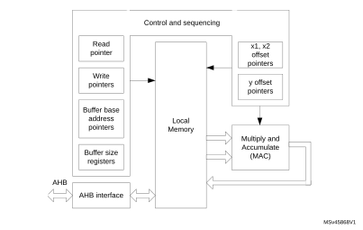

The unit is built around a fixed point multiplier and accumulator (MAC). The MAC can take two 16-bit input signed values from memory, multiply them together and add them to the contents of the accumulator. The address of the input values in memory is determined using a set of pointers. These pointers can be loaded, incremented, decremented or reset by the internal hardware. The pointer and MAC operations are controlled by a built-in sequencer in order to execute the requested operation.

To calculate a dot product, the two input vectors are loaded into the local memory by the processor or DMA controller, and the requested operation is selected and started. Each pair of input vector elements is fetched from memory, multiplied together and accumulated. When all the vector elements have been processed, the contents of the accumulator are stored in the local memory, from where they can be read out by the processor or DMA.

The finite impulse response (FIR) filter operation (also known as convolution) consists in repeatedly calculating the dot product of the coefficient vector and a vector of input samples, the latter being shifted by one sample delay, with the least recent sample being discarded and a new sample added, at each repetition.

The infinite impulse response (IIR) filter operation is the convolution of the feedback coefficients with the previous output samples, added to the result of the FIR convolution.

A more detailed description of the filter operations is given in [Section 18.3.6: Filter functions](#XREF_73115__1_3_4_Filter_Functions14).

### 18.3.2 Local memory and buffers

The unit contains a 256 x 16-bit read/write memory which is used for local storage:

- Input values (the elements of the input vectors) are stored in two buffers, X1 and X2.
- Output values (the results of the operations) are stored in another buffer, Y.
- The locations and sizes of the buffers are designated as follows:
 - x1\_base: the base address of the X1 buffer
 - x2\_base: the base address of the X2 buffer
 - y\_base: the base address of the Y buffer
 - x1\_buf\_size: the number of 16-bit addresses allocated to the X1 buffer
 - x2\_buf\_size: the number of 16-bit addresses allocated to the X2 buffer
 - y\_buf\_size: the number of 16-bit addresses allocated to the Y buffer.

These parameters are programmed in the corresponding registers when configuring the unit.

The CPU (or DMA controller) can initialize the contents of each buffer using the Initialization functions ([Section 18.3.5: Initialization functions](#XREF_90953__1_3_3_Initialisation_functions14)) and writing to the write data register. The data is transferred to the location within the target buffer indicated by a write pointer. After each new write, the write pointer is incremented. When the write pointer reaches the end of the allocated buffer space, it wraps back to the base address. This feature is used to load the elements of a vector prior to an operation, or to initialize a filter and load filter coefficients.

#### Buffer configuration

The buffer sizes and base address offsets must be configured in the X1, X2 and Y buffer configuration registers. For each function, the required buffer size is specified in the function description in [Section 18.3.6: Filter functions](#XREF_73115__1_3_4_Filter_Functions14). The base addresses can be chosen anywhere in internal memory, provided that all buffers fit within the internal memory address range (0x00 to 0xFF), that is, base address + buffer size must be less than 256.

There is no constraint on the size and location of the buffers (they can overlap or even coincide exactly). For filter functions it is recommended not to overlap buffers as this can lead to erroneous behavior.

When circular buffer operation is required, an optional “headroom”, d, can be added to the buffer size. Furthermore, a watermark level can be set, to regulate the CPU or DMA activity. The value of d and the watermark level must be chosen according to the application performance requirements. For maximum throughput, the input buffer must never go empty, so d must be somewhat greater than the watermark level, allowing for any interrupt or DMA latency. On the other hand, if the input data can not be provided as fast as the unit can process them, the buffer can be allowed to empty waiting for the next data to be written, so d can be equal to the watermark level (to ensure that no overflow occurs on the input).

### 18.3.3 Input buffers

The X1 and X2 buffers are used to store data for input to the MAC. Each multiplication takes a value from the X1 buffer and a value from the X2 buffer and multiplies them together. A pointer in the control unit generates the read address offset (relative to the buffer base address) for each value. The pointers are managed by hardware according to the current function.

#### Figure 42. 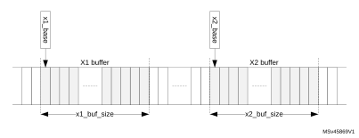Input buffer areas

The X1 buffer can be used as a circular buffer, in which case new data are continually transferred into the input buffer whenever space is available. Pre-loading this buffer is optional for digital filters, since if no input samples have been written in the buffer when the operation is started, it is flagged as empty, which triggers the CPU or DMA to load new samples until there are enough to begin operation. Pre-loading is nevertheless useful in the case of a vector operation, that is, the input data is already available in system memory and circular operation is not required.

#### Figure 43. 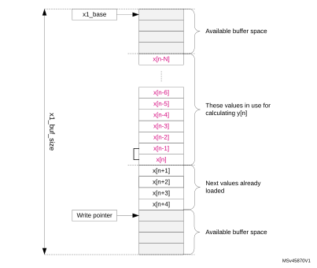Circular input buffer

The X2 buffer can only be used in vector mode (that is not circular), and needs to be pre-loaded, except if the contents of the buffer do not change from one operation to the next. For filter functions, the X2 buffer is used to store the filter coefficients.

When operating as a circular buffer, the space allocated to the buffer (x1\_buf\_size) must generally be bigger than the number of elements in use for the current calculation, so that there are always new values available in the buffer. [Figure 43](#XREF_69020__Figure_3__Circular_buffer14) illustrates the layout of the buffer for a filter operation. While calculating an output sample y[n], the unit uses a set of N+1 input samples, x[n-N] to x[n]. When this is finished, the unit starts the calculation of y[n+1], using the set of input samples x[n-N+1] to x[n+1]. The least-recent input sample, x[n-N], drops out of the input set, and a new sample, x[n+1], is added to it.

The processor, or DMA controller, must ensure that the new sample x[n+1] is available in the buffer space when required. If not, the buffer is flagged as empty, which stalls the execution of the unit until a new sample is added. No underflow condition is signaled on the X1 buffer.

**Note:**

If the flow of samples is controlled by a timer or other peripheral such as an ADC, the buffer regularly goes empty, since the filter processes each new sample faster than the source can provide it. This is an essential feature of filter operation.

If the number of free spaces in the buffer is less than the watermark threshold programmed in the FULL\_WM bitfield of the FMAC\_X1BUFCFG register, the buffer is flagged as full. As long as the full flag is not set, interrupts are generated, if enabled, to request more data for the buffer. The watermark allows several data to be transferred under one interrupt, without danger of overflow. Nevertheless, if an overflow does occur, the OVFL error flag is set and the write data is ignored. The write pointer is not incremented in the event of an overflow.

The operation of the X1 buffer during a filtering operation is illustrated in [Figure 44](#XREF_45376__Figure_36__Circular_input_buffer_operation14). This example shows an 8-tap FIR filter with a watermark set to four.

#### Figure 44. 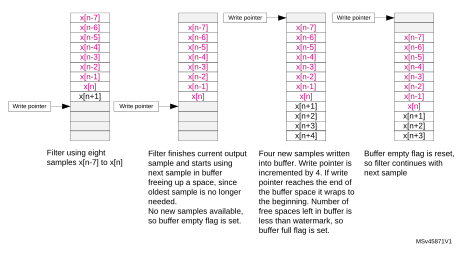Circular input buffer operation

### 18.3.4 Output buffer

The Y (output) buffer is used to store the output of an accumulation. Each new output value is stored in the buffer until it is read by the processor or DMA controller. Each time a read access is made to the read data register, the read data is fetched from the address indicated by the read pointer. This pointer is incremented after each read, and wraps back to the base address when it reaches the end of the allocated Y buffer space.

#### Figure 45. 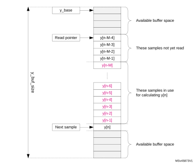Circular output buffer

The Y buffer can also operate as a circular buffer. If the address for the next output value is the same as that indicated by the read pointer (an unread sample), then the buffer is flagged as full and execution stalled until the sample is read.

In the case of IIR filters, the Y buffer is used to store the set of M previous output samples, y[n-M] to y[n-1], used for calculating the next output sample y[n]. Each time a new sample is added to the set, the least recent sample y[n-M] drops out.

If the number of unread data in the buffer is less than the watermark threshold programmed in the EMPTY\_WM bitfield of the FMAC\_YBUFCFG register, the buffer is flagged as empty. As long as the empty flag is not set, interrupts or DMA requests are generated, if enabled, to request reads from the buffer. The watermark allows several data to be transferred under one interrupt, without danger of underflow. Nevertheless, if an underflow does occur, the UNFL error flag is set. In this case, the read pointer is not incremented and the read operation returns the content of the memory at the read pointer address.

The operation of the Y buffer in circular mode is illustrated in [Figure 46](#XREF_36496__Figure_6__Circular_output_buffer_operation14). This example shows a 7-tap IIR filter with a watermark set to four.

#### Figure 46. 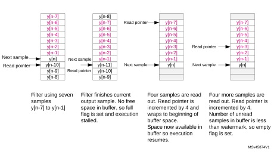Circular output buffer operation

### 18.3.5 Initialization functions

The following functions initialize the FMAC unit. They are triggered by writing the appropriate value in the FUNC bitfield of the FMAC\_PARAM register, with the START bit set. The P and Q bitfields must also contain the appropriate parameter values for each function as detailed below. The R bitfield is not used. When the function completes, the START bit is automatically reset by hardware.

During initialization, it is recommended that the DMA requests and interrupts be disabled. The transfer of data into the FMAC memory can be done by software or by memory-to-memory DMA transfers, since no flow control is required.

#### Load X1 buffer

This function pre-loads the X1 buffer with N values, starting from the address in X1\_BASE. Successive writes to the FMAC\_WDATA register load the write data into the X1 buffer and increment the write address. The write pointer points to the address X1\_BASE + N when the function completes.

The function can be used to pre-load the buffer with the elements of a vector, or to initialize the input storage elements of a filter.

Parameters

- The parameter P contains the number of values, N, to be loaded into the X1 buffer.
- The parameters Q and R are not used.

The function completes when N writes have been performed to the FMAC\_WDATA register.

#### Load X2 buffer

This function pre-loads the X2 buffer with N + M values, starting from the address in X2\_BASE. Successive writes to the FMAC\_WDATA register load the write data into the X2 buffer and increment the write address.

The function can be used to pre-load the buffer with the elements of a vector, or the coefficients of a filter. In the case of an IIR, the N feed-forward and M feed-back coefficients are concatenated and loaded together into the X2 buffer. The total number of coefficients is equal to N + M. For an FIR, there are no feedback coefficients, so M = 0.

Parameters

- The parameter P contains the number of values, N, to be loaded into the X2 buffer starting from address X2\_BASE.
- The parameter Q contains the number of values, M, to be loaded into the X2 buffer starting from address X2\_BASE + N.
- The parameter R is not used.

The function completes when N + M writes have been performed to the FMAC\_WDATA register.

#### Load Y buffer

This function pre-loads the Y buffer with N values, starting from the address in Y\_BASE. Successive writes to the FMAC\_WDATA register load the write data into the Y buffer and increment the write address. The read pointer points to the address Y\_BASE + N when the function completes.

The function can be used to pre-load the feedback storage elements of an IIR filter.

Parameters

- The parameter P contains the number of values to be loaded into the Y buffer.
- The parameters Q and R are not used.

The function completes when N writes have been performed to the FMAC\_WDATA register.

### 18.3.6 Filter functions

The following filter functions are supported by the FMAC unit. These functions are triggered by writing the corresponding value in the FUNC bitfield of the FMAC\_PARAM register with the START bit set. The P, Q and R bitfields must also contain the appropriate parameter values for each function as detailed below. The filter functions continue to run until the START bit is reset by software.

#### Convolution (FIR filter)

Y = B\*X

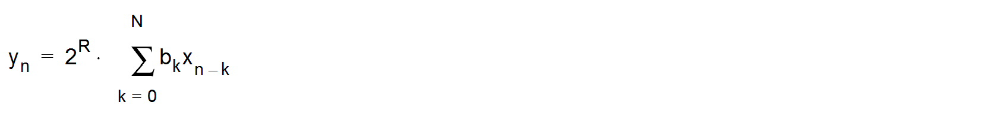

This function performs a convolution of a vector B of length N+1 and a vector X of indefinite length. The elements of Y for incrementing values of n are calculated as the dot product,   
yn = B.Xn, where Xn = [xn-N,...,xn] is composed of the N+1 elements of X at indexes n - N to n.

This function corresponds to a finite impulse response (FIR) filter, where vector B contains the filter coefficients and vector X the sampled data.

The structure of the filter (direct form) is shown in [Figure 47](#XREF_55428__Figure_7__FIR_filter_structure14).

#### Figure 47. 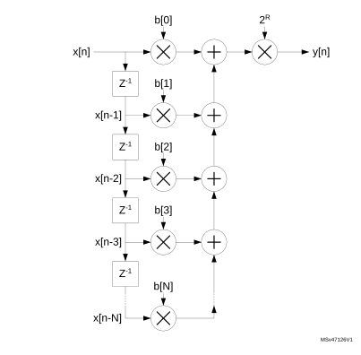FIR filter structure

Note that the cross correlation vector can be calculated by reversing the order of the coefficient vector B.

Input:

- X1 buffer contains the elements of vector X. It is a circular buffer of length N + 1 + d.
- X2 buffer contains the elements of vector B. It is a fixed buffer of length N + 1.

Output:

- Y buffer contains the output values, yn. It is a circular buffer of length d.

Parameters:

- The parameter P contains the length, N+1, of the coefficient vector B in the range   
  [2:127].
- The parameter R contains the gain to be applied to the accumulator output. The value output to the Y buffer is multiplied by 2R, where R is in the range [0:7]
- The parameter Q is not used.

The function completes when the START bit in the FMAC\_PARAM register is reset by software.

#### IIR filter

Y = B\*X+A\*Y’

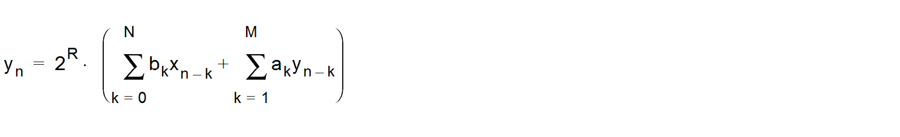

This function implements an infinite impulse response (IIR) filter. The filter output vector Y is the convolution of a coefficient vector B of length N+1 and a vector X of indefinite length, plus the convolution of the delayed output vector Y’ with a second coefficient vector A, of length M. The elements of Y for incrementing values of n are calculated as yn = B.Xn + A.Yn-1, where Xn = [xn-N,...,xn] comprises the N+1 elements of X at indexes n - N to n, while Yn-1 = [yn-M,...,yn-1] comprises the M elements of Y at indexes n - M to n - 1. The structure of the filter (direct form 1) is shown in [Figure 48](#XREF_95244__Figure_8__IIR_filter_structure14).

#### Figure 48. 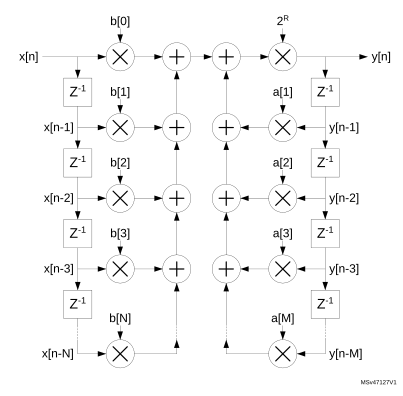IIR filter structure (direct form 1)

#### Input:

- X1 buffer contains the elements of vector X. It is a circular buffer of length N + 1+ d.
- X2 buffer contains the elements of coefficient vectors B and A concatenated   
  (b0, b1, b2..., bN, a1, a2, ..., aM). It is a fixed buffer of length M+N+1.

#### Output:

- Y buffer contains the output values, yn. It is a circular buffer of length M + d.

#### Parameters

- The parameter P contains the length, N + 1, of the coefficient vector B in the range   
  [2:64].
- The parameter Q contains the length, M, of the coefficient vector A in the range [1:63].
- The parameter R contains the gain to be applied to the accumulator output. The value output to the Y buffer is multiplied by 2R, where R is in the range [0:7].

The function completes when the START bit in the FMAC\_PARAM register is reset by software.

### 18.3.7 Fixed point representation

The FMAC operates in fixed point signed integer format. Input and output values are q1.15.

In q1.15 format, numbers are represented by one sign bit and 15 fractional bits (binary decimal places). The numeric range is therefore -1 (0x8000) to 1 - 2-15 (0x7FFF).

The accumulator has 26 bits, of which 22 are fractional and 4 are integer/sign (q4.22). This allows it to support partial accumulation sums in the range -8 (0x2000000) to +7.99999976 (0x1FFFFFF). A programmable gain from 0dB to 42dB in steps of 6dB can be applied at the output of the accumulator.

Note that the content of the accumulator is not saturated if the numeric range is exceeded. Partial sums whose value is greater than +7.99999976 or less than -8, wrap but this is harmless provided subsequent accumulations undo the wrapping. Nevertheless, the SAT flag in the FMAC\_SR register is set if wrapping occurs, and generates an interrupt if the SATIEN bit is set in the FMAC\_CR register. This helps in debugging the filter.

The data output by the accumulator can optionally be saturated, after application of the programmable gain, by setting the CLIPEN bit in the FMAC\_CR register. If this bit is set, then any value which exceeds the numeric range of the q1.15 output, is set to 1 - 2-15 or -1, according to the sign. If clipping is not enabled, the unused accumulator bits after applying the gain is simply truncated.

### 18.3.8 Implementing FIR filters with the FMAC

The FMAC supports FIR filters of length N, where N is the number of taps or coefficients. The minimum local memory requirement for a FIR filter of length N is 2N + 1:

 - N coefficients
 - N input samples
 - 1 output sample

Since the local memory size is 256, the maximum value for N is 127.

If maximum throughput is required, it may be necessary to allocate a small amount of extra space, d1 and d2, to the input and output sample buffers respectively, to ensure that the filter never stalls waiting for a new input sample, or waiting for the output sample to be read. In this case, the local memory requirement is 2N + d1 + d2.

The buffers must be configured as follows:

- X1\_BUF\_SIZE = N + d1;
- X2\_BUF\_SIZE = N;
- Y\_BUF\_SIZE = d2 (or 1 if no extra space is required)

The buffer base addresses can be allocated anywhere, but the X2 buffer must not overlap with the others, or else the coefficients are overwritten. An example configuration is:

- X2\_BASE = 0;
- X1\_BASE = N;
- Y\_BASE = 2N + d1

However, if the memory space is limited, the X1 and Y buffer areas can be overlapped, such that each output sample takes the place of the oldest input sample, which is no longer required:

- X2\_BASE = 0;
- X1\_BASE = N;
- Y\_BASE = N

In this case, Y\_BUF\_SIZE = X1\_BUF\_SIZE = N + d1, so that the buffers remain in sync.

**Note:**

The FULL\_WM bitfield of X1 buffer configuration register must be programmed with a value less than or equal to log2(d1), otherwise the buffer is flagged full before N input samples have been written, and no more samples are requested. Similarly, the EMPTY\_WM bitfield of the Y buffer configuration register must be less than or equal to log2(d2).

The filter coefficients must be pre-loaded into the X2 buffer, using the Load X2 Buffer function. The X1 buffer can optionally be pre-loaded with any number of samples up to a maximum of N. There is no point in pre-loading the Y buffer, since for the FIR filter there is no feedback path.

After configuring and initializing the buffers, the FMAC\_CR register must be programmed according to the method used for writing and reading data to and from the FMAC memory.

Three methods are supported:

- Polling: No DMA request or Interrupt request is generated. Software must check that the X1\_FULL flag is low before writing to WDATA, or that the Y\_EMPTY flag is low before reading from RDATA.
- Interrupt: The interrupt request is asserted while the X1\_FULL flag is low, for writes, or when the Y\_EMPTY flag is low, for reads.
- DMA: DMA requests are asserted on the DMA write channel while the X1\_FULL flag is low, and on the read channel while the Y\_EMPTY flag is low.

Different methods can be used for read and for write. However it is not recommended to use both interrupts and DMA requests for the same operation[^a]. The valid combinations are listed in [Table 120](#XREF_62720__Table_173__Valid_conbinations_for_read_and_write_methods%1114).

 

<table class="TableTitle"><caption class="TableCap"><h4 class="TableCap" id="2681192" style="margin-left : 0.00pt;text-align:center;">Table 120. <a id="methods%1114" name="XREF_62720__Table_173__Valid_conbinations_for_read_and_write_methods%1114">Valid combinations for read and write methods</a></h4></caption><col width="89.76px"/><col width="89.76px"/><col width="89.76px"/><col width="89.76px"/><col width="89.76px"/><col width="89.76px"/><thead><tr height="28.00px"><th>
WIEN
</th><th>
RIEN
</th><th>
DMAWEN
</th><th>
DMAREN
</th><th>
Write 
</th><th>
Read
</th></tr></thead><tr height="22.67px"><td>
0
</td><td>
0
</td><td>
0
</td><td>
0
</td><td>
Polling
</td><td>
Polling
</td></tr><tr height="22.67px"><td>
0
</td><td>
1
</td><td>
0
</td><td>
0
</td><td>
Polling
</td><td>
Interrupt
</td></tr><tr height="22.67px"><td>
1
</td><td>
0
</td><td>
0
</td><td>
0
</td><td>
Interrupt
</td><td>
Polling
</td></tr><tr height="22.67px"><td>
1
</td><td>
1
</td><td>
0
</td><td>
0
</td><td>
Interrupt
</td><td>
Interrupt
</td></tr><tr height="22.67px"><td>
0
</td><td>
0
</td><td>
0
</td><td>
1
</td><td>
Polling
</td><td>
DMA
</td></tr><tr height="22.67px"><td>
0
</td><td>
0
</td><td>
1
</td><td>
0
</td><td>
DMA
</td><td>
Polling
</td></tr><tr height="22.67px"><td>
0
</td><td>
0
</td><td>
1
</td><td>
1
</td><td>
DMA
</td><td>
DMA
</td></tr><tr height="22.67px"><td>
0
</td><td>
1
</td><td>
1
</td><td>
0
</td><td>
DMA
</td><td>
Interrupt
</td></tr><tr height="22.67px"><td>
1
</td><td>
0
</td><td>
0
</td><td>
1
</td><td>
Interrupt
</td><td>
DMA
</td></tr></table>

The filter is started by writing to the FMAC\_PARAM register with the following bitfield values:

- FUNC = 8 (FIR filter);
- P = N (number of coefficients);
- Q = “Don’t care”;
- R = Gain;
- START = 1;

If less than N + d - 2FULL\_WM values have been pre-loaded in the X1 buffer, the X1FULL flag remains low. If the WIEN bit is set in the FMAC\_CR register, then the interrupt request is asserted immediately to request the processor to write 2FULL\_WM additional samples into the buffer, via the FMAC\_WDATA register. It remains asserted until the X1FULL flag goes high in the FMAC\_SR register. The interrupt service routine must check the X1FULL flag after every 2FULL\_WM writes to the FMAC\_WDATA register, and repeat the transfer until the flag goes high. Similarly, if the DMAWEN bit is set in the FMAC\_CR register, DMA write channel requests are generated until the X1FULL flag goes high.

The filter calculates the first output sample when at least N samples have been written into the X1 buffer (including any pre-loaded samples).

When 2EMPTY\_WM output samples have been written into the Y buffer, the YEMPTY flag in the FMAC\_SR register goes low. If the RIEN bit is set in the FMAC\_CR register, the interrupt request is asserted to request the processor to read 2EMPTY\_WM samples from the buffer, via the FMAC\_RDATA register. It remains asserted until the YEMPTY flag goes high. The interrupt service routine must check the YEMPTY flag after every 2EMPTY\_WM reads from the FMAC\_RDATA register, and repeat the transfer until the flag goes high. If the DMAREN bit is set in the FMAC\_CR, DMA read channel requests are generated until the YEMPTY flag goes high.

The filter continues to operate in this fashion until it is stopped by the software resetting the START bit.

### 18.3.9 Implementing IIR filters with the FMAC

The FMAC supports IIR filters of length N, where N is the number of feed-forward taps or coefficients. The number of feedback coefficients, M, can be any value from 1 to N-1. Only direct form 1 implementations can be realized, so filters designed for other forms need to be converted.

The minimum memory requirement for an IIR filter with N feed-forward coefficients and M feed-back coefficients is 2N + 2M:

- N + M coefficients
- N input samples
- M output samples

If M = N-1, then the maximum filter length that can be implemented is N = 64.

As for the FIR, for maximum throughput, a small amount of additional space, d1 and d2, is allowed in the input and output buffer size respectively, making the total memory requirement 2M + 2N + d1 + d2.

The buffers must be configured as follows:

- X1\_BUF\_SIZE = N + d1;
- X2\_BUF\_SIZE = N + M;
- Y\_BUF\_SIZE = M + d2;

The buffer base addresses can be allocated anywhere, but must not overlap. An example configuration is given below:

- X2\_BASE = 0;
- X1\_BASE = N + M;
- Y\_BASE = 2N + M + d1;

**Note:**

The FULL\_WM bitfield of X1 buffer configuration register must be programmed with a value less than or equal to log2(d1), otherwise the buffer is flagged full before N input samples have been written, and no more samples are requested. Similarly, the EMPTY\_WM bitfield of the Y buffer configuration register must be less than or equal to log2(d2).

The filter coefficients (N feed-forward followed by M feedback) must be pre-loaded into the X2 buffer, using the Load X2 Buffer function. The X1 buffer can optionally be pre-loaded with any number of samples up to a maximum of N. The Y buffer can optionally be pre-loaded with any number of values up to a maximum of M. This has the effect of initializing the feedback delay line.

After configuring the buffers, the FMAC\_CR register must be programmed in the same way as for the FIR filter (see [Section 18.3.8: Implementing FIR filters with the FMAC](#XREF_99853__25_3_8_Implementing_FIR_filters_with_the_FMAC14)).

The filter is started by writing to the FMAC\_PARAM register with the following bitfield values:

- FUNC = 9 (IIR filter);
- P = N (number of feed-forward coefficients);
- Q = M (number of feed-back coefficients);
- R = Gain;
- START = 1;

If less than N + d - 2FULL\_WM values have been pre-loaded in the X1 buffer, the X1FULL flag remains low. If the WIEN bit is set in the FMAC\_CR register, then the interrupt request is asserted immediately to request the processor to write 2FULL\_WM additional samples into the buffer, via the FMAC\_WDATA register. It remains asserted until the X1FULL flag goes high in the FMAC\_SR register. The interrupt service routine must check the X1FULL flag after every 2FULL\_WM writes to the FMAC\_WDATA register, and repeat the transfer until the flag goes high. Similarly, if the DMAWEN bit is set in the FMAC\_CR register, DMA write channel requests are generated until the X1FULL flag goes high.

The filter calculates the first output sample when at least N samples have been written into the X1 buffer (including any pre-loaded samples). The first sample is calculated using the first N samples in the X1 buffer, and the first M samples in the Y buffer (whether or not they are preloaded. The first output sample is written into the Y buffer at Y\_BASE + M.

When 2EMPTY\_WM new output samples have been written into the Y buffer, the YEMPTY flag in the FMAC\_SR register goes low. If the RIEN bit is set in the FMAC\_CR register, the interrupt request is asserted to request the processor to read 2EMPTY\_WM samples from the buffer, via the FMAC\_RDATA register. It remains asserted until the YEMPTY flag goes high. The interrupt service routine must check the YEMPTY flag after every 2EMPTY\_WM reads from the FMAC\_RDATA register, and repeat the transfer until the flag goes high. If the DMAREN bit is set in the FMAC\_CR, DMA read channel requests are generated until the YEMPTY flag goes high

The filter continues to operate in this fashion until it is stopped by the software resetting the START bit.

### 18.3.10 Examples of filter initialization

#### Figure 49. X1 buffer initialization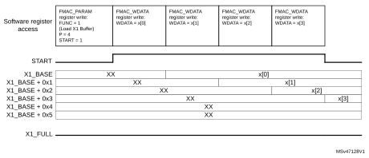

The example in [Figure 49](#XREF_40559__Figure_9__X1_buffer_initialisation14) illustrates an X1 buffer pre-load with four samples (P = 4). The buffer size is six (X1\_BUF\_SIZE = 6). The initialization is launched by programming the FMAC\_PARAM register with the START bit set. The four samples are then written to FMAC\_WDATA, and transferred into local memory from X1\_BASE onwards. The START bit resets after the fourth sample has been written. At this point, the X1 buffer contains the four samples, in order of writing, and the write pointer (next empty space) is at X1\_BASE + 0x4.

### 18.3.11 Examples of filter operation

#### Figure 50. 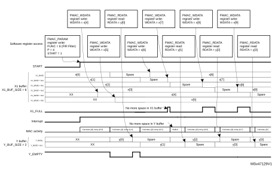Filtering example 1

The example in [Figure 50](#XREF_20833__Figure_10__Filtering_example_114) illustrates the beginning of a filter operation. The filter has four taps (P=4). The X1 buffer size is six and the Y buffer size is two. The FULL\_WM and EMPTY\_WM bitfields are both set to 0. Prior to starting the filter, the X1 buffer has been pre-loaded with four samples, x[0:3] as in [Figure 49](#XREF_40559__Figure_9__X1_buffer_initialisation14). So the filter starts calculating the first output sample, y[0], immediately after the START bit is set. Since the X1FULL flag is not set (due to two uninitialized spaces in the X1 buffer), the interrupt is asserted straight away, to request new data. The processor writes two new samples, x[4] and x[5], to the FMAC\_WDATA register, which are transferred to the empty locations in the X1 buffer.

In the mean time, the FMAC finishes calculating the first output sample, y[0], and writes it into the Y buffer, causing the Y\_EMPTY flag to go low. At the same time, the x[0] sample is discarded, as it is no longer required, freeing up its location in memory (at X1\_BASE). The FMAC can immediately start work on the second output sample, y[1], since all the required input samples x[1:5] are present in the X1 buffer.

Since the Y\_EMPTY flag is low, the interrupt remains active after the processor finishes writing x[5]. The processor reads y[0] from the FMAC\_RDATA register, freeing up its location in the Y buffer. There are now no samples in the output buffer since y[1] is still being calculated, so the Y\_EMPTY flag goes high. Nevertheless, the interrupt remains active, because there is still free space in the X1 buffer, which the processor next fills with x[6], and so on.

**Note:**

In this example, the processor can fill the input buffer more quickly than the FMAC can process them, so the X1\_full flag regularly goes active. However, it struggles to read the Y buffer fast enough, so the FMAC stalls regularly waiting for space to be freed up in the Y buffer. This means the filter is not executing at maximum throughput. The reason is that the filter length is small and the processor relatively slow, in this example. So increasing the Y buffer size would not help.

#### Figure 51. 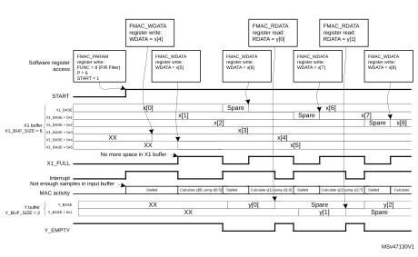Filtering example 2

The example in [Figure 51](#XREF_45646__Figure_11__Filtering_example_214) illustrates the beginning of the same filter operation, but this time the filter has six taps (P=6). The X1 buffer size is six and the Y buffer size is two. The FULL\_WM and EMPTY\_WM bitfields are both set to 0. Prior to starting the filter, the X1 buffer has been pre-loaded with four samples, x[0:3] as in [Figure 49](#XREF_40559__Figure_9__X1_buffer_initialisation14). Because there are not enough samples in the input buffer, the X1FULL flag is not set, so the interrupt is asserted straight away, to request new data. The FMAC is stalled.

The processor writes two new samples, x[4] and x[5], to the FMAC\_WDATA register, which are transferred to the empty locations in the X1 buffer. As soon as there are six unused samples in the X1 buffer, the X1\_FULL flag goes active (since the buffer size is six), causing the interrupt to go inactive. The FMAC starts calculating the first output sample, y[0]. Since this requires all six input samples, there are no free spaces in the X1 buffer and so the X1\_FULL flag remains active. Only when the FMAC finishes calculating y[0] and writes it into the Y buffer, can x[0] be discarded, freeing up a space in the X1 buffer, and deasserting X1\_FULL. At the same time, the Y\_EMPTY flag goes inactive. Both these flag states cause the interrupt to be asserted, requesting the processor to write a new input sample, first of all, and then read the output sample just calculated. The FMAC remains stalled until a new input sample is written.

In this example, the processor has to wait for the FMAC to finish calculating the current output sample, before it can write a new input sample, and therefore the X1 buffer regularly goes empty, stalling the FMAC. This can be avoided by allowing some extra space in the input buffer.

### 18.3.12 Filter design tips

The FMAC architecture imposes some constraints detailed below, on the design of digital filters.

1. Implementation of direct form 2, or transposed forms, is not efficient. Filters which have been designed for such forms must be converted to direct form 1.
2. Cascaded filters must either be combined into a single stage, or implemented as separate filters. In the latter case, multiple sets of filter coefficients can be pre-loaded into the memory, one set per stage, and only the X2\_BASE address changed to select which set is used. The most efficient method of implementing a multi-stage filter is to pre-load a large X1 buffer with input samples, run the IIR filter function on it using the first stage coefficients, and store the output samples back in memory. Then change the X2\_BASE pointer to point to the 2nd stage coefficients, and reload the input buffer with the output of the first stage (with a gain if required), before running the IIR function again. The procedure is repeated for all stages. Once the final stage samples have been transferred back into system memory, the input buffer can be loaded with the next set of input samples, and a new round of calculations started. Note that the N sample input buffer of each stage must be pre-loaded first of all with the N-1 last inputs from the previous round, plus one new sample, in order to keep continuity between each round. Similarly, the output buffer of each stage must be loaded with the last M samples from the previous round, for the same reason.
3. The use of direct form 1 for IIR designs can lead to large positive or negative partial sums in the accumulator, if for example a large step occurs on the input, or some of the filter coefficients’ absolute values are >1. Since the accumulator is limited to 26 bits, the biggest value that it can handle without wrapping (changing sign) is 0x1FFFFFF positive or 0x2000000 negative. This corresponds to 3.99999988 and -4 respectively in q3.23 fixed point format. Wrapping does not represent a problem provided the wrapping is “undone” before the end of the accumulation. However this is not always the case when a filter is starting up and can lead to unexpected results. Consider pre-loading the output buffer with suitable values to avoid this.
4. The IIR filter has feed-forward (numerator) coefficients [b0, b1, ..., bN-1], and feed-back (denominator) coefficients [1, a1, ..., aM]. Many IIR filters require some of the denominator coefficients to have an absolute value greater than 1 to achieve a steep roll-off in the frequency response. Given that the coefficients are coded in fixed point q1.15 format, this is not possible. Nevertheless, by scaling the denominator coefficients by a factor 2-R, such that 2-R.[1, a1, ..., aM] are all less than 1, such filters can be implemented. However an inverse gain of 2R must be applied at the output of the accumulator to compensate the scaling. This has an adverse effect on the signal-to-noise ratio.

## 18.4 FMAC registers

### 18.4.1 FMAC X1 buffer configuration register (FMAC\_X1BUFCFG)

Address offset: 0x00

Reset value: 0x0000 0000

Access: word access

This register can only be modified if START = 0 in the FMAC\_PARAM register.

 

<table class="RegBitMap" style="margin-left:0.00pt;margin-right:0.00pt;margin-top:0.00pt;margin-bottom:10.00pt;border-left-width:0;border-left-style:none;border-left-color:0;border-right-width:0;border-right-style:none;border-right-color:0;border-top-width:0;border-top-style:none;border-top-color:0;border-bottom-width:0;border-bottom-style:none;border-bottom-color:0;direction:inherit;"><col width="37.83px"/><col width="37.83px"/><col width="37.83px"/><col width="37.83px"/><col width="37.83px"/><col width="37.83px"/><col width="40.04px"/><col width="40.04px"/><col width="37.83px"/><col width="37.83px"/><col width="37.83px"/><col width="37.83px"/><col width="37.83px"/><col width="37.83px"/><col width="40.04px"/><col width="40.04px"/><tr height="17.33px" style="background-color:#ffffff;border-bottom-width:0;border-bottom-style:none;border-bottom-color:0;"><td style="padding-left:2.00pt;padding-right:2.00pt;padding-top:4.00pt;padding-bottom:2.00pt;border-bottom-width:0;border-bottom-style:hidden;border-bottom-color:0;">
31
</td><td style="padding-left:2.00pt;padding-right:2.00pt;padding-top:4.00pt;padding-bottom:2.00pt;border-bottom-width:0;border-bottom-style:hidden;border-bottom-color:0;">
30
</td><td style="padding-left:2.00pt;padding-right:2.00pt;padding-top:4.00pt;padding-bottom:2.00pt;border-bottom-width:0;border-bottom-style:hidden;border-bottom-color:0;">
29
</td><td style="padding-left:2.00pt;padding-right:2.00pt;padding-top:4.00pt;padding-bottom:2.00pt;border-bottom-width:0;border-bottom-style:hidden;border-bottom-color:0;">
28
</td><td style="padding-left:2.00pt;padding-right:2.00pt;padding-top:4.00pt;padding-bottom:2.00pt;border-bottom-width:0;border-bottom-style:hidden;border-bottom-color:0;">
27
</td><td style="padding-left:2.00pt;padding-right:2.00pt;padding-top:4.00pt;padding-bottom:2.00pt;border-bottom-width:0;border-bottom-style:hidden;border-bottom-color:0;">
26
</td><td style="padding-left:2.00pt;padding-right:2.00pt;padding-top:4.00pt;padding-bottom:2.00pt;border-bottom-width:0;border-bottom-style:hidden;border-bottom-color:0;">
25
</td><td style="padding-left:2.00pt;padding-right:2.00pt;padding-top:4.00pt;padding-bottom:2.00pt;border-bottom-width:0;border-bottom-style:hidden;border-bottom-color:0;">
24
</td><td style="padding-left:2.00pt;padding-right:2.00pt;padding-top:4.00pt;padding-bottom:2.00pt;border-bottom-width:0;border-bottom-style:hidden;border-bottom-color:0;">
23
</td><td style="padding-left:2.00pt;padding-right:2.00pt;padding-top:4.00pt;padding-bottom:2.00pt;border-bottom-width:0;border-bottom-style:hidden;border-bottom-color:0;">
22
</td><td style="padding-left:2.00pt;padding-right:2.00pt;padding-top:4.00pt;padding-bottom:2.00pt;border-bottom-width:0;border-bottom-style:hidden;border-bottom-color:0;">
21
</td><td style="padding-left:2.00pt;padding-right:2.00pt;padding-top:4.00pt;padding-bottom:2.00pt;border-bottom-width:0;border-bottom-style:hidden;border-bottom-color:0;">
20
</td><td style="padding-left:2.00pt;padding-right:2.00pt;padding-top:4.00pt;padding-bottom:2.00pt;border-bottom-width:0;border-bottom-style:hidden;border-bottom-color:0;">
19
</td><td style="padding-left:2.00pt;padding-right:2.00pt;padding-top:4.00pt;padding-bottom:2.00pt;border-bottom-width:0;border-bottom-style:hidden;border-bottom-color:0;">
18
</td><td style="padding-left:2.00pt;padding-right:2.00pt;padding-top:4.00pt;padding-bottom:2.00pt;border-bottom-width:0;border-bottom-style:hidden;border-bottom-color:0;">
17
</td><td style="padding-left:2.00pt;padding-right:2.00pt;padding-top:4.00pt;padding-bottom:2.00pt;border-bottom-width:0;border-bottom-style:hidden;border-bottom-color:0;">
16
</td></tr><tr height="17.33px" style="background-color:#ffffff;border-bottom-width:0;border-bottom-style:none;border-bottom-color:0;"><td style="padding-left:2.00pt;padding-right:2.00pt;padding-top:4.00pt;padding-bottom:2.00pt;border-left-width:0.5pt;border-left-style:solid;border-left-color:#000000;border-bottom-width:0.5pt;border-bottom-style:solid;border-bottom-color:#000000;border-right-width:0.5pt;border-right-style:solid;border-right-color:#000000;border-top-width:0.5pt;border-top-style:solid;border-top-color:#000000;">
Res.
</td><td style="padding-left:2.00pt;padding-right:2.00pt;padding-top:4.00pt;padding-bottom:2.00pt;border-left-width:0.5pt;border-left-style:solid;border-left-color:#000000;border-bottom-width:0.5pt;border-bottom-style:solid;border-bottom-color:#000000;border-right-width:0.5pt;border-right-style:solid;border-right-color:#000000;border-top-width:0.5pt;border-top-style:solid;border-top-color:#000000;">
Res.
</td><td style="padding-left:2.00pt;padding-right:2.00pt;padding-top:4.00pt;padding-bottom:2.00pt;border-left-width:0.5pt;border-left-style:solid;border-left-color:#000000;border-bottom-width:0.5pt;border-bottom-style:solid;border-bottom-color:#000000;border-right-width:0.5pt;border-right-style:solid;border-right-color:#000000;border-top-width:0.5pt;border-top-style:solid;border-top-color:#000000;">
Res.
</td><td style="padding-left:2.00pt;padding-right:2.00pt;padding-top:4.00pt;padding-bottom:2.00pt;border-left-width:0.5pt;border-left-style:solid;border-left-color:#000000;border-bottom-width:0.5pt;border-bottom-style:solid;border-bottom-color:#000000;border-right-width:0.5pt;border-right-style:solid;border-right-color:#000000;border-top-width:0.5pt;border-top-style:solid;border-top-color:#000000;">
Res.
</td><td style="padding-left:2.00pt;padding-right:2.00pt;padding-top:4.00pt;padding-bottom:2.00pt;border-left-width:0.5pt;border-left-style:solid;border-left-color:#000000;border-bottom-width:0.5pt;border-bottom-style:solid;border-bottom-color:#000000;border-right-width:0.5pt;border-right-style:solid;border-right-color:#000000;border-top-width:0.5pt;border-top-style:solid;border-top-color:#000000;">
Res.
</td><td style="padding-left:2.00pt;padding-right:2.00pt;padding-top:4.00pt;padding-bottom:2.00pt;border-left-width:0.5pt;border-left-style:solid;border-left-color:#000000;border-bottom-width:0.5pt;border-bottom-style:solid;border-bottom-color:#000000;border-right-width:0.5pt;border-right-style:solid;border-right-color:#000000;border-top-width:0.5pt;border-top-style:solid;border-top-color:#000000;">
Res.
</td><td colspan="2" style="padding-left:2.00pt;padding-right:2.00pt;padding-top:4.00pt;padding-bottom:2.00pt;border-left-width:0.5pt;border-left-style:solid;border-left-color:#000000;border-bottom-width:0.5pt;border-bottom-style:solid;border-bottom-color:#000000;border-right-width:0.5pt;border-right-style:solid;border-right-color:#000000;border-top-width:0.5pt;border-top-style:solid;border-top-color:#000000;">
FULL_WM[1:0]
</td><td style="padding-left:2.00pt;padding-right:2.00pt;padding-top:4.00pt;padding-bottom:2.00pt;border-left-width:0.5pt;border-left-style:solid;border-left-color:#000000;border-bottom-width:0.5pt;border-bottom-style:solid;border-bottom-color:#000000;border-right-width:0.5pt;border-right-style:solid;border-right-color:#000000;border-top-width:0.5pt;border-top-style:solid;border-top-color:#000000;">
Res.
</td><td style="padding-left:2.00pt;padding-right:2.00pt;padding-top:4.00pt;padding-bottom:2.00pt;border-left-width:0.5pt;border-left-style:solid;border-left-color:#000000;border-bottom-width:0.5pt;border-bottom-style:solid;border-bottom-color:#000000;border-right-width:0.5pt;border-right-style:solid;border-right-color:#000000;border-top-width:0.5pt;border-top-style:solid;border-top-color:#000000;">
Res.
</td><td style="padding-left:2.00pt;padding-right:2.00pt;padding-top:4.00pt;padding-bottom:2.00pt;border-left-width:0.5pt;border-left-style:solid;border-left-color:#000000;border-bottom-width:0.5pt;border-bottom-style:solid;border-bottom-color:#000000;border-right-width:0.5pt;border-right-style:solid;border-right-color:#000000;border-top-width:0.5pt;border-top-style:solid;border-top-color:#000000;">
Res.
</td><td style="padding-left:2.00pt;padding-right:2.00pt;padding-top:4.00pt;padding-bottom:2.00pt;border-left-width:0.5pt;border-left-style:solid;border-left-color:#000000;border-bottom-width:0.5pt;border-bottom-style:solid;border-bottom-color:#000000;border-right-width:0.5pt;border-right-style:solid;border-right-color:#000000;border-top-width:0.5pt;border-top-style:solid;border-top-color:#000000;">
Res.
</td><td style="padding-left:2.00pt;padding-right:2.00pt;padding-top:4.00pt;padding-bottom:2.00pt;border-left-width:0.5pt;border-left-style:solid;border-left-color:#000000;border-bottom-width:0.5pt;border-bottom-style:solid;border-bottom-color:#000000;border-right-width:0.5pt;border-right-style:solid;border-right-color:#000000;border-top-width:0.5pt;border-top-style:solid;border-top-color:#000000;">
Res.
</td><td style="padding-left:2.00pt;padding-right:2.00pt;padding-top:4.00pt;padding-bottom:2.00pt;border-left-width:0.5pt;border-left-style:solid;border-left-color:#000000;border-bottom-width:0.5pt;border-bottom-style:solid;border-bottom-color:#000000;border-right-width:0.5pt;border-right-style:solid;border-right-color:#000000;border-top-width:0.5pt;border-top-style:solid;border-top-color:#000000;">
Res.
</td><td style="padding-left:2.00pt;padding-right:2.00pt;padding-top:4.00pt;padding-bottom:2.00pt;border-left-width:0.5pt;border-left-style:solid;border-left-color:#000000;border-bottom-width:0.5pt;border-bottom-style:solid;border-bottom-color:#000000;border-right-width:0.5pt;border-right-style:solid;border-right-color:#000000;border-top-width:0.5pt;border-top-style:solid;border-top-color:#000000;">
Res.
</td><td style="padding-left:2.00pt;padding-right:2.00pt;padding-top:4.00pt;padding-bottom:2.00pt;border-left-width:0.5pt;border-left-style:solid;border-left-color:#000000;border-bottom-width:0.5pt;border-bottom-style:solid;border-bottom-color:#000000;border-right-width:0.5pt;border-right-style:solid;border-right-color:#000000;border-top-width:0.5pt;border-top-style:solid;border-top-color:#000000;">
Res.
</td></tr><tr height="17.33px" style="background-color:#ffffff;border-bottom-width:0;border-bottom-style:none;border-bottom-color:0;"><td style="padding-left:2.00pt;padding-right:2.00pt;padding-top:4.00pt;padding-bottom:2.00pt;border-left-width:0.5pt;border-left-style:solid;border-left-color:#000000;border-bottom-width:0.5pt;border-bottom-style:solid;border-bottom-color:#000000;border-right-width:0.5pt;border-right-style:solid;border-right-color:#000000;border-top-width:0.5pt;border-top-style:solid;border-top-color:#000000;"></td><td style="padding-left:2.00pt;padding-right:2.00pt;padding-top:4.00pt;padding-bottom:2.00pt;border-left-width:0.5pt;border-left-style:solid;border-left-color:#000000;border-bottom-width:0.5pt;border-bottom-style:solid;border-bottom-color:#000000;border-right-width:0.5pt;border-right-style:solid;border-right-color:#000000;border-top-width:0.5pt;border-top-style:solid;border-top-color:#000000;"></td><td style="padding-left:2.00pt;padding-right:2.00pt;padding-top:4.00pt;padding-bottom:2.00pt;border-left-width:0.5pt;border-left-style:solid;border-left-color:#000000;border-bottom-width:0.5pt;border-bottom-style:solid;border-bottom-color:#000000;border-right-width:0.5pt;border-right-style:solid;border-right-color:#000000;border-top-width:0.5pt;border-top-style:solid;border-top-color:#000000;"></td><td style="padding-left:2.00pt;padding-right:2.00pt;padding-top:4.00pt;padding-bottom:2.00pt;border-left-width:0.5pt;border-left-style:solid;border-left-color:#000000;border-bottom-width:0.5pt;border-bottom-style:solid;border-bottom-color:#000000;border-right-width:0.5pt;border-right-style:solid;border-right-color:#000000;border-top-width:0.5pt;border-top-style:solid;border-top-color:#000000;"></td><td style="padding-left:2.00pt;padding-right:2.00pt;padding-top:4.00pt;padding-bottom:2.00pt;border-left-width:0.5pt;border-left-style:solid;border-left-color:#000000;border-bottom-width:0.5pt;border-bottom-style:solid;border-bottom-color:#000000;border-right-width:0.5pt;border-right-style:solid;border-right-color:#000000;border-top-width:0.5pt;border-top-style:solid;border-top-color:#000000;"></td><td style="padding-left:2.00pt;padding-right:2.00pt;padding-top:4.00pt;padding-bottom:2.00pt;border-left-width:0.5pt;border-left-style:solid;border-left-color:#000000;border-bottom-width:0.5pt;border-bottom-style:solid;border-bottom-color:#000000;border-right-width:0.5pt;border-right-style:solid;border-right-color:#000000;border-top-width:0.5pt;border-top-style:solid;border-top-color:#000000;"></td><td style="padding-left:2.00pt;padding-right:2.00pt;padding-top:4.00pt;padding-bottom:2.00pt;border-left-width:0.5pt;border-left-style:solid;border-left-color:#000000;border-bottom-width:0.5pt;border-bottom-style:solid;border-bottom-color:#000000;border-right-width:0.5pt;border-right-style:solid;border-right-color:#000000;border-top-width:0.5pt;border-top-style:solid;border-top-color:#000000;">
rw
</td><td style="padding-left:2.00pt;padding-right:2.00pt;padding-top:4.00pt;padding-bottom:2.00pt;border-left-width:0.5pt;border-left-style:solid;border-left-color:#000000;border-bottom-width:0.5pt;border-bottom-style:solid;border-bottom-color:#000000;border-right-width:0.5pt;border-right-style:solid;border-right-color:#000000;border-top-width:0.5pt;border-top-style:solid;border-top-color:#000000;">
rw
</td><td style="padding-left:2.00pt;padding-right:2.00pt;padding-top:4.00pt;padding-bottom:2.00pt;border-left-width:0.5pt;border-left-style:solid;border-left-color:#000000;border-bottom-width:0.5pt;border-bottom-style:solid;border-bottom-color:#000000;border-right-width:0.5pt;border-right-style:solid;border-right-color:#000000;border-top-width:0.5pt;border-top-style:solid;border-top-color:#000000;"></td><td style="padding-left:2.00pt;padding-right:2.00pt;padding-top:4.00pt;padding-bottom:2.00pt;border-left-width:0.5pt;border-left-style:solid;border-left-color:#000000;border-bottom-width:0.5pt;border-bottom-style:solid;border-bottom-color:#000000;border-right-width:0.5pt;border-right-style:solid;border-right-color:#000000;border-top-width:0.5pt;border-top-style:solid;border-top-color:#000000;"></td><td style="padding-left:2.00pt;padding-right:2.00pt;padding-top:4.00pt;padding-bottom:2.00pt;border-left-width:0.5pt;border-left-style:solid;border-left-color:#000000;border-bottom-width:0.5pt;border-bottom-style:solid;border-bottom-color:#000000;border-right-width:0.5pt;border-right-style:solid;border-right-color:#000000;border-top-width:0.5pt;border-top-style:solid;border-top-color:#000000;"></td><td style="padding-left:2.00pt;padding-right:2.00pt;padding-top:4.00pt;padding-bottom:2.00pt;border-left-width:0.5pt;border-left-style:solid;border-left-color:#000000;border-bottom-width:0.5pt;border-bottom-style:solid;border-bottom-color:#000000;border-right-width:0.5pt;border-right-style:solid;border-right-color:#000000;border-top-width:0.5pt;border-top-style:solid;border-top-color:#000000;"></td><td style="padding-left:2.00pt;padding-right:2.00pt;padding-top:4.00pt;padding-bottom:2.00pt;border-left-width:0.5pt;border-left-style:solid;border-left-color:#000000;border-bottom-width:0.5pt;border-bottom-style:solid;border-bottom-color:#000000;border-right-width:0.5pt;border-right-style:solid;border-right-color:#000000;border-top-width:0.5pt;border-top-style:solid;border-top-color:#000000;"></td><td style="padding-left:2.00pt;padding-right:2.00pt;padding-top:4.00pt;padding-bottom:2.00pt;border-left-width:0.5pt;border-left-style:solid;border-left-color:#000000;border-bottom-width:0.5pt;border-bottom-style:solid;border-bottom-color:#000000;border-right-width:0.5pt;border-right-style:solid;border-right-color:#000000;border-top-width:0.5pt;border-top-style:solid;border-top-color:#000000;"></td><td style="padding-left:2.00pt;padding-right:2.00pt;padding-top:4.00pt;padding-bottom:2.00pt;border-left-width:0.5pt;border-left-style:solid;border-left-color:#000000;border-bottom-width:0.5pt;border-bottom-style:solid;border-bottom-color:#000000;border-right-width:0.5pt;border-right-style:solid;border-right-color:#000000;border-top-width:0.5pt;border-top-style:solid;border-top-color:#000000;"></td><td style="padding-left:2.00pt;padding-right:2.00pt;padding-top:4.00pt;padding-bottom:2.00pt;border-left-width:0.5pt;border-left-style:solid;border-left-color:#000000;border-bottom-width:0.5pt;border-bottom-style:solid;border-bottom-color:#000000;border-right-width:0.5pt;border-right-style:solid;border-right-color:#000000;border-top-width:0.5pt;border-top-style:solid;border-top-color:#000000;"></td></tr><tr height="17.33px" style="background-color:#ffffff;border-bottom-width:0;border-bottom-style:none;border-bottom-color:0;"><td style="padding-left:2.00pt;padding-right:2.00pt;padding-top:4.00pt;padding-bottom:2.00pt;border-bottom-width:0;border-bottom-style:hidden;border-bottom-color:0;border-top-width:0;border-top-style:hidden;border-top-color:0;">
15
</td><td style="padding-left:2.00pt;padding-right:2.00pt;padding-top:4.00pt;padding-bottom:2.00pt;border-bottom-width:0;border-bottom-style:hidden;border-bottom-color:0;border-top-width:0;border-top-style:hidden;border-top-color:0;">
14
</td><td style="padding-left:2.00pt;padding-right:2.00pt;padding-top:4.00pt;padding-bottom:2.00pt;border-bottom-width:0;border-bottom-style:hidden;border-bottom-color:0;border-top-width:0;border-top-style:hidden;border-top-color:0;">
13
</td><td style="padding-left:2.00pt;padding-right:2.00pt;padding-top:4.00pt;padding-bottom:2.00pt;border-bottom-width:0;border-bottom-style:hidden;border-bottom-color:0;border-top-width:0;border-top-style:hidden;border-top-color:0;">
12
</td><td style="padding-left:2.00pt;padding-right:2.00pt;padding-top:4.00pt;padding-bottom:2.00pt;border-bottom-width:0;border-bottom-style:hidden;border-bottom-color:0;border-top-width:0;border-top-style:hidden;border-top-color:0;">
11
</td><td style="padding-left:2.00pt;padding-right:2.00pt;padding-top:4.00pt;padding-bottom:2.00pt;border-bottom-width:0;border-bottom-style:hidden;border-bottom-color:0;border-top-width:0;border-top-style:hidden;border-top-color:0;">
10
</td><td style="padding-left:2.00pt;padding-right:2.00pt;padding-top:4.00pt;padding-bottom:2.00pt;border-bottom-width:0;border-bottom-style:hidden;border-bottom-color:0;border-top-width:0;border-top-style:hidden;border-top-color:0;">
9
</td><td style="padding-left:2.00pt;padding-right:2.00pt;padding-top:4.00pt;padding-bottom:2.00pt;border-bottom-width:0;border-bottom-style:hidden;border-bottom-color:0;border-top-width:0;border-top-style:hidden;border-top-color:0;">
8
</td><td style="padding-left:2.00pt;padding-right:2.00pt;padding-top:4.00pt;padding-bottom:2.00pt;border-bottom-width:0;border-bottom-style:hidden;border-bottom-color:0;border-top-width:0;border-top-style:hidden;border-top-color:0;">
7
</td><td style="padding-left:2.00pt;padding-right:2.00pt;padding-top:4.00pt;padding-bottom:2.00pt;border-bottom-width:0;border-bottom-style:hidden;border-bottom-color:0;border-top-width:0;border-top-style:hidden;border-top-color:0;">
6
</td><td style="padding-left:2.00pt;padding-right:2.00pt;padding-top:4.00pt;padding-bottom:2.00pt;border-bottom-width:0;border-bottom-style:hidden;border-bottom-color:0;border-top-width:0;border-top-style:hidden;border-top-color:0;">
5
</td><td style="padding-left:2.00pt;padding-right:2.00pt;padding-top:4.00pt;padding-bottom:2.00pt;border-bottom-width:0;border-bottom-style:hidden;border-bottom-color:0;border-top-width:0;border-top-style:hidden;border-top-color:0;">
4
</td><td style="padding-left:2.00pt;padding-right:2.00pt;padding-top:4.00pt;padding-bottom:2.00pt;border-bottom-width:0;border-bottom-style:hidden;border-bottom-color:0;border-top-width:0;border-top-style:hidden;border-top-color:0;">
3
</td><td style="padding-left:2.00pt;padding-right:2.00pt;padding-top:4.00pt;padding-bottom:2.00pt;border-bottom-width:0;border-bottom-style:hidden;border-bottom-color:0;border-top-width:0;border-top-style:hidden;border-top-color:0;">
2
</td><td style="padding-left:2.00pt;padding-right:2.00pt;padding-top:4.00pt;padding-bottom:2.00pt;border-bottom-width:0;border-bottom-style:hidden;border-bottom-color:0;border-top-width:0;border-top-style:hidden;border-top-color:0;">
1
</td><td style="padding-left:2.00pt;padding-right:2.00pt;padding-top:4.00pt;padding-bottom:2.00pt;border-bottom-width:0;border-bottom-style:hidden;border-bottom-color:0;border-top-width:0;border-top-style:hidden;border-top-color:0;">
0
</td></tr><tr height="17.33px" style="background-color:#ffffff;border-bottom-width:0;border-bottom-style:none;border-bottom-color:0;"><td colspan="8" style="padding-left:2.00pt;padding-right:2.00pt;padding-top:4.00pt;padding-bottom:2.00pt;border-left-width:0.5pt;border-left-style:solid;border-left-color:#000000;border-bottom-width:0.5pt;border-bottom-style:solid;border-bottom-color:#000000;border-right-width:0.5pt;border-right-style:solid;border-right-color:#000000;border-top-width:0.5pt;border-top-style:solid;border-top-color:#000000;">
X1_BUF_SIZE[7:0]
</td><td colspan="8" style="padding-left:2.00pt;padding-right:2.00pt;padding-top:4.00pt;padding-bottom:2.00pt;border-left-width:0.5pt;border-left-style:solid;border-left-color:#000000;border-bottom-width:0.5pt;border-bottom-style:solid;border-bottom-color:#000000;border-right-width:0.5pt;border-right-style:solid;border-right-color:#000000;border-top-width:0.5pt;border-top-style:solid;border-top-color:#000000;">
X1_BASE[7:0]
</td></tr><tr height="17.33px" style="background-color:#ffffff;border-bottom-width:0;border-bottom-style:none;border-bottom-color:0;"><td style="padding-left:2.00pt;padding-right:2.00pt;padding-top:4.00pt;padding-bottom:2.00pt;border-left-width:0.5pt;border-left-style:solid;border-left-color:#000000;border-bottom-width:0.5pt;border-bottom-style:solid;border-bottom-color:#000000;border-right-width:0.5pt;border-right-style:solid;border-right-color:#000000;border-top-width:0.5pt;border-top-style:solid;border-top-color:#000000;">
rw
</td><td style="padding-left:2.00pt;padding-right:2.00pt;padding-top:4.00pt;padding-bottom:2.00pt;border-left-width:0.5pt;border-left-style:solid;border-left-color:#000000;border-bottom-width:0.5pt;border-bottom-style:solid;border-bottom-color:#000000;border-right-width:0.5pt;border-right-style:solid;border-right-color:#000000;border-top-width:0.5pt;border-top-style:solid;border-top-color:#000000;">
rw
</td><td style="padding-left:2.00pt;padding-right:2.00pt;padding-top:4.00pt;padding-bottom:2.00pt;border-left-width:0.5pt;border-left-style:solid;border-left-color:#000000;border-bottom-width:0.5pt;border-bottom-style:solid;border-bottom-color:#000000;border-right-width:0.5pt;border-right-style:solid;border-right-color:#000000;border-top-width:0.5pt;border-top-style:solid;border-top-color:#000000;">
rw
</td><td style="padding-left:2.00pt;padding-right:2.00pt;padding-top:4.00pt;padding-bottom:2.00pt;border-left-width:0.5pt;border-left-style:solid;border-left-color:#000000;border-bottom-width:0.5pt;border-bottom-style:solid;border-bottom-color:#000000;border-right-width:0.5pt;border-right-style:solid;border-right-color:#000000;border-top-width:0.5pt;border-top-style:solid;border-top-color:#000000;">
rw
</td><td style="padding-left:2.00pt;padding-right:2.00pt;padding-top:4.00pt;padding-bottom:2.00pt;border-left-width:0.5pt;border-left-style:solid;border-left-color:#000000;border-bottom-width:0.5pt;border-bottom-style:solid;border-bottom-color:#000000;border-right-width:0.5pt;border-right-style:solid;border-right-color:#000000;border-top-width:0.5pt;border-top-style:solid;border-top-color:#000000;">
rw
</td><td style="padding-left:2.00pt;padding-right:2.00pt;padding-top:4.00pt;padding-bottom:2.00pt;border-left-width:0.5pt;border-left-style:solid;border-left-color:#000000;border-bottom-width:0.5pt;border-bottom-style:solid;border-bottom-color:#000000;border-right-width:0.5pt;border-right-style:solid;border-right-color:#000000;border-top-width:0.5pt;border-top-style:solid;border-top-color:#000000;">
rw
</td><td style="padding-left:2.00pt;padding-right:2.00pt;padding-top:4.00pt;padding-bottom:2.00pt;border-left-width:0.5pt;border-left-style:solid;border-left-color:#000000;border-bottom-width:0.5pt;border-bottom-style:solid;border-bottom-color:#000000;border-right-width:0.5pt;border-right-style:solid;border-right-color:#000000;border-top-width:0.5pt;border-top-style:solid;border-top-color:#000000;">
rw
</td><td style="padding-left:2.00pt;padding-right:2.00pt;padding-top:4.00pt;padding-bottom:2.00pt;border-left-width:0.5pt;border-left-style:solid;border-left-color:#000000;border-bottom-width:0.5pt;border-bottom-style:solid;border-bottom-color:#000000;border-right-width:0.5pt;border-right-style:solid;border-right-color:#000000;border-top-width:0.5pt;border-top-style:solid;border-top-color:#000000;">
rw
</td><td style="padding-left:2.00pt;padding-right:2.00pt;padding-top:4.00pt;padding-bottom:2.00pt;border-left-width:0.5pt;border-left-style:solid;border-left-color:#000000;border-bottom-width:0.5pt;border-bottom-style:solid;border-bottom-color:#000000;border-right-width:0.5pt;border-right-style:solid;border-right-color:#000000;border-top-width:0.5pt;border-top-style:solid;border-top-color:#000000;">
rw
</td><td style="padding-left:2.00pt;padding-right:2.00pt;padding-top:4.00pt;padding-bottom:2.00pt;border-left-width:0.5pt;border-left-style:solid;border-left-color:#000000;border-bottom-width:0.5pt;border-bottom-style:solid;border-bottom-color:#000000;border-right-width:0.5pt;border-right-style:solid;border-right-color:#000000;border-top-width:0.5pt;border-top-style:solid;border-top-color:#000000;">
rw
</td><td style="padding-left:2.00pt;padding-right:2.00pt;padding-top:4.00pt;padding-bottom:2.00pt;border-left-width:0.5pt;border-left-style:solid;border-left-color:#000000;border-bottom-width:0.5pt;border-bottom-style:solid;border-bottom-color:#000000;border-right-width:0.5pt;border-right-style:solid;border-right-color:#000000;border-top-width:0.5pt;border-top-style:solid;border-top-color:#000000;">
rw
</td><td style="padding-left:2.00pt;padding-right:2.00pt;padding-top:4.00pt;padding-bottom:2.00pt;border-left-width:0.5pt;border-left-style:solid;border-left-color:#000000;border-bottom-width:0.5pt;border-bottom-style:solid;border-bottom-color:#000000;border-right-width:0.5pt;border-right-style:solid;border-right-color:#000000;border-top-width:0.5pt;border-top-style:solid;border-top-color:#000000;">
rw
</td><td style="padding-left:2.00pt;padding-right:2.00pt;padding-top:4.00pt;padding-bottom:2.00pt;border-left-width:0.5pt;border-left-style:solid;border-left-color:#000000;border-bottom-width:0.5pt;border-bottom-style:solid;border-bottom-color:#000000;border-right-width:0.5pt;border-right-style:solid;border-right-color:#000000;border-top-width:0.5pt;border-top-style:solid;border-top-color:#000000;">
rw
</td><td style="padding-left:2.00pt;padding-right:2.00pt;padding-top:4.00pt;padding-bottom:2.00pt;border-left-width:0.5pt;border-left-style:solid;border-left-color:#000000;border-bottom-width:0.5pt;border-bottom-style:solid;border-bottom-color:#000000;border-right-width:0.5pt;border-right-style:solid;border-right-color:#000000;border-top-width:0.5pt;border-top-style:solid;border-top-color:#000000;">
rw
</td><td style="padding-left:2.00pt;padding-right:2.00pt;padding-top:4.00pt;padding-bottom:2.00pt;border-left-width:0.5pt;border-left-style:solid;border-left-color:#000000;border-bottom-width:0.5pt;border-bottom-style:solid;border-bottom-color:#000000;border-right-width:0.5pt;border-right-style:solid;border-right-color:#000000;border-top-width:0.5pt;border-top-style:solid;border-top-color:#000000;">
rw
</td><td style="padding-left:2.00pt;padding-right:2.00pt;padding-top:4.00pt;padding-bottom:2.00pt;border-left-width:0.5pt;border-left-style:solid;border-left-color:#000000;border-bottom-width:0.5pt;border-bottom-style:solid;border-bottom-color:#000000;border-right-width:0.5pt;border-right-style:solid;border-right-color:#000000;border-top-width:0.5pt;border-top-style:solid;border-top-color:#000000;">
rw
</td></tr></table>

 

<table class="RegBitDef"><col width="116.24px"/><col width="497.93px"/><tr height="22.67px"><td>
Bits 31:26
</td><td>
Reserved, must be kept at reset value.
</td></tr><tr height="180.00px"><td>
Bits 25:24
</td><td>
FULL_WM[1:0]: Watermark for buffer full flag

Defines the threshold for setting the X1 buffer full flag when operating in circular mode. The flag is set if the number of free spaces in the buffer is less than 2FULL_WM.

0: Threshold = 1

1: Threshold = 2

2: Threshold = 4

3: Threshold = 8

Setting a threshold greater than 1 allows several data to be transferred into the buffer under one interrupt.

Threshold must be set to 1 if DMA write requests are enabled (DMAWEN = 1 in FMAC_CR register).
</td></tr><tr height="22.67px"><td>
Bits 23:16
</td><td>
Reserved, must be kept at reset value.
</td></tr><tr height="54.67px"><td>
Bits 15:8
</td><td>
X1_BUF_SIZE[7:0]: Allocated size of X1 buffer in 16-bit words

The minimum buffer size is the number of feed-forward taps in the filter (+ the watermark threshold - 1).
</td></tr><tr height="22.67px"><td>
Bits 7:0
</td><td>
X1_BASE[7:0]: Base address of X1 buffer
</td></tr></table>

### 18.4.2 FMAC X2 buffer configuration register (FMAC\_X2BUFCFG)

Address offset: 0x04

Reset value: 0x0000 0000

Access: word access

 

<table class="RegBitMap" style="margin-left:0.00pt;margin-right:0.00pt;margin-top:0.00pt;margin-bottom:10.00pt;border-left-width:0;border-left-style:none;border-left-color:0;border-right-width:0;border-right-style:none;border-right-color:0;border-top-width:0;border-top-style:none;border-top-color:0;border-bottom-width:0;border-bottom-style:none;border-bottom-color:0;direction:inherit;"><col width="37.83px"/><col width="37.83px"/><col width="37.83px"/><col width="37.83px"/><col width="37.83px"/><col width="37.83px"/><col width="40.04px"/><col width="40.04px"/><col width="37.83px"/><col width="37.83px"/><col width="37.83px"/><col width="37.83px"/><col width="37.83px"/><col width="37.83px"/><col width="40.04px"/><col width="40.04px"/><tr height="17.33px" style="background-color:#ffffff;border-bottom-width:0;border-bottom-style:none;border-bottom-color:0;"><td style="padding-left:2.00pt;padding-right:2.00pt;padding-top:4.00pt;padding-bottom:2.00pt;border-bottom-width:0;border-bottom-style:hidden;border-bottom-color:0;">
31
</td><td style="padding-left:2.00pt;padding-right:2.00pt;padding-top:4.00pt;padding-bottom:2.00pt;border-bottom-width:0;border-bottom-style:hidden;border-bottom-color:0;">
30
</td><td style="padding-left:2.00pt;padding-right:2.00pt;padding-top:4.00pt;padding-bottom:2.00pt;border-bottom-width:0;border-bottom-style:hidden;border-bottom-color:0;">
29
</td><td style="padding-left:2.00pt;padding-right:2.00pt;padding-top:4.00pt;padding-bottom:2.00pt;border-bottom-width:0;border-bottom-style:hidden;border-bottom-color:0;">
28
</td><td style="padding-left:2.00pt;padding-right:2.00pt;padding-top:4.00pt;padding-bottom:2.00pt;border-bottom-width:0;border-bottom-style:hidden;border-bottom-color:0;">
27
</td><td style="padding-left:2.00pt;padding-right:2.00pt;padding-top:4.00pt;padding-bottom:2.00pt;border-bottom-width:0;border-bottom-style:hidden;border-bottom-color:0;">
26
</td><td style="padding-left:2.00pt;padding-right:2.00pt;padding-top:4.00pt;padding-bottom:2.00pt;border-bottom-width:0;border-bottom-style:hidden;border-bottom-color:0;">
25
</td><td style="padding-left:2.00pt;padding-right:2.00pt;padding-top:4.00pt;padding-bottom:2.00pt;border-bottom-width:0;border-bottom-style:hidden;border-bottom-color:0;">
24
</td><td style="padding-left:2.00pt;padding-right:2.00pt;padding-top:4.00pt;padding-bottom:2.00pt;border-bottom-width:0;border-bottom-style:hidden;border-bottom-color:0;">
23
</td><td style="padding-left:2.00pt;padding-right:2.00pt;padding-top:4.00pt;padding-bottom:2.00pt;border-bottom-width:0;border-bottom-style:hidden;border-bottom-color:0;">
22
</td><td style="padding-left:2.00pt;padding-right:2.00pt;padding-top:4.00pt;padding-bottom:2.00pt;border-bottom-width:0;border-bottom-style:hidden;border-bottom-color:0;">
21
</td><td style="padding-left:2.00pt;padding-right:2.00pt;padding-top:4.00pt;padding-bottom:2.00pt;border-bottom-width:0;border-bottom-style:hidden;border-bottom-color:0;">
20
</td><td style="padding-left:2.00pt;padding-right:2.00pt;padding-top:4.00pt;padding-bottom:2.00pt;border-bottom-width:0;border-bottom-style:hidden;border-bottom-color:0;">
19
</td><td style="padding-left:2.00pt;padding-right:2.00pt;padding-top:4.00pt;padding-bottom:2.00pt;border-bottom-width:0;border-bottom-style:hidden;border-bottom-color:0;">
18
</td><td style="padding-left:2.00pt;padding-right:2.00pt;padding-top:4.00pt;padding-bottom:2.00pt;border-bottom-width:0;border-bottom-style:hidden;border-bottom-color:0;">
17
</td><td style="padding-left:2.00pt;padding-right:2.00pt;padding-top:4.00pt;padding-bottom:2.00pt;border-bottom-width:0;border-bottom-style:hidden;border-bottom-color:0;">
16
</td></tr><tr height="17.33px" style="background-color:#ffffff;border-bottom-width:0;border-bottom-style:none;border-bottom-color:0;"><td style="padding-left:2.00pt;padding-right:2.00pt;padding-top:4.00pt;padding-bottom:2.00pt;border-left-width:0.5pt;border-left-style:solid;border-left-color:#000000;border-bottom-width:0.5pt;border-bottom-style:solid;border-bottom-color:#000000;border-right-width:0.5pt;border-right-style:solid;border-right-color:#000000;border-top-width:0.5pt;border-top-style:solid;border-top-color:#000000;">
Res.
</td><td style="padding-left:2.00pt;padding-right:2.00pt;padding-top:4.00pt;padding-bottom:2.00pt;border-left-width:0.5pt;border-left-style:solid;border-left-color:#000000;border-bottom-width:0.5pt;border-bottom-style:solid;border-bottom-color:#000000;border-right-width:0.5pt;border-right-style:solid;border-right-color:#000000;border-top-width:0.5pt;border-top-style:solid;border-top-color:#000000;">
Res.
</td><td style="padding-left:2.00pt;padding-right:2.00pt;padding-top:4.00pt;padding-bottom:2.00pt;border-left-width:0.5pt;border-left-style:solid;border-left-color:#000000;border-bottom-width:0.5pt;border-bottom-style:solid;border-bottom-color:#000000;border-right-width:0.5pt;border-right-style:solid;border-right-color:#000000;border-top-width:0.5pt;border-top-style:solid;border-top-color:#000000;">
Res.
</td><td style="padding-left:2.00pt;padding-right:2.00pt;padding-top:4.00pt;padding-bottom:2.00pt;border-left-width:0.5pt;border-left-style:solid;border-left-color:#000000;border-bottom-width:0.5pt;border-bottom-style:solid;border-bottom-color:#000000;border-right-width:0.5pt;border-right-style:solid;border-right-color:#000000;border-top-width:0.5pt;border-top-style:solid;border-top-color:#000000;">
Res.
</td><td style="padding-left:2.00pt;padding-right:2.00pt;padding-top:4.00pt;padding-bottom:2.00pt;border-left-width:0.5pt;border-left-style:solid;border-left-color:#000000;border-bottom-width:0.5pt;border-bottom-style:solid;border-bottom-color:#000000;border-right-width:0.5pt;border-right-style:solid;border-right-color:#000000;border-top-width:0.5pt;border-top-style:solid;border-top-color:#000000;">
Res.
</td><td style="padding-left:2.00pt;padding-right:2.00pt;padding-top:4.00pt;padding-bottom:2.00pt;border-left-width:0.5pt;border-left-style:solid;border-left-color:#000000;border-bottom-width:0.5pt;border-bottom-style:solid;border-bottom-color:#000000;border-right-width:0.5pt;border-right-style:solid;border-right-color:#000000;border-top-width:0.5pt;border-top-style:solid;border-top-color:#000000;">
Res.
</td><td style="padding-left:2.00pt;padding-right:2.00pt;padding-top:4.00pt;padding-bottom:2.00pt;border-left-width:0.5pt;border-left-style:solid;border-left-color:#000000;border-bottom-width:0.5pt;border-bottom-style:solid;border-bottom-color:#000000;border-right-width:0.5pt;border-right-style:solid;border-right-color:#000000;border-top-width:0.5pt;border-top-style:solid;border-top-color:#000000;">
Res.
</td><td style="padding-left:2.00pt;padding-right:2.00pt;padding-top:4.00pt;padding-bottom:2.00pt;border-left-width:0.5pt;border-left-style:solid;border-left-color:#000000;border-bottom-width:0.5pt;border-bottom-style:solid;border-bottom-color:#000000;border-right-width:0.5pt;border-right-style:solid;border-right-color:#000000;border-top-width:0.5pt;border-top-style:solid;border-top-color:#000000;">
Res.
</td><td style="padding-left:2.00pt;padding-right:2.00pt;padding-top:4.00pt;padding-bottom:2.00pt;border-left-width:0.5pt;border-left-style:solid;border-left-color:#000000;border-bottom-width:0.5pt;border-bottom-style:solid;border-bottom-color:#000000;border-right-width:0.5pt;border-right-style:solid;border-right-color:#000000;border-top-width:0.5pt;border-top-style:solid;border-top-color:#000000;">
Res.
</td><td style="padding-left:2.00pt;padding-right:2.00pt;padding-top:4.00pt;padding-bottom:2.00pt;border-left-width:0.5pt;border-left-style:solid;border-left-color:#000000;border-bottom-width:0.5pt;border-bottom-style:solid;border-bottom-color:#000000;border-right-width:0.5pt;border-right-style:solid;border-right-color:#000000;border-top-width:0.5pt;border-top-style:solid;border-top-color:#000000;">
Res.
</td><td style="padding-left:2.00pt;padding-right:2.00pt;padding-top:4.00pt;padding-bottom:2.00pt;border-left-width:0.5pt;border-left-style:solid;border-left-color:#000000;border-bottom-width:0.5pt;border-bottom-style:solid;border-bottom-color:#000000;border-right-width:0.5pt;border-right-style:solid;border-right-color:#000000;border-top-width:0.5pt;border-top-style:solid;border-top-color:#000000;">
Res.
</td><td style="padding-left:2.00pt;padding-right:2.00pt;padding-top:4.00pt;padding-bottom:2.00pt;border-left-width:0.5pt;border-left-style:solid;border-left-color:#000000;border-bottom-width:0.5pt;border-bottom-style:solid;border-bottom-color:#000000;border-right-width:0.5pt;border-right-style:solid;border-right-color:#000000;border-top-width:0.5pt;border-top-style:solid;border-top-color:#000000;">
Res.
</td><td style="padding-left:2.00pt;padding-right:2.00pt;padding-top:4.00pt;padding-bottom:2.00pt;border-left-width:0.5pt;border-left-style:solid;border-left-color:#000000;border-bottom-width:0.5pt;border-bottom-style:solid;border-bottom-color:#000000;border-right-width:0.5pt;border-right-style:solid;border-right-color:#000000;border-top-width:0.5pt;border-top-style:solid;border-top-color:#000000;">
Res.
</td><td style="padding-left:2.00pt;padding-right:2.00pt;padding-top:4.00pt;padding-bottom:2.00pt;border-left-width:0.5pt;border-left-style:solid;border-left-color:#000000;border-bottom-width:0.5pt;border-bottom-style:solid;border-bottom-color:#000000;border-right-width:0.5pt;border-right-style:solid;border-right-color:#000000;border-top-width:0.5pt;border-top-style:solid;border-top-color:#000000;">
Res.
</td><td style="padding-left:2.00pt;padding-right:2.00pt;padding-top:4.00pt;padding-bottom:2.00pt;border-left-width:0.5pt;border-left-style:solid;border-left-color:#000000;border-bottom-width:0.5pt;border-bottom-style:solid;border-bottom-color:#000000;border-right-width:0.5pt;border-right-style:solid;border-right-color:#000000;border-top-width:0.5pt;border-top-style:solid;border-top-color:#000000;">
Res.
</td><td style="padding-left:2.00pt;padding-right:2.00pt;padding-top:4.00pt;padding-bottom:2.00pt;border-left-width:0.5pt;border-left-style:solid;border-left-color:#000000;border-bottom-width:0.5pt;border-bottom-style:solid;border-bottom-color:#000000;border-right-width:0.5pt;border-right-style:solid;border-right-color:#000000;border-top-width:0.5pt;border-top-style:solid;border-top-color:#000000;">
Res.
</td></tr><tr height="17.33px" style="background-color:#ffffff;border-bottom-width:0;border-bottom-style:none;border-bottom-color:0;"><td style="padding-left:2.00pt;padding-right:2.00pt;padding-top:4.00pt;padding-bottom:2.00pt;border-left-width:0.5pt;border-left-style:solid;border-left-color:#000000;border-bottom-width:0.5pt;border-bottom-style:solid;border-bottom-color:#000000;border-right-width:0.5pt;border-right-style:solid;border-right-color:#000000;border-top-width:0.5pt;border-top-style:solid;border-top-color:#000000;"></td><td style="padding-left:2.00pt;padding-right:2.00pt;padding-top:4.00pt;padding-bottom:2.00pt;border-left-width:0.5pt;border-left-style:solid;border-left-color:#000000;border-bottom-width:0.5pt;border-bottom-style:solid;border-bottom-color:#000000;border-right-width:0.5pt;border-right-style:solid;border-right-color:#000000;border-top-width:0.5pt;border-top-style:solid;border-top-color:#000000;"></td><td style="padding-left:2.00pt;padding-right:2.00pt;padding-top:4.00pt;padding-bottom:2.00pt;border-left-width:0.5pt;border-left-style:solid;border-left-color:#000000;border-bottom-width:0.5pt;border-bottom-style:solid;border-bottom-color:#000000;border-right-width:0.5pt;border-right-style:solid;border-right-color:#000000;border-top-width:0.5pt;border-top-style:solid;border-top-color:#000000;"></td><td style="padding-left:2.00pt;padding-right:2.00pt;padding-top:4.00pt;padding-bottom:2.00pt;border-left-width:0.5pt;border-left-style:solid;border-left-color:#000000;border-bottom-width:0.5pt;border-bottom-style:solid;border-bottom-color:#000000;border-right-width:0.5pt;border-right-style:solid;border-right-color:#000000;border-top-width:0.5pt;border-top-style:solid;border-top-color:#000000;"></td><td style="padding-left:2.00pt;padding-right:2.00pt;padding-top:4.00pt;padding-bottom:2.00pt;border-left-width:0.5pt;border-left-style:solid;border-left-color:#000000;border-bottom-width:0.5pt;border-bottom-style:solid;border-bottom-color:#000000;border-right-width:0.5pt;border-right-style:solid;border-right-color:#000000;border-top-width:0.5pt;border-top-style:solid;border-top-color:#000000;"></td><td style="padding-left:2.00pt;padding-right:2.00pt;padding-top:4.00pt;padding-bottom:2.00pt;border-left-width:0.5pt;border-left-style:solid;border-left-color:#000000;border-bottom-width:0.5pt;border-bottom-style:solid;border-bottom-color:#000000;border-right-width:0.5pt;border-right-style:solid;border-right-color:#000000;border-top-width:0.5pt;border-top-style:solid;border-top-color:#000000;"></td><td style="padding-left:2.00pt;padding-right:2.00pt;padding-top:4.00pt;padding-bottom:2.00pt;border-left-width:0.5pt;border-left-style:solid;border-left-color:#000000;border-bottom-width:0.5pt;border-bottom-style:solid;border-bottom-color:#000000;border-right-width:0.5pt;border-right-style:solid;border-right-color:#000000;border-top-width:0.5pt;border-top-style:solid;border-top-color:#000000;"></td><td style="padding-left:2.00pt;padding-right:2.00pt;padding-top:4.00pt;padding-bottom:2.00pt;border-left-width:0.5pt;border-left-style:solid;border-left-color:#000000;border-bottom-width:0.5pt;border-bottom-style:solid;border-bottom-color:#000000;border-right-width:0.5pt;border-right-style:solid;border-right-color:#000000;border-top-width:0.5pt;border-top-style:solid;border-top-color:#000000;"></td><td style="padding-left:2.00pt;padding-right:2.00pt;padding-top:4.00pt;padding-bottom:2.00pt;border-left-width:0.5pt;border-left-style:solid;border-left-color:#000000;border-bottom-width:0.5pt;border-bottom-style:solid;border-bottom-color:#000000;border-right-width:0.5pt;border-right-style:solid;border-right-color:#000000;border-top-width:0.5pt;border-top-style:solid;border-top-color:#000000;"></td><td style="padding-left:2.00pt;padding-right:2.00pt;padding-top:4.00pt;padding-bottom:2.00pt;border-left-width:0.5pt;border-left-style:solid;border-left-color:#000000;border-bottom-width:0.5pt;border-bottom-style:solid;border-bottom-color:#000000;border-right-width:0.5pt;border-right-style:solid;border-right-color:#000000;border-top-width:0.5pt;border-top-style:solid;border-top-color:#000000;"></td><td style="padding-left:2.00pt;padding-right:2.00pt;padding-top:4.00pt;padding-bottom:2.00pt;border-left-width:0.5pt;border-left-style:solid;border-left-color:#000000;border-bottom-width:0.5pt;border-bottom-style:solid;border-bottom-color:#000000;border-right-width:0.5pt;border-right-style:solid;border-right-color:#000000;border-top-width:0.5pt;border-top-style:solid;border-top-color:#000000;"></td><td style="padding-left:2.00pt;padding-right:2.00pt;padding-top:4.00pt;padding-bottom:2.00pt;border-left-width:0.5pt;border-left-style:solid;border-left-color:#000000;border-bottom-width:0.5pt;border-bottom-style:solid;border-bottom-color:#000000;border-right-width:0.5pt;border-right-style:solid;border-right-color:#000000;border-top-width:0.5pt;border-top-style:solid;border-top-color:#000000;"></td><td style="padding-left:2.00pt;padding-right:2.00pt;padding-top:4.00pt;padding-bottom:2.00pt;border-left-width:0.5pt;border-left-style:solid;border-left-color:#000000;border-bottom-width:0.5pt;border-bottom-style:solid;border-bottom-color:#000000;border-right-width:0.5pt;border-right-style:solid;border-right-color:#000000;border-top-width:0.5pt;border-top-style:solid;border-top-color:#000000;"></td><td style="padding-left:2.00pt;padding-right:2.00pt;padding-top:4.00pt;padding-bottom:2.00pt;border-left-width:0.5pt;border-left-style:solid;border-left-color:#000000;border-bottom-width:0.5pt;border-bottom-style:solid;border-bottom-color:#000000;border-right-width:0.5pt;border-right-style:solid;border-right-color:#000000;border-top-width:0.5pt;border-top-style:solid;border-top-color:#000000;"></td><td style="padding-left:2.00pt;padding-right:2.00pt;padding-top:4.00pt;padding-bottom:2.00pt;border-left-width:0.5pt;border-left-style:solid;border-left-color:#000000;border-bottom-width:0.5pt;border-bottom-style:solid;border-bottom-color:#000000;border-right-width:0.5pt;border-right-style:solid;border-right-color:#000000;border-top-width:0.5pt;border-top-style:solid;border-top-color:#000000;"></td><td style="padding-left:2.00pt;padding-right:2.00pt;padding-top:4.00pt;padding-bottom:2.00pt;border-left-width:0.5pt;border-left-style:solid;border-left-color:#000000;border-bottom-width:0.5pt;border-bottom-style:solid;border-bottom-color:#000000;border-right-width:0.5pt;border-right-style:solid;border-right-color:#000000;border-top-width:0.5pt;border-top-style:solid;border-top-color:#000000;"></td></tr><tr height="17.33px" style="background-color:#ffffff;border-bottom-width:0;border-bottom-style:none;border-bottom-color:0;"><td style="padding-left:2.00pt;padding-right:2.00pt;padding-top:4.00pt;padding-bottom:2.00pt;border-bottom-width:0;border-bottom-style:hidden;border-bottom-color:0;border-top-width:0;border-top-style:hidden;border-top-color:0;">
15
</td><td style="padding-left:2.00pt;padding-right:2.00pt;padding-top:4.00pt;padding-bottom:2.00pt;border-bottom-width:0;border-bottom-style:hidden;border-bottom-color:0;border-top-width:0;border-top-style:hidden;border-top-color:0;">
14
</td><td style="padding-left:2.00pt;padding-right:2.00pt;padding-top:4.00pt;padding-bottom:2.00pt;border-bottom-width:0;border-bottom-style:hidden;border-bottom-color:0;border-top-width:0;border-top-style:hidden;border-top-color:0;">
13
</td><td style="padding-left:2.00pt;padding-right:2.00pt;padding-top:4.00pt;padding-bottom:2.00pt;border-bottom-width:0;border-bottom-style:hidden;border-bottom-color:0;border-top-width:0;border-top-style:hidden;border-top-color:0;">
12
</td><td style="padding-left:2.00pt;padding-right:2.00pt;padding-top:4.00pt;padding-bottom:2.00pt;border-bottom-width:0;border-bottom-style:hidden;border-bottom-color:0;border-top-width:0;border-top-style:hidden;border-top-color:0;">
11
</td><td style="padding-left:2.00pt;padding-right:2.00pt;padding-top:4.00pt;padding-bottom:2.00pt;border-bottom-width:0;border-bottom-style:hidden;border-bottom-color:0;border-top-width:0;border-top-style:hidden;border-top-color:0;">
10
</td><td style="padding-left:2.00pt;padding-right:2.00pt;padding-top:4.00pt;padding-bottom:2.00pt;border-bottom-width:0;border-bottom-style:hidden;border-bottom-color:0;border-top-width:0;border-top-style:hidden;border-top-color:0;">
9
</td><td style="padding-left:2.00pt;padding-right:2.00pt;padding-top:4.00pt;padding-bottom:2.00pt;border-bottom-width:0;border-bottom-style:hidden;border-bottom-color:0;border-top-width:0;border-top-style:hidden;border-top-color:0;">
8
</td><td style="padding-left:2.00pt;padding-right:2.00pt;padding-top:4.00pt;padding-bottom:2.00pt;border-bottom-width:0;border-bottom-style:hidden;border-bottom-color:0;border-top-width:0;border-top-style:hidden;border-top-color:0;">
7
</td><td style="padding-left:2.00pt;padding-right:2.00pt;padding-top:4.00pt;padding-bottom:2.00pt;border-bottom-width:0;border-bottom-style:hidden;border-bottom-color:0;border-top-width:0;border-top-style:hidden;border-top-color:0;">
6
</td><td style="padding-left:2.00pt;padding-right:2.00pt;padding-top:4.00pt;padding-bottom:2.00pt;border-bottom-width:0;border-bottom-style:hidden;border-bottom-color:0;border-top-width:0;border-top-style:hidden;border-top-color:0;">
5
</td><td style="padding-left:2.00pt;padding-right:2.00pt;padding-top:4.00pt;padding-bottom:2.00pt;border-bottom-width:0;border-bottom-style:hidden;border-bottom-color:0;border-top-width:0;border-top-style:hidden;border-top-color:0;">
4
</td><td style="padding-left:2.00pt;padding-right:2.00pt;padding-top:4.00pt;padding-bottom:2.00pt;border-bottom-width:0;border-bottom-style:hidden;border-bottom-color:0;border-top-width:0;border-top-style:hidden;border-top-color:0;">
3
</td><td style="padding-left:2.00pt;padding-right:2.00pt;padding-top:4.00pt;padding-bottom:2.00pt;border-bottom-width:0;border-bottom-style:hidden;border-bottom-color:0;border-top-width:0;border-top-style:hidden;border-top-color:0;">
2
</td><td style="padding-left:2.00pt;padding-right:2.00pt;padding-top:4.00pt;padding-bottom:2.00pt;border-bottom-width:0;border-bottom-style:hidden;border-bottom-color:0;border-top-width:0;border-top-style:hidden;border-top-color:0;">
1
</td><td style="padding-left:2.00pt;padding-right:2.00pt;padding-top:4.00pt;padding-bottom:2.00pt;border-bottom-width:0;border-bottom-style:hidden;border-bottom-color:0;border-top-width:0;border-top-style:hidden;border-top-color:0;">
0
</td></tr><tr height="17.33px" style="background-color:#ffffff;border-bottom-width:0;border-bottom-style:none;border-bottom-color:0;"><td colspan="8" style="padding-left:2.00pt;padding-right:2.00pt;padding-top:4.00pt;padding-bottom:2.00pt;border-left-width:0.5pt;border-left-style:solid;border-left-color:#000000;border-bottom-width:0.5pt;border-bottom-style:solid;border-bottom-color:#000000;border-right-width:0.5pt;border-right-style:solid;border-right-color:#000000;border-top-width:0.5pt;border-top-style:solid;border-top-color:#000000;">
X2_BUF_SIZE[7:0]
</td><td colspan="8" style="padding-left:2.00pt;padding-right:2.00pt;padding-top:4.00pt;padding-bottom:2.00pt;border-left-width:0.5pt;border-left-style:solid;border-left-color:#000000;border-bottom-width:0.5pt;border-bottom-style:solid;border-bottom-color:#000000;border-right-width:0.5pt;border-right-style:solid;border-right-color:#000000;border-top-width:0.5pt;border-top-style:solid;border-top-color:#000000;">
X2_BASE[7:0]
</td></tr><tr height="17.33px" style="background-color:#ffffff;border-bottom-width:0;border-bottom-style:none;border-bottom-color:0;"><td style="padding-left:2.00pt;padding-right:2.00pt;padding-top:4.00pt;padding-bottom:2.00pt;border-left-width:0.5pt;border-left-style:solid;border-left-color:#000000;border-bottom-width:0.5pt;border-bottom-style:solid;border-bottom-color:#000000;border-right-width:0.5pt;border-right-style:solid;border-right-color:#000000;border-top-width:0.5pt;border-top-style:solid;border-top-color:#000000;">
rw
</td><td style="padding-left:2.00pt;padding-right:2.00pt;padding-top:4.00pt;padding-bottom:2.00pt;border-left-width:0.5pt;border-left-style:solid;border-left-color:#000000;border-bottom-width:0.5pt;border-bottom-style:solid;border-bottom-color:#000000;border-right-width:0.5pt;border-right-style:solid;border-right-color:#000000;border-top-width:0.5pt;border-top-style:solid;border-top-color:#000000;">
rw
</td><td style="padding-left:2.00pt;padding-right:2.00pt;padding-top:4.00pt;padding-bottom:2.00pt;border-left-width:0.5pt;border-left-style:solid;border-left-color:#000000;border-bottom-width:0.5pt;border-bottom-style:solid;border-bottom-color:#000000;border-right-width:0.5pt;border-right-style:solid;border-right-color:#000000;border-top-width:0.5pt;border-top-style:solid;border-top-color:#000000;">
rw
</td><td style="padding-left:2.00pt;padding-right:2.00pt;padding-top:4.00pt;padding-bottom:2.00pt;border-left-width:0.5pt;border-left-style:solid;border-left-color:#000000;border-bottom-width:0.5pt;border-bottom-style:solid;border-bottom-color:#000000;border-right-width:0.5pt;border-right-style:solid;border-right-color:#000000;border-top-width:0.5pt;border-top-style:solid;border-top-color:#000000;">
rw
</td><td style="padding-left:2.00pt;padding-right:2.00pt;padding-top:4.00pt;padding-bottom:2.00pt;border-left-width:0.5pt;border-left-style:solid;border-left-color:#000000;border-bottom-width:0.5pt;border-bottom-style:solid;border-bottom-color:#000000;border-right-width:0.5pt;border-right-style:solid;border-right-color:#000000;border-top-width:0.5pt;border-top-style:solid;border-top-color:#000000;">
rw
</td><td style="padding-left:2.00pt;padding-right:2.00pt;padding-top:4.00pt;padding-bottom:2.00pt;border-left-width:0.5pt;border-left-style:solid;border-left-color:#000000;border-bottom-width:0.5pt;border-bottom-style:solid;border-bottom-color:#000000;border-right-width:0.5pt;border-right-style:solid;border-right-color:#000000;border-top-width:0.5pt;border-top-style:solid;border-top-color:#000000;">
rw
</td><td style="padding-left:2.00pt;padding-right:2.00pt;padding-top:4.00pt;padding-bottom:2.00pt;border-left-width:0.5pt;border-left-style:solid;border-left-color:#000000;border-bottom-width:0.5pt;border-bottom-style:solid;border-bottom-color:#000000;border-right-width:0.5pt;border-right-style:solid;border-right-color:#000000;border-top-width:0.5pt;border-top-style:solid;border-top-color:#000000;">
rw
</td><td style="padding-left:2.00pt;padding-right:2.00pt;padding-top:4.00pt;padding-bottom:2.00pt;border-left-width:0.5pt;border-left-style:solid;border-left-color:#000000;border-bottom-width:0.5pt;border-bottom-style:solid;border-bottom-color:#000000;border-right-width:0.5pt;border-right-style:solid;border-right-color:#000000;border-top-width:0.5pt;border-top-style:solid;border-top-color:#000000;">
rw
</td><td style="padding-left:2.00pt;padding-right:2.00pt;padding-top:4.00pt;padding-bottom:2.00pt;border-left-width:0.5pt;border-left-style:solid;border-left-color:#000000;border-bottom-width:0.5pt;border-bottom-style:solid;border-bottom-color:#000000;border-right-width:0.5pt;border-right-style:solid;border-right-color:#000000;border-top-width:0.5pt;border-top-style:solid;border-top-color:#000000;">
rw
</td><td style="padding-left:2.00pt;padding-right:2.00pt;padding-top:4.00pt;padding-bottom:2.00pt;border-left-width:0.5pt;border-left-style:solid;border-left-color:#000000;border-bottom-width:0.5pt;border-bottom-style:solid;border-bottom-color:#000000;border-right-width:0.5pt;border-right-style:solid;border-right-color:#000000;border-top-width:0.5pt;border-top-style:solid;border-top-color:#000000;">
rw
</td><td style="padding-left:2.00pt;padding-right:2.00pt;padding-top:4.00pt;padding-bottom:2.00pt;border-left-width:0.5pt;border-left-style:solid;border-left-color:#000000;border-bottom-width:0.5pt;border-bottom-style:solid;border-bottom-color:#000000;border-right-width:0.5pt;border-right-style:solid;border-right-color:#000000;border-top-width:0.5pt;border-top-style:solid;border-top-color:#000000;">
rw
</td><td style="padding-left:2.00pt;padding-right:2.00pt;padding-top:4.00pt;padding-bottom:2.00pt;border-left-width:0.5pt;border-left-style:solid;border-left-color:#000000;border-bottom-width:0.5pt;border-bottom-style:solid;border-bottom-color:#000000;border-right-width:0.5pt;border-right-style:solid;border-right-color:#000000;border-top-width:0.5pt;border-top-style:solid;border-top-color:#000000;">
rw
</td><td style="padding-left:2.00pt;padding-right:2.00pt;padding-top:4.00pt;padding-bottom:2.00pt;border-left-width:0.5pt;border-left-style:solid;border-left-color:#000000;border-bottom-width:0.5pt;border-bottom-style:solid;border-bottom-color:#000000;border-right-width:0.5pt;border-right-style:solid;border-right-color:#000000;border-top-width:0.5pt;border-top-style:solid;border-top-color:#000000;">
rw
</td><td style="padding-left:2.00pt;padding-right:2.00pt;padding-top:4.00pt;padding-bottom:2.00pt;border-left-width:0.5pt;border-left-style:solid;border-left-color:#000000;border-bottom-width:0.5pt;border-bottom-style:solid;border-bottom-color:#000000;border-right-width:0.5pt;border-right-style:solid;border-right-color:#000000;border-top-width:0.5pt;border-top-style:solid;border-top-color:#000000;">
rw
</td><td style="padding-left:2.00pt;padding-right:2.00pt;padding-top:4.00pt;padding-bottom:2.00pt;border-left-width:0.5pt;border-left-style:solid;border-left-color:#000000;border-bottom-width:0.5pt;border-bottom-style:solid;border-bottom-color:#000000;border-right-width:0.5pt;border-right-style:solid;border-right-color:#000000;border-top-width:0.5pt;border-top-style:solid;border-top-color:#000000;">
rw
</td><td style="padding-left:2.00pt;padding-right:2.00pt;padding-top:4.00pt;padding-bottom:2.00pt;border-left-width:0.5pt;border-left-style:solid;border-left-color:#000000;border-bottom-width:0.5pt;border-bottom-style:solid;border-bottom-color:#000000;border-right-width:0.5pt;border-right-style:solid;border-right-color:#000000;border-top-width:0.5pt;border-top-style:solid;border-top-color:#000000;">
rw
</td></tr></table>

 

<table class="RegBitDef"><col width="116.24px"/><col width="497.93px"/><tr height="22.67px"><td>
Bits 31:16
</td><td>
Reserved, must be kept at reset value.
</td></tr><tr height="40.00px"><td>
Bits 15:8
</td><td>
X2_BUF_SIZE[7:0]: Size of X2 buffer in 16-bit words

This bitfield can not be modified when a function is ongoing (START = 1).
</td></tr><tr height="69.33px"><td>
Bits 7:0
</td><td>
X2_BASE[7:0]: Base address of X2 buffer

The X2 buffer base address can be modified while START=1, for example to change coefficient values. The filter must be stalled when doing this, since changing the coefficients while a calculation is ongoing affects the result.
</td></tr></table>

### 18.4.3 FMAC Y buffer configuration register (FMAC\_YBUFCFG)

Address offset: 0x08

Reset value: 0x0000 0000

Access: word access

This register can only be modified if START = 0 in the FMAC\_PARAM register.

 

<table class="RegBitMap" style="margin-left:0.00pt;margin-right:0.00pt;margin-top:0.00pt;margin-bottom:10.00pt;border-left-width:0;border-left-style:none;border-left-color:0;border-right-width:0;border-right-style:none;border-right-color:0;border-top-width:0;border-top-style:none;border-top-color:0;border-bottom-width:0;border-bottom-style:none;border-bottom-color:0;direction:inherit;"><col width="37.83px"/><col width="37.83px"/><col width="37.83px"/><col width="37.83px"/><col width="37.83px"/><col width="37.83px"/><col width="40.04px"/><col width="40.04px"/><col width="37.83px"/><col width="37.83px"/><col width="37.83px"/><col width="37.83px"/><col width="37.83px"/><col width="37.83px"/><col width="40.04px"/><col width="40.04px"/><tr height="17.33px" style="background-color:#ffffff;border-bottom-width:0;border-bottom-style:none;border-bottom-color:0;"><td style="padding-left:2.00pt;padding-right:2.00pt;padding-top:4.00pt;padding-bottom:2.00pt;border-bottom-width:0;border-bottom-style:hidden;border-bottom-color:0;">
31
</td><td style="padding-left:2.00pt;padding-right:2.00pt;padding-top:4.00pt;padding-bottom:2.00pt;border-bottom-width:0;border-bottom-style:hidden;border-bottom-color:0;">
30
</td><td style="padding-left:2.00pt;padding-right:2.00pt;padding-top:4.00pt;padding-bottom:2.00pt;border-bottom-width:0;border-bottom-style:hidden;border-bottom-color:0;">
29
</td><td style="padding-left:2.00pt;padding-right:2.00pt;padding-top:4.00pt;padding-bottom:2.00pt;border-bottom-width:0;border-bottom-style:hidden;border-bottom-color:0;">
28
</td><td style="padding-left:2.00pt;padding-right:2.00pt;padding-top:4.00pt;padding-bottom:2.00pt;border-bottom-width:0;border-bottom-style:hidden;border-bottom-color:0;">
27
</td><td style="padding-left:2.00pt;padding-right:2.00pt;padding-top:4.00pt;padding-bottom:2.00pt;border-bottom-width:0;border-bottom-style:hidden;border-bottom-color:0;">
26
</td><td style="padding-left:2.00pt;padding-right:2.00pt;padding-top:4.00pt;padding-bottom:2.00pt;border-bottom-width:0;border-bottom-style:hidden;border-bottom-color:0;">
25
</td><td style="padding-left:2.00pt;padding-right:2.00pt;padding-top:4.00pt;padding-bottom:2.00pt;border-bottom-width:0;border-bottom-style:hidden;border-bottom-color:0;">
24
</td><td style="padding-left:2.00pt;padding-right:2.00pt;padding-top:4.00pt;padding-bottom:2.00pt;border-bottom-width:0;border-bottom-style:hidden;border-bottom-color:0;">
23
</td><td style="padding-left:2.00pt;padding-right:2.00pt;padding-top:4.00pt;padding-bottom:2.00pt;border-bottom-width:0;border-bottom-style:hidden;border-bottom-color:0;">
22
</td><td style="padding-left:2.00pt;padding-right:2.00pt;padding-top:4.00pt;padding-bottom:2.00pt;border-bottom-width:0;border-bottom-style:hidden;border-bottom-color:0;">
21
</td><td style="padding-left:2.00pt;padding-right:2.00pt;padding-top:4.00pt;padding-bottom:2.00pt;border-bottom-width:0;border-bottom-style:hidden;border-bottom-color:0;">
20
</td><td style="padding-left:2.00pt;padding-right:2.00pt;padding-top:4.00pt;padding-bottom:2.00pt;border-bottom-width:0;border-bottom-style:hidden;border-bottom-color:0;">
19
</td><td style="padding-left:2.00pt;padding-right:2.00pt;padding-top:4.00pt;padding-bottom:2.00pt;border-bottom-width:0;border-bottom-style:hidden;border-bottom-color:0;">
18
</td><td style="padding-left:2.00pt;padding-right:2.00pt;padding-top:4.00pt;padding-bottom:2.00pt;border-bottom-width:0;border-bottom-style:hidden;border-bottom-color:0;">
17
</td><td style="padding-left:2.00pt;padding-right:2.00pt;padding-top:4.00pt;padding-bottom:2.00pt;border-bottom-width:0;border-bottom-style:hidden;border-bottom-color:0;">
16
</td></tr><tr height="17.33px" style="background-color:#ffffff;border-bottom-width:0;border-bottom-style:none;border-bottom-color:0;"><td style="padding-left:2.00pt;padding-right:2.00pt;padding-top:4.00pt;padding-bottom:2.00pt;border-left-width:0.5pt;border-left-style:solid;border-left-color:#000000;border-bottom-width:0.5pt;border-bottom-style:solid;border-bottom-color:#000000;border-right-width:0.5pt;border-right-style:solid;border-right-color:#000000;border-top-width:0.5pt;border-top-style:solid;border-top-color:#000000;">
Res.
</td><td style="padding-left:2.00pt;padding-right:2.00pt;padding-top:4.00pt;padding-bottom:2.00pt;border-left-width:0.5pt;border-left-style:solid;border-left-color:#000000;border-bottom-width:0.5pt;border-bottom-style:solid;border-bottom-color:#000000;border-right-width:0.5pt;border-right-style:solid;border-right-color:#000000;border-top-width:0.5pt;border-top-style:solid;border-top-color:#000000;">
Res.
</td><td style="padding-left:2.00pt;padding-right:2.00pt;padding-top:4.00pt;padding-bottom:2.00pt;border-left-width:0.5pt;border-left-style:solid;border-left-color:#000000;border-bottom-width:0.5pt;border-bottom-style:solid;border-bottom-color:#000000;border-right-width:0.5pt;border-right-style:solid;border-right-color:#000000;border-top-width:0.5pt;border-top-style:solid;border-top-color:#000000;">
Res.
</td><td style="padding-left:2.00pt;padding-right:2.00pt;padding-top:4.00pt;padding-bottom:2.00pt;border-left-width:0.5pt;border-left-style:solid;border-left-color:#000000;border-bottom-width:0.5pt;border-bottom-style:solid;border-bottom-color:#000000;border-right-width:0.5pt;border-right-style:solid;border-right-color:#000000;border-top-width:0.5pt;border-top-style:solid;border-top-color:#000000;">
Res.
</td><td style="padding-left:2.00pt;padding-right:2.00pt;padding-top:4.00pt;padding-bottom:2.00pt;border-left-width:0.5pt;border-left-style:solid;border-left-color:#000000;border-bottom-width:0.5pt;border-bottom-style:solid;border-bottom-color:#000000;border-right-width:0.5pt;border-right-style:solid;border-right-color:#000000;border-top-width:0.5pt;border-top-style:solid;border-top-color:#000000;">
Res.
</td><td style="padding-left:2.00pt;padding-right:2.00pt;padding-top:4.00pt;padding-bottom:2.00pt;border-left-width:0.5pt;border-left-style:solid;border-left-color:#000000;border-bottom-width:0.5pt;border-bottom-style:solid;border-bottom-color:#000000;border-right-width:0.5pt;border-right-style:solid;border-right-color:#000000;border-top-width:0.5pt;border-top-style:solid;border-top-color:#000000;">
Res.
</td><td colspan="2" style="padding-left:2.00pt;padding-right:2.00pt;padding-top:4.00pt;padding-bottom:2.00pt;border-left-width:0.5pt;border-left-style:solid;border-left-color:#000000;border-bottom-width:0.5pt;border-bottom-style:solid;border-bottom-color:#000000;border-right-width:0.5pt;border-right-style:solid;border-right-color:#000000;border-top-width:0.5pt;border-top-style:solid;border-top-color:#000000;">
EMPTY_WM[1:0]
</td><td style="padding-left:2.00pt;padding-right:2.00pt;padding-top:4.00pt;padding-bottom:2.00pt;border-left-width:0.5pt;border-left-style:solid;border-left-color:#000000;border-bottom-width:0.5pt;border-bottom-style:solid;border-bottom-color:#000000;border-right-width:0.5pt;border-right-style:solid;border-right-color:#000000;border-top-width:0.5pt;border-top-style:solid;border-top-color:#000000;">
Res.
</td><td style="padding-left:2.00pt;padding-right:2.00pt;padding-top:4.00pt;padding-bottom:2.00pt;border-left-width:0.5pt;border-left-style:solid;border-left-color:#000000;border-bottom-width:0.5pt;border-bottom-style:solid;border-bottom-color:#000000;border-right-width:0.5pt;border-right-style:solid;border-right-color:#000000;border-top-width:0.5pt;border-top-style:solid;border-top-color:#000000;">
Res.
</td><td style="padding-left:2.00pt;padding-right:2.00pt;padding-top:4.00pt;padding-bottom:2.00pt;border-left-width:0.5pt;border-left-style:solid;border-left-color:#000000;border-bottom-width:0.5pt;border-bottom-style:solid;border-bottom-color:#000000;border-right-width:0.5pt;border-right-style:solid;border-right-color:#000000;border-top-width:0.5pt;border-top-style:solid;border-top-color:#000000;">
Res.
</td><td style="padding-left:2.00pt;padding-right:2.00pt;padding-top:4.00pt;padding-bottom:2.00pt;border-left-width:0.5pt;border-left-style:solid;border-left-color:#000000;border-bottom-width:0.5pt;border-bottom-style:solid;border-bottom-color:#000000;border-right-width:0.5pt;border-right-style:solid;border-right-color:#000000;border-top-width:0.5pt;border-top-style:solid;border-top-color:#000000;">
Res.
</td><td style="padding-left:2.00pt;padding-right:2.00pt;padding-top:4.00pt;padding-bottom:2.00pt;border-left-width:0.5pt;border-left-style:solid;border-left-color:#000000;border-bottom-width:0.5pt;border-bottom-style:solid;border-bottom-color:#000000;border-right-width:0.5pt;border-right-style:solid;border-right-color:#000000;border-top-width:0.5pt;border-top-style:solid;border-top-color:#000000;">
Res.
</td><td style="padding-left:2.00pt;padding-right:2.00pt;padding-top:4.00pt;padding-bottom:2.00pt;border-left-width:0.5pt;border-left-style:solid;border-left-color:#000000;border-bottom-width:0.5pt;border-bottom-style:solid;border-bottom-color:#000000;border-right-width:0.5pt;border-right-style:solid;border-right-color:#000000;border-top-width:0.5pt;border-top-style:solid;border-top-color:#000000;">
Res.
</td><td style="padding-left:2.00pt;padding-right:2.00pt;padding-top:4.00pt;padding-bottom:2.00pt;border-left-width:0.5pt;border-left-style:solid;border-left-color:#000000;border-bottom-width:0.5pt;border-bottom-style:solid;border-bottom-color:#000000;border-right-width:0.5pt;border-right-style:solid;border-right-color:#000000;border-top-width:0.5pt;border-top-style:solid;border-top-color:#000000;">
Res.
</td><td style="padding-left:2.00pt;padding-right:2.00pt;padding-top:4.00pt;padding-bottom:2.00pt;border-left-width:0.5pt;border-left-style:solid;border-left-color:#000000;border-bottom-width:0.5pt;border-bottom-style:solid;border-bottom-color:#000000;border-right-width:0.5pt;border-right-style:solid;border-right-color:#000000;border-top-width:0.5pt;border-top-style:solid;border-top-color:#000000;">
Res.
</td></tr><tr height="17.33px" style="background-color:#ffffff;border-bottom-width:0;border-bottom-style:none;border-bottom-color:0;"><td style="padding-left:2.00pt;padding-right:2.00pt;padding-top:4.00pt;padding-bottom:2.00pt;border-left-width:0.5pt;border-left-style:solid;border-left-color:#000000;border-bottom-width:0.5pt;border-bottom-style:solid;border-bottom-color:#000000;border-right-width:0.5pt;border-right-style:solid;border-right-color:#000000;border-top-width:0.5pt;border-top-style:solid;border-top-color:#000000;"></td><td style="padding-left:2.00pt;padding-right:2.00pt;padding-top:4.00pt;padding-bottom:2.00pt;border-left-width:0.5pt;border-left-style:solid;border-left-color:#000000;border-bottom-width:0.5pt;border-bottom-style:solid;border-bottom-color:#000000;border-right-width:0.5pt;border-right-style:solid;border-right-color:#000000;border-top-width:0.5pt;border-top-style:solid;border-top-color:#000000;"></td><td style="padding-left:2.00pt;padding-right:2.00pt;padding-top:4.00pt;padding-bottom:2.00pt;border-left-width:0.5pt;border-left-style:solid;border-left-color:#000000;border-bottom-width:0.5pt;border-bottom-style:solid;border-bottom-color:#000000;border-right-width:0.5pt;border-right-style:solid;border-right-color:#000000;border-top-width:0.5pt;border-top-style:solid;border-top-color:#000000;"></td><td style="padding-left:2.00pt;padding-right:2.00pt;padding-top:4.00pt;padding-bottom:2.00pt;border-left-width:0.5pt;border-left-style:solid;border-left-color:#000000;border-bottom-width:0.5pt;border-bottom-style:solid;border-bottom-color:#000000;border-right-width:0.5pt;border-right-style:solid;border-right-color:#000000;border-top-width:0.5pt;border-top-style:solid;border-top-color:#000000;"></td><td style="padding-left:2.00pt;padding-right:2.00pt;padding-top:4.00pt;padding-bottom:2.00pt;border-left-width:0.5pt;border-left-style:solid;border-left-color:#000000;border-bottom-width:0.5pt;border-bottom-style:solid;border-bottom-color:#000000;border-right-width:0.5pt;border-right-style:solid;border-right-color:#000000;border-top-width:0.5pt;border-top-style:solid;border-top-color:#000000;"></td><td style="padding-left:2.00pt;padding-right:2.00pt;padding-top:4.00pt;padding-bottom:2.00pt;border-left-width:0.5pt;border-left-style:solid;border-left-color:#000000;border-bottom-width:0.5pt;border-bottom-style:solid;border-bottom-color:#000000;border-right-width:0.5pt;border-right-style:solid;border-right-color:#000000;border-top-width:0.5pt;border-top-style:solid;border-top-color:#000000;"></td><td style="padding-left:2.00pt;padding-right:2.00pt;padding-top:4.00pt;padding-bottom:2.00pt;border-left-width:0.5pt;border-left-style:solid;border-left-color:#000000;border-bottom-width:0.5pt;border-bottom-style:solid;border-bottom-color:#000000;border-right-width:0.5pt;border-right-style:solid;border-right-color:#000000;border-top-width:0.5pt;border-top-style:solid;border-top-color:#000000;">
rw
</td><td style="padding-left:2.00pt;padding-right:2.00pt;padding-top:4.00pt;padding-bottom:2.00pt;border-left-width:0.5pt;border-left-style:solid;border-left-color:#000000;border-bottom-width:0.5pt;border-bottom-style:solid;border-bottom-color:#000000;border-right-width:0.5pt;border-right-style:solid;border-right-color:#000000;border-top-width:0.5pt;border-top-style:solid;border-top-color:#000000;">
rw
</td><td style="padding-left:2.00pt;padding-right:2.00pt;padding-top:4.00pt;padding-bottom:2.00pt;border-left-width:0.5pt;border-left-style:solid;border-left-color:#000000;border-bottom-width:0.5pt;border-bottom-style:solid;border-bottom-color:#000000;border-right-width:0.5pt;border-right-style:solid;border-right-color:#000000;border-top-width:0.5pt;border-top-style:solid;border-top-color:#000000;"></td><td style="padding-left:2.00pt;padding-right:2.00pt;padding-top:4.00pt;padding-bottom:2.00pt;border-left-width:0.5pt;border-left-style:solid;border-left-color:#000000;border-bottom-width:0.5pt;border-bottom-style:solid;border-bottom-color:#000000;border-right-width:0.5pt;border-right-style:solid;border-right-color:#000000;border-top-width:0.5pt;border-top-style:solid;border-top-color:#000000;"></td><td style="padding-left:2.00pt;padding-right:2.00pt;padding-top:4.00pt;padding-bottom:2.00pt;border-left-width:0.5pt;border-left-style:solid;border-left-color:#000000;border-bottom-width:0.5pt;border-bottom-style:solid;border-bottom-color:#000000;border-right-width:0.5pt;border-right-style:solid;border-right-color:#000000;border-top-width:0.5pt;border-top-style:solid;border-top-color:#000000;"></td><td style="padding-left:2.00pt;padding-right:2.00pt;padding-top:4.00pt;padding-bottom:2.00pt;border-left-width:0.5pt;border-left-style:solid;border-left-color:#000000;border-bottom-width:0.5pt;border-bottom-style:solid;border-bottom-color:#000000;border-right-width:0.5pt;border-right-style:solid;border-right-color:#000000;border-top-width:0.5pt;border-top-style:solid;border-top-color:#000000;"></td><td style="padding-left:2.00pt;padding-right:2.00pt;padding-top:4.00pt;padding-bottom:2.00pt;border-left-width:0.5pt;border-left-style:solid;border-left-color:#000000;border-bottom-width:0.5pt;border-bottom-style:solid;border-bottom-color:#000000;border-right-width:0.5pt;border-right-style:solid;border-right-color:#000000;border-top-width:0.5pt;border-top-style:solid;border-top-color:#000000;"></td><td style="padding-left:2.00pt;padding-right:2.00pt;padding-top:4.00pt;padding-bottom:2.00pt;border-left-width:0.5pt;border-left-style:solid;border-left-color:#000000;border-bottom-width:0.5pt;border-bottom-style:solid;border-bottom-color:#000000;border-right-width:0.5pt;border-right-style:solid;border-right-color:#000000;border-top-width:0.5pt;border-top-style:solid;border-top-color:#000000;"></td><td style="padding-left:2.00pt;padding-right:2.00pt;padding-top:4.00pt;padding-bottom:2.00pt;border-left-width:0.5pt;border-left-style:solid;border-left-color:#000000;border-bottom-width:0.5pt;border-bottom-style:solid;border-bottom-color:#000000;border-right-width:0.5pt;border-right-style:solid;border-right-color:#000000;border-top-width:0.5pt;border-top-style:solid;border-top-color:#000000;"></td><td style="padding-left:2.00pt;padding-right:2.00pt;padding-top:4.00pt;padding-bottom:2.00pt;border-left-width:0.5pt;border-left-style:solid;border-left-color:#000000;border-bottom-width:0.5pt;border-bottom-style:solid;border-bottom-color:#000000;border-right-width:0.5pt;border-right-style:solid;border-right-color:#000000;border-top-width:0.5pt;border-top-style:solid;border-top-color:#000000;"></td></tr><tr height="17.33px" style="background-color:#ffffff;border-bottom-width:0;border-bottom-style:none;border-bottom-color:0;"><td style="padding-left:2.00pt;padding-right:2.00pt;padding-top:4.00pt;padding-bottom:2.00pt;border-bottom-width:0;border-bottom-style:hidden;border-bottom-color:0;border-top-width:0;border-top-style:hidden;border-top-color:0;">
15
</td><td style="padding-left:2.00pt;padding-right:2.00pt;padding-top:4.00pt;padding-bottom:2.00pt;border-bottom-width:0;border-bottom-style:hidden;border-bottom-color:0;border-top-width:0;border-top-style:hidden;border-top-color:0;">
14
</td><td style="padding-left:2.00pt;padding-right:2.00pt;padding-top:4.00pt;padding-bottom:2.00pt;border-bottom-width:0;border-bottom-style:hidden;border-bottom-color:0;border-top-width:0;border-top-style:hidden;border-top-color:0;">
13
</td><td style="padding-left:2.00pt;padding-right:2.00pt;padding-top:4.00pt;padding-bottom:2.00pt;border-bottom-width:0;border-bottom-style:hidden;border-bottom-color:0;border-top-width:0;border-top-style:hidden;border-top-color:0;">
12
</td><td style="padding-left:2.00pt;padding-right:2.00pt;padding-top:4.00pt;padding-bottom:2.00pt;border-bottom-width:0;border-bottom-style:hidden;border-bottom-color:0;border-top-width:0;border-top-style:hidden;border-top-color:0;">
11
</td><td style="padding-left:2.00pt;padding-right:2.00pt;padding-top:4.00pt;padding-bottom:2.00pt;border-bottom-width:0;border-bottom-style:hidden;border-bottom-color:0;border-top-width:0;border-top-style:hidden;border-top-color:0;">
10
</td><td style="padding-left:2.00pt;padding-right:2.00pt;padding-top:4.00pt;padding-bottom:2.00pt;border-bottom-width:0;border-bottom-style:hidden;border-bottom-color:0;border-top-width:0;border-top-style:hidden;border-top-color:0;">
9
</td><td style="padding-left:2.00pt;padding-right:2.00pt;padding-top:4.00pt;padding-bottom:2.00pt;border-bottom-width:0;border-bottom-style:hidden;border-bottom-color:0;border-top-width:0;border-top-style:hidden;border-top-color:0;">
8
</td><td style="padding-left:2.00pt;padding-right:2.00pt;padding-top:4.00pt;padding-bottom:2.00pt;border-bottom-width:0;border-bottom-style:hidden;border-bottom-color:0;border-top-width:0;border-top-style:hidden;border-top-color:0;">
7
</td><td style="padding-left:2.00pt;padding-right:2.00pt;padding-top:4.00pt;padding-bottom:2.00pt;border-bottom-width:0;border-bottom-style:hidden;border-bottom-color:0;border-top-width:0;border-top-style:hidden;border-top-color:0;">
6
</td><td style="padding-left:2.00pt;padding-right:2.00pt;padding-top:4.00pt;padding-bottom:2.00pt;border-bottom-width:0;border-bottom-style:hidden;border-bottom-color:0;border-top-width:0;border-top-style:hidden;border-top-color:0;">
5
</td><td style="padding-left:2.00pt;padding-right:2.00pt;padding-top:4.00pt;padding-bottom:2.00pt;border-bottom-width:0;border-bottom-style:hidden;border-bottom-color:0;border-top-width:0;border-top-style:hidden;border-top-color:0;">
4
</td><td style="padding-left:2.00pt;padding-right:2.00pt;padding-top:4.00pt;padding-bottom:2.00pt;border-bottom-width:0;border-bottom-style:hidden;border-bottom-color:0;border-top-width:0;border-top-style:hidden;border-top-color:0;">
3
</td><td style="padding-left:2.00pt;padding-right:2.00pt;padding-top:4.00pt;padding-bottom:2.00pt;border-bottom-width:0;border-bottom-style:hidden;border-bottom-color:0;border-top-width:0;border-top-style:hidden;border-top-color:0;">
2
</td><td style="padding-left:2.00pt;padding-right:2.00pt;padding-top:4.00pt;padding-bottom:2.00pt;border-bottom-width:0;border-bottom-style:hidden;border-bottom-color:0;border-top-width:0;border-top-style:hidden;border-top-color:0;">
1
</td><td style="padding-left:2.00pt;padding-right:2.00pt;padding-top:4.00pt;padding-bottom:2.00pt;border-bottom-width:0;border-bottom-style:hidden;border-bottom-color:0;border-top-width:0;border-top-style:hidden;border-top-color:0;">
0
</td></tr><tr height="17.33px" style="background-color:#ffffff;border-bottom-width:0;border-bottom-style:none;border-bottom-color:0;"><td colspan="8" style="padding-left:2.00pt;padding-right:2.00pt;padding-top:4.00pt;padding-bottom:2.00pt;border-left-width:0.5pt;border-left-style:solid;border-left-color:#000000;border-bottom-width:0.5pt;border-bottom-style:solid;border-bottom-color:#000000;border-right-width:0.5pt;border-right-style:solid;border-right-color:#000000;border-top-width:0.5pt;border-top-style:solid;border-top-color:#000000;">
Y_BUF_SIZE[7:0]
</td><td colspan="8" style="padding-left:2.00pt;padding-right:2.00pt;padding-top:4.00pt;padding-bottom:2.00pt;border-left-width:0.5pt;border-left-style:solid;border-left-color:#000000;border-bottom-width:0.5pt;border-bottom-style:solid;border-bottom-color:#000000;border-right-width:0.5pt;border-right-style:solid;border-right-color:#000000;border-top-width:0.5pt;border-top-style:solid;border-top-color:#000000;">
Y_BASE[7:0]
</td></tr><tr height="17.33px" style="background-color:#ffffff;border-bottom-width:0;border-bottom-style:none;border-bottom-color:0;"><td style="padding-left:2.00pt;padding-right:2.00pt;padding-top:4.00pt;padding-bottom:2.00pt;border-left-width:0.5pt;border-left-style:solid;border-left-color:#000000;border-bottom-width:0.5pt;border-bottom-style:solid;border-bottom-color:#000000;border-right-width:0.5pt;border-right-style:solid;border-right-color:#000000;border-top-width:0.5pt;border-top-style:solid;border-top-color:#000000;">
rw
</td><td style="padding-left:2.00pt;padding-right:2.00pt;padding-top:4.00pt;padding-bottom:2.00pt;border-left-width:0.5pt;border-left-style:solid;border-left-color:#000000;border-bottom-width:0.5pt;border-bottom-style:solid;border-bottom-color:#000000;border-right-width:0.5pt;border-right-style:solid;border-right-color:#000000;border-top-width:0.5pt;border-top-style:solid;border-top-color:#000000;">
rw
</td><td style="padding-left:2.00pt;padding-right:2.00pt;padding-top:4.00pt;padding-bottom:2.00pt;border-left-width:0.5pt;border-left-style:solid;border-left-color:#000000;border-bottom-width:0.5pt;border-bottom-style:solid;border-bottom-color:#000000;border-right-width:0.5pt;border-right-style:solid;border-right-color:#000000;border-top-width:0.5pt;border-top-style:solid;border-top-color:#000000;">
rw
</td><td style="padding-left:2.00pt;padding-right:2.00pt;padding-top:4.00pt;padding-bottom:2.00pt;border-left-width:0.5pt;border-left-style:solid;border-left-color:#000000;border-bottom-width:0.5pt;border-bottom-style:solid;border-bottom-color:#000000;border-right-width:0.5pt;border-right-style:solid;border-right-color:#000000;border-top-width:0.5pt;border-top-style:solid;border-top-color:#000000;">
rw
</td><td style="padding-left:2.00pt;padding-right:2.00pt;padding-top:4.00pt;padding-bottom:2.00pt;border-left-width:0.5pt;border-left-style:solid;border-left-color:#000000;border-bottom-width:0.5pt;border-bottom-style:solid;border-bottom-color:#000000;border-right-width:0.5pt;border-right-style:solid;border-right-color:#000000;border-top-width:0.5pt;border-top-style:solid;border-top-color:#000000;">
rw
</td><td style="padding-left:2.00pt;padding-right:2.00pt;padding-top:4.00pt;padding-bottom:2.00pt;border-left-width:0.5pt;border-left-style:solid;border-left-color:#000000;border-bottom-width:0.5pt;border-bottom-style:solid;border-bottom-color:#000000;border-right-width:0.5pt;border-right-style:solid;border-right-color:#000000;border-top-width:0.5pt;border-top-style:solid;border-top-color:#000000;">
rw
</td><td style="padding-left:2.00pt;padding-right:2.00pt;padding-top:4.00pt;padding-bottom:2.00pt;border-left-width:0.5pt;border-left-style:solid;border-left-color:#000000;border-bottom-width:0.5pt;border-bottom-style:solid;border-bottom-color:#000000;border-right-width:0.5pt;border-right-style:solid;border-right-color:#000000;border-top-width:0.5pt;border-top-style:solid;border-top-color:#000000;">
rw
</td><td style="padding-left:2.00pt;padding-right:2.00pt;padding-top:4.00pt;padding-bottom:2.00pt;border-left-width:0.5pt;border-left-style:solid;border-left-color:#000000;border-bottom-width:0.5pt;border-bottom-style:solid;border-bottom-color:#000000;border-right-width:0.5pt;border-right-style:solid;border-right-color:#000000;border-top-width:0.5pt;border-top-style:solid;border-top-color:#000000;">
rw
</td><td style="padding-left:2.00pt;padding-right:2.00pt;padding-top:4.00pt;padding-bottom:2.00pt;border-left-width:0.5pt;border-left-style:solid;border-left-color:#000000;border-bottom-width:0.5pt;border-bottom-style:solid;border-bottom-color:#000000;border-right-width:0.5pt;border-right-style:solid;border-right-color:#000000;border-top-width:0.5pt;border-top-style:solid;border-top-color:#000000;">
rw
</td><td style="padding-left:2.00pt;padding-right:2.00pt;padding-top:4.00pt;padding-bottom:2.00pt;border-left-width:0.5pt;border-left-style:solid;border-left-color:#000000;border-bottom-width:0.5pt;border-bottom-style:solid;border-bottom-color:#000000;border-right-width:0.5pt;border-right-style:solid;border-right-color:#000000;border-top-width:0.5pt;border-top-style:solid;border-top-color:#000000;">
rw
</td><td style="padding-left:2.00pt;padding-right:2.00pt;padding-top:4.00pt;padding-bottom:2.00pt;border-left-width:0.5pt;border-left-style:solid;border-left-color:#000000;border-bottom-width:0.5pt;border-bottom-style:solid;border-bottom-color:#000000;border-right-width:0.5pt;border-right-style:solid;border-right-color:#000000;border-top-width:0.5pt;border-top-style:solid;border-top-color:#000000;">
rw
</td><td style="padding-left:2.00pt;padding-right:2.00pt;padding-top:4.00pt;padding-bottom:2.00pt;border-left-width:0.5pt;border-left-style:solid;border-left-color:#000000;border-bottom-width:0.5pt;border-bottom-style:solid;border-bottom-color:#000000;border-right-width:0.5pt;border-right-style:solid;border-right-color:#000000;border-top-width:0.5pt;border-top-style:solid;border-top-color:#000000;">
rw
</td><td style="padding-left:2.00pt;padding-right:2.00pt;padding-top:4.00pt;padding-bottom:2.00pt;border-left-width:0.5pt;border-left-style:solid;border-left-color:#000000;border-bottom-width:0.5pt;border-bottom-style:solid;border-bottom-color:#000000;border-right-width:0.5pt;border-right-style:solid;border-right-color:#000000;border-top-width:0.5pt;border-top-style:solid;border-top-color:#000000;">
rw
</td><td style="padding-left:2.00pt;padding-right:2.00pt;padding-top:4.00pt;padding-bottom:2.00pt;border-left-width:0.5pt;border-left-style:solid;border-left-color:#000000;border-bottom-width:0.5pt;border-bottom-style:solid;border-bottom-color:#000000;border-right-width:0.5pt;border-right-style:solid;border-right-color:#000000;border-top-width:0.5pt;border-top-style:solid;border-top-color:#000000;">
rw
</td><td style="padding-left:2.00pt;padding-right:2.00pt;padding-top:4.00pt;padding-bottom:2.00pt;border-left-width:0.5pt;border-left-style:solid;border-left-color:#000000;border-bottom-width:0.5pt;border-bottom-style:solid;border-bottom-color:#000000;border-right-width:0.5pt;border-right-style:solid;border-right-color:#000000;border-top-width:0.5pt;border-top-style:solid;border-top-color:#000000;">
rw
</td><td style="padding-left:2.00pt;padding-right:2.00pt;padding-top:4.00pt;padding-bottom:2.00pt;border-left-width:0.5pt;border-left-style:solid;border-left-color:#000000;border-bottom-width:0.5pt;border-bottom-style:solid;border-bottom-color:#000000;border-right-width:0.5pt;border-right-style:solid;border-right-color:#000000;border-top-width:0.5pt;border-top-style:solid;border-top-color:#000000;">
rw
</td></tr></table>

 

<table class="RegBitDef"><col width="116.24px"/><col width="497.93px"/><tr height="22.67px"><td>
Bits 31:26
</td><td>
Reserved, must be kept at reset value.
</td></tr><tr height="180.00px"><td>
Bits 25:24
</td><td>
EMPTY_WM[1:0]: Watermark for buffer empty flag

Defines the threshold for setting the Y buffer empty flag when operating in circular mode. The flag is set if the number of unread values in the buffer is less than 2EMPTY_WM.

0: Threshold = 1

1: Threshold = 2

2: Threshold = 4

3: Threshold = 8

Setting a threshold greater than 1 allows several data to be transferred from the buffer under one interrupt.

Threshold must be set to 1 if DMA read requests are enabled (DMAREN = 1 in FMAC_CR register).
</td></tr><tr height="22.67px"><td>
Bits 23:16
</td><td>
Reserved, must be kept at reset value.
</td></tr><tr height="54.67px"><td>
Bits 15:8
</td><td>
Y_BUF_SIZE[7:0]: Size of Y buffer in 16-bit words

For FIR filters, the minimum buffer size is 1 (+ the watermark threshold). For IIR filters the minimum buffer size is the number of feedback taps (+ the watermark threshold).
</td></tr><tr height="22.67px"><td>
Bits 7:0
</td><td>
Y_BASE[7:0]: Base address of Y buffer
</td></tr></table>

### 18.4.4 FMAC parameter register (FMAC\_PARAM)

Address offset: 0x0C

Reset value: 0x0000 0000

Access: word access

 

<table class="RegBitMap" style="margin-left:0.00pt;margin-right:0.00pt;margin-top:0.00pt;margin-bottom:10.00pt;border-left-width:0;border-left-style:none;border-left-color:0;border-right-width:0;border-right-style:none;border-right-color:0;border-top-width:0;border-top-style:none;border-top-color:0;border-bottom-width:0;border-bottom-style:none;border-bottom-color:0;direction:inherit;"><col width="37.83px"/><col width="37.83px"/><col width="37.83px"/><col width="37.83px"/><col width="37.83px"/><col width="37.83px"/><col width="40.04px"/><col width="40.04px"/><col width="37.83px"/><col width="37.83px"/><col width="37.83px"/><col width="37.83px"/><col width="37.83px"/><col width="37.83px"/><col width="40.04px"/><col width="40.04px"/><tr height="17.33px" style="background-color:#ffffff;border-bottom-width:0;border-bottom-style:none;border-bottom-color:0;"><td style="padding-left:2.00pt;padding-right:2.00pt;padding-top:4.00pt;padding-bottom:2.00pt;border-bottom-width:0;border-bottom-style:hidden;border-bottom-color:0;">
31
</td><td style="padding-left:2.00pt;padding-right:2.00pt;padding-top:4.00pt;padding-bottom:2.00pt;border-bottom-width:0;border-bottom-style:hidden;border-bottom-color:0;">
30
</td><td style="padding-left:2.00pt;padding-right:2.00pt;padding-top:4.00pt;padding-bottom:2.00pt;border-bottom-width:0;border-bottom-style:hidden;border-bottom-color:0;">
29
</td><td style="padding-left:2.00pt;padding-right:2.00pt;padding-top:4.00pt;padding-bottom:2.00pt;border-bottom-width:0;border-bottom-style:hidden;border-bottom-color:0;">
28
</td><td style="padding-left:2.00pt;padding-right:2.00pt;padding-top:4.00pt;padding-bottom:2.00pt;border-bottom-width:0;border-bottom-style:hidden;border-bottom-color:0;">
27
</td><td style="padding-left:2.00pt;padding-right:2.00pt;padding-top:4.00pt;padding-bottom:2.00pt;border-bottom-width:0;border-bottom-style:hidden;border-bottom-color:0;">
26
</td><td style="padding-left:2.00pt;padding-right:2.00pt;padding-top:4.00pt;padding-bottom:2.00pt;border-bottom-width:0;border-bottom-style:hidden;border-bottom-color:0;">
25
</td><td style="padding-left:2.00pt;padding-right:2.00pt;padding-top:4.00pt;padding-bottom:2.00pt;border-bottom-width:0;border-bottom-style:hidden;border-bottom-color:0;">
24
</td><td style="padding-left:2.00pt;padding-right:2.00pt;padding-top:4.00pt;padding-bottom:2.00pt;border-bottom-width:0;border-bottom-style:hidden;border-bottom-color:0;">
23
</td><td style="padding-left:2.00pt;padding-right:2.00pt;padding-top:4.00pt;padding-bottom:2.00pt;border-bottom-width:0;border-bottom-style:hidden;border-bottom-color:0;">
22
</td><td style="padding-left:2.00pt;padding-right:2.00pt;padding-top:4.00pt;padding-bottom:2.00pt;border-bottom-width:0;border-bottom-style:hidden;border-bottom-color:0;">
21
</td><td style="padding-left:2.00pt;padding-right:2.00pt;padding-top:4.00pt;padding-bottom:2.00pt;border-bottom-width:0;border-bottom-style:hidden;border-bottom-color:0;">
20
</td><td style="padding-left:2.00pt;padding-right:2.00pt;padding-top:4.00pt;padding-bottom:2.00pt;border-bottom-width:0;border-bottom-style:hidden;border-bottom-color:0;">
19
</td><td style="padding-left:2.00pt;padding-right:2.00pt;padding-top:4.00pt;padding-bottom:2.00pt;border-bottom-width:0;border-bottom-style:hidden;border-bottom-color:0;">
18
</td><td style="padding-left:2.00pt;padding-right:2.00pt;padding-top:4.00pt;padding-bottom:2.00pt;border-bottom-width:0;border-bottom-style:hidden;border-bottom-color:0;">
17
</td><td style="padding-left:2.00pt;padding-right:2.00pt;padding-top:4.00pt;padding-bottom:2.00pt;border-bottom-width:0;border-bottom-style:hidden;border-bottom-color:0;">
16
</td></tr><tr height="17.33px" style="background-color:#ffffff;border-bottom-width:0;border-bottom-style:none;border-bottom-color:0;"><td style="padding-left:2.00pt;padding-right:2.00pt;padding-top:4.00pt;padding-bottom:2.00pt;border-left-width:0.5pt;border-left-style:solid;border-left-color:#000000;border-bottom-width:0.5pt;border-bottom-style:solid;border-bottom-color:#000000;border-right-width:0.5pt;border-right-style:solid;border-right-color:#000000;border-top-width:0.5pt;border-top-style:solid;border-top-color:#000000;">
START
</td><td colspan="7" style="padding-left:2.00pt;padding-right:2.00pt;padding-top:4.00pt;padding-bottom:2.00pt;border-left-width:0.5pt;border-left-style:solid;border-left-color:#000000;border-bottom-width:0.5pt;border-bottom-style:solid;border-bottom-color:#000000;border-right-width:0.5pt;border-right-style:solid;border-right-color:#000000;border-top-width:0.5pt;border-top-style:solid;border-top-color:#000000;">
FUNC[6:0]
</td><td colspan="8" style="padding-left:2.00pt;padding-right:2.00pt;padding-top:4.00pt;padding-bottom:2.00pt;border-left-width:0.5pt;border-left-style:solid;border-left-color:#000000;border-bottom-width:0.5pt;border-bottom-style:solid;border-bottom-color:#000000;border-right-width:0.5pt;border-right-style:solid;border-right-color:#000000;border-top-width:0.5pt;border-top-style:solid;border-top-color:#000000;">
R[7:0]
</td></tr><tr height="17.33px" style="background-color:#ffffff;border-bottom-width:0;border-bottom-style:none;border-bottom-color:0;"><td style="padding-left:2.00pt;padding-right:2.00pt;padding-top:4.00pt;padding-bottom:2.00pt;border-left-width:0.5pt;border-left-style:solid;border-left-color:#000000;border-bottom-width:0.5pt;border-bottom-style:solid;border-bottom-color:#000000;border-right-width:0.5pt;border-right-style:solid;border-right-color:#000000;border-top-width:0.5pt;border-top-style:solid;border-top-color:#000000;">
rw
</td><td style="padding-left:2.00pt;padding-right:2.00pt;padding-top:4.00pt;padding-bottom:2.00pt;border-left-width:0.5pt;border-left-style:solid;border-left-color:#000000;border-bottom-width:0.5pt;border-bottom-style:solid;border-bottom-color:#000000;border-right-width:0.5pt;border-right-style:solid;border-right-color:#000000;border-top-width:0.5pt;border-top-style:solid;border-top-color:#000000;">
rw
</td><td style="padding-left:2.00pt;padding-right:2.00pt;padding-top:4.00pt;padding-bottom:2.00pt;border-left-width:0.5pt;border-left-style:solid;border-left-color:#000000;border-bottom-width:0.5pt;border-bottom-style:solid;border-bottom-color:#000000;border-right-width:0.5pt;border-right-style:solid;border-right-color:#000000;border-top-width:0.5pt;border-top-style:solid;border-top-color:#000000;">
rw
</td><td style="padding-left:2.00pt;padding-right:2.00pt;padding-top:4.00pt;padding-bottom:2.00pt;border-left-width:0.5pt;border-left-style:solid;border-left-color:#000000;border-bottom-width:0.5pt;border-bottom-style:solid;border-bottom-color:#000000;border-right-width:0.5pt;border-right-style:solid;border-right-color:#000000;border-top-width:0.5pt;border-top-style:solid;border-top-color:#000000;">
rw
</td><td style="padding-left:2.00pt;padding-right:2.00pt;padding-top:4.00pt;padding-bottom:2.00pt;border-left-width:0.5pt;border-left-style:solid;border-left-color:#000000;border-bottom-width:0.5pt;border-bottom-style:solid;border-bottom-color:#000000;border-right-width:0.5pt;border-right-style:solid;border-right-color:#000000;border-top-width:0.5pt;border-top-style:solid;border-top-color:#000000;">
rw
</td><td style="padding-left:2.00pt;padding-right:2.00pt;padding-top:4.00pt;padding-bottom:2.00pt;border-left-width:0.5pt;border-left-style:solid;border-left-color:#000000;border-bottom-width:0.5pt;border-bottom-style:solid;border-bottom-color:#000000;border-right-width:0.5pt;border-right-style:solid;border-right-color:#000000;border-top-width:0.5pt;border-top-style:solid;border-top-color:#000000;">
rw
</td><td style="padding-left:2.00pt;padding-right:2.00pt;padding-top:4.00pt;padding-bottom:2.00pt;border-left-width:0.5pt;border-left-style:solid;border-left-color:#000000;border-bottom-width:0.5pt;border-bottom-style:solid;border-bottom-color:#000000;border-right-width:0.5pt;border-right-style:solid;border-right-color:#000000;border-top-width:0.5pt;border-top-style:solid;border-top-color:#000000;">
rw
</td><td style="padding-left:2.00pt;padding-right:2.00pt;padding-top:4.00pt;padding-bottom:2.00pt;border-left-width:0.5pt;border-left-style:solid;border-left-color:#000000;border-bottom-width:0.5pt;border-bottom-style:solid;border-bottom-color:#000000;border-right-width:0.5pt;border-right-style:solid;border-right-color:#000000;border-top-width:0.5pt;border-top-style:solid;border-top-color:#000000;">
rw
</td><td style="padding-left:2.00pt;padding-right:2.00pt;padding-top:4.00pt;padding-bottom:2.00pt;border-left-width:0.5pt;border-left-style:solid;border-left-color:#000000;border-bottom-width:0.5pt;border-bottom-style:solid;border-bottom-color:#000000;border-right-width:0.5pt;border-right-style:solid;border-right-color:#000000;border-top-width:0.5pt;border-top-style:solid;border-top-color:#000000;">
rw
</td><td style="padding-left:2.00pt;padding-right:2.00pt;padding-top:4.00pt;padding-bottom:2.00pt;border-left-width:0.5pt;border-left-style:solid;border-left-color:#000000;border-bottom-width:0.5pt;border-bottom-style:solid;border-bottom-color:#000000;border-right-width:0.5pt;border-right-style:solid;border-right-color:#000000;border-top-width:0.5pt;border-top-style:solid;border-top-color:#000000;">
rw
</td><td style="padding-left:2.00pt;padding-right:2.00pt;padding-top:4.00pt;padding-bottom:2.00pt;border-left-width:0.5pt;border-left-style:solid;border-left-color:#000000;border-bottom-width:0.5pt;border-bottom-style:solid;border-bottom-color:#000000;border-right-width:0.5pt;border-right-style:solid;border-right-color:#000000;border-top-width:0.5pt;border-top-style:solid;border-top-color:#000000;">
rw
</td><td style="padding-left:2.00pt;padding-right:2.00pt;padding-top:4.00pt;padding-bottom:2.00pt;border-left-width:0.5pt;border-left-style:solid;border-left-color:#000000;border-bottom-width:0.5pt;border-bottom-style:solid;border-bottom-color:#000000;border-right-width:0.5pt;border-right-style:solid;border-right-color:#000000;border-top-width:0.5pt;border-top-style:solid;border-top-color:#000000;">
rw
</td><td style="padding-left:2.00pt;padding-right:2.00pt;padding-top:4.00pt;padding-bottom:2.00pt;border-left-width:0.5pt;border-left-style:solid;border-left-color:#000000;border-bottom-width:0.5pt;border-bottom-style:solid;border-bottom-color:#000000;border-right-width:0.5pt;border-right-style:solid;border-right-color:#000000;border-top-width:0.5pt;border-top-style:solid;border-top-color:#000000;">
rw
</td><td style="padding-left:2.00pt;padding-right:2.00pt;padding-top:4.00pt;padding-bottom:2.00pt;border-left-width:0.5pt;border-left-style:solid;border-left-color:#000000;border-bottom-width:0.5pt;border-bottom-style:solid;border-bottom-color:#000000;border-right-width:0.5pt;border-right-style:solid;border-right-color:#000000;border-top-width:0.5pt;border-top-style:solid;border-top-color:#000000;">
rw
</td><td style="padding-left:2.00pt;padding-right:2.00pt;padding-top:4.00pt;padding-bottom:2.00pt;border-left-width:0.5pt;border-left-style:solid;border-left-color:#000000;border-bottom-width:0.5pt;border-bottom-style:solid;border-bottom-color:#000000;border-right-width:0.5pt;border-right-style:solid;border-right-color:#000000;border-top-width:0.5pt;border-top-style:solid;border-top-color:#000000;">
rw
</td><td style="padding-left:2.00pt;padding-right:2.00pt;padding-top:4.00pt;padding-bottom:2.00pt;border-left-width:0.5pt;border-left-style:solid;border-left-color:#000000;border-bottom-width:0.5pt;border-bottom-style:solid;border-bottom-color:#000000;border-right-width:0.5pt;border-right-style:solid;border-right-color:#000000;border-top-width:0.5pt;border-top-style:solid;border-top-color:#000000;">
rw
</td></tr><tr height="17.33px" style="background-color:#ffffff;border-bottom-width:0;border-bottom-style:none;border-bottom-color:0;"><td style="padding-left:2.00pt;padding-right:2.00pt;padding-top:4.00pt;padding-bottom:2.00pt;border-bottom-width:0;border-bottom-style:hidden;border-bottom-color:0;border-top-width:0;border-top-style:hidden;border-top-color:0;">
15
</td><td style="padding-left:2.00pt;padding-right:2.00pt;padding-top:4.00pt;padding-bottom:2.00pt;border-bottom-width:0;border-bottom-style:hidden;border-bottom-color:0;border-top-width:0;border-top-style:hidden;border-top-color:0;">
14
</td><td style="padding-left:2.00pt;padding-right:2.00pt;padding-top:4.00pt;padding-bottom:2.00pt;border-bottom-width:0;border-bottom-style:hidden;border-bottom-color:0;border-top-width:0;border-top-style:hidden;border-top-color:0;">
13
</td><td style="padding-left:2.00pt;padding-right:2.00pt;padding-top:4.00pt;padding-bottom:2.00pt;border-bottom-width:0;border-bottom-style:hidden;border-bottom-color:0;border-top-width:0;border-top-style:hidden;border-top-color:0;">
12
</td><td style="padding-left:2.00pt;padding-right:2.00pt;padding-top:4.00pt;padding-bottom:2.00pt;border-bottom-width:0;border-bottom-style:hidden;border-bottom-color:0;border-top-width:0;border-top-style:hidden;border-top-color:0;">
11
</td><td style="padding-left:2.00pt;padding-right:2.00pt;padding-top:4.00pt;padding-bottom:2.00pt;border-bottom-width:0;border-bottom-style:hidden;border-bottom-color:0;border-top-width:0;border-top-style:hidden;border-top-color:0;">
10
</td><td style="padding-left:2.00pt;padding-right:2.00pt;padding-top:4.00pt;padding-bottom:2.00pt;border-bottom-width:0;border-bottom-style:hidden;border-bottom-color:0;border-top-width:0;border-top-style:hidden;border-top-color:0;">
9
</td><td style="padding-left:2.00pt;padding-right:2.00pt;padding-top:4.00pt;padding-bottom:2.00pt;border-bottom-width:0;border-bottom-style:hidden;border-bottom-color:0;border-top-width:0;border-top-style:hidden;border-top-color:0;">
8
</td><td style="padding-left:2.00pt;padding-right:2.00pt;padding-top:4.00pt;padding-bottom:2.00pt;border-bottom-width:0;border-bottom-style:hidden;border-bottom-color:0;border-top-width:0;border-top-style:hidden;border-top-color:0;">
7
</td><td style="padding-left:2.00pt;padding-right:2.00pt;padding-top:4.00pt;padding-bottom:2.00pt;border-bottom-width:0;border-bottom-style:hidden;border-bottom-color:0;border-top-width:0;border-top-style:hidden;border-top-color:0;">
6
</td><td style="padding-left:2.00pt;padding-right:2.00pt;padding-top:4.00pt;padding-bottom:2.00pt;border-bottom-width:0;border-bottom-style:hidden;border-bottom-color:0;border-top-width:0;border-top-style:hidden;border-top-color:0;">
5
</td><td style="padding-left:2.00pt;padding-right:2.00pt;padding-top:4.00pt;padding-bottom:2.00pt;border-bottom-width:0;border-bottom-style:hidden;border-bottom-color:0;border-top-width:0;border-top-style:hidden;border-top-color:0;">
4
</td><td style="padding-left:2.00pt;padding-right:2.00pt;padding-top:4.00pt;padding-bottom:2.00pt;border-bottom-width:0;border-bottom-style:hidden;border-bottom-color:0;border-top-width:0;border-top-style:hidden;border-top-color:0;">
3
</td><td style="padding-left:2.00pt;padding-right:2.00pt;padding-top:4.00pt;padding-bottom:2.00pt;border-bottom-width:0;border-bottom-style:hidden;border-bottom-color:0;border-top-width:0;border-top-style:hidden;border-top-color:0;">
2
</td><td style="padding-left:2.00pt;padding-right:2.00pt;padding-top:4.00pt;padding-bottom:2.00pt;border-bottom-width:0;border-bottom-style:hidden;border-bottom-color:0;border-top-width:0;border-top-style:hidden;border-top-color:0;">
1
</td><td style="padding-left:2.00pt;padding-right:2.00pt;padding-top:4.00pt;padding-bottom:2.00pt;border-bottom-width:0;border-bottom-style:hidden;border-bottom-color:0;border-top-width:0;border-top-style:hidden;border-top-color:0;">
0
</td></tr><tr height="17.33px" style="background-color:#ffffff;border-bottom-width:0;border-bottom-style:none;border-bottom-color:0;"><td colspan="8" style="padding-left:2.00pt;padding-right:2.00pt;padding-top:4.00pt;padding-bottom:2.00pt;border-left-width:0.5pt;border-left-style:solid;border-left-color:#000000;border-bottom-width:0.5pt;border-bottom-style:solid;border-bottom-color:#000000;border-right-width:0.5pt;border-right-style:solid;border-right-color:#000000;border-top-width:0.5pt;border-top-style:solid;border-top-color:#000000;">
Q[7:0]
</td><td colspan="8" style="padding-left:2.00pt;padding-right:2.00pt;padding-top:4.00pt;padding-bottom:2.00pt;border-left-width:0.5pt;border-left-style:solid;border-left-color:#000000;border-bottom-width:0.5pt;border-bottom-style:solid;border-bottom-color:#000000;border-right-width:0.5pt;border-right-style:solid;border-right-color:#000000;border-top-width:0.5pt;border-top-style:solid;border-top-color:#000000;">
P[7:0]
</td></tr><tr height="17.33px" style="background-color:#ffffff;border-bottom-width:0;border-bottom-style:none;border-bottom-color:0;"><td style="padding-left:2.00pt;padding-right:2.00pt;padding-top:4.00pt;padding-bottom:2.00pt;border-left-width:0.5pt;border-left-style:solid;border-left-color:#000000;border-bottom-width:0.5pt;border-bottom-style:solid;border-bottom-color:#000000;border-right-width:0.5pt;border-right-style:solid;border-right-color:#000000;border-top-width:0.5pt;border-top-style:solid;border-top-color:#000000;">
rw
</td><td style="padding-left:2.00pt;padding-right:2.00pt;padding-top:4.00pt;padding-bottom:2.00pt;border-left-width:0.5pt;border-left-style:solid;border-left-color:#000000;border-bottom-width:0.5pt;border-bottom-style:solid;border-bottom-color:#000000;border-right-width:0.5pt;border-right-style:solid;border-right-color:#000000;border-top-width:0.5pt;border-top-style:solid;border-top-color:#000000;">
rw
</td><td style="padding-left:2.00pt;padding-right:2.00pt;padding-top:4.00pt;padding-bottom:2.00pt;border-left-width:0.5pt;border-left-style:solid;border-left-color:#000000;border-bottom-width:0.5pt;border-bottom-style:solid;border-bottom-color:#000000;border-right-width:0.5pt;border-right-style:solid;border-right-color:#000000;border-top-width:0.5pt;border-top-style:solid;border-top-color:#000000;">
rw
</td><td style="padding-left:2.00pt;padding-right:2.00pt;padding-top:4.00pt;padding-bottom:2.00pt;border-left-width:0.5pt;border-left-style:solid;border-left-color:#000000;border-bottom-width:0.5pt;border-bottom-style:solid;border-bottom-color:#000000;border-right-width:0.5pt;border-right-style:solid;border-right-color:#000000;border-top-width:0.5pt;border-top-style:solid;border-top-color:#000000;">
rw
</td><td style="padding-left:2.00pt;padding-right:2.00pt;padding-top:4.00pt;padding-bottom:2.00pt;border-left-width:0.5pt;border-left-style:solid;border-left-color:#000000;border-bottom-width:0.5pt;border-bottom-style:solid;border-bottom-color:#000000;border-right-width:0.5pt;border-right-style:solid;border-right-color:#000000;border-top-width:0.5pt;border-top-style:solid;border-top-color:#000000;">
rw
</td><td style="padding-left:2.00pt;padding-right:2.00pt;padding-top:4.00pt;padding-bottom:2.00pt;border-left-width:0.5pt;border-left-style:solid;border-left-color:#000000;border-bottom-width:0.5pt;border-bottom-style:solid;border-bottom-color:#000000;border-right-width:0.5pt;border-right-style:solid;border-right-color:#000000;border-top-width:0.5pt;border-top-style:solid;border-top-color:#000000;">
rw
</td><td style="padding-left:2.00pt;padding-right:2.00pt;padding-top:4.00pt;padding-bottom:2.00pt;border-left-width:0.5pt;border-left-style:solid;border-left-color:#000000;border-bottom-width:0.5pt;border-bottom-style:solid;border-bottom-color:#000000;border-right-width:0.5pt;border-right-style:solid;border-right-color:#000000;border-top-width:0.5pt;border-top-style:solid;border-top-color:#000000;">
rw
</td><td style="padding-left:2.00pt;padding-right:2.00pt;padding-top:4.00pt;padding-bottom:2.00pt;border-left-width:0.5pt;border-left-style:solid;border-left-color:#000000;border-bottom-width:0.5pt;border-bottom-style:solid;border-bottom-color:#000000;border-right-width:0.5pt;border-right-style:solid;border-right-color:#000000;border-top-width:0.5pt;border-top-style:solid;border-top-color:#000000;">
rw
</td><td style="padding-left:2.00pt;padding-right:2.00pt;padding-top:4.00pt;padding-bottom:2.00pt;border-left-width:0.5pt;border-left-style:solid;border-left-color:#000000;border-bottom-width:0.5pt;border-bottom-style:solid;border-bottom-color:#000000;border-right-width:0.5pt;border-right-style:solid;border-right-color:#000000;border-top-width:0.5pt;border-top-style:solid;border-top-color:#000000;">
rw
</td><td style="padding-left:2.00pt;padding-right:2.00pt;padding-top:4.00pt;padding-bottom:2.00pt;border-left-width:0.5pt;border-left-style:solid;border-left-color:#000000;border-bottom-width:0.5pt;border-bottom-style:solid;border-bottom-color:#000000;border-right-width:0.5pt;border-right-style:solid;border-right-color:#000000;border-top-width:0.5pt;border-top-style:solid;border-top-color:#000000;">
rw
</td><td style="padding-left:2.00pt;padding-right:2.00pt;padding-top:4.00pt;padding-bottom:2.00pt;border-left-width:0.5pt;border-left-style:solid;border-left-color:#000000;border-bottom-width:0.5pt;border-bottom-style:solid;border-bottom-color:#000000;border-right-width:0.5pt;border-right-style:solid;border-right-color:#000000;border-top-width:0.5pt;border-top-style:solid;border-top-color:#000000;">
rw
</td><td style="padding-left:2.00pt;padding-right:2.00pt;padding-top:4.00pt;padding-bottom:2.00pt;border-left-width:0.5pt;border-left-style:solid;border-left-color:#000000;border-bottom-width:0.5pt;border-bottom-style:solid;border-bottom-color:#000000;border-right-width:0.5pt;border-right-style:solid;border-right-color:#000000;border-top-width:0.5pt;border-top-style:solid;border-top-color:#000000;">
rw
</td><td style="padding-left:2.00pt;padding-right:2.00pt;padding-top:4.00pt;padding-bottom:2.00pt;border-left-width:0.5pt;border-left-style:solid;border-left-color:#000000;border-bottom-width:0.5pt;border-bottom-style:solid;border-bottom-color:#000000;border-right-width:0.5pt;border-right-style:solid;border-right-color:#000000;border-top-width:0.5pt;border-top-style:solid;border-top-color:#000000;">
rw
</td><td style="padding-left:2.00pt;padding-right:2.00pt;padding-top:4.00pt;padding-bottom:2.00pt;border-left-width:0.5pt;border-left-style:solid;border-left-color:#000000;border-bottom-width:0.5pt;border-bottom-style:solid;border-bottom-color:#000000;border-right-width:0.5pt;border-right-style:solid;border-right-color:#000000;border-top-width:0.5pt;border-top-style:solid;border-top-color:#000000;">
rw
</td><td style="padding-left:2.00pt;padding-right:2.00pt;padding-top:4.00pt;padding-bottom:2.00pt;border-left-width:0.5pt;border-left-style:solid;border-left-color:#000000;border-bottom-width:0.5pt;border-bottom-style:solid;border-bottom-color:#000000;border-right-width:0.5pt;border-right-style:solid;border-right-color:#000000;border-top-width:0.5pt;border-top-style:solid;border-top-color:#000000;">
rw
</td><td style="padding-left:2.00pt;padding-right:2.00pt;padding-top:4.00pt;padding-bottom:2.00pt;border-left-width:0.5pt;border-left-style:solid;border-left-color:#000000;border-bottom-width:0.5pt;border-bottom-style:solid;border-bottom-color:#000000;border-right-width:0.5pt;border-right-style:solid;border-right-color:#000000;border-top-width:0.5pt;border-top-style:solid;border-top-color:#000000;">
rw
</td></tr></table>

 

<table class="RegBitDef"><col width="116.24px"/><col width="497.93px"/><tr height="101.33px"><td>
Bit 31
</td><td>
START: Enable execution

0: Stop execution

1: Start execution

Setting this bit triggers the execution of the function selected in the FUNC bitfield. Resetting it by software stops any ongoing function. For initialization functions, this bit is reset by hardware.
</td></tr><tr height="168.00px"><td>
Bits 30:24
</td><td>
FUNC[6:0]: Function

0: Reserved

1: Load X1 buffer

2: Load X2 buffer

3: Load Y buffer

4 to 7: Reserved

8: Convolution (FIR filter)

9: IIR filter (direct form 1)

10 to 127: Reserved

This bitfield can not be modified when a function is ongoing (START = 1)
</td></tr><tr height="56.00px"><td>
Bits 23:16
</td><td>
R[7:0]: Input parameter R. 

The value of this parameter is dependent on the function.

This bitfield can not be modified when a function is ongoing (START = 1)
</td></tr><tr height="56.00px"><td>
Bits 15:8
</td><td>
Q[7:0]: Input parameter Q. 

The value of this parameter is dependent on the function.

This bitfield can not be modified when a function is ongoing (START = 1)
</td></tr><tr height="56.00px"><td>
Bits 7:0
</td><td>
P[7:0]: Input parameter P. 

The value of this parameter is dependent on the function

This bitfield can not be modified when a function is ongoing (START = 1)
</td></tr></table>

### 18.4.5 FMAC control register (FMAC\_CR)

Address offset: 0x10

Reset value: 0x0000 0000

Access: word access

 

<table class="RegBitMap" style="margin-left:0.00pt;margin-right:0.00pt;margin-top:0.00pt;margin-bottom:10.00pt;border-left-width:0;border-left-style:none;border-left-color:0;border-right-width:0;border-right-style:none;border-right-color:0;border-top-width:0;border-top-style:none;border-top-color:0;border-bottom-width:0;border-bottom-style:none;border-bottom-color:0;direction:inherit;"><col width="37.83px"/><col width="37.83px"/><col width="37.83px"/><col width="37.83px"/><col width="37.83px"/><col width="37.83px"/><col width="40.04px"/><col width="40.04px"/><col width="37.83px"/><col width="37.83px"/><col width="37.83px"/><col width="37.83px"/><col width="37.83px"/><col width="37.83px"/><col width="40.04px"/><col width="40.04px"/><tr height="17.33px" style="background-color:#ffffff;border-bottom-width:0;border-bottom-style:none;border-bottom-color:0;"><td style="padding-left:2.00pt;padding-right:2.00pt;padding-top:4.00pt;padding-bottom:2.00pt;border-bottom-width:0;border-bottom-style:hidden;border-bottom-color:0;">
31
</td><td style="padding-left:2.00pt;padding-right:2.00pt;padding-top:4.00pt;padding-bottom:2.00pt;border-bottom-width:0;border-bottom-style:hidden;border-bottom-color:0;">
30
</td><td style="padding-left:2.00pt;padding-right:2.00pt;padding-top:4.00pt;padding-bottom:2.00pt;border-bottom-width:0;border-bottom-style:hidden;border-bottom-color:0;">
29
</td><td style="padding-left:2.00pt;padding-right:2.00pt;padding-top:4.00pt;padding-bottom:2.00pt;border-bottom-width:0;border-bottom-style:hidden;border-bottom-color:0;">
28
</td><td style="padding-left:2.00pt;padding-right:2.00pt;padding-top:4.00pt;padding-bottom:2.00pt;border-bottom-width:0;border-bottom-style:hidden;border-bottom-color:0;">
27
</td><td style="padding-left:2.00pt;padding-right:2.00pt;padding-top:4.00pt;padding-bottom:2.00pt;border-bottom-width:0;border-bottom-style:hidden;border-bottom-color:0;">
26
</td><td style="padding-left:2.00pt;padding-right:2.00pt;padding-top:4.00pt;padding-bottom:2.00pt;border-bottom-width:0;border-bottom-style:hidden;border-bottom-color:0;">
25
</td><td style="padding-left:2.00pt;padding-right:2.00pt;padding-top:4.00pt;padding-bottom:2.00pt;border-bottom-width:0;border-bottom-style:hidden;border-bottom-color:0;">
24
</td><td style="padding-left:2.00pt;padding-right:2.00pt;padding-top:4.00pt;padding-bottom:2.00pt;border-bottom-width:0;border-bottom-style:hidden;border-bottom-color:0;">
23
</td><td style="padding-left:2.00pt;padding-right:2.00pt;padding-top:4.00pt;padding-bottom:2.00pt;border-bottom-width:0;border-bottom-style:hidden;border-bottom-color:0;">
22
</td><td style="padding-left:2.00pt;padding-right:2.00pt;padding-top:4.00pt;padding-bottom:2.00pt;border-bottom-width:0;border-bottom-style:hidden;border-bottom-color:0;">
21
</td><td style="padding-left:2.00pt;padding-right:2.00pt;padding-top:4.00pt;padding-bottom:2.00pt;border-bottom-width:0;border-bottom-style:hidden;border-bottom-color:0;">
20
</td><td style="padding-left:2.00pt;padding-right:2.00pt;padding-top:4.00pt;padding-bottom:2.00pt;border-bottom-width:0;border-bottom-style:hidden;border-bottom-color:0;">
19
</td><td style="padding-left:2.00pt;padding-right:2.00pt;padding-top:4.00pt;padding-bottom:2.00pt;border-bottom-width:0;border-bottom-style:hidden;border-bottom-color:0;">
18
</td><td style="padding-left:2.00pt;padding-right:2.00pt;padding-top:4.00pt;padding-bottom:2.00pt;border-bottom-width:0;border-bottom-style:hidden;border-bottom-color:0;">
17
</td><td style="padding-left:2.00pt;padding-right:2.00pt;padding-top:4.00pt;padding-bottom:2.00pt;border-bottom-width:0;border-bottom-style:hidden;border-bottom-color:0;">
16
</td></tr><tr height="17.33px" style="background-color:#ffffff;border-bottom-width:0;border-bottom-style:none;border-bottom-color:0;"><td style="padding-left:2.00pt;padding-right:2.00pt;padding-top:4.00pt;padding-bottom:2.00pt;border-left-width:0.5pt;border-left-style:solid;border-left-color:#000000;border-bottom-width:0.5pt;border-bottom-style:solid;border-bottom-color:#000000;border-right-width:0.5pt;border-right-style:solid;border-right-color:#000000;border-top-width:0.5pt;border-top-style:solid;border-top-color:#000000;">
Res.
</td><td style="padding-left:2.00pt;padding-right:2.00pt;padding-top:4.00pt;padding-bottom:2.00pt;border-left-width:0.5pt;border-left-style:solid;border-left-color:#000000;border-bottom-width:0.5pt;border-bottom-style:solid;border-bottom-color:#000000;border-right-width:0.5pt;border-right-style:solid;border-right-color:#000000;border-top-width:0.5pt;border-top-style:solid;border-top-color:#000000;">
Res.
</td><td style="padding-left:2.00pt;padding-right:2.00pt;padding-top:4.00pt;padding-bottom:2.00pt;border-left-width:0.5pt;border-left-style:solid;border-left-color:#000000;border-bottom-width:0.5pt;border-bottom-style:solid;border-bottom-color:#000000;border-right-width:0.5pt;border-right-style:solid;border-right-color:#000000;border-top-width:0.5pt;border-top-style:solid;border-top-color:#000000;">
Res.
</td><td style="padding-left:2.00pt;padding-right:2.00pt;padding-top:4.00pt;padding-bottom:2.00pt;border-left-width:0.5pt;border-left-style:solid;border-left-color:#000000;border-bottom-width:0.5pt;border-bottom-style:solid;border-bottom-color:#000000;border-right-width:0.5pt;border-right-style:solid;border-right-color:#000000;border-top-width:0.5pt;border-top-style:solid;border-top-color:#000000;">
Res.
</td><td style="padding-left:2.00pt;padding-right:2.00pt;padding-top:4.00pt;padding-bottom:2.00pt;border-left-width:0.5pt;border-left-style:solid;border-left-color:#000000;border-bottom-width:0.5pt;border-bottom-style:solid;border-bottom-color:#000000;border-right-width:0.5pt;border-right-style:solid;border-right-color:#000000;border-top-width:0.5pt;border-top-style:solid;border-top-color:#000000;">
Res.
</td><td style="padding-left:2.00pt;padding-right:2.00pt;padding-top:4.00pt;padding-bottom:2.00pt;border-left-width:0.5pt;border-left-style:solid;border-left-color:#000000;border-bottom-width:0.5pt;border-bottom-style:solid;border-bottom-color:#000000;border-right-width:0.5pt;border-right-style:solid;border-right-color:#000000;border-top-width:0.5pt;border-top-style:solid;border-top-color:#000000;">
Res.
</td><td style="padding-left:2.00pt;padding-right:2.00pt;padding-top:4.00pt;padding-bottom:2.00pt;border-left-width:0.5pt;border-left-style:solid;border-left-color:#000000;border-bottom-width:0.5pt;border-bottom-style:solid;border-bottom-color:#000000;border-right-width:0.5pt;border-right-style:solid;border-right-color:#000000;border-top-width:0.5pt;border-top-style:solid;border-top-color:#000000;">
Res.
</td><td style="padding-left:2.00pt;padding-right:2.00pt;padding-top:4.00pt;padding-bottom:2.00pt;border-left-width:0.5pt;border-left-style:solid;border-left-color:#000000;border-bottom-width:0.5pt;border-bottom-style:solid;border-bottom-color:#000000;border-right-width:0.5pt;border-right-style:solid;border-right-color:#000000;border-top-width:0.5pt;border-top-style:solid;border-top-color:#000000;">
Res.
</td><td style="padding-left:2.00pt;padding-right:2.00pt;padding-top:4.00pt;padding-bottom:2.00pt;border-left-width:0.5pt;border-left-style:solid;border-left-color:#000000;border-bottom-width:0.5pt;border-bottom-style:solid;border-bottom-color:#000000;border-right-width:0.5pt;border-right-style:solid;border-right-color:#000000;border-top-width:0.5pt;border-top-style:solid;border-top-color:#000000;">
Res.
</td><td style="padding-left:2.00pt;padding-right:2.00pt;padding-top:4.00pt;padding-bottom:2.00pt;border-left-width:0.5pt;border-left-style:solid;border-left-color:#000000;border-bottom-width:0.5pt;border-bottom-style:solid;border-bottom-color:#000000;border-right-width:0.5pt;border-right-style:solid;border-right-color:#000000;border-top-width:0.5pt;border-top-style:solid;border-top-color:#000000;">
Res.
</td><td style="padding-left:2.00pt;padding-right:2.00pt;padding-top:4.00pt;padding-bottom:2.00pt;border-left-width:0.5pt;border-left-style:solid;border-left-color:#000000;border-bottom-width:0.5pt;border-bottom-style:solid;border-bottom-color:#000000;border-right-width:0.5pt;border-right-style:solid;border-right-color:#000000;border-top-width:0.5pt;border-top-style:solid;border-top-color:#000000;">
Res.
</td><td style="padding-left:2.00pt;padding-right:2.00pt;padding-top:4.00pt;padding-bottom:2.00pt;border-left-width:0.5pt;border-left-style:solid;border-left-color:#000000;border-bottom-width:0.5pt;border-bottom-style:solid;border-bottom-color:#000000;border-right-width:0.5pt;border-right-style:solid;border-right-color:#000000;border-top-width:0.5pt;border-top-style:solid;border-top-color:#000000;">
Res.
</td><td style="padding-left:2.00pt;padding-right:2.00pt;padding-top:4.00pt;padding-bottom:2.00pt;border-left-width:0.5pt;border-left-style:solid;border-left-color:#000000;border-bottom-width:0.5pt;border-bottom-style:solid;border-bottom-color:#000000;border-right-width:0.5pt;border-right-style:solid;border-right-color:#000000;border-top-width:0.5pt;border-top-style:solid;border-top-color:#000000;">
Res.
</td><td style="padding-left:2.00pt;padding-right:2.00pt;padding-top:4.00pt;padding-bottom:2.00pt;border-left-width:0.5pt;border-left-style:solid;border-left-color:#000000;border-bottom-width:0.5pt;border-bottom-style:solid;border-bottom-color:#000000;border-right-width:0.5pt;border-right-style:solid;border-right-color:#000000;border-top-width:0.5pt;border-top-style:solid;border-top-color:#000000;">
Res.
</td><td style="padding-left:2.00pt;padding-right:2.00pt;padding-top:4.00pt;padding-bottom:2.00pt;border-left-width:0.5pt;border-left-style:solid;border-left-color:#000000;border-bottom-width:0.5pt;border-bottom-style:solid;border-bottom-color:#000000;border-right-width:0.5pt;border-right-style:solid;border-right-color:#000000;border-top-width:0.5pt;border-top-style:solid;border-top-color:#000000;">
Res.
</td><td style="padding-left:2.00pt;padding-right:2.00pt;padding-top:4.00pt;padding-bottom:2.00pt;border-left-width:0.5pt;border-left-style:solid;border-left-color:#000000;border-bottom-width:0.5pt;border-bottom-style:solid;border-bottom-color:#000000;border-right-width:0.5pt;border-right-style:solid;border-right-color:#000000;border-top-width:0.5pt;border-top-style:solid;border-top-color:#000000;">
RESET
</td></tr><tr height="17.33px" style="background-color:#ffffff;border-bottom-width:0;border-bottom-style:none;border-bottom-color:0;"><td style="padding-left:2.00pt;padding-right:2.00pt;padding-top:4.00pt;padding-bottom:2.00pt;border-left-width:0.5pt;border-left-style:solid;border-left-color:#000000;border-bottom-width:0.5pt;border-bottom-style:solid;border-bottom-color:#000000;border-right-width:0.5pt;border-right-style:solid;border-right-color:#000000;border-top-width:0.5pt;border-top-style:solid;border-top-color:#000000;"></td><td style="padding-left:2.00pt;padding-right:2.00pt;padding-top:4.00pt;padding-bottom:2.00pt;border-left-width:0.5pt;border-left-style:solid;border-left-color:#000000;border-bottom-width:0.5pt;border-bottom-style:solid;border-bottom-color:#000000;border-right-width:0.5pt;border-right-style:solid;border-right-color:#000000;border-top-width:0.5pt;border-top-style:solid;border-top-color:#000000;"></td><td style="padding-left:2.00pt;padding-right:2.00pt;padding-top:4.00pt;padding-bottom:2.00pt;border-left-width:0.5pt;border-left-style:solid;border-left-color:#000000;border-bottom-width:0.5pt;border-bottom-style:solid;border-bottom-color:#000000;border-right-width:0.5pt;border-right-style:solid;border-right-color:#000000;border-top-width:0.5pt;border-top-style:solid;border-top-color:#000000;"></td><td style="padding-left:2.00pt;padding-right:2.00pt;padding-top:4.00pt;padding-bottom:2.00pt;border-left-width:0.5pt;border-left-style:solid;border-left-color:#000000;border-bottom-width:0.5pt;border-bottom-style:solid;border-bottom-color:#000000;border-right-width:0.5pt;border-right-style:solid;border-right-color:#000000;border-top-width:0.5pt;border-top-style:solid;border-top-color:#000000;"></td><td style="padding-left:2.00pt;padding-right:2.00pt;padding-top:4.00pt;padding-bottom:2.00pt;border-left-width:0.5pt;border-left-style:solid;border-left-color:#000000;border-bottom-width:0.5pt;border-bottom-style:solid;border-bottom-color:#000000;border-right-width:0.5pt;border-right-style:solid;border-right-color:#000000;border-top-width:0.5pt;border-top-style:solid;border-top-color:#000000;"></td><td style="padding-left:2.00pt;padding-right:2.00pt;padding-top:4.00pt;padding-bottom:2.00pt;border-left-width:0.5pt;border-left-style:solid;border-left-color:#000000;border-bottom-width:0.5pt;border-bottom-style:solid;border-bottom-color:#000000;border-right-width:0.5pt;border-right-style:solid;border-right-color:#000000;border-top-width:0.5pt;border-top-style:solid;border-top-color:#000000;"></td><td style="padding-left:2.00pt;padding-right:2.00pt;padding-top:4.00pt;padding-bottom:2.00pt;border-left-width:0.5pt;border-left-style:solid;border-left-color:#000000;border-bottom-width:0.5pt;border-bottom-style:solid;border-bottom-color:#000000;border-right-width:0.5pt;border-right-style:solid;border-right-color:#000000;border-top-width:0.5pt;border-top-style:solid;border-top-color:#000000;"></td><td style="padding-left:2.00pt;padding-right:2.00pt;padding-top:4.00pt;padding-bottom:2.00pt;border-left-width:0.5pt;border-left-style:solid;border-left-color:#000000;border-bottom-width:0.5pt;border-bottom-style:solid;border-bottom-color:#000000;border-right-width:0.5pt;border-right-style:solid;border-right-color:#000000;border-top-width:0.5pt;border-top-style:solid;border-top-color:#000000;"></td><td style="padding-left:2.00pt;padding-right:2.00pt;padding-top:4.00pt;padding-bottom:2.00pt;border-left-width:0.5pt;border-left-style:solid;border-left-color:#000000;border-bottom-width:0.5pt;border-bottom-style:solid;border-bottom-color:#000000;border-right-width:0.5pt;border-right-style:solid;border-right-color:#000000;border-top-width:0.5pt;border-top-style:solid;border-top-color:#000000;"></td><td style="padding-left:2.00pt;padding-right:2.00pt;padding-top:4.00pt;padding-bottom:2.00pt;border-left-width:0.5pt;border-left-style:solid;border-left-color:#000000;border-bottom-width:0.5pt;border-bottom-style:solid;border-bottom-color:#000000;border-right-width:0.5pt;border-right-style:solid;border-right-color:#000000;border-top-width:0.5pt;border-top-style:solid;border-top-color:#000000;"></td><td style="padding-left:2.00pt;padding-right:2.00pt;padding-top:4.00pt;padding-bottom:2.00pt;border-left-width:0.5pt;border-left-style:solid;border-left-color:#000000;border-bottom-width:0.5pt;border-bottom-style:solid;border-bottom-color:#000000;border-right-width:0.5pt;border-right-style:solid;border-right-color:#000000;border-top-width:0.5pt;border-top-style:solid;border-top-color:#000000;"></td><td style="padding-left:2.00pt;padding-right:2.00pt;padding-top:4.00pt;padding-bottom:2.00pt;border-left-width:0.5pt;border-left-style:solid;border-left-color:#000000;border-bottom-width:0.5pt;border-bottom-style:solid;border-bottom-color:#000000;border-right-width:0.5pt;border-right-style:solid;border-right-color:#000000;border-top-width:0.5pt;border-top-style:solid;border-top-color:#000000;"></td><td style="padding-left:2.00pt;padding-right:2.00pt;padding-top:4.00pt;padding-bottom:2.00pt;border-left-width:0.5pt;border-left-style:solid;border-left-color:#000000;border-bottom-width:0.5pt;border-bottom-style:solid;border-bottom-color:#000000;border-right-width:0.5pt;border-right-style:solid;border-right-color:#000000;border-top-width:0.5pt;border-top-style:solid;border-top-color:#000000;"></td><td style="padding-left:2.00pt;padding-right:2.00pt;padding-top:4.00pt;padding-bottom:2.00pt;border-left-width:0.5pt;border-left-style:solid;border-left-color:#000000;border-bottom-width:0.5pt;border-bottom-style:solid;border-bottom-color:#000000;border-right-width:0.5pt;border-right-style:solid;border-right-color:#000000;border-top-width:0.5pt;border-top-style:solid;border-top-color:#000000;"></td><td style="padding-left:2.00pt;padding-right:2.00pt;padding-top:4.00pt;padding-bottom:2.00pt;border-left-width:0.5pt;border-left-style:solid;border-left-color:#000000;border-bottom-width:0.5pt;border-bottom-style:solid;border-bottom-color:#000000;border-right-width:0.5pt;border-right-style:solid;border-right-color:#000000;border-top-width:0.5pt;border-top-style:solid;border-top-color:#000000;"></td><td style="padding-left:2.00pt;padding-right:2.00pt;padding-top:4.00pt;padding-bottom:2.00pt;border-left-width:0.5pt;border-left-style:solid;border-left-color:#000000;border-bottom-width:0.5pt;border-bottom-style:solid;border-bottom-color:#000000;border-right-width:0.5pt;border-right-style:solid;border-right-color:#000000;border-top-width:0.5pt;border-top-style:solid;border-top-color:#000000;">
rw
</td></tr><tr height="17.33px" style="background-color:#ffffff;border-bottom-width:0;border-bottom-style:none;border-bottom-color:0;"><td style="padding-left:2.00pt;padding-right:2.00pt;padding-top:4.00pt;padding-bottom:2.00pt;border-bottom-width:0;border-bottom-style:hidden;border-bottom-color:0;border-top-width:0;border-top-style:hidden;border-top-color:0;">
15
</td><td style="padding-left:2.00pt;padding-right:2.00pt;padding-top:4.00pt;padding-bottom:2.00pt;border-bottom-width:0;border-bottom-style:hidden;border-bottom-color:0;border-top-width:0;border-top-style:hidden;border-top-color:0;">
14
</td><td style="padding-left:2.00pt;padding-right:2.00pt;padding-top:4.00pt;padding-bottom:2.00pt;border-bottom-width:0;border-bottom-style:hidden;border-bottom-color:0;border-top-width:0;border-top-style:hidden;border-top-color:0;">
13
</td><td style="padding-left:2.00pt;padding-right:2.00pt;padding-top:4.00pt;padding-bottom:2.00pt;border-bottom-width:0;border-bottom-style:hidden;border-bottom-color:0;border-top-width:0;border-top-style:hidden;border-top-color:0;">
12
</td><td style="padding-left:2.00pt;padding-right:2.00pt;padding-top:4.00pt;padding-bottom:2.00pt;border-bottom-width:0;border-bottom-style:hidden;border-bottom-color:0;border-top-width:0;border-top-style:hidden;border-top-color:0;">
11
</td><td style="padding-left:2.00pt;padding-right:2.00pt;padding-top:4.00pt;padding-bottom:2.00pt;border-bottom-width:0;border-bottom-style:hidden;border-bottom-color:0;border-top-width:0;border-top-style:hidden;border-top-color:0;">
10
</td><td style="padding-left:2.00pt;padding-right:2.00pt;padding-top:4.00pt;padding-bottom:2.00pt;border-bottom-width:0;border-bottom-style:hidden;border-bottom-color:0;border-top-width:0;border-top-style:hidden;border-top-color:0;">
9
</td><td style="padding-left:2.00pt;padding-right:2.00pt;padding-top:4.00pt;padding-bottom:2.00pt;border-bottom-width:0;border-bottom-style:hidden;border-bottom-color:0;border-top-width:0;border-top-style:hidden;border-top-color:0;">
8
</td><td style="padding-left:2.00pt;padding-right:2.00pt;padding-top:4.00pt;padding-bottom:2.00pt;border-bottom-width:0;border-bottom-style:hidden;border-bottom-color:0;border-top-width:0;border-top-style:hidden;border-top-color:0;">
7
</td><td style="padding-left:2.00pt;padding-right:2.00pt;padding-top:4.00pt;padding-bottom:2.00pt;border-bottom-width:0;border-bottom-style:hidden;border-bottom-color:0;border-top-width:0;border-top-style:hidden;border-top-color:0;">
6
</td><td style="padding-left:2.00pt;padding-right:2.00pt;padding-top:4.00pt;padding-bottom:2.00pt;border-bottom-width:0;border-bottom-style:hidden;border-bottom-color:0;border-top-width:0;border-top-style:hidden;border-top-color:0;">
5
</td><td style="padding-left:2.00pt;padding-right:2.00pt;padding-top:4.00pt;padding-bottom:2.00pt;border-bottom-width:0;border-bottom-style:hidden;border-bottom-color:0;border-top-width:0;border-top-style:hidden;border-top-color:0;">
4
</td><td style="padding-left:2.00pt;padding-right:2.00pt;padding-top:4.00pt;padding-bottom:2.00pt;border-bottom-width:0;border-bottom-style:hidden;border-bottom-color:0;border-top-width:0;border-top-style:hidden;border-top-color:0;">
3
</td><td style="padding-left:2.00pt;padding-right:2.00pt;padding-top:4.00pt;padding-bottom:2.00pt;border-bottom-width:0;border-bottom-style:hidden;border-bottom-color:0;border-top-width:0;border-top-style:hidden;border-top-color:0;">
2
</td><td style="padding-left:2.00pt;padding-right:2.00pt;padding-top:4.00pt;padding-bottom:2.00pt;border-bottom-width:0;border-bottom-style:hidden;border-bottom-color:0;border-top-width:0;border-top-style:hidden;border-top-color:0;">
1
</td><td style="padding-left:2.00pt;padding-right:2.00pt;padding-top:4.00pt;padding-bottom:2.00pt;border-bottom-width:0;border-bottom-style:hidden;border-bottom-color:0;border-top-width:0;border-top-style:hidden;border-top-color:0;">
0
</td></tr><tr height="28.00px" style="background-color:#ffffff;border-bottom-width:0;border-bottom-style:none;border-bottom-color:0;"><td style="padding-left:2.00pt;padding-right:2.00pt;padding-top:4.00pt;padding-bottom:2.00pt;border-left-width:0.5pt;border-left-style:solid;border-left-color:#000000;border-bottom-width:0.5pt;border-bottom-style:solid;border-bottom-color:#000000;border-right-width:0.5pt;border-right-style:solid;border-right-color:#000000;border-top-width:0.5pt;border-top-style:solid;border-top-color:#000000;">
CLIP EN
</td><td style="padding-left:2.00pt;padding-right:2.00pt;padding-top:4.00pt;padding-bottom:2.00pt;border-left-width:0.5pt;border-left-style:solid;border-left-color:#000000;border-bottom-width:0.5pt;border-bottom-style:solid;border-bottom-color:#000000;border-right-width:0.5pt;border-right-style:solid;border-right-color:#000000;border-top-width:0.5pt;border-top-style:solid;border-top-color:#000000;">
Res.
</td><td style="padding-left:2.00pt;padding-right:2.00pt;padding-top:4.00pt;padding-bottom:2.00pt;border-left-width:0.5pt;border-left-style:solid;border-left-color:#000000;border-bottom-width:0.5pt;border-bottom-style:solid;border-bottom-color:#000000;border-right-width:0.5pt;border-right-style:solid;border-right-color:#000000;border-top-width:0.5pt;border-top-style:solid;border-top-color:#000000;">
Res.
</td><td style="padding-left:2.00pt;padding-right:2.00pt;padding-top:4.00pt;padding-bottom:2.00pt;border-left-width:0.5pt;border-left-style:solid;border-left-color:#000000;border-bottom-width:0.5pt;border-bottom-style:solid;border-bottom-color:#000000;border-right-width:0.5pt;border-right-style:solid;border-right-color:#000000;border-top-width:0.5pt;border-top-style:solid;border-top-color:#000000;">
Res.
</td><td style="padding-left:2.00pt;padding-right:2.00pt;padding-top:4.00pt;padding-bottom:2.00pt;border-left-width:0.5pt;border-left-style:solid;border-left-color:#000000;border-bottom-width:0.5pt;border-bottom-style:solid;border-bottom-color:#000000;border-right-width:0.5pt;border-right-style:solid;border-right-color:#000000;border-top-width:0.5pt;border-top-style:solid;border-top-color:#000000;">
Res.
</td><td style="padding-left:2.00pt;padding-right:2.00pt;padding-top:4.00pt;padding-bottom:2.00pt;border-left-width:0.5pt;border-left-style:solid;border-left-color:#000000;border-bottom-width:0.5pt;border-bottom-style:solid;border-bottom-color:#000000;border-right-width:0.5pt;border-right-style:solid;border-right-color:#000000;border-top-width:0.5pt;border-top-style:solid;border-top-color:#000000;">
Res.
</td><td style="padding-left:2.00pt;padding-right:2.00pt;padding-top:4.00pt;padding-bottom:2.00pt;border-left-width:0.5pt;border-left-style:solid;border-left-color:#000000;border-bottom-width:0.5pt;border-bottom-style:solid;border-bottom-color:#000000;border-right-width:0.5pt;border-right-style:solid;border-right-color:#000000;border-top-width:0.5pt;border-top-style:solid;border-top-color:#000000;">
DMA WEN
</td><td style="padding-left:2.00pt;padding-right:2.00pt;padding-top:4.00pt;padding-bottom:2.00pt;border-left-width:0.5pt;border-left-style:solid;border-left-color:#000000;border-bottom-width:0.5pt;border-bottom-style:solid;border-bottom-color:#000000;border-right-width:0.5pt;border-right-style:solid;border-right-color:#000000;border-top-width:0.5pt;border-top-style:solid;border-top-color:#000000;">
DMA REN
</td><td style="padding-left:2.00pt;padding-right:2.00pt;padding-top:4.00pt;padding-bottom:2.00pt;border-left-width:0.5pt;border-left-style:solid;border-left-color:#000000;border-bottom-width:0.5pt;border-bottom-style:solid;border-bottom-color:#000000;border-right-width:0.5pt;border-right-style:solid;border-right-color:#000000;border-top-width:0.5pt;border-top-style:solid;border-top-color:#000000;">
Res.
</td><td style="padding-left:2.00pt;padding-right:2.00pt;padding-top:4.00pt;padding-bottom:2.00pt;border-left-width:0.5pt;border-left-style:solid;border-left-color:#000000;border-bottom-width:0.5pt;border-bottom-style:solid;border-bottom-color:#000000;border-right-width:0.5pt;border-right-style:solid;border-right-color:#000000;border-top-width:0.5pt;border-top-style:solid;border-top-color:#000000;">
Res.
</td><td style="padding-left:2.00pt;padding-right:2.00pt;padding-top:4.00pt;padding-bottom:2.00pt;border-left-width:0.5pt;border-left-style:solid;border-left-color:#000000;border-bottom-width:0.5pt;border-bottom-style:solid;border-bottom-color:#000000;border-right-width:0.5pt;border-right-style:solid;border-right-color:#000000;border-top-width:0.5pt;border-top-style:solid;border-top-color:#000000;">
Res.
</td><td style="padding-left:2.00pt;padding-right:2.00pt;padding-top:4.00pt;padding-bottom:2.00pt;border-left-width:0.5pt;border-left-style:solid;border-left-color:#000000;border-bottom-width:0.5pt;border-bottom-style:solid;border-bottom-color:#000000;border-right-width:0.5pt;border-right-style:solid;border-right-color:#000000;border-top-width:0.5pt;border-top-style:solid;border-top-color:#000000;">
SAT IEN
</td><td style="padding-left:2.00pt;padding-right:2.00pt;padding-top:4.00pt;padding-bottom:2.00pt;border-left-width:0.5pt;border-left-style:solid;border-left-color:#000000;border-bottom-width:0.5pt;border-bottom-style:solid;border-bottom-color:#000000;border-right-width:0.5pt;border-right-style:solid;border-right-color:#000000;border-top-width:0.5pt;border-top-style:solid;border-top-color:#000000;">
UNFL IEN
</td><td style="padding-left:2.00pt;padding-right:2.00pt;padding-top:4.00pt;padding-bottom:2.00pt;border-left-width:0.5pt;border-left-style:solid;border-left-color:#000000;border-bottom-width:0.5pt;border-bottom-style:solid;border-bottom-color:#000000;border-right-width:0.5pt;border-right-style:solid;border-right-color:#000000;border-top-width:0.5pt;border-top-style:solid;border-top-color:#000000;">
OVFL IEN
</td><td style="padding-left:2.00pt;padding-right:2.00pt;padding-top:4.00pt;padding-bottom:2.00pt;border-left-width:0.5pt;border-left-style:solid;border-left-color:#000000;border-bottom-width:0.5pt;border-bottom-style:solid;border-bottom-color:#000000;border-right-width:0.5pt;border-right-style:solid;border-right-color:#000000;border-top-width:0.5pt;border-top-style:solid;border-top-color:#000000;">
WIEN
</td><td style="padding-left:2.00pt;padding-right:2.00pt;padding-top:4.00pt;padding-bottom:2.00pt;border-left-width:0.5pt;border-left-style:solid;border-left-color:#000000;border-bottom-width:0.5pt;border-bottom-style:solid;border-bottom-color:#000000;border-right-width:0.5pt;border-right-style:solid;border-right-color:#000000;border-top-width:0.5pt;border-top-style:solid;border-top-color:#000000;">
RIEN
</td></tr><tr height="17.33px" style="background-color:#ffffff;border-bottom-width:0;border-bottom-style:none;border-bottom-color:0;"><td style="padding-left:2.00pt;padding-right:2.00pt;padding-top:4.00pt;padding-bottom:2.00pt;border-left-width:0.5pt;border-left-style:solid;border-left-color:#000000;border-bottom-width:0.5pt;border-bottom-style:solid;border-bottom-color:#000000;border-right-width:0.5pt;border-right-style:solid;border-right-color:#000000;border-top-width:0.5pt;border-top-style:solid;border-top-color:#000000;">
rw
</td><td style="padding-left:2.00pt;padding-right:2.00pt;padding-top:4.00pt;padding-bottom:2.00pt;border-left-width:0.5pt;border-left-style:solid;border-left-color:#000000;border-bottom-width:0.5pt;border-bottom-style:solid;border-bottom-color:#000000;border-right-width:0.5pt;border-right-style:solid;border-right-color:#000000;border-top-width:0.5pt;border-top-style:solid;border-top-color:#000000;"></td><td style="padding-left:2.00pt;padding-right:2.00pt;padding-top:4.00pt;padding-bottom:2.00pt;border-left-width:0.5pt;border-left-style:solid;border-left-color:#000000;border-bottom-width:0.5pt;border-bottom-style:solid;border-bottom-color:#000000;border-right-width:0.5pt;border-right-style:solid;border-right-color:#000000;border-top-width:0.5pt;border-top-style:solid;border-top-color:#000000;"></td><td style="padding-left:2.00pt;padding-right:2.00pt;padding-top:4.00pt;padding-bottom:2.00pt;border-left-width:0.5pt;border-left-style:solid;border-left-color:#000000;border-bottom-width:0.5pt;border-bottom-style:solid;border-bottom-color:#000000;border-right-width:0.5pt;border-right-style:solid;border-right-color:#000000;border-top-width:0.5pt;border-top-style:solid;border-top-color:#000000;"></td><td style="padding-left:2.00pt;padding-right:2.00pt;padding-top:4.00pt;padding-bottom:2.00pt;border-left-width:0.5pt;border-left-style:solid;border-left-color:#000000;border-bottom-width:0.5pt;border-bottom-style:solid;border-bottom-color:#000000;border-right-width:0.5pt;border-right-style:solid;border-right-color:#000000;border-top-width:0.5pt;border-top-style:solid;border-top-color:#000000;"></td><td style="padding-left:2.00pt;padding-right:2.00pt;padding-top:4.00pt;padding-bottom:2.00pt;border-left-width:0.5pt;border-left-style:solid;border-left-color:#000000;border-bottom-width:0.5pt;border-bottom-style:solid;border-bottom-color:#000000;border-right-width:0.5pt;border-right-style:solid;border-right-color:#000000;border-top-width:0.5pt;border-top-style:solid;border-top-color:#000000;"></td><td style="padding-left:2.00pt;padding-right:2.00pt;padding-top:4.00pt;padding-bottom:2.00pt;border-left-width:0.5pt;border-left-style:solid;border-left-color:#000000;border-bottom-width:0.5pt;border-bottom-style:solid;border-bottom-color:#000000;border-right-width:0.5pt;border-right-style:solid;border-right-color:#000000;border-top-width:0.5pt;border-top-style:solid;border-top-color:#000000;">
rw
</td><td style="padding-left:2.00pt;padding-right:2.00pt;padding-top:4.00pt;padding-bottom:2.00pt;border-left-width:0.5pt;border-left-style:solid;border-left-color:#000000;border-bottom-width:0.5pt;border-bottom-style:solid;border-bottom-color:#000000;border-right-width:0.5pt;border-right-style:solid;border-right-color:#000000;border-top-width:0.5pt;border-top-style:solid;border-top-color:#000000;">
rw
</td><td style="padding-left:2.00pt;padding-right:2.00pt;padding-top:4.00pt;padding-bottom:2.00pt;border-left-width:0.5pt;border-left-style:solid;border-left-color:#000000;border-bottom-width:0.5pt;border-bottom-style:solid;border-bottom-color:#000000;border-right-width:0.5pt;border-right-style:solid;border-right-color:#000000;border-top-width:0.5pt;border-top-style:solid;border-top-color:#000000;"></td><td style="padding-left:2.00pt;padding-right:2.00pt;padding-top:4.00pt;padding-bottom:2.00pt;border-left-width:0.5pt;border-left-style:solid;border-left-color:#000000;border-bottom-width:0.5pt;border-bottom-style:solid;border-bottom-color:#000000;border-right-width:0.5pt;border-right-style:solid;border-right-color:#000000;border-top-width:0.5pt;border-top-style:solid;border-top-color:#000000;"></td><td style="padding-left:2.00pt;padding-right:2.00pt;padding-top:4.00pt;padding-bottom:2.00pt;border-left-width:0.5pt;border-left-style:solid;border-left-color:#000000;border-bottom-width:0.5pt;border-bottom-style:solid;border-bottom-color:#000000;border-right-width:0.5pt;border-right-style:solid;border-right-color:#000000;border-top-width:0.5pt;border-top-style:solid;border-top-color:#000000;"></td><td style="padding-left:2.00pt;padding-right:2.00pt;padding-top:4.00pt;padding-bottom:2.00pt;border-left-width:0.5pt;border-left-style:solid;border-left-color:#000000;border-bottom-width:0.5pt;border-bottom-style:solid;border-bottom-color:#000000;border-right-width:0.5pt;border-right-style:solid;border-right-color:#000000;border-top-width:0.5pt;border-top-style:solid;border-top-color:#000000;">
rw
</td><td style="padding-left:2.00pt;padding-right:2.00pt;padding-top:4.00pt;padding-bottom:2.00pt;border-left-width:0.5pt;border-left-style:solid;border-left-color:#000000;border-bottom-width:0.5pt;border-bottom-style:solid;border-bottom-color:#000000;border-right-width:0.5pt;border-right-style:solid;border-right-color:#000000;border-top-width:0.5pt;border-top-style:solid;border-top-color:#000000;">
rw
</td><td style="padding-left:2.00pt;padding-right:2.00pt;padding-top:4.00pt;padding-bottom:2.00pt;border-left-width:0.5pt;border-left-style:solid;border-left-color:#000000;border-bottom-width:0.5pt;border-bottom-style:solid;border-bottom-color:#000000;border-right-width:0.5pt;border-right-style:solid;border-right-color:#000000;border-top-width:0.5pt;border-top-style:solid;border-top-color:#000000;">
rw
</td><td style="padding-left:2.00pt;padding-right:2.00pt;padding-top:4.00pt;padding-bottom:2.00pt;border-left-width:0.5pt;border-left-style:solid;border-left-color:#000000;border-bottom-width:0.5pt;border-bottom-style:solid;border-bottom-color:#000000;border-right-width:0.5pt;border-right-style:solid;border-right-color:#000000;border-top-width:0.5pt;border-top-style:solid;border-top-color:#000000;">
rw
</td><td style="padding-left:2.00pt;padding-right:2.00pt;padding-top:4.00pt;padding-bottom:2.00pt;border-left-width:0.5pt;border-left-style:solid;border-left-color:#000000;border-bottom-width:0.5pt;border-bottom-style:solid;border-bottom-color:#000000;border-right-width:0.5pt;border-right-style:solid;border-right-color:#000000;border-top-width:0.5pt;border-top-style:solid;border-top-color:#000000;">
rw
</td></tr></table>

 

<table class="RegBitDef"><col width="116.24px"/><col width="497.93px"/><tr height="22.67px"><td>
Bits 31:17
</td><td>
Reserved, must be kept at reset value.
</td></tr><tr height="101.33px"><td>
Bit 16
</td><td>
RESET: Reset FMAC unit

This resets the write and read pointers, the internal control logic, the FMAC_SR register and the FMAC_PARAM register, including the START bit if active. Other register settings are not affected. This bit is reset by hardware.

0: Reset inactive

1: Reset active
</td></tr><tr height="85.33px"><td>
Bit 15
</td><td>
CLIPEN: Enable clipping

0: Clipping disabled. Values at the output of the accumulator which exceed the q1.15 range, wrap.

1: Clipping enabled. Values at the output of the accumulator which exceed the q1.15 range are saturated to the maximum positive or negative value (+1 or -1) according to the sign.
</td></tr><tr height="22.67px"><td>
Bits 14:10
</td><td>
Reserved, must be kept at reset value.
</td></tr><tr height="86.67px"><td>
Bit 9
</td><td>
DMAWEN: Enable DMA write channel requests

0: Disable. No DMA requests are generated

1: Enable. DMA requests are generated while the X1 buffer is not full.

This bit can only be modified when START= 0 in the FMAC_PARAM register. A read returns the current state of the bit.
</td></tr><tr height="88.00px"><td>
Bit 8
</td><td>
DMAREN: Enable DMA read channel requests

0: Disable. No DMA requests are generated

1: Enable. DMA requests are generated while the Y buffer is not empty.

This bit can only be modified when START= 0 in the FMAC_PARAM register. A read returns

the current state of the bit.
</td></tr><tr height="22.67px"><td>
Bits 7:5
</td><td>
Reserved, must be kept at reset value.
</td></tr><tr height="72.00px"><td>
Bit 4
</td><td>
SATIEN: Enable saturation error interrupts

0: Disabled. No interrupts are generated upon saturation detection.

1: Enabled. An interrupt request is generated if the SAT flag is set

This bit is set and cleared by software. A read returns the current state of the bit.
</td></tr><tr height="72.00px"><td>
Bit 3
</td><td>
UNFLIEN: Enable underflow error interrupts

0: Disabled. No interrupts are generated upon underflow detection.

1: Enabled. An interrupt request is generated if the UNFL flag is set

This bit is set and cleared by software. A read returns the current state of the bit.
</td></tr><tr height="72.00px"><td>
Bit 2
</td><td>
OVFLIEN: Enable overflow error interrupts

0: Disabled. No interrupts are generated upon overflow detection.

1: Enabled. An interrupt request is generated if the OVFL flag is set

This bit is set and cleared by software. A read returns the current state of the bit.
</td></tr><tr height="72.00px"><td>
Bit 1
</td><td>
WIEN: Enable write interrupt

0: Disabled. No write interrupt requests are generated.

1: Enabled. An interrupt request is generated while the X1 buffer FULL flag is not set. 

This bit is set and cleared by software. A read returns the current state of the bit.
</td></tr><tr height="72.00px"><td>
Bit 0
</td><td>
RIEN: Enable read interrupt

0: Disabled. No read interrupt requests are generated.

1: Enabled. An interrupt request is generated while the Y buffer EMPTY flag is not set.

This bit is set and cleared by software. A read returns the current state of the bit.
</td></tr></table>

### 18.4.6 FMAC status register (FMAC\_SR)

Address offset: 0x14

Reset value: 0x0000 0001

Access: word access

 

<table class="RegBitMap" style="margin-left:0.00pt;margin-right:0.00pt;margin-top:0.00pt;margin-bottom:10.00pt;border-left-width:0;border-left-style:none;border-left-color:0;border-right-width:0;border-right-style:none;border-right-color:0;border-top-width:0;border-top-style:none;border-top-color:0;border-bottom-width:0;border-bottom-style:none;border-bottom-color:0;direction:inherit;"><col width="37.83px"/><col width="37.83px"/><col width="37.83px"/><col width="37.83px"/><col width="37.83px"/><col width="37.83px"/><col width="40.04px"/><col width="40.04px"/><col width="37.83px"/><col width="37.83px"/><col width="37.83px"/><col width="37.83px"/><col width="37.83px"/><col width="37.83px"/><col width="40.04px"/><col width="40.04px"/><tr height="17.33px" style="background-color:#ffffff;border-bottom-width:0;border-bottom-style:none;border-bottom-color:0;"><td style="padding-left:2.00pt;padding-right:2.00pt;padding-top:4.00pt;padding-bottom:2.00pt;border-bottom-width:0;border-bottom-style:hidden;border-bottom-color:0;">
31
</td><td style="padding-left:2.00pt;padding-right:2.00pt;padding-top:4.00pt;padding-bottom:2.00pt;border-bottom-width:0;border-bottom-style:hidden;border-bottom-color:0;">
30
</td><td style="padding-left:2.00pt;padding-right:2.00pt;padding-top:4.00pt;padding-bottom:2.00pt;border-bottom-width:0;border-bottom-style:hidden;border-bottom-color:0;">
29
</td><td style="padding-left:2.00pt;padding-right:2.00pt;padding-top:4.00pt;padding-bottom:2.00pt;border-bottom-width:0;border-bottom-style:hidden;border-bottom-color:0;">
28
</td><td style="padding-left:2.00pt;padding-right:2.00pt;padding-top:4.00pt;padding-bottom:2.00pt;border-bottom-width:0;border-bottom-style:hidden;border-bottom-color:0;">
27
</td><td style="padding-left:2.00pt;padding-right:2.00pt;padding-top:4.00pt;padding-bottom:2.00pt;border-bottom-width:0;border-bottom-style:hidden;border-bottom-color:0;">
26
</td><td style="padding-left:2.00pt;padding-right:2.00pt;padding-top:4.00pt;padding-bottom:2.00pt;border-bottom-width:0;border-bottom-style:hidden;border-bottom-color:0;">
25
</td><td style="padding-left:2.00pt;padding-right:2.00pt;padding-top:4.00pt;padding-bottom:2.00pt;border-bottom-width:0;border-bottom-style:hidden;border-bottom-color:0;">
24
</td><td style="padding-left:2.00pt;padding-right:2.00pt;padding-top:4.00pt;padding-bottom:2.00pt;border-bottom-width:0;border-bottom-style:hidden;border-bottom-color:0;">
23
</td><td style="padding-left:2.00pt;padding-right:2.00pt;padding-top:4.00pt;padding-bottom:2.00pt;border-bottom-width:0;border-bottom-style:hidden;border-bottom-color:0;">
22
</td><td style="padding-left:2.00pt;padding-right:2.00pt;padding-top:4.00pt;padding-bottom:2.00pt;border-bottom-width:0;border-bottom-style:hidden;border-bottom-color:0;">
21
</td><td style="padding-left:2.00pt;padding-right:2.00pt;padding-top:4.00pt;padding-bottom:2.00pt;border-bottom-width:0;border-bottom-style:hidden;border-bottom-color:0;">
20
</td><td style="padding-left:2.00pt;padding-right:2.00pt;padding-top:4.00pt;padding-bottom:2.00pt;border-bottom-width:0;border-bottom-style:hidden;border-bottom-color:0;">
19
</td><td style="padding-left:2.00pt;padding-right:2.00pt;padding-top:4.00pt;padding-bottom:2.00pt;border-bottom-width:0;border-bottom-style:hidden;border-bottom-color:0;">
18
</td><td style="padding-left:2.00pt;padding-right:2.00pt;padding-top:4.00pt;padding-bottom:2.00pt;border-bottom-width:0;border-bottom-style:hidden;border-bottom-color:0;">
17
</td><td style="padding-left:2.00pt;padding-right:2.00pt;padding-top:4.00pt;padding-bottom:2.00pt;border-bottom-width:0;border-bottom-style:hidden;border-bottom-color:0;">
16
</td></tr><tr height="17.33px" style="background-color:#ffffff;border-bottom-width:0;border-bottom-style:none;border-bottom-color:0;"><td style="padding-left:2.00pt;padding-right:2.00pt;padding-top:4.00pt;padding-bottom:2.00pt;border-left-width:0.5pt;border-left-style:solid;border-left-color:#000000;border-bottom-width:0.5pt;border-bottom-style:solid;border-bottom-color:#000000;border-right-width:0.5pt;border-right-style:solid;border-right-color:#000000;border-top-width:0.5pt;border-top-style:solid;border-top-color:#000000;">
Res.
</td><td style="padding-left:2.00pt;padding-right:2.00pt;padding-top:4.00pt;padding-bottom:2.00pt;border-left-width:0.5pt;border-left-style:solid;border-left-color:#000000;border-bottom-width:0.5pt;border-bottom-style:solid;border-bottom-color:#000000;border-right-width:0.5pt;border-right-style:solid;border-right-color:#000000;border-top-width:0.5pt;border-top-style:solid;border-top-color:#000000;">
Res.
</td><td style="padding-left:2.00pt;padding-right:2.00pt;padding-top:4.00pt;padding-bottom:2.00pt;border-left-width:0.5pt;border-left-style:solid;border-left-color:#000000;border-bottom-width:0.5pt;border-bottom-style:solid;border-bottom-color:#000000;border-right-width:0.5pt;border-right-style:solid;border-right-color:#000000;border-top-width:0.5pt;border-top-style:solid;border-top-color:#000000;">
Res.
</td><td style="padding-left:2.00pt;padding-right:2.00pt;padding-top:4.00pt;padding-bottom:2.00pt;border-left-width:0.5pt;border-left-style:solid;border-left-color:#000000;border-bottom-width:0.5pt;border-bottom-style:solid;border-bottom-color:#000000;border-right-width:0.5pt;border-right-style:solid;border-right-color:#000000;border-top-width:0.5pt;border-top-style:solid;border-top-color:#000000;">
Res.
</td><td style="padding-left:2.00pt;padding-right:2.00pt;padding-top:4.00pt;padding-bottom:2.00pt;border-left-width:0.5pt;border-left-style:solid;border-left-color:#000000;border-bottom-width:0.5pt;border-bottom-style:solid;border-bottom-color:#000000;border-right-width:0.5pt;border-right-style:solid;border-right-color:#000000;border-top-width:0.5pt;border-top-style:solid;border-top-color:#000000;">
Res.
</td><td style="padding-left:2.00pt;padding-right:2.00pt;padding-top:4.00pt;padding-bottom:2.00pt;border-left-width:0.5pt;border-left-style:solid;border-left-color:#000000;border-bottom-width:0.5pt;border-bottom-style:solid;border-bottom-color:#000000;border-right-width:0.5pt;border-right-style:solid;border-right-color:#000000;border-top-width:0.5pt;border-top-style:solid;border-top-color:#000000;">
Res.
</td><td style="padding-left:2.00pt;padding-right:2.00pt;padding-top:4.00pt;padding-bottom:2.00pt;border-left-width:0.5pt;border-left-style:solid;border-left-color:#000000;border-bottom-width:0.5pt;border-bottom-style:solid;border-bottom-color:#000000;border-right-width:0.5pt;border-right-style:solid;border-right-color:#000000;border-top-width:0.5pt;border-top-style:solid;border-top-color:#000000;">
Res.
</td><td style="padding-left:2.00pt;padding-right:2.00pt;padding-top:4.00pt;padding-bottom:2.00pt;border-left-width:0.5pt;border-left-style:solid;border-left-color:#000000;border-bottom-width:0.5pt;border-bottom-style:solid;border-bottom-color:#000000;border-right-width:0.5pt;border-right-style:solid;border-right-color:#000000;border-top-width:0.5pt;border-top-style:solid;border-top-color:#000000;">
Res.
</td><td style="padding-left:2.00pt;padding-right:2.00pt;padding-top:4.00pt;padding-bottom:2.00pt;border-left-width:0.5pt;border-left-style:solid;border-left-color:#000000;border-bottom-width:0.5pt;border-bottom-style:solid;border-bottom-color:#000000;border-right-width:0.5pt;border-right-style:solid;border-right-color:#000000;border-top-width:0.5pt;border-top-style:solid;border-top-color:#000000;">
Res.
</td><td style="padding-left:2.00pt;padding-right:2.00pt;padding-top:4.00pt;padding-bottom:2.00pt;border-left-width:0.5pt;border-left-style:solid;border-left-color:#000000;border-bottom-width:0.5pt;border-bottom-style:solid;border-bottom-color:#000000;border-right-width:0.5pt;border-right-style:solid;border-right-color:#000000;border-top-width:0.5pt;border-top-style:solid;border-top-color:#000000;">
Res.
</td><td style="padding-left:2.00pt;padding-right:2.00pt;padding-top:4.00pt;padding-bottom:2.00pt;border-left-width:0.5pt;border-left-style:solid;border-left-color:#000000;border-bottom-width:0.5pt;border-bottom-style:solid;border-bottom-color:#000000;border-right-width:0.5pt;border-right-style:solid;border-right-color:#000000;border-top-width:0.5pt;border-top-style:solid;border-top-color:#000000;">
Res.
</td><td style="padding-left:2.00pt;padding-right:2.00pt;padding-top:4.00pt;padding-bottom:2.00pt;border-left-width:0.5pt;border-left-style:solid;border-left-color:#000000;border-bottom-width:0.5pt;border-bottom-style:solid;border-bottom-color:#000000;border-right-width:0.5pt;border-right-style:solid;border-right-color:#000000;border-top-width:0.5pt;border-top-style:solid;border-top-color:#000000;">
Res.
</td><td style="padding-left:2.00pt;padding-right:2.00pt;padding-top:4.00pt;padding-bottom:2.00pt;border-left-width:0.5pt;border-left-style:solid;border-left-color:#000000;border-bottom-width:0.5pt;border-bottom-style:solid;border-bottom-color:#000000;border-right-width:0.5pt;border-right-style:solid;border-right-color:#000000;border-top-width:0.5pt;border-top-style:solid;border-top-color:#000000;">
Res.
</td><td style="padding-left:2.00pt;padding-right:2.00pt;padding-top:4.00pt;padding-bottom:2.00pt;border-left-width:0.5pt;border-left-style:solid;border-left-color:#000000;border-bottom-width:0.5pt;border-bottom-style:solid;border-bottom-color:#000000;border-right-width:0.5pt;border-right-style:solid;border-right-color:#000000;border-top-width:0.5pt;border-top-style:solid;border-top-color:#000000;">
Res.
</td><td style="padding-left:2.00pt;padding-right:2.00pt;padding-top:4.00pt;padding-bottom:2.00pt;border-left-width:0.5pt;border-left-style:solid;border-left-color:#000000;border-bottom-width:0.5pt;border-bottom-style:solid;border-bottom-color:#000000;border-right-width:0.5pt;border-right-style:solid;border-right-color:#000000;border-top-width:0.5pt;border-top-style:solid;border-top-color:#000000;">
Res.
</td><td style="padding-left:2.00pt;padding-right:2.00pt;padding-top:4.00pt;padding-bottom:2.00pt;border-left-width:0.5pt;border-left-style:solid;border-left-color:#000000;border-bottom-width:0.5pt;border-bottom-style:solid;border-bottom-color:#000000;border-right-width:0.5pt;border-right-style:solid;border-right-color:#000000;border-top-width:0.5pt;border-top-style:solid;border-top-color:#000000;">
Res.
</td></tr><tr height="17.33px" style="background-color:#ffffff;border-bottom-width:0;border-bottom-style:none;border-bottom-color:0;"><td style="padding-left:2.00pt;padding-right:2.00pt;padding-top:4.00pt;padding-bottom:2.00pt;border-left-width:0.5pt;border-left-style:solid;border-left-color:#000000;border-bottom-width:0.5pt;border-bottom-style:solid;border-bottom-color:#000000;border-right-width:0.5pt;border-right-style:solid;border-right-color:#000000;border-top-width:0.5pt;border-top-style:solid;border-top-color:#000000;"></td><td style="padding-left:2.00pt;padding-right:2.00pt;padding-top:4.00pt;padding-bottom:2.00pt;border-left-width:0.5pt;border-left-style:solid;border-left-color:#000000;border-bottom-width:0.5pt;border-bottom-style:solid;border-bottom-color:#000000;border-right-width:0.5pt;border-right-style:solid;border-right-color:#000000;border-top-width:0.5pt;border-top-style:solid;border-top-color:#000000;"></td><td style="padding-left:2.00pt;padding-right:2.00pt;padding-top:4.00pt;padding-bottom:2.00pt;border-left-width:0.5pt;border-left-style:solid;border-left-color:#000000;border-bottom-width:0.5pt;border-bottom-style:solid;border-bottom-color:#000000;border-right-width:0.5pt;border-right-style:solid;border-right-color:#000000;border-top-width:0.5pt;border-top-style:solid;border-top-color:#000000;"></td><td style="padding-left:2.00pt;padding-right:2.00pt;padding-top:4.00pt;padding-bottom:2.00pt;border-left-width:0.5pt;border-left-style:solid;border-left-color:#000000;border-bottom-width:0.5pt;border-bottom-style:solid;border-bottom-color:#000000;border-right-width:0.5pt;border-right-style:solid;border-right-color:#000000;border-top-width:0.5pt;border-top-style:solid;border-top-color:#000000;"></td><td style="padding-left:2.00pt;padding-right:2.00pt;padding-top:4.00pt;padding-bottom:2.00pt;border-left-width:0.5pt;border-left-style:solid;border-left-color:#000000;border-bottom-width:0.5pt;border-bottom-style:solid;border-bottom-color:#000000;border-right-width:0.5pt;border-right-style:solid;border-right-color:#000000;border-top-width:0.5pt;border-top-style:solid;border-top-color:#000000;"></td><td style="padding-left:2.00pt;padding-right:2.00pt;padding-top:4.00pt;padding-bottom:2.00pt;border-left-width:0.5pt;border-left-style:solid;border-left-color:#000000;border-bottom-width:0.5pt;border-bottom-style:solid;border-bottom-color:#000000;border-right-width:0.5pt;border-right-style:solid;border-right-color:#000000;border-top-width:0.5pt;border-top-style:solid;border-top-color:#000000;"></td><td style="padding-left:2.00pt;padding-right:2.00pt;padding-top:4.00pt;padding-bottom:2.00pt;border-left-width:0.5pt;border-left-style:solid;border-left-color:#000000;border-bottom-width:0.5pt;border-bottom-style:solid;border-bottom-color:#000000;border-right-width:0.5pt;border-right-style:solid;border-right-color:#000000;border-top-width:0.5pt;border-top-style:solid;border-top-color:#000000;"></td><td style="padding-left:2.00pt;padding-right:2.00pt;padding-top:4.00pt;padding-bottom:2.00pt;border-left-width:0.5pt;border-left-style:solid;border-left-color:#000000;border-bottom-width:0.5pt;border-bottom-style:solid;border-bottom-color:#000000;border-right-width:0.5pt;border-right-style:solid;border-right-color:#000000;border-top-width:0.5pt;border-top-style:solid;border-top-color:#000000;"></td><td style="padding-left:2.00pt;padding-right:2.00pt;padding-top:4.00pt;padding-bottom:2.00pt;border-left-width:0.5pt;border-left-style:solid;border-left-color:#000000;border-bottom-width:0.5pt;border-bottom-style:solid;border-bottom-color:#000000;border-right-width:0.5pt;border-right-style:solid;border-right-color:#000000;border-top-width:0.5pt;border-top-style:solid;border-top-color:#000000;"></td><td style="padding-left:2.00pt;padding-right:2.00pt;padding-top:4.00pt;padding-bottom:2.00pt;border-left-width:0.5pt;border-left-style:solid;border-left-color:#000000;border-bottom-width:0.5pt;border-bottom-style:solid;border-bottom-color:#000000;border-right-width:0.5pt;border-right-style:solid;border-right-color:#000000;border-top-width:0.5pt;border-top-style:solid;border-top-color:#000000;"></td><td style="padding-left:2.00pt;padding-right:2.00pt;padding-top:4.00pt;padding-bottom:2.00pt;border-left-width:0.5pt;border-left-style:solid;border-left-color:#000000;border-bottom-width:0.5pt;border-bottom-style:solid;border-bottom-color:#000000;border-right-width:0.5pt;border-right-style:solid;border-right-color:#000000;border-top-width:0.5pt;border-top-style:solid;border-top-color:#000000;"></td><td style="padding-left:2.00pt;padding-right:2.00pt;padding-top:4.00pt;padding-bottom:2.00pt;border-left-width:0.5pt;border-left-style:solid;border-left-color:#000000;border-bottom-width:0.5pt;border-bottom-style:solid;border-bottom-color:#000000;border-right-width:0.5pt;border-right-style:solid;border-right-color:#000000;border-top-width:0.5pt;border-top-style:solid;border-top-color:#000000;"></td><td style="padding-left:2.00pt;padding-right:2.00pt;padding-top:4.00pt;padding-bottom:2.00pt;border-left-width:0.5pt;border-left-style:solid;border-left-color:#000000;border-bottom-width:0.5pt;border-bottom-style:solid;border-bottom-color:#000000;border-right-width:0.5pt;border-right-style:solid;border-right-color:#000000;border-top-width:0.5pt;border-top-style:solid;border-top-color:#000000;"></td><td style="padding-left:2.00pt;padding-right:2.00pt;padding-top:4.00pt;padding-bottom:2.00pt;border-left-width:0.5pt;border-left-style:solid;border-left-color:#000000;border-bottom-width:0.5pt;border-bottom-style:solid;border-bottom-color:#000000;border-right-width:0.5pt;border-right-style:solid;border-right-color:#000000;border-top-width:0.5pt;border-top-style:solid;border-top-color:#000000;"></td><td style="padding-left:2.00pt;padding-right:2.00pt;padding-top:4.00pt;padding-bottom:2.00pt;border-left-width:0.5pt;border-left-style:solid;border-left-color:#000000;border-bottom-width:0.5pt;border-bottom-style:solid;border-bottom-color:#000000;border-right-width:0.5pt;border-right-style:solid;border-right-color:#000000;border-top-width:0.5pt;border-top-style:solid;border-top-color:#000000;"></td><td style="padding-left:2.00pt;padding-right:2.00pt;padding-top:4.00pt;padding-bottom:2.00pt;border-left-width:0.5pt;border-left-style:solid;border-left-color:#000000;border-bottom-width:0.5pt;border-bottom-style:solid;border-bottom-color:#000000;border-right-width:0.5pt;border-right-style:solid;border-right-color:#000000;border-top-width:0.5pt;border-top-style:solid;border-top-color:#000000;"></td></tr><tr height="17.33px" style="background-color:#ffffff;border-bottom-width:0;border-bottom-style:none;border-bottom-color:0;"><td style="padding-left:2.00pt;padding-right:2.00pt;padding-top:4.00pt;padding-bottom:2.00pt;border-bottom-width:0;border-bottom-style:hidden;border-bottom-color:0;border-top-width:0;border-top-style:hidden;border-top-color:0;">
15
</td><td style="padding-left:2.00pt;padding-right:2.00pt;padding-top:4.00pt;padding-bottom:2.00pt;border-bottom-width:0;border-bottom-style:hidden;border-bottom-color:0;border-top-width:0;border-top-style:hidden;border-top-color:0;">
14
</td><td style="padding-left:2.00pt;padding-right:2.00pt;padding-top:4.00pt;padding-bottom:2.00pt;border-bottom-width:0;border-bottom-style:hidden;border-bottom-color:0;border-top-width:0;border-top-style:hidden;border-top-color:0;">
13
</td><td style="padding-left:2.00pt;padding-right:2.00pt;padding-top:4.00pt;padding-bottom:2.00pt;border-bottom-width:0;border-bottom-style:hidden;border-bottom-color:0;border-top-width:0;border-top-style:hidden;border-top-color:0;">
12
</td><td style="padding-left:2.00pt;padding-right:2.00pt;padding-top:4.00pt;padding-bottom:2.00pt;border-bottom-width:0;border-bottom-style:hidden;border-bottom-color:0;border-top-width:0;border-top-style:hidden;border-top-color:0;">
11
</td><td style="padding-left:2.00pt;padding-right:2.00pt;padding-top:4.00pt;padding-bottom:2.00pt;border-bottom-width:0;border-bottom-style:hidden;border-bottom-color:0;border-top-width:0;border-top-style:hidden;border-top-color:0;">
10
</td><td style="padding-left:2.00pt;padding-right:2.00pt;padding-top:4.00pt;padding-bottom:2.00pt;border-bottom-width:0;border-bottom-style:hidden;border-bottom-color:0;border-top-width:0;border-top-style:hidden;border-top-color:0;">
9
</td><td style="padding-left:2.00pt;padding-right:2.00pt;padding-top:4.00pt;padding-bottom:2.00pt;border-bottom-width:0;border-bottom-style:hidden;border-bottom-color:0;border-top-width:0;border-top-style:hidden;border-top-color:0;">
8
</td><td style="padding-left:2.00pt;padding-right:2.00pt;padding-top:4.00pt;padding-bottom:2.00pt;border-bottom-width:0;border-bottom-style:hidden;border-bottom-color:0;border-top-width:0;border-top-style:hidden;border-top-color:0;">
7
</td><td style="padding-left:2.00pt;padding-right:2.00pt;padding-top:4.00pt;padding-bottom:2.00pt;border-bottom-width:0;border-bottom-style:hidden;border-bottom-color:0;border-top-width:0;border-top-style:hidden;border-top-color:0;">
6
</td><td style="padding-left:2.00pt;padding-right:2.00pt;padding-top:4.00pt;padding-bottom:2.00pt;border-bottom-width:0;border-bottom-style:hidden;border-bottom-color:0;border-top-width:0;border-top-style:hidden;border-top-color:0;">
5
</td><td style="padding-left:2.00pt;padding-right:2.00pt;padding-top:4.00pt;padding-bottom:2.00pt;border-bottom-width:0;border-bottom-style:hidden;border-bottom-color:0;border-top-width:0;border-top-style:hidden;border-top-color:0;">
4
</td><td style="padding-left:2.00pt;padding-right:2.00pt;padding-top:4.00pt;padding-bottom:2.00pt;border-bottom-width:0;border-bottom-style:hidden;border-bottom-color:0;border-top-width:0;border-top-style:hidden;border-top-color:0;">
3
</td><td style="padding-left:2.00pt;padding-right:2.00pt;padding-top:4.00pt;padding-bottom:2.00pt;border-bottom-width:0;border-bottom-style:hidden;border-bottom-color:0;border-top-width:0;border-top-style:hidden;border-top-color:0;">
2
</td><td style="padding-left:2.00pt;padding-right:2.00pt;padding-top:4.00pt;padding-bottom:2.00pt;border-bottom-width:0;border-bottom-style:hidden;border-bottom-color:0;border-top-width:0;border-top-style:hidden;border-top-color:0;">
1
</td><td style="padding-left:2.00pt;padding-right:2.00pt;padding-top:4.00pt;padding-bottom:2.00pt;border-bottom-width:0;border-bottom-style:hidden;border-bottom-color:0;border-top-width:0;border-top-style:hidden;border-top-color:0;">
0
</td></tr><tr height="28.00px" style="background-color:#ffffff;border-bottom-width:0;border-bottom-style:none;border-bottom-color:0;"><td style="padding-left:2.00pt;padding-right:2.00pt;padding-top:4.00pt;padding-bottom:2.00pt;border-left-width:0.5pt;border-left-style:solid;border-left-color:#000000;border-bottom-width:0.5pt;border-bottom-style:solid;border-bottom-color:#000000;border-right-width:0.5pt;border-right-style:solid;border-right-color:#000000;border-top-width:0.5pt;border-top-style:solid;border-top-color:#000000;">
Res.
</td><td style="padding-left:2.00pt;padding-right:2.00pt;padding-top:4.00pt;padding-bottom:2.00pt;border-left-width:0.5pt;border-left-style:solid;border-left-color:#000000;border-bottom-width:0.5pt;border-bottom-style:solid;border-bottom-color:#000000;border-right-width:0.5pt;border-right-style:solid;border-right-color:#000000;border-top-width:0.5pt;border-top-style:solid;border-top-color:#000000;">
Res.
</td><td style="padding-left:2.00pt;padding-right:2.00pt;padding-top:4.00pt;padding-bottom:2.00pt;border-left-width:0.5pt;border-left-style:solid;border-left-color:#000000;border-bottom-width:0.5pt;border-bottom-style:solid;border-bottom-color:#000000;border-right-width:0.5pt;border-right-style:solid;border-right-color:#000000;border-top-width:0.5pt;border-top-style:solid;border-top-color:#000000;">
Res.
</td><td style="padding-left:2.00pt;padding-right:2.00pt;padding-top:4.00pt;padding-bottom:2.00pt;border-left-width:0.5pt;border-left-style:solid;border-left-color:#000000;border-bottom-width:0.5pt;border-bottom-style:solid;border-bottom-color:#000000;border-right-width:0.5pt;border-right-style:solid;border-right-color:#000000;border-top-width:0.5pt;border-top-style:solid;border-top-color:#000000;">
Res.
</td><td style="padding-left:2.00pt;padding-right:2.00pt;padding-top:4.00pt;padding-bottom:2.00pt;border-left-width:0.5pt;border-left-style:solid;border-left-color:#000000;border-bottom-width:0.5pt;border-bottom-style:solid;border-bottom-color:#000000;border-right-width:0.5pt;border-right-style:solid;border-right-color:#000000;border-top-width:0.5pt;border-top-style:solid;border-top-color:#000000;">
Res.
</td><td style="padding-left:2.00pt;padding-right:2.00pt;padding-top:4.00pt;padding-bottom:2.00pt;border-left-width:0.5pt;border-left-style:solid;border-left-color:#000000;border-bottom-width:0.5pt;border-bottom-style:solid;border-bottom-color:#000000;border-right-width:0.5pt;border-right-style:solid;border-right-color:#000000;border-top-width:0.5pt;border-top-style:solid;border-top-color:#000000;">
SAT
</td><td style="padding-left:2.00pt;padding-right:2.00pt;padding-top:4.00pt;padding-bottom:2.00pt;border-left-width:0.5pt;border-left-style:solid;border-left-color:#000000;border-bottom-width:0.5pt;border-bottom-style:solid;border-bottom-color:#000000;border-right-width:0.5pt;border-right-style:solid;border-right-color:#000000;border-top-width:0.5pt;border-top-style:solid;border-top-color:#000000;">
UNFL
</td><td style="padding-left:2.00pt;padding-right:2.00pt;padding-top:4.00pt;padding-bottom:2.00pt;border-left-width:0.5pt;border-left-style:solid;border-left-color:#000000;border-bottom-width:0.5pt;border-bottom-style:solid;border-bottom-color:#000000;border-right-width:0.5pt;border-right-style:solid;border-right-color:#000000;border-top-width:0.5pt;border-top-style:solid;border-top-color:#000000;">
OVFL
</td><td style="padding-left:2.00pt;padding-right:2.00pt;padding-top:4.00pt;padding-bottom:2.00pt;border-left-width:0.5pt;border-left-style:solid;border-left-color:#000000;border-bottom-width:0.5pt;border-bottom-style:solid;border-bottom-color:#000000;border-right-width:0.5pt;border-right-style:solid;border-right-color:#000000;border-top-width:0.5pt;border-top-style:solid;border-top-color:#000000;">
Res.
</td><td style="padding-left:2.00pt;padding-right:2.00pt;padding-top:4.00pt;padding-bottom:2.00pt;border-left-width:0.5pt;border-left-style:solid;border-left-color:#000000;border-bottom-width:0.5pt;border-bottom-style:solid;border-bottom-color:#000000;border-right-width:0.5pt;border-right-style:solid;border-right-color:#000000;border-top-width:0.5pt;border-top-style:solid;border-top-color:#000000;">
Res.
</td><td style="padding-left:2.00pt;padding-right:2.00pt;padding-top:4.00pt;padding-bottom:2.00pt;border-left-width:0.5pt;border-left-style:solid;border-left-color:#000000;border-bottom-width:0.5pt;border-bottom-style:solid;border-bottom-color:#000000;border-right-width:0.5pt;border-right-style:solid;border-right-color:#000000;border-top-width:0.5pt;border-top-style:solid;border-top-color:#000000;">
Res.
</td><td style="padding-left:2.00pt;padding-right:2.00pt;padding-top:4.00pt;padding-bottom:2.00pt;border-left-width:0.5pt;border-left-style:solid;border-left-color:#000000;border-bottom-width:0.5pt;border-bottom-style:solid;border-bottom-color:#000000;border-right-width:0.5pt;border-right-style:solid;border-right-color:#000000;border-top-width:0.5pt;border-top-style:solid;border-top-color:#000000;">
Res.
</td><td style="padding-left:2.00pt;padding-right:2.00pt;padding-top:4.00pt;padding-bottom:2.00pt;border-left-width:0.5pt;border-left-style:solid;border-left-color:#000000;border-bottom-width:0.5pt;border-bottom-style:solid;border-bottom-color:#000000;border-right-width:0.5pt;border-right-style:solid;border-right-color:#000000;border-top-width:0.5pt;border-top-style:solid;border-top-color:#000000;">
Res.
</td><td style="padding-left:2.00pt;padding-right:2.00pt;padding-top:4.00pt;padding-bottom:2.00pt;border-left-width:0.5pt;border-left-style:solid;border-left-color:#000000;border-bottom-width:0.5pt;border-bottom-style:solid;border-bottom-color:#000000;border-right-width:0.5pt;border-right-style:solid;border-right-color:#000000;border-top-width:0.5pt;border-top-style:solid;border-top-color:#000000;">
Res.
</td><td style="padding-left:2.00pt;padding-right:2.00pt;padding-top:4.00pt;padding-bottom:2.00pt;border-left-width:0.5pt;border-left-style:solid;border-left-color:#000000;border-bottom-width:0.5pt;border-bottom-style:solid;border-bottom-color:#000000;border-right-width:0.5pt;border-right-style:solid;border-right-color:#000000;border-top-width:0.5pt;border-top-style:solid;border-top-color:#000000;">
X1 FULL
</td><td style="padding-left:2.00pt;padding-right:2.00pt;padding-top:4.00pt;padding-bottom:2.00pt;border-left-width:0.5pt;border-left-style:solid;border-left-color:#000000;border-bottom-width:0.5pt;border-bottom-style:solid;border-bottom-color:#000000;border-right-width:0.5pt;border-right-style:solid;border-right-color:#000000;border-top-width:0.5pt;border-top-style:solid;border-top-color:#000000;">
Y EMPTY
</td></tr><tr height="17.33px" style="background-color:#ffffff;border-bottom-width:0;border-bottom-style:none;border-bottom-color:0;"><td style="padding-left:2.00pt;padding-right:2.00pt;padding-top:4.00pt;padding-bottom:2.00pt;border-left-width:0.5pt;border-left-style:solid;border-left-color:#000000;border-bottom-width:0.5pt;border-bottom-style:solid;border-bottom-color:#000000;border-right-width:0.5pt;border-right-style:solid;border-right-color:#000000;border-top-width:0.5pt;border-top-style:solid;border-top-color:#000000;"></td><td style="padding-left:2.00pt;padding-right:2.00pt;padding-top:4.00pt;padding-bottom:2.00pt;border-left-width:0.5pt;border-left-style:solid;border-left-color:#000000;border-bottom-width:0.5pt;border-bottom-style:solid;border-bottom-color:#000000;border-right-width:0.5pt;border-right-style:solid;border-right-color:#000000;border-top-width:0.5pt;border-top-style:solid;border-top-color:#000000;"></td><td style="padding-left:2.00pt;padding-right:2.00pt;padding-top:4.00pt;padding-bottom:2.00pt;border-left-width:0.5pt;border-left-style:solid;border-left-color:#000000;border-bottom-width:0.5pt;border-bottom-style:solid;border-bottom-color:#000000;border-right-width:0.5pt;border-right-style:solid;border-right-color:#000000;border-top-width:0.5pt;border-top-style:solid;border-top-color:#000000;"></td><td style="padding-left:2.00pt;padding-right:2.00pt;padding-top:4.00pt;padding-bottom:2.00pt;border-left-width:0.5pt;border-left-style:solid;border-left-color:#000000;border-bottom-width:0.5pt;border-bottom-style:solid;border-bottom-color:#000000;border-right-width:0.5pt;border-right-style:solid;border-right-color:#000000;border-top-width:0.5pt;border-top-style:solid;border-top-color:#000000;"></td><td style="padding-left:2.00pt;padding-right:2.00pt;padding-top:4.00pt;padding-bottom:2.00pt;border-left-width:0.5pt;border-left-style:solid;border-left-color:#000000;border-bottom-width:0.5pt;border-bottom-style:solid;border-bottom-color:#000000;border-right-width:0.5pt;border-right-style:solid;border-right-color:#000000;border-top-width:0.5pt;border-top-style:solid;border-top-color:#000000;"></td><td style="padding-left:2.00pt;padding-right:2.00pt;padding-top:4.00pt;padding-bottom:2.00pt;border-left-width:0.5pt;border-left-style:solid;border-left-color:#000000;border-bottom-width:0.5pt;border-bottom-style:solid;border-bottom-color:#000000;border-right-width:0.5pt;border-right-style:solid;border-right-color:#000000;border-top-width:0.5pt;border-top-style:solid;border-top-color:#000000;">
r
</td><td style="padding-left:2.00pt;padding-right:2.00pt;padding-top:4.00pt;padding-bottom:2.00pt;border-left-width:0.5pt;border-left-style:solid;border-left-color:#000000;border-bottom-width:0.5pt;border-bottom-style:solid;border-bottom-color:#000000;border-right-width:0.5pt;border-right-style:solid;border-right-color:#000000;border-top-width:0.5pt;border-top-style:solid;border-top-color:#000000;">
r
</td><td style="padding-left:2.00pt;padding-right:2.00pt;padding-top:4.00pt;padding-bottom:2.00pt;border-left-width:0.5pt;border-left-style:solid;border-left-color:#000000;border-bottom-width:0.5pt;border-bottom-style:solid;border-bottom-color:#000000;border-right-width:0.5pt;border-right-style:solid;border-right-color:#000000;border-top-width:0.5pt;border-top-style:solid;border-top-color:#000000;">
r
</td><td style="padding-left:2.00pt;padding-right:2.00pt;padding-top:4.00pt;padding-bottom:2.00pt;border-left-width:0.5pt;border-left-style:solid;border-left-color:#000000;border-bottom-width:0.5pt;border-bottom-style:solid;border-bottom-color:#000000;border-right-width:0.5pt;border-right-style:solid;border-right-color:#000000;border-top-width:0.5pt;border-top-style:solid;border-top-color:#000000;"></td><td style="padding-left:2.00pt;padding-right:2.00pt;padding-top:4.00pt;padding-bottom:2.00pt;border-left-width:0.5pt;border-left-style:solid;border-left-color:#000000;border-bottom-width:0.5pt;border-bottom-style:solid;border-bottom-color:#000000;border-right-width:0.5pt;border-right-style:solid;border-right-color:#000000;border-top-width:0.5pt;border-top-style:solid;border-top-color:#000000;"></td><td style="padding-left:2.00pt;padding-right:2.00pt;padding-top:4.00pt;padding-bottom:2.00pt;border-left-width:0.5pt;border-left-style:solid;border-left-color:#000000;border-bottom-width:0.5pt;border-bottom-style:solid;border-bottom-color:#000000;border-right-width:0.5pt;border-right-style:solid;border-right-color:#000000;border-top-width:0.5pt;border-top-style:solid;border-top-color:#000000;"></td><td style="padding-left:2.00pt;padding-right:2.00pt;padding-top:4.00pt;padding-bottom:2.00pt;border-left-width:0.5pt;border-left-style:solid;border-left-color:#000000;border-bottom-width:0.5pt;border-bottom-style:solid;border-bottom-color:#000000;border-right-width:0.5pt;border-right-style:solid;border-right-color:#000000;border-top-width:0.5pt;border-top-style:solid;border-top-color:#000000;"></td><td style="padding-left:2.00pt;padding-right:2.00pt;padding-top:4.00pt;padding-bottom:2.00pt;border-left-width:0.5pt;border-left-style:solid;border-left-color:#000000;border-bottom-width:0.5pt;border-bottom-style:solid;border-bottom-color:#000000;border-right-width:0.5pt;border-right-style:solid;border-right-color:#000000;border-top-width:0.5pt;border-top-style:solid;border-top-color:#000000;"></td><td style="padding-left:2.00pt;padding-right:2.00pt;padding-top:4.00pt;padding-bottom:2.00pt;border-left-width:0.5pt;border-left-style:solid;border-left-color:#000000;border-bottom-width:0.5pt;border-bottom-style:solid;border-bottom-color:#000000;border-right-width:0.5pt;border-right-style:solid;border-right-color:#000000;border-top-width:0.5pt;border-top-style:solid;border-top-color:#000000;"></td><td style="padding-left:2.00pt;padding-right:2.00pt;padding-top:4.00pt;padding-bottom:2.00pt;border-left-width:0.5pt;border-left-style:solid;border-left-color:#000000;border-bottom-width:0.5pt;border-bottom-style:solid;border-bottom-color:#000000;border-right-width:0.5pt;border-right-style:solid;border-right-color:#000000;border-top-width:0.5pt;border-top-style:solid;border-top-color:#000000;">
r
</td><td style="padding-left:2.00pt;padding-right:2.00pt;padding-top:4.00pt;padding-bottom:2.00pt;border-left-width:0.5pt;border-left-style:solid;border-left-color:#000000;border-bottom-width:0.5pt;border-bottom-style:solid;border-bottom-color:#000000;border-right-width:0.5pt;border-right-style:solid;border-right-color:#000000;border-top-width:0.5pt;border-top-style:solid;border-top-color:#000000;">
r
</td></tr></table>

 

<table class="RegBitDef"><col width="116.24px"/><col width="497.93px"/><tr height="22.67px"><td>
Bits 31:11
</td><td>
Reserved, must be kept at reset value.
</td></tr><tr height="102.67px"><td>
Bit 10
</td><td>
SAT: Saturation error flag

Saturation occurs when the result of an accumulation exceeds the numeric range of the accumulator.

0: No saturation detected

1: Saturation detected. If the SATIEN bit is set, an interrupt is generated.

This flag is cleared by a reset of the unit.
</td></tr><tr height="102.67px"><td>
Bit 9
</td><td>
UNFL: Underflow error flag

An underflow occurs when a read is made from FMAC_RDATA when no valid data is available in the Y buffer.

0: No underflow detected

1: Underflow detected. If the UNFLIEN bit is set, an interrupt is generated.

This flag is cleared by a reset of the unit.
</td></tr><tr height="102.67px"><td>
Bit 8
</td><td>
OVFL: Overflow error flag

An overflow occurs when a write is made to FMAC_WDATA when no free space is available in the X1 buffer.

0: No overflow detected

1: Overflow detected. If the OVFLIEN bit is set, an interrupt is generated.

This flag is cleared by a reset of the unit.
</td></tr><tr height="22.67px"><td>
Bits 7:2
</td><td>
Reserved, must be kept at reset value.
</td></tr><tr height="193.33px"><td>
Bit 1
</td><td>
X1FULL: X1 buffer full flag

The buffer is flagged as full if the number of available spaces is less than the FULL_WM threshold. The number of available spaces is the difference between the write pointer and the least recent sample currently in use.

0: X1 buffer not full. If the WIEN bit is set, the interrupt request is asserted until the flag is set. If DMAWEN is set, DMA write channel requests are generated until the flag is set.

1: X1 buffer full.

This flag is set and cleared by hardware, or by a reset.

Note:​after the last available space in the X1 buffer is filled there is a delay of 3 clock cycles before the X1FULL flag goes high. To avoid any risk of overflow it is recommended to insert a software delay after writing to the X1 buffer before reading the FMAC_SR. Alternatively, a FULL_WM threshold of 2 can be used.
</td></tr><tr height="193.33px"><td>
Bit 0
</td><td>
YEMPTY: Y buffer empty flag

The buffer is flagged as empty if the number of unread data is less than the EMPTY_WM threshold. The number of unread data is the difference between the read pointer and the current output destination address.

0: Y buffer not empty. If the RIEN bit is set, the interrupt request is asserted until the flag is set. If DMAREN is set, DMA read channel requests are generated until the flag is set.

1: Y buffer empty.

This flag is set and cleared by hardware, or by a reset.

Note:​after the last sample is read from the Y buffer there is a delay of 3 clock cycles before the YEMPTY flag goes high. To avoid any risk of underflow it is recommended to insert a software delay after reading from the Y buffer before reading the FMAC_SR. Alternatively, an EMPTY_WM threshold of 2 can be used.
</td></tr></table>

### 18.4.7 FMAC write data register (FMAC\_WDATA)

Address offset: 0x18

Reset value: 0x0000 0000

Access: word access

 

<table class="RegBitMap" style="margin-left:0.00pt;margin-right:0.00pt;margin-top:0.00pt;margin-bottom:10.00pt;border-left-width:0;border-left-style:none;border-left-color:0;border-right-width:0;border-right-style:none;border-right-color:0;border-top-width:0;border-top-style:none;border-top-color:0;border-bottom-width:0;border-bottom-style:none;border-bottom-color:0;direction:inherit;"><col width="37.83px"/><col width="37.83px"/><col width="37.83px"/><col width="37.83px"/><col width="37.83px"/><col width="37.83px"/><col width="40.04px"/><col width="40.04px"/><col width="37.83px"/><col width="37.83px"/><col width="37.83px"/><col width="37.83px"/><col width="37.83px"/><col width="37.83px"/><col width="40.04px"/><col width="40.04px"/><tr height="17.33px" style="background-color:#ffffff;border-bottom-width:0;border-bottom-style:none;border-bottom-color:0;"><td style="padding-left:2.00pt;padding-right:2.00pt;padding-top:4.00pt;padding-bottom:2.00pt;border-bottom-width:0;border-bottom-style:hidden;border-bottom-color:0;">
31
</td><td style="padding-left:2.00pt;padding-right:2.00pt;padding-top:4.00pt;padding-bottom:2.00pt;border-bottom-width:0;border-bottom-style:hidden;border-bottom-color:0;">
30
</td><td style="padding-left:2.00pt;padding-right:2.00pt;padding-top:4.00pt;padding-bottom:2.00pt;border-bottom-width:0;border-bottom-style:hidden;border-bottom-color:0;">
29
</td><td style="padding-left:2.00pt;padding-right:2.00pt;padding-top:4.00pt;padding-bottom:2.00pt;border-bottom-width:0;border-bottom-style:hidden;border-bottom-color:0;">
28
</td><td style="padding-left:2.00pt;padding-right:2.00pt;padding-top:4.00pt;padding-bottom:2.00pt;border-bottom-width:0;border-bottom-style:hidden;border-bottom-color:0;">
27
</td><td style="padding-left:2.00pt;padding-right:2.00pt;padding-top:4.00pt;padding-bottom:2.00pt;border-bottom-width:0;border-bottom-style:hidden;border-bottom-color:0;">
26
</td><td style="padding-left:2.00pt;padding-right:2.00pt;padding-top:4.00pt;padding-bottom:2.00pt;border-bottom-width:0;border-bottom-style:hidden;border-bottom-color:0;">
25
</td><td style="padding-left:2.00pt;padding-right:2.00pt;padding-top:4.00pt;padding-bottom:2.00pt;border-bottom-width:0;border-bottom-style:hidden;border-bottom-color:0;">
24
</td><td style="padding-left:2.00pt;padding-right:2.00pt;padding-top:4.00pt;padding-bottom:2.00pt;border-bottom-width:0;border-bottom-style:hidden;border-bottom-color:0;">
23
</td><td style="padding-left:2.00pt;padding-right:2.00pt;padding-top:4.00pt;padding-bottom:2.00pt;border-bottom-width:0;border-bottom-style:hidden;border-bottom-color:0;">
22
</td><td style="padding-left:2.00pt;padding-right:2.00pt;padding-top:4.00pt;padding-bottom:2.00pt;border-bottom-width:0;border-bottom-style:hidden;border-bottom-color:0;">
21
</td><td style="padding-left:2.00pt;padding-right:2.00pt;padding-top:4.00pt;padding-bottom:2.00pt;border-bottom-width:0;border-bottom-style:hidden;border-bottom-color:0;">
20
</td><td style="padding-left:2.00pt;padding-right:2.00pt;padding-top:4.00pt;padding-bottom:2.00pt;border-bottom-width:0;border-bottom-style:hidden;border-bottom-color:0;">
19
</td><td style="padding-left:2.00pt;padding-right:2.00pt;padding-top:4.00pt;padding-bottom:2.00pt;border-bottom-width:0;border-bottom-style:hidden;border-bottom-color:0;">
18
</td><td style="padding-left:2.00pt;padding-right:2.00pt;padding-top:4.00pt;padding-bottom:2.00pt;border-bottom-width:0;border-bottom-style:hidden;border-bottom-color:0;">
17
</td><td style="padding-left:2.00pt;padding-right:2.00pt;padding-top:4.00pt;padding-bottom:2.00pt;border-bottom-width:0;border-bottom-style:hidden;border-bottom-color:0;">
16
</td></tr><tr height="17.33px" style="background-color:#ffffff;border-bottom-width:0;border-bottom-style:none;border-bottom-color:0;"><td style="padding-left:2.00pt;padding-right:2.00pt;padding-top:4.00pt;padding-bottom:2.00pt;border-left-width:0.5pt;border-left-style:solid;border-left-color:#000000;border-bottom-width:0.5pt;border-bottom-style:solid;border-bottom-color:#000000;border-right-width:0.5pt;border-right-style:solid;border-right-color:#000000;border-top-width:0.5pt;border-top-style:solid;border-top-color:#000000;">
Res.
</td><td style="padding-left:2.00pt;padding-right:2.00pt;padding-top:4.00pt;padding-bottom:2.00pt;border-left-width:0.5pt;border-left-style:solid;border-left-color:#000000;border-bottom-width:0.5pt;border-bottom-style:solid;border-bottom-color:#000000;border-right-width:0.5pt;border-right-style:solid;border-right-color:#000000;border-top-width:0.5pt;border-top-style:solid;border-top-color:#000000;">
Res.
</td><td style="padding-left:2.00pt;padding-right:2.00pt;padding-top:4.00pt;padding-bottom:2.00pt;border-left-width:0.5pt;border-left-style:solid;border-left-color:#000000;border-bottom-width:0.5pt;border-bottom-style:solid;border-bottom-color:#000000;border-right-width:0.5pt;border-right-style:solid;border-right-color:#000000;border-top-width:0.5pt;border-top-style:solid;border-top-color:#000000;">
Res.
</td><td style="padding-left:2.00pt;padding-right:2.00pt;padding-top:4.00pt;padding-bottom:2.00pt;border-left-width:0.5pt;border-left-style:solid;border-left-color:#000000;border-bottom-width:0.5pt;border-bottom-style:solid;border-bottom-color:#000000;border-right-width:0.5pt;border-right-style:solid;border-right-color:#000000;border-top-width:0.5pt;border-top-style:solid;border-top-color:#000000;">
Res.
</td><td style="padding-left:2.00pt;padding-right:2.00pt;padding-top:4.00pt;padding-bottom:2.00pt;border-left-width:0.5pt;border-left-style:solid;border-left-color:#000000;border-bottom-width:0.5pt;border-bottom-style:solid;border-bottom-color:#000000;border-right-width:0.5pt;border-right-style:solid;border-right-color:#000000;border-top-width:0.5pt;border-top-style:solid;border-top-color:#000000;">
Res.
</td><td style="padding-left:2.00pt;padding-right:2.00pt;padding-top:4.00pt;padding-bottom:2.00pt;border-left-width:0.5pt;border-left-style:solid;border-left-color:#000000;border-bottom-width:0.5pt;border-bottom-style:solid;border-bottom-color:#000000;border-right-width:0.5pt;border-right-style:solid;border-right-color:#000000;border-top-width:0.5pt;border-top-style:solid;border-top-color:#000000;">
Res.
</td><td style="padding-left:2.00pt;padding-right:2.00pt;padding-top:4.00pt;padding-bottom:2.00pt;border-left-width:0.5pt;border-left-style:solid;border-left-color:#000000;border-bottom-width:0.5pt;border-bottom-style:solid;border-bottom-color:#000000;border-right-width:0.5pt;border-right-style:solid;border-right-color:#000000;border-top-width:0.5pt;border-top-style:solid;border-top-color:#000000;">
Res.
</td><td style="padding-left:2.00pt;padding-right:2.00pt;padding-top:4.00pt;padding-bottom:2.00pt;border-left-width:0.5pt;border-left-style:solid;border-left-color:#000000;border-bottom-width:0.5pt;border-bottom-style:solid;border-bottom-color:#000000;border-right-width:0.5pt;border-right-style:solid;border-right-color:#000000;border-top-width:0.5pt;border-top-style:solid;border-top-color:#000000;">
Res.
</td><td style="padding-left:2.00pt;padding-right:2.00pt;padding-top:4.00pt;padding-bottom:2.00pt;border-left-width:0.5pt;border-left-style:solid;border-left-color:#000000;border-bottom-width:0.5pt;border-bottom-style:solid;border-bottom-color:#000000;border-right-width:0.5pt;border-right-style:solid;border-right-color:#000000;border-top-width:0.5pt;border-top-style:solid;border-top-color:#000000;">
Res.
</td><td style="padding-left:2.00pt;padding-right:2.00pt;padding-top:4.00pt;padding-bottom:2.00pt;border-left-width:0.5pt;border-left-style:solid;border-left-color:#000000;border-bottom-width:0.5pt;border-bottom-style:solid;border-bottom-color:#000000;border-right-width:0.5pt;border-right-style:solid;border-right-color:#000000;border-top-width:0.5pt;border-top-style:solid;border-top-color:#000000;">
Res.
</td><td style="padding-left:2.00pt;padding-right:2.00pt;padding-top:4.00pt;padding-bottom:2.00pt;border-left-width:0.5pt;border-left-style:solid;border-left-color:#000000;border-bottom-width:0.5pt;border-bottom-style:solid;border-bottom-color:#000000;border-right-width:0.5pt;border-right-style:solid;border-right-color:#000000;border-top-width:0.5pt;border-top-style:solid;border-top-color:#000000;">
Res.
</td><td style="padding-left:2.00pt;padding-right:2.00pt;padding-top:4.00pt;padding-bottom:2.00pt;border-left-width:0.5pt;border-left-style:solid;border-left-color:#000000;border-bottom-width:0.5pt;border-bottom-style:solid;border-bottom-color:#000000;border-right-width:0.5pt;border-right-style:solid;border-right-color:#000000;border-top-width:0.5pt;border-top-style:solid;border-top-color:#000000;">
Res.
</td><td style="padding-left:2.00pt;padding-right:2.00pt;padding-top:4.00pt;padding-bottom:2.00pt;border-left-width:0.5pt;border-left-style:solid;border-left-color:#000000;border-bottom-width:0.5pt;border-bottom-style:solid;border-bottom-color:#000000;border-right-width:0.5pt;border-right-style:solid;border-right-color:#000000;border-top-width:0.5pt;border-top-style:solid;border-top-color:#000000;">
Res.
</td><td style="padding-left:2.00pt;padding-right:2.00pt;padding-top:4.00pt;padding-bottom:2.00pt;border-left-width:0.5pt;border-left-style:solid;border-left-color:#000000;border-bottom-width:0.5pt;border-bottom-style:solid;border-bottom-color:#000000;border-right-width:0.5pt;border-right-style:solid;border-right-color:#000000;border-top-width:0.5pt;border-top-style:solid;border-top-color:#000000;">
Res.
</td><td style="padding-left:2.00pt;padding-right:2.00pt;padding-top:4.00pt;padding-bottom:2.00pt;border-left-width:0.5pt;border-left-style:solid;border-left-color:#000000;border-bottom-width:0.5pt;border-bottom-style:solid;border-bottom-color:#000000;border-right-width:0.5pt;border-right-style:solid;border-right-color:#000000;border-top-width:0.5pt;border-top-style:solid;border-top-color:#000000;">
Res.
</td><td style="padding-left:2.00pt;padding-right:2.00pt;padding-top:4.00pt;padding-bottom:2.00pt;border-left-width:0.5pt;border-left-style:solid;border-left-color:#000000;border-bottom-width:0.5pt;border-bottom-style:solid;border-bottom-color:#000000;border-right-width:0.5pt;border-right-style:solid;border-right-color:#000000;border-top-width:0.5pt;border-top-style:solid;border-top-color:#000000;">
Res.
</td></tr><tr height="17.33px" style="background-color:#ffffff;border-bottom-width:0;border-bottom-style:none;border-bottom-color:0;"><td style="padding-left:2.00pt;padding-right:2.00pt;padding-top:4.00pt;padding-bottom:2.00pt;border-left-width:0.5pt;border-left-style:solid;border-left-color:#000000;border-bottom-width:0.5pt;border-bottom-style:solid;border-bottom-color:#000000;border-right-width:0.5pt;border-right-style:solid;border-right-color:#000000;border-top-width:0.5pt;border-top-style:solid;border-top-color:#000000;"></td><td style="padding-left:2.00pt;padding-right:2.00pt;padding-top:4.00pt;padding-bottom:2.00pt;border-left-width:0.5pt;border-left-style:solid;border-left-color:#000000;border-bottom-width:0.5pt;border-bottom-style:solid;border-bottom-color:#000000;border-right-width:0.5pt;border-right-style:solid;border-right-color:#000000;border-top-width:0.5pt;border-top-style:solid;border-top-color:#000000;"></td><td style="padding-left:2.00pt;padding-right:2.00pt;padding-top:4.00pt;padding-bottom:2.00pt;border-left-width:0.5pt;border-left-style:solid;border-left-color:#000000;border-bottom-width:0.5pt;border-bottom-style:solid;border-bottom-color:#000000;border-right-width:0.5pt;border-right-style:solid;border-right-color:#000000;border-top-width:0.5pt;border-top-style:solid;border-top-color:#000000;"></td><td style="padding-left:2.00pt;padding-right:2.00pt;padding-top:4.00pt;padding-bottom:2.00pt;border-left-width:0.5pt;border-left-style:solid;border-left-color:#000000;border-bottom-width:0.5pt;border-bottom-style:solid;border-bottom-color:#000000;border-right-width:0.5pt;border-right-style:solid;border-right-color:#000000;border-top-width:0.5pt;border-top-style:solid;border-top-color:#000000;"></td><td style="padding-left:2.00pt;padding-right:2.00pt;padding-top:4.00pt;padding-bottom:2.00pt;border-left-width:0.5pt;border-left-style:solid;border-left-color:#000000;border-bottom-width:0.5pt;border-bottom-style:solid;border-bottom-color:#000000;border-right-width:0.5pt;border-right-style:solid;border-right-color:#000000;border-top-width:0.5pt;border-top-style:solid;border-top-color:#000000;"></td><td style="padding-left:2.00pt;padding-right:2.00pt;padding-top:4.00pt;padding-bottom:2.00pt;border-left-width:0.5pt;border-left-style:solid;border-left-color:#000000;border-bottom-width:0.5pt;border-bottom-style:solid;border-bottom-color:#000000;border-right-width:0.5pt;border-right-style:solid;border-right-color:#000000;border-top-width:0.5pt;border-top-style:solid;border-top-color:#000000;"></td><td style="padding-left:2.00pt;padding-right:2.00pt;padding-top:4.00pt;padding-bottom:2.00pt;border-left-width:0.5pt;border-left-style:solid;border-left-color:#000000;border-bottom-width:0.5pt;border-bottom-style:solid;border-bottom-color:#000000;border-right-width:0.5pt;border-right-style:solid;border-right-color:#000000;border-top-width:0.5pt;border-top-style:solid;border-top-color:#000000;"></td><td style="padding-left:2.00pt;padding-right:2.00pt;padding-top:4.00pt;padding-bottom:2.00pt;border-left-width:0.5pt;border-left-style:solid;border-left-color:#000000;border-bottom-width:0.5pt;border-bottom-style:solid;border-bottom-color:#000000;border-right-width:0.5pt;border-right-style:solid;border-right-color:#000000;border-top-width:0.5pt;border-top-style:solid;border-top-color:#000000;"></td><td style="padding-left:2.00pt;padding-right:2.00pt;padding-top:4.00pt;padding-bottom:2.00pt;border-left-width:0.5pt;border-left-style:solid;border-left-color:#000000;border-bottom-width:0.5pt;border-bottom-style:solid;border-bottom-color:#000000;border-right-width:0.5pt;border-right-style:solid;border-right-color:#000000;border-top-width:0.5pt;border-top-style:solid;border-top-color:#000000;"></td><td style="padding-left:2.00pt;padding-right:2.00pt;padding-top:4.00pt;padding-bottom:2.00pt;border-left-width:0.5pt;border-left-style:solid;border-left-color:#000000;border-bottom-width:0.5pt;border-bottom-style:solid;border-bottom-color:#000000;border-right-width:0.5pt;border-right-style:solid;border-right-color:#000000;border-top-width:0.5pt;border-top-style:solid;border-top-color:#000000;"></td><td style="padding-left:2.00pt;padding-right:2.00pt;padding-top:4.00pt;padding-bottom:2.00pt;border-left-width:0.5pt;border-left-style:solid;border-left-color:#000000;border-bottom-width:0.5pt;border-bottom-style:solid;border-bottom-color:#000000;border-right-width:0.5pt;border-right-style:solid;border-right-color:#000000;border-top-width:0.5pt;border-top-style:solid;border-top-color:#000000;"></td><td style="padding-left:2.00pt;padding-right:2.00pt;padding-top:4.00pt;padding-bottom:2.00pt;border-left-width:0.5pt;border-left-style:solid;border-left-color:#000000;border-bottom-width:0.5pt;border-bottom-style:solid;border-bottom-color:#000000;border-right-width:0.5pt;border-right-style:solid;border-right-color:#000000;border-top-width:0.5pt;border-top-style:solid;border-top-color:#000000;"></td><td style="padding-left:2.00pt;padding-right:2.00pt;padding-top:4.00pt;padding-bottom:2.00pt;border-left-width:0.5pt;border-left-style:solid;border-left-color:#000000;border-bottom-width:0.5pt;border-bottom-style:solid;border-bottom-color:#000000;border-right-width:0.5pt;border-right-style:solid;border-right-color:#000000;border-top-width:0.5pt;border-top-style:solid;border-top-color:#000000;"></td><td style="padding-left:2.00pt;padding-right:2.00pt;padding-top:4.00pt;padding-bottom:2.00pt;border-left-width:0.5pt;border-left-style:solid;border-left-color:#000000;border-bottom-width:0.5pt;border-bottom-style:solid;border-bottom-color:#000000;border-right-width:0.5pt;border-right-style:solid;border-right-color:#000000;border-top-width:0.5pt;border-top-style:solid;border-top-color:#000000;"></td><td style="padding-left:2.00pt;padding-right:2.00pt;padding-top:4.00pt;padding-bottom:2.00pt;border-left-width:0.5pt;border-left-style:solid;border-left-color:#000000;border-bottom-width:0.5pt;border-bottom-style:solid;border-bottom-color:#000000;border-right-width:0.5pt;border-right-style:solid;border-right-color:#000000;border-top-width:0.5pt;border-top-style:solid;border-top-color:#000000;"></td><td style="padding-left:2.00pt;padding-right:2.00pt;padding-top:4.00pt;padding-bottom:2.00pt;border-left-width:0.5pt;border-left-style:solid;border-left-color:#000000;border-bottom-width:0.5pt;border-bottom-style:solid;border-bottom-color:#000000;border-right-width:0.5pt;border-right-style:solid;border-right-color:#000000;border-top-width:0.5pt;border-top-style:solid;border-top-color:#000000;"></td></tr><tr height="17.33px" style="background-color:#ffffff;border-bottom-width:0;border-bottom-style:none;border-bottom-color:0;"><td style="padding-left:2.00pt;padding-right:2.00pt;padding-top:4.00pt;padding-bottom:2.00pt;border-bottom-width:0;border-bottom-style:hidden;border-bottom-color:0;border-top-width:0;border-top-style:hidden;border-top-color:0;">
15
</td><td style="padding-left:2.00pt;padding-right:2.00pt;padding-top:4.00pt;padding-bottom:2.00pt;border-bottom-width:0;border-bottom-style:hidden;border-bottom-color:0;border-top-width:0;border-top-style:hidden;border-top-color:0;">
14
</td><td style="padding-left:2.00pt;padding-right:2.00pt;padding-top:4.00pt;padding-bottom:2.00pt;border-bottom-width:0;border-bottom-style:hidden;border-bottom-color:0;border-top-width:0;border-top-style:hidden;border-top-color:0;">
13
</td><td style="padding-left:2.00pt;padding-right:2.00pt;padding-top:4.00pt;padding-bottom:2.00pt;border-bottom-width:0;border-bottom-style:hidden;border-bottom-color:0;border-top-width:0;border-top-style:hidden;border-top-color:0;">
12
</td><td style="padding-left:2.00pt;padding-right:2.00pt;padding-top:4.00pt;padding-bottom:2.00pt;border-bottom-width:0;border-bottom-style:hidden;border-bottom-color:0;border-top-width:0;border-top-style:hidden;border-top-color:0;">
11
</td><td style="padding-left:2.00pt;padding-right:2.00pt;padding-top:4.00pt;padding-bottom:2.00pt;border-bottom-width:0;border-bottom-style:hidden;border-bottom-color:0;border-top-width:0;border-top-style:hidden;border-top-color:0;">
10
</td><td style="padding-left:2.00pt;padding-right:2.00pt;padding-top:4.00pt;padding-bottom:2.00pt;border-bottom-width:0;border-bottom-style:hidden;border-bottom-color:0;border-top-width:0;border-top-style:hidden;border-top-color:0;">
9
</td><td style="padding-left:2.00pt;padding-right:2.00pt;padding-top:4.00pt;padding-bottom:2.00pt;border-bottom-width:0;border-bottom-style:hidden;border-bottom-color:0;border-top-width:0;border-top-style:hidden;border-top-color:0;">
8
</td><td style="padding-left:2.00pt;padding-right:2.00pt;padding-top:4.00pt;padding-bottom:2.00pt;border-bottom-width:0;border-bottom-style:hidden;border-bottom-color:0;border-top-width:0;border-top-style:hidden;border-top-color:0;">
7
</td><td style="padding-left:2.00pt;padding-right:2.00pt;padding-top:4.00pt;padding-bottom:2.00pt;border-bottom-width:0;border-bottom-style:hidden;border-bottom-color:0;border-top-width:0;border-top-style:hidden;border-top-color:0;">
6
</td><td style="padding-left:2.00pt;padding-right:2.00pt;padding-top:4.00pt;padding-bottom:2.00pt;border-bottom-width:0;border-bottom-style:hidden;border-bottom-color:0;border-top-width:0;border-top-style:hidden;border-top-color:0;">
5
</td><td style="padding-left:2.00pt;padding-right:2.00pt;padding-top:4.00pt;padding-bottom:2.00pt;border-bottom-width:0;border-bottom-style:hidden;border-bottom-color:0;border-top-width:0;border-top-style:hidden;border-top-color:0;">
4
</td><td style="padding-left:2.00pt;padding-right:2.00pt;padding-top:4.00pt;padding-bottom:2.00pt;border-bottom-width:0;border-bottom-style:hidden;border-bottom-color:0;border-top-width:0;border-top-style:hidden;border-top-color:0;">
3
</td><td style="padding-left:2.00pt;padding-right:2.00pt;padding-top:4.00pt;padding-bottom:2.00pt;border-bottom-width:0;border-bottom-style:hidden;border-bottom-color:0;border-top-width:0;border-top-style:hidden;border-top-color:0;">
2
</td><td style="padding-left:2.00pt;padding-right:2.00pt;padding-top:4.00pt;padding-bottom:2.00pt;border-bottom-width:0;border-bottom-style:hidden;border-bottom-color:0;border-top-width:0;border-top-style:hidden;border-top-color:0;">
1
</td><td style="padding-left:2.00pt;padding-right:2.00pt;padding-top:4.00pt;padding-bottom:2.00pt;border-bottom-width:0;border-bottom-style:hidden;border-bottom-color:0;border-top-width:0;border-top-style:hidden;border-top-color:0;">
0
</td></tr><tr height="17.33px" style="background-color:#ffffff;border-bottom-width:0;border-bottom-style:none;border-bottom-color:0;"><td colspan="16" style="padding-left:2.00pt;padding-right:2.00pt;padding-top:4.00pt;padding-bottom:2.00pt;border-left-width:0.5pt;border-left-style:solid;border-left-color:#000000;border-bottom-width:0.5pt;border-bottom-style:solid;border-bottom-color:#000000;border-right-width:0.5pt;border-right-style:solid;border-right-color:#000000;border-top-width:0.5pt;border-top-style:solid;border-top-color:#000000;">
WDATA[15:0]
</td></tr><tr height="17.33px" style="background-color:#ffffff;border-bottom-width:0;border-bottom-style:none;border-bottom-color:0;"><td style="padding-left:2.00pt;padding-right:2.00pt;padding-top:4.00pt;padding-bottom:2.00pt;border-left-width:0.5pt;border-left-style:solid;border-left-color:#000000;border-bottom-width:0.5pt;border-bottom-style:solid;border-bottom-color:#000000;border-right-width:0.5pt;border-right-style:solid;border-right-color:#000000;border-top-width:0.5pt;border-top-style:solid;border-top-color:#000000;">
w
</td><td style="padding-left:2.00pt;padding-right:2.00pt;padding-top:4.00pt;padding-bottom:2.00pt;border-left-width:0.5pt;border-left-style:solid;border-left-color:#000000;border-bottom-width:0.5pt;border-bottom-style:solid;border-bottom-color:#000000;border-right-width:0.5pt;border-right-style:solid;border-right-color:#000000;border-top-width:0.5pt;border-top-style:solid;border-top-color:#000000;">
w
</td><td style="padding-left:2.00pt;padding-right:2.00pt;padding-top:4.00pt;padding-bottom:2.00pt;border-left-width:0.5pt;border-left-style:solid;border-left-color:#000000;border-bottom-width:0.5pt;border-bottom-style:solid;border-bottom-color:#000000;border-right-width:0.5pt;border-right-style:solid;border-right-color:#000000;border-top-width:0.5pt;border-top-style:solid;border-top-color:#000000;">
w
</td><td style="padding-left:2.00pt;padding-right:2.00pt;padding-top:4.00pt;padding-bottom:2.00pt;border-left-width:0.5pt;border-left-style:solid;border-left-color:#000000;border-bottom-width:0.5pt;border-bottom-style:solid;border-bottom-color:#000000;border-right-width:0.5pt;border-right-style:solid;border-right-color:#000000;border-top-width:0.5pt;border-top-style:solid;border-top-color:#000000;">
w
</td><td style="padding-left:2.00pt;padding-right:2.00pt;padding-top:4.00pt;padding-bottom:2.00pt;border-left-width:0.5pt;border-left-style:solid;border-left-color:#000000;border-bottom-width:0.5pt;border-bottom-style:solid;border-bottom-color:#000000;border-right-width:0.5pt;border-right-style:solid;border-right-color:#000000;border-top-width:0.5pt;border-top-style:solid;border-top-color:#000000;">
w
</td><td style="padding-left:2.00pt;padding-right:2.00pt;padding-top:4.00pt;padding-bottom:2.00pt;border-left-width:0.5pt;border-left-style:solid;border-left-color:#000000;border-bottom-width:0.5pt;border-bottom-style:solid;border-bottom-color:#000000;border-right-width:0.5pt;border-right-style:solid;border-right-color:#000000;border-top-width:0.5pt;border-top-style:solid;border-top-color:#000000;">
w
</td><td style="padding-left:2.00pt;padding-right:2.00pt;padding-top:4.00pt;padding-bottom:2.00pt;border-left-width:0.5pt;border-left-style:solid;border-left-color:#000000;border-bottom-width:0.5pt;border-bottom-style:solid;border-bottom-color:#000000;border-right-width:0.5pt;border-right-style:solid;border-right-color:#000000;border-top-width:0.5pt;border-top-style:solid;border-top-color:#000000;">
w
</td><td style="padding-left:2.00pt;padding-right:2.00pt;padding-top:4.00pt;padding-bottom:2.00pt;border-left-width:0.5pt;border-left-style:solid;border-left-color:#000000;border-bottom-width:0.5pt;border-bottom-style:solid;border-bottom-color:#000000;border-right-width:0.5pt;border-right-style:solid;border-right-color:#000000;border-top-width:0.5pt;border-top-style:solid;border-top-color:#000000;">
w
</td><td style="padding-left:2.00pt;padding-right:2.00pt;padding-top:4.00pt;padding-bottom:2.00pt;border-left-width:0.5pt;border-left-style:solid;border-left-color:#000000;border-bottom-width:0.5pt;border-bottom-style:solid;border-bottom-color:#000000;border-right-width:0.5pt;border-right-style:solid;border-right-color:#000000;border-top-width:0.5pt;border-top-style:solid;border-top-color:#000000;">
w
</td><td style="padding-left:2.00pt;padding-right:2.00pt;padding-top:4.00pt;padding-bottom:2.00pt;border-left-width:0.5pt;border-left-style:solid;border-left-color:#000000;border-bottom-width:0.5pt;border-bottom-style:solid;border-bottom-color:#000000;border-right-width:0.5pt;border-right-style:solid;border-right-color:#000000;border-top-width:0.5pt;border-top-style:solid;border-top-color:#000000;">
w
</td><td style="padding-left:2.00pt;padding-right:2.00pt;padding-top:4.00pt;padding-bottom:2.00pt;border-left-width:0.5pt;border-left-style:solid;border-left-color:#000000;border-bottom-width:0.5pt;border-bottom-style:solid;border-bottom-color:#000000;border-right-width:0.5pt;border-right-style:solid;border-right-color:#000000;border-top-width:0.5pt;border-top-style:solid;border-top-color:#000000;">
w
</td><td style="padding-left:2.00pt;padding-right:2.00pt;padding-top:4.00pt;padding-bottom:2.00pt;border-left-width:0.5pt;border-left-style:solid;border-left-color:#000000;border-bottom-width:0.5pt;border-bottom-style:solid;border-bottom-color:#000000;border-right-width:0.5pt;border-right-style:solid;border-right-color:#000000;border-top-width:0.5pt;border-top-style:solid;border-top-color:#000000;">
w
</td><td style="padding-left:2.00pt;padding-right:2.00pt;padding-top:4.00pt;padding-bottom:2.00pt;border-left-width:0.5pt;border-left-style:solid;border-left-color:#000000;border-bottom-width:0.5pt;border-bottom-style:solid;border-bottom-color:#000000;border-right-width:0.5pt;border-right-style:solid;border-right-color:#000000;border-top-width:0.5pt;border-top-style:solid;border-top-color:#000000;">
w
</td><td style="padding-left:2.00pt;padding-right:2.00pt;padding-top:4.00pt;padding-bottom:2.00pt;border-left-width:0.5pt;border-left-style:solid;border-left-color:#000000;border-bottom-width:0.5pt;border-bottom-style:solid;border-bottom-color:#000000;border-right-width:0.5pt;border-right-style:solid;border-right-color:#000000;border-top-width:0.5pt;border-top-style:solid;border-top-color:#000000;">
w
</td><td style="padding-left:2.00pt;padding-right:2.00pt;padding-top:4.00pt;padding-bottom:2.00pt;border-left-width:0.5pt;border-left-style:solid;border-left-color:#000000;border-bottom-width:0.5pt;border-bottom-style:solid;border-bottom-color:#000000;border-right-width:0.5pt;border-right-style:solid;border-right-color:#000000;border-top-width:0.5pt;border-top-style:solid;border-top-color:#000000;">
w
</td><td style="padding-left:2.00pt;padding-right:2.00pt;padding-top:4.00pt;padding-bottom:2.00pt;border-left-width:0.5pt;border-left-style:solid;border-left-color:#000000;border-bottom-width:0.5pt;border-bottom-style:solid;border-bottom-color:#000000;border-right-width:0.5pt;border-right-style:solid;border-right-color:#000000;border-top-width:0.5pt;border-top-style:solid;border-top-color:#000000;">
w
</td></tr></table>

 

<table class="RegBitDef"><col width="116.24px"/><col width="497.93px"/><tr height="22.67px"><td>
Bits 31:16
</td><td>
Reserved, must be kept at reset value.
</td></tr><tr height="69.33px"><td>
Bits 15:0
</td><td>
WDATA[15:0]: Write data

When a write access to this register occurs, the write data are transferred to the address offset indicated by the write pointer. The pointer address is automatically incremented after each write access.
</td></tr></table>

### 18.4.8 FMAC read data register (FMAC\_RDATA)

Address offset: 0x1C

Reset value: 0x0000 0000

Access: word access

 

<table class="RegBitMap" style="margin-left:0.00pt;margin-right:0.00pt;margin-top:0.00pt;margin-bottom:10.00pt;border-left-width:0;border-left-style:none;border-left-color:0;border-right-width:0;border-right-style:none;border-right-color:0;border-top-width:0;border-top-style:none;border-top-color:0;border-bottom-width:0;border-bottom-style:none;border-bottom-color:0;direction:inherit;"><col width="37.83px"/><col width="37.83px"/><col width="37.83px"/><col width="37.83px"/><col width="37.83px"/><col width="37.83px"/><col width="40.04px"/><col width="40.04px"/><col width="37.83px"/><col width="37.83px"/><col width="37.83px"/><col width="37.83px"/><col width="37.83px"/><col width="37.83px"/><col width="40.04px"/><col width="40.04px"/><tr height="17.33px" style="background-color:#ffffff;border-bottom-width:0;border-bottom-style:none;border-bottom-color:0;"><td style="padding-left:2.00pt;padding-right:2.00pt;padding-top:4.00pt;padding-bottom:2.00pt;border-bottom-width:0;border-bottom-style:hidden;border-bottom-color:0;">
31
</td><td style="padding-left:2.00pt;padding-right:2.00pt;padding-top:4.00pt;padding-bottom:2.00pt;border-bottom-width:0;border-bottom-style:hidden;border-bottom-color:0;">
30
</td><td style="padding-left:2.00pt;padding-right:2.00pt;padding-top:4.00pt;padding-bottom:2.00pt;border-bottom-width:0;border-bottom-style:hidden;border-bottom-color:0;">
29
</td><td style="padding-left:2.00pt;padding-right:2.00pt;padding-top:4.00pt;padding-bottom:2.00pt;border-bottom-width:0;border-bottom-style:hidden;border-bottom-color:0;">
28
</td><td style="padding-left:2.00pt;padding-right:2.00pt;padding-top:4.00pt;padding-bottom:2.00pt;border-bottom-width:0;border-bottom-style:hidden;border-bottom-color:0;">
27
</td><td style="padding-left:2.00pt;padding-right:2.00pt;padding-top:4.00pt;padding-bottom:2.00pt;border-bottom-width:0;border-bottom-style:hidden;border-bottom-color:0;">
26
</td><td style="padding-left:2.00pt;padding-right:2.00pt;padding-top:4.00pt;padding-bottom:2.00pt;border-bottom-width:0;border-bottom-style:hidden;border-bottom-color:0;">
25
</td><td style="padding-left:2.00pt;padding-right:2.00pt;padding-top:4.00pt;padding-bottom:2.00pt;border-bottom-width:0;border-bottom-style:hidden;border-bottom-color:0;">
24
</td><td style="padding-left:2.00pt;padding-right:2.00pt;padding-top:4.00pt;padding-bottom:2.00pt;border-bottom-width:0;border-bottom-style:hidden;border-bottom-color:0;">
23
</td><td style="padding-left:2.00pt;padding-right:2.00pt;padding-top:4.00pt;padding-bottom:2.00pt;border-bottom-width:0;border-bottom-style:hidden;border-bottom-color:0;">
22
</td><td style="padding-left:2.00pt;padding-right:2.00pt;padding-top:4.00pt;padding-bottom:2.00pt;border-bottom-width:0;border-bottom-style:hidden;border-bottom-color:0;">
21
</td><td style="padding-left:2.00pt;padding-right:2.00pt;padding-top:4.00pt;padding-bottom:2.00pt;border-bottom-width:0;border-bottom-style:hidden;border-bottom-color:0;">
20
</td><td style="padding-left:2.00pt;padding-right:2.00pt;padding-top:4.00pt;padding-bottom:2.00pt;border-bottom-width:0;border-bottom-style:hidden;border-bottom-color:0;">
19
</td><td style="padding-left:2.00pt;padding-right:2.00pt;padding-top:4.00pt;padding-bottom:2.00pt;border-bottom-width:0;border-bottom-style:hidden;border-bottom-color:0;">
18
</td><td style="padding-left:2.00pt;padding-right:2.00pt;padding-top:4.00pt;padding-bottom:2.00pt;border-bottom-width:0;border-bottom-style:hidden;border-bottom-color:0;">
17
</td><td style="padding-left:2.00pt;padding-right:2.00pt;padding-top:4.00pt;padding-bottom:2.00pt;border-bottom-width:0;border-bottom-style:hidden;border-bottom-color:0;">
16
</td></tr><tr height="17.33px" style="background-color:#ffffff;border-bottom-width:0;border-bottom-style:none;border-bottom-color:0;"><td style="padding-left:2.00pt;padding-right:2.00pt;padding-top:4.00pt;padding-bottom:2.00pt;border-left-width:0.5pt;border-left-style:solid;border-left-color:#000000;border-bottom-width:0.5pt;border-bottom-style:solid;border-bottom-color:#000000;border-right-width:0.5pt;border-right-style:solid;border-right-color:#000000;border-top-width:0.5pt;border-top-style:solid;border-top-color:#000000;">
Res.
</td><td style="padding-left:2.00pt;padding-right:2.00pt;padding-top:4.00pt;padding-bottom:2.00pt;border-left-width:0.5pt;border-left-style:solid;border-left-color:#000000;border-bottom-width:0.5pt;border-bottom-style:solid;border-bottom-color:#000000;border-right-width:0.5pt;border-right-style:solid;border-right-color:#000000;border-top-width:0.5pt;border-top-style:solid;border-top-color:#000000;">
Res.
</td><td style="padding-left:2.00pt;padding-right:2.00pt;padding-top:4.00pt;padding-bottom:2.00pt;border-left-width:0.5pt;border-left-style:solid;border-left-color:#000000;border-bottom-width:0.5pt;border-bottom-style:solid;border-bottom-color:#000000;border-right-width:0.5pt;border-right-style:solid;border-right-color:#000000;border-top-width:0.5pt;border-top-style:solid;border-top-color:#000000;">
Res.
</td><td style="padding-left:2.00pt;padding-right:2.00pt;padding-top:4.00pt;padding-bottom:2.00pt;border-left-width:0.5pt;border-left-style:solid;border-left-color:#000000;border-bottom-width:0.5pt;border-bottom-style:solid;border-bottom-color:#000000;border-right-width:0.5pt;border-right-style:solid;border-right-color:#000000;border-top-width:0.5pt;border-top-style:solid;border-top-color:#000000;">
Res.
</td><td style="padding-left:2.00pt;padding-right:2.00pt;padding-top:4.00pt;padding-bottom:2.00pt;border-left-width:0.5pt;border-left-style:solid;border-left-color:#000000;border-bottom-width:0.5pt;border-bottom-style:solid;border-bottom-color:#000000;border-right-width:0.5pt;border-right-style:solid;border-right-color:#000000;border-top-width:0.5pt;border-top-style:solid;border-top-color:#000000;">
Res.
</td><td style="padding-left:2.00pt;padding-right:2.00pt;padding-top:4.00pt;padding-bottom:2.00pt;border-left-width:0.5pt;border-left-style:solid;border-left-color:#000000;border-bottom-width:0.5pt;border-bottom-style:solid;border-bottom-color:#000000;border-right-width:0.5pt;border-right-style:solid;border-right-color:#000000;border-top-width:0.5pt;border-top-style:solid;border-top-color:#000000;">
Res.
</td><td style="padding-left:2.00pt;padding-right:2.00pt;padding-top:4.00pt;padding-bottom:2.00pt;border-left-width:0.5pt;border-left-style:solid;border-left-color:#000000;border-bottom-width:0.5pt;border-bottom-style:solid;border-bottom-color:#000000;border-right-width:0.5pt;border-right-style:solid;border-right-color:#000000;border-top-width:0.5pt;border-top-style:solid;border-top-color:#000000;">
Res.
</td><td style="padding-left:2.00pt;padding-right:2.00pt;padding-top:4.00pt;padding-bottom:2.00pt;border-left-width:0.5pt;border-left-style:solid;border-left-color:#000000;border-bottom-width:0.5pt;border-bottom-style:solid;border-bottom-color:#000000;border-right-width:0.5pt;border-right-style:solid;border-right-color:#000000;border-top-width:0.5pt;border-top-style:solid;border-top-color:#000000;">
Res.
</td><td style="padding-left:2.00pt;padding-right:2.00pt;padding-top:4.00pt;padding-bottom:2.00pt;border-left-width:0.5pt;border-left-style:solid;border-left-color:#000000;border-bottom-width:0.5pt;border-bottom-style:solid;border-bottom-color:#000000;border-right-width:0.5pt;border-right-style:solid;border-right-color:#000000;border-top-width:0.5pt;border-top-style:solid;border-top-color:#000000;">
Res.
</td><td style="padding-left:2.00pt;padding-right:2.00pt;padding-top:4.00pt;padding-bottom:2.00pt;border-left-width:0.5pt;border-left-style:solid;border-left-color:#000000;border-bottom-width:0.5pt;border-bottom-style:solid;border-bottom-color:#000000;border-right-width:0.5pt;border-right-style:solid;border-right-color:#000000;border-top-width:0.5pt;border-top-style:solid;border-top-color:#000000;">
Res.
</td><td style="padding-left:2.00pt;padding-right:2.00pt;padding-top:4.00pt;padding-bottom:2.00pt;border-left-width:0.5pt;border-left-style:solid;border-left-color:#000000;border-bottom-width:0.5pt;border-bottom-style:solid;border-bottom-color:#000000;border-right-width:0.5pt;border-right-style:solid;border-right-color:#000000;border-top-width:0.5pt;border-top-style:solid;border-top-color:#000000;">
Res.
</td><td style="padding-left:2.00pt;padding-right:2.00pt;padding-top:4.00pt;padding-bottom:2.00pt;border-left-width:0.5pt;border-left-style:solid;border-left-color:#000000;border-bottom-width:0.5pt;border-bottom-style:solid;border-bottom-color:#000000;border-right-width:0.5pt;border-right-style:solid;border-right-color:#000000;border-top-width:0.5pt;border-top-style:solid;border-top-color:#000000;">
Res.
</td><td style="padding-left:2.00pt;padding-right:2.00pt;padding-top:4.00pt;padding-bottom:2.00pt;border-left-width:0.5pt;border-left-style:solid;border-left-color:#000000;border-bottom-width:0.5pt;border-bottom-style:solid;border-bottom-color:#000000;border-right-width:0.5pt;border-right-style:solid;border-right-color:#000000;border-top-width:0.5pt;border-top-style:solid;border-top-color:#000000;">
Res.
</td><td style="padding-left:2.00pt;padding-right:2.00pt;padding-top:4.00pt;padding-bottom:2.00pt;border-left-width:0.5pt;border-left-style:solid;border-left-color:#000000;border-bottom-width:0.5pt;border-bottom-style:solid;border-bottom-color:#000000;border-right-width:0.5pt;border-right-style:solid;border-right-color:#000000;border-top-width:0.5pt;border-top-style:solid;border-top-color:#000000;">
Res.
</td><td style="padding-left:2.00pt;padding-right:2.00pt;padding-top:4.00pt;padding-bottom:2.00pt;border-left-width:0.5pt;border-left-style:solid;border-left-color:#000000;border-bottom-width:0.5pt;border-bottom-style:solid;border-bottom-color:#000000;border-right-width:0.5pt;border-right-style:solid;border-right-color:#000000;border-top-width:0.5pt;border-top-style:solid;border-top-color:#000000;">
Res.
</td><td style="padding-left:2.00pt;padding-right:2.00pt;padding-top:4.00pt;padding-bottom:2.00pt;border-left-width:0.5pt;border-left-style:solid;border-left-color:#000000;border-bottom-width:0.5pt;border-bottom-style:solid;border-bottom-color:#000000;border-right-width:0.5pt;border-right-style:solid;border-right-color:#000000;border-top-width:0.5pt;border-top-style:solid;border-top-color:#000000;">
Res.
</td></tr><tr height="17.33px" style="background-color:#ffffff;border-bottom-width:0;border-bottom-style:none;border-bottom-color:0;"><td style="padding-left:2.00pt;padding-right:2.00pt;padding-top:4.00pt;padding-bottom:2.00pt;border-left-width:0.5pt;border-left-style:solid;border-left-color:#000000;border-bottom-width:0.5pt;border-bottom-style:solid;border-bottom-color:#000000;border-right-width:0.5pt;border-right-style:solid;border-right-color:#000000;border-top-width:0.5pt;border-top-style:solid;border-top-color:#000000;"></td><td style="padding-left:2.00pt;padding-right:2.00pt;padding-top:4.00pt;padding-bottom:2.00pt;border-left-width:0.5pt;border-left-style:solid;border-left-color:#000000;border-bottom-width:0.5pt;border-bottom-style:solid;border-bottom-color:#000000;border-right-width:0.5pt;border-right-style:solid;border-right-color:#000000;border-top-width:0.5pt;border-top-style:solid;border-top-color:#000000;"></td><td style="padding-left:2.00pt;padding-right:2.00pt;padding-top:4.00pt;padding-bottom:2.00pt;border-left-width:0.5pt;border-left-style:solid;border-left-color:#000000;border-bottom-width:0.5pt;border-bottom-style:solid;border-bottom-color:#000000;border-right-width:0.5pt;border-right-style:solid;border-right-color:#000000;border-top-width:0.5pt;border-top-style:solid;border-top-color:#000000;"></td><td style="padding-left:2.00pt;padding-right:2.00pt;padding-top:4.00pt;padding-bottom:2.00pt;border-left-width:0.5pt;border-left-style:solid;border-left-color:#000000;border-bottom-width:0.5pt;border-bottom-style:solid;border-bottom-color:#000000;border-right-width:0.5pt;border-right-style:solid;border-right-color:#000000;border-top-width:0.5pt;border-top-style:solid;border-top-color:#000000;"></td><td style="padding-left:2.00pt;padding-right:2.00pt;padding-top:4.00pt;padding-bottom:2.00pt;border-left-width:0.5pt;border-left-style:solid;border-left-color:#000000;border-bottom-width:0.5pt;border-bottom-style:solid;border-bottom-color:#000000;border-right-width:0.5pt;border-right-style:solid;border-right-color:#000000;border-top-width:0.5pt;border-top-style:solid;border-top-color:#000000;"></td><td style="padding-left:2.00pt;padding-right:2.00pt;padding-top:4.00pt;padding-bottom:2.00pt;border-left-width:0.5pt;border-left-style:solid;border-left-color:#000000;border-bottom-width:0.5pt;border-bottom-style:solid;border-bottom-color:#000000;border-right-width:0.5pt;border-right-style:solid;border-right-color:#000000;border-top-width:0.5pt;border-top-style:solid;border-top-color:#000000;"></td><td style="padding-left:2.00pt;padding-right:2.00pt;padding-top:4.00pt;padding-bottom:2.00pt;border-left-width:0.5pt;border-left-style:solid;border-left-color:#000000;border-bottom-width:0.5pt;border-bottom-style:solid;border-bottom-color:#000000;border-right-width:0.5pt;border-right-style:solid;border-right-color:#000000;border-top-width:0.5pt;border-top-style:solid;border-top-color:#000000;"></td><td style="padding-left:2.00pt;padding-right:2.00pt;padding-top:4.00pt;padding-bottom:2.00pt;border-left-width:0.5pt;border-left-style:solid;border-left-color:#000000;border-bottom-width:0.5pt;border-bottom-style:solid;border-bottom-color:#000000;border-right-width:0.5pt;border-right-style:solid;border-right-color:#000000;border-top-width:0.5pt;border-top-style:solid;border-top-color:#000000;"></td><td style="padding-left:2.00pt;padding-right:2.00pt;padding-top:4.00pt;padding-bottom:2.00pt;border-left-width:0.5pt;border-left-style:solid;border-left-color:#000000;border-bottom-width:0.5pt;border-bottom-style:solid;border-bottom-color:#000000;border-right-width:0.5pt;border-right-style:solid;border-right-color:#000000;border-top-width:0.5pt;border-top-style:solid;border-top-color:#000000;"></td><td style="padding-left:2.00pt;padding-right:2.00pt;padding-top:4.00pt;padding-bottom:2.00pt;border-left-width:0.5pt;border-left-style:solid;border-left-color:#000000;border-bottom-width:0.5pt;border-bottom-style:solid;border-bottom-color:#000000;border-right-width:0.5pt;border-right-style:solid;border-right-color:#000000;border-top-width:0.5pt;border-top-style:solid;border-top-color:#000000;"></td><td style="padding-left:2.00pt;padding-right:2.00pt;padding-top:4.00pt;padding-bottom:2.00pt;border-left-width:0.5pt;border-left-style:solid;border-left-color:#000000;border-bottom-width:0.5pt;border-bottom-style:solid;border-bottom-color:#000000;border-right-width:0.5pt;border-right-style:solid;border-right-color:#000000;border-top-width:0.5pt;border-top-style:solid;border-top-color:#000000;"></td><td style="padding-left:2.00pt;padding-right:2.00pt;padding-top:4.00pt;padding-bottom:2.00pt;border-left-width:0.5pt;border-left-style:solid;border-left-color:#000000;border-bottom-width:0.5pt;border-bottom-style:solid;border-bottom-color:#000000;border-right-width:0.5pt;border-right-style:solid;border-right-color:#000000;border-top-width:0.5pt;border-top-style:solid;border-top-color:#000000;"></td><td style="padding-left:2.00pt;padding-right:2.00pt;padding-top:4.00pt;padding-bottom:2.00pt;border-left-width:0.5pt;border-left-style:solid;border-left-color:#000000;border-bottom-width:0.5pt;border-bottom-style:solid;border-bottom-color:#000000;border-right-width:0.5pt;border-right-style:solid;border-right-color:#000000;border-top-width:0.5pt;border-top-style:solid;border-top-color:#000000;"></td><td style="padding-left:2.00pt;padding-right:2.00pt;padding-top:4.00pt;padding-bottom:2.00pt;border-left-width:0.5pt;border-left-style:solid;border-left-color:#000000;border-bottom-width:0.5pt;border-bottom-style:solid;border-bottom-color:#000000;border-right-width:0.5pt;border-right-style:solid;border-right-color:#000000;border-top-width:0.5pt;border-top-style:solid;border-top-color:#000000;"></td><td style="padding-left:2.00pt;padding-right:2.00pt;padding-top:4.00pt;padding-bottom:2.00pt;border-left-width:0.5pt;border-left-style:solid;border-left-color:#000000;border-bottom-width:0.5pt;border-bottom-style:solid;border-bottom-color:#000000;border-right-width:0.5pt;border-right-style:solid;border-right-color:#000000;border-top-width:0.5pt;border-top-style:solid;border-top-color:#000000;"></td><td style="padding-left:2.00pt;padding-right:2.00pt;padding-top:4.00pt;padding-bottom:2.00pt;border-left-width:0.5pt;border-left-style:solid;border-left-color:#000000;border-bottom-width:0.5pt;border-bottom-style:solid;border-bottom-color:#000000;border-right-width:0.5pt;border-right-style:solid;border-right-color:#000000;border-top-width:0.5pt;border-top-style:solid;border-top-color:#000000;"></td></tr><tr height="17.33px" style="background-color:#ffffff;border-bottom-width:0;border-bottom-style:none;border-bottom-color:0;"><td style="padding-left:2.00pt;padding-right:2.00pt;padding-top:4.00pt;padding-bottom:2.00pt;border-bottom-width:0;border-bottom-style:hidden;border-bottom-color:0;border-top-width:0;border-top-style:hidden;border-top-color:0;">
15
</td><td style="padding-left:2.00pt;padding-right:2.00pt;padding-top:4.00pt;padding-bottom:2.00pt;border-bottom-width:0;border-bottom-style:hidden;border-bottom-color:0;border-top-width:0;border-top-style:hidden;border-top-color:0;">
14
</td><td style="padding-left:2.00pt;padding-right:2.00pt;padding-top:4.00pt;padding-bottom:2.00pt;border-bottom-width:0;border-bottom-style:hidden;border-bottom-color:0;border-top-width:0;border-top-style:hidden;border-top-color:0;">
13
</td><td style="padding-left:2.00pt;padding-right:2.00pt;padding-top:4.00pt;padding-bottom:2.00pt;border-bottom-width:0;border-bottom-style:hidden;border-bottom-color:0;border-top-width:0;border-top-style:hidden;border-top-color:0;">
12
</td><td style="padding-left:2.00pt;padding-right:2.00pt;padding-top:4.00pt;padding-bottom:2.00pt;border-bottom-width:0;border-bottom-style:hidden;border-bottom-color:0;border-top-width:0;border-top-style:hidden;border-top-color:0;">
11
</td><td style="padding-left:2.00pt;padding-right:2.00pt;padding-top:4.00pt;padding-bottom:2.00pt;border-bottom-width:0;border-bottom-style:hidden;border-bottom-color:0;border-top-width:0;border-top-style:hidden;border-top-color:0;">
10
</td><td style="padding-left:2.00pt;padding-right:2.00pt;padding-top:4.00pt;padding-bottom:2.00pt;border-bottom-width:0;border-bottom-style:hidden;border-bottom-color:0;border-top-width:0;border-top-style:hidden;border-top-color:0;">
9
</td><td style="padding-left:2.00pt;padding-right:2.00pt;padding-top:4.00pt;padding-bottom:2.00pt;border-bottom-width:0;border-bottom-style:hidden;border-bottom-color:0;border-top-width:0;border-top-style:hidden;border-top-color:0;">
8
</td><td style="padding-left:2.00pt;padding-right:2.00pt;padding-top:4.00pt;padding-bottom:2.00pt;border-bottom-width:0;border-bottom-style:hidden;border-bottom-color:0;border-top-width:0;border-top-style:hidden;border-top-color:0;">
7
</td><td style="padding-left:2.00pt;padding-right:2.00pt;padding-top:4.00pt;padding-bottom:2.00pt;border-bottom-width:0;border-bottom-style:hidden;border-bottom-color:0;border-top-width:0;border-top-style:hidden;border-top-color:0;">
6
</td><td style="padding-left:2.00pt;padding-right:2.00pt;padding-top:4.00pt;padding-bottom:2.00pt;border-bottom-width:0;border-bottom-style:hidden;border-bottom-color:0;border-top-width:0;border-top-style:hidden;border-top-color:0;">
5
</td><td style="padding-left:2.00pt;padding-right:2.00pt;padding-top:4.00pt;padding-bottom:2.00pt;border-bottom-width:0;border-bottom-style:hidden;border-bottom-color:0;border-top-width:0;border-top-style:hidden;border-top-color:0;">
4
</td><td style="padding-left:2.00pt;padding-right:2.00pt;padding-top:4.00pt;padding-bottom:2.00pt;border-bottom-width:0;border-bottom-style:hidden;border-bottom-color:0;border-top-width:0;border-top-style:hidden;border-top-color:0;">
3
</td><td style="padding-left:2.00pt;padding-right:2.00pt;padding-top:4.00pt;padding-bottom:2.00pt;border-bottom-width:0;border-bottom-style:hidden;border-bottom-color:0;border-top-width:0;border-top-style:hidden;border-top-color:0;">
2
</td><td style="padding-left:2.00pt;padding-right:2.00pt;padding-top:4.00pt;padding-bottom:2.00pt;border-bottom-width:0;border-bottom-style:hidden;border-bottom-color:0;border-top-width:0;border-top-style:hidden;border-top-color:0;">
1
</td><td style="padding-left:2.00pt;padding-right:2.00pt;padding-top:4.00pt;padding-bottom:2.00pt;border-bottom-width:0;border-bottom-style:hidden;border-bottom-color:0;border-top-width:0;border-top-style:hidden;border-top-color:0;">
0
</td></tr><tr height="17.33px" style="background-color:#ffffff;border-bottom-width:0;border-bottom-style:none;border-bottom-color:0;"><td colspan="16" style="padding-left:2.00pt;padding-right:2.00pt;padding-top:4.00pt;padding-bottom:2.00pt;border-left-width:0.5pt;border-left-style:solid;border-left-color:#000000;border-bottom-width:0.5pt;border-bottom-style:solid;border-bottom-color:#000000;border-right-width:0.5pt;border-right-style:solid;border-right-color:#000000;border-top-width:0.5pt;border-top-style:solid;border-top-color:#000000;">
RDATA[15:0]
</td></tr><tr height="17.33px" style="background-color:#ffffff;border-bottom-width:0;border-bottom-style:none;border-bottom-color:0;"><td style="padding-left:2.00pt;padding-right:2.00pt;padding-top:4.00pt;padding-bottom:2.00pt;border-left-width:0.5pt;border-left-style:solid;border-left-color:#000000;border-bottom-width:0.5pt;border-bottom-style:solid;border-bottom-color:#000000;border-right-width:0.5pt;border-right-style:solid;border-right-color:#000000;border-top-width:0.5pt;border-top-style:solid;border-top-color:#000000;">
r
</td><td style="padding-left:2.00pt;padding-right:2.00pt;padding-top:4.00pt;padding-bottom:2.00pt;border-left-width:0.5pt;border-left-style:solid;border-left-color:#000000;border-bottom-width:0.5pt;border-bottom-style:solid;border-bottom-color:#000000;border-right-width:0.5pt;border-right-style:solid;border-right-color:#000000;border-top-width:0.5pt;border-top-style:solid;border-top-color:#000000;">
r
</td><td style="padding-left:2.00pt;padding-right:2.00pt;padding-top:4.00pt;padding-bottom:2.00pt;border-left-width:0.5pt;border-left-style:solid;border-left-color:#000000;border-bottom-width:0.5pt;border-bottom-style:solid;border-bottom-color:#000000;border-right-width:0.5pt;border-right-style:solid;border-right-color:#000000;border-top-width:0.5pt;border-top-style:solid;border-top-color:#000000;">
r
</td><td style="padding-left:2.00pt;padding-right:2.00pt;padding-top:4.00pt;padding-bottom:2.00pt;border-left-width:0.5pt;border-left-style:solid;border-left-color:#000000;border-bottom-width:0.5pt;border-bottom-style:solid;border-bottom-color:#000000;border-right-width:0.5pt;border-right-style:solid;border-right-color:#000000;border-top-width:0.5pt;border-top-style:solid;border-top-color:#000000;">
r
</td><td style="padding-left:2.00pt;padding-right:2.00pt;padding-top:4.00pt;padding-bottom:2.00pt;border-left-width:0.5pt;border-left-style:solid;border-left-color:#000000;border-bottom-width:0.5pt;border-bottom-style:solid;border-bottom-color:#000000;border-right-width:0.5pt;border-right-style:solid;border-right-color:#000000;border-top-width:0.5pt;border-top-style:solid;border-top-color:#000000;">
r
</td><td style="padding-left:2.00pt;padding-right:2.00pt;padding-top:4.00pt;padding-bottom:2.00pt;border-left-width:0.5pt;border-left-style:solid;border-left-color:#000000;border-bottom-width:0.5pt;border-bottom-style:solid;border-bottom-color:#000000;border-right-width:0.5pt;border-right-style:solid;border-right-color:#000000;border-top-width:0.5pt;border-top-style:solid;border-top-color:#000000;">
r
</td><td style="padding-left:2.00pt;padding-right:2.00pt;padding-top:4.00pt;padding-bottom:2.00pt;border-left-width:0.5pt;border-left-style:solid;border-left-color:#000000;border-bottom-width:0.5pt;border-bottom-style:solid;border-bottom-color:#000000;border-right-width:0.5pt;border-right-style:solid;border-right-color:#000000;border-top-width:0.5pt;border-top-style:solid;border-top-color:#000000;">
r
</td><td style="padding-left:2.00pt;padding-right:2.00pt;padding-top:4.00pt;padding-bottom:2.00pt;border-left-width:0.5pt;border-left-style:solid;border-left-color:#000000;border-bottom-width:0.5pt;border-bottom-style:solid;border-bottom-color:#000000;border-right-width:0.5pt;border-right-style:solid;border-right-color:#000000;border-top-width:0.5pt;border-top-style:solid;border-top-color:#000000;">
r
</td><td style="padding-left:2.00pt;padding-right:2.00pt;padding-top:4.00pt;padding-bottom:2.00pt;border-left-width:0.5pt;border-left-style:solid;border-left-color:#000000;border-bottom-width:0.5pt;border-bottom-style:solid;border-bottom-color:#000000;border-right-width:0.5pt;border-right-style:solid;border-right-color:#000000;border-top-width:0.5pt;border-top-style:solid;border-top-color:#000000;">
r
</td><td style="padding-left:2.00pt;padding-right:2.00pt;padding-top:4.00pt;padding-bottom:2.00pt;border-left-width:0.5pt;border-left-style:solid;border-left-color:#000000;border-bottom-width:0.5pt;border-bottom-style:solid;border-bottom-color:#000000;border-right-width:0.5pt;border-right-style:solid;border-right-color:#000000;border-top-width:0.5pt;border-top-style:solid;border-top-color:#000000;">
r
</td><td style="padding-left:2.00pt;padding-right:2.00pt;padding-top:4.00pt;padding-bottom:2.00pt;border-left-width:0.5pt;border-left-style:solid;border-left-color:#000000;border-bottom-width:0.5pt;border-bottom-style:solid;border-bottom-color:#000000;border-right-width:0.5pt;border-right-style:solid;border-right-color:#000000;border-top-width:0.5pt;border-top-style:solid;border-top-color:#000000;">
r
</td><td style="padding-left:2.00pt;padding-right:2.00pt;padding-top:4.00pt;padding-bottom:2.00pt;border-left-width:0.5pt;border-left-style:solid;border-left-color:#000000;border-bottom-width:0.5pt;border-bottom-style:solid;border-bottom-color:#000000;border-right-width:0.5pt;border-right-style:solid;border-right-color:#000000;border-top-width:0.5pt;border-top-style:solid;border-top-color:#000000;">
r
</td><td style="padding-left:2.00pt;padding-right:2.00pt;padding-top:4.00pt;padding-bottom:2.00pt;border-left-width:0.5pt;border-left-style:solid;border-left-color:#000000;border-bottom-width:0.5pt;border-bottom-style:solid;border-bottom-color:#000000;border-right-width:0.5pt;border-right-style:solid;border-right-color:#000000;border-top-width:0.5pt;border-top-style:solid;border-top-color:#000000;">
r
</td><td style="padding-left:2.00pt;padding-right:2.00pt;padding-top:4.00pt;padding-bottom:2.00pt;border-left-width:0.5pt;border-left-style:solid;border-left-color:#000000;border-bottom-width:0.5pt;border-bottom-style:solid;border-bottom-color:#000000;border-right-width:0.5pt;border-right-style:solid;border-right-color:#000000;border-top-width:0.5pt;border-top-style:solid;border-top-color:#000000;">
r
</td><td style="padding-left:2.00pt;padding-right:2.00pt;padding-top:4.00pt;padding-bottom:2.00pt;border-left-width:0.5pt;border-left-style:solid;border-left-color:#000000;border-bottom-width:0.5pt;border-bottom-style:solid;border-bottom-color:#000000;border-right-width:0.5pt;border-right-style:solid;border-right-color:#000000;border-top-width:0.5pt;border-top-style:solid;border-top-color:#000000;">
r
</td><td style="padding-left:2.00pt;padding-right:2.00pt;padding-top:4.00pt;padding-bottom:2.00pt;border-left-width:0.5pt;border-left-style:solid;border-left-color:#000000;border-bottom-width:0.5pt;border-bottom-style:solid;border-bottom-color:#000000;border-right-width:0.5pt;border-right-style:solid;border-right-color:#000000;border-top-width:0.5pt;border-top-style:solid;border-top-color:#000000;">
r
</td></tr></table>

 

<table class="RegBitDef"><col width="116.24px"/><col width="497.93px"/><tr height="22.67px"><td>
Bits 31:16
</td><td>
Reserved, must be kept at reset value.
</td></tr><tr height="69.33px"><td>
Bits 15:0
</td><td>
RDATA[15:0]: Read data

When a read access to this register occurs, the read data are the contents of the Y output buffer at the address offset indicated by the READ pointer. The pointer address is automatically incremented after each read access.
</td></tr></table>

### 18.4.9 FMAC register map

  

<table class="TableTitle"><caption class="TableCap"><h4 class="TableCap" id="2684154" style="text-align:center;">Table 121.​<a id="map%1114" name="XREF_31244__Table_170__FMAC_register_map%1114">FMAC register map and reset values</a></h4></caption><col width="43.60px"/><col width="91.84px"/><col width="14.99px"/><col width="14.99px"/><col width="14.99px"/><col width="14.99px"/><col width="14.99px"/><col width="14.99px"/><col width="14.99px"/><col width="14.99px"/><col width="14.99px"/><col width="14.99px"/><col width="14.99px"/><col width="14.99px"/><col width="14.99px"/><col width="14.99px"/><col width="14.99px"/><col width="14.99px"/><col width="14.99px"/><col width="14.99px"/><col width="14.99px"/><col width="14.99px"/><col width="14.99px"/><col width="14.99px"/><col width="14.99px"/><col width="14.99px"/><col width="14.99px"/><col width="14.99px"/><col width="14.99px"/><col width="14.99px"/><col width="14.99px"/><col width="14.99px"/><col width="14.57px"/><col width="14.58px"/><thead><tr height="37.80px"><th style="padding-left:2.00pt;padding-right:2.00pt;padding-top:1.00pt;padding-bottom:1.00pt;border-bottom-width:1.5pt;border-bottom-style:solid;border-bottom-color:#000000;">
Offset
</th><th style="padding-left:2.00pt;padding-right:2.00pt;padding-top:1.00pt;padding-bottom:1.00pt;border-bottom-width:1.5pt;border-bottom-style:solid;border-bottom-color:#000000;">
Register name
</th><th style="padding-left:2.00pt;padding-right:2.00pt;padding-top:1.00pt;padding-bottom:1.00pt;border-bottom-width:1.5pt;border-bottom-style:solid;border-bottom-color:#000000;">
31
</th><th style="padding-left:2.00pt;padding-right:2.00pt;padding-top:1.00pt;padding-bottom:1.00pt;border-bottom-width:1.5pt;border-bottom-style:solid;border-bottom-color:#000000;">
30
</th><th style="padding-left:2.00pt;padding-right:2.00pt;padding-top:1.00pt;padding-bottom:1.00pt;border-bottom-width:1.5pt;border-bottom-style:solid;border-bottom-color:#000000;">
29
</th><th style="padding-left:2.00pt;padding-right:2.00pt;padding-top:1.00pt;padding-bottom:1.00pt;border-bottom-width:1.5pt;border-bottom-style:solid;border-bottom-color:#000000;">
28
</th><th style="padding-left:2.00pt;padding-right:2.00pt;padding-top:1.00pt;padding-bottom:1.00pt;border-bottom-width:1.5pt;border-bottom-style:solid;border-bottom-color:#000000;">
27
</th><th style="padding-left:2.00pt;padding-right:2.00pt;padding-top:1.00pt;padding-bottom:1.00pt;border-bottom-width:1.5pt;border-bottom-style:solid;border-bottom-color:#000000;">
26
</th><th style="padding-left:2.00pt;padding-right:2.00pt;padding-top:1.00pt;padding-bottom:1.00pt;border-bottom-width:1.5pt;border-bottom-style:solid;border-bottom-color:#000000;">
25
</th><th style="padding-left:2.00pt;padding-right:2.00pt;padding-top:1.00pt;padding-bottom:1.00pt;border-bottom-width:1.5pt;border-bottom-style:solid;border-bottom-color:#000000;">
24
</th><th style="padding-left:2.00pt;padding-right:2.00pt;padding-top:1.00pt;padding-bottom:1.00pt;border-bottom-width:1.5pt;border-bottom-style:solid;border-bottom-color:#000000;">
23
</th><th style="padding-left:2.00pt;padding-right:2.00pt;padding-top:1.00pt;padding-bottom:1.00pt;border-bottom-width:1.5pt;border-bottom-style:solid;border-bottom-color:#000000;">
22
</th><th style="padding-left:2.00pt;padding-right:2.00pt;padding-top:1.00pt;padding-bottom:1.00pt;border-bottom-width:1.5pt;border-bottom-style:solid;border-bottom-color:#000000;">
21
</th><th style="padding-left:2.00pt;padding-right:2.00pt;padding-top:1.00pt;padding-bottom:1.00pt;border-bottom-width:1.5pt;border-bottom-style:solid;border-bottom-color:#000000;">
20
</th><th style="padding-left:2.00pt;padding-right:2.00pt;padding-top:1.00pt;padding-bottom:1.00pt;border-bottom-width:1.5pt;border-bottom-style:solid;border-bottom-color:#000000;">
19
</th><th style="padding-left:2.00pt;padding-right:2.00pt;padding-top:1.00pt;padding-bottom:1.00pt;border-bottom-width:1.5pt;border-bottom-style:solid;border-bottom-color:#000000;">
18
</th><th style="padding-left:2.00pt;padding-right:2.00pt;padding-top:1.00pt;padding-bottom:1.00pt;border-bottom-width:1.5pt;border-bottom-style:solid;border-bottom-color:#000000;">
17
</th><th style="padding-left:2.00pt;padding-right:2.00pt;padding-top:1.00pt;padding-bottom:1.00pt;border-bottom-width:1.5pt;border-bottom-style:solid;border-bottom-color:#000000;">
16
</th><th style="padding-left:2.00pt;padding-right:2.00pt;padding-top:1.00pt;padding-bottom:1.00pt;border-bottom-width:1.5pt;border-bottom-style:solid;border-bottom-color:#000000;">
15
</th><th style="padding-left:2.00pt;padding-right:2.00pt;padding-top:1.00pt;padding-bottom:1.00pt;border-bottom-width:1.5pt;border-bottom-style:solid;border-bottom-color:#000000;">
14
</th><th style="padding-left:2.00pt;padding-right:2.00pt;padding-top:1.00pt;padding-bottom:1.00pt;border-bottom-width:1.5pt;border-bottom-style:solid;border-bottom-color:#000000;">
13
</th><th style="padding-left:2.00pt;padding-right:2.00pt;padding-top:1.00pt;padding-bottom:1.00pt;border-bottom-width:1.5pt;border-bottom-style:solid;border-bottom-color:#000000;">
12
</th><th style="padding-left:2.00pt;padding-right:2.00pt;padding-top:1.00pt;padding-bottom:1.00pt;border-bottom-width:1.5pt;border-bottom-style:solid;border-bottom-color:#000000;">
11
</th><th style="padding-left:2.00pt;padding-right:2.00pt;padding-top:1.00pt;padding-bottom:1.00pt;border-bottom-width:1.5pt;border-bottom-style:solid;border-bottom-color:#000000;">
10
</th><th style="padding-left:2.00pt;padding-right:2.00pt;padding-top:1.00pt;padding-bottom:1.00pt;border-bottom-width:1.5pt;border-bottom-style:solid;border-bottom-color:#000000;">
9
</th><th style="padding-left:2.00pt;padding-right:2.00pt;padding-top:1.00pt;padding-bottom:1.00pt;border-bottom-width:1.5pt;border-bottom-style:solid;border-bottom-color:#000000;">
8
</th><th style="padding-left:2.00pt;padding-right:2.00pt;padding-top:1.00pt;padding-bottom:1.00pt;border-bottom-width:1.5pt;border-bottom-style:solid;border-bottom-color:#000000;">
7
</th><th style="padding-left:2.00pt;padding-right:2.00pt;padding-top:1.00pt;padding-bottom:1.00pt;border-bottom-width:1.5pt;border-bottom-style:solid;border-bottom-color:#000000;">
6
</th><th style="padding-left:2.00pt;padding-right:2.00pt;padding-top:1.00pt;padding-bottom:1.00pt;border-bottom-width:1.5pt;border-bottom-style:solid;border-bottom-color:#000000;">
5
</th><th style="padding-left:2.00pt;padding-right:2.00pt;padding-top:1.00pt;padding-bottom:1.00pt;border-bottom-width:1.5pt;border-bottom-style:solid;border-bottom-color:#000000;">
4
</th><th style="padding-left:2.00pt;padding-right:2.00pt;padding-top:1.00pt;padding-bottom:1.00pt;border-bottom-width:1.5pt;border-bottom-style:solid;border-bottom-color:#000000;">
3
</th><th style="padding-left:2.00pt;padding-right:2.00pt;padding-top:1.00pt;padding-bottom:1.00pt;border-bottom-width:1.5pt;border-bottom-style:solid;border-bottom-color:#000000;">
2
</th><th style="padding-left:2.00pt;padding-right:2.00pt;padding-top:1.00pt;padding-bottom:1.00pt;border-bottom-width:1.5pt;border-bottom-style:solid;border-bottom-color:#000000;">
1
</th><th style="padding-left:2.00pt;padding-right:2.00pt;padding-top:1.00pt;padding-bottom:1.00pt;border-bottom-width:1.5pt;border-bottom-style:solid;border-bottom-color:#000000;">
0
</th></tr></thead><tr height="50.67px"><td rowspan="2" style="padding-left:2.00pt;padding-right:2.00pt;padding-top:1.00pt;padding-bottom:1.00pt;border-left-width:0.5pt;border-left-style:solid;border-left-color:#000000;border-bottom-width:0.5pt;border-bottom-style:solid;border-bottom-color:#000000;border-right-width:0.5pt;border-right-style:solid;border-right-color:#000000;border-top-width:1.5pt;border-top-style:solid;border-top-color:#000000;">
0x00
</td><td style="padding-left:2.00pt;padding-right:2.00pt;padding-top:1.00pt;padding-bottom:1.00pt;border-left-width:0.5pt;border-left-style:solid;border-left-color:#000000;border-bottom-width:0.5pt;border-bottom-style:solid;border-bottom-color:#000000;border-right-width:0.5pt;border-right-style:solid;border-right-color:#000000;border-top-width:1.5pt;border-top-style:solid;border-top-color:#000000;">
FMAC_X1BUFCFG
</td><td style="padding-left:2.00pt;padding-right:2.00pt;padding-top:1.00pt;padding-bottom:1.00pt;border-left-width:0.5pt;border-left-style:solid;border-left-color:#000000;border-bottom-width:0.5pt;border-bottom-style:solid;border-bottom-color:#000000;border-right-width:0.5pt;border-right-style:solid;border-right-color:#000000;border-top-width:1.5pt;border-top-style:solid;border-top-color:#000000;">
Res.
</td><td style="padding-left:2.00pt;padding-right:2.00pt;padding-top:1.00pt;padding-bottom:1.00pt;border-left-width:0.5pt;border-left-style:solid;border-left-color:#000000;border-bottom-width:0.5pt;border-bottom-style:solid;border-bottom-color:#000000;border-right-width:0.5pt;border-right-style:solid;border-right-color:#000000;border-top-width:1.5pt;border-top-style:solid;border-top-color:#000000;">
Res.
</td><td style="padding-left:2.00pt;padding-right:2.00pt;padding-top:1.00pt;padding-bottom:1.00pt;border-left-width:0.5pt;border-left-style:solid;border-left-color:#000000;border-bottom-width:0.5pt;border-bottom-style:solid;border-bottom-color:#000000;border-right-width:0.5pt;border-right-style:solid;border-right-color:#000000;border-top-width:1.5pt;border-top-style:solid;border-top-color:#000000;">
Res.
</td><td style="padding-left:2.00pt;padding-right:2.00pt;padding-top:1.00pt;padding-bottom:1.00pt;border-left-width:0.5pt;border-left-style:solid;border-left-color:#000000;border-bottom-width:0.5pt;border-bottom-style:solid;border-bottom-color:#000000;border-right-width:0.5pt;border-right-style:solid;border-right-color:#000000;border-top-width:1.5pt;border-top-style:solid;border-top-color:#000000;">
Res.
</td><td style="padding-left:2.00pt;padding-right:2.00pt;padding-top:1.00pt;padding-bottom:1.00pt;border-left-width:0.5pt;border-left-style:solid;border-left-color:#000000;border-bottom-width:0.5pt;border-bottom-style:solid;border-bottom-color:#000000;border-right-width:0.5pt;border-right-style:solid;border-right-color:#000000;border-top-width:1.5pt;border-top-style:solid;border-top-color:#000000;">
Res.
</td><td style="padding-left:2.00pt;padding-right:2.00pt;padding-top:1.00pt;padding-bottom:1.00pt;border-left-width:0.5pt;border-left-style:solid;border-left-color:#000000;border-bottom-width:0.5pt;border-bottom-style:solid;border-bottom-color:#000000;border-right-width:0.5pt;border-right-style:solid;border-right-color:#000000;border-top-width:1.5pt;border-top-style:solid;border-top-color:#000000;">
Res.
</td><td colspan="2" style="padding-left:2.00pt;padding-right:2.00pt;padding-top:1.00pt;padding-bottom:1.00pt;border-left-width:0.5pt;border-left-style:solid;border-left-color:#000000;border-bottom-width:0.5pt;border-bottom-style:solid;border-bottom-color:#000000;border-right-width:0.5pt;border-right-style:solid;border-right-color:#000000;border-top-width:1.5pt;border-top-style:solid;border-top-color:#000000;">
FULL_WM [1:0]
</td><td style="padding-left:2.00pt;padding-right:2.00pt;padding-top:1.00pt;padding-bottom:1.00pt;border-left-width:0.5pt;border-left-style:solid;border-left-color:#000000;border-bottom-width:0.5pt;border-bottom-style:solid;border-bottom-color:#000000;border-right-width:0.5pt;border-right-style:solid;border-right-color:#000000;border-top-width:1.5pt;border-top-style:solid;border-top-color:#000000;">
Res.
</td><td style="padding-left:2.00pt;padding-right:2.00pt;padding-top:1.00pt;padding-bottom:1.00pt;border-left-width:0.5pt;border-left-style:solid;border-left-color:#000000;border-bottom-width:0.5pt;border-bottom-style:solid;border-bottom-color:#000000;border-right-width:0.5pt;border-right-style:solid;border-right-color:#000000;border-top-width:1.5pt;border-top-style:solid;border-top-color:#000000;">
Res.
</td><td style="padding-left:2.00pt;padding-right:2.00pt;padding-top:1.00pt;padding-bottom:1.00pt;border-left-width:0.5pt;border-left-style:solid;border-left-color:#000000;border-bottom-width:0.5pt;border-bottom-style:solid;border-bottom-color:#000000;border-right-width:0.5pt;border-right-style:solid;border-right-color:#000000;border-top-width:1.5pt;border-top-style:solid;border-top-color:#000000;">
Res.
</td><td style="padding-left:2.00pt;padding-right:2.00pt;padding-top:1.00pt;padding-bottom:1.00pt;border-left-width:0.5pt;border-left-style:solid;border-left-color:#000000;border-bottom-width:0.5pt;border-bottom-style:solid;border-bottom-color:#000000;border-right-width:0.5pt;border-right-style:solid;border-right-color:#000000;border-top-width:1.5pt;border-top-style:solid;border-top-color:#000000;">
Res.
</td><td style="padding-left:2.00pt;padding-right:2.00pt;padding-top:1.00pt;padding-bottom:1.00pt;border-left-width:0.5pt;border-left-style:solid;border-left-color:#000000;border-bottom-width:0.5pt;border-bottom-style:solid;border-bottom-color:#000000;border-right-width:0.5pt;border-right-style:solid;border-right-color:#000000;border-top-width:1.5pt;border-top-style:solid;border-top-color:#000000;">
Res.
</td><td style="padding-left:2.00pt;padding-right:2.00pt;padding-top:1.00pt;padding-bottom:1.00pt;border-left-width:0.5pt;border-left-style:solid;border-left-color:#000000;border-bottom-width:0.5pt;border-bottom-style:solid;border-bottom-color:#000000;border-right-width:0.5pt;border-right-style:solid;border-right-color:#000000;border-top-width:1.5pt;border-top-style:solid;border-top-color:#000000;">
Res.
</td><td style="padding-left:2.00pt;padding-right:2.00pt;padding-top:1.00pt;padding-bottom:1.00pt;border-left-width:0.5pt;border-left-style:solid;border-left-color:#000000;border-bottom-width:0.5pt;border-bottom-style:solid;border-bottom-color:#000000;border-right-width:0.5pt;border-right-style:solid;border-right-color:#000000;border-top-width:1.5pt;border-top-style:solid;border-top-color:#000000;">
Res.
</td><td style="padding-left:2.00pt;padding-right:2.00pt;padding-top:1.00pt;padding-bottom:1.00pt;border-left-width:0.5pt;border-left-style:solid;border-left-color:#000000;border-bottom-width:0.5pt;border-bottom-style:solid;border-bottom-color:#000000;border-right-width:0.5pt;border-right-style:solid;border-right-color:#000000;border-top-width:1.5pt;border-top-style:solid;border-top-color:#000000;">
Res.
</td><td colspan="8" style="padding-left:2.00pt;padding-right:2.00pt;padding-top:1.00pt;padding-bottom:1.00pt;border-left-width:0.5pt;border-left-style:solid;border-left-color:#000000;border-bottom-width:0.5pt;border-bottom-style:solid;border-bottom-color:#000000;border-right-width:0.5pt;border-right-style:solid;border-right-color:#000000;border-top-width:1.5pt;border-top-style:solid;border-top-color:#000000;">
X1_BUF_SIZE[7:0]
</td><td colspan="8" style="padding-left:2.00pt;padding-right:2.00pt;padding-top:1.00pt;padding-bottom:1.00pt;border-left-width:0.5pt;border-left-style:solid;border-left-color:#000000;border-bottom-width:0.5pt;border-bottom-style:solid;border-bottom-color:#000000;border-right-width:0.5pt;border-right-style:solid;border-right-color:#000000;border-top-width:1.5pt;border-top-style:solid;border-top-color:#000000;">
X1_BASE[7:0]
</td></tr><tr height="12.00px"><td style="padding-left:2.00pt;padding-right:2.00pt;padding-top:1.00pt;padding-bottom:1.00pt;border-left-width:0.5pt;border-left-style:solid;border-left-color:#000000;border-bottom-width:0.5pt;border-bottom-style:solid;border-bottom-color:#000000;border-right-width:0.5pt;border-right-style:solid;border-right-color:#000000;border-top-width:0.5pt;border-top-style:solid;border-top-color:#000000;">
Reset value
</td><td style="padding-left:2.00pt;padding-right:2.00pt;padding-top:1.00pt;padding-bottom:1.00pt;border-left-width:0.299988pt;border-left-style:solid;border-left-color:#000000;border-bottom-width:0.299988pt;border-bottom-style:solid;border-bottom-color:#000000;border-right-width:0.299988pt;border-right-style:solid;border-right-color:#000000;border-top-width:0.299988pt;border-top-style:solid;border-top-color:#000000;"></td><td style="padding-left:2.00pt;padding-right:2.00pt;padding-top:1.00pt;padding-bottom:1.00pt;border-left-width:0.299988pt;border-left-style:solid;border-left-color:#000000;border-bottom-width:0.299988pt;border-bottom-style:solid;border-bottom-color:#000000;border-right-width:0.299988pt;border-right-style:solid;border-right-color:#000000;border-top-width:0.299988pt;border-top-style:solid;border-top-color:#000000;"></td><td style="padding-left:2.00pt;padding-right:2.00pt;padding-top:1.00pt;padding-bottom:1.00pt;border-left-width:0.299988pt;border-left-style:solid;border-left-color:#000000;border-bottom-width:0.299988pt;border-bottom-style:solid;border-bottom-color:#000000;border-right-width:0.299988pt;border-right-style:solid;border-right-color:#000000;border-top-width:0.299988pt;border-top-style:solid;border-top-color:#000000;"></td><td style="padding-left:2.00pt;padding-right:2.00pt;padding-top:1.00pt;padding-bottom:1.00pt;border-left-width:0.299988pt;border-left-style:solid;border-left-color:#000000;border-bottom-width:0.299988pt;border-bottom-style:solid;border-bottom-color:#000000;border-right-width:0.299988pt;border-right-style:solid;border-right-color:#000000;border-top-width:0.299988pt;border-top-style:solid;border-top-color:#000000;"></td><td style="padding-left:2.00pt;padding-right:2.00pt;padding-top:1.00pt;padding-bottom:1.00pt;border-left-width:0.299988pt;border-left-style:solid;border-left-color:#000000;border-bottom-width:0.299988pt;border-bottom-style:solid;border-bottom-color:#000000;border-right-width:0.299988pt;border-right-style:solid;border-right-color:#000000;border-top-width:0.299988pt;border-top-style:solid;border-top-color:#000000;"></td><td style="padding-left:2.00pt;padding-right:2.00pt;padding-top:1.00pt;padding-bottom:1.00pt;border-left-width:0.299988pt;border-left-style:solid;border-left-color:#000000;border-bottom-width:0.299988pt;border-bottom-style:solid;border-bottom-color:#000000;border-right-width:0.299988pt;border-right-style:solid;border-right-color:#000000;border-top-width:0.299988pt;border-top-style:solid;border-top-color:#000000;"></td><td style="padding-left:2.00pt;padding-right:2.00pt;padding-top:1.00pt;padding-bottom:1.00pt;border-left-width:0.299988pt;border-left-style:solid;border-left-color:#000000;border-bottom-width:0.299988pt;border-bottom-style:solid;border-bottom-color:#000000;border-right-width:0.299988pt;border-right-style:solid;border-right-color:#000000;border-top-width:0.299988pt;border-top-style:solid;border-top-color:#000000;">
0
</td><td style="padding-left:2.00pt;padding-right:2.00pt;padding-top:1.00pt;padding-bottom:1.00pt;border-left-width:0.299988pt;border-left-style:solid;border-left-color:#000000;border-bottom-width:0.299988pt;border-bottom-style:solid;border-bottom-color:#000000;border-right-width:0.299988pt;border-right-style:solid;border-right-color:#000000;border-top-width:0.299988pt;border-top-style:solid;border-top-color:#000000;">
0
</td><td style="padding-left:2.00pt;padding-right:2.00pt;padding-top:1.00pt;padding-bottom:1.00pt;border-left-width:0.299988pt;border-left-style:solid;border-left-color:#000000;border-bottom-width:0.299988pt;border-bottom-style:solid;border-bottom-color:#000000;border-right-width:0.299988pt;border-right-style:solid;border-right-color:#000000;border-top-width:0.299988pt;border-top-style:solid;border-top-color:#000000;"></td><td style="padding-left:2.00pt;padding-right:2.00pt;padding-top:1.00pt;padding-bottom:1.00pt;border-left-width:0.299988pt;border-left-style:solid;border-left-color:#000000;border-bottom-width:0.299988pt;border-bottom-style:solid;border-bottom-color:#000000;border-right-width:0.299988pt;border-right-style:solid;border-right-color:#000000;border-top-width:0.299988pt;border-top-style:solid;border-top-color:#000000;"></td><td style="padding-left:2.00pt;padding-right:2.00pt;padding-top:1.00pt;padding-bottom:1.00pt;border-left-width:0.299988pt;border-left-style:solid;border-left-color:#000000;border-bottom-width:0.299988pt;border-bottom-style:solid;border-bottom-color:#000000;border-right-width:0.299988pt;border-right-style:solid;border-right-color:#000000;border-top-width:0.299988pt;border-top-style:solid;border-top-color:#000000;"></td><td style="padding-left:2.00pt;padding-right:2.00pt;padding-top:1.00pt;padding-bottom:1.00pt;border-left-width:0.299988pt;border-left-style:solid;border-left-color:#000000;border-bottom-width:0.299988pt;border-bottom-style:solid;border-bottom-color:#000000;border-right-width:0.299988pt;border-right-style:solid;border-right-color:#000000;border-top-width:0.299988pt;border-top-style:solid;border-top-color:#000000;"></td><td style="padding-left:2.00pt;padding-right:2.00pt;padding-top:1.00pt;padding-bottom:1.00pt;border-left-width:0.299988pt;border-left-style:solid;border-left-color:#000000;border-bottom-width:0.299988pt;border-bottom-style:solid;border-bottom-color:#000000;border-right-width:0.299988pt;border-right-style:solid;border-right-color:#000000;border-top-width:0.299988pt;border-top-style:solid;border-top-color:#000000;"></td><td style="padding-left:2.00pt;padding-right:2.00pt;padding-top:1.00pt;padding-bottom:1.00pt;border-left-width:0.299988pt;border-left-style:solid;border-left-color:#000000;border-bottom-width:0.299988pt;border-bottom-style:solid;border-bottom-color:#000000;border-right-width:0.299988pt;border-right-style:solid;border-right-color:#000000;border-top-width:0.299988pt;border-top-style:solid;border-top-color:#000000;"></td><td style="padding-left:2.00pt;padding-right:2.00pt;padding-top:1.00pt;padding-bottom:1.00pt;border-left-width:0.299988pt;border-left-style:solid;border-left-color:#000000;border-bottom-width:0.299988pt;border-bottom-style:solid;border-bottom-color:#000000;border-right-width:0.299988pt;border-right-style:solid;border-right-color:#000000;border-top-width:0.299988pt;border-top-style:solid;border-top-color:#000000;"></td><td style="padding-left:2.00pt;padding-right:2.00pt;padding-top:1.00pt;padding-bottom:1.00pt;border-left-width:0.299988pt;border-left-style:solid;border-left-color:#000000;border-bottom-width:0.299988pt;border-bottom-style:solid;border-bottom-color:#000000;border-right-width:0.299988pt;border-right-style:solid;border-right-color:#000000;border-top-width:0.299988pt;border-top-style:solid;border-top-color:#000000;"></td><td style="padding-left:2.00pt;padding-right:2.00pt;padding-top:1.00pt;padding-bottom:1.00pt;border-left-width:0.299988pt;border-left-style:solid;border-left-color:#000000;border-bottom-width:0.299988pt;border-bottom-style:solid;border-bottom-color:#000000;border-right-width:0.299988pt;border-right-style:solid;border-right-color:#000000;border-top-width:0.299988pt;border-top-style:solid;border-top-color:#000000;">
0
</td><td style="padding-left:2.00pt;padding-right:2.00pt;padding-top:1.00pt;padding-bottom:1.00pt;border-left-width:0.5pt;border-left-style:solid;border-left-color:#000000;border-bottom-width:0.5pt;border-bottom-style:solid;border-bottom-color:#000000;border-right-width:0.5pt;border-right-style:solid;border-right-color:#000000;border-top-width:0.5pt;border-top-style:solid;border-top-color:#000000;">
0
</td><td style="padding-left:2.00pt;padding-right:2.00pt;padding-top:1.00pt;padding-bottom:1.00pt;border-left-width:0.5pt;border-left-style:solid;border-left-color:#000000;border-bottom-width:0.5pt;border-bottom-style:solid;border-bottom-color:#000000;border-right-width:0.5pt;border-right-style:solid;border-right-color:#000000;border-top-width:0.5pt;border-top-style:solid;border-top-color:#000000;">
0
</td><td style="padding-left:2.00pt;padding-right:2.00pt;padding-top:1.00pt;padding-bottom:1.00pt;border-left-width:0.5pt;border-left-style:solid;border-left-color:#000000;border-bottom-width:0.5pt;border-bottom-style:solid;border-bottom-color:#000000;border-right-width:0.5pt;border-right-style:solid;border-right-color:#000000;border-top-width:0.5pt;border-top-style:solid;border-top-color:#000000;">
0
</td><td style="padding-left:2.00pt;padding-right:2.00pt;padding-top:1.00pt;padding-bottom:1.00pt;border-left-width:0.5pt;border-left-style:solid;border-left-color:#000000;border-bottom-width:0.5pt;border-bottom-style:solid;border-bottom-color:#000000;border-right-width:0.5pt;border-right-style:solid;border-right-color:#000000;border-top-width:0.5pt;border-top-style:solid;border-top-color:#000000;">
0
</td><td style="padding-left:2.00pt;padding-right:2.00pt;padding-top:1.00pt;padding-bottom:1.00pt;border-left-width:0.5pt;border-left-style:solid;border-left-color:#000000;border-bottom-width:0.5pt;border-bottom-style:solid;border-bottom-color:#000000;border-right-width:0.5pt;border-right-style:solid;border-right-color:#000000;border-top-width:0.5pt;border-top-style:solid;border-top-color:#000000;">
0
</td><td style="padding-left:2.00pt;padding-right:2.00pt;padding-top:1.00pt;padding-bottom:1.00pt;border-left-width:0.5pt;border-left-style:solid;border-left-color:#000000;border-bottom-width:0.5pt;border-bottom-style:solid;border-bottom-color:#000000;border-right-width:0.5pt;border-right-style:solid;border-right-color:#000000;border-top-width:0.5pt;border-top-style:solid;border-top-color:#000000;">
0
</td><td style="padding-left:2.00pt;padding-right:2.00pt;padding-top:1.00pt;padding-bottom:1.00pt;border-left-width:0.5pt;border-left-style:solid;border-left-color:#000000;border-bottom-width:0.5pt;border-bottom-style:solid;border-bottom-color:#000000;border-right-width:0.5pt;border-right-style:solid;border-right-color:#000000;border-top-width:0.5pt;border-top-style:solid;border-top-color:#000000;">
0
</td><td style="padding-left:2.00pt;padding-right:2.00pt;padding-top:1.00pt;padding-bottom:1.00pt;border-left-width:0.5pt;border-left-style:solid;border-left-color:#000000;border-bottom-width:0.5pt;border-bottom-style:solid;border-bottom-color:#000000;border-right-width:0.5pt;border-right-style:solid;border-right-color:#000000;border-top-width:0.5pt;border-top-style:solid;border-top-color:#000000;">
0
</td><td style="padding-left:2.00pt;padding-right:2.00pt;padding-top:1.00pt;padding-bottom:1.00pt;border-left-width:0.5pt;border-left-style:solid;border-left-color:#000000;border-bottom-width:0.5pt;border-bottom-style:solid;border-bottom-color:#000000;border-right-width:0.5pt;border-right-style:solid;border-right-color:#000000;border-top-width:0.5pt;border-top-style:solid;border-top-color:#000000;">
0
</td><td style="padding-left:2.00pt;padding-right:2.00pt;padding-top:1.00pt;padding-bottom:1.00pt;border-left-width:0.5pt;border-left-style:solid;border-left-color:#000000;border-bottom-width:0.5pt;border-bottom-style:solid;border-bottom-color:#000000;border-right-width:0.5pt;border-right-style:solid;border-right-color:#000000;border-top-width:0.5pt;border-top-style:solid;border-top-color:#000000;">
0
</td><td style="padding-left:2.00pt;padding-right:2.00pt;padding-top:1.00pt;padding-bottom:1.00pt;border-left-width:0.5pt;border-left-style:solid;border-left-color:#000000;border-bottom-width:0.5pt;border-bottom-style:solid;border-bottom-color:#000000;border-right-width:0.5pt;border-right-style:solid;border-right-color:#000000;border-top-width:0.5pt;border-top-style:solid;border-top-color:#000000;">
0
</td><td style="padding-left:2.00pt;padding-right:2.00pt;padding-top:1.00pt;padding-bottom:1.00pt;border-left-width:0.5pt;border-left-style:solid;border-left-color:#000000;border-bottom-width:0.5pt;border-bottom-style:solid;border-bottom-color:#000000;border-right-width:0.5pt;border-right-style:solid;border-right-color:#000000;border-top-width:0.5pt;border-top-style:solid;border-top-color:#000000;">
0
</td><td style="padding-left:2.00pt;padding-right:2.00pt;padding-top:1.00pt;padding-bottom:1.00pt;border-left-width:0.5pt;border-left-style:solid;border-left-color:#000000;border-bottom-width:0.5pt;border-bottom-style:solid;border-bottom-color:#000000;border-right-width:0.5pt;border-right-style:solid;border-right-color:#000000;border-top-width:0.5pt;border-top-style:solid;border-top-color:#000000;">
0
</td><td style="padding-left:2.00pt;padding-right:2.00pt;padding-top:1.00pt;padding-bottom:1.00pt;border-left-width:0.5pt;border-left-style:solid;border-left-color:#000000;border-bottom-width:0.5pt;border-bottom-style:solid;border-bottom-color:#000000;border-right-width:0.5pt;border-right-style:solid;border-right-color:#000000;border-top-width:0.5pt;border-top-style:solid;border-top-color:#000000;">
0
</td><td style="padding-left:2.00pt;padding-right:2.00pt;padding-top:1.00pt;padding-bottom:1.00pt;border-left-width:0.5pt;border-left-style:solid;border-left-color:#000000;border-bottom-width:0.5pt;border-bottom-style:solid;border-bottom-color:#000000;border-right-width:0.5pt;border-right-style:solid;border-right-color:#000000;border-top-width:0.5pt;border-top-style:solid;border-top-color:#000000;">
0
</td></tr><tr height="25.33px"><td rowspan="2" style="padding-left:2.00pt;padding-right:2.00pt;padding-top:1.00pt;padding-bottom:1.00pt;border-left-width:0.5pt;border-left-style:solid;border-left-color:#000000;border-bottom-width:0.5pt;border-bottom-style:solid;border-bottom-color:#000000;border-right-width:0.5pt;border-right-style:solid;border-right-color:#000000;border-top-width:0.5pt;border-top-style:solid;border-top-color:#000000;">
0x04
</td><td style="padding-left:2.00pt;padding-right:2.00pt;padding-top:1.00pt;padding-bottom:1.00pt;border-left-width:0.5pt;border-left-style:solid;border-left-color:#000000;border-bottom-width:0.5pt;border-bottom-style:solid;border-bottom-color:#000000;border-right-width:0.5pt;border-right-style:solid;border-right-color:#000000;border-top-width:0.5pt;border-top-style:solid;border-top-color:#000000;">
FMAC_X2BUFCFG
</td><td style="padding-left:2.00pt;padding-right:2.00pt;padding-top:1.00pt;padding-bottom:1.00pt;border-left-width:0.299988pt;border-left-style:solid;border-left-color:#000000;border-bottom-width:0.299988pt;border-bottom-style:solid;border-bottom-color:#000000;border-right-width:0.299988pt;border-right-style:solid;border-right-color:#000000;border-top-width:0.299988pt;border-top-style:solid;border-top-color:#000000;">
Res.
</td><td style="padding-left:2.00pt;padding-right:2.00pt;padding-top:1.00pt;padding-bottom:1.00pt;border-left-width:0.299988pt;border-left-style:solid;border-left-color:#000000;border-bottom-width:0.299988pt;border-bottom-style:solid;border-bottom-color:#000000;border-right-width:0.299988pt;border-right-style:solid;border-right-color:#000000;border-top-width:0.299988pt;border-top-style:solid;border-top-color:#000000;">
Res.
</td><td style="padding-left:2.00pt;padding-right:2.00pt;padding-top:1.00pt;padding-bottom:1.00pt;border-left-width:0.299988pt;border-left-style:solid;border-left-color:#000000;border-bottom-width:0.299988pt;border-bottom-style:solid;border-bottom-color:#000000;border-right-width:0.299988pt;border-right-style:solid;border-right-color:#000000;border-top-width:0.299988pt;border-top-style:solid;border-top-color:#000000;">
Res.
</td><td style="padding-left:2.00pt;padding-right:2.00pt;padding-top:1.00pt;padding-bottom:1.00pt;border-left-width:0.299988pt;border-left-style:solid;border-left-color:#000000;border-bottom-width:0.299988pt;border-bottom-style:solid;border-bottom-color:#000000;border-right-width:0.299988pt;border-right-style:solid;border-right-color:#000000;border-top-width:0.299988pt;border-top-style:solid;border-top-color:#000000;">
Res.
</td><td style="padding-left:2.00pt;padding-right:2.00pt;padding-top:1.00pt;padding-bottom:1.00pt;border-left-width:0.299988pt;border-left-style:solid;border-left-color:#000000;border-bottom-width:0.299988pt;border-bottom-style:solid;border-bottom-color:#000000;border-right-width:0.299988pt;border-right-style:solid;border-right-color:#000000;border-top-width:0.299988pt;border-top-style:solid;border-top-color:#000000;">
Res.
</td><td style="padding-left:2.00pt;padding-right:2.00pt;padding-top:1.00pt;padding-bottom:1.00pt;border-left-width:0.299988pt;border-left-style:solid;border-left-color:#000000;border-bottom-width:0.299988pt;border-bottom-style:solid;border-bottom-color:#000000;border-right-width:0.299988pt;border-right-style:solid;border-right-color:#000000;border-top-width:0.299988pt;border-top-style:solid;border-top-color:#000000;">
Res.
</td><td style="padding-left:2.00pt;padding-right:2.00pt;padding-top:1.00pt;padding-bottom:1.00pt;border-left-width:0.299988pt;border-left-style:solid;border-left-color:#000000;border-bottom-width:0.299988pt;border-bottom-style:solid;border-bottom-color:#000000;border-right-width:0.299988pt;border-right-style:solid;border-right-color:#000000;border-top-width:0.299988pt;border-top-style:solid;border-top-color:#000000;">
Res.
</td><td style="padding-left:2.00pt;padding-right:2.00pt;padding-top:1.00pt;padding-bottom:1.00pt;border-left-width:0.299988pt;border-left-style:solid;border-left-color:#000000;border-bottom-width:0.299988pt;border-bottom-style:solid;border-bottom-color:#000000;border-right-width:0.299988pt;border-right-style:solid;border-right-color:#000000;border-top-width:0.299988pt;border-top-style:solid;border-top-color:#000000;">
Res.
</td><td style="padding-left:2.00pt;padding-right:2.00pt;padding-top:1.00pt;padding-bottom:1.00pt;border-left-width:0.299988pt;border-left-style:solid;border-left-color:#000000;border-bottom-width:0.299988pt;border-bottom-style:solid;border-bottom-color:#000000;border-right-width:0.299988pt;border-right-style:solid;border-right-color:#000000;border-top-width:0.299988pt;border-top-style:solid;border-top-color:#000000;">
Res.
</td><td style="padding-left:2.00pt;padding-right:2.00pt;padding-top:1.00pt;padding-bottom:1.00pt;border-left-width:0.299988pt;border-left-style:solid;border-left-color:#000000;border-bottom-width:0.299988pt;border-bottom-style:solid;border-bottom-color:#000000;border-right-width:0.299988pt;border-right-style:solid;border-right-color:#000000;border-top-width:0.299988pt;border-top-style:solid;border-top-color:#000000;">
Res.
</td><td style="padding-left:2.00pt;padding-right:2.00pt;padding-top:1.00pt;padding-bottom:1.00pt;border-left-width:0.299988pt;border-left-style:solid;border-left-color:#000000;border-bottom-width:0.299988pt;border-bottom-style:solid;border-bottom-color:#000000;border-right-width:0.299988pt;border-right-style:solid;border-right-color:#000000;border-top-width:0.299988pt;border-top-style:solid;border-top-color:#000000;">
Res.
</td><td style="padding-left:2.00pt;padding-right:2.00pt;padding-top:1.00pt;padding-bottom:1.00pt;border-left-width:0.299988pt;border-left-style:solid;border-left-color:#000000;border-bottom-width:0.299988pt;border-bottom-style:solid;border-bottom-color:#000000;border-right-width:0.299988pt;border-right-style:solid;border-right-color:#000000;border-top-width:0.299988pt;border-top-style:solid;border-top-color:#000000;">
Res.
</td><td style="padding-left:2.00pt;padding-right:2.00pt;padding-top:1.00pt;padding-bottom:1.00pt;border-left-width:0.299988pt;border-left-style:solid;border-left-color:#000000;border-bottom-width:0.299988pt;border-bottom-style:solid;border-bottom-color:#000000;border-right-width:0.299988pt;border-right-style:solid;border-right-color:#000000;border-top-width:0.299988pt;border-top-style:solid;border-top-color:#000000;">
Res.
</td><td style="padding-left:2.00pt;padding-right:2.00pt;padding-top:1.00pt;padding-bottom:1.00pt;border-left-width:0.299988pt;border-left-style:solid;border-left-color:#000000;border-bottom-width:0.299988pt;border-bottom-style:solid;border-bottom-color:#000000;border-right-width:0.299988pt;border-right-style:solid;border-right-color:#000000;border-top-width:0.299988pt;border-top-style:solid;border-top-color:#000000;">
Res.
</td><td style="padding-left:2.00pt;padding-right:2.00pt;padding-top:1.00pt;padding-bottom:1.00pt;border-left-width:0.299988pt;border-left-style:solid;border-left-color:#000000;border-bottom-width:0.299988pt;border-bottom-style:solid;border-bottom-color:#000000;border-right-width:0.299988pt;border-right-style:solid;border-right-color:#000000;border-top-width:0.299988pt;border-top-style:solid;border-top-color:#000000;">
Res.
</td><td style="padding-left:2.00pt;padding-right:2.00pt;padding-top:1.00pt;padding-bottom:1.00pt;border-left-width:0.299988pt;border-left-style:solid;border-left-color:#000000;border-bottom-width:0.299988pt;border-bottom-style:solid;border-bottom-color:#000000;border-right-width:0.299988pt;border-right-style:solid;border-right-color:#000000;border-top-width:0.299988pt;border-top-style:solid;border-top-color:#000000;">
Res.
</td><td colspan="8" style="padding-left:2.00pt;padding-right:2.00pt;padding-top:1.00pt;padding-bottom:1.00pt;border-left-width:0.299988pt;border-left-style:solid;border-left-color:#000000;border-bottom-width:0.299988pt;border-bottom-style:solid;border-bottom-color:#000000;border-right-width:0.299988pt;border-right-style:solid;border-right-color:#000000;border-top-width:0.299988pt;border-top-style:solid;border-top-color:#000000;">
X2_BUF_SIZE[7:0]
</td><td colspan="8" style="padding-left:2.00pt;padding-right:2.00pt;padding-top:1.00pt;padding-bottom:1.00pt;border-left-width:0.5pt;border-left-style:solid;border-left-color:#000000;border-bottom-width:0.5pt;border-bottom-style:solid;border-bottom-color:#000000;border-right-width:0.5pt;border-right-style:solid;border-right-color:#000000;border-top-width:0.5pt;border-top-style:solid;border-top-color:#000000;">
X2_BASE[7:0]
</td></tr><tr height="12.00px"><td style="padding-left:2.00pt;padding-right:2.00pt;padding-top:1.00pt;padding-bottom:1.00pt;border-left-width:0.5pt;border-left-style:solid;border-left-color:#000000;border-bottom-width:0.5pt;border-bottom-style:solid;border-bottom-color:#000000;border-right-width:0.5pt;border-right-style:solid;border-right-color:#000000;border-top-width:0.5pt;border-top-style:solid;border-top-color:#000000;">
Reset value
</td><td style="padding-left:2.00pt;padding-right:2.00pt;padding-top:1.00pt;padding-bottom:1.00pt;border-left-width:0.299988pt;border-left-style:solid;border-left-color:#000000;border-bottom-width:0.299988pt;border-bottom-style:solid;border-bottom-color:#000000;border-right-width:0.299988pt;border-right-style:solid;border-right-color:#000000;border-top-width:0.299988pt;border-top-style:solid;border-top-color:#000000;"></td><td style="padding-left:2.00pt;padding-right:2.00pt;padding-top:1.00pt;padding-bottom:1.00pt;border-left-width:0.299988pt;border-left-style:solid;border-left-color:#000000;border-bottom-width:0.299988pt;border-bottom-style:solid;border-bottom-color:#000000;border-right-width:0.299988pt;border-right-style:solid;border-right-color:#000000;border-top-width:0.299988pt;border-top-style:solid;border-top-color:#000000;"></td><td style="padding-left:2.00pt;padding-right:2.00pt;padding-top:1.00pt;padding-bottom:1.00pt;border-left-width:0.299988pt;border-left-style:solid;border-left-color:#000000;border-bottom-width:0.299988pt;border-bottom-style:solid;border-bottom-color:#000000;border-right-width:0.299988pt;border-right-style:solid;border-right-color:#000000;border-top-width:0.299988pt;border-top-style:solid;border-top-color:#000000;"></td><td style="padding-left:2.00pt;padding-right:2.00pt;padding-top:1.00pt;padding-bottom:1.00pt;border-left-width:0.299988pt;border-left-style:solid;border-left-color:#000000;border-bottom-width:0.299988pt;border-bottom-style:solid;border-bottom-color:#000000;border-right-width:0.299988pt;border-right-style:solid;border-right-color:#000000;border-top-width:0.299988pt;border-top-style:solid;border-top-color:#000000;"></td><td style="padding-left:2.00pt;padding-right:2.00pt;padding-top:1.00pt;padding-bottom:1.00pt;border-left-width:0.299988pt;border-left-style:solid;border-left-color:#000000;border-bottom-width:0.299988pt;border-bottom-style:solid;border-bottom-color:#000000;border-right-width:0.299988pt;border-right-style:solid;border-right-color:#000000;border-top-width:0.299988pt;border-top-style:solid;border-top-color:#000000;"></td><td style="padding-left:2.00pt;padding-right:2.00pt;padding-top:1.00pt;padding-bottom:1.00pt;border-left-width:0.299988pt;border-left-style:solid;border-left-color:#000000;border-bottom-width:0.299988pt;border-bottom-style:solid;border-bottom-color:#000000;border-right-width:0.299988pt;border-right-style:solid;border-right-color:#000000;border-top-width:0.299988pt;border-top-style:solid;border-top-color:#000000;"></td><td style="padding-left:2.00pt;padding-right:2.00pt;padding-top:1.00pt;padding-bottom:1.00pt;border-left-width:0.299988pt;border-left-style:solid;border-left-color:#000000;border-bottom-width:0.299988pt;border-bottom-style:solid;border-bottom-color:#000000;border-right-width:0.299988pt;border-right-style:solid;border-right-color:#000000;border-top-width:0.299988pt;border-top-style:solid;border-top-color:#000000;"></td><td style="padding-left:2.00pt;padding-right:2.00pt;padding-top:1.00pt;padding-bottom:1.00pt;border-left-width:0.299988pt;border-left-style:solid;border-left-color:#000000;border-bottom-width:0.299988pt;border-bottom-style:solid;border-bottom-color:#000000;border-right-width:0.299988pt;border-right-style:solid;border-right-color:#000000;border-top-width:0.299988pt;border-top-style:solid;border-top-color:#000000;"></td><td style="padding-left:2.00pt;padding-right:2.00pt;padding-top:1.00pt;padding-bottom:1.00pt;border-left-width:0.299988pt;border-left-style:solid;border-left-color:#000000;border-bottom-width:0.299988pt;border-bottom-style:solid;border-bottom-color:#000000;border-right-width:0.299988pt;border-right-style:solid;border-right-color:#000000;border-top-width:0.299988pt;border-top-style:solid;border-top-color:#000000;"></td><td style="padding-left:2.00pt;padding-right:2.00pt;padding-top:1.00pt;padding-bottom:1.00pt;border-left-width:0.299988pt;border-left-style:solid;border-left-color:#000000;border-bottom-width:0.299988pt;border-bottom-style:solid;border-bottom-color:#000000;border-right-width:0.299988pt;border-right-style:solid;border-right-color:#000000;border-top-width:0.299988pt;border-top-style:solid;border-top-color:#000000;"></td><td style="padding-left:2.00pt;padding-right:2.00pt;padding-top:1.00pt;padding-bottom:1.00pt;border-left-width:0.299988pt;border-left-style:solid;border-left-color:#000000;border-bottom-width:0.299988pt;border-bottom-style:solid;border-bottom-color:#000000;border-right-width:0.299988pt;border-right-style:solid;border-right-color:#000000;border-top-width:0.299988pt;border-top-style:solid;border-top-color:#000000;"></td><td style="padding-left:2.00pt;padding-right:2.00pt;padding-top:1.00pt;padding-bottom:1.00pt;border-left-width:0.299988pt;border-left-style:solid;border-left-color:#000000;border-bottom-width:0.299988pt;border-bottom-style:solid;border-bottom-color:#000000;border-right-width:0.299988pt;border-right-style:solid;border-right-color:#000000;border-top-width:0.299988pt;border-top-style:solid;border-top-color:#000000;"></td><td style="padding-left:2.00pt;padding-right:2.00pt;padding-top:1.00pt;padding-bottom:1.00pt;border-left-width:0.299988pt;border-left-style:solid;border-left-color:#000000;border-bottom-width:0.299988pt;border-bottom-style:solid;border-bottom-color:#000000;border-right-width:0.299988pt;border-right-style:solid;border-right-color:#000000;border-top-width:0.299988pt;border-top-style:solid;border-top-color:#000000;"></td><td style="padding-left:2.00pt;padding-right:2.00pt;padding-top:1.00pt;padding-bottom:1.00pt;border-left-width:0.299988pt;border-left-style:solid;border-left-color:#000000;border-bottom-width:0.299988pt;border-bottom-style:solid;border-bottom-color:#000000;border-right-width:0.299988pt;border-right-style:solid;border-right-color:#000000;border-top-width:0.299988pt;border-top-style:solid;border-top-color:#000000;"></td><td style="padding-left:2.00pt;padding-right:2.00pt;padding-top:1.00pt;padding-bottom:1.00pt;border-left-width:0.299988pt;border-left-style:solid;border-left-color:#000000;border-bottom-width:0.299988pt;border-bottom-style:solid;border-bottom-color:#000000;border-right-width:0.299988pt;border-right-style:solid;border-right-color:#000000;border-top-width:0.299988pt;border-top-style:solid;border-top-color:#000000;"></td><td style="padding-left:2.00pt;padding-right:2.00pt;padding-top:1.00pt;padding-bottom:1.00pt;border-left-width:0.299988pt;border-left-style:solid;border-left-color:#000000;border-bottom-width:0.299988pt;border-bottom-style:solid;border-bottom-color:#000000;border-right-width:0.299988pt;border-right-style:solid;border-right-color:#000000;border-top-width:0.299988pt;border-top-style:solid;border-top-color:#000000;"></td><td style="padding-left:2.00pt;padding-right:2.00pt;padding-top:1.00pt;padding-bottom:1.00pt;border-left-width:0.299988pt;border-left-style:solid;border-left-color:#000000;border-bottom-width:0.299988pt;border-bottom-style:solid;border-bottom-color:#000000;border-right-width:0.299988pt;border-right-style:solid;border-right-color:#000000;border-top-width:0.299988pt;border-top-style:solid;border-top-color:#000000;">
0
</td><td style="padding-left:2.00pt;padding-right:2.00pt;padding-top:1.00pt;padding-bottom:1.00pt;border-left-width:0.5pt;border-left-style:solid;border-left-color:#000000;border-bottom-width:0.5pt;border-bottom-style:solid;border-bottom-color:#000000;border-right-width:0.5pt;border-right-style:solid;border-right-color:#000000;border-top-width:0.5pt;border-top-style:solid;border-top-color:#000000;">
0
</td><td style="padding-left:2.00pt;padding-right:2.00pt;padding-top:1.00pt;padding-bottom:1.00pt;border-left-width:0.5pt;border-left-style:solid;border-left-color:#000000;border-bottom-width:0.5pt;border-bottom-style:solid;border-bottom-color:#000000;border-right-width:0.5pt;border-right-style:solid;border-right-color:#000000;border-top-width:0.5pt;border-top-style:solid;border-top-color:#000000;">
0
</td><td style="padding-left:2.00pt;padding-right:2.00pt;padding-top:1.00pt;padding-bottom:1.00pt;border-left-width:0.5pt;border-left-style:solid;border-left-color:#000000;border-bottom-width:0.5pt;border-bottom-style:solid;border-bottom-color:#000000;border-right-width:0.5pt;border-right-style:solid;border-right-color:#000000;border-top-width:0.5pt;border-top-style:solid;border-top-color:#000000;">
0
</td><td style="padding-left:2.00pt;padding-right:2.00pt;padding-top:1.00pt;padding-bottom:1.00pt;border-left-width:0.5pt;border-left-style:solid;border-left-color:#000000;border-bottom-width:0.5pt;border-bottom-style:solid;border-bottom-color:#000000;border-right-width:0.5pt;border-right-style:solid;border-right-color:#000000;border-top-width:0.5pt;border-top-style:solid;border-top-color:#000000;">
0
</td><td style="padding-left:2.00pt;padding-right:2.00pt;padding-top:1.00pt;padding-bottom:1.00pt;border-left-width:0.5pt;border-left-style:solid;border-left-color:#000000;border-bottom-width:0.5pt;border-bottom-style:solid;border-bottom-color:#000000;border-right-width:0.5pt;border-right-style:solid;border-right-color:#000000;border-top-width:0.5pt;border-top-style:solid;border-top-color:#000000;">
0
</td><td style="padding-left:2.00pt;padding-right:2.00pt;padding-top:1.00pt;padding-bottom:1.00pt;border-left-width:0.5pt;border-left-style:solid;border-left-color:#000000;border-bottom-width:0.5pt;border-bottom-style:solid;border-bottom-color:#000000;border-right-width:0.5pt;border-right-style:solid;border-right-color:#000000;border-top-width:0.5pt;border-top-style:solid;border-top-color:#000000;">
0
</td><td style="padding-left:2.00pt;padding-right:2.00pt;padding-top:1.00pt;padding-bottom:1.00pt;border-left-width:0.5pt;border-left-style:solid;border-left-color:#000000;border-bottom-width:0.5pt;border-bottom-style:solid;border-bottom-color:#000000;border-right-width:0.5pt;border-right-style:solid;border-right-color:#000000;border-top-width:0.5pt;border-top-style:solid;border-top-color:#000000;">
0
</td><td style="padding-left:2.00pt;padding-right:2.00pt;padding-top:1.00pt;padding-bottom:1.00pt;border-left-width:0.5pt;border-left-style:solid;border-left-color:#000000;border-bottom-width:0.5pt;border-bottom-style:solid;border-bottom-color:#000000;border-right-width:0.5pt;border-right-style:solid;border-right-color:#000000;border-top-width:0.5pt;border-top-style:solid;border-top-color:#000000;">
0
</td><td style="padding-left:2.00pt;padding-right:2.00pt;padding-top:1.00pt;padding-bottom:1.00pt;border-left-width:0.5pt;border-left-style:solid;border-left-color:#000000;border-bottom-width:0.5pt;border-bottom-style:solid;border-bottom-color:#000000;border-right-width:0.5pt;border-right-style:solid;border-right-color:#000000;border-top-width:0.5pt;border-top-style:solid;border-top-color:#000000;">
0
</td><td style="padding-left:2.00pt;padding-right:2.00pt;padding-top:1.00pt;padding-bottom:1.00pt;border-left-width:0.5pt;border-left-style:solid;border-left-color:#000000;border-bottom-width:0.5pt;border-bottom-style:solid;border-bottom-color:#000000;border-right-width:0.5pt;border-right-style:solid;border-right-color:#000000;border-top-width:0.5pt;border-top-style:solid;border-top-color:#000000;">
0
</td><td style="padding-left:2.00pt;padding-right:2.00pt;padding-top:1.00pt;padding-bottom:1.00pt;border-left-width:0.5pt;border-left-style:solid;border-left-color:#000000;border-bottom-width:0.5pt;border-bottom-style:solid;border-bottom-color:#000000;border-right-width:0.5pt;border-right-style:solid;border-right-color:#000000;border-top-width:0.5pt;border-top-style:solid;border-top-color:#000000;">
0
</td><td style="padding-left:2.00pt;padding-right:2.00pt;padding-top:1.00pt;padding-bottom:1.00pt;border-left-width:0.5pt;border-left-style:solid;border-left-color:#000000;border-bottom-width:0.5pt;border-bottom-style:solid;border-bottom-color:#000000;border-right-width:0.5pt;border-right-style:solid;border-right-color:#000000;border-top-width:0.5pt;border-top-style:solid;border-top-color:#000000;">
0
</td><td style="padding-left:2.00pt;padding-right:2.00pt;padding-top:1.00pt;padding-bottom:1.00pt;border-left-width:0.5pt;border-left-style:solid;border-left-color:#000000;border-bottom-width:0.5pt;border-bottom-style:solid;border-bottom-color:#000000;border-right-width:0.5pt;border-right-style:solid;border-right-color:#000000;border-top-width:0.5pt;border-top-style:solid;border-top-color:#000000;">
0
</td><td style="padding-left:2.00pt;padding-right:2.00pt;padding-top:1.00pt;padding-bottom:1.00pt;border-left-width:0.5pt;border-left-style:solid;border-left-color:#000000;border-bottom-width:0.5pt;border-bottom-style:solid;border-bottom-color:#000000;border-right-width:0.5pt;border-right-style:solid;border-right-color:#000000;border-top-width:0.5pt;border-top-style:solid;border-top-color:#000000;">
0
</td><td style="padding-left:2.00pt;padding-right:2.00pt;padding-top:1.00pt;padding-bottom:1.00pt;border-left-width:0.5pt;border-left-style:solid;border-left-color:#000000;border-bottom-width:0.5pt;border-bottom-style:solid;border-bottom-color:#000000;border-right-width:0.5pt;border-right-style:solid;border-right-color:#000000;border-top-width:0.5pt;border-top-style:solid;border-top-color:#000000;">
0
</td></tr><tr height="60.00px"><td rowspan="2" style="padding-left:2.00pt;padding-right:2.00pt;padding-top:1.00pt;padding-bottom:1.00pt;border-left-width:0.5pt;border-left-style:solid;border-left-color:#000000;border-bottom-width:0.5pt;border-bottom-style:solid;border-bottom-color:#000000;border-right-width:0.5pt;border-right-style:solid;border-right-color:#000000;border-top-width:0.5pt;border-top-style:solid;border-top-color:#000000;">
0x08
</td><td style="padding-left:2.00pt;padding-right:2.00pt;padding-top:1.00pt;padding-bottom:1.00pt;border-left-width:0.5pt;border-left-style:solid;border-left-color:#000000;border-bottom-width:0.5pt;border-bottom-style:solid;border-bottom-color:#000000;border-right-width:0.5pt;border-right-style:solid;border-right-color:#000000;border-top-width:0.5pt;border-top-style:solid;border-top-color:#000000;">
FMAC_YBUFCFG
</td><td style="padding-left:2.00pt;padding-right:2.00pt;padding-top:1.00pt;padding-bottom:1.00pt;border-left-width:0.299988pt;border-left-style:solid;border-left-color:#000000;border-bottom-width:0.299988pt;border-bottom-style:solid;border-bottom-color:#000000;border-right-width:0.299988pt;border-right-style:solid;border-right-color:#000000;border-top-width:0.299988pt;border-top-style:solid;border-top-color:#000000;">
Res.
</td><td style="padding-left:2.00pt;padding-right:2.00pt;padding-top:1.00pt;padding-bottom:1.00pt;border-left-width:0.299988pt;border-left-style:solid;border-left-color:#000000;border-bottom-width:0.299988pt;border-bottom-style:solid;border-bottom-color:#000000;border-right-width:0.299988pt;border-right-style:solid;border-right-color:#000000;border-top-width:0.299988pt;border-top-style:solid;border-top-color:#000000;">
Res.
</td><td style="padding-left:2.00pt;padding-right:2.00pt;padding-top:1.00pt;padding-bottom:1.00pt;border-left-width:0.299988pt;border-left-style:solid;border-left-color:#000000;border-bottom-width:0.299988pt;border-bottom-style:solid;border-bottom-color:#000000;border-right-width:0.299988pt;border-right-style:solid;border-right-color:#000000;border-top-width:0.299988pt;border-top-style:solid;border-top-color:#000000;">
Res.
</td><td style="padding-left:2.00pt;padding-right:2.00pt;padding-top:1.00pt;padding-bottom:1.00pt;border-left-width:0.299988pt;border-left-style:solid;border-left-color:#000000;border-bottom-width:0.299988pt;border-bottom-style:solid;border-bottom-color:#000000;border-right-width:0.299988pt;border-right-style:solid;border-right-color:#000000;border-top-width:0.299988pt;border-top-style:solid;border-top-color:#000000;">
Res.
</td><td style="padding-left:2.00pt;padding-right:2.00pt;padding-top:1.00pt;padding-bottom:1.00pt;border-left-width:0.299988pt;border-left-style:solid;border-left-color:#000000;border-bottom-width:0.299988pt;border-bottom-style:solid;border-bottom-color:#000000;border-right-width:0.299988pt;border-right-style:solid;border-right-color:#000000;border-top-width:0.299988pt;border-top-style:solid;border-top-color:#000000;">
Res.
</td><td style="padding-left:2.00pt;padding-right:2.00pt;padding-top:1.00pt;padding-bottom:1.00pt;border-left-width:0.299988pt;border-left-style:solid;border-left-color:#000000;border-bottom-width:0.299988pt;border-bottom-style:solid;border-bottom-color:#000000;border-right-width:0.299988pt;border-right-style:solid;border-right-color:#000000;border-top-width:0.299988pt;border-top-style:solid;border-top-color:#000000;">
Res.
</td><td colspan="2" style="padding-left:2.00pt;padding-right:2.00pt;padding-top:1.00pt;padding-bottom:1.00pt;border-left-width:0.299988pt;border-left-style:solid;border-left-color:#000000;border-bottom-width:0.299988pt;border-bottom-style:solid;border-bottom-color:#000000;border-right-width:0.299988pt;border-right-style:solid;border-right-color:#000000;border-top-width:0.299988pt;border-top-style:solid;border-top-color:#000000;">
EMPTY_WM [1:0]
</td><td style="padding-left:2.00pt;padding-right:2.00pt;padding-top:1.00pt;padding-bottom:1.00pt;border-left-width:0.299988pt;border-left-style:solid;border-left-color:#000000;border-bottom-width:0.299988pt;border-bottom-style:solid;border-bottom-color:#000000;border-right-width:0.299988pt;border-right-style:solid;border-right-color:#000000;border-top-width:0.299988pt;border-top-style:solid;border-top-color:#000000;">
Res.
</td><td style="padding-left:2.00pt;padding-right:2.00pt;padding-top:1.00pt;padding-bottom:1.00pt;border-left-width:0.299988pt;border-left-style:solid;border-left-color:#000000;border-bottom-width:0.299988pt;border-bottom-style:solid;border-bottom-color:#000000;border-right-width:0.299988pt;border-right-style:solid;border-right-color:#000000;border-top-width:0.299988pt;border-top-style:solid;border-top-color:#000000;">
Res.
</td><td style="padding-left:2.00pt;padding-right:2.00pt;padding-top:1.00pt;padding-bottom:1.00pt;border-left-width:0.299988pt;border-left-style:solid;border-left-color:#000000;border-bottom-width:0.299988pt;border-bottom-style:solid;border-bottom-color:#000000;border-right-width:0.299988pt;border-right-style:solid;border-right-color:#000000;border-top-width:0.299988pt;border-top-style:solid;border-top-color:#000000;">
Res.
</td><td style="padding-left:2.00pt;padding-right:2.00pt;padding-top:1.00pt;padding-bottom:1.00pt;border-left-width:0.299988pt;border-left-style:solid;border-left-color:#000000;border-bottom-width:0.299988pt;border-bottom-style:solid;border-bottom-color:#000000;border-right-width:0.299988pt;border-right-style:solid;border-right-color:#000000;border-top-width:0.299988pt;border-top-style:solid;border-top-color:#000000;">
Res.
</td><td style="padding-left:2.00pt;padding-right:2.00pt;padding-top:1.00pt;padding-bottom:1.00pt;border-left-width:0.299988pt;border-left-style:solid;border-left-color:#000000;border-bottom-width:0.299988pt;border-bottom-style:solid;border-bottom-color:#000000;border-right-width:0.299988pt;border-right-style:solid;border-right-color:#000000;border-top-width:0.299988pt;border-top-style:solid;border-top-color:#000000;">
Res.
</td><td style="padding-left:2.00pt;padding-right:2.00pt;padding-top:1.00pt;padding-bottom:1.00pt;border-left-width:0.299988pt;border-left-style:solid;border-left-color:#000000;border-bottom-width:0.299988pt;border-bottom-style:solid;border-bottom-color:#000000;border-right-width:0.299988pt;border-right-style:solid;border-right-color:#000000;border-top-width:0.299988pt;border-top-style:solid;border-top-color:#000000;">
Res.
</td><td style="padding-left:2.00pt;padding-right:2.00pt;padding-top:1.00pt;padding-bottom:1.00pt;border-left-width:0.299988pt;border-left-style:solid;border-left-color:#000000;border-bottom-width:0.299988pt;border-bottom-style:solid;border-bottom-color:#000000;border-right-width:0.299988pt;border-right-style:solid;border-right-color:#000000;border-top-width:0.299988pt;border-top-style:solid;border-top-color:#000000;">
Res.
</td><td style="padding-left:2.00pt;padding-right:2.00pt;padding-top:1.00pt;padding-bottom:1.00pt;border-left-width:0.299988pt;border-left-style:solid;border-left-color:#000000;border-bottom-width:0.299988pt;border-bottom-style:solid;border-bottom-color:#000000;border-right-width:0.299988pt;border-right-style:solid;border-right-color:#000000;border-top-width:0.299988pt;border-top-style:solid;border-top-color:#000000;">
Res.
</td><td colspan="8" style="padding-left:2.00pt;padding-right:2.00pt;padding-top:1.00pt;padding-bottom:1.00pt;border-left-width:0.299988pt;border-left-style:solid;border-left-color:#000000;border-bottom-width:0.299988pt;border-bottom-style:solid;border-bottom-color:#000000;border-right-width:0.299988pt;border-right-style:solid;border-right-color:#000000;border-top-width:0.299988pt;border-top-style:solid;border-top-color:#000000;">
Y_BUF_SIZE[7:0]
</td><td colspan="8" style="padding-left:2.00pt;padding-right:2.00pt;padding-top:1.00pt;padding-bottom:1.00pt;border-left-width:0.5pt;border-left-style:solid;border-left-color:#000000;border-bottom-width:0.5pt;border-bottom-style:solid;border-bottom-color:#000000;border-right-width:0.5pt;border-right-style:solid;border-right-color:#000000;border-top-width:0.5pt;border-top-style:solid;border-top-color:#000000;">
Y_BASE[7:0]
</td></tr><tr height="12.00px"><td style="padding-left:2.00pt;padding-right:2.00pt;padding-top:1.00pt;padding-bottom:1.00pt;border-left-width:0.5pt;border-left-style:solid;border-left-color:#000000;border-bottom-width:0.5pt;border-bottom-style:solid;border-bottom-color:#000000;border-right-width:0.5pt;border-right-style:solid;border-right-color:#000000;border-top-width:0.5pt;border-top-style:solid;border-top-color:#000000;">
Reset value
</td><td style="padding-left:2.00pt;padding-right:2.00pt;padding-top:1.00pt;padding-bottom:1.00pt;border-left-width:0.299988pt;border-left-style:solid;border-left-color:#000000;border-bottom-width:0.299988pt;border-bottom-style:solid;border-bottom-color:#000000;border-right-width:0.299988pt;border-right-style:solid;border-right-color:#000000;border-top-width:0.299988pt;border-top-style:solid;border-top-color:#000000;"></td><td style="padding-left:2.00pt;padding-right:2.00pt;padding-top:1.00pt;padding-bottom:1.00pt;border-left-width:0.299988pt;border-left-style:solid;border-left-color:#000000;border-bottom-width:0.299988pt;border-bottom-style:solid;border-bottom-color:#000000;border-right-width:0.299988pt;border-right-style:solid;border-right-color:#000000;border-top-width:0.299988pt;border-top-style:solid;border-top-color:#000000;"></td><td style="padding-left:2.00pt;padding-right:2.00pt;padding-top:1.00pt;padding-bottom:1.00pt;border-left-width:0.299988pt;border-left-style:solid;border-left-color:#000000;border-bottom-width:0.299988pt;border-bottom-style:solid;border-bottom-color:#000000;border-right-width:0.299988pt;border-right-style:solid;border-right-color:#000000;border-top-width:0.299988pt;border-top-style:solid;border-top-color:#000000;"></td><td style="padding-left:2.00pt;padding-right:2.00pt;padding-top:1.00pt;padding-bottom:1.00pt;border-left-width:0.299988pt;border-left-style:solid;border-left-color:#000000;border-bottom-width:0.299988pt;border-bottom-style:solid;border-bottom-color:#000000;border-right-width:0.299988pt;border-right-style:solid;border-right-color:#000000;border-top-width:0.299988pt;border-top-style:solid;border-top-color:#000000;"></td><td style="padding-left:2.00pt;padding-right:2.00pt;padding-top:1.00pt;padding-bottom:1.00pt;border-left-width:0.299988pt;border-left-style:solid;border-left-color:#000000;border-bottom-width:0.299988pt;border-bottom-style:solid;border-bottom-color:#000000;border-right-width:0.299988pt;border-right-style:solid;border-right-color:#000000;border-top-width:0.299988pt;border-top-style:solid;border-top-color:#000000;"></td><td style="padding-left:2.00pt;padding-right:2.00pt;padding-top:1.00pt;padding-bottom:1.00pt;border-left-width:0.299988pt;border-left-style:solid;border-left-color:#000000;border-bottom-width:0.299988pt;border-bottom-style:solid;border-bottom-color:#000000;border-right-width:0.299988pt;border-right-style:solid;border-right-color:#000000;border-top-width:0.299988pt;border-top-style:solid;border-top-color:#000000;"></td><td style="padding-left:2.00pt;padding-right:2.00pt;padding-top:1.00pt;padding-bottom:1.00pt;border-left-width:0.5pt;border-left-style:solid;border-left-color:#000000;border-bottom-width:0.5pt;border-bottom-style:solid;border-bottom-color:#000000;border-right-width:0.5pt;border-right-style:solid;border-right-color:#000000;border-top-width:0.5pt;border-top-style:solid;border-top-color:#000000;">
0
</td><td style="padding-left:2.00pt;padding-right:2.00pt;padding-top:1.00pt;padding-bottom:1.00pt;border-left-width:0.5pt;border-left-style:solid;border-left-color:#000000;border-bottom-width:0.5pt;border-bottom-style:solid;border-bottom-color:#000000;border-right-width:0.5pt;border-right-style:solid;border-right-color:#000000;border-top-width:0.5pt;border-top-style:solid;border-top-color:#000000;">
0
</td><td style="padding-left:2.00pt;padding-right:2.00pt;padding-top:1.00pt;padding-bottom:1.00pt;border-left-width:0.299988pt;border-left-style:solid;border-left-color:#000000;border-bottom-width:0.299988pt;border-bottom-style:solid;border-bottom-color:#000000;border-right-width:0.299988pt;border-right-style:solid;border-right-color:#000000;border-top-width:0.299988pt;border-top-style:solid;border-top-color:#000000;"></td><td style="padding-left:2.00pt;padding-right:2.00pt;padding-top:1.00pt;padding-bottom:1.00pt;border-left-width:0.299988pt;border-left-style:solid;border-left-color:#000000;border-bottom-width:0.299988pt;border-bottom-style:solid;border-bottom-color:#000000;border-right-width:0.299988pt;border-right-style:solid;border-right-color:#000000;border-top-width:0.299988pt;border-top-style:solid;border-top-color:#000000;"></td><td style="padding-left:2.00pt;padding-right:2.00pt;padding-top:1.00pt;padding-bottom:1.00pt;border-left-width:0.299988pt;border-left-style:solid;border-left-color:#000000;border-bottom-width:0.299988pt;border-bottom-style:solid;border-bottom-color:#000000;border-right-width:0.299988pt;border-right-style:solid;border-right-color:#000000;border-top-width:0.299988pt;border-top-style:solid;border-top-color:#000000;"></td><td style="padding-left:2.00pt;padding-right:2.00pt;padding-top:1.00pt;padding-bottom:1.00pt;border-left-width:0.299988pt;border-left-style:solid;border-left-color:#000000;border-bottom-width:0.299988pt;border-bottom-style:solid;border-bottom-color:#000000;border-right-width:0.299988pt;border-right-style:solid;border-right-color:#000000;border-top-width:0.299988pt;border-top-style:solid;border-top-color:#000000;"></td><td style="padding-left:2.00pt;padding-right:2.00pt;padding-top:1.00pt;padding-bottom:1.00pt;border-left-width:0.299988pt;border-left-style:solid;border-left-color:#000000;border-bottom-width:0.299988pt;border-bottom-style:solid;border-bottom-color:#000000;border-right-width:0.299988pt;border-right-style:solid;border-right-color:#000000;border-top-width:0.299988pt;border-top-style:solid;border-top-color:#000000;"></td><td style="padding-left:2.00pt;padding-right:2.00pt;padding-top:1.00pt;padding-bottom:1.00pt;border-left-width:0.299988pt;border-left-style:solid;border-left-color:#000000;border-bottom-width:0.299988pt;border-bottom-style:solid;border-bottom-color:#000000;border-right-width:0.299988pt;border-right-style:solid;border-right-color:#000000;border-top-width:0.299988pt;border-top-style:solid;border-top-color:#000000;"></td><td style="padding-left:2.00pt;padding-right:2.00pt;padding-top:1.00pt;padding-bottom:1.00pt;border-left-width:0.299988pt;border-left-style:solid;border-left-color:#000000;border-bottom-width:0.299988pt;border-bottom-style:solid;border-bottom-color:#000000;border-right-width:0.299988pt;border-right-style:solid;border-right-color:#000000;border-top-width:0.299988pt;border-top-style:solid;border-top-color:#000000;"></td><td style="padding-left:2.00pt;padding-right:2.00pt;padding-top:1.00pt;padding-bottom:1.00pt;border-left-width:0.299988pt;border-left-style:solid;border-left-color:#000000;border-bottom-width:0.299988pt;border-bottom-style:solid;border-bottom-color:#000000;border-right-width:0.299988pt;border-right-style:solid;border-right-color:#000000;border-top-width:0.299988pt;border-top-style:solid;border-top-color:#000000;"></td><td style="padding-left:2.00pt;padding-right:2.00pt;padding-top:1.00pt;padding-bottom:1.00pt;border-left-width:0.5pt;border-left-style:solid;border-left-color:#000000;border-bottom-width:0.5pt;border-bottom-style:solid;border-bottom-color:#000000;border-right-width:0.5pt;border-right-style:solid;border-right-color:#000000;border-top-width:0.5pt;border-top-style:solid;border-top-color:#000000;">
0
</td><td style="padding-left:2.00pt;padding-right:2.00pt;padding-top:1.00pt;padding-bottom:1.00pt;border-left-width:0.5pt;border-left-style:solid;border-left-color:#000000;border-bottom-width:0.5pt;border-bottom-style:solid;border-bottom-color:#000000;border-right-width:0.5pt;border-right-style:solid;border-right-color:#000000;border-top-width:0.5pt;border-top-style:solid;border-top-color:#000000;">
0
</td><td style="padding-left:2.00pt;padding-right:2.00pt;padding-top:1.00pt;padding-bottom:1.00pt;border-left-width:0.5pt;border-left-style:solid;border-left-color:#000000;border-bottom-width:0.5pt;border-bottom-style:solid;border-bottom-color:#000000;border-right-width:0.5pt;border-right-style:solid;border-right-color:#000000;border-top-width:0.5pt;border-top-style:solid;border-top-color:#000000;">
0
</td><td style="padding-left:2.00pt;padding-right:2.00pt;padding-top:1.00pt;padding-bottom:1.00pt;border-left-width:0.5pt;border-left-style:solid;border-left-color:#000000;border-bottom-width:0.5pt;border-bottom-style:solid;border-bottom-color:#000000;border-right-width:0.5pt;border-right-style:solid;border-right-color:#000000;border-top-width:0.5pt;border-top-style:solid;border-top-color:#000000;">
0
</td><td style="padding-left:2.00pt;padding-right:2.00pt;padding-top:1.00pt;padding-bottom:1.00pt;border-left-width:0.5pt;border-left-style:solid;border-left-color:#000000;border-bottom-width:0.5pt;border-bottom-style:solid;border-bottom-color:#000000;border-right-width:0.5pt;border-right-style:solid;border-right-color:#000000;border-top-width:0.5pt;border-top-style:solid;border-top-color:#000000;">
0
</td><td style="padding-left:2.00pt;padding-right:2.00pt;padding-top:1.00pt;padding-bottom:1.00pt;border-left-width:0.5pt;border-left-style:solid;border-left-color:#000000;border-bottom-width:0.5pt;border-bottom-style:solid;border-bottom-color:#000000;border-right-width:0.5pt;border-right-style:solid;border-right-color:#000000;border-top-width:0.5pt;border-top-style:solid;border-top-color:#000000;">
0
</td><td style="padding-left:2.00pt;padding-right:2.00pt;padding-top:1.00pt;padding-bottom:1.00pt;border-left-width:0.5pt;border-left-style:solid;border-left-color:#000000;border-bottom-width:0.5pt;border-bottom-style:solid;border-bottom-color:#000000;border-right-width:0.5pt;border-right-style:solid;border-right-color:#000000;border-top-width:0.5pt;border-top-style:solid;border-top-color:#000000;">
0
</td><td style="padding-left:2.00pt;padding-right:2.00pt;padding-top:1.00pt;padding-bottom:1.00pt;border-left-width:0.5pt;border-left-style:solid;border-left-color:#000000;border-bottom-width:0.5pt;border-bottom-style:solid;border-bottom-color:#000000;border-right-width:0.5pt;border-right-style:solid;border-right-color:#000000;border-top-width:0.5pt;border-top-style:solid;border-top-color:#000000;">
0
</td><td style="padding-left:2.00pt;padding-right:2.00pt;padding-top:1.00pt;padding-bottom:1.00pt;border-left-width:0.5pt;border-left-style:solid;border-left-color:#000000;border-bottom-width:0.5pt;border-bottom-style:solid;border-bottom-color:#000000;border-right-width:0.5pt;border-right-style:solid;border-right-color:#000000;border-top-width:0.5pt;border-top-style:solid;border-top-color:#000000;">
0
</td><td style="padding-left:2.00pt;padding-right:2.00pt;padding-top:1.00pt;padding-bottom:1.00pt;border-left-width:0.5pt;border-left-style:solid;border-left-color:#000000;border-bottom-width:0.5pt;border-bottom-style:solid;border-bottom-color:#000000;border-right-width:0.5pt;border-right-style:solid;border-right-color:#000000;border-top-width:0.5pt;border-top-style:solid;border-top-color:#000000;">
0
</td><td style="padding-left:2.00pt;padding-right:2.00pt;padding-top:1.00pt;padding-bottom:1.00pt;border-left-width:0.5pt;border-left-style:solid;border-left-color:#000000;border-bottom-width:0.5pt;border-bottom-style:solid;border-bottom-color:#000000;border-right-width:0.5pt;border-right-style:solid;border-right-color:#000000;border-top-width:0.5pt;border-top-style:solid;border-top-color:#000000;">
0
</td><td style="padding-left:2.00pt;padding-right:2.00pt;padding-top:1.00pt;padding-bottom:1.00pt;border-left-width:0.5pt;border-left-style:solid;border-left-color:#000000;border-bottom-width:0.5pt;border-bottom-style:solid;border-bottom-color:#000000;border-right-width:0.5pt;border-right-style:solid;border-right-color:#000000;border-top-width:0.5pt;border-top-style:solid;border-top-color:#000000;">
0
</td><td style="padding-left:2.00pt;padding-right:2.00pt;padding-top:1.00pt;padding-bottom:1.00pt;border-left-width:0.5pt;border-left-style:solid;border-left-color:#000000;border-bottom-width:0.5pt;border-bottom-style:solid;border-bottom-color:#000000;border-right-width:0.5pt;border-right-style:solid;border-right-color:#000000;border-top-width:0.5pt;border-top-style:solid;border-top-color:#000000;">
0
</td><td style="padding-left:2.00pt;padding-right:2.00pt;padding-top:1.00pt;padding-bottom:1.00pt;border-left-width:0.5pt;border-left-style:solid;border-left-color:#000000;border-bottom-width:0.5pt;border-bottom-style:solid;border-bottom-color:#000000;border-right-width:0.5pt;border-right-style:solid;border-right-color:#000000;border-top-width:0.5pt;border-top-style:solid;border-top-color:#000000;">
0
</td><td style="padding-left:2.00pt;padding-right:2.00pt;padding-top:1.00pt;padding-bottom:1.00pt;border-left-width:0.5pt;border-left-style:solid;border-left-color:#000000;border-bottom-width:0.5pt;border-bottom-style:solid;border-bottom-color:#000000;border-right-width:0.5pt;border-right-style:solid;border-right-color:#000000;border-top-width:0.5pt;border-top-style:solid;border-top-color:#000000;">
0
</td><td style="padding-left:2.00pt;padding-right:2.00pt;padding-top:1.00pt;padding-bottom:1.00pt;border-left-width:0.5pt;border-left-style:solid;border-left-color:#000000;border-bottom-width:0.5pt;border-bottom-style:solid;border-bottom-color:#000000;border-right-width:0.5pt;border-right-style:solid;border-right-color:#000000;border-top-width:0.5pt;border-top-style:solid;border-top-color:#000000;">
0
</td></tr><tr height="36.00px"><td rowspan="2" style="padding-left:2.00pt;padding-right:2.00pt;padding-top:1.00pt;padding-bottom:1.00pt;border-left-width:0.5pt;border-left-style:solid;border-left-color:#000000;border-bottom-width:0.5pt;border-bottom-style:solid;border-bottom-color:#000000;border-right-width:0.5pt;border-right-style:solid;border-right-color:#000000;border-top-width:0.5pt;border-top-style:solid;border-top-color:#000000;">
0x0C
</td><td style="padding-left:2.00pt;padding-right:2.00pt;padding-top:1.00pt;padding-bottom:1.00pt;border-left-width:0.5pt;border-left-style:solid;border-left-color:#000000;border-bottom-width:0.5pt;border-bottom-style:solid;border-bottom-color:#000000;border-right-width:0.5pt;border-right-style:solid;border-right-color:#000000;border-top-width:0.5pt;border-top-style:solid;border-top-color:#000000;">
FMAC_PARAM
</td><td style="padding-left:2.00pt;padding-right:2.00pt;padding-top:1.00pt;padding-bottom:1.00pt;border-left-width:0.5pt;border-left-style:solid;border-left-color:#000000;border-bottom-width:0.5pt;border-bottom-style:solid;border-bottom-color:#000000;border-right-width:0.5pt;border-right-style:solid;border-right-color:#000000;border-top-width:0.5pt;border-top-style:solid;border-top-color:#000000;">
START
</td><td colspan="7" style="padding-left:2.00pt;padding-right:2.00pt;padding-top:1.00pt;padding-bottom:1.00pt;border-left-width:0.5pt;border-left-style:solid;border-left-color:#000000;border-bottom-width:0.5pt;border-bottom-style:solid;border-bottom-color:#000000;border-right-width:0.5pt;border-right-style:solid;border-right-color:#000000;border-top-width:0.5pt;border-top-style:solid;border-top-color:#000000;">
FUNC[6:0]
</td><td colspan="8" style="padding-left:2.00pt;padding-right:2.00pt;padding-top:1.00pt;padding-bottom:1.00pt;border-left-width:0.5pt;border-left-style:solid;border-left-color:#000000;border-bottom-width:0.5pt;border-bottom-style:solid;border-bottom-color:#000000;border-right-width:0.5pt;border-right-style:solid;border-right-color:#000000;border-top-width:0.5pt;border-top-style:solid;border-top-color:#000000;">
R[7:0]
</td><td colspan="8" style="padding-left:2.00pt;padding-right:2.00pt;padding-top:1.00pt;padding-bottom:1.00pt;border-left-width:0.5pt;border-left-style:solid;border-left-color:#000000;border-bottom-width:0.5pt;border-bottom-style:solid;border-bottom-color:#000000;border-right-width:0.5pt;border-right-style:solid;border-right-color:#000000;border-top-width:0.5pt;border-top-style:solid;border-top-color:#000000;">
Q[7:0]
</td><td colspan="8" style="padding-left:2.00pt;padding-right:2.00pt;padding-top:1.00pt;padding-bottom:1.00pt;border-left-width:0.5pt;border-left-style:solid;border-left-color:#000000;border-bottom-width:0.5pt;border-bottom-style:solid;border-bottom-color:#000000;border-right-width:0.5pt;border-right-style:solid;border-right-color:#000000;border-top-width:0.5pt;border-top-style:solid;border-top-color:#000000;">
P[7:0]
</td></tr><tr height="12.00px"><td style="padding-left:2.00pt;padding-right:2.00pt;padding-top:1.00pt;padding-bottom:1.00pt;border-left-width:0.5pt;border-left-style:solid;border-left-color:#000000;border-bottom-width:0.5pt;border-bottom-style:solid;border-bottom-color:#000000;border-right-width:0.5pt;border-right-style:solid;border-right-color:#000000;border-top-width:0.5pt;border-top-style:solid;border-top-color:#000000;">
Reset value
</td><td style="padding-left:2.00pt;padding-right:2.00pt;padding-top:1.00pt;padding-bottom:1.00pt;border-left-width:0.5pt;border-left-style:solid;border-left-color:#000000;border-bottom-width:0.5pt;border-bottom-style:solid;border-bottom-color:#000000;border-right-width:0.5pt;border-right-style:solid;border-right-color:#000000;border-top-width:0.5pt;border-top-style:solid;border-top-color:#000000;">
0
</td><td style="padding-left:2.00pt;padding-right:2.00pt;padding-top:1.00pt;padding-bottom:1.00pt;border-left-width:0.5pt;border-left-style:solid;border-left-color:#000000;border-bottom-width:0.5pt;border-bottom-style:solid;border-bottom-color:#000000;border-right-width:0.5pt;border-right-style:solid;border-right-color:#000000;border-top-width:0.5pt;border-top-style:solid;border-top-color:#000000;">
0
</td><td style="padding-left:2.00pt;padding-right:2.00pt;padding-top:1.00pt;padding-bottom:1.00pt;border-left-width:0.5pt;border-left-style:solid;border-left-color:#000000;border-bottom-width:0.5pt;border-bottom-style:solid;border-bottom-color:#000000;border-right-width:0.5pt;border-right-style:solid;border-right-color:#000000;border-top-width:0.5pt;border-top-style:solid;border-top-color:#000000;">
0
</td><td style="padding-left:2.00pt;padding-right:2.00pt;padding-top:1.00pt;padding-bottom:1.00pt;border-left-width:0.5pt;border-left-style:solid;border-left-color:#000000;border-bottom-width:0.5pt;border-bottom-style:solid;border-bottom-color:#000000;border-right-width:0.5pt;border-right-style:solid;border-right-color:#000000;border-top-width:0.5pt;border-top-style:solid;border-top-color:#000000;">
0
</td><td style="padding-left:2.00pt;padding-right:2.00pt;padding-top:1.00pt;padding-bottom:1.00pt;border-left-width:0.5pt;border-left-style:solid;border-left-color:#000000;border-bottom-width:0.5pt;border-bottom-style:solid;border-bottom-color:#000000;border-right-width:0.5pt;border-right-style:solid;border-right-color:#000000;border-top-width:0.5pt;border-top-style:solid;border-top-color:#000000;">
0
</td><td style="padding-left:2.00pt;padding-right:2.00pt;padding-top:1.00pt;padding-bottom:1.00pt;border-left-width:0.5pt;border-left-style:solid;border-left-color:#000000;border-bottom-width:0.5pt;border-bottom-style:solid;border-bottom-color:#000000;border-right-width:0.5pt;border-right-style:solid;border-right-color:#000000;border-top-width:0.5pt;border-top-style:solid;border-top-color:#000000;">
0
</td><td style="padding-left:2.00pt;padding-right:2.00pt;padding-top:1.00pt;padding-bottom:1.00pt;border-left-width:0.5pt;border-left-style:solid;border-left-color:#000000;border-bottom-width:0.5pt;border-bottom-style:solid;border-bottom-color:#000000;border-right-width:0.5pt;border-right-style:solid;border-right-color:#000000;border-top-width:0.5pt;border-top-style:solid;border-top-color:#000000;">
0
</td><td style="padding-left:2.00pt;padding-right:2.00pt;padding-top:1.00pt;padding-bottom:1.00pt;border-left-width:0.5pt;border-left-style:solid;border-left-color:#000000;border-bottom-width:0.5pt;border-bottom-style:solid;border-bottom-color:#000000;border-right-width:0.5pt;border-right-style:solid;border-right-color:#000000;border-top-width:0.5pt;border-top-style:solid;border-top-color:#000000;">
0
</td><td style="padding-left:2.00pt;padding-right:2.00pt;padding-top:1.00pt;padding-bottom:1.00pt;border-left-width:0.5pt;border-left-style:solid;border-left-color:#000000;border-bottom-width:0.5pt;border-bottom-style:solid;border-bottom-color:#000000;border-right-width:0.5pt;border-right-style:solid;border-right-color:#000000;border-top-width:0.5pt;border-top-style:solid;border-top-color:#000000;">
0
</td><td style="padding-left:2.00pt;padding-right:2.00pt;padding-top:1.00pt;padding-bottom:1.00pt;border-left-width:0.5pt;border-left-style:solid;border-left-color:#000000;border-bottom-width:0.5pt;border-bottom-style:solid;border-bottom-color:#000000;border-right-width:0.5pt;border-right-style:solid;border-right-color:#000000;border-top-width:0.5pt;border-top-style:solid;border-top-color:#000000;">
0
</td><td style="padding-left:2.00pt;padding-right:2.00pt;padding-top:1.00pt;padding-bottom:1.00pt;border-left-width:0.5pt;border-left-style:solid;border-left-color:#000000;border-bottom-width:0.5pt;border-bottom-style:solid;border-bottom-color:#000000;border-right-width:0.5pt;border-right-style:solid;border-right-color:#000000;border-top-width:0.5pt;border-top-style:solid;border-top-color:#000000;">
0
</td><td style="padding-left:2.00pt;padding-right:2.00pt;padding-top:1.00pt;padding-bottom:1.00pt;border-left-width:0.5pt;border-left-style:solid;border-left-color:#000000;border-bottom-width:0.5pt;border-bottom-style:solid;border-bottom-color:#000000;border-right-width:0.5pt;border-right-style:solid;border-right-color:#000000;border-top-width:0.5pt;border-top-style:solid;border-top-color:#000000;">
0
</td><td style="padding-left:2.00pt;padding-right:2.00pt;padding-top:1.00pt;padding-bottom:1.00pt;border-left-width:0.5pt;border-left-style:solid;border-left-color:#000000;border-bottom-width:0.5pt;border-bottom-style:solid;border-bottom-color:#000000;border-right-width:0.5pt;border-right-style:solid;border-right-color:#000000;border-top-width:0.5pt;border-top-style:solid;border-top-color:#000000;">
0
</td><td style="padding-left:2.00pt;padding-right:2.00pt;padding-top:1.00pt;padding-bottom:1.00pt;border-left-width:0.5pt;border-left-style:solid;border-left-color:#000000;border-bottom-width:0.5pt;border-bottom-style:solid;border-bottom-color:#000000;border-right-width:0.5pt;border-right-style:solid;border-right-color:#000000;border-top-width:0.5pt;border-top-style:solid;border-top-color:#000000;">
0
</td><td style="padding-left:2.00pt;padding-right:2.00pt;padding-top:1.00pt;padding-bottom:1.00pt;border-left-width:0.5pt;border-left-style:solid;border-left-color:#000000;border-bottom-width:0.5pt;border-bottom-style:solid;border-bottom-color:#000000;border-right-width:0.5pt;border-right-style:solid;border-right-color:#000000;border-top-width:0.5pt;border-top-style:solid;border-top-color:#000000;">
0
</td><td style="padding-left:2.00pt;padding-right:2.00pt;padding-top:1.00pt;padding-bottom:1.00pt;border-left-width:0.5pt;border-left-style:solid;border-left-color:#000000;border-bottom-width:0.5pt;border-bottom-style:solid;border-bottom-color:#000000;border-right-width:0.5pt;border-right-style:solid;border-right-color:#000000;border-top-width:0.5pt;border-top-style:solid;border-top-color:#000000;">
0
</td><td style="padding-left:2.00pt;padding-right:2.00pt;padding-top:1.00pt;padding-bottom:1.00pt;border-left-width:0.5pt;border-left-style:solid;border-left-color:#000000;border-bottom-width:0.5pt;border-bottom-style:solid;border-bottom-color:#000000;border-right-width:0.5pt;border-right-style:solid;border-right-color:#000000;border-top-width:0.5pt;border-top-style:solid;border-top-color:#000000;">
0
</td><td style="padding-left:2.00pt;padding-right:2.00pt;padding-top:1.00pt;padding-bottom:1.00pt;border-left-width:0.5pt;border-left-style:solid;border-left-color:#000000;border-bottom-width:0.5pt;border-bottom-style:solid;border-bottom-color:#000000;border-right-width:0.5pt;border-right-style:solid;border-right-color:#000000;border-top-width:0.5pt;border-top-style:solid;border-top-color:#000000;">
0
</td><td style="padding-left:2.00pt;padding-right:2.00pt;padding-top:1.00pt;padding-bottom:1.00pt;border-left-width:0.5pt;border-left-style:solid;border-left-color:#000000;border-bottom-width:0.5pt;border-bottom-style:solid;border-bottom-color:#000000;border-right-width:0.5pt;border-right-style:solid;border-right-color:#000000;border-top-width:0.5pt;border-top-style:solid;border-top-color:#000000;">
0
</td><td style="padding-left:2.00pt;padding-right:2.00pt;padding-top:1.00pt;padding-bottom:1.00pt;border-left-width:0.5pt;border-left-style:solid;border-left-color:#000000;border-bottom-width:0.5pt;border-bottom-style:solid;border-bottom-color:#000000;border-right-width:0.5pt;border-right-style:solid;border-right-color:#000000;border-top-width:0.5pt;border-top-style:solid;border-top-color:#000000;">
0
</td><td style="padding-left:2.00pt;padding-right:2.00pt;padding-top:1.00pt;padding-bottom:1.00pt;border-left-width:0.5pt;border-left-style:solid;border-left-color:#000000;border-bottom-width:0.5pt;border-bottom-style:solid;border-bottom-color:#000000;border-right-width:0.5pt;border-right-style:solid;border-right-color:#000000;border-top-width:0.5pt;border-top-style:solid;border-top-color:#000000;">
0
</td><td style="padding-left:2.00pt;padding-right:2.00pt;padding-top:1.00pt;padding-bottom:1.00pt;border-left-width:0.5pt;border-left-style:solid;border-left-color:#000000;border-bottom-width:0.5pt;border-bottom-style:solid;border-bottom-color:#000000;border-right-width:0.5pt;border-right-style:solid;border-right-color:#000000;border-top-width:0.5pt;border-top-style:solid;border-top-color:#000000;">
0
</td><td style="padding-left:2.00pt;padding-right:2.00pt;padding-top:1.00pt;padding-bottom:1.00pt;border-left-width:0.5pt;border-left-style:solid;border-left-color:#000000;border-bottom-width:0.5pt;border-bottom-style:solid;border-bottom-color:#000000;border-right-width:0.5pt;border-right-style:solid;border-right-color:#000000;border-top-width:0.5pt;border-top-style:solid;border-top-color:#000000;">
0
</td><td style="padding-left:2.00pt;padding-right:2.00pt;padding-top:1.00pt;padding-bottom:1.00pt;border-left-width:0.5pt;border-left-style:solid;border-left-color:#000000;border-bottom-width:0.5pt;border-bottom-style:solid;border-bottom-color:#000000;border-right-width:0.5pt;border-right-style:solid;border-right-color:#000000;border-top-width:0.5pt;border-top-style:solid;border-top-color:#000000;">
0
</td><td style="padding-left:2.00pt;padding-right:2.00pt;padding-top:1.00pt;padding-bottom:1.00pt;border-left-width:0.5pt;border-left-style:solid;border-left-color:#000000;border-bottom-width:0.5pt;border-bottom-style:solid;border-bottom-color:#000000;border-right-width:0.5pt;border-right-style:solid;border-right-color:#000000;border-top-width:0.5pt;border-top-style:solid;border-top-color:#000000;">
0
</td><td style="padding-left:2.00pt;padding-right:2.00pt;padding-top:1.00pt;padding-bottom:1.00pt;border-left-width:0.5pt;border-left-style:solid;border-left-color:#000000;border-bottom-width:0.5pt;border-bottom-style:solid;border-bottom-color:#000000;border-right-width:0.5pt;border-right-style:solid;border-right-color:#000000;border-top-width:0.5pt;border-top-style:solid;border-top-color:#000000;">
0
</td><td style="padding-left:2.00pt;padding-right:2.00pt;padding-top:1.00pt;padding-bottom:1.00pt;border-left-width:0.5pt;border-left-style:solid;border-left-color:#000000;border-bottom-width:0.5pt;border-bottom-style:solid;border-bottom-color:#000000;border-right-width:0.5pt;border-right-style:solid;border-right-color:#000000;border-top-width:0.5pt;border-top-style:solid;border-top-color:#000000;">
0
</td><td style="padding-left:2.00pt;padding-right:2.00pt;padding-top:1.00pt;padding-bottom:1.00pt;border-left-width:0.5pt;border-left-style:solid;border-left-color:#000000;border-bottom-width:0.5pt;border-bottom-style:solid;border-bottom-color:#000000;border-right-width:0.5pt;border-right-style:solid;border-right-color:#000000;border-top-width:0.5pt;border-top-style:solid;border-top-color:#000000;">
0
</td><td style="padding-left:2.00pt;padding-right:2.00pt;padding-top:1.00pt;padding-bottom:1.00pt;border-left-width:0.5pt;border-left-style:solid;border-left-color:#000000;border-bottom-width:0.5pt;border-bottom-style:solid;border-bottom-color:#000000;border-right-width:0.5pt;border-right-style:solid;border-right-color:#000000;border-top-width:0.5pt;border-top-style:solid;border-top-color:#000000;">
0
</td><td style="padding-left:2.00pt;padding-right:2.00pt;padding-top:1.00pt;padding-bottom:1.00pt;border-left-width:0.5pt;border-left-style:solid;border-left-color:#000000;border-bottom-width:0.5pt;border-bottom-style:solid;border-bottom-color:#000000;border-right-width:0.5pt;border-right-style:solid;border-right-color:#000000;border-top-width:0.5pt;border-top-style:solid;border-top-color:#000000;">
0
</td><td style="padding-left:2.00pt;padding-right:2.00pt;padding-top:1.00pt;padding-bottom:1.00pt;border-left-width:0.5pt;border-left-style:solid;border-left-color:#000000;border-bottom-width:0.5pt;border-bottom-style:solid;border-bottom-color:#000000;border-right-width:0.5pt;border-right-style:solid;border-right-color:#000000;border-top-width:0.5pt;border-top-style:solid;border-top-color:#000000;">
0
</td><td style="padding-left:2.00pt;padding-right:2.00pt;padding-top:1.00pt;padding-bottom:1.00pt;border-left-width:0.5pt;border-left-style:solid;border-left-color:#000000;border-bottom-width:0.5pt;border-bottom-style:solid;border-bottom-color:#000000;border-right-width:0.5pt;border-right-style:solid;border-right-color:#000000;border-top-width:0.5pt;border-top-style:solid;border-top-color:#000000;">
0
</td></tr><tr height="48.00px"><td rowspan="2" style="padding-left:2.00pt;padding-right:2.00pt;padding-top:1.00pt;padding-bottom:1.00pt;border-left-width:0.5pt;border-left-style:solid;border-left-color:#000000;border-bottom-width:0.5pt;border-bottom-style:solid;border-bottom-color:#000000;border-right-width:0.5pt;border-right-style:solid;border-right-color:#000000;border-top-width:0.5pt;border-top-style:solid;border-top-color:#000000;">
0x10
</td><td style="padding-left:2.00pt;padding-right:2.00pt;padding-top:1.00pt;padding-bottom:1.00pt;border-left-width:0.5pt;border-left-style:solid;border-left-color:#000000;border-bottom-width:0.5pt;border-bottom-style:solid;border-bottom-color:#000000;border-right-width:0.5pt;border-right-style:solid;border-right-color:#000000;border-top-width:0.5pt;border-top-style:solid;border-top-color:#000000;">
FMAC_CR
</td><td style="padding-left:2.00pt;padding-right:2.00pt;padding-top:1.00pt;padding-bottom:1.00pt;border-left-width:0.299988pt;border-left-style:solid;border-left-color:#000000;border-bottom-width:0.299988pt;border-bottom-style:solid;border-bottom-color:#000000;border-right-width:0.299988pt;border-right-style:solid;border-right-color:#000000;border-top-width:0.299988pt;border-top-style:solid;border-top-color:#000000;">
Res.
</td><td style="padding-left:2.00pt;padding-right:2.00pt;padding-top:1.00pt;padding-bottom:1.00pt;border-left-width:0.299988pt;border-left-style:solid;border-left-color:#000000;border-bottom-width:0.299988pt;border-bottom-style:solid;border-bottom-color:#000000;border-right-width:0.299988pt;border-right-style:solid;border-right-color:#000000;border-top-width:0.299988pt;border-top-style:solid;border-top-color:#000000;">
Res.
</td><td style="padding-left:2.00pt;padding-right:2.00pt;padding-top:1.00pt;padding-bottom:1.00pt;border-left-width:0.299988pt;border-left-style:solid;border-left-color:#000000;border-bottom-width:0.299988pt;border-bottom-style:solid;border-bottom-color:#000000;border-right-width:0.299988pt;border-right-style:solid;border-right-color:#000000;border-top-width:0.299988pt;border-top-style:solid;border-top-color:#000000;">
Res.
</td><td style="padding-left:2.00pt;padding-right:2.00pt;padding-top:1.00pt;padding-bottom:1.00pt;border-left-width:0.299988pt;border-left-style:solid;border-left-color:#000000;border-bottom-width:0.299988pt;border-bottom-style:solid;border-bottom-color:#000000;border-right-width:0.299988pt;border-right-style:solid;border-right-color:#000000;border-top-width:0.299988pt;border-top-style:solid;border-top-color:#000000;">
Res.
</td><td style="padding-left:2.00pt;padding-right:2.00pt;padding-top:1.00pt;padding-bottom:1.00pt;border-left-width:0.299988pt;border-left-style:solid;border-left-color:#000000;border-bottom-width:0.299988pt;border-bottom-style:solid;border-bottom-color:#000000;border-right-width:0.299988pt;border-right-style:solid;border-right-color:#000000;border-top-width:0.299988pt;border-top-style:solid;border-top-color:#000000;">
Res.
</td><td style="padding-left:2.00pt;padding-right:2.00pt;padding-top:1.00pt;padding-bottom:1.00pt;border-left-width:0.299988pt;border-left-style:solid;border-left-color:#000000;border-bottom-width:0.299988pt;border-bottom-style:solid;border-bottom-color:#000000;border-right-width:0.299988pt;border-right-style:solid;border-right-color:#000000;border-top-width:0.299988pt;border-top-style:solid;border-top-color:#000000;">
Res.
</td><td style="padding-left:2.00pt;padding-right:2.00pt;padding-top:1.00pt;padding-bottom:1.00pt;border-left-width:0.299988pt;border-left-style:solid;border-left-color:#000000;border-bottom-width:0.299988pt;border-bottom-style:solid;border-bottom-color:#000000;border-right-width:0.299988pt;border-right-style:solid;border-right-color:#000000;border-top-width:0.299988pt;border-top-style:solid;border-top-color:#000000;">
Res.
</td><td style="padding-left:2.00pt;padding-right:2.00pt;padding-top:1.00pt;padding-bottom:1.00pt;border-left-width:0.299988pt;border-left-style:solid;border-left-color:#000000;border-bottom-width:0.299988pt;border-bottom-style:solid;border-bottom-color:#000000;border-right-width:0.299988pt;border-right-style:solid;border-right-color:#000000;border-top-width:0.299988pt;border-top-style:solid;border-top-color:#000000;">
Res.
</td><td style="padding-left:2.00pt;padding-right:2.00pt;padding-top:1.00pt;padding-bottom:1.00pt;border-left-width:0.299988pt;border-left-style:solid;border-left-color:#000000;border-bottom-width:0.299988pt;border-bottom-style:solid;border-bottom-color:#000000;border-right-width:0.299988pt;border-right-style:solid;border-right-color:#000000;border-top-width:0.299988pt;border-top-style:solid;border-top-color:#000000;">
Res.
</td><td style="padding-left:2.00pt;padding-right:2.00pt;padding-top:1.00pt;padding-bottom:1.00pt;border-left-width:0.299988pt;border-left-style:solid;border-left-color:#000000;border-bottom-width:0.299988pt;border-bottom-style:solid;border-bottom-color:#000000;border-right-width:0.299988pt;border-right-style:solid;border-right-color:#000000;border-top-width:0.299988pt;border-top-style:solid;border-top-color:#000000;">
Res.
</td><td style="padding-left:2.00pt;padding-right:2.00pt;padding-top:1.00pt;padding-bottom:1.00pt;border-left-width:0.299988pt;border-left-style:solid;border-left-color:#000000;border-bottom-width:0.299988pt;border-bottom-style:solid;border-bottom-color:#000000;border-right-width:0.299988pt;border-right-style:solid;border-right-color:#000000;border-top-width:0.299988pt;border-top-style:solid;border-top-color:#000000;">
Res.
</td><td style="padding-left:2.00pt;padding-right:2.00pt;padding-top:1.00pt;padding-bottom:1.00pt;border-left-width:0.299988pt;border-left-style:solid;border-left-color:#000000;border-bottom-width:0.299988pt;border-bottom-style:solid;border-bottom-color:#000000;border-right-width:0.299988pt;border-right-style:solid;border-right-color:#000000;border-top-width:0.299988pt;border-top-style:solid;border-top-color:#000000;">
Res.
</td><td style="padding-left:2.00pt;padding-right:2.00pt;padding-top:1.00pt;padding-bottom:1.00pt;border-left-width:0.299988pt;border-left-style:solid;border-left-color:#000000;border-bottom-width:0.299988pt;border-bottom-style:solid;border-bottom-color:#000000;border-right-width:0.299988pt;border-right-style:solid;border-right-color:#000000;border-top-width:0.299988pt;border-top-style:solid;border-top-color:#000000;">
Res.
</td><td style="padding-left:2.00pt;padding-right:2.00pt;padding-top:1.00pt;padding-bottom:1.00pt;border-left-width:0.299988pt;border-left-style:solid;border-left-color:#000000;border-bottom-width:0.299988pt;border-bottom-style:solid;border-bottom-color:#000000;border-right-width:0.299988pt;border-right-style:solid;border-right-color:#000000;border-top-width:0.299988pt;border-top-style:solid;border-top-color:#000000;">
Res.
</td><td style="padding-left:2.00pt;padding-right:2.00pt;padding-top:1.00pt;padding-bottom:1.00pt;border-left-width:0.299988pt;border-left-style:solid;border-left-color:#000000;border-bottom-width:0.299988pt;border-bottom-style:solid;border-bottom-color:#000000;border-right-width:0.299988pt;border-right-style:solid;border-right-color:#000000;border-top-width:0.299988pt;border-top-style:solid;border-top-color:#000000;">
Res.
</td><td style="padding-left:2.00pt;padding-right:2.00pt;padding-top:1.00pt;padding-bottom:1.00pt;border-left-width:0.5pt;border-left-style:solid;border-left-color:#000000;border-bottom-width:0.5pt;border-bottom-style:solid;border-bottom-color:#000000;border-right-width:0.5pt;border-right-style:solid;border-right-color:#000000;border-top-width:0.5pt;border-top-style:solid;border-top-color:#000000;">
RESET
</td><td style="padding-left:2.00pt;padding-right:2.00pt;padding-top:1.00pt;padding-bottom:1.00pt;border-left-width:0.5pt;border-left-style:solid;border-left-color:#000000;border-bottom-width:0.5pt;border-bottom-style:solid;border-bottom-color:#000000;border-right-width:0.5pt;border-right-style:solid;border-right-color:#000000;border-top-width:0.5pt;border-top-style:solid;border-top-color:#000000;">
CLIPEN
</td><td style="padding-left:2.00pt;padding-right:2.00pt;padding-top:1.00pt;padding-bottom:1.00pt;border-left-width:0.299988pt;border-left-style:solid;border-left-color:#000000;border-bottom-width:0.299988pt;border-bottom-style:solid;border-bottom-color:#000000;border-right-width:0.299988pt;border-right-style:solid;border-right-color:#000000;border-top-width:0.299988pt;border-top-style:solid;border-top-color:#000000;">
Res.
</td><td style="padding-left:2.00pt;padding-right:2.00pt;padding-top:1.00pt;padding-bottom:1.00pt;border-left-width:0.299988pt;border-left-style:solid;border-left-color:#000000;border-bottom-width:0.299988pt;border-bottom-style:solid;border-bottom-color:#000000;border-right-width:0.299988pt;border-right-style:solid;border-right-color:#000000;border-top-width:0.299988pt;border-top-style:solid;border-top-color:#000000;">
Res.
</td><td style="padding-left:2.00pt;padding-right:2.00pt;padding-top:1.00pt;padding-bottom:1.00pt;border-left-width:0.299988pt;border-left-style:solid;border-left-color:#000000;border-bottom-width:0.299988pt;border-bottom-style:solid;border-bottom-color:#000000;border-right-width:0.299988pt;border-right-style:solid;border-right-color:#000000;border-top-width:0.299988pt;border-top-style:solid;border-top-color:#000000;">
Res.
</td><td style="padding-left:2.00pt;padding-right:2.00pt;padding-top:1.00pt;padding-bottom:1.00pt;border-left-width:0.299988pt;border-left-style:solid;border-left-color:#000000;border-bottom-width:0.299988pt;border-bottom-style:solid;border-bottom-color:#000000;border-right-width:0.299988pt;border-right-style:solid;border-right-color:#000000;border-top-width:0.299988pt;border-top-style:solid;border-top-color:#000000;">
Res.
</td><td style="padding-left:2.00pt;padding-right:2.00pt;padding-top:1.00pt;padding-bottom:1.00pt;border-left-width:0.299988pt;border-left-style:solid;border-left-color:#000000;border-bottom-width:0.299988pt;border-bottom-style:solid;border-bottom-color:#000000;border-right-width:0.299988pt;border-right-style:solid;border-right-color:#000000;border-top-width:0.299988pt;border-top-style:solid;border-top-color:#000000;">
Res.
</td><td style="padding-left:2.00pt;padding-right:2.00pt;padding-top:1.00pt;padding-bottom:1.00pt;border-left-width:0.5pt;border-left-style:solid;border-left-color:#000000;border-bottom-width:0.5pt;border-bottom-style:solid;border-bottom-color:#000000;border-right-width:0.5pt;border-right-style:solid;border-right-color:#000000;border-top-width:0.5pt;border-top-style:solid;border-top-color:#000000;">
DMAWEN
</td><td style="padding-left:2.00pt;padding-right:2.00pt;padding-top:1.00pt;padding-bottom:1.00pt;border-left-width:0.5pt;border-left-style:solid;border-left-color:#000000;border-bottom-width:0.5pt;border-bottom-style:solid;border-bottom-color:#000000;border-right-width:0.5pt;border-right-style:solid;border-right-color:#000000;border-top-width:0.5pt;border-top-style:solid;border-top-color:#000000;">
DMAREN
</td><td style="padding-left:2.00pt;padding-right:2.00pt;padding-top:1.00pt;padding-bottom:1.00pt;border-left-width:0.299988pt;border-left-style:solid;border-left-color:#000000;border-bottom-width:0.299988pt;border-bottom-style:solid;border-bottom-color:#000000;border-right-width:0.299988pt;border-right-style:solid;border-right-color:#000000;border-top-width:0.299988pt;border-top-style:solid;border-top-color:#000000;">
Res.
</td><td style="padding-left:2.00pt;padding-right:2.00pt;padding-top:1.00pt;padding-bottom:1.00pt;border-left-width:0.299988pt;border-left-style:solid;border-left-color:#000000;border-bottom-width:0.299988pt;border-bottom-style:solid;border-bottom-color:#000000;border-right-width:0.299988pt;border-right-style:solid;border-right-color:#000000;border-top-width:0.299988pt;border-top-style:solid;border-top-color:#000000;">
Res.
</td><td style="padding-left:2.00pt;padding-right:2.00pt;padding-top:1.00pt;padding-bottom:1.00pt;border-left-width:0.299988pt;border-left-style:solid;border-left-color:#000000;border-bottom-width:0.299988pt;border-bottom-style:solid;border-bottom-color:#000000;border-right-width:0.299988pt;border-right-style:solid;border-right-color:#000000;border-top-width:0.299988pt;border-top-style:solid;border-top-color:#000000;">
Res.
</td><td style="padding-left:2.00pt;padding-right:2.00pt;padding-top:1.00pt;padding-bottom:1.00pt;border-left-width:0.5pt;border-left-style:solid;border-left-color:#000000;border-bottom-width:0.5pt;border-bottom-style:solid;border-bottom-color:#000000;border-right-width:0.5pt;border-right-style:solid;border-right-color:#000000;border-top-width:0.5pt;border-top-style:solid;border-top-color:#000000;">
SATIEN
</td><td style="padding-left:2.00pt;padding-right:2.00pt;padding-top:1.00pt;padding-bottom:1.00pt;border-left-width:0.5pt;border-left-style:solid;border-left-color:#000000;border-bottom-width:0.5pt;border-bottom-style:solid;border-bottom-color:#000000;border-right-width:0.5pt;border-right-style:solid;border-right-color:#000000;border-top-width:0.5pt;border-top-style:solid;border-top-color:#000000;">
UNFLIEN
</td><td style="padding-left:2.00pt;padding-right:2.00pt;padding-top:1.00pt;padding-bottom:1.00pt;border-left-width:0.5pt;border-left-style:solid;border-left-color:#000000;border-bottom-width:0.5pt;border-bottom-style:solid;border-bottom-color:#000000;border-right-width:0.5pt;border-right-style:solid;border-right-color:#000000;border-top-width:0.5pt;border-top-style:solid;border-top-color:#000000;">
OVFLIEN
</td><td style="padding-left:2.00pt;padding-right:2.00pt;padding-top:1.00pt;padding-bottom:1.00pt;border-left-width:0.5pt;border-left-style:solid;border-left-color:#000000;border-bottom-width:0.5pt;border-bottom-style:solid;border-bottom-color:#000000;border-right-width:0.5pt;border-right-style:solid;border-right-color:#000000;border-top-width:0.5pt;border-top-style:solid;border-top-color:#000000;">
WIEN
</td><td style="padding-left:2.00pt;padding-right:2.00pt;padding-top:1.00pt;padding-bottom:1.00pt;border-left-width:0.5pt;border-left-style:solid;border-left-color:#000000;border-bottom-width:0.5pt;border-bottom-style:solid;border-bottom-color:#000000;border-right-width:0.5pt;border-right-style:solid;border-right-color:#000000;border-top-width:0.5pt;border-top-style:solid;border-top-color:#000000;">
RIEN
</td></tr><tr height="12.00px"><td style="padding-left:2.00pt;padding-right:2.00pt;padding-top:1.00pt;padding-bottom:1.00pt;border-left-width:0.5pt;border-left-style:solid;border-left-color:#000000;border-bottom-width:0.5pt;border-bottom-style:solid;border-bottom-color:#000000;border-right-width:0.5pt;border-right-style:solid;border-right-color:#000000;border-top-width:0.5pt;border-top-style:solid;border-top-color:#000000;">
Reset value
</td><td style="padding-left:2.00pt;padding-right:2.00pt;padding-top:1.00pt;padding-bottom:1.00pt;border-left-width:0.299988pt;border-left-style:solid;border-left-color:#000000;border-bottom-width:0.299988pt;border-bottom-style:solid;border-bottom-color:#000000;border-right-width:0.299988pt;border-right-style:solid;border-right-color:#000000;border-top-width:0.299988pt;border-top-style:solid;border-top-color:#000000;"></td><td style="padding-left:2.00pt;padding-right:2.00pt;padding-top:1.00pt;padding-bottom:1.00pt;border-left-width:0.299988pt;border-left-style:solid;border-left-color:#000000;border-bottom-width:0.299988pt;border-bottom-style:solid;border-bottom-color:#000000;border-right-width:0.299988pt;border-right-style:solid;border-right-color:#000000;border-top-width:0.299988pt;border-top-style:solid;border-top-color:#000000;"></td><td style="padding-left:2.00pt;padding-right:2.00pt;padding-top:1.00pt;padding-bottom:1.00pt;border-left-width:0.299988pt;border-left-style:solid;border-left-color:#000000;border-bottom-width:0.299988pt;border-bottom-style:solid;border-bottom-color:#000000;border-right-width:0.299988pt;border-right-style:solid;border-right-color:#000000;border-top-width:0.299988pt;border-top-style:solid;border-top-color:#000000;"></td><td style="padding-left:2.00pt;padding-right:2.00pt;padding-top:1.00pt;padding-bottom:1.00pt;border-left-width:0.299988pt;border-left-style:solid;border-left-color:#000000;border-bottom-width:0.299988pt;border-bottom-style:solid;border-bottom-color:#000000;border-right-width:0.299988pt;border-right-style:solid;border-right-color:#000000;border-top-width:0.299988pt;border-top-style:solid;border-top-color:#000000;"></td><td style="padding-left:2.00pt;padding-right:2.00pt;padding-top:1.00pt;padding-bottom:1.00pt;border-left-width:0.299988pt;border-left-style:solid;border-left-color:#000000;border-bottom-width:0.299988pt;border-bottom-style:solid;border-bottom-color:#000000;border-right-width:0.299988pt;border-right-style:solid;border-right-color:#000000;border-top-width:0.299988pt;border-top-style:solid;border-top-color:#000000;"></td><td style="padding-left:2.00pt;padding-right:2.00pt;padding-top:1.00pt;padding-bottom:1.00pt;border-left-width:0.299988pt;border-left-style:solid;border-left-color:#000000;border-bottom-width:0.299988pt;border-bottom-style:solid;border-bottom-color:#000000;border-right-width:0.299988pt;border-right-style:solid;border-right-color:#000000;border-top-width:0.299988pt;border-top-style:solid;border-top-color:#000000;"></td><td style="padding-left:2.00pt;padding-right:2.00pt;padding-top:1.00pt;padding-bottom:1.00pt;border-left-width:0.299988pt;border-left-style:solid;border-left-color:#000000;border-bottom-width:0.299988pt;border-bottom-style:solid;border-bottom-color:#000000;border-right-width:0.299988pt;border-right-style:solid;border-right-color:#000000;border-top-width:0.299988pt;border-top-style:solid;border-top-color:#000000;"></td><td style="padding-left:2.00pt;padding-right:2.00pt;padding-top:1.00pt;padding-bottom:1.00pt;border-left-width:0.299988pt;border-left-style:solid;border-left-color:#000000;border-bottom-width:0.299988pt;border-bottom-style:solid;border-bottom-color:#000000;border-right-width:0.299988pt;border-right-style:solid;border-right-color:#000000;border-top-width:0.299988pt;border-top-style:solid;border-top-color:#000000;"></td><td style="padding-left:2.00pt;padding-right:2.00pt;padding-top:1.00pt;padding-bottom:1.00pt;border-left-width:0.299988pt;border-left-style:solid;border-left-color:#000000;border-bottom-width:0.299988pt;border-bottom-style:solid;border-bottom-color:#000000;border-right-width:0.299988pt;border-right-style:solid;border-right-color:#000000;border-top-width:0.299988pt;border-top-style:solid;border-top-color:#000000;"></td><td style="padding-left:2.00pt;padding-right:2.00pt;padding-top:1.00pt;padding-bottom:1.00pt;border-left-width:0.299988pt;border-left-style:solid;border-left-color:#000000;border-bottom-width:0.299988pt;border-bottom-style:solid;border-bottom-color:#000000;border-right-width:0.299988pt;border-right-style:solid;border-right-color:#000000;border-top-width:0.299988pt;border-top-style:solid;border-top-color:#000000;"></td><td style="padding-left:2.00pt;padding-right:2.00pt;padding-top:1.00pt;padding-bottom:1.00pt;border-left-width:0.299988pt;border-left-style:solid;border-left-color:#000000;border-bottom-width:0.299988pt;border-bottom-style:solid;border-bottom-color:#000000;border-right-width:0.299988pt;border-right-style:solid;border-right-color:#000000;border-top-width:0.299988pt;border-top-style:solid;border-top-color:#000000;"></td><td style="padding-left:2.00pt;padding-right:2.00pt;padding-top:1.00pt;padding-bottom:1.00pt;border-left-width:0.299988pt;border-left-style:solid;border-left-color:#000000;border-bottom-width:0.299988pt;border-bottom-style:solid;border-bottom-color:#000000;border-right-width:0.299988pt;border-right-style:solid;border-right-color:#000000;border-top-width:0.299988pt;border-top-style:solid;border-top-color:#000000;"></td><td style="padding-left:2.00pt;padding-right:2.00pt;padding-top:1.00pt;padding-bottom:1.00pt;border-left-width:0.299988pt;border-left-style:solid;border-left-color:#000000;border-bottom-width:0.299988pt;border-bottom-style:solid;border-bottom-color:#000000;border-right-width:0.299988pt;border-right-style:solid;border-right-color:#000000;border-top-width:0.299988pt;border-top-style:solid;border-top-color:#000000;"></td><td style="padding-left:2.00pt;padding-right:2.00pt;padding-top:1.00pt;padding-bottom:1.00pt;border-left-width:0.299988pt;border-left-style:solid;border-left-color:#000000;border-bottom-width:0.299988pt;border-bottom-style:solid;border-bottom-color:#000000;border-right-width:0.299988pt;border-right-style:solid;border-right-color:#000000;border-top-width:0.299988pt;border-top-style:solid;border-top-color:#000000;"></td><td style="padding-left:2.00pt;padding-right:2.00pt;padding-top:1.00pt;padding-bottom:1.00pt;border-left-width:0.299988pt;border-left-style:solid;border-left-color:#000000;border-bottom-width:0.299988pt;border-bottom-style:solid;border-bottom-color:#000000;border-right-width:0.299988pt;border-right-style:solid;border-right-color:#000000;border-top-width:0.299988pt;border-top-style:solid;border-top-color:#000000;"></td><td style="padding-left:2.00pt;padding-right:2.00pt;padding-top:1.00pt;padding-bottom:1.00pt;border-left-width:0.5pt;border-left-style:solid;border-left-color:#000000;border-bottom-width:0.5pt;border-bottom-style:solid;border-bottom-color:#000000;border-right-width:0.5pt;border-right-style:solid;border-right-color:#000000;border-top-width:0.5pt;border-top-style:solid;border-top-color:#000000;">
0
</td><td style="padding-left:2.00pt;padding-right:2.00pt;padding-top:1.00pt;padding-bottom:1.00pt;border-left-width:0.5pt;border-left-style:solid;border-left-color:#000000;border-bottom-width:0.5pt;border-bottom-style:solid;border-bottom-color:#000000;border-right-width:0.5pt;border-right-style:solid;border-right-color:#000000;border-top-width:0.5pt;border-top-style:solid;border-top-color:#000000;">
0
</td><td style="padding-left:2.00pt;padding-right:2.00pt;padding-top:1.00pt;padding-bottom:1.00pt;border-left-width:0.299988pt;border-left-style:solid;border-left-color:#000000;border-bottom-width:0.299988pt;border-bottom-style:solid;border-bottom-color:#000000;border-right-width:0.299988pt;border-right-style:solid;border-right-color:#000000;border-top-width:0.299988pt;border-top-style:solid;border-top-color:#000000;"></td><td style="padding-left:2.00pt;padding-right:2.00pt;padding-top:1.00pt;padding-bottom:1.00pt;border-left-width:0.299988pt;border-left-style:solid;border-left-color:#000000;border-bottom-width:0.299988pt;border-bottom-style:solid;border-bottom-color:#000000;border-right-width:0.299988pt;border-right-style:solid;border-right-color:#000000;border-top-width:0.299988pt;border-top-style:solid;border-top-color:#000000;"></td><td style="padding-left:2.00pt;padding-right:2.00pt;padding-top:1.00pt;padding-bottom:1.00pt;border-left-width:0.299988pt;border-left-style:solid;border-left-color:#000000;border-bottom-width:0.299988pt;border-bottom-style:solid;border-bottom-color:#000000;border-right-width:0.299988pt;border-right-style:solid;border-right-color:#000000;border-top-width:0.299988pt;border-top-style:solid;border-top-color:#000000;"></td><td style="padding-left:2.00pt;padding-right:2.00pt;padding-top:1.00pt;padding-bottom:1.00pt;border-left-width:0.299988pt;border-left-style:solid;border-left-color:#000000;border-bottom-width:0.299988pt;border-bottom-style:solid;border-bottom-color:#000000;border-right-width:0.299988pt;border-right-style:solid;border-right-color:#000000;border-top-width:0.299988pt;border-top-style:solid;border-top-color:#000000;"></td><td style="padding-left:2.00pt;padding-right:2.00pt;padding-top:1.00pt;padding-bottom:1.00pt;border-left-width:0.299988pt;border-left-style:solid;border-left-color:#000000;border-bottom-width:0.299988pt;border-bottom-style:solid;border-bottom-color:#000000;border-right-width:0.299988pt;border-right-style:solid;border-right-color:#000000;border-top-width:0.299988pt;border-top-style:solid;border-top-color:#000000;"></td><td style="padding-left:2.00pt;padding-right:2.00pt;padding-top:1.00pt;padding-bottom:1.00pt;border-left-width:0.5pt;border-left-style:solid;border-left-color:#000000;border-bottom-width:0.5pt;border-bottom-style:solid;border-bottom-color:#000000;border-right-width:0.5pt;border-right-style:solid;border-right-color:#000000;border-top-width:0.5pt;border-top-style:solid;border-top-color:#000000;">
0
</td><td style="padding-left:2.00pt;padding-right:2.00pt;padding-top:1.00pt;padding-bottom:1.00pt;border-left-width:0.5pt;border-left-style:solid;border-left-color:#000000;border-bottom-width:0.5pt;border-bottom-style:solid;border-bottom-color:#000000;border-right-width:0.5pt;border-right-style:solid;border-right-color:#000000;border-top-width:0.5pt;border-top-style:solid;border-top-color:#000000;">
0
</td><td style="padding-left:2.00pt;padding-right:2.00pt;padding-top:1.00pt;padding-bottom:1.00pt;border-left-width:0.299988pt;border-left-style:solid;border-left-color:#000000;border-bottom-width:0.299988pt;border-bottom-style:solid;border-bottom-color:#000000;border-right-width:0.299988pt;border-right-style:solid;border-right-color:#000000;border-top-width:0.299988pt;border-top-style:solid;border-top-color:#000000;"></td><td style="padding-left:2.00pt;padding-right:2.00pt;padding-top:1.00pt;padding-bottom:1.00pt;border-left-width:0.299988pt;border-left-style:solid;border-left-color:#000000;border-bottom-width:0.299988pt;border-bottom-style:solid;border-bottom-color:#000000;border-right-width:0.299988pt;border-right-style:solid;border-right-color:#000000;border-top-width:0.299988pt;border-top-style:solid;border-top-color:#000000;"></td><td style="padding-left:2.00pt;padding-right:2.00pt;padding-top:1.00pt;padding-bottom:1.00pt;border-left-width:0.299988pt;border-left-style:solid;border-left-color:#000000;border-bottom-width:0.299988pt;border-bottom-style:solid;border-bottom-color:#000000;border-right-width:0.299988pt;border-right-style:solid;border-right-color:#000000;border-top-width:0.299988pt;border-top-style:solid;border-top-color:#000000;"></td><td style="padding-left:2.00pt;padding-right:2.00pt;padding-top:1.00pt;padding-bottom:1.00pt;border-left-width:0.5pt;border-left-style:solid;border-left-color:#000000;border-bottom-width:0.5pt;border-bottom-style:solid;border-bottom-color:#000000;border-right-width:0.5pt;border-right-style:solid;border-right-color:#000000;border-top-width:0.5pt;border-top-style:solid;border-top-color:#000000;">
0
</td><td style="padding-left:2.00pt;padding-right:2.00pt;padding-top:1.00pt;padding-bottom:1.00pt;border-left-width:0.5pt;border-left-style:solid;border-left-color:#000000;border-bottom-width:0.5pt;border-bottom-style:solid;border-bottom-color:#000000;border-right-width:0.5pt;border-right-style:solid;border-right-color:#000000;border-top-width:0.5pt;border-top-style:solid;border-top-color:#000000;">
0
</td><td style="padding-left:2.00pt;padding-right:2.00pt;padding-top:1.00pt;padding-bottom:1.00pt;border-left-width:0.5pt;border-left-style:solid;border-left-color:#000000;border-bottom-width:0.5pt;border-bottom-style:solid;border-bottom-color:#000000;border-right-width:0.5pt;border-right-style:solid;border-right-color:#000000;border-top-width:0.5pt;border-top-style:solid;border-top-color:#000000;">
0
</td><td style="padding-left:2.00pt;padding-right:2.00pt;padding-top:1.00pt;padding-bottom:1.00pt;border-left-width:0.5pt;border-left-style:solid;border-left-color:#000000;border-bottom-width:0.5pt;border-bottom-style:solid;border-bottom-color:#000000;border-right-width:0.5pt;border-right-style:solid;border-right-color:#000000;border-top-width:0.5pt;border-top-style:solid;border-top-color:#000000;">
0
</td><td style="padding-left:2.00pt;padding-right:2.00pt;padding-top:1.00pt;padding-bottom:1.00pt;border-left-width:0.5pt;border-left-style:solid;border-left-color:#000000;border-bottom-width:0.5pt;border-bottom-style:solid;border-bottom-color:#000000;border-right-width:0.5pt;border-right-style:solid;border-right-color:#000000;border-top-width:0.5pt;border-top-style:solid;border-top-color:#000000;">
0
</td></tr><tr height="44.00px"><td rowspan="2" style="padding-left:2.00pt;padding-right:2.00pt;padding-top:1.00pt;padding-bottom:1.00pt;border-left-width:0.5pt;border-left-style:solid;border-left-color:#000000;border-bottom-width:0.5pt;border-bottom-style:solid;border-bottom-color:#000000;border-right-width:0.5pt;border-right-style:solid;border-right-color:#000000;border-top-width:0.5pt;border-top-style:solid;border-top-color:#000000;">
0x14
</td><td style="padding-left:2.00pt;padding-right:2.00pt;padding-top:1.00pt;padding-bottom:1.00pt;border-left-width:0.5pt;border-left-style:solid;border-left-color:#000000;border-bottom-width:0.5pt;border-bottom-style:solid;border-bottom-color:#000000;border-right-width:0.5pt;border-right-style:solid;border-right-color:#000000;border-top-width:0.5pt;border-top-style:solid;border-top-color:#000000;">
FMAC_SR
</td><td style="padding-left:2.00pt;padding-right:2.00pt;padding-top:1.00pt;padding-bottom:1.00pt;border-left-width:0.299988pt;border-left-style:solid;border-left-color:#000000;border-bottom-width:0.299988pt;border-bottom-style:solid;border-bottom-color:#000000;border-right-width:0.299988pt;border-right-style:solid;border-right-color:#000000;border-top-width:0.299988pt;border-top-style:solid;border-top-color:#000000;">
Res.
</td><td style="padding-left:2.00pt;padding-right:2.00pt;padding-top:1.00pt;padding-bottom:1.00pt;border-left-width:0.299988pt;border-left-style:solid;border-left-color:#000000;border-bottom-width:0.299988pt;border-bottom-style:solid;border-bottom-color:#000000;border-right-width:0.299988pt;border-right-style:solid;border-right-color:#000000;border-top-width:0.299988pt;border-top-style:solid;border-top-color:#000000;">
Res.
</td><td style="padding-left:2.00pt;padding-right:2.00pt;padding-top:1.00pt;padding-bottom:1.00pt;border-left-width:0.299988pt;border-left-style:solid;border-left-color:#000000;border-bottom-width:0.299988pt;border-bottom-style:solid;border-bottom-color:#000000;border-right-width:0.299988pt;border-right-style:solid;border-right-color:#000000;border-top-width:0.299988pt;border-top-style:solid;border-top-color:#000000;">
Res.
</td><td style="padding-left:2.00pt;padding-right:2.00pt;padding-top:1.00pt;padding-bottom:1.00pt;border-left-width:0.299988pt;border-left-style:solid;border-left-color:#000000;border-bottom-width:0.299988pt;border-bottom-style:solid;border-bottom-color:#000000;border-right-width:0.299988pt;border-right-style:solid;border-right-color:#000000;border-top-width:0.299988pt;border-top-style:solid;border-top-color:#000000;">
Res.
</td><td style="padding-left:2.00pt;padding-right:2.00pt;padding-top:1.00pt;padding-bottom:1.00pt;border-left-width:0.299988pt;border-left-style:solid;border-left-color:#000000;border-bottom-width:0.299988pt;border-bottom-style:solid;border-bottom-color:#000000;border-right-width:0.299988pt;border-right-style:solid;border-right-color:#000000;border-top-width:0.299988pt;border-top-style:solid;border-top-color:#000000;">
Res.
</td><td style="padding-left:2.00pt;padding-right:2.00pt;padding-top:1.00pt;padding-bottom:1.00pt;border-left-width:0.299988pt;border-left-style:solid;border-left-color:#000000;border-bottom-width:0.299988pt;border-bottom-style:solid;border-bottom-color:#000000;border-right-width:0.299988pt;border-right-style:solid;border-right-color:#000000;border-top-width:0.299988pt;border-top-style:solid;border-top-color:#000000;">
Res.
</td><td style="padding-left:2.00pt;padding-right:2.00pt;padding-top:1.00pt;padding-bottom:1.00pt;border-left-width:0.299988pt;border-left-style:solid;border-left-color:#000000;border-bottom-width:0.299988pt;border-bottom-style:solid;border-bottom-color:#000000;border-right-width:0.299988pt;border-right-style:solid;border-right-color:#000000;border-top-width:0.299988pt;border-top-style:solid;border-top-color:#000000;">
Res.
</td><td style="padding-left:2.00pt;padding-right:2.00pt;padding-top:1.00pt;padding-bottom:1.00pt;border-left-width:0.299988pt;border-left-style:solid;border-left-color:#000000;border-bottom-width:0.299988pt;border-bottom-style:solid;border-bottom-color:#000000;border-right-width:0.299988pt;border-right-style:solid;border-right-color:#000000;border-top-width:0.299988pt;border-top-style:solid;border-top-color:#000000;">
Res.
</td><td style="padding-left:2.00pt;padding-right:2.00pt;padding-top:1.00pt;padding-bottom:1.00pt;border-left-width:0.299988pt;border-left-style:solid;border-left-color:#000000;border-bottom-width:0.299988pt;border-bottom-style:solid;border-bottom-color:#000000;border-right-width:0.299988pt;border-right-style:solid;border-right-color:#000000;border-top-width:0.299988pt;border-top-style:solid;border-top-color:#000000;">
Res.
</td><td style="padding-left:2.00pt;padding-right:2.00pt;padding-top:1.00pt;padding-bottom:1.00pt;border-left-width:0.299988pt;border-left-style:solid;border-left-color:#000000;border-bottom-width:0.299988pt;border-bottom-style:solid;border-bottom-color:#000000;border-right-width:0.299988pt;border-right-style:solid;border-right-color:#000000;border-top-width:0.299988pt;border-top-style:solid;border-top-color:#000000;">
Res.
</td><td style="padding-left:2.00pt;padding-right:2.00pt;padding-top:1.00pt;padding-bottom:1.00pt;border-left-width:0.299988pt;border-left-style:solid;border-left-color:#000000;border-bottom-width:0.299988pt;border-bottom-style:solid;border-bottom-color:#000000;border-right-width:0.299988pt;border-right-style:solid;border-right-color:#000000;border-top-width:0.299988pt;border-top-style:solid;border-top-color:#000000;">
Res.
</td><td style="padding-left:2.00pt;padding-right:2.00pt;padding-top:1.00pt;padding-bottom:1.00pt;border-left-width:0.299988pt;border-left-style:solid;border-left-color:#000000;border-bottom-width:0.299988pt;border-bottom-style:solid;border-bottom-color:#000000;border-right-width:0.299988pt;border-right-style:solid;border-right-color:#000000;border-top-width:0.299988pt;border-top-style:solid;border-top-color:#000000;">
Res.
</td><td style="padding-left:2.00pt;padding-right:2.00pt;padding-top:1.00pt;padding-bottom:1.00pt;border-left-width:0.299988pt;border-left-style:solid;border-left-color:#000000;border-bottom-width:0.299988pt;border-bottom-style:solid;border-bottom-color:#000000;border-right-width:0.299988pt;border-right-style:solid;border-right-color:#000000;border-top-width:0.299988pt;border-top-style:solid;border-top-color:#000000;">
Res.
</td><td style="padding-left:2.00pt;padding-right:2.00pt;padding-top:1.00pt;padding-bottom:1.00pt;border-left-width:0.299988pt;border-left-style:solid;border-left-color:#000000;border-bottom-width:0.299988pt;border-bottom-style:solid;border-bottom-color:#000000;border-right-width:0.299988pt;border-right-style:solid;border-right-color:#000000;border-top-width:0.299988pt;border-top-style:solid;border-top-color:#000000;">
Res.
</td><td style="padding-left:2.00pt;padding-right:2.00pt;padding-top:1.00pt;padding-bottom:1.00pt;border-left-width:0.299988pt;border-left-style:solid;border-left-color:#000000;border-bottom-width:0.299988pt;border-bottom-style:solid;border-bottom-color:#000000;border-right-width:0.299988pt;border-right-style:solid;border-right-color:#000000;border-top-width:0.299988pt;border-top-style:solid;border-top-color:#000000;">
Res.
</td><td style="padding-left:2.00pt;padding-right:2.00pt;padding-top:1.00pt;padding-bottom:1.00pt;border-left-width:0.299988pt;border-left-style:solid;border-left-color:#000000;border-bottom-width:0.299988pt;border-bottom-style:solid;border-bottom-color:#000000;border-right-width:0.299988pt;border-right-style:solid;border-right-color:#000000;border-top-width:0.299988pt;border-top-style:solid;border-top-color:#000000;">
Res.
</td><td style="padding-left:2.00pt;padding-right:2.00pt;padding-top:1.00pt;padding-bottom:1.00pt;border-left-width:0.299988pt;border-left-style:solid;border-left-color:#000000;border-bottom-width:0.299988pt;border-bottom-style:solid;border-bottom-color:#000000;border-right-width:0.299988pt;border-right-style:solid;border-right-color:#000000;border-top-width:0.299988pt;border-top-style:solid;border-top-color:#000000;">
Res.
</td><td style="padding-left:2.00pt;padding-right:2.00pt;padding-top:1.00pt;padding-bottom:1.00pt;border-left-width:0.299988pt;border-left-style:solid;border-left-color:#000000;border-bottom-width:0.299988pt;border-bottom-style:solid;border-bottom-color:#000000;border-right-width:0.299988pt;border-right-style:solid;border-right-color:#000000;border-top-width:0.299988pt;border-top-style:solid;border-top-color:#000000;">
Res.
</td><td style="padding-left:2.00pt;padding-right:2.00pt;padding-top:1.00pt;padding-bottom:1.00pt;border-left-width:0.299988pt;border-left-style:solid;border-left-color:#000000;border-bottom-width:0.299988pt;border-bottom-style:solid;border-bottom-color:#000000;border-right-width:0.299988pt;border-right-style:solid;border-right-color:#000000;border-top-width:0.299988pt;border-top-style:solid;border-top-color:#000000;">
Res.
</td><td style="padding-left:2.00pt;padding-right:2.00pt;padding-top:1.00pt;padding-bottom:1.00pt;border-left-width:0.299988pt;border-left-style:solid;border-left-color:#000000;border-bottom-width:0.299988pt;border-bottom-style:solid;border-bottom-color:#000000;border-right-width:0.299988pt;border-right-style:solid;border-right-color:#000000;border-top-width:0.299988pt;border-top-style:solid;border-top-color:#000000;">
Res.
</td><td style="padding-left:2.00pt;padding-right:2.00pt;padding-top:1.00pt;padding-bottom:1.00pt;border-left-width:0.299988pt;border-left-style:solid;border-left-color:#000000;border-bottom-width:0.299988pt;border-bottom-style:solid;border-bottom-color:#000000;border-right-width:0.299988pt;border-right-style:solid;border-right-color:#000000;border-top-width:0.299988pt;border-top-style:solid;border-top-color:#000000;">
Res.
</td><td style="padding-left:2.00pt;padding-right:2.00pt;padding-top:1.00pt;padding-bottom:1.00pt;border-left-width:0.5pt;border-left-style:solid;border-left-color:#000000;border-bottom-width:0.5pt;border-bottom-style:solid;border-bottom-color:#000000;border-right-width:0.5pt;border-right-style:solid;border-right-color:#000000;border-top-width:0.5pt;border-top-style:solid;border-top-color:#000000;">
SAT
</td><td style="padding-left:2.00pt;padding-right:2.00pt;padding-top:1.00pt;padding-bottom:1.00pt;border-left-width:0.5pt;border-left-style:solid;border-left-color:#000000;border-bottom-width:0.5pt;border-bottom-style:solid;border-bottom-color:#000000;border-right-width:0.5pt;border-right-style:solid;border-right-color:#000000;border-top-width:0.5pt;border-top-style:solid;border-top-color:#000000;">
UNFL
</td><td style="padding-left:2.00pt;padding-right:2.00pt;padding-top:1.00pt;padding-bottom:1.00pt;border-left-width:0.5pt;border-left-style:solid;border-left-color:#000000;border-bottom-width:0.5pt;border-bottom-style:solid;border-bottom-color:#000000;border-right-width:0.5pt;border-right-style:solid;border-right-color:#000000;border-top-width:0.5pt;border-top-style:solid;border-top-color:#000000;">
OVFL
</td><td style="padding-left:2.00pt;padding-right:2.00pt;padding-top:1.00pt;padding-bottom:1.00pt;border-left-width:0.299988pt;border-left-style:solid;border-left-color:#000000;border-bottom-width:0.299988pt;border-bottom-style:solid;border-bottom-color:#000000;border-right-width:0.299988pt;border-right-style:solid;border-right-color:#000000;border-top-width:0.299988pt;border-top-style:solid;border-top-color:#000000;">
Res.
</td><td style="padding-left:2.00pt;padding-right:2.00pt;padding-top:1.00pt;padding-bottom:1.00pt;border-left-width:0.299988pt;border-left-style:solid;border-left-color:#000000;border-bottom-width:0.299988pt;border-bottom-style:solid;border-bottom-color:#000000;border-right-width:0.299988pt;border-right-style:solid;border-right-color:#000000;border-top-width:0.299988pt;border-top-style:solid;border-top-color:#000000;">
Res.
</td><td style="padding-left:2.00pt;padding-right:2.00pt;padding-top:1.00pt;padding-bottom:1.00pt;border-left-width:0.299988pt;border-left-style:solid;border-left-color:#000000;border-bottom-width:0.299988pt;border-bottom-style:solid;border-bottom-color:#000000;border-right-width:0.299988pt;border-right-style:solid;border-right-color:#000000;border-top-width:0.299988pt;border-top-style:solid;border-top-color:#000000;">
Res.
</td><td style="padding-left:2.00pt;padding-right:2.00pt;padding-top:1.00pt;padding-bottom:1.00pt;border-left-width:0.299988pt;border-left-style:solid;border-left-color:#000000;border-bottom-width:0.299988pt;border-bottom-style:solid;border-bottom-color:#000000;border-right-width:0.299988pt;border-right-style:solid;border-right-color:#000000;border-top-width:0.299988pt;border-top-style:solid;border-top-color:#000000;">
Res.
</td><td style="padding-left:2.00pt;padding-right:2.00pt;padding-top:1.00pt;padding-bottom:1.00pt;border-left-width:0.299988pt;border-left-style:solid;border-left-color:#000000;border-bottom-width:0.299988pt;border-bottom-style:solid;border-bottom-color:#000000;border-right-width:0.299988pt;border-right-style:solid;border-right-color:#000000;border-top-width:0.299988pt;border-top-style:solid;border-top-color:#000000;">
Res.
</td><td style="padding-left:2.00pt;padding-right:2.00pt;padding-top:1.00pt;padding-bottom:1.00pt;border-left-width:0.299988pt;border-left-style:solid;border-left-color:#000000;border-bottom-width:0.299988pt;border-bottom-style:solid;border-bottom-color:#000000;border-right-width:0.299988pt;border-right-style:solid;border-right-color:#000000;border-top-width:0.299988pt;border-top-style:solid;border-top-color:#000000;">
Res.
</td><td style="padding-left:2.00pt;padding-right:2.00pt;padding-top:1.00pt;padding-bottom:1.00pt;border-left-width:0.5pt;border-left-style:solid;border-left-color:#000000;border-bottom-width:0.5pt;border-bottom-style:solid;border-bottom-color:#000000;border-right-width:0.5pt;border-right-style:solid;border-right-color:#000000;border-top-width:0.5pt;border-top-style:solid;border-top-color:#000000;">
X1FULL
</td><td style="padding-left:2.00pt;padding-right:2.00pt;padding-top:1.00pt;padding-bottom:1.00pt;border-left-width:0.5pt;border-left-style:solid;border-left-color:#000000;border-bottom-width:0.5pt;border-bottom-style:solid;border-bottom-color:#000000;border-right-width:0.5pt;border-right-style:solid;border-right-color:#000000;border-top-width:0.5pt;border-top-style:solid;border-top-color:#000000;">
YEMPTY
</td></tr><tr height="12.00px"><td style="padding-left:2.00pt;padding-right:2.00pt;padding-top:1.00pt;padding-bottom:1.00pt;border-left-width:0.5pt;border-left-style:solid;border-left-color:#000000;border-bottom-width:0.5pt;border-bottom-style:solid;border-bottom-color:#000000;border-right-width:0.5pt;border-right-style:solid;border-right-color:#000000;border-top-width:0.5pt;border-top-style:solid;border-top-color:#000000;">
Reset value
</td><td style="padding-left:2.00pt;padding-right:2.00pt;padding-top:1.00pt;padding-bottom:1.00pt;border-left-width:0.299988pt;border-left-style:solid;border-left-color:#000000;border-bottom-width:0.299988pt;border-bottom-style:solid;border-bottom-color:#000000;border-right-width:0.299988pt;border-right-style:solid;border-right-color:#000000;border-top-width:0.299988pt;border-top-style:solid;border-top-color:#000000;"></td><td style="padding-left:2.00pt;padding-right:2.00pt;padding-top:1.00pt;padding-bottom:1.00pt;border-left-width:0.299988pt;border-left-style:solid;border-left-color:#000000;border-bottom-width:0.299988pt;border-bottom-style:solid;border-bottom-color:#000000;border-right-width:0.299988pt;border-right-style:solid;border-right-color:#000000;border-top-width:0.299988pt;border-top-style:solid;border-top-color:#000000;"></td><td style="padding-left:2.00pt;padding-right:2.00pt;padding-top:1.00pt;padding-bottom:1.00pt;border-left-width:0.299988pt;border-left-style:solid;border-left-color:#000000;border-bottom-width:0.299988pt;border-bottom-style:solid;border-bottom-color:#000000;border-right-width:0.299988pt;border-right-style:solid;border-right-color:#000000;border-top-width:0.299988pt;border-top-style:solid;border-top-color:#000000;"></td><td style="padding-left:2.00pt;padding-right:2.00pt;padding-top:1.00pt;padding-bottom:1.00pt;border-left-width:0.299988pt;border-left-style:solid;border-left-color:#000000;border-bottom-width:0.299988pt;border-bottom-style:solid;border-bottom-color:#000000;border-right-width:0.299988pt;border-right-style:solid;border-right-color:#000000;border-top-width:0.299988pt;border-top-style:solid;border-top-color:#000000;"></td><td style="padding-left:2.00pt;padding-right:2.00pt;padding-top:1.00pt;padding-bottom:1.00pt;border-left-width:0.299988pt;border-left-style:solid;border-left-color:#000000;border-bottom-width:0.299988pt;border-bottom-style:solid;border-bottom-color:#000000;border-right-width:0.299988pt;border-right-style:solid;border-right-color:#000000;border-top-width:0.299988pt;border-top-style:solid;border-top-color:#000000;"></td><td style="padding-left:2.00pt;padding-right:2.00pt;padding-top:1.00pt;padding-bottom:1.00pt;border-left-width:0.299988pt;border-left-style:solid;border-left-color:#000000;border-bottom-width:0.299988pt;border-bottom-style:solid;border-bottom-color:#000000;border-right-width:0.299988pt;border-right-style:solid;border-right-color:#000000;border-top-width:0.299988pt;border-top-style:solid;border-top-color:#000000;"></td><td style="padding-left:2.00pt;padding-right:2.00pt;padding-top:1.00pt;padding-bottom:1.00pt;border-left-width:0.299988pt;border-left-style:solid;border-left-color:#000000;border-bottom-width:0.299988pt;border-bottom-style:solid;border-bottom-color:#000000;border-right-width:0.299988pt;border-right-style:solid;border-right-color:#000000;border-top-width:0.299988pt;border-top-style:solid;border-top-color:#000000;"></td><td style="padding-left:2.00pt;padding-right:2.00pt;padding-top:1.00pt;padding-bottom:1.00pt;border-left-width:0.299988pt;border-left-style:solid;border-left-color:#000000;border-bottom-width:0.299988pt;border-bottom-style:solid;border-bottom-color:#000000;border-right-width:0.299988pt;border-right-style:solid;border-right-color:#000000;border-top-width:0.299988pt;border-top-style:solid;border-top-color:#000000;"></td><td style="padding-left:2.00pt;padding-right:2.00pt;padding-top:1.00pt;padding-bottom:1.00pt;border-left-width:0.299988pt;border-left-style:solid;border-left-color:#000000;border-bottom-width:0.299988pt;border-bottom-style:solid;border-bottom-color:#000000;border-right-width:0.299988pt;border-right-style:solid;border-right-color:#000000;border-top-width:0.299988pt;border-top-style:solid;border-top-color:#000000;"></td><td style="padding-left:2.00pt;padding-right:2.00pt;padding-top:1.00pt;padding-bottom:1.00pt;border-left-width:0.299988pt;border-left-style:solid;border-left-color:#000000;border-bottom-width:0.299988pt;border-bottom-style:solid;border-bottom-color:#000000;border-right-width:0.299988pt;border-right-style:solid;border-right-color:#000000;border-top-width:0.299988pt;border-top-style:solid;border-top-color:#000000;"></td><td style="padding-left:2.00pt;padding-right:2.00pt;padding-top:1.00pt;padding-bottom:1.00pt;border-left-width:0.299988pt;border-left-style:solid;border-left-color:#000000;border-bottom-width:0.299988pt;border-bottom-style:solid;border-bottom-color:#000000;border-right-width:0.299988pt;border-right-style:solid;border-right-color:#000000;border-top-width:0.299988pt;border-top-style:solid;border-top-color:#000000;"></td><td style="padding-left:2.00pt;padding-right:2.00pt;padding-top:1.00pt;padding-bottom:1.00pt;border-left-width:0.299988pt;border-left-style:solid;border-left-color:#000000;border-bottom-width:0.299988pt;border-bottom-style:solid;border-bottom-color:#000000;border-right-width:0.299988pt;border-right-style:solid;border-right-color:#000000;border-top-width:0.299988pt;border-top-style:solid;border-top-color:#000000;"></td><td style="padding-left:2.00pt;padding-right:2.00pt;padding-top:1.00pt;padding-bottom:1.00pt;border-left-width:0.299988pt;border-left-style:solid;border-left-color:#000000;border-bottom-width:0.299988pt;border-bottom-style:solid;border-bottom-color:#000000;border-right-width:0.299988pt;border-right-style:solid;border-right-color:#000000;border-top-width:0.299988pt;border-top-style:solid;border-top-color:#000000;"></td><td style="padding-left:2.00pt;padding-right:2.00pt;padding-top:1.00pt;padding-bottom:1.00pt;border-left-width:0.299988pt;border-left-style:solid;border-left-color:#000000;border-bottom-width:0.299988pt;border-bottom-style:solid;border-bottom-color:#000000;border-right-width:0.299988pt;border-right-style:solid;border-right-color:#000000;border-top-width:0.299988pt;border-top-style:solid;border-top-color:#000000;"></td><td style="padding-left:2.00pt;padding-right:2.00pt;padding-top:1.00pt;padding-bottom:1.00pt;border-left-width:0.299988pt;border-left-style:solid;border-left-color:#000000;border-bottom-width:0.299988pt;border-bottom-style:solid;border-bottom-color:#000000;border-right-width:0.299988pt;border-right-style:solid;border-right-color:#000000;border-top-width:0.299988pt;border-top-style:solid;border-top-color:#000000;"></td><td style="padding-left:2.00pt;padding-right:2.00pt;padding-top:1.00pt;padding-bottom:1.00pt;border-left-width:0.299988pt;border-left-style:solid;border-left-color:#000000;border-bottom-width:0.299988pt;border-bottom-style:solid;border-bottom-color:#000000;border-right-width:0.299988pt;border-right-style:solid;border-right-color:#000000;border-top-width:0.299988pt;border-top-style:solid;border-top-color:#000000;"></td><td style="padding-left:2.00pt;padding-right:2.00pt;padding-top:1.00pt;padding-bottom:1.00pt;border-left-width:0.299988pt;border-left-style:solid;border-left-color:#000000;border-bottom-width:0.299988pt;border-bottom-style:solid;border-bottom-color:#000000;border-right-width:0.299988pt;border-right-style:solid;border-right-color:#000000;border-top-width:0.299988pt;border-top-style:solid;border-top-color:#000000;"></td><td style="padding-left:2.00pt;padding-right:2.00pt;padding-top:1.00pt;padding-bottom:1.00pt;border-left-width:0.299988pt;border-left-style:solid;border-left-color:#000000;border-bottom-width:0.299988pt;border-bottom-style:solid;border-bottom-color:#000000;border-right-width:0.299988pt;border-right-style:solid;border-right-color:#000000;border-top-width:0.299988pt;border-top-style:solid;border-top-color:#000000;"></td><td style="padding-left:2.00pt;padding-right:2.00pt;padding-top:1.00pt;padding-bottom:1.00pt;border-left-width:0.299988pt;border-left-style:solid;border-left-color:#000000;border-bottom-width:0.299988pt;border-bottom-style:solid;border-bottom-color:#000000;border-right-width:0.299988pt;border-right-style:solid;border-right-color:#000000;border-top-width:0.299988pt;border-top-style:solid;border-top-color:#000000;"></td><td style="padding-left:2.00pt;padding-right:2.00pt;padding-top:1.00pt;padding-bottom:1.00pt;border-left-width:0.299988pt;border-left-style:solid;border-left-color:#000000;border-bottom-width:0.299988pt;border-bottom-style:solid;border-bottom-color:#000000;border-right-width:0.299988pt;border-right-style:solid;border-right-color:#000000;border-top-width:0.299988pt;border-top-style:solid;border-top-color:#000000;"></td><td style="padding-left:2.00pt;padding-right:2.00pt;padding-top:1.00pt;padding-bottom:1.00pt;border-left-width:0.299988pt;border-left-style:solid;border-left-color:#000000;border-bottom-width:0.299988pt;border-bottom-style:solid;border-bottom-color:#000000;border-right-width:0.299988pt;border-right-style:solid;border-right-color:#000000;border-top-width:0.299988pt;border-top-style:solid;border-top-color:#000000;"></td><td style="padding-left:2.00pt;padding-right:2.00pt;padding-top:1.00pt;padding-bottom:1.00pt;border-left-width:0.5pt;border-left-style:solid;border-left-color:#000000;border-bottom-width:0.5pt;border-bottom-style:solid;border-bottom-color:#000000;border-right-width:0.5pt;border-right-style:solid;border-right-color:#000000;border-top-width:0.5pt;border-top-style:solid;border-top-color:#000000;">
0
</td><td style="padding-left:2.00pt;padding-right:2.00pt;padding-top:1.00pt;padding-bottom:1.00pt;border-left-width:0.5pt;border-left-style:solid;border-left-color:#000000;border-bottom-width:0.5pt;border-bottom-style:solid;border-bottom-color:#000000;border-right-width:0.5pt;border-right-style:solid;border-right-color:#000000;border-top-width:0.5pt;border-top-style:solid;border-top-color:#000000;">
0
</td><td style="padding-left:2.00pt;padding-right:2.00pt;padding-top:1.00pt;padding-bottom:1.00pt;border-left-width:0.5pt;border-left-style:solid;border-left-color:#000000;border-bottom-width:0.5pt;border-bottom-style:solid;border-bottom-color:#000000;border-right-width:0.5pt;border-right-style:solid;border-right-color:#000000;border-top-width:0.5pt;border-top-style:solid;border-top-color:#000000;">
0
</td><td style="padding-left:2.00pt;padding-right:2.00pt;padding-top:1.00pt;padding-bottom:1.00pt;border-left-width:0.299988pt;border-left-style:solid;border-left-color:#000000;border-bottom-width:0.299988pt;border-bottom-style:solid;border-bottom-color:#000000;border-right-width:0.299988pt;border-right-style:solid;border-right-color:#000000;border-top-width:0.299988pt;border-top-style:solid;border-top-color:#000000;"></td><td style="padding-left:2.00pt;padding-right:2.00pt;padding-top:1.00pt;padding-bottom:1.00pt;border-left-width:0.299988pt;border-left-style:solid;border-left-color:#000000;border-bottom-width:0.299988pt;border-bottom-style:solid;border-bottom-color:#000000;border-right-width:0.299988pt;border-right-style:solid;border-right-color:#000000;border-top-width:0.299988pt;border-top-style:solid;border-top-color:#000000;"></td><td style="padding-left:2.00pt;padding-right:2.00pt;padding-top:1.00pt;padding-bottom:1.00pt;border-left-width:0.299988pt;border-left-style:solid;border-left-color:#000000;border-bottom-width:0.299988pt;border-bottom-style:solid;border-bottom-color:#000000;border-right-width:0.299988pt;border-right-style:solid;border-right-color:#000000;border-top-width:0.299988pt;border-top-style:solid;border-top-color:#000000;"></td><td style="padding-left:2.00pt;padding-right:2.00pt;padding-top:1.00pt;padding-bottom:1.00pt;border-left-width:0.299988pt;border-left-style:solid;border-left-color:#000000;border-bottom-width:0.299988pt;border-bottom-style:solid;border-bottom-color:#000000;border-right-width:0.299988pt;border-right-style:solid;border-right-color:#000000;border-top-width:0.299988pt;border-top-style:solid;border-top-color:#000000;"></td><td style="padding-left:2.00pt;padding-right:2.00pt;padding-top:1.00pt;padding-bottom:1.00pt;border-left-width:0.299988pt;border-left-style:solid;border-left-color:#000000;border-bottom-width:0.299988pt;border-bottom-style:solid;border-bottom-color:#000000;border-right-width:0.299988pt;border-right-style:solid;border-right-color:#000000;border-top-width:0.299988pt;border-top-style:solid;border-top-color:#000000;"></td><td style="padding-left:2.00pt;padding-right:2.00pt;padding-top:1.00pt;padding-bottom:1.00pt;border-left-width:0.299988pt;border-left-style:solid;border-left-color:#000000;border-bottom-width:0.299988pt;border-bottom-style:solid;border-bottom-color:#000000;border-right-width:0.299988pt;border-right-style:solid;border-right-color:#000000;border-top-width:0.299988pt;border-top-style:solid;border-top-color:#000000;"></td><td style="padding-left:2.00pt;padding-right:2.00pt;padding-top:1.00pt;padding-bottom:1.00pt;border-left-width:0.5pt;border-left-style:solid;border-left-color:#000000;border-bottom-width:0.5pt;border-bottom-style:solid;border-bottom-color:#000000;border-right-width:0.5pt;border-right-style:solid;border-right-color:#000000;border-top-width:0.5pt;border-top-style:solid;border-top-color:#000000;">
0
</td><td style="padding-left:2.00pt;padding-right:2.00pt;padding-top:1.00pt;padding-bottom:1.00pt;border-left-width:0.5pt;border-left-style:solid;border-left-color:#000000;border-bottom-width:0.5pt;border-bottom-style:solid;border-bottom-color:#000000;border-right-width:0.5pt;border-right-style:solid;border-right-color:#000000;border-top-width:0.5pt;border-top-style:solid;border-top-color:#000000;">
1
</td></tr><tr height="25.33px"><td rowspan="2" style="padding-left:2.00pt;padding-right:2.00pt;padding-top:1.00pt;padding-bottom:1.00pt;border-left-width:0.5pt;border-left-style:solid;border-left-color:#000000;border-bottom-width:0.5pt;border-bottom-style:solid;border-bottom-color:#000000;border-right-width:0.5pt;border-right-style:solid;border-right-color:#000000;border-top-width:0.5pt;border-top-style:solid;border-top-color:#000000;">
0x18
</td><td style="padding-left:2.00pt;padding-right:2.00pt;padding-top:1.00pt;padding-bottom:1.00pt;border-left-width:0.5pt;border-left-style:solid;border-left-color:#000000;border-bottom-width:0.5pt;border-bottom-style:solid;border-bottom-color:#000000;border-right-width:0.5pt;border-right-style:solid;border-right-color:#000000;border-top-width:0.5pt;border-top-style:solid;border-top-color:#000000;">
FMAC_WDATA
</td><td style="padding-left:2.00pt;padding-right:2.00pt;padding-top:1.00pt;padding-bottom:1.00pt;border-left-width:0.299988pt;border-left-style:solid;border-left-color:#000000;border-bottom-width:0.299988pt;border-bottom-style:solid;border-bottom-color:#000000;border-right-width:0.299988pt;border-right-style:solid;border-right-color:#000000;border-top-width:0.299988pt;border-top-style:solid;border-top-color:#000000;">
Res.
</td><td style="padding-left:2.00pt;padding-right:2.00pt;padding-top:1.00pt;padding-bottom:1.00pt;border-left-width:0.299988pt;border-left-style:solid;border-left-color:#000000;border-bottom-width:0.299988pt;border-bottom-style:solid;border-bottom-color:#000000;border-right-width:0.299988pt;border-right-style:solid;border-right-color:#000000;border-top-width:0.299988pt;border-top-style:solid;border-top-color:#000000;">
Res.
</td><td style="padding-left:2.00pt;padding-right:2.00pt;padding-top:1.00pt;padding-bottom:1.00pt;border-left-width:0.299988pt;border-left-style:solid;border-left-color:#000000;border-bottom-width:0.299988pt;border-bottom-style:solid;border-bottom-color:#000000;border-right-width:0.299988pt;border-right-style:solid;border-right-color:#000000;border-top-width:0.299988pt;border-top-style:solid;border-top-color:#000000;">
Res.
</td><td style="padding-left:2.00pt;padding-right:2.00pt;padding-top:1.00pt;padding-bottom:1.00pt;border-left-width:0.299988pt;border-left-style:solid;border-left-color:#000000;border-bottom-width:0.299988pt;border-bottom-style:solid;border-bottom-color:#000000;border-right-width:0.299988pt;border-right-style:solid;border-right-color:#000000;border-top-width:0.299988pt;border-top-style:solid;border-top-color:#000000;">
Res.
</td><td style="padding-left:2.00pt;padding-right:2.00pt;padding-top:1.00pt;padding-bottom:1.00pt;border-left-width:0.299988pt;border-left-style:solid;border-left-color:#000000;border-bottom-width:0.299988pt;border-bottom-style:solid;border-bottom-color:#000000;border-right-width:0.299988pt;border-right-style:solid;border-right-color:#000000;border-top-width:0.299988pt;border-top-style:solid;border-top-color:#000000;">
Res.
</td><td style="padding-left:2.00pt;padding-right:2.00pt;padding-top:1.00pt;padding-bottom:1.00pt;border-left-width:0.299988pt;border-left-style:solid;border-left-color:#000000;border-bottom-width:0.299988pt;border-bottom-style:solid;border-bottom-color:#000000;border-right-width:0.299988pt;border-right-style:solid;border-right-color:#000000;border-top-width:0.299988pt;border-top-style:solid;border-top-color:#000000;">
Res.
</td><td style="padding-left:2.00pt;padding-right:2.00pt;padding-top:1.00pt;padding-bottom:1.00pt;border-left-width:0.299988pt;border-left-style:solid;border-left-color:#000000;border-bottom-width:0.299988pt;border-bottom-style:solid;border-bottom-color:#000000;border-right-width:0.299988pt;border-right-style:solid;border-right-color:#000000;border-top-width:0.299988pt;border-top-style:solid;border-top-color:#000000;">
Res.
</td><td style="padding-left:2.00pt;padding-right:2.00pt;padding-top:1.00pt;padding-bottom:1.00pt;border-left-width:0.299988pt;border-left-style:solid;border-left-color:#000000;border-bottom-width:0.299988pt;border-bottom-style:solid;border-bottom-color:#000000;border-right-width:0.299988pt;border-right-style:solid;border-right-color:#000000;border-top-width:0.299988pt;border-top-style:solid;border-top-color:#000000;">
Res.
</td><td style="padding-left:2.00pt;padding-right:2.00pt;padding-top:1.00pt;padding-bottom:1.00pt;border-left-width:0.299988pt;border-left-style:solid;border-left-color:#000000;border-bottom-width:0.299988pt;border-bottom-style:solid;border-bottom-color:#000000;border-right-width:0.299988pt;border-right-style:solid;border-right-color:#000000;border-top-width:0.299988pt;border-top-style:solid;border-top-color:#000000;">
Res.
</td><td style="padding-left:2.00pt;padding-right:2.00pt;padding-top:1.00pt;padding-bottom:1.00pt;border-left-width:0.299988pt;border-left-style:solid;border-left-color:#000000;border-bottom-width:0.299988pt;border-bottom-style:solid;border-bottom-color:#000000;border-right-width:0.299988pt;border-right-style:solid;border-right-color:#000000;border-top-width:0.299988pt;border-top-style:solid;border-top-color:#000000;">
Res.
</td><td style="padding-left:2.00pt;padding-right:2.00pt;padding-top:1.00pt;padding-bottom:1.00pt;border-left-width:0.299988pt;border-left-style:solid;border-left-color:#000000;border-bottom-width:0.299988pt;border-bottom-style:solid;border-bottom-color:#000000;border-right-width:0.299988pt;border-right-style:solid;border-right-color:#000000;border-top-width:0.299988pt;border-top-style:solid;border-top-color:#000000;">
Res.
</td><td style="padding-left:2.00pt;padding-right:2.00pt;padding-top:1.00pt;padding-bottom:1.00pt;border-left-width:0.299988pt;border-left-style:solid;border-left-color:#000000;border-bottom-width:0.299988pt;border-bottom-style:solid;border-bottom-color:#000000;border-right-width:0.299988pt;border-right-style:solid;border-right-color:#000000;border-top-width:0.299988pt;border-top-style:solid;border-top-color:#000000;">
Res.
</td><td style="padding-left:2.00pt;padding-right:2.00pt;padding-top:1.00pt;padding-bottom:1.00pt;border-left-width:0.299988pt;border-left-style:solid;border-left-color:#000000;border-bottom-width:0.299988pt;border-bottom-style:solid;border-bottom-color:#000000;border-right-width:0.299988pt;border-right-style:solid;border-right-color:#000000;border-top-width:0.299988pt;border-top-style:solid;border-top-color:#000000;">
Res.
</td><td style="padding-left:2.00pt;padding-right:2.00pt;padding-top:1.00pt;padding-bottom:1.00pt;border-left-width:0.299988pt;border-left-style:solid;border-left-color:#000000;border-bottom-width:0.299988pt;border-bottom-style:solid;border-bottom-color:#000000;border-right-width:0.299988pt;border-right-style:solid;border-right-color:#000000;border-top-width:0.299988pt;border-top-style:solid;border-top-color:#000000;">
Res.
</td><td style="padding-left:2.00pt;padding-right:2.00pt;padding-top:1.00pt;padding-bottom:1.00pt;border-left-width:0.299988pt;border-left-style:solid;border-left-color:#000000;border-bottom-width:0.299988pt;border-bottom-style:solid;border-bottom-color:#000000;border-right-width:0.299988pt;border-right-style:solid;border-right-color:#000000;border-top-width:0.299988pt;border-top-style:solid;border-top-color:#000000;">
Res.
</td><td style="padding-left:2.00pt;padding-right:2.00pt;padding-top:1.00pt;padding-bottom:1.00pt;border-left-width:0.299988pt;border-left-style:solid;border-left-color:#000000;border-bottom-width:0.299988pt;border-bottom-style:solid;border-bottom-color:#000000;border-right-width:0.299988pt;border-right-style:solid;border-right-color:#000000;border-top-width:0.299988pt;border-top-style:solid;border-top-color:#000000;">
Res.
</td><td colspan="16" style="padding-left:2.00pt;padding-right:2.00pt;padding-top:1.00pt;padding-bottom:1.00pt;border-left-width:0.5pt;border-left-style:solid;border-left-color:#000000;border-bottom-width:0.5pt;border-bottom-style:solid;border-bottom-color:#000000;border-right-width:0.5pt;border-right-style:solid;border-right-color:#000000;border-top-width:0.5pt;border-top-style:solid;border-top-color:#000000;">
WDATA[15:0]
</td></tr><tr height="12.00px"><td style="padding-left:2.00pt;padding-right:2.00pt;padding-top:1.00pt;padding-bottom:1.00pt;border-left-width:0.5pt;border-left-style:solid;border-left-color:#000000;border-bottom-width:0.5pt;border-bottom-style:solid;border-bottom-color:#000000;border-right-width:0.5pt;border-right-style:solid;border-right-color:#000000;border-top-width:0.5pt;border-top-style:solid;border-top-color:#000000;">
Reset value
</td><td style="padding-left:2.00pt;padding-right:2.00pt;padding-top:1.00pt;padding-bottom:1.00pt;border-left-width:0.299988pt;border-left-style:solid;border-left-color:#000000;border-bottom-width:0.299988pt;border-bottom-style:solid;border-bottom-color:#000000;border-right-width:0.299988pt;border-right-style:solid;border-right-color:#000000;border-top-width:0.299988pt;border-top-style:solid;border-top-color:#000000;"></td><td style="padding-left:2.00pt;padding-right:2.00pt;padding-top:1.00pt;padding-bottom:1.00pt;border-left-width:0.299988pt;border-left-style:solid;border-left-color:#000000;border-bottom-width:0.299988pt;border-bottom-style:solid;border-bottom-color:#000000;border-right-width:0.299988pt;border-right-style:solid;border-right-color:#000000;border-top-width:0.299988pt;border-top-style:solid;border-top-color:#000000;"></td><td style="padding-left:2.00pt;padding-right:2.00pt;padding-top:1.00pt;padding-bottom:1.00pt;border-left-width:0.299988pt;border-left-style:solid;border-left-color:#000000;border-bottom-width:0.299988pt;border-bottom-style:solid;border-bottom-color:#000000;border-right-width:0.299988pt;border-right-style:solid;border-right-color:#000000;border-top-width:0.299988pt;border-top-style:solid;border-top-color:#000000;"></td><td style="padding-left:2.00pt;padding-right:2.00pt;padding-top:1.00pt;padding-bottom:1.00pt;border-left-width:0.299988pt;border-left-style:solid;border-left-color:#000000;border-bottom-width:0.299988pt;border-bottom-style:solid;border-bottom-color:#000000;border-right-width:0.299988pt;border-right-style:solid;border-right-color:#000000;border-top-width:0.299988pt;border-top-style:solid;border-top-color:#000000;"></td><td style="padding-left:2.00pt;padding-right:2.00pt;padding-top:1.00pt;padding-bottom:1.00pt;border-left-width:0.299988pt;border-left-style:solid;border-left-color:#000000;border-bottom-width:0.299988pt;border-bottom-style:solid;border-bottom-color:#000000;border-right-width:0.299988pt;border-right-style:solid;border-right-color:#000000;border-top-width:0.299988pt;border-top-style:solid;border-top-color:#000000;"></td><td style="padding-left:2.00pt;padding-right:2.00pt;padding-top:1.00pt;padding-bottom:1.00pt;border-left-width:0.299988pt;border-left-style:solid;border-left-color:#000000;border-bottom-width:0.299988pt;border-bottom-style:solid;border-bottom-color:#000000;border-right-width:0.299988pt;border-right-style:solid;border-right-color:#000000;border-top-width:0.299988pt;border-top-style:solid;border-top-color:#000000;"></td><td style="padding-left:2.00pt;padding-right:2.00pt;padding-top:1.00pt;padding-bottom:1.00pt;border-left-width:0.299988pt;border-left-style:solid;border-left-color:#000000;border-bottom-width:0.299988pt;border-bottom-style:solid;border-bottom-color:#000000;border-right-width:0.299988pt;border-right-style:solid;border-right-color:#000000;border-top-width:0.299988pt;border-top-style:solid;border-top-color:#000000;"></td><td style="padding-left:2.00pt;padding-right:2.00pt;padding-top:1.00pt;padding-bottom:1.00pt;border-left-width:0.299988pt;border-left-style:solid;border-left-color:#000000;border-bottom-width:0.299988pt;border-bottom-style:solid;border-bottom-color:#000000;border-right-width:0.299988pt;border-right-style:solid;border-right-color:#000000;border-top-width:0.299988pt;border-top-style:solid;border-top-color:#000000;"></td><td style="padding-left:2.00pt;padding-right:2.00pt;padding-top:1.00pt;padding-bottom:1.00pt;border-left-width:0.299988pt;border-left-style:solid;border-left-color:#000000;border-bottom-width:0.299988pt;border-bottom-style:solid;border-bottom-color:#000000;border-right-width:0.299988pt;border-right-style:solid;border-right-color:#000000;border-top-width:0.299988pt;border-top-style:solid;border-top-color:#000000;"></td><td style="padding-left:2.00pt;padding-right:2.00pt;padding-top:1.00pt;padding-bottom:1.00pt;border-left-width:0.299988pt;border-left-style:solid;border-left-color:#000000;border-bottom-width:0.299988pt;border-bottom-style:solid;border-bottom-color:#000000;border-right-width:0.299988pt;border-right-style:solid;border-right-color:#000000;border-top-width:0.299988pt;border-top-style:solid;border-top-color:#000000;"></td><td style="padding-left:2.00pt;padding-right:2.00pt;padding-top:1.00pt;padding-bottom:1.00pt;border-left-width:0.299988pt;border-left-style:solid;border-left-color:#000000;border-bottom-width:0.299988pt;border-bottom-style:solid;border-bottom-color:#000000;border-right-width:0.299988pt;border-right-style:solid;border-right-color:#000000;border-top-width:0.299988pt;border-top-style:solid;border-top-color:#000000;"></td><td style="padding-left:2.00pt;padding-right:2.00pt;padding-top:1.00pt;padding-bottom:1.00pt;border-left-width:0.299988pt;border-left-style:solid;border-left-color:#000000;border-bottom-width:0.299988pt;border-bottom-style:solid;border-bottom-color:#000000;border-right-width:0.299988pt;border-right-style:solid;border-right-color:#000000;border-top-width:0.299988pt;border-top-style:solid;border-top-color:#000000;"></td><td style="padding-left:2.00pt;padding-right:2.00pt;padding-top:1.00pt;padding-bottom:1.00pt;border-left-width:0.299988pt;border-left-style:solid;border-left-color:#000000;border-bottom-width:0.299988pt;border-bottom-style:solid;border-bottom-color:#000000;border-right-width:0.299988pt;border-right-style:solid;border-right-color:#000000;border-top-width:0.299988pt;border-top-style:solid;border-top-color:#000000;"></td><td style="padding-left:2.00pt;padding-right:2.00pt;padding-top:1.00pt;padding-bottom:1.00pt;border-left-width:0.299988pt;border-left-style:solid;border-left-color:#000000;border-bottom-width:0.299988pt;border-bottom-style:solid;border-bottom-color:#000000;border-right-width:0.299988pt;border-right-style:solid;border-right-color:#000000;border-top-width:0.299988pt;border-top-style:solid;border-top-color:#000000;"></td><td style="padding-left:2.00pt;padding-right:2.00pt;padding-top:1.00pt;padding-bottom:1.00pt;border-left-width:0.299988pt;border-left-style:solid;border-left-color:#000000;border-bottom-width:0.299988pt;border-bottom-style:solid;border-bottom-color:#000000;border-right-width:0.299988pt;border-right-style:solid;border-right-color:#000000;border-top-width:0.299988pt;border-top-style:solid;border-top-color:#000000;"></td><td style="padding-left:2.00pt;padding-right:2.00pt;padding-top:1.00pt;padding-bottom:1.00pt;border-left-width:0.299988pt;border-left-style:solid;border-left-color:#000000;border-bottom-width:0.299988pt;border-bottom-style:solid;border-bottom-color:#000000;border-right-width:0.299988pt;border-right-style:solid;border-right-color:#000000;border-top-width:0.299988pt;border-top-style:solid;border-top-color:#000000;"></td><td style="padding-left:2.00pt;padding-right:2.00pt;padding-top:1.00pt;padding-bottom:1.00pt;border-left-width:0.5pt;border-left-style:solid;border-left-color:#000000;border-bottom-width:0.5pt;border-bottom-style:solid;border-bottom-color:#000000;border-right-width:0.5pt;border-right-style:solid;border-right-color:#000000;border-top-width:0.5pt;border-top-style:solid;border-top-color:#000000;">
0
</td><td style="padding-left:2.00pt;padding-right:2.00pt;padding-top:1.00pt;padding-bottom:1.00pt;border-left-width:0.5pt;border-left-style:solid;border-left-color:#000000;border-bottom-width:0.5pt;border-bottom-style:solid;border-bottom-color:#000000;border-right-width:0.5pt;border-right-style:solid;border-right-color:#000000;border-top-width:0.5pt;border-top-style:solid;border-top-color:#000000;">
0
</td><td style="padding-left:2.00pt;padding-right:2.00pt;padding-top:1.00pt;padding-bottom:1.00pt;border-left-width:0.5pt;border-left-style:solid;border-left-color:#000000;border-bottom-width:0.5pt;border-bottom-style:solid;border-bottom-color:#000000;border-right-width:0.5pt;border-right-style:solid;border-right-color:#000000;border-top-width:0.5pt;border-top-style:solid;border-top-color:#000000;">
0
</td><td style="padding-left:2.00pt;padding-right:2.00pt;padding-top:1.00pt;padding-bottom:1.00pt;border-left-width:0.5pt;border-left-style:solid;border-left-color:#000000;border-bottom-width:0.5pt;border-bottom-style:solid;border-bottom-color:#000000;border-right-width:0.5pt;border-right-style:solid;border-right-color:#000000;border-top-width:0.5pt;border-top-style:solid;border-top-color:#000000;">
0
</td><td style="padding-left:2.00pt;padding-right:2.00pt;padding-top:1.00pt;padding-bottom:1.00pt;border-left-width:0.5pt;border-left-style:solid;border-left-color:#000000;border-bottom-width:0.5pt;border-bottom-style:solid;border-bottom-color:#000000;border-right-width:0.5pt;border-right-style:solid;border-right-color:#000000;border-top-width:0.5pt;border-top-style:solid;border-top-color:#000000;">
0
</td><td style="padding-left:2.00pt;padding-right:2.00pt;padding-top:1.00pt;padding-bottom:1.00pt;border-left-width:0.5pt;border-left-style:solid;border-left-color:#000000;border-bottom-width:0.5pt;border-bottom-style:solid;border-bottom-color:#000000;border-right-width:0.5pt;border-right-style:solid;border-right-color:#000000;border-top-width:0.5pt;border-top-style:solid;border-top-color:#000000;">
0
</td><td style="padding-left:2.00pt;padding-right:2.00pt;padding-top:1.00pt;padding-bottom:1.00pt;border-left-width:0.5pt;border-left-style:solid;border-left-color:#000000;border-bottom-width:0.5pt;border-bottom-style:solid;border-bottom-color:#000000;border-right-width:0.5pt;border-right-style:solid;border-right-color:#000000;border-top-width:0.5pt;border-top-style:solid;border-top-color:#000000;">
0
</td><td style="padding-left:2.00pt;padding-right:2.00pt;padding-top:1.00pt;padding-bottom:1.00pt;border-left-width:0.5pt;border-left-style:solid;border-left-color:#000000;border-bottom-width:0.5pt;border-bottom-style:solid;border-bottom-color:#000000;border-right-width:0.5pt;border-right-style:solid;border-right-color:#000000;border-top-width:0.5pt;border-top-style:solid;border-top-color:#000000;">
0
</td><td style="padding-left:2.00pt;padding-right:2.00pt;padding-top:1.00pt;padding-bottom:1.00pt;border-left-width:0.5pt;border-left-style:solid;border-left-color:#000000;border-bottom-width:0.5pt;border-bottom-style:solid;border-bottom-color:#000000;border-right-width:0.5pt;border-right-style:solid;border-right-color:#000000;border-top-width:0.5pt;border-top-style:solid;border-top-color:#000000;">
0
</td><td style="padding-left:2.00pt;padding-right:2.00pt;padding-top:1.00pt;padding-bottom:1.00pt;border-left-width:0.5pt;border-left-style:solid;border-left-color:#000000;border-bottom-width:0.5pt;border-bottom-style:solid;border-bottom-color:#000000;border-right-width:0.5pt;border-right-style:solid;border-right-color:#000000;border-top-width:0.5pt;border-top-style:solid;border-top-color:#000000;">
0
</td><td style="padding-left:2.00pt;padding-right:2.00pt;padding-top:1.00pt;padding-bottom:1.00pt;border-left-width:0.5pt;border-left-style:solid;border-left-color:#000000;border-bottom-width:0.5pt;border-bottom-style:solid;border-bottom-color:#000000;border-right-width:0.5pt;border-right-style:solid;border-right-color:#000000;border-top-width:0.5pt;border-top-style:solid;border-top-color:#000000;">
0
</td><td style="padding-left:2.00pt;padding-right:2.00pt;padding-top:1.00pt;padding-bottom:1.00pt;border-left-width:0.5pt;border-left-style:solid;border-left-color:#000000;border-bottom-width:0.5pt;border-bottom-style:solid;border-bottom-color:#000000;border-right-width:0.5pt;border-right-style:solid;border-right-color:#000000;border-top-width:0.5pt;border-top-style:solid;border-top-color:#000000;">
0
</td><td style="padding-left:2.00pt;padding-right:2.00pt;padding-top:1.00pt;padding-bottom:1.00pt;border-left-width:0.5pt;border-left-style:solid;border-left-color:#000000;border-bottom-width:0.5pt;border-bottom-style:solid;border-bottom-color:#000000;border-right-width:0.5pt;border-right-style:solid;border-right-color:#000000;border-top-width:0.5pt;border-top-style:solid;border-top-color:#000000;">
0
</td><td style="padding-left:2.00pt;padding-right:2.00pt;padding-top:1.00pt;padding-bottom:1.00pt;border-left-width:0.5pt;border-left-style:solid;border-left-color:#000000;border-bottom-width:0.5pt;border-bottom-style:solid;border-bottom-color:#000000;border-right-width:0.5pt;border-right-style:solid;border-right-color:#000000;border-top-width:0.5pt;border-top-style:solid;border-top-color:#000000;">
0
</td><td style="padding-left:2.00pt;padding-right:2.00pt;padding-top:1.00pt;padding-bottom:1.00pt;border-left-width:0.5pt;border-left-style:solid;border-left-color:#000000;border-bottom-width:0.5pt;border-bottom-style:solid;border-bottom-color:#000000;border-right-width:0.5pt;border-right-style:solid;border-right-color:#000000;border-top-width:0.5pt;border-top-style:solid;border-top-color:#000000;">
0
</td><td style="padding-left:2.00pt;padding-right:2.00pt;padding-top:1.00pt;padding-bottom:1.00pt;border-left-width:0.5pt;border-left-style:solid;border-left-color:#000000;border-bottom-width:0.5pt;border-bottom-style:solid;border-bottom-color:#000000;border-right-width:0.5pt;border-right-style:solid;border-right-color:#000000;border-top-width:0.5pt;border-top-style:solid;border-top-color:#000000;">
0
</td></tr><tr height="25.33px"><td rowspan="2" style="padding-left:2.00pt;padding-right:2.00pt;padding-top:1.00pt;padding-bottom:1.00pt;border-left-width:0.5pt;border-left-style:solid;border-left-color:#000000;border-bottom-width:0.5pt;border-bottom-style:solid;border-bottom-color:#000000;border-right-width:0.5pt;border-right-style:solid;border-right-color:#000000;border-top-width:0.5pt;border-top-style:solid;border-top-color:#000000;">
0x1C
</td><td style="padding-left:2.00pt;padding-right:2.00pt;padding-top:1.00pt;padding-bottom:1.00pt;border-left-width:0.5pt;border-left-style:solid;border-left-color:#000000;border-bottom-width:0.5pt;border-bottom-style:solid;border-bottom-color:#000000;border-right-width:0.5pt;border-right-style:solid;border-right-color:#000000;border-top-width:0.5pt;border-top-style:solid;border-top-color:#000000;">
FMAC_RDATA
</td><td style="padding-left:2.00pt;padding-right:2.00pt;padding-top:1.00pt;padding-bottom:1.00pt;border-left-width:0.299988pt;border-left-style:solid;border-left-color:#000000;border-bottom-width:0.299988pt;border-bottom-style:solid;border-bottom-color:#000000;border-right-width:0.299988pt;border-right-style:solid;border-right-color:#000000;border-top-width:0.299988pt;border-top-style:solid;border-top-color:#000000;">
Res.
</td><td style="padding-left:2.00pt;padding-right:2.00pt;padding-top:1.00pt;padding-bottom:1.00pt;border-left-width:0.299988pt;border-left-style:solid;border-left-color:#000000;border-bottom-width:0.299988pt;border-bottom-style:solid;border-bottom-color:#000000;border-right-width:0.299988pt;border-right-style:solid;border-right-color:#000000;border-top-width:0.299988pt;border-top-style:solid;border-top-color:#000000;">
Res.
</td><td style="padding-left:2.00pt;padding-right:2.00pt;padding-top:1.00pt;padding-bottom:1.00pt;border-left-width:0.299988pt;border-left-style:solid;border-left-color:#000000;border-bottom-width:0.299988pt;border-bottom-style:solid;border-bottom-color:#000000;border-right-width:0.299988pt;border-right-style:solid;border-right-color:#000000;border-top-width:0.299988pt;border-top-style:solid;border-top-color:#000000;">
Res.
</td><td style="padding-left:2.00pt;padding-right:2.00pt;padding-top:1.00pt;padding-bottom:1.00pt;border-left-width:0.299988pt;border-left-style:solid;border-left-color:#000000;border-bottom-width:0.299988pt;border-bottom-style:solid;border-bottom-color:#000000;border-right-width:0.299988pt;border-right-style:solid;border-right-color:#000000;border-top-width:0.299988pt;border-top-style:solid;border-top-color:#000000;">
Res.
</td><td style="padding-left:2.00pt;padding-right:2.00pt;padding-top:1.00pt;padding-bottom:1.00pt;border-left-width:0.299988pt;border-left-style:solid;border-left-color:#000000;border-bottom-width:0.299988pt;border-bottom-style:solid;border-bottom-color:#000000;border-right-width:0.299988pt;border-right-style:solid;border-right-color:#000000;border-top-width:0.299988pt;border-top-style:solid;border-top-color:#000000;">
Res.
</td><td style="padding-left:2.00pt;padding-right:2.00pt;padding-top:1.00pt;padding-bottom:1.00pt;border-left-width:0.299988pt;border-left-style:solid;border-left-color:#000000;border-bottom-width:0.299988pt;border-bottom-style:solid;border-bottom-color:#000000;border-right-width:0.299988pt;border-right-style:solid;border-right-color:#000000;border-top-width:0.299988pt;border-top-style:solid;border-top-color:#000000;">
Res.
</td><td style="padding-left:2.00pt;padding-right:2.00pt;padding-top:1.00pt;padding-bottom:1.00pt;border-left-width:0.299988pt;border-left-style:solid;border-left-color:#000000;border-bottom-width:0.299988pt;border-bottom-style:solid;border-bottom-color:#000000;border-right-width:0.299988pt;border-right-style:solid;border-right-color:#000000;border-top-width:0.299988pt;border-top-style:solid;border-top-color:#000000;">
Res.
</td><td style="padding-left:2.00pt;padding-right:2.00pt;padding-top:1.00pt;padding-bottom:1.00pt;border-left-width:0.299988pt;border-left-style:solid;border-left-color:#000000;border-bottom-width:0.299988pt;border-bottom-style:solid;border-bottom-color:#000000;border-right-width:0.299988pt;border-right-style:solid;border-right-color:#000000;border-top-width:0.299988pt;border-top-style:solid;border-top-color:#000000;">
Res.
</td><td style="padding-left:2.00pt;padding-right:2.00pt;padding-top:1.00pt;padding-bottom:1.00pt;border-left-width:0.299988pt;border-left-style:solid;border-left-color:#000000;border-bottom-width:0.299988pt;border-bottom-style:solid;border-bottom-color:#000000;border-right-width:0.299988pt;border-right-style:solid;border-right-color:#000000;border-top-width:0.299988pt;border-top-style:solid;border-top-color:#000000;">
Res.
</td><td style="padding-left:2.00pt;padding-right:2.00pt;padding-top:1.00pt;padding-bottom:1.00pt;border-left-width:0.299988pt;border-left-style:solid;border-left-color:#000000;border-bottom-width:0.299988pt;border-bottom-style:solid;border-bottom-color:#000000;border-right-width:0.299988pt;border-right-style:solid;border-right-color:#000000;border-top-width:0.299988pt;border-top-style:solid;border-top-color:#000000;">
Res.
</td><td style="padding-left:2.00pt;padding-right:2.00pt;padding-top:1.00pt;padding-bottom:1.00pt;border-left-width:0.299988pt;border-left-style:solid;border-left-color:#000000;border-bottom-width:0.299988pt;border-bottom-style:solid;border-bottom-color:#000000;border-right-width:0.299988pt;border-right-style:solid;border-right-color:#000000;border-top-width:0.299988pt;border-top-style:solid;border-top-color:#000000;">
Res.
</td><td style="padding-left:2.00pt;padding-right:2.00pt;padding-top:1.00pt;padding-bottom:1.00pt;border-left-width:0.299988pt;border-left-style:solid;border-left-color:#000000;border-bottom-width:0.299988pt;border-bottom-style:solid;border-bottom-color:#000000;border-right-width:0.299988pt;border-right-style:solid;border-right-color:#000000;border-top-width:0.299988pt;border-top-style:solid;border-top-color:#000000;">
Res.
</td><td style="padding-left:2.00pt;padding-right:2.00pt;padding-top:1.00pt;padding-bottom:1.00pt;border-left-width:0.299988pt;border-left-style:solid;border-left-color:#000000;border-bottom-width:0.299988pt;border-bottom-style:solid;border-bottom-color:#000000;border-right-width:0.299988pt;border-right-style:solid;border-right-color:#000000;border-top-width:0.299988pt;border-top-style:solid;border-top-color:#000000;">
Res.
</td><td style="padding-left:2.00pt;padding-right:2.00pt;padding-top:1.00pt;padding-bottom:1.00pt;border-left-width:0.299988pt;border-left-style:solid;border-left-color:#000000;border-bottom-width:0.299988pt;border-bottom-style:solid;border-bottom-color:#000000;border-right-width:0.299988pt;border-right-style:solid;border-right-color:#000000;border-top-width:0.299988pt;border-top-style:solid;border-top-color:#000000;">
Res.
</td><td style="padding-left:2.00pt;padding-right:2.00pt;padding-top:1.00pt;padding-bottom:1.00pt;border-left-width:0.299988pt;border-left-style:solid;border-left-color:#000000;border-bottom-width:0.299988pt;border-bottom-style:solid;border-bottom-color:#000000;border-right-width:0.299988pt;border-right-style:solid;border-right-color:#000000;border-top-width:0.299988pt;border-top-style:solid;border-top-color:#000000;">
Res.
</td><td style="padding-left:2.00pt;padding-right:2.00pt;padding-top:1.00pt;padding-bottom:1.00pt;border-left-width:0.299988pt;border-left-style:solid;border-left-color:#000000;border-bottom-width:0.299988pt;border-bottom-style:solid;border-bottom-color:#000000;border-right-width:0.299988pt;border-right-style:solid;border-right-color:#000000;border-top-width:0.299988pt;border-top-style:solid;border-top-color:#000000;">
Res.
</td><td colspan="16" style="padding-left:2.00pt;padding-right:2.00pt;padding-top:1.00pt;padding-bottom:1.00pt;border-left-width:0.5pt;border-left-style:solid;border-left-color:#000000;border-bottom-width:0.5pt;border-bottom-style:solid;border-bottom-color:#000000;border-right-width:0.5pt;border-right-style:solid;border-right-color:#000000;border-top-width:0.5pt;border-top-style:solid;border-top-color:#000000;">
RDATA[15:0]
</td></tr><tr height="12.00px"><td style="padding-left:2.00pt;padding-right:2.00pt;padding-top:1.00pt;padding-bottom:1.00pt;border-left-width:0.5pt;border-left-style:solid;border-left-color:#000000;border-bottom-width:0.5pt;border-bottom-style:solid;border-bottom-color:#000000;border-right-width:0.5pt;border-right-style:solid;border-right-color:#000000;border-top-width:0.5pt;border-top-style:solid;border-top-color:#000000;">
Reset value
</td><td style="padding-left:2.00pt;padding-right:2.00pt;padding-top:1.00pt;padding-bottom:1.00pt;border-left-width:0.299988pt;border-left-style:solid;border-left-color:#000000;border-bottom-width:0.299988pt;border-bottom-style:solid;border-bottom-color:#000000;border-right-width:0.299988pt;border-right-style:solid;border-right-color:#000000;border-top-width:0.299988pt;border-top-style:solid;border-top-color:#000000;"></td><td style="padding-left:2.00pt;padding-right:2.00pt;padding-top:1.00pt;padding-bottom:1.00pt;border-left-width:0.299988pt;border-left-style:solid;border-left-color:#000000;border-bottom-width:0.299988pt;border-bottom-style:solid;border-bottom-color:#000000;border-right-width:0.299988pt;border-right-style:solid;border-right-color:#000000;border-top-width:0.299988pt;border-top-style:solid;border-top-color:#000000;"></td><td style="padding-left:2.00pt;padding-right:2.00pt;padding-top:1.00pt;padding-bottom:1.00pt;border-left-width:0.299988pt;border-left-style:solid;border-left-color:#000000;border-bottom-width:0.299988pt;border-bottom-style:solid;border-bottom-color:#000000;border-right-width:0.299988pt;border-right-style:solid;border-right-color:#000000;border-top-width:0.299988pt;border-top-style:solid;border-top-color:#000000;"></td><td style="padding-left:2.00pt;padding-right:2.00pt;padding-top:1.00pt;padding-bottom:1.00pt;border-left-width:0.299988pt;border-left-style:solid;border-left-color:#000000;border-bottom-width:0.299988pt;border-bottom-style:solid;border-bottom-color:#000000;border-right-width:0.299988pt;border-right-style:solid;border-right-color:#000000;border-top-width:0.299988pt;border-top-style:solid;border-top-color:#000000;"></td><td style="padding-left:2.00pt;padding-right:2.00pt;padding-top:1.00pt;padding-bottom:1.00pt;border-left-width:0.299988pt;border-left-style:solid;border-left-color:#000000;border-bottom-width:0.299988pt;border-bottom-style:solid;border-bottom-color:#000000;border-right-width:0.299988pt;border-right-style:solid;border-right-color:#000000;border-top-width:0.299988pt;border-top-style:solid;border-top-color:#000000;"></td><td style="padding-left:2.00pt;padding-right:2.00pt;padding-top:1.00pt;padding-bottom:1.00pt;border-left-width:0.299988pt;border-left-style:solid;border-left-color:#000000;border-bottom-width:0.299988pt;border-bottom-style:solid;border-bottom-color:#000000;border-right-width:0.299988pt;border-right-style:solid;border-right-color:#000000;border-top-width:0.299988pt;border-top-style:solid;border-top-color:#000000;"></td><td style="padding-left:2.00pt;padding-right:2.00pt;padding-top:1.00pt;padding-bottom:1.00pt;border-left-width:0.299988pt;border-left-style:solid;border-left-color:#000000;border-bottom-width:0.299988pt;border-bottom-style:solid;border-bottom-color:#000000;border-right-width:0.299988pt;border-right-style:solid;border-right-color:#000000;border-top-width:0.299988pt;border-top-style:solid;border-top-color:#000000;"></td><td style="padding-left:2.00pt;padding-right:2.00pt;padding-top:1.00pt;padding-bottom:1.00pt;border-left-width:0.299988pt;border-left-style:solid;border-left-color:#000000;border-bottom-width:0.299988pt;border-bottom-style:solid;border-bottom-color:#000000;border-right-width:0.299988pt;border-right-style:solid;border-right-color:#000000;border-top-width:0.299988pt;border-top-style:solid;border-top-color:#000000;"></td><td style="padding-left:2.00pt;padding-right:2.00pt;padding-top:1.00pt;padding-bottom:1.00pt;border-left-width:0.299988pt;border-left-style:solid;border-left-color:#000000;border-bottom-width:0.299988pt;border-bottom-style:solid;border-bottom-color:#000000;border-right-width:0.299988pt;border-right-style:solid;border-right-color:#000000;border-top-width:0.299988pt;border-top-style:solid;border-top-color:#000000;"></td><td style="padding-left:2.00pt;padding-right:2.00pt;padding-top:1.00pt;padding-bottom:1.00pt;border-left-width:0.299988pt;border-left-style:solid;border-left-color:#000000;border-bottom-width:0.299988pt;border-bottom-style:solid;border-bottom-color:#000000;border-right-width:0.299988pt;border-right-style:solid;border-right-color:#000000;border-top-width:0.299988pt;border-top-style:solid;border-top-color:#000000;"></td><td style="padding-left:2.00pt;padding-right:2.00pt;padding-top:1.00pt;padding-bottom:1.00pt;border-left-width:0.299988pt;border-left-style:solid;border-left-color:#000000;border-bottom-width:0.299988pt;border-bottom-style:solid;border-bottom-color:#000000;border-right-width:0.299988pt;border-right-style:solid;border-right-color:#000000;border-top-width:0.299988pt;border-top-style:solid;border-top-color:#000000;"></td><td style="padding-left:2.00pt;padding-right:2.00pt;padding-top:1.00pt;padding-bottom:1.00pt;border-left-width:0.299988pt;border-left-style:solid;border-left-color:#000000;border-bottom-width:0.299988pt;border-bottom-style:solid;border-bottom-color:#000000;border-right-width:0.299988pt;border-right-style:solid;border-right-color:#000000;border-top-width:0.299988pt;border-top-style:solid;border-top-color:#000000;"></td><td style="padding-left:2.00pt;padding-right:2.00pt;padding-top:1.00pt;padding-bottom:1.00pt;border-left-width:0.299988pt;border-left-style:solid;border-left-color:#000000;border-bottom-width:0.299988pt;border-bottom-style:solid;border-bottom-color:#000000;border-right-width:0.299988pt;border-right-style:solid;border-right-color:#000000;border-top-width:0.299988pt;border-top-style:solid;border-top-color:#000000;"></td><td style="padding-left:2.00pt;padding-right:2.00pt;padding-top:1.00pt;padding-bottom:1.00pt;border-left-width:0.299988pt;border-left-style:solid;border-left-color:#000000;border-bottom-width:0.299988pt;border-bottom-style:solid;border-bottom-color:#000000;border-right-width:0.299988pt;border-right-style:solid;border-right-color:#000000;border-top-width:0.299988pt;border-top-style:solid;border-top-color:#000000;"></td><td style="padding-left:2.00pt;padding-right:2.00pt;padding-top:1.00pt;padding-bottom:1.00pt;border-left-width:0.299988pt;border-left-style:solid;border-left-color:#000000;border-bottom-width:0.299988pt;border-bottom-style:solid;border-bottom-color:#000000;border-right-width:0.299988pt;border-right-style:solid;border-right-color:#000000;border-top-width:0.299988pt;border-top-style:solid;border-top-color:#000000;"></td><td style="padding-left:2.00pt;padding-right:2.00pt;padding-top:1.00pt;padding-bottom:1.00pt;border-left-width:0.299988pt;border-left-style:solid;border-left-color:#000000;border-bottom-width:0.299988pt;border-bottom-style:solid;border-bottom-color:#000000;border-right-width:0.299988pt;border-right-style:solid;border-right-color:#000000;border-top-width:0.299988pt;border-top-style:solid;border-top-color:#000000;"></td><td style="padding-left:2.00pt;padding-right:2.00pt;padding-top:1.00pt;padding-bottom:1.00pt;border-left-width:0.5pt;border-left-style:solid;border-left-color:#000000;border-bottom-width:0.5pt;border-bottom-style:solid;border-bottom-color:#000000;border-right-width:0.5pt;border-right-style:solid;border-right-color:#000000;border-top-width:0.5pt;border-top-style:solid;border-top-color:#000000;">
0
</td><td style="padding-left:2.00pt;padding-right:2.00pt;padding-top:1.00pt;padding-bottom:1.00pt;border-left-width:0.5pt;border-left-style:solid;border-left-color:#000000;border-bottom-width:0.5pt;border-bottom-style:solid;border-bottom-color:#000000;border-right-width:0.5pt;border-right-style:solid;border-right-color:#000000;border-top-width:0.5pt;border-top-style:solid;border-top-color:#000000;">
0
</td><td style="padding-left:2.00pt;padding-right:2.00pt;padding-top:1.00pt;padding-bottom:1.00pt;border-left-width:0.5pt;border-left-style:solid;border-left-color:#000000;border-bottom-width:0.5pt;border-bottom-style:solid;border-bottom-color:#000000;border-right-width:0.5pt;border-right-style:solid;border-right-color:#000000;border-top-width:0.5pt;border-top-style:solid;border-top-color:#000000;">
0
</td><td style="padding-left:2.00pt;padding-right:2.00pt;padding-top:1.00pt;padding-bottom:1.00pt;border-left-width:0.5pt;border-left-style:solid;border-left-color:#000000;border-bottom-width:0.5pt;border-bottom-style:solid;border-bottom-color:#000000;border-right-width:0.5pt;border-right-style:solid;border-right-color:#000000;border-top-width:0.5pt;border-top-style:solid;border-top-color:#000000;">
0
</td><td style="padding-left:2.00pt;padding-right:2.00pt;padding-top:1.00pt;padding-bottom:1.00pt;border-left-width:0.5pt;border-left-style:solid;border-left-color:#000000;border-bottom-width:0.5pt;border-bottom-style:solid;border-bottom-color:#000000;border-right-width:0.5pt;border-right-style:solid;border-right-color:#000000;border-top-width:0.5pt;border-top-style:solid;border-top-color:#000000;">
0
</td><td style="padding-left:2.00pt;padding-right:2.00pt;padding-top:1.00pt;padding-bottom:1.00pt;border-left-width:0.5pt;border-left-style:solid;border-left-color:#000000;border-bottom-width:0.5pt;border-bottom-style:solid;border-bottom-color:#000000;border-right-width:0.5pt;border-right-style:solid;border-right-color:#000000;border-top-width:0.5pt;border-top-style:solid;border-top-color:#000000;">
0
</td><td style="padding-left:2.00pt;padding-right:2.00pt;padding-top:1.00pt;padding-bottom:1.00pt;border-left-width:0.5pt;border-left-style:solid;border-left-color:#000000;border-bottom-width:0.5pt;border-bottom-style:solid;border-bottom-color:#000000;border-right-width:0.5pt;border-right-style:solid;border-right-color:#000000;border-top-width:0.5pt;border-top-style:solid;border-top-color:#000000;">
0
</td><td style="padding-left:2.00pt;padding-right:2.00pt;padding-top:1.00pt;padding-bottom:1.00pt;border-left-width:0.5pt;border-left-style:solid;border-left-color:#000000;border-bottom-width:0.5pt;border-bottom-style:solid;border-bottom-color:#000000;border-right-width:0.5pt;border-right-style:solid;border-right-color:#000000;border-top-width:0.5pt;border-top-style:solid;border-top-color:#000000;">
0
</td><td style="padding-left:2.00pt;padding-right:2.00pt;padding-top:1.00pt;padding-bottom:1.00pt;border-left-width:0.5pt;border-left-style:solid;border-left-color:#000000;border-bottom-width:0.5pt;border-bottom-style:solid;border-bottom-color:#000000;border-right-width:0.5pt;border-right-style:solid;border-right-color:#000000;border-top-width:0.5pt;border-top-style:solid;border-top-color:#000000;">
0
</td><td style="padding-left:2.00pt;padding-right:2.00pt;padding-top:1.00pt;padding-bottom:1.00pt;border-left-width:0.5pt;border-left-style:solid;border-left-color:#000000;border-bottom-width:0.5pt;border-bottom-style:solid;border-bottom-color:#000000;border-right-width:0.5pt;border-right-style:solid;border-right-color:#000000;border-top-width:0.5pt;border-top-style:solid;border-top-color:#000000;">
0
</td><td style="padding-left:2.00pt;padding-right:2.00pt;padding-top:1.00pt;padding-bottom:1.00pt;border-left-width:0.5pt;border-left-style:solid;border-left-color:#000000;border-bottom-width:0.5pt;border-bottom-style:solid;border-bottom-color:#000000;border-right-width:0.5pt;border-right-style:solid;border-right-color:#000000;border-top-width:0.5pt;border-top-style:solid;border-top-color:#000000;">
0
</td><td style="padding-left:2.00pt;padding-right:2.00pt;padding-top:1.00pt;padding-bottom:1.00pt;border-left-width:0.5pt;border-left-style:solid;border-left-color:#000000;border-bottom-width:0.5pt;border-bottom-style:solid;border-bottom-color:#000000;border-right-width:0.5pt;border-right-style:solid;border-right-color:#000000;border-top-width:0.5pt;border-top-style:solid;border-top-color:#000000;">
0
</td><td style="padding-left:2.00pt;padding-right:2.00pt;padding-top:1.00pt;padding-bottom:1.00pt;border-left-width:0.5pt;border-left-style:solid;border-left-color:#000000;border-bottom-width:0.5pt;border-bottom-style:solid;border-bottom-color:#000000;border-right-width:0.5pt;border-right-style:solid;border-right-color:#000000;border-top-width:0.5pt;border-top-style:solid;border-top-color:#000000;">
0
</td><td style="padding-left:2.00pt;padding-right:2.00pt;padding-top:1.00pt;padding-bottom:1.00pt;border-left-width:0.5pt;border-left-style:solid;border-left-color:#000000;border-bottom-width:0.5pt;border-bottom-style:solid;border-bottom-color:#000000;border-right-width:0.5pt;border-right-style:solid;border-right-color:#000000;border-top-width:0.5pt;border-top-style:solid;border-top-color:#000000;">
0
</td><td style="padding-left:2.00pt;padding-right:2.00pt;padding-top:1.00pt;padding-bottom:1.00pt;border-left-width:0.5pt;border-left-style:solid;border-left-color:#000000;border-bottom-width:0.5pt;border-bottom-style:solid;border-bottom-color:#000000;border-right-width:0.5pt;border-right-style:solid;border-right-color:#000000;border-top-width:0.5pt;border-top-style:solid;border-top-color:#000000;">
0
</td><td style="padding-left:2.00pt;padding-right:2.00pt;padding-top:1.00pt;padding-bottom:1.00pt;border-left-width:0.5pt;border-left-style:solid;border-left-color:#000000;border-bottom-width:0.5pt;border-bottom-style:solid;border-bottom-color:#000000;border-right-width:0.5pt;border-right-style:solid;border-right-color:#000000;border-top-width:0.5pt;border-top-style:solid;border-top-color:#000000;">
0
</td></tr><tr data-conditional="_matrix1_idreg" height="22.67px" style="display: none"><td data-conditional="_matrix1_idreg" style="padding-left:2.00pt;padding-right:2.00pt;padding-top:1.00pt;padding-bottom:1.00pt;border-left-width:0.5pt;border-left-style:solid;border-left-color:#000000;border-bottom-width:0.5pt;border-bottom-style:solid;border-bottom-color:#000000;border-right-width:0.5pt;border-right-style:solid;border-right-color:#000000;border-top-width:0.5pt;border-top-style:solid;border-top-color:#000000;display: none">
0x20-0x3EF
</td><td data-conditional="_matrix1_idreg" style="padding-left:2.00pt;padding-right:2.00pt;padding-top:1.00pt;padding-bottom:1.00pt;border-left-width:0.5pt;border-left-style:solid;border-left-color:#000000;border-bottom-width:0.5pt;border-bottom-style:solid;border-bottom-color:#000000;border-right-width:0.5pt;border-right-style:solid;border-right-color:#000000;border-top-width:0.5pt;border-top-style:solid;border-top-color:#000000;display: none">
Reserved
</td><td colspan="32" data-conditional="_matrix1_idreg" style="padding-left:2.00pt;padding-right:2.00pt;padding-top:1.00pt;padding-bottom:1.00pt;border-left-width:0.5pt;border-left-style:solid;border-left-color:#000000;border-bottom-width:0.5pt;border-bottom-style:solid;border-bottom-color:#000000;border-right-width:0.5pt;border-right-style:solid;border-right-color:#000000;border-top-width:0.5pt;border-top-style:solid;border-top-color:#000000;display: none">
Reserved
</td></tr><tr data-conditional="_matrix1_idreg" height="12.00px" style="display: none"><td data-conditional="_matrix1_idreg" rowspan="2" style="padding-left:2.00pt;padding-right:2.00pt;padding-top:1.00pt;padding-bottom:1.00pt;border-left-width:0.5pt;border-left-style:solid;border-left-color:#000000;border-bottom-width:0.5pt;border-bottom-style:solid;border-bottom-color:#000000;border-right-width:0.5pt;border-right-style:solid;border-right-color:#000000;border-top-width:0.5pt;border-top-style:solid;border-top-color:#000000;display: none">
0x3F0
</td><td data-conditional="_matrix1_idreg" style="padding-left:2.00pt;padding-right:2.00pt;padding-top:1.00pt;padding-bottom:1.00pt;border-left-width:0.5pt;border-left-style:solid;border-left-color:#000000;border-bottom-width:0.5pt;border-bottom-style:solid;border-bottom-color:#000000;border-right-width:0.5pt;border-right-style:solid;border-right-color:#000000;border-top-width:0.5pt;border-top-style:solid;border-top-color:#000000;display: none">
FMAC_HWCFGR
</td><td colspan="24" data-conditional="_matrix1_idreg" style="padding-left:2.00pt;padding-right:2.00pt;padding-top:1.00pt;padding-bottom:1.00pt;border-left-width:0.5pt;border-left-style:solid;border-left-color:#000000;border-bottom-width:0.5pt;border-bottom-style:solid;border-bottom-color:#000000;border-right-width:0.5pt;border-right-style:solid;border-right-color:#000000;border-top-width:0.5pt;border-top-style:solid;border-top-color:#000000;display: none">
Reserved
</td><td colspan="8" data-conditional="_matrix1_idreg" style="padding-left:2.00pt;padding-right:2.00pt;padding-top:1.00pt;padding-bottom:1.00pt;border-left-width:0.5pt;border-left-style:solid;border-left-color:#000000;border-bottom-width:0.5pt;border-bottom-style:solid;border-bottom-color:#000000;border-right-width:0.5pt;border-right-style:solid;border-right-color:#000000;border-top-width:0.5pt;border-top-style:solid;border-top-color:#000000;display: none">
OPTION_REGOUT[7:0]
</td></tr><tr data-conditional="_matrix1_idreg" height="12.00px" style="display: none"><td data-conditional="_matrix1_idreg" style="padding-left:2.00pt;padding-right:2.00pt;padding-top:1.00pt;padding-bottom:1.00pt;border-left-width:0.5pt;border-left-style:solid;border-left-color:#000000;border-bottom-width:0.5pt;border-bottom-style:solid;border-bottom-color:#000000;border-right-width:0.5pt;border-right-style:solid;border-right-color:#000000;border-top-width:0.5pt;border-top-style:solid;border-top-color:#000000;display: none">
Reset value
</td><td data-conditional="_matrix1_idreg" style="padding-left:2.00pt;padding-right:2.00pt;padding-top:1.00pt;padding-bottom:1.00pt;border-left-width:0.5pt;border-left-style:solid;border-left-color:#000000;border-bottom-width:0.5pt;border-bottom-style:solid;border-bottom-color:#000000;border-right-width:0.5pt;border-right-style:solid;border-right-color:#000000;border-top-width:0.5pt;border-top-style:solid;border-top-color:#000000;display: none"></td><td data-conditional="_matrix1_idreg" style="padding-left:2.00pt;padding-right:2.00pt;padding-top:1.00pt;padding-bottom:1.00pt;border-left-width:0.5pt;border-left-style:solid;border-left-color:#000000;border-bottom-width:0.5pt;border-bottom-style:solid;border-bottom-color:#000000;border-right-width:0.5pt;border-right-style:solid;border-right-color:#000000;border-top-width:0.5pt;border-top-style:solid;border-top-color:#000000;display: none"></td><td data-conditional="_matrix1_idreg" style="padding-left:2.00pt;padding-right:2.00pt;padding-top:1.00pt;padding-bottom:1.00pt;border-left-width:0.5pt;border-left-style:solid;border-left-color:#000000;border-bottom-width:0.5pt;border-bottom-style:solid;border-bottom-color:#000000;border-right-width:0.5pt;border-right-style:solid;border-right-color:#000000;border-top-width:0.5pt;border-top-style:solid;border-top-color:#000000;display: none"></td><td data-conditional="_matrix1_idreg" style="padding-left:2.00pt;padding-right:2.00pt;padding-top:1.00pt;padding-bottom:1.00pt;border-left-width:0.5pt;border-left-style:solid;border-left-color:#000000;border-bottom-width:0.5pt;border-bottom-style:solid;border-bottom-color:#000000;border-right-width:0.5pt;border-right-style:solid;border-right-color:#000000;border-top-width:0.5pt;border-top-style:solid;border-top-color:#000000;display: none"></td><td data-conditional="_matrix1_idreg" style="padding-left:2.00pt;padding-right:2.00pt;padding-top:1.00pt;padding-bottom:1.00pt;border-left-width:0.5pt;border-left-style:solid;border-left-color:#000000;border-bottom-width:0.5pt;border-bottom-style:solid;border-bottom-color:#000000;border-right-width:0.5pt;border-right-style:solid;border-right-color:#000000;border-top-width:0.5pt;border-top-style:solid;border-top-color:#000000;display: none"></td><td data-conditional="_matrix1_idreg" style="padding-left:2.00pt;padding-right:2.00pt;padding-top:1.00pt;padding-bottom:1.00pt;border-left-width:0.5pt;border-left-style:solid;border-left-color:#000000;border-bottom-width:0.5pt;border-bottom-style:solid;border-bottom-color:#000000;border-right-width:0.5pt;border-right-style:solid;border-right-color:#000000;border-top-width:0.5pt;border-top-style:solid;border-top-color:#000000;display: none"></td><td data-conditional="_matrix1_idreg" style="padding-left:2.00pt;padding-right:2.00pt;padding-top:1.00pt;padding-bottom:1.00pt;border-left-width:0.5pt;border-left-style:solid;border-left-color:#000000;border-bottom-width:0.5pt;border-bottom-style:solid;border-bottom-color:#000000;border-right-width:0.5pt;border-right-style:solid;border-right-color:#000000;border-top-width:0.5pt;border-top-style:solid;border-top-color:#000000;display: none"></td><td data-conditional="_matrix1_idreg" style="padding-left:2.00pt;padding-right:2.00pt;padding-top:1.00pt;padding-bottom:1.00pt;border-left-width:0.5pt;border-left-style:solid;border-left-color:#000000;border-bottom-width:0.5pt;border-bottom-style:solid;border-bottom-color:#000000;border-right-width:0.5pt;border-right-style:solid;border-right-color:#000000;border-top-width:0.5pt;border-top-style:solid;border-top-color:#000000;display: none"></td><td data-conditional="_matrix1_idreg" style="padding-left:2.00pt;padding-right:2.00pt;padding-top:1.00pt;padding-bottom:1.00pt;border-left-width:0.5pt;border-left-style:solid;border-left-color:#000000;border-bottom-width:0.5pt;border-bottom-style:solid;border-bottom-color:#000000;border-right-width:0.5pt;border-right-style:solid;border-right-color:#000000;border-top-width:0.5pt;border-top-style:solid;border-top-color:#000000;display: none"></td><td data-conditional="_matrix1_idreg" style="padding-left:2.00pt;padding-right:2.00pt;padding-top:1.00pt;padding-bottom:1.00pt;border-left-width:0.5pt;border-left-style:solid;border-left-color:#000000;border-bottom-width:0.5pt;border-bottom-style:solid;border-bottom-color:#000000;border-right-width:0.5pt;border-right-style:solid;border-right-color:#000000;border-top-width:0.5pt;border-top-style:solid;border-top-color:#000000;display: none"></td><td data-conditional="_matrix1_idreg" style="padding-left:2.00pt;padding-right:2.00pt;padding-top:1.00pt;padding-bottom:1.00pt;border-left-width:0.5pt;border-left-style:solid;border-left-color:#000000;border-bottom-width:0.5pt;border-bottom-style:solid;border-bottom-color:#000000;border-right-width:0.5pt;border-right-style:solid;border-right-color:#000000;border-top-width:0.5pt;border-top-style:solid;border-top-color:#000000;display: none"></td><td data-conditional="_matrix1_idreg" style="padding-left:2.00pt;padding-right:2.00pt;padding-top:1.00pt;padding-bottom:1.00pt;border-left-width:0.5pt;border-left-style:solid;border-left-color:#000000;border-bottom-width:0.5pt;border-bottom-style:solid;border-bottom-color:#000000;border-right-width:0.5pt;border-right-style:solid;border-right-color:#000000;border-top-width:0.5pt;border-top-style:solid;border-top-color:#000000;display: none"></td><td data-conditional="_matrix1_idreg" style="padding-left:2.00pt;padding-right:2.00pt;padding-top:1.00pt;padding-bottom:1.00pt;border-left-width:0.5pt;border-left-style:solid;border-left-color:#000000;border-bottom-width:0.5pt;border-bottom-style:solid;border-bottom-color:#000000;border-right-width:0.5pt;border-right-style:solid;border-right-color:#000000;border-top-width:0.5pt;border-top-style:solid;border-top-color:#000000;display: none"></td><td data-conditional="_matrix1_idreg" style="padding-left:2.00pt;padding-right:2.00pt;padding-top:1.00pt;padding-bottom:1.00pt;border-left-width:0.5pt;border-left-style:solid;border-left-color:#000000;border-bottom-width:0.5pt;border-bottom-style:solid;border-bottom-color:#000000;border-right-width:0.5pt;border-right-style:solid;border-right-color:#000000;border-top-width:0.5pt;border-top-style:solid;border-top-color:#000000;display: none"></td><td data-conditional="_matrix1_idreg" style="padding-left:2.00pt;padding-right:2.00pt;padding-top:1.00pt;padding-bottom:1.00pt;border-left-width:0.5pt;border-left-style:solid;border-left-color:#000000;border-bottom-width:0.5pt;border-bottom-style:solid;border-bottom-color:#000000;border-right-width:0.5pt;border-right-style:solid;border-right-color:#000000;border-top-width:0.5pt;border-top-style:solid;border-top-color:#000000;display: none"></td><td data-conditional="_matrix1_idreg" style="padding-left:2.00pt;padding-right:2.00pt;padding-top:1.00pt;padding-bottom:1.00pt;border-left-width:0.5pt;border-left-style:solid;border-left-color:#000000;border-bottom-width:0.5pt;border-bottom-style:solid;border-bottom-color:#000000;border-right-width:0.5pt;border-right-style:solid;border-right-color:#000000;border-top-width:0.5pt;border-top-style:solid;border-top-color:#000000;display: none"></td><td data-conditional="_matrix1_idreg" style="padding-left:2.00pt;padding-right:2.00pt;padding-top:1.00pt;padding-bottom:1.00pt;border-left-width:0.5pt;border-left-style:solid;border-left-color:#000000;border-bottom-width:0.5pt;border-bottom-style:solid;border-bottom-color:#000000;border-right-width:0.5pt;border-right-style:solid;border-right-color:#000000;border-top-width:0.5pt;border-top-style:solid;border-top-color:#000000;display: none"></td><td data-conditional="_matrix1_idreg" style="padding-left:2.00pt;padding-right:2.00pt;padding-top:1.00pt;padding-bottom:1.00pt;border-left-width:0.5pt;border-left-style:solid;border-left-color:#000000;border-bottom-width:0.5pt;border-bottom-style:solid;border-bottom-color:#000000;border-right-width:0.5pt;border-right-style:solid;border-right-color:#000000;border-top-width:0.5pt;border-top-style:solid;border-top-color:#000000;display: none"></td><td data-conditional="_matrix1_idreg" style="padding-left:2.00pt;padding-right:2.00pt;padding-top:1.00pt;padding-bottom:1.00pt;border-left-width:0.5pt;border-left-style:solid;border-left-color:#000000;border-bottom-width:0.5pt;border-bottom-style:solid;border-bottom-color:#000000;border-right-width:0.5pt;border-right-style:solid;border-right-color:#000000;border-top-width:0.5pt;border-top-style:solid;border-top-color:#000000;display: none"></td><td data-conditional="_matrix1_idreg" style="padding-left:2.00pt;padding-right:2.00pt;padding-top:1.00pt;padding-bottom:1.00pt;border-left-width:0.5pt;border-left-style:solid;border-left-color:#000000;border-bottom-width:0.5pt;border-bottom-style:solid;border-bottom-color:#000000;border-right-width:0.5pt;border-right-style:solid;border-right-color:#000000;border-top-width:0.5pt;border-top-style:solid;border-top-color:#000000;display: none"></td><td data-conditional="_matrix1_idreg" style="padding-left:2.00pt;padding-right:2.00pt;padding-top:1.00pt;padding-bottom:1.00pt;border-left-width:0.5pt;border-left-style:solid;border-left-color:#000000;border-bottom-width:0.5pt;border-bottom-style:solid;border-bottom-color:#000000;border-right-width:0.5pt;border-right-style:solid;border-right-color:#000000;border-top-width:0.5pt;border-top-style:solid;border-top-color:#000000;display: none"></td><td data-conditional="_matrix1_idreg" style="padding-left:2.00pt;padding-right:2.00pt;padding-top:1.00pt;padding-bottom:1.00pt;border-left-width:0.5pt;border-left-style:solid;border-left-color:#000000;border-bottom-width:0.5pt;border-bottom-style:solid;border-bottom-color:#000000;border-right-width:0.5pt;border-right-style:solid;border-right-color:#000000;border-top-width:0.5pt;border-top-style:solid;border-top-color:#000000;display: none"></td><td data-conditional="_matrix1_idreg" style="padding-left:2.00pt;padding-right:2.00pt;padding-top:1.00pt;padding-bottom:1.00pt;border-left-width:0.5pt;border-left-style:solid;border-left-color:#000000;border-bottom-width:0.5pt;border-bottom-style:solid;border-bottom-color:#000000;border-right-width:0.5pt;border-right-style:solid;border-right-color:#000000;border-top-width:0.5pt;border-top-style:solid;border-top-color:#000000;display: none"></td><td data-conditional="_matrix1_idreg" style="padding-left:2.00pt;padding-right:2.00pt;padding-top:1.00pt;padding-bottom:1.00pt;border-left-width:0.5pt;border-left-style:solid;border-left-color:#000000;border-bottom-width:0.5pt;border-bottom-style:solid;border-bottom-color:#000000;border-right-width:0.5pt;border-right-style:solid;border-right-color:#000000;border-top-width:0.5pt;border-top-style:solid;border-top-color:#000000;display: none"></td><td data-conditional="_matrix1_idreg" style="padding-left:2.00pt;padding-right:2.00pt;padding-top:1.00pt;padding-bottom:1.00pt;border-left-width:0.5pt;border-left-style:solid;border-left-color:#000000;border-bottom-width:0.5pt;border-bottom-style:solid;border-bottom-color:#000000;border-right-width:0.5pt;border-right-style:solid;border-right-color:#000000;border-top-width:0.5pt;border-top-style:solid;border-top-color:#000000;display: none">
0
</td><td data-conditional="_matrix1_idreg" style="padding-left:2.00pt;padding-right:2.00pt;padding-top:1.00pt;padding-bottom:1.00pt;border-left-width:0.5pt;border-left-style:solid;border-left-color:#000000;border-bottom-width:0.5pt;border-bottom-style:solid;border-bottom-color:#000000;border-right-width:0.5pt;border-right-style:solid;border-right-color:#000000;border-top-width:0.5pt;border-top-style:solid;border-top-color:#000000;display: none">
0
</td><td data-conditional="_matrix1_idreg" style="padding-left:2.00pt;padding-right:2.00pt;padding-top:1.00pt;padding-bottom:1.00pt;border-left-width:0.5pt;border-left-style:solid;border-left-color:#000000;border-bottom-width:0.5pt;border-bottom-style:solid;border-bottom-color:#000000;border-right-width:0.5pt;border-right-style:solid;border-right-color:#000000;border-top-width:0.5pt;border-top-style:solid;border-top-color:#000000;display: none">
0
</td><td data-conditional="_matrix1_idreg" style="padding-left:2.00pt;padding-right:2.00pt;padding-top:1.00pt;padding-bottom:1.00pt;border-left-width:0.5pt;border-left-style:solid;border-left-color:#000000;border-bottom-width:0.5pt;border-bottom-style:solid;border-bottom-color:#000000;border-right-width:0.5pt;border-right-style:solid;border-right-color:#000000;border-top-width:0.5pt;border-top-style:solid;border-top-color:#000000;display: none">
0
</td><td data-conditional="_matrix1_idreg" style="padding-left:2.00pt;padding-right:2.00pt;padding-top:1.00pt;padding-bottom:1.00pt;border-left-width:0.5pt;border-left-style:solid;border-left-color:#000000;border-bottom-width:0.5pt;border-bottom-style:solid;border-bottom-color:#000000;border-right-width:0.5pt;border-right-style:solid;border-right-color:#000000;border-top-width:0.5pt;border-top-style:solid;border-top-color:#000000;display: none">
0
</td><td data-conditional="_matrix1_idreg" style="padding-left:2.00pt;padding-right:2.00pt;padding-top:1.00pt;padding-bottom:1.00pt;border-left-width:0.5pt;border-left-style:solid;border-left-color:#000000;border-bottom-width:0.5pt;border-bottom-style:solid;border-bottom-color:#000000;border-right-width:0.5pt;border-right-style:solid;border-right-color:#000000;border-top-width:0.5pt;border-top-style:solid;border-top-color:#000000;display: none">
0
</td><td data-conditional="_matrix1_idreg" style="padding-left:2.00pt;padding-right:2.00pt;padding-top:1.00pt;padding-bottom:1.00pt;border-left-width:0.5pt;border-left-style:solid;border-left-color:#000000;border-bottom-width:0.5pt;border-bottom-style:solid;border-bottom-color:#000000;border-right-width:0.5pt;border-right-style:solid;border-right-color:#000000;border-top-width:0.5pt;border-top-style:solid;border-top-color:#000000;display: none">
0
</td><td data-conditional="_matrix1_idreg" style="padding-left:2.00pt;padding-right:2.00pt;padding-top:1.00pt;padding-bottom:1.00pt;border-left-width:0.5pt;border-left-style:solid;border-left-color:#000000;border-bottom-width:0.5pt;border-bottom-style:solid;border-bottom-color:#000000;border-right-width:0.5pt;border-right-style:solid;border-right-color:#000000;border-top-width:0.5pt;border-top-style:solid;border-top-color:#000000;display: none">
0
</td></tr><tr data-conditional="_matrix1_idreg" height="22.67px" style="display: none"><td data-conditional="_matrix1_idreg" rowspan="2" style="padding-left:2.00pt;padding-right:2.00pt;padding-top:1.00pt;padding-bottom:1.00pt;border-left-width:0.5pt;border-left-style:solid;border-left-color:#000000;border-bottom-width:0.5pt;border-bottom-style:solid;border-bottom-color:#000000;border-right-width:0.5pt;border-right-style:solid;border-right-color:#000000;border-top-width:0.5pt;border-top-style:solid;border-top-color:#000000;display: none">
0x3F4
</td><td data-conditional="_matrix1_idreg" style="padding-left:2.00pt;padding-right:2.00pt;padding-top:1.00pt;padding-bottom:1.00pt;border-left-width:0.5pt;border-left-style:solid;border-left-color:#000000;border-bottom-width:0.5pt;border-bottom-style:solid;border-bottom-color:#000000;border-right-width:0.5pt;border-right-style:solid;border-right-color:#000000;border-top-width:0.5pt;border-top-style:solid;border-top-color:#000000;display: none">
FMAC_VERR
</td><td colspan="24" data-conditional="_matrix1_idreg" style="padding-left:2.00pt;padding-right:2.00pt;padding-top:1.00pt;padding-bottom:1.00pt;border-left-width:0.5pt;border-left-style:solid;border-left-color:#000000;border-bottom-width:0.5pt;border-bottom-style:solid;border-bottom-color:#000000;border-right-width:0.5pt;border-right-style:solid;border-right-color:#000000;border-top-width:0.5pt;border-top-style:solid;border-top-color:#000000;display: none">
Reserved
</td><td colspan="4" data-conditional="_matrix1_idreg" style="padding-left:2.00pt;padding-right:2.00pt;padding-top:1.00pt;padding-bottom:1.00pt;border-left-width:0.5pt;border-left-style:solid;border-left-color:#000000;border-bottom-width:0.5pt;border-bottom-style:solid;border-bottom-color:#000000;border-right-width:0.5pt;border-right-style:solid;border-right-color:#000000;border-top-width:0.5pt;border-top-style:solid;border-top-color:#000000;display: none">
MAJREV [3:0]
</td><td colspan="4" data-conditional="_matrix1_idreg" style="padding-left:2.00pt;padding-right:2.00pt;padding-top:1.00pt;padding-bottom:1.00pt;border-left-width:0.5pt;border-left-style:solid;border-left-color:#000000;border-bottom-width:0.5pt;border-bottom-style:solid;border-bottom-color:#000000;border-right-width:0.5pt;border-right-style:solid;border-right-color:#000000;border-top-width:0.5pt;border-top-style:solid;border-top-color:#000000;display: none">
MINREV [3:0]
</td></tr><tr data-conditional="_matrix1_idreg" height="12.00px" style="display: none"><td data-conditional="_matrix1_idreg" style="padding-left:2.00pt;padding-right:2.00pt;padding-top:1.00pt;padding-bottom:1.00pt;border-left-width:0.5pt;border-left-style:solid;border-left-color:#000000;border-bottom-width:0.5pt;border-bottom-style:solid;border-bottom-color:#000000;border-right-width:0.5pt;border-right-style:solid;border-right-color:#000000;border-top-width:0.5pt;border-top-style:solid;border-top-color:#000000;display: none">
Reset value
</td><td data-conditional="_matrix1_idreg" style="padding-left:2.00pt;padding-right:2.00pt;padding-top:1.00pt;padding-bottom:1.00pt;border-left-width:0.5pt;border-left-style:solid;border-left-color:#000000;border-bottom-width:0.5pt;border-bottom-style:solid;border-bottom-color:#000000;border-right-width:0.5pt;border-right-style:solid;border-right-color:#000000;border-top-width:0.5pt;border-top-style:solid;border-top-color:#000000;display: none"></td><td data-conditional="_matrix1_idreg" style="padding-left:2.00pt;padding-right:2.00pt;padding-top:1.00pt;padding-bottom:1.00pt;border-left-width:0.5pt;border-left-style:solid;border-left-color:#000000;border-bottom-width:0.5pt;border-bottom-style:solid;border-bottom-color:#000000;border-right-width:0.5pt;border-right-style:solid;border-right-color:#000000;border-top-width:0.5pt;border-top-style:solid;border-top-color:#000000;display: none"></td><td data-conditional="_matrix1_idreg" style="padding-left:2.00pt;padding-right:2.00pt;padding-top:1.00pt;padding-bottom:1.00pt;border-left-width:0.5pt;border-left-style:solid;border-left-color:#000000;border-bottom-width:0.5pt;border-bottom-style:solid;border-bottom-color:#000000;border-right-width:0.5pt;border-right-style:solid;border-right-color:#000000;border-top-width:0.5pt;border-top-style:solid;border-top-color:#000000;display: none"></td><td data-conditional="_matrix1_idreg" style="padding-left:2.00pt;padding-right:2.00pt;padding-top:1.00pt;padding-bottom:1.00pt;border-left-width:0.5pt;border-left-style:solid;border-left-color:#000000;border-bottom-width:0.5pt;border-bottom-style:solid;border-bottom-color:#000000;border-right-width:0.5pt;border-right-style:solid;border-right-color:#000000;border-top-width:0.5pt;border-top-style:solid;border-top-color:#000000;display: none"></td><td data-conditional="_matrix1_idreg" style="padding-left:2.00pt;padding-right:2.00pt;padding-top:1.00pt;padding-bottom:1.00pt;border-left-width:0.5pt;border-left-style:solid;border-left-color:#000000;border-bottom-width:0.5pt;border-bottom-style:solid;border-bottom-color:#000000;border-right-width:0.5pt;border-right-style:solid;border-right-color:#000000;border-top-width:0.5pt;border-top-style:solid;border-top-color:#000000;display: none"></td><td data-conditional="_matrix1_idreg" style="padding-left:2.00pt;padding-right:2.00pt;padding-top:1.00pt;padding-bottom:1.00pt;border-left-width:0.5pt;border-left-style:solid;border-left-color:#000000;border-bottom-width:0.5pt;border-bottom-style:solid;border-bottom-color:#000000;border-right-width:0.5pt;border-right-style:solid;border-right-color:#000000;border-top-width:0.5pt;border-top-style:solid;border-top-color:#000000;display: none"></td><td data-conditional="_matrix1_idreg" style="padding-left:2.00pt;padding-right:2.00pt;padding-top:1.00pt;padding-bottom:1.00pt;border-left-width:0.5pt;border-left-style:solid;border-left-color:#000000;border-bottom-width:0.5pt;border-bottom-style:solid;border-bottom-color:#000000;border-right-width:0.5pt;border-right-style:solid;border-right-color:#000000;border-top-width:0.5pt;border-top-style:solid;border-top-color:#000000;display: none"></td><td data-conditional="_matrix1_idreg" style="padding-left:2.00pt;padding-right:2.00pt;padding-top:1.00pt;padding-bottom:1.00pt;border-left-width:0.5pt;border-left-style:solid;border-left-color:#000000;border-bottom-width:0.5pt;border-bottom-style:solid;border-bottom-color:#000000;border-right-width:0.5pt;border-right-style:solid;border-right-color:#000000;border-top-width:0.5pt;border-top-style:solid;border-top-color:#000000;display: none"></td><td data-conditional="_matrix1_idreg" style="padding-left:2.00pt;padding-right:2.00pt;padding-top:1.00pt;padding-bottom:1.00pt;border-left-width:0.5pt;border-left-style:solid;border-left-color:#000000;border-bottom-width:0.5pt;border-bottom-style:solid;border-bottom-color:#000000;border-right-width:0.5pt;border-right-style:solid;border-right-color:#000000;border-top-width:0.5pt;border-top-style:solid;border-top-color:#000000;display: none"></td><td data-conditional="_matrix1_idreg" style="padding-left:2.00pt;padding-right:2.00pt;padding-top:1.00pt;padding-bottom:1.00pt;border-left-width:0.5pt;border-left-style:solid;border-left-color:#000000;border-bottom-width:0.5pt;border-bottom-style:solid;border-bottom-color:#000000;border-right-width:0.5pt;border-right-style:solid;border-right-color:#000000;border-top-width:0.5pt;border-top-style:solid;border-top-color:#000000;display: none"></td><td data-conditional="_matrix1_idreg" style="padding-left:2.00pt;padding-right:2.00pt;padding-top:1.00pt;padding-bottom:1.00pt;border-left-width:0.5pt;border-left-style:solid;border-left-color:#000000;border-bottom-width:0.5pt;border-bottom-style:solid;border-bottom-color:#000000;border-right-width:0.5pt;border-right-style:solid;border-right-color:#000000;border-top-width:0.5pt;border-top-style:solid;border-top-color:#000000;display: none"></td><td data-conditional="_matrix1_idreg" style="padding-left:2.00pt;padding-right:2.00pt;padding-top:1.00pt;padding-bottom:1.00pt;border-left-width:0.5pt;border-left-style:solid;border-left-color:#000000;border-bottom-width:0.5pt;border-bottom-style:solid;border-bottom-color:#000000;border-right-width:0.5pt;border-right-style:solid;border-right-color:#000000;border-top-width:0.5pt;border-top-style:solid;border-top-color:#000000;display: none"></td><td data-conditional="_matrix1_idreg" style="padding-left:2.00pt;padding-right:2.00pt;padding-top:1.00pt;padding-bottom:1.00pt;border-left-width:0.5pt;border-left-style:solid;border-left-color:#000000;border-bottom-width:0.5pt;border-bottom-style:solid;border-bottom-color:#000000;border-right-width:0.5pt;border-right-style:solid;border-right-color:#000000;border-top-width:0.5pt;border-top-style:solid;border-top-color:#000000;display: none"></td><td data-conditional="_matrix1_idreg" style="padding-left:2.00pt;padding-right:2.00pt;padding-top:1.00pt;padding-bottom:1.00pt;border-left-width:0.5pt;border-left-style:solid;border-left-color:#000000;border-bottom-width:0.5pt;border-bottom-style:solid;border-bottom-color:#000000;border-right-width:0.5pt;border-right-style:solid;border-right-color:#000000;border-top-width:0.5pt;border-top-style:solid;border-top-color:#000000;display: none"></td><td data-conditional="_matrix1_idreg" style="padding-left:2.00pt;padding-right:2.00pt;padding-top:1.00pt;padding-bottom:1.00pt;border-left-width:0.5pt;border-left-style:solid;border-left-color:#000000;border-bottom-width:0.5pt;border-bottom-style:solid;border-bottom-color:#000000;border-right-width:0.5pt;border-right-style:solid;border-right-color:#000000;border-top-width:0.5pt;border-top-style:solid;border-top-color:#000000;display: none"></td><td data-conditional="_matrix1_idreg" style="padding-left:2.00pt;padding-right:2.00pt;padding-top:1.00pt;padding-bottom:1.00pt;border-left-width:0.5pt;border-left-style:solid;border-left-color:#000000;border-bottom-width:0.5pt;border-bottom-style:solid;border-bottom-color:#000000;border-right-width:0.5pt;border-right-style:solid;border-right-color:#000000;border-top-width:0.5pt;border-top-style:solid;border-top-color:#000000;display: none"></td><td data-conditional="_matrix1_idreg" style="padding-left:2.00pt;padding-right:2.00pt;padding-top:1.00pt;padding-bottom:1.00pt;border-left-width:0.5pt;border-left-style:solid;border-left-color:#000000;border-bottom-width:0.5pt;border-bottom-style:solid;border-bottom-color:#000000;border-right-width:0.5pt;border-right-style:solid;border-right-color:#000000;border-top-width:0.5pt;border-top-style:solid;border-top-color:#000000;display: none"></td><td data-conditional="_matrix1_idreg" style="padding-left:2.00pt;padding-right:2.00pt;padding-top:1.00pt;padding-bottom:1.00pt;border-left-width:0.5pt;border-left-style:solid;border-left-color:#000000;border-bottom-width:0.5pt;border-bottom-style:solid;border-bottom-color:#000000;border-right-width:0.5pt;border-right-style:solid;border-right-color:#000000;border-top-width:0.5pt;border-top-style:solid;border-top-color:#000000;display: none"></td><td data-conditional="_matrix1_idreg" style="padding-left:2.00pt;padding-right:2.00pt;padding-top:1.00pt;padding-bottom:1.00pt;border-left-width:0.5pt;border-left-style:solid;border-left-color:#000000;border-bottom-width:0.5pt;border-bottom-style:solid;border-bottom-color:#000000;border-right-width:0.5pt;border-right-style:solid;border-right-color:#000000;border-top-width:0.5pt;border-top-style:solid;border-top-color:#000000;display: none"></td><td data-conditional="_matrix1_idreg" style="padding-left:2.00pt;padding-right:2.00pt;padding-top:1.00pt;padding-bottom:1.00pt;border-left-width:0.5pt;border-left-style:solid;border-left-color:#000000;border-bottom-width:0.5pt;border-bottom-style:solid;border-bottom-color:#000000;border-right-width:0.5pt;border-right-style:solid;border-right-color:#000000;border-top-width:0.5pt;border-top-style:solid;border-top-color:#000000;display: none"></td><td data-conditional="_matrix1_idreg" style="padding-left:2.00pt;padding-right:2.00pt;padding-top:1.00pt;padding-bottom:1.00pt;border-left-width:0.5pt;border-left-style:solid;border-left-color:#000000;border-bottom-width:0.5pt;border-bottom-style:solid;border-bottom-color:#000000;border-right-width:0.5pt;border-right-style:solid;border-right-color:#000000;border-top-width:0.5pt;border-top-style:solid;border-top-color:#000000;display: none"></td><td data-conditional="_matrix1_idreg" style="padding-left:2.00pt;padding-right:2.00pt;padding-top:1.00pt;padding-bottom:1.00pt;border-left-width:0.5pt;border-left-style:solid;border-left-color:#000000;border-bottom-width:0.5pt;border-bottom-style:solid;border-bottom-color:#000000;border-right-width:0.5pt;border-right-style:solid;border-right-color:#000000;border-top-width:0.5pt;border-top-style:solid;border-top-color:#000000;display: none"></td><td data-conditional="_matrix1_idreg" style="padding-left:2.00pt;padding-right:2.00pt;padding-top:1.00pt;padding-bottom:1.00pt;border-left-width:0.5pt;border-left-style:solid;border-left-color:#000000;border-bottom-width:0.5pt;border-bottom-style:solid;border-bottom-color:#000000;border-right-width:0.5pt;border-right-style:solid;border-right-color:#000000;border-top-width:0.5pt;border-top-style:solid;border-top-color:#000000;display: none"></td><td data-conditional="_matrix1_idreg" style="padding-left:2.00pt;padding-right:2.00pt;padding-top:1.00pt;padding-bottom:1.00pt;border-left-width:0.5pt;border-left-style:solid;border-left-color:#000000;border-bottom-width:0.5pt;border-bottom-style:solid;border-bottom-color:#000000;border-right-width:0.5pt;border-right-style:solid;border-right-color:#000000;border-top-width:0.5pt;border-top-style:solid;border-top-color:#000000;display: none"></td><td data-conditional="_matrix1_idreg" style="padding-left:2.00pt;padding-right:2.00pt;padding-top:1.00pt;padding-bottom:1.00pt;border-left-width:0.5pt;border-left-style:solid;border-left-color:#000000;border-bottom-width:0.5pt;border-bottom-style:solid;border-bottom-color:#000000;border-right-width:0.5pt;border-right-style:solid;border-right-color:#000000;border-top-width:0.5pt;border-top-style:solid;border-top-color:#000000;display: none">
0
</td><td data-conditional="_matrix1_idreg" style="padding-left:2.00pt;padding-right:2.00pt;padding-top:1.00pt;padding-bottom:1.00pt;border-left-width:0.5pt;border-left-style:solid;border-left-color:#000000;border-bottom-width:0.5pt;border-bottom-style:solid;border-bottom-color:#000000;border-right-width:0.5pt;border-right-style:solid;border-right-color:#000000;border-top-width:0.5pt;border-top-style:solid;border-top-color:#000000;display: none">
0
</td><td data-conditional="_matrix1_idreg" style="padding-left:2.00pt;padding-right:2.00pt;padding-top:1.00pt;padding-bottom:1.00pt;border-left-width:0.5pt;border-left-style:solid;border-left-color:#000000;border-bottom-width:0.5pt;border-bottom-style:solid;border-bottom-color:#000000;border-right-width:0.5pt;border-right-style:solid;border-right-color:#000000;border-top-width:0.5pt;border-top-style:solid;border-top-color:#000000;display: none">
0
</td><td data-conditional="_matrix1_idreg" style="padding-left:2.00pt;padding-right:2.00pt;padding-top:1.00pt;padding-bottom:1.00pt;border-left-width:0.5pt;border-left-style:solid;border-left-color:#000000;border-bottom-width:0.5pt;border-bottom-style:solid;border-bottom-color:#000000;border-right-width:0.5pt;border-right-style:solid;border-right-color:#000000;border-top-width:0.5pt;border-top-style:solid;border-top-color:#000000;display: none">
1
</td><td data-conditional="_matrix1_idreg" style="padding-left:2.00pt;padding-right:2.00pt;padding-top:1.00pt;padding-bottom:1.00pt;border-left-width:0.5pt;border-left-style:solid;border-left-color:#000000;border-bottom-width:0.5pt;border-bottom-style:solid;border-bottom-color:#000000;border-right-width:0.5pt;border-right-style:solid;border-right-color:#000000;border-top-width:0.5pt;border-top-style:solid;border-top-color:#000000;display: none">
0
</td><td data-conditional="_matrix1_idreg" style="padding-left:2.00pt;padding-right:2.00pt;padding-top:1.00pt;padding-bottom:1.00pt;border-left-width:0.5pt;border-left-style:solid;border-left-color:#000000;border-bottom-width:0.5pt;border-bottom-style:solid;border-bottom-color:#000000;border-right-width:0.5pt;border-right-style:solid;border-right-color:#000000;border-top-width:0.5pt;border-top-style:solid;border-top-color:#000000;display: none">
0
</td><td data-conditional="_matrix1_idreg" style="padding-left:2.00pt;padding-right:2.00pt;padding-top:1.00pt;padding-bottom:1.00pt;border-left-width:0.5pt;border-left-style:solid;border-left-color:#000000;border-bottom-width:0.5pt;border-bottom-style:solid;border-bottom-color:#000000;border-right-width:0.5pt;border-right-style:solid;border-right-color:#000000;border-top-width:0.5pt;border-top-style:solid;border-top-color:#000000;display: none">
0
</td><td data-conditional="_matrix1_idreg" style="padding-left:2.00pt;padding-right:2.00pt;padding-top:1.00pt;padding-bottom:1.00pt;border-left-width:0.5pt;border-left-style:solid;border-left-color:#000000;border-bottom-width:0.5pt;border-bottom-style:solid;border-bottom-color:#000000;border-right-width:0.5pt;border-right-style:solid;border-right-color:#000000;border-top-width:0.5pt;border-top-style:solid;border-top-color:#000000;display: none">
0
</td></tr><tr data-conditional="_matrix1_idreg" height="12.00px" style="display: none"><td data-conditional="_matrix1_idreg" rowspan="2" style="padding-left:2.00pt;padding-right:2.00pt;padding-top:1.00pt;padding-bottom:1.00pt;border-left-width:0.5pt;border-left-style:solid;border-left-color:#000000;border-bottom-width:0.5pt;border-bottom-style:solid;border-bottom-color:#000000;border-right-width:0.5pt;border-right-style:solid;border-right-color:#000000;border-top-width:0.5pt;border-top-style:solid;border-top-color:#000000;display: none">
0x3F8
</td><td data-conditional="_matrix1_idreg" style="padding-left:2.00pt;padding-right:2.00pt;padding-top:1.00pt;padding-bottom:1.00pt;border-left-width:0.5pt;border-left-style:solid;border-left-color:#000000;border-bottom-width:0.5pt;border-bottom-style:solid;border-bottom-color:#000000;border-right-width:0.5pt;border-right-style:solid;border-right-color:#000000;border-top-width:0.5pt;border-top-style:solid;border-top-color:#000000;display: none">
FMAC_IPIDR
</td><td colspan="32" data-conditional="_matrix1_idreg" style="padding-left:2.00pt;padding-right:2.00pt;padding-top:1.00pt;padding-bottom:1.00pt;border-left-width:0.5pt;border-left-style:solid;border-left-color:#000000;border-bottom-width:0.5pt;border-bottom-style:solid;border-bottom-color:#000000;border-right-width:0.5pt;border-right-style:solid;border-right-color:#000000;border-top-width:0.5pt;border-top-style:solid;border-top-color:#000000;display: none">
ID[31:0]
</td></tr><tr data-conditional="_matrix1_idreg" height="12.00px" style="display: none"><td data-conditional="_matrix1_idreg" style="padding-left:2.00pt;padding-right:2.00pt;padding-top:1.00pt;padding-bottom:1.00pt;border-left-width:0.5pt;border-left-style:solid;border-left-color:#000000;border-bottom-width:0.5pt;border-bottom-style:solid;border-bottom-color:#000000;border-right-width:0.5pt;border-right-style:solid;border-right-color:#000000;border-top-width:0.5pt;border-top-style:solid;border-top-color:#000000;display: none">
Reset value
</td><td data-conditional="_matrix1_idreg" style="padding-left:2.00pt;padding-right:2.00pt;padding-top:1.00pt;padding-bottom:1.00pt;border-left-width:0.5pt;border-left-style:solid;border-left-color:#000000;border-bottom-width:0.5pt;border-bottom-style:solid;border-bottom-color:#000000;border-right-width:0.5pt;border-right-style:solid;border-right-color:#000000;border-top-width:0.5pt;border-top-style:solid;border-top-color:#000000;display: none">
0
</td><td data-conditional="_matrix1_idreg" style="padding-left:2.00pt;padding-right:2.00pt;padding-top:1.00pt;padding-bottom:1.00pt;border-left-width:0.5pt;border-left-style:solid;border-left-color:#000000;border-bottom-width:0.5pt;border-bottom-style:solid;border-bottom-color:#000000;border-right-width:0.5pt;border-right-style:solid;border-right-color:#000000;border-top-width:0.5pt;border-top-style:solid;border-top-color:#000000;display: none">
0
</td><td data-conditional="_matrix1_idreg" style="padding-left:2.00pt;padding-right:2.00pt;padding-top:1.00pt;padding-bottom:1.00pt;border-left-width:0.5pt;border-left-style:solid;border-left-color:#000000;border-bottom-width:0.5pt;border-bottom-style:solid;border-bottom-color:#000000;border-right-width:0.5pt;border-right-style:solid;border-right-color:#000000;border-top-width:0.5pt;border-top-style:solid;border-top-color:#000000;display: none">
0
</td><td data-conditional="_matrix1_idreg" style="padding-left:2.00pt;padding-right:2.00pt;padding-top:1.00pt;padding-bottom:1.00pt;border-left-width:0.5pt;border-left-style:solid;border-left-color:#000000;border-bottom-width:0.5pt;border-bottom-style:solid;border-bottom-color:#000000;border-right-width:0.5pt;border-right-style:solid;border-right-color:#000000;border-top-width:0.5pt;border-top-style:solid;border-top-color:#000000;display: none">
0
</td><td data-conditional="_matrix1_idreg" style="padding-left:2.00pt;padding-right:2.00pt;padding-top:1.00pt;padding-bottom:1.00pt;border-left-width:0.5pt;border-left-style:solid;border-left-color:#000000;border-bottom-width:0.5pt;border-bottom-style:solid;border-bottom-color:#000000;border-right-width:0.5pt;border-right-style:solid;border-right-color:#000000;border-top-width:0.5pt;border-top-style:solid;border-top-color:#000000;display: none">
0
</td><td data-conditional="_matrix1_idreg" style="padding-left:2.00pt;padding-right:2.00pt;padding-top:1.00pt;padding-bottom:1.00pt;border-left-width:0.5pt;border-left-style:solid;border-left-color:#000000;border-bottom-width:0.5pt;border-bottom-style:solid;border-bottom-color:#000000;border-right-width:0.5pt;border-right-style:solid;border-right-color:#000000;border-top-width:0.5pt;border-top-style:solid;border-top-color:#000000;display: none">
0
</td><td data-conditional="_matrix1_idreg" style="padding-left:2.00pt;padding-right:2.00pt;padding-top:1.00pt;padding-bottom:1.00pt;border-left-width:0.5pt;border-left-style:solid;border-left-color:#000000;border-bottom-width:0.5pt;border-bottom-style:solid;border-bottom-color:#000000;border-right-width:0.5pt;border-right-style:solid;border-right-color:#000000;border-top-width:0.5pt;border-top-style:solid;border-top-color:#000000;display: none">
0
</td><td data-conditional="_matrix1_idreg" style="padding-left:2.00pt;padding-right:2.00pt;padding-top:1.00pt;padding-bottom:1.00pt;border-left-width:0.5pt;border-left-style:solid;border-left-color:#000000;border-bottom-width:0.5pt;border-bottom-style:solid;border-bottom-color:#000000;border-right-width:0.5pt;border-right-style:solid;border-right-color:#000000;border-top-width:0.5pt;border-top-style:solid;border-top-color:#000000;display: none">
0
</td><td data-conditional="_matrix1_idreg" style="padding-left:2.00pt;padding-right:2.00pt;padding-top:1.00pt;padding-bottom:1.00pt;border-left-width:0.5pt;border-left-style:solid;border-left-color:#000000;border-bottom-width:0.5pt;border-bottom-style:solid;border-bottom-color:#000000;border-right-width:0.5pt;border-right-style:solid;border-right-color:#000000;border-top-width:0.5pt;border-top-style:solid;border-top-color:#000000;display: none">
0
</td><td data-conditional="_matrix1_idreg" style="padding-left:2.00pt;padding-right:2.00pt;padding-top:1.00pt;padding-bottom:1.00pt;border-left-width:0.5pt;border-left-style:solid;border-left-color:#000000;border-bottom-width:0.5pt;border-bottom-style:solid;border-bottom-color:#000000;border-right-width:0.5pt;border-right-style:solid;border-right-color:#000000;border-top-width:0.5pt;border-top-style:solid;border-top-color:#000000;display: none">
0
</td><td data-conditional="_matrix1_idreg" style="padding-left:2.00pt;padding-right:2.00pt;padding-top:1.00pt;padding-bottom:1.00pt;border-left-width:0.5pt;border-left-style:solid;border-left-color:#000000;border-bottom-width:0.5pt;border-bottom-style:solid;border-bottom-color:#000000;border-right-width:0.5pt;border-right-style:solid;border-right-color:#000000;border-top-width:0.5pt;border-top-style:solid;border-top-color:#000000;display: none">
0
</td><td data-conditional="_matrix1_idreg" style="padding-left:2.00pt;padding-right:2.00pt;padding-top:1.00pt;padding-bottom:1.00pt;border-left-width:0.5pt;border-left-style:solid;border-left-color:#000000;border-bottom-width:0.5pt;border-bottom-style:solid;border-bottom-color:#000000;border-right-width:0.5pt;border-right-style:solid;border-right-color:#000000;border-top-width:0.5pt;border-top-style:solid;border-top-color:#000000;display: none">
1
</td><td data-conditional="_matrix1_idreg" style="padding-left:2.00pt;padding-right:2.00pt;padding-top:1.00pt;padding-bottom:1.00pt;border-left-width:0.5pt;border-left-style:solid;border-left-color:#000000;border-bottom-width:0.5pt;border-bottom-style:solid;border-bottom-color:#000000;border-right-width:0.5pt;border-right-style:solid;border-right-color:#000000;border-top-width:0.5pt;border-top-style:solid;border-top-color:#000000;display: none">
1
</td><td data-conditional="_matrix1_idreg" style="padding-left:2.00pt;padding-right:2.00pt;padding-top:1.00pt;padding-bottom:1.00pt;border-left-width:0.5pt;border-left-style:solid;border-left-color:#000000;border-bottom-width:0.5pt;border-bottom-style:solid;border-bottom-color:#000000;border-right-width:0.5pt;border-right-style:solid;border-right-color:#000000;border-top-width:0.5pt;border-top-style:solid;border-top-color:#000000;display: none">
0
</td><td data-conditional="_matrix1_idreg" style="padding-left:2.00pt;padding-right:2.00pt;padding-top:1.00pt;padding-bottom:1.00pt;border-left-width:0.5pt;border-left-style:solid;border-left-color:#000000;border-bottom-width:0.5pt;border-bottom-style:solid;border-bottom-color:#000000;border-right-width:0.5pt;border-right-style:solid;border-right-color:#000000;border-top-width:0.5pt;border-top-style:solid;border-top-color:#000000;display: none">
0
</td><td data-conditional="_matrix1_idreg" style="padding-left:2.00pt;padding-right:2.00pt;padding-top:1.00pt;padding-bottom:1.00pt;border-left-width:0.5pt;border-left-style:solid;border-left-color:#000000;border-bottom-width:0.5pt;border-bottom-style:solid;border-bottom-color:#000000;border-right-width:0.5pt;border-right-style:solid;border-right-color:#000000;border-top-width:0.5pt;border-top-style:solid;border-top-color:#000000;display: none">
1
</td><td data-conditional="_matrix1_idreg" style="padding-left:2.00pt;padding-right:2.00pt;padding-top:1.00pt;padding-bottom:1.00pt;border-left-width:0.5pt;border-left-style:solid;border-left-color:#000000;border-bottom-width:0.5pt;border-bottom-style:solid;border-bottom-color:#000000;border-right-width:0.5pt;border-right-style:solid;border-right-color:#000000;border-top-width:0.5pt;border-top-style:solid;border-top-color:#000000;display: none">
0
</td><td data-conditional="_matrix1_idreg" style="padding-left:2.00pt;padding-right:2.00pt;padding-top:1.00pt;padding-bottom:1.00pt;border-left-width:0.5pt;border-left-style:solid;border-left-color:#000000;border-bottom-width:0.5pt;border-bottom-style:solid;border-bottom-color:#000000;border-right-width:0.5pt;border-right-style:solid;border-right-color:#000000;border-top-width:0.5pt;border-top-style:solid;border-top-color:#000000;display: none">
0
</td><td data-conditional="_matrix1_idreg" style="padding-left:2.00pt;padding-right:2.00pt;padding-top:1.00pt;padding-bottom:1.00pt;border-left-width:0.5pt;border-left-style:solid;border-left-color:#000000;border-bottom-width:0.5pt;border-bottom-style:solid;border-bottom-color:#000000;border-right-width:0.5pt;border-right-style:solid;border-right-color:#000000;border-top-width:0.5pt;border-top-style:solid;border-top-color:#000000;display: none">
0
</td><td data-conditional="_matrix1_idreg" style="padding-left:2.00pt;padding-right:2.00pt;padding-top:1.00pt;padding-bottom:1.00pt;border-left-width:0.5pt;border-left-style:solid;border-left-color:#000000;border-bottom-width:0.5pt;border-bottom-style:solid;border-bottom-color:#000000;border-right-width:0.5pt;border-right-style:solid;border-right-color:#000000;border-top-width:0.5pt;border-top-style:solid;border-top-color:#000000;display: none">
0
</td><td data-conditional="_matrix1_idreg" style="padding-left:2.00pt;padding-right:2.00pt;padding-top:1.00pt;padding-bottom:1.00pt;border-left-width:0.5pt;border-left-style:solid;border-left-color:#000000;border-bottom-width:0.5pt;border-bottom-style:solid;border-bottom-color:#000000;border-right-width:0.5pt;border-right-style:solid;border-right-color:#000000;border-top-width:0.5pt;border-top-style:solid;border-top-color:#000000;display: none">
0
</td><td data-conditional="_matrix1_idreg" style="padding-left:2.00pt;padding-right:2.00pt;padding-top:1.00pt;padding-bottom:1.00pt;border-left-width:0.5pt;border-left-style:solid;border-left-color:#000000;border-bottom-width:0.5pt;border-bottom-style:solid;border-bottom-color:#000000;border-right-width:0.5pt;border-right-style:solid;border-right-color:#000000;border-top-width:0.5pt;border-top-style:solid;border-top-color:#000000;display: none">
0
</td><td data-conditional="_matrix1_idreg" style="padding-left:2.00pt;padding-right:2.00pt;padding-top:1.00pt;padding-bottom:1.00pt;border-left-width:0.5pt;border-left-style:solid;border-left-color:#000000;border-bottom-width:0.5pt;border-bottom-style:solid;border-bottom-color:#000000;border-right-width:0.5pt;border-right-style:solid;border-right-color:#000000;border-top-width:0.5pt;border-top-style:solid;border-top-color:#000000;display: none">
0
</td><td data-conditional="_matrix1_idreg" style="padding-left:2.00pt;padding-right:2.00pt;padding-top:1.00pt;padding-bottom:1.00pt;border-left-width:0.5pt;border-left-style:solid;border-left-color:#000000;border-bottom-width:0.5pt;border-bottom-style:solid;border-bottom-color:#000000;border-right-width:0.5pt;border-right-style:solid;border-right-color:#000000;border-top-width:0.5pt;border-top-style:solid;border-top-color:#000000;display: none">
0
</td><td data-conditional="_matrix1_idreg" style="padding-left:2.00pt;padding-right:2.00pt;padding-top:1.00pt;padding-bottom:1.00pt;border-left-width:0.5pt;border-left-style:solid;border-left-color:#000000;border-bottom-width:0.5pt;border-bottom-style:solid;border-bottom-color:#000000;border-right-width:0.5pt;border-right-style:solid;border-right-color:#000000;border-top-width:0.5pt;border-top-style:solid;border-top-color:#000000;display: none">
0
</td><td data-conditional="_matrix1_idreg" style="padding-left:2.00pt;padding-right:2.00pt;padding-top:1.00pt;padding-bottom:1.00pt;border-left-width:0.5pt;border-left-style:solid;border-left-color:#000000;border-bottom-width:0.5pt;border-bottom-style:solid;border-bottom-color:#000000;border-right-width:0.5pt;border-right-style:solid;border-right-color:#000000;border-top-width:0.5pt;border-top-style:solid;border-top-color:#000000;display: none">
0
</td><td data-conditional="_matrix1_idreg" style="padding-left:2.00pt;padding-right:2.00pt;padding-top:1.00pt;padding-bottom:1.00pt;border-left-width:0.5pt;border-left-style:solid;border-left-color:#000000;border-bottom-width:0.5pt;border-bottom-style:solid;border-bottom-color:#000000;border-right-width:0.5pt;border-right-style:solid;border-right-color:#000000;border-top-width:0.5pt;border-top-style:solid;border-top-color:#000000;display: none">
0
</td><td data-conditional="_matrix1_idreg" style="padding-left:2.00pt;padding-right:2.00pt;padding-top:1.00pt;padding-bottom:1.00pt;border-left-width:0.5pt;border-left-style:solid;border-left-color:#000000;border-bottom-width:0.5pt;border-bottom-style:solid;border-bottom-color:#000000;border-right-width:0.5pt;border-right-style:solid;border-right-color:#000000;border-top-width:0.5pt;border-top-style:solid;border-top-color:#000000;display: none">
1
</td><td data-conditional="_matrix1_idreg" style="padding-left:2.00pt;padding-right:2.00pt;padding-top:1.00pt;padding-bottom:1.00pt;border-left-width:0.5pt;border-left-style:solid;border-left-color:#000000;border-bottom-width:0.5pt;border-bottom-style:solid;border-bottom-color:#000000;border-right-width:0.5pt;border-right-style:solid;border-right-color:#000000;border-top-width:0.5pt;border-top-style:solid;border-top-color:#000000;display: none">
0
</td><td data-conditional="_matrix1_idreg" style="padding-left:2.00pt;padding-right:2.00pt;padding-top:1.00pt;padding-bottom:1.00pt;border-left-width:0.5pt;border-left-style:solid;border-left-color:#000000;border-bottom-width:0.5pt;border-bottom-style:solid;border-bottom-color:#000000;border-right-width:0.5pt;border-right-style:solid;border-right-color:#000000;border-top-width:0.5pt;border-top-style:solid;border-top-color:#000000;display: none">
0
</td><td data-conditional="_matrix1_idreg" style="padding-left:2.00pt;padding-right:2.00pt;padding-top:1.00pt;padding-bottom:1.00pt;border-left-width:0.5pt;border-left-style:solid;border-left-color:#000000;border-bottom-width:0.5pt;border-bottom-style:solid;border-bottom-color:#000000;border-right-width:0.5pt;border-right-style:solid;border-right-color:#000000;border-top-width:0.5pt;border-top-style:solid;border-top-color:#000000;display: none">
0
</td><td data-conditional="_matrix1_idreg" style="padding-left:2.00pt;padding-right:2.00pt;padding-top:1.00pt;padding-bottom:1.00pt;border-left-width:0.5pt;border-left-style:solid;border-left-color:#000000;border-bottom-width:0.5pt;border-bottom-style:solid;border-bottom-color:#000000;border-right-width:0.5pt;border-right-style:solid;border-right-color:#000000;border-top-width:0.5pt;border-top-style:solid;border-top-color:#000000;display: none">
1
</td></tr><tr data-conditional="_matrix1_idreg" height="12.00px" style="display: none"><td data-conditional="_matrix1_idreg" rowspan="2" style="padding-left:2.00pt;padding-right:2.00pt;padding-top:1.00pt;padding-bottom:1.00pt;border-left-width:0.5pt;border-left-style:solid;border-left-color:#000000;border-bottom-width:0.5pt;border-bottom-style:solid;border-bottom-color:#000000;border-right-width:0.5pt;border-right-style:solid;border-right-color:#000000;border-top-width:0.5pt;border-top-style:solid;border-top-color:#000000;display: none">
0x3FC
</td><td data-conditional="_matrix1_idreg" style="padding-left:2.00pt;padding-right:2.00pt;padding-top:1.00pt;padding-bottom:1.00pt;border-left-width:0.5pt;border-left-style:solid;border-left-color:#000000;border-bottom-width:0.5pt;border-bottom-style:solid;border-bottom-color:#000000;border-right-width:0.5pt;border-right-style:solid;border-right-color:#000000;border-top-width:0.5pt;border-top-style:solid;border-top-color:#000000;display: none">
FMAC_SIDR
</td><td colspan="32" data-conditional="_matrix1_idreg" style="padding-left:2.00pt;padding-right:2.00pt;padding-top:1.00pt;padding-bottom:1.00pt;border-left-width:0.5pt;border-left-style:solid;border-left-color:#000000;border-bottom-width:0.5pt;border-bottom-style:solid;border-bottom-color:#000000;border-right-width:0.5pt;border-right-style:solid;border-right-color:#000000;border-top-width:0.5pt;border-top-style:solid;border-top-color:#000000;display: none">
SID[31:0]
</td></tr><tr data-conditional="_matrix1_idreg" height="12.00px" style="display: none"><td data-conditional="_matrix1_idreg" style="padding-left:2.00pt;padding-right:2.00pt;padding-top:1.00pt;padding-bottom:1.00pt;border-left-width:0.5pt;border-left-style:solid;border-left-color:#000000;border-bottom-width:0.5pt;border-bottom-style:solid;border-bottom-color:#000000;border-right-width:0.5pt;border-right-style:solid;border-right-color:#000000;border-top-width:0.5pt;border-top-style:solid;border-top-color:#000000;display: none">
Reset value
</td><td data-conditional="_matrix1_idreg" style="padding-left:2.00pt;padding-right:2.00pt;padding-top:1.00pt;padding-bottom:1.00pt;border-left-width:0.5pt;border-left-style:solid;border-left-color:#000000;border-bottom-width:0.5pt;border-bottom-style:solid;border-bottom-color:#000000;border-right-width:0.5pt;border-right-style:solid;border-right-color:#000000;border-top-width:0.5pt;border-top-style:solid;border-top-color:#000000;display: none">
1
</td><td data-conditional="_matrix1_idreg" style="padding-left:2.00pt;padding-right:2.00pt;padding-top:1.00pt;padding-bottom:1.00pt;border-left-width:0.5pt;border-left-style:solid;border-left-color:#000000;border-bottom-width:0.5pt;border-bottom-style:solid;border-bottom-color:#000000;border-right-width:0.5pt;border-right-style:solid;border-right-color:#000000;border-top-width:0.5pt;border-top-style:solid;border-top-color:#000000;display: none">
0
</td><td data-conditional="_matrix1_idreg" style="padding-left:2.00pt;padding-right:2.00pt;padding-top:1.00pt;padding-bottom:1.00pt;border-left-width:0.5pt;border-left-style:solid;border-left-color:#000000;border-bottom-width:0.5pt;border-bottom-style:solid;border-bottom-color:#000000;border-right-width:0.5pt;border-right-style:solid;border-right-color:#000000;border-top-width:0.5pt;border-top-style:solid;border-top-color:#000000;display: none">
1
</td><td data-conditional="_matrix1_idreg" style="padding-left:2.00pt;padding-right:2.00pt;padding-top:1.00pt;padding-bottom:1.00pt;border-left-width:0.5pt;border-left-style:solid;border-left-color:#000000;border-bottom-width:0.5pt;border-bottom-style:solid;border-bottom-color:#000000;border-right-width:0.5pt;border-right-style:solid;border-right-color:#000000;border-top-width:0.5pt;border-top-style:solid;border-top-color:#000000;display: none">
0
</td><td data-conditional="_matrix1_idreg" style="padding-left:2.00pt;padding-right:2.00pt;padding-top:1.00pt;padding-bottom:1.00pt;border-left-width:0.5pt;border-left-style:solid;border-left-color:#000000;border-bottom-width:0.5pt;border-bottom-style:solid;border-bottom-color:#000000;border-right-width:0.5pt;border-right-style:solid;border-right-color:#000000;border-top-width:0.5pt;border-top-style:solid;border-top-color:#000000;display: none">
0
</td><td data-conditional="_matrix1_idreg" style="padding-left:2.00pt;padding-right:2.00pt;padding-top:1.00pt;padding-bottom:1.00pt;border-left-width:0.5pt;border-left-style:solid;border-left-color:#000000;border-bottom-width:0.5pt;border-bottom-style:solid;border-bottom-color:#000000;border-right-width:0.5pt;border-right-style:solid;border-right-color:#000000;border-top-width:0.5pt;border-top-style:solid;border-top-color:#000000;display: none">
0
</td><td data-conditional="_matrix1_idreg" style="padding-left:2.00pt;padding-right:2.00pt;padding-top:1.00pt;padding-bottom:1.00pt;border-left-width:0.5pt;border-left-style:solid;border-left-color:#000000;border-bottom-width:0.5pt;border-bottom-style:solid;border-bottom-color:#000000;border-right-width:0.5pt;border-right-style:solid;border-right-color:#000000;border-top-width:0.5pt;border-top-style:solid;border-top-color:#000000;display: none">
1
</td><td data-conditional="_matrix1_idreg" style="padding-left:2.00pt;padding-right:2.00pt;padding-top:1.00pt;padding-bottom:1.00pt;border-left-width:0.5pt;border-left-style:solid;border-left-color:#000000;border-bottom-width:0.5pt;border-bottom-style:solid;border-bottom-color:#000000;border-right-width:0.5pt;border-right-style:solid;border-right-color:#000000;border-top-width:0.5pt;border-top-style:solid;border-top-color:#000000;display: none">
1
</td><td data-conditional="_matrix1_idreg" style="padding-left:2.00pt;padding-right:2.00pt;padding-top:1.00pt;padding-bottom:1.00pt;border-left-width:0.5pt;border-left-style:solid;border-left-color:#000000;border-bottom-width:0.5pt;border-bottom-style:solid;border-bottom-color:#000000;border-right-width:0.5pt;border-right-style:solid;border-right-color:#000000;border-top-width:0.5pt;border-top-style:solid;border-top-color:#000000;display: none">
1
</td><td data-conditional="_matrix1_idreg" style="padding-left:2.00pt;padding-right:2.00pt;padding-top:1.00pt;padding-bottom:1.00pt;border-left-width:0.5pt;border-left-style:solid;border-left-color:#000000;border-bottom-width:0.5pt;border-bottom-style:solid;border-bottom-color:#000000;border-right-width:0.5pt;border-right-style:solid;border-right-color:#000000;border-top-width:0.5pt;border-top-style:solid;border-top-color:#000000;display: none">
1
</td><td data-conditional="_matrix1_idreg" style="padding-left:2.00pt;padding-right:2.00pt;padding-top:1.00pt;padding-bottom:1.00pt;border-left-width:0.5pt;border-left-style:solid;border-left-color:#000000;border-bottom-width:0.5pt;border-bottom-style:solid;border-bottom-color:#000000;border-right-width:0.5pt;border-right-style:solid;border-right-color:#000000;border-top-width:0.5pt;border-top-style:solid;border-top-color:#000000;display: none">
0
</td><td data-conditional="_matrix1_idreg" style="padding-left:2.00pt;padding-right:2.00pt;padding-top:1.00pt;padding-bottom:1.00pt;border-left-width:0.5pt;border-left-style:solid;border-left-color:#000000;border-bottom-width:0.5pt;border-bottom-style:solid;border-bottom-color:#000000;border-right-width:0.5pt;border-right-style:solid;border-right-color:#000000;border-top-width:0.5pt;border-top-style:solid;border-top-color:#000000;display: none">
0
</td><td data-conditional="_matrix1_idreg" style="padding-left:2.00pt;padding-right:2.00pt;padding-top:1.00pt;padding-bottom:1.00pt;border-left-width:0.5pt;border-left-style:solid;border-left-color:#000000;border-bottom-width:0.5pt;border-bottom-style:solid;border-bottom-color:#000000;border-right-width:0.5pt;border-right-style:solid;border-right-color:#000000;border-top-width:0.5pt;border-top-style:solid;border-top-color:#000000;display: none">
0
</td><td data-conditional="_matrix1_idreg" style="padding-left:2.00pt;padding-right:2.00pt;padding-top:1.00pt;padding-bottom:1.00pt;border-left-width:0.5pt;border-left-style:solid;border-left-color:#000000;border-bottom-width:0.5pt;border-bottom-style:solid;border-bottom-color:#000000;border-right-width:0.5pt;border-right-style:solid;border-right-color:#000000;border-top-width:0.5pt;border-top-style:solid;border-top-color:#000000;display: none">
1
</td><td data-conditional="_matrix1_idreg" style="padding-left:2.00pt;padding-right:2.00pt;padding-top:1.00pt;padding-bottom:1.00pt;border-left-width:0.5pt;border-left-style:solid;border-left-color:#000000;border-bottom-width:0.5pt;border-bottom-style:solid;border-bottom-color:#000000;border-right-width:0.5pt;border-right-style:solid;border-right-color:#000000;border-top-width:0.5pt;border-top-style:solid;border-top-color:#000000;display: none">
0
</td><td data-conditional="_matrix1_idreg" style="padding-left:2.00pt;padding-right:2.00pt;padding-top:1.00pt;padding-bottom:1.00pt;border-left-width:0.5pt;border-left-style:solid;border-left-color:#000000;border-bottom-width:0.5pt;border-bottom-style:solid;border-bottom-color:#000000;border-right-width:0.5pt;border-right-style:solid;border-right-color:#000000;border-top-width:0.5pt;border-top-style:solid;border-top-color:#000000;display: none">
1
</td><td data-conditional="_matrix1_idreg" style="padding-left:2.00pt;padding-right:2.00pt;padding-top:1.00pt;padding-bottom:1.00pt;border-left-width:0.5pt;border-left-style:solid;border-left-color:#000000;border-bottom-width:0.5pt;border-bottom-style:solid;border-bottom-color:#000000;border-right-width:0.5pt;border-right-style:solid;border-right-color:#000000;border-top-width:0.5pt;border-top-style:solid;border-top-color:#000000;display: none">
1
</td><td data-conditional="_matrix1_idreg" style="padding-left:2.00pt;padding-right:2.00pt;padding-top:1.00pt;padding-bottom:1.00pt;border-left-width:0.5pt;border-left-style:solid;border-left-color:#000000;border-bottom-width:0.5pt;border-bottom-style:solid;border-bottom-color:#000000;border-right-width:0.5pt;border-right-style:solid;border-right-color:#000000;border-top-width:0.5pt;border-top-style:solid;border-top-color:#000000;display: none">
1
</td><td data-conditional="_matrix1_idreg" style="padding-left:2.00pt;padding-right:2.00pt;padding-top:1.00pt;padding-bottom:1.00pt;border-left-width:0.5pt;border-left-style:solid;border-left-color:#000000;border-bottom-width:0.5pt;border-bottom-style:solid;border-bottom-color:#000000;border-right-width:0.5pt;border-right-style:solid;border-right-color:#000000;border-top-width:0.5pt;border-top-style:solid;border-top-color:#000000;display: none">
0
</td><td data-conditional="_matrix1_idreg" style="padding-left:2.00pt;padding-right:2.00pt;padding-top:1.00pt;padding-bottom:1.00pt;border-left-width:0.5pt;border-left-style:solid;border-left-color:#000000;border-bottom-width:0.5pt;border-bottom-style:solid;border-bottom-color:#000000;border-right-width:0.5pt;border-right-style:solid;border-right-color:#000000;border-top-width:0.5pt;border-top-style:solid;border-top-color:#000000;display: none">
1
</td><td data-conditional="_matrix1_idreg" style="padding-left:2.00pt;padding-right:2.00pt;padding-top:1.00pt;padding-bottom:1.00pt;border-left-width:0.5pt;border-left-style:solid;border-left-color:#000000;border-bottom-width:0.5pt;border-bottom-style:solid;border-bottom-color:#000000;border-right-width:0.5pt;border-right-style:solid;border-right-color:#000000;border-top-width:0.5pt;border-top-style:solid;border-top-color:#000000;display: none">
1
</td><td data-conditional="_matrix1_idreg" style="padding-left:2.00pt;padding-right:2.00pt;padding-top:1.00pt;padding-bottom:1.00pt;border-left-width:0.5pt;border-left-style:solid;border-left-color:#000000;border-bottom-width:0.5pt;border-bottom-style:solid;border-bottom-color:#000000;border-right-width:0.5pt;border-right-style:solid;border-right-color:#000000;border-top-width:0.5pt;border-top-style:solid;border-top-color:#000000;display: none">
1
</td><td data-conditional="_matrix1_idreg" style="padding-left:2.00pt;padding-right:2.00pt;padding-top:1.00pt;padding-bottom:1.00pt;border-left-width:0.5pt;border-left-style:solid;border-left-color:#000000;border-bottom-width:0.5pt;border-bottom-style:solid;border-bottom-color:#000000;border-right-width:0.5pt;border-right-style:solid;border-right-color:#000000;border-top-width:0.5pt;border-top-style:solid;border-top-color:#000000;display: none">
0
</td><td data-conditional="_matrix1_idreg" style="padding-left:2.00pt;padding-right:2.00pt;padding-top:1.00pt;padding-bottom:1.00pt;border-left-width:0.5pt;border-left-style:solid;border-left-color:#000000;border-bottom-width:0.5pt;border-bottom-style:solid;border-bottom-color:#000000;border-right-width:0.5pt;border-right-style:solid;border-right-color:#000000;border-top-width:0.5pt;border-top-style:solid;border-top-color:#000000;display: none">
1
</td><td data-conditional="_matrix1_idreg" style="padding-left:2.00pt;padding-right:2.00pt;padding-top:1.00pt;padding-bottom:1.00pt;border-left-width:0.5pt;border-left-style:solid;border-left-color:#000000;border-bottom-width:0.5pt;border-bottom-style:solid;border-bottom-color:#000000;border-right-width:0.5pt;border-right-style:solid;border-right-color:#000000;border-top-width:0.5pt;border-top-style:solid;border-top-color:#000000;display: none">
0
</td><td data-conditional="_matrix1_idreg" style="padding-left:2.00pt;padding-right:2.00pt;padding-top:1.00pt;padding-bottom:1.00pt;border-left-width:0.5pt;border-left-style:solid;border-left-color:#000000;border-bottom-width:0.5pt;border-bottom-style:solid;border-bottom-color:#000000;border-right-width:0.5pt;border-right-style:solid;border-right-color:#000000;border-top-width:0.5pt;border-top-style:solid;border-top-color:#000000;display: none">
0
</td><td data-conditional="_matrix1_idreg" style="padding-left:2.00pt;padding-right:2.00pt;padding-top:1.00pt;padding-bottom:1.00pt;border-left-width:0.5pt;border-left-style:solid;border-left-color:#000000;border-bottom-width:0.5pt;border-bottom-style:solid;border-bottom-color:#000000;border-right-width:0.5pt;border-right-style:solid;border-right-color:#000000;border-top-width:0.5pt;border-top-style:solid;border-top-color:#000000;display: none">
0
</td><td data-conditional="_matrix1_idreg" style="padding-left:2.00pt;padding-right:2.00pt;padding-top:1.00pt;padding-bottom:1.00pt;border-left-width:0.5pt;border-left-style:solid;border-left-color:#000000;border-bottom-width:0.5pt;border-bottom-style:solid;border-bottom-color:#000000;border-right-width:0.5pt;border-right-style:solid;border-right-color:#000000;border-top-width:0.5pt;border-top-style:solid;border-top-color:#000000;display: none">
0
</td><td data-conditional="_matrix1_idreg" style="padding-left:2.00pt;padding-right:2.00pt;padding-top:1.00pt;padding-bottom:1.00pt;border-left-width:0.5pt;border-left-style:solid;border-left-color:#000000;border-bottom-width:0.5pt;border-bottom-style:solid;border-bottom-color:#000000;border-right-width:0.5pt;border-right-style:solid;border-right-color:#000000;border-top-width:0.5pt;border-top-style:solid;border-top-color:#000000;display: none">
0
</td><td data-conditional="_matrix1_idreg" style="padding-left:2.00pt;padding-right:2.00pt;padding-top:1.00pt;padding-bottom:1.00pt;border-left-width:0.5pt;border-left-style:solid;border-left-color:#000000;border-bottom-width:0.5pt;border-bottom-style:solid;border-bottom-color:#000000;border-right-width:0.5pt;border-right-style:solid;border-right-color:#000000;border-top-width:0.5pt;border-top-style:solid;border-top-color:#000000;display: none">
0
</td><td data-conditional="_matrix1_idreg" style="padding-left:2.00pt;padding-right:2.00pt;padding-top:1.00pt;padding-bottom:1.00pt;border-left-width:0.5pt;border-left-style:solid;border-left-color:#000000;border-bottom-width:0.5pt;border-bottom-style:solid;border-bottom-color:#000000;border-right-width:0.5pt;border-right-style:solid;border-right-color:#000000;border-top-width:0.5pt;border-top-style:solid;border-top-color:#000000;display: none">
0
</td><td data-conditional="_matrix1_idreg" style="padding-left:2.00pt;padding-right:2.00pt;padding-top:1.00pt;padding-bottom:1.00pt;border-left-width:0.5pt;border-left-style:solid;border-left-color:#000000;border-bottom-width:0.5pt;border-bottom-style:solid;border-bottom-color:#000000;border-right-width:0.5pt;border-right-style:solid;border-right-color:#000000;border-top-width:0.5pt;border-top-style:solid;border-top-color:#000000;display: none">
1
</td></tr></table>

Refer to [Section 2.2](MMAP_UserSpec.md#XREF_74896__2_2_Memory_organization4) for the register boundary addresses.

[^a]: If both interrupts and DMA requests are enabled then only DMA must perform the transfer.
