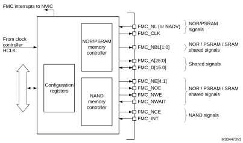
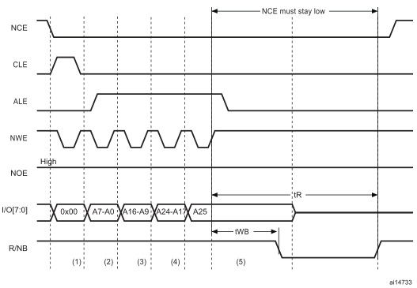

# 19 Flexiblestatic memory controller (FSMC)

## 19.1 Introduction

The flexible static memory controller (FSMC) includes two memory controllers:

- The NOR/PSRAM memory controller
- The NAND memory controller

This memory controller is also named flexible memory controller (FMC).

## 19.2 FMC main features

The FMC functional block makes the interface with: synchronous and asynchronous static memories, and NAND flash memory. Its main purposes are:

- to translate AHB transactions into the appropriate external device protocol
- to meet the access time requirements of the external memory devices

All external memories share the addresses, data and control signals with the controller. Each external device is accessed by means of a unique chip select. The FMC performs only one access at a time to an external device.

The main features of the FMC controller are the following:

- Interface with static-memory mapped devices including:
 - Static random access memory (SRAM)
 - NOR flash memory/OneNAND flash memory
 - PSRAM (4 memory banks)
 - Ferroelectric RAM (FRAM)
 - NAND flash memory with ECC hardware to check up to 8 Kbytes of data
- Interface with parallel LCD modules, supporting Intel 8080 and Motorola 6800 modes.
- Burst mode support for faster access to synchronous devices such as NOR flash memory, PSRAM)
- Programmable continuous clock output for asynchronous and synchronous accesses
- 8-,16-bit wide data bus
- Independent chip select control for each memory bank
- Independent configuration for each memory bank
- Write enable and byte lane select outputs for use with PSRAM, SRAM devices
- External asynchronous wait control
- Write FIFO with 16 x32-bit depth

The Write FIFO is common to all memory controllers and consists of:

- a Write Data FIFO which stores the AHB data to be written to the memory (up to 32 bits) plus one bit for the AHB transfer (burst or not sequential mode)
- a Write Address FIFO which stores the AHB address (up to 28 bits) plus the AHB data size (up to 2 bits). When operating in burst mode, only the start address is stored except when crossing a page boundary (for PSRAM). In this case, the AHB burst is broken into two FIFO entries.

At startup the FMC pins must be configured by the user application. The FMC I/O pins which are not used by the application can be used for other purposes.

The FMC registers that define the external device type and associated characteristics are usually set at boot time and do not change until the next reset or power-up. However, the settings can be changed at any time.

## 19.3 FMC block diagram

The FMC consists of the following main blocks:

- The AHB interface (including the FMC configuration registers)
- The NOR flash/PSRAM/SRAM controller

The block diagram is shown in the figure below.

#### Figure 52. FMC block diagram

## 19.4 AHB interface

The AHB slave interface allows internal CPUs and other bus master peripherals to access the external memories.

AHB transactions are translated into the external device protocol. In particular, if the selected external memory is 16- or 8-bit wide, 32-bit wide transactions on the AHB are split into consecutive 16- or 8-bit accesses. The FMC chip select (FMC\_NEx) does not toggle between the consecutive accesses except in case of Access mode D when the Extended mode is enabled.

The FMC generates an AHB error in the following conditions:

- When reading or writing to a FMC bank (Bank 1 to 4) which is not enabled.
- When reading or writing to the NOR flash bank while the FACCEN bit is reset in the FMC\_BCRx register.

The effect of an AHB error depends on the AHB master which has attempted the R/W access:

- If the access has been attempted by the Cortex®-M4 with FPU CPU, a hard fault interrupt is generated.
- If the access has been performed by a DMA controller, a DMA transfer error is generated and the corresponding DMA channel is automatically disabled.

The AHB clock (HCLK) is the reference clock for the FMC.

### 19.4.1 Supported memories and transactions

#### General transaction rules

The requested AHB transaction data size can be 8-, 16- or 32-bit wide whereas the accessed external device has a fixed data width. This may lead to inconsistent transfers.

Therefore, some simple transaction rules must be followed:

- AHB transaction size and memory data size are equal

There is no issue in this case.

- AHB transaction size is greater than the memory size:

In this case, the FMC splits the AHB transaction into smaller consecutive memory accesses to meet the external data width. The FMC chip select (FMC\_NEx) does not toggle between the consecutive accesses. If the bus turnaround timings is configured to any other value than 0, the FMC chip select (FMC\_NEx) toggles between the consecutive accesses. This feature is required when interfacing with FRAM memory.

- AHB transaction size is smaller than the memory size:

The transfer may or not be consistent depending on the type of external device:

 - Accesses to devices that have the byte select feature (SRAM, ROM, PSRAM)

In this case, the FMC allows read/write transactions and accesses to the right data through its byte lanes NBL[1:0].

Bytes to be written are addressed by NBL[1:0].

All memory bytes are read (NBL[1:0] are driven low during read transaction) and the useless ones are discarded.

 - Accesses to devices that do not have the byte select feature (NOR and NAND flash memories)

This situation occurs when a byte access is requested to a 16-bit wide flash memory. Since the device cannot be accessed in Byte mode (only 16-bit words can be read/written from/to the flash memory), Write transactions and Read transactions are allowed (the controller reads the entire 16-bit memory word and uses only the required byte).

#### Wrap support for NOR flash/PSRAM

Wrap burst mode for synchronous memories is not supported. The memories must be configured in Linear burst mode of undefined length.

#### Configuration registers

The FMC can be configured through a set of registers. Refer to [Section 19.6.6](#XREF_90973__42_5_6_NOR/PSRAM_controller_registers6), for a detailed description of the NOR flash/PSRAM controller registers. Refer to [Section 19.7.7](#XREF_11039__42_6_7_NAND_Flashcontroller_registers6), for a detailed description of the NAND flash registers.

## 19.5 External device address mapping

From the FMC point of view, the external memory is divided into fixed-size banks of 256 Mbytes each (see [Figure 53](#XREF_15633__Figure_32__FSMC_memory_banks%116)):

- Bank 1 used to address up to 4 NOR flash memory or PSRAM devices. This bank is split into 4 NOR/PSRAM subbanks with 4 dedicated chip selects, as follows:
 - Bank 1 - NOR/PSRAM 1
 - Bank 1 - NOR/PSRAM 2
 - Bank 1 - NOR/PSRAM 3
 - Bank 1 - NOR/PSRAM 4
- Bank 3 used to address NAND flash memory devices.The MPU memory attribute for this space must be reconfigured by software to Device.

For each bank the type of memory to be used can be configured by the user application through the Configuration register.

#### Figure 53. FMC memory banks

### 19.5.1 NOR/PSRAM address mapping

HADDR[27:26] bits are used to select one of the four memory banks as shown in [Table 122](#XREF_21617__Table_216__NOR/PSRAM_bank_selection%116).

 

<table class="TableTitle"><caption class="TableTitle"><h4 class="TableCap" id="1017424">Table 122. <a id="selection%116" name="XREF_21617__Table_216__NOR_PSRAM_bank_selection%116">NOR/PSRAM bank selection</a></h4></caption><col width="230.63px"/><col width="307.29px"/><thead><tr height="28.00px"><th>
HADDR[27:26]<a href="#c7amba%20fmc%20V2%20UserSpec_c7amba%20fmc%20V2%20UserSpec_FTH_1">1</a>
</th><th>
Selected bank
</th></tr></thead><tr height="22.67px"><td>
00 
</td><td>
Bank 1 - NOR/PSRAM 1
</td></tr><tr height="22.67px"><td>
01 
</td><td>
Bank 1 - NOR/PSRAM 2
</td></tr><tr height="22.67px"><td>
10 
</td><td>
Bank 1 - NOR/PSRAM 3
</td></tr><tr height="22.67px"><td>
11 
</td><td>
Bank 1 - NOR/PSRAM 4
</td></tr></table>

<a href="#c7amba%20fmc%20V2%20UserSpec_c7amba%20fmc%20V2%20UserSpec_FTB_1">1.</a>HADDR are internal AHB address lines that are translated to external memory.

The HADDR[25:0] bits contain the external memory address. Since HADDR is a byte address whereas the memory is addressed at word level, the address actually issued to the memory varies according to the memory data width, as shown in the following table.

 

<table class="TableTitle"><caption class="TableTitle"><h4 class="TableCap" id="1017457">Table 123. NOR/PSRAM External memory address</h4></caption><col width="118.56px"/><col width="223.01px"/><col width="196.19px"/><thead><tr height="28.00px"><th>
Memory width<a href="#c7amba%20fmc%20V2%20UserSpec_c7amba%20fmc%20V2%20UserSpec_FTH_1">1</a>
</th><th>
Data address issued to the memory
</th><th>
Maximum memory capacity (bits) 
</th></tr></thead><tr height="22.67px"><td>
8-bit 
</td><td>
HADDR[25:0] 
</td><td>
64 Mbytes x 8 = 512 Mbits 
</td></tr><tr height="22.67px"><td>
16-bit
</td><td>
HADDR[25:1] &gt;&gt; 1 
</td><td>
64  Mbytes/2 x 16 = 512 Mbits 
</td></tr><tr data-conditional="_fmc_v2_32bit" height="22.67px" style="display: none"><td data-conditional="_fmc_v2_32bit" style="display: none">
32-bit
</td><td data-conditional="_fmc_v2_32bit" style="display: none">
HADDR[25:2] &gt;&gt; 2
</td><td data-conditional="_fmc_v2_32bit" style="display: none">
64 Mbytes/4 x 32 = 512 Mbits 
</td></tr></table>

<a href="#c7amba%20fmc%20V2%20UserSpec_c7amba%20fmc%20V2%20UserSpec_FTB_1">1.</a>In case of a 16-bit external memory width, the FMC internally uses HADDR[25:1] to generate the address for external memory FMC_A[24:0]. Whatever the external memory width, FMC_A[0] must be connected to external memory address A[0].

### 19.5.2 NAND flash memory address mapping

The NAND bank is divided into memory areas as indicated in [Table 124](#XREF_52191__Table_218__NAND/PC_Card_memory_mapping_and_timing_registers6).

<table class="TableTitle"><caption class="TableCap"><h4 class="TableCap" id="31521733">Table 124. <a id="registers6" name="XREF_52191__Table_218__NAND_PC_Card_memory_mapping_and_timing_registers6">NAND memory mapping and timing registers</a></h4></caption><col width="90.33px"/><col width="85.33px"/><col width="122.10px"/><col width="93.60px"/><col width="145.38px"/><thead><tr height="28.00px"><th>
Start address
</th><th>
End address
</th><th>
FMC bank
</th><th>
Memory space
</th><th>
Timing register
</th></tr></thead><tr height="22.67px"><td>
0x8800 0000
</td><td>
0x8BFF FFFF
</td><td rowspan="2">
Bank 3 - NAND flash
</td><td>
Attribute
</td><td>
 FMC_PATT (0x8C)
</td></tr><tr height="22.67px"><td>
0x8000 0000
</td><td>
0x83FF FFFF
</td><td>
Common
</td><td>
 FMC_PMEM (0x88)
</td></tr></table>

For NAND flash memory, the common and attribute memory spaces are subdivided into three sections (see in [Table 125](#XREF_24566__Table_219__NAND_bank_selection%116) below) located in the lower 256 Kbytes:

- Data section (first 64 Kbytes in the common/attribute memory space)
- Command section (second 64 Kbytes in the common / attribute memory space)
- Address section (next 128 Kbytes in the common / attribute memory space)

<table class="TableTitle"><caption class="TableTitle"><h4 class="TableCap" id="31521795">Table 125. <a id="selection%116" name="XREF_24566__Table_219__NAND_bank_selection%116">NAND bank selection</a></h4></caption><col width="160.10px"/><col width="155.02px"/><col width="221.08px"/><thead><tr height="28.00px"><th>
Section name
</th><th>
HADDR[17:16]
</th><th>
Address range
</th></tr></thead><tr height="22.67px"><td>
Address section 
</td><td>
1X 
</td><td>
0x020000-0x03FFFF 
</td></tr><tr height="22.67px"><td>
Command section 
</td><td>
01 
</td><td>
0x010000-0x01FFFF 
</td></tr><tr height="22.67px"><td>
Data section 
</td><td>
00 
</td><td>
0x000000-0x0FFFF 
</td></tr></table>

The application software uses the 3 sections to access the NAND flash memory:

- To sending a command to NAND flash memory, the software must write the command value to any memory location in the command section.
- To specify the NAND flash address that must be read or written, the software must write the address value to any memory location in the address section. Since an address can be 4 or 5 bytes long (depending on the actual memory size), several consecutive write operations to the address section are required to specify the full address.
- To read or write data, the software reads or writes the data from/to any memory location in the data section.

Since the NAND flash memory automatically increments addresses, there is no need to increment the address of the data section to access consecutive memory locations.

## 19.6 NOR flash/PSRAM controller

The FMC generates the appropriate signal timings to drive the following types of memories:

- Asynchronous SRAM, FRAM and ROM
 - 8 bits
 - 16 bits
- PSRAM (CellularRAM™)
 - Asynchronous mode
 - Burst mode for synchronous accesses
 - Multiplexed or non-multiplexed
- NOR flash memory
 - Asynchronous mode
 - Burst mode for synchronous accesses
 - Multiplexed or non-multiplexed

The FMC outputs a unique chip select signal, NE[4:1], per bank. All the other signals (addresses, data and control) are shared.

The FMC supports a wide range of devices through a programmable timings among which:

- Programmable wait states (up to 15)
- Programmable bus turnaround cycles (up to 15)
- Programmable output enable and write enable delays (up to 15)
- Independent read and write timings and protocol to support the widest variety of memories and timings
- Programmable continuous clock (FMC\_CLK) output.

The FMC Clock (FMC\_CLK) is a submultiple of the HCLK clock. It can be delivered to the selected external device either during synchronous accesses only or during asynchronous and synchronous accesses depending on the CCKEN bit configuration in the FMC\_BCR1 register:

- If the CCLKEN bit is reset, the FMC generates the clock (CLK) only during synchronous accesses (Read/write transactions).
- If the CCLKEN bit is set, the FMC generates a continuous clock during asynchronous and synchronous accesses. To generate the FMC\_CLK continuous clock, Bank 1 must be configured in Synchronous mode (see [Section 19.6.6: NOR/PSRAM controller registers](#XREF_90973__42_5_6_NOR/PSRAM_controller_registers6)). Since the same clock is used for all synchronous memories, when a continuous output clock is generated and synchronous accesses are performed, the AHB data size has to be the same as the memory data width (MWID) otherwise the FMC\_CLK frequency is changed depending on AHB data transaction (refer to [Section 19.6.5: Synchronous transactions](#XREF_70032__42_5_5_Synchronous_transactions6) for FMC\_CLK divider ratio formula).

The size of each bank is fixed and equal to 64 Mbytes. Each bank is configured through dedicated registers (see [Section 19.6.6: NOR/PSRAM controller registers](#XREF_90973__42_5_6_NOR/PSRAM_controller_registers6)).

The programmable memory parameters include access times (see [Table 126](#XREF_55322__Table_220__Programmable_NOR/PSRAM_access_parameters%116)) and support for wait management (for PSRAM and NOR flash accessed in Burst mode).

 

<table class="TableTitle"><caption class="TableTitle"><h4 class="TableCap" id="1020405">Table 126. <a id="parameters%116" name="XREF_55322__Table_220__Programmable_NOR_PSRAM_access_parameters%116">Programmable NOR/PSRAM access parameters</a></h4></caption><col width="83.99px"/><col width="162.17px"/><col width="107.14px"/><col width="96.53px"/><col width="41.98px"/><col width="45.46px"/><thead><tr height="28.00px"><th>
Parameter 
</th><th>
Function 
</th><th>
Access mode 
</th><th>
Unit 
</th><th>
Min. 
</th><th>
Max. 
</th></tr></thead><tr height="37.33px"><td>
Address setup
</td><td>
Duration of the address setup phase 
</td><td>
Asynchronous 
</td><td>
AHB clock cycle (HCLK) 
</td><td>
0
</td><td>
15
</td></tr><tr height="37.33px"><td>
Address hold
</td><td>
Duration of the address hold phase 
</td><td>
Asynchronous, muxed I/Os 
</td><td>
AHB clock cycle (HCLK) 
</td><td>
1
</td><td>
15
</td></tr><tr data-conditional="_fmc_v2_fram" height="37.33px"><td data-conditional="_fmc_v2_fram">
NBL setup
</td><td data-conditional="_fmc_v2_fram">
Duration of the byte lanes setup phase
</td><td data-conditional="_fmc_v2_fram">
Asynchronous
</td><td data-conditional="_fmc_v2_fram">
AHB clock cycle (HCLK) 
</td><td data-conditional="_fmc_v2_fram">
0
</td><td data-conditional="_fmc_v2_fram">
3
</td></tr><tr height="37.33px"><td>
Data setup
</td><td>
Duration of the data setup phase 
</td><td>
Asynchronous 
</td><td>
AHB clock cycle (HCLK) 
</td><td>
1
</td><td>
256
</td></tr><tr data-conditional="_fmc_v2_fram" height="37.33px"><td data-conditional="_fmc_v2_fram">
Data hold
</td><td data-conditional="_fmc_v2_fram">
Duration of the data hold phase
</td><td data-conditional="_fmc_v2_fram">
Asynchronous
</td><td data-conditional="_fmc_v2_fram">
AHB clock cycle (HCLK) 
</td><td data-conditional="_fmc_v2_fram">
0
</td><td data-conditional="_fmc_v2_fram">
3
</td></tr><tr height="52.00px"><td>
Bust turn
</td><td>
Duration of the bus turnaround phase 
</td><td>
Asynchronous and synchronous read / write
</td><td>
AHB clock cycle (HCLK) 
</td><td>
0
</td><td>
15
</td></tr><tr height="52.00px"><td>
Clock divide ratio
</td><td>
Number of AHB clock cycles (HCLK) to build one memory clock cycle (CLK) 
</td><td>
Synchronous
</td><td>
AHB clock cycle (HCLK) 
</td><td>
2
</td><td>
16 
</td></tr><tr height="52.00px"><td>
Data latency
</td><td>
Number of clock cycles to issue to the memory before the first data of the burst 
</td><td>
Synchronous
</td><td>
Memory clock cycle (CLK) 
</td><td>
2
</td><td>
17 
</td></tr></table>

### 19.6.1 External memory interface signals

[Table 127](#XREF_52227__Table_221__Non-multiplexed_I/O_NOR_Flash_memory%116), [Table 128](#XREF_51595__Table_222__16-bit_multiplexed_I/O_NOR_Flash_memory%116) and [Table 129](#XREF_98186__Table_223__Non-multiplexed_I/Os_PSRAM/SRAM%116) list the signals that are typically used to interface with NOR flash memory, SRAM and PSRAM.

**Note:**

The prefix “N” identifies the signals that are active low.

#### NOR flash memory, non-multiplexed I/Os

 

<table class="TableTitle"><caption class="TableTitle"><h4 class="TableCap" id="1020520">Table 127. <a id="memory%116" name="XREF_52227__Table_221__Non-multiplexed_I_O_NOR_Flash_memory%116">Non-multiplexed I/O NOR flash memory</a></h4></caption><col width="212.77px"/><col width="79.14px"/><col width="245.03px"/><thead><tr height="28.00px"><th>
FMC signal name
</th><th>
I/O
</th><th>
Function
</th></tr></thead><tr height="22.67px"><td>
CLK 
</td><td>
O 
</td><td>
Clock (for synchronous access) 
</td></tr><tr height="22.67px"><td>
A[25:0] 
</td><td>
O 
</td><td>
Address bus 
</td></tr><tr height="22.67px"><td>
D[15:0]
</td><td>
I/O 
</td><td>
Bidirectional data bus 
</td></tr><tr height="22.67px"><td>
NE[x]
</td><td>
O 
</td><td>
Chip select, x = 1..4
</td></tr><tr height="22.67px"><td>
NOE
</td><td>
O 
</td><td>
Output enable 
</td></tr><tr height="22.67px"><td>
NWE
</td><td>
O 
</td><td>
Write enable 
</td></tr><tr height="37.33px"><td>
NL(=NADV)
</td><td>
O 
</td><td>
Latch enable (this signal is called address valid, NADV, by some NOR flash devices) 
</td></tr><tr height="22.67px"><td>
NWAIT
</td><td>
I 
</td><td>
NOR flash wait input signal to the FMC 
</td></tr></table>

The maximum capacity is 512 Mbits (26 address lines).

#### NOR flash memory, 16-bit multiplexed I/Os

 

<table class="TableTitle"><caption class="TableTitle"><h4 class="TableCap" id="1020588">Table 128. <a id="memory%116" name="XREF_51595__Table_222__16-bit_multiplexed_I_O_NOR_Flash_memory%116">16-bit multiplexed I/O NOR flash memory</a></h4></caption><col width="117.76px"/><col width="44.50px"/><col width="376.14px"/><thead><tr height="28.00px"><th>
FMC signal name 
</th><th>
I/O 
</th><th>
Function 
</th></tr></thead><tr height="22.67px"><td>
CLK 
</td><td>
O 
</td><td>
Clock (for synchronous access) 
</td></tr><tr height="22.67px"><td>
A[25:16] 
</td><td>
O 
</td><td>
Address bus 
</td></tr><tr height="37.33px"><td>
AD[15:0] 
</td><td>
I/O 
</td><td>
16-bit multiplexed, bidirectional address/data bus (the 16-bit address A[15:0] and data D[15:0] are multiplexed on the databus)
</td></tr><tr height="22.67px"><td>
NE[x]
</td><td>
O 
</td><td>
Chip select, x = 1..4
</td></tr><tr height="22.67px"><td>
NOE
</td><td>
O 
</td><td>
Output enable 
</td></tr><tr height="22.67px"><td>
NWE
</td><td>
O 
</td><td>
Write enable 
</td></tr><tr height="37.33px"><td>
NL(=NADV)
</td><td>
O 
</td><td>
Latch enable (this signal is called address valid, NADV, by some NOR flash devices) 
</td></tr><tr height="22.67px"><td>
NWAIT
</td><td>
I 
</td><td>
NOR flash wait input signal to the FMC 
</td></tr></table>

The maximum capacity is 512 Mbits.

#### PSRAM/FRAM/SRAM, non-multiplexed I/Os

 

<table class="TableTitle"><caption class="TableTitle"><h4 class="TableCap" id="1020656">Table 129. <a id="PSRAM/SRAM%116" name="XREF_98186__Table_223__Non-multiplexed_I_Os_PSRAM_SRAM%116">Non-multiplexed I/Os PSRAM/SRAM</a></h4></caption><col width="109.61px"/><col width="32.13px"/><col width="396.85px"/><thead><tr height="28.00px"><th>
FMC signal name
</th><th>
I/O
</th><th>
Function 
</th></tr></thead><tr height="22.67px"><td>
CLK 
</td><td>
O 
</td><td>
Clock (only for PSRAM synchronous access) 
</td></tr><tr height="22.67px"><td>
A[25:0] 
</td><td>
O 
</td><td>
Address bus 
</td></tr><tr height="22.67px"><td>
D[15:0]
</td><td>
I/O
</td><td>
Data bidirectional bus 
</td></tr><tr height="22.67px"><td>
NE[x]
</td><td>
O 
</td><td>
Chip select, x = 1..4 (called NCE by PSRAM (CellularRAM™ i.e. CRAM))
</td></tr><tr height="22.67px"><td>
NOE
</td><td>
O 
</td><td>
Output enable 
</td></tr><tr height="22.67px"><td>
NWE
</td><td>
O 
</td><td>
Write enable 
</td></tr><tr height="22.67px"><td>
NL(= NADV)
</td><td>
O 
</td><td>
Address valid only for PSRAM input (memory signal name: NADV) 
</td></tr><tr height="22.67px"><td>
NWAIT
</td><td>
I 
</td><td>
PSRAM wait input signal to the FMC 
</td></tr><tr data-conditional="_fmc_v2_32bit" height="22.67px" style="display: none"><td data-conditional="_fmc_v2_32bit" style="display: none">
NBL[3:0] 
</td><td data-conditional="_fmc_v2_32bit" style="display: none">
O 
</td><td data-conditional="_fmc_v2_32bit" style="display: none">
 Byte lane output. Byte 0 to Byte 3 control (Upper and lower byte enable) 
</td></tr><tr data-conditional="_fmc_v2_16bit" height="22.67px"><td data-conditional="_fmc_v2_16bit">
NBL[1:0] 
</td><td data-conditional="_fmc_v2_16bit">
O 
</td><td data-conditional="_fmc_v2_16bit">
 Byte lane output. Byte 0 and Byte 1 control (upper and lower byte enable)
</td></tr></table>

The maximum capacity is 512 Mbits.

#### PSRAM, 16-bit multiplexed I/Os

 

<table class="TableTitle"><caption class="TableTitle"><h4 class="TableCap" id="1020735">Table 130. 16-Bit multiplexed I/O PSRAM</h4></caption><col width="107.72px"/><col width="32.13px"/><col width="396.85px"/><thead><tr height="28.00px"><th>
FMC signal name
</th><th>
I/O
</th><th>
Function 
</th></tr></thead><tr height="22.67px"><td>
CLK 
</td><td>
O 
</td><td>
Clock (for synchronous access) 
</td></tr><tr height="22.67px"><td>
A[25:16] 
</td><td>
O 
</td><td>
Address bus 
</td></tr><tr height="37.33px"><td>
AD[15:0] 
</td><td>
I/O
</td><td>
16-bit multiplexed, bidirectional address/data bus (the 16-bit address A[15:0] and data D[15:0] are multiplexed on the databus)
</td></tr><tr height="22.67px"><td>
NE[x]
</td><td>
O 
</td><td>
Chip select, x = 1..4 (called NCE by PSRAM (CellularRAM™ i.e. CRAM))
</td></tr><tr height="22.67px"><td>
NOE
</td><td>
O 
</td><td>
Output enable 
</td></tr><tr height="22.67px"><td>
NWE
</td><td>
O 
</td><td>
Write enable 
</td></tr><tr height="22.67px"><td>
NL(= NADV)
</td><td>
O 
</td><td>
Address valid PSRAM input (memory signal name: NADV) 
</td></tr><tr height="22.67px"><td>
NWAIT
</td><td>
I 
</td><td>
PSRAM wait input signal to the FMC 
</td></tr><tr height="22.67px"><td>
NBL[1:0] 
</td><td>
O 
</td><td>
Byte lane output. Byte 0 and Byte 1 control (upper and lower byte enable)
</td></tr></table>

The maximum capacity is 512 Mbits (26 address lines).

### 19.6.2 Supported memories and transactions

[Table 131](#XREF_18100__Example_of_supported_memories_and6) below shows an example of the supported devices, access modes and transactions when the memory data bus is 16-bit wide for NOR flash memory, PSRAM and SRAM. The transactions not allowed (or not supported) by the FMC are shown in gray in this example.

 

<table class="TableTitle"><caption class="TableTitle"><h4 class="TableCap" id="1020813">Table 131.  <a id="and6" name="XREF_18100__Example_of_supported_memories_and6">NOR flash/PSRAM: example of supported memories</a>   and transactions</h4></caption><col width="92.28px"/><col width="86.48px"/><col width="32.00px"/><col width="55.62px"/><col width="59.28px"/><col width="58.47px"/><col width="152.60px"/><thead><tr height="57.33px"><th>
Device
</th><th>
Mode
</th><th>
R/W
</th><th>
AHB data size
</th><th>
Memory data size
</th><th>
Allowed/not allowed 
</th><th>
Comments
</th></tr></thead><tr height="22.67px"><td rowspan="10">
NOR flash (muxed I/Os and nonmuxed I/Os) 
</td><td>
Asynchronous
</td><td>
R 
</td><td>
8 
</td><td>
16 
</td><td>
Y 
</td><td>
-
</td></tr><tr height="22.67px"><td style="background-color:#e5e5e5;">
Asynchronous 
</td><td style="background-color:#e5e5e5;">
W 
</td><td style="background-color:#e5e5e5;">
8 
</td><td style="background-color:#e5e5e5;">
16 
</td><td style="background-color:#e5e5e5;">
N 
</td><td style="background-color:#e5e5e5;">
-
</td></tr><tr height="22.67px"><td>
Asynchronous
</td><td>
R 
</td><td>
16 
</td><td>
16 
</td><td>
Y 
</td><td>
-
</td></tr><tr height="22.67px"><td>
Asynchronous
</td><td>
W 
</td><td>
16 
</td><td>
16 
</td><td>
Y 
</td><td>
-
</td></tr><tr height="22.67px"><td>
Asynchronous 
</td><td>
R 
</td><td>
32 
</td><td>
16 
</td><td>
Y 
</td><td>
Split into 2 FMC accesses 
</td></tr><tr height="22.67px"><td>
Asynchronous 
</td><td>
W 
</td><td>
32 
</td><td>
16 
</td><td>
Y 
</td><td>
Split into 2 FMC accesses 
</td></tr><tr height="37.33px"><td style="background-color:#e5e5e5;">
Asynchronous page 
</td><td style="background-color:#e5e5e5;">
R 
</td><td style="background-color:#e5e5e5;">
-
</td><td style="background-color:#e5e5e5;">
16 
</td><td style="background-color:#e5e5e5;">
N 
</td><td style="background-color:#e5e5e5;">
Mode is not supported 
</td></tr><tr height="22.67px"><td style="background-color:#e5e5e5;">
Synchronous 
</td><td style="background-color:#e5e5e5;">
R 
</td><td style="background-color:#e5e5e5;">
8 
</td><td style="background-color:#e5e5e5;">
16 
</td><td style="background-color:#e5e5e5;">
N 
</td><td style="background-color:#e5e5e5;">
-
</td></tr><tr height="22.67px"><td>
Synchronous 
</td><td>
R 
</td><td>
16 
</td><td>
16 
</td><td>
Y 
</td><td>
-
</td></tr><tr height="22.67px"><td>
Synchronous 
</td><td>
R 
</td><td>
32 
</td><td>
16 
</td><td>
Y 
</td><td>
-
</td></tr><tr height="22.67px"><td rowspan="12">
PSRAM (multiplexed I/Os and non-multiplexed I/Os)
</td><td>
Asynchronous
</td><td>
R 
</td><td>
8 
</td><td>
16 
</td><td>
Y 
</td><td>
-
</td></tr><tr height="22.67px"><td>
Asynchronous 
</td><td>
W 
</td><td>
8 
</td><td>
16 
</td><td>
Y 
</td><td>
Use of byte lanes NBL[1:0] 
</td></tr><tr height="22.67px"><td>
Asynchronous
</td><td>
R 
</td><td>
16 
</td><td>
16 
</td><td>
Y 
</td><td>
-
</td></tr><tr height="22.67px"><td>
Asynchronous
</td><td>
W 
</td><td>
16 
</td><td>
16 
</td><td>
Y 
</td><td>
-
</td></tr><tr height="22.67px"><td>
Asynchronous 
</td><td>
R 
</td><td>
32 
</td><td>
16 
</td><td>
Y 
</td><td>
Split into 2 FMC accesses 
</td></tr><tr height="22.67px"><td>
Asynchronous 
</td><td>
W 
</td><td>
32 
</td><td>
16 
</td><td>
Y 
</td><td>
Split into 2 FMC accesses 
</td></tr><tr height="37.33px"><td style="background-color:#e5e5e5;">
Asynchronous page 
</td><td style="background-color:#e5e5e5;">
R 
</td><td style="background-color:#e5e5e5;">
-
</td><td style="background-color:#e5e5e5;">
16 
</td><td style="background-color:#e5e5e5;">
N 
</td><td style="background-color:#e5e5e5;">
Mode is not supported 
</td></tr><tr height="22.67px"><td style="background-color:#e5e5e5;">
Synchronous 
</td><td style="background-color:#e5e5e5;">
R 
</td><td style="background-color:#e5e5e5;">
8 
</td><td style="background-color:#e5e5e5;">
16 
</td><td style="background-color:#e5e5e5;">
N 
</td><td style="background-color:#e5e5e5;">
-
</td></tr><tr height="22.67px"><td>
Synchronous 
</td><td>
R 
</td><td>
16 
</td><td>
16 
</td><td>
Y 
</td><td>
-
</td></tr><tr height="22.67px"><td>
Synchronous 
</td><td>
R 
</td><td>
32 
</td><td>
16 
</td><td>
Y 
</td><td>
-
</td></tr><tr height="22.67px"><td>
Synchronous
</td><td>
W
</td><td>
8
</td><td>
16
</td><td>
Y
</td><td>
Use of byte lanes NBL[1:0]
</td></tr><tr height="22.67px"><td>
Synchronous
</td><td>
W
</td><td>
16/32
</td><td>
16
</td><td>
Y
</td><td>
-
</td></tr><tr height="22.67px"><td rowspan="4">
SRAM and ROM
</td><td>
Asynchronous 
</td><td>
R 
</td><td>
8 / 16 
</td><td>
16
</td><td>
Y 
</td><td>
-
</td></tr><tr height="22.67px"><td>
Asynchronous 
</td><td>
W 
</td><td>
8 / 16 
</td><td>
16
</td><td>
Y 
</td><td>
Use of byte lanes NBL[1:0] 
</td></tr><tr height="22.67px"><td>
Asynchronous 
</td><td>
R 
</td><td>
32 
</td><td>
16
</td><td>
Y 
</td><td>
Split into 2 FMC accesses 
</td></tr><tr height="37.33px"><td>
Asynchronous 
</td><td>
W 
</td><td>
32 
</td><td>
16
</td><td>
Y 
</td><td>
Split into 2 FMC accesses Use of byte lanes NBL[1:0]
</td></tr></table>

### 19.6.3 General timing rules

#### Signals synchronization

- All controller output signals change on the rising edge of the internal clock (HCLK)
- In Synchronous mode (read or write), all output signals change on the rising edge of HCLK. Whatever the CLKDIV value, all outputs change as follows:
 - NOEL/NWEL/ NEL/NADVL/ NADVH /NBLL/ Address valid outputs change on the falling edge of FMC\_CLK clock.
 - NOEH/ NWEH / NEH/ NOEH/NBLH/ Address invalid outputs change on the rising edge of FMC\_CLK clock.

### 19.6.4 NOR flash/PSRAM controller asynchronous transactions

#### Asynchronous static memories (NOR flash, PSRAM, SRAM, FRAM)

- Signals are synchronized by the internal clock HCLK. This clock is not issued to the memory
- The FMC always samples the data before de-asserting the NOE signal. This guarantees that the memory data hold timing constraint is met (minimum Chip Enable high to data transition is usually 0 ns)
- If the Extended mode is enabled (EXTMOD bit is set in the FMC\_BCRx register), up to four extended modes (A, B, C and D) are available. It is possible to mix A, B, C and D modes for read and write operations. For example, read operation can be performed in mode A and write in mode B.
- If the Extended mode is disabled (EXTMOD bit is reset in the FMC\_BCRx register), the FMC can operate in mode 1 or mode 2 as follows:
 - Mode 1 is the default mode when SRAM/PSRAM memory type is selected (MTYP = 0x0 or 0x01 in the FMC\_BCRx register)
 - Mode 2 is the default mode when NOR memory type is selected (MTYP = 0x10 in the FMC\_BCRx register).

#### Mode 1 - SRAM/FRAM/PSRAM (CRAM)

The next figures show the read and write transactions for the supported modes followed by the required configuration of FMC\_BCRx, and FMC\_BTRx/FMC\_BWTRx registers.

#### Figure 54. Mode 1 read access waveforms

#### Figure 55. Mode 1 write access waveforms

The DATAHLD time at the end of the read and write transactions guarantee the address and data hold time after the NOE/NWE rising edge. The DATAST value must be greater than zero (DATAST > 0).

 

<table class="TableTitle"><caption class="TableTitle"><h4 class="TableCap" id="1021243">Table 132. FMC_BCRx bitfields (mode 1)</h4></caption><col width="76.73px"/><col width="101.31px"/><col width="360.54px"/><thead><tr height="28.00px"><th>
Bit number
</th><th>
Bit name
</th><th>
Value to set
</th></tr></thead><tr data-conditional="_fmc_v2_dual_ahb" height="22.67px" style="display: none"><td data-conditional="_fmc_v2_dual_ahb" style="display: none">
31
</td><td data-conditional="_fmc_v2_dual_ahb" style="display: none">
FMCEN
</td><td data-conditional="_fmc_v2_dual_ahb" style="display: none">
0x1
</td></tr><tr height="22.67px"><td>
31:24
</td><td>
Reserved
</td><td>
0x000
</td></tr><tr data-conditional="_fmc_v2_fram" height="22.67px"><td data-conditional="_fmc_v2_fram">
23:22
</td><td data-conditional="_fmc_v2_fram">
NBLSET[1:0]
</td><td data-conditional="_fmc_v2_fram">
As needed
</td></tr><tr data-conditional="bigbirdie,birdie,dragon,little_manta,littlebirdie,stm32l4_orca_,stm32l4x6xx,tinymantalp1_5m,tinymantalp1m" height="22.67px" style="display: none"><td data-conditional="bigbirdie,birdie,dragon,little_manta,littlebirdie,stm32l4_orca_,stm32l4x6xx,tinymantalp1_5m,tinymantalp1m" style="display: none">
21
</td><td data-conditional="bigbirdie,birdie,dragon,little_manta,littlebirdie,stm32l4_orca_,stm32l4x6xx,tinymantalp1_5m,tinymantalp1m" style="display: none">
WFDIS
</td><td data-conditional="bigbirdie,birdie,dragon,little_manta,littlebirdie,stm32l4_orca_,stm32l4x6xx,tinymantalp1_5m,tinymantalp1m" style="display: none">
As needed
</td></tr><tr height="22.67px"><td>
20
</td><td>
CCLKEN
</td><td>
As needed
</td></tr><tr height="22.67px"><td>
19
</td><td>
CBURSTRW
</td><td>
0x0 (no effect in Asynchronous mode)
</td></tr><tr height="22.67px"><td>
18:16
</td><td>
CPSIZE
</td><td>
0x0 (no effect in Asynchronous mode)
</td></tr><tr height="22.67px"><td>
15
</td><td>
ASYNCWAIT
</td><td>
Set to 1 if the memory supports this feature. Otherwise keep at 0.
</td></tr><tr height="22.67px"><td>
14
</td><td>
EXTMOD
</td><td>
0x0
</td></tr><tr height="22.67px"><td>
13
</td><td>
WAITEN
</td><td>
0x0 (no effect in Asynchronous mode)
</td></tr><tr height="22.67px"><td>
12
</td><td>
WREN
</td><td>
As needed
</td></tr><tr data-conditional="bigbirdie,dragon,little_manta,stm32l4_orca_,stm32l4x6xx,tinymantalp1_5m,tinymantalp1m" height="22.67px" style="display: none"><td data-conditional="bigbirdie,dragon,little_manta,stm32l4_orca_,stm32l4x6xx,tinymantalp1_5m,tinymantalp1m" style="display: none">
11
</td><td data-conditional="bigbirdie,dragon,little_manta,stm32l4_orca_,stm32l4x6xx,tinymantalp1_5m,tinymantalp1m" style="display: none">
Reserved
</td><td data-conditional="bigbirdie,dragon,little_manta,stm32l4_orca_,stm32l4x6xx,tinymantalp1_5m,tinymantalp1m" style="display: none">
0x0
</td></tr><tr data-conditional="birdie,littlebirdie" height="22.67px" style="display: none"><td data-conditional="birdie,littlebirdie" style="display: none">
11
</td><td data-conditional="birdie,littlebirdie" style="display: none">
WAITCFG
</td><td data-conditional="birdie,littlebirdie" style="display: none">
Don’t care
</td></tr><tr height="22.67px"><td>
10
</td><td>
Reserved
</td><td>
0x0
</td></tr><tr height="22.67px"><td>
9 
</td><td>
WAITPOL 
</td><td>
Meaningful only if bit 15 is 1
</td></tr><tr height="22.67px"><td>
8 
</td><td>
BURSTEN
</td><td>
0x0
</td></tr><tr height="22.67px"><td>
7 
</td><td>
Reserved
</td><td>
0x1
</td></tr><tr height="22.67px"><td>
6 
</td><td>
FACCEN
</td><td>
Don’t care
</td></tr><tr height="22.67px"><td>
5:4 
</td><td>
MWID
</td><td>
As needed
</td></tr><tr height="22.67px"><td>
3:2 
</td><td>
MTYP
</td><td>
As needed, exclude 0x2 (NOR flash memory)
</td></tr><tr height="22.67px"><td>
1 
</td><td>
MUXE
</td><td>
0x0
</td></tr><tr height="22.67px"><td>
0 
</td><td>
MBKEN 
</td><td>
0x1
</td></tr></table>

 

<table class="TableTitle"><caption class="TableTitle"><h4 class="TableCap" id="1021374">Table 133. FMC_BTRx bitfields (mode 1)</h4></caption><col width="73.27px"/><col width="93.83px"/><col width="371.49px"/><thead><tr height="28.00px"><th>
Bit number
</th><th>
Bit name
</th><th>
Value to set
</th></tr></thead><tr data-conditional="_nofmc_v2_fram" height="22.67px" style="display: none"><td data-conditional="_nofmc_v2_fram" style="display: none">
31:30
</td><td data-conditional="_nofmc_v2_fram" style="display: none">
Reserved
</td><td data-conditional="_nofmc_v2_fram" style="display: none">
0x0
</td></tr><tr data-conditional="_fmc_v2_fram" height="37.33px"><td data-conditional="_fmc_v2_fram">
31:30
</td><td data-conditional="_fmc_v2_fram">
DATAHLD
</td><td data-conditional="_fmc_v2_fram">
Duration of the data hold phase (DATAHLD HCLK cycles for read accesses, DATAHLD+1 HCLK cycles for write accesses).
</td></tr><tr height="22.67px"><td>
29:28
</td><td>
ACCMOD
</td><td>
Don’t care
</td></tr><tr height="22.67px"><td>
27:24
</td><td>
DATLAT
</td><td>
Don’t care
</td></tr><tr height="22.67px"><td>
23:20
</td><td>
CLKDIV
</td><td>
Don’t care
</td></tr><tr height="22.67px"><td>
19:16
</td><td>
BUSTURN
</td><td>
Time between NEx high to NEx low (BUSTURN HCLK).
</td></tr><tr data-conditional="_nofmc_v2_fram" height="37.33px" style="display: none"><td data-conditional="_nofmc_v2_fram" style="display: none">
15:8
</td><td data-conditional="_nofmc_v2_fram" style="display: none">
DATAST
</td><td data-conditional="_nofmc_v2_fram" style="display: none">
Duration of the second access phase (DATAST+1 HCLK cycles for write accesses, DATAST HCLK cycles for read accesses). 
</td></tr><tr data-conditional="_fmc_v2_fram" height="22.67px"><td data-conditional="_fmc_v2_fram">
15:8
</td><td data-conditional="_fmc_v2_fram">
DATAST
</td><td data-conditional="_fmc_v2_fram">
Duration of the second access phase (DATAST HCLK cycles). 
</td></tr><tr height="22.67px"><td>
7:4
</td><td>
ADDHLD
</td><td>
Don’t care
</td></tr><tr height="40.00px"><td>
3:0
</td><td>
ADDSET
</td><td>
Duration of the first access phase (ADDSET HCLK cycles).

Minimum value for ADDSET is 0.
</td></tr></table>

#### Mode A - SRAM/FRAM/PSRAM (CRAM) OE toggling

#### Figure 56. Mode A read access waveforms

1.NBL[1:0] are driven low during the read access

#### Figure 57. Mode A write access waveforms

The differences compared with Mode 1 are the toggling of NOE and the independent read and write timings.

 

<table class="TableTitle"><caption class="TableTitle"><h4 class="TableCap" id="1021457">Table 134. FMC_BCRx bitfields (mode A)</h4></caption><col width="74.94px"/><col width="102.58px"/><col width="361.06px"/><thead><tr height="28.00px"><th>
Bit number
</th><th>
Bit name 
</th><th>
Value to set
</th></tr></thead><tr data-conditional="_fmc_v2_dual_ahb" height="22.67px" style="display: none"><td data-conditional="_fmc_v2_dual_ahb" style="display: none">
31
</td><td data-conditional="_fmc_v2_dual_ahb" style="display: none">
FMCEN
</td><td data-conditional="_fmc_v2_dual_ahb" style="display: none">
0x1
</td></tr><tr height="22.67px"><td>
31:24
</td><td>
Reserved
</td><td>
0x000
</td></tr><tr data-conditional="_fmc_v2_fram" height="22.67px"><td data-conditional="_fmc_v2_fram">
23:22
</td><td data-conditional="_fmc_v2_fram">
NBLSET[1:0]
</td><td data-conditional="_fmc_v2_fram">
As needed
</td></tr><tr data-conditional="bigbirdie,birdie,dragon,little_manta,littlebirdie,stm32l4_orca_,stm32l4x6xx,tinymantalp1_5m,tinymantalp1m" height="22.67px" style="display: none"><td data-conditional="bigbirdie,birdie,dragon,little_manta,littlebirdie,stm32l4_orca_,stm32l4x6xx,tinymantalp1_5m,tinymantalp1m" style="display: none">
21
</td><td data-conditional="bigbirdie,birdie,dragon,little_manta,littlebirdie,stm32l4_orca_,stm32l4x6xx,tinymantalp1_5m,tinymantalp1m" style="display: none">
WFDIS
</td><td data-conditional="bigbirdie,birdie,dragon,little_manta,littlebirdie,stm32l4_orca_,stm32l4x6xx,tinymantalp1_5m,tinymantalp1m" style="display: none">
As needed
</td></tr><tr height="22.67px"><td>
20
</td><td>
CCLKEN
</td><td>
As needed
</td></tr><tr height="22.67px"><td>
19
</td><td>
CBURSTRW
</td><td>
0x0 (no effect in Asynchronous mode)
</td></tr><tr height="22.67px"><td>
18:16
</td><td>
CPSIZE
</td><td>
0x0 (no effect in Asynchronous mode)
</td></tr><tr height="22.67px"><td>
15
</td><td>
ASYNCWAIT
</td><td>
Set to 1 if the memory supports this feature. Otherwise keep at 0.
</td></tr><tr height="22.67px"><td>
14 
</td><td>
EXTMOD
</td><td>
0x1
</td></tr><tr height="22.67px"><td>
13
</td><td>
WAITEN
</td><td>
0x0 (no effect in Asynchronous mode)
</td></tr><tr height="22.67px"><td>
12
</td><td>
WREN
</td><td>
As needed
</td></tr><tr height="22.67px"><td>
11
</td><td>
WAITCFG
</td><td>
Don’t care
</td></tr><tr height="22.67px"><td>
10
</td><td>
Reserved
</td><td>
0x0
</td></tr><tr height="22.67px"><td>
9 
</td><td>
WAITPOL 
</td><td>
Meaningful only if bit 15 is 1
</td></tr><tr height="22.67px"><td>
8 
</td><td>
BURSTEN
</td><td>
0x0
</td></tr><tr height="22.67px"><td>
7 
</td><td>
Reserved
</td><td>
0x1
</td></tr><tr height="22.67px"><td>
6 
</td><td>
FACCEN
</td><td>
Don’t care
</td></tr><tr height="22.67px"><td>
5:4 
</td><td>
MWID 
</td><td>
As needed
</td></tr><tr height="22.67px"><td>
3:2 
</td><td>
MTYP 
</td><td>
As needed, exclude 0x2 (NOR flash memory)
</td></tr><tr height="22.67px"><td>
1 
</td><td>
MUXEN
</td><td>
0x0
</td></tr><tr height="22.67px"><td>
0 
</td><td>
MBKEN
</td><td>
0x1
</td></tr></table>

 

<table class="TableTitle"><caption class="TableTitle"><h4 class="TableCap" id="1021588">Table 135. FMC_BTRx bitfields (mode A)</h4></caption><col width="73.29px"/><col width="81.21px"/><col width="384.09px"/><thead><tr height="28.00px"><th>
Bit number
</th><th>
Bit name
</th><th>
Value to set 
</th></tr></thead><tr data-conditional="_nofmc_v2_fram" height="22.67px" style="display: none"><td data-conditional="_nofmc_v2_fram" style="display: none">
31:30
</td><td data-conditional="_nofmc_v2_fram" style="display: none">
Reserved
</td><td data-conditional="_nofmc_v2_fram" style="display: none">
0x0
</td></tr><tr data-conditional="_fmc_v2_fram" height="37.33px"><td data-conditional="_fmc_v2_fram">
31:30
</td><td data-conditional="_fmc_v2_fram">
DATAHLD
</td><td data-conditional="_fmc_v2_fram">
Duration of the data hold phase (DATAHLD HCLK cycles for read accesses).
</td></tr><tr height="22.67px"><td>
29:28
</td><td>
ACCMOD
</td><td>
0x0
</td></tr><tr height="22.67px"><td>
27:24
</td><td>
DATLAT
</td><td>
Don’t care
</td></tr><tr height="22.67px"><td>
23:20
</td><td>
CLKDIV
</td><td>
Don’t care
</td></tr><tr height="22.67px"><td>
19:16
</td><td>
BUSTURN
</td><td>
Time between NEx high to NEx low (BUSTURN HCLK).
</td></tr><tr height="37.33px"><td>
15:8
</td><td>
DATAST
</td><td>
Duration of the second access phase (DATAST HCLK cycles) for read accesses. 
</td></tr><tr height="22.67px"><td>
7:4
</td><td>
ADDHLD
</td><td>
Don’t care
</td></tr><tr height="54.67px"><td>
3:0
</td><td>
ADDSET
</td><td>
Duration of the first access phase (ADDSET HCLK cycles) for read accesses.

Minimum value for ADDSET is 0.
</td></tr></table>

 

<table class="TableTitle"><caption class="TableTitle"><h4 class="TableCap" id="1021654">Table 136. FMC_BWTRx bitfields (mode A)</h4></caption><col width="71.95px"/><col width="80.75px"/><col width="385.89px"/><thead><tr height="28.00px"><th>
Bit number
</th><th>
Bit name
</th><th>
Value to set 
</th></tr></thead><tr data-conditional="_nofmc_v2_fram" height="22.67px" style="display: none"><td data-conditional="_nofmc_v2_fram" style="display: none">
31:30
</td><td data-conditional="_nofmc_v2_fram" style="display: none">
Reserved
</td><td data-conditional="_nofmc_v2_fram" style="display: none">
0x0
</td></tr><tr data-conditional="_fmc_v2_fram" height="37.33px"><td data-conditional="_fmc_v2_fram">
31:30
</td><td data-conditional="_fmc_v2_fram">
DATAHLD
</td><td data-conditional="_fmc_v2_fram">
Duration of the data hold phase (DATAHLD+1 HCLK cycles for write accesses).
</td></tr><tr height="22.67px"><td>
29:28
</td><td>
ACCMOD
</td><td>
0x0
</td></tr><tr height="22.67px"><td>
27:24
</td><td>
DATLAT
</td><td>
Don’t care
</td></tr><tr height="22.67px"><td>
23:20
</td><td>
CLKDIV
</td><td>
Don’t care
</td></tr><tr height="22.67px"><td>
19:16
</td><td>
BUSTURN
</td><td>
Time between NEx high to NEx low (BUSTURN HCLK).
</td></tr><tr height="37.33px"><td>
15:8
</td><td>
DATAST
</td><td>
Duration of the second access phase (DATAST HCLK cycles) for write accesses. 
</td></tr><tr height="22.67px"><td>
7:4
</td><td>
ADDHLD
</td><td>
Don’t care
</td></tr><tr height="54.67px"><td>
3:0
</td><td>
ADDSET
</td><td>
Duration of the first access phase (ADDSET HCLK cycles) for write accesses.

Minimum value for ADDSET is 0.
</td></tr></table>

#### Mode 2/B - NOR flash

#### Figure 58. Mode 2 and mode B read access waveforms

#### Figure 59. Mode 2 write access waveforms

#### Figure 60. Mode B write access waveforms

The differences with mode 1 are the toggling of NWE and the independent read and write timings when extended mode is set (mode B).

 

<table class="TableTitle"><caption class="TableTitle"><h4 class="TableCap" id="1021743">Table 137. FMC_BCRx bitfields (mode 2/B)</h4></caption><col width="74.61px"/><col width="103.96px"/><col width="360.01px"/><thead><tr height="28.00px"><th>
Bit number
</th><th>
Bit name 
</th><th>
Value to set 
</th></tr></thead><tr data-conditional="_fmc_v2_dual_ahb" height="22.67px" style="display: none"><td data-conditional="_fmc_v2_dual_ahb" style="display: none">
31
</td><td data-conditional="_fmc_v2_dual_ahb" style="display: none">
FMCEN
</td><td data-conditional="_fmc_v2_dual_ahb" style="display: none">
0x1
</td></tr><tr height="22.67px"><td>
31:24
</td><td>
Reserved
</td><td>
0x000
</td></tr><tr data-conditional="_fmc_v2_fram" height="22.67px"><td data-conditional="_fmc_v2_fram">
23:22
</td><td data-conditional="_fmc_v2_fram">
NBLSET[1:0]
</td><td data-conditional="_fmc_v2_fram">
Don’t care
</td></tr><tr data-conditional="bigbirdie,birdie,dragon,little_manta,littlebirdie,stm32l4_orca_,stm32l4x6xx,tinymantalp1_5m,tinymantalp1m" height="22.67px" style="display: none"><td data-conditional="bigbirdie,birdie,dragon,little_manta,littlebirdie,stm32l4_orca_,stm32l4x6xx,tinymantalp1_5m,tinymantalp1m" style="display: none">
21
</td><td data-conditional="bigbirdie,birdie,dragon,little_manta,littlebirdie,stm32l4_orca_,stm32l4x6xx,tinymantalp1_5m,tinymantalp1m" style="display: none">
WFDIS
</td><td data-conditional="bigbirdie,birdie,dragon,little_manta,littlebirdie,stm32l4_orca_,stm32l4x6xx,tinymantalp1_5m,tinymantalp1m" style="display: none">
As needed
</td></tr><tr height="22.67px"><td>
20
</td><td>
CCLKEN
</td><td>
As needed
</td></tr><tr height="22.67px"><td>
19
</td><td>
CBURSTRW
</td><td>
0x0 (no effect in Asynchronous mode)
</td></tr><tr height="22.67px"><td>
18:16
</td><td>
CPSIZE
</td><td>
0x0 (no effect in Asynchronous mode)
</td></tr><tr height="22.67px"><td>
15
</td><td>
ASYNCWAIT
</td><td>
Set to 1 if the memory supports this feature. Otherwise keep at 0.
</td></tr><tr height="22.67px"><td>
14 
</td><td>
EXTMOD
</td><td>
0x1 for mode B, 0x0 for mode 2
</td></tr><tr height="22.67px"><td>
13
</td><td>
WAITEN
</td><td>
0x0 (no effect in Asynchronous mode)
</td></tr><tr height="22.67px"><td>
12
</td><td>
WREN
</td><td>
As needed
</td></tr><tr height="22.67px"><td>
11
</td><td>
WAITCFG
</td><td>
Don’t care
</td></tr><tr height="22.67px"><td>
10
</td><td>
Reserved
</td><td>
0x0
</td></tr><tr height="22.67px"><td>
9 
</td><td>
WAITPOL 
</td><td>
Meaningful only if bit 15 is 1
</td></tr><tr height="22.67px"><td>
8 
</td><td>
BURSTEN
</td><td>
0x0 
</td></tr><tr height="22.67px"><td>
7 
</td><td>
Reserved
</td><td>
0x1
</td></tr><tr height="22.67px"><td>
6 
</td><td>
FACCEN
</td><td>
0x1
</td></tr><tr height="22.67px"><td>
5:4 
</td><td>
MWID 
</td><td>
As needed
</td></tr><tr height="22.67px"><td>
3:2 
</td><td>
MTYP 
</td><td>
0x2 (NOR flash memory)
</td></tr><tr height="22.67px"><td>
1 
</td><td>
MUXEN
</td><td>
0x0 
</td></tr><tr height="22.67px"><td>
0 
</td><td>
MBKEN
</td><td>
0x1 
</td></tr></table>

 

<table class="TableTitle"><caption class="TableTitle"><h4 class="TableCap" id="1021874">Table 138. FMC_BTRx bitfields (mode 2/B)</h4></caption><col width="82.93px"/><col width="86.48px"/><col width="368.18px"/><thead><tr height="28.00px"><th>
Bit number
</th><th>
Bit name 
</th><th>
Value to set 
</th></tr></thead><tr data-conditional="_nofmc_v2_fram" height="22.67px" style="display: none"><td data-conditional="_nofmc_v2_fram" style="display: none">
31:30
</td><td data-conditional="_nofmc_v2_fram" style="display: none">
Reserved
</td><td data-conditional="_nofmc_v2_fram" style="display: none">
0x0
</td></tr><tr data-conditional="_fmc_v2_fram" height="52.00px"><td data-conditional="_fmc_v2_fram">
31:30
</td><td data-conditional="_fmc_v2_fram">
DATAHLD
</td><td data-conditional="_fmc_v2_fram">
Duration of the data hold phase (DATAHLD HCLK cycles for read accesses and DATAHLD+1 HCLK cycles for write accesses when Extended mode is disabled).
</td></tr><tr height="22.67px"><td>
29:28
</td><td>
ACCMOD
</td><td>
0x1 if Extended mode is set
</td></tr><tr height="22.67px"><td>
27:24
</td><td>
DATLAT
</td><td>
Don’t care
</td></tr><tr height="22.67px"><td>
23:20
</td><td>
CLKDIV
</td><td>
Don’t care
</td></tr><tr height="22.67px"><td>
19:16
</td><td>
BUSTURN
</td><td>
Time between NEx high to NEx low (BUSTURN HCLK).
</td></tr><tr height="37.33px"><td>
15:8
</td><td>
DATAST
</td><td>
Duration of the access second phase (DATAST HCLK cycles) for read accesses. 
</td></tr><tr height="22.67px"><td>
7:4
</td><td>
ADDHLD
</td><td>
Don’t care
</td></tr><tr height="37.33px"><td>
3:0
</td><td>
ADDSET
</td><td>
Duration of the access first phase (ADDSET HCLK cycles) for read accesses. Minimum value for ADDSET is 0.
</td></tr></table>

 

<table class="TableTitle"><caption class="TableTitle"><h4 class="TableCap" id="1021939">Table 139. FMC_BWTRx bitfields (mode 2/B)</h4></caption><col width="82.93px"/><col width="86.48px"/><col width="368.18px"/><thead><tr height="28.00px"><th>
Bit number
</th><th>
Bit name 
</th><th>
Value to set 
</th></tr></thead><tr data-conditional="_nofmc_v2_fram" height="22.67px" style="display: none"><td data-conditional="_nofmc_v2_fram" style="display: none">
31:30
</td><td data-conditional="_nofmc_v2_fram" style="display: none">
Reserved
</td><td data-conditional="_nofmc_v2_fram" style="display: none">
0x0
</td></tr><tr data-conditional="_fmc_v2_fram" height="37.33px"><td data-conditional="_fmc_v2_fram">
31:30
</td><td data-conditional="_fmc_v2_fram">
DATAHLD
</td><td data-conditional="_fmc_v2_fram">
Duration of the data hold phase (DATAHLD+1 HCLK cycles for write accesses). 
</td></tr><tr height="22.67px"><td>
29:28
</td><td>
ACCMOD
</td><td>
0x1 if Extended mode is set
</td></tr><tr height="22.67px"><td>
27:24
</td><td>
DATLAT
</td><td>
Don’t care
</td></tr><tr height="22.67px"><td>
23:20
</td><td>
CLKDIV
</td><td>
Don’t care
</td></tr><tr height="22.67px"><td>
19:16
</td><td>
BUSTURN
</td><td>
Time between NEx high to NEx low (BUSTURN HCLK).
</td></tr><tr height="37.33px"><td>
15:8
</td><td>
DATAST
</td><td>
Duration of the access second phase (DATAST HCLK cycles) for write accesses. 
</td></tr><tr height="22.67px"><td>
7:4
</td><td>
ADDHLD
</td><td>
Don’t care
</td></tr><tr height="37.33px"><td>
3:0
</td><td>
ADDSET
</td><td>
Duration of the access first phase (ADDSET HCLK cycles) for write accesses. Minimum value for ADDSET is 0.
</td></tr></table>

**Note:**

The FMC\_BWTRx register is valid only if the Extended mode is set (mode B), otherwise its content is don’t care.

#### Mode C - NOR flash - OE toggling

#### Figure 61. Mode C read access waveforms

#### Figure 62. Mode C write access waveforms

The differences compared with mode 1 are the toggling of NOE and the independent read and write timings.

 

<table class="TableTitle"><caption class="TableTitle"><h4 class="TableCap" id="1022021">Table 140. FMC_BCRx bitfields (mode C)</h4></caption><col width="81.37px"/><col width="92.99px"/><col width="364.22px"/><thead><tr height="28.00px"><th>
Bit number
</th><th>
Bit name
</th><th>
Value to set
</th></tr></thead><tr data-conditional="_fmc_v2_dual_ahb" height="22.67px" style="display: none"><td data-conditional="_fmc_v2_dual_ahb" style="display: none">
31
</td><td data-conditional="_fmc_v2_dual_ahb" style="display: none">
FMCEN
</td><td data-conditional="_fmc_v2_dual_ahb" style="display: none">
0x1
</td></tr><tr height="22.67px"><td>
31:24
</td><td>
Reserved
</td><td>
0x000
</td></tr><tr data-conditional="_fmc_v2_fram" height="22.67px"><td data-conditional="_fmc_v2_fram">
23:22
</td><td data-conditional="_fmc_v2_fram">
NBLSET[1:0]
</td><td data-conditional="_fmc_v2_fram">
Don’t care
</td></tr><tr data-conditional="bigbirdie,birdie,dragon,little_manta,littlebirdie,stm32l4_orca_,stm32l4x6xx,tinymantalp1_5m,tinymantalp1m" height="22.67px" style="display: none"><td data-conditional="bigbirdie,birdie,dragon,little_manta,littlebirdie,stm32l4_orca_,stm32l4x6xx,tinymantalp1_5m,tinymantalp1m" style="display: none">
21
</td><td data-conditional="bigbirdie,birdie,dragon,little_manta,littlebirdie,stm32l4_orca_,stm32l4x6xx,tinymantalp1_5m,tinymantalp1m" style="display: none">
WFDIS
</td><td data-conditional="bigbirdie,birdie,dragon,little_manta,littlebirdie,stm32l4_orca_,stm32l4x6xx,tinymantalp1_5m,tinymantalp1m" style="display: none">
As needed
</td></tr><tr height="22.67px"><td>
20
</td><td>
CCLKEN
</td><td>
As needed
</td></tr><tr height="22.67px"><td>
19
</td><td>
CBURSTRW
</td><td>
0x0 (no effect in Asynchronous mode)
</td></tr><tr height="22.67px"><td>
18:16
</td><td>
CPSIZE
</td><td>
0x0 (no effect in Asynchronous mode)
</td></tr><tr height="22.67px"><td>
15
</td><td>
ASYNCWAIT
</td><td>
Set to 1 if the memory supports this feature. Otherwise keep at 0.
</td></tr><tr height="22.67px"><td>
14 
</td><td>
EXTMOD
</td><td>
0x1
</td></tr><tr height="22.67px"><td>
13
</td><td>
WAITEN
</td><td>
0x0 (no effect in Asynchronous mode)
</td></tr><tr height="22.67px"><td>
12
</td><td>
WREN
</td><td>
As needed
</td></tr><tr height="22.67px"><td>
11
</td><td>
WAITCFG
</td><td>
Don’t care
</td></tr><tr height="22.67px"><td>
10
</td><td>
Reserved
</td><td>
0x0
</td></tr><tr height="22.67px"><td>
9 
</td><td>
WAITPOL 
</td><td>
Meaningful only if bit 15 is 1
</td></tr><tr height="22.67px"><td>
8 
</td><td>
BURSTEN
</td><td>
0x0 
</td></tr><tr height="22.67px"><td>
7 
</td><td>
Reserved
</td><td>
0x1
</td></tr><tr height="22.67px"><td>
6 
</td><td>
FACCEN
</td><td>
0x1
</td></tr><tr height="22.67px"><td>
5:4 
</td><td>
MWID 
</td><td>
As needed
</td></tr><tr height="22.67px"><td>
3:2 
</td><td>
MTYP 
</td><td>
0x02 (NOR flash memory)
</td></tr><tr height="22.67px"><td>
1 
</td><td>
MUXEN
</td><td>
0x0 
</td></tr><tr height="22.67px"><td>
0 
</td><td>
MBKEN
</td><td>
0x1 
</td></tr></table>

 

<table class="TableTitle"><caption class="TableTitle"><h4 class="TableCap" id="2308591">Table 141. FMC_BTRx bitfields (mode C)</h4></caption><col width="83.44px"/><col width="91.03px"/><col width="364.11px"/><thead><tr height="28.00px"><th>
Bit number
</th><th>
Bit name
</th><th>
Value to set
</th></tr></thead><tr data-conditional="_nofmc_v2_fram" height="22.67px" style="display: none"><td data-conditional="_nofmc_v2_fram" style="display: none">
31:30
</td><td data-conditional="_nofmc_v2_fram" style="display: none">
Reserved
</td><td data-conditional="_nofmc_v2_fram" style="display: none">
0x0
</td></tr><tr data-conditional="_fmc_v2_fram" height="37.33px"><td data-conditional="_fmc_v2_fram">
31:30
</td><td data-conditional="_fmc_v2_fram">
DATAHLD
</td><td data-conditional="_fmc_v2_fram">
Duration of the data hold phase (DATAHLD HCLK cycles for read accesses). 
</td></tr><tr height="22.67px"><td>
29:28
</td><td>
ACCMOD
</td><td>
0x2
</td></tr><tr height="22.67px"><td>
27:24
</td><td>
DATLAT
</td><td>
0x0
</td></tr><tr height="22.67px"><td>
23:20
</td><td>
CLKDIV
</td><td>
0x0
</td></tr><tr height="22.67px"><td>
19:16
</td><td>
BUSTURN
</td><td>
Time between NEx high to NEx low (BUSTURN HCLK).
</td></tr><tr height="37.33px"><td>
15:8
</td><td>
DATAST
</td><td>
Duration of the second access phase (DATAST HCLK cycles) for read accesses. 
</td></tr><tr height="22.67px"><td>
7:4
</td><td>
ADDHLD
</td><td>
Don’t care
</td></tr><tr height="37.33px"><td>
3:0
</td><td>
ADDSET
</td><td>
Duration of the first access phase (ADDSET HCLK cycles) for read accesses. Minimum value for ADDSET is 0.
</td></tr></table>

 

<table class="TableTitle"><caption class="TableTitle"><h4 class="TableCap" id="1022217">Table 142. FMC_BWTRx bitfields (mode C)</h4></caption><col width="83.41px"/><col width="85.30px"/><col width="369.88px"/><thead><tr height="28.00px"><th>
Bit number
</th><th>
Bit name
</th><th>
Value to set
</th></tr></thead><tr data-conditional="_nofmc_v2_fram" height="22.67px" style="display: none"><td data-conditional="_nofmc_v2_fram" style="display: none">
31:30
</td><td data-conditional="_nofmc_v2_fram" style="display: none">
Reserved
</td><td data-conditional="_nofmc_v2_fram" style="display: none">
0x0
</td></tr><tr data-conditional="_fmc_v2_fram" height="37.33px"><td data-conditional="_fmc_v2_fram">
31:30
</td><td data-conditional="_fmc_v2_fram">
DATAHLD
</td><td data-conditional="_fmc_v2_fram">
Duration of the data hold phase (DATAHLD+1 HCLK cycles for write accesses).
</td></tr><tr height="22.67px"><td>
29:28
</td><td>
ACCMOD
</td><td>
0x2
</td></tr><tr height="22.67px"><td>
27:24
</td><td>
DATLAT
</td><td>
Don’t care
</td></tr><tr height="22.67px"><td>
23:20
</td><td>
CLKDIV
</td><td>
Don’t care
</td></tr><tr height="22.67px"><td>
19:16
</td><td>
BUSTURN
</td><td>
Time between NEx high to NEx low (BUSTURN HCLK).
</td></tr><tr height="37.33px"><td>
15:8
</td><td>
DATAST
</td><td>
Duration of the second access phase (DATAST HCLK cycles) for write accesses. 
</td></tr><tr height="22.67px"><td>
7:4
</td><td>
ADDHLD
</td><td>
Don’t care
</td></tr><tr height="37.33px"><td>
3:0
</td><td>
ADDSET
</td><td>
Duration of the first access phase (ADDSET HCLK cycles) for write accesses. Minimum value for ADDSET is 0.
</td></tr></table>

#### Mode D - asynchronous access with extended address

#### Figure 63. Mode D read access waveforms

#### Figure 64. Mode D write access waveforms

The differences with mode 1 are the toggling of NOE that goes on toggling after NADV changes and the independent read and write timings.

 

<table class="TableTitle"><caption class="TableTitle"><h4 class="TableCap" id="1022299">Table 143. FMC_BCRx bitfields (mode D)</h4></caption><col width="77.75px"/><col width="102.41px"/><col width="358.42px"/><thead><tr height="28.00px"><th>
Bit number
</th><th>
Bit name 
</th><th>
Value to set 
</th></tr></thead><tr data-conditional="_fmc_v2_dual_ahb" height="22.67px" style="display: none"><td data-conditional="_fmc_v2_dual_ahb" style="display: none">
31
</td><td data-conditional="_fmc_v2_dual_ahb" style="display: none">
FMCEN
</td><td data-conditional="_fmc_v2_dual_ahb" style="display: none">
0x1
</td></tr><tr height="22.67px"><td>
31:24
</td><td>
Reserved
</td><td>
0x000
</td></tr><tr data-conditional="_fmc_v2_fram" height="22.67px"><td data-conditional="_fmc_v2_fram">
23:22
</td><td data-conditional="_fmc_v2_fram">
NBLSET[1:0]
</td><td data-conditional="_fmc_v2_fram">
As needed
</td></tr><tr data-conditional="bigbirdie,birdie,dragon,little_manta,littlebirdie,stm32l4_orca_,stm32l4x6xx,tinymantalp1_5m,tinymantalp1m" height="22.67px" style="display: none"><td data-conditional="bigbirdie,birdie,dragon,little_manta,littlebirdie,stm32l4_orca_,stm32l4x6xx,tinymantalp1_5m,tinymantalp1m" style="display: none">
21
</td><td data-conditional="bigbirdie,birdie,dragon,little_manta,littlebirdie,stm32l4_orca_,stm32l4x6xx,tinymantalp1_5m,tinymantalp1m" style="display: none">
WFDIS
</td><td data-conditional="bigbirdie,birdie,dragon,little_manta,littlebirdie,stm32l4_orca_,stm32l4x6xx,tinymantalp1_5m,tinymantalp1m" style="display: none">
As needed
</td></tr><tr height="22.67px"><td>
20
</td><td>
CCLKEN
</td><td>
As needed
</td></tr><tr height="22.67px"><td>
19
</td><td>
CBURSTRW
</td><td>
0x0 (no effect in Asynchronous mode)
</td></tr><tr height="22.67px"><td>
18:16
</td><td>
CPSIZE
</td><td>
0x0 (no effect in Asynchronous mode)
</td></tr><tr height="22.67px"><td>
15
</td><td>
ASYNCWAIT
</td><td>
Set to 1 if the memory supports this feature. Otherwise keep at 0.
</td></tr><tr height="22.67px"><td>
14
</td><td>
EXTMOD
</td><td>
0x1
</td></tr><tr height="22.67px"><td>
13
</td><td>
WAITEN
</td><td>
0x0 (no effect in Asynchronous mode)
</td></tr><tr height="22.67px"><td>
12
</td><td>
WREN
</td><td>
As needed
</td></tr><tr height="22.67px"><td>
11
</td><td>
WAITCFG
</td><td>
Don’t care
</td></tr><tr height="22.67px"><td>
10
</td><td>
Reserved
</td><td>
0x0
</td></tr><tr height="22.67px"><td>
9
</td><td>
WAITPOL 
</td><td>
Meaningful only if bit 15 is 1
</td></tr><tr height="22.67px"><td>
8
</td><td>
BURSTEN
</td><td>
0x0 
</td></tr><tr height="22.67px"><td>
7
</td><td>
Reserved
</td><td>
0x1
</td></tr><tr height="22.67px"><td>
6
</td><td>
FACCEN
</td><td>
Set according to memory support
</td></tr><tr height="22.67px"><td>
5:4
</td><td>
MWID
</td><td>
As needed
</td></tr><tr height="22.67px"><td>
3:2 
</td><td>
MTYP
</td><td>
As needed
</td></tr><tr height="22.67px"><td>
1 
</td><td>
MUXEN
</td><td>
0x0 
</td></tr><tr height="22.67px"><td>
0 
</td><td>
MBKEN
</td><td>
0x1 
</td></tr></table>

 

<table class="TableTitle"><caption class="TableTitle"><h4 class="TableCap" id="1022430">Table 144. FMC_BTRx bitfields (mode D)</h4></caption><col width="73.31px"/><col width="86.46px"/><col width="378.81px"/><thead><tr height="28.00px"><th>
Bit number
</th><th>
Bit name
</th><th>
Value to set 
</th></tr></thead><tr data-conditional="_nofmc_v2_fram" height="22.67px" style="display: none"><td data-conditional="_nofmc_v2_fram" style="display: none">
31:30
</td><td data-conditional="_nofmc_v2_fram" style="display: none">
Reserved
</td><td data-conditional="_nofmc_v2_fram" style="display: none">
0x0
</td></tr><tr data-conditional="_fmc_v2_fram" height="37.33px"><td data-conditional="_fmc_v2_fram">
31:30
</td><td data-conditional="_fmc_v2_fram">
DATAHLD
</td><td data-conditional="_fmc_v2_fram">
Duration of the data hold phase (DATAHLD HCLK cycles for read accesses).
</td></tr><tr height="22.67px"><td>
29:28
</td><td>
ACCMOD
</td><td>
0x3
</td></tr><tr height="22.67px"><td>
27:24
</td><td>
DATLAT
</td><td>
Don’t care
</td></tr><tr height="22.67px"><td>
23:20
</td><td>
CLKDIV
</td><td>
Don’t care
</td></tr><tr height="22.67px"><td>
19:16
</td><td>
BUSTURN
</td><td>
Time between NEx high to NEx low (BUSTURN HCLK).
</td></tr><tr height="37.33px"><td>
15:8
</td><td>
DATAST
</td><td>
Duration of the second access phase (DATAST HCLK cycles) for read accesses.
</td></tr><tr height="37.33px"><td>
7:4
</td><td>
ADDHLD
</td><td>
Duration of the middle phase of the read access (ADDHLD HCLK cycles) 
</td></tr><tr height="37.33px"><td>
3:0
</td><td>
ADDSET
</td><td>
Duration of the first access phase (ADDSET HCLK cycles) for read accesses. Minimum value for ADDSET is 1.
</td></tr></table>

 

<table class="TableTitle"><caption class="TableTitle"><h4 class="TableCap" id="1022495">Table 145. FMC_BWTRx bitfields (mode D)</h4></caption><col width="74.92px"/><col width="89.59px"/><col width="374.07px"/><thead><tr height="28.00px"><th>
Bit number
</th><th>
Bit name
</th><th>
Value to set 
</th></tr></thead><tr data-conditional="_nofmc_v2_fram" height="22.67px" style="display: none"><td data-conditional="_nofmc_v2_fram" style="display: none">
31:30
</td><td data-conditional="_nofmc_v2_fram" style="display: none">
Reserved
</td><td data-conditional="_nofmc_v2_fram" style="display: none">
0x0
</td></tr><tr data-conditional="_fmc_v2_fram" height="37.33px"><td data-conditional="_fmc_v2_fram">
31:30
</td><td data-conditional="_fmc_v2_fram">
DATAHLD
</td><td data-conditional="_fmc_v2_fram">
Duration of the data hold phase (DATAHLD+1 HCLK cycles for write accesses).
</td></tr><tr height="22.67px"><td>
29:28
</td><td>
ACCMOD
</td><td>
0x3
</td></tr><tr height="22.67px"><td>
27:24
</td><td>
DATLAT
</td><td>
Don’t care
</td></tr><tr height="22.67px"><td>
23:20
</td><td>
CLKDIV
</td><td>
Don’t care
</td></tr><tr height="22.67px"><td>
19:16
</td><td>
BUSTURN
</td><td>
Time between NEx high to NEx low (BUSTURN HCLK).
</td></tr><tr data-conditional="_nofmc_v2_fram" height="37.33px" style="display: none"><td data-conditional="_nofmc_v2_fram" style="display: none">
15:8
</td><td data-conditional="_nofmc_v2_fram" style="display: none">
DATAST
</td><td data-conditional="_nofmc_v2_fram" style="display: none">
Duration of the second access phase (DATAST + 1 HCLK cycles) for write accesses. 
</td></tr><tr data-conditional="_fmc_v2_fram" height="22.67px"><td data-conditional="_fmc_v2_fram">
15:8
</td><td data-conditional="_fmc_v2_fram">
DATAST
</td><td data-conditional="_fmc_v2_fram">
Duration of the second access phase (DATAST HCLK cycles). 
</td></tr><tr height="37.33px"><td>
7:4
</td><td>
ADDHLD
</td><td>
Duration of the middle phase of the write access (ADDHLD HCLK cycles) 
</td></tr><tr height="37.33px"><td>
3:0
</td><td>
ADDSET
</td><td>
Duration of the first access phase (ADDSET HCLK cycles) for write accesses. Minimum value for ADDSET is 1.
</td></tr></table>

#### Muxed mode - multiplexed asynchronous access to NOR flash memory

#### Figure 65. Muxed read access waveforms

#### Figure 66. Muxed write access waveforms

The difference with mode D is the drive of the lower address byte(s) on the data bus.

 

<table class="TableTitle"><caption class="TableTitle"><h4 class="TableCap" id="1022571">Table 146. FMC_BCRx bitfields (Muxed mode)</h4></caption><col width="75.59px"/><col width="105.83px"/><col width="357.17px"/><thead><tr height="28.00px"><th>
Bit number
</th><th>
Bit name
</th><th>
Value to set
</th></tr></thead><tr data-conditional="_fmc_v2_dual_ahb" height="22.67px" style="display: none"><td data-conditional="_fmc_v2_dual_ahb" style="display: none">
31
</td><td data-conditional="_fmc_v2_dual_ahb" style="display: none">
FMCEN
</td><td data-conditional="_fmc_v2_dual_ahb" style="display: none">
0x1
</td></tr><tr height="22.67px"><td>
31:24
</td><td>
Reserved
</td><td>
0x000
</td></tr><tr data-conditional="_fmc_v2_fram" height="22.67px"><td data-conditional="_fmc_v2_fram">
23:22
</td><td data-conditional="_fmc_v2_fram">
NBLSET[1:0]
</td><td data-conditional="_fmc_v2_fram">
As needed
</td></tr><tr data-conditional="bigbirdie,birdie,dragon,little_manta,littlebirdie,stm32l4_orca_,stm32l4x6xx,tinymantalp1_5m,tinymantalp1m" height="22.67px" style="display: none"><td data-conditional="bigbirdie,birdie,dragon,little_manta,littlebirdie,stm32l4_orca_,stm32l4x6xx,tinymantalp1_5m,tinymantalp1m" style="display: none">
21
</td><td data-conditional="bigbirdie,birdie,dragon,little_manta,littlebirdie,stm32l4_orca_,stm32l4x6xx,tinymantalp1_5m,tinymantalp1m" style="display: none">
WFDIS
</td><td data-conditional="bigbirdie,birdie,dragon,little_manta,littlebirdie,stm32l4_orca_,stm32l4x6xx,tinymantalp1_5m,tinymantalp1m" style="display: none">
As needed
</td></tr><tr height="22.67px"><td>
20
</td><td>
CCLKEN
</td><td>
As needed
</td></tr><tr height="22.67px"><td>
19
</td><td>
CBURSTRW
</td><td>
0x0 (no effect in Asynchronous mode)
</td></tr><tr height="22.67px"><td>
18:16
</td><td>
CPSIZE
</td><td>
0x0 (no effect in Asynchronous mode)
</td></tr><tr height="22.67px"><td>
15
</td><td>
ASYNCWAIT
</td><td>
Set to 1 if the memory supports this feature. Otherwise keep at 0.
</td></tr><tr height="22.67px"><td>
14 
</td><td>
EXTMOD
</td><td>
0x0
</td></tr><tr height="22.67px"><td>
13
</td><td>
WAITEN
</td><td>
0x0 (no effect in Asynchronous mode)
</td></tr><tr height="22.67px"><td>
12
</td><td>
WREN
</td><td>
As needed
</td></tr><tr height="22.67px"><td>
11
</td><td>
WAITCFG
</td><td>
Don’t care
</td></tr><tr height="22.67px"><td>
10
</td><td>
Reserved
</td><td>
0x0
</td></tr><tr height="22.67px"><td>
9 
</td><td>
WAITPOL 
</td><td>
Meaningful only if bit 15 is 1
</td></tr><tr height="22.67px"><td>
8 
</td><td>
BURSTEN
</td><td>
0x0 
</td></tr><tr height="22.67px"><td>
7 
</td><td>
Reserved
</td><td>
0x1
</td></tr><tr height="22.67px"><td>
6 
</td><td>
FACCEN
</td><td>
0x1
</td></tr><tr height="22.67px"><td>
5:4 
</td><td>
MWID 
</td><td>
As needed
</td></tr><tr height="22.67px"><td>
3:2 
</td><td>
MTYP 
</td><td>
0x2 (NOR flash memory) or 0x1(PSRAM)
</td></tr><tr height="22.67px"><td>
1 
</td><td>
MUXEN
</td><td>
0x1
</td></tr><tr height="22.67px"><td>
0 
</td><td>
MBKEN
</td><td>
0x1 
</td></tr></table>

 

<table class="TableTitle"><caption class="TableTitle"><h4 class="TableCap" id="1022702">Table 147. FMC_BTRx bitfields (Muxed mode)</h4></caption><col width="74.32px"/><col width="89.01px"/><col width="375.25px"/><thead><tr height="28.00px"><th>
Bit number
</th><th>
Bit name
</th><th>
Value to set 
</th></tr></thead><tr data-conditional="_nofmc_v2_fram" height="22.67px" style="display: none"><td data-conditional="_nofmc_v2_fram" style="display: none">
31:30
</td><td data-conditional="_nofmc_v2_fram" style="display: none">
Reserved
</td><td data-conditional="_nofmc_v2_fram" style="display: none">
0x0
</td></tr><tr data-conditional="_fmc_v2_fram" height="37.33px"><td data-conditional="_fmc_v2_fram">
31:30
</td><td data-conditional="_fmc_v2_fram">
DATAHLD
</td><td data-conditional="_fmc_v2_fram">
Duration of the data hold phase (DATAHLD HCLK cycles for read accesses, DATAHLD+1 HCLK cycles for write accesses).
</td></tr><tr height="22.67px"><td>
29:28
</td><td>
ACCMOD
</td><td>
0x0
</td></tr><tr height="22.67px"><td>
27:24
</td><td>
DATLAT
</td><td>
Don’t care
</td></tr><tr height="22.67px"><td>
23:20
</td><td>
CLKDIV
</td><td>
Don’t care
</td></tr><tr height="22.67px"><td>
19:16
</td><td>
BUSTURN
</td><td>
Time between NEx high to NEx low (BUSTURN HCLK).
</td></tr><tr data-conditional="_nofmc_v2_fram" height="37.33px" style="display: none"><td data-conditional="_nofmc_v2_fram" style="display: none">
15:8
</td><td data-conditional="_nofmc_v2_fram" style="display: none">
DATAST
</td><td data-conditional="_nofmc_v2_fram" style="display: none">
Duration of the second access phase (DATAST HCLK cycles for read accesses and DATAST+1 HCLK cycles for write accesses). 
</td></tr><tr data-conditional="_fmc_v2_fram" height="22.67px"><td data-conditional="_fmc_v2_fram">
15:8
</td><td data-conditional="_fmc_v2_fram">
DATAST
</td><td data-conditional="_fmc_v2_fram">
Duration of the second access phase (DATAST HCLK cycles). 
</td></tr><tr height="22.67px"><td>
7:4
</td><td>
ADDHLD
</td><td>
Duration of the middle phase of the access (ADDHLD HCLK cycles).
</td></tr><tr height="37.33px"><td>
3:0
</td><td>
ADDSET
</td><td>
Duration of the first access phase (ADDSET HCLK cycles). Minimum value for ADDSET is 1.
</td></tr></table>

#### WAIT management in asynchronous accesses

If the asynchronous memory asserts the WAIT signal to indicate that it is not yet ready to accept or to provide data, the ASYNCWAIT bit has to be set in FMC\_BCRx register.

If the WAIT signal is active (high or low depending on the WAITPOL bit), the second access phase (Data setup phase), programmed by the DATAST bits, is extended until WAIT becomes inactive. Unlike the data setup phase, the first access phases (Address setup and Address hold phases), programmed by the ADDSET and ADDHLD bits, are not WAIT sensitive and so they are not prolonged.

The data setup phase must be programmed so that WAIT can be detected 4 HCLK cycles before the end of the memory transaction. The following cases must be considered:

1. The memory asserts the WAIT signal aligned to NOE/NWE which toggles:
2. The memory asserts the WAIT signal aligned to NEx (or NOE/NWE not toggling):

if 

then:

otherwise

where max\_wait\_assertion\_time is the maximum time taken by the memory to assert the WAIT signal once NEx/NOE/NWE is low.

[Figure 67](#XREF_98762__Figure_495__Asynchronous_wait_during_a_read_access_waveforms6) and [Figure 68](#XREF_60256__Figure_496__Asynchronous_wait_during_a_write_access_waveforms6) show the number of HCLK clock cycles that are added to the memory access phase after WAIT is released by the asynchronous memory (independently of the above cases).

#### Figure 67. Asynchronous wait during a read access waveforms

1.NWAIT polarity depends on WAITPOL bit setting in FMC\_BCRx register.

#### Figure 68. Asynchronous wait during a write access waveforms

1.NWAIT polarity depends on WAITPOL bit setting in FMC\_BCRx register.

#### CellularRAM™ (PSRAM) refresh management

The CellularRAM™ does not enable maintaining the chip select signal (NE) low for longer than the tCEM timing specified for the memory device. This timing can be programmed in the FMC\_PCSCNTR register. It defines the maximum duration of the NE low pulse in HCLK cycles for asynchronous accesses and FMC\_CLK cycles for synchronous accesses

### 19.6.5 Synchronous transactions

The memory clock, FMC\_CLK, is a submultiple of HCLK. It depends on the value of CLKDIV and the MWID/ AHB data size, following the formula given below:

Whatever MWID size: 16 or 8-bit, the FMC\_CLK divider ratio is always defined by the programmed CLKDIV value.

Example:

- If CLKDIV=1, MWID = 16 bits, AHB data size=8 bits, FMC\_CLK=HCLK/2.

NOR flash memories specify a minimum time from NADV assertion to CLK high. To meet this constraint, the FMC does not issue the clock to the memory during the first internal clock cycle of the synchronous access (before NADV assertion). This guarantees that the rising edge of the memory clock occurs in the middle of the NADV low pulse.

#### Data latency versus NOR memory latency

The data latency is the number of cycles to wait before sampling the data. The DATLAT value must be consistent with the latency value specified in the NOR flash configuration register. The FMC does not include the clock cycle when NADV is low in the data latency count.

Caution:Some NOR flash memories include the NADV Low cycle in the data latency count, so that the exact relation between the NOR flash latency and the FMC DATLAT parameter can be either:

- NOR flash latency = (DATLAT + 2) CLK clock cycles
- or NOR flash latency = (DATLAT + 3) CLK clock cycles

Some recent memories assert NWAIT during the latency phase. In such cases DATLAT can be set to its minimum value. As a result, the FMC samples the data and waits long enough to evaluate if the data are valid. Thus the FMC detects when the memory exits latency and real data are processed.

Other memories do not assert NWAIT during latency. In this case the latency must be set correctly for both the FMC and the memory, otherwise invalid data are mistaken for good data, or valid data are lost in the initial phase of the memory access.

#### Single-burst transfer

When the selected bank is configured in Burst mode for synchronous accesses, if for example an AHB single-burst transaction is requested on 16-bit memories, the FMC performs a burst transaction of length 1 (if the AHB transfer is 16 bits), or length 2 (if the AHB transfer is 32 bits) and de-assert the chip select signal when the last data is strobed.

Such transfers are not the most efficient in terms of cycles compared to asynchronous read operations. Nevertheless, a random asynchronous access would first require to re-program the memory access mode, which would altogether last longer.

#### Cross boundary page for CellularRAM™ 1.5

CellularRAM™ 1.5 does not allow burst access to cross the page boundary. The FMC controller is used to split automatically the burst access when the memory page size is reached by configuring the CPSIZE bits in the FMC\_BCR1 register following the memory page size.

#### Wait management

For synchronous NOR flash memories, NWAIT is evaluated after the programmed latency period, which corresponds to (DATLAT+2) CLK clock cycles.

If NWAIT is active (low level when WAITPOL = 0, high level when WAITPOL = 1), wait states are inserted until NWAIT is inactive (high level when WAITPOL = 0, low level when WAITPOL = 1).

When NWAIT is inactive, the data is considered valid either immediately (bit WAITCFG = 1) or on the next clock edge (bit WAITCFG = 0).

During wait-state insertion via the NWAIT signal, the controller continues to send clock pulses to the memory, keeping the chip select and output enable signals valid. It does not consider the data as valid.

In Burst mode, there are two timing configurations for the NOR flash NWAIT signal:

- The flash memory asserts the NWAIT signal one data cycle before the wait state (default after reset).
- The flash memory asserts the NWAIT signal during the wait state

The FMC supports both NOR flash wait state configurations, for each chip select, thanks to the WAITCFG bit in the FMC\_BCRx registers (x = 0..3).

#### Figure 69. Wait configuration waveforms

#### Figure 70. Synchronous multiplexed read mode waveforms - NOR, PSRAM (CRAM)

1.Byte lane outputs (NBL are not shown; for NOR access, they are held high, and, for PSRAM (CRAM) access, they are held low.

 

<table class="TableTitle"><caption class="TableTitle"><h4 class="TableCap" id="5096611">Table 148. FMC_BCRx bitfields (Synchronous multiplexed read mode)</h4></caption><col width="78.35px"/><col width="87.91px"/><col width="372.32px"/><thead><tr height="28.00px"><th>
Bit number
</th><th>
Bit name
</th><th>
Value to set
</th></tr></thead><tr data-conditional="_fmc_v2_dual_ahb" height="22.67px" style="display: none"><td data-conditional="_fmc_v2_dual_ahb" style="display: none">
31
</td><td data-conditional="_fmc_v2_dual_ahb" style="display: none">
FMCEN
</td><td data-conditional="_fmc_v2_dual_ahb" style="display: none">
0x1
</td></tr><tr height="22.67px"><td>
31:24
</td><td>
Reserved
</td><td>
0x000
</td></tr><tr data-conditional="_fmc_v2_fram" height="22.67px"><td data-conditional="_fmc_v2_fram">
23:22
</td><td data-conditional="_fmc_v2_fram">
NBLSET[1:0]
</td><td data-conditional="_fmc_v2_fram">
Don’t care
</td></tr><tr data-conditional="bigbirdie,birdie,dragon,little_manta,littlebirdie,stm32l4_orca_,stm32l4x6xx,tinymantalp1_5m,tinymantalp1m" height="22.67px" style="display: none"><td data-conditional="bigbirdie,birdie,dragon,little_manta,littlebirdie,stm32l4_orca_,stm32l4x6xx,tinymantalp1_5m,tinymantalp1m" style="display: none">
21
</td><td data-conditional="bigbirdie,birdie,dragon,little_manta,littlebirdie,stm32l4_orca_,stm32l4x6xx,tinymantalp1_5m,tinymantalp1m" style="display: none">
WFDIS
</td><td data-conditional="bigbirdie,birdie,dragon,little_manta,littlebirdie,stm32l4_orca_,stm32l4x6xx,tinymantalp1_5m,tinymantalp1m" style="display: none">
As needed
</td></tr><tr height="22.67px"><td>
20
</td><td>
CCLKEN
</td><td>
As needed
</td></tr><tr height="22.67px"><td>
19
</td><td>
CBURSTRW
</td><td>
No effect on synchronous read
</td></tr><tr height="22.67px"><td>
18:16
</td><td>
CPSIZE
</td><td>
0x0 (no effect in Asynchronous mode)
</td></tr><tr height="22.67px"><td>
15
</td><td>
ASYNCWAIT
</td><td>
0x0
</td></tr><tr height="22.67px"><td>
14 
</td><td>
EXTMOD
</td><td>
0x0
</td></tr><tr height="37.33px"><td>
13
</td><td>
WAITEN
</td><td>
To be set to 1 if the memory supports this feature, to be kept at 0 otherwise
</td></tr><tr height="22.67px"><td>
12
</td><td>
WREN
</td><td>
No effect on synchronous read
</td></tr><tr height="22.67px"><td>
11
</td><td>
WAITCFG
</td><td>
To be set according to memory
</td></tr><tr height="22.67px"><td>
10
</td><td>
Reserved
</td><td>
0x0
</td></tr><tr height="22.67px"><td>
9 
</td><td>
WAITPOL
</td><td>
To be set according to memory
</td></tr><tr height="22.67px"><td>
8 
</td><td>
BURSTEN
</td><td>
0x1
</td></tr><tr height="22.67px"><td>
7 
</td><td>
Reserved
</td><td>
0x1
</td></tr><tr height="22.67px"><td>
6 
</td><td>
FACCEN
</td><td>
Set according to memory support (NOR flash memory)
</td></tr><tr height="22.67px"><td>
5-4 
</td><td>
MWID 
</td><td>
As needed
</td></tr><tr height="22.67px"><td>
3-2 
</td><td>
MTYP
</td><td>
0x1 or 0x2
</td></tr><tr height="22.67px"><td>
1 
</td><td>
MUXEN
</td><td>
As needed
</td></tr><tr height="22.67px"><td>
0 
</td><td>
MBKEN
</td><td>
0x1 
</td></tr></table>

 

<table class="TableTitle"><caption class="TableTitle"><h4 class="TableCap" id="1022969">Table 149. FMC_BTRx bitfields (Synchronous multiplexed read mode)</h4></caption><col width="79.33px"/><col width="90.67px"/><col width="368.58px"/><thead><tr height="28.00px"><th>
Bit number
</th><th>
Bit name
</th><th>
Value to set
</th></tr></thead><tr data-conditional="_nofmc_v2_fram" height="22.67px" style="display: none"><td data-conditional="_nofmc_v2_fram" style="display: none">
31:30
</td><td data-conditional="_nofmc_v2_fram" style="display: none">
Reserved
</td><td data-conditional="_nofmc_v2_fram" style="display: none">
0x0
</td></tr><tr data-conditional="_fmc_v2_fram" height="22.67px"><td data-conditional="_fmc_v2_fram">
31:30
</td><td data-conditional="_fmc_v2_fram">
DATAHLD
</td><td data-conditional="_fmc_v2_fram">
Don’t care
</td></tr><tr height="22.67px"><td>
29:28
</td><td>
ACCMOD
</td><td>
0x0
</td></tr><tr height="22.67px"><td>
27-24
</td><td>
DATLAT
</td><td>
Data latency
</td></tr><tr height="22.67px"><td>
27-24
</td><td>
DATLAT
</td><td>
Data latency
</td></tr><tr height="57.33px"><td>
23-20
</td><td>
CLKDIV
</td><td>
0x0 to get CLK = HCLK

0x1 to get CLK = 2 × HCLK

..
</td></tr><tr height="22.67px"><td>
19-16
</td><td>
BUSTURN
</td><td>
Time between NEx high to NEx low (BUSTURN HCLK).
</td></tr><tr height="22.67px"><td>
15-8
</td><td>
DATAST
</td><td>
Don’t care
</td></tr><tr height="22.67px"><td>
7-4
</td><td>
ADDHLD
</td><td>
Don’t care
</td></tr><tr height="22.67px"><td>
3-0
</td><td>
ADDSET
</td><td>
Don’t care
</td></tr></table>

#### Figure 71. Synchronous multiplexed write mode waveforms - PSRAM (CRAM)

1.The memory must issue NWAIT signal one cycle in advance, accordingly WAITCFG must be programmed to 0.

2.Byte Lane (NBL) outputs are not shown, they are held low while NEx is active.

 

<table class="TableTitle"><caption class="TableTitle"><h4 class="TableCap" id="1023048">Table 150. FMC_BCRx bitfields (Synchronous multiplexed write mode)</h4></caption><col width="80.46px"/><col width="84.29px"/><col width="373.83px"/><thead><tr height="28.00px"><th>
Bit number
</th><th>
Bit name
</th><th>
Value to set
</th></tr></thead><tr data-conditional="_fmc_v2_dual_ahb" height="22.67px" style="display: none"><td data-conditional="_fmc_v2_dual_ahb" style="display: none">
31
</td><td data-conditional="_fmc_v2_dual_ahb" style="display: none">
FMCEN
</td><td data-conditional="_fmc_v2_dual_ahb" style="display: none">
0x1
</td></tr><tr height="22.67px"><td>
31:24
</td><td>
Reserved
</td><td>
0x000
</td></tr><tr data-conditional="_fmc_v2_fram" height="22.67px"><td data-conditional="_fmc_v2_fram">
23:22
</td><td data-conditional="_fmc_v2_fram">
NBLSET[1:0]
</td><td data-conditional="_fmc_v2_fram">
Don’t care
</td></tr><tr data-conditional="bigbirdie,birdie,dragon,little_manta,littlebirdie,stm32l4_orca_,stm32l4x6xx,tinymantalp1_5m,tinymantalp1m" height="22.67px" style="display: none"><td data-conditional="bigbirdie,birdie,dragon,little_manta,littlebirdie,stm32l4_orca_,stm32l4x6xx,tinymantalp1_5m,tinymantalp1m" style="display: none">
21
</td><td data-conditional="bigbirdie,birdie,dragon,little_manta,littlebirdie,stm32l4_orca_,stm32l4x6xx,tinymantalp1_5m,tinymantalp1m" style="display: none">
WFDIS
</td><td data-conditional="bigbirdie,birdie,dragon,little_manta,littlebirdie,stm32l4_orca_,stm32l4x6xx,tinymantalp1_5m,tinymantalp1m" style="display: none">
As needed
</td></tr><tr height="22.67px"><td>
20
</td><td>
CCLKEN
</td><td>
As needed
</td></tr><tr height="22.67px"><td>
19
</td><td>
CBURSTRW
</td><td>
0x1
</td></tr><tr height="22.67px"><td>
18:16
</td><td>
CPSIZE
</td><td>
As needed (0x1 for CRAM 1.5)
</td></tr><tr height="22.67px"><td>
15
</td><td>
ASYNCWAIT
</td><td>
0x0
</td></tr><tr height="22.67px"><td>
14 
</td><td>
EXTMOD
</td><td>
0x0
</td></tr><tr height="37.33px"><td>
13
</td><td>
WAITEN
</td><td>
To be set to 1 if the memory supports this feature, to be kept at 0 otherwise.
</td></tr><tr height="22.67px"><td>
12
</td><td>
WREN
</td><td>
0x1
</td></tr><tr height="22.67px"><td>
11
</td><td>
WAITCFG
</td><td>
0x0
</td></tr><tr height="22.67px"><td>
10
</td><td>
Reserved
</td><td>
0x0
</td></tr><tr height="22.67px"><td>
9 
</td><td>
WAITPOL
</td><td>
to be set according to memory
</td></tr><tr height="22.67px"><td>
8 
</td><td>
BURSTEN
</td><td>
no effect on synchronous write
</td></tr><tr height="22.67px"><td>
7 
</td><td>
Reserved
</td><td>
0x1
</td></tr><tr height="22.67px"><td>
6 
</td><td>
FACCEN
</td><td>
Set according to memory support
</td></tr><tr height="22.67px"><td>
5-4 
</td><td>
MWID 
</td><td>
As needed
</td></tr><tr height="22.67px"><td>
3-2 
</td><td>
MTYP
</td><td>
0x1
</td></tr><tr height="22.67px"><td>
1 
</td><td>
MUXEN
</td><td>
As needed
</td></tr><tr height="22.67px"><td>
0 
</td><td>
MBKEN
</td><td>
0x1 
</td></tr></table>

 

<table class="TableTitle"><caption class="TableTitle"><h4 class="TableCap" id="1023167">Table 151. FMC_BTRx bitfields (Synchronous multiplexed write mode)</h4></caption><col width="80.90px"/><col width="88.60px"/><col width="369.08px"/><thead><tr height="28.00px"><th>
Bit number
</th><th>
Bit name
</th><th>
Value to set
</th></tr></thead><tr data-conditional="_nofmc_v2_fram" height="22.67px" style="display: none"><td data-conditional="_nofmc_v2_fram" style="display: none">
31-30
</td><td data-conditional="_nofmc_v2_fram" style="display: none">
Reserved
</td><td data-conditional="_nofmc_v2_fram" style="display: none">
0x0
</td></tr><tr data-conditional="_fmc_v2_fram" height="22.67px"><td data-conditional="_fmc_v2_fram">
31-30
</td><td data-conditional="_fmc_v2_fram">
DATAHLD
</td><td data-conditional="_fmc_v2_fram">
Don’t care
</td></tr><tr height="22.67px"><td>
29:28
</td><td>
ACCMOD
</td><td>
0x0
</td></tr><tr height="22.67px"><td>
27-24
</td><td>
DATLAT
</td><td>
Data latency
</td></tr><tr height="40.00px"><td>
23-20
</td><td>
CLKDIV
</td><td>
0x0 to get CLK = HCLK

0x1 to get CLK = 2 × HCLK
</td></tr><tr height="22.67px"><td>
19-16
</td><td>
BUSTURN
</td><td>
Time between NEx high to NEx low (BUSTURN HCLK).
</td></tr><tr height="22.67px"><td>
15-8
</td><td>
DATAST
</td><td>
Don’t care
</td></tr><tr height="22.67px"><td>
7-4
</td><td>
ADDHLD
</td><td>
Don’t care
</td></tr><tr height="22.67px"><td>
3-0
</td><td>
ADDSET
</td><td>
Don’t care
</td></tr></table>

### 19.6.6 NOR/PSRAM controller registers

#### SRAM/NOR-flash chip-select control register for bank x(FMC\_BCRx)

Address offset: 0x00 + 0x8 \* (x - 1), (x = 1 to 4)

Reset value: 0x0000 30DB, 0x0000 30D2, 0x0000 30D2, 0x0000 30D2

This register contains the control information of each memory bank, used for SRAMs, PSRAM, FRAM and NOR flash memories.

 

<table class="RegBitMap"><col width="42.19px"/><col width="38.05px"/><col width="38.05px"/><col width="38.05px"/><col width="38.05px"/><col width="38.05px"/><col width="38.05px"/><col width="38.05px"/><col width="38.05px"/><col width="38.05px"/><col width="38.05px"/><col width="38.05px"/><col width="46.52px"/><col width="35.64px"/><col width="35.64px"/><col width="35.64px"/><tr height="17.33px"><td style="border-left-width:0;border-left-style:hidden;border-left-color:0;border-right-width:0;border-right-style:hidden;border-right-color:0;border-top-width:0;border-top-style:hidden;border-top-color:0;">
31
</td><td style="border-left-width:0;border-left-style:hidden;border-left-color:0;border-right-width:0;border-right-style:hidden;border-right-color:0;border-top-width:0;border-top-style:hidden;border-top-color:0;">
30
</td><td style="border-left-width:0;border-left-style:hidden;border-left-color:0;border-right-width:0;border-right-style:hidden;border-right-color:0;border-top-width:0;border-top-style:hidden;border-top-color:0;">
29
</td><td style="border-left-width:0;border-left-style:hidden;border-left-color:0;border-right-width:0;border-right-style:hidden;border-right-color:0;border-top-width:0;border-top-style:hidden;border-top-color:0;">
28
</td><td style="border-left-width:0;border-left-style:hidden;border-left-color:0;border-right-width:0;border-right-style:hidden;border-right-color:0;border-top-width:0;border-top-style:hidden;border-top-color:0;">
27
</td><td style="border-left-width:0;border-left-style:hidden;border-left-color:0;border-right-width:0;border-right-style:hidden;border-right-color:0;border-top-width:0;border-top-style:hidden;border-top-color:0;">
26
</td><td style="border-left-width:0;border-left-style:hidden;border-left-color:0;border-right-width:0;border-right-style:hidden;border-right-color:0;border-top-width:0;border-top-style:hidden;border-top-color:0;">
25
</td><td style="border-left-width:0;border-left-style:hidden;border-left-color:0;border-right-width:0;border-right-style:hidden;border-right-color:0;border-top-width:0;border-top-style:hidden;border-top-color:0;">
24
</td><td style="border-left-width:0;border-left-style:hidden;border-left-color:0;border-right-width:0;border-right-style:hidden;border-right-color:0;border-top-width:0;border-top-style:hidden;border-top-color:0;">
23
</td><td style="border-left-width:0;border-left-style:hidden;border-left-color:0;border-right-width:0;border-right-style:hidden;border-right-color:0;border-top-width:0;border-top-style:hidden;border-top-color:0;">
22
</td><td style="border-left-width:0;border-left-style:hidden;border-left-color:0;border-right-width:0;border-right-style:hidden;border-right-color:0;border-top-width:0;border-top-style:hidden;border-top-color:0;">
21
</td><td style="border-left-width:0;border-left-style:hidden;border-left-color:0;border-right-width:0;border-right-style:hidden;border-right-color:0;border-top-width:0;border-top-style:hidden;border-top-color:0;">
20
</td><td style="border-left-width:0;border-left-style:hidden;border-left-color:0;border-right-width:0;border-right-style:hidden;border-right-color:0;border-top-width:0;border-top-style:hidden;border-top-color:0;">
19
</td><td style="border-left-width:0;border-left-style:hidden;border-left-color:0;border-right-width:0;border-right-style:hidden;border-right-color:0;border-top-width:0;border-top-style:hidden;border-top-color:0;">
18
</td><td style="border-left-width:0;border-left-style:hidden;border-left-color:0;border-right-width:0;border-right-style:hidden;border-right-color:0;border-top-width:0;border-top-style:hidden;border-top-color:0;">
17
</td><td style="border-left-width:0;border-left-style:hidden;border-left-color:0;border-right-width:0;border-right-style:hidden;border-right-color:0;border-top-width:0;border-top-style:hidden;border-top-color:0;">
16
</td></tr><tr data-conditional="_nofmc_v2_fram" height="28.00px" style="display: none"><td data-conditional="_nofmc_v2_fram" style="border-left-width:0.299988pt;border-left-style:solid;border-left-color:#000000;border-bottom-width:0.299988pt;border-bottom-style:solid;border-bottom-color:#000000;border-right-width:0.299988pt;border-right-style:solid;border-right-color:#000000;border-top-width:0.299988pt;border-top-style:solid;border-top-color:#000000;display: none"></td><td data-conditional="_nofmc_v2_fram" style="border-left-width:0.299988pt;border-left-style:solid;border-left-color:#000000;border-bottom-width:0.299988pt;border-bottom-style:solid;border-bottom-color:#000000;border-right-width:0.299988pt;border-right-style:solid;border-right-color:#000000;border-top-width:0.299988pt;border-top-style:solid;border-top-color:#000000;display: none"></td><td data-conditional="_nofmc_v2_fram" style="border-left-width:0.299988pt;border-left-style:solid;border-left-color:#000000;border-bottom-width:0.299988pt;border-bottom-style:solid;border-bottom-color:#000000;border-right-width:0.299988pt;border-right-style:solid;border-right-color:#000000;border-top-width:0.299988pt;border-top-style:solid;border-top-color:#000000;display: none"></td><td data-conditional="_nofmc_v2_fram" style="border-left-width:0.299988pt;border-left-style:solid;border-left-color:#000000;border-bottom-width:0.299988pt;border-bottom-style:solid;border-bottom-color:#000000;border-right-width:0.299988pt;border-right-style:solid;border-right-color:#000000;border-top-width:0.299988pt;border-top-style:solid;border-top-color:#000000;display: none"></td><td data-conditional="_nofmc_v2_fram" style="border-left-width:0.299988pt;border-left-style:solid;border-left-color:#000000;border-bottom-width:0.299988pt;border-bottom-style:solid;border-bottom-color:#000000;border-right-width:0.299988pt;border-right-style:solid;border-right-color:#000000;border-top-width:0.299988pt;border-top-style:solid;border-top-color:#000000;display: none"></td><td data-conditional="_nofmc_v2_fram" style="border-left-width:0.299988pt;border-left-style:solid;border-left-color:#000000;border-bottom-width:0.299988pt;border-bottom-style:solid;border-bottom-color:#000000;border-right-width:0.299988pt;border-right-style:solid;border-right-color:#000000;border-top-width:0.299988pt;border-top-style:solid;border-top-color:#000000;display: none"></td><td data-conditional="_nofmc_v2_fram" style="border-left-width:0.299988pt;border-left-style:solid;border-left-color:#000000;border-bottom-width:0.299988pt;border-bottom-style:solid;border-bottom-color:#000000;border-right-width:0.299988pt;border-right-style:solid;border-right-color:#000000;border-top-width:0.299988pt;border-top-style:solid;border-top-color:#000000;display: none"></td><td data-conditional="_nofmc_v2_fram" style="border-left-width:0.299988pt;border-left-style:solid;border-left-color:#000000;border-bottom-width:0.299988pt;border-bottom-style:solid;border-bottom-color:#000000;border-right-width:0.299988pt;border-right-style:solid;border-right-color:#000000;border-top-width:0.299988pt;border-top-style:solid;border-top-color:#000000;display: none"></td><td data-conditional="_nofmc_v2_fram" style="border-left-width:0.299988pt;border-left-style:solid;border-left-color:#000000;border-bottom-width:0.299988pt;border-bottom-style:solid;border-bottom-color:#000000;border-right-width:0.299988pt;border-right-style:solid;border-right-color:#000000;border-top-width:0.299988pt;border-top-style:solid;border-top-color:#000000;display: none"></td><td data-conditional="_nofmc_v2_fram" style="border-left-width:0.299988pt;border-left-style:solid;border-left-color:#000000;border-bottom-width:0.299988pt;border-bottom-style:solid;border-bottom-color:#000000;border-right-width:0.299988pt;border-right-style:solid;border-right-color:#000000;border-top-width:0.299988pt;border-top-style:solid;border-top-color:#000000;display: none"></td><td data-conditional="_nofmc_v2_fram" style="border-left-width:0.5pt;border-left-style:solid;border-left-color:#000000;border-bottom-width:0.5pt;border-bottom-style:solid;border-bottom-color:#000000;border-right-width:0.5pt;border-right-style:solid;border-right-color:#000000;border-top-width:0.5pt;border-top-style:solid;border-top-color:#000000;display: none"></td><td data-conditional="_nofmc_v2_fram" style="border-left-width:0.5pt;border-left-style:solid;border-left-color:#000000;border-bottom-width:0.5pt;border-bottom-style:solid;border-bottom-color:#000000;border-right-width:0.5pt;border-right-style:solid;border-right-color:#000000;border-top-width:0.5pt;border-top-style:solid;border-top-color:#000000;display: none"></td><td data-conditional="_nofmc_v2_fram" style="border-left-width:0.5pt;border-left-style:solid;border-left-color:#000000;border-bottom-width:0.5pt;border-bottom-style:solid;border-bottom-color:#000000;border-right-width:0.5pt;border-right-style:solid;border-right-color:#000000;border-top-width:0.5pt;border-top-style:solid;border-top-color:#000000;display: none"></td><td colspan="3" data-conditional="_nofmc_v2_fram" style="border-left-width:0.5pt;border-left-style:solid;border-left-color:#000000;border-bottom-width:0.5pt;border-bottom-style:solid;border-bottom-color:#000000;border-right-width:0.5pt;border-right-style:solid;border-right-color:#000000;border-top-width:0.5pt;border-top-style:solid;border-top-color:#000000;display: none"></td></tr><tr data-conditional="_nofmc_v2_fram" height="20.00px" style="display: none"><td data-conditional="_nofmc_v2_fram" style="border-left-width:0.5pt;border-left-style:solid;border-left-color:#000000;border-bottom-width:0.5pt;border-bottom-style:solid;border-bottom-color:#000000;border-right-width:0.5pt;border-right-style:solid;border-right-color:#000000;border-top-width:0.5pt;border-top-style:solid;border-top-color:#000000;display: none"></td><td data-conditional="_nofmc_v2_fram" style="border-left-width:0.5pt;border-left-style:solid;border-left-color:#000000;border-bottom-width:0.5pt;border-bottom-style:solid;border-bottom-color:#000000;border-right-width:0.5pt;border-right-style:solid;border-right-color:#000000;border-top-width:0.5pt;border-top-style:solid;border-top-color:#000000;display: none"></td><td data-conditional="_nofmc_v2_fram" style="border-left-width:0.5pt;border-left-style:solid;border-left-color:#000000;border-bottom-width:0.5pt;border-bottom-style:solid;border-bottom-color:#000000;border-right-width:0.5pt;border-right-style:solid;border-right-color:#000000;border-top-width:0.5pt;border-top-style:solid;border-top-color:#000000;display: none"></td><td data-conditional="_nofmc_v2_fram" style="border-left-width:0.5pt;border-left-style:solid;border-left-color:#000000;border-bottom-width:0.5pt;border-bottom-style:solid;border-bottom-color:#000000;border-right-width:0.5pt;border-right-style:solid;border-right-color:#000000;border-top-width:0.5pt;border-top-style:solid;border-top-color:#000000;display: none"></td><td data-conditional="_nofmc_v2_fram" style="border-left-width:0.5pt;border-left-style:solid;border-left-color:#000000;border-bottom-width:0.5pt;border-bottom-style:solid;border-bottom-color:#000000;border-right-width:0.5pt;border-right-style:solid;border-right-color:#000000;border-top-width:0.5pt;border-top-style:solid;border-top-color:#000000;display: none"></td><td data-conditional="_nofmc_v2_fram" style="border-left-width:0.5pt;border-left-style:solid;border-left-color:#000000;border-bottom-width:0.5pt;border-bottom-style:solid;border-bottom-color:#000000;border-right-width:0.5pt;border-right-style:solid;border-right-color:#000000;border-top-width:0.5pt;border-top-style:solid;border-top-color:#000000;display: none"></td><td data-conditional="_nofmc_v2_fram" style="border-left-width:0.5pt;border-left-style:solid;border-left-color:#000000;border-bottom-width:0.5pt;border-bottom-style:solid;border-bottom-color:#000000;border-right-width:0.5pt;border-right-style:solid;border-right-color:#000000;border-top-width:0.5pt;border-top-style:solid;border-top-color:#000000;display: none"></td><td data-conditional="_nofmc_v2_fram" style="border-left-width:0.5pt;border-left-style:solid;border-left-color:#000000;border-bottom-width:0.5pt;border-bottom-style:solid;border-bottom-color:#000000;border-right-width:0.5pt;border-right-style:solid;border-right-color:#000000;border-top-width:0.5pt;border-top-style:solid;border-top-color:#000000;display: none"></td><td data-conditional="_nofmc_v2_fram" style="border-left-width:0.5pt;border-left-style:solid;border-left-color:#000000;border-bottom-width:0.5pt;border-bottom-style:solid;border-bottom-color:#000000;border-right-width:0.5pt;border-right-style:solid;border-right-color:#000000;border-top-width:0.5pt;border-top-style:solid;border-top-color:#000000;display: none"></td><td data-conditional="_nofmc_v2_fram" style="border-left-width:0.5pt;border-left-style:solid;border-left-color:#000000;border-bottom-width:0.5pt;border-bottom-style:solid;border-bottom-color:#000000;border-right-width:0.5pt;border-right-style:solid;border-right-color:#000000;border-top-width:0.5pt;border-top-style:solid;border-top-color:#000000;display: none"></td><td data-conditional="_nofmc_v2_fram" style="border-left-width:0.5pt;border-left-style:solid;border-left-color:#000000;border-bottom-width:0.5pt;border-bottom-style:solid;border-bottom-color:#000000;border-right-width:0.5pt;border-right-style:solid;border-right-color:#000000;border-top-width:0.5pt;border-top-style:solid;border-top-color:#000000;display: none"></td><td data-conditional="_nofmc_v2_fram" style="border-left-width:0.5pt;border-left-style:solid;border-left-color:#000000;border-bottom-width:0.5pt;border-bottom-style:solid;border-bottom-color:#000000;border-right-width:0.5pt;border-right-style:solid;border-right-color:#000000;border-top-width:0.5pt;border-top-style:solid;border-top-color:#000000;display: none"></td><td data-conditional="_nofmc_v2_fram" style="border-left-width:0.5pt;border-left-style:solid;border-left-color:#000000;border-bottom-width:0.5pt;border-bottom-style:solid;border-bottom-color:#000000;border-right-width:0.5pt;border-right-style:solid;border-right-color:#000000;border-top-width:0.5pt;border-top-style:solid;border-top-color:#000000;display: none"></td><td data-conditional="_nofmc_v2_fram" style="border-left-width:0.5pt;border-left-style:solid;border-left-color:#000000;border-bottom-width:0.5pt;border-bottom-style:solid;border-bottom-color:#000000;border-right-width:0.5pt;border-right-style:solid;border-right-color:#000000;border-top-width:0.5pt;border-top-style:solid;border-top-color:#000000;display: none"></td><td data-conditional="_nofmc_v2_fram" style="border-left-width:0.5pt;border-left-style:solid;border-left-color:#000000;border-bottom-width:0.5pt;border-bottom-style:solid;border-bottom-color:#000000;border-right-width:0.5pt;border-right-style:solid;border-right-color:#000000;border-top-width:0.5pt;border-top-style:solid;border-top-color:#000000;display: none"></td><td data-conditional="_nofmc_v2_fram" style="border-left-width:0.5pt;border-left-style:solid;border-left-color:#000000;border-bottom-width:0.5pt;border-bottom-style:solid;border-bottom-color:#000000;border-right-width:0.5pt;border-right-style:solid;border-right-color:#000000;border-top-width:0.5pt;border-top-style:solid;border-top-color:#000000;display: none"></td></tr><tr data-conditional="_fmc_v2_fram" height="28.00px"><td data-conditional="_fmc_v2_fram" style="border-left-width:0.299988pt;border-left-style:solid;border-left-color:#000000;border-bottom-width:0.299988pt;border-bottom-style:solid;border-bottom-color:#000000;border-right-width:0.299988pt;border-right-style:solid;border-right-color:#000000;border-top-width:0.299988pt;border-top-style:solid;border-top-color:#000000;">
Res.
</td><td data-conditional="_fmc_v2_fram" style="border-left-width:0.299988pt;border-left-style:solid;border-left-color:#000000;border-bottom-width:0.299988pt;border-bottom-style:solid;border-bottom-color:#000000;border-right-width:0.299988pt;border-right-style:solid;border-right-color:#000000;border-top-width:0.299988pt;border-top-style:solid;border-top-color:#000000;">
Res.
</td><td data-conditional="_fmc_v2_fram" style="border-left-width:0.299988pt;border-left-style:solid;border-left-color:#000000;border-bottom-width:0.299988pt;border-bottom-style:solid;border-bottom-color:#000000;border-right-width:0.299988pt;border-right-style:solid;border-right-color:#000000;border-top-width:0.299988pt;border-top-style:solid;border-top-color:#000000;">
Res.
</td><td data-conditional="_fmc_v2_fram" style="border-left-width:0.299988pt;border-left-style:solid;border-left-color:#000000;border-bottom-width:0.299988pt;border-bottom-style:solid;border-bottom-color:#000000;border-right-width:0.299988pt;border-right-style:solid;border-right-color:#000000;border-top-width:0.299988pt;border-top-style:solid;border-top-color:#000000;">
Res.
</td><td data-conditional="_fmc_v2_fram" style="border-left-width:0.299988pt;border-left-style:solid;border-left-color:#000000;border-bottom-width:0.299988pt;border-bottom-style:solid;border-bottom-color:#000000;border-right-width:0.299988pt;border-right-style:solid;border-right-color:#000000;border-top-width:0.299988pt;border-top-style:solid;border-top-color:#000000;">
Res.
</td><td data-conditional="_fmc_v2_fram" style="border-left-width:0.299988pt;border-left-style:solid;border-left-color:#000000;border-bottom-width:0.299988pt;border-bottom-style:solid;border-bottom-color:#000000;border-right-width:0.299988pt;border-right-style:solid;border-right-color:#000000;border-top-width:0.299988pt;border-top-style:solid;border-top-color:#000000;">
Res.
</td><td data-conditional="_fmc_v2_fram" style="border-left-width:0.299988pt;border-left-style:solid;border-left-color:#000000;border-bottom-width:0.299988pt;border-bottom-style:solid;border-bottom-color:#000000;border-right-width:0.299988pt;border-right-style:solid;border-right-color:#000000;border-top-width:0.299988pt;border-top-style:solid;border-top-color:#000000;">
Res.
</td><td data-conditional="_fmc_v2_fram" style="border-left-width:0.299988pt;border-left-style:solid;border-left-color:#000000;border-bottom-width:0.299988pt;border-bottom-style:solid;border-bottom-color:#000000;border-right-width:0.299988pt;border-right-style:solid;border-right-color:#000000;border-top-width:0.299988pt;border-top-style:solid;border-top-color:#000000;">
Res.
</td><td colspan="2" data-conditional="_fmc_v2_fram" style="border-left-width:0.5pt;border-left-style:solid;border-left-color:#000000;border-bottom-width:0.5pt;border-bottom-style:solid;border-bottom-color:#000000;border-right-width:0.5pt;border-right-style:solid;border-right-color:#000000;border-top-width:0.5pt;border-top-style:solid;border-top-color:#000000;">
NBLSET[1:0]
</td><td data-conditional="_fmc_v2_fram" style="border-left-width:0.5pt;border-left-style:solid;border-left-color:#000000;border-bottom-width:0.5pt;border-bottom-style:solid;border-bottom-color:#000000;border-right-width:0.5pt;border-right-style:solid;border-right-color:#000000;border-top-width:0.5pt;border-top-style:solid;border-top-color:#000000;">
WFDIS
</td><td data-conditional="_fmc_v2_fram" style="border-left-width:0.5pt;border-left-style:solid;border-left-color:#000000;border-bottom-width:0.5pt;border-bottom-style:solid;border-bottom-color:#000000;border-right-width:0.5pt;border-right-style:solid;border-right-color:#000000;border-top-width:0.5pt;border-top-style:solid;border-top-color:#000000;">
CCLK EN
</td><td data-conditional="_fmc_v2_fram" style="border-left-width:0.5pt;border-left-style:solid;border-left-color:#000000;border-bottom-width:0.5pt;border-bottom-style:solid;border-bottom-color:#000000;border-right-width:0.5pt;border-right-style:solid;border-right-color:#000000;border-top-width:0.5pt;border-top-style:solid;border-top-color:#000000;">
CBURST RW
</td><td colspan="3" data-conditional="_fmc_v2_fram" style="border-left-width:0.5pt;border-left-style:solid;border-left-color:#000000;border-bottom-width:0.5pt;border-bottom-style:solid;border-bottom-color:#000000;border-right-width:0.5pt;border-right-style:solid;border-right-color:#000000;border-top-width:0.5pt;border-top-style:solid;border-top-color:#000000;">
CPSIZE[2:0]
</td></tr><tr data-conditional="_fmc_v2_fram" height="20.00px"><td data-conditional="_fmc_v2_fram" style="border-left-width:0.5pt;border-left-style:solid;border-left-color:#000000;border-bottom-width:0.5pt;border-bottom-style:solid;border-bottom-color:#000000;border-right-width:0.5pt;border-right-style:solid;border-right-color:#000000;border-top-width:0.5pt;border-top-style:solid;border-top-color:#000000;"></td><td data-conditional="_fmc_v2_fram" style="border-left-width:0.5pt;border-left-style:solid;border-left-color:#000000;border-bottom-width:0.5pt;border-bottom-style:solid;border-bottom-color:#000000;border-right-width:0.5pt;border-right-style:solid;border-right-color:#000000;border-top-width:0.5pt;border-top-style:solid;border-top-color:#000000;"></td><td data-conditional="_fmc_v2_fram" style="border-left-width:0.5pt;border-left-style:solid;border-left-color:#000000;border-bottom-width:0.5pt;border-bottom-style:solid;border-bottom-color:#000000;border-right-width:0.5pt;border-right-style:solid;border-right-color:#000000;border-top-width:0.5pt;border-top-style:solid;border-top-color:#000000;"></td><td data-conditional="_fmc_v2_fram" style="border-left-width:0.5pt;border-left-style:solid;border-left-color:#000000;border-bottom-width:0.5pt;border-bottom-style:solid;border-bottom-color:#000000;border-right-width:0.5pt;border-right-style:solid;border-right-color:#000000;border-top-width:0.5pt;border-top-style:solid;border-top-color:#000000;"></td><td data-conditional="_fmc_v2_fram" style="border-left-width:0.5pt;border-left-style:solid;border-left-color:#000000;border-bottom-width:0.5pt;border-bottom-style:solid;border-bottom-color:#000000;border-right-width:0.5pt;border-right-style:solid;border-right-color:#000000;border-top-width:0.5pt;border-top-style:solid;border-top-color:#000000;"></td><td data-conditional="_fmc_v2_fram" style="border-left-width:0.5pt;border-left-style:solid;border-left-color:#000000;border-bottom-width:0.5pt;border-bottom-style:solid;border-bottom-color:#000000;border-right-width:0.5pt;border-right-style:solid;border-right-color:#000000;border-top-width:0.5pt;border-top-style:solid;border-top-color:#000000;"></td><td data-conditional="_fmc_v2_fram" style="border-left-width:0.5pt;border-left-style:solid;border-left-color:#000000;border-bottom-width:0.5pt;border-bottom-style:solid;border-bottom-color:#000000;border-right-width:0.5pt;border-right-style:solid;border-right-color:#000000;border-top-width:0.5pt;border-top-style:solid;border-top-color:#000000;"></td><td data-conditional="_fmc_v2_fram" style="border-left-width:0.5pt;border-left-style:solid;border-left-color:#000000;border-bottom-width:0.5pt;border-bottom-style:solid;border-bottom-color:#000000;border-right-width:0.5pt;border-right-style:solid;border-right-color:#000000;border-top-width:0.5pt;border-top-style:solid;border-top-color:#000000;"></td><td data-conditional="_fmc_v2_fram" style="border-left-width:0.5pt;border-left-style:solid;border-left-color:#000000;border-bottom-width:0.5pt;border-bottom-style:solid;border-bottom-color:#000000;border-right-width:0.5pt;border-right-style:solid;border-right-color:#000000;border-top-width:0.5pt;border-top-style:solid;border-top-color:#000000;">
rw
</td><td data-conditional="_fmc_v2_fram" style="border-left-width:0.5pt;border-left-style:solid;border-left-color:#000000;border-bottom-width:0.5pt;border-bottom-style:solid;border-bottom-color:#000000;border-right-width:0.5pt;border-right-style:solid;border-right-color:#000000;border-top-width:0.5pt;border-top-style:solid;border-top-color:#000000;">
rw
</td><td data-conditional="_fmc_v2_fram" style="border-left-width:0.5pt;border-left-style:solid;border-left-color:#000000;border-bottom-width:0.5pt;border-bottom-style:solid;border-bottom-color:#000000;border-right-width:0.5pt;border-right-style:solid;border-right-color:#000000;border-top-width:0.5pt;border-top-style:solid;border-top-color:#000000;">
rw
</td><td data-conditional="_fmc_v2_fram" style="border-left-width:0.5pt;border-left-style:solid;border-left-color:#000000;border-bottom-width:0.5pt;border-bottom-style:solid;border-bottom-color:#000000;border-right-width:0.5pt;border-right-style:solid;border-right-color:#000000;border-top-width:0.5pt;border-top-style:solid;border-top-color:#000000;">
rw
</td><td data-conditional="_fmc_v2_fram" style="border-left-width:0.5pt;border-left-style:solid;border-left-color:#000000;border-bottom-width:0.5pt;border-bottom-style:solid;border-bottom-color:#000000;border-right-width:0.5pt;border-right-style:solid;border-right-color:#000000;border-top-width:0.5pt;border-top-style:solid;border-top-color:#000000;">
rw
</td><td data-conditional="_fmc_v2_fram" style="border-left-width:0.5pt;border-left-style:solid;border-left-color:#000000;border-bottom-width:0.5pt;border-bottom-style:solid;border-bottom-color:#000000;border-right-width:0.5pt;border-right-style:solid;border-right-color:#000000;border-top-width:0.5pt;border-top-style:solid;border-top-color:#000000;">
rw
</td><td data-conditional="_fmc_v2_fram" style="border-left-width:0.5pt;border-left-style:solid;border-left-color:#000000;border-bottom-width:0.5pt;border-bottom-style:solid;border-bottom-color:#000000;border-right-width:0.5pt;border-right-style:solid;border-right-color:#000000;border-top-width:0.5pt;border-top-style:solid;border-top-color:#000000;">
rw
</td><td data-conditional="_fmc_v2_fram" style="border-left-width:0.5pt;border-left-style:solid;border-left-color:#000000;border-bottom-width:0.5pt;border-bottom-style:solid;border-bottom-color:#000000;border-right-width:0.5pt;border-right-style:solid;border-right-color:#000000;border-top-width:0.5pt;border-top-style:solid;border-top-color:#000000;">
rw
</td></tr><tr height="17.33px"><td style="border-left-width:0;border-left-style:hidden;border-left-color:0;border-right-width:0;border-right-style:hidden;border-right-color:0;border-top-width:0;border-top-style:hidden;border-top-color:0;">
15
</td><td style="border-left-width:0;border-left-style:hidden;border-left-color:0;border-right-width:0;border-right-style:hidden;border-right-color:0;border-top-width:0;border-top-style:hidden;border-top-color:0;">
14
</td><td style="border-left-width:0;border-left-style:hidden;border-left-color:0;border-right-width:0;border-right-style:hidden;border-right-color:0;border-top-width:0;border-top-style:hidden;border-top-color:0;">
13
</td><td style="border-left-width:0;border-left-style:hidden;border-left-color:0;border-right-width:0;border-right-style:hidden;border-right-color:0;border-top-width:0;border-top-style:hidden;border-top-color:0;">
12
</td><td style="border-left-width:0;border-left-style:hidden;border-left-color:0;border-right-width:0;border-right-style:hidden;border-right-color:0;border-top-width:0;border-top-style:hidden;border-top-color:0;">
11
</td><td style="border-left-width:0;border-left-style:hidden;border-left-color:0;border-right-width:0;border-right-style:hidden;border-right-color:0;border-top-width:0;border-top-style:hidden;border-top-color:0;">
10
</td><td style="border-left-width:0;border-left-style:hidden;border-left-color:0;border-right-width:0;border-right-style:hidden;border-right-color:0;border-top-width:0;border-top-style:hidden;border-top-color:0;">
9
</td><td style="border-left-width:0;border-left-style:hidden;border-left-color:0;border-right-width:0;border-right-style:hidden;border-right-color:0;border-top-width:0;border-top-style:hidden;border-top-color:0;">
8
</td><td style="border-left-width:0;border-left-style:hidden;border-left-color:0;border-right-width:0;border-right-style:hidden;border-right-color:0;border-top-width:0;border-top-style:hidden;border-top-color:0;">
7
</td><td style="border-left-width:0;border-left-style:hidden;border-left-color:0;border-right-width:0;border-right-style:hidden;border-right-color:0;border-top-width:0;border-top-style:hidden;border-top-color:0;">
6
</td><td style="border-left-width:0;border-left-style:hidden;border-left-color:0;border-right-width:0;border-right-style:hidden;border-right-color:0;border-top-width:0;border-top-style:hidden;border-top-color:0;">
5
</td><td style="border-left-width:0;border-left-style:hidden;border-left-color:0;border-right-width:0;border-right-style:hidden;border-right-color:0;border-top-width:0;border-top-style:hidden;border-top-color:0;">
4
</td><td style="border-left-width:0;border-left-style:hidden;border-left-color:0;border-right-width:0;border-right-style:hidden;border-right-color:0;border-top-width:0;border-top-style:hidden;border-top-color:0;">
3
</td><td style="border-left-width:0;border-left-style:hidden;border-left-color:0;border-right-width:0;border-right-style:hidden;border-right-color:0;border-top-width:0;border-top-style:hidden;border-top-color:0;">
2
</td><td style="border-left-width:0;border-left-style:hidden;border-left-color:0;border-right-width:0;border-right-style:hidden;border-right-color:0;border-top-width:0;border-top-style:hidden;border-top-color:0;">
1
</td><td style="border-left-width:0;border-left-style:hidden;border-left-color:0;border-right-width:0;border-right-style:hidden;border-right-color:0;border-top-width:0;border-top-style:hidden;border-top-color:0;">
0
</td></tr><tr height="28.00px"><td style="border-left-width:0.5pt;border-left-style:solid;border-left-color:#000000;border-bottom-width:0.5pt;border-bottom-style:solid;border-bottom-color:#000000;border-right-width:0.5pt;border-right-style:solid;border-right-color:#000000;border-top-width:0.5pt;border-top-style:solid;border-top-color:#000000;">
ASYNCWAIT
</td><td style="border-left-width:0.5pt;border-left-style:solid;border-left-color:#000000;border-bottom-width:0.5pt;border-bottom-style:solid;border-bottom-color:#000000;border-right-width:0.5pt;border-right-style:solid;border-right-color:#000000;border-top-width:0.5pt;border-top-style:solid;border-top-color:#000000;">
EXT MOD
</td><td style="border-left-width:0.5pt;border-left-style:solid;border-left-color:#000000;border-bottom-width:0.5pt;border-bottom-style:solid;border-bottom-color:#000000;border-right-width:0.5pt;border-right-style:solid;border-right-color:#000000;border-top-width:0.5pt;border-top-style:solid;border-top-color:#000000;">
WAIT EN
</td><td style="border-left-width:0.5pt;border-left-style:solid;border-left-color:#000000;border-bottom-width:0.5pt;border-bottom-style:solid;border-bottom-color:#000000;border-right-width:0.5pt;border-right-style:solid;border-right-color:#000000;border-top-width:0.5pt;border-top-style:solid;border-top-color:#000000;">
WREN
</td><td style="border-left-width:0.5pt;border-left-style:solid;border-left-color:#000000;border-bottom-width:0.5pt;border-bottom-style:solid;border-bottom-color:#000000;border-right-width:0.5pt;border-right-style:solid;border-right-color:#000000;border-top-width:0.5pt;border-top-style:solid;border-top-color:#000000;">
WAIT CFG
</td><td style="border-left-width:0.299988pt;border-left-style:solid;border-left-color:#000000;border-bottom-width:0.299988pt;border-bottom-style:solid;border-bottom-color:#000000;border-right-width:0.299988pt;border-right-style:solid;border-right-color:#000000;border-top-width:0.299988pt;border-top-style:solid;border-top-color:#000000;">
Res.
</td><td style="border-left-width:0.5pt;border-left-style:solid;border-left-color:#000000;border-bottom-width:0.5pt;border-bottom-style:solid;border-bottom-color:#000000;border-right-width:0.5pt;border-right-style:solid;border-right-color:#000000;border-top-width:0.5pt;border-top-style:solid;border-top-color:#000000;">
WAIT POL
</td><td style="border-left-width:0.5pt;border-left-style:solid;border-left-color:#000000;border-bottom-width:0.5pt;border-bottom-style:solid;border-bottom-color:#000000;border-right-width:0.5pt;border-right-style:solid;border-right-color:#000000;border-top-width:0.5pt;border-top-style:solid;border-top-color:#000000;">
BURSTEN
</td><td style="border-left-width:0.299988pt;border-left-style:solid;border-left-color:#000000;border-bottom-width:0.299988pt;border-bottom-style:solid;border-bottom-color:#000000;border-right-width:0.299988pt;border-right-style:solid;border-right-color:#000000;border-top-width:0.299988pt;border-top-style:solid;border-top-color:#000000;">
Res.
</td><td style="border-left-width:0.5pt;border-left-style:solid;border-left-color:#000000;border-bottom-width:0.5pt;border-bottom-style:solid;border-bottom-color:#000000;border-right-width:0.5pt;border-right-style:solid;border-right-color:#000000;border-top-width:0.5pt;border-top-style:solid;border-top-color:#000000;">
FACC EN
</td><td colspan="2" style="border-left-width:0.5pt;border-left-style:solid;border-left-color:#000000;border-bottom-width:0.5pt;border-bottom-style:solid;border-bottom-color:#000000;border-right-width:0.5pt;border-right-style:solid;border-right-color:#000000;border-top-width:0.5pt;border-top-style:solid;border-top-color:#000000;">
MWID[1:0]
</td><td colspan="2" style="border-left-width:0.5pt;border-left-style:solid;border-left-color:#000000;border-bottom-width:0.5pt;border-bottom-style:solid;border-bottom-color:#000000;border-right-width:0.5pt;border-right-style:solid;border-right-color:#000000;border-top-width:0.5pt;border-top-style:solid;border-top-color:#000000;">
MTYP[1:0]
</td><td style="border-left-width:0.5pt;border-left-style:solid;border-left-color:#000000;border-bottom-width:0.5pt;border-bottom-style:solid;border-bottom-color:#000000;border-right-width:0.5pt;border-right-style:solid;border-right-color:#000000;border-top-width:0.5pt;border-top-style:solid;border-top-color:#000000;">
MUX EN
</td><td style="border-left-width:0.5pt;border-left-style:solid;border-left-color:#000000;border-bottom-width:0.5pt;border-bottom-style:solid;border-bottom-color:#000000;border-right-width:0.5pt;border-right-style:solid;border-right-color:#000000;border-top-width:0.5pt;border-top-style:solid;border-top-color:#000000;">
MBK EN
</td></tr><tr height="20.00px"><td style="border-left-width:0.5pt;border-left-style:solid;border-left-color:#000000;border-bottom-width:0.5pt;border-bottom-style:solid;border-bottom-color:#000000;border-right-width:0.5pt;border-right-style:solid;border-right-color:#000000;border-top-width:0.5pt;border-top-style:solid;border-top-color:#000000;">
rw
</td><td style="border-left-width:0.5pt;border-left-style:solid;border-left-color:#000000;border-bottom-width:0.5pt;border-bottom-style:solid;border-bottom-color:#000000;border-right-width:0.5pt;border-right-style:solid;border-right-color:#000000;border-top-width:0.5pt;border-top-style:solid;border-top-color:#000000;">
rw
</td><td style="border-left-width:0.5pt;border-left-style:solid;border-left-color:#000000;border-bottom-width:0.5pt;border-bottom-style:solid;border-bottom-color:#000000;border-right-width:0.5pt;border-right-style:solid;border-right-color:#000000;border-top-width:0.5pt;border-top-style:solid;border-top-color:#000000;">
rw
</td><td style="border-left-width:0.5pt;border-left-style:solid;border-left-color:#000000;border-bottom-width:0.5pt;border-bottom-style:solid;border-bottom-color:#000000;border-right-width:0.5pt;border-right-style:solid;border-right-color:#000000;border-top-width:0.5pt;border-top-style:solid;border-top-color:#000000;">
rw
</td><td style="border-left-width:0.5pt;border-left-style:solid;border-left-color:#000000;border-bottom-width:0.5pt;border-bottom-style:solid;border-bottom-color:#000000;border-right-width:0.5pt;border-right-style:solid;border-right-color:#000000;border-top-width:0.5pt;border-top-style:solid;border-top-color:#000000;">
rw
</td><td style="border-left-width:0.5pt;border-left-style:solid;border-left-color:#000000;border-bottom-width:0.5pt;border-bottom-style:solid;border-bottom-color:#000000;border-right-width:0.5pt;border-right-style:solid;border-right-color:#000000;border-top-width:0.5pt;border-top-style:solid;border-top-color:#000000;"></td><td style="border-left-width:0.5pt;border-left-style:solid;border-left-color:#000000;border-bottom-width:0.5pt;border-bottom-style:solid;border-bottom-color:#000000;border-right-width:0.5pt;border-right-style:solid;border-right-color:#000000;border-top-width:0.5pt;border-top-style:solid;border-top-color:#000000;">
rw
</td><td style="border-left-width:0.5pt;border-left-style:solid;border-left-color:#000000;border-bottom-width:0.5pt;border-bottom-style:solid;border-bottom-color:#000000;border-right-width:0.5pt;border-right-style:solid;border-right-color:#000000;border-top-width:0.5pt;border-top-style:solid;border-top-color:#000000;">
rw
</td><td style="border-left-width:0.5pt;border-left-style:solid;border-left-color:#000000;border-bottom-width:0.5pt;border-bottom-style:solid;border-bottom-color:#000000;border-right-width:0.5pt;border-right-style:solid;border-right-color:#000000;border-top-width:0.5pt;border-top-style:solid;border-top-color:#000000;"></td><td style="border-left-width:0.5pt;border-left-style:solid;border-left-color:#000000;border-bottom-width:0.5pt;border-bottom-style:solid;border-bottom-color:#000000;border-right-width:0.5pt;border-right-style:solid;border-right-color:#000000;border-top-width:0.5pt;border-top-style:solid;border-top-color:#000000;">
rw
</td><td style="border-left-width:0.5pt;border-left-style:solid;border-left-color:#000000;border-bottom-width:0.5pt;border-bottom-style:solid;border-bottom-color:#000000;border-right-width:0.5pt;border-right-style:solid;border-right-color:#000000;border-top-width:0.5pt;border-top-style:solid;border-top-color:#000000;">
rw
</td><td style="border-left-width:0.5pt;border-left-style:solid;border-left-color:#000000;border-bottom-width:0.5pt;border-bottom-style:solid;border-bottom-color:#000000;border-right-width:0.5pt;border-right-style:solid;border-right-color:#000000;border-top-width:0.5pt;border-top-style:solid;border-top-color:#000000;">
rw
</td><td style="border-left-width:0.5pt;border-left-style:solid;border-left-color:#000000;border-bottom-width:0.5pt;border-bottom-style:solid;border-bottom-color:#000000;border-right-width:0.5pt;border-right-style:solid;border-right-color:#000000;border-top-width:0.5pt;border-top-style:solid;border-top-color:#000000;">
rw
</td><td style="border-left-width:0.5pt;border-left-style:solid;border-left-color:#000000;border-bottom-width:0.5pt;border-bottom-style:solid;border-bottom-color:#000000;border-right-width:0.5pt;border-right-style:solid;border-right-color:#000000;border-top-width:0.5pt;border-top-style:solid;border-top-color:#000000;">
rw
</td><td style="border-left-width:0.5pt;border-left-style:solid;border-left-color:#000000;border-bottom-width:0.5pt;border-bottom-style:solid;border-bottom-color:#000000;border-right-width:0.5pt;border-right-style:solid;border-right-color:#000000;border-top-width:0.5pt;border-top-style:solid;border-top-color:#000000;">
rw
</td><td style="border-left-width:0.5pt;border-left-style:solid;border-left-color:#000000;border-bottom-width:0.5pt;border-bottom-style:solid;border-bottom-color:#000000;border-right-width:0.5pt;border-right-style:solid;border-right-color:#000000;border-top-width:0.5pt;border-top-style:solid;border-top-color:#000000;">
rw
</td></tr></table>

 

<table class="RegBitDef"><col width="79.24px"/><col width="534.94px"/><tr data-conditional="_fmc_v2_dual_ahb" height="104.00px" style="display: none"><td data-conditional="_fmc_v2_dual_ahb" style="display: none">
Bit 31
</td><td data-conditional="_fmc_v2_dual_ahb" style="display: none">
FMCEN: FMC controller enable

This bit enables or disables the FMC controller.

0: Disable the FMC controller

1: Enable the FMC controller

Note:​The FMCEN bit of the FMC_BCR2..4 registers is don’t care. It is only enabled through the FMC_BCR1 register.
</td></tr><tr height="22.67px"><td>
Bits 31:24
</td><td>
Reserved, must be kept at reset value.
</td></tr><tr data-conditional="_fmc_v2_fram" height="104.00px"><td data-conditional="_fmc_v2_fram">
Bits 23:22
</td><td data-conditional="_fmc_v2_fram">
NBLSET[1:0]: Byte lane (NBL) setup

These bits configure the NBL setup timing from NBLx low to chip select NEx low.

00: NBL setup time is 0 AHB clock cycle

01: NBL setup time is 1 AHB clock cycle

10: NBL setup time is 2 AHB clock cycles

11: NBL setup time is 3 AHB clock cycles
</td></tr><tr height="104.00px"><td>
Bit 21
</td><td>
WFDIS: Write FIFO disable

This bit disables the Write FIFO used by the FMC controller.

0: Write FIFO enabled (Default after reset)

1: Write FIFO disabled

Note:​The WFDIS bit of the FMC_BCR2..4 registers is don’t care. It is only enabled through the FMC_BCR1 register.
</td></tr><tr height="241.33px"><td>
Bit 20
</td><td>
CCLKEN: Continuous clock enable

This bit enables the FMC_CLK clock output to external memory devices.

0: The FMC_CLK is only generated during the synchronous memory access (read/write transaction). The FMC_CLK clock ratio is specified by the programmed CLKDIV value in the FMC_BCRx register (default after reset).

1: The FMC_CLK is generated continuously during asynchronous and synchronous access. The FMC_CLK clock is activated when the CCLKEN is set.

Note:​The CCLKEN bit of the FMC_BCR2..4 registers is don’t care. It is only enabled through the FMC_BCR1 register. Bank 1 must be configured in Synchronous mode to generate the FMC_CLK continuous clock.

Note:​If CCLKEN bit is set, the FMC_CLK clock ratio is specified by CLKDIV value in the FMC_BTR1 register. CLKDIV in FMC_BWTR1 is don’t care.

Note:​If the Synchronous mode is used and CCLKEN bit is set, the synchronous memories connected to other banks than Bank 1 are clocked by the same clock (the CLKDIV value in the FMC_BTR2..4 and FMC_BWTR2..4 registers for other banks has no effect.)
</td></tr><tr height="101.33px"><td>
Bit 19
</td><td>
CBURSTRW: Write burst enable

For PSRAM (CRAM) operating in Burst mode, the bit enables synchronous accesses during write operations. The enable bit for synchronous read accesses is the BURSTEN bit in the FMC_BCRx register.

0: Write operations are always performed in Asynchronous mode.

1: Write operations are performed in Synchronous mode.
</td></tr><tr height="165.33px"><td>
Bits 18:16
</td><td>
CPSIZE[2:0]: CRAM page size

These are used for CellularRAM™ 1.5 which does not allow burst access to cross the address boundaries between pages. When these bits are configured, the FMC controller splits automatically the burst access when the memory page size is reached (refer to memory datasheet for page size).

000: No burst split when crossing page boundary (default after reset)

001: 128 bytes

010: 256 bytes

011: 512 bytes

100: 1024 bytes

Others: Reserved, must not be used
</td></tr><tr height="86.67px"><td>
Bit 15
</td><td>
ASYNCWAIT: Wait signal during asynchronous transfers

This bit enables/disables the FMC to use the wait signal even during an asynchronous protocol.

0: NWAIT signal is not taken in to account when running an asynchronous protocol (default after reset).

1: NWAIT signal is taken in to account when running an asynchronous protocol.
</td></tr><tr height="153.33px"><td>
Bit 14
</td><td>
EXTMOD: Extended mode enable

This bit enables the FMC to program the write timings for non multiplexed asynchronous accesses inside the FMC_BWTR register, thus resulting in different timings for read and write operations.

0: values inside FMC_BWTR register are not taken into account (default after reset)

1: values inside FMC_BWTR register are taken into account

Note:​When the Extended mode is disabled, the FMC can operate in mode 1 or mode 2 as follows:

–​Mode 1 is the default mode when the SRAM/PSRAM memory type is selected (MTYP = 0x0 or 0x01)

–​Mode 2 is the default mode when the NOR memory type is selected (MTYP = 0x10).
</td></tr><tr height="116.00px"><td>
Bit 13
</td><td>
WAITEN: Wait enable bit

This bit enables/disables wait-state insertion via the NWAIT signal when accessing the memory in Synchronous mode.

0: NWAIT signal is disabled (its level not taken into account, no wait state inserted after the programmed flash latency period).

1: NWAIT signal is enabled (its level is taken into account after the programmed latency period to insert wait states if asserted) (default after reset).
</td></tr><tr height="72.00px"><td>
Bit 12
</td><td>
WREN: Write enable bit

This bit indicates whether write operations are enabled/disabled in the bank by the FMC.

0: Write operations are disabled in the bank by the FMC, an AHB error is reported.

1: Write operations are enabled for the bank by the FMC (default after reset).
</td></tr><tr height="101.33px"><td>
Bit 11
</td><td>
WAITCFG: Wait timing configuration

The NWAIT signal indicates whether the data from the memory are valid or if a wait state must be inserted when accessing the memory in Synchronous mode. This configuration bit determines if NWAIT is asserted by the memory one clock cycle before the wait state or during the wait state:

0: NWAIT signal is active one data cycle before wait state (default after reset).

1: NWAIT signal is active during wait state (not used for PSRAM).
</td></tr><tr height="22.67px"><td>
Bit 10
</td><td>
Reserved, must be kept at reset value.
</td></tr><tr height="86.67px"><td>
Bit 9
</td><td>
WAITPOL: Wait signal polarity bit

Defines the polarity of the wait signal from memory used for either in Synchronous or Asynchronous mode.

0: NWAIT active low (default after reset)

1: NWAIT active high
</td></tr><tr height="86.67px"><td>
Bit 8
</td><td>
BURSTEN: Burst enable bit

This bit enables/disables synchronous accesses during read operations. It is valid only for synchronous memories operating in Burst mode.

0: Burst mode disabled (default after reset). Read accesses are performed in Asynchronous mode. 

1: Burst mode enable. Read accesses are performed in Synchronous mode. 
</td></tr><tr height="22.67px"><td>
Bit 7
</td><td>
Reserved, must be kept at reset value.
</td></tr><tr height="72.00px"><td>
Bit 6
</td><td>
FACCEN: Flash access enable

Enables NOR flash memory access operations.

0: Corresponding NOR flash memory access is disabled.

1: Corresponding NOR flash memory access is enabled (default after reset).
</td></tr><tr height="104.00px"><td>
Bits 5:4
</td><td>
MWID[1:0]: Memory data bus width

Defines the external memory device width, valid for all type of memories.

00: 8 bits

01: 16 bits (default after reset)

10: reserved

11: reserved
</td></tr><tr height="104.00px"><td>
Bits 3:2
</td><td>
MTYP[1:0]: Memory type

Defines the type of external memory attached to the corresponding memory bank.

00: SRAM/FRAM (default after reset for Bank 2...4)

01: PSRAM (CRAM) / FRAM

10: NOR flash/OneNAND flash (default after reset for Bank 1)

11: reserved
</td></tr><tr height="86.67px"><td>
Bit 1
</td><td>
MUXEN: Address/data multiplexing enable bit

When this bit is set, the address and data values are multiplexed on the data bus, valid only with NOR and PSRAM memories:

0: Address/data non multiplexed

1: Address/data multiplexed on databus (default after reset)
</td></tr><tr height="86.67px"><td>
Bit 0
</td><td>
MBKEN: Memory bank enable bit

Enables the memory bank. After reset Bank1 is enabled, all others are disabled. Accessing a disabled bank causes an ERROR on AHB bus.

0: Corresponding memory bank is disabled.

1: Corresponding memory bank is enabled.
</td></tr></table>

#### SRAM/NOR-flash chip-select timing register for bank x (FMC\_BTRx)

Address offset: 0x04 + 0x8 \* (x - 1), (x = 1 to 4)

Reset value: 0x0FFF FFFF

This register contains the control information of each memory bank, used for SRAMs, PSRAM and NOR flash memories.If the EXTMOD bit is set in the FMC\_BCRx register, then this register is partitioned for write and read access, that is, 2 registers are available: one to configure read accesses (this register) and one to configure write accesses (FMC\_BWTRx registers).

 

<table class="RegBitMap"><col width="38.33px"/><col width="38.33px"/><col width="38.33px"/><col width="38.33px"/><col width="38.33px"/><col width="38.33px"/><col width="38.33px"/><col width="38.33px"/><col width="38.33px"/><col width="38.33px"/><col width="38.33px"/><col width="38.33px"/><col width="38.33px"/><col width="38.33px"/><col width="38.33px"/><col width="38.33px"/><tr height="17.33px"><td style="border-left-width:0;border-left-style:hidden;border-left-color:0;border-right-width:0;border-right-style:hidden;border-right-color:0;border-top-width:0;border-top-style:hidden;border-top-color:0;">
31
</td><td style="border-left-width:0;border-left-style:hidden;border-left-color:0;border-right-width:0;border-right-style:hidden;border-right-color:0;border-top-width:0;border-top-style:hidden;border-top-color:0;">
30
</td><td style="border-left-width:0;border-left-style:hidden;border-left-color:0;border-right-width:0;border-right-style:hidden;border-right-color:0;border-top-width:0;border-top-style:hidden;border-top-color:0;">
29
</td><td style="border-left-width:0;border-left-style:hidden;border-left-color:0;border-right-width:0;border-right-style:hidden;border-right-color:0;border-top-width:0;border-top-style:hidden;border-top-color:0;">
28
</td><td style="border-left-width:0;border-left-style:hidden;border-left-color:0;border-right-width:0;border-right-style:hidden;border-right-color:0;border-top-width:0;border-top-style:hidden;border-top-color:0;">
27
</td><td style="border-left-width:0;border-left-style:hidden;border-left-color:0;border-right-width:0;border-right-style:hidden;border-right-color:0;border-top-width:0;border-top-style:hidden;border-top-color:0;">
26
</td><td style="border-left-width:0;border-left-style:hidden;border-left-color:0;border-right-width:0;border-right-style:hidden;border-right-color:0;border-top-width:0;border-top-style:hidden;border-top-color:0;">
25
</td><td style="border-left-width:0;border-left-style:hidden;border-left-color:0;border-right-width:0;border-right-style:hidden;border-right-color:0;border-top-width:0;border-top-style:hidden;border-top-color:0;">
24
</td><td style="border-left-width:0;border-left-style:hidden;border-left-color:0;border-right-width:0;border-right-style:hidden;border-right-color:0;border-top-width:0;border-top-style:hidden;border-top-color:0;">
23
</td><td style="border-left-width:0;border-left-style:hidden;border-left-color:0;border-right-width:0;border-right-style:hidden;border-right-color:0;border-top-width:0;border-top-style:hidden;border-top-color:0;">
22
</td><td style="border-left-width:0;border-left-style:hidden;border-left-color:0;border-right-width:0;border-right-style:hidden;border-right-color:0;border-top-width:0;border-top-style:hidden;border-top-color:0;">
21
</td><td style="border-left-width:0;border-left-style:hidden;border-left-color:0;border-right-width:0;border-right-style:hidden;border-right-color:0;border-top-width:0;border-top-style:hidden;border-top-color:0;">
20
</td><td style="border-left-width:0;border-left-style:hidden;border-left-color:0;border-right-width:0;border-right-style:hidden;border-right-color:0;border-top-width:0;border-top-style:hidden;border-top-color:0;">
19
</td><td style="border-left-width:0;border-left-style:hidden;border-left-color:0;border-right-width:0;border-right-style:hidden;border-right-color:0;border-top-width:0;border-top-style:hidden;border-top-color:0;">
18
</td><td style="border-left-width:0;border-left-style:hidden;border-left-color:0;border-right-width:0;border-right-style:hidden;border-right-color:0;border-top-width:0;border-top-style:hidden;border-top-color:0;">
17
</td><td style="border-left-width:0;border-left-style:hidden;border-left-color:0;border-right-width:0;border-right-style:hidden;border-right-color:0;border-top-width:0;border-top-style:hidden;border-top-color:0;">
16
</td></tr><tr data-conditional="_fmc_v2_fram" height="17.33px"><td colspan="2" data-conditional="_fmc_v2_fram" style="border-left-width:0.5pt;border-left-style:solid;border-left-color:#000000;border-bottom-width:0.5pt;border-bottom-style:solid;border-bottom-color:#000000;border-right-width:0.5pt;border-right-style:solid;border-right-color:#000000;border-top-width:0.5pt;border-top-style:solid;border-top-color:#000000;">
DATAHLD[1:0]
</td><td colspan="2" data-conditional="_fmc_v2_fram" style="border-left-width:0.5pt;border-left-style:solid;border-left-color:#000000;border-bottom-width:0.5pt;border-bottom-style:solid;border-bottom-color:#000000;border-right-width:0.5pt;border-right-style:solid;border-right-color:#000000;border-top-width:0.5pt;border-top-style:solid;border-top-color:#000000;">
ACCMOD[1:0]
</td><td colspan="4" data-conditional="_fmc_v2_fram" style="border-left-width:0.5pt;border-left-style:solid;border-left-color:#000000;border-bottom-width:0.5pt;border-bottom-style:solid;border-bottom-color:#000000;border-right-width:0.5pt;border-right-style:solid;border-right-color:#000000;border-top-width:0.5pt;border-top-style:solid;border-top-color:#000000;">
DATLAT[3:0]
</td><td colspan="4" data-conditional="_fmc_v2_fram" style="border-left-width:0.5pt;border-left-style:solid;border-left-color:#000000;border-bottom-width:0.5pt;border-bottom-style:solid;border-bottom-color:#000000;border-right-width:0.5pt;border-right-style:solid;border-right-color:#000000;border-top-width:0.5pt;border-top-style:solid;border-top-color:#000000;">
CLKDIV[3:0]
</td><td colspan="4" data-conditional="_fmc_v2_fram" style="border-left-width:0.5pt;border-left-style:solid;border-left-color:#000000;border-bottom-width:0.5pt;border-bottom-style:solid;border-bottom-color:#000000;border-right-width:0.5pt;border-right-style:solid;border-right-color:#000000;border-top-width:0.5pt;border-top-style:solid;border-top-color:#000000;">
BUSTURN[3:0]
</td></tr><tr data-conditional="_fmc_v2_fram" height="17.33px"><td data-conditional="_fmc_v2_fram" style="border-left-width:0.5pt;border-left-style:solid;border-left-color:#000000;border-bottom-width:0.5pt;border-bottom-style:solid;border-bottom-color:#000000;border-right-width:0.5pt;border-right-style:solid;border-right-color:#000000;border-top-width:0.5pt;border-top-style:solid;border-top-color:#000000;">
rw
</td><td data-conditional="_fmc_v2_fram" style="border-left-width:0.5pt;border-left-style:solid;border-left-color:#000000;border-bottom-width:0.5pt;border-bottom-style:solid;border-bottom-color:#000000;border-right-width:0.5pt;border-right-style:solid;border-right-color:#000000;border-top-width:0.5pt;border-top-style:solid;border-top-color:#000000;">
rw
</td><td data-conditional="_fmc_v2_fram" style="border-left-width:0.5pt;border-left-style:solid;border-left-color:#000000;border-bottom-width:0.5pt;border-bottom-style:solid;border-bottom-color:#000000;border-right-width:0.5pt;border-right-style:solid;border-right-color:#000000;border-top-width:0.5pt;border-top-style:solid;border-top-color:#000000;">
rw
</td><td data-conditional="_fmc_v2_fram" style="border-left-width:0.5pt;border-left-style:solid;border-left-color:#000000;border-bottom-width:0.5pt;border-bottom-style:solid;border-bottom-color:#000000;border-right-width:0.5pt;border-right-style:solid;border-right-color:#000000;border-top-width:0.5pt;border-top-style:solid;border-top-color:#000000;">
rw
</td><td data-conditional="_fmc_v2_fram" style="border-left-width:0.5pt;border-left-style:solid;border-left-color:#000000;border-bottom-width:0.5pt;border-bottom-style:solid;border-bottom-color:#000000;border-right-width:0.5pt;border-right-style:solid;border-right-color:#000000;border-top-width:0.5pt;border-top-style:solid;border-top-color:#000000;">
rw
</td><td data-conditional="_fmc_v2_fram" style="border-left-width:0.5pt;border-left-style:solid;border-left-color:#000000;border-bottom-width:0.5pt;border-bottom-style:solid;border-bottom-color:#000000;border-right-width:0.5pt;border-right-style:solid;border-right-color:#000000;border-top-width:0.5pt;border-top-style:solid;border-top-color:#000000;">
rw
</td><td data-conditional="_fmc_v2_fram" style="border-left-width:0.5pt;border-left-style:solid;border-left-color:#000000;border-bottom-width:0.5pt;border-bottom-style:solid;border-bottom-color:#000000;border-right-width:0.5pt;border-right-style:solid;border-right-color:#000000;border-top-width:0.5pt;border-top-style:solid;border-top-color:#000000;">
rw
</td><td data-conditional="_fmc_v2_fram" style="border-left-width:0.5pt;border-left-style:solid;border-left-color:#000000;border-bottom-width:0.5pt;border-bottom-style:solid;border-bottom-color:#000000;border-right-width:0.5pt;border-right-style:solid;border-right-color:#000000;border-top-width:0.5pt;border-top-style:solid;border-top-color:#000000;">
rw
</td><td data-conditional="_fmc_v2_fram" style="border-left-width:0.5pt;border-left-style:solid;border-left-color:#000000;border-bottom-width:0.5pt;border-bottom-style:solid;border-bottom-color:#000000;border-right-width:0.5pt;border-right-style:solid;border-right-color:#000000;border-top-width:0.5pt;border-top-style:solid;border-top-color:#000000;">
rw
</td><td data-conditional="_fmc_v2_fram" style="border-left-width:0.5pt;border-left-style:solid;border-left-color:#000000;border-bottom-width:0.5pt;border-bottom-style:solid;border-bottom-color:#000000;border-right-width:0.5pt;border-right-style:solid;border-right-color:#000000;border-top-width:0.5pt;border-top-style:solid;border-top-color:#000000;">
rw
</td><td data-conditional="_fmc_v2_fram" style="border-left-width:0.5pt;border-left-style:solid;border-left-color:#000000;border-bottom-width:0.5pt;border-bottom-style:solid;border-bottom-color:#000000;border-right-width:0.5pt;border-right-style:solid;border-right-color:#000000;border-top-width:0.5pt;border-top-style:solid;border-top-color:#000000;">
rw
</td><td data-conditional="_fmc_v2_fram" style="border-left-width:0.5pt;border-left-style:solid;border-left-color:#000000;border-bottom-width:0.5pt;border-bottom-style:solid;border-bottom-color:#000000;border-right-width:0.5pt;border-right-style:solid;border-right-color:#000000;border-top-width:0.5pt;border-top-style:solid;border-top-color:#000000;">
rw
</td><td data-conditional="_fmc_v2_fram" style="border-left-width:0.5pt;border-left-style:solid;border-left-color:#000000;border-bottom-width:0.5pt;border-bottom-style:solid;border-bottom-color:#000000;border-right-width:0.5pt;border-right-style:solid;border-right-color:#000000;border-top-width:0.5pt;border-top-style:solid;border-top-color:#000000;">
rw
</td><td data-conditional="_fmc_v2_fram" style="border-left-width:0.5pt;border-left-style:solid;border-left-color:#000000;border-bottom-width:0.5pt;border-bottom-style:solid;border-bottom-color:#000000;border-right-width:0.5pt;border-right-style:solid;border-right-color:#000000;border-top-width:0.5pt;border-top-style:solid;border-top-color:#000000;">
rw
</td><td data-conditional="_fmc_v2_fram" style="border-left-width:0.5pt;border-left-style:solid;border-left-color:#000000;border-bottom-width:0.5pt;border-bottom-style:solid;border-bottom-color:#000000;border-right-width:0.5pt;border-right-style:solid;border-right-color:#000000;border-top-width:0.5pt;border-top-style:solid;border-top-color:#000000;">
rw
</td><td data-conditional="_fmc_v2_fram" style="border-left-width:0.5pt;border-left-style:solid;border-left-color:#000000;border-bottom-width:0.5pt;border-bottom-style:solid;border-bottom-color:#000000;border-right-width:0.5pt;border-right-style:solid;border-right-color:#000000;border-top-width:0.5pt;border-top-style:solid;border-top-color:#000000;">
rw
</td></tr><tr data-conditional="_nofmc_v2_fram" height="17.33px" style="display: none"><td data-conditional="_nofmc_v2_fram" style="border-left-width:0.299988pt;border-left-style:solid;border-left-color:#000000;border-bottom-width:0.299988pt;border-bottom-style:solid;border-bottom-color:#000000;border-right-width:0.299988pt;border-right-style:solid;border-right-color:#000000;border-top-width:0.299988pt;border-top-style:solid;border-top-color:#000000;display: none"></td><td data-conditional="_nofmc_v2_fram" style="border-left-width:0.299988pt;border-left-style:solid;border-left-color:#000000;border-bottom-width:0.299988pt;border-bottom-style:solid;border-bottom-color:#000000;border-right-width:0.299988pt;border-right-style:solid;border-right-color:#000000;border-top-width:0.299988pt;border-top-style:solid;border-top-color:#000000;display: none"></td><td colspan="2" data-conditional="_nofmc_v2_fram" style="border-left-width:0.5pt;border-left-style:solid;border-left-color:#000000;border-bottom-width:0.5pt;border-bottom-style:solid;border-bottom-color:#000000;border-right-width:0.5pt;border-right-style:solid;border-right-color:#000000;border-top-width:0.5pt;border-top-style:solid;border-top-color:#000000;display: none"></td><td colspan="4" data-conditional="_nofmc_v2_fram" style="border-left-width:0.5pt;border-left-style:solid;border-left-color:#000000;border-bottom-width:0.5pt;border-bottom-style:solid;border-bottom-color:#000000;border-right-width:0.5pt;border-right-style:solid;border-right-color:#000000;border-top-width:0.5pt;border-top-style:solid;border-top-color:#000000;display: none"></td><td colspan="4" data-conditional="_nofmc_v2_fram" style="border-left-width:0.5pt;border-left-style:solid;border-left-color:#000000;border-bottom-width:0.5pt;border-bottom-style:solid;border-bottom-color:#000000;border-right-width:0.5pt;border-right-style:solid;border-right-color:#000000;border-top-width:0.5pt;border-top-style:solid;border-top-color:#000000;display: none"></td><td colspan="4" data-conditional="_nofmc_v2_fram" style="border-left-width:0.5pt;border-left-style:solid;border-left-color:#000000;border-bottom-width:0.5pt;border-bottom-style:solid;border-bottom-color:#000000;border-right-width:0.5pt;border-right-style:solid;border-right-color:#000000;border-top-width:0.5pt;border-top-style:solid;border-top-color:#000000;display: none"></td></tr><tr data-conditional="_nofmc_v2_fram" height="20.00px" style="display: none"><td data-conditional="_nofmc_v2_fram" style="border-left-width:0.5pt;border-left-style:solid;border-left-color:#000000;border-bottom-width:0.5pt;border-bottom-style:solid;border-bottom-color:#000000;border-right-width:0.5pt;border-right-style:solid;border-right-color:#000000;border-top-width:0.5pt;border-top-style:solid;border-top-color:#000000;display: none"></td><td data-conditional="_nofmc_v2_fram" style="border-left-width:0.5pt;border-left-style:solid;border-left-color:#000000;border-bottom-width:0.5pt;border-bottom-style:solid;border-bottom-color:#000000;border-right-width:0.5pt;border-right-style:solid;border-right-color:#000000;border-top-width:0.5pt;border-top-style:solid;border-top-color:#000000;display: none"></td><td data-conditional="_nofmc_v2_fram" style="border-left-width:0.5pt;border-left-style:solid;border-left-color:#000000;border-bottom-width:0.5pt;border-bottom-style:solid;border-bottom-color:#000000;border-right-width:0.5pt;border-right-style:solid;border-right-color:#000000;border-top-width:0.5pt;border-top-style:solid;border-top-color:#000000;display: none"></td><td data-conditional="_nofmc_v2_fram" style="border-left-width:0.5pt;border-left-style:solid;border-left-color:#000000;border-bottom-width:0.5pt;border-bottom-style:solid;border-bottom-color:#000000;border-right-width:0.5pt;border-right-style:solid;border-right-color:#000000;border-top-width:0.5pt;border-top-style:solid;border-top-color:#000000;display: none"></td><td data-conditional="_nofmc_v2_fram" style="border-left-width:0.5pt;border-left-style:solid;border-left-color:#000000;border-bottom-width:0.5pt;border-bottom-style:solid;border-bottom-color:#000000;border-right-width:0.5pt;border-right-style:solid;border-right-color:#000000;border-top-width:0.5pt;border-top-style:solid;border-top-color:#000000;display: none"></td><td data-conditional="_nofmc_v2_fram" style="border-left-width:0.5pt;border-left-style:solid;border-left-color:#000000;border-bottom-width:0.5pt;border-bottom-style:solid;border-bottom-color:#000000;border-right-width:0.5pt;border-right-style:solid;border-right-color:#000000;border-top-width:0.5pt;border-top-style:solid;border-top-color:#000000;display: none"></td><td data-conditional="_nofmc_v2_fram" style="border-left-width:0.5pt;border-left-style:solid;border-left-color:#000000;border-bottom-width:0.5pt;border-bottom-style:solid;border-bottom-color:#000000;border-right-width:0.5pt;border-right-style:solid;border-right-color:#000000;border-top-width:0.5pt;border-top-style:solid;border-top-color:#000000;display: none"></td><td data-conditional="_nofmc_v2_fram" style="border-left-width:0.5pt;border-left-style:solid;border-left-color:#000000;border-bottom-width:0.5pt;border-bottom-style:solid;border-bottom-color:#000000;border-right-width:0.5pt;border-right-style:solid;border-right-color:#000000;border-top-width:0.5pt;border-top-style:solid;border-top-color:#000000;display: none"></td><td data-conditional="_nofmc_v2_fram" style="border-left-width:0.5pt;border-left-style:solid;border-left-color:#000000;border-bottom-width:0.5pt;border-bottom-style:solid;border-bottom-color:#000000;border-right-width:0.5pt;border-right-style:solid;border-right-color:#000000;border-top-width:0.5pt;border-top-style:solid;border-top-color:#000000;display: none"></td><td data-conditional="_nofmc_v2_fram" style="border-left-width:0.5pt;border-left-style:solid;border-left-color:#000000;border-bottom-width:0.5pt;border-bottom-style:solid;border-bottom-color:#000000;border-right-width:0.5pt;border-right-style:solid;border-right-color:#000000;border-top-width:0.5pt;border-top-style:solid;border-top-color:#000000;display: none"></td><td data-conditional="_nofmc_v2_fram" style="border-left-width:0.5pt;border-left-style:solid;border-left-color:#000000;border-bottom-width:0.5pt;border-bottom-style:solid;border-bottom-color:#000000;border-right-width:0.5pt;border-right-style:solid;border-right-color:#000000;border-top-width:0.5pt;border-top-style:solid;border-top-color:#000000;display: none"></td><td data-conditional="_nofmc_v2_fram" style="border-left-width:0.5pt;border-left-style:solid;border-left-color:#000000;border-bottom-width:0.5pt;border-bottom-style:solid;border-bottom-color:#000000;border-right-width:0.5pt;border-right-style:solid;border-right-color:#000000;border-top-width:0.5pt;border-top-style:solid;border-top-color:#000000;display: none"></td><td data-conditional="_nofmc_v2_fram" style="border-left-width:0.5pt;border-left-style:solid;border-left-color:#000000;border-bottom-width:0.5pt;border-bottom-style:solid;border-bottom-color:#000000;border-right-width:0.5pt;border-right-style:solid;border-right-color:#000000;border-top-width:0.5pt;border-top-style:solid;border-top-color:#000000;display: none"></td><td data-conditional="_nofmc_v2_fram" style="border-left-width:0.5pt;border-left-style:solid;border-left-color:#000000;border-bottom-width:0.5pt;border-bottom-style:solid;border-bottom-color:#000000;border-right-width:0.5pt;border-right-style:solid;border-right-color:#000000;border-top-width:0.5pt;border-top-style:solid;border-top-color:#000000;display: none"></td><td data-conditional="_nofmc_v2_fram" style="border-left-width:0.5pt;border-left-style:solid;border-left-color:#000000;border-bottom-width:0.5pt;border-bottom-style:solid;border-bottom-color:#000000;border-right-width:0.5pt;border-right-style:solid;border-right-color:#000000;border-top-width:0.5pt;border-top-style:solid;border-top-color:#000000;display: none"></td><td data-conditional="_nofmc_v2_fram" style="border-left-width:0.5pt;border-left-style:solid;border-left-color:#000000;border-bottom-width:0.5pt;border-bottom-style:solid;border-bottom-color:#000000;border-right-width:0.5pt;border-right-style:solid;border-right-color:#000000;border-top-width:0.5pt;border-top-style:solid;border-top-color:#000000;display: none"></td></tr><tr height="17.33px"><td style="border-left-width:0;border-left-style:hidden;border-left-color:0;border-right-width:0;border-right-style:hidden;border-right-color:0;border-top-width:0;border-top-style:hidden;border-top-color:0;">
15
</td><td style="border-left-width:0;border-left-style:hidden;border-left-color:0;border-right-width:0;border-right-style:hidden;border-right-color:0;border-top-width:0;border-top-style:hidden;border-top-color:0;">
14
</td><td style="border-left-width:0;border-left-style:hidden;border-left-color:0;border-right-width:0;border-right-style:hidden;border-right-color:0;border-top-width:0;border-top-style:hidden;border-top-color:0;">
13
</td><td style="border-left-width:0;border-left-style:hidden;border-left-color:0;border-right-width:0;border-right-style:hidden;border-right-color:0;border-top-width:0;border-top-style:hidden;border-top-color:0;">
12
</td><td style="border-left-width:0;border-left-style:hidden;border-left-color:0;border-right-width:0;border-right-style:hidden;border-right-color:0;border-top-width:0;border-top-style:hidden;border-top-color:0;">
11
</td><td style="border-left-width:0;border-left-style:hidden;border-left-color:0;border-right-width:0;border-right-style:hidden;border-right-color:0;border-top-width:0;border-top-style:hidden;border-top-color:0;">
10
</td><td style="border-left-width:0;border-left-style:hidden;border-left-color:0;border-right-width:0;border-right-style:hidden;border-right-color:0;border-top-width:0;border-top-style:hidden;border-top-color:0;">
9
</td><td style="border-left-width:0;border-left-style:hidden;border-left-color:0;border-right-width:0;border-right-style:hidden;border-right-color:0;border-top-width:0;border-top-style:hidden;border-top-color:0;">
8
</td><td style="border-left-width:0;border-left-style:hidden;border-left-color:0;border-right-width:0;border-right-style:hidden;border-right-color:0;border-top-width:0;border-top-style:hidden;border-top-color:0;">
7
</td><td style="border-left-width:0;border-left-style:hidden;border-left-color:0;border-right-width:0;border-right-style:hidden;border-right-color:0;border-top-width:0;border-top-style:hidden;border-top-color:0;">
6
</td><td style="border-left-width:0;border-left-style:hidden;border-left-color:0;border-right-width:0;border-right-style:hidden;border-right-color:0;border-top-width:0;border-top-style:hidden;border-top-color:0;">
5
</td><td style="border-left-width:0;border-left-style:hidden;border-left-color:0;border-right-width:0;border-right-style:hidden;border-right-color:0;border-top-width:0;border-top-style:hidden;border-top-color:0;">
4
</td><td style="border-left-width:0;border-left-style:hidden;border-left-color:0;border-right-width:0;border-right-style:hidden;border-right-color:0;border-top-width:0;border-top-style:hidden;border-top-color:0;">
3
</td><td style="border-left-width:0;border-left-style:hidden;border-left-color:0;border-right-width:0;border-right-style:hidden;border-right-color:0;border-top-width:0;border-top-style:hidden;border-top-color:0;">
2
</td><td style="border-left-width:0;border-left-style:hidden;border-left-color:0;border-right-width:0;border-right-style:hidden;border-right-color:0;border-top-width:0;border-top-style:hidden;border-top-color:0;">
1
</td><td style="border-left-width:0;border-left-style:hidden;border-left-color:0;border-right-width:0;border-right-style:hidden;border-right-color:0;border-top-width:0;border-top-style:hidden;border-top-color:0;">
0
</td></tr><tr height="17.33px"><td colspan="8" style="border-left-width:0.5pt;border-left-style:solid;border-left-color:#000000;border-bottom-width:0.5pt;border-bottom-style:solid;border-bottom-color:#000000;border-right-width:0.5pt;border-right-style:solid;border-right-color:#000000;border-top-width:0.5pt;border-top-style:solid;border-top-color:#000000;">
DATAST[7:0]
</td><td colspan="4" style="border-left-width:0.5pt;border-left-style:solid;border-left-color:#000000;border-bottom-width:0.5pt;border-bottom-style:solid;border-bottom-color:#000000;border-right-width:0.5pt;border-right-style:solid;border-right-color:#000000;border-top-width:0.5pt;border-top-style:solid;border-top-color:#000000;">
ADDHLD[3:0]
</td><td colspan="4" style="border-left-width:0.5pt;border-left-style:solid;border-left-color:#000000;border-bottom-width:0.5pt;border-bottom-style:solid;border-bottom-color:#000000;border-right-width:0.5pt;border-right-style:solid;border-right-color:#000000;border-top-width:0.5pt;border-top-style:solid;border-top-color:#000000;">
ADDSET[3:0]
</td></tr><tr height="17.33px"><td style="border-left-width:0.5pt;border-left-style:solid;border-left-color:#000000;border-bottom-width:0.5pt;border-bottom-style:solid;border-bottom-color:#000000;border-right-width:0.5pt;border-right-style:solid;border-right-color:#000000;border-top-width:0.5pt;border-top-style:solid;border-top-color:#000000;">
rw
</td><td style="border-left-width:0.5pt;border-left-style:solid;border-left-color:#000000;border-bottom-width:0.5pt;border-bottom-style:solid;border-bottom-color:#000000;border-right-width:0.5pt;border-right-style:solid;border-right-color:#000000;border-top-width:0.5pt;border-top-style:solid;border-top-color:#000000;">
rw
</td><td style="border-left-width:0.5pt;border-left-style:solid;border-left-color:#000000;border-bottom-width:0.5pt;border-bottom-style:solid;border-bottom-color:#000000;border-right-width:0.5pt;border-right-style:solid;border-right-color:#000000;border-top-width:0.5pt;border-top-style:solid;border-top-color:#000000;">
rw
</td><td style="border-left-width:0.5pt;border-left-style:solid;border-left-color:#000000;border-bottom-width:0.5pt;border-bottom-style:solid;border-bottom-color:#000000;border-right-width:0.5pt;border-right-style:solid;border-right-color:#000000;border-top-width:0.5pt;border-top-style:solid;border-top-color:#000000;">
rw
</td><td style="border-left-width:0.5pt;border-left-style:solid;border-left-color:#000000;border-bottom-width:0.5pt;border-bottom-style:solid;border-bottom-color:#000000;border-right-width:0.5pt;border-right-style:solid;border-right-color:#000000;border-top-width:0.5pt;border-top-style:solid;border-top-color:#000000;">
rw
</td><td style="border-left-width:0.5pt;border-left-style:solid;border-left-color:#000000;border-bottom-width:0.5pt;border-bottom-style:solid;border-bottom-color:#000000;border-right-width:0.5pt;border-right-style:solid;border-right-color:#000000;border-top-width:0.5pt;border-top-style:solid;border-top-color:#000000;">
rw
</td><td style="border-left-width:0.5pt;border-left-style:solid;border-left-color:#000000;border-bottom-width:0.5pt;border-bottom-style:solid;border-bottom-color:#000000;border-right-width:0.5pt;border-right-style:solid;border-right-color:#000000;border-top-width:0.5pt;border-top-style:solid;border-top-color:#000000;">
rw
</td><td style="border-left-width:0.5pt;border-left-style:solid;border-left-color:#000000;border-bottom-width:0.5pt;border-bottom-style:solid;border-bottom-color:#000000;border-right-width:0.5pt;border-right-style:solid;border-right-color:#000000;border-top-width:0.5pt;border-top-style:solid;border-top-color:#000000;">
rw
</td><td style="border-left-width:0.5pt;border-left-style:solid;border-left-color:#000000;border-bottom-width:0.5pt;border-bottom-style:solid;border-bottom-color:#000000;border-right-width:0.5pt;border-right-style:solid;border-right-color:#000000;border-top-width:0.5pt;border-top-style:solid;border-top-color:#000000;">
rw
</td><td style="border-left-width:0.5pt;border-left-style:solid;border-left-color:#000000;border-bottom-width:0.5pt;border-bottom-style:solid;border-bottom-color:#000000;border-right-width:0.5pt;border-right-style:solid;border-right-color:#000000;border-top-width:0.5pt;border-top-style:solid;border-top-color:#000000;">
rw
</td><td style="border-left-width:0.5pt;border-left-style:solid;border-left-color:#000000;border-bottom-width:0.5pt;border-bottom-style:solid;border-bottom-color:#000000;border-right-width:0.5pt;border-right-style:solid;border-right-color:#000000;border-top-width:0.5pt;border-top-style:solid;border-top-color:#000000;">
rw
</td><td style="border-left-width:0.5pt;border-left-style:solid;border-left-color:#000000;border-bottom-width:0.5pt;border-bottom-style:solid;border-bottom-color:#000000;border-right-width:0.5pt;border-right-style:solid;border-right-color:#000000;border-top-width:0.5pt;border-top-style:solid;border-top-color:#000000;">
rw
</td><td style="border-left-width:0.5pt;border-left-style:solid;border-left-color:#000000;border-bottom-width:0.5pt;border-bottom-style:solid;border-bottom-color:#000000;border-right-width:0.5pt;border-right-style:solid;border-right-color:#000000;border-top-width:0.5pt;border-top-style:solid;border-top-color:#000000;">
rw
</td><td style="border-left-width:0.5pt;border-left-style:solid;border-left-color:#000000;border-bottom-width:0.5pt;border-bottom-style:solid;border-bottom-color:#000000;border-right-width:0.5pt;border-right-style:solid;border-right-color:#000000;border-top-width:0.5pt;border-top-style:solid;border-top-color:#000000;">
rw
</td><td style="border-left-width:0.5pt;border-left-style:solid;border-left-color:#000000;border-bottom-width:0.5pt;border-bottom-style:solid;border-bottom-color:#000000;border-right-width:0.5pt;border-right-style:solid;border-right-color:#000000;border-top-width:0.5pt;border-top-style:solid;border-top-color:#000000;">
rw
</td><td style="border-left-width:0.5pt;border-left-style:solid;border-left-color:#000000;border-bottom-width:0.5pt;border-bottom-style:solid;border-bottom-color:#000000;border-right-width:0.5pt;border-right-style:solid;border-right-color:#000000;border-top-width:0.5pt;border-top-style:solid;border-top-color:#000000;">
rw
</td></tr></table>

 

<table class="RegBitDef"><col width="112.59px"/><col width="501.58px"/><tr data-conditional="_nofmc_v2_fram" height="22.67px" style="display: none"><td data-conditional="_nofmc_v2_fram" style="display: none">
Bits 31:30
</td><td data-conditional="_nofmc_v2_fram" style="display: none">
Reserved, must be kept at reset value.
</td></tr><tr data-conditional="_fmc_v2_fram" height="214.67px"><td data-conditional="_fmc_v2_fram">
Bits 31:30
</td><td data-conditional="_fmc_v2_fram">
DATAHLD[1:0]: Data hold phase duration 

These bits are written by software to define the duration of the data hold phase in HCLK cycles (refer to <a href="#XREF_59990__Figure_485__Mode1_read_access_waveforms6" style="font-family : Arial ; font-weight:normal;font-style:Italic;font-size : 9.00pt;font-kerning:normal;font-stretch:normal;color:#0000ff;background-color:transparent;letter-spacing : 0.00em;">Figure 54</a> to <a href="#XREF_75054__Figure_497__Muxed_write_access_waveforms6" style="font-family : Arial ; font-weight:normal;font-style:Italic;font-size : 9.00pt;font-kerning:normal;font-stretch:normal;color:#0000ff;background-color:transparent;letter-spacing : 0.00em;">Figure 66</a>), used in asynchronous accesses:

For read accesses

00:   DATAHLD phase duration = 0 × HCLK clock cycle (default)

01:   DATAHLD phase duration = 1 × HCLK clock cycle

10:   DATAHLD phase duration = 2 × HCLK clock cycle

11:   DATAHLD phase duration = 3 × HCLK clock cycle

For write accesses

00:   DATAHLD phase duration = 1 × HCLK clock cycle (default)

01:   DATAHLD phase duration = 2 × HCLK clock cycle

10:   DATAHLD phase duration = 3 × HCLK clock cycle

11:   DATAHLD phase duration = 4 × HCLK clock cycle
</td></tr><tr height="118.67px"><td>
Bits 29:28
</td><td>
ACCMOD[1:0]: Access mode

Specifies the asynchronous access modes as shown in the timing diagrams. These bits are taken into account only when the EXTMOD bit in the FMC_BCRx register is 1.

00: Access mode A

01: Access mode B

10: Access mode C

11: Access mode D
</td></tr><tr height="133.33px"><td>
Bits 27:24
</td><td>
DATLAT[3:0]: (see note below bit descriptions): Data latency for synchronous memory

For synchronous access with read/write Burst mode enabled (BURSTEN / CBURSTRW bits set), defines the number of memory clock cycles (+2) to issue to the memory before reading/writing the first data:

This timing parameter is not expressed in HCLK periods, but in FMC_CLK periods.

For asynchronous access, this value is don't care.

0000: Data latency of 2 CLK clock cycles for first burst access

1111: Data latency of 17 CLK clock cycles for first burst access (default value after reset)
</td></tr><tr height="137.33px"><td>
Bits 23:20
</td><td>
CLKDIV[3:0]: Clock divide ratio (for FMC_CLK signal)

Defines the period of FMC_CLK clock output signal, expressed in number of HCLK cycles:

0000: FMC_CLK period= 1x HCLK period 

0001: FMC_CLK period = 2 × HCLK periods

0010: FMC_CLK period = 3 × HCLK periods

1111: FMC_CLK period = 16 × HCLK periods (default value after reset) 

In asynchronous NOR flash, SRAM or PSRAM accesses, this value is don’t care.

Note:​Refer to <a href="#XREF_70032__42_5_5_Synchronous_transactions6" style="font-family : Arial ; font-weight:normal;font-style:Italic;font-size : 9.00pt;font-kerning:normal;font-stretch:normal;color:#0000ff;background-color:transparent;letter-spacing : 0.00em;">Section 19.6.5: Synchronous transactions</a> for FMC_CLK divider ratio formula)
</td></tr><tr data-conditional="_nofmc_v2_fram" height="566.67px" style="display: none"><td data-conditional="_nofmc_v2_fram" style="display: none"></td><td data-conditional="_nofmc_v2_fram" style="display: none"><li class="TableBullet" id="10244446">•​</li><li class="TableBullet" id="10244450">•​</li><li class="TableBullet" id="10244451">–</li><li class="TableBullet" id="23023619">–</li><li class="TableBullet" id="23023620">–</li><li class="TableBullet" id="10244427">•​</li><li class="TableBullet" id="10244428">–</li><li class="TableBullet" id="4995704">–</li><li class="TableBullet" id="10244405">–</li><li class="TableBullet" id="10244409">•​</li><li class="TableBullet" id="10244410">–</li><li class="TableBullet" id="3516249">–</li></td></tr><tr data-conditional="_fmc_v2_fram" height="285.33px"><td data-conditional="_fmc_v2_fram">
Bits 19:16
</td><td data-conditional="_fmc_v2_fram">
BUSTURN[3:0]: Bus turnaround phase duration

These bits are written by software to add a delay at the end of current read or write transaction to next transaction on the same bank.

This delay is used to match the minimum time between consecutive transactions (tEHEL from NEx high to NEx low) and the maximum time needed by the memory to free the data bus after a read access (tEHQZ, chip enable high to output Hi-Z). This delay is recommended for mode D and muxed mode. For non-muxed memory, the bus turnaround delay can be set to minimum value.

(BUSTURN + 1)HCLK period ≥ max(tEHEL min, tEHQZ max) 

For FRAM memories, the bus turnaround delay must be configured to match the minimum tPC (precharge time) timings. The bus turnaround delay is inserted between any consecutive transactions on the same bank (read/read, write/write, read/write and write/read) to match the tPC memory timing. The chip select is toggling between any consecutive accesses.

(BUSTURN + 1)HCLK period ≥ tPC min

 

0000: BUSTURN phase duration = 1 HCLK clock cycle added

... 

1111: BUSTURN phase duration = 16 x HCLK clock cycles added (default value after reset)
</td></tr><tr height="208.00px"><td>
Bits 15:8
</td><td>
DATAST[7:0]: Data-phase duration

These bits are written by software to define the duration of the data phase (refer to <a href="#XREF_59990__Figure_485__Mode1_read_access_waveforms6" style="font-family : Arial ; font-weight:normal;font-style:Italic;font-size : 9.00pt;font-kerning:normal;font-stretch:normal;color:#0000ff;background-color:transparent;letter-spacing : 0.00em;">Figure 54</a> to <a href="#XREF_75054__Figure_497__Muxed_write_access_waveforms6" style="font-family : Arial ; font-weight:normal;font-style:Italic;font-size : 9.00pt;font-kerning:normal;font-stretch:normal;color:#0000ff;background-color:transparent;letter-spacing : 0.00em;">Figure 66</a>), used in asynchronous accesses:

0000 0000: Reserved 0000 0001: DATAST phase duration = 1 × HCLK clock cycles 0000 0010: DATAST phase duration = 2 × HCLK clock cycles ... 1111 1111: DATAST phase duration = 255 × HCLK clock cycles (default value after reset)

For each memory type and access mode data-phase duration, refer to the respective figure (<a href="#XREF_59990__Figure_485__Mode1_read_access_waveforms6" style="font-family : Arial ; font-weight:normal;font-style:Italic;font-size : 9.00pt;font-kerning:normal;font-stretch:normal;color:#0000ff;background-color:transparent;letter-spacing : 0.00em;">Figure 54</a> to <a href="#XREF_75054__Figure_497__Muxed_write_access_waveforms6" style="font-family : Arial ; font-weight:normal;font-style:Italic;font-size : 9.00pt;font-kerning:normal;font-stretch:normal;color:#0000ff;background-color:transparent;letter-spacing : 0.00em;">Figure 66</a>).

Example: Mode 1, write access, DATAST=1: Data-phase duration= DATAST+1 = 2 HCLK clock cycles.

Note:​In synchronous accesses, this value is don’t care.
</td></tr><tr height="192.00px"><td>
Bits 7:4
</td><td>
ADDHLD[3:0]: Address-hold phase duration

These bits are written by software to define the duration of the address hold phase (refer to <a href="#XREF_59990__Figure_485__Mode1_read_access_waveforms6" style="font-family : Arial ; font-weight:normal;font-style:Italic;font-size : 9.00pt;font-kerning:normal;font-stretch:normal;color:#0000ff;background-color:transparent;letter-spacing : 0.00em;">Figure 54</a> to <a href="#XREF_75054__Figure_497__Muxed_write_access_waveforms6" style="font-family : Arial ; font-weight:normal;font-style:Italic;font-size : 9.00pt;font-kerning:normal;font-stretch:normal;color:#0000ff;background-color:transparent;letter-spacing : 0.00em;">Figure 66</a>), used in mode D or multiplexed accesses:

0000: Reserved 0001: ADDHLD phase duration =1 × HCLK clock cycle 0010: ADDHLD phase duration = 2 × HCLK clock cycle ... 1111: ADDHLD phase duration = 15 × HCLK clock cycles (default value after reset)

For each access mode address-hold phase duration, refer to the respective figure (<a href="#XREF_59990__Figure_485__Mode1_read_access_waveforms6" style="font-family : Arial ; font-weight:normal;font-style:Italic;font-size : 9.00pt;font-kerning:normal;font-stretch:normal;color:#0000ff;background-color:transparent;letter-spacing : 0.00em;">Figure 54</a> to <a href="#XREF_75054__Figure_497__Muxed_write_access_waveforms6" style="font-family : Arial ; font-weight:normal;font-style:Italic;font-size : 9.00pt;font-kerning:normal;font-stretch:normal;color:#0000ff;background-color:transparent;letter-spacing : 0.00em;">Figure 66</a>).

Note:​In synchronous accesses, this value is not used, the address hold phase is always 1 memory clock period duration.
</td></tr><tr height="182.67px"><td>
Bits 3:0
</td><td>
ADDSET[3:0]: Address setup phase duration

These bits are written by software to define the duration of the address setup phase (refer to <a href="#XREF_59990__Figure_485__Mode1_read_access_waveforms6" style="font-family : Arial ; font-weight:normal;font-style:Italic;font-size : 9.00pt;font-kerning:normal;font-stretch:normal;color:#0000ff;background-color:transparent;letter-spacing : 0.00em;">Figure 54</a> to <a href="#XREF_75054__Figure_497__Muxed_write_access_waveforms6" style="font-family : Arial ; font-weight:normal;font-style:Italic;font-size : 9.00pt;font-kerning:normal;font-stretch:normal;color:#0000ff;background-color:transparent;letter-spacing : 0.00em;">Figure 66</a>), used in SRAMs, ROMs, asynchronous NOR flash and PSRAM:

0000: ADDSET phase duration = 0 × HCLK clock cycle ... 1111: ADDSET phase duration = 15 × HCLK clock cycles (default value after reset)

For each access mode address setup phase duration, refer to the respective figure (<a href="#XREF_59990__Figure_485__Mode1_read_access_waveforms6" style="font-family : Arial ; font-weight:normal;font-style:Italic;font-size : 9.00pt;font-kerning:normal;font-stretch:normal;color:#0000ff;background-color:transparent;letter-spacing : 0.00em;">Figure 54</a> to <a href="#XREF_75054__Figure_497__Muxed_write_access_waveforms6" style="font-family : Arial ; font-weight:normal;font-style:Italic;font-size : 9.00pt;font-kerning:normal;font-stretch:normal;color:#0000ff;background-color:transparent;letter-spacing : 0.00em;">Figure 66</a>).

Note:​In synchronous accesses, this value is don’t care.

In Muxed mode or mode D, the minimum value for ADDSET is 1.

In mode 1 and PSRAM memory, the minimum value for ADDSET is 1.
</td></tr></table>

**Note:**

PSRAMs (CRAMs) have a variable latency due to internal refresh. Therefore these memories issue the NWAIT signal during the whole latency phase to prolong the latency as needed.
With PSRAMs (CRAMs) the filled DATLAT must be set to 0, so that the FMC exits its latency phase soon and starts sampling NWAIT from memory, then starts to read or write when the memory is ready.  
This method can be used also with the latest generation of synchronous flash memories that issue the NWAIT signal, unlike older flash memories (check the datasheet of the specific flash memory being used).

#### SRAM/NOR-flash write timing registers x (FMC\_BWTRx)

Address offset: 0x104 + 0x8 \* (x - 1), (x = 1 to 4)

Reset value: 0x0FFF FFFF

This register contains the control information of each memory bank. It is used for SRAMs, PSRAMs and NOR flash memories. When the EXTMOD bit is set in the FMC\_BCRx register, then this register is active for write access.

 

<table class="RegBitMap"><col width="38.39px"/><col width="38.39px"/><col width="38.39px"/><col width="38.39px"/><col width="38.39px"/><col width="38.39px"/><col width="38.39px"/><col width="38.39px"/><col width="38.39px"/><col width="38.39px"/><col width="38.39px"/><col width="38.39px"/><col width="38.39px"/><col width="38.39px"/><col width="38.39px"/><col width="38.39px"/><tr height="17.33px"><td style="border-left-width:0;border-left-style:hidden;border-left-color:0;border-right-width:0;border-right-style:hidden;border-right-color:0;border-top-width:0;border-top-style:hidden;border-top-color:0;">
31
</td><td style="border-left-width:0;border-left-style:hidden;border-left-color:0;border-right-width:0;border-right-style:hidden;border-right-color:0;border-top-width:0;border-top-style:hidden;border-top-color:0;">
30
</td><td style="border-left-width:0;border-left-style:hidden;border-left-color:0;border-right-width:0;border-right-style:hidden;border-right-color:0;border-top-width:0;border-top-style:hidden;border-top-color:0;">
29
</td><td style="border-left-width:0;border-left-style:hidden;border-left-color:0;border-right-width:0;border-right-style:hidden;border-right-color:0;border-top-width:0;border-top-style:hidden;border-top-color:0;">
28
</td><td style="border-left-width:0;border-left-style:hidden;border-left-color:0;border-right-width:0;border-right-style:hidden;border-right-color:0;border-top-width:0;border-top-style:hidden;border-top-color:0;">
27
</td><td style="border-left-width:0;border-left-style:hidden;border-left-color:0;border-right-width:0;border-right-style:hidden;border-right-color:0;border-top-width:0;border-top-style:hidden;border-top-color:0;">
26
</td><td style="border-left-width:0;border-left-style:hidden;border-left-color:0;border-right-width:0;border-right-style:hidden;border-right-color:0;border-top-width:0;border-top-style:hidden;border-top-color:0;">
25
</td><td style="border-left-width:0;border-left-style:hidden;border-left-color:0;border-right-width:0;border-right-style:hidden;border-right-color:0;border-top-width:0;border-top-style:hidden;border-top-color:0;">
24
</td><td style="border-left-width:0;border-left-style:hidden;border-left-color:0;border-right-width:0;border-right-style:hidden;border-right-color:0;border-top-width:0;border-top-style:hidden;border-top-color:0;">
23
</td><td style="border-left-width:0;border-left-style:hidden;border-left-color:0;border-right-width:0;border-right-style:hidden;border-right-color:0;border-top-width:0;border-top-style:hidden;border-top-color:0;">
22
</td><td style="border-left-width:0;border-left-style:hidden;border-left-color:0;border-right-width:0;border-right-style:hidden;border-right-color:0;border-top-width:0;border-top-style:hidden;border-top-color:0;">
21
</td><td style="border-left-width:0;border-left-style:hidden;border-left-color:0;border-right-width:0;border-right-style:hidden;border-right-color:0;border-top-width:0;border-top-style:hidden;border-top-color:0;">
20
</td><td style="border-left-width:0;border-left-style:hidden;border-left-color:0;border-right-width:0;border-right-style:hidden;border-right-color:0;border-top-width:0;border-top-style:hidden;border-top-color:0;">
19
</td><td style="border-left-width:0;border-left-style:hidden;border-left-color:0;border-right-width:0;border-right-style:hidden;border-right-color:0;border-top-width:0;border-top-style:hidden;border-top-color:0;">
18
</td><td style="border-left-width:0;border-left-style:hidden;border-left-color:0;border-right-width:0;border-right-style:hidden;border-right-color:0;border-top-width:0;border-top-style:hidden;border-top-color:0;">
17
</td><td style="border-left-width:0;border-left-style:hidden;border-left-color:0;border-right-width:0;border-right-style:hidden;border-right-color:0;border-top-width:0;border-top-style:hidden;border-top-color:0;">
16
</td></tr><tr data-conditional="_nofmc_v2_fram" height="17.33px" style="display: none"><td data-conditional="_nofmc_v2_fram" style="border-left-width:0.299988pt;border-left-style:solid;border-left-color:#000000;border-bottom-width:0.299988pt;border-bottom-style:solid;border-bottom-color:#000000;border-right-width:0.299988pt;border-right-style:solid;border-right-color:#000000;border-top-width:0.299988pt;border-top-style:solid;border-top-color:#000000;display: none"></td><td data-conditional="_nofmc_v2_fram" style="border-left-width:0.299988pt;border-left-style:solid;border-left-color:#000000;border-bottom-width:0.299988pt;border-bottom-style:solid;border-bottom-color:#000000;border-right-width:0.299988pt;border-right-style:solid;border-right-color:#000000;border-top-width:0.299988pt;border-top-style:solid;border-top-color:#000000;display: none"></td><td colspan="2" data-conditional="_nofmc_v2_fram" style="border-left-width:0.5pt;border-left-style:solid;border-left-color:#000000;border-bottom-width:0.5pt;border-bottom-style:solid;border-bottom-color:#000000;border-right-width:0.5pt;border-right-style:solid;border-right-color:#000000;border-top-width:0.5pt;border-top-style:solid;border-top-color:#000000;display: none"></td><td data-conditional="_nofmc_v2_fram" style="border-left-width:0.299988pt;border-left-style:solid;border-left-color:#000000;border-bottom-width:0.299988pt;border-bottom-style:solid;border-bottom-color:#000000;border-right-width:0.299988pt;border-right-style:solid;border-right-color:#000000;border-top-width:0.299988pt;border-top-style:solid;border-top-color:#000000;display: none"></td><td data-conditional="_nofmc_v2_fram" style="border-left-width:0.299988pt;border-left-style:solid;border-left-color:#000000;border-bottom-width:0.299988pt;border-bottom-style:solid;border-bottom-color:#000000;border-right-width:0.299988pt;border-right-style:solid;border-right-color:#000000;border-top-width:0.299988pt;border-top-style:solid;border-top-color:#000000;display: none"></td><td data-conditional="_nofmc_v2_fram" style="border-left-width:0.299988pt;border-left-style:solid;border-left-color:#000000;border-bottom-width:0.299988pt;border-bottom-style:solid;border-bottom-color:#000000;border-right-width:0.299988pt;border-right-style:solid;border-right-color:#000000;border-top-width:0.299988pt;border-top-style:solid;border-top-color:#000000;display: none"></td><td data-conditional="_nofmc_v2_fram" style="border-left-width:0.299988pt;border-left-style:solid;border-left-color:#000000;border-bottom-width:0.299988pt;border-bottom-style:solid;border-bottom-color:#000000;border-right-width:0.299988pt;border-right-style:solid;border-right-color:#000000;border-top-width:0.299988pt;border-top-style:solid;border-top-color:#000000;display: none"></td><td data-conditional="_nofmc_v2_fram" style="border-left-width:0.299988pt;border-left-style:solid;border-left-color:#000000;border-bottom-width:0.299988pt;border-bottom-style:solid;border-bottom-color:#000000;border-right-width:0.299988pt;border-right-style:solid;border-right-color:#000000;border-top-width:0.299988pt;border-top-style:solid;border-top-color:#000000;display: none"></td><td data-conditional="_nofmc_v2_fram" style="border-left-width:0.299988pt;border-left-style:solid;border-left-color:#000000;border-bottom-width:0.299988pt;border-bottom-style:solid;border-bottom-color:#000000;border-right-width:0.299988pt;border-right-style:solid;border-right-color:#000000;border-top-width:0.299988pt;border-top-style:solid;border-top-color:#000000;display: none"></td><td data-conditional="_nofmc_v2_fram" style="border-left-width:0.299988pt;border-left-style:solid;border-left-color:#000000;border-bottom-width:0.299988pt;border-bottom-style:solid;border-bottom-color:#000000;border-right-width:0.299988pt;border-right-style:solid;border-right-color:#000000;border-top-width:0.299988pt;border-top-style:solid;border-top-color:#000000;display: none"></td><td data-conditional="_nofmc_v2_fram" style="border-left-width:0.299988pt;border-left-style:solid;border-left-color:#000000;border-bottom-width:0.299988pt;border-bottom-style:solid;border-bottom-color:#000000;border-right-width:0.299988pt;border-right-style:solid;border-right-color:#000000;border-top-width:0.299988pt;border-top-style:solid;border-top-color:#000000;display: none"></td><td colspan="4" data-conditional="_nofmc_v2_fram" style="border-left-width:0.5pt;border-left-style:solid;border-left-color:#000000;border-bottom-width:0.5pt;border-bottom-style:solid;border-bottom-color:#000000;border-right-width:0.5pt;border-right-style:solid;border-right-color:#000000;border-top-width:0.5pt;border-top-style:solid;border-top-color:#000000;display: none"></td></tr><tr data-conditional="_nofmc_v2_fram" height="20.00px" style="display: none"><td data-conditional="_nofmc_v2_fram" style="border-left-width:0.5pt;border-left-style:solid;border-left-color:#000000;border-bottom-width:0.5pt;border-bottom-style:solid;border-bottom-color:#000000;border-right-width:0.5pt;border-right-style:solid;border-right-color:#000000;border-top-width:0.5pt;border-top-style:solid;border-top-color:#000000;display: none"></td><td data-conditional="_nofmc_v2_fram" style="border-left-width:0.5pt;border-left-style:solid;border-left-color:#000000;border-bottom-width:0.5pt;border-bottom-style:solid;border-bottom-color:#000000;border-right-width:0.5pt;border-right-style:solid;border-right-color:#000000;border-top-width:0.5pt;border-top-style:solid;border-top-color:#000000;display: none"></td><td data-conditional="_nofmc_v2_fram" style="border-left-width:0.5pt;border-left-style:solid;border-left-color:#000000;border-bottom-width:0.5pt;border-bottom-style:solid;border-bottom-color:#000000;border-right-width:0.5pt;border-right-style:solid;border-right-color:#000000;border-top-width:0.5pt;border-top-style:solid;border-top-color:#000000;display: none"></td><td data-conditional="_nofmc_v2_fram" style="border-left-width:0.5pt;border-left-style:solid;border-left-color:#000000;border-bottom-width:0.5pt;border-bottom-style:solid;border-bottom-color:#000000;border-right-width:0.5pt;border-right-style:solid;border-right-color:#000000;border-top-width:0.5pt;border-top-style:solid;border-top-color:#000000;display: none"></td><td data-conditional="_nofmc_v2_fram" style="border-left-width:0.5pt;border-left-style:solid;border-left-color:#000000;border-bottom-width:0.5pt;border-bottom-style:solid;border-bottom-color:#000000;border-right-width:0.5pt;border-right-style:solid;border-right-color:#000000;border-top-width:0.5pt;border-top-style:solid;border-top-color:#000000;display: none"></td><td data-conditional="_nofmc_v2_fram" style="border-left-width:0.5pt;border-left-style:solid;border-left-color:#000000;border-bottom-width:0.5pt;border-bottom-style:solid;border-bottom-color:#000000;border-right-width:0.5pt;border-right-style:solid;border-right-color:#000000;border-top-width:0.5pt;border-top-style:solid;border-top-color:#000000;display: none"></td><td data-conditional="_nofmc_v2_fram" style="border-left-width:0.5pt;border-left-style:solid;border-left-color:#000000;border-bottom-width:0.5pt;border-bottom-style:solid;border-bottom-color:#000000;border-right-width:0.5pt;border-right-style:solid;border-right-color:#000000;border-top-width:0.5pt;border-top-style:solid;border-top-color:#000000;display: none"></td><td data-conditional="_nofmc_v2_fram" style="border-left-width:0.5pt;border-left-style:solid;border-left-color:#000000;border-bottom-width:0.5pt;border-bottom-style:solid;border-bottom-color:#000000;border-right-width:0.5pt;border-right-style:solid;border-right-color:#000000;border-top-width:0.5pt;border-top-style:solid;border-top-color:#000000;display: none"></td><td data-conditional="_nofmc_v2_fram" style="border-left-width:0.5pt;border-left-style:solid;border-left-color:#000000;border-bottom-width:0.5pt;border-bottom-style:solid;border-bottom-color:#000000;border-right-width:0.5pt;border-right-style:solid;border-right-color:#000000;border-top-width:0.5pt;border-top-style:solid;border-top-color:#000000;display: none"></td><td data-conditional="_nofmc_v2_fram" style="border-left-width:0.5pt;border-left-style:solid;border-left-color:#000000;border-bottom-width:0.5pt;border-bottom-style:solid;border-bottom-color:#000000;border-right-width:0.5pt;border-right-style:solid;border-right-color:#000000;border-top-width:0.5pt;border-top-style:solid;border-top-color:#000000;display: none"></td><td data-conditional="_nofmc_v2_fram" style="border-left-width:0.5pt;border-left-style:solid;border-left-color:#000000;border-bottom-width:0.5pt;border-bottom-style:solid;border-bottom-color:#000000;border-right-width:0.5pt;border-right-style:solid;border-right-color:#000000;border-top-width:0.5pt;border-top-style:solid;border-top-color:#000000;display: none"></td><td data-conditional="_nofmc_v2_fram" style="border-left-width:0.5pt;border-left-style:solid;border-left-color:#000000;border-bottom-width:0.5pt;border-bottom-style:solid;border-bottom-color:#000000;border-right-width:0.5pt;border-right-style:solid;border-right-color:#000000;border-top-width:0.5pt;border-top-style:solid;border-top-color:#000000;display: none"></td><td data-conditional="_nofmc_v2_fram" style="border-left-width:0.5pt;border-left-style:solid;border-left-color:#000000;border-bottom-width:0.5pt;border-bottom-style:solid;border-bottom-color:#000000;border-right-width:0.5pt;border-right-style:solid;border-right-color:#000000;border-top-width:0.5pt;border-top-style:solid;border-top-color:#000000;display: none"></td><td data-conditional="_nofmc_v2_fram" style="border-left-width:0.5pt;border-left-style:solid;border-left-color:#000000;border-bottom-width:0.5pt;border-bottom-style:solid;border-bottom-color:#000000;border-right-width:0.5pt;border-right-style:solid;border-right-color:#000000;border-top-width:0.5pt;border-top-style:solid;border-top-color:#000000;display: none"></td><td data-conditional="_nofmc_v2_fram" style="border-left-width:0.5pt;border-left-style:solid;border-left-color:#000000;border-bottom-width:0.5pt;border-bottom-style:solid;border-bottom-color:#000000;border-right-width:0.5pt;border-right-style:solid;border-right-color:#000000;border-top-width:0.5pt;border-top-style:solid;border-top-color:#000000;display: none"></td><td data-conditional="_nofmc_v2_fram" style="border-left-width:0.5pt;border-left-style:solid;border-left-color:#000000;border-bottom-width:0.5pt;border-bottom-style:solid;border-bottom-color:#000000;border-right-width:0.5pt;border-right-style:solid;border-right-color:#000000;border-top-width:0.5pt;border-top-style:solid;border-top-color:#000000;display: none"></td></tr><tr data-conditional="_fmc_v2_fram" height="17.33px"><td colspan="2" data-conditional="_fmc_v2_fram" style="border-left-width:0.5pt;border-left-style:solid;border-left-color:#000000;border-bottom-width:0.5pt;border-bottom-style:solid;border-bottom-color:#000000;border-right-width:0.5pt;border-right-style:solid;border-right-color:#000000;border-top-width:0.5pt;border-top-style:solid;border-top-color:#000000;">
DATAHLD[1:0]
</td><td colspan="2" data-conditional="_fmc_v2_fram" style="border-left-width:0.5pt;border-left-style:solid;border-left-color:#000000;border-bottom-width:0.5pt;border-bottom-style:solid;border-bottom-color:#000000;border-right-width:0.5pt;border-right-style:solid;border-right-color:#000000;border-top-width:0.5pt;border-top-style:solid;border-top-color:#000000;">
ACCMOD[1:0]
</td><td data-conditional="_fmc_v2_fram" style="border-left-width:0.299988pt;border-left-style:solid;border-left-color:#000000;border-bottom-width:0.299988pt;border-bottom-style:solid;border-bottom-color:#000000;border-right-width:0.299988pt;border-right-style:solid;border-right-color:#000000;border-top-width:0.299988pt;border-top-style:solid;border-top-color:#000000;">
Res.
</td><td data-conditional="_fmc_v2_fram" style="border-left-width:0.299988pt;border-left-style:solid;border-left-color:#000000;border-bottom-width:0.299988pt;border-bottom-style:solid;border-bottom-color:#000000;border-right-width:0.299988pt;border-right-style:solid;border-right-color:#000000;border-top-width:0.299988pt;border-top-style:solid;border-top-color:#000000;">
Res.
</td><td data-conditional="_fmc_v2_fram" style="border-left-width:0.299988pt;border-left-style:solid;border-left-color:#000000;border-bottom-width:0.299988pt;border-bottom-style:solid;border-bottom-color:#000000;border-right-width:0.299988pt;border-right-style:solid;border-right-color:#000000;border-top-width:0.299988pt;border-top-style:solid;border-top-color:#000000;">
Res.
</td><td data-conditional="_fmc_v2_fram" style="border-left-width:0.299988pt;border-left-style:solid;border-left-color:#000000;border-bottom-width:0.299988pt;border-bottom-style:solid;border-bottom-color:#000000;border-right-width:0.299988pt;border-right-style:solid;border-right-color:#000000;border-top-width:0.299988pt;border-top-style:solid;border-top-color:#000000;">
Res.
</td><td data-conditional="_fmc_v2_fram" style="border-left-width:0.299988pt;border-left-style:solid;border-left-color:#000000;border-bottom-width:0.299988pt;border-bottom-style:solid;border-bottom-color:#000000;border-right-width:0.299988pt;border-right-style:solid;border-right-color:#000000;border-top-width:0.299988pt;border-top-style:solid;border-top-color:#000000;">
Res.
</td><td data-conditional="_fmc_v2_fram" style="border-left-width:0.299988pt;border-left-style:solid;border-left-color:#000000;border-bottom-width:0.299988pt;border-bottom-style:solid;border-bottom-color:#000000;border-right-width:0.299988pt;border-right-style:solid;border-right-color:#000000;border-top-width:0.299988pt;border-top-style:solid;border-top-color:#000000;">
Res.
</td><td data-conditional="_fmc_v2_fram" style="border-left-width:0.299988pt;border-left-style:solid;border-left-color:#000000;border-bottom-width:0.299988pt;border-bottom-style:solid;border-bottom-color:#000000;border-right-width:0.299988pt;border-right-style:solid;border-right-color:#000000;border-top-width:0.299988pt;border-top-style:solid;border-top-color:#000000;">
Res.
</td><td data-conditional="_fmc_v2_fram" style="border-left-width:0.299988pt;border-left-style:solid;border-left-color:#000000;border-bottom-width:0.299988pt;border-bottom-style:solid;border-bottom-color:#000000;border-right-width:0.299988pt;border-right-style:solid;border-right-color:#000000;border-top-width:0.299988pt;border-top-style:solid;border-top-color:#000000;">
Res.
</td><td colspan="4" data-conditional="_fmc_v2_fram" style="border-left-width:0.5pt;border-left-style:solid;border-left-color:#000000;border-bottom-width:0.5pt;border-bottom-style:solid;border-bottom-color:#000000;border-right-width:0.5pt;border-right-style:solid;border-right-color:#000000;border-top-width:0.5pt;border-top-style:solid;border-top-color:#000000;">
BUSTURN[3:0]
</td></tr><tr data-conditional="_fmc_v2_fram" height="20.00px"><td data-conditional="_fmc_v2_fram" style="border-left-width:0.5pt;border-left-style:solid;border-left-color:#000000;border-bottom-width:0.5pt;border-bottom-style:solid;border-bottom-color:#000000;border-right-width:0.5pt;border-right-style:solid;border-right-color:#000000;border-top-width:0.5pt;border-top-style:solid;border-top-color:#000000;">
rw
</td><td data-conditional="_fmc_v2_fram" style="border-left-width:0.5pt;border-left-style:solid;border-left-color:#000000;border-bottom-width:0.5pt;border-bottom-style:solid;border-bottom-color:#000000;border-right-width:0.5pt;border-right-style:solid;border-right-color:#000000;border-top-width:0.5pt;border-top-style:solid;border-top-color:#000000;">
rw
</td><td data-conditional="_fmc_v2_fram" style="border-left-width:0.5pt;border-left-style:solid;border-left-color:#000000;border-bottom-width:0.5pt;border-bottom-style:solid;border-bottom-color:#000000;border-right-width:0.5pt;border-right-style:solid;border-right-color:#000000;border-top-width:0.5pt;border-top-style:solid;border-top-color:#000000;">
rw
</td><td data-conditional="_fmc_v2_fram" style="border-left-width:0.5pt;border-left-style:solid;border-left-color:#000000;border-bottom-width:0.5pt;border-bottom-style:solid;border-bottom-color:#000000;border-right-width:0.5pt;border-right-style:solid;border-right-color:#000000;border-top-width:0.5pt;border-top-style:solid;border-top-color:#000000;">
rw
</td><td data-conditional="_fmc_v2_fram" style="border-left-width:0.5pt;border-left-style:solid;border-left-color:#000000;border-bottom-width:0.5pt;border-bottom-style:solid;border-bottom-color:#000000;border-right-width:0.5pt;border-right-style:solid;border-right-color:#000000;border-top-width:0.5pt;border-top-style:solid;border-top-color:#000000;"></td><td data-conditional="_fmc_v2_fram" style="border-left-width:0.5pt;border-left-style:solid;border-left-color:#000000;border-bottom-width:0.5pt;border-bottom-style:solid;border-bottom-color:#000000;border-right-width:0.5pt;border-right-style:solid;border-right-color:#000000;border-top-width:0.5pt;border-top-style:solid;border-top-color:#000000;"></td><td data-conditional="_fmc_v2_fram" style="border-left-width:0.5pt;border-left-style:solid;border-left-color:#000000;border-bottom-width:0.5pt;border-bottom-style:solid;border-bottom-color:#000000;border-right-width:0.5pt;border-right-style:solid;border-right-color:#000000;border-top-width:0.5pt;border-top-style:solid;border-top-color:#000000;"></td><td data-conditional="_fmc_v2_fram" style="border-left-width:0.5pt;border-left-style:solid;border-left-color:#000000;border-bottom-width:0.5pt;border-bottom-style:solid;border-bottom-color:#000000;border-right-width:0.5pt;border-right-style:solid;border-right-color:#000000;border-top-width:0.5pt;border-top-style:solid;border-top-color:#000000;"></td><td data-conditional="_fmc_v2_fram" style="border-left-width:0.5pt;border-left-style:solid;border-left-color:#000000;border-bottom-width:0.5pt;border-bottom-style:solid;border-bottom-color:#000000;border-right-width:0.5pt;border-right-style:solid;border-right-color:#000000;border-top-width:0.5pt;border-top-style:solid;border-top-color:#000000;"></td><td data-conditional="_fmc_v2_fram" style="border-left-width:0.5pt;border-left-style:solid;border-left-color:#000000;border-bottom-width:0.5pt;border-bottom-style:solid;border-bottom-color:#000000;border-right-width:0.5pt;border-right-style:solid;border-right-color:#000000;border-top-width:0.5pt;border-top-style:solid;border-top-color:#000000;"></td><td data-conditional="_fmc_v2_fram" style="border-left-width:0.5pt;border-left-style:solid;border-left-color:#000000;border-bottom-width:0.5pt;border-bottom-style:solid;border-bottom-color:#000000;border-right-width:0.5pt;border-right-style:solid;border-right-color:#000000;border-top-width:0.5pt;border-top-style:solid;border-top-color:#000000;"></td><td data-conditional="_fmc_v2_fram" style="border-left-width:0.5pt;border-left-style:solid;border-left-color:#000000;border-bottom-width:0.5pt;border-bottom-style:solid;border-bottom-color:#000000;border-right-width:0.5pt;border-right-style:solid;border-right-color:#000000;border-top-width:0.5pt;border-top-style:solid;border-top-color:#000000;"></td><td data-conditional="_fmc_v2_fram" style="border-left-width:0.5pt;border-left-style:solid;border-left-color:#000000;border-bottom-width:0.5pt;border-bottom-style:solid;border-bottom-color:#000000;border-right-width:0.5pt;border-right-style:solid;border-right-color:#000000;border-top-width:0.5pt;border-top-style:solid;border-top-color:#000000;">
rw
</td><td data-conditional="_fmc_v2_fram" style="border-left-width:0.5pt;border-left-style:solid;border-left-color:#000000;border-bottom-width:0.5pt;border-bottom-style:solid;border-bottom-color:#000000;border-right-width:0.5pt;border-right-style:solid;border-right-color:#000000;border-top-width:0.5pt;border-top-style:solid;border-top-color:#000000;">
rw
</td><td data-conditional="_fmc_v2_fram" style="border-left-width:0.5pt;border-left-style:solid;border-left-color:#000000;border-bottom-width:0.5pt;border-bottom-style:solid;border-bottom-color:#000000;border-right-width:0.5pt;border-right-style:solid;border-right-color:#000000;border-top-width:0.5pt;border-top-style:solid;border-top-color:#000000;">
rw
</td><td data-conditional="_fmc_v2_fram" style="border-left-width:0.5pt;border-left-style:solid;border-left-color:#000000;border-bottom-width:0.5pt;border-bottom-style:solid;border-bottom-color:#000000;border-right-width:0.5pt;border-right-style:solid;border-right-color:#000000;border-top-width:0.5pt;border-top-style:solid;border-top-color:#000000;">
rw
</td></tr><tr height="17.33px"><td style="border-left-width:0;border-left-style:hidden;border-left-color:0;border-right-width:0;border-right-style:hidden;border-right-color:0;border-top-width:0;border-top-style:hidden;border-top-color:0;">
15
</td><td style="border-left-width:0;border-left-style:hidden;border-left-color:0;border-right-width:0;border-right-style:hidden;border-right-color:0;border-top-width:0;border-top-style:hidden;border-top-color:0;">
14
</td><td style="border-left-width:0;border-left-style:hidden;border-left-color:0;border-right-width:0;border-right-style:hidden;border-right-color:0;border-top-width:0;border-top-style:hidden;border-top-color:0;">
13
</td><td style="border-left-width:0;border-left-style:hidden;border-left-color:0;border-right-width:0;border-right-style:hidden;border-right-color:0;border-top-width:0;border-top-style:hidden;border-top-color:0;">
12
</td><td style="border-left-width:0;border-left-style:hidden;border-left-color:0;border-right-width:0;border-right-style:hidden;border-right-color:0;border-top-width:0;border-top-style:hidden;border-top-color:0;">
11
</td><td style="border-left-width:0;border-left-style:hidden;border-left-color:0;border-right-width:0;border-right-style:hidden;border-right-color:0;border-top-width:0;border-top-style:hidden;border-top-color:0;">
10
</td><td style="border-left-width:0;border-left-style:hidden;border-left-color:0;border-right-width:0;border-right-style:hidden;border-right-color:0;border-top-width:0;border-top-style:hidden;border-top-color:0;">
9
</td><td style="border-left-width:0;border-left-style:hidden;border-left-color:0;border-right-width:0;border-right-style:hidden;border-right-color:0;border-top-width:0;border-top-style:hidden;border-top-color:0;">
8
</td><td style="border-left-width:0;border-left-style:hidden;border-left-color:0;border-right-width:0;border-right-style:hidden;border-right-color:0;border-top-width:0;border-top-style:hidden;border-top-color:0;">
7
</td><td style="border-left-width:0;border-left-style:hidden;border-left-color:0;border-right-width:0;border-right-style:hidden;border-right-color:0;border-top-width:0;border-top-style:hidden;border-top-color:0;">
6
</td><td style="border-left-width:0;border-left-style:hidden;border-left-color:0;border-right-width:0;border-right-style:hidden;border-right-color:0;border-top-width:0;border-top-style:hidden;border-top-color:0;">
5
</td><td style="border-left-width:0;border-left-style:hidden;border-left-color:0;border-right-width:0;border-right-style:hidden;border-right-color:0;border-top-width:0;border-top-style:hidden;border-top-color:0;">
4
</td><td style="border-left-width:0;border-left-style:hidden;border-left-color:0;border-right-width:0;border-right-style:hidden;border-right-color:0;border-top-width:0;border-top-style:hidden;border-top-color:0;">
3
</td><td style="border-left-width:0;border-left-style:hidden;border-left-color:0;border-right-width:0;border-right-style:hidden;border-right-color:0;border-top-width:0;border-top-style:hidden;border-top-color:0;">
2
</td><td style="border-left-width:0;border-left-style:hidden;border-left-color:0;border-right-width:0;border-right-style:hidden;border-right-color:0;border-top-width:0;border-top-style:hidden;border-top-color:0;">
1
</td><td style="border-left-width:0;border-left-style:hidden;border-left-color:0;border-right-width:0;border-right-style:hidden;border-right-color:0;border-top-width:0;border-top-style:hidden;border-top-color:0;">
0
</td></tr><tr height="17.33px"><td colspan="8" style="border-left-width:0.5pt;border-left-style:solid;border-left-color:#000000;border-bottom-width:0.5pt;border-bottom-style:solid;border-bottom-color:#000000;border-right-width:0.5pt;border-right-style:solid;border-right-color:#000000;border-top-width:0.5pt;border-top-style:solid;border-top-color:#000000;">
DATAST[7:0]
</td><td colspan="4" style="border-left-width:0.5pt;border-left-style:solid;border-left-color:#000000;border-bottom-width:0.5pt;border-bottom-style:solid;border-bottom-color:#000000;border-right-width:0.5pt;border-right-style:solid;border-right-color:#000000;border-top-width:0.5pt;border-top-style:solid;border-top-color:#000000;">
ADDHLD[3:0]
</td><td colspan="4" style="border-left-width:0.5pt;border-left-style:solid;border-left-color:#000000;border-bottom-width:0.5pt;border-bottom-style:solid;border-bottom-color:#000000;border-right-width:0.5pt;border-right-style:solid;border-right-color:#000000;border-top-width:0.5pt;border-top-style:solid;border-top-color:#000000;">
ADDSET[3:0]
</td></tr><tr height="17.33px"><td style="border-left-width:0.5pt;border-left-style:solid;border-left-color:#000000;border-bottom-width:0.5pt;border-bottom-style:solid;border-bottom-color:#000000;border-right-width:0.5pt;border-right-style:solid;border-right-color:#000000;border-top-width:0.5pt;border-top-style:solid;border-top-color:#000000;">
rw
</td><td style="border-left-width:0.5pt;border-left-style:solid;border-left-color:#000000;border-bottom-width:0.5pt;border-bottom-style:solid;border-bottom-color:#000000;border-right-width:0.5pt;border-right-style:solid;border-right-color:#000000;border-top-width:0.5pt;border-top-style:solid;border-top-color:#000000;">
rw
</td><td style="border-left-width:0.5pt;border-left-style:solid;border-left-color:#000000;border-bottom-width:0.5pt;border-bottom-style:solid;border-bottom-color:#000000;border-right-width:0.5pt;border-right-style:solid;border-right-color:#000000;border-top-width:0.5pt;border-top-style:solid;border-top-color:#000000;">
rw
</td><td style="border-left-width:0.5pt;border-left-style:solid;border-left-color:#000000;border-bottom-width:0.5pt;border-bottom-style:solid;border-bottom-color:#000000;border-right-width:0.5pt;border-right-style:solid;border-right-color:#000000;border-top-width:0.5pt;border-top-style:solid;border-top-color:#000000;">
rw
</td><td style="border-left-width:0.5pt;border-left-style:solid;border-left-color:#000000;border-bottom-width:0.5pt;border-bottom-style:solid;border-bottom-color:#000000;border-right-width:0.5pt;border-right-style:solid;border-right-color:#000000;border-top-width:0.5pt;border-top-style:solid;border-top-color:#000000;">
rw
</td><td style="border-left-width:0.5pt;border-left-style:solid;border-left-color:#000000;border-bottom-width:0.5pt;border-bottom-style:solid;border-bottom-color:#000000;border-right-width:0.5pt;border-right-style:solid;border-right-color:#000000;border-top-width:0.5pt;border-top-style:solid;border-top-color:#000000;">
rw
</td><td style="border-left-width:0.5pt;border-left-style:solid;border-left-color:#000000;border-bottom-width:0.5pt;border-bottom-style:solid;border-bottom-color:#000000;border-right-width:0.5pt;border-right-style:solid;border-right-color:#000000;border-top-width:0.5pt;border-top-style:solid;border-top-color:#000000;">
rw
</td><td style="border-left-width:0.5pt;border-left-style:solid;border-left-color:#000000;border-bottom-width:0.5pt;border-bottom-style:solid;border-bottom-color:#000000;border-right-width:0.5pt;border-right-style:solid;border-right-color:#000000;border-top-width:0.5pt;border-top-style:solid;border-top-color:#000000;">
rw
</td><td style="border-left-width:0.5pt;border-left-style:solid;border-left-color:#000000;border-bottom-width:0.5pt;border-bottom-style:solid;border-bottom-color:#000000;border-right-width:0.5pt;border-right-style:solid;border-right-color:#000000;border-top-width:0.5pt;border-top-style:solid;border-top-color:#000000;">
rw
</td><td style="border-left-width:0.5pt;border-left-style:solid;border-left-color:#000000;border-bottom-width:0.5pt;border-bottom-style:solid;border-bottom-color:#000000;border-right-width:0.5pt;border-right-style:solid;border-right-color:#000000;border-top-width:0.5pt;border-top-style:solid;border-top-color:#000000;">
rw
</td><td style="border-left-width:0.5pt;border-left-style:solid;border-left-color:#000000;border-bottom-width:0.5pt;border-bottom-style:solid;border-bottom-color:#000000;border-right-width:0.5pt;border-right-style:solid;border-right-color:#000000;border-top-width:0.5pt;border-top-style:solid;border-top-color:#000000;">
rw
</td><td style="border-left-width:0.5pt;border-left-style:solid;border-left-color:#000000;border-bottom-width:0.5pt;border-bottom-style:solid;border-bottom-color:#000000;border-right-width:0.5pt;border-right-style:solid;border-right-color:#000000;border-top-width:0.5pt;border-top-style:solid;border-top-color:#000000;">
rw
</td><td style="border-left-width:0.5pt;border-left-style:solid;border-left-color:#000000;border-bottom-width:0.5pt;border-bottom-style:solid;border-bottom-color:#000000;border-right-width:0.5pt;border-right-style:solid;border-right-color:#000000;border-top-width:0.5pt;border-top-style:solid;border-top-color:#000000;">
rw
</td><td style="border-left-width:0.5pt;border-left-style:solid;border-left-color:#000000;border-bottom-width:0.5pt;border-bottom-style:solid;border-bottom-color:#000000;border-right-width:0.5pt;border-right-style:solid;border-right-color:#000000;border-top-width:0.5pt;border-top-style:solid;border-top-color:#000000;">
rw
</td><td style="border-left-width:0.5pt;border-left-style:solid;border-left-color:#000000;border-bottom-width:0.5pt;border-bottom-style:solid;border-bottom-color:#000000;border-right-width:0.5pt;border-right-style:solid;border-right-color:#000000;border-top-width:0.5pt;border-top-style:solid;border-top-color:#000000;">
rw
</td><td style="border-left-width:0.5pt;border-left-style:solid;border-left-color:#000000;border-bottom-width:0.5pt;border-bottom-style:solid;border-bottom-color:#000000;border-right-width:0.5pt;border-right-style:solid;border-right-color:#000000;border-top-width:0.5pt;border-top-style:solid;border-top-color:#000000;">
rw
</td></tr></table>

 

<table class="RegBitDef"><col width="79.85px"/><col width="534.32px"/><tr data-conditional="_nofmc_v2_fram" height="22.67px" style="display: none"><td data-conditional="_nofmc_v2_fram" style="display: none">
Bits 31:30
</td><td data-conditional="_nofmc_v2_fram" style="display: none">
Reserved, must be kept at reset value.
</td></tr><tr data-conditional="_fmc_v2_fram" height="118.67px"><td data-conditional="_fmc_v2_fram">
Bits 31:30
</td><td data-conditional="_fmc_v2_fram">
DATAHLD[1:0]: Data hold phase duration 

These bits are written by software to define the duration of the data hold phase in HCLK cycles (refer to <a href="#XREF_59990__Figure_485__Mode1_read_access_waveforms6" style="font-family : Arial ; font-weight:normal;font-style:Italic;font-size : 9.00pt;font-kerning:normal;font-stretch:normal;color:#0000ff;background-color:transparent;letter-spacing : 0.00em;">Figure 54</a> to <a href="#XREF_75054__Figure_497__Muxed_write_access_waveforms6" style="font-family : Arial ; font-weight:normal;font-style:Italic;font-size : 9.00pt;font-kerning:normal;font-stretch:normal;color:#0000ff;background-color:transparent;letter-spacing : 0.00em;">Figure 66</a>), used in asynchronous write accesses:

00:   DATAHLD phase duration = 1 × HCLK clock cycle (default)

01:   DATAHLD phase duration = 2 × HCLK clock cycle

10:   DATAHLD phase duration = 3 × HCLK clock cycle

11:   DATAHLD phase duration = 4 × HCLK clock cycle
</td></tr><tr height="118.67px"><td>
Bits 29:28
</td><td>
ACCMOD[1:0]: Access mode.

Specifies the asynchronous access modes as shown in the next timing diagrams.These bits are taken into account only when the EXTMOD bit in the FMC_BCRx register is 1.

00: Access mode A

01: Access mode B

10: Access mode C

11: Access mode D
</td></tr><tr height="22.67px"><td>
Bits 27:20
</td><td>
Reserved, must be kept at reset value.
</td></tr><tr data-conditional="_nofmc_v2_fram" height="348.00px" style="display: none"><td data-conditional="_nofmc_v2_fram" style="display: none"></td><td data-conditional="_nofmc_v2_fram" style="display: none"><li class="TableBullet" id="10244387">•​</li><li class="TableBullet" id="10244391">•​</li><li class="TableBullet" id="10244392">–</li><li class="TableBullet" id="10244374">–</li><li class="TableBullet" id="10244378">•​</li><li class="TableBullet" id="10244379">–</li><li class="TableBullet" id="3516374">–</li></td></tr><tr data-conditional="_fmc_v2_fram" height="194.67px"><td data-conditional="_fmc_v2_fram">
Bits 19:16
</td><td data-conditional="_fmc_v2_fram">
BUSTURN[3:0]: Bus turnaround phase duration

These bits are written by software to add a delay at the end of current write transaction to next transaction on the same bank.

For FRAM memories, the bus turnaround delay must be configured to match the minimum tPC (precharge time) timings. The bus turnaround delay is inserted between any consecutive transactions on the same bank (read/read, write/write, read/write and write/read). The chip select is toggling between any consecutive accesses.

(BUSTURN + 1)HCLK period ≥ tPC min

 

0000: BUSTURN phase duration = 1 HCLK clock cycle added

... 

1111: BUSTURN phase duration = 16 x HCLK clock cycles added (default value after reset)
</td></tr><tr height="130.67px"><td>
Bits 15:8
</td><td>
DATAST[7:0]: Data-phase duration.

These bits are written by software to define the duration of the data phase (refer to <a href="#XREF_59990__Figure_485__Mode1_read_access_waveforms6" style="font-family : Arial ; font-weight:normal;font-style:Italic;font-size : 9.00pt;font-kerning:normal;font-stretch:normal;color:#0000ff;background-color:transparent;letter-spacing : 0.00em;">Figure 54</a> to <a href="#XREF_75054__Figure_497__Muxed_write_access_waveforms6" style="font-family : Arial ; font-weight:normal;font-style:Italic;font-size : 9.00pt;font-kerning:normal;font-stretch:normal;color:#0000ff;background-color:transparent;letter-spacing : 0.00em;">Figure 66</a>), used in asynchronous SRAM, PSRAM and NOR flash memory accesses:

0000 0000: Reserved

0000 0001: DATAST phase duration = 1 × HCLK clock cycles 0000 0010: DATAST phase duration = 2 × HCLK clock cycles ... 1111 1111: DATAST phase duration = 255 × HCLK clock cycles (default value after reset)
</td></tr><tr height="166.67px"><td>
Bits 7:4
</td><td>
ADDHLD[3:0]: Address-hold phase duration.

These bits are written by software to define the duration of the address hold phase (refer to <a href="#XREF_79240__Figure_494__ModeD_read_access_waveforms6" style="font-family : Arial ; font-weight:normal;font-style:Italic;font-size : 9.00pt;font-kerning:normal;font-stretch:normal;color:#0000ff;background-color:transparent;letter-spacing : 0.00em;">Figure 63</a> to <a href="#XREF_75054__Figure_497__Muxed_write_access_waveforms6" style="font-family : Arial ; font-weight:normal;font-style:Italic;font-size : 9.00pt;font-kerning:normal;font-stretch:normal;color:#0000ff;background-color:transparent;letter-spacing : 0.00em;">Figure 66</a>), used in asynchronous multiplexed accesses:

0000: Reserved

0001: ADDHLD phase duration = 1 × HCLK clock cycle

0010: ADDHLD phase duration = 2 × HCLK clock cycle

...

1111: ADDHLD phase duration = 15 × HCLK clock cycles (default value after reset)

Note:​In synchronous NOR flash accesses, this value is not used, the address hold phase is always 1 flash clock period duration.
</td></tr><tr height="134.67px"><td>
Bits 3:0
</td><td>
ADDSET[3:0]: Address setup phase duration.

These bits are written by software to define the duration of the address setup phase in HCLK cycles (refer to <a href="#XREF_59990__Figure_485__Mode1_read_access_waveforms6" style="font-family : Arial ; font-weight:normal;font-style:Italic;font-size : 9.00pt;font-kerning:normal;font-stretch:normal;color:#0000ff;background-color:transparent;letter-spacing : 0.00em;">Figure 54</a> to <a href="#XREF_75054__Figure_497__Muxed_write_access_waveforms6" style="font-family : Arial ; font-weight:normal;font-style:Italic;font-size : 9.00pt;font-kerning:normal;font-stretch:normal;color:#0000ff;background-color:transparent;letter-spacing : 0.00em;">Figure 66</a>), used in asynchronous accesses:

0000: ADDSET phase duration = 0 × HCLK clock cycle

...

1111: ADDSET phase duration = 15 × HCLK clock cycles (default value after reset)

Note:​In synchronous accesses, this value is not used, the address setup phase is always 1 flash clock period duration. In muxed mode, the minimum ADDSET value is 1.
</td></tr></table>

#### PSRAM chip select counter register (FMC\_PCSCNTR)

Address offset: 0x20

Reset value: 0x0000 0000

This register contains the PSRAM chip select counter value for Synchronous and Asynchronous modes. The chip select counter is common to all banks and can be enabled separately on each bank. During PSRAM read or write accesses, this value is loaded into a timer which is decremented while the NE signal is held low. When the timer reaches 0, the PSRAM controller splits the current access, toggles NE to allow PSRAM device refresh, and restarts a new access. The programmed counter value guarantees a maximum NE pulse width (tCEM) as specified for PSRAM devices. The counter is reloaded and starts decrementing each time a new access is started by a transition of NE from high to low.

<table class="RegBitMap"><col width="38.39px"/><col width="38.39px"/><col width="38.39px"/><col width="38.39px"/><col width="38.39px"/><col width="38.39px"/><col width="38.39px"/><col width="38.39px"/><col width="38.39px"/><col width="38.39px"/><col width="38.39px"/><col width="38.39px"/><col width="38.39px"/><col width="38.39px"/><col width="38.39px"/><col width="38.39px"/><thead><tr height="17.33px"><th style="border-bottom-width:0;border-bottom-style:hidden;border-bottom-color:0;">
31
</th><th style="border-bottom-width:0;border-bottom-style:hidden;border-bottom-color:0;">
30
</th><th style="border-bottom-width:0;border-bottom-style:hidden;border-bottom-color:0;">
29
</th><th style="border-bottom-width:0;border-bottom-style:hidden;border-bottom-color:0;">
28
</th><th style="border-bottom-width:0;border-bottom-style:hidden;border-bottom-color:0;">
27
</th><th style="border-bottom-width:0;border-bottom-style:hidden;border-bottom-color:0;">
26
</th><th style="border-bottom-width:0;border-bottom-style:hidden;border-bottom-color:0;">
25
</th><th style="border-bottom-width:0;border-bottom-style:hidden;border-bottom-color:0;">
24
</th><th style="border-bottom-width:0;border-bottom-style:hidden;border-bottom-color:0;">
23
</th><th style="border-bottom-width:0;border-bottom-style:hidden;border-bottom-color:0;">
22
</th><th style="border-bottom-width:0;border-bottom-style:hidden;border-bottom-color:0;">
21
</th><th style="border-bottom-width:0;border-bottom-style:hidden;border-bottom-color:0;">
20
</th><th style="border-bottom-width:0;border-bottom-style:hidden;border-bottom-color:0;">
19
</th><th style="border-bottom-width:0;border-bottom-style:hidden;border-bottom-color:0;">
18
</th><th style="border-bottom-width:0;border-bottom-style:hidden;border-bottom-color:0;">
17
</th><th style="border-bottom-width:0;border-bottom-style:hidden;border-bottom-color:0;">
16
</th></tr></thead><tr height="49.33px"><td style="border-left-width:0.5pt;border-left-style:solid;border-left-color:#000000;border-bottom-width:0.5pt;border-bottom-style:solid;border-bottom-color:#000000;border-right-width:0.5pt;border-right-style:solid;border-right-color:#000000;border-top-width:0.5pt;border-top-style:solid;border-top-color:#000000;">
Res.
</td><td style="border-left-width:0.5pt;border-left-style:solid;border-left-color:#000000;border-bottom-width:0.5pt;border-bottom-style:solid;border-bottom-color:#000000;border-right-width:0.5pt;border-right-style:solid;border-right-color:#000000;border-top-width:0.5pt;border-top-style:solid;border-top-color:#000000;">
Res.
</td><td style="border-left-width:0.5pt;border-left-style:solid;border-left-color:#000000;border-bottom-width:0.5pt;border-bottom-style:solid;border-bottom-color:#000000;border-right-width:0.5pt;border-right-style:solid;border-right-color:#000000;border-top-width:0.5pt;border-top-style:solid;border-top-color:#000000;">
Res.
</td><td style="border-left-width:0.5pt;border-left-style:solid;border-left-color:#000000;border-bottom-width:0.5pt;border-bottom-style:solid;border-bottom-color:#000000;border-right-width:0.5pt;border-right-style:solid;border-right-color:#000000;border-top-width:0.5pt;border-top-style:solid;border-top-color:#000000;">
Res.
</td><td style="border-left-width:0.5pt;border-left-style:solid;border-left-color:#000000;border-bottom-width:0.5pt;border-bottom-style:solid;border-bottom-color:#000000;border-right-width:0.5pt;border-right-style:solid;border-right-color:#000000;border-top-width:0.5pt;border-top-style:solid;border-top-color:#000000;">
Res.
</td><td style="border-left-width:0.5pt;border-left-style:solid;border-left-color:#000000;border-bottom-width:0.5pt;border-bottom-style:solid;border-bottom-color:#000000;border-right-width:0.5pt;border-right-style:solid;border-right-color:#000000;border-top-width:0.5pt;border-top-style:solid;border-top-color:#000000;">
Res.
</td><td style="border-left-width:0.5pt;border-left-style:solid;border-left-color:#000000;border-bottom-width:0.5pt;border-bottom-style:solid;border-bottom-color:#000000;border-right-width:0.5pt;border-right-style:solid;border-right-color:#000000;border-top-width:0.5pt;border-top-style:solid;border-top-color:#000000;">
Res.
</td><td style="border-left-width:0.5pt;border-left-style:solid;border-left-color:#000000;border-bottom-width:0.5pt;border-bottom-style:solid;border-bottom-color:#000000;border-right-width:0.5pt;border-right-style:solid;border-right-color:#000000;border-top-width:0.5pt;border-top-style:solid;border-top-color:#000000;">
Res.
</td><td style="border-left-width:0.5pt;border-left-style:solid;border-left-color:#000000;border-bottom-width:0.5pt;border-bottom-style:solid;border-bottom-color:#000000;border-right-width:0.5pt;border-right-style:solid;border-right-color:#000000;border-top-width:0.5pt;border-top-style:solid;border-top-color:#000000;">
Res.
</td><td style="border-left-width:0.5pt;border-left-style:solid;border-left-color:#000000;border-bottom-width:0.5pt;border-bottom-style:solid;border-bottom-color:#000000;border-right-width:0.5pt;border-right-style:solid;border-right-color:#000000;border-top-width:0.5pt;border-top-style:solid;border-top-color:#000000;">
Res.
</td><td style="border-left-width:0.5pt;border-left-style:solid;border-left-color:#000000;border-bottom-width:0.5pt;border-bottom-style:solid;border-bottom-color:#000000;border-right-width:0.5pt;border-right-style:solid;border-right-color:#000000;border-top-width:0.5pt;border-top-style:solid;border-top-color:#000000;">
Res.
</td><td style="border-left-width:0.5pt;border-left-style:solid;border-left-color:#000000;border-bottom-width:0.5pt;border-bottom-style:solid;border-bottom-color:#000000;border-right-width:0.5pt;border-right-style:solid;border-right-color:#000000;border-top-width:0.5pt;border-top-style:solid;border-top-color:#000000;">
Res.
</td><td style="border-left-width:0.5pt;border-left-style:solid;border-left-color:#000000;border-bottom-width:0.5pt;border-bottom-style:solid;border-bottom-color:#000000;border-right-width:0.5pt;border-right-style:solid;border-right-color:#000000;border-top-width:0.5pt;border-top-style:solid;border-top-color:#000000;">
CNTB4EN
</td><td style="border-left-width:0.5pt;border-left-style:solid;border-left-color:#000000;border-bottom-width:0.5pt;border-bottom-style:solid;border-bottom-color:#000000;border-right-width:0.5pt;border-right-style:solid;border-right-color:#000000;border-top-width:0.5pt;border-top-style:solid;border-top-color:#000000;">
CNTB3EN
</td><td style="border-left-width:0.5pt;border-left-style:solid;border-left-color:#000000;border-bottom-width:0.5pt;border-bottom-style:solid;border-bottom-color:#000000;border-right-width:0.5pt;border-right-style:solid;border-right-color:#000000;border-top-width:0.5pt;border-top-style:solid;border-top-color:#000000;">
CNTB2EN
</td><td style="border-left-width:0.5pt;border-left-style:solid;border-left-color:#000000;border-bottom-width:0.5pt;border-bottom-style:solid;border-bottom-color:#000000;border-right-width:0.5pt;border-right-style:solid;border-right-color:#000000;border-top-width:0.5pt;border-top-style:solid;border-top-color:#000000;">
CNTB1EN
</td></tr><tr height="17.33px"><td style="border-left-width:0.5pt;border-left-style:solid;border-left-color:#000000;border-bottom-width:0.5pt;border-bottom-style:solid;border-bottom-color:#000000;border-right-width:0.5pt;border-right-style:solid;border-right-color:#000000;border-top-width:0.5pt;border-top-style:solid;border-top-color:#000000;"></td><td style="border-left-width:0.5pt;border-left-style:solid;border-left-color:#000000;border-bottom-width:0.5pt;border-bottom-style:solid;border-bottom-color:#000000;border-right-width:0.5pt;border-right-style:solid;border-right-color:#000000;border-top-width:0.5pt;border-top-style:solid;border-top-color:#000000;"></td><td style="border-left-width:0.5pt;border-left-style:solid;border-left-color:#000000;border-bottom-width:0.5pt;border-bottom-style:solid;border-bottom-color:#000000;border-right-width:0.5pt;border-right-style:solid;border-right-color:#000000;border-top-width:0.5pt;border-top-style:solid;border-top-color:#000000;"></td><td style="border-left-width:0.5pt;border-left-style:solid;border-left-color:#000000;border-bottom-width:0.5pt;border-bottom-style:solid;border-bottom-color:#000000;border-right-width:0.5pt;border-right-style:solid;border-right-color:#000000;border-top-width:0.5pt;border-top-style:solid;border-top-color:#000000;"></td><td style="border-left-width:0.5pt;border-left-style:solid;border-left-color:#000000;border-bottom-width:0.5pt;border-bottom-style:solid;border-bottom-color:#000000;border-right-width:0.5pt;border-right-style:solid;border-right-color:#000000;border-top-width:0.5pt;border-top-style:solid;border-top-color:#000000;"></td><td style="border-left-width:0.5pt;border-left-style:solid;border-left-color:#000000;border-bottom-width:0.5pt;border-bottom-style:solid;border-bottom-color:#000000;border-right-width:0.5pt;border-right-style:solid;border-right-color:#000000;border-top-width:0.5pt;border-top-style:solid;border-top-color:#000000;"></td><td style="border-left-width:0.5pt;border-left-style:solid;border-left-color:#000000;border-bottom-width:0.5pt;border-bottom-style:solid;border-bottom-color:#000000;border-right-width:0.5pt;border-right-style:solid;border-right-color:#000000;border-top-width:0.5pt;border-top-style:solid;border-top-color:#000000;"></td><td style="border-left-width:0.5pt;border-left-style:solid;border-left-color:#000000;border-bottom-width:0.5pt;border-bottom-style:solid;border-bottom-color:#000000;border-right-width:0.5pt;border-right-style:solid;border-right-color:#000000;border-top-width:0.5pt;border-top-style:solid;border-top-color:#000000;"></td><td style="border-left-width:0.5pt;border-left-style:solid;border-left-color:#000000;border-bottom-width:0.5pt;border-bottom-style:solid;border-bottom-color:#000000;border-right-width:0.5pt;border-right-style:solid;border-right-color:#000000;border-top-width:0.5pt;border-top-style:solid;border-top-color:#000000;"></td><td style="border-left-width:0.5pt;border-left-style:solid;border-left-color:#000000;border-bottom-width:0.5pt;border-bottom-style:solid;border-bottom-color:#000000;border-right-width:0.5pt;border-right-style:solid;border-right-color:#000000;border-top-width:0.5pt;border-top-style:solid;border-top-color:#000000;"></td><td style="border-left-width:0.5pt;border-left-style:solid;border-left-color:#000000;border-bottom-width:0.5pt;border-bottom-style:solid;border-bottom-color:#000000;border-right-width:0.5pt;border-right-style:solid;border-right-color:#000000;border-top-width:0.5pt;border-top-style:solid;border-top-color:#000000;"></td><td style="border-left-width:0.5pt;border-left-style:solid;border-left-color:#000000;border-bottom-width:0.5pt;border-bottom-style:solid;border-bottom-color:#000000;border-right-width:0.5pt;border-right-style:solid;border-right-color:#000000;border-top-width:0.5pt;border-top-style:solid;border-top-color:#000000;"></td><td style="border-left-width:0.5pt;border-left-style:solid;border-left-color:#000000;border-bottom-width:0.5pt;border-bottom-style:solid;border-bottom-color:#000000;border-right-width:0.5pt;border-right-style:solid;border-right-color:#000000;border-top-width:0.5pt;border-top-style:solid;border-top-color:#000000;">
rw
</td><td style="border-left-width:0.5pt;border-left-style:solid;border-left-color:#000000;border-bottom-width:0.5pt;border-bottom-style:solid;border-bottom-color:#000000;border-right-width:0.5pt;border-right-style:solid;border-right-color:#000000;border-top-width:0.5pt;border-top-style:solid;border-top-color:#000000;">
rw
</td><td style="border-left-width:0.5pt;border-left-style:solid;border-left-color:#000000;border-bottom-width:0.5pt;border-bottom-style:solid;border-bottom-color:#000000;border-right-width:0.5pt;border-right-style:solid;border-right-color:#000000;border-top-width:0.5pt;border-top-style:solid;border-top-color:#000000;">
rw
</td><td style="border-left-width:0.5pt;border-left-style:solid;border-left-color:#000000;border-bottom-width:0.5pt;border-bottom-style:solid;border-bottom-color:#000000;border-right-width:0.5pt;border-right-style:solid;border-right-color:#000000;border-top-width:0.5pt;border-top-style:solid;border-top-color:#000000;">
rw
</td></tr><tr height="17.33px"><td style="border-bottom-width:0;border-bottom-style:hidden;border-bottom-color:0;border-top-width:0;border-top-style:hidden;border-top-color:0;">
15
</td><td style="border-bottom-width:0;border-bottom-style:hidden;border-bottom-color:0;border-top-width:0;border-top-style:hidden;border-top-color:0;">
14
</td><td style="border-bottom-width:0;border-bottom-style:hidden;border-bottom-color:0;border-top-width:0;border-top-style:hidden;border-top-color:0;">
13
</td><td style="border-bottom-width:0;border-bottom-style:hidden;border-bottom-color:0;border-top-width:0;border-top-style:hidden;border-top-color:0;">
12
</td><td style="border-bottom-width:0;border-bottom-style:hidden;border-bottom-color:0;border-top-width:0;border-top-style:hidden;border-top-color:0;">
11
</td><td style="border-bottom-width:0;border-bottom-style:hidden;border-bottom-color:0;border-top-width:0;border-top-style:hidden;border-top-color:0;">
10
</td><td style="border-bottom-width:0;border-bottom-style:hidden;border-bottom-color:0;border-top-width:0;border-top-style:hidden;border-top-color:0;">
9
</td><td style="border-bottom-width:0;border-bottom-style:hidden;border-bottom-color:0;border-top-width:0;border-top-style:hidden;border-top-color:0;">
8
</td><td style="border-bottom-width:0;border-bottom-style:hidden;border-bottom-color:0;border-top-width:0;border-top-style:hidden;border-top-color:0;">
7
</td><td style="border-bottom-width:0;border-bottom-style:hidden;border-bottom-color:0;border-top-width:0;border-top-style:hidden;border-top-color:0;">
6
</td><td style="border-bottom-width:0;border-bottom-style:hidden;border-bottom-color:0;border-top-width:0;border-top-style:hidden;border-top-color:0;">
5
</td><td style="border-bottom-width:0;border-bottom-style:hidden;border-bottom-color:0;border-top-width:0;border-top-style:hidden;border-top-color:0;">
4
</td><td style="border-bottom-width:0;border-bottom-style:hidden;border-bottom-color:0;border-top-width:0;border-top-style:hidden;border-top-color:0;">
3
</td><td style="border-bottom-width:0;border-bottom-style:hidden;border-bottom-color:0;border-top-width:0;border-top-style:hidden;border-top-color:0;">
2
</td><td style="border-bottom-width:0;border-bottom-style:hidden;border-bottom-color:0;border-top-width:0;border-top-style:hidden;border-top-color:0;">
1
</td><td style="border-bottom-width:0;border-bottom-style:hidden;border-bottom-color:0;border-top-width:0;border-top-style:hidden;border-top-color:0;">
0
</td></tr><tr height="17.33px"><td colspan="16" style="border-left-width:0.5pt;border-left-style:solid;border-left-color:#000000;border-bottom-width:0.5pt;border-bottom-style:solid;border-bottom-color:#000000;border-right-width:0.5pt;border-right-style:solid;border-right-color:#000000;border-top-width:0.5pt;border-top-style:solid;border-top-color:#000000;">
CSCOUNT[15:0]
</td></tr><tr height="17.33px"><td style="border-left-width:0.5pt;border-left-style:solid;border-left-color:#000000;border-bottom-width:0.5pt;border-bottom-style:solid;border-bottom-color:#000000;border-right-width:0.5pt;border-right-style:solid;border-right-color:#000000;border-top-width:0.5pt;border-top-style:solid;border-top-color:#000000;">
rw
</td><td style="border-left-width:0.5pt;border-left-style:solid;border-left-color:#000000;border-bottom-width:0.5pt;border-bottom-style:solid;border-bottom-color:#000000;border-right-width:0.5pt;border-right-style:solid;border-right-color:#000000;border-top-width:0.5pt;border-top-style:solid;border-top-color:#000000;">
rw
</td><td style="border-left-width:0.5pt;border-left-style:solid;border-left-color:#000000;border-bottom-width:0.5pt;border-bottom-style:solid;border-bottom-color:#000000;border-right-width:0.5pt;border-right-style:solid;border-right-color:#000000;border-top-width:0.5pt;border-top-style:solid;border-top-color:#000000;">
rw
</td><td style="border-left-width:0.5pt;border-left-style:solid;border-left-color:#000000;border-bottom-width:0.5pt;border-bottom-style:solid;border-bottom-color:#000000;border-right-width:0.5pt;border-right-style:solid;border-right-color:#000000;border-top-width:0.5pt;border-top-style:solid;border-top-color:#000000;">
rw
</td><td style="border-left-width:0.5pt;border-left-style:solid;border-left-color:#000000;border-bottom-width:0.5pt;border-bottom-style:solid;border-bottom-color:#000000;border-right-width:0.5pt;border-right-style:solid;border-right-color:#000000;border-top-width:0.5pt;border-top-style:solid;border-top-color:#000000;">
rw
</td><td style="border-left-width:0.5pt;border-left-style:solid;border-left-color:#000000;border-bottom-width:0.5pt;border-bottom-style:solid;border-bottom-color:#000000;border-right-width:0.5pt;border-right-style:solid;border-right-color:#000000;border-top-width:0.5pt;border-top-style:solid;border-top-color:#000000;">
rw
</td><td style="border-left-width:0.5pt;border-left-style:solid;border-left-color:#000000;border-bottom-width:0.5pt;border-bottom-style:solid;border-bottom-color:#000000;border-right-width:0.5pt;border-right-style:solid;border-right-color:#000000;border-top-width:0.5pt;border-top-style:solid;border-top-color:#000000;">
rw
</td><td style="border-left-width:0.5pt;border-left-style:solid;border-left-color:#000000;border-bottom-width:0.5pt;border-bottom-style:solid;border-bottom-color:#000000;border-right-width:0.5pt;border-right-style:solid;border-right-color:#000000;border-top-width:0.5pt;border-top-style:solid;border-top-color:#000000;">
rw
</td><td style="border-left-width:0.5pt;border-left-style:solid;border-left-color:#000000;border-bottom-width:0.5pt;border-bottom-style:solid;border-bottom-color:#000000;border-right-width:0.5pt;border-right-style:solid;border-right-color:#000000;border-top-width:0.5pt;border-top-style:solid;border-top-color:#000000;">
rw
</td><td style="border-left-width:0.5pt;border-left-style:solid;border-left-color:#000000;border-bottom-width:0.5pt;border-bottom-style:solid;border-bottom-color:#000000;border-right-width:0.5pt;border-right-style:solid;border-right-color:#000000;border-top-width:0.5pt;border-top-style:solid;border-top-color:#000000;">
rw
</td><td style="border-left-width:0.5pt;border-left-style:solid;border-left-color:#000000;border-bottom-width:0.5pt;border-bottom-style:solid;border-bottom-color:#000000;border-right-width:0.5pt;border-right-style:solid;border-right-color:#000000;border-top-width:0.5pt;border-top-style:solid;border-top-color:#000000;">
rw
</td><td style="border-left-width:0.5pt;border-left-style:solid;border-left-color:#000000;border-bottom-width:0.5pt;border-bottom-style:solid;border-bottom-color:#000000;border-right-width:0.5pt;border-right-style:solid;border-right-color:#000000;border-top-width:0.5pt;border-top-style:solid;border-top-color:#000000;">
rw
</td><td style="border-left-width:0.5pt;border-left-style:solid;border-left-color:#000000;border-bottom-width:0.5pt;border-bottom-style:solid;border-bottom-color:#000000;border-right-width:0.5pt;border-right-style:solid;border-right-color:#000000;border-top-width:0.5pt;border-top-style:solid;border-top-color:#000000;">
rw
</td><td style="border-left-width:0.5pt;border-left-style:solid;border-left-color:#000000;border-bottom-width:0.5pt;border-bottom-style:solid;border-bottom-color:#000000;border-right-width:0.5pt;border-right-style:solid;border-right-color:#000000;border-top-width:0.5pt;border-top-style:solid;border-top-color:#000000;">
rw
</td><td style="border-left-width:0.5pt;border-left-style:solid;border-left-color:#000000;border-bottom-width:0.5pt;border-bottom-style:solid;border-bottom-color:#000000;border-right-width:0.5pt;border-right-style:solid;border-right-color:#000000;border-top-width:0.5pt;border-top-style:solid;border-top-color:#000000;">
rw
</td><td style="border-left-width:0.5pt;border-left-style:solid;border-left-color:#000000;border-bottom-width:0.5pt;border-bottom-style:solid;border-bottom-color:#000000;border-right-width:0.5pt;border-right-style:solid;border-right-color:#000000;border-top-width:0.5pt;border-top-style:solid;border-top-color:#000000;">
rw
</td></tr></table>

h

<table class="RegBitDef" style="margin-bottom:20.00pt;"><col width="79.85px"/><col width="534.32px"/><tr height="22.67px"><td>
Bits 31:20
</td><td>
Reserved, must be kept at reset value.
</td></tr><tr height="72.00px"><td>
Bit 19
</td><td>
CNTB4EN: Counter Bank 4 enable 

This bit enables the chip select counter for PSRAM/NOR Bank 4.

0: Counter disabled for Bank 4

1: Counter enabled for Bank 4
</td></tr><tr height="72.00px"><td>
Bit 18
</td><td>
CNTB3EN: Counter Bank 3 enable 

This bit enables the chip select counter for PSRAM/NOR Bank 3.

0: Counter disabled for Bank 3.

1: Counter enabled for Bank 3
</td></tr><tr height="72.00px"><td>
Bit 17
</td><td>
CNTB2EN: Counter Bank 2 enable 

This bit enables the chip select counter for PSRAM/NOR Bank 2.

0: Counter disabled for Bank 2

1: Counter enabled for Bank 2
</td></tr><tr height="72.00px"><td>
Bit 16
</td><td>
CNTB1EN: Counter Bank 1 enable 

This bit enables the chip select counter for PSRAM/NOR Bank 1.

0: Counter disabled for Bank 1

1: Counter enabled for Bank 1
</td></tr><tr height="118.67px"><td>
Bits 15:0
</td><td>
CSCOUNT[15:0]: Chip select counter.

This bitfield is used to define the maximum duration of the chip select low, which is obtained by the formula:

   CSCOUNT[15:0] * TAHB, where TAHB is the AHB clock period. 

For refresh considerations, the PSRAM chip select must not stay low for more than tCEM = ~4 μs.

CSCOUNT[15:0] applies both to asynchronous and synchronous modes.

When CSCOUNT[15:0] = 0x0000, the feature is disabled.
</td></tr></table>

## 19.7 NAND flash controller

The FMC generates the appropriate signal timings to drive the following types of device:

- 8- and 16-bit NAND flash memories

The NAND bank is configured through dedicated registers ([Section 19.7.7](#XREF_11039__42_6_7_NAND_Flashcontroller_registers6)). The programmable memory parameters include access timings (shown in [Table 152](#XREF_78755__Table_260__Programmable_NAND_Flash_access_parameters%116)) and ECC configuration.

<table class="TableTitle"><caption class="TableTitle"><h4 class="TableCap" id="31525140">Table 152. <a id="parameters%116" name="XREF_78755__Table_260__Programmable_NAND_Flash_access_parameters%116">Programmable NAND flash access parameters</a></h4></caption><col width="95.97px"/><col width="185.82px"/><col width="86.03px"/><col width="99.54px"/><col width="33.49px"/><col width="35.36px"/><thead><tr height="28.00px"><th>
Parameter
</th><th>
Function
</th><th>
Access mode
</th><th>
Unit
</th><th>
Min. 
</th><th>
Max. 
</th></tr></thead><tr height="52.00px"><td>
Memory setup time
</td><td>
Number of clock cycles (HCLK) required to set up the address before the command assertion
</td><td>
Read/Write 
</td><td>
AHB clock cycle (HCLK) 
</td><td>
1 
</td><td>
255 
</td></tr><tr height="37.33px"><td>
Memory wait
</td><td>
Minimum duration (in HCLK clock cycles) of the command assertion 
</td><td>
Read/Write 
</td><td>
AHB clock cycle (HCLK) 
</td><td>
2
</td><td>
255 
</td></tr><tr height="81.33px"><td>
Memory hold 
</td><td>
Number of clock cycles (HCLK) during which the address must be held (as well as the data if a write access is performed) after the command de-assertion 
</td><td>
Read/Write 
</td><td>
AHB clock cycle (HCLK) 
</td><td>
1 
</td><td>
254 
</td></tr><tr height="66.67px"><td>
Memory databus high-Z 
</td><td>
Number of clock cycles (HCLK) during which the data bus is kept in high-Z state after a write access has started
</td><td>
Write 
</td><td>
AHB clock cycle (HCLK) 
</td><td>
1 
</td><td>
255 
</td></tr></table>

### 19.7.1 External memory interface signals

The following tables list the signals that are typically used to interface NAND flash memory.

**Note:**

The prefix “N” identifies the signals which are active low.

#### 8-bit NAND flash memory

<table class="TableTitle"><caption class="TableTitle"><h4 class="TableCap" id="31525221">Table 153. 8-bit NAND flash</h4></caption><col width="146.20px"/><col width="45.54px"/><col width="343.02px"/><thead><tr height="28.00px"><th>
FMC signal name
</th><th>
I/O 
</th><th>
Function
</th></tr></thead><tr height="22.67px"><td>
A[17] 
</td><td>
O 
</td><td>
NAND flash address latch enable (ALE) signal 
</td></tr><tr height="22.67px"><td>
A[16] 
</td><td>
O 
</td><td>
NAND flash command latch enable (CLE) signal 
</td></tr><tr height="22.67px"><td>
D[7:0] 
</td><td>
I/O 
</td><td>
8-bit multiplexed, bidirectional address/data bus 
</td></tr><tr height="22.67px"><td>
NCE
</td><td>
O
</td><td>
Chip select
</td></tr><tr height="22.67px"><td>
NOE(= NRE)
</td><td>
O 
</td><td>
Output enable (memory signal name: read enable, NRE) 
</td></tr><tr height="22.67px"><td>
NWE
</td><td>
O 
</td><td>
Write enable 
</td></tr><tr height="22.67px"><td>
NWAIT/INT
</td><td>
I 
</td><td>
NAND flash ready/busy input signal to the FMC 
</td></tr></table>

Theoretically, there is no capacity limitation as the FMC can manage as many address cycles as needed.

#### 16-bit NAND flash memory

<table class="TableTitle"><caption class="TableTitle"><h4 class="TableCap" id="31525291">Table 154. 16-bit NAND flash</h4></caption><col width="146.20px"/><col width="45.54px"/><col width="344.45px"/><thead><tr height="28.00px"><th>
FMC signal name 
</th><th>
I/O 
</th><th>
Function 
</th></tr></thead><tr height="22.67px"><td>
A[17]
</td><td>
O 
</td><td>
NAND flash address latch enable (ALE) signal 
</td></tr><tr height="22.67px"><td>
A[16] 
</td><td>
O 
</td><td>
NAND flash command latch enable (CLE) signal 
</td></tr><tr height="22.67px"><td>
D[15:0] 
</td><td>
I/O 
</td><td>
16-bit multiplexed, bidirectional address/data bus 
</td></tr><tr height="22.67px"><td>
NCE
</td><td>
O
</td><td>
Chip select
</td></tr><tr height="22.67px"><td>
NOE(= NRE)
</td><td>
O 
</td><td>
Output enable (memory signal name: read enable, NRE) 
</td></tr><tr height="22.67px"><td>
NWE
</td><td>
O 
</td><td>
Write enable 
</td></tr><tr height="22.67px"><td>
NWAIT/INT
</td><td>
I 
</td><td>
NAND flash ready/busy input signal to the FMC 
</td></tr></table>

Theoretically, there is no capacity limitation as the FMC can manage as many address cycles as needed.

### 19.7.2 NAND flash supported memories and transactions

[Table 155](#XREF_14664__Table_249__Supported_memories_and_transactions%116) shows the supported devices, access modes and transactions. Transactions not allowed (or not supported) by the NAND flash controller are shown in gray.

<table class="TableTitle"><caption class="TableTitle"><h4 class="TableCap" id="31525366">Table 155. <a id="transactions%116" name="XREF_14664__Table_249__Supported_memories_and_transactions%116">Supported memories and transactions</a></h4></caption><col width="75.67px"/><col width="84.92px"/><col width="33.65px"/><col width="58.93px"/><col width="59.04px"/><col width="74.40px"/><col width="151.97px"/><thead><tr height="42.67px"><th>
Device
</th><th>
Mode 
</th><th>
R/W 
</th><th>
AHB data size
</th><th>
Memory data size
</th><th>
Allowed/ not allowed
</th><th>
Comments
</th></tr></thead><tr height="22.67px"><td rowspan="6">
NAND 8-bit 
</td><td>
Asynchronous
</td><td>
R
</td><td>
8 
</td><td>
8 
</td><td>
Y 
</td><td>
-
</td></tr><tr height="22.67px"><td>
Asynchronous
</td><td>
W 
</td><td>
8 
</td><td>
8 
</td><td>
Y 
</td><td>
-
</td></tr><tr height="22.67px"><td>
Asynchronous 
</td><td>
R 
</td><td>
16 
</td><td>
8 
</td><td>
Y 
</td><td>
Split into 2 FMC accesses
</td></tr><tr height="22.67px"><td>
Asynchronous 
</td><td>
W 
</td><td>
16 
</td><td>
8 
</td><td>
Y 
</td><td>
Split into 2 FMC accesses
</td></tr><tr height="22.67px"><td>
Asynchronous 
</td><td>
R 
</td><td>
32 
</td><td>
8 
</td><td>
Y 
</td><td>
Split into 4 FMC accesses
</td></tr><tr height="22.67px"><td>
Asynchronous 
</td><td>
W 
</td><td>
32 
</td><td>
8 
</td><td>
Y 
</td><td>
Split into 4 FMC accesses
</td></tr><tr height="22.67px"><td rowspan="6">
NAND 16-bit 
</td><td>
Asynchronous
</td><td>
R 
</td><td>
8 
</td><td>
16 
</td><td>
Y 
</td><td>
-
</td></tr><tr height="22.67px"><td style="background-color:#e5e5e5;">
Asynchronous 
</td><td style="background-color:#e5e5e5;">
W 
</td><td style="background-color:#e5e5e5;">
8 
</td><td style="background-color:#e5e5e5;">
16 
</td><td style="background-color:#e5e5e5;">
N 
</td><td style="background-color:#e5e5e5;">
-
</td></tr><tr height="22.67px"><td>
Asynchronous
</td><td>
R 
</td><td>
16 
</td><td>
16 
</td><td>
Y 
</td><td>
-
</td></tr><tr height="22.67px"><td>
Asynchronous
</td><td>
W 
</td><td>
16 
</td><td>
16 
</td><td>
Y 
</td><td>
-
</td></tr><tr height="22.67px"><td>
Asynchronous 
</td><td>
R 
</td><td>
32 
</td><td>
16 
</td><td>
Y 
</td><td>
Split into 2 FMC accesses
</td></tr><tr height="22.67px"><td>
Asynchronous 
</td><td>
W 
</td><td>
32 
</td><td>
16 
</td><td>
Y 
</td><td>
Split into 2 FMC accesses
</td></tr></table>

### 19.7.3 Timing diagrams for NAND flash memory

The NAND flash memory bank is managed through a set of registers:

- Control register: FMC\_PCR
- Interrupt status register: FMC\_SR
- ECC register: FMC\_ECCR
- Timing register for Common memory space: FMC\_PMEM
- Timing register for Attribute memory space: FMC\_PATT

Each timing configuration register contains three parameters used to define number of HCLK cycles for the three phases of any NAND flash access, plus one parameter that defines the timing for starting driving the data bus when a write access is performed. [Figure 72](#XREF_45725__Figure_500__NAND_Flash_controller_waveforms_for_common_memory_access6) shows the timing parameter definitions for common memory accesses, knowing that Attribute memory space access timings are similar.

#### Figure 72. NAND flash controller waveforms for common memory access

1.NOE remains high (inactive) during write accesses. NWE remains high (inactive) during read accesses.

2.  
For write access, the hold phase delay is (MEMHOLD) HCLK cycles and for read access is (MEMHOLD + 2) HCLK cycles.

### 19.7.4 NAND flash operations

The command latch enable (CLE) and address latch enable (ALE) signals of the NAND flash memory device are driven by address signals from the FMC controller. This means that to send a command or an address to the NAND flash memory, the CPU has to perform a write to a specific address in its memory space.

A typical page read operation from the NAND flash device requires the following steps:

1. Program and enable the corresponding memory bank by configuring the FMC\_PCR and FMC\_PMEM (and for some devices, FMC\_PATT, see [Section 19.7.5: NAND flash prewait functionality](#XREF_36352__42_6_5_NAND_Flash_prewait_functionality6)) registers according to the characteristics of the NAND flash memory (PWID bits for the data bus width of the NAND flash, PTYP = 1, PWAITEN = 0 or 1 as needed, see [Section 19.5.2: NAND flash memory address mapping](#XREF_26305__42_4_2_NAND_Flash_memory_address_mapping6) for timing configuration).
2. The CPU performs a byte write to the common memory space, with data byte equal to one flash command byte (for example 0x00 for Samsung NAND flash devices). The LE input of the NAND flash memory is active during the write strobe (low pulse on NWE), thus the written byte is interpreted as a command by the NAND flash memory. Once the command is latched by the memory device, it does not need to be written again for the following page read operations.
3. The CPU can send the start address (STARTAD) for a read operation by writing four bytes (or three for smaller capacity devices), STARTAD[7:0], STARTAD[16:9], STARTAD[24:17] and finally STARTAD[25] (for 64 Mb x 8 bit NAND flash memories) in the common memory or attribute space. The ALE input of the NAND flash device is active during the write strobe (low pulse on NWE), thus the written bytes are interpreted as the start address for read operations. Using the attribute memory space makes it possible to use a different timing configuration of the FMC, which can be used to implement the prewait functionality needed by some NAND flash memories (see details in [Section 19.7.5: NAND flash prewait functionality](#XREF_36352__42_6_5_NAND_Flash_prewait_functionality6)).
4. The controller waits for the NAND flash memory to be ready (R/NB signal high), before starting a new access to the same or another memory bank. While waiting, the controller holds the NCE signal active (low).
5. The CPU can then perform byte read operations from the common memory space to read the NAND flash page (data field + Spare field) byte by byte.
6. The next NAND flash page can be read without any CPU command or address write operation. This can be done in three different ways:
 - by simply performing the operation described in step 5
 - a new random address can be accessed by restarting the operation at step 3
 - a new command can be sent to the NAND flash device by restarting at step 2

### 19.7.5 NAND flash prewait functionality

Some NAND flash devices require that, after writing the last part of the address, the controller waits for the R/NB signal to go low. (see [Figure 73](#XREF_14043__Figure_501__Access_to_non_%18CE_don%19t_care%19_NAND-Flash6)).

#### Figure 73. Access to non ‘CE don’t care’ NAND-flash

1.CPU wrote byte 0x00 at address 0x7001 0000.

2.CPU wrote byte A7~A0 at address 0x7002 0000.

3.CPU wrote byte A16~A9 at address 0x7002 0000.

4.CPU wrote byte A24~A17 at address 0x7002 0000.

5.CPU wrote byte A25 at address 0x7802 0000:FMC performs a write access using FMC\_PATT timing definition, where ATTHOLD ≥ 7 (providing that (7+1) × HCLK = 112 ns > tWB max). This guarantees that NCE remains low until R/NB goes low and high again (only requested for NAND flash memories where NCE is not don’t care).

When this functionality is required, it can be ensured by programming the MEMHOLD value to meet the tWB timing. However any CPU read access to the NAND flash memory has a hold delay of (MEMHOLD + 2) HCLK cycles and CPU write access has a hold delay of (MEMHOLD) HCLK cycles inserted between the rising edge of the NWE signal and the next access.

To cope with this timing constraint, the attribute memory space can be used by programming its timing register with an ATTHOLD value that meets the tWB timing, and by keeping the MEMHOLD value at its minimum value. The CPU must then use the common memory space for all NAND flash read and write accesses, except when writing the last address byte to the NAND flash device, where the CPU must write to the attribute memory space.

### 19.7.6  Computation of the error correction code (ECC)    in NAND flash memory

The FMC NAND Card controller includes two error correction code computation hardware blocks, one per memory bank. They reduce the host CPU workload when processing the ECC by software.

These two ECC blocks are identical and associated with Bank 2 and Bank 3. As a consequence, no hardware ECC computation is available for memories connected to Bank 4.

The ECC algorithm implemented in the FMC can perform 1-bit error correction and 2-bit error detection per 256, 512, 1 024, 2 048, 4 096 or 8 192 bytes read or written from/to the NAND flash memory. It is based on the Hamming coding algorithm and consists in calculating the row and column parity.

The ECC modules monitor the NAND flash data bus and read/write signals (NCE and NWE) each time the NAND flash memory bank is active.

The ECC operates as follows:

- When accessing NAND flash memory bank 2 or bank 3, the data present on the D[15:0] bus is latched and used for ECC computation.
- When accessing any other address in NAND flash memory, the ECC logic is idle, and does not perform any operation. As a result, write operations to define commands or addresses to the NAND flash memory are not taken into account for ECC computation.

Once the desired number of bytes has been read/written from/to the NAND flash memory by the host CPU, the FMC\_ECCR registers must be read to retrieve the computed value. Once read, they must be cleared by resetting the ECCEN bit to ‘0’. To compute a new data block, the ECCEN bit must be set to one in the FMC\_PCR registers.

To perform an ECC computation:

1. Enable the ECCEN bit in the FMC\_PCR register.
2. Write data to the NAND flash memory page. While the NAND page is written, the ECC block computes the ECC value.
3. Read the ECC value available in the FMC\_ECCR register and store it in a variable.
4. Clear the ECCEN bit and then enable it in the FMC\_PCR register before reading back the written data from the NAND page. While the NAND page is read, the ECC block computes the ECC value.
5. Read the new ECC value available in the FMC\_ECCR register.
6. If the two ECC values are the same, no correction is required, otherwise there is an ECC error and the software correction routine returns information on whether the error can be corrected or not.

### 19.7.7 NAND flash controller registers

#### NAND flash control registers (FMC\_PCR)

Address offset: 0x80

Reset value: 0x0000 0018

<table class="RegBitMap"><col width="38.32px"/><col width="38.32px"/><col width="38.32px"/><col width="38.32px"/><col width="38.32px"/><col width="38.32px"/><col width="38.32px"/><col width="38.32px"/><col width="38.32px"/><col width="38.32px"/><col width="35.89px"/><col width="35.89px"/><col width="35.89px"/><col width="38.32px"/><col width="49.11px"/><col width="35.89px"/><tr height="17.33px"><td style="border-left-width:0;border-left-style:hidden;border-left-color:0;border-right-width:0;border-right-style:hidden;border-right-color:0;border-top-width:0;border-top-style:hidden;border-top-color:0;">
31
</td><td style="border-left-width:0;border-left-style:hidden;border-left-color:0;border-right-width:0;border-right-style:hidden;border-right-color:0;border-top-width:0;border-top-style:hidden;border-top-color:0;">
30
</td><td style="border-left-width:0;border-left-style:hidden;border-left-color:0;border-right-width:0;border-right-style:hidden;border-right-color:0;border-top-width:0;border-top-style:hidden;border-top-color:0;">
29
</td><td style="border-left-width:0;border-left-style:hidden;border-left-color:0;border-right-width:0;border-right-style:hidden;border-right-color:0;border-top-width:0;border-top-style:hidden;border-top-color:0;">
28
</td><td style="border-left-width:0;border-left-style:hidden;border-left-color:0;border-right-width:0;border-right-style:hidden;border-right-color:0;border-top-width:0;border-top-style:hidden;border-top-color:0;">
27
</td><td style="border-left-width:0;border-left-style:hidden;border-left-color:0;border-right-width:0;border-right-style:hidden;border-right-color:0;border-top-width:0;border-top-style:hidden;border-top-color:0;">
26
</td><td style="border-left-width:0;border-left-style:hidden;border-left-color:0;border-right-width:0;border-right-style:hidden;border-right-color:0;border-top-width:0;border-top-style:hidden;border-top-color:0;">
25
</td><td style="border-left-width:0;border-left-style:hidden;border-left-color:0;border-right-width:0;border-right-style:hidden;border-right-color:0;border-top-width:0;border-top-style:hidden;border-top-color:0;">
24
</td><td style="border-left-width:0;border-left-style:hidden;border-left-color:0;border-right-width:0;border-right-style:hidden;border-right-color:0;border-top-width:0;border-top-style:hidden;border-top-color:0;">
23
</td><td style="border-left-width:0;border-left-style:hidden;border-left-color:0;border-right-width:0;border-right-style:hidden;border-right-color:0;border-top-width:0;border-top-style:hidden;border-top-color:0;">
22
</td><td style="border-left-width:0;border-left-style:hidden;border-left-color:0;border-right-width:0;border-right-style:hidden;border-right-color:0;border-top-width:0;border-top-style:hidden;border-top-color:0;">
21
</td><td style="border-left-width:0;border-left-style:hidden;border-left-color:0;border-right-width:0;border-right-style:hidden;border-right-color:0;border-top-width:0;border-top-style:hidden;border-top-color:0;">
20
</td><td style="border-left-width:0;border-left-style:hidden;border-left-color:0;border-right-width:0;border-right-style:hidden;border-right-color:0;border-top-width:0;border-top-style:hidden;border-top-color:0;">
19
</td><td style="border-left-width:0;border-left-style:hidden;border-left-color:0;border-right-width:0;border-right-style:hidden;border-right-color:0;border-top-width:0;border-top-style:hidden;border-top-color:0;">
18
</td><td style="border-left-width:0;border-left-style:hidden;border-left-color:0;border-right-width:0;border-right-style:hidden;border-right-color:0;border-top-width:0;border-top-style:hidden;border-top-color:0;">
17
</td><td style="border-left-width:0;border-left-style:hidden;border-left-color:0;border-right-width:0;border-right-style:hidden;border-right-color:0;border-top-width:0;border-top-style:hidden;border-top-color:0;">
16
</td></tr><tr height="17.33px"><td style="border-left-width:0.299988pt;border-left-style:solid;border-left-color:#000000;border-bottom-width:0.299988pt;border-bottom-style:solid;border-bottom-color:#000000;border-right-width:0.299988pt;border-right-style:solid;border-right-color:#000000;border-top-width:0.299988pt;border-top-style:solid;border-top-color:#000000;">
Res.
</td><td style="border-left-width:0.299988pt;border-left-style:solid;border-left-color:#000000;border-bottom-width:0.299988pt;border-bottom-style:solid;border-bottom-color:#000000;border-right-width:0.299988pt;border-right-style:solid;border-right-color:#000000;border-top-width:0.299988pt;border-top-style:solid;border-top-color:#000000;">
Res.
</td><td style="border-left-width:0.299988pt;border-left-style:solid;border-left-color:#000000;border-bottom-width:0.299988pt;border-bottom-style:solid;border-bottom-color:#000000;border-right-width:0.299988pt;border-right-style:solid;border-right-color:#000000;border-top-width:0.299988pt;border-top-style:solid;border-top-color:#000000;">
Res.
</td><td style="border-left-width:0.299988pt;border-left-style:solid;border-left-color:#000000;border-bottom-width:0.299988pt;border-bottom-style:solid;border-bottom-color:#000000;border-right-width:0.299988pt;border-right-style:solid;border-right-color:#000000;border-top-width:0.299988pt;border-top-style:solid;border-top-color:#000000;">
Res.
</td><td style="border-left-width:0.299988pt;border-left-style:solid;border-left-color:#000000;border-bottom-width:0.299988pt;border-bottom-style:solid;border-bottom-color:#000000;border-right-width:0.299988pt;border-right-style:solid;border-right-color:#000000;border-top-width:0.299988pt;border-top-style:solid;border-top-color:#000000;">
Res.
</td><td style="border-left-width:0.299988pt;border-left-style:solid;border-left-color:#000000;border-bottom-width:0.299988pt;border-bottom-style:solid;border-bottom-color:#000000;border-right-width:0.299988pt;border-right-style:solid;border-right-color:#000000;border-top-width:0.299988pt;border-top-style:solid;border-top-color:#000000;">
Res.
</td><td style="border-left-width:0.299988pt;border-left-style:solid;border-left-color:#000000;border-bottom-width:0.299988pt;border-bottom-style:solid;border-bottom-color:#000000;border-right-width:0.299988pt;border-right-style:solid;border-right-color:#000000;border-top-width:0.299988pt;border-top-style:solid;border-top-color:#000000;">
Res.
</td><td style="border-left-width:0.299988pt;border-left-style:solid;border-left-color:#000000;border-bottom-width:0.299988pt;border-bottom-style:solid;border-bottom-color:#000000;border-right-width:0.299988pt;border-right-style:solid;border-right-color:#000000;border-top-width:0.299988pt;border-top-style:solid;border-top-color:#000000;">
Res.
</td><td style="border-left-width:0.299988pt;border-left-style:solid;border-left-color:#000000;border-bottom-width:0.299988pt;border-bottom-style:solid;border-bottom-color:#000000;border-right-width:0.299988pt;border-right-style:solid;border-right-color:#000000;border-top-width:0.299988pt;border-top-style:solid;border-top-color:#000000;">
Res.
</td><td style="border-left-width:0.299988pt;border-left-style:solid;border-left-color:#000000;border-bottom-width:0.299988pt;border-bottom-style:solid;border-bottom-color:#000000;border-right-width:0.299988pt;border-right-style:solid;border-right-color:#000000;border-top-width:0.299988pt;border-top-style:solid;border-top-color:#000000;">
Res.
</td><td style="border-left-width:0.299988pt;border-left-style:solid;border-left-color:#000000;border-bottom-width:0.299988pt;border-bottom-style:solid;border-bottom-color:#000000;border-right-width:0.299988pt;border-right-style:solid;border-right-color:#000000;border-top-width:0.299988pt;border-top-style:solid;border-top-color:#000000;">
Res.
</td><td style="border-left-width:0.299988pt;border-left-style:solid;border-left-color:#000000;border-bottom-width:0.299988pt;border-bottom-style:solid;border-bottom-color:#000000;border-right-width:0.299988pt;border-right-style:solid;border-right-color:#000000;border-top-width:0.299988pt;border-top-style:solid;border-top-color:#000000;">
Res.
</td><td colspan="3" style="border-left-width:0.5pt;border-left-style:solid;border-left-color:#000000;border-bottom-width:0.5pt;border-bottom-style:solid;border-bottom-color:#000000;border-right-width:0.5pt;border-right-style:solid;border-right-color:#000000;border-top-width:0.5pt;border-top-style:solid;border-top-color:#000000;">
ECCPS[2:0]
</td><td style="border-left-width:0.299988pt;border-left-style:solid;border-left-color:#000000;border-bottom-width:0.299988pt;border-bottom-style:solid;border-bottom-color:#000000;border-right-width:0.299988pt;border-right-style:solid;border-right-color:#000000;border-top-width:0.299988pt;border-top-style:solid;border-top-color:#000000;">
TAR3
</td></tr><tr height="20.00px"><td style="border-left-width:0.5pt;border-left-style:solid;border-left-color:#000000;border-bottom-width:0.5pt;border-bottom-style:solid;border-bottom-color:#000000;border-right-width:0.5pt;border-right-style:solid;border-right-color:#000000;border-top-width:0.5pt;border-top-style:solid;border-top-color:#000000;"></td><td style="border-left-width:0.5pt;border-left-style:solid;border-left-color:#000000;border-bottom-width:0.5pt;border-bottom-style:solid;border-bottom-color:#000000;border-right-width:0.5pt;border-right-style:solid;border-right-color:#000000;border-top-width:0.5pt;border-top-style:solid;border-top-color:#000000;"></td><td style="border-left-width:0.5pt;border-left-style:solid;border-left-color:#000000;border-bottom-width:0.5pt;border-bottom-style:solid;border-bottom-color:#000000;border-right-width:0.5pt;border-right-style:solid;border-right-color:#000000;border-top-width:0.5pt;border-top-style:solid;border-top-color:#000000;"></td><td style="border-left-width:0.5pt;border-left-style:solid;border-left-color:#000000;border-bottom-width:0.5pt;border-bottom-style:solid;border-bottom-color:#000000;border-right-width:0.5pt;border-right-style:solid;border-right-color:#000000;border-top-width:0.5pt;border-top-style:solid;border-top-color:#000000;"></td><td style="border-left-width:0.5pt;border-left-style:solid;border-left-color:#000000;border-bottom-width:0.5pt;border-bottom-style:solid;border-bottom-color:#000000;border-right-width:0.5pt;border-right-style:solid;border-right-color:#000000;border-top-width:0.5pt;border-top-style:solid;border-top-color:#000000;"></td><td style="border-left-width:0.5pt;border-left-style:solid;border-left-color:#000000;border-bottom-width:0.5pt;border-bottom-style:solid;border-bottom-color:#000000;border-right-width:0.5pt;border-right-style:solid;border-right-color:#000000;border-top-width:0.5pt;border-top-style:solid;border-top-color:#000000;"></td><td style="border-left-width:0.5pt;border-left-style:solid;border-left-color:#000000;border-bottom-width:0.5pt;border-bottom-style:solid;border-bottom-color:#000000;border-right-width:0.5pt;border-right-style:solid;border-right-color:#000000;border-top-width:0.5pt;border-top-style:solid;border-top-color:#000000;"></td><td style="border-left-width:0.5pt;border-left-style:solid;border-left-color:#000000;border-bottom-width:0.5pt;border-bottom-style:solid;border-bottom-color:#000000;border-right-width:0.5pt;border-right-style:solid;border-right-color:#000000;border-top-width:0.5pt;border-top-style:solid;border-top-color:#000000;"></td><td style="border-left-width:0.5pt;border-left-style:solid;border-left-color:#000000;border-bottom-width:0.5pt;border-bottom-style:solid;border-bottom-color:#000000;border-right-width:0.5pt;border-right-style:solid;border-right-color:#000000;border-top-width:0.5pt;border-top-style:solid;border-top-color:#000000;"></td><td style="border-left-width:0.5pt;border-left-style:solid;border-left-color:#000000;border-bottom-width:0.5pt;border-bottom-style:solid;border-bottom-color:#000000;border-right-width:0.5pt;border-right-style:solid;border-right-color:#000000;border-top-width:0.5pt;border-top-style:solid;border-top-color:#000000;"></td><td style="border-left-width:0.5pt;border-left-style:solid;border-left-color:#000000;border-bottom-width:0.5pt;border-bottom-style:solid;border-bottom-color:#000000;border-right-width:0.5pt;border-right-style:solid;border-right-color:#000000;border-top-width:0.5pt;border-top-style:solid;border-top-color:#000000;"></td><td style="border-left-width:0.5pt;border-left-style:solid;border-left-color:#000000;border-bottom-width:0.5pt;border-bottom-style:solid;border-bottom-color:#000000;border-right-width:0.5pt;border-right-style:solid;border-right-color:#000000;border-top-width:0.5pt;border-top-style:solid;border-top-color:#000000;"></td><td style="border-left-width:0.5pt;border-left-style:solid;border-left-color:#000000;border-bottom-width:0.5pt;border-bottom-style:solid;border-bottom-color:#000000;border-right-width:0.5pt;border-right-style:solid;border-right-color:#000000;border-top-width:0.5pt;border-top-style:solid;border-top-color:#000000;">
rw
</td><td style="border-left-width:0.5pt;border-left-style:solid;border-left-color:#000000;border-bottom-width:0.5pt;border-bottom-style:solid;border-bottom-color:#000000;border-right-width:0.5pt;border-right-style:solid;border-right-color:#000000;border-top-width:0.5pt;border-top-style:solid;border-top-color:#000000;">
rw
</td><td style="border-left-width:0.5pt;border-left-style:solid;border-left-color:#000000;border-bottom-width:0.5pt;border-bottom-style:solid;border-bottom-color:#000000;border-right-width:0.5pt;border-right-style:solid;border-right-color:#000000;border-top-width:0.5pt;border-top-style:solid;border-top-color:#000000;">
rw
</td><td style="border-left-width:0.5pt;border-left-style:solid;border-left-color:#000000;border-bottom-width:0.5pt;border-bottom-style:solid;border-bottom-color:#000000;border-right-width:0.5pt;border-right-style:solid;border-right-color:#000000;border-top-width:0.5pt;border-top-style:solid;border-top-color:#000000;">
rw
</td></tr><tr height="17.33px"><td style="border-left-width:0;border-left-style:hidden;border-left-color:0;border-right-width:0;border-right-style:hidden;border-right-color:0;border-top-width:0;border-top-style:hidden;border-top-color:0;">
15
</td><td style="border-left-width:0;border-left-style:hidden;border-left-color:0;border-right-width:0;border-right-style:hidden;border-right-color:0;border-top-width:0;border-top-style:hidden;border-top-color:0;">
14
</td><td style="border-left-width:0;border-left-style:hidden;border-left-color:0;border-right-width:0;border-right-style:hidden;border-right-color:0;border-top-width:0;border-top-style:hidden;border-top-color:0;">
13
</td><td style="border-left-width:0;border-left-style:hidden;border-left-color:0;border-right-width:0;border-right-style:hidden;border-right-color:0;border-top-width:0;border-top-style:hidden;border-top-color:0;">
12
</td><td style="border-left-width:0;border-left-style:hidden;border-left-color:0;border-right-width:0;border-right-style:hidden;border-right-color:0;border-top-width:0;border-top-style:hidden;border-top-color:0;">
11
</td><td style="border-left-width:0;border-left-style:hidden;border-left-color:0;border-right-width:0;border-right-style:hidden;border-right-color:0;border-top-width:0;border-top-style:hidden;border-top-color:0;">
10
</td><td style="border-left-width:0;border-left-style:hidden;border-left-color:0;border-right-width:0;border-right-style:hidden;border-right-color:0;border-top-width:0;border-top-style:hidden;border-top-color:0;">
9
</td><td style="border-left-width:0;border-left-style:hidden;border-left-color:0;border-right-width:0;border-right-style:hidden;border-right-color:0;border-top-width:0;border-top-style:hidden;border-top-color:0;">
8
</td><td style="border-left-width:0;border-left-style:hidden;border-left-color:0;border-right-width:0;border-right-style:hidden;border-right-color:0;border-top-width:0;border-top-style:hidden;border-top-color:0;">
7
</td><td style="border-left-width:0;border-left-style:hidden;border-left-color:0;border-right-width:0;border-right-style:hidden;border-right-color:0;border-top-width:0;border-top-style:hidden;border-top-color:0;">
6
</td><td style="border-left-width:0;border-left-style:hidden;border-left-color:0;border-right-width:0;border-right-style:hidden;border-right-color:0;border-top-width:0;border-top-style:hidden;border-top-color:0;">
5
</td><td style="border-left-width:0;border-left-style:hidden;border-left-color:0;border-right-width:0;border-right-style:hidden;border-right-color:0;border-top-width:0;border-top-style:hidden;border-top-color:0;">
4
</td><td style="border-left-width:0;border-left-style:hidden;border-left-color:0;border-right-width:0;border-right-style:hidden;border-right-color:0;border-top-width:0;border-top-style:hidden;border-top-color:0;">
3
</td><td style="border-left-width:0;border-left-style:hidden;border-left-color:0;border-right-width:0;border-right-style:hidden;border-right-color:0;border-top-width:0;border-top-style:hidden;border-top-color:0;">
2
</td><td style="border-left-width:0;border-left-style:hidden;border-left-color:0;border-right-width:0;border-right-style:hidden;border-right-color:0;border-top-width:0;border-top-style:hidden;border-top-color:0;">
1
</td><td style="border-left-width:0;border-left-style:hidden;border-left-color:0;border-right-width:0;border-right-style:hidden;border-right-color:0;border-top-width:0;border-top-style:hidden;border-top-color:0;">
0
</td></tr><tr height="17.33px"><td colspan="3" style="border-left-width:0.299988pt;border-left-style:solid;border-left-color:#000000;border-bottom-width:0.299988pt;border-bottom-style:solid;border-bottom-color:#000000;border-right-width:0.299988pt;border-right-style:solid;border-right-color:#000000;border-top-width:0.299988pt;border-top-style:solid;border-top-color:#000000;">
TAR[2:0]
</td><td colspan="4" style="border-left-width:0.5pt;border-left-style:solid;border-left-color:#000000;border-bottom-width:0.5pt;border-bottom-style:solid;border-bottom-color:#000000;border-right-width:0.5pt;border-right-style:solid;border-right-color:#000000;border-top-width:0.5pt;border-top-style:solid;border-top-color:#000000;">
TCLR[3:0]
</td><td style="border-left-width:0.299988pt;border-left-style:solid;border-left-color:#000000;border-bottom-width:0.299988pt;border-bottom-style:solid;border-bottom-color:#000000;border-right-width:0.299988pt;border-right-style:solid;border-right-color:#000000;border-top-width:0.299988pt;border-top-style:solid;border-top-color:#000000;">
Res.
</td><td style="border-left-width:0.299988pt;border-left-style:solid;border-left-color:#000000;border-bottom-width:0.299988pt;border-bottom-style:solid;border-bottom-color:#000000;border-right-width:0.299988pt;border-right-style:solid;border-right-color:#000000;border-top-width:0.299988pt;border-top-style:solid;border-top-color:#000000;">
Res.
</td><td style="border-left-width:0.5pt;border-left-style:solid;border-left-color:#000000;border-bottom-width:0.5pt;border-bottom-style:solid;border-bottom-color:#000000;border-right-width:0.5pt;border-right-style:solid;border-right-color:#000000;border-top-width:0.5pt;border-top-style:solid;border-top-color:#000000;">
ECCEN
</td><td colspan="2" style="border-left-width:0.5pt;border-left-style:solid;border-left-color:#000000;border-bottom-width:0.5pt;border-bottom-style:solid;border-bottom-color:#000000;border-right-width:0.5pt;border-right-style:solid;border-right-color:#000000;border-top-width:0.5pt;border-top-style:solid;border-top-color:#000000;">
PWID[1:0]
</td><td style="border-left-width:0.5pt;border-left-style:solid;border-left-color:#000000;border-bottom-width:0.5pt;border-bottom-style:solid;border-bottom-color:#000000;border-right-width:0.5pt;border-right-style:solid;border-right-color:#000000;border-top-width:0.5pt;border-top-style:solid;border-top-color:#000000;">
PTYP
</td><td style="border-left-width:0.5pt;border-left-style:solid;border-left-color:#000000;border-bottom-width:0.5pt;border-bottom-style:solid;border-bottom-color:#000000;border-right-width:0.5pt;border-right-style:solid;border-right-color:#000000;border-top-width:0.5pt;border-top-style:solid;border-top-color:#000000;">
PBKEN
</td><td style="border-left-width:0.5pt;border-left-style:solid;border-left-color:#000000;border-bottom-width:0.5pt;border-bottom-style:solid;border-bottom-color:#000000;border-right-width:0.5pt;border-right-style:solid;border-right-color:#000000;border-top-width:0.5pt;border-top-style:solid;border-top-color:#000000;">
PWAITEN
</td><td style="border-left-width:0.299988pt;border-left-style:solid;border-left-color:#000000;border-bottom-width:0.299988pt;border-bottom-style:solid;border-bottom-color:#000000;border-right-width:0.299988pt;border-right-style:solid;border-right-color:#000000;border-top-width:0.299988pt;border-top-style:solid;border-top-color:#000000;">
Res.
</td></tr><tr height="20.00px"><td style="border-left-width:0.5pt;border-left-style:solid;border-left-color:#000000;border-bottom-width:0.5pt;border-bottom-style:solid;border-bottom-color:#000000;border-right-width:0.5pt;border-right-style:solid;border-right-color:#000000;border-top-width:0.5pt;border-top-style:solid;border-top-color:#000000;">
rw
</td><td style="border-left-width:0.5pt;border-left-style:solid;border-left-color:#000000;border-bottom-width:0.5pt;border-bottom-style:solid;border-bottom-color:#000000;border-right-width:0.5pt;border-right-style:solid;border-right-color:#000000;border-top-width:0.5pt;border-top-style:solid;border-top-color:#000000;">
rw
</td><td style="border-left-width:0.5pt;border-left-style:solid;border-left-color:#000000;border-bottom-width:0.5pt;border-bottom-style:solid;border-bottom-color:#000000;border-right-width:0.5pt;border-right-style:solid;border-right-color:#000000;border-top-width:0.5pt;border-top-style:solid;border-top-color:#000000;">
rw
</td><td style="border-left-width:0.5pt;border-left-style:solid;border-left-color:#000000;border-bottom-width:0.5pt;border-bottom-style:solid;border-bottom-color:#000000;border-right-width:0.5pt;border-right-style:solid;border-right-color:#000000;border-top-width:0.5pt;border-top-style:solid;border-top-color:#000000;">
rw
</td><td style="border-left-width:0.5pt;border-left-style:solid;border-left-color:#000000;border-bottom-width:0.5pt;border-bottom-style:solid;border-bottom-color:#000000;border-right-width:0.5pt;border-right-style:solid;border-right-color:#000000;border-top-width:0.5pt;border-top-style:solid;border-top-color:#000000;">
rw
</td><td style="border-left-width:0.5pt;border-left-style:solid;border-left-color:#000000;border-bottom-width:0.5pt;border-bottom-style:solid;border-bottom-color:#000000;border-right-width:0.5pt;border-right-style:solid;border-right-color:#000000;border-top-width:0.5pt;border-top-style:solid;border-top-color:#000000;">
rw
</td><td style="border-left-width:0.5pt;border-left-style:solid;border-left-color:#000000;border-bottom-width:0.5pt;border-bottom-style:solid;border-bottom-color:#000000;border-right-width:0.5pt;border-right-style:solid;border-right-color:#000000;border-top-width:0.5pt;border-top-style:solid;border-top-color:#000000;">
rw
</td><td style="border-left-width:0.5pt;border-left-style:solid;border-left-color:#000000;border-bottom-width:0.5pt;border-bottom-style:solid;border-bottom-color:#000000;border-right-width:0.5pt;border-right-style:solid;border-right-color:#000000;border-top-width:0.5pt;border-top-style:solid;border-top-color:#000000;"></td><td style="border-left-width:0.5pt;border-left-style:solid;border-left-color:#000000;border-bottom-width:0.5pt;border-bottom-style:solid;border-bottom-color:#000000;border-right-width:0.5pt;border-right-style:solid;border-right-color:#000000;border-top-width:0.5pt;border-top-style:solid;border-top-color:#000000;"></td><td style="border-left-width:0.5pt;border-left-style:solid;border-left-color:#000000;border-bottom-width:0.5pt;border-bottom-style:solid;border-bottom-color:#000000;border-right-width:0.5pt;border-right-style:solid;border-right-color:#000000;border-top-width:0.5pt;border-top-style:solid;border-top-color:#000000;">
rw
</td><td style="border-left-width:0.5pt;border-left-style:solid;border-left-color:#000000;border-bottom-width:0.5pt;border-bottom-style:solid;border-bottom-color:#000000;border-right-width:0.5pt;border-right-style:solid;border-right-color:#000000;border-top-width:0.5pt;border-top-style:solid;border-top-color:#000000;">
rw
</td><td style="border-left-width:0.5pt;border-left-style:solid;border-left-color:#000000;border-bottom-width:0.5pt;border-bottom-style:solid;border-bottom-color:#000000;border-right-width:0.5pt;border-right-style:solid;border-right-color:#000000;border-top-width:0.5pt;border-top-style:solid;border-top-color:#000000;">
rw
</td><td style="border-left-width:0.5pt;border-left-style:solid;border-left-color:#000000;border-bottom-width:0.5pt;border-bottom-style:solid;border-bottom-color:#000000;border-right-width:0.5pt;border-right-style:solid;border-right-color:#000000;border-top-width:0.5pt;border-top-style:solid;border-top-color:#000000;">
rw
</td><td style="border-left-width:0.5pt;border-left-style:solid;border-left-color:#000000;border-bottom-width:0.5pt;border-bottom-style:solid;border-bottom-color:#000000;border-right-width:0.5pt;border-right-style:solid;border-right-color:#000000;border-top-width:0.5pt;border-top-style:solid;border-top-color:#000000;">
rw
</td><td style="border-left-width:0.5pt;border-left-style:solid;border-left-color:#000000;border-bottom-width:0.5pt;border-bottom-style:solid;border-bottom-color:#000000;border-right-width:0.5pt;border-right-style:solid;border-right-color:#000000;border-top-width:0.5pt;border-top-style:solid;border-top-color:#000000;">
rw
</td><td style="border-left-width:0.5pt;border-left-style:solid;border-left-color:#000000;border-bottom-width:0.5pt;border-bottom-style:solid;border-bottom-color:#000000;border-right-width:0.5pt;border-right-style:solid;border-right-color:#000000;border-top-width:0.5pt;border-top-style:solid;border-top-color:#000000;"></td></tr></table>

<table class="RegBitDef"><col width="114.87px"/><col width="499.30px"/><tr height="22.67px"><td>
Bits 31:20
</td><td>
Reserved, must be kept at reset value.
</td></tr><tr height="136.00px"><td>
Bits 19:17
</td><td>
ECCPS[2:0]: ECC page size

Defines the page size for the extended ECC:

000: 256 bytes

001: 512 bytes

010: 1024 bytes

011: 2048 bytes

100: 4096 bytes

101: 8192 bytes
</td></tr><tr height="104.00px"><td>
Bits 16:13
</td><td>
TAR[3:0]: ALE to RE delay

Sets time from ALE low to RE low in number of AHB clock cycles (HCLK). Time is: t_ar = (TAR + SET + 2) × THCLK where THCLK is the HCLK clock period

0000: 1 HCLK cycle (default)

1111: 16 HCLK cycles

Note:​SET is MEMSET or ATTSET according to the addressed space.
</td></tr><tr height="105.33px"><td>
Bits 12:9
</td><td>
TCLR[3:0]: CLE to RE delay

Sets time from CLE low to RE low in number of AHB clock cycles (HCLK).

Time is t_clr = (TCLR + SET + 2) × THCLK where THCLK is the HCLK clock period

0000: 1 HCLK cycle (default)

1111: 16 HCLK cycles

Note:​SET is MEMSET or ATTSET according to the addressed space.
</td></tr><tr height="22.67px"><td>
Bits 8:7
</td><td>
Reserved, must be kept at reset value.
</td></tr><tr height="56.00px"><td>
Bit 6
</td><td>
ECCEN: ECC computation logic enable bit

0: ECC logic is disabled and reset (default after reset),

1: ECC logic is enabled.
</td></tr><tr height="104.00px"><td>
Bits 5:4
</td><td>
PWID[1:0]: Data bus width

Defines the external memory device width.

00: 8 bits 

01: 16 bits (default after reset).

10: reserved.

11: reserved.
</td></tr><tr height="72.00px"><td>
Bit 3
</td><td>
PTYP: Memory type

Defines the type of device attached to the corresponding memory bank:

0: Reserved, must be kept at reset value

1: NAND flash (default after reset)
</td></tr><tr height="85.33px"><td>
Bit 2
</td><td>
PBKEN: NAND flash memory bank enable bit

Enables the memory bank. Accessing a disabled memory bank causes an ERROR on AHB bus

0: Corresponding memory bank is disabled (default after reset) 1: Corresponding memory bank is enabled
</td></tr><tr height="70.67px"><td>
Bit 1
</td><td>
PWAITEN: Wait feature enable bit

Enables the Wait feature for the NAND flash memory bank:

0: disabled 1: enabled
</td></tr><tr height="22.67px"><td>
Bit 0
</td><td>
Reserved, must be kept at reset value.
</td></tr></table>

#### FIFO status and interrupt register (FMC\_SR)

Address offset: 0x84

Reset value: 0x0000 0040

This register contains information about the FIFO status and interrupt. The FMC features a FIFO that is used when writing to memories to transfer up to 16 words of data from the AHB.

This is used to quickly write to the FIFO and free the AHB for transactions to peripherals other than the FMC, while the FMC is draining its FIFO into the memory. One of these register bits indicates the status of the FIFO, for ECC purposes.

The ECC is calculated while the data are written to the memory. To read the correct ECC, the software must consequently wait until the FIFO is empty.

<table class="RegBitMap"><col width="38.39px"/><col width="38.39px"/><col width="38.39px"/><col width="38.39px"/><col width="38.39px"/><col width="38.39px"/><col width="38.39px"/><col width="38.39px"/><col width="38.39px"/><col width="38.39px"/><col width="38.39px"/><col width="38.39px"/><col width="38.39px"/><col width="38.39px"/><col width="38.39px"/><col width="38.39px"/><tr height="17.33px"><td style="border-left-width:0;border-left-style:hidden;border-left-color:0;border-right-width:0;border-right-style:hidden;border-right-color:0;border-top-width:0;border-top-style:hidden;border-top-color:0;">
31
</td><td style="border-left-width:0;border-left-style:hidden;border-left-color:0;border-right-width:0;border-right-style:hidden;border-right-color:0;border-top-width:0;border-top-style:hidden;border-top-color:0;">
30
</td><td style="border-left-width:0;border-left-style:hidden;border-left-color:0;border-right-width:0;border-right-style:hidden;border-right-color:0;border-top-width:0;border-top-style:hidden;border-top-color:0;">
29
</td><td style="border-left-width:0;border-left-style:hidden;border-left-color:0;border-right-width:0;border-right-style:hidden;border-right-color:0;border-top-width:0;border-top-style:hidden;border-top-color:0;">
28
</td><td style="border-left-width:0;border-left-style:hidden;border-left-color:0;border-right-width:0;border-right-style:hidden;border-right-color:0;border-top-width:0;border-top-style:hidden;border-top-color:0;">
27
</td><td style="border-left-width:0;border-left-style:hidden;border-left-color:0;border-right-width:0;border-right-style:hidden;border-right-color:0;border-top-width:0;border-top-style:hidden;border-top-color:0;">
26
</td><td style="border-left-width:0;border-left-style:hidden;border-left-color:0;border-right-width:0;border-right-style:hidden;border-right-color:0;border-top-width:0;border-top-style:hidden;border-top-color:0;">
25
</td><td style="border-left-width:0;border-left-style:hidden;border-left-color:0;border-right-width:0;border-right-style:hidden;border-right-color:0;border-top-width:0;border-top-style:hidden;border-top-color:0;">
24
</td><td style="border-left-width:0;border-left-style:hidden;border-left-color:0;border-right-width:0;border-right-style:hidden;border-right-color:0;border-top-width:0;border-top-style:hidden;border-top-color:0;">
23
</td><td style="border-left-width:0;border-left-style:hidden;border-left-color:0;border-right-width:0;border-right-style:hidden;border-right-color:0;border-top-width:0;border-top-style:hidden;border-top-color:0;">
22
</td><td style="border-left-width:0;border-left-style:hidden;border-left-color:0;border-right-width:0;border-right-style:hidden;border-right-color:0;border-top-width:0;border-top-style:hidden;border-top-color:0;">
21
</td><td style="border-left-width:0;border-left-style:hidden;border-left-color:0;border-right-width:0;border-right-style:hidden;border-right-color:0;border-top-width:0;border-top-style:hidden;border-top-color:0;">
20
</td><td style="border-left-width:0;border-left-style:hidden;border-left-color:0;border-right-width:0;border-right-style:hidden;border-right-color:0;border-top-width:0;border-top-style:hidden;border-top-color:0;">
19
</td><td style="border-left-width:0;border-left-style:hidden;border-left-color:0;border-right-width:0;border-right-style:hidden;border-right-color:0;border-top-width:0;border-top-style:hidden;border-top-color:0;">
18
</td><td style="border-left-width:0;border-left-style:hidden;border-left-color:0;border-right-width:0;border-right-style:hidden;border-right-color:0;border-top-width:0;border-top-style:hidden;border-top-color:0;">
17
</td><td style="border-left-width:0;border-left-style:hidden;border-left-color:0;border-right-width:0;border-right-style:hidden;border-right-color:0;border-top-width:0;border-top-style:hidden;border-top-color:0;">
16
</td></tr><tr height="17.33px"><td style="border-left-width:0.299988pt;border-left-style:solid;border-left-color:#000000;border-bottom-width:0.299988pt;border-bottom-style:solid;border-bottom-color:#000000;border-right-width:0.299988pt;border-right-style:solid;border-right-color:#000000;border-top-width:0.299988pt;border-top-style:solid;border-top-color:#000000;">
Res.
</td><td style="border-left-width:0.299988pt;border-left-style:solid;border-left-color:#000000;border-bottom-width:0.299988pt;border-bottom-style:solid;border-bottom-color:#000000;border-right-width:0.299988pt;border-right-style:solid;border-right-color:#000000;border-top-width:0.299988pt;border-top-style:solid;border-top-color:#000000;">
Res.
</td><td style="border-left-width:0.299988pt;border-left-style:solid;border-left-color:#000000;border-bottom-width:0.299988pt;border-bottom-style:solid;border-bottom-color:#000000;border-right-width:0.299988pt;border-right-style:solid;border-right-color:#000000;border-top-width:0.299988pt;border-top-style:solid;border-top-color:#000000;">
Res.
</td><td style="border-left-width:0.299988pt;border-left-style:solid;border-left-color:#000000;border-bottom-width:0.299988pt;border-bottom-style:solid;border-bottom-color:#000000;border-right-width:0.299988pt;border-right-style:solid;border-right-color:#000000;border-top-width:0.299988pt;border-top-style:solid;border-top-color:#000000;">
Res.
</td><td style="border-left-width:0.299988pt;border-left-style:solid;border-left-color:#000000;border-bottom-width:0.299988pt;border-bottom-style:solid;border-bottom-color:#000000;border-right-width:0.299988pt;border-right-style:solid;border-right-color:#000000;border-top-width:0.299988pt;border-top-style:solid;border-top-color:#000000;">
Res.
</td><td style="border-left-width:0.299988pt;border-left-style:solid;border-left-color:#000000;border-bottom-width:0.299988pt;border-bottom-style:solid;border-bottom-color:#000000;border-right-width:0.299988pt;border-right-style:solid;border-right-color:#000000;border-top-width:0.299988pt;border-top-style:solid;border-top-color:#000000;">
Res.
</td><td style="border-left-width:0.299988pt;border-left-style:solid;border-left-color:#000000;border-bottom-width:0.299988pt;border-bottom-style:solid;border-bottom-color:#000000;border-right-width:0.299988pt;border-right-style:solid;border-right-color:#000000;border-top-width:0.299988pt;border-top-style:solid;border-top-color:#000000;">
Res.
</td><td style="border-left-width:0.299988pt;border-left-style:solid;border-left-color:#000000;border-bottom-width:0.299988pt;border-bottom-style:solid;border-bottom-color:#000000;border-right-width:0.299988pt;border-right-style:solid;border-right-color:#000000;border-top-width:0.299988pt;border-top-style:solid;border-top-color:#000000;">
Res.
</td><td style="border-left-width:0.299988pt;border-left-style:solid;border-left-color:#000000;border-bottom-width:0.299988pt;border-bottom-style:solid;border-bottom-color:#000000;border-right-width:0.299988pt;border-right-style:solid;border-right-color:#000000;border-top-width:0.299988pt;border-top-style:solid;border-top-color:#000000;">
Res.
</td><td style="border-left-width:0.299988pt;border-left-style:solid;border-left-color:#000000;border-bottom-width:0.299988pt;border-bottom-style:solid;border-bottom-color:#000000;border-right-width:0.299988pt;border-right-style:solid;border-right-color:#000000;border-top-width:0.299988pt;border-top-style:solid;border-top-color:#000000;">
Res.
</td><td style="border-left-width:0.299988pt;border-left-style:solid;border-left-color:#000000;border-bottom-width:0.299988pt;border-bottom-style:solid;border-bottom-color:#000000;border-right-width:0.299988pt;border-right-style:solid;border-right-color:#000000;border-top-width:0.299988pt;border-top-style:solid;border-top-color:#000000;">
Res.
</td><td style="border-left-width:0.299988pt;border-left-style:solid;border-left-color:#000000;border-bottom-width:0.299988pt;border-bottom-style:solid;border-bottom-color:#000000;border-right-width:0.299988pt;border-right-style:solid;border-right-color:#000000;border-top-width:0.299988pt;border-top-style:solid;border-top-color:#000000;">
Res.
</td><td style="border-left-width:0.299988pt;border-left-style:solid;border-left-color:#000000;border-bottom-width:0.299988pt;border-bottom-style:solid;border-bottom-color:#000000;border-right-width:0.299988pt;border-right-style:solid;border-right-color:#000000;border-top-width:0.299988pt;border-top-style:solid;border-top-color:#000000;">
Res.
</td><td style="border-left-width:0.299988pt;border-left-style:solid;border-left-color:#000000;border-bottom-width:0.299988pt;border-bottom-style:solid;border-bottom-color:#000000;border-right-width:0.299988pt;border-right-style:solid;border-right-color:#000000;border-top-width:0.299988pt;border-top-style:solid;border-top-color:#000000;">
Res.
</td><td style="border-left-width:0.299988pt;border-left-style:solid;border-left-color:#000000;border-bottom-width:0.299988pt;border-bottom-style:solid;border-bottom-color:#000000;border-right-width:0.299988pt;border-right-style:solid;border-right-color:#000000;border-top-width:0.299988pt;border-top-style:solid;border-top-color:#000000;">
Res.
</td><td style="border-left-width:0.299988pt;border-left-style:solid;border-left-color:#000000;border-bottom-width:0.299988pt;border-bottom-style:solid;border-bottom-color:#000000;border-right-width:0.299988pt;border-right-style:solid;border-right-color:#000000;border-top-width:0.299988pt;border-top-style:solid;border-top-color:#000000;">
Res.
</td></tr><tr height="20.00px"><td style="border-left-width:0.5pt;border-left-style:solid;border-left-color:#000000;border-bottom-width:0.5pt;border-bottom-style:solid;border-bottom-color:#000000;border-right-width:0.5pt;border-right-style:solid;border-right-color:#000000;border-top-width:0.5pt;border-top-style:solid;border-top-color:#000000;"></td><td style="border-left-width:0.5pt;border-left-style:solid;border-left-color:#000000;border-bottom-width:0.5pt;border-bottom-style:solid;border-bottom-color:#000000;border-right-width:0.5pt;border-right-style:solid;border-right-color:#000000;border-top-width:0.5pt;border-top-style:solid;border-top-color:#000000;"></td><td style="border-left-width:0.5pt;border-left-style:solid;border-left-color:#000000;border-bottom-width:0.5pt;border-bottom-style:solid;border-bottom-color:#000000;border-right-width:0.5pt;border-right-style:solid;border-right-color:#000000;border-top-width:0.5pt;border-top-style:solid;border-top-color:#000000;"></td><td style="border-left-width:0.5pt;border-left-style:solid;border-left-color:#000000;border-bottom-width:0.5pt;border-bottom-style:solid;border-bottom-color:#000000;border-right-width:0.5pt;border-right-style:solid;border-right-color:#000000;border-top-width:0.5pt;border-top-style:solid;border-top-color:#000000;"></td><td style="border-left-width:0.5pt;border-left-style:solid;border-left-color:#000000;border-bottom-width:0.5pt;border-bottom-style:solid;border-bottom-color:#000000;border-right-width:0.5pt;border-right-style:solid;border-right-color:#000000;border-top-width:0.5pt;border-top-style:solid;border-top-color:#000000;"></td><td style="border-left-width:0.5pt;border-left-style:solid;border-left-color:#000000;border-bottom-width:0.5pt;border-bottom-style:solid;border-bottom-color:#000000;border-right-width:0.5pt;border-right-style:solid;border-right-color:#000000;border-top-width:0.5pt;border-top-style:solid;border-top-color:#000000;"></td><td style="border-left-width:0.5pt;border-left-style:solid;border-left-color:#000000;border-bottom-width:0.5pt;border-bottom-style:solid;border-bottom-color:#000000;border-right-width:0.5pt;border-right-style:solid;border-right-color:#000000;border-top-width:0.5pt;border-top-style:solid;border-top-color:#000000;"></td><td style="border-left-width:0.5pt;border-left-style:solid;border-left-color:#000000;border-bottom-width:0.5pt;border-bottom-style:solid;border-bottom-color:#000000;border-right-width:0.5pt;border-right-style:solid;border-right-color:#000000;border-top-width:0.5pt;border-top-style:solid;border-top-color:#000000;"></td><td style="border-left-width:0.5pt;border-left-style:solid;border-left-color:#000000;border-bottom-width:0.5pt;border-bottom-style:solid;border-bottom-color:#000000;border-right-width:0.5pt;border-right-style:solid;border-right-color:#000000;border-top-width:0.5pt;border-top-style:solid;border-top-color:#000000;"></td><td style="border-left-width:0.5pt;border-left-style:solid;border-left-color:#000000;border-bottom-width:0.5pt;border-bottom-style:solid;border-bottom-color:#000000;border-right-width:0.5pt;border-right-style:solid;border-right-color:#000000;border-top-width:0.5pt;border-top-style:solid;border-top-color:#000000;"></td><td style="border-left-width:0.5pt;border-left-style:solid;border-left-color:#000000;border-bottom-width:0.5pt;border-bottom-style:solid;border-bottom-color:#000000;border-right-width:0.5pt;border-right-style:solid;border-right-color:#000000;border-top-width:0.5pt;border-top-style:solid;border-top-color:#000000;"></td><td style="border-left-width:0.5pt;border-left-style:solid;border-left-color:#000000;border-bottom-width:0.5pt;border-bottom-style:solid;border-bottom-color:#000000;border-right-width:0.5pt;border-right-style:solid;border-right-color:#000000;border-top-width:0.5pt;border-top-style:solid;border-top-color:#000000;"></td><td style="border-left-width:0.5pt;border-left-style:solid;border-left-color:#000000;border-bottom-width:0.5pt;border-bottom-style:solid;border-bottom-color:#000000;border-right-width:0.5pt;border-right-style:solid;border-right-color:#000000;border-top-width:0.5pt;border-top-style:solid;border-top-color:#000000;"></td><td style="border-left-width:0.5pt;border-left-style:solid;border-left-color:#000000;border-bottom-width:0.5pt;border-bottom-style:solid;border-bottom-color:#000000;border-right-width:0.5pt;border-right-style:solid;border-right-color:#000000;border-top-width:0.5pt;border-top-style:solid;border-top-color:#000000;"></td><td style="border-left-width:0.5pt;border-left-style:solid;border-left-color:#000000;border-bottom-width:0.5pt;border-bottom-style:solid;border-bottom-color:#000000;border-right-width:0.5pt;border-right-style:solid;border-right-color:#000000;border-top-width:0.5pt;border-top-style:solid;border-top-color:#000000;"></td><td style="border-left-width:0.5pt;border-left-style:solid;border-left-color:#000000;border-bottom-width:0.5pt;border-bottom-style:solid;border-bottom-color:#000000;border-right-width:0.5pt;border-right-style:solid;border-right-color:#000000;border-top-width:0.5pt;border-top-style:solid;border-top-color:#000000;"></td></tr><tr height="17.33px"><td style="border-left-width:0;border-left-style:hidden;border-left-color:0;border-right-width:0;border-right-style:hidden;border-right-color:0;border-top-width:0;border-top-style:hidden;border-top-color:0;">
15
</td><td style="border-left-width:0;border-left-style:hidden;border-left-color:0;border-right-width:0;border-right-style:hidden;border-right-color:0;border-top-width:0;border-top-style:hidden;border-top-color:0;">
14
</td><td style="border-left-width:0;border-left-style:hidden;border-left-color:0;border-right-width:0;border-right-style:hidden;border-right-color:0;border-top-width:0;border-top-style:hidden;border-top-color:0;">
13
</td><td style="border-left-width:0;border-left-style:hidden;border-left-color:0;border-right-width:0;border-right-style:hidden;border-right-color:0;border-top-width:0;border-top-style:hidden;border-top-color:0;">
12
</td><td style="border-left-width:0;border-left-style:hidden;border-left-color:0;border-right-width:0;border-right-style:hidden;border-right-color:0;border-top-width:0;border-top-style:hidden;border-top-color:0;">
11
</td><td style="border-left-width:0;border-left-style:hidden;border-left-color:0;border-right-width:0;border-right-style:hidden;border-right-color:0;border-top-width:0;border-top-style:hidden;border-top-color:0;">
10
</td><td style="border-left-width:0;border-left-style:hidden;border-left-color:0;border-right-width:0;border-right-style:hidden;border-right-color:0;border-top-width:0;border-top-style:hidden;border-top-color:0;">
9
</td><td style="border-left-width:0;border-left-style:hidden;border-left-color:0;border-right-width:0;border-right-style:hidden;border-right-color:0;border-top-width:0;border-top-style:hidden;border-top-color:0;">
8
</td><td style="border-left-width:0;border-left-style:hidden;border-left-color:0;border-right-width:0;border-right-style:hidden;border-right-color:0;border-top-width:0;border-top-style:hidden;border-top-color:0;">
7
</td><td style="border-left-width:0;border-left-style:hidden;border-left-color:0;border-right-width:0;border-right-style:hidden;border-right-color:0;border-top-width:0;border-top-style:hidden;border-top-color:0;">
6
</td><td style="border-left-width:0;border-left-style:hidden;border-left-color:0;border-right-width:0;border-right-style:hidden;border-right-color:0;border-top-width:0;border-top-style:hidden;border-top-color:0;">
5
</td><td style="border-left-width:0;border-left-style:hidden;border-left-color:0;border-right-width:0;border-right-style:hidden;border-right-color:0;border-top-width:0;border-top-style:hidden;border-top-color:0;">
4
</td><td style="border-left-width:0;border-left-style:hidden;border-left-color:0;border-right-width:0;border-right-style:hidden;border-right-color:0;border-top-width:0;border-top-style:hidden;border-top-color:0;">
3
</td><td style="border-left-width:0;border-left-style:hidden;border-left-color:0;border-right-width:0;border-right-style:hidden;border-right-color:0;border-top-width:0;border-top-style:hidden;border-top-color:0;">
2
</td><td style="border-left-width:0;border-left-style:hidden;border-left-color:0;border-right-width:0;border-right-style:hidden;border-right-color:0;border-top-width:0;border-top-style:hidden;border-top-color:0;">
1
</td><td style="border-left-width:0;border-left-style:hidden;border-left-color:0;border-right-width:0;border-right-style:hidden;border-right-color:0;border-top-width:0;border-top-style:hidden;border-top-color:0;">
0
</td></tr><tr height="17.33px"><td style="border-left-width:0.299988pt;border-left-style:solid;border-left-color:#000000;border-bottom-width:0.299988pt;border-bottom-style:solid;border-bottom-color:#000000;border-right-width:0.299988pt;border-right-style:solid;border-right-color:#000000;border-top-width:0.299988pt;border-top-style:solid;border-top-color:#000000;">
Res.
</td><td style="border-left-width:0.299988pt;border-left-style:solid;border-left-color:#000000;border-bottom-width:0.299988pt;border-bottom-style:solid;border-bottom-color:#000000;border-right-width:0.299988pt;border-right-style:solid;border-right-color:#000000;border-top-width:0.299988pt;border-top-style:solid;border-top-color:#000000;">
Res.
</td><td style="border-left-width:0.299988pt;border-left-style:solid;border-left-color:#000000;border-bottom-width:0.299988pt;border-bottom-style:solid;border-bottom-color:#000000;border-right-width:0.299988pt;border-right-style:solid;border-right-color:#000000;border-top-width:0.299988pt;border-top-style:solid;border-top-color:#000000;">
Res.
</td><td style="border-left-width:0.299988pt;border-left-style:solid;border-left-color:#000000;border-bottom-width:0.299988pt;border-bottom-style:solid;border-bottom-color:#000000;border-right-width:0.299988pt;border-right-style:solid;border-right-color:#000000;border-top-width:0.299988pt;border-top-style:solid;border-top-color:#000000;">
Res.
</td><td style="border-left-width:0.299988pt;border-left-style:solid;border-left-color:#000000;border-bottom-width:0.299988pt;border-bottom-style:solid;border-bottom-color:#000000;border-right-width:0.299988pt;border-right-style:solid;border-right-color:#000000;border-top-width:0.299988pt;border-top-style:solid;border-top-color:#000000;">
Res.
</td><td style="border-left-width:0.299988pt;border-left-style:solid;border-left-color:#000000;border-bottom-width:0.299988pt;border-bottom-style:solid;border-bottom-color:#000000;border-right-width:0.299988pt;border-right-style:solid;border-right-color:#000000;border-top-width:0.299988pt;border-top-style:solid;border-top-color:#000000;">
Res.
</td><td style="border-left-width:0.299988pt;border-left-style:solid;border-left-color:#000000;border-bottom-width:0.299988pt;border-bottom-style:solid;border-bottom-color:#000000;border-right-width:0.299988pt;border-right-style:solid;border-right-color:#000000;border-top-width:0.299988pt;border-top-style:solid;border-top-color:#000000;">
Res.
</td><td style="border-left-width:0.299988pt;border-left-style:solid;border-left-color:#000000;border-bottom-width:0.299988pt;border-bottom-style:solid;border-bottom-color:#000000;border-right-width:0.299988pt;border-right-style:solid;border-right-color:#000000;border-top-width:0.299988pt;border-top-style:solid;border-top-color:#000000;">
Res.
</td><td style="border-left-width:0.299988pt;border-left-style:solid;border-left-color:#000000;border-bottom-width:0.299988pt;border-bottom-style:solid;border-bottom-color:#000000;border-right-width:0.299988pt;border-right-style:solid;border-right-color:#000000;border-top-width:0.299988pt;border-top-style:solid;border-top-color:#000000;">
Res.
</td><td style="border-left-width:0.5pt;border-left-style:solid;border-left-color:#000000;border-bottom-width:0.5pt;border-bottom-style:solid;border-bottom-color:#000000;border-right-width:0.5pt;border-right-style:solid;border-right-color:#000000;border-top-width:0.5pt;border-top-style:solid;border-top-color:#000000;">
FEMPT
</td><td style="border-left-width:0.5pt;border-left-style:solid;border-left-color:#000000;border-bottom-width:0.5pt;border-bottom-style:solid;border-bottom-color:#000000;border-right-width:0.5pt;border-right-style:solid;border-right-color:#000000;border-top-width:0.5pt;border-top-style:solid;border-top-color:#000000;">
IFEN
</td><td style="border-left-width:0.5pt;border-left-style:solid;border-left-color:#000000;border-bottom-width:0.5pt;border-bottom-style:solid;border-bottom-color:#000000;border-right-width:0.5pt;border-right-style:solid;border-right-color:#000000;border-top-width:0.5pt;border-top-style:solid;border-top-color:#000000;">
ILEN
</td><td style="border-left-width:0.5pt;border-left-style:solid;border-left-color:#000000;border-bottom-width:0.5pt;border-bottom-style:solid;border-bottom-color:#000000;border-right-width:0.5pt;border-right-style:solid;border-right-color:#000000;border-top-width:0.5pt;border-top-style:solid;border-top-color:#000000;">
IREN
</td><td style="border-left-width:0.5pt;border-left-style:solid;border-left-color:#000000;border-bottom-width:0.5pt;border-bottom-style:solid;border-bottom-color:#000000;border-right-width:0.5pt;border-right-style:solid;border-right-color:#000000;border-top-width:0.5pt;border-top-style:solid;border-top-color:#000000;">
IFS
</td><td style="border-left-width:0.5pt;border-left-style:solid;border-left-color:#000000;border-bottom-width:0.5pt;border-bottom-style:solid;border-bottom-color:#000000;border-right-width:0.5pt;border-right-style:solid;border-right-color:#000000;border-top-width:0.5pt;border-top-style:solid;border-top-color:#000000;">
ILS
</td><td style="border-left-width:0.5pt;border-left-style:solid;border-left-color:#000000;border-bottom-width:0.5pt;border-bottom-style:solid;border-bottom-color:#000000;border-right-width:0.5pt;border-right-style:solid;border-right-color:#000000;border-top-width:0.5pt;border-top-style:solid;border-top-color:#000000;">
IRS
</td></tr><tr height="20.00px"><td style="border-left-width:0.5pt;border-left-style:solid;border-left-color:#000000;border-bottom-width:0.5pt;border-bottom-style:solid;border-bottom-color:#000000;border-right-width:0.5pt;border-right-style:solid;border-right-color:#000000;border-top-width:0.5pt;border-top-style:solid;border-top-color:#000000;"></td><td style="border-left-width:0.5pt;border-left-style:solid;border-left-color:#000000;border-bottom-width:0.5pt;border-bottom-style:solid;border-bottom-color:#000000;border-right-width:0.5pt;border-right-style:solid;border-right-color:#000000;border-top-width:0.5pt;border-top-style:solid;border-top-color:#000000;"></td><td style="border-left-width:0.5pt;border-left-style:solid;border-left-color:#000000;border-bottom-width:0.5pt;border-bottom-style:solid;border-bottom-color:#000000;border-right-width:0.5pt;border-right-style:solid;border-right-color:#000000;border-top-width:0.5pt;border-top-style:solid;border-top-color:#000000;"></td><td style="border-left-width:0.5pt;border-left-style:solid;border-left-color:#000000;border-bottom-width:0.5pt;border-bottom-style:solid;border-bottom-color:#000000;border-right-width:0.5pt;border-right-style:solid;border-right-color:#000000;border-top-width:0.5pt;border-top-style:solid;border-top-color:#000000;"></td><td style="border-left-width:0.5pt;border-left-style:solid;border-left-color:#000000;border-bottom-width:0.5pt;border-bottom-style:solid;border-bottom-color:#000000;border-right-width:0.5pt;border-right-style:solid;border-right-color:#000000;border-top-width:0.5pt;border-top-style:solid;border-top-color:#000000;"></td><td style="border-left-width:0.5pt;border-left-style:solid;border-left-color:#000000;border-bottom-width:0.5pt;border-bottom-style:solid;border-bottom-color:#000000;border-right-width:0.5pt;border-right-style:solid;border-right-color:#000000;border-top-width:0.5pt;border-top-style:solid;border-top-color:#000000;"></td><td style="border-left-width:0.5pt;border-left-style:solid;border-left-color:#000000;border-bottom-width:0.5pt;border-bottom-style:solid;border-bottom-color:#000000;border-right-width:0.5pt;border-right-style:solid;border-right-color:#000000;border-top-width:0.5pt;border-top-style:solid;border-top-color:#000000;"></td><td style="border-left-width:0.5pt;border-left-style:solid;border-left-color:#000000;border-bottom-width:0.5pt;border-bottom-style:solid;border-bottom-color:#000000;border-right-width:0.5pt;border-right-style:solid;border-right-color:#000000;border-top-width:0.5pt;border-top-style:solid;border-top-color:#000000;"></td><td style="border-left-width:0.5pt;border-left-style:solid;border-left-color:#000000;border-bottom-width:0.5pt;border-bottom-style:solid;border-bottom-color:#000000;border-right-width:0.5pt;border-right-style:solid;border-right-color:#000000;border-top-width:0.5pt;border-top-style:solid;border-top-color:#000000;"></td><td style="border-left-width:0.5pt;border-left-style:solid;border-left-color:#000000;border-bottom-width:0.5pt;border-bottom-style:solid;border-bottom-color:#000000;border-right-width:0.5pt;border-right-style:solid;border-right-color:#000000;border-top-width:0.5pt;border-top-style:solid;border-top-color:#000000;">
r
</td><td style="border-left-width:0.5pt;border-left-style:solid;border-left-color:#000000;border-bottom-width:0.5pt;border-bottom-style:solid;border-bottom-color:#000000;border-right-width:0.5pt;border-right-style:solid;border-right-color:#000000;border-top-width:0.5pt;border-top-style:solid;border-top-color:#000000;">
rw
</td><td style="border-left-width:0.5pt;border-left-style:solid;border-left-color:#000000;border-bottom-width:0.5pt;border-bottom-style:solid;border-bottom-color:#000000;border-right-width:0.5pt;border-right-style:solid;border-right-color:#000000;border-top-width:0.5pt;border-top-style:solid;border-top-color:#000000;">
rw
</td><td style="border-left-width:0.5pt;border-left-style:solid;border-left-color:#000000;border-bottom-width:0.5pt;border-bottom-style:solid;border-bottom-color:#000000;border-right-width:0.5pt;border-right-style:solid;border-right-color:#000000;border-top-width:0.5pt;border-top-style:solid;border-top-color:#000000;">
rw
</td><td style="border-left-width:0.5pt;border-left-style:solid;border-left-color:#000000;border-bottom-width:0.5pt;border-bottom-style:solid;border-bottom-color:#000000;border-right-width:0.5pt;border-right-style:solid;border-right-color:#000000;border-top-width:0.5pt;border-top-style:solid;border-top-color:#000000;">
rw
</td><td style="border-left-width:0.5pt;border-left-style:solid;border-left-color:#000000;border-bottom-width:0.5pt;border-bottom-style:solid;border-bottom-color:#000000;border-right-width:0.5pt;border-right-style:solid;border-right-color:#000000;border-top-width:0.5pt;border-top-style:solid;border-top-color:#000000;">
rw
</td><td style="border-left-width:0.5pt;border-left-style:solid;border-left-color:#000000;border-bottom-width:0.5pt;border-bottom-style:solid;border-bottom-color:#000000;border-right-width:0.5pt;border-right-style:solid;border-right-color:#000000;border-top-width:0.5pt;border-top-style:solid;border-top-color:#000000;">
rw
</td></tr></table>

<table class="RegBitDef"><col width="114.11px"/><col width="500.06px"/><tr height="22.67px"><td>
Bits 31:7
</td><td>
Reserved, must be kept at reset value.
</td></tr><tr height="70.67px"><td>
Bit 6
</td><td>
FEMPT: FIFO empty

Read-only bit that provides the status of the FIFO

0: FIFO not empty 1: FIFO empty
</td></tr><tr height="54.67px"><td>
Bit 5
</td><td>
IFEN: Interrupt falling edge detection enable bit

0: Interrupt falling edge detection request disabled 1: Interrupt falling edge detection request enabled
</td></tr><tr height="54.67px"><td>
Bit 4
</td><td>
ILEN: Interrupt high-level detection enable bit

0: Interrupt high-level detection request disabled 1: Interrupt high-level detection request enabled
</td></tr><tr height="54.67px"><td>
Bit 3
</td><td>
IREN: Interrupt rising edge detection enable bit

0: Interrupt rising edge detection request disabled 1: Interrupt rising edge detection request enabled
</td></tr><tr height="88.00px"><td>
Bit 2
</td><td>
IFS: Interrupt falling edge status

The flag is set by hardware and reset by software.

0: No interrupt falling edge occurred 1: Interrupt falling edge occurred

Note:​If this bit is written by software to 1 it is set.
</td></tr><tr height="70.67px"><td>
Bit 1
</td><td>
ILS: Interrupt high-level status

The flag is set by hardware and reset by software.

0: No Interrupt high-level occurred 1: Interrupt high-level occurred
</td></tr><tr height="88.00px"><td>
Bit 0
</td><td>
IRS: Interrupt rising edge status

The flag is set by hardware and reset by software.

0: No interrupt rising edge occurred 1: Interrupt rising edge occurred

Note:​If this bit is written by software to 1 it is set.
</td></tr></table>

#### Common memory space timing register (FMC\_PMEM)

Address offset: 0x88

Reset value: 0xFCFC FCFC

The FMC\_PMEM read/write register contains the timing information for NAND flash memory bank. This information is used to access either the common memory space of the NAND flash for command, address write access and data read/write access.

<table class="RegBitMap"><col width="38.39px"/><col width="38.39px"/><col width="38.39px"/><col width="38.39px"/><col width="38.39px"/><col width="38.39px"/><col width="38.39px"/><col width="38.39px"/><col width="38.39px"/><col width="38.39px"/><col width="38.39px"/><col width="38.39px"/><col width="38.39px"/><col width="38.39px"/><col width="38.39px"/><col width="38.39px"/><tr height="17.33px"><td style="border-left-width:0;border-left-style:hidden;border-left-color:0;border-right-width:0;border-right-style:hidden;border-right-color:0;border-top-width:0;border-top-style:hidden;border-top-color:0;">
31
</td><td style="border-left-width:0;border-left-style:hidden;border-left-color:0;border-right-width:0;border-right-style:hidden;border-right-color:0;border-top-width:0;border-top-style:hidden;border-top-color:0;">
30
</td><td style="border-left-width:0;border-left-style:hidden;border-left-color:0;border-right-width:0;border-right-style:hidden;border-right-color:0;border-top-width:0;border-top-style:hidden;border-top-color:0;">
29
</td><td style="border-left-width:0;border-left-style:hidden;border-left-color:0;border-right-width:0;border-right-style:hidden;border-right-color:0;border-top-width:0;border-top-style:hidden;border-top-color:0;">
28
</td><td style="border-left-width:0;border-left-style:hidden;border-left-color:0;border-right-width:0;border-right-style:hidden;border-right-color:0;border-top-width:0;border-top-style:hidden;border-top-color:0;">
27
</td><td style="border-left-width:0;border-left-style:hidden;border-left-color:0;border-right-width:0;border-right-style:hidden;border-right-color:0;border-top-width:0;border-top-style:hidden;border-top-color:0;">
26
</td><td style="border-left-width:0;border-left-style:hidden;border-left-color:0;border-right-width:0;border-right-style:hidden;border-right-color:0;border-top-width:0;border-top-style:hidden;border-top-color:0;">
25
</td><td style="border-left-width:0;border-left-style:hidden;border-left-color:0;border-right-width:0;border-right-style:hidden;border-right-color:0;border-top-width:0;border-top-style:hidden;border-top-color:0;">
24
</td><td style="border-left-width:0;border-left-style:hidden;border-left-color:0;border-right-width:0;border-right-style:hidden;border-right-color:0;border-top-width:0;border-top-style:hidden;border-top-color:0;">
23
</td><td style="border-left-width:0;border-left-style:hidden;border-left-color:0;border-right-width:0;border-right-style:hidden;border-right-color:0;border-top-width:0;border-top-style:hidden;border-top-color:0;">
22
</td><td style="border-left-width:0;border-left-style:hidden;border-left-color:0;border-right-width:0;border-right-style:hidden;border-right-color:0;border-top-width:0;border-top-style:hidden;border-top-color:0;">
21
</td><td style="border-left-width:0;border-left-style:hidden;border-left-color:0;border-right-width:0;border-right-style:hidden;border-right-color:0;border-top-width:0;border-top-style:hidden;border-top-color:0;">
20
</td><td style="border-left-width:0;border-left-style:hidden;border-left-color:0;border-right-width:0;border-right-style:hidden;border-right-color:0;border-top-width:0;border-top-style:hidden;border-top-color:0;">
19
</td><td style="border-left-width:0;border-left-style:hidden;border-left-color:0;border-right-width:0;border-right-style:hidden;border-right-color:0;border-top-width:0;border-top-style:hidden;border-top-color:0;">
18
</td><td style="border-left-width:0;border-left-style:hidden;border-left-color:0;border-right-width:0;border-right-style:hidden;border-right-color:0;border-top-width:0;border-top-style:hidden;border-top-color:0;">
17
</td><td style="border-left-width:0;border-left-style:hidden;border-left-color:0;border-right-width:0;border-right-style:hidden;border-right-color:0;border-top-width:0;border-top-style:hidden;border-top-color:0;">
16
</td></tr><tr height="17.33px"><td colspan="8" style="border-left-width:0.5pt;border-left-style:solid;border-left-color:#000000;border-bottom-width:0.5pt;border-bottom-style:solid;border-bottom-color:#000000;border-right-width:0.5pt;border-right-style:solid;border-right-color:#000000;border-top-width:0.5pt;border-top-style:solid;border-top-color:#000000;">
MEMHIZ[7:0]
</td><td colspan="8" style="border-left-width:0.5pt;border-left-style:solid;border-left-color:#000000;border-bottom-width:0.5pt;border-bottom-style:solid;border-bottom-color:#000000;border-right-width:0.5pt;border-right-style:solid;border-right-color:#000000;border-top-width:0.5pt;border-top-style:solid;border-top-color:#000000;">
MEMHOLD[7:0]
</td></tr><tr height="17.33px"><td style="border-left-width:0.5pt;border-left-style:solid;border-left-color:#000000;border-bottom-width:0.5pt;border-bottom-style:solid;border-bottom-color:#000000;border-right-width:0.5pt;border-right-style:solid;border-right-color:#000000;border-top-width:0.5pt;border-top-style:solid;border-top-color:#000000;">
rw
</td><td style="border-left-width:0.5pt;border-left-style:solid;border-left-color:#000000;border-bottom-width:0.5pt;border-bottom-style:solid;border-bottom-color:#000000;border-right-width:0.5pt;border-right-style:solid;border-right-color:#000000;border-top-width:0.5pt;border-top-style:solid;border-top-color:#000000;">
rw
</td><td style="border-left-width:0.5pt;border-left-style:solid;border-left-color:#000000;border-bottom-width:0.5pt;border-bottom-style:solid;border-bottom-color:#000000;border-right-width:0.5pt;border-right-style:solid;border-right-color:#000000;border-top-width:0.5pt;border-top-style:solid;border-top-color:#000000;">
rw
</td><td style="border-left-width:0.5pt;border-left-style:solid;border-left-color:#000000;border-bottom-width:0.5pt;border-bottom-style:solid;border-bottom-color:#000000;border-right-width:0.5pt;border-right-style:solid;border-right-color:#000000;border-top-width:0.5pt;border-top-style:solid;border-top-color:#000000;">
rw
</td><td style="border-left-width:0.5pt;border-left-style:solid;border-left-color:#000000;border-bottom-width:0.5pt;border-bottom-style:solid;border-bottom-color:#000000;border-right-width:0.5pt;border-right-style:solid;border-right-color:#000000;border-top-width:0.5pt;border-top-style:solid;border-top-color:#000000;">
rw
</td><td style="border-left-width:0.5pt;border-left-style:solid;border-left-color:#000000;border-bottom-width:0.5pt;border-bottom-style:solid;border-bottom-color:#000000;border-right-width:0.5pt;border-right-style:solid;border-right-color:#000000;border-top-width:0.5pt;border-top-style:solid;border-top-color:#000000;">
rw
</td><td style="border-left-width:0.5pt;border-left-style:solid;border-left-color:#000000;border-bottom-width:0.5pt;border-bottom-style:solid;border-bottom-color:#000000;border-right-width:0.5pt;border-right-style:solid;border-right-color:#000000;border-top-width:0.5pt;border-top-style:solid;border-top-color:#000000;">
rw
</td><td style="border-left-width:0.5pt;border-left-style:solid;border-left-color:#000000;border-bottom-width:0.5pt;border-bottom-style:solid;border-bottom-color:#000000;border-right-width:0.5pt;border-right-style:solid;border-right-color:#000000;border-top-width:0.5pt;border-top-style:solid;border-top-color:#000000;">
rw
</td><td style="border-left-width:0.5pt;border-left-style:solid;border-left-color:#000000;border-bottom-width:0.5pt;border-bottom-style:solid;border-bottom-color:#000000;border-right-width:0.5pt;border-right-style:solid;border-right-color:#000000;border-top-width:0.5pt;border-top-style:solid;border-top-color:#000000;">
rw
</td><td style="border-left-width:0.5pt;border-left-style:solid;border-left-color:#000000;border-bottom-width:0.5pt;border-bottom-style:solid;border-bottom-color:#000000;border-right-width:0.5pt;border-right-style:solid;border-right-color:#000000;border-top-width:0.5pt;border-top-style:solid;border-top-color:#000000;">
rw
</td><td style="border-left-width:0.5pt;border-left-style:solid;border-left-color:#000000;border-bottom-width:0.5pt;border-bottom-style:solid;border-bottom-color:#000000;border-right-width:0.5pt;border-right-style:solid;border-right-color:#000000;border-top-width:0.5pt;border-top-style:solid;border-top-color:#000000;">
rw
</td><td style="border-left-width:0.5pt;border-left-style:solid;border-left-color:#000000;border-bottom-width:0.5pt;border-bottom-style:solid;border-bottom-color:#000000;border-right-width:0.5pt;border-right-style:solid;border-right-color:#000000;border-top-width:0.5pt;border-top-style:solid;border-top-color:#000000;">
rw
</td><td style="border-left-width:0.5pt;border-left-style:solid;border-left-color:#000000;border-bottom-width:0.5pt;border-bottom-style:solid;border-bottom-color:#000000;border-right-width:0.5pt;border-right-style:solid;border-right-color:#000000;border-top-width:0.5pt;border-top-style:solid;border-top-color:#000000;">
rw
</td><td style="border-left-width:0.5pt;border-left-style:solid;border-left-color:#000000;border-bottom-width:0.5pt;border-bottom-style:solid;border-bottom-color:#000000;border-right-width:0.5pt;border-right-style:solid;border-right-color:#000000;border-top-width:0.5pt;border-top-style:solid;border-top-color:#000000;">
rw
</td><td style="border-left-width:0.5pt;border-left-style:solid;border-left-color:#000000;border-bottom-width:0.5pt;border-bottom-style:solid;border-bottom-color:#000000;border-right-width:0.5pt;border-right-style:solid;border-right-color:#000000;border-top-width:0.5pt;border-top-style:solid;border-top-color:#000000;">
rw
</td><td style="border-left-width:0.5pt;border-left-style:solid;border-left-color:#000000;border-bottom-width:0.5pt;border-bottom-style:solid;border-bottom-color:#000000;border-right-width:0.5pt;border-right-style:solid;border-right-color:#000000;border-top-width:0.5pt;border-top-style:solid;border-top-color:#000000;">
rw
</td></tr><tr height="17.33px"><td style="border-left-width:0;border-left-style:hidden;border-left-color:0;border-right-width:0;border-right-style:hidden;border-right-color:0;border-top-width:0;border-top-style:hidden;border-top-color:0;">
15
</td><td style="border-left-width:0;border-left-style:hidden;border-left-color:0;border-right-width:0;border-right-style:hidden;border-right-color:0;border-top-width:0;border-top-style:hidden;border-top-color:0;">
14
</td><td style="border-left-width:0;border-left-style:hidden;border-left-color:0;border-right-width:0;border-right-style:hidden;border-right-color:0;border-top-width:0;border-top-style:hidden;border-top-color:0;">
13
</td><td style="border-left-width:0;border-left-style:hidden;border-left-color:0;border-right-width:0;border-right-style:hidden;border-right-color:0;border-top-width:0;border-top-style:hidden;border-top-color:0;">
12
</td><td style="border-left-width:0;border-left-style:hidden;border-left-color:0;border-right-width:0;border-right-style:hidden;border-right-color:0;border-top-width:0;border-top-style:hidden;border-top-color:0;">
11
</td><td style="border-left-width:0;border-left-style:hidden;border-left-color:0;border-right-width:0;border-right-style:hidden;border-right-color:0;border-top-width:0;border-top-style:hidden;border-top-color:0;">
10
</td><td style="border-left-width:0;border-left-style:hidden;border-left-color:0;border-right-width:0;border-right-style:hidden;border-right-color:0;border-top-width:0;border-top-style:hidden;border-top-color:0;">
9
</td><td style="border-left-width:0;border-left-style:hidden;border-left-color:0;border-right-width:0;border-right-style:hidden;border-right-color:0;border-top-width:0;border-top-style:hidden;border-top-color:0;">
8
</td><td style="border-left-width:0;border-left-style:hidden;border-left-color:0;border-right-width:0;border-right-style:hidden;border-right-color:0;border-top-width:0;border-top-style:hidden;border-top-color:0;">
7
</td><td style="border-left-width:0;border-left-style:hidden;border-left-color:0;border-right-width:0;border-right-style:hidden;border-right-color:0;border-top-width:0;border-top-style:hidden;border-top-color:0;">
6
</td><td style="border-left-width:0;border-left-style:hidden;border-left-color:0;border-right-width:0;border-right-style:hidden;border-right-color:0;border-top-width:0;border-top-style:hidden;border-top-color:0;">
5
</td><td style="border-left-width:0;border-left-style:hidden;border-left-color:0;border-right-width:0;border-right-style:hidden;border-right-color:0;border-top-width:0;border-top-style:hidden;border-top-color:0;">
4
</td><td style="border-left-width:0;border-left-style:hidden;border-left-color:0;border-right-width:0;border-right-style:hidden;border-right-color:0;border-top-width:0;border-top-style:hidden;border-top-color:0;">
3
</td><td style="border-left-width:0;border-left-style:hidden;border-left-color:0;border-right-width:0;border-right-style:hidden;border-right-color:0;border-top-width:0;border-top-style:hidden;border-top-color:0;">
2
</td><td style="border-left-width:0;border-left-style:hidden;border-left-color:0;border-right-width:0;border-right-style:hidden;border-right-color:0;border-top-width:0;border-top-style:hidden;border-top-color:0;">
1
</td><td style="border-left-width:0;border-left-style:hidden;border-left-color:0;border-right-width:0;border-right-style:hidden;border-right-color:0;border-top-width:0;border-top-style:hidden;border-top-color:0;">
0
</td></tr><tr height="17.33px"><td colspan="8" style="border-left-width:0.5pt;border-left-style:solid;border-left-color:#000000;border-bottom-width:0.5pt;border-bottom-style:solid;border-bottom-color:#000000;border-right-width:0.5pt;border-right-style:solid;border-right-color:#000000;border-top-width:0.5pt;border-top-style:solid;border-top-color:#000000;">
MEMWAIT[7:0]
</td><td colspan="8" style="border-left-width:0.5pt;border-left-style:solid;border-left-color:#000000;border-bottom-width:0.5pt;border-bottom-style:solid;border-bottom-color:#000000;border-right-width:0.5pt;border-right-style:solid;border-right-color:#000000;border-top-width:0.5pt;border-top-style:solid;border-top-color:#000000;">
MEMSET[7:0]
</td></tr><tr height="17.33px"><td style="border-left-width:0.5pt;border-left-style:solid;border-left-color:#000000;border-bottom-width:0.5pt;border-bottom-style:solid;border-bottom-color:#000000;border-right-width:0.5pt;border-right-style:solid;border-right-color:#000000;border-top-width:0.5pt;border-top-style:solid;border-top-color:#000000;">
rw
</td><td style="border-left-width:0.5pt;border-left-style:solid;border-left-color:#000000;border-bottom-width:0.5pt;border-bottom-style:solid;border-bottom-color:#000000;border-right-width:0.5pt;border-right-style:solid;border-right-color:#000000;border-top-width:0.5pt;border-top-style:solid;border-top-color:#000000;">
rw
</td><td style="border-left-width:0.5pt;border-left-style:solid;border-left-color:#000000;border-bottom-width:0.5pt;border-bottom-style:solid;border-bottom-color:#000000;border-right-width:0.5pt;border-right-style:solid;border-right-color:#000000;border-top-width:0.5pt;border-top-style:solid;border-top-color:#000000;">
rw
</td><td style="border-left-width:0.5pt;border-left-style:solid;border-left-color:#000000;border-bottom-width:0.5pt;border-bottom-style:solid;border-bottom-color:#000000;border-right-width:0.5pt;border-right-style:solid;border-right-color:#000000;border-top-width:0.5pt;border-top-style:solid;border-top-color:#000000;">
rw
</td><td style="border-left-width:0.5pt;border-left-style:solid;border-left-color:#000000;border-bottom-width:0.5pt;border-bottom-style:solid;border-bottom-color:#000000;border-right-width:0.5pt;border-right-style:solid;border-right-color:#000000;border-top-width:0.5pt;border-top-style:solid;border-top-color:#000000;">
rw
</td><td style="border-left-width:0.5pt;border-left-style:solid;border-left-color:#000000;border-bottom-width:0.5pt;border-bottom-style:solid;border-bottom-color:#000000;border-right-width:0.5pt;border-right-style:solid;border-right-color:#000000;border-top-width:0.5pt;border-top-style:solid;border-top-color:#000000;">
rw
</td><td style="border-left-width:0.5pt;border-left-style:solid;border-left-color:#000000;border-bottom-width:0.5pt;border-bottom-style:solid;border-bottom-color:#000000;border-right-width:0.5pt;border-right-style:solid;border-right-color:#000000;border-top-width:0.5pt;border-top-style:solid;border-top-color:#000000;">
rw
</td><td style="border-left-width:0.5pt;border-left-style:solid;border-left-color:#000000;border-bottom-width:0.5pt;border-bottom-style:solid;border-bottom-color:#000000;border-right-width:0.5pt;border-right-style:solid;border-right-color:#000000;border-top-width:0.5pt;border-top-style:solid;border-top-color:#000000;">
rw
</td><td style="border-left-width:0.5pt;border-left-style:solid;border-left-color:#000000;border-bottom-width:0.5pt;border-bottom-style:solid;border-bottom-color:#000000;border-right-width:0.5pt;border-right-style:solid;border-right-color:#000000;border-top-width:0.5pt;border-top-style:solid;border-top-color:#000000;">
rw
</td><td style="border-left-width:0.5pt;border-left-style:solid;border-left-color:#000000;border-bottom-width:0.5pt;border-bottom-style:solid;border-bottom-color:#000000;border-right-width:0.5pt;border-right-style:solid;border-right-color:#000000;border-top-width:0.5pt;border-top-style:solid;border-top-color:#000000;">
rw
</td><td style="border-left-width:0.5pt;border-left-style:solid;border-left-color:#000000;border-bottom-width:0.5pt;border-bottom-style:solid;border-bottom-color:#000000;border-right-width:0.5pt;border-right-style:solid;border-right-color:#000000;border-top-width:0.5pt;border-top-style:solid;border-top-color:#000000;">
rw
</td><td style="border-left-width:0.5pt;border-left-style:solid;border-left-color:#000000;border-bottom-width:0.5pt;border-bottom-style:solid;border-bottom-color:#000000;border-right-width:0.5pt;border-right-style:solid;border-right-color:#000000;border-top-width:0.5pt;border-top-style:solid;border-top-color:#000000;">
rw
</td><td style="border-left-width:0.5pt;border-left-style:solid;border-left-color:#000000;border-bottom-width:0.5pt;border-bottom-style:solid;border-bottom-color:#000000;border-right-width:0.5pt;border-right-style:solid;border-right-color:#000000;border-top-width:0.5pt;border-top-style:solid;border-top-color:#000000;">
rw
</td><td style="border-left-width:0.5pt;border-left-style:solid;border-left-color:#000000;border-bottom-width:0.5pt;border-bottom-style:solid;border-bottom-color:#000000;border-right-width:0.5pt;border-right-style:solid;border-right-color:#000000;border-top-width:0.5pt;border-top-style:solid;border-top-color:#000000;">
rw
</td><td style="border-left-width:0.5pt;border-left-style:solid;border-left-color:#000000;border-bottom-width:0.5pt;border-bottom-style:solid;border-bottom-color:#000000;border-right-width:0.5pt;border-right-style:solid;border-right-color:#000000;border-top-width:0.5pt;border-top-style:solid;border-top-color:#000000;">
rw
</td><td style="border-left-width:0.5pt;border-left-style:solid;border-left-color:#000000;border-bottom-width:0.5pt;border-bottom-style:solid;border-bottom-color:#000000;border-right-width:0.5pt;border-right-style:solid;border-right-color:#000000;border-top-width:0.5pt;border-top-style:solid;border-top-color:#000000;">
rw
</td></tr></table>

<table class="RegBitDef"><col width="115.44px"/><col width="498.74px"/><tr height="117.33px"><td>
Bits 31:24
</td><td>
MEMHIZ[7:0]: Common memory x data bus Hi-Z time

Defines the number of HCLK clock cycles during which the data bus is kept Hi-Z after the start of a NAND flash write access to common memory space on socket. This is only valid for write transactions:

0000 0000: 1 HCLK cycle 

1111 1110: 255 HCLK cycles

1111 1111: reserved.
</td></tr><tr height="145.33px"><td>
Bits 23:16
</td><td>
MEMHOLD[7:0]: Common memory hold time

Defines the number of HCLK clock cycles for write access and HCLK (+2) clock cycles for read access during which the address is held (and data for write accesses) after the command is deasserted (NWE, NOE), for NAND flash read or write access to common memory space on socket x:

0000 0000: reserved. 0000 0001: 1 HCLK cycle for write access / 3 HCLK cycles for read access 1111 1110: 254 HCLK cycles for write access / 256 HCLK cycles for read access

1111 1111: reserved.
</td></tr><tr height="145.33px"><td>
Bits 15:8
</td><td>
MEMWAIT[7:0]: Common memory wait time

Defines the minimum number of HCLK (+1) clock cycles to assert the command (NWE, NOE), for NAND flash read or write access to common memory space on socket. The duration of command assertion is extended if the wait signal (NWAIT) is active (low) at the end of the programmed value of HCLK:

0000 0000: reserved 0000 0001: 2HCLK cycles (+ wait cycle introduced by deasserting NWAIT)

1111 1110: 255 HCLK cycles (+ wait cycle introduced by deasserting NWAIT) 1111 1111: reserved.
</td></tr><tr height="116.00px"><td>
Bits 7:0
</td><td>
MEMSET[7:0]: Common memory x setup time

Defines the number of HCLK (+1) clock cycles to set up the address before the command assertion (NWE, NOE), for NAND flash read or write access to common memory space on socket x:

0000 0000: 1 HCLK cycle 1111 1110: 255 HCLK cycles

1111 1111: reserved
</td></tr></table>

#### Attribute memory space timing register (FMC\_PATT)

Address offset: 0x8C

Reset value: 0xFCFC FCFC

The FMC\_PATT read/write register contains the timing information for NAND flash memory bank. It is used for 8-bit accesses to the attribute memory space of the NAND flash for the last address write access if the timing must differ from that of previous accesses (for Ready/Busy management, refer to [Section 19.7.5: NAND flash prewait functionality](#XREF_36352__42_6_5_NAND_Flash_prewait_functionality6)).

<table class="RegBitMap"><col width="38.39px"/><col width="38.39px"/><col width="38.39px"/><col width="38.39px"/><col width="38.39px"/><col width="38.39px"/><col width="38.39px"/><col width="38.39px"/><col width="38.39px"/><col width="38.39px"/><col width="38.39px"/><col width="38.39px"/><col width="38.39px"/><col width="38.39px"/><col width="38.39px"/><col width="38.39px"/><tr height="17.33px"><td style="border-left-width:0;border-left-style:hidden;border-left-color:0;border-right-width:0;border-right-style:hidden;border-right-color:0;border-top-width:0;border-top-style:hidden;border-top-color:0;">
31
</td><td style="border-left-width:0;border-left-style:hidden;border-left-color:0;border-right-width:0;border-right-style:hidden;border-right-color:0;border-top-width:0;border-top-style:hidden;border-top-color:0;">
30
</td><td style="border-left-width:0;border-left-style:hidden;border-left-color:0;border-right-width:0;border-right-style:hidden;border-right-color:0;border-top-width:0;border-top-style:hidden;border-top-color:0;">
29
</td><td style="border-left-width:0;border-left-style:hidden;border-left-color:0;border-right-width:0;border-right-style:hidden;border-right-color:0;border-top-width:0;border-top-style:hidden;border-top-color:0;">
28
</td><td style="border-left-width:0;border-left-style:hidden;border-left-color:0;border-right-width:0;border-right-style:hidden;border-right-color:0;border-top-width:0;border-top-style:hidden;border-top-color:0;">
27
</td><td style="border-left-width:0;border-left-style:hidden;border-left-color:0;border-right-width:0;border-right-style:hidden;border-right-color:0;border-top-width:0;border-top-style:hidden;border-top-color:0;">
26
</td><td style="border-left-width:0;border-left-style:hidden;border-left-color:0;border-right-width:0;border-right-style:hidden;border-right-color:0;border-top-width:0;border-top-style:hidden;border-top-color:0;">
25
</td><td style="border-left-width:0;border-left-style:hidden;border-left-color:0;border-right-width:0;border-right-style:hidden;border-right-color:0;border-top-width:0;border-top-style:hidden;border-top-color:0;">
24
</td><td style="border-left-width:0;border-left-style:hidden;border-left-color:0;border-right-width:0;border-right-style:hidden;border-right-color:0;border-top-width:0;border-top-style:hidden;border-top-color:0;">
23
</td><td style="border-left-width:0;border-left-style:hidden;border-left-color:0;border-right-width:0;border-right-style:hidden;border-right-color:0;border-top-width:0;border-top-style:hidden;border-top-color:0;">
22
</td><td style="border-left-width:0;border-left-style:hidden;border-left-color:0;border-right-width:0;border-right-style:hidden;border-right-color:0;border-top-width:0;border-top-style:hidden;border-top-color:0;">
21
</td><td style="border-left-width:0;border-left-style:hidden;border-left-color:0;border-right-width:0;border-right-style:hidden;border-right-color:0;border-top-width:0;border-top-style:hidden;border-top-color:0;">
20
</td><td style="border-left-width:0;border-left-style:hidden;border-left-color:0;border-right-width:0;border-right-style:hidden;border-right-color:0;border-top-width:0;border-top-style:hidden;border-top-color:0;">
19
</td><td style="border-left-width:0;border-left-style:hidden;border-left-color:0;border-right-width:0;border-right-style:hidden;border-right-color:0;border-top-width:0;border-top-style:hidden;border-top-color:0;">
18
</td><td style="border-left-width:0;border-left-style:hidden;border-left-color:0;border-right-width:0;border-right-style:hidden;border-right-color:0;border-top-width:0;border-top-style:hidden;border-top-color:0;">
17
</td><td style="border-left-width:0;border-left-style:hidden;border-left-color:0;border-right-width:0;border-right-style:hidden;border-right-color:0;border-top-width:0;border-top-style:hidden;border-top-color:0;">
16
</td></tr><tr height="17.33px"><td colspan="8" style="border-left-width:0.5pt;border-left-style:solid;border-left-color:#000000;border-bottom-width:0.5pt;border-bottom-style:solid;border-bottom-color:#000000;border-right-width:0.5pt;border-right-style:solid;border-right-color:#000000;border-top-width:0.5pt;border-top-style:solid;border-top-color:#000000;">
ATTHIZ[7:0]
</td><td colspan="8" style="border-left-width:0.5pt;border-left-style:solid;border-left-color:#000000;border-bottom-width:0.5pt;border-bottom-style:solid;border-bottom-color:#000000;border-right-width:0.5pt;border-right-style:solid;border-right-color:#000000;border-top-width:0.5pt;border-top-style:solid;border-top-color:#000000;">
ATTHOLD[7:0]
</td></tr><tr height="17.33px"><td style="border-left-width:0.5pt;border-left-style:solid;border-left-color:#000000;border-bottom-width:0.5pt;border-bottom-style:solid;border-bottom-color:#000000;border-right-width:0.5pt;border-right-style:solid;border-right-color:#000000;border-top-width:0.5pt;border-top-style:solid;border-top-color:#000000;">
rw
</td><td style="border-left-width:0.5pt;border-left-style:solid;border-left-color:#000000;border-bottom-width:0.5pt;border-bottom-style:solid;border-bottom-color:#000000;border-right-width:0.5pt;border-right-style:solid;border-right-color:#000000;border-top-width:0.5pt;border-top-style:solid;border-top-color:#000000;">
rw
</td><td style="border-left-width:0.5pt;border-left-style:solid;border-left-color:#000000;border-bottom-width:0.5pt;border-bottom-style:solid;border-bottom-color:#000000;border-right-width:0.5pt;border-right-style:solid;border-right-color:#000000;border-top-width:0.5pt;border-top-style:solid;border-top-color:#000000;">
rw
</td><td style="border-left-width:0.5pt;border-left-style:solid;border-left-color:#000000;border-bottom-width:0.5pt;border-bottom-style:solid;border-bottom-color:#000000;border-right-width:0.5pt;border-right-style:solid;border-right-color:#000000;border-top-width:0.5pt;border-top-style:solid;border-top-color:#000000;">
rw
</td><td style="border-left-width:0.5pt;border-left-style:solid;border-left-color:#000000;border-bottom-width:0.5pt;border-bottom-style:solid;border-bottom-color:#000000;border-right-width:0.5pt;border-right-style:solid;border-right-color:#000000;border-top-width:0.5pt;border-top-style:solid;border-top-color:#000000;">
rw
</td><td style="border-left-width:0.5pt;border-left-style:solid;border-left-color:#000000;border-bottom-width:0.5pt;border-bottom-style:solid;border-bottom-color:#000000;border-right-width:0.5pt;border-right-style:solid;border-right-color:#000000;border-top-width:0.5pt;border-top-style:solid;border-top-color:#000000;">
rw
</td><td style="border-left-width:0.5pt;border-left-style:solid;border-left-color:#000000;border-bottom-width:0.5pt;border-bottom-style:solid;border-bottom-color:#000000;border-right-width:0.5pt;border-right-style:solid;border-right-color:#000000;border-top-width:0.5pt;border-top-style:solid;border-top-color:#000000;">
rw
</td><td style="border-left-width:0.5pt;border-left-style:solid;border-left-color:#000000;border-bottom-width:0.5pt;border-bottom-style:solid;border-bottom-color:#000000;border-right-width:0.5pt;border-right-style:solid;border-right-color:#000000;border-top-width:0.5pt;border-top-style:solid;border-top-color:#000000;">
rw
</td><td style="border-left-width:0.5pt;border-left-style:solid;border-left-color:#000000;border-bottom-width:0.5pt;border-bottom-style:solid;border-bottom-color:#000000;border-right-width:0.5pt;border-right-style:solid;border-right-color:#000000;border-top-width:0.5pt;border-top-style:solid;border-top-color:#000000;">
rw
</td><td style="border-left-width:0.5pt;border-left-style:solid;border-left-color:#000000;border-bottom-width:0.5pt;border-bottom-style:solid;border-bottom-color:#000000;border-right-width:0.5pt;border-right-style:solid;border-right-color:#000000;border-top-width:0.5pt;border-top-style:solid;border-top-color:#000000;">
rw
</td><td style="border-left-width:0.5pt;border-left-style:solid;border-left-color:#000000;border-bottom-width:0.5pt;border-bottom-style:solid;border-bottom-color:#000000;border-right-width:0.5pt;border-right-style:solid;border-right-color:#000000;border-top-width:0.5pt;border-top-style:solid;border-top-color:#000000;">
rw
</td><td style="border-left-width:0.5pt;border-left-style:solid;border-left-color:#000000;border-bottom-width:0.5pt;border-bottom-style:solid;border-bottom-color:#000000;border-right-width:0.5pt;border-right-style:solid;border-right-color:#000000;border-top-width:0.5pt;border-top-style:solid;border-top-color:#000000;">
rw
</td><td style="border-left-width:0.5pt;border-left-style:solid;border-left-color:#000000;border-bottom-width:0.5pt;border-bottom-style:solid;border-bottom-color:#000000;border-right-width:0.5pt;border-right-style:solid;border-right-color:#000000;border-top-width:0.5pt;border-top-style:solid;border-top-color:#000000;">
rw
</td><td style="border-left-width:0.5pt;border-left-style:solid;border-left-color:#000000;border-bottom-width:0.5pt;border-bottom-style:solid;border-bottom-color:#000000;border-right-width:0.5pt;border-right-style:solid;border-right-color:#000000;border-top-width:0.5pt;border-top-style:solid;border-top-color:#000000;">
rw
</td><td style="border-left-width:0.5pt;border-left-style:solid;border-left-color:#000000;border-bottom-width:0.5pt;border-bottom-style:solid;border-bottom-color:#000000;border-right-width:0.5pt;border-right-style:solid;border-right-color:#000000;border-top-width:0.5pt;border-top-style:solid;border-top-color:#000000;">
rw
</td><td style="border-left-width:0.5pt;border-left-style:solid;border-left-color:#000000;border-bottom-width:0.5pt;border-bottom-style:solid;border-bottom-color:#000000;border-right-width:0.5pt;border-right-style:solid;border-right-color:#000000;border-top-width:0.5pt;border-top-style:solid;border-top-color:#000000;">
rw
</td></tr><tr height="17.33px"><td style="border-left-width:0;border-left-style:hidden;border-left-color:0;border-right-width:0;border-right-style:hidden;border-right-color:0;border-top-width:0;border-top-style:hidden;border-top-color:0;">
15
</td><td style="border-left-width:0;border-left-style:hidden;border-left-color:0;border-right-width:0;border-right-style:hidden;border-right-color:0;border-top-width:0;border-top-style:hidden;border-top-color:0;">
14
</td><td style="border-left-width:0;border-left-style:hidden;border-left-color:0;border-right-width:0;border-right-style:hidden;border-right-color:0;border-top-width:0;border-top-style:hidden;border-top-color:0;">
13
</td><td style="border-left-width:0;border-left-style:hidden;border-left-color:0;border-right-width:0;border-right-style:hidden;border-right-color:0;border-top-width:0;border-top-style:hidden;border-top-color:0;">
12
</td><td style="border-left-width:0;border-left-style:hidden;border-left-color:0;border-right-width:0;border-right-style:hidden;border-right-color:0;border-top-width:0;border-top-style:hidden;border-top-color:0;">
11
</td><td style="border-left-width:0;border-left-style:hidden;border-left-color:0;border-right-width:0;border-right-style:hidden;border-right-color:0;border-top-width:0;border-top-style:hidden;border-top-color:0;">
10
</td><td style="border-left-width:0;border-left-style:hidden;border-left-color:0;border-right-width:0;border-right-style:hidden;border-right-color:0;border-top-width:0;border-top-style:hidden;border-top-color:0;">
9
</td><td style="border-left-width:0;border-left-style:hidden;border-left-color:0;border-right-width:0;border-right-style:hidden;border-right-color:0;border-top-width:0;border-top-style:hidden;border-top-color:0;">
8
</td><td style="border-left-width:0;border-left-style:hidden;border-left-color:0;border-right-width:0;border-right-style:hidden;border-right-color:0;border-top-width:0;border-top-style:hidden;border-top-color:0;">
7
</td><td style="border-left-width:0;border-left-style:hidden;border-left-color:0;border-right-width:0;border-right-style:hidden;border-right-color:0;border-top-width:0;border-top-style:hidden;border-top-color:0;">
6
</td><td style="border-left-width:0;border-left-style:hidden;border-left-color:0;border-right-width:0;border-right-style:hidden;border-right-color:0;border-top-width:0;border-top-style:hidden;border-top-color:0;">
5
</td><td style="border-left-width:0;border-left-style:hidden;border-left-color:0;border-right-width:0;border-right-style:hidden;border-right-color:0;border-top-width:0;border-top-style:hidden;border-top-color:0;">
4
</td><td style="border-left-width:0;border-left-style:hidden;border-left-color:0;border-right-width:0;border-right-style:hidden;border-right-color:0;border-top-width:0;border-top-style:hidden;border-top-color:0;">
3
</td><td style="border-left-width:0;border-left-style:hidden;border-left-color:0;border-right-width:0;border-right-style:hidden;border-right-color:0;border-top-width:0;border-top-style:hidden;border-top-color:0;">
2
</td><td style="border-left-width:0;border-left-style:hidden;border-left-color:0;border-right-width:0;border-right-style:hidden;border-right-color:0;border-top-width:0;border-top-style:hidden;border-top-color:0;">
1
</td><td style="border-left-width:0;border-left-style:hidden;border-left-color:0;border-right-width:0;border-right-style:hidden;border-right-color:0;border-top-width:0;border-top-style:hidden;border-top-color:0;">
0
</td></tr><tr height="17.33px"><td colspan="8" style="border-left-width:0.5pt;border-left-style:solid;border-left-color:#000000;border-bottom-width:0.5pt;border-bottom-style:solid;border-bottom-color:#000000;border-right-width:0.5pt;border-right-style:solid;border-right-color:#000000;border-top-width:0.5pt;border-top-style:solid;border-top-color:#000000;">
ATTWAIT[7:0]
</td><td colspan="8" style="border-left-width:0.5pt;border-left-style:solid;border-left-color:#000000;border-bottom-width:0.5pt;border-bottom-style:solid;border-bottom-color:#000000;border-right-width:0.5pt;border-right-style:solid;border-right-color:#000000;border-top-width:0.5pt;border-top-style:solid;border-top-color:#000000;">
ATTSET[7:0]
</td></tr><tr height="17.33px"><td style="border-left-width:0.5pt;border-left-style:solid;border-left-color:#000000;border-bottom-width:0.5pt;border-bottom-style:solid;border-bottom-color:#000000;border-right-width:0.5pt;border-right-style:solid;border-right-color:#000000;border-top-width:0.5pt;border-top-style:solid;border-top-color:#000000;">
rw
</td><td style="border-left-width:0.5pt;border-left-style:solid;border-left-color:#000000;border-bottom-width:0.5pt;border-bottom-style:solid;border-bottom-color:#000000;border-right-width:0.5pt;border-right-style:solid;border-right-color:#000000;border-top-width:0.5pt;border-top-style:solid;border-top-color:#000000;">
rw
</td><td style="border-left-width:0.5pt;border-left-style:solid;border-left-color:#000000;border-bottom-width:0.5pt;border-bottom-style:solid;border-bottom-color:#000000;border-right-width:0.5pt;border-right-style:solid;border-right-color:#000000;border-top-width:0.5pt;border-top-style:solid;border-top-color:#000000;">
rw
</td><td style="border-left-width:0.5pt;border-left-style:solid;border-left-color:#000000;border-bottom-width:0.5pt;border-bottom-style:solid;border-bottom-color:#000000;border-right-width:0.5pt;border-right-style:solid;border-right-color:#000000;border-top-width:0.5pt;border-top-style:solid;border-top-color:#000000;">
rw
</td><td style="border-left-width:0.5pt;border-left-style:solid;border-left-color:#000000;border-bottom-width:0.5pt;border-bottom-style:solid;border-bottom-color:#000000;border-right-width:0.5pt;border-right-style:solid;border-right-color:#000000;border-top-width:0.5pt;border-top-style:solid;border-top-color:#000000;">
rw
</td><td style="border-left-width:0.5pt;border-left-style:solid;border-left-color:#000000;border-bottom-width:0.5pt;border-bottom-style:solid;border-bottom-color:#000000;border-right-width:0.5pt;border-right-style:solid;border-right-color:#000000;border-top-width:0.5pt;border-top-style:solid;border-top-color:#000000;">
rw
</td><td style="border-left-width:0.5pt;border-left-style:solid;border-left-color:#000000;border-bottom-width:0.5pt;border-bottom-style:solid;border-bottom-color:#000000;border-right-width:0.5pt;border-right-style:solid;border-right-color:#000000;border-top-width:0.5pt;border-top-style:solid;border-top-color:#000000;">
rw
</td><td style="border-left-width:0.5pt;border-left-style:solid;border-left-color:#000000;border-bottom-width:0.5pt;border-bottom-style:solid;border-bottom-color:#000000;border-right-width:0.5pt;border-right-style:solid;border-right-color:#000000;border-top-width:0.5pt;border-top-style:solid;border-top-color:#000000;">
rw
</td><td style="border-left-width:0.5pt;border-left-style:solid;border-left-color:#000000;border-bottom-width:0.5pt;border-bottom-style:solid;border-bottom-color:#000000;border-right-width:0.5pt;border-right-style:solid;border-right-color:#000000;border-top-width:0.5pt;border-top-style:solid;border-top-color:#000000;">
rw
</td><td style="border-left-width:0.5pt;border-left-style:solid;border-left-color:#000000;border-bottom-width:0.5pt;border-bottom-style:solid;border-bottom-color:#000000;border-right-width:0.5pt;border-right-style:solid;border-right-color:#000000;border-top-width:0.5pt;border-top-style:solid;border-top-color:#000000;">
rw
</td><td style="border-left-width:0.5pt;border-left-style:solid;border-left-color:#000000;border-bottom-width:0.5pt;border-bottom-style:solid;border-bottom-color:#000000;border-right-width:0.5pt;border-right-style:solid;border-right-color:#000000;border-top-width:0.5pt;border-top-style:solid;border-top-color:#000000;">
rw
</td><td style="border-left-width:0.5pt;border-left-style:solid;border-left-color:#000000;border-bottom-width:0.5pt;border-bottom-style:solid;border-bottom-color:#000000;border-right-width:0.5pt;border-right-style:solid;border-right-color:#000000;border-top-width:0.5pt;border-top-style:solid;border-top-color:#000000;">
rw
</td><td style="border-left-width:0.5pt;border-left-style:solid;border-left-color:#000000;border-bottom-width:0.5pt;border-bottom-style:solid;border-bottom-color:#000000;border-right-width:0.5pt;border-right-style:solid;border-right-color:#000000;border-top-width:0.5pt;border-top-style:solid;border-top-color:#000000;">
rw
</td><td style="border-left-width:0.5pt;border-left-style:solid;border-left-color:#000000;border-bottom-width:0.5pt;border-bottom-style:solid;border-bottom-color:#000000;border-right-width:0.5pt;border-right-style:solid;border-right-color:#000000;border-top-width:0.5pt;border-top-style:solid;border-top-color:#000000;">
rw
</td><td style="border-left-width:0.5pt;border-left-style:solid;border-left-color:#000000;border-bottom-width:0.5pt;border-bottom-style:solid;border-bottom-color:#000000;border-right-width:0.5pt;border-right-style:solid;border-right-color:#000000;border-top-width:0.5pt;border-top-style:solid;border-top-color:#000000;">
rw
</td><td style="border-left-width:0.5pt;border-left-style:solid;border-left-color:#000000;border-bottom-width:0.5pt;border-bottom-style:solid;border-bottom-color:#000000;border-right-width:0.5pt;border-right-style:solid;border-right-color:#000000;border-top-width:0.5pt;border-top-style:solid;border-top-color:#000000;">
rw
</td></tr></table>

<table class="RegBitDef"><col width="114.53px"/><col width="499.64px"/><tr height="117.33px"><td>
Bits 31:24
</td><td>
ATTHIZ[7:0]: Attribute memory data bus Hi-Z time

Defines the number of HCLK clock cycles during which the data bus is kept in Hi-Z after the start of a NAND flash write access to attribute memory space on socket. Only valid for writ transaction:

0000 0000: 1 HCLK cycle

1111 1110: 255 HCLK cycles

1111 1111: reserved.
</td></tr><tr height="148.00px"><td>
Bits 23:16
</td><td>
ATTHOLD[7:0]: Attribute memory hold time

Defines the number of HCLK clock cycles for write access and HCLK (+2) clock cycles for read access during which the address is held (and data for write access) after the command deassertion (NWE, NOE), for NAND flash read or write access to attribute memory space on socket:

0000 0000: reserved

0000 0001: 1 HCLK cycle for write access / 3 HCLK cycles for read access

1111 1110: 254 HCLK cycles for write access / 256 HCLK cycles for read access

1111 1111: reserved.
</td></tr><tr height="146.67px"><td>
Bits 15:8
</td><td>
ATTWAIT[7:0]: Attribute memory wait time

Defines the minimum number of HCLK (+1) clock cycles to assert the command (NWE, NOE), for NAND flash read or write access to attribute memory space on socket x. The duration for command assertion is extended if the wait signal (NWAIT) is active (low) at the end of the programmed value of HCLK:

0000 0000: reserved

0000 0001: 2 HCLK cycles (+ wait cycle introduced by deassertion of NWAIT)

1111 1110: 255 HCLK cycles (+ wait cycle introduced by deasserting NWAIT) 1111 1111: reserved.
</td></tr><tr height="117.33px"><td>
Bits 7:0
</td><td>
ATTSET[7:0]: Attribute memory setup time

Defines the number of HCLK (+1) clock cycles to set up address before the command assertion (NWE, NOE), for NAND flash read or write access to attribute memory space on socket:

0000 0000: 1 HCLK cycle

1111 1110: 255 HCLK cycles

1111 1111: reserved.
</td></tr></table>

#### ECC result registers (FMC\_ECCR)

Address offset: 0x94

Reset value: 0x0000 0000

This register contain the current error correction code value computed by the ECC computation modules of the FMC NAND controller. When the CPU reads the data from a NAND flash memory page at the correct address (refer to [Section 19.7.6: Computation of the error correction code (ECC) in NAND flash memory](#XREF_59805__42_6_6_Computation_of_the_error_correction_code_(ECC)_i6)), the data read/written from/to the NAND flash memory are processed automatically by the ECC computation module. When X bytes have been read (according to the ECCPS field in the FMC\_PCR registers), the CPU must read the computed ECC value from the FMC\_ECC registers. It then verifies if these computed parity data are the same as the parity value recorded in the spare area, to determine whether a page is valid, and, to correct it otherwise. The FMC\_ECCR register must be cleared after being read by setting the ECCEN bit to 0. To compute a new data block, the ECCEN bit must be set to 1.

<table class="RegBitMap"><col width="38.39px"/><col width="38.39px"/><col width="38.39px"/><col width="38.39px"/><col width="38.39px"/><col width="38.39px"/><col width="38.39px"/><col width="38.39px"/><col width="38.39px"/><col width="38.39px"/><col width="38.39px"/><col width="38.39px"/><col width="38.39px"/><col width="38.39px"/><col width="38.39px"/><col width="38.39px"/><tr height="17.33px"><td style="border-left-width:0;border-left-style:hidden;border-left-color:0;border-right-width:0;border-right-style:hidden;border-right-color:0;border-top-width:0;border-top-style:hidden;border-top-color:0;">
31
</td><td style="border-left-width:0;border-left-style:hidden;border-left-color:0;border-right-width:0;border-right-style:hidden;border-right-color:0;border-top-width:0;border-top-style:hidden;border-top-color:0;">
30
</td><td style="border-left-width:0;border-left-style:hidden;border-left-color:0;border-right-width:0;border-right-style:hidden;border-right-color:0;border-top-width:0;border-top-style:hidden;border-top-color:0;">
29
</td><td style="border-left-width:0;border-left-style:hidden;border-left-color:0;border-right-width:0;border-right-style:hidden;border-right-color:0;border-top-width:0;border-top-style:hidden;border-top-color:0;">
28
</td><td style="border-left-width:0;border-left-style:hidden;border-left-color:0;border-right-width:0;border-right-style:hidden;border-right-color:0;border-top-width:0;border-top-style:hidden;border-top-color:0;">
27
</td><td style="border-left-width:0;border-left-style:hidden;border-left-color:0;border-right-width:0;border-right-style:hidden;border-right-color:0;border-top-width:0;border-top-style:hidden;border-top-color:0;">
26
</td><td style="border-left-width:0;border-left-style:hidden;border-left-color:0;border-right-width:0;border-right-style:hidden;border-right-color:0;border-top-width:0;border-top-style:hidden;border-top-color:0;">
25
</td><td style="border-left-width:0;border-left-style:hidden;border-left-color:0;border-right-width:0;border-right-style:hidden;border-right-color:0;border-top-width:0;border-top-style:hidden;border-top-color:0;">
24
</td><td style="border-left-width:0;border-left-style:hidden;border-left-color:0;border-right-width:0;border-right-style:hidden;border-right-color:0;border-top-width:0;border-top-style:hidden;border-top-color:0;">
23
</td><td style="border-left-width:0;border-left-style:hidden;border-left-color:0;border-right-width:0;border-right-style:hidden;border-right-color:0;border-top-width:0;border-top-style:hidden;border-top-color:0;">
22
</td><td style="border-left-width:0;border-left-style:hidden;border-left-color:0;border-right-width:0;border-right-style:hidden;border-right-color:0;border-top-width:0;border-top-style:hidden;border-top-color:0;">
21
</td><td style="border-left-width:0;border-left-style:hidden;border-left-color:0;border-right-width:0;border-right-style:hidden;border-right-color:0;border-top-width:0;border-top-style:hidden;border-top-color:0;">
20
</td><td style="border-left-width:0;border-left-style:hidden;border-left-color:0;border-right-width:0;border-right-style:hidden;border-right-color:0;border-top-width:0;border-top-style:hidden;border-top-color:0;">
19
</td><td style="border-left-width:0;border-left-style:hidden;border-left-color:0;border-right-width:0;border-right-style:hidden;border-right-color:0;border-top-width:0;border-top-style:hidden;border-top-color:0;">
18
</td><td style="border-left-width:0;border-left-style:hidden;border-left-color:0;border-right-width:0;border-right-style:hidden;border-right-color:0;border-top-width:0;border-top-style:hidden;border-top-color:0;">
17
</td><td style="border-left-width:0;border-left-style:hidden;border-left-color:0;border-right-width:0;border-right-style:hidden;border-right-color:0;border-top-width:0;border-top-style:hidden;border-top-color:0;">
16
</td></tr><tr height="17.33px"><td colspan="16" style="border-left-width:0.299988pt;border-left-style:solid;border-left-color:#000000;border-bottom-width:0.299988pt;border-bottom-style:solid;border-bottom-color:#000000;border-right-width:0.299988pt;border-right-style:solid;border-right-color:#000000;border-top-width:0.299988pt;border-top-style:solid;border-top-color:#000000;">
ECC[31:16]
</td></tr><tr height="20.00px"><td style="border-left-width:0.5pt;border-left-style:solid;border-left-color:#000000;border-bottom-width:0.5pt;border-bottom-style:solid;border-bottom-color:#000000;border-right-width:0.5pt;border-right-style:solid;border-right-color:#000000;border-top-width:0.5pt;border-top-style:solid;border-top-color:#000000;">
r
</td><td style="border-left-width:0.5pt;border-left-style:solid;border-left-color:#000000;border-bottom-width:0.5pt;border-bottom-style:solid;border-bottom-color:#000000;border-right-width:0.5pt;border-right-style:solid;border-right-color:#000000;border-top-width:0.5pt;border-top-style:solid;border-top-color:#000000;">
r
</td><td style="border-left-width:0.5pt;border-left-style:solid;border-left-color:#000000;border-bottom-width:0.5pt;border-bottom-style:solid;border-bottom-color:#000000;border-right-width:0.5pt;border-right-style:solid;border-right-color:#000000;border-top-width:0.5pt;border-top-style:solid;border-top-color:#000000;">
r
</td><td style="border-left-width:0.5pt;border-left-style:solid;border-left-color:#000000;border-bottom-width:0.5pt;border-bottom-style:solid;border-bottom-color:#000000;border-right-width:0.5pt;border-right-style:solid;border-right-color:#000000;border-top-width:0.5pt;border-top-style:solid;border-top-color:#000000;">
r
</td><td style="border-left-width:0.5pt;border-left-style:solid;border-left-color:#000000;border-bottom-width:0.5pt;border-bottom-style:solid;border-bottom-color:#000000;border-right-width:0.5pt;border-right-style:solid;border-right-color:#000000;border-top-width:0.5pt;border-top-style:solid;border-top-color:#000000;">
r
</td><td style="border-left-width:0.5pt;border-left-style:solid;border-left-color:#000000;border-bottom-width:0.5pt;border-bottom-style:solid;border-bottom-color:#000000;border-right-width:0.5pt;border-right-style:solid;border-right-color:#000000;border-top-width:0.5pt;border-top-style:solid;border-top-color:#000000;">
r
</td><td style="border-left-width:0.5pt;border-left-style:solid;border-left-color:#000000;border-bottom-width:0.5pt;border-bottom-style:solid;border-bottom-color:#000000;border-right-width:0.5pt;border-right-style:solid;border-right-color:#000000;border-top-width:0.5pt;border-top-style:solid;border-top-color:#000000;">
r
</td><td style="border-left-width:0.5pt;border-left-style:solid;border-left-color:#000000;border-bottom-width:0.5pt;border-bottom-style:solid;border-bottom-color:#000000;border-right-width:0.5pt;border-right-style:solid;border-right-color:#000000;border-top-width:0.5pt;border-top-style:solid;border-top-color:#000000;">
r
</td><td style="border-left-width:0.5pt;border-left-style:solid;border-left-color:#000000;border-bottom-width:0.5pt;border-bottom-style:solid;border-bottom-color:#000000;border-right-width:0.5pt;border-right-style:solid;border-right-color:#000000;border-top-width:0.5pt;border-top-style:solid;border-top-color:#000000;">
r
</td><td style="border-left-width:0.5pt;border-left-style:solid;border-left-color:#000000;border-bottom-width:0.5pt;border-bottom-style:solid;border-bottom-color:#000000;border-right-width:0.5pt;border-right-style:solid;border-right-color:#000000;border-top-width:0.5pt;border-top-style:solid;border-top-color:#000000;">
r
</td><td style="border-left-width:0.5pt;border-left-style:solid;border-left-color:#000000;border-bottom-width:0.5pt;border-bottom-style:solid;border-bottom-color:#000000;border-right-width:0.5pt;border-right-style:solid;border-right-color:#000000;border-top-width:0.5pt;border-top-style:solid;border-top-color:#000000;">
r
</td><td style="border-left-width:0.5pt;border-left-style:solid;border-left-color:#000000;border-bottom-width:0.5pt;border-bottom-style:solid;border-bottom-color:#000000;border-right-width:0.5pt;border-right-style:solid;border-right-color:#000000;border-top-width:0.5pt;border-top-style:solid;border-top-color:#000000;">
r
</td><td style="border-left-width:0.5pt;border-left-style:solid;border-left-color:#000000;border-bottom-width:0.5pt;border-bottom-style:solid;border-bottom-color:#000000;border-right-width:0.5pt;border-right-style:solid;border-right-color:#000000;border-top-width:0.5pt;border-top-style:solid;border-top-color:#000000;">
r
</td><td style="border-left-width:0.5pt;border-left-style:solid;border-left-color:#000000;border-bottom-width:0.5pt;border-bottom-style:solid;border-bottom-color:#000000;border-right-width:0.5pt;border-right-style:solid;border-right-color:#000000;border-top-width:0.5pt;border-top-style:solid;border-top-color:#000000;">
r
</td><td style="border-left-width:0.5pt;border-left-style:solid;border-left-color:#000000;border-bottom-width:0.5pt;border-bottom-style:solid;border-bottom-color:#000000;border-right-width:0.5pt;border-right-style:solid;border-right-color:#000000;border-top-width:0.5pt;border-top-style:solid;border-top-color:#000000;">
r
</td><td style="border-left-width:0.5pt;border-left-style:solid;border-left-color:#000000;border-bottom-width:0.5pt;border-bottom-style:solid;border-bottom-color:#000000;border-right-width:0.5pt;border-right-style:solid;border-right-color:#000000;border-top-width:0.5pt;border-top-style:solid;border-top-color:#000000;">
r
</td></tr><tr height="17.33px"><td style="border-left-width:0;border-left-style:hidden;border-left-color:0;border-right-width:0;border-right-style:hidden;border-right-color:0;border-top-width:0;border-top-style:hidden;border-top-color:0;">
15
</td><td style="border-left-width:0;border-left-style:hidden;border-left-color:0;border-right-width:0;border-right-style:hidden;border-right-color:0;border-top-width:0;border-top-style:hidden;border-top-color:0;">
14
</td><td style="border-left-width:0;border-left-style:hidden;border-left-color:0;border-right-width:0;border-right-style:hidden;border-right-color:0;border-top-width:0;border-top-style:hidden;border-top-color:0;">
13
</td><td style="border-left-width:0;border-left-style:hidden;border-left-color:0;border-right-width:0;border-right-style:hidden;border-right-color:0;border-top-width:0;border-top-style:hidden;border-top-color:0;">
12
</td><td style="border-left-width:0;border-left-style:hidden;border-left-color:0;border-right-width:0;border-right-style:hidden;border-right-color:0;border-top-width:0;border-top-style:hidden;border-top-color:0;">
11
</td><td style="border-left-width:0;border-left-style:hidden;border-left-color:0;border-right-width:0;border-right-style:hidden;border-right-color:0;border-top-width:0;border-top-style:hidden;border-top-color:0;">
10
</td><td style="border-left-width:0;border-left-style:hidden;border-left-color:0;border-right-width:0;border-right-style:hidden;border-right-color:0;border-top-width:0;border-top-style:hidden;border-top-color:0;">
9
</td><td style="border-left-width:0;border-left-style:hidden;border-left-color:0;border-right-width:0;border-right-style:hidden;border-right-color:0;border-top-width:0;border-top-style:hidden;border-top-color:0;">
8
</td><td style="border-left-width:0;border-left-style:hidden;border-left-color:0;border-right-width:0;border-right-style:hidden;border-right-color:0;border-top-width:0;border-top-style:hidden;border-top-color:0;">
7
</td><td style="border-left-width:0;border-left-style:hidden;border-left-color:0;border-right-width:0;border-right-style:hidden;border-right-color:0;border-top-width:0;border-top-style:hidden;border-top-color:0;">
6
</td><td style="border-left-width:0;border-left-style:hidden;border-left-color:0;border-right-width:0;border-right-style:hidden;border-right-color:0;border-top-width:0;border-top-style:hidden;border-top-color:0;">
5
</td><td style="border-left-width:0;border-left-style:hidden;border-left-color:0;border-right-width:0;border-right-style:hidden;border-right-color:0;border-top-width:0;border-top-style:hidden;border-top-color:0;">
4
</td><td style="border-left-width:0;border-left-style:hidden;border-left-color:0;border-right-width:0;border-right-style:hidden;border-right-color:0;border-top-width:0;border-top-style:hidden;border-top-color:0;">
3
</td><td style="border-left-width:0;border-left-style:hidden;border-left-color:0;border-right-width:0;border-right-style:hidden;border-right-color:0;border-top-width:0;border-top-style:hidden;border-top-color:0;">
2
</td><td style="border-left-width:0;border-left-style:hidden;border-left-color:0;border-right-width:0;border-right-style:hidden;border-right-color:0;border-top-width:0;border-top-style:hidden;border-top-color:0;">
1
</td><td style="border-left-width:0;border-left-style:hidden;border-left-color:0;border-right-width:0;border-right-style:hidden;border-right-color:0;border-top-width:0;border-top-style:hidden;border-top-color:0;">
0
</td></tr><tr height="17.33px"><td colspan="16" style="border-left-width:0.299988pt;border-left-style:solid;border-left-color:#000000;border-bottom-width:0.299988pt;border-bottom-style:solid;border-bottom-color:#000000;border-right-width:0.299988pt;border-right-style:solid;border-right-color:#000000;border-top-width:0.299988pt;border-top-style:solid;border-top-color:#000000;">
ECC[15:0]
</td></tr><tr height="20.00px"><td style="border-left-width:0.5pt;border-left-style:solid;border-left-color:#000000;border-bottom-width:0.5pt;border-bottom-style:solid;border-bottom-color:#000000;border-right-width:0.5pt;border-right-style:solid;border-right-color:#000000;border-top-width:0.5pt;border-top-style:solid;border-top-color:#000000;">
r
</td><td style="border-left-width:0.5pt;border-left-style:solid;border-left-color:#000000;border-bottom-width:0.5pt;border-bottom-style:solid;border-bottom-color:#000000;border-right-width:0.5pt;border-right-style:solid;border-right-color:#000000;border-top-width:0.5pt;border-top-style:solid;border-top-color:#000000;">
r
</td><td style="border-left-width:0.5pt;border-left-style:solid;border-left-color:#000000;border-bottom-width:0.5pt;border-bottom-style:solid;border-bottom-color:#000000;border-right-width:0.5pt;border-right-style:solid;border-right-color:#000000;border-top-width:0.5pt;border-top-style:solid;border-top-color:#000000;">
r
</td><td style="border-left-width:0.5pt;border-left-style:solid;border-left-color:#000000;border-bottom-width:0.5pt;border-bottom-style:solid;border-bottom-color:#000000;border-right-width:0.5pt;border-right-style:solid;border-right-color:#000000;border-top-width:0.5pt;border-top-style:solid;border-top-color:#000000;">
r
</td><td style="border-left-width:0.5pt;border-left-style:solid;border-left-color:#000000;border-bottom-width:0.5pt;border-bottom-style:solid;border-bottom-color:#000000;border-right-width:0.5pt;border-right-style:solid;border-right-color:#000000;border-top-width:0.5pt;border-top-style:solid;border-top-color:#000000;">
r
</td><td style="border-left-width:0.5pt;border-left-style:solid;border-left-color:#000000;border-bottom-width:0.5pt;border-bottom-style:solid;border-bottom-color:#000000;border-right-width:0.5pt;border-right-style:solid;border-right-color:#000000;border-top-width:0.5pt;border-top-style:solid;border-top-color:#000000;">
r
</td><td style="border-left-width:0.5pt;border-left-style:solid;border-left-color:#000000;border-bottom-width:0.5pt;border-bottom-style:solid;border-bottom-color:#000000;border-right-width:0.5pt;border-right-style:solid;border-right-color:#000000;border-top-width:0.5pt;border-top-style:solid;border-top-color:#000000;">
r
</td><td style="border-left-width:0.5pt;border-left-style:solid;border-left-color:#000000;border-bottom-width:0.5pt;border-bottom-style:solid;border-bottom-color:#000000;border-right-width:0.5pt;border-right-style:solid;border-right-color:#000000;border-top-width:0.5pt;border-top-style:solid;border-top-color:#000000;">
r
</td><td style="border-left-width:0.5pt;border-left-style:solid;border-left-color:#000000;border-bottom-width:0.5pt;border-bottom-style:solid;border-bottom-color:#000000;border-right-width:0.5pt;border-right-style:solid;border-right-color:#000000;border-top-width:0.5pt;border-top-style:solid;border-top-color:#000000;">
r
</td><td style="border-left-width:0.5pt;border-left-style:solid;border-left-color:#000000;border-bottom-width:0.5pt;border-bottom-style:solid;border-bottom-color:#000000;border-right-width:0.5pt;border-right-style:solid;border-right-color:#000000;border-top-width:0.5pt;border-top-style:solid;border-top-color:#000000;">
r
</td><td style="border-left-width:0.5pt;border-left-style:solid;border-left-color:#000000;border-bottom-width:0.5pt;border-bottom-style:solid;border-bottom-color:#000000;border-right-width:0.5pt;border-right-style:solid;border-right-color:#000000;border-top-width:0.5pt;border-top-style:solid;border-top-color:#000000;">
r
</td><td style="border-left-width:0.5pt;border-left-style:solid;border-left-color:#000000;border-bottom-width:0.5pt;border-bottom-style:solid;border-bottom-color:#000000;border-right-width:0.5pt;border-right-style:solid;border-right-color:#000000;border-top-width:0.5pt;border-top-style:solid;border-top-color:#000000;">
r
</td><td style="border-left-width:0.5pt;border-left-style:solid;border-left-color:#000000;border-bottom-width:0.5pt;border-bottom-style:solid;border-bottom-color:#000000;border-right-width:0.5pt;border-right-style:solid;border-right-color:#000000;border-top-width:0.5pt;border-top-style:solid;border-top-color:#000000;">
r
</td><td style="border-left-width:0.5pt;border-left-style:solid;border-left-color:#000000;border-bottom-width:0.5pt;border-bottom-style:solid;border-bottom-color:#000000;border-right-width:0.5pt;border-right-style:solid;border-right-color:#000000;border-top-width:0.5pt;border-top-style:solid;border-top-color:#000000;">
r
</td><td style="border-left-width:0.5pt;border-left-style:solid;border-left-color:#000000;border-bottom-width:0.5pt;border-bottom-style:solid;border-bottom-color:#000000;border-right-width:0.5pt;border-right-style:solid;border-right-color:#000000;border-top-width:0.5pt;border-top-style:solid;border-top-color:#000000;">
r
</td><td style="border-left-width:0.5pt;border-left-style:solid;border-left-color:#000000;border-bottom-width:0.5pt;border-bottom-style:solid;border-bottom-color:#000000;border-right-width:0.5pt;border-right-style:solid;border-right-color:#000000;border-top-width:0.5pt;border-top-style:solid;border-top-color:#000000;">
r
</td></tr></table>

<table class="RegBitDef"><col width="115.19px"/><col width="498.98px"/><tr height="54.67px"><td>
Bits 31:0
</td><td>
ECC[31:0]: ECC result

This field contains the value computed by the ECC computation logic. <a href="#XREF_97194__Table_250__ECC_result_relevant_bits%116" style="font-family : Arial ; font-weight:normal;font-style:Italic;font-size : 9.00pt;font-kerning:normal;font-stretch:normal;color:#0000ff;background-color:transparent;letter-spacing : 0.00em;">Table 156</a> describes the contents of these bitfields.
</td></tr></table>

<table class="TableTitle"><caption class="TableTitle"><h4 class="TableCap" id="31526961">Table 156. <a id="bits%116" name="XREF_97194__Table_250__ECC_result_relevant_bits%116">ECC result relevant bits</a></h4></caption><col width="157.94px"/><col width="232.17px"/><col width="148.47px"/><thead><tr height="28.00px"><th>
ECCPS[2:0]
</th><th>
Page size in bytes
</th><th>
ECC bits
</th></tr></thead><tr height="22.67px"><td>
000
</td><td>
256
</td><td>
ECC[21:0]
</td></tr><tr height="22.67px"><td>
001
</td><td>
512
</td><td>
ECC[23:0]
</td></tr><tr height="22.67px"><td>
010
</td><td>
1024
</td><td>
ECC[25:0]
</td></tr><tr height="22.67px"><td>
011
</td><td>
2048
</td><td>
ECC[27:0]
</td></tr><tr height="22.67px"><td>
100
</td><td>
4096
</td><td>
ECC[29:0]
</td></tr><tr height="22.67px"><td>
101
</td><td>
8192
</td><td>
ECC[31:0]
</td></tr></table>

### 19.7.8 FMC register map

 

<table class="TableTitle"><caption class="TableCap"><h4 class="TableCap" id="17451300">Table 157. FMC register map and reset values</h4></caption><col width="42.40px"/><col width="68.54px"/><col width="15.07px"/><col width="15.07px"/><col width="16.31px"/><col width="16.31px"/><col width="15.07px"/><col width="15.07px"/><col width="15.07px"/><col width="15.44px"/><col width="15.44px"/><col width="15.44px"/><col width="16.71px"/><col width="16.71px"/><col width="15.78px"/><col width="15.78px"/><col width="15.78px"/><col width="15.78px"/><col width="15.78px"/><col width="15.78px"/><col width="15.78px"/><col width="15.78px"/><col width="15.78px"/><col width="15.78px"/><col width="15.78px"/><col width="15.78px"/><col width="15.78px"/><col width="15.78px"/><col width="15.78px"/><col width="15.78px"/><col width="15.78px"/><col width="15.78px"/><col width="15.78px"/><col width="15.78px"/><thead><tr height="37.80px"><th style="padding-left:0.00pt;padding-right:0.00pt;padding-top:2.00pt;">
Offset
</th><th style="padding-left:0.00pt;padding-right:0.00pt;padding-top:2.00pt;">
Register name reset value
</th><th style="padding-left:0.00pt;padding-right:0.00pt;padding-top:2.00pt;">
31
</th><th style="padding-left:0.00pt;padding-right:0.00pt;padding-top:2.00pt;">
30
</th><th style="padding-left:0.00pt;padding-right:0.00pt;padding-top:2.00pt;">
29
</th><th style="padding-left:0.00pt;padding-right:0.00pt;padding-top:2.00pt;">
28
</th><th style="padding-left:0.00pt;padding-right:0.00pt;padding-top:2.00pt;">
27
</th><th style="padding-left:0.00pt;padding-right:0.00pt;padding-top:2.00pt;">
26
</th><th style="padding-left:0.00pt;padding-right:0.00pt;padding-top:2.00pt;">
25
</th><th style="padding-left:0.00pt;padding-right:0.00pt;padding-top:2.00pt;">
24
</th><th style="padding-left:0.00pt;padding-right:0.00pt;padding-top:2.00pt;">
23
</th><th style="padding-left:0.00pt;padding-right:0.00pt;padding-top:2.00pt;">
22
</th><th style="padding-left:0.00pt;padding-right:0.00pt;padding-top:2.00pt;">
21
</th><th style="padding-left:0.00pt;padding-right:0.00pt;padding-top:2.00pt;">
20
</th><th style="padding-left:0.00pt;padding-right:0.00pt;padding-top:2.00pt;">
19
</th><th style="padding-left:0.00pt;padding-right:0.00pt;padding-top:2.00pt;">
18
</th><th style="padding-left:0.00pt;padding-right:0.00pt;padding-top:2.00pt;">
17
</th><th style="padding-left:0.00pt;padding-right:0.00pt;padding-top:2.00pt;">
16
</th><th style="padding-left:0.00pt;padding-right:0.00pt;padding-top:2.00pt;">
15
</th><th style="padding-left:0.00pt;padding-right:0.00pt;padding-top:2.00pt;">
14
</th><th style="padding-left:0.00pt;padding-right:0.00pt;padding-top:2.00pt;">
13
</th><th style="padding-left:0.00pt;padding-right:0.00pt;padding-top:2.00pt;">
12
</th><th style="padding-left:0.00pt;padding-right:0.00pt;padding-top:2.00pt;">
11
</th><th style="padding-left:0.00pt;padding-right:0.00pt;padding-top:2.00pt;">
10
</th><th style="padding-left:0.00pt;padding-right:0.00pt;padding-top:2.00pt;">
9
</th><th style="padding-left:0.00pt;padding-right:0.00pt;padding-top:2.00pt;">
8
</th><th style="padding-left:0.00pt;padding-right:0.00pt;padding-top:2.00pt;">
7
</th><th style="padding-left:0.00pt;padding-right:0.00pt;padding-top:2.00pt;">
6
</th><th style="padding-left:0.00pt;padding-right:0.00pt;padding-top:2.00pt;">
5
</th><th style="padding-left:0.00pt;padding-right:0.00pt;padding-top:2.00pt;">
4
</th><th style="padding-left:0.00pt;padding-right:0.00pt;padding-top:2.00pt;">
3
</th><th style="padding-left:0.00pt;padding-right:0.00pt;padding-top:2.00pt;">
2
</th><th style="padding-left:0.00pt;padding-right:0.00pt;padding-top:2.00pt;">
1
</th><th style="padding-left:0.00pt;padding-right:0.00pt;padding-top:2.00pt;">
0
</th></tr></thead><tr data-conditional="_nofmc_v2_fram" height="56.00px" style="display: none"><td data-conditional="_nofmc_v2_fram" rowspan="2" style="padding-left:0.00pt;padding-right:0.00pt;padding-top:2.00pt;display: none"></td><td data-conditional="_nofmc_v2_fram" style="padding-left:0.00pt;padding-right:0.00pt;padding-top:2.00pt;display: none"></td><td data-conditional="_nofmc_v2_fram" style="padding-left:0.00pt;padding-right:0.00pt;padding-top:2.00pt;display: none"></td><td data-conditional="_nofmc_v2_fram" style="padding-left:0.00pt;padding-right:0.00pt;padding-top:2.00pt;display: none"></td><td data-conditional="_nofmc_v2_fram" style="padding-left:0.00pt;padding-right:0.00pt;padding-top:2.00pt;display: none"></td><td data-conditional="_nofmc_v2_fram" style="padding-left:0.00pt;padding-right:0.00pt;padding-top:2.00pt;display: none"></td><td data-conditional="_nofmc_v2_fram" style="padding-left:0.00pt;padding-right:0.00pt;padding-top:2.00pt;display: none"></td><td data-conditional="_nofmc_v2_fram" style="padding-left:0.00pt;padding-right:0.00pt;padding-top:2.00pt;display: none"></td><td data-conditional="_nofmc_v2_fram" style="padding-left:0.00pt;padding-right:0.00pt;padding-top:2.00pt;display: none"></td><td data-conditional="_nofmc_v2_fram" style="padding-left:0.00pt;padding-right:0.00pt;padding-top:2.00pt;display: none"></td><td data-conditional="_nofmc_v2_fram" style="padding-left:0.00pt;padding-right:0.00pt;padding-top:2.00pt;display: none"></td><td data-conditional="_nofmc_v2_fram" style="padding-left:0.00pt;padding-right:0.00pt;padding-top:2.00pt;display: none"></td><td data-conditional="_nofmc_v2_fram" style="padding-left:0.00pt;padding-right:0.00pt;padding-top:2.00pt;display: none"></td><td data-conditional="_nofmc_v2_fram" style="padding-left:0.00pt;padding-right:0.00pt;padding-top:2.00pt;display: none"></td><td data-conditional="_nofmc_v2_fram" style="padding-left:0.00pt;padding-right:0.00pt;padding-top:2.00pt;display: none"></td><td colspan="3" data-conditional="_nofmc_v2_fram" style="padding-left:0.00pt;padding-right:0.00pt;padding-top:2.00pt;display: none"></td><td data-conditional="_nofmc_v2_fram" style="padding-left:0.00pt;padding-right:0.00pt;padding-top:2.00pt;display: none"></td><td data-conditional="_nofmc_v2_fram" style="padding-left:0.00pt;padding-right:0.00pt;padding-top:2.00pt;display: none"></td><td data-conditional="_nofmc_v2_fram" style="padding-left:0.00pt;padding-right:0.00pt;padding-top:2.00pt;display: none"></td><td data-conditional="_nofmc_v2_fram" style="padding-left:0.00pt;padding-right:0.00pt;padding-top:2.00pt;display: none"></td><td data-conditional="_nofmc_v2_fram" style="padding-left:0.00pt;padding-right:0.00pt;padding-top:2.00pt;display: none"></td><td data-conditional="_nofmc_v2_fram" style="padding-left:0.00pt;padding-right:0.00pt;padding-top:2.00pt;display: none"></td><td data-conditional="_nofmc_v2_fram" style="padding-left:0.00pt;padding-right:0.00pt;padding-top:2.00pt;display: none"></td><td data-conditional="_nofmc_v2_fram" style="padding-left:0.00pt;padding-right:0.00pt;padding-top:2.00pt;display: none"></td><td data-conditional="_nofmc_v2_fram" style="padding-left:0.00pt;padding-right:0.00pt;padding-top:2.00pt;display: none"></td><td data-conditional="_nofmc_v2_fram" style="padding-left:0.00pt;padding-right:0.00pt;padding-top:2.00pt;display: none"></td><td colspan="2" data-conditional="_nofmc_v2_fram" style="padding-left:0.00pt;padding-right:0.00pt;padding-top:2.00pt;display: none"></td><td colspan="2" data-conditional="_nofmc_v2_fram" style="padding-left:0.00pt;padding-right:0.00pt;padding-top:2.00pt;display: none"></td><td data-conditional="_nofmc_v2_fram" style="padding-left:0.00pt;padding-right:0.00pt;padding-top:2.00pt;display: none"></td><td data-conditional="_nofmc_v2_fram" style="padding-left:0.00pt;padding-right:0.00pt;padding-top:2.00pt;display: none"></td></tr><tr data-conditional="_nofmc_v2_fram" height="16.00px" style="display: none"><td data-conditional="_nofmc_v2_fram" style="padding-left:0.00pt;padding-right:0.00pt;padding-top:2.00pt;display: none"></td><td data-conditional="_nofmc_v2_fram" style="padding-left:0.00pt;padding-right:0.00pt;padding-top:2.00pt;display: none"></td><td data-conditional="_nofmc_v2_fram" style="padding-left:0.00pt;padding-right:0.00pt;padding-top:2.00pt;display: none"></td><td data-conditional="_nofmc_v2_fram" style="padding-left:0.00pt;padding-right:0.00pt;padding-top:2.00pt;display: none"></td><td data-conditional="_nofmc_v2_fram" style="padding-left:0.00pt;padding-right:0.00pt;padding-top:2.00pt;display: none"></td><td data-conditional="_nofmc_v2_fram" style="padding-left:0.00pt;padding-right:0.00pt;padding-top:2.00pt;display: none"></td><td data-conditional="_nofmc_v2_fram" style="padding-left:0.00pt;padding-right:0.00pt;padding-top:2.00pt;display: none"></td><td data-conditional="_nofmc_v2_fram" style="padding-left:0.00pt;padding-right:0.00pt;padding-top:2.00pt;display: none"></td><td data-conditional="_nofmc_v2_fram" style="padding-left:0.00pt;padding-right:0.00pt;padding-top:2.00pt;display: none"></td><td data-conditional="_nofmc_v2_fram" style="padding-left:0.00pt;padding-right:0.00pt;padding-top:2.00pt;display: none"></td><td data-conditional="_nofmc_v2_fram" style="padding-left:0.00pt;padding-right:0.00pt;padding-top:2.00pt;display: none"></td><td data-conditional="_nofmc_v2_fram" style="padding-left:0.00pt;padding-right:0.00pt;padding-top:2.00pt;display: none"></td><td data-conditional="_nofmc_v2_fram" style="padding-left:0.00pt;padding-right:0.00pt;padding-top:2.00pt;display: none"></td><td data-conditional="_nofmc_v2_fram" style="padding-left:0.00pt;padding-right:0.00pt;padding-top:2.00pt;display: none"></td><td data-conditional="_nofmc_v2_fram" style="padding-left:0.00pt;padding-right:0.00pt;padding-top:2.00pt;display: none"></td><td data-conditional="_nofmc_v2_fram" style="padding-left:0.00pt;padding-right:0.00pt;padding-top:2.00pt;display: none"></td><td data-conditional="_nofmc_v2_fram" style="padding-left:0.00pt;padding-right:0.00pt;padding-top:2.00pt;display: none"></td><td data-conditional="_nofmc_v2_fram" style="padding-left:0.00pt;padding-right:0.00pt;padding-top:2.00pt;display: none"></td><td data-conditional="_nofmc_v2_fram" style="padding-left:0.00pt;padding-right:0.00pt;padding-top:2.00pt;display: none"></td><td data-conditional="_nofmc_v2_fram" style="padding-left:0.00pt;padding-right:0.00pt;padding-top:2.00pt;display: none"></td><td data-conditional="_nofmc_v2_fram" style="padding-left:0.00pt;padding-right:0.00pt;padding-top:2.00pt;display: none"></td><td data-conditional="_nofmc_v2_fram" style="padding-left:0.00pt;padding-right:0.00pt;padding-top:2.00pt;display: none"></td><td data-conditional="_nofmc_v2_fram" style="padding-left:0.00pt;padding-right:0.00pt;padding-top:2.00pt;display: none"></td><td data-conditional="_nofmc_v2_fram" style="padding-left:0.00pt;padding-right:0.00pt;padding-top:2.00pt;display: none"></td><td data-conditional="_nofmc_v2_fram" style="padding-left:0.00pt;padding-right:0.00pt;padding-top:2.00pt;display: none"></td><td data-conditional="_nofmc_v2_fram" style="padding-left:0.00pt;padding-right:0.00pt;padding-top:2.00pt;display: none"></td><td data-conditional="_nofmc_v2_fram" style="padding-left:0.00pt;padding-right:0.00pt;padding-top:2.00pt;display: none"></td><td data-conditional="_nofmc_v2_fram" style="padding-left:0.00pt;padding-right:0.00pt;padding-top:2.00pt;display: none"></td><td data-conditional="_nofmc_v2_fram" style="padding-left:0.00pt;padding-right:0.00pt;padding-top:2.00pt;display: none"></td><td data-conditional="_nofmc_v2_fram" style="padding-left:0.00pt;padding-right:0.00pt;padding-top:2.00pt;display: none"></td><td data-conditional="_nofmc_v2_fram" style="padding-left:0.00pt;padding-right:0.00pt;padding-top:2.00pt;display: none"></td><td data-conditional="_nofmc_v2_fram" style="padding-left:0.00pt;padding-right:0.00pt;padding-top:2.00pt;display: none"></td><td data-conditional="_nofmc_v2_fram" style="padding-left:0.00pt;padding-right:0.00pt;padding-top:2.00pt;display: none"></td></tr><tr data-conditional="_fmc_v2_fram" height="56.00px"><td data-conditional="_fmc_v2_fram" rowspan="2" style="padding-left:0.00pt;padding-right:0.00pt;padding-top:2.00pt;">
0x00
</td><td data-conditional="_fmc_v2_fram" style="padding-left:0.00pt;padding-right:0.00pt;padding-top:2.00pt;">
FMC_BCR1
</td><td data-conditional="_fmc_v2_fram" style="padding-left:0.00pt;padding-right:0.00pt;padding-top:2.00pt;">
Res.
</td><td data-conditional="_fmc_v2_fram" style="padding-left:0.00pt;padding-right:0.00pt;padding-top:2.00pt;">
Res.
</td><td data-conditional="_fmc_v2_fram" style="padding-left:0.00pt;padding-right:0.00pt;padding-top:2.00pt;">
Res.
</td><td data-conditional="_fmc_v2_fram" style="padding-left:0.00pt;padding-right:0.00pt;padding-top:2.00pt;">
Res.
</td><td data-conditional="_fmc_v2_fram" style="padding-left:0.00pt;padding-right:0.00pt;padding-top:2.00pt;">
Res.
</td><td data-conditional="_fmc_v2_fram" style="padding-left:0.00pt;padding-right:0.00pt;padding-top:2.00pt;">
Res.
</td><td data-conditional="_fmc_v2_fram" style="padding-left:0.00pt;padding-right:0.00pt;padding-top:2.00pt;">
Res.
</td><td data-conditional="_fmc_v2_fram" style="padding-left:0.00pt;padding-right:0.00pt;padding-top:2.00pt;">
Res.
</td><td colspan="2" data-conditional="_fmc_v2_fram" style="padding-left:0.00pt;padding-right:0.00pt;padding-top:2.00pt;">
NBL SET [1:0]
</td><td data-conditional="_fmc_v2_fram" style="padding-left:0.00pt;padding-right:0.00pt;padding-top:2.00pt;">
WFDIS
</td><td data-conditional="_fmc_v2_fram" style="padding-left:0.00pt;padding-right:0.00pt;padding-top:2.00pt;">
CCLKEN
</td><td data-conditional="_fmc_v2_fram" style="padding-left:0.00pt;padding-right:0.00pt;padding-top:2.00pt;">
CBURSTRW
</td><td colspan="3" data-conditional="_fmc_v2_fram" style="padding-left:0.00pt;padding-right:0.00pt;padding-top:2.00pt;">
CPSIZE [2:0]
</td><td data-conditional="_fmc_v2_fram" style="padding-left:0.00pt;padding-right:0.00pt;padding-top:2.00pt;">
ASYNCWAIT
</td><td data-conditional="_fmc_v2_fram" style="padding-left:0.00pt;padding-right:0.00pt;padding-top:2.00pt;">
EXTMOD
</td><td data-conditional="_fmc_v2_fram" style="padding-left:0.00pt;padding-right:0.00pt;padding-top:2.00pt;">
WAITEN
</td><td data-conditional="_fmc_v2_fram" style="padding-left:0.00pt;padding-right:0.00pt;padding-top:2.00pt;">
WREN
</td><td data-conditional="_fmc_v2_fram" style="padding-left:0.00pt;padding-right:0.00pt;padding-top:2.00pt;">
WAITCFG
</td><td data-conditional="_fmc_v2_fram" style="padding-left:0.00pt;padding-right:0.00pt;padding-top:2.00pt;">
Res.
</td><td data-conditional="_fmc_v2_fram" style="padding-left:0.00pt;padding-right:0.00pt;padding-top:2.00pt;">
WAITPOL
</td><td data-conditional="_fmc_v2_fram" style="padding-left:0.00pt;padding-right:0.00pt;padding-top:2.00pt;">
BURSTEN
</td><td data-conditional="_fmc_v2_fram" style="padding-left:0.00pt;padding-right:0.00pt;padding-top:2.00pt;">
Res.
</td><td data-conditional="_fmc_v2_fram" style="padding-left:0.00pt;padding-right:0.00pt;padding-top:2.00pt;">
FACCEN
</td><td colspan="2" data-conditional="_fmc_v2_fram" style="padding-left:0.00pt;padding-right:0.00pt;padding-top:2.00pt;">
MWID [1:0]
</td><td colspan="2" data-conditional="_fmc_v2_fram" style="padding-left:0.00pt;padding-right:0.00pt;padding-top:2.00pt;">
MTYP [1:0]
</td><td data-conditional="_fmc_v2_fram" style="padding-left:0.00pt;padding-right:0.00pt;padding-top:2.00pt;">
MUXEN
</td><td data-conditional="_fmc_v2_fram" style="padding-left:0.00pt;padding-right:0.00pt;padding-top:2.00pt;">
MBKEN
</td></tr><tr data-conditional="_fmc_v2_fram" height="16.00px"><td data-conditional="_fmc_v2_fram" style="padding-left:0.00pt;padding-right:0.00pt;padding-top:2.00pt;">
Reset value
</td><td data-conditional="_fmc_v2_fram" style="padding-left:0.00pt;padding-right:0.00pt;padding-top:2.00pt;"></td><td data-conditional="_fmc_v2_fram" style="padding-left:0.00pt;padding-right:0.00pt;padding-top:2.00pt;"></td><td data-conditional="_fmc_v2_fram" style="padding-left:0.00pt;padding-right:0.00pt;padding-top:2.00pt;"></td><td data-conditional="_fmc_v2_fram" style="padding-left:0.00pt;padding-right:0.00pt;padding-top:2.00pt;"></td><td data-conditional="_fmc_v2_fram" style="padding-left:0.00pt;padding-right:0.00pt;padding-top:2.00pt;"></td><td data-conditional="_fmc_v2_fram" style="padding-left:0.00pt;padding-right:0.00pt;padding-top:2.00pt;"></td><td data-conditional="_fmc_v2_fram" style="padding-left:0.00pt;padding-right:0.00pt;padding-top:2.00pt;"></td><td data-conditional="_fmc_v2_fram" style="padding-left:0.00pt;padding-right:0.00pt;padding-top:2.00pt;"></td><td data-conditional="_fmc_v2_fram" style="padding-left:0.00pt;padding-right:0.00pt;padding-top:2.00pt;">
0
</td><td data-conditional="_fmc_v2_fram" style="padding-left:0.00pt;padding-right:0.00pt;padding-top:2.00pt;">
0
</td><td data-conditional="_fmc_v2_fram" style="padding-left:0.00pt;padding-right:0.00pt;padding-top:2.00pt;">
0
</td><td data-conditional="_fmc_v2_fram" style="padding-left:0.00pt;padding-right:0.00pt;padding-top:2.00pt;">
0
</td><td data-conditional="_fmc_v2_fram" style="padding-left:0.00pt;padding-right:0.00pt;padding-top:2.00pt;">
0
</td><td data-conditional="_fmc_v2_fram" style="padding-left:0.00pt;padding-right:0.00pt;padding-top:2.00pt;">
0
</td><td data-conditional="_fmc_v2_fram" style="padding-left:0.00pt;padding-right:0.00pt;padding-top:2.00pt;">
0
</td><td data-conditional="_fmc_v2_fram" style="padding-left:0.00pt;padding-right:0.00pt;padding-top:2.00pt;">
0
</td><td data-conditional="_fmc_v2_fram" style="padding-left:0.00pt;padding-right:0.00pt;padding-top:2.00pt;">
0
</td><td data-conditional="_fmc_v2_fram" style="padding-left:0.00pt;padding-right:0.00pt;padding-top:2.00pt;">
0
</td><td data-conditional="_fmc_v2_fram" style="padding-left:0.00pt;padding-right:0.00pt;padding-top:2.00pt;">
1
</td><td data-conditional="_fmc_v2_fram" style="padding-left:0.00pt;padding-right:0.00pt;padding-top:2.00pt;">
1
</td><td data-conditional="_fmc_v2_fram" style="padding-left:0.00pt;padding-right:0.00pt;padding-top:2.00pt;">
0
</td><td data-conditional="_fmc_v2_fram" style="padding-left:0.00pt;padding-right:0.00pt;padding-top:2.00pt;"></td><td data-conditional="_fmc_v2_fram" style="padding-left:0.00pt;padding-right:0.00pt;padding-top:2.00pt;">
0
</td><td data-conditional="_fmc_v2_fram" style="padding-left:0.00pt;padding-right:0.00pt;padding-top:2.00pt;">
0
</td><td data-conditional="_fmc_v2_fram" style="padding-left:0.00pt;padding-right:0.00pt;padding-top:2.00pt;"></td><td data-conditional="_fmc_v2_fram" style="padding-left:0.00pt;padding-right:0.00pt;padding-top:2.00pt;">
1
</td><td data-conditional="_fmc_v2_fram" style="padding-left:0.00pt;padding-right:0.00pt;padding-top:2.00pt;">
0
</td><td data-conditional="_fmc_v2_fram" style="padding-left:0.00pt;padding-right:0.00pt;padding-top:2.00pt;">
1
</td><td data-conditional="_fmc_v2_fram" style="padding-left:0.00pt;padding-right:0.00pt;padding-top:2.00pt;">
1
</td><td data-conditional="_fmc_v2_fram" style="padding-left:0.00pt;padding-right:0.00pt;padding-top:2.00pt;">
0
</td><td data-conditional="_fmc_v2_fram" style="padding-left:0.00pt;padding-right:0.00pt;padding-top:2.00pt;">
1
</td><td data-conditional="_fmc_v2_fram" style="padding-left:0.00pt;padding-right:0.00pt;padding-top:2.00pt;">
1
</td></tr><tr data-conditional="_nofmc_v2_fram" height="56.00px" style="display: none"><td data-conditional="_nofmc_v2_fram" rowspan="2" style="padding-left:0.00pt;padding-right:0.00pt;padding-top:2.00pt;display: none"></td><td data-conditional="_nofmc_v2_fram" style="padding-left:0.00pt;padding-right:0.00pt;padding-top:2.00pt;display: none"></td><td data-conditional="_nofmc_v2_fram" style="padding-left:0.00pt;padding-right:0.00pt;padding-top:2.00pt;display: none"></td><td data-conditional="_nofmc_v2_fram" style="padding-left:0.00pt;padding-right:0.00pt;padding-top:2.00pt;display: none"></td><td data-conditional="_nofmc_v2_fram" style="padding-left:0.00pt;padding-right:0.00pt;padding-top:2.00pt;display: none"></td><td data-conditional="_nofmc_v2_fram" style="padding-left:0.00pt;padding-right:0.00pt;padding-top:2.00pt;display: none"></td><td data-conditional="_nofmc_v2_fram" style="padding-left:0.00pt;padding-right:0.00pt;padding-top:2.00pt;display: none"></td><td data-conditional="_nofmc_v2_fram" style="padding-left:0.00pt;padding-right:0.00pt;padding-top:2.00pt;display: none"></td><td data-conditional="_nofmc_v2_fram" style="padding-left:0.00pt;padding-right:0.00pt;padding-top:2.00pt;display: none"></td><td data-conditional="_nofmc_v2_fram" style="padding-left:0.00pt;padding-right:0.00pt;padding-top:2.00pt;display: none"></td><td data-conditional="_nofmc_v2_fram" style="padding-left:0.00pt;padding-right:0.00pt;padding-top:2.00pt;display: none"></td><td data-conditional="_nofmc_v2_fram" style="padding-left:0.00pt;padding-right:0.00pt;padding-top:2.00pt;display: none"></td><td data-conditional="_nofmc_v2_fram" style="padding-left:0.00pt;padding-right:0.00pt;padding-top:2.00pt;display: none"></td><td data-conditional="_nofmc_v2_fram" style="padding-left:0.00pt;padding-right:0.00pt;padding-top:2.00pt;display: none"></td><td data-conditional="_nofmc_v2_fram" style="padding-left:0.00pt;padding-right:0.00pt;padding-top:2.00pt;display: none"></td><td colspan="3" data-conditional="_nofmc_v2_fram" style="padding-left:0.00pt;padding-right:0.00pt;padding-top:2.00pt;display: none"></td><td data-conditional="_nofmc_v2_fram" style="padding-left:0.00pt;padding-right:0.00pt;padding-top:2.00pt;display: none"></td><td data-conditional="_nofmc_v2_fram" style="padding-left:0.00pt;padding-right:0.00pt;padding-top:2.00pt;display: none"></td><td data-conditional="_nofmc_v2_fram" style="padding-left:0.00pt;padding-right:0.00pt;padding-top:2.00pt;display: none"></td><td data-conditional="_nofmc_v2_fram" style="padding-left:0.00pt;padding-right:0.00pt;padding-top:2.00pt;display: none"></td><td data-conditional="_nofmc_v2_fram" style="padding-left:0.00pt;padding-right:0.00pt;padding-top:2.00pt;display: none"></td><td data-conditional="_nofmc_v2_fram" style="padding-left:0.00pt;padding-right:0.00pt;padding-top:2.00pt;display: none"></td><td data-conditional="_nofmc_v2_fram" style="padding-left:0.00pt;padding-right:0.00pt;padding-top:2.00pt;display: none"></td><td data-conditional="_nofmc_v2_fram" style="padding-left:0.00pt;padding-right:0.00pt;padding-top:2.00pt;display: none"></td><td data-conditional="_nofmc_v2_fram" style="padding-left:0.00pt;padding-right:0.00pt;padding-top:2.00pt;display: none"></td><td data-conditional="_nofmc_v2_fram" style="padding-left:0.00pt;padding-right:0.00pt;padding-top:2.00pt;display: none"></td><td colspan="2" data-conditional="_nofmc_v2_fram" style="padding-left:0.00pt;padding-right:0.00pt;padding-top:2.00pt;display: none"></td><td colspan="2" data-conditional="_nofmc_v2_fram" style="padding-left:0.00pt;padding-right:0.00pt;padding-top:2.00pt;display: none"></td><td data-conditional="_nofmc_v2_fram" style="padding-left:0.00pt;padding-right:0.00pt;padding-top:2.00pt;display: none"></td><td data-conditional="_nofmc_v2_fram" style="padding-left:0.00pt;padding-right:0.00pt;padding-top:2.00pt;display: none"></td></tr><tr data-conditional="_nofmc_v2_fram" height="16.00px" style="display: none"><td data-conditional="_nofmc_v2_fram" style="padding-left:0.00pt;padding-right:0.00pt;padding-top:2.00pt;display: none"></td><td data-conditional="_nofmc_v2_fram" style="padding-left:0.00pt;padding-right:0.00pt;padding-top:2.00pt;display: none"></td><td data-conditional="_nofmc_v2_fram" style="padding-left:0.00pt;padding-right:0.00pt;padding-top:2.00pt;display: none"></td><td data-conditional="_nofmc_v2_fram" style="padding-left:0.00pt;padding-right:0.00pt;padding-top:2.00pt;display: none"></td><td data-conditional="_nofmc_v2_fram" style="padding-left:0.00pt;padding-right:0.00pt;padding-top:2.00pt;display: none"></td><td data-conditional="_nofmc_v2_fram" style="padding-left:0.00pt;padding-right:0.00pt;padding-top:2.00pt;display: none"></td><td data-conditional="_nofmc_v2_fram" style="padding-left:0.00pt;padding-right:0.00pt;padding-top:2.00pt;display: none"></td><td data-conditional="_nofmc_v2_fram" style="padding-left:0.00pt;padding-right:0.00pt;padding-top:2.00pt;display: none"></td><td data-conditional="_nofmc_v2_fram" style="padding-left:0.00pt;padding-right:0.00pt;padding-top:2.00pt;display: none"></td><td data-conditional="_nofmc_v2_fram" style="padding-left:0.00pt;padding-right:0.00pt;padding-top:2.00pt;display: none"></td><td data-conditional="_nofmc_v2_fram" style="padding-left:0.00pt;padding-right:0.00pt;padding-top:2.00pt;display: none"></td><td data-conditional="_nofmc_v2_fram" style="padding-left:0.00pt;padding-right:0.00pt;padding-top:2.00pt;display: none"></td><td data-conditional="_nofmc_v2_fram" style="padding-left:0.00pt;padding-right:0.00pt;padding-top:2.00pt;display: none"></td><td data-conditional="_nofmc_v2_fram" style="padding-left:0.00pt;padding-right:0.00pt;padding-top:2.00pt;display: none"></td><td data-conditional="_nofmc_v2_fram" style="padding-left:0.00pt;padding-right:0.00pt;padding-top:2.00pt;display: none"></td><td data-conditional="_nofmc_v2_fram" style="padding-left:0.00pt;padding-right:0.00pt;padding-top:2.00pt;display: none"></td><td data-conditional="_nofmc_v2_fram" style="padding-left:0.00pt;padding-right:0.00pt;padding-top:2.00pt;display: none"></td><td data-conditional="_nofmc_v2_fram" style="padding-left:0.00pt;padding-right:0.00pt;padding-top:2.00pt;display: none"></td><td data-conditional="_nofmc_v2_fram" style="padding-left:0.00pt;padding-right:0.00pt;padding-top:2.00pt;display: none"></td><td data-conditional="_nofmc_v2_fram" style="padding-left:0.00pt;padding-right:0.00pt;padding-top:2.00pt;display: none"></td><td data-conditional="_nofmc_v2_fram" style="padding-left:0.00pt;padding-right:0.00pt;padding-top:2.00pt;display: none"></td><td data-conditional="_nofmc_v2_fram" style="padding-left:0.00pt;padding-right:0.00pt;padding-top:2.00pt;display: none"></td><td data-conditional="_nofmc_v2_fram" style="padding-left:0.00pt;padding-right:0.00pt;padding-top:2.00pt;display: none"></td><td data-conditional="_nofmc_v2_fram" style="padding-left:0.00pt;padding-right:0.00pt;padding-top:2.00pt;display: none"></td><td data-conditional="_nofmc_v2_fram" style="padding-left:0.00pt;padding-right:0.00pt;padding-top:2.00pt;display: none"></td><td data-conditional="_nofmc_v2_fram" style="padding-left:0.00pt;padding-right:0.00pt;padding-top:2.00pt;display: none"></td><td data-conditional="_nofmc_v2_fram" style="padding-left:0.00pt;padding-right:0.00pt;padding-top:2.00pt;display: none"></td><td data-conditional="_nofmc_v2_fram" style="padding-left:0.00pt;padding-right:0.00pt;padding-top:2.00pt;display: none"></td><td data-conditional="_nofmc_v2_fram" style="padding-left:0.00pt;padding-right:0.00pt;padding-top:2.00pt;display: none"></td><td data-conditional="_nofmc_v2_fram" style="padding-left:0.00pt;padding-right:0.00pt;padding-top:2.00pt;display: none"></td><td data-conditional="_nofmc_v2_fram" style="padding-left:0.00pt;padding-right:0.00pt;padding-top:2.00pt;display: none"></td><td data-conditional="_nofmc_v2_fram" style="padding-left:0.00pt;padding-right:0.00pt;padding-top:2.00pt;display: none"></td><td data-conditional="_nofmc_v2_fram" style="padding-left:0.00pt;padding-right:0.00pt;padding-top:2.00pt;display: none"></td></tr><tr data-conditional="_fmc_v2_fram" height="56.00px"><td data-conditional="_fmc_v2_fram" rowspan="2" style="padding-left:0.00pt;padding-right:0.00pt;padding-top:2.00pt;">
0x08
</td><td data-conditional="_fmc_v2_fram" style="padding-left:0.00pt;padding-right:0.00pt;padding-top:2.00pt;">
FMC_BCR2
</td><td data-conditional="_fmc_v2_fram" style="padding-left:0.00pt;padding-right:0.00pt;padding-top:2.00pt;">
Res.
</td><td data-conditional="_fmc_v2_fram" style="padding-left:0.00pt;padding-right:0.00pt;padding-top:2.00pt;">
Res.
</td><td data-conditional="_fmc_v2_fram" style="padding-left:0.00pt;padding-right:0.00pt;padding-top:2.00pt;">
Res.
</td><td data-conditional="_fmc_v2_fram" style="padding-left:0.00pt;padding-right:0.00pt;padding-top:2.00pt;">
Res.
</td><td data-conditional="_fmc_v2_fram" style="padding-left:0.00pt;padding-right:0.00pt;padding-top:2.00pt;">
Res.
</td><td data-conditional="_fmc_v2_fram" style="padding-left:0.00pt;padding-right:0.00pt;padding-top:2.00pt;">
Res.
</td><td data-conditional="_fmc_v2_fram" style="padding-left:0.00pt;padding-right:0.00pt;padding-top:2.00pt;">
Res.
</td><td data-conditional="_fmc_v2_fram" style="padding-left:0.00pt;padding-right:0.00pt;padding-top:2.00pt;">
Res.
</td><td colspan="2" data-conditional="_fmc_v2_fram" style="padding-left:0.00pt;padding-right:0.00pt;padding-top:2.00pt;">
NBL SET [1:0]
</td><td data-conditional="_fmc_v2_fram" style="padding-left:0.00pt;padding-right:0.00pt;padding-top:2.00pt;">
Res.
</td><td data-conditional="_fmc_v2_fram" style="padding-left:0.00pt;padding-right:0.00pt;padding-top:2.00pt;">
Res.
</td><td data-conditional="_fmc_v2_fram" style="padding-left:0.00pt;padding-right:0.00pt;padding-top:2.00pt;">
CBURSTRW
</td><td colspan="3" data-conditional="_fmc_v2_fram" style="padding-left:0.00pt;padding-right:0.00pt;padding-top:2.00pt;">
CPSIZE [2:0]
</td><td data-conditional="_fmc_v2_fram" style="padding-left:0.00pt;padding-right:0.00pt;padding-top:2.00pt;">
ASYNCWAIT
</td><td data-conditional="_fmc_v2_fram" style="padding-left:0.00pt;padding-right:0.00pt;padding-top:2.00pt;">
EXTMOD
</td><td data-conditional="_fmc_v2_fram" style="padding-left:0.00pt;padding-right:0.00pt;padding-top:2.00pt;">
WAITEN
</td><td data-conditional="_fmc_v2_fram" style="padding-left:0.00pt;padding-right:0.00pt;padding-top:2.00pt;">
WREN
</td><td data-conditional="_fmc_v2_fram" style="padding-left:0.00pt;padding-right:0.00pt;padding-top:2.00pt;">
WAITCFG
</td><td data-conditional="_fmc_v2_fram" style="padding-left:0.00pt;padding-right:0.00pt;padding-top:2.00pt;">
Res.
</td><td data-conditional="_fmc_v2_fram" style="padding-left:0.00pt;padding-right:0.00pt;padding-top:2.00pt;">
WAITPOL
</td><td data-conditional="_fmc_v2_fram" style="padding-left:0.00pt;padding-right:0.00pt;padding-top:2.00pt;">
BURSTEN
</td><td data-conditional="_fmc_v2_fram" style="padding-left:0.00pt;padding-right:0.00pt;padding-top:2.00pt;">
Res.
</td><td data-conditional="_fmc_v2_fram" style="padding-left:0.00pt;padding-right:0.00pt;padding-top:2.00pt;">
FACCEN
</td><td colspan="2" data-conditional="_fmc_v2_fram" style="padding-left:0.00pt;padding-right:0.00pt;padding-top:2.00pt;">
MWID [1:0]
</td><td colspan="2" data-conditional="_fmc_v2_fram" style="padding-left:0.00pt;padding-right:0.00pt;padding-top:2.00pt;">
MTYP [1:0]
</td><td data-conditional="_fmc_v2_fram" style="padding-left:0.00pt;padding-right:0.00pt;padding-top:2.00pt;">
MUXEN
</td><td data-conditional="_fmc_v2_fram" style="padding-left:0.00pt;padding-right:0.00pt;padding-top:2.00pt;">
MBKEN
</td></tr><tr data-conditional="_fmc_v2_fram" height="16.00px"><td data-conditional="_fmc_v2_fram" style="padding-left:0.00pt;padding-right:0.00pt;padding-top:2.00pt;">
Reset value
</td><td data-conditional="_fmc_v2_fram" style="padding-left:0.00pt;padding-right:0.00pt;padding-top:2.00pt;"></td><td data-conditional="_fmc_v2_fram" style="padding-left:0.00pt;padding-right:0.00pt;padding-top:2.00pt;"></td><td data-conditional="_fmc_v2_fram" style="padding-left:0.00pt;padding-right:0.00pt;padding-top:2.00pt;"></td><td data-conditional="_fmc_v2_fram" style="padding-left:0.00pt;padding-right:0.00pt;padding-top:2.00pt;"></td><td data-conditional="_fmc_v2_fram" style="padding-left:0.00pt;padding-right:0.00pt;padding-top:2.00pt;"></td><td data-conditional="_fmc_v2_fram" style="padding-left:0.00pt;padding-right:0.00pt;padding-top:2.00pt;"></td><td data-conditional="_fmc_v2_fram" style="padding-left:0.00pt;padding-right:0.00pt;padding-top:2.00pt;"></td><td data-conditional="_fmc_v2_fram" style="padding-left:0.00pt;padding-right:0.00pt;padding-top:2.00pt;"></td><td data-conditional="_fmc_v2_fram" style="padding-left:0.00pt;padding-right:0.00pt;padding-top:2.00pt;">
0
</td><td data-conditional="_fmc_v2_fram" style="padding-left:0.00pt;padding-right:0.00pt;padding-top:2.00pt;">
0
</td><td data-conditional="_fmc_v2_fram" style="padding-left:0.00pt;padding-right:0.00pt;padding-top:2.00pt;"></td><td data-conditional="_fmc_v2_fram" style="padding-left:0.00pt;padding-right:0.00pt;padding-top:2.00pt;"></td><td data-conditional="_fmc_v2_fram" style="padding-left:0.00pt;padding-right:0.00pt;padding-top:2.00pt;">
0
</td><td data-conditional="_fmc_v2_fram" style="padding-left:0.00pt;padding-right:0.00pt;padding-top:2.00pt;">
0
</td><td data-conditional="_fmc_v2_fram" style="padding-left:0.00pt;padding-right:0.00pt;padding-top:2.00pt;">
0
</td><td data-conditional="_fmc_v2_fram" style="padding-left:0.00pt;padding-right:0.00pt;padding-top:2.00pt;">
0
</td><td data-conditional="_fmc_v2_fram" style="padding-left:0.00pt;padding-right:0.00pt;padding-top:2.00pt;">
0
</td><td data-conditional="_fmc_v2_fram" style="padding-left:0.00pt;padding-right:0.00pt;padding-top:2.00pt;">
0
</td><td data-conditional="_fmc_v2_fram" style="padding-left:0.00pt;padding-right:0.00pt;padding-top:2.00pt;">
1
</td><td data-conditional="_fmc_v2_fram" style="padding-left:0.00pt;padding-right:0.00pt;padding-top:2.00pt;">
1
</td><td data-conditional="_fmc_v2_fram" style="padding-left:0.00pt;padding-right:0.00pt;padding-top:2.00pt;">
0
</td><td data-conditional="_fmc_v2_fram" style="padding-left:0.00pt;padding-right:0.00pt;padding-top:2.00pt;"></td><td data-conditional="_fmc_v2_fram" style="padding-left:0.00pt;padding-right:0.00pt;padding-top:2.00pt;">
0
</td><td data-conditional="_fmc_v2_fram" style="padding-left:0.00pt;padding-right:0.00pt;padding-top:2.00pt;">
0
</td><td data-conditional="_fmc_v2_fram" style="padding-left:0.00pt;padding-right:0.00pt;padding-top:2.00pt;"></td><td data-conditional="_fmc_v2_fram" style="padding-left:0.00pt;padding-right:0.00pt;padding-top:2.00pt;">
1
</td><td data-conditional="_fmc_v2_fram" style="padding-left:0.00pt;padding-right:0.00pt;padding-top:2.00pt;">
0
</td><td data-conditional="_fmc_v2_fram" style="padding-left:0.00pt;padding-right:0.00pt;padding-top:2.00pt;">
1
</td><td data-conditional="_fmc_v2_fram" style="padding-left:0.00pt;padding-right:0.00pt;padding-top:2.00pt;">
0
</td><td data-conditional="_fmc_v2_fram" style="padding-left:0.00pt;padding-right:0.00pt;padding-top:2.00pt;">
0
</td><td data-conditional="_fmc_v2_fram" style="padding-left:0.00pt;padding-right:0.00pt;padding-top:2.00pt;">
1
</td><td data-conditional="_fmc_v2_fram" style="padding-left:0.00pt;padding-right:0.00pt;padding-top:2.00pt;">
0
</td></tr><tr data-conditional="_nofmc_v2_fram" height="56.00px" style="display: none"><td data-conditional="_nofmc_v2_fram" rowspan="2" style="padding-left:0.00pt;padding-right:0.00pt;padding-top:2.00pt;display: none"></td><td data-conditional="_nofmc_v2_fram" style="padding-left:0.00pt;padding-right:0.00pt;padding-top:2.00pt;display: none"></td><td data-conditional="_nofmc_v2_fram" style="padding-left:0.00pt;padding-right:0.00pt;padding-top:2.00pt;display: none"></td><td data-conditional="_nofmc_v2_fram" style="padding-left:0.00pt;padding-right:0.00pt;padding-top:2.00pt;display: none"></td><td data-conditional="_nofmc_v2_fram" style="padding-left:0.00pt;padding-right:0.00pt;padding-top:2.00pt;display: none"></td><td data-conditional="_nofmc_v2_fram" style="padding-left:0.00pt;padding-right:0.00pt;padding-top:2.00pt;display: none"></td><td data-conditional="_nofmc_v2_fram" style="padding-left:0.00pt;padding-right:0.00pt;padding-top:2.00pt;display: none"></td><td data-conditional="_nofmc_v2_fram" style="padding-left:0.00pt;padding-right:0.00pt;padding-top:2.00pt;display: none"></td><td data-conditional="_nofmc_v2_fram" style="padding-left:0.00pt;padding-right:0.00pt;padding-top:2.00pt;display: none"></td><td data-conditional="_nofmc_v2_fram" style="padding-left:0.00pt;padding-right:0.00pt;padding-top:2.00pt;display: none"></td><td data-conditional="_nofmc_v2_fram" style="padding-left:0.00pt;padding-right:0.00pt;padding-top:2.00pt;display: none"></td><td data-conditional="_nofmc_v2_fram" style="padding-left:0.00pt;padding-right:0.00pt;padding-top:2.00pt;display: none"></td><td data-conditional="_nofmc_v2_fram" style="padding-left:0.00pt;padding-right:0.00pt;padding-top:2.00pt;display: none"></td><td data-conditional="_nofmc_v2_fram" style="padding-left:0.00pt;padding-right:0.00pt;padding-top:2.00pt;display: none"></td><td data-conditional="_nofmc_v2_fram" style="padding-left:0.00pt;padding-right:0.00pt;padding-top:2.00pt;display: none"></td><td colspan="3" data-conditional="_nofmc_v2_fram" style="padding-left:0.00pt;padding-right:0.00pt;padding-top:2.00pt;display: none"></td><td data-conditional="_nofmc_v2_fram" style="padding-left:0.00pt;padding-right:0.00pt;padding-top:2.00pt;display: none"></td><td data-conditional="_nofmc_v2_fram" style="padding-left:0.00pt;padding-right:0.00pt;padding-top:2.00pt;display: none"></td><td data-conditional="_nofmc_v2_fram" style="padding-left:0.00pt;padding-right:0.00pt;padding-top:2.00pt;display: none"></td><td data-conditional="_nofmc_v2_fram" style="padding-left:0.00pt;padding-right:0.00pt;padding-top:2.00pt;display: none"></td><td data-conditional="_nofmc_v2_fram" style="padding-left:0.00pt;padding-right:0.00pt;padding-top:2.00pt;display: none"></td><td data-conditional="_nofmc_v2_fram" style="padding-left:0.00pt;padding-right:0.00pt;padding-top:2.00pt;display: none"></td><td data-conditional="_nofmc_v2_fram" style="padding-left:0.00pt;padding-right:0.00pt;padding-top:2.00pt;display: none"></td><td data-conditional="_nofmc_v2_fram" style="padding-left:0.00pt;padding-right:0.00pt;padding-top:2.00pt;display: none"></td><td data-conditional="_nofmc_v2_fram" style="padding-left:0.00pt;padding-right:0.00pt;padding-top:2.00pt;display: none"></td><td data-conditional="_nofmc_v2_fram" style="padding-left:0.00pt;padding-right:0.00pt;padding-top:2.00pt;display: none"></td><td colspan="2" data-conditional="_nofmc_v2_fram" style="padding-left:0.00pt;padding-right:0.00pt;padding-top:2.00pt;display: none"></td><td colspan="2" data-conditional="_nofmc_v2_fram" style="padding-left:0.00pt;padding-right:0.00pt;padding-top:2.00pt;display: none"></td><td data-conditional="_nofmc_v2_fram" style="padding-left:0.00pt;padding-right:0.00pt;padding-top:2.00pt;display: none"></td><td data-conditional="_nofmc_v2_fram" style="padding-left:0.00pt;padding-right:0.00pt;padding-top:2.00pt;display: none"></td></tr><tr data-conditional="_nofmc_v2_fram" height="16.00px" style="display: none"><td data-conditional="_nofmc_v2_fram" style="padding-left:0.00pt;padding-right:0.00pt;padding-top:2.00pt;display: none"></td><td data-conditional="_nofmc_v2_fram" style="padding-left:0.00pt;padding-right:0.00pt;padding-top:2.00pt;display: none"></td><td data-conditional="_nofmc_v2_fram" style="padding-left:0.00pt;padding-right:0.00pt;padding-top:2.00pt;display: none"></td><td data-conditional="_nofmc_v2_fram" style="padding-left:0.00pt;padding-right:0.00pt;padding-top:2.00pt;display: none"></td><td data-conditional="_nofmc_v2_fram" style="padding-left:0.00pt;padding-right:0.00pt;padding-top:2.00pt;display: none"></td><td data-conditional="_nofmc_v2_fram" style="padding-left:0.00pt;padding-right:0.00pt;padding-top:2.00pt;display: none"></td><td data-conditional="_nofmc_v2_fram" style="padding-left:0.00pt;padding-right:0.00pt;padding-top:2.00pt;display: none"></td><td data-conditional="_nofmc_v2_fram" style="padding-left:0.00pt;padding-right:0.00pt;padding-top:2.00pt;display: none"></td><td data-conditional="_nofmc_v2_fram" style="padding-left:0.00pt;padding-right:0.00pt;padding-top:2.00pt;display: none"></td><td data-conditional="_nofmc_v2_fram" style="padding-left:0.00pt;padding-right:0.00pt;padding-top:2.00pt;display: none"></td><td data-conditional="_nofmc_v2_fram" style="padding-left:0.00pt;padding-right:0.00pt;padding-top:2.00pt;display: none"></td><td data-conditional="_nofmc_v2_fram" style="padding-left:0.00pt;padding-right:0.00pt;padding-top:2.00pt;display: none"></td><td data-conditional="_nofmc_v2_fram" style="padding-left:0.00pt;padding-right:0.00pt;padding-top:2.00pt;display: none"></td><td data-conditional="_nofmc_v2_fram" style="padding-left:0.00pt;padding-right:0.00pt;padding-top:2.00pt;display: none"></td><td data-conditional="_nofmc_v2_fram" style="padding-left:0.00pt;padding-right:0.00pt;padding-top:2.00pt;display: none"></td><td data-conditional="_nofmc_v2_fram" style="padding-left:0.00pt;padding-right:0.00pt;padding-top:2.00pt;display: none"></td><td data-conditional="_nofmc_v2_fram" style="padding-left:0.00pt;padding-right:0.00pt;padding-top:2.00pt;display: none"></td><td data-conditional="_nofmc_v2_fram" style="padding-left:0.00pt;padding-right:0.00pt;padding-top:2.00pt;display: none"></td><td data-conditional="_nofmc_v2_fram" style="padding-left:0.00pt;padding-right:0.00pt;padding-top:2.00pt;display: none"></td><td data-conditional="_nofmc_v2_fram" style="padding-left:0.00pt;padding-right:0.00pt;padding-top:2.00pt;display: none"></td><td data-conditional="_nofmc_v2_fram" style="padding-left:0.00pt;padding-right:0.00pt;padding-top:2.00pt;display: none"></td><td data-conditional="_nofmc_v2_fram" style="padding-left:0.00pt;padding-right:0.00pt;padding-top:2.00pt;display: none"></td><td data-conditional="_nofmc_v2_fram" style="padding-left:0.00pt;padding-right:0.00pt;padding-top:2.00pt;display: none"></td><td data-conditional="_nofmc_v2_fram" style="padding-left:0.00pt;padding-right:0.00pt;padding-top:2.00pt;display: none"></td><td data-conditional="_nofmc_v2_fram" style="padding-left:0.00pt;padding-right:0.00pt;padding-top:2.00pt;display: none"></td><td data-conditional="_nofmc_v2_fram" style="padding-left:0.00pt;padding-right:0.00pt;padding-top:2.00pt;display: none"></td><td data-conditional="_nofmc_v2_fram" style="padding-left:0.00pt;padding-right:0.00pt;padding-top:2.00pt;display: none"></td><td data-conditional="_nofmc_v2_fram" style="padding-left:0.00pt;padding-right:0.00pt;padding-top:2.00pt;display: none"></td><td data-conditional="_nofmc_v2_fram" style="padding-left:0.00pt;padding-right:0.00pt;padding-top:2.00pt;display: none"></td><td data-conditional="_nofmc_v2_fram" style="padding-left:0.00pt;padding-right:0.00pt;padding-top:2.00pt;display: none"></td><td data-conditional="_nofmc_v2_fram" style="padding-left:0.00pt;padding-right:0.00pt;padding-top:2.00pt;display: none"></td><td data-conditional="_nofmc_v2_fram" style="padding-left:0.00pt;padding-right:0.00pt;padding-top:2.00pt;display: none"></td><td data-conditional="_nofmc_v2_fram" style="padding-left:0.00pt;padding-right:0.00pt;padding-top:2.00pt;display: none"></td></tr><tr data-conditional="_fmc_v2_fram" height="56.00px"><td data-conditional="_fmc_v2_fram" rowspan="2" style="padding-left:0.00pt;padding-right:0.00pt;padding-top:2.00pt;">
0x10
</td><td data-conditional="_fmc_v2_fram" style="padding-left:0.00pt;padding-right:0.00pt;padding-top:2.00pt;">
FMC_BCR3
</td><td data-conditional="_fmc_v2_fram" style="padding-left:0.00pt;padding-right:0.00pt;padding-top:2.00pt;">
Res.
</td><td data-conditional="_fmc_v2_fram" style="padding-left:0.00pt;padding-right:0.00pt;padding-top:2.00pt;">
Res.
</td><td data-conditional="_fmc_v2_fram" style="padding-left:0.00pt;padding-right:0.00pt;padding-top:2.00pt;">
Res.
</td><td data-conditional="_fmc_v2_fram" style="padding-left:0.00pt;padding-right:0.00pt;padding-top:2.00pt;">
Res.
</td><td data-conditional="_fmc_v2_fram" style="padding-left:0.00pt;padding-right:0.00pt;padding-top:2.00pt;">
Res.
</td><td data-conditional="_fmc_v2_fram" style="padding-left:0.00pt;padding-right:0.00pt;padding-top:2.00pt;">
Res.
</td><td data-conditional="_fmc_v2_fram" style="padding-left:0.00pt;padding-right:0.00pt;padding-top:2.00pt;">
Res.
</td><td data-conditional="_fmc_v2_fram" style="padding-left:0.00pt;padding-right:0.00pt;padding-top:2.00pt;">
Res.
</td><td colspan="2" data-conditional="_fmc_v2_fram" style="padding-left:0.00pt;padding-right:0.00pt;padding-top:2.00pt;">
NBL SET [1:0]
</td><td data-conditional="_fmc_v2_fram" style="padding-left:0.00pt;padding-right:0.00pt;padding-top:2.00pt;">
Res.
</td><td data-conditional="_fmc_v2_fram" style="padding-left:0.00pt;padding-right:0.00pt;padding-top:2.00pt;">
Res.
</td><td data-conditional="_fmc_v2_fram" style="padding-left:0.00pt;padding-right:0.00pt;padding-top:2.00pt;">
CBURSTRW
</td><td colspan="3" data-conditional="_fmc_v2_fram" style="padding-left:0.00pt;padding-right:0.00pt;padding-top:2.00pt;">
CPSIZE [2:0]
</td><td data-conditional="_fmc_v2_fram" style="padding-left:0.00pt;padding-right:0.00pt;padding-top:2.00pt;">
ASYNCWAIT
</td><td data-conditional="_fmc_v2_fram" style="padding-left:0.00pt;padding-right:0.00pt;padding-top:2.00pt;">
EXTMOD
</td><td data-conditional="_fmc_v2_fram" style="padding-left:0.00pt;padding-right:0.00pt;padding-top:2.00pt;">
WAITEN
</td><td data-conditional="_fmc_v2_fram" style="padding-left:0.00pt;padding-right:0.00pt;padding-top:2.00pt;">
WREN
</td><td data-conditional="_fmc_v2_fram" style="padding-left:0.00pt;padding-right:0.00pt;padding-top:2.00pt;">
WAITCFG
</td><td data-conditional="_fmc_v2_fram" style="padding-left:0.00pt;padding-right:0.00pt;padding-top:2.00pt;">
Res.
</td><td data-conditional="_fmc_v2_fram" style="padding-left:0.00pt;padding-right:0.00pt;padding-top:2.00pt;">
WAITPOL
</td><td data-conditional="_fmc_v2_fram" style="padding-left:0.00pt;padding-right:0.00pt;padding-top:2.00pt;">
BURSTEN
</td><td data-conditional="_fmc_v2_fram" style="padding-left:0.00pt;padding-right:0.00pt;padding-top:2.00pt;">
Res.
</td><td data-conditional="_fmc_v2_fram" style="padding-left:0.00pt;padding-right:0.00pt;padding-top:2.00pt;">
FACCEN
</td><td colspan="2" data-conditional="_fmc_v2_fram" style="padding-left:0.00pt;padding-right:0.00pt;padding-top:2.00pt;">
MWID [1:0]
</td><td colspan="2" data-conditional="_fmc_v2_fram" style="padding-left:0.00pt;padding-right:0.00pt;padding-top:2.00pt;">
MTYP [1:0]
</td><td data-conditional="_fmc_v2_fram" style="padding-left:0.00pt;padding-right:0.00pt;padding-top:2.00pt;">
MUXEN
</td><td data-conditional="_fmc_v2_fram" style="padding-left:0.00pt;padding-right:0.00pt;padding-top:2.00pt;">
MBKEN
</td></tr><tr data-conditional="_fmc_v2_fram" height="16.00px"><td data-conditional="_fmc_v2_fram" style="padding-left:0.00pt;padding-right:0.00pt;padding-top:2.00pt;">
Reset value
</td><td data-conditional="_fmc_v2_fram" style="padding-left:0.00pt;padding-right:0.00pt;padding-top:2.00pt;"></td><td data-conditional="_fmc_v2_fram" style="padding-left:0.00pt;padding-right:0.00pt;padding-top:2.00pt;"></td><td data-conditional="_fmc_v2_fram" style="padding-left:0.00pt;padding-right:0.00pt;padding-top:2.00pt;"></td><td data-conditional="_fmc_v2_fram" style="padding-left:0.00pt;padding-right:0.00pt;padding-top:2.00pt;"></td><td data-conditional="_fmc_v2_fram" style="padding-left:0.00pt;padding-right:0.00pt;padding-top:2.00pt;"></td><td data-conditional="_fmc_v2_fram" style="padding-left:0.00pt;padding-right:0.00pt;padding-top:2.00pt;"></td><td data-conditional="_fmc_v2_fram" style="padding-left:0.00pt;padding-right:0.00pt;padding-top:2.00pt;"></td><td data-conditional="_fmc_v2_fram" style="padding-left:0.00pt;padding-right:0.00pt;padding-top:2.00pt;"></td><td data-conditional="_fmc_v2_fram" style="padding-left:0.00pt;padding-right:0.00pt;padding-top:2.00pt;">
0
</td><td data-conditional="_fmc_v2_fram" style="padding-left:0.00pt;padding-right:0.00pt;padding-top:2.00pt;">
0
</td><td data-conditional="_fmc_v2_fram" style="padding-left:0.00pt;padding-right:0.00pt;padding-top:2.00pt;"></td><td data-conditional="_fmc_v2_fram" style="padding-left:0.00pt;padding-right:0.00pt;padding-top:2.00pt;"></td><td data-conditional="_fmc_v2_fram" style="padding-left:0.00pt;padding-right:0.00pt;padding-top:2.00pt;">
0
</td><td data-conditional="_fmc_v2_fram" style="padding-left:0.00pt;padding-right:0.00pt;padding-top:2.00pt;">
0
</td><td data-conditional="_fmc_v2_fram" style="padding-left:0.00pt;padding-right:0.00pt;padding-top:2.00pt;">
0
</td><td data-conditional="_fmc_v2_fram" style="padding-left:0.00pt;padding-right:0.00pt;padding-top:2.00pt;">
0
</td><td data-conditional="_fmc_v2_fram" style="padding-left:0.00pt;padding-right:0.00pt;padding-top:2.00pt;">
0
</td><td data-conditional="_fmc_v2_fram" style="padding-left:0.00pt;padding-right:0.00pt;padding-top:2.00pt;">
0
</td><td data-conditional="_fmc_v2_fram" style="padding-left:0.00pt;padding-right:0.00pt;padding-top:2.00pt;">
1
</td><td data-conditional="_fmc_v2_fram" style="padding-left:0.00pt;padding-right:0.00pt;padding-top:2.00pt;">
1
</td><td data-conditional="_fmc_v2_fram" style="padding-left:0.00pt;padding-right:0.00pt;padding-top:2.00pt;">
0
</td><td data-conditional="_fmc_v2_fram" style="padding-left:0.00pt;padding-right:0.00pt;padding-top:2.00pt;"></td><td data-conditional="_fmc_v2_fram" style="padding-left:0.00pt;padding-right:0.00pt;padding-top:2.00pt;">
0
</td><td data-conditional="_fmc_v2_fram" style="padding-left:0.00pt;padding-right:0.00pt;padding-top:2.00pt;">
0
</td><td data-conditional="_fmc_v2_fram" style="padding-left:0.00pt;padding-right:0.00pt;padding-top:2.00pt;"></td><td data-conditional="_fmc_v2_fram" style="padding-left:0.00pt;padding-right:0.00pt;padding-top:2.00pt;">
1
</td><td data-conditional="_fmc_v2_fram" style="padding-left:0.00pt;padding-right:0.00pt;padding-top:2.00pt;">
0
</td><td data-conditional="_fmc_v2_fram" style="padding-left:0.00pt;padding-right:0.00pt;padding-top:2.00pt;">
1
</td><td data-conditional="_fmc_v2_fram" style="padding-left:0.00pt;padding-right:0.00pt;padding-top:2.00pt;">
0
</td><td data-conditional="_fmc_v2_fram" style="padding-left:0.00pt;padding-right:0.00pt;padding-top:2.00pt;">
0
</td><td data-conditional="_fmc_v2_fram" style="padding-left:0.00pt;padding-right:0.00pt;padding-top:2.00pt;">
1
</td><td data-conditional="_fmc_v2_fram" style="padding-left:0.00pt;padding-right:0.00pt;padding-top:2.00pt;">
0
</td></tr><tr data-conditional="_nofmc_v2_fram" height="56.00px" style="display: none"><td data-conditional="_nofmc_v2_fram" rowspan="2" style="padding-left:0.00pt;padding-right:0.00pt;padding-top:2.00pt;display: none"></td><td data-conditional="_nofmc_v2_fram" style="padding-left:0.00pt;padding-right:0.00pt;padding-top:2.00pt;display: none"></td><td data-conditional="_nofmc_v2_fram" style="padding-left:0.00pt;padding-right:0.00pt;padding-top:2.00pt;display: none"></td><td data-conditional="_nofmc_v2_fram" style="padding-left:0.00pt;padding-right:0.00pt;padding-top:2.00pt;display: none"></td><td data-conditional="_nofmc_v2_fram" style="padding-left:0.00pt;padding-right:0.00pt;padding-top:2.00pt;display: none"></td><td data-conditional="_nofmc_v2_fram" style="padding-left:0.00pt;padding-right:0.00pt;padding-top:2.00pt;display: none"></td><td data-conditional="_nofmc_v2_fram" style="padding-left:0.00pt;padding-right:0.00pt;padding-top:2.00pt;display: none"></td><td data-conditional="_nofmc_v2_fram" style="padding-left:0.00pt;padding-right:0.00pt;padding-top:2.00pt;display: none"></td><td data-conditional="_nofmc_v2_fram" style="padding-left:0.00pt;padding-right:0.00pt;padding-top:2.00pt;display: none"></td><td data-conditional="_nofmc_v2_fram" style="padding-left:0.00pt;padding-right:0.00pt;padding-top:2.00pt;display: none"></td><td data-conditional="_nofmc_v2_fram" style="padding-left:0.00pt;padding-right:0.00pt;padding-top:2.00pt;display: none"></td><td data-conditional="_nofmc_v2_fram" style="padding-left:0.00pt;padding-right:0.00pt;padding-top:2.00pt;display: none"></td><td data-conditional="_nofmc_v2_fram" style="padding-left:0.00pt;padding-right:0.00pt;padding-top:2.00pt;display: none"></td><td data-conditional="_nofmc_v2_fram" style="padding-left:0.00pt;padding-right:0.00pt;padding-top:2.00pt;display: none"></td><td data-conditional="_nofmc_v2_fram" style="padding-left:0.00pt;padding-right:0.00pt;padding-top:2.00pt;display: none"></td><td colspan="3" data-conditional="_nofmc_v2_fram" style="padding-left:0.00pt;padding-right:0.00pt;padding-top:2.00pt;display: none"></td><td data-conditional="_nofmc_v2_fram" style="padding-left:0.00pt;padding-right:0.00pt;padding-top:2.00pt;display: none"></td><td data-conditional="_nofmc_v2_fram" style="padding-left:0.00pt;padding-right:0.00pt;padding-top:2.00pt;display: none"></td><td data-conditional="_nofmc_v2_fram" style="padding-left:0.00pt;padding-right:0.00pt;padding-top:2.00pt;display: none"></td><td data-conditional="_nofmc_v2_fram" style="padding-left:0.00pt;padding-right:0.00pt;padding-top:2.00pt;display: none"></td><td data-conditional="_nofmc_v2_fram" style="padding-left:0.00pt;padding-right:0.00pt;padding-top:2.00pt;display: none"></td><td data-conditional="_nofmc_v2_fram" style="padding-left:0.00pt;padding-right:0.00pt;padding-top:2.00pt;display: none"></td><td data-conditional="_nofmc_v2_fram" style="padding-left:0.00pt;padding-right:0.00pt;padding-top:2.00pt;display: none"></td><td data-conditional="_nofmc_v2_fram" style="padding-left:0.00pt;padding-right:0.00pt;padding-top:2.00pt;display: none"></td><td data-conditional="_nofmc_v2_fram" style="padding-left:0.00pt;padding-right:0.00pt;padding-top:2.00pt;display: none"></td><td data-conditional="_nofmc_v2_fram" style="padding-left:0.00pt;padding-right:0.00pt;padding-top:2.00pt;display: none"></td><td colspan="2" data-conditional="_nofmc_v2_fram" style="padding-left:0.00pt;padding-right:0.00pt;padding-top:2.00pt;display: none"></td><td colspan="2" data-conditional="_nofmc_v2_fram" style="padding-left:0.00pt;padding-right:0.00pt;padding-top:2.00pt;display: none"></td><td data-conditional="_nofmc_v2_fram" style="padding-left:0.00pt;padding-right:0.00pt;padding-top:2.00pt;display: none"></td><td data-conditional="_nofmc_v2_fram" style="padding-left:0.00pt;padding-right:0.00pt;padding-top:2.00pt;display: none"></td></tr><tr data-conditional="_nofmc_v2_fram" height="16.00px" style="display: none"><td data-conditional="_nofmc_v2_fram" style="padding-left:0.00pt;padding-right:0.00pt;padding-top:2.00pt;display: none"></td><td data-conditional="_nofmc_v2_fram" style="padding-left:0.00pt;padding-right:0.00pt;padding-top:2.00pt;display: none"></td><td data-conditional="_nofmc_v2_fram" style="padding-left:0.00pt;padding-right:0.00pt;padding-top:2.00pt;display: none"></td><td data-conditional="_nofmc_v2_fram" style="padding-left:0.00pt;padding-right:0.00pt;padding-top:2.00pt;display: none"></td><td data-conditional="_nofmc_v2_fram" style="padding-left:0.00pt;padding-right:0.00pt;padding-top:2.00pt;display: none"></td><td data-conditional="_nofmc_v2_fram" style="padding-left:0.00pt;padding-right:0.00pt;padding-top:2.00pt;display: none"></td><td data-conditional="_nofmc_v2_fram" style="padding-left:0.00pt;padding-right:0.00pt;padding-top:2.00pt;display: none"></td><td data-conditional="_nofmc_v2_fram" style="padding-left:0.00pt;padding-right:0.00pt;padding-top:2.00pt;display: none"></td><td data-conditional="_nofmc_v2_fram" style="padding-left:0.00pt;padding-right:0.00pt;padding-top:2.00pt;display: none"></td><td data-conditional="_nofmc_v2_fram" style="padding-left:0.00pt;padding-right:0.00pt;padding-top:2.00pt;display: none"></td><td data-conditional="_nofmc_v2_fram" style="padding-left:0.00pt;padding-right:0.00pt;padding-top:2.00pt;display: none"></td><td data-conditional="_nofmc_v2_fram" style="padding-left:0.00pt;padding-right:0.00pt;padding-top:2.00pt;display: none"></td><td data-conditional="_nofmc_v2_fram" style="padding-left:0.00pt;padding-right:0.00pt;padding-top:2.00pt;display: none"></td><td data-conditional="_nofmc_v2_fram" style="padding-left:0.00pt;padding-right:0.00pt;padding-top:2.00pt;display: none"></td><td data-conditional="_nofmc_v2_fram" style="padding-left:0.00pt;padding-right:0.00pt;padding-top:2.00pt;display: none"></td><td data-conditional="_nofmc_v2_fram" style="padding-left:0.00pt;padding-right:0.00pt;padding-top:2.00pt;display: none"></td><td data-conditional="_nofmc_v2_fram" style="padding-left:0.00pt;padding-right:0.00pt;padding-top:2.00pt;display: none"></td><td data-conditional="_nofmc_v2_fram" style="padding-left:0.00pt;padding-right:0.00pt;padding-top:2.00pt;display: none"></td><td data-conditional="_nofmc_v2_fram" style="padding-left:0.00pt;padding-right:0.00pt;padding-top:2.00pt;display: none"></td><td data-conditional="_nofmc_v2_fram" style="padding-left:0.00pt;padding-right:0.00pt;padding-top:2.00pt;display: none"></td><td data-conditional="_nofmc_v2_fram" style="padding-left:0.00pt;padding-right:0.00pt;padding-top:2.00pt;display: none"></td><td data-conditional="_nofmc_v2_fram" style="padding-left:0.00pt;padding-right:0.00pt;padding-top:2.00pt;display: none"></td><td data-conditional="_nofmc_v2_fram" style="padding-left:0.00pt;padding-right:0.00pt;padding-top:2.00pt;display: none"></td><td data-conditional="_nofmc_v2_fram" style="padding-left:0.00pt;padding-right:0.00pt;padding-top:2.00pt;display: none"></td><td data-conditional="_nofmc_v2_fram" style="padding-left:0.00pt;padding-right:0.00pt;padding-top:2.00pt;display: none"></td><td data-conditional="_nofmc_v2_fram" style="padding-left:0.00pt;padding-right:0.00pt;padding-top:2.00pt;display: none"></td><td data-conditional="_nofmc_v2_fram" style="padding-left:0.00pt;padding-right:0.00pt;padding-top:2.00pt;display: none"></td><td data-conditional="_nofmc_v2_fram" style="padding-left:0.00pt;padding-right:0.00pt;padding-top:2.00pt;display: none"></td><td data-conditional="_nofmc_v2_fram" style="padding-left:0.00pt;padding-right:0.00pt;padding-top:2.00pt;display: none"></td><td data-conditional="_nofmc_v2_fram" style="padding-left:0.00pt;padding-right:0.00pt;padding-top:2.00pt;display: none"></td><td data-conditional="_nofmc_v2_fram" style="padding-left:0.00pt;padding-right:0.00pt;padding-top:2.00pt;display: none"></td><td data-conditional="_nofmc_v2_fram" style="padding-left:0.00pt;padding-right:0.00pt;padding-top:2.00pt;display: none"></td><td data-conditional="_nofmc_v2_fram" style="padding-left:0.00pt;padding-right:0.00pt;padding-top:2.00pt;display: none"></td></tr><tr data-conditional="_fmc_v2_fram" height="56.00px"><td data-conditional="_fmc_v2_fram" rowspan="2" style="padding-left:0.00pt;padding-right:0.00pt;padding-top:2.00pt;">
0x18
</td><td data-conditional="_fmc_v2_fram" style="padding-left:0.00pt;padding-right:0.00pt;padding-top:2.00pt;">
FMC_BCR4
</td><td data-conditional="_fmc_v2_fram" style="padding-left:0.00pt;padding-right:0.00pt;padding-top:2.00pt;">
Res.
</td><td data-conditional="_fmc_v2_fram" style="padding-left:0.00pt;padding-right:0.00pt;padding-top:2.00pt;">
Res.
</td><td data-conditional="_fmc_v2_fram" style="padding-left:0.00pt;padding-right:0.00pt;padding-top:2.00pt;">
Res.
</td><td data-conditional="_fmc_v2_fram" style="padding-left:0.00pt;padding-right:0.00pt;padding-top:2.00pt;">
Res.
</td><td data-conditional="_fmc_v2_fram" style="padding-left:0.00pt;padding-right:0.00pt;padding-top:2.00pt;">
Res.
</td><td data-conditional="_fmc_v2_fram" style="padding-left:0.00pt;padding-right:0.00pt;padding-top:2.00pt;">
Res.
</td><td data-conditional="_fmc_v2_fram" style="padding-left:0.00pt;padding-right:0.00pt;padding-top:2.00pt;">
Res.
</td><td data-conditional="_fmc_v2_fram" style="padding-left:0.00pt;padding-right:0.00pt;padding-top:2.00pt;">
Res.
</td><td colspan="2" data-conditional="_fmc_v2_fram" style="padding-left:0.00pt;padding-right:0.00pt;padding-top:2.00pt;">
NBL SET [1:0]
</td><td data-conditional="_fmc_v2_fram" style="padding-left:0.00pt;padding-right:0.00pt;padding-top:2.00pt;">
Res.
</td><td data-conditional="_fmc_v2_fram" style="padding-left:0.00pt;padding-right:0.00pt;padding-top:2.00pt;">
Res.
</td><td data-conditional="_fmc_v2_fram" style="padding-left:0.00pt;padding-right:0.00pt;padding-top:2.00pt;">
CBURSTRW
</td><td colspan="3" data-conditional="_fmc_v2_fram" style="padding-left:0.00pt;padding-right:0.00pt;padding-top:2.00pt;">
CPSIZE [2:0]
</td><td data-conditional="_fmc_v2_fram" style="padding-left:0.00pt;padding-right:0.00pt;padding-top:2.00pt;">
ASYNCWAIT
</td><td data-conditional="_fmc_v2_fram" style="padding-left:0.00pt;padding-right:0.00pt;padding-top:2.00pt;">
EXTMOD
</td><td data-conditional="_fmc_v2_fram" style="padding-left:0.00pt;padding-right:0.00pt;padding-top:2.00pt;">
WAITEN
</td><td data-conditional="_fmc_v2_fram" style="padding-left:0.00pt;padding-right:0.00pt;padding-top:2.00pt;">
WREN
</td><td data-conditional="_fmc_v2_fram" style="padding-left:0.00pt;padding-right:0.00pt;padding-top:2.00pt;">
WAITCFG
</td><td data-conditional="_fmc_v2_fram" style="padding-left:0.00pt;padding-right:0.00pt;padding-top:2.00pt;">
Res.
</td><td data-conditional="_fmc_v2_fram" style="padding-left:0.00pt;padding-right:0.00pt;padding-top:2.00pt;">
WAITPOL
</td><td data-conditional="_fmc_v2_fram" style="padding-left:0.00pt;padding-right:0.00pt;padding-top:2.00pt;">
BURSTEN
</td><td data-conditional="_fmc_v2_fram" style="padding-left:0.00pt;padding-right:0.00pt;padding-top:2.00pt;">
Res.
</td><td data-conditional="_fmc_v2_fram" style="padding-left:0.00pt;padding-right:0.00pt;padding-top:2.00pt;">
FACCEN
</td><td colspan="2" data-conditional="_fmc_v2_fram" style="padding-left:0.00pt;padding-right:0.00pt;padding-top:2.00pt;">
MWID [1:0]
</td><td colspan="2" data-conditional="_fmc_v2_fram" style="padding-left:0.00pt;padding-right:0.00pt;padding-top:2.00pt;">
MTYP [1:0]
</td><td data-conditional="_fmc_v2_fram" style="padding-left:0.00pt;padding-right:0.00pt;padding-top:2.00pt;">
MUXEN
</td><td data-conditional="_fmc_v2_fram" style="padding-left:0.00pt;padding-right:0.00pt;padding-top:2.00pt;">
MBKEN
</td></tr><tr data-conditional="_fmc_v2_fram" height="16.00px"><td data-conditional="_fmc_v2_fram" style="padding-left:0.00pt;padding-right:0.00pt;padding-top:2.00pt;">
Reset value
</td><td data-conditional="_fmc_v2_fram" style="padding-left:0.00pt;padding-right:0.00pt;padding-top:2.00pt;"></td><td data-conditional="_fmc_v2_fram" style="padding-left:0.00pt;padding-right:0.00pt;padding-top:2.00pt;"></td><td data-conditional="_fmc_v2_fram" style="padding-left:0.00pt;padding-right:0.00pt;padding-top:2.00pt;"></td><td data-conditional="_fmc_v2_fram" style="padding-left:0.00pt;padding-right:0.00pt;padding-top:2.00pt;"></td><td data-conditional="_fmc_v2_fram" style="padding-left:0.00pt;padding-right:0.00pt;padding-top:2.00pt;"></td><td data-conditional="_fmc_v2_fram" style="padding-left:0.00pt;padding-right:0.00pt;padding-top:2.00pt;"></td><td data-conditional="_fmc_v2_fram" style="padding-left:0.00pt;padding-right:0.00pt;padding-top:2.00pt;"></td><td data-conditional="_fmc_v2_fram" style="padding-left:0.00pt;padding-right:0.00pt;padding-top:2.00pt;"></td><td data-conditional="_fmc_v2_fram" style="padding-left:0.00pt;padding-right:0.00pt;padding-top:2.00pt;">
0
</td><td data-conditional="_fmc_v2_fram" style="padding-left:0.00pt;padding-right:0.00pt;padding-top:2.00pt;">
0
</td><td data-conditional="_fmc_v2_fram" style="padding-left:0.00pt;padding-right:0.00pt;padding-top:2.00pt;"></td><td data-conditional="_fmc_v2_fram" style="padding-left:0.00pt;padding-right:0.00pt;padding-top:2.00pt;"></td><td data-conditional="_fmc_v2_fram" style="padding-left:0.00pt;padding-right:0.00pt;padding-top:2.00pt;">
0
</td><td data-conditional="_fmc_v2_fram" style="padding-left:0.00pt;padding-right:0.00pt;padding-top:2.00pt;">
0
</td><td data-conditional="_fmc_v2_fram" style="padding-left:0.00pt;padding-right:0.00pt;padding-top:2.00pt;">
0
</td><td data-conditional="_fmc_v2_fram" style="padding-left:0.00pt;padding-right:0.00pt;padding-top:2.00pt;">
0
</td><td data-conditional="_fmc_v2_fram" style="padding-left:0.00pt;padding-right:0.00pt;padding-top:2.00pt;">
0
</td><td data-conditional="_fmc_v2_fram" style="padding-left:0.00pt;padding-right:0.00pt;padding-top:2.00pt;">
0
</td><td data-conditional="_fmc_v2_fram" style="padding-left:0.00pt;padding-right:0.00pt;padding-top:2.00pt;">
1
</td><td data-conditional="_fmc_v2_fram" style="padding-left:0.00pt;padding-right:0.00pt;padding-top:2.00pt;">
1
</td><td data-conditional="_fmc_v2_fram" style="padding-left:0.00pt;padding-right:0.00pt;padding-top:2.00pt;">
0
</td><td data-conditional="_fmc_v2_fram" style="padding-left:0.00pt;padding-right:0.00pt;padding-top:2.00pt;"></td><td data-conditional="_fmc_v2_fram" style="padding-left:0.00pt;padding-right:0.00pt;padding-top:2.00pt;">
0
</td><td data-conditional="_fmc_v2_fram" style="padding-left:0.00pt;padding-right:0.00pt;padding-top:2.00pt;">
0
</td><td data-conditional="_fmc_v2_fram" style="padding-left:0.00pt;padding-right:0.00pt;padding-top:2.00pt;"></td><td data-conditional="_fmc_v2_fram" style="padding-left:0.00pt;padding-right:0.00pt;padding-top:2.00pt;">
1
</td><td data-conditional="_fmc_v2_fram" style="padding-left:0.00pt;padding-right:0.00pt;padding-top:2.00pt;">
0
</td><td data-conditional="_fmc_v2_fram" style="padding-left:0.00pt;padding-right:0.00pt;padding-top:2.00pt;">
1
</td><td data-conditional="_fmc_v2_fram" style="padding-left:0.00pt;padding-right:0.00pt;padding-top:2.00pt;">
0
</td><td data-conditional="_fmc_v2_fram" style="padding-left:0.00pt;padding-right:0.00pt;padding-top:2.00pt;">
0
</td><td data-conditional="_fmc_v2_fram" style="padding-left:0.00pt;padding-right:0.00pt;padding-top:2.00pt;">
1
</td><td data-conditional="_fmc_v2_fram" style="padding-left:0.00pt;padding-right:0.00pt;padding-top:2.00pt;">
0
</td></tr><tr data-conditional="_nofmc_v2_fram" height="60.00px" style="display: none"><td data-conditional="_nofmc_v2_fram" rowspan="2" style="padding-left:0.00pt;padding-right:0.00pt;padding-top:2.00pt;display: none"></td><td data-conditional="_nofmc_v2_fram" style="padding-left:0.00pt;padding-right:0.00pt;padding-top:2.00pt;display: none"></td><td data-conditional="_nofmc_v2_fram" style="padding-left:0.00pt;padding-right:0.00pt;padding-top:2.00pt;display: none"></td><td data-conditional="_nofmc_v2_fram" style="padding-left:0.00pt;padding-right:0.00pt;padding-top:2.00pt;display: none"></td><td colspan="2" data-conditional="_nofmc_v2_fram" style="padding-left:0.00pt;padding-right:0.00pt;padding-top:2.00pt;display: none"></td><td colspan="4" data-conditional="_nofmc_v2_fram" style="padding-left:0.00pt;padding-right:0.00pt;padding-top:2.00pt;display: none"></td><td colspan="4" data-conditional="_nofmc_v2_fram" style="padding-left:0.00pt;padding-right:0.00pt;padding-top:2.00pt;display: none"></td><td colspan="4" data-conditional="_nofmc_v2_fram" style="padding-left:0.00pt;padding-right:0.00pt;padding-top:2.00pt;display: none"></td><td colspan="8" data-conditional="_nofmc_v2_fram" style="padding-left:0.00pt;padding-right:0.00pt;padding-top:2.00pt;display: none"></td><td colspan="4" data-conditional="_nofmc_v2_fram" style="padding-left:0.00pt;padding-right:0.00pt;padding-top:2.00pt;display: none"></td><td colspan="4" data-conditional="_nofmc_v2_fram" style="padding-left:0.00pt;padding-right:0.00pt;padding-top:2.00pt;display: none"></td></tr><tr data-conditional="_nofmc_v2_fram" height="16.00px" style="display: none"><td data-conditional="_nofmc_v2_fram" style="padding-left:0.00pt;padding-right:0.00pt;padding-top:2.00pt;display: none"></td><td data-conditional="_nofmc_v2_fram" style="padding-left:0.00pt;padding-right:0.00pt;padding-top:2.00pt;display: none"></td><td data-conditional="_nofmc_v2_fram" style="padding-left:0.00pt;padding-right:0.00pt;padding-top:2.00pt;display: none"></td><td data-conditional="_nofmc_v2_fram" style="padding-left:0.00pt;padding-right:0.00pt;padding-top:2.00pt;display: none"></td><td data-conditional="_nofmc_v2_fram" style="padding-left:0.00pt;padding-right:0.00pt;padding-top:2.00pt;display: none"></td><td data-conditional="_nofmc_v2_fram" style="padding-left:0.00pt;padding-right:0.00pt;padding-top:2.00pt;display: none"></td><td data-conditional="_nofmc_v2_fram" style="padding-left:0.00pt;padding-right:0.00pt;padding-top:2.00pt;display: none"></td><td data-conditional="_nofmc_v2_fram" style="padding-left:0.00pt;padding-right:0.00pt;padding-top:2.00pt;display: none"></td><td data-conditional="_nofmc_v2_fram" style="padding-left:0.00pt;padding-right:0.00pt;padding-top:2.00pt;display: none"></td><td data-conditional="_nofmc_v2_fram" style="padding-left:0.00pt;padding-right:0.00pt;padding-top:2.00pt;display: none"></td><td data-conditional="_nofmc_v2_fram" style="padding-left:0.00pt;padding-right:0.00pt;padding-top:2.00pt;display: none"></td><td data-conditional="_nofmc_v2_fram" style="padding-left:0.00pt;padding-right:0.00pt;padding-top:2.00pt;display: none"></td><td data-conditional="_nofmc_v2_fram" style="padding-left:0.00pt;padding-right:0.00pt;padding-top:2.00pt;display: none"></td><td data-conditional="_nofmc_v2_fram" style="padding-left:0.00pt;padding-right:0.00pt;padding-top:2.00pt;display: none"></td><td data-conditional="_nofmc_v2_fram" style="padding-left:0.00pt;padding-right:0.00pt;padding-top:2.00pt;display: none"></td><td data-conditional="_nofmc_v2_fram" style="padding-left:0.00pt;padding-right:0.00pt;padding-top:2.00pt;display: none"></td><td data-conditional="_nofmc_v2_fram" style="padding-left:0.00pt;padding-right:0.00pt;padding-top:2.00pt;display: none"></td><td data-conditional="_nofmc_v2_fram" style="padding-left:0.00pt;padding-right:0.00pt;padding-top:2.00pt;display: none"></td><td data-conditional="_nofmc_v2_fram" style="padding-left:0.00pt;padding-right:0.00pt;padding-top:2.00pt;display: none"></td><td data-conditional="_nofmc_v2_fram" style="padding-left:0.00pt;padding-right:0.00pt;padding-top:2.00pt;display: none"></td><td data-conditional="_nofmc_v2_fram" style="padding-left:0.00pt;padding-right:0.00pt;padding-top:2.00pt;display: none"></td><td data-conditional="_nofmc_v2_fram" style="padding-left:0.00pt;padding-right:0.00pt;padding-top:2.00pt;display: none"></td><td data-conditional="_nofmc_v2_fram" style="padding-left:0.00pt;padding-right:0.00pt;padding-top:2.00pt;display: none"></td><td data-conditional="_nofmc_v2_fram" style="padding-left:0.00pt;padding-right:0.00pt;padding-top:2.00pt;display: none"></td><td data-conditional="_nofmc_v2_fram" style="padding-left:0.00pt;padding-right:0.00pt;padding-top:2.00pt;display: none"></td><td data-conditional="_nofmc_v2_fram" style="padding-left:0.00pt;padding-right:0.00pt;padding-top:2.00pt;display: none"></td><td data-conditional="_nofmc_v2_fram" style="padding-left:0.00pt;padding-right:0.00pt;padding-top:2.00pt;display: none"></td><td data-conditional="_nofmc_v2_fram" style="padding-left:0.00pt;padding-right:0.00pt;padding-top:2.00pt;display: none"></td><td data-conditional="_nofmc_v2_fram" style="padding-left:0.00pt;padding-right:0.00pt;padding-top:2.00pt;display: none"></td><td data-conditional="_nofmc_v2_fram" style="padding-left:0.00pt;padding-right:0.00pt;padding-top:2.00pt;display: none"></td><td data-conditional="_nofmc_v2_fram" style="padding-left:0.00pt;padding-right:0.00pt;padding-top:2.00pt;display: none"></td><td data-conditional="_nofmc_v2_fram" style="padding-left:0.00pt;padding-right:0.00pt;padding-top:2.00pt;display: none"></td><td data-conditional="_nofmc_v2_fram" style="padding-left:0.00pt;padding-right:0.00pt;padding-top:2.00pt;display: none"></td></tr><tr data-conditional="_fmc_v2_fram" height="61.33px"><td data-conditional="_fmc_v2_fram" rowspan="2" style="padding-left:0.00pt;padding-right:0.00pt;padding-top:2.00pt;">
0x04
</td><td data-conditional="_fmc_v2_fram" style="padding-left:0.00pt;padding-right:0.00pt;padding-top:2.00pt;">
FMC_BTR1
</td><td colspan="2" data-conditional="_fmc_v2_fram" style="padding-left:0.00pt;padding-right:0.00pt;padding-top:2.00pt;">
DATAHLD[1:0]
</td><td colspan="2" data-conditional="_fmc_v2_fram" style="padding-left:0.00pt;padding-right:0.00pt;padding-top:2.00pt;">
ACCMOD[1:0]
</td><td colspan="4" data-conditional="_fmc_v2_fram" style="padding-left:0.00pt;padding-right:0.00pt;padding-top:2.00pt;">
DATLAT[3:0]
</td><td colspan="4" data-conditional="_fmc_v2_fram" style="padding-left:0.00pt;padding-right:0.00pt;padding-top:2.00pt;">
CLKDIV[3:0]
</td><td colspan="4" data-conditional="_fmc_v2_fram" style="padding-left:0.00pt;padding-right:0.00pt;padding-top:2.00pt;">
BUSTURN [3:0]
</td><td colspan="8" data-conditional="_fmc_v2_fram" style="padding-left:0.00pt;padding-right:0.00pt;padding-top:2.00pt;">
DATAST[7:0]
</td><td colspan="4" data-conditional="_fmc_v2_fram" style="padding-left:0.00pt;padding-right:0.00pt;padding-top:2.00pt;">
ADDHLD[3:0]
</td><td colspan="4" data-conditional="_fmc_v2_fram" style="padding-left:0.00pt;padding-right:0.00pt;padding-top:2.00pt;">
ADDSET[3:0]
</td></tr><tr data-conditional="_fmc_v2_fram" height="16.00px"><td data-conditional="_fmc_v2_fram" style="padding-left:0.00pt;padding-right:0.00pt;padding-top:2.00pt;">
Reset value
</td><td data-conditional="_fmc_v2_fram" style="padding-left:0.00pt;padding-right:0.00pt;padding-top:2.00pt;">
0
</td><td data-conditional="_fmc_v2_fram" style="padding-left:0.00pt;padding-right:0.00pt;padding-top:2.00pt;">
0
</td><td data-conditional="_fmc_v2_fram" style="padding-left:0.00pt;padding-right:0.00pt;padding-top:2.00pt;">
0
</td><td data-conditional="_fmc_v2_fram" style="padding-left:0.00pt;padding-right:0.00pt;padding-top:2.00pt;">
0
</td><td data-conditional="_fmc_v2_fram" style="padding-left:0.00pt;padding-right:0.00pt;padding-top:2.00pt;">
1
</td><td data-conditional="_fmc_v2_fram" style="padding-left:0.00pt;padding-right:0.00pt;padding-top:2.00pt;">
1
</td><td data-conditional="_fmc_v2_fram" style="padding-left:0.00pt;padding-right:0.00pt;padding-top:2.00pt;">
1
</td><td data-conditional="_fmc_v2_fram" style="padding-left:0.00pt;padding-right:0.00pt;padding-top:2.00pt;">
1
</td><td data-conditional="_fmc_v2_fram" style="padding-left:0.00pt;padding-right:0.00pt;padding-top:2.00pt;">
1
</td><td data-conditional="_fmc_v2_fram" style="padding-left:0.00pt;padding-right:0.00pt;padding-top:2.00pt;">
1
</td><td data-conditional="_fmc_v2_fram" style="padding-left:0.00pt;padding-right:0.00pt;padding-top:2.00pt;">
1
</td><td data-conditional="_fmc_v2_fram" style="padding-left:0.00pt;padding-right:0.00pt;padding-top:2.00pt;">
1
</td><td data-conditional="_fmc_v2_fram" style="padding-left:0.00pt;padding-right:0.00pt;padding-top:2.00pt;">
1
</td><td data-conditional="_fmc_v2_fram" style="padding-left:0.00pt;padding-right:0.00pt;padding-top:2.00pt;">
1
</td><td data-conditional="_fmc_v2_fram" style="padding-left:0.00pt;padding-right:0.00pt;padding-top:2.00pt;">
1
</td><td data-conditional="_fmc_v2_fram" style="padding-left:0.00pt;padding-right:0.00pt;padding-top:2.00pt;">
1
</td><td data-conditional="_fmc_v2_fram" style="padding-left:0.00pt;padding-right:0.00pt;padding-top:2.00pt;">
1
</td><td data-conditional="_fmc_v2_fram" style="padding-left:0.00pt;padding-right:0.00pt;padding-top:2.00pt;">
1
</td><td data-conditional="_fmc_v2_fram" style="padding-left:0.00pt;padding-right:0.00pt;padding-top:2.00pt;">
1
</td><td data-conditional="_fmc_v2_fram" style="padding-left:0.00pt;padding-right:0.00pt;padding-top:2.00pt;">
1
</td><td data-conditional="_fmc_v2_fram" style="padding-left:0.00pt;padding-right:0.00pt;padding-top:2.00pt;">
1
</td><td data-conditional="_fmc_v2_fram" style="padding-left:0.00pt;padding-right:0.00pt;padding-top:2.00pt;">
1
</td><td data-conditional="_fmc_v2_fram" style="padding-left:0.00pt;padding-right:0.00pt;padding-top:2.00pt;">
1
</td><td data-conditional="_fmc_v2_fram" style="padding-left:0.00pt;padding-right:0.00pt;padding-top:2.00pt;">
1
</td><td data-conditional="_fmc_v2_fram" style="padding-left:0.00pt;padding-right:0.00pt;padding-top:2.00pt;">
1
</td><td data-conditional="_fmc_v2_fram" style="padding-left:0.00pt;padding-right:0.00pt;padding-top:2.00pt;">
1
</td><td data-conditional="_fmc_v2_fram" style="padding-left:0.00pt;padding-right:0.00pt;padding-top:2.00pt;">
1
</td><td data-conditional="_fmc_v2_fram" style="padding-left:0.00pt;padding-right:0.00pt;padding-top:2.00pt;">
1
</td><td data-conditional="_fmc_v2_fram" style="padding-left:0.00pt;padding-right:0.00pt;padding-top:2.00pt;">
1
</td><td data-conditional="_fmc_v2_fram" style="padding-left:0.00pt;padding-right:0.00pt;padding-top:2.00pt;">
1
</td><td data-conditional="_fmc_v2_fram" style="padding-left:0.00pt;padding-right:0.00pt;padding-top:2.00pt;">
1
</td><td data-conditional="_fmc_v2_fram" style="padding-left:0.00pt;padding-right:0.00pt;padding-top:2.00pt;">
1
</td></tr><tr data-conditional="_nofmc_v2_fram" height="60.00px" style="display: none"><td data-conditional="_nofmc_v2_fram" rowspan="2" style="padding-left:0.00pt;padding-right:0.00pt;padding-top:2.00pt;display: none"></td><td data-conditional="_nofmc_v2_fram" style="padding-left:0.00pt;padding-right:0.00pt;padding-top:2.00pt;display: none"></td><td data-conditional="_nofmc_v2_fram" style="padding-left:0.00pt;padding-right:0.00pt;padding-top:2.00pt;display: none"></td><td data-conditional="_nofmc_v2_fram" style="padding-left:0.00pt;padding-right:0.00pt;padding-top:2.00pt;display: none"></td><td colspan="2" data-conditional="_nofmc_v2_fram" style="padding-left:0.00pt;padding-right:0.00pt;padding-top:2.00pt;display: none"></td><td colspan="4" data-conditional="_nofmc_v2_fram" style="padding-left:0.00pt;padding-right:0.00pt;padding-top:2.00pt;display: none"></td><td colspan="4" data-conditional="_nofmc_v2_fram" style="padding-left:0.00pt;padding-right:0.00pt;padding-top:2.00pt;display: none"></td><td colspan="4" data-conditional="_nofmc_v2_fram" style="padding-left:0.00pt;padding-right:0.00pt;padding-top:2.00pt;display: none"></td><td colspan="8" data-conditional="_nofmc_v2_fram" style="padding-left:0.00pt;padding-right:0.00pt;padding-top:2.00pt;display: none"></td><td colspan="4" data-conditional="_nofmc_v2_fram" style="padding-left:0.00pt;padding-right:0.00pt;padding-top:2.00pt;display: none"></td><td colspan="4" data-conditional="_nofmc_v2_fram" style="padding-left:0.00pt;padding-right:0.00pt;padding-top:2.00pt;display: none"></td></tr><tr data-conditional="_nofmc_v2_fram" height="16.00px" style="display: none"><td data-conditional="_nofmc_v2_fram" style="padding-left:0.00pt;padding-right:0.00pt;padding-top:2.00pt;display: none"></td><td data-conditional="_nofmc_v2_fram" style="padding-left:0.00pt;padding-right:0.00pt;padding-top:2.00pt;display: none"></td><td data-conditional="_nofmc_v2_fram" style="padding-left:0.00pt;padding-right:0.00pt;padding-top:2.00pt;display: none"></td><td data-conditional="_nofmc_v2_fram" style="padding-left:0.00pt;padding-right:0.00pt;padding-top:2.00pt;display: none"></td><td data-conditional="_nofmc_v2_fram" style="padding-left:0.00pt;padding-right:0.00pt;padding-top:2.00pt;display: none"></td><td data-conditional="_nofmc_v2_fram" style="padding-left:0.00pt;padding-right:0.00pt;padding-top:2.00pt;display: none"></td><td data-conditional="_nofmc_v2_fram" style="padding-left:0.00pt;padding-right:0.00pt;padding-top:2.00pt;display: none"></td><td data-conditional="_nofmc_v2_fram" style="padding-left:0.00pt;padding-right:0.00pt;padding-top:2.00pt;display: none"></td><td data-conditional="_nofmc_v2_fram" style="padding-left:0.00pt;padding-right:0.00pt;padding-top:2.00pt;display: none"></td><td data-conditional="_nofmc_v2_fram" style="padding-left:0.00pt;padding-right:0.00pt;padding-top:2.00pt;display: none"></td><td data-conditional="_nofmc_v2_fram" style="padding-left:0.00pt;padding-right:0.00pt;padding-top:2.00pt;display: none"></td><td data-conditional="_nofmc_v2_fram" style="padding-left:0.00pt;padding-right:0.00pt;padding-top:2.00pt;display: none"></td><td data-conditional="_nofmc_v2_fram" style="padding-left:0.00pt;padding-right:0.00pt;padding-top:2.00pt;display: none"></td><td data-conditional="_nofmc_v2_fram" style="padding-left:0.00pt;padding-right:0.00pt;padding-top:2.00pt;display: none"></td><td data-conditional="_nofmc_v2_fram" style="padding-left:0.00pt;padding-right:0.00pt;padding-top:2.00pt;display: none"></td><td data-conditional="_nofmc_v2_fram" style="padding-left:0.00pt;padding-right:0.00pt;padding-top:2.00pt;display: none"></td><td data-conditional="_nofmc_v2_fram" style="padding-left:0.00pt;padding-right:0.00pt;padding-top:2.00pt;display: none"></td><td data-conditional="_nofmc_v2_fram" style="padding-left:0.00pt;padding-right:0.00pt;padding-top:2.00pt;display: none"></td><td data-conditional="_nofmc_v2_fram" style="padding-left:0.00pt;padding-right:0.00pt;padding-top:2.00pt;display: none"></td><td data-conditional="_nofmc_v2_fram" style="padding-left:0.00pt;padding-right:0.00pt;padding-top:2.00pt;display: none"></td><td data-conditional="_nofmc_v2_fram" style="padding-left:0.00pt;padding-right:0.00pt;padding-top:2.00pt;display: none"></td><td data-conditional="_nofmc_v2_fram" style="padding-left:0.00pt;padding-right:0.00pt;padding-top:2.00pt;display: none"></td><td data-conditional="_nofmc_v2_fram" style="padding-left:0.00pt;padding-right:0.00pt;padding-top:2.00pt;display: none"></td><td data-conditional="_nofmc_v2_fram" style="padding-left:0.00pt;padding-right:0.00pt;padding-top:2.00pt;display: none"></td><td data-conditional="_nofmc_v2_fram" style="padding-left:0.00pt;padding-right:0.00pt;padding-top:2.00pt;display: none"></td><td data-conditional="_nofmc_v2_fram" style="padding-left:0.00pt;padding-right:0.00pt;padding-top:2.00pt;display: none"></td><td data-conditional="_nofmc_v2_fram" style="padding-left:0.00pt;padding-right:0.00pt;padding-top:2.00pt;display: none"></td><td data-conditional="_nofmc_v2_fram" style="padding-left:0.00pt;padding-right:0.00pt;padding-top:2.00pt;display: none"></td><td data-conditional="_nofmc_v2_fram" style="padding-left:0.00pt;padding-right:0.00pt;padding-top:2.00pt;display: none"></td><td data-conditional="_nofmc_v2_fram" style="padding-left:0.00pt;padding-right:0.00pt;padding-top:2.00pt;display: none"></td><td data-conditional="_nofmc_v2_fram" style="padding-left:0.00pt;padding-right:0.00pt;padding-top:2.00pt;display: none"></td><td data-conditional="_nofmc_v2_fram" style="padding-left:0.00pt;padding-right:0.00pt;padding-top:2.00pt;display: none"></td><td data-conditional="_nofmc_v2_fram" style="padding-left:0.00pt;padding-right:0.00pt;padding-top:2.00pt;display: none"></td></tr><tr data-conditional="_fmc_v2_fram" height="61.33px"><td data-conditional="_fmc_v2_fram" rowspan="2" style="padding-left:0.00pt;padding-right:0.00pt;padding-top:2.00pt;">
0x0C
</td><td data-conditional="_fmc_v2_fram" style="padding-left:0.00pt;padding-right:0.00pt;padding-top:2.00pt;">
FMC_BTR2
</td><td colspan="2" data-conditional="_fmc_v2_fram" style="padding-left:0.00pt;padding-right:0.00pt;padding-top:2.00pt;">
DATAHLD[1:0]
</td><td colspan="2" data-conditional="_fmc_v2_fram" style="padding-left:0.00pt;padding-right:0.00pt;padding-top:2.00pt;">
ACCMOD[1:0]
</td><td colspan="4" data-conditional="_fmc_v2_fram" style="padding-left:0.00pt;padding-right:0.00pt;padding-top:2.00pt;">
DATLAT[3:0]
</td><td colspan="4" data-conditional="_fmc_v2_fram" style="padding-left:0.00pt;padding-right:0.00pt;padding-top:2.00pt;">
CLKDIV[3:0]
</td><td colspan="4" data-conditional="_fmc_v2_fram" style="padding-left:0.00pt;padding-right:0.00pt;padding-top:2.00pt;">
BUSTURN [3:0]
</td><td colspan="8" data-conditional="_fmc_v2_fram" style="padding-left:0.00pt;padding-right:0.00pt;padding-top:2.00pt;">
DATAST[7:0]
</td><td colspan="4" data-conditional="_fmc_v2_fram" style="padding-left:0.00pt;padding-right:0.00pt;padding-top:2.00pt;">
ADDHLD[3:0]
</td><td colspan="4" data-conditional="_fmc_v2_fram" style="padding-left:0.00pt;padding-right:0.00pt;padding-top:2.00pt;">
ADDSET[3:0]
</td></tr><tr data-conditional="_fmc_v2_fram" height="16.00px"><td data-conditional="_fmc_v2_fram" style="padding-left:0.00pt;padding-right:0.00pt;padding-top:2.00pt;">
Reset value
</td><td data-conditional="_fmc_v2_fram" style="padding-left:0.00pt;padding-right:0.00pt;padding-top:2.00pt;">
0
</td><td data-conditional="_fmc_v2_fram" style="padding-left:0.00pt;padding-right:0.00pt;padding-top:2.00pt;">
0
</td><td data-conditional="_fmc_v2_fram" style="padding-left:0.00pt;padding-right:0.00pt;padding-top:2.00pt;">
0
</td><td data-conditional="_fmc_v2_fram" style="padding-left:0.00pt;padding-right:0.00pt;padding-top:2.00pt;">
0
</td><td data-conditional="_fmc_v2_fram" style="padding-left:0.00pt;padding-right:0.00pt;padding-top:2.00pt;">
1
</td><td data-conditional="_fmc_v2_fram" style="padding-left:0.00pt;padding-right:0.00pt;padding-top:2.00pt;">
1
</td><td data-conditional="_fmc_v2_fram" style="padding-left:0.00pt;padding-right:0.00pt;padding-top:2.00pt;">
1
</td><td data-conditional="_fmc_v2_fram" style="padding-left:0.00pt;padding-right:0.00pt;padding-top:2.00pt;">
1
</td><td data-conditional="_fmc_v2_fram" style="padding-left:0.00pt;padding-right:0.00pt;padding-top:2.00pt;">
1
</td><td data-conditional="_fmc_v2_fram" style="padding-left:0.00pt;padding-right:0.00pt;padding-top:2.00pt;">
1
</td><td data-conditional="_fmc_v2_fram" style="padding-left:0.00pt;padding-right:0.00pt;padding-top:2.00pt;">
1
</td><td data-conditional="_fmc_v2_fram" style="padding-left:0.00pt;padding-right:0.00pt;padding-top:2.00pt;">
1
</td><td data-conditional="_fmc_v2_fram" style="padding-left:0.00pt;padding-right:0.00pt;padding-top:2.00pt;">
1
</td><td data-conditional="_fmc_v2_fram" style="padding-left:0.00pt;padding-right:0.00pt;padding-top:2.00pt;">
1
</td><td data-conditional="_fmc_v2_fram" style="padding-left:0.00pt;padding-right:0.00pt;padding-top:2.00pt;">
1
</td><td data-conditional="_fmc_v2_fram" style="padding-left:0.00pt;padding-right:0.00pt;padding-top:2.00pt;">
1
</td><td data-conditional="_fmc_v2_fram" style="padding-left:0.00pt;padding-right:0.00pt;padding-top:2.00pt;">
1
</td><td data-conditional="_fmc_v2_fram" style="padding-left:0.00pt;padding-right:0.00pt;padding-top:2.00pt;">
1
</td><td data-conditional="_fmc_v2_fram" style="padding-left:0.00pt;padding-right:0.00pt;padding-top:2.00pt;">
1
</td><td data-conditional="_fmc_v2_fram" style="padding-left:0.00pt;padding-right:0.00pt;padding-top:2.00pt;">
1
</td><td data-conditional="_fmc_v2_fram" style="padding-left:0.00pt;padding-right:0.00pt;padding-top:2.00pt;">
1
</td><td data-conditional="_fmc_v2_fram" style="padding-left:0.00pt;padding-right:0.00pt;padding-top:2.00pt;">
1
</td><td data-conditional="_fmc_v2_fram" style="padding-left:0.00pt;padding-right:0.00pt;padding-top:2.00pt;">
1
</td><td data-conditional="_fmc_v2_fram" style="padding-left:0.00pt;padding-right:0.00pt;padding-top:2.00pt;">
1
</td><td data-conditional="_fmc_v2_fram" style="padding-left:0.00pt;padding-right:0.00pt;padding-top:2.00pt;">
1
</td><td data-conditional="_fmc_v2_fram" style="padding-left:0.00pt;padding-right:0.00pt;padding-top:2.00pt;">
1
</td><td data-conditional="_fmc_v2_fram" style="padding-left:0.00pt;padding-right:0.00pt;padding-top:2.00pt;">
1
</td><td data-conditional="_fmc_v2_fram" style="padding-left:0.00pt;padding-right:0.00pt;padding-top:2.00pt;">
1
</td><td data-conditional="_fmc_v2_fram" style="padding-left:0.00pt;padding-right:0.00pt;padding-top:2.00pt;">
1
</td><td data-conditional="_fmc_v2_fram" style="padding-left:0.00pt;padding-right:0.00pt;padding-top:2.00pt;">
1
</td><td data-conditional="_fmc_v2_fram" style="padding-left:0.00pt;padding-right:0.00pt;padding-top:2.00pt;">
1
</td><td data-conditional="_fmc_v2_fram" style="padding-left:0.00pt;padding-right:0.00pt;padding-top:2.00pt;">
1
</td></tr><tr data-conditional="_nofmc_v2_fram" height="60.00px" style="display: none"><td data-conditional="_nofmc_v2_fram" rowspan="2" style="padding-left:0.00pt;padding-right:0.00pt;padding-top:2.00pt;display: none"></td><td data-conditional="_nofmc_v2_fram" style="padding-left:0.00pt;padding-right:0.00pt;padding-top:2.00pt;display: none"></td><td data-conditional="_nofmc_v2_fram" style="padding-left:0.00pt;padding-right:0.00pt;padding-top:2.00pt;display: none"></td><td data-conditional="_nofmc_v2_fram" style="padding-left:0.00pt;padding-right:0.00pt;padding-top:2.00pt;display: none"></td><td colspan="2" data-conditional="_nofmc_v2_fram" style="padding-left:0.00pt;padding-right:0.00pt;padding-top:2.00pt;display: none"></td><td colspan="4" data-conditional="_nofmc_v2_fram" style="padding-left:0.00pt;padding-right:0.00pt;padding-top:2.00pt;display: none"></td><td colspan="4" data-conditional="_nofmc_v2_fram" style="padding-left:0.00pt;padding-right:0.00pt;padding-top:2.00pt;display: none"></td><td colspan="4" data-conditional="_nofmc_v2_fram" style="padding-left:0.00pt;padding-right:0.00pt;padding-top:2.00pt;display: none"></td><td colspan="8" data-conditional="_nofmc_v2_fram" style="padding-left:0.00pt;padding-right:0.00pt;padding-top:2.00pt;display: none"></td><td colspan="4" data-conditional="_nofmc_v2_fram" style="padding-left:0.00pt;padding-right:0.00pt;padding-top:2.00pt;display: none"></td><td colspan="4" data-conditional="_nofmc_v2_fram" style="padding-left:0.00pt;padding-right:0.00pt;padding-top:2.00pt;display: none"></td></tr><tr data-conditional="_nofmc_v2_fram" height="16.00px" style="display: none"><td data-conditional="_nofmc_v2_fram" style="padding-left:0.00pt;padding-right:0.00pt;padding-top:2.00pt;display: none"></td><td data-conditional="_nofmc_v2_fram" style="padding-left:0.00pt;padding-right:0.00pt;padding-top:2.00pt;display: none"></td><td data-conditional="_nofmc_v2_fram" style="padding-left:0.00pt;padding-right:0.00pt;padding-top:2.00pt;display: none"></td><td data-conditional="_nofmc_v2_fram" style="padding-left:0.00pt;padding-right:0.00pt;padding-top:2.00pt;display: none"></td><td data-conditional="_nofmc_v2_fram" style="padding-left:0.00pt;padding-right:0.00pt;padding-top:2.00pt;display: none"></td><td data-conditional="_nofmc_v2_fram" style="padding-left:0.00pt;padding-right:0.00pt;padding-top:2.00pt;display: none"></td><td data-conditional="_nofmc_v2_fram" style="padding-left:0.00pt;padding-right:0.00pt;padding-top:2.00pt;display: none"></td><td data-conditional="_nofmc_v2_fram" style="padding-left:0.00pt;padding-right:0.00pt;padding-top:2.00pt;display: none"></td><td data-conditional="_nofmc_v2_fram" style="padding-left:0.00pt;padding-right:0.00pt;padding-top:2.00pt;display: none"></td><td data-conditional="_nofmc_v2_fram" style="padding-left:0.00pt;padding-right:0.00pt;padding-top:2.00pt;display: none"></td><td data-conditional="_nofmc_v2_fram" style="padding-left:0.00pt;padding-right:0.00pt;padding-top:2.00pt;display: none"></td><td data-conditional="_nofmc_v2_fram" style="padding-left:0.00pt;padding-right:0.00pt;padding-top:2.00pt;display: none"></td><td data-conditional="_nofmc_v2_fram" style="padding-left:0.00pt;padding-right:0.00pt;padding-top:2.00pt;display: none"></td><td data-conditional="_nofmc_v2_fram" style="padding-left:0.00pt;padding-right:0.00pt;padding-top:2.00pt;display: none"></td><td data-conditional="_nofmc_v2_fram" style="padding-left:0.00pt;padding-right:0.00pt;padding-top:2.00pt;display: none"></td><td data-conditional="_nofmc_v2_fram" style="padding-left:0.00pt;padding-right:0.00pt;padding-top:2.00pt;display: none"></td><td data-conditional="_nofmc_v2_fram" style="padding-left:0.00pt;padding-right:0.00pt;padding-top:2.00pt;display: none"></td><td data-conditional="_nofmc_v2_fram" style="padding-left:0.00pt;padding-right:0.00pt;padding-top:2.00pt;display: none"></td><td data-conditional="_nofmc_v2_fram" style="padding-left:0.00pt;padding-right:0.00pt;padding-top:2.00pt;display: none"></td><td data-conditional="_nofmc_v2_fram" style="padding-left:0.00pt;padding-right:0.00pt;padding-top:2.00pt;display: none"></td><td data-conditional="_nofmc_v2_fram" style="padding-left:0.00pt;padding-right:0.00pt;padding-top:2.00pt;display: none"></td><td data-conditional="_nofmc_v2_fram" style="padding-left:0.00pt;padding-right:0.00pt;padding-top:2.00pt;display: none"></td><td data-conditional="_nofmc_v2_fram" style="padding-left:0.00pt;padding-right:0.00pt;padding-top:2.00pt;display: none"></td><td data-conditional="_nofmc_v2_fram" style="padding-left:0.00pt;padding-right:0.00pt;padding-top:2.00pt;display: none"></td><td data-conditional="_nofmc_v2_fram" style="padding-left:0.00pt;padding-right:0.00pt;padding-top:2.00pt;display: none"></td><td data-conditional="_nofmc_v2_fram" style="padding-left:0.00pt;padding-right:0.00pt;padding-top:2.00pt;display: none"></td><td data-conditional="_nofmc_v2_fram" style="padding-left:0.00pt;padding-right:0.00pt;padding-top:2.00pt;display: none"></td><td data-conditional="_nofmc_v2_fram" style="padding-left:0.00pt;padding-right:0.00pt;padding-top:2.00pt;display: none"></td><td data-conditional="_nofmc_v2_fram" style="padding-left:0.00pt;padding-right:0.00pt;padding-top:2.00pt;display: none"></td><td data-conditional="_nofmc_v2_fram" style="padding-left:0.00pt;padding-right:0.00pt;padding-top:2.00pt;display: none"></td><td data-conditional="_nofmc_v2_fram" style="padding-left:0.00pt;padding-right:0.00pt;padding-top:2.00pt;display: none"></td><td data-conditional="_nofmc_v2_fram" style="padding-left:0.00pt;padding-right:0.00pt;padding-top:2.00pt;display: none"></td><td data-conditional="_nofmc_v2_fram" style="padding-left:0.00pt;padding-right:0.00pt;padding-top:2.00pt;display: none"></td></tr><tr data-conditional="_fmc_v2_fram" height="61.33px"><td data-conditional="_fmc_v2_fram" rowspan="2" style="padding-left:0.00pt;padding-right:0.00pt;padding-top:2.00pt;">
0x14
</td><td data-conditional="_fmc_v2_fram" style="padding-left:0.00pt;padding-right:0.00pt;padding-top:2.00pt;">
FMC_BTR3
</td><td colspan="2" data-conditional="_fmc_v2_fram" style="padding-left:0.00pt;padding-right:0.00pt;padding-top:2.00pt;">
DATAHLD[1:0]
</td><td colspan="2" data-conditional="_fmc_v2_fram" style="padding-left:0.00pt;padding-right:0.00pt;padding-top:2.00pt;">
ACCMOD[1:0]
</td><td colspan="4" data-conditional="_fmc_v2_fram" style="padding-left:0.00pt;padding-right:0.00pt;padding-top:2.00pt;">
DATLAT[3:0]
</td><td colspan="4" data-conditional="_fmc_v2_fram" style="padding-left:0.00pt;padding-right:0.00pt;padding-top:2.00pt;">
CLKDIV[3:0]
</td><td colspan="4" data-conditional="_fmc_v2_fram" style="padding-left:0.00pt;padding-right:0.00pt;padding-top:2.00pt;">
BUSTURN [3:0]
</td><td colspan="8" data-conditional="_fmc_v2_fram" style="padding-left:0.00pt;padding-right:0.00pt;padding-top:2.00pt;">
DATAST[7:0]
</td><td colspan="4" data-conditional="_fmc_v2_fram" style="padding-left:0.00pt;padding-right:0.00pt;padding-top:2.00pt;">
ADDHLD[3:0]
</td><td colspan="4" data-conditional="_fmc_v2_fram" style="padding-left:0.00pt;padding-right:0.00pt;padding-top:2.00pt;">
ADDSET[3:0]
</td></tr><tr data-conditional="_fmc_v2_fram" height="16.00px"><td data-conditional="_fmc_v2_fram" style="padding-left:0.00pt;padding-right:0.00pt;padding-top:2.00pt;">
Reset value
</td><td data-conditional="_fmc_v2_fram" style="padding-left:0.00pt;padding-right:0.00pt;padding-top:2.00pt;">
0
</td><td data-conditional="_fmc_v2_fram" style="padding-left:0.00pt;padding-right:0.00pt;padding-top:2.00pt;">
0
</td><td data-conditional="_fmc_v2_fram" style="padding-left:0.00pt;padding-right:0.00pt;padding-top:2.00pt;">
0
</td><td data-conditional="_fmc_v2_fram" style="padding-left:0.00pt;padding-right:0.00pt;padding-top:2.00pt;">
0
</td><td data-conditional="_fmc_v2_fram" style="padding-left:0.00pt;padding-right:0.00pt;padding-top:2.00pt;">
1
</td><td data-conditional="_fmc_v2_fram" style="padding-left:0.00pt;padding-right:0.00pt;padding-top:2.00pt;">
1
</td><td data-conditional="_fmc_v2_fram" style="padding-left:0.00pt;padding-right:0.00pt;padding-top:2.00pt;">
1
</td><td data-conditional="_fmc_v2_fram" style="padding-left:0.00pt;padding-right:0.00pt;padding-top:2.00pt;">
1
</td><td data-conditional="_fmc_v2_fram" style="padding-left:0.00pt;padding-right:0.00pt;padding-top:2.00pt;">
1
</td><td data-conditional="_fmc_v2_fram" style="padding-left:0.00pt;padding-right:0.00pt;padding-top:2.00pt;">
1
</td><td data-conditional="_fmc_v2_fram" style="padding-left:0.00pt;padding-right:0.00pt;padding-top:2.00pt;">
1
</td><td data-conditional="_fmc_v2_fram" style="padding-left:0.00pt;padding-right:0.00pt;padding-top:2.00pt;">
1
</td><td data-conditional="_fmc_v2_fram" style="padding-left:0.00pt;padding-right:0.00pt;padding-top:2.00pt;">
1
</td><td data-conditional="_fmc_v2_fram" style="padding-left:0.00pt;padding-right:0.00pt;padding-top:2.00pt;">
1
</td><td data-conditional="_fmc_v2_fram" style="padding-left:0.00pt;padding-right:0.00pt;padding-top:2.00pt;">
1
</td><td data-conditional="_fmc_v2_fram" style="padding-left:0.00pt;padding-right:0.00pt;padding-top:2.00pt;">
1
</td><td data-conditional="_fmc_v2_fram" style="padding-left:0.00pt;padding-right:0.00pt;padding-top:2.00pt;">
1
</td><td data-conditional="_fmc_v2_fram" style="padding-left:0.00pt;padding-right:0.00pt;padding-top:2.00pt;">
1
</td><td data-conditional="_fmc_v2_fram" style="padding-left:0.00pt;padding-right:0.00pt;padding-top:2.00pt;">
1
</td><td data-conditional="_fmc_v2_fram" style="padding-left:0.00pt;padding-right:0.00pt;padding-top:2.00pt;">
1
</td><td data-conditional="_fmc_v2_fram" style="padding-left:0.00pt;padding-right:0.00pt;padding-top:2.00pt;">
1
</td><td data-conditional="_fmc_v2_fram" style="padding-left:0.00pt;padding-right:0.00pt;padding-top:2.00pt;">
1
</td><td data-conditional="_fmc_v2_fram" style="padding-left:0.00pt;padding-right:0.00pt;padding-top:2.00pt;">
1
</td><td data-conditional="_fmc_v2_fram" style="padding-left:0.00pt;padding-right:0.00pt;padding-top:2.00pt;">
1
</td><td data-conditional="_fmc_v2_fram" style="padding-left:0.00pt;padding-right:0.00pt;padding-top:2.00pt;">
1
</td><td data-conditional="_fmc_v2_fram" style="padding-left:0.00pt;padding-right:0.00pt;padding-top:2.00pt;">
1
</td><td data-conditional="_fmc_v2_fram" style="padding-left:0.00pt;padding-right:0.00pt;padding-top:2.00pt;">
1
</td><td data-conditional="_fmc_v2_fram" style="padding-left:0.00pt;padding-right:0.00pt;padding-top:2.00pt;">
1
</td><td data-conditional="_fmc_v2_fram" style="padding-left:0.00pt;padding-right:0.00pt;padding-top:2.00pt;">
1
</td><td data-conditional="_fmc_v2_fram" style="padding-left:0.00pt;padding-right:0.00pt;padding-top:2.00pt;">
1
</td><td data-conditional="_fmc_v2_fram" style="padding-left:0.00pt;padding-right:0.00pt;padding-top:2.00pt;">
1
</td><td data-conditional="_fmc_v2_fram" style="padding-left:0.00pt;padding-right:0.00pt;padding-top:2.00pt;">
1
</td></tr><tr data-conditional="_nofmc_v2_fram" height="60.00px" style="display: none"><td data-conditional="_nofmc_v2_fram" rowspan="2" style="padding-left:0.00pt;padding-right:0.00pt;padding-top:2.00pt;display: none"></td><td data-conditional="_nofmc_v2_fram" style="padding-left:0.00pt;padding-right:0.00pt;padding-top:2.00pt;display: none"></td><td data-conditional="_nofmc_v2_fram" style="padding-left:0.00pt;padding-right:0.00pt;padding-top:2.00pt;display: none"></td><td data-conditional="_nofmc_v2_fram" style="padding-left:0.00pt;padding-right:0.00pt;padding-top:2.00pt;display: none"></td><td colspan="2" data-conditional="_nofmc_v2_fram" style="padding-left:0.00pt;padding-right:0.00pt;padding-top:2.00pt;display: none"></td><td colspan="4" data-conditional="_nofmc_v2_fram" style="padding-left:0.00pt;padding-right:0.00pt;padding-top:2.00pt;display: none"></td><td colspan="4" data-conditional="_nofmc_v2_fram" style="padding-left:0.00pt;padding-right:0.00pt;padding-top:2.00pt;display: none"></td><td colspan="4" data-conditional="_nofmc_v2_fram" style="padding-left:0.00pt;padding-right:0.00pt;padding-top:2.00pt;display: none"></td><td colspan="8" data-conditional="_nofmc_v2_fram" style="padding-left:0.00pt;padding-right:0.00pt;padding-top:2.00pt;display: none"></td><td colspan="4" data-conditional="_nofmc_v2_fram" style="padding-left:0.00pt;padding-right:0.00pt;padding-top:2.00pt;display: none"></td><td colspan="4" data-conditional="_nofmc_v2_fram" style="padding-left:0.00pt;padding-right:0.00pt;padding-top:2.00pt;display: none"></td></tr><tr data-conditional="_nofmc_v2_fram" height="16.00px" style="display: none"><td data-conditional="_nofmc_v2_fram" style="padding-left:0.00pt;padding-right:0.00pt;padding-top:2.00pt;display: none"></td><td data-conditional="_nofmc_v2_fram" style="padding-left:0.00pt;padding-right:0.00pt;padding-top:2.00pt;display: none"></td><td data-conditional="_nofmc_v2_fram" style="padding-left:0.00pt;padding-right:0.00pt;padding-top:2.00pt;display: none"></td><td data-conditional="_nofmc_v2_fram" style="padding-left:0.00pt;padding-right:0.00pt;padding-top:2.00pt;display: none"></td><td data-conditional="_nofmc_v2_fram" style="padding-left:0.00pt;padding-right:0.00pt;padding-top:2.00pt;display: none"></td><td data-conditional="_nofmc_v2_fram" style="padding-left:0.00pt;padding-right:0.00pt;padding-top:2.00pt;display: none"></td><td data-conditional="_nofmc_v2_fram" style="padding-left:0.00pt;padding-right:0.00pt;padding-top:2.00pt;display: none"></td><td data-conditional="_nofmc_v2_fram" style="padding-left:0.00pt;padding-right:0.00pt;padding-top:2.00pt;display: none"></td><td data-conditional="_nofmc_v2_fram" style="padding-left:0.00pt;padding-right:0.00pt;padding-top:2.00pt;display: none"></td><td data-conditional="_nofmc_v2_fram" style="padding-left:0.00pt;padding-right:0.00pt;padding-top:2.00pt;display: none"></td><td data-conditional="_nofmc_v2_fram" style="padding-left:0.00pt;padding-right:0.00pt;padding-top:2.00pt;display: none"></td><td data-conditional="_nofmc_v2_fram" style="padding-left:0.00pt;padding-right:0.00pt;padding-top:2.00pt;display: none"></td><td data-conditional="_nofmc_v2_fram" style="padding-left:0.00pt;padding-right:0.00pt;padding-top:2.00pt;display: none"></td><td data-conditional="_nofmc_v2_fram" style="padding-left:0.00pt;padding-right:0.00pt;padding-top:2.00pt;display: none"></td><td data-conditional="_nofmc_v2_fram" style="padding-left:0.00pt;padding-right:0.00pt;padding-top:2.00pt;display: none"></td><td data-conditional="_nofmc_v2_fram" style="padding-left:0.00pt;padding-right:0.00pt;padding-top:2.00pt;display: none"></td><td data-conditional="_nofmc_v2_fram" style="padding-left:0.00pt;padding-right:0.00pt;padding-top:2.00pt;display: none"></td><td data-conditional="_nofmc_v2_fram" style="padding-left:0.00pt;padding-right:0.00pt;padding-top:2.00pt;display: none"></td><td data-conditional="_nofmc_v2_fram" style="padding-left:0.00pt;padding-right:0.00pt;padding-top:2.00pt;display: none"></td><td data-conditional="_nofmc_v2_fram" style="padding-left:0.00pt;padding-right:0.00pt;padding-top:2.00pt;display: none"></td><td data-conditional="_nofmc_v2_fram" style="padding-left:0.00pt;padding-right:0.00pt;padding-top:2.00pt;display: none"></td><td data-conditional="_nofmc_v2_fram" style="padding-left:0.00pt;padding-right:0.00pt;padding-top:2.00pt;display: none"></td><td data-conditional="_nofmc_v2_fram" style="padding-left:0.00pt;padding-right:0.00pt;padding-top:2.00pt;display: none"></td><td data-conditional="_nofmc_v2_fram" style="padding-left:0.00pt;padding-right:0.00pt;padding-top:2.00pt;display: none"></td><td data-conditional="_nofmc_v2_fram" style="padding-left:0.00pt;padding-right:0.00pt;padding-top:2.00pt;display: none"></td><td data-conditional="_nofmc_v2_fram" style="padding-left:0.00pt;padding-right:0.00pt;padding-top:2.00pt;display: none"></td><td data-conditional="_nofmc_v2_fram" style="padding-left:0.00pt;padding-right:0.00pt;padding-top:2.00pt;display: none"></td><td data-conditional="_nofmc_v2_fram" style="padding-left:0.00pt;padding-right:0.00pt;padding-top:2.00pt;display: none"></td><td data-conditional="_nofmc_v2_fram" style="padding-left:0.00pt;padding-right:0.00pt;padding-top:2.00pt;display: none"></td><td data-conditional="_nofmc_v2_fram" style="padding-left:0.00pt;padding-right:0.00pt;padding-top:2.00pt;display: none"></td><td data-conditional="_nofmc_v2_fram" style="padding-left:0.00pt;padding-right:0.00pt;padding-top:2.00pt;display: none"></td><td data-conditional="_nofmc_v2_fram" style="padding-left:0.00pt;padding-right:0.00pt;padding-top:2.00pt;display: none"></td><td data-conditional="_nofmc_v2_fram" style="padding-left:0.00pt;padding-right:0.00pt;padding-top:2.00pt;display: none"></td></tr><tr data-conditional="_fmc_v2_fram" height="61.33px"><td data-conditional="_fmc_v2_fram" rowspan="2" style="padding-left:0.00pt;padding-right:0.00pt;padding-top:2.00pt;">
0x1C
</td><td data-conditional="_fmc_v2_fram" style="padding-left:0.00pt;padding-right:0.00pt;padding-top:2.00pt;">
FMC_BTR4
</td><td colspan="2" data-conditional="_fmc_v2_fram" style="padding-left:0.00pt;padding-right:0.00pt;padding-top:2.00pt;">
DATAHLD[1:0]
</td><td colspan="2" data-conditional="_fmc_v2_fram" style="padding-left:0.00pt;padding-right:0.00pt;padding-top:2.00pt;">
ACCMOD[1:0]
</td><td colspan="4" data-conditional="_fmc_v2_fram" style="padding-left:0.00pt;padding-right:0.00pt;padding-top:2.00pt;">
DATLAT[3:0]
</td><td colspan="4" data-conditional="_fmc_v2_fram" style="padding-left:0.00pt;padding-right:0.00pt;padding-top:2.00pt;">
CLKDIV[3:0]
</td><td colspan="4" data-conditional="_fmc_v2_fram" style="padding-left:0.00pt;padding-right:0.00pt;padding-top:2.00pt;">
BUSTURN [3:0]
</td><td colspan="8" data-conditional="_fmc_v2_fram" style="padding-left:0.00pt;padding-right:0.00pt;padding-top:2.00pt;">
DATAST[7:0]
</td><td colspan="4" data-conditional="_fmc_v2_fram" style="padding-left:0.00pt;padding-right:0.00pt;padding-top:2.00pt;">
ADDHLD[3:0]
</td><td colspan="4" data-conditional="_fmc_v2_fram" style="padding-left:0.00pt;padding-right:0.00pt;padding-top:2.00pt;">
ADDSET[3:0]
</td></tr><tr data-conditional="_fmc_v2_fram" height="16.00px"><td data-conditional="_fmc_v2_fram" style="padding-left:0.00pt;padding-right:0.00pt;padding-top:2.00pt;">
Reset value
</td><td data-conditional="_fmc_v2_fram" style="padding-left:0.00pt;padding-right:0.00pt;padding-top:2.00pt;">
0
</td><td data-conditional="_fmc_v2_fram" style="padding-left:0.00pt;padding-right:0.00pt;padding-top:2.00pt;">
0
</td><td data-conditional="_fmc_v2_fram" style="padding-left:0.00pt;padding-right:0.00pt;padding-top:2.00pt;">
0
</td><td data-conditional="_fmc_v2_fram" style="padding-left:0.00pt;padding-right:0.00pt;padding-top:2.00pt;">
0
</td><td data-conditional="_fmc_v2_fram" style="padding-left:0.00pt;padding-right:0.00pt;padding-top:2.00pt;">
1
</td><td data-conditional="_fmc_v2_fram" style="padding-left:0.00pt;padding-right:0.00pt;padding-top:2.00pt;">
1
</td><td data-conditional="_fmc_v2_fram" style="padding-left:0.00pt;padding-right:0.00pt;padding-top:2.00pt;">
1
</td><td data-conditional="_fmc_v2_fram" style="padding-left:0.00pt;padding-right:0.00pt;padding-top:2.00pt;">
1
</td><td data-conditional="_fmc_v2_fram" style="padding-left:0.00pt;padding-right:0.00pt;padding-top:2.00pt;">
1
</td><td data-conditional="_fmc_v2_fram" style="padding-left:0.00pt;padding-right:0.00pt;padding-top:2.00pt;">
1
</td><td data-conditional="_fmc_v2_fram" style="padding-left:0.00pt;padding-right:0.00pt;padding-top:2.00pt;">
1
</td><td data-conditional="_fmc_v2_fram" style="padding-left:0.00pt;padding-right:0.00pt;padding-top:2.00pt;">
1
</td><td data-conditional="_fmc_v2_fram" style="padding-left:0.00pt;padding-right:0.00pt;padding-top:2.00pt;">
1
</td><td data-conditional="_fmc_v2_fram" style="padding-left:0.00pt;padding-right:0.00pt;padding-top:2.00pt;">
1
</td><td data-conditional="_fmc_v2_fram" style="padding-left:0.00pt;padding-right:0.00pt;padding-top:2.00pt;">
1
</td><td data-conditional="_fmc_v2_fram" style="padding-left:0.00pt;padding-right:0.00pt;padding-top:2.00pt;">
1
</td><td data-conditional="_fmc_v2_fram" style="padding-left:0.00pt;padding-right:0.00pt;padding-top:2.00pt;">
1
</td><td data-conditional="_fmc_v2_fram" style="padding-left:0.00pt;padding-right:0.00pt;padding-top:2.00pt;">
1
</td><td data-conditional="_fmc_v2_fram" style="padding-left:0.00pt;padding-right:0.00pt;padding-top:2.00pt;">
1
</td><td data-conditional="_fmc_v2_fram" style="padding-left:0.00pt;padding-right:0.00pt;padding-top:2.00pt;">
1
</td><td data-conditional="_fmc_v2_fram" style="padding-left:0.00pt;padding-right:0.00pt;padding-top:2.00pt;">
1
</td><td data-conditional="_fmc_v2_fram" style="padding-left:0.00pt;padding-right:0.00pt;padding-top:2.00pt;">
1
</td><td data-conditional="_fmc_v2_fram" style="padding-left:0.00pt;padding-right:0.00pt;padding-top:2.00pt;">
1
</td><td data-conditional="_fmc_v2_fram" style="padding-left:0.00pt;padding-right:0.00pt;padding-top:2.00pt;">
1
</td><td data-conditional="_fmc_v2_fram" style="padding-left:0.00pt;padding-right:0.00pt;padding-top:2.00pt;">
1
</td><td data-conditional="_fmc_v2_fram" style="padding-left:0.00pt;padding-right:0.00pt;padding-top:2.00pt;">
1
</td><td data-conditional="_fmc_v2_fram" style="padding-left:0.00pt;padding-right:0.00pt;padding-top:2.00pt;">
1
</td><td data-conditional="_fmc_v2_fram" style="padding-left:0.00pt;padding-right:0.00pt;padding-top:2.00pt;">
1
</td><td data-conditional="_fmc_v2_fram" style="padding-left:0.00pt;padding-right:0.00pt;padding-top:2.00pt;">
1
</td><td data-conditional="_fmc_v2_fram" style="padding-left:0.00pt;padding-right:0.00pt;padding-top:2.00pt;">
1
</td><td data-conditional="_fmc_v2_fram" style="padding-left:0.00pt;padding-right:0.00pt;padding-top:2.00pt;">
1
</td><td data-conditional="_fmc_v2_fram" style="padding-left:0.00pt;padding-right:0.00pt;padding-top:2.00pt;">
1
</td></tr><tr data-conditional="_fmc_v2_pscounter" height="44.00px"><td data-conditional="_fmc_v2_pscounter" rowspan="2" style="padding-left:0.00pt;padding-right:0.00pt;padding-top:2.00pt;">
0x20
</td><td data-conditional="_fmc_v2_pscounter" style="padding-left:0.00pt;padding-right:0.00pt;padding-top:2.00pt;">
FMC_ PCSCNTR
</td><td data-conditional="_fmc_v2_pscounter" style="padding-left:0.00pt;padding-right:0.00pt;padding-top:2.00pt;">
Res.
</td><td data-conditional="_fmc_v2_pscounter" style="padding-left:0.00pt;padding-right:0.00pt;padding-top:2.00pt;">
Res.
</td><td data-conditional="_fmc_v2_pscounter" style="padding-left:0.00pt;padding-right:0.00pt;padding-top:2.00pt;">
Res.
</td><td data-conditional="_fmc_v2_pscounter" style="padding-left:0.00pt;padding-right:0.00pt;padding-top:2.00pt;">
Res.
</td><td data-conditional="_fmc_v2_pscounter" style="padding-left:0.00pt;padding-right:0.00pt;padding-top:2.00pt;">
Res.
</td><td data-conditional="_fmc_v2_pscounter" style="padding-left:0.00pt;padding-right:0.00pt;padding-top:2.00pt;">
Res.
</td><td data-conditional="_fmc_v2_pscounter" style="padding-left:0.00pt;padding-right:0.00pt;padding-top:2.00pt;">
Res.
</td><td data-conditional="_fmc_v2_pscounter" style="padding-left:0.00pt;padding-right:0.00pt;padding-top:2.00pt;">
Res.
</td><td data-conditional="_fmc_v2_pscounter" style="padding-left:0.00pt;padding-right:0.00pt;padding-top:2.00pt;">
Res.
</td><td data-conditional="_fmc_v2_pscounter" style="padding-left:0.00pt;padding-right:0.00pt;padding-top:2.00pt;">
Res.
</td><td data-conditional="_fmc_v2_pscounter" style="padding-left:0.00pt;padding-right:0.00pt;padding-top:2.00pt;">
Res.
</td><td data-conditional="_fmc_v2_pscounter" style="padding-left:0.00pt;padding-right:0.00pt;padding-top:2.00pt;">
Res.
</td><td data-conditional="_fmc_v2_pscounter" style="padding-left:0.00pt;padding-right:0.00pt;padding-top:2.00pt;">
CNTB4EN
</td><td data-conditional="_fmc_v2_pscounter" style="padding-left:0.00pt;padding-right:0.00pt;padding-top:2.00pt;">
CNTB3EN
</td><td data-conditional="_fmc_v2_pscounter" style="padding-left:0.00pt;padding-right:0.00pt;padding-top:2.00pt;">
CNTB2EN
</td><td data-conditional="_fmc_v2_pscounter" style="padding-left:0.00pt;padding-right:0.00pt;padding-top:2.00pt;">
CNTB1EN
</td><td colspan="16" data-conditional="_fmc_v2_pscounter" style="padding-left:0.00pt;padding-right:0.00pt;padding-top:2.00pt;">
CSCOUNT[15:0]
</td></tr><tr data-conditional="_fmc_v2_pscounter" height="16.00px"><td data-conditional="_fmc_v2_pscounter" style="padding-left:0.00pt;padding-right:0.00pt;padding-top:2.00pt;">
Reset value
</td><td data-conditional="_fmc_v2_pscounter" style="padding-left:0.00pt;padding-right:0.00pt;padding-top:2.00pt;"></td><td data-conditional="_fmc_v2_pscounter" style="padding-left:0.00pt;padding-right:0.00pt;padding-top:2.00pt;"></td><td data-conditional="_fmc_v2_pscounter" style="padding-left:0.00pt;padding-right:0.00pt;padding-top:2.00pt;"></td><td data-conditional="_fmc_v2_pscounter" style="padding-left:0.00pt;padding-right:0.00pt;padding-top:2.00pt;"></td><td data-conditional="_fmc_v2_pscounter" style="padding-left:0.00pt;padding-right:0.00pt;padding-top:2.00pt;"></td><td data-conditional="_fmc_v2_pscounter" style="padding-left:0.00pt;padding-right:0.00pt;padding-top:2.00pt;"></td><td data-conditional="_fmc_v2_pscounter" style="padding-left:0.00pt;padding-right:0.00pt;padding-top:2.00pt;"></td><td data-conditional="_fmc_v2_pscounter" style="padding-left:0.00pt;padding-right:0.00pt;padding-top:2.00pt;"></td><td data-conditional="_fmc_v2_pscounter" style="padding-left:0.00pt;padding-right:0.00pt;padding-top:2.00pt;"></td><td data-conditional="_fmc_v2_pscounter" style="padding-left:0.00pt;padding-right:0.00pt;padding-top:2.00pt;"></td><td data-conditional="_fmc_v2_pscounter" style="padding-left:0.00pt;padding-right:0.00pt;padding-top:2.00pt;"></td><td data-conditional="_fmc_v2_pscounter" style="padding-left:0.00pt;padding-right:0.00pt;padding-top:2.00pt;"></td><td data-conditional="_fmc_v2_pscounter" style="padding-left:0.00pt;padding-right:0.00pt;padding-top:2.00pt;">
0
</td><td data-conditional="_fmc_v2_pscounter" style="padding-left:0.00pt;padding-right:0.00pt;padding-top:2.00pt;">
0
</td><td data-conditional="_fmc_v2_pscounter" style="padding-left:0.00pt;padding-right:0.00pt;padding-top:2.00pt;">
0
</td><td data-conditional="_fmc_v2_pscounter" style="padding-left:0.00pt;padding-right:0.00pt;padding-top:2.00pt;">
0
</td><td data-conditional="_fmc_v2_pscounter" style="padding-left:0.00pt;padding-right:0.00pt;padding-top:2.00pt;">
0
</td><td data-conditional="_fmc_v2_pscounter" style="padding-left:0.00pt;padding-right:0.00pt;padding-top:2.00pt;">
0
</td><td data-conditional="_fmc_v2_pscounter" style="padding-left:0.00pt;padding-right:0.00pt;padding-top:2.00pt;">
0
</td><td data-conditional="_fmc_v2_pscounter" style="padding-left:0.00pt;padding-right:0.00pt;padding-top:2.00pt;">
0
</td><td data-conditional="_fmc_v2_pscounter" style="padding-left:0.00pt;padding-right:0.00pt;padding-top:2.00pt;">
0
</td><td data-conditional="_fmc_v2_pscounter" style="padding-left:0.00pt;padding-right:0.00pt;padding-top:2.00pt;">
0
</td><td data-conditional="_fmc_v2_pscounter" style="padding-left:0.00pt;padding-right:0.00pt;padding-top:2.00pt;">
0
</td><td data-conditional="_fmc_v2_pscounter" style="padding-left:0.00pt;padding-right:0.00pt;padding-top:2.00pt;">
0
</td><td data-conditional="_fmc_v2_pscounter" style="padding-left:0.00pt;padding-right:0.00pt;padding-top:2.00pt;">
0
</td><td data-conditional="_fmc_v2_pscounter" style="padding-left:0.00pt;padding-right:0.00pt;padding-top:2.00pt;">
0
</td><td data-conditional="_fmc_v2_pscounter" style="padding-left:0.00pt;padding-right:0.00pt;padding-top:2.00pt;">
0
</td><td data-conditional="_fmc_v2_pscounter" style="padding-left:0.00pt;padding-right:0.00pt;padding-top:2.00pt;">
0
</td><td data-conditional="_fmc_v2_pscounter" style="padding-left:0.00pt;padding-right:0.00pt;padding-top:2.00pt;">
0
</td><td data-conditional="_fmc_v2_pscounter" style="padding-left:0.00pt;padding-right:0.00pt;padding-top:2.00pt;">
0
</td><td data-conditional="_fmc_v2_pscounter" style="padding-left:0.00pt;padding-right:0.00pt;padding-top:2.00pt;">
0
</td><td data-conditional="_fmc_v2_pscounter" style="padding-left:0.00pt;padding-right:0.00pt;padding-top:2.00pt;">
0
</td></tr><tr data-conditional="_nofmc_v2_fram" height="60.00px" style="display: none"><td data-conditional="_nofmc_v2_fram" rowspan="2" style="padding-left:0.00pt;padding-right:0.00pt;padding-top:2.00pt;display: none"></td><td data-conditional="_nofmc_v2_fram" style="padding-left:0.00pt;padding-right:0.00pt;padding-top:2.00pt;display: none"></td><td data-conditional="_nofmc_v2_fram" style="padding-left:0.00pt;padding-right:0.00pt;padding-top:2.00pt;display: none"></td><td data-conditional="_nofmc_v2_fram" style="padding-left:0.00pt;padding-right:0.00pt;padding-top:2.00pt;display: none"></td><td colspan="2" data-conditional="_nofmc_v2_fram" style="padding-left:0.00pt;padding-right:0.00pt;padding-top:2.00pt;display: none"></td><td data-conditional="_nofmc_v2_fram" style="padding-left:0.00pt;padding-right:0.00pt;padding-top:2.00pt;display: none"></td><td data-conditional="_nofmc_v2_fram" style="padding-left:0.00pt;padding-right:0.00pt;padding-top:2.00pt;display: none"></td><td data-conditional="_nofmc_v2_fram" style="padding-left:0.00pt;padding-right:0.00pt;padding-top:2.00pt;display: none"></td><td data-conditional="_nofmc_v2_fram" style="padding-left:0.00pt;padding-right:0.00pt;padding-top:2.00pt;display: none"></td><td data-conditional="_nofmc_v2_fram" style="padding-left:0.00pt;padding-right:0.00pt;padding-top:2.00pt;display: none"></td><td data-conditional="_nofmc_v2_fram" style="padding-left:0.00pt;padding-right:0.00pt;padding-top:2.00pt;display: none"></td><td data-conditional="_nofmc_v2_fram" style="padding-left:0.00pt;padding-right:0.00pt;padding-top:2.00pt;display: none"></td><td data-conditional="_nofmc_v2_fram" style="padding-left:0.00pt;padding-right:0.00pt;padding-top:2.00pt;display: none"></td><td colspan="4" data-conditional="_nofmc_v2_fram" style="padding-left:0.00pt;padding-right:0.00pt;padding-top:2.00pt;display: none"></td><td colspan="8" data-conditional="_nofmc_v2_fram" style="padding-left:0.00pt;padding-right:0.00pt;padding-top:2.00pt;display: none"></td><td colspan="4" data-conditional="_nofmc_v2_fram" style="padding-left:0.00pt;padding-right:0.00pt;padding-top:2.00pt;display: none"></td><td colspan="4" data-conditional="_nofmc_v2_fram" style="padding-left:0.00pt;padding-right:0.00pt;padding-top:2.00pt;display: none"></td></tr><tr data-conditional="_nofmc_v2_fram" height="16.00px" style="display: none"><td data-conditional="_nofmc_v2_fram" style="padding-left:0.00pt;padding-right:0.00pt;padding-top:2.00pt;display: none"></td><td data-conditional="_nofmc_v2_fram" style="padding-left:0.00pt;padding-right:0.00pt;padding-top:2.00pt;display: none"></td><td data-conditional="_nofmc_v2_fram" style="padding-left:0.00pt;padding-right:0.00pt;padding-top:2.00pt;display: none"></td><td data-conditional="_nofmc_v2_fram" style="padding-left:0.00pt;padding-right:0.00pt;padding-top:2.00pt;display: none"></td><td data-conditional="_nofmc_v2_fram" style="padding-left:0.00pt;padding-right:0.00pt;padding-top:2.00pt;display: none"></td><td data-conditional="_nofmc_v2_fram" style="padding-left:0.00pt;padding-right:0.00pt;padding-top:2.00pt;display: none"></td><td data-conditional="_nofmc_v2_fram" style="padding-left:0.00pt;padding-right:0.00pt;padding-top:2.00pt;display: none"></td><td data-conditional="_nofmc_v2_fram" style="padding-left:0.00pt;padding-right:0.00pt;padding-top:2.00pt;display: none"></td><td data-conditional="_nofmc_v2_fram" style="padding-left:0.00pt;padding-right:0.00pt;padding-top:2.00pt;display: none"></td><td data-conditional="_nofmc_v2_fram" style="padding-left:0.00pt;padding-right:0.00pt;padding-top:2.00pt;display: none"></td><td data-conditional="_nofmc_v2_fram" style="padding-left:0.00pt;padding-right:0.00pt;padding-top:2.00pt;display: none"></td><td data-conditional="_nofmc_v2_fram" style="padding-left:0.00pt;padding-right:0.00pt;padding-top:2.00pt;display: none"></td><td data-conditional="_nofmc_v2_fram" style="padding-left:0.00pt;padding-right:0.00pt;padding-top:2.00pt;display: none"></td><td data-conditional="_nofmc_v2_fram" style="padding-left:0.00pt;padding-right:0.00pt;padding-top:2.00pt;display: none"></td><td data-conditional="_nofmc_v2_fram" style="padding-left:0.00pt;padding-right:0.00pt;padding-top:2.00pt;display: none"></td><td data-conditional="_nofmc_v2_fram" style="padding-left:0.00pt;padding-right:0.00pt;padding-top:2.00pt;display: none"></td><td data-conditional="_nofmc_v2_fram" style="padding-left:0.00pt;padding-right:0.00pt;padding-top:2.00pt;display: none"></td><td data-conditional="_nofmc_v2_fram" style="padding-left:0.00pt;padding-right:0.00pt;padding-top:2.00pt;display: none"></td><td data-conditional="_nofmc_v2_fram" style="padding-left:0.00pt;padding-right:0.00pt;padding-top:2.00pt;display: none"></td><td data-conditional="_nofmc_v2_fram" style="padding-left:0.00pt;padding-right:0.00pt;padding-top:2.00pt;display: none"></td><td data-conditional="_nofmc_v2_fram" style="padding-left:0.00pt;padding-right:0.00pt;padding-top:2.00pt;display: none"></td><td data-conditional="_nofmc_v2_fram" style="padding-left:0.00pt;padding-right:0.00pt;padding-top:2.00pt;display: none"></td><td data-conditional="_nofmc_v2_fram" style="padding-left:0.00pt;padding-right:0.00pt;padding-top:2.00pt;display: none"></td><td data-conditional="_nofmc_v2_fram" style="padding-left:0.00pt;padding-right:0.00pt;padding-top:2.00pt;display: none"></td><td data-conditional="_nofmc_v2_fram" style="padding-left:0.00pt;padding-right:0.00pt;padding-top:2.00pt;display: none"></td><td data-conditional="_nofmc_v2_fram" style="padding-left:0.00pt;padding-right:0.00pt;padding-top:2.00pt;display: none"></td><td data-conditional="_nofmc_v2_fram" style="padding-left:0.00pt;padding-right:0.00pt;padding-top:2.00pt;display: none"></td><td data-conditional="_nofmc_v2_fram" style="padding-left:0.00pt;padding-right:0.00pt;padding-top:2.00pt;display: none"></td><td data-conditional="_nofmc_v2_fram" style="padding-left:0.00pt;padding-right:0.00pt;padding-top:2.00pt;display: none"></td><td data-conditional="_nofmc_v2_fram" style="padding-left:0.00pt;padding-right:0.00pt;padding-top:2.00pt;display: none"></td><td data-conditional="_nofmc_v2_fram" style="padding-left:0.00pt;padding-right:0.00pt;padding-top:2.00pt;display: none"></td><td data-conditional="_nofmc_v2_fram" style="padding-left:0.00pt;padding-right:0.00pt;padding-top:2.00pt;display: none"></td><td data-conditional="_nofmc_v2_fram" style="padding-left:0.00pt;padding-right:0.00pt;padding-top:2.00pt;display: none"></td></tr><tr data-conditional="_fmc_v2_fram" height="61.33px"><td data-conditional="_fmc_v2_fram" rowspan="2" style="padding-left:0.00pt;padding-right:0.00pt;padding-top:2.00pt;">
0x104
</td><td data-conditional="_fmc_v2_fram" style="padding-left:0.00pt;padding-right:0.00pt;padding-top:2.00pt;">
FMC_BWTR1
</td><td colspan="2" data-conditional="_fmc_v2_fram" style="padding-left:0.00pt;padding-right:0.00pt;padding-top:2.00pt;">
DATAHLD[1:0]
</td><td colspan="2" data-conditional="_fmc_v2_fram" style="padding-left:0.00pt;padding-right:0.00pt;padding-top:2.00pt;">
ACCMOD[1:0]
</td><td data-conditional="_fmc_v2_fram" style="padding-left:0.00pt;padding-right:0.00pt;padding-top:2.00pt;">
Res.
</td><td data-conditional="_fmc_v2_fram" style="padding-left:0.00pt;padding-right:0.00pt;padding-top:2.00pt;">
Res.
</td><td data-conditional="_fmc_v2_fram" style="padding-left:0.00pt;padding-right:0.00pt;padding-top:2.00pt;">
Res.
</td><td data-conditional="_fmc_v2_fram" style="padding-left:0.00pt;padding-right:0.00pt;padding-top:2.00pt;">
Res.
</td><td data-conditional="_fmc_v2_fram" style="padding-left:0.00pt;padding-right:0.00pt;padding-top:2.00pt;">
Res.
</td><td data-conditional="_fmc_v2_fram" style="padding-left:0.00pt;padding-right:0.00pt;padding-top:2.00pt;">
Res.
</td><td data-conditional="_fmc_v2_fram" style="padding-left:0.00pt;padding-right:0.00pt;padding-top:2.00pt;">
Res.
</td><td data-conditional="_fmc_v2_fram" style="padding-left:0.00pt;padding-right:0.00pt;padding-top:2.00pt;">
Res.
</td><td colspan="4" data-conditional="_fmc_v2_fram" style="padding-left:0.00pt;padding-right:0.00pt;padding-top:2.00pt;">
BUSTURN [3:0]
</td><td colspan="8" data-conditional="_fmc_v2_fram" style="padding-left:0.00pt;padding-right:0.00pt;padding-top:2.00pt;">
DATAST[7:0]
</td><td colspan="4" data-conditional="_fmc_v2_fram" style="padding-left:0.00pt;padding-right:0.00pt;padding-top:2.00pt;">
ADDHLD[3:0]
</td><td colspan="4" data-conditional="_fmc_v2_fram" style="padding-left:0.00pt;padding-right:0.00pt;padding-top:2.00pt;">
ADDSET[3:0]
</td></tr><tr data-conditional="_fmc_v2_fram" height="16.00px"><td data-conditional="_fmc_v2_fram" style="padding-left:0.00pt;padding-right:0.00pt;padding-top:2.00pt;">
Reset value
</td><td data-conditional="_fmc_v2_fram" style="padding-left:0.00pt;padding-right:0.00pt;padding-top:2.00pt;">
0
</td><td data-conditional="_fmc_v2_fram" style="padding-left:0.00pt;padding-right:0.00pt;padding-top:2.00pt;">
0
</td><td data-conditional="_fmc_v2_fram" style="padding-left:0.00pt;padding-right:0.00pt;padding-top:2.00pt;">
0
</td><td data-conditional="_fmc_v2_fram" style="padding-left:0.00pt;padding-right:0.00pt;padding-top:2.00pt;">
0
</td><td data-conditional="_fmc_v2_fram" style="padding-left:0.00pt;padding-right:0.00pt;padding-top:2.00pt;"></td><td data-conditional="_fmc_v2_fram" style="padding-left:0.00pt;padding-right:0.00pt;padding-top:2.00pt;"></td><td data-conditional="_fmc_v2_fram" style="padding-left:0.00pt;padding-right:0.00pt;padding-top:2.00pt;"></td><td data-conditional="_fmc_v2_fram" style="padding-left:0.00pt;padding-right:0.00pt;padding-top:2.00pt;"></td><td data-conditional="_fmc_v2_fram" style="padding-left:0.00pt;padding-right:0.00pt;padding-top:2.00pt;"></td><td data-conditional="_fmc_v2_fram" style="padding-left:0.00pt;padding-right:0.00pt;padding-top:2.00pt;"></td><td data-conditional="_fmc_v2_fram" style="padding-left:0.00pt;padding-right:0.00pt;padding-top:2.00pt;"></td><td data-conditional="_fmc_v2_fram" style="padding-left:0.00pt;padding-right:0.00pt;padding-top:2.00pt;"></td><td data-conditional="_fmc_v2_fram" style="padding-left:0.00pt;padding-right:0.00pt;padding-top:2.00pt;">
1
</td><td data-conditional="_fmc_v2_fram" style="padding-left:0.00pt;padding-right:0.00pt;padding-top:2.00pt;">
1
</td><td data-conditional="_fmc_v2_fram" style="padding-left:0.00pt;padding-right:0.00pt;padding-top:2.00pt;">
1
</td><td data-conditional="_fmc_v2_fram" style="padding-left:0.00pt;padding-right:0.00pt;padding-top:2.00pt;">
1
</td><td data-conditional="_fmc_v2_fram" style="padding-left:0.00pt;padding-right:0.00pt;padding-top:2.00pt;">
1
</td><td data-conditional="_fmc_v2_fram" style="padding-left:0.00pt;padding-right:0.00pt;padding-top:2.00pt;">
1
</td><td data-conditional="_fmc_v2_fram" style="padding-left:0.00pt;padding-right:0.00pt;padding-top:2.00pt;">
1
</td><td data-conditional="_fmc_v2_fram" style="padding-left:0.00pt;padding-right:0.00pt;padding-top:2.00pt;">
1
</td><td data-conditional="_fmc_v2_fram" style="padding-left:0.00pt;padding-right:0.00pt;padding-top:2.00pt;">
1
</td><td data-conditional="_fmc_v2_fram" style="padding-left:0.00pt;padding-right:0.00pt;padding-top:2.00pt;">
1
</td><td data-conditional="_fmc_v2_fram" style="padding-left:0.00pt;padding-right:0.00pt;padding-top:2.00pt;">
1
</td><td data-conditional="_fmc_v2_fram" style="padding-left:0.00pt;padding-right:0.00pt;padding-top:2.00pt;">
1
</td><td data-conditional="_fmc_v2_fram" style="padding-left:0.00pt;padding-right:0.00pt;padding-top:2.00pt;">
1
</td><td data-conditional="_fmc_v2_fram" style="padding-left:0.00pt;padding-right:0.00pt;padding-top:2.00pt;">
1
</td><td data-conditional="_fmc_v2_fram" style="padding-left:0.00pt;padding-right:0.00pt;padding-top:2.00pt;">
1
</td><td data-conditional="_fmc_v2_fram" style="padding-left:0.00pt;padding-right:0.00pt;padding-top:2.00pt;">
1
</td><td data-conditional="_fmc_v2_fram" style="padding-left:0.00pt;padding-right:0.00pt;padding-top:2.00pt;">
1
</td><td data-conditional="_fmc_v2_fram" style="padding-left:0.00pt;padding-right:0.00pt;padding-top:2.00pt;">
1
</td><td data-conditional="_fmc_v2_fram" style="padding-left:0.00pt;padding-right:0.00pt;padding-top:2.00pt;">
1
</td><td data-conditional="_fmc_v2_fram" style="padding-left:0.00pt;padding-right:0.00pt;padding-top:2.00pt;">
1
</td></tr><tr data-conditional="_nofmc_v2_fram" height="60.00px" style="display: none"><td data-conditional="_nofmc_v2_fram" rowspan="2" style="padding-left:0.00pt;padding-right:0.00pt;padding-top:2.00pt;display: none"></td><td data-conditional="_nofmc_v2_fram" style="padding-left:0.00pt;padding-right:0.00pt;padding-top:2.00pt;display: none"></td><td data-conditional="_nofmc_v2_fram" style="padding-left:0.00pt;padding-right:0.00pt;padding-top:2.00pt;display: none"></td><td data-conditional="_nofmc_v2_fram" style="padding-left:0.00pt;padding-right:0.00pt;padding-top:2.00pt;display: none"></td><td colspan="2" data-conditional="_nofmc_v2_fram" style="padding-left:0.00pt;padding-right:0.00pt;padding-top:2.00pt;display: none"></td><td data-conditional="_nofmc_v2_fram" style="padding-left:0.00pt;padding-right:0.00pt;padding-top:2.00pt;display: none"></td><td data-conditional="_nofmc_v2_fram" style="padding-left:0.00pt;padding-right:0.00pt;padding-top:2.00pt;display: none"></td><td data-conditional="_nofmc_v2_fram" style="padding-left:0.00pt;padding-right:0.00pt;padding-top:2.00pt;display: none"></td><td data-conditional="_nofmc_v2_fram" style="padding-left:0.00pt;padding-right:0.00pt;padding-top:2.00pt;display: none"></td><td data-conditional="_nofmc_v2_fram" style="padding-left:0.00pt;padding-right:0.00pt;padding-top:2.00pt;display: none"></td><td data-conditional="_nofmc_v2_fram" style="padding-left:0.00pt;padding-right:0.00pt;padding-top:2.00pt;display: none"></td><td data-conditional="_nofmc_v2_fram" style="padding-left:0.00pt;padding-right:0.00pt;padding-top:2.00pt;display: none"></td><td data-conditional="_nofmc_v2_fram" style="padding-left:0.00pt;padding-right:0.00pt;padding-top:2.00pt;display: none"></td><td colspan="4" data-conditional="_nofmc_v2_fram" style="padding-left:0.00pt;padding-right:0.00pt;padding-top:2.00pt;display: none"></td><td colspan="8" data-conditional="_nofmc_v2_fram" style="padding-left:0.00pt;padding-right:0.00pt;padding-top:2.00pt;display: none"></td><td colspan="4" data-conditional="_nofmc_v2_fram" style="padding-left:0.00pt;padding-right:0.00pt;padding-top:2.00pt;display: none"></td><td colspan="4" data-conditional="_nofmc_v2_fram" style="padding-left:0.00pt;padding-right:0.00pt;padding-top:2.00pt;display: none"></td></tr><tr data-conditional="_nofmc_v2_fram" height="16.00px" style="display: none"><td data-conditional="_nofmc_v2_fram" style="padding-left:0.00pt;padding-right:0.00pt;padding-top:2.00pt;display: none"></td><td data-conditional="_nofmc_v2_fram" style="padding-left:0.00pt;padding-right:0.00pt;padding-top:2.00pt;display: none"></td><td data-conditional="_nofmc_v2_fram" style="padding-left:0.00pt;padding-right:0.00pt;padding-top:2.00pt;display: none"></td><td data-conditional="_nofmc_v2_fram" style="padding-left:0.00pt;padding-right:0.00pt;padding-top:2.00pt;display: none"></td><td data-conditional="_nofmc_v2_fram" style="padding-left:0.00pt;padding-right:0.00pt;padding-top:2.00pt;display: none"></td><td data-conditional="_nofmc_v2_fram" style="padding-left:0.00pt;padding-right:0.00pt;padding-top:2.00pt;display: none"></td><td data-conditional="_nofmc_v2_fram" style="padding-left:0.00pt;padding-right:0.00pt;padding-top:2.00pt;display: none"></td><td data-conditional="_nofmc_v2_fram" style="padding-left:0.00pt;padding-right:0.00pt;padding-top:2.00pt;display: none"></td><td data-conditional="_nofmc_v2_fram" style="padding-left:0.00pt;padding-right:0.00pt;padding-top:2.00pt;display: none"></td><td data-conditional="_nofmc_v2_fram" style="padding-left:0.00pt;padding-right:0.00pt;padding-top:2.00pt;display: none"></td><td data-conditional="_nofmc_v2_fram" style="padding-left:0.00pt;padding-right:0.00pt;padding-top:2.00pt;display: none"></td><td data-conditional="_nofmc_v2_fram" style="padding-left:0.00pt;padding-right:0.00pt;padding-top:2.00pt;display: none"></td><td data-conditional="_nofmc_v2_fram" style="padding-left:0.00pt;padding-right:0.00pt;padding-top:2.00pt;display: none"></td><td data-conditional="_nofmc_v2_fram" style="padding-left:0.00pt;padding-right:0.00pt;padding-top:2.00pt;display: none"></td><td data-conditional="_nofmc_v2_fram" style="padding-left:0.00pt;padding-right:0.00pt;padding-top:2.00pt;display: none"></td><td data-conditional="_nofmc_v2_fram" style="padding-left:0.00pt;padding-right:0.00pt;padding-top:2.00pt;display: none"></td><td data-conditional="_nofmc_v2_fram" style="padding-left:0.00pt;padding-right:0.00pt;padding-top:2.00pt;display: none"></td><td data-conditional="_nofmc_v2_fram" style="padding-left:0.00pt;padding-right:0.00pt;padding-top:2.00pt;display: none"></td><td data-conditional="_nofmc_v2_fram" style="padding-left:0.00pt;padding-right:0.00pt;padding-top:2.00pt;display: none"></td><td data-conditional="_nofmc_v2_fram" style="padding-left:0.00pt;padding-right:0.00pt;padding-top:2.00pt;display: none"></td><td data-conditional="_nofmc_v2_fram" style="padding-left:0.00pt;padding-right:0.00pt;padding-top:2.00pt;display: none"></td><td data-conditional="_nofmc_v2_fram" style="padding-left:0.00pt;padding-right:0.00pt;padding-top:2.00pt;display: none"></td><td data-conditional="_nofmc_v2_fram" style="padding-left:0.00pt;padding-right:0.00pt;padding-top:2.00pt;display: none"></td><td data-conditional="_nofmc_v2_fram" style="padding-left:0.00pt;padding-right:0.00pt;padding-top:2.00pt;display: none"></td><td data-conditional="_nofmc_v2_fram" style="padding-left:0.00pt;padding-right:0.00pt;padding-top:2.00pt;display: none"></td><td data-conditional="_nofmc_v2_fram" style="padding-left:0.00pt;padding-right:0.00pt;padding-top:2.00pt;display: none"></td><td data-conditional="_nofmc_v2_fram" style="padding-left:0.00pt;padding-right:0.00pt;padding-top:2.00pt;display: none"></td><td data-conditional="_nofmc_v2_fram" style="padding-left:0.00pt;padding-right:0.00pt;padding-top:2.00pt;display: none"></td><td data-conditional="_nofmc_v2_fram" style="padding-left:0.00pt;padding-right:0.00pt;padding-top:2.00pt;display: none"></td><td data-conditional="_nofmc_v2_fram" style="padding-left:0.00pt;padding-right:0.00pt;padding-top:2.00pt;display: none"></td><td data-conditional="_nofmc_v2_fram" style="padding-left:0.00pt;padding-right:0.00pt;padding-top:2.00pt;display: none"></td><td data-conditional="_nofmc_v2_fram" style="padding-left:0.00pt;padding-right:0.00pt;padding-top:2.00pt;display: none"></td><td data-conditional="_nofmc_v2_fram" style="padding-left:0.00pt;padding-right:0.00pt;padding-top:2.00pt;display: none"></td></tr><tr data-conditional="_fmc_v2_fram" height="61.33px"><td data-conditional="_fmc_v2_fram" rowspan="2" style="padding-left:0.00pt;padding-right:0.00pt;padding-top:2.00pt;">
0x10C
</td><td data-conditional="_fmc_v2_fram" style="padding-left:0.00pt;padding-right:0.00pt;padding-top:2.00pt;">
FMC_BWTR2
</td><td colspan="2" data-conditional="_fmc_v2_fram" style="padding-left:0.00pt;padding-right:0.00pt;padding-top:2.00pt;">
DATAHLD[1:0]
</td><td colspan="2" data-conditional="_fmc_v2_fram" style="padding-left:0.00pt;padding-right:0.00pt;padding-top:2.00pt;">
ACCMOD[1:0]
</td><td data-conditional="_fmc_v2_fram" style="padding-left:0.00pt;padding-right:0.00pt;padding-top:2.00pt;">
Res.
</td><td data-conditional="_fmc_v2_fram" style="padding-left:0.00pt;padding-right:0.00pt;padding-top:2.00pt;">
Res.
</td><td data-conditional="_fmc_v2_fram" style="padding-left:0.00pt;padding-right:0.00pt;padding-top:2.00pt;">
Res.
</td><td data-conditional="_fmc_v2_fram" style="padding-left:0.00pt;padding-right:0.00pt;padding-top:2.00pt;">
Res.
</td><td data-conditional="_fmc_v2_fram" style="padding-left:0.00pt;padding-right:0.00pt;padding-top:2.00pt;">
Res.
</td><td data-conditional="_fmc_v2_fram" style="padding-left:0.00pt;padding-right:0.00pt;padding-top:2.00pt;">
Res.
</td><td data-conditional="_fmc_v2_fram" style="padding-left:0.00pt;padding-right:0.00pt;padding-top:2.00pt;">
Res.
</td><td data-conditional="_fmc_v2_fram" style="padding-left:0.00pt;padding-right:0.00pt;padding-top:2.00pt;">
Res.
</td><td colspan="4" data-conditional="_fmc_v2_fram" style="padding-left:0.00pt;padding-right:0.00pt;padding-top:2.00pt;">
BUSTURN [3:0]
</td><td colspan="8" data-conditional="_fmc_v2_fram" style="padding-left:0.00pt;padding-right:0.00pt;padding-top:2.00pt;">
DATAST[7:0]
</td><td colspan="4" data-conditional="_fmc_v2_fram" style="padding-left:0.00pt;padding-right:0.00pt;padding-top:2.00pt;">
ADDHLD[3:0]
</td><td colspan="4" data-conditional="_fmc_v2_fram" style="padding-left:0.00pt;padding-right:0.00pt;padding-top:2.00pt;">
ADDSET[3:0]
</td></tr><tr data-conditional="_fmc_v2_fram" height="16.00px"><td data-conditional="_fmc_v2_fram" style="padding-left:0.00pt;padding-right:0.00pt;padding-top:2.00pt;">
Reset value
</td><td data-conditional="_fmc_v2_fram" style="padding-left:0.00pt;padding-right:0.00pt;padding-top:2.00pt;">
0
</td><td data-conditional="_fmc_v2_fram" style="padding-left:0.00pt;padding-right:0.00pt;padding-top:2.00pt;">
0
</td><td data-conditional="_fmc_v2_fram" style="padding-left:0.00pt;padding-right:0.00pt;padding-top:2.00pt;">
0
</td><td data-conditional="_fmc_v2_fram" style="padding-left:0.00pt;padding-right:0.00pt;padding-top:2.00pt;">
0
</td><td data-conditional="_fmc_v2_fram" style="padding-left:0.00pt;padding-right:0.00pt;padding-top:2.00pt;"></td><td data-conditional="_fmc_v2_fram" style="padding-left:0.00pt;padding-right:0.00pt;padding-top:2.00pt;"></td><td data-conditional="_fmc_v2_fram" style="padding-left:0.00pt;padding-right:0.00pt;padding-top:2.00pt;"></td><td data-conditional="_fmc_v2_fram" style="padding-left:0.00pt;padding-right:0.00pt;padding-top:2.00pt;"></td><td data-conditional="_fmc_v2_fram" style="padding-left:0.00pt;padding-right:0.00pt;padding-top:2.00pt;"></td><td data-conditional="_fmc_v2_fram" style="padding-left:0.00pt;padding-right:0.00pt;padding-top:2.00pt;"></td><td data-conditional="_fmc_v2_fram" style="padding-left:0.00pt;padding-right:0.00pt;padding-top:2.00pt;"></td><td data-conditional="_fmc_v2_fram" style="padding-left:0.00pt;padding-right:0.00pt;padding-top:2.00pt;"></td><td data-conditional="_fmc_v2_fram" style="padding-left:0.00pt;padding-right:0.00pt;padding-top:2.00pt;">
1
</td><td data-conditional="_fmc_v2_fram" style="padding-left:0.00pt;padding-right:0.00pt;padding-top:2.00pt;">
1
</td><td data-conditional="_fmc_v2_fram" style="padding-left:0.00pt;padding-right:0.00pt;padding-top:2.00pt;">
1
</td><td data-conditional="_fmc_v2_fram" style="padding-left:0.00pt;padding-right:0.00pt;padding-top:2.00pt;">
1
</td><td data-conditional="_fmc_v2_fram" style="padding-left:0.00pt;padding-right:0.00pt;padding-top:2.00pt;">
1
</td><td data-conditional="_fmc_v2_fram" style="padding-left:0.00pt;padding-right:0.00pt;padding-top:2.00pt;">
1
</td><td data-conditional="_fmc_v2_fram" style="padding-left:0.00pt;padding-right:0.00pt;padding-top:2.00pt;">
1
</td><td data-conditional="_fmc_v2_fram" style="padding-left:0.00pt;padding-right:0.00pt;padding-top:2.00pt;">
1
</td><td data-conditional="_fmc_v2_fram" style="padding-left:0.00pt;padding-right:0.00pt;padding-top:2.00pt;">
1
</td><td data-conditional="_fmc_v2_fram" style="padding-left:0.00pt;padding-right:0.00pt;padding-top:2.00pt;">
1
</td><td data-conditional="_fmc_v2_fram" style="padding-left:0.00pt;padding-right:0.00pt;padding-top:2.00pt;">
1
</td><td data-conditional="_fmc_v2_fram" style="padding-left:0.00pt;padding-right:0.00pt;padding-top:2.00pt;">
1
</td><td data-conditional="_fmc_v2_fram" style="padding-left:0.00pt;padding-right:0.00pt;padding-top:2.00pt;">
1
</td><td data-conditional="_fmc_v2_fram" style="padding-left:0.00pt;padding-right:0.00pt;padding-top:2.00pt;">
1
</td><td data-conditional="_fmc_v2_fram" style="padding-left:0.00pt;padding-right:0.00pt;padding-top:2.00pt;">
1
</td><td data-conditional="_fmc_v2_fram" style="padding-left:0.00pt;padding-right:0.00pt;padding-top:2.00pt;">
1
</td><td data-conditional="_fmc_v2_fram" style="padding-left:0.00pt;padding-right:0.00pt;padding-top:2.00pt;">
1
</td><td data-conditional="_fmc_v2_fram" style="padding-left:0.00pt;padding-right:0.00pt;padding-top:2.00pt;">
1
</td><td data-conditional="_fmc_v2_fram" style="padding-left:0.00pt;padding-right:0.00pt;padding-top:2.00pt;">
1
</td><td data-conditional="_fmc_v2_fram" style="padding-left:0.00pt;padding-right:0.00pt;padding-top:2.00pt;">
1
</td></tr><tr data-conditional="_nofmc_v2_fram" height="60.00px" style="display: none"><td data-conditional="_nofmc_v2_fram" rowspan="2" style="padding-left:0.00pt;padding-right:0.00pt;padding-top:2.00pt;display: none"></td><td data-conditional="_nofmc_v2_fram" style="padding-left:0.00pt;padding-right:0.00pt;padding-top:2.00pt;display: none"></td><td data-conditional="_nofmc_v2_fram" style="padding-left:0.00pt;padding-right:0.00pt;padding-top:2.00pt;display: none"></td><td data-conditional="_nofmc_v2_fram" style="padding-left:0.00pt;padding-right:0.00pt;padding-top:2.00pt;display: none"></td><td colspan="2" data-conditional="_nofmc_v2_fram" style="padding-left:0.00pt;padding-right:0.00pt;padding-top:2.00pt;display: none"></td><td data-conditional="_nofmc_v2_fram" style="padding-left:0.00pt;padding-right:0.00pt;padding-top:2.00pt;display: none"></td><td data-conditional="_nofmc_v2_fram" style="padding-left:0.00pt;padding-right:0.00pt;padding-top:2.00pt;display: none"></td><td data-conditional="_nofmc_v2_fram" style="padding-left:0.00pt;padding-right:0.00pt;padding-top:2.00pt;display: none"></td><td data-conditional="_nofmc_v2_fram" style="padding-left:0.00pt;padding-right:0.00pt;padding-top:2.00pt;display: none"></td><td data-conditional="_nofmc_v2_fram" style="padding-left:0.00pt;padding-right:0.00pt;padding-top:2.00pt;display: none"></td><td data-conditional="_nofmc_v2_fram" style="padding-left:0.00pt;padding-right:0.00pt;padding-top:2.00pt;display: none"></td><td data-conditional="_nofmc_v2_fram" style="padding-left:0.00pt;padding-right:0.00pt;padding-top:2.00pt;display: none"></td><td data-conditional="_nofmc_v2_fram" style="padding-left:0.00pt;padding-right:0.00pt;padding-top:2.00pt;display: none"></td><td colspan="4" data-conditional="_nofmc_v2_fram" style="padding-left:0.00pt;padding-right:0.00pt;padding-top:2.00pt;display: none"></td><td colspan="8" data-conditional="_nofmc_v2_fram" style="padding-left:0.00pt;padding-right:0.00pt;padding-top:2.00pt;display: none"></td><td colspan="4" data-conditional="_nofmc_v2_fram" style="padding-left:0.00pt;padding-right:0.00pt;padding-top:2.00pt;display: none"></td><td colspan="4" data-conditional="_nofmc_v2_fram" style="padding-left:0.00pt;padding-right:0.00pt;padding-top:2.00pt;display: none"></td></tr><tr data-conditional="_nofmc_v2_fram" height="16.00px" style="display: none"><td data-conditional="_nofmc_v2_fram" style="padding-left:0.00pt;padding-right:0.00pt;padding-top:2.00pt;display: none"></td><td data-conditional="_nofmc_v2_fram" style="padding-left:0.00pt;padding-right:0.00pt;padding-top:2.00pt;display: none"></td><td data-conditional="_nofmc_v2_fram" style="padding-left:0.00pt;padding-right:0.00pt;padding-top:2.00pt;display: none"></td><td data-conditional="_nofmc_v2_fram" style="padding-left:0.00pt;padding-right:0.00pt;padding-top:2.00pt;display: none"></td><td data-conditional="_nofmc_v2_fram" style="padding-left:0.00pt;padding-right:0.00pt;padding-top:2.00pt;display: none"></td><td data-conditional="_nofmc_v2_fram" style="padding-left:0.00pt;padding-right:0.00pt;padding-top:2.00pt;display: none"></td><td data-conditional="_nofmc_v2_fram" style="padding-left:0.00pt;padding-right:0.00pt;padding-top:2.00pt;display: none"></td><td data-conditional="_nofmc_v2_fram" style="padding-left:0.00pt;padding-right:0.00pt;padding-top:2.00pt;display: none"></td><td data-conditional="_nofmc_v2_fram" style="padding-left:0.00pt;padding-right:0.00pt;padding-top:2.00pt;display: none"></td><td data-conditional="_nofmc_v2_fram" style="padding-left:0.00pt;padding-right:0.00pt;padding-top:2.00pt;display: none"></td><td data-conditional="_nofmc_v2_fram" style="padding-left:0.00pt;padding-right:0.00pt;padding-top:2.00pt;display: none"></td><td data-conditional="_nofmc_v2_fram" style="padding-left:0.00pt;padding-right:0.00pt;padding-top:2.00pt;display: none"></td><td data-conditional="_nofmc_v2_fram" style="padding-left:0.00pt;padding-right:0.00pt;padding-top:2.00pt;display: none"></td><td data-conditional="_nofmc_v2_fram" style="padding-left:0.00pt;padding-right:0.00pt;padding-top:2.00pt;display: none"></td><td data-conditional="_nofmc_v2_fram" style="padding-left:0.00pt;padding-right:0.00pt;padding-top:2.00pt;display: none"></td><td data-conditional="_nofmc_v2_fram" style="padding-left:0.00pt;padding-right:0.00pt;padding-top:2.00pt;display: none"></td><td data-conditional="_nofmc_v2_fram" style="padding-left:0.00pt;padding-right:0.00pt;padding-top:2.00pt;display: none"></td><td data-conditional="_nofmc_v2_fram" style="padding-left:0.00pt;padding-right:0.00pt;padding-top:2.00pt;display: none"></td><td data-conditional="_nofmc_v2_fram" style="padding-left:0.00pt;padding-right:0.00pt;padding-top:2.00pt;display: none"></td><td data-conditional="_nofmc_v2_fram" style="padding-left:0.00pt;padding-right:0.00pt;padding-top:2.00pt;display: none"></td><td data-conditional="_nofmc_v2_fram" style="padding-left:0.00pt;padding-right:0.00pt;padding-top:2.00pt;display: none"></td><td data-conditional="_nofmc_v2_fram" style="padding-left:0.00pt;padding-right:0.00pt;padding-top:2.00pt;display: none"></td><td data-conditional="_nofmc_v2_fram" style="padding-left:0.00pt;padding-right:0.00pt;padding-top:2.00pt;display: none"></td><td data-conditional="_nofmc_v2_fram" style="padding-left:0.00pt;padding-right:0.00pt;padding-top:2.00pt;display: none"></td><td data-conditional="_nofmc_v2_fram" style="padding-left:0.00pt;padding-right:0.00pt;padding-top:2.00pt;display: none"></td><td data-conditional="_nofmc_v2_fram" style="padding-left:0.00pt;padding-right:0.00pt;padding-top:2.00pt;display: none"></td><td data-conditional="_nofmc_v2_fram" style="padding-left:0.00pt;padding-right:0.00pt;padding-top:2.00pt;display: none"></td><td data-conditional="_nofmc_v2_fram" style="padding-left:0.00pt;padding-right:0.00pt;padding-top:2.00pt;display: none"></td><td data-conditional="_nofmc_v2_fram" style="padding-left:0.00pt;padding-right:0.00pt;padding-top:2.00pt;display: none"></td><td data-conditional="_nofmc_v2_fram" style="padding-left:0.00pt;padding-right:0.00pt;padding-top:2.00pt;display: none"></td><td data-conditional="_nofmc_v2_fram" style="padding-left:0.00pt;padding-right:0.00pt;padding-top:2.00pt;display: none"></td><td data-conditional="_nofmc_v2_fram" style="padding-left:0.00pt;padding-right:0.00pt;padding-top:2.00pt;display: none"></td><td data-conditional="_nofmc_v2_fram" style="padding-left:0.00pt;padding-right:0.00pt;padding-top:2.00pt;display: none"></td></tr><tr data-conditional="_fmc_v2_fram" height="61.33px"><td data-conditional="_fmc_v2_fram" rowspan="2" style="padding-left:0.00pt;padding-right:0.00pt;padding-top:2.00pt;">
0x114
</td><td data-conditional="_fmc_v2_fram" style="padding-left:0.00pt;padding-right:0.00pt;padding-top:2.00pt;">
FMC_BWTR3
</td><td colspan="2" data-conditional="_fmc_v2_fram" style="padding-left:0.00pt;padding-right:0.00pt;padding-top:2.00pt;">
DATAHLD[1:0]
</td><td colspan="2" data-conditional="_fmc_v2_fram" style="padding-left:0.00pt;padding-right:0.00pt;padding-top:2.00pt;">
ACCMOD[1:0]
</td><td data-conditional="_fmc_v2_fram" style="padding-left:0.00pt;padding-right:0.00pt;padding-top:2.00pt;">
Res.
</td><td data-conditional="_fmc_v2_fram" style="padding-left:0.00pt;padding-right:0.00pt;padding-top:2.00pt;">
Res.
</td><td data-conditional="_fmc_v2_fram" style="padding-left:0.00pt;padding-right:0.00pt;padding-top:2.00pt;">
Res.
</td><td data-conditional="_fmc_v2_fram" style="padding-left:0.00pt;padding-right:0.00pt;padding-top:2.00pt;">
Res.
</td><td data-conditional="_fmc_v2_fram" style="padding-left:0.00pt;padding-right:0.00pt;padding-top:2.00pt;">
Res.
</td><td data-conditional="_fmc_v2_fram" style="padding-left:0.00pt;padding-right:0.00pt;padding-top:2.00pt;">
Res.
</td><td data-conditional="_fmc_v2_fram" style="padding-left:0.00pt;padding-right:0.00pt;padding-top:2.00pt;">
Res.
</td><td data-conditional="_fmc_v2_fram" style="padding-left:0.00pt;padding-right:0.00pt;padding-top:2.00pt;">
Res.
</td><td colspan="4" data-conditional="_fmc_v2_fram" style="padding-left:0.00pt;padding-right:0.00pt;padding-top:2.00pt;">
BUSTURN [3:0]
</td><td colspan="8" data-conditional="_fmc_v2_fram" style="padding-left:0.00pt;padding-right:0.00pt;padding-top:2.00pt;">
DATAST[7:0]
</td><td colspan="4" data-conditional="_fmc_v2_fram" style="padding-left:0.00pt;padding-right:0.00pt;padding-top:2.00pt;">
ADDHLD[3:0]
</td><td colspan="4" data-conditional="_fmc_v2_fram" style="padding-left:0.00pt;padding-right:0.00pt;padding-top:2.00pt;">
ADDSET[3:0]
</td></tr><tr data-conditional="_fmc_v2_fram" height="16.00px"><td data-conditional="_fmc_v2_fram" style="padding-left:0.00pt;padding-right:0.00pt;padding-top:2.00pt;">
Reset value
</td><td data-conditional="_fmc_v2_fram" style="padding-left:0.00pt;padding-right:0.00pt;padding-top:2.00pt;">
0
</td><td data-conditional="_fmc_v2_fram" style="padding-left:0.00pt;padding-right:0.00pt;padding-top:2.00pt;">
0
</td><td data-conditional="_fmc_v2_fram" style="padding-left:0.00pt;padding-right:0.00pt;padding-top:2.00pt;">
0
</td><td data-conditional="_fmc_v2_fram" style="padding-left:0.00pt;padding-right:0.00pt;padding-top:2.00pt;">
0
</td><td data-conditional="_fmc_v2_fram" style="padding-left:0.00pt;padding-right:0.00pt;padding-top:2.00pt;"></td><td data-conditional="_fmc_v2_fram" style="padding-left:0.00pt;padding-right:0.00pt;padding-top:2.00pt;"></td><td data-conditional="_fmc_v2_fram" style="padding-left:0.00pt;padding-right:0.00pt;padding-top:2.00pt;"></td><td data-conditional="_fmc_v2_fram" style="padding-left:0.00pt;padding-right:0.00pt;padding-top:2.00pt;"></td><td data-conditional="_fmc_v2_fram" style="padding-left:0.00pt;padding-right:0.00pt;padding-top:2.00pt;"></td><td data-conditional="_fmc_v2_fram" style="padding-left:0.00pt;padding-right:0.00pt;padding-top:2.00pt;"></td><td data-conditional="_fmc_v2_fram" style="padding-left:0.00pt;padding-right:0.00pt;padding-top:2.00pt;"></td><td data-conditional="_fmc_v2_fram" style="padding-left:0.00pt;padding-right:0.00pt;padding-top:2.00pt;"></td><td data-conditional="_fmc_v2_fram" style="padding-left:0.00pt;padding-right:0.00pt;padding-top:2.00pt;">
1
</td><td data-conditional="_fmc_v2_fram" style="padding-left:0.00pt;padding-right:0.00pt;padding-top:2.00pt;">
1
</td><td data-conditional="_fmc_v2_fram" style="padding-left:0.00pt;padding-right:0.00pt;padding-top:2.00pt;">
1
</td><td data-conditional="_fmc_v2_fram" style="padding-left:0.00pt;padding-right:0.00pt;padding-top:2.00pt;">
1
</td><td data-conditional="_fmc_v2_fram" style="padding-left:0.00pt;padding-right:0.00pt;padding-top:2.00pt;">
1
</td><td data-conditional="_fmc_v2_fram" style="padding-left:0.00pt;padding-right:0.00pt;padding-top:2.00pt;">
1
</td><td data-conditional="_fmc_v2_fram" style="padding-left:0.00pt;padding-right:0.00pt;padding-top:2.00pt;">
1
</td><td data-conditional="_fmc_v2_fram" style="padding-left:0.00pt;padding-right:0.00pt;padding-top:2.00pt;">
1
</td><td data-conditional="_fmc_v2_fram" style="padding-left:0.00pt;padding-right:0.00pt;padding-top:2.00pt;">
1
</td><td data-conditional="_fmc_v2_fram" style="padding-left:0.00pt;padding-right:0.00pt;padding-top:2.00pt;">
1
</td><td data-conditional="_fmc_v2_fram" style="padding-left:0.00pt;padding-right:0.00pt;padding-top:2.00pt;">
1
</td><td data-conditional="_fmc_v2_fram" style="padding-left:0.00pt;padding-right:0.00pt;padding-top:2.00pt;">
1
</td><td data-conditional="_fmc_v2_fram" style="padding-left:0.00pt;padding-right:0.00pt;padding-top:2.00pt;">
1
</td><td data-conditional="_fmc_v2_fram" style="padding-left:0.00pt;padding-right:0.00pt;padding-top:2.00pt;">
1
</td><td data-conditional="_fmc_v2_fram" style="padding-left:0.00pt;padding-right:0.00pt;padding-top:2.00pt;">
1
</td><td data-conditional="_fmc_v2_fram" style="padding-left:0.00pt;padding-right:0.00pt;padding-top:2.00pt;">
1
</td><td data-conditional="_fmc_v2_fram" style="padding-left:0.00pt;padding-right:0.00pt;padding-top:2.00pt;">
1
</td><td data-conditional="_fmc_v2_fram" style="padding-left:0.00pt;padding-right:0.00pt;padding-top:2.00pt;">
1
</td><td data-conditional="_fmc_v2_fram" style="padding-left:0.00pt;padding-right:0.00pt;padding-top:2.00pt;">
1
</td><td data-conditional="_fmc_v2_fram" style="padding-left:0.00pt;padding-right:0.00pt;padding-top:2.00pt;">
1
</td></tr><tr data-conditional="_nofmc_v2_fram" height="60.00px" style="display: none"><td data-conditional="_nofmc_v2_fram" rowspan="2" style="padding-left:0.00pt;padding-right:0.00pt;padding-top:2.00pt;display: none"></td><td data-conditional="_nofmc_v2_fram" style="padding-left:0.00pt;padding-right:0.00pt;padding-top:2.00pt;display: none"></td><td data-conditional="_nofmc_v2_fram" style="padding-left:0.00pt;padding-right:0.00pt;padding-top:2.00pt;display: none"></td><td data-conditional="_nofmc_v2_fram" style="padding-left:0.00pt;padding-right:0.00pt;padding-top:2.00pt;display: none"></td><td colspan="2" data-conditional="_nofmc_v2_fram" style="padding-left:0.00pt;padding-right:0.00pt;padding-top:2.00pt;display: none"></td><td data-conditional="_nofmc_v2_fram" style="padding-left:0.00pt;padding-right:0.00pt;padding-top:2.00pt;display: none"></td><td data-conditional="_nofmc_v2_fram" style="padding-left:0.00pt;padding-right:0.00pt;padding-top:2.00pt;display: none"></td><td data-conditional="_nofmc_v2_fram" style="padding-left:0.00pt;padding-right:0.00pt;padding-top:2.00pt;display: none"></td><td data-conditional="_nofmc_v2_fram" style="padding-left:0.00pt;padding-right:0.00pt;padding-top:2.00pt;display: none"></td><td data-conditional="_nofmc_v2_fram" style="padding-left:0.00pt;padding-right:0.00pt;padding-top:2.00pt;display: none"></td><td data-conditional="_nofmc_v2_fram" style="padding-left:0.00pt;padding-right:0.00pt;padding-top:2.00pt;display: none"></td><td data-conditional="_nofmc_v2_fram" style="padding-left:0.00pt;padding-right:0.00pt;padding-top:2.00pt;display: none"></td><td data-conditional="_nofmc_v2_fram" style="padding-left:0.00pt;padding-right:0.00pt;padding-top:2.00pt;display: none"></td><td colspan="4" data-conditional="_nofmc_v2_fram" style="padding-left:0.00pt;padding-right:0.00pt;padding-top:2.00pt;display: none"></td><td colspan="8" data-conditional="_nofmc_v2_fram" style="padding-left:0.00pt;padding-right:0.00pt;padding-top:2.00pt;display: none"></td><td colspan="4" data-conditional="_nofmc_v2_fram" style="padding-left:0.00pt;padding-right:0.00pt;padding-top:2.00pt;display: none"></td><td colspan="4" data-conditional="_nofmc_v2_fram" style="padding-left:0.00pt;padding-right:0.00pt;padding-top:2.00pt;display: none"></td></tr><tr data-conditional="_nofmc_v2_fram" height="16.00px" style="display: none"><td data-conditional="_nofmc_v2_fram" style="padding-left:0.00pt;padding-right:0.00pt;padding-top:2.00pt;display: none"></td><td data-conditional="_nofmc_v2_fram" style="padding-left:0.00pt;padding-right:0.00pt;padding-top:2.00pt;display: none"></td><td data-conditional="_nofmc_v2_fram" style="padding-left:0.00pt;padding-right:0.00pt;padding-top:2.00pt;display: none"></td><td data-conditional="_nofmc_v2_fram" style="padding-left:0.00pt;padding-right:0.00pt;padding-top:2.00pt;display: none"></td><td data-conditional="_nofmc_v2_fram" style="padding-left:0.00pt;padding-right:0.00pt;padding-top:2.00pt;display: none"></td><td data-conditional="_nofmc_v2_fram" style="padding-left:0.00pt;padding-right:0.00pt;padding-top:2.00pt;display: none"></td><td data-conditional="_nofmc_v2_fram" style="padding-left:0.00pt;padding-right:0.00pt;padding-top:2.00pt;display: none"></td><td data-conditional="_nofmc_v2_fram" style="padding-left:0.00pt;padding-right:0.00pt;padding-top:2.00pt;display: none"></td><td data-conditional="_nofmc_v2_fram" style="padding-left:0.00pt;padding-right:0.00pt;padding-top:2.00pt;display: none"></td><td data-conditional="_nofmc_v2_fram" style="padding-left:0.00pt;padding-right:0.00pt;padding-top:2.00pt;display: none"></td><td data-conditional="_nofmc_v2_fram" style="padding-left:0.00pt;padding-right:0.00pt;padding-top:2.00pt;display: none"></td><td data-conditional="_nofmc_v2_fram" style="padding-left:0.00pt;padding-right:0.00pt;padding-top:2.00pt;display: none"></td><td data-conditional="_nofmc_v2_fram" style="padding-left:0.00pt;padding-right:0.00pt;padding-top:2.00pt;display: none"></td><td data-conditional="_nofmc_v2_fram" style="padding-left:0.00pt;padding-right:0.00pt;padding-top:2.00pt;display: none"></td><td data-conditional="_nofmc_v2_fram" style="padding-left:0.00pt;padding-right:0.00pt;padding-top:2.00pt;display: none"></td><td data-conditional="_nofmc_v2_fram" style="padding-left:0.00pt;padding-right:0.00pt;padding-top:2.00pt;display: none"></td><td data-conditional="_nofmc_v2_fram" style="padding-left:0.00pt;padding-right:0.00pt;padding-top:2.00pt;display: none"></td><td data-conditional="_nofmc_v2_fram" style="padding-left:0.00pt;padding-right:0.00pt;padding-top:2.00pt;display: none"></td><td data-conditional="_nofmc_v2_fram" style="padding-left:0.00pt;padding-right:0.00pt;padding-top:2.00pt;display: none"></td><td data-conditional="_nofmc_v2_fram" style="padding-left:0.00pt;padding-right:0.00pt;padding-top:2.00pt;display: none"></td><td data-conditional="_nofmc_v2_fram" style="padding-left:0.00pt;padding-right:0.00pt;padding-top:2.00pt;display: none"></td><td data-conditional="_nofmc_v2_fram" style="padding-left:0.00pt;padding-right:0.00pt;padding-top:2.00pt;display: none"></td><td data-conditional="_nofmc_v2_fram" style="padding-left:0.00pt;padding-right:0.00pt;padding-top:2.00pt;display: none"></td><td data-conditional="_nofmc_v2_fram" style="padding-left:0.00pt;padding-right:0.00pt;padding-top:2.00pt;display: none"></td><td data-conditional="_nofmc_v2_fram" style="padding-left:0.00pt;padding-right:0.00pt;padding-top:2.00pt;display: none"></td><td data-conditional="_nofmc_v2_fram" style="padding-left:0.00pt;padding-right:0.00pt;padding-top:2.00pt;display: none"></td><td data-conditional="_nofmc_v2_fram" style="padding-left:0.00pt;padding-right:0.00pt;padding-top:2.00pt;display: none"></td><td data-conditional="_nofmc_v2_fram" style="padding-left:0.00pt;padding-right:0.00pt;padding-top:2.00pt;display: none"></td><td data-conditional="_nofmc_v2_fram" style="padding-left:0.00pt;padding-right:0.00pt;padding-top:2.00pt;display: none"></td><td data-conditional="_nofmc_v2_fram" style="padding-left:0.00pt;padding-right:0.00pt;padding-top:2.00pt;display: none"></td><td data-conditional="_nofmc_v2_fram" style="padding-left:0.00pt;padding-right:0.00pt;padding-top:2.00pt;display: none"></td><td data-conditional="_nofmc_v2_fram" style="padding-left:0.00pt;padding-right:0.00pt;padding-top:2.00pt;display: none"></td><td data-conditional="_nofmc_v2_fram" style="padding-left:0.00pt;padding-right:0.00pt;padding-top:2.00pt;display: none"></td></tr><tr data-conditional="_fmc_v2_fram" height="61.33px"><td data-conditional="_fmc_v2_fram" rowspan="2" style="padding-left:0.00pt;padding-right:0.00pt;padding-top:2.00pt;">
0x11C
</td><td data-conditional="_fmc_v2_fram" style="padding-left:0.00pt;padding-right:0.00pt;padding-top:2.00pt;">
FMC_BWTR4
</td><td colspan="2" data-conditional="_fmc_v2_fram" style="padding-left:0.00pt;padding-right:0.00pt;padding-top:2.00pt;">
DATAHLD[1:0]
</td><td colspan="2" data-conditional="_fmc_v2_fram" style="padding-left:0.00pt;padding-right:0.00pt;padding-top:2.00pt;">
ACCMOD[1:0]
</td><td data-conditional="_fmc_v2_fram" style="padding-left:0.00pt;padding-right:0.00pt;padding-top:2.00pt;">
Res.
</td><td data-conditional="_fmc_v2_fram" style="padding-left:0.00pt;padding-right:0.00pt;padding-top:2.00pt;">
Res.
</td><td data-conditional="_fmc_v2_fram" style="padding-left:0.00pt;padding-right:0.00pt;padding-top:2.00pt;">
Res.
</td><td data-conditional="_fmc_v2_fram" style="padding-left:0.00pt;padding-right:0.00pt;padding-top:2.00pt;">
Res.
</td><td data-conditional="_fmc_v2_fram" style="padding-left:0.00pt;padding-right:0.00pt;padding-top:2.00pt;">
Res.
</td><td data-conditional="_fmc_v2_fram" style="padding-left:0.00pt;padding-right:0.00pt;padding-top:2.00pt;">
Res.
</td><td data-conditional="_fmc_v2_fram" style="padding-left:0.00pt;padding-right:0.00pt;padding-top:2.00pt;">
Res.
</td><td data-conditional="_fmc_v2_fram" style="padding-left:0.00pt;padding-right:0.00pt;padding-top:2.00pt;">
Res.
</td><td colspan="4" data-conditional="_fmc_v2_fram" style="padding-left:0.00pt;padding-right:0.00pt;padding-top:2.00pt;">
BUSTURN [3:0]
</td><td colspan="8" data-conditional="_fmc_v2_fram" style="padding-left:0.00pt;padding-right:0.00pt;padding-top:2.00pt;">
DATAST[7:0]
</td><td colspan="4" data-conditional="_fmc_v2_fram" style="padding-left:0.00pt;padding-right:0.00pt;padding-top:2.00pt;">
ADDHLD[3:0]
</td><td colspan="4" data-conditional="_fmc_v2_fram" style="padding-left:0.00pt;padding-right:0.00pt;padding-top:2.00pt;">
ADDSET[3:0]
</td></tr><tr data-conditional="_fmc_v2_fram" height="16.00px"><td data-conditional="_fmc_v2_fram" style="padding-left:0.00pt;padding-right:0.00pt;padding-top:2.00pt;">
Reset value
</td><td data-conditional="_fmc_v2_fram" style="padding-left:0.00pt;padding-right:0.00pt;padding-top:2.00pt;">
0
</td><td data-conditional="_fmc_v2_fram" style="padding-left:0.00pt;padding-right:0.00pt;padding-top:2.00pt;">
0
</td><td data-conditional="_fmc_v2_fram" style="padding-left:0.00pt;padding-right:0.00pt;padding-top:2.00pt;">
0
</td><td data-conditional="_fmc_v2_fram" style="padding-left:0.00pt;padding-right:0.00pt;padding-top:2.00pt;">
0
</td><td data-conditional="_fmc_v2_fram" style="padding-left:0.00pt;padding-right:0.00pt;padding-top:2.00pt;"></td><td data-conditional="_fmc_v2_fram" style="padding-left:0.00pt;padding-right:0.00pt;padding-top:2.00pt;"></td><td data-conditional="_fmc_v2_fram" style="padding-left:0.00pt;padding-right:0.00pt;padding-top:2.00pt;"></td><td data-conditional="_fmc_v2_fram" style="padding-left:0.00pt;padding-right:0.00pt;padding-top:2.00pt;"></td><td data-conditional="_fmc_v2_fram" style="padding-left:0.00pt;padding-right:0.00pt;padding-top:2.00pt;"></td><td data-conditional="_fmc_v2_fram" style="padding-left:0.00pt;padding-right:0.00pt;padding-top:2.00pt;"></td><td data-conditional="_fmc_v2_fram" style="padding-left:0.00pt;padding-right:0.00pt;padding-top:2.00pt;"></td><td data-conditional="_fmc_v2_fram" style="padding-left:0.00pt;padding-right:0.00pt;padding-top:2.00pt;"></td><td data-conditional="_fmc_v2_fram" style="padding-left:0.00pt;padding-right:0.00pt;padding-top:2.00pt;">
1
</td><td data-conditional="_fmc_v2_fram" style="padding-left:0.00pt;padding-right:0.00pt;padding-top:2.00pt;">
1
</td><td data-conditional="_fmc_v2_fram" style="padding-left:0.00pt;padding-right:0.00pt;padding-top:2.00pt;">
1
</td><td data-conditional="_fmc_v2_fram" style="padding-left:0.00pt;padding-right:0.00pt;padding-top:2.00pt;">
1
</td><td data-conditional="_fmc_v2_fram" style="padding-left:0.00pt;padding-right:0.00pt;padding-top:2.00pt;">
1
</td><td data-conditional="_fmc_v2_fram" style="padding-left:0.00pt;padding-right:0.00pt;padding-top:2.00pt;">
1
</td><td data-conditional="_fmc_v2_fram" style="padding-left:0.00pt;padding-right:0.00pt;padding-top:2.00pt;">
1
</td><td data-conditional="_fmc_v2_fram" style="padding-left:0.00pt;padding-right:0.00pt;padding-top:2.00pt;">
1
</td><td data-conditional="_fmc_v2_fram" style="padding-left:0.00pt;padding-right:0.00pt;padding-top:2.00pt;">
1
</td><td data-conditional="_fmc_v2_fram" style="padding-left:0.00pt;padding-right:0.00pt;padding-top:2.00pt;">
1
</td><td data-conditional="_fmc_v2_fram" style="padding-left:0.00pt;padding-right:0.00pt;padding-top:2.00pt;">
1
</td><td data-conditional="_fmc_v2_fram" style="padding-left:0.00pt;padding-right:0.00pt;padding-top:2.00pt;">
1
</td><td data-conditional="_fmc_v2_fram" style="padding-left:0.00pt;padding-right:0.00pt;padding-top:2.00pt;">
1
</td><td data-conditional="_fmc_v2_fram" style="padding-left:0.00pt;padding-right:0.00pt;padding-top:2.00pt;">
1
</td><td data-conditional="_fmc_v2_fram" style="padding-left:0.00pt;padding-right:0.00pt;padding-top:2.00pt;">
1
</td><td data-conditional="_fmc_v2_fram" style="padding-left:0.00pt;padding-right:0.00pt;padding-top:2.00pt;">
1
</td><td data-conditional="_fmc_v2_fram" style="padding-left:0.00pt;padding-right:0.00pt;padding-top:2.00pt;">
1
</td><td data-conditional="_fmc_v2_fram" style="padding-left:0.00pt;padding-right:0.00pt;padding-top:2.00pt;">
1
</td><td data-conditional="_fmc_v2_fram" style="padding-left:0.00pt;padding-right:0.00pt;padding-top:2.00pt;">
1
</td><td data-conditional="_fmc_v2_fram" style="padding-left:0.00pt;padding-right:0.00pt;padding-top:2.00pt;">
1
</td></tr><tr data-conditional="_fmc_v2_fmc_sram_nand,_fmc_v2_fsmc_sram_nand,_fmc_v2_sram_nand_sdram" height="42.67px"><td data-conditional="_fmc_v2_fmc_sram_nand,_fmc_v2_fsmc_sram_nand,_fmc_v2_sram_nand_sdram" rowspan="2" style="padding-left:0.00pt;padding-right:0.00pt;padding-top:2.00pt;">
0x80
</td><td data-conditional="_fmc_v2_fmc_sram_nand,_fmc_v2_fsmc_sram_nand,_fmc_v2_sram_nand_sdram" style="padding-left:0.00pt;padding-right:0.00pt;padding-top:2.00pt;">
FMC_PCR
</td><td data-conditional="_fmc_v2_fmc_sram_nand,_fmc_v2_fsmc_sram_nand,_fmc_v2_sram_nand_sdram" style="padding-left:0.00pt;padding-right:0.00pt;padding-top:2.00pt;">
Res.
</td><td data-conditional="_fmc_v2_fmc_sram_nand,_fmc_v2_fsmc_sram_nand,_fmc_v2_sram_nand_sdram" style="padding-left:0.00pt;padding-right:0.00pt;padding-top:2.00pt;">
Res.
</td><td data-conditional="_fmc_v2_fmc_sram_nand,_fmc_v2_fsmc_sram_nand,_fmc_v2_sram_nand_sdram" style="padding-left:0.00pt;padding-right:0.00pt;padding-top:2.00pt;">
Res.
</td><td data-conditional="_fmc_v2_fmc_sram_nand,_fmc_v2_fsmc_sram_nand,_fmc_v2_sram_nand_sdram" style="padding-left:0.00pt;padding-right:0.00pt;padding-top:2.00pt;">
Res.
</td><td data-conditional="_fmc_v2_fmc_sram_nand,_fmc_v2_fsmc_sram_nand,_fmc_v2_sram_nand_sdram" style="padding-left:0.00pt;padding-right:0.00pt;padding-top:2.00pt;">
Res.
</td><td data-conditional="_fmc_v2_fmc_sram_nand,_fmc_v2_fsmc_sram_nand,_fmc_v2_sram_nand_sdram" style="padding-left:0.00pt;padding-right:0.00pt;padding-top:2.00pt;">
Res.
</td><td data-conditional="_fmc_v2_fmc_sram_nand,_fmc_v2_fsmc_sram_nand,_fmc_v2_sram_nand_sdram" style="padding-left:0.00pt;padding-right:0.00pt;padding-top:2.00pt;">
Res.
</td><td data-conditional="_fmc_v2_fmc_sram_nand,_fmc_v2_fsmc_sram_nand,_fmc_v2_sram_nand_sdram" style="padding-left:0.00pt;padding-right:0.00pt;padding-top:2.00pt;">
Res.
</td><td data-conditional="_fmc_v2_fmc_sram_nand,_fmc_v2_fsmc_sram_nand,_fmc_v2_sram_nand_sdram" style="padding-left:0.00pt;padding-right:0.00pt;padding-top:2.00pt;">
Res.
</td><td data-conditional="_fmc_v2_fmc_sram_nand,_fmc_v2_fsmc_sram_nand,_fmc_v2_sram_nand_sdram" style="padding-left:0.00pt;padding-right:0.00pt;padding-top:2.00pt;">
Res.
</td><td data-conditional="_fmc_v2_fmc_sram_nand,_fmc_v2_fsmc_sram_nand,_fmc_v2_sram_nand_sdram" style="padding-left:0.00pt;padding-right:0.00pt;padding-top:2.00pt;">
Res.
</td><td data-conditional="_fmc_v2_fmc_sram_nand,_fmc_v2_fsmc_sram_nand,_fmc_v2_sram_nand_sdram" style="padding-left:0.00pt;padding-right:0.00pt;padding-top:2.00pt;">
Res.
</td><td colspan="3" data-conditional="_fmc_v2_fmc_sram_nand,_fmc_v2_fsmc_sram_nand,_fmc_v2_sram_nand_sdram" style="padding-left:0.00pt;padding-right:0.00pt;padding-top:2.00pt;">
ECCPS [2:0]
</td><td colspan="4" data-conditional="_fmc_v2_fmc_sram_nand,_fmc_v2_fsmc_sram_nand,_fmc_v2_sram_nand_sdram" style="padding-left:0.00pt;padding-right:0.00pt;padding-top:2.00pt;">
TAR[3:0]
</td><td colspan="4" data-conditional="_fmc_v2_fmc_sram_nand,_fmc_v2_fsmc_sram_nand,_fmc_v2_sram_nand_sdram" style="padding-left:0.00pt;padding-right:0.00pt;padding-top:2.00pt;">
TCLR[3:0]
</td><td data-conditional="_fmc_v2_fmc_sram_nand,_fmc_v2_fsmc_sram_nand,_fmc_v2_sram_nand_sdram" style="padding-left:0.00pt;padding-right:0.00pt;padding-top:2.00pt;">
Res.
</td><td data-conditional="_fmc_v2_fmc_sram_nand,_fmc_v2_fsmc_sram_nand,_fmc_v2_sram_nand_sdram" style="padding-left:0.00pt;padding-right:0.00pt;padding-top:2.00pt;">
Res.
</td><td data-conditional="_fmc_v2_fmc_sram_nand,_fmc_v2_fsmc_sram_nand,_fmc_v2_sram_nand_sdram" style="padding-left:0.00pt;padding-right:0.00pt;padding-top:2.00pt;">
ECCEN
</td><td colspan="2" data-conditional="_fmc_v2_fmc_sram_nand,_fmc_v2_fsmc_sram_nand,_fmc_v2_sram_nand_sdram" style="padding-left:0.00pt;padding-right:0.00pt;padding-top:2.00pt;">
PWID [1:0]
</td><td data-conditional="_fmc_v2_fmc_sram_nand,_fmc_v2_fsmc_sram_nand,_fmc_v2_sram_nand_sdram" style="padding-left:0.00pt;padding-right:0.00pt;padding-top:2.00pt;">
PTYP
</td><td data-conditional="_fmc_v2_fmc_sram_nand,_fmc_v2_fsmc_sram_nand,_fmc_v2_sram_nand_sdram" style="padding-left:0.00pt;padding-right:0.00pt;padding-top:2.00pt;">
PBKEN
</td><td data-conditional="_fmc_v2_fmc_sram_nand,_fmc_v2_fsmc_sram_nand,_fmc_v2_sram_nand_sdram" style="padding-left:0.00pt;padding-right:0.00pt;padding-top:2.00pt;">
PWAITEN
</td><td data-conditional="_fmc_v2_fmc_sram_nand,_fmc_v2_fsmc_sram_nand,_fmc_v2_sram_nand_sdram" style="padding-left:0.00pt;padding-right:0.00pt;padding-top:2.00pt;">
Res.
</td></tr><tr data-conditional="_fmc_v2_fmc_sram_nand,_fmc_v2_fsmc_sram_nand,_fmc_v2_sram_nand_sdram" height="16.00px"><td data-conditional="_fmc_v2_fmc_sram_nand,_fmc_v2_fsmc_sram_nand,_fmc_v2_sram_nand_sdram" style="padding-left:0.00pt;padding-right:0.00pt;padding-top:2.00pt;">
Reset value
</td><td data-conditional="_fmc_v2_fmc_sram_nand,_fmc_v2_fsmc_sram_nand,_fmc_v2_sram_nand_sdram" style="padding-left:0.00pt;padding-right:0.00pt;padding-top:2.00pt;"></td><td data-conditional="_fmc_v2_fmc_sram_nand,_fmc_v2_fsmc_sram_nand,_fmc_v2_sram_nand_sdram" style="padding-left:0.00pt;padding-right:0.00pt;padding-top:2.00pt;"></td><td data-conditional="_fmc_v2_fmc_sram_nand,_fmc_v2_fsmc_sram_nand,_fmc_v2_sram_nand_sdram" style="padding-left:0.00pt;padding-right:0.00pt;padding-top:2.00pt;"></td><td data-conditional="_fmc_v2_fmc_sram_nand,_fmc_v2_fsmc_sram_nand,_fmc_v2_sram_nand_sdram" style="padding-left:0.00pt;padding-right:0.00pt;padding-top:2.00pt;"></td><td data-conditional="_fmc_v2_fmc_sram_nand,_fmc_v2_fsmc_sram_nand,_fmc_v2_sram_nand_sdram" style="padding-left:0.00pt;padding-right:0.00pt;padding-top:2.00pt;"></td><td data-conditional="_fmc_v2_fmc_sram_nand,_fmc_v2_fsmc_sram_nand,_fmc_v2_sram_nand_sdram" style="padding-left:0.00pt;padding-right:0.00pt;padding-top:2.00pt;"></td><td data-conditional="_fmc_v2_fmc_sram_nand,_fmc_v2_fsmc_sram_nand,_fmc_v2_sram_nand_sdram" style="padding-left:0.00pt;padding-right:0.00pt;padding-top:2.00pt;"></td><td data-conditional="_fmc_v2_fmc_sram_nand,_fmc_v2_fsmc_sram_nand,_fmc_v2_sram_nand_sdram" style="padding-left:0.00pt;padding-right:0.00pt;padding-top:2.00pt;"></td><td data-conditional="_fmc_v2_fmc_sram_nand,_fmc_v2_fsmc_sram_nand,_fmc_v2_sram_nand_sdram" style="padding-left:0.00pt;padding-right:0.00pt;padding-top:2.00pt;"></td><td data-conditional="_fmc_v2_fmc_sram_nand,_fmc_v2_fsmc_sram_nand,_fmc_v2_sram_nand_sdram" style="padding-left:0.00pt;padding-right:0.00pt;padding-top:2.00pt;"></td><td data-conditional="_fmc_v2_fmc_sram_nand,_fmc_v2_fsmc_sram_nand,_fmc_v2_sram_nand_sdram" style="padding-left:0.00pt;padding-right:0.00pt;padding-top:2.00pt;"></td><td data-conditional="_fmc_v2_fmc_sram_nand,_fmc_v2_fsmc_sram_nand,_fmc_v2_sram_nand_sdram" style="padding-left:0.00pt;padding-right:0.00pt;padding-top:2.00pt;"></td><td data-conditional="_fmc_v2_fmc_sram_nand,_fmc_v2_fsmc_sram_nand,_fmc_v2_sram_nand_sdram" style="padding-left:0.00pt;padding-right:0.00pt;padding-top:2.00pt;">
0
</td><td data-conditional="_fmc_v2_fmc_sram_nand,_fmc_v2_fsmc_sram_nand,_fmc_v2_sram_nand_sdram" style="padding-left:0.00pt;padding-right:0.00pt;padding-top:2.00pt;">
0
</td><td data-conditional="_fmc_v2_fmc_sram_nand,_fmc_v2_fsmc_sram_nand,_fmc_v2_sram_nand_sdram" style="padding-left:0.00pt;padding-right:0.00pt;padding-top:2.00pt;">
0
</td><td data-conditional="_fmc_v2_fmc_sram_nand,_fmc_v2_fsmc_sram_nand,_fmc_v2_sram_nand_sdram" style="padding-left:0.00pt;padding-right:0.00pt;padding-top:2.00pt;">
0
</td><td data-conditional="_fmc_v2_fmc_sram_nand,_fmc_v2_fsmc_sram_nand,_fmc_v2_sram_nand_sdram" style="padding-left:0.00pt;padding-right:0.00pt;padding-top:2.00pt;">
0
</td><td data-conditional="_fmc_v2_fmc_sram_nand,_fmc_v2_fsmc_sram_nand,_fmc_v2_sram_nand_sdram" style="padding-left:0.00pt;padding-right:0.00pt;padding-top:2.00pt;">
0
</td><td data-conditional="_fmc_v2_fmc_sram_nand,_fmc_v2_fsmc_sram_nand,_fmc_v2_sram_nand_sdram" style="padding-left:0.00pt;padding-right:0.00pt;padding-top:2.00pt;">
0
</td><td data-conditional="_fmc_v2_fmc_sram_nand,_fmc_v2_fsmc_sram_nand,_fmc_v2_sram_nand_sdram" style="padding-left:0.00pt;padding-right:0.00pt;padding-top:2.00pt;">
0
</td><td data-conditional="_fmc_v2_fmc_sram_nand,_fmc_v2_fsmc_sram_nand,_fmc_v2_sram_nand_sdram" style="padding-left:0.00pt;padding-right:0.00pt;padding-top:2.00pt;">
0
</td><td data-conditional="_fmc_v2_fmc_sram_nand,_fmc_v2_fsmc_sram_nand,_fmc_v2_sram_nand_sdram" style="padding-left:0.00pt;padding-right:0.00pt;padding-top:2.00pt;">
0
</td><td data-conditional="_fmc_v2_fmc_sram_nand,_fmc_v2_fsmc_sram_nand,_fmc_v2_sram_nand_sdram" style="padding-left:0.00pt;padding-right:0.00pt;padding-top:2.00pt;">
0
</td><td data-conditional="_fmc_v2_fmc_sram_nand,_fmc_v2_fsmc_sram_nand,_fmc_v2_sram_nand_sdram" style="padding-left:0.00pt;padding-right:0.00pt;padding-top:2.00pt;"></td><td data-conditional="_fmc_v2_fmc_sram_nand,_fmc_v2_fsmc_sram_nand,_fmc_v2_sram_nand_sdram" style="padding-left:0.00pt;padding-right:0.00pt;padding-top:2.00pt;"></td><td data-conditional="_fmc_v2_fmc_sram_nand,_fmc_v2_fsmc_sram_nand,_fmc_v2_sram_nand_sdram" style="padding-left:0.00pt;padding-right:0.00pt;padding-top:2.00pt;">
0
</td><td data-conditional="_fmc_v2_fmc_sram_nand,_fmc_v2_fsmc_sram_nand,_fmc_v2_sram_nand_sdram" style="padding-left:0.00pt;padding-right:0.00pt;padding-top:2.00pt;">
0
</td><td data-conditional="_fmc_v2_fmc_sram_nand,_fmc_v2_fsmc_sram_nand,_fmc_v2_sram_nand_sdram" style="padding-left:0.00pt;padding-right:0.00pt;padding-top:2.00pt;">
1
</td><td data-conditional="_fmc_v2_fmc_sram_nand,_fmc_v2_fsmc_sram_nand,_fmc_v2_sram_nand_sdram" style="padding-left:0.00pt;padding-right:0.00pt;padding-top:2.00pt;">
1
</td><td data-conditional="_fmc_v2_fmc_sram_nand,_fmc_v2_fsmc_sram_nand,_fmc_v2_sram_nand_sdram" style="padding-left:0.00pt;padding-right:0.00pt;padding-top:2.00pt;">
0
</td><td data-conditional="_fmc_v2_fmc_sram_nand,_fmc_v2_fsmc_sram_nand,_fmc_v2_sram_nand_sdram" style="padding-left:0.00pt;padding-right:0.00pt;padding-top:2.00pt;">
0
</td><td data-conditional="_fmc_v2_fmc_sram_nand,_fmc_v2_fsmc_sram_nand,_fmc_v2_sram_nand_sdram" style="padding-left:0.00pt;padding-right:0.00pt;padding-top:2.00pt;"></td></tr><tr data-conditional="_fmc_v2_fmc_sram_nand,_fmc_v2_fsmc_sram_nand,_fmc_v2_sram_nand_sdram" height="32.00px"><td data-conditional="_fmc_v2_fmc_sram_nand,_fmc_v2_fsmc_sram_nand,_fmc_v2_sram_nand_sdram" rowspan="2" style="padding-left:0.00pt;padding-right:0.00pt;padding-top:2.00pt;">
0x84
</td><td data-conditional="_fmc_v2_fmc_sram_nand,_fmc_v2_fsmc_sram_nand,_fmc_v2_sram_nand_sdram" style="padding-left:0.00pt;padding-right:0.00pt;padding-top:2.00pt;">
FMC_SR
</td><td data-conditional="_fmc_v2_fmc_sram_nand,_fmc_v2_fsmc_sram_nand,_fmc_v2_sram_nand_sdram" style="padding-left:0.00pt;padding-right:0.00pt;padding-top:2.00pt;">
Res.
</td><td data-conditional="_fmc_v2_fmc_sram_nand,_fmc_v2_fsmc_sram_nand,_fmc_v2_sram_nand_sdram" style="padding-left:0.00pt;padding-right:0.00pt;padding-top:2.00pt;">
Res.
</td><td data-conditional="_fmc_v2_fmc_sram_nand,_fmc_v2_fsmc_sram_nand,_fmc_v2_sram_nand_sdram" style="padding-left:0.00pt;padding-right:0.00pt;padding-top:2.00pt;">
Res.
</td><td data-conditional="_fmc_v2_fmc_sram_nand,_fmc_v2_fsmc_sram_nand,_fmc_v2_sram_nand_sdram" style="padding-left:0.00pt;padding-right:0.00pt;padding-top:2.00pt;">
Res.
</td><td data-conditional="_fmc_v2_fmc_sram_nand,_fmc_v2_fsmc_sram_nand,_fmc_v2_sram_nand_sdram" style="padding-left:0.00pt;padding-right:0.00pt;padding-top:2.00pt;">
Res.
</td><td data-conditional="_fmc_v2_fmc_sram_nand,_fmc_v2_fsmc_sram_nand,_fmc_v2_sram_nand_sdram" style="padding-left:0.00pt;padding-right:0.00pt;padding-top:2.00pt;">
Res.
</td><td data-conditional="_fmc_v2_fmc_sram_nand,_fmc_v2_fsmc_sram_nand,_fmc_v2_sram_nand_sdram" style="padding-left:0.00pt;padding-right:0.00pt;padding-top:2.00pt;">
Res.
</td><td data-conditional="_fmc_v2_fmc_sram_nand,_fmc_v2_fsmc_sram_nand,_fmc_v2_sram_nand_sdram" style="padding-left:0.00pt;padding-right:0.00pt;padding-top:2.00pt;">
Res.
</td><td data-conditional="_fmc_v2_fmc_sram_nand,_fmc_v2_fsmc_sram_nand,_fmc_v2_sram_nand_sdram" style="padding-left:0.00pt;padding-right:0.00pt;padding-top:2.00pt;">
Res.
</td><td data-conditional="_fmc_v2_fmc_sram_nand,_fmc_v2_fsmc_sram_nand,_fmc_v2_sram_nand_sdram" style="padding-left:0.00pt;padding-right:0.00pt;padding-top:2.00pt;">
Res.
</td><td data-conditional="_fmc_v2_fmc_sram_nand,_fmc_v2_fsmc_sram_nand,_fmc_v2_sram_nand_sdram" style="padding-left:0.00pt;padding-right:0.00pt;padding-top:2.00pt;">
Res.
</td><td data-conditional="_fmc_v2_fmc_sram_nand,_fmc_v2_fsmc_sram_nand,_fmc_v2_sram_nand_sdram" style="padding-left:0.00pt;padding-right:0.00pt;padding-top:2.00pt;">
Res.
</td><td data-conditional="_fmc_v2_fmc_sram_nand,_fmc_v2_fsmc_sram_nand,_fmc_v2_sram_nand_sdram" style="padding-left:0.00pt;padding-right:0.00pt;padding-top:2.00pt;">
Res.
</td><td data-conditional="_fmc_v2_fmc_sram_nand,_fmc_v2_fsmc_sram_nand,_fmc_v2_sram_nand_sdram" style="padding-left:0.00pt;padding-right:0.00pt;padding-top:2.00pt;">
Res.
</td><td data-conditional="_fmc_v2_fmc_sram_nand,_fmc_v2_fsmc_sram_nand,_fmc_v2_sram_nand_sdram" style="padding-left:0.00pt;padding-right:0.00pt;padding-top:2.00pt;">
Res.
</td><td data-conditional="_fmc_v2_fmc_sram_nand,_fmc_v2_fsmc_sram_nand,_fmc_v2_sram_nand_sdram" style="padding-left:0.00pt;padding-right:0.00pt;padding-top:2.00pt;">
Res.
</td><td data-conditional="_fmc_v2_fmc_sram_nand,_fmc_v2_fsmc_sram_nand,_fmc_v2_sram_nand_sdram" style="padding-left:0.00pt;padding-right:0.00pt;padding-top:2.00pt;">
Res.
</td><td data-conditional="_fmc_v2_fmc_sram_nand,_fmc_v2_fsmc_sram_nand,_fmc_v2_sram_nand_sdram" style="padding-left:0.00pt;padding-right:0.00pt;padding-top:2.00pt;">
Res.
</td><td data-conditional="_fmc_v2_fmc_sram_nand,_fmc_v2_fsmc_sram_nand,_fmc_v2_sram_nand_sdram" style="padding-left:0.00pt;padding-right:0.00pt;padding-top:2.00pt;">
Res.
</td><td data-conditional="_fmc_v2_fmc_sram_nand,_fmc_v2_fsmc_sram_nand,_fmc_v2_sram_nand_sdram" style="padding-left:0.00pt;padding-right:0.00pt;padding-top:2.00pt;">
Res.
</td><td data-conditional="_fmc_v2_fmc_sram_nand,_fmc_v2_fsmc_sram_nand,_fmc_v2_sram_nand_sdram" style="padding-left:0.00pt;padding-right:0.00pt;padding-top:2.00pt;">
Res.
</td><td data-conditional="_fmc_v2_fmc_sram_nand,_fmc_v2_fsmc_sram_nand,_fmc_v2_sram_nand_sdram" style="padding-left:0.00pt;padding-right:0.00pt;padding-top:2.00pt;">
Res.
</td><td data-conditional="_fmc_v2_fmc_sram_nand,_fmc_v2_fsmc_sram_nand,_fmc_v2_sram_nand_sdram" style="padding-left:0.00pt;padding-right:0.00pt;padding-top:2.00pt;">
Res.
</td><td data-conditional="_fmc_v2_fmc_sram_nand,_fmc_v2_fsmc_sram_nand,_fmc_v2_sram_nand_sdram" style="padding-left:0.00pt;padding-right:0.00pt;padding-top:2.00pt;">
Res.
</td><td data-conditional="_fmc_v2_fmc_sram_nand,_fmc_v2_fsmc_sram_nand,_fmc_v2_sram_nand_sdram" style="padding-left:0.00pt;padding-right:0.00pt;padding-top:2.00pt;">
Res.
</td><td data-conditional="_fmc_v2_fmc_sram_nand,_fmc_v2_fsmc_sram_nand,_fmc_v2_sram_nand_sdram" style="padding-left:0.00pt;padding-right:0.00pt;padding-top:2.00pt;">
FEMPT
</td><td data-conditional="_fmc_v2_fmc_sram_nand,_fmc_v2_fsmc_sram_nand,_fmc_v2_sram_nand_sdram" style="padding-left:0.00pt;padding-right:0.00pt;padding-top:2.00pt;">
IFEN
</td><td data-conditional="_fmc_v2_fmc_sram_nand,_fmc_v2_fsmc_sram_nand,_fmc_v2_sram_nand_sdram" style="padding-left:0.00pt;padding-right:0.00pt;padding-top:2.00pt;">
ILEN
</td><td data-conditional="_fmc_v2_fmc_sram_nand,_fmc_v2_fsmc_sram_nand,_fmc_v2_sram_nand_sdram" style="padding-left:0.00pt;padding-right:0.00pt;padding-top:2.00pt;">
IREN
</td><td data-conditional="_fmc_v2_fmc_sram_nand,_fmc_v2_fsmc_sram_nand,_fmc_v2_sram_nand_sdram" style="padding-left:0.00pt;padding-right:0.00pt;padding-top:2.00pt;">
IFS
</td><td data-conditional="_fmc_v2_fmc_sram_nand,_fmc_v2_fsmc_sram_nand,_fmc_v2_sram_nand_sdram" style="padding-left:0.00pt;padding-right:0.00pt;padding-top:2.00pt;">
ILS
</td><td data-conditional="_fmc_v2_fmc_sram_nand,_fmc_v2_fsmc_sram_nand,_fmc_v2_sram_nand_sdram" style="padding-left:0.00pt;padding-right:0.00pt;padding-top:2.00pt;">
IRS
</td></tr><tr data-conditional="_fmc_v2_fmc_sram_nand,_fmc_v2_fsmc_sram_nand,_fmc_v2_sram_nand_sdram" height="16.00px"><td data-conditional="_fmc_v2_fmc_sram_nand,_fmc_v2_fsmc_sram_nand,_fmc_v2_sram_nand_sdram" style="padding-left:0.00pt;padding-right:0.00pt;padding-top:2.00pt;">
Reset value
</td><td data-conditional="_fmc_v2_fmc_sram_nand,_fmc_v2_fsmc_sram_nand,_fmc_v2_sram_nand_sdram" style="padding-left:0.00pt;padding-right:0.00pt;padding-top:2.00pt;"></td><td data-conditional="_fmc_v2_fmc_sram_nand,_fmc_v2_fsmc_sram_nand,_fmc_v2_sram_nand_sdram" style="padding-left:0.00pt;padding-right:0.00pt;padding-top:2.00pt;"></td><td data-conditional="_fmc_v2_fmc_sram_nand,_fmc_v2_fsmc_sram_nand,_fmc_v2_sram_nand_sdram" style="padding-left:0.00pt;padding-right:0.00pt;padding-top:2.00pt;"></td><td data-conditional="_fmc_v2_fmc_sram_nand,_fmc_v2_fsmc_sram_nand,_fmc_v2_sram_nand_sdram" style="padding-left:0.00pt;padding-right:0.00pt;padding-top:2.00pt;"></td><td data-conditional="_fmc_v2_fmc_sram_nand,_fmc_v2_fsmc_sram_nand,_fmc_v2_sram_nand_sdram" style="padding-left:0.00pt;padding-right:0.00pt;padding-top:2.00pt;"></td><td data-conditional="_fmc_v2_fmc_sram_nand,_fmc_v2_fsmc_sram_nand,_fmc_v2_sram_nand_sdram" style="padding-left:0.00pt;padding-right:0.00pt;padding-top:2.00pt;"></td><td data-conditional="_fmc_v2_fmc_sram_nand,_fmc_v2_fsmc_sram_nand,_fmc_v2_sram_nand_sdram" style="padding-left:0.00pt;padding-right:0.00pt;padding-top:2.00pt;"></td><td data-conditional="_fmc_v2_fmc_sram_nand,_fmc_v2_fsmc_sram_nand,_fmc_v2_sram_nand_sdram" style="padding-left:0.00pt;padding-right:0.00pt;padding-top:2.00pt;"></td><td data-conditional="_fmc_v2_fmc_sram_nand,_fmc_v2_fsmc_sram_nand,_fmc_v2_sram_nand_sdram" style="padding-left:0.00pt;padding-right:0.00pt;padding-top:2.00pt;"></td><td data-conditional="_fmc_v2_fmc_sram_nand,_fmc_v2_fsmc_sram_nand,_fmc_v2_sram_nand_sdram" style="padding-left:0.00pt;padding-right:0.00pt;padding-top:2.00pt;"></td><td data-conditional="_fmc_v2_fmc_sram_nand,_fmc_v2_fsmc_sram_nand,_fmc_v2_sram_nand_sdram" style="padding-left:0.00pt;padding-right:0.00pt;padding-top:2.00pt;"></td><td data-conditional="_fmc_v2_fmc_sram_nand,_fmc_v2_fsmc_sram_nand,_fmc_v2_sram_nand_sdram" style="padding-left:0.00pt;padding-right:0.00pt;padding-top:2.00pt;"></td><td data-conditional="_fmc_v2_fmc_sram_nand,_fmc_v2_fsmc_sram_nand,_fmc_v2_sram_nand_sdram" style="padding-left:0.00pt;padding-right:0.00pt;padding-top:2.00pt;"></td><td data-conditional="_fmc_v2_fmc_sram_nand,_fmc_v2_fsmc_sram_nand,_fmc_v2_sram_nand_sdram" style="padding-left:0.00pt;padding-right:0.00pt;padding-top:2.00pt;"></td><td data-conditional="_fmc_v2_fmc_sram_nand,_fmc_v2_fsmc_sram_nand,_fmc_v2_sram_nand_sdram" style="padding-left:0.00pt;padding-right:0.00pt;padding-top:2.00pt;"></td><td data-conditional="_fmc_v2_fmc_sram_nand,_fmc_v2_fsmc_sram_nand,_fmc_v2_sram_nand_sdram" style="padding-left:0.00pt;padding-right:0.00pt;padding-top:2.00pt;"></td><td data-conditional="_fmc_v2_fmc_sram_nand,_fmc_v2_fsmc_sram_nand,_fmc_v2_sram_nand_sdram" style="padding-left:0.00pt;padding-right:0.00pt;padding-top:2.00pt;"></td><td data-conditional="_fmc_v2_fmc_sram_nand,_fmc_v2_fsmc_sram_nand,_fmc_v2_sram_nand_sdram" style="padding-left:0.00pt;padding-right:0.00pt;padding-top:2.00pt;"></td><td data-conditional="_fmc_v2_fmc_sram_nand,_fmc_v2_fsmc_sram_nand,_fmc_v2_sram_nand_sdram" style="padding-left:0.00pt;padding-right:0.00pt;padding-top:2.00pt;"></td><td data-conditional="_fmc_v2_fmc_sram_nand,_fmc_v2_fsmc_sram_nand,_fmc_v2_sram_nand_sdram" style="padding-left:0.00pt;padding-right:0.00pt;padding-top:2.00pt;"></td><td data-conditional="_fmc_v2_fmc_sram_nand,_fmc_v2_fsmc_sram_nand,_fmc_v2_sram_nand_sdram" style="padding-left:0.00pt;padding-right:0.00pt;padding-top:2.00pt;"></td><td data-conditional="_fmc_v2_fmc_sram_nand,_fmc_v2_fsmc_sram_nand,_fmc_v2_sram_nand_sdram" style="padding-left:0.00pt;padding-right:0.00pt;padding-top:2.00pt;"></td><td data-conditional="_fmc_v2_fmc_sram_nand,_fmc_v2_fsmc_sram_nand,_fmc_v2_sram_nand_sdram" style="padding-left:0.00pt;padding-right:0.00pt;padding-top:2.00pt;"></td><td data-conditional="_fmc_v2_fmc_sram_nand,_fmc_v2_fsmc_sram_nand,_fmc_v2_sram_nand_sdram" style="padding-left:0.00pt;padding-right:0.00pt;padding-top:2.00pt;"></td><td data-conditional="_fmc_v2_fmc_sram_nand,_fmc_v2_fsmc_sram_nand,_fmc_v2_sram_nand_sdram" style="padding-left:0.00pt;padding-right:0.00pt;padding-top:2.00pt;"></td><td data-conditional="_fmc_v2_fmc_sram_nand,_fmc_v2_fsmc_sram_nand,_fmc_v2_sram_nand_sdram" style="padding-left:0.00pt;padding-right:0.00pt;padding-top:2.00pt;">
1
</td><td data-conditional="_fmc_v2_fmc_sram_nand,_fmc_v2_fsmc_sram_nand,_fmc_v2_sram_nand_sdram" style="padding-left:0.00pt;padding-right:0.00pt;padding-top:2.00pt;">
0
</td><td data-conditional="_fmc_v2_fmc_sram_nand,_fmc_v2_fsmc_sram_nand,_fmc_v2_sram_nand_sdram" style="padding-left:0.00pt;padding-right:0.00pt;padding-top:2.00pt;">
0
</td><td data-conditional="_fmc_v2_fmc_sram_nand,_fmc_v2_fsmc_sram_nand,_fmc_v2_sram_nand_sdram" style="padding-left:0.00pt;padding-right:0.00pt;padding-top:2.00pt;">
0
</td><td data-conditional="_fmc_v2_fmc_sram_nand,_fmc_v2_fsmc_sram_nand,_fmc_v2_sram_nand_sdram" style="padding-left:0.00pt;padding-right:0.00pt;padding-top:2.00pt;">
0
</td><td data-conditional="_fmc_v2_fmc_sram_nand,_fmc_v2_fsmc_sram_nand,_fmc_v2_sram_nand_sdram" style="padding-left:0.00pt;padding-right:0.00pt;padding-top:2.00pt;">
0
</td><td data-conditional="_fmc_v2_fmc_sram_nand,_fmc_v2_fsmc_sram_nand,_fmc_v2_sram_nand_sdram" style="padding-left:0.00pt;padding-right:0.00pt;padding-top:2.00pt;">
0
</td></tr><tr data-conditional="_fmc_v2_fmc_sram_nand,_fmc_v2_fsmc_sram_nand,_fmc_v2_sram_nand_sdram" height="16.00px"><td data-conditional="_fmc_v2_fmc_sram_nand,_fmc_v2_fsmc_sram_nand,_fmc_v2_sram_nand_sdram" rowspan="2" style="padding-left:0.00pt;padding-right:0.00pt;padding-top:2.00pt;">
0x88
</td><td data-conditional="_fmc_v2_fmc_sram_nand,_fmc_v2_fsmc_sram_nand,_fmc_v2_sram_nand_sdram" style="padding-left:0.00pt;padding-right:0.00pt;padding-top:2.00pt;">
FMC_PMEM
</td><td colspan="8" data-conditional="_fmc_v2_fmc_sram_nand,_fmc_v2_fsmc_sram_nand,_fmc_v2_sram_nand_sdram" style="padding-left:0.00pt;padding-right:0.00pt;padding-top:2.00pt;">
MEMHIZx[7:0]
</td><td colspan="8" data-conditional="_fmc_v2_fmc_sram_nand,_fmc_v2_fsmc_sram_nand,_fmc_v2_sram_nand_sdram" style="padding-left:0.00pt;padding-right:0.00pt;padding-top:2.00pt;">
MEMHOLDx[7:0]
</td><td colspan="8" data-conditional="_fmc_v2_fmc_sram_nand,_fmc_v2_fsmc_sram_nand,_fmc_v2_sram_nand_sdram" style="padding-left:0.00pt;padding-right:0.00pt;padding-top:2.00pt;">
MEMWAITx[7:0]
</td><td colspan="8" data-conditional="_fmc_v2_fmc_sram_nand,_fmc_v2_fsmc_sram_nand,_fmc_v2_sram_nand_sdram" style="padding-left:0.00pt;padding-right:0.00pt;padding-top:2.00pt;">
MEMSETx[7:0]
</td></tr><tr data-conditional="_fmc_v2_fmc_sram_nand,_fmc_v2_fsmc_sram_nand,_fmc_v2_sram_nand_sdram" height="16.00px"><td data-conditional="_fmc_v2_fmc_sram_nand,_fmc_v2_fsmc_sram_nand,_fmc_v2_sram_nand_sdram" style="padding-left:0.00pt;padding-right:0.00pt;padding-top:2.00pt;">
Reset value
</td><td data-conditional="_fmc_v2_fmc_sram_nand,_fmc_v2_fsmc_sram_nand,_fmc_v2_sram_nand_sdram" style="padding-left:0.00pt;padding-right:0.00pt;padding-top:2.00pt;">
1
</td><td data-conditional="_fmc_v2_fmc_sram_nand,_fmc_v2_fsmc_sram_nand,_fmc_v2_sram_nand_sdram" style="padding-left:0.00pt;padding-right:0.00pt;padding-top:2.00pt;">
1
</td><td data-conditional="_fmc_v2_fmc_sram_nand,_fmc_v2_fsmc_sram_nand,_fmc_v2_sram_nand_sdram" style="padding-left:0.00pt;padding-right:0.00pt;padding-top:2.00pt;">
1
</td><td data-conditional="_fmc_v2_fmc_sram_nand,_fmc_v2_fsmc_sram_nand,_fmc_v2_sram_nand_sdram" style="padding-left:0.00pt;padding-right:0.00pt;padding-top:2.00pt;">
1
</td><td data-conditional="_fmc_v2_fmc_sram_nand,_fmc_v2_fsmc_sram_nand,_fmc_v2_sram_nand_sdram" style="padding-left:0.00pt;padding-right:0.00pt;padding-top:2.00pt;">
1
</td><td data-conditional="_fmc_v2_fmc_sram_nand,_fmc_v2_fsmc_sram_nand,_fmc_v2_sram_nand_sdram" style="padding-left:0.00pt;padding-right:0.00pt;padding-top:2.00pt;">
1
</td><td data-conditional="_fmc_v2_fmc_sram_nand,_fmc_v2_fsmc_sram_nand,_fmc_v2_sram_nand_sdram" style="padding-left:0.00pt;padding-right:0.00pt;padding-top:2.00pt;">
0
</td><td data-conditional="_fmc_v2_fmc_sram_nand,_fmc_v2_fsmc_sram_nand,_fmc_v2_sram_nand_sdram" style="padding-left:0.00pt;padding-right:0.00pt;padding-top:2.00pt;">
0
</td><td data-conditional="_fmc_v2_fmc_sram_nand,_fmc_v2_fsmc_sram_nand,_fmc_v2_sram_nand_sdram" style="padding-left:0.00pt;padding-right:0.00pt;padding-top:2.00pt;">
1
</td><td data-conditional="_fmc_v2_fmc_sram_nand,_fmc_v2_fsmc_sram_nand,_fmc_v2_sram_nand_sdram" style="padding-left:0.00pt;padding-right:0.00pt;padding-top:2.00pt;">
1
</td><td data-conditional="_fmc_v2_fmc_sram_nand,_fmc_v2_fsmc_sram_nand,_fmc_v2_sram_nand_sdram" style="padding-left:0.00pt;padding-right:0.00pt;padding-top:2.00pt;">
1
</td><td data-conditional="_fmc_v2_fmc_sram_nand,_fmc_v2_fsmc_sram_nand,_fmc_v2_sram_nand_sdram" style="padding-left:0.00pt;padding-right:0.00pt;padding-top:2.00pt;">
1
</td><td data-conditional="_fmc_v2_fmc_sram_nand,_fmc_v2_fsmc_sram_nand,_fmc_v2_sram_nand_sdram" style="padding-left:0.00pt;padding-right:0.00pt;padding-top:2.00pt;">
1
</td><td data-conditional="_fmc_v2_fmc_sram_nand,_fmc_v2_fsmc_sram_nand,_fmc_v2_sram_nand_sdram" style="padding-left:0.00pt;padding-right:0.00pt;padding-top:2.00pt;">
1
</td><td data-conditional="_fmc_v2_fmc_sram_nand,_fmc_v2_fsmc_sram_nand,_fmc_v2_sram_nand_sdram" style="padding-left:0.00pt;padding-right:0.00pt;padding-top:2.00pt;">
0
</td><td data-conditional="_fmc_v2_fmc_sram_nand,_fmc_v2_fsmc_sram_nand,_fmc_v2_sram_nand_sdram" style="padding-left:0.00pt;padding-right:0.00pt;padding-top:2.00pt;">
0
</td><td data-conditional="_fmc_v2_fmc_sram_nand,_fmc_v2_fsmc_sram_nand,_fmc_v2_sram_nand_sdram" style="padding-left:0.00pt;padding-right:0.00pt;padding-top:2.00pt;">
1
</td><td data-conditional="_fmc_v2_fmc_sram_nand,_fmc_v2_fsmc_sram_nand,_fmc_v2_sram_nand_sdram" style="padding-left:0.00pt;padding-right:0.00pt;padding-top:2.00pt;">
1
</td><td data-conditional="_fmc_v2_fmc_sram_nand,_fmc_v2_fsmc_sram_nand,_fmc_v2_sram_nand_sdram" style="padding-left:0.00pt;padding-right:0.00pt;padding-top:2.00pt;">
1
</td><td data-conditional="_fmc_v2_fmc_sram_nand,_fmc_v2_fsmc_sram_nand,_fmc_v2_sram_nand_sdram" style="padding-left:0.00pt;padding-right:0.00pt;padding-top:2.00pt;">
1
</td><td data-conditional="_fmc_v2_fmc_sram_nand,_fmc_v2_fsmc_sram_nand,_fmc_v2_sram_nand_sdram" style="padding-left:0.00pt;padding-right:0.00pt;padding-top:2.00pt;">
1
</td><td data-conditional="_fmc_v2_fmc_sram_nand,_fmc_v2_fsmc_sram_nand,_fmc_v2_sram_nand_sdram" style="padding-left:0.00pt;padding-right:0.00pt;padding-top:2.00pt;">
1
</td><td data-conditional="_fmc_v2_fmc_sram_nand,_fmc_v2_fsmc_sram_nand,_fmc_v2_sram_nand_sdram" style="padding-left:0.00pt;padding-right:0.00pt;padding-top:2.00pt;">
0
</td><td data-conditional="_fmc_v2_fmc_sram_nand,_fmc_v2_fsmc_sram_nand,_fmc_v2_sram_nand_sdram" style="padding-left:0.00pt;padding-right:0.00pt;padding-top:2.00pt;">
0
</td><td data-conditional="_fmc_v2_fmc_sram_nand,_fmc_v2_fsmc_sram_nand,_fmc_v2_sram_nand_sdram" style="padding-left:0.00pt;padding-right:0.00pt;padding-top:2.00pt;">
1
</td><td data-conditional="_fmc_v2_fmc_sram_nand,_fmc_v2_fsmc_sram_nand,_fmc_v2_sram_nand_sdram" style="padding-left:0.00pt;padding-right:0.00pt;padding-top:2.00pt;">
1
</td><td data-conditional="_fmc_v2_fmc_sram_nand,_fmc_v2_fsmc_sram_nand,_fmc_v2_sram_nand_sdram" style="padding-left:0.00pt;padding-right:0.00pt;padding-top:2.00pt;">
1
</td><td data-conditional="_fmc_v2_fmc_sram_nand,_fmc_v2_fsmc_sram_nand,_fmc_v2_sram_nand_sdram" style="padding-left:0.00pt;padding-right:0.00pt;padding-top:2.00pt;">
1
</td><td data-conditional="_fmc_v2_fmc_sram_nand,_fmc_v2_fsmc_sram_nand,_fmc_v2_sram_nand_sdram" style="padding-left:0.00pt;padding-right:0.00pt;padding-top:2.00pt;">
1
</td><td data-conditional="_fmc_v2_fmc_sram_nand,_fmc_v2_fsmc_sram_nand,_fmc_v2_sram_nand_sdram" style="padding-left:0.00pt;padding-right:0.00pt;padding-top:2.00pt;">
1
</td><td data-conditional="_fmc_v2_fmc_sram_nand,_fmc_v2_fsmc_sram_nand,_fmc_v2_sram_nand_sdram" style="padding-left:0.00pt;padding-right:0.00pt;padding-top:2.00pt;">
0
</td><td data-conditional="_fmc_v2_fmc_sram_nand,_fmc_v2_fsmc_sram_nand,_fmc_v2_sram_nand_sdram" style="padding-left:0.00pt;padding-right:0.00pt;padding-top:2.00pt;">
0
</td></tr><tr data-conditional="_fmc_v2_fmc_sram_nand,_fmc_v2_fsmc_sram_nand,_fmc_v2_sram_nand_sdram" height="16.00px"><td data-conditional="_fmc_v2_fmc_sram_nand,_fmc_v2_fsmc_sram_nand,_fmc_v2_sram_nand_sdram" rowspan="2" style="padding-left:0.00pt;padding-right:0.00pt;padding-top:2.00pt;">
0x8C
</td><td data-conditional="_fmc_v2_fmc_sram_nand,_fmc_v2_fsmc_sram_nand,_fmc_v2_sram_nand_sdram" style="padding-left:0.00pt;padding-right:0.00pt;padding-top:2.00pt;">
FMC_PATT
</td><td colspan="8" data-conditional="_fmc_v2_fmc_sram_nand,_fmc_v2_fsmc_sram_nand,_fmc_v2_sram_nand_sdram" style="padding-left:0.00pt;padding-right:0.00pt;padding-top:2.00pt;">
ATTHIZ[7:0]
</td><td colspan="8" data-conditional="_fmc_v2_fmc_sram_nand,_fmc_v2_fsmc_sram_nand,_fmc_v2_sram_nand_sdram" style="padding-left:0.00pt;padding-right:0.00pt;padding-top:2.00pt;">
ATTHOLD[7:0]
</td><td colspan="8" data-conditional="_fmc_v2_fmc_sram_nand,_fmc_v2_fsmc_sram_nand,_fmc_v2_sram_nand_sdram" style="padding-left:0.00pt;padding-right:0.00pt;padding-top:2.00pt;">
ATTWAIT[7:0]
</td><td colspan="8" data-conditional="_fmc_v2_fmc_sram_nand,_fmc_v2_fsmc_sram_nand,_fmc_v2_sram_nand_sdram" style="padding-left:0.00pt;padding-right:0.00pt;padding-top:2.00pt;">
ATTSET[7:0]
</td></tr><tr data-conditional="_fmc_v2_fmc_sram_nand,_fmc_v2_fsmc_sram_nand,_fmc_v2_sram_nand_sdram" height="16.00px"><td data-conditional="_fmc_v2_fmc_sram_nand,_fmc_v2_fsmc_sram_nand,_fmc_v2_sram_nand_sdram" style="padding-left:0.00pt;padding-right:0.00pt;padding-top:2.00pt;">
Reset value
</td><td data-conditional="_fmc_v2_fmc_sram_nand,_fmc_v2_fsmc_sram_nand,_fmc_v2_sram_nand_sdram" style="padding-left:0.00pt;padding-right:0.00pt;padding-top:2.00pt;">
1
</td><td data-conditional="_fmc_v2_fmc_sram_nand,_fmc_v2_fsmc_sram_nand,_fmc_v2_sram_nand_sdram" style="padding-left:0.00pt;padding-right:0.00pt;padding-top:2.00pt;">
1
</td><td data-conditional="_fmc_v2_fmc_sram_nand,_fmc_v2_fsmc_sram_nand,_fmc_v2_sram_nand_sdram" style="padding-left:0.00pt;padding-right:0.00pt;padding-top:2.00pt;">
1
</td><td data-conditional="_fmc_v2_fmc_sram_nand,_fmc_v2_fsmc_sram_nand,_fmc_v2_sram_nand_sdram" style="padding-left:0.00pt;padding-right:0.00pt;padding-top:2.00pt;">
1
</td><td data-conditional="_fmc_v2_fmc_sram_nand,_fmc_v2_fsmc_sram_nand,_fmc_v2_sram_nand_sdram" style="padding-left:0.00pt;padding-right:0.00pt;padding-top:2.00pt;">
1
</td><td data-conditional="_fmc_v2_fmc_sram_nand,_fmc_v2_fsmc_sram_nand,_fmc_v2_sram_nand_sdram" style="padding-left:0.00pt;padding-right:0.00pt;padding-top:2.00pt;">
1
</td><td data-conditional="_fmc_v2_fmc_sram_nand,_fmc_v2_fsmc_sram_nand,_fmc_v2_sram_nand_sdram" style="padding-left:0.00pt;padding-right:0.00pt;padding-top:2.00pt;">
0
</td><td data-conditional="_fmc_v2_fmc_sram_nand,_fmc_v2_fsmc_sram_nand,_fmc_v2_sram_nand_sdram" style="padding-left:0.00pt;padding-right:0.00pt;padding-top:2.00pt;">
0
</td><td data-conditional="_fmc_v2_fmc_sram_nand,_fmc_v2_fsmc_sram_nand,_fmc_v2_sram_nand_sdram" style="padding-left:0.00pt;padding-right:0.00pt;padding-top:2.00pt;">
1
</td><td data-conditional="_fmc_v2_fmc_sram_nand,_fmc_v2_fsmc_sram_nand,_fmc_v2_sram_nand_sdram" style="padding-left:0.00pt;padding-right:0.00pt;padding-top:2.00pt;">
1
</td><td data-conditional="_fmc_v2_fmc_sram_nand,_fmc_v2_fsmc_sram_nand,_fmc_v2_sram_nand_sdram" style="padding-left:0.00pt;padding-right:0.00pt;padding-top:2.00pt;">
1
</td><td data-conditional="_fmc_v2_fmc_sram_nand,_fmc_v2_fsmc_sram_nand,_fmc_v2_sram_nand_sdram" style="padding-left:0.00pt;padding-right:0.00pt;padding-top:2.00pt;">
1
</td><td data-conditional="_fmc_v2_fmc_sram_nand,_fmc_v2_fsmc_sram_nand,_fmc_v2_sram_nand_sdram" style="padding-left:0.00pt;padding-right:0.00pt;padding-top:2.00pt;">
1
</td><td data-conditional="_fmc_v2_fmc_sram_nand,_fmc_v2_fsmc_sram_nand,_fmc_v2_sram_nand_sdram" style="padding-left:0.00pt;padding-right:0.00pt;padding-top:2.00pt;">
1
</td><td data-conditional="_fmc_v2_fmc_sram_nand,_fmc_v2_fsmc_sram_nand,_fmc_v2_sram_nand_sdram" style="padding-left:0.00pt;padding-right:0.00pt;padding-top:2.00pt;">
0
</td><td data-conditional="_fmc_v2_fmc_sram_nand,_fmc_v2_fsmc_sram_nand,_fmc_v2_sram_nand_sdram" style="padding-left:0.00pt;padding-right:0.00pt;padding-top:2.00pt;">
0
</td><td data-conditional="_fmc_v2_fmc_sram_nand,_fmc_v2_fsmc_sram_nand,_fmc_v2_sram_nand_sdram" style="padding-left:0.00pt;padding-right:0.00pt;padding-top:2.00pt;">
1
</td><td data-conditional="_fmc_v2_fmc_sram_nand,_fmc_v2_fsmc_sram_nand,_fmc_v2_sram_nand_sdram" style="padding-left:0.00pt;padding-right:0.00pt;padding-top:2.00pt;">
1
</td><td data-conditional="_fmc_v2_fmc_sram_nand,_fmc_v2_fsmc_sram_nand,_fmc_v2_sram_nand_sdram" style="padding-left:0.00pt;padding-right:0.00pt;padding-top:2.00pt;">
1
</td><td data-conditional="_fmc_v2_fmc_sram_nand,_fmc_v2_fsmc_sram_nand,_fmc_v2_sram_nand_sdram" style="padding-left:0.00pt;padding-right:0.00pt;padding-top:2.00pt;">
1
</td><td data-conditional="_fmc_v2_fmc_sram_nand,_fmc_v2_fsmc_sram_nand,_fmc_v2_sram_nand_sdram" style="padding-left:0.00pt;padding-right:0.00pt;padding-top:2.00pt;">
1
</td><td data-conditional="_fmc_v2_fmc_sram_nand,_fmc_v2_fsmc_sram_nand,_fmc_v2_sram_nand_sdram" style="padding-left:0.00pt;padding-right:0.00pt;padding-top:2.00pt;">
1
</td><td data-conditional="_fmc_v2_fmc_sram_nand,_fmc_v2_fsmc_sram_nand,_fmc_v2_sram_nand_sdram" style="padding-left:0.00pt;padding-right:0.00pt;padding-top:2.00pt;">
0
</td><td data-conditional="_fmc_v2_fmc_sram_nand,_fmc_v2_fsmc_sram_nand,_fmc_v2_sram_nand_sdram" style="padding-left:0.00pt;padding-right:0.00pt;padding-top:2.00pt;">
0
</td><td data-conditional="_fmc_v2_fmc_sram_nand,_fmc_v2_fsmc_sram_nand,_fmc_v2_sram_nand_sdram" style="padding-left:0.00pt;padding-right:0.00pt;padding-top:2.00pt;">
1
</td><td data-conditional="_fmc_v2_fmc_sram_nand,_fmc_v2_fsmc_sram_nand,_fmc_v2_sram_nand_sdram" style="padding-left:0.00pt;padding-right:0.00pt;padding-top:2.00pt;">
1
</td><td data-conditional="_fmc_v2_fmc_sram_nand,_fmc_v2_fsmc_sram_nand,_fmc_v2_sram_nand_sdram" style="padding-left:0.00pt;padding-right:0.00pt;padding-top:2.00pt;">
1
</td><td data-conditional="_fmc_v2_fmc_sram_nand,_fmc_v2_fsmc_sram_nand,_fmc_v2_sram_nand_sdram" style="padding-left:0.00pt;padding-right:0.00pt;padding-top:2.00pt;">
1
</td><td data-conditional="_fmc_v2_fmc_sram_nand,_fmc_v2_fsmc_sram_nand,_fmc_v2_sram_nand_sdram" style="padding-left:0.00pt;padding-right:0.00pt;padding-top:2.00pt;">
1
</td><td data-conditional="_fmc_v2_fmc_sram_nand,_fmc_v2_fsmc_sram_nand,_fmc_v2_sram_nand_sdram" style="padding-left:0.00pt;padding-right:0.00pt;padding-top:2.00pt;">
1
</td><td data-conditional="_fmc_v2_fmc_sram_nand,_fmc_v2_fsmc_sram_nand,_fmc_v2_sram_nand_sdram" style="padding-left:0.00pt;padding-right:0.00pt;padding-top:2.00pt;">
0
</td><td data-conditional="_fmc_v2_fmc_sram_nand,_fmc_v2_fsmc_sram_nand,_fmc_v2_sram_nand_sdram" style="padding-left:0.00pt;padding-right:0.00pt;padding-top:2.00pt;">
0
</td></tr><tr data-conditional="_fmc_v2_fmc_sram_nand,_fmc_v2_fsmc_sram_nand,_fmc_v2_sram_nand_sdram" height="16.00px"><td data-conditional="_fmc_v2_fmc_sram_nand,_fmc_v2_fsmc_sram_nand,_fmc_v2_sram_nand_sdram" rowspan="2" style="padding-left:0.00pt;padding-right:0.00pt;padding-top:2.00pt;">
0x94
</td><td data-conditional="_fmc_v2_fmc_sram_nand,_fmc_v2_fsmc_sram_nand,_fmc_v2_sram_nand_sdram" style="padding-left:0.00pt;padding-right:0.00pt;padding-top:2.00pt;">
FMC_ECCR
</td><td colspan="32" data-conditional="_fmc_v2_fmc_sram_nand,_fmc_v2_fsmc_sram_nand,_fmc_v2_sram_nand_sdram" style="padding-left:0.00pt;padding-right:0.00pt;padding-top:2.00pt;">
ECCx[31:0]
</td></tr><tr data-conditional="_fmc_v2_fmc_sram_nand,_fmc_v2_fsmc_sram_nand,_fmc_v2_sram_nand_sdram" height="16.00px"><td data-conditional="_fmc_v2_fmc_sram_nand,_fmc_v2_fsmc_sram_nand,_fmc_v2_sram_nand_sdram" style="padding-left:0.00pt;padding-right:0.00pt;padding-top:2.00pt;">
Reset value
</td><td data-conditional="_fmc_v2_fmc_sram_nand,_fmc_v2_fsmc_sram_nand,_fmc_v2_sram_nand_sdram" style="padding-left:0.00pt;padding-right:0.00pt;padding-top:2.00pt;">
0
</td><td data-conditional="_fmc_v2_fmc_sram_nand,_fmc_v2_fsmc_sram_nand,_fmc_v2_sram_nand_sdram" style="padding-left:0.00pt;padding-right:0.00pt;padding-top:2.00pt;">
0
</td><td data-conditional="_fmc_v2_fmc_sram_nand,_fmc_v2_fsmc_sram_nand,_fmc_v2_sram_nand_sdram" style="padding-left:0.00pt;padding-right:0.00pt;padding-top:2.00pt;">
0
</td><td data-conditional="_fmc_v2_fmc_sram_nand,_fmc_v2_fsmc_sram_nand,_fmc_v2_sram_nand_sdram" style="padding-left:0.00pt;padding-right:0.00pt;padding-top:2.00pt;">
0
</td><td data-conditional="_fmc_v2_fmc_sram_nand,_fmc_v2_fsmc_sram_nand,_fmc_v2_sram_nand_sdram" style="padding-left:0.00pt;padding-right:0.00pt;padding-top:2.00pt;">
0
</td><td data-conditional="_fmc_v2_fmc_sram_nand,_fmc_v2_fsmc_sram_nand,_fmc_v2_sram_nand_sdram" style="padding-left:0.00pt;padding-right:0.00pt;padding-top:2.00pt;">
0
</td><td data-conditional="_fmc_v2_fmc_sram_nand,_fmc_v2_fsmc_sram_nand,_fmc_v2_sram_nand_sdram" style="padding-left:0.00pt;padding-right:0.00pt;padding-top:2.00pt;">
0
</td><td data-conditional="_fmc_v2_fmc_sram_nand,_fmc_v2_fsmc_sram_nand,_fmc_v2_sram_nand_sdram" style="padding-left:0.00pt;padding-right:0.00pt;padding-top:2.00pt;">
0
</td><td data-conditional="_fmc_v2_fmc_sram_nand,_fmc_v2_fsmc_sram_nand,_fmc_v2_sram_nand_sdram" style="padding-left:0.00pt;padding-right:0.00pt;padding-top:2.00pt;">
0
</td><td data-conditional="_fmc_v2_fmc_sram_nand,_fmc_v2_fsmc_sram_nand,_fmc_v2_sram_nand_sdram" style="padding-left:0.00pt;padding-right:0.00pt;padding-top:2.00pt;">
0
</td><td data-conditional="_fmc_v2_fmc_sram_nand,_fmc_v2_fsmc_sram_nand,_fmc_v2_sram_nand_sdram" style="padding-left:0.00pt;padding-right:0.00pt;padding-top:2.00pt;">
0
</td><td data-conditional="_fmc_v2_fmc_sram_nand,_fmc_v2_fsmc_sram_nand,_fmc_v2_sram_nand_sdram" style="padding-left:0.00pt;padding-right:0.00pt;padding-top:2.00pt;">
0
</td><td data-conditional="_fmc_v2_fmc_sram_nand,_fmc_v2_fsmc_sram_nand,_fmc_v2_sram_nand_sdram" style="padding-left:0.00pt;padding-right:0.00pt;padding-top:2.00pt;">
0
</td><td data-conditional="_fmc_v2_fmc_sram_nand,_fmc_v2_fsmc_sram_nand,_fmc_v2_sram_nand_sdram" style="padding-left:0.00pt;padding-right:0.00pt;padding-top:2.00pt;">
0
</td><td data-conditional="_fmc_v2_fmc_sram_nand,_fmc_v2_fsmc_sram_nand,_fmc_v2_sram_nand_sdram" style="padding-left:0.00pt;padding-right:0.00pt;padding-top:2.00pt;">
0
</td><td data-conditional="_fmc_v2_fmc_sram_nand,_fmc_v2_fsmc_sram_nand,_fmc_v2_sram_nand_sdram" style="padding-left:0.00pt;padding-right:0.00pt;padding-top:2.00pt;">
0
</td><td data-conditional="_fmc_v2_fmc_sram_nand,_fmc_v2_fsmc_sram_nand,_fmc_v2_sram_nand_sdram" style="padding-left:0.00pt;padding-right:0.00pt;padding-top:2.00pt;">
0
</td><td data-conditional="_fmc_v2_fmc_sram_nand,_fmc_v2_fsmc_sram_nand,_fmc_v2_sram_nand_sdram" style="padding-left:0.00pt;padding-right:0.00pt;padding-top:2.00pt;">
0
</td><td data-conditional="_fmc_v2_fmc_sram_nand,_fmc_v2_fsmc_sram_nand,_fmc_v2_sram_nand_sdram" style="padding-left:0.00pt;padding-right:0.00pt;padding-top:2.00pt;">
0
</td><td data-conditional="_fmc_v2_fmc_sram_nand,_fmc_v2_fsmc_sram_nand,_fmc_v2_sram_nand_sdram" style="padding-left:0.00pt;padding-right:0.00pt;padding-top:2.00pt;">
0
</td><td data-conditional="_fmc_v2_fmc_sram_nand,_fmc_v2_fsmc_sram_nand,_fmc_v2_sram_nand_sdram" style="padding-left:0.00pt;padding-right:0.00pt;padding-top:2.00pt;">
0
</td><td data-conditional="_fmc_v2_fmc_sram_nand,_fmc_v2_fsmc_sram_nand,_fmc_v2_sram_nand_sdram" style="padding-left:0.00pt;padding-right:0.00pt;padding-top:2.00pt;">
0
</td><td data-conditional="_fmc_v2_fmc_sram_nand,_fmc_v2_fsmc_sram_nand,_fmc_v2_sram_nand_sdram" style="padding-left:0.00pt;padding-right:0.00pt;padding-top:2.00pt;">
0
</td><td data-conditional="_fmc_v2_fmc_sram_nand,_fmc_v2_fsmc_sram_nand,_fmc_v2_sram_nand_sdram" style="padding-left:0.00pt;padding-right:0.00pt;padding-top:2.00pt;">
0
</td><td data-conditional="_fmc_v2_fmc_sram_nand,_fmc_v2_fsmc_sram_nand,_fmc_v2_sram_nand_sdram" style="padding-left:0.00pt;padding-right:0.00pt;padding-top:2.00pt;">
0
</td><td data-conditional="_fmc_v2_fmc_sram_nand,_fmc_v2_fsmc_sram_nand,_fmc_v2_sram_nand_sdram" style="padding-left:0.00pt;padding-right:0.00pt;padding-top:2.00pt;">
0
</td><td data-conditional="_fmc_v2_fmc_sram_nand,_fmc_v2_fsmc_sram_nand,_fmc_v2_sram_nand_sdram" style="padding-left:0.00pt;padding-right:0.00pt;padding-top:2.00pt;">
0
</td><td data-conditional="_fmc_v2_fmc_sram_nand,_fmc_v2_fsmc_sram_nand,_fmc_v2_sram_nand_sdram" style="padding-left:0.00pt;padding-right:0.00pt;padding-top:2.00pt;">
0
</td><td data-conditional="_fmc_v2_fmc_sram_nand,_fmc_v2_fsmc_sram_nand,_fmc_v2_sram_nand_sdram" style="padding-left:0.00pt;padding-right:0.00pt;padding-top:2.00pt;">
0
</td><td data-conditional="_fmc_v2_fmc_sram_nand,_fmc_v2_fsmc_sram_nand,_fmc_v2_sram_nand_sdram" style="padding-left:0.00pt;padding-right:0.00pt;padding-top:2.00pt;">
0
</td><td data-conditional="_fmc_v2_fmc_sram_nand,_fmc_v2_fsmc_sram_nand,_fmc_v2_sram_nand_sdram" style="padding-left:0.00pt;padding-right:0.00pt;padding-top:2.00pt;">
0
</td><td data-conditional="_fmc_v2_fmc_sram_nand,_fmc_v2_fsmc_sram_nand,_fmc_v2_sram_nand_sdram" style="padding-left:0.00pt;padding-right:0.00pt;padding-top:2.00pt;">
0
</td></tr><tr data-conditional="_fmc_v2_sram_nand_sdram" height="38.67px" style="display: none"><td data-conditional="_fmc_v2_sram_nand_sdram" rowspan="2" style="padding-left:0.00pt;padding-right:0.00pt;padding-top:2.00pt;display: none"></td><td data-conditional="_fmc_v2_sram_nand_sdram" style="padding-left:0.00pt;padding-right:0.00pt;padding-top:2.00pt;display: none"></td><td data-conditional="_fmc_v2_sram_nand_sdram" style="padding-left:0.00pt;padding-right:0.00pt;padding-top:2.00pt;display: none"></td><td data-conditional="_fmc_v2_sram_nand_sdram" style="padding-left:0.00pt;padding-right:0.00pt;padding-top:2.00pt;display: none"></td><td data-conditional="_fmc_v2_sram_nand_sdram" style="padding-left:0.00pt;padding-right:0.00pt;padding-top:2.00pt;display: none"></td><td data-conditional="_fmc_v2_sram_nand_sdram" style="padding-left:0.00pt;padding-right:0.00pt;padding-top:2.00pt;display: none"></td><td data-conditional="_fmc_v2_sram_nand_sdram" style="padding-left:0.00pt;padding-right:0.00pt;padding-top:2.00pt;display: none"></td><td data-conditional="_fmc_v2_sram_nand_sdram" style="padding-left:0.00pt;padding-right:0.00pt;padding-top:2.00pt;display: none"></td><td data-conditional="_fmc_v2_sram_nand_sdram" style="padding-left:0.00pt;padding-right:0.00pt;padding-top:2.00pt;display: none"></td><td data-conditional="_fmc_v2_sram_nand_sdram" style="padding-left:0.00pt;padding-right:0.00pt;padding-top:2.00pt;display: none"></td><td data-conditional="_fmc_v2_sram_nand_sdram" style="padding-left:0.00pt;padding-right:0.00pt;padding-top:2.00pt;display: none"></td><td data-conditional="_fmc_v2_sram_nand_sdram" style="padding-left:0.00pt;padding-right:0.00pt;padding-top:2.00pt;display: none"></td><td data-conditional="_fmc_v2_sram_nand_sdram" style="padding-left:0.00pt;padding-right:0.00pt;padding-top:2.00pt;display: none"></td><td data-conditional="_fmc_v2_sram_nand_sdram" style="padding-left:0.00pt;padding-right:0.00pt;padding-top:2.00pt;display: none"></td><td data-conditional="_fmc_v2_sram_nand_sdram" style="padding-left:0.00pt;padding-right:0.00pt;padding-top:2.00pt;display: none"></td><td data-conditional="_fmc_v2_sram_nand_sdram" style="padding-left:0.00pt;padding-right:0.00pt;padding-top:2.00pt;display: none"></td><td data-conditional="_fmc_v2_sram_nand_sdram" style="padding-left:0.00pt;padding-right:0.00pt;padding-top:2.00pt;display: none"></td><td data-conditional="_fmc_v2_sram_nand_sdram" style="padding-left:0.00pt;padding-right:0.00pt;padding-top:2.00pt;display: none"></td><td data-conditional="_fmc_v2_sram_nand_sdram" style="padding-left:0.00pt;padding-right:0.00pt;padding-top:2.00pt;display: none"></td><td colspan="2" data-conditional="_fmc_v2_sram_nand_sdram" style="padding-left:0.00pt;padding-right:0.00pt;padding-top:2.00pt;display: none"></td><td data-conditional="_fmc_v2_sram_nand_sdram" style="padding-left:0.00pt;padding-right:0.00pt;padding-top:2.00pt;display: none"></td><td colspan="2" data-conditional="_fmc_v2_sram_nand_sdram" style="padding-left:0.00pt;padding-right:0.00pt;padding-top:2.00pt;display: none"></td><td data-conditional="_fmc_v2_sram_nand_sdram" style="padding-left:0.00pt;padding-right:0.00pt;padding-top:2.00pt;display: none"></td><td colspan="2" data-conditional="_fmc_v2_sram_nand_sdram" style="padding-left:0.00pt;padding-right:0.00pt;padding-top:2.00pt;display: none"></td><td data-conditional="_fmc_v2_sram_nand_sdram" style="padding-left:0.00pt;padding-right:0.00pt;padding-top:2.00pt;display: none"></td><td colspan="2" data-conditional="_fmc_v2_sram_nand_sdram" style="padding-left:0.00pt;padding-right:0.00pt;padding-top:2.00pt;display: none"></td><td colspan="2" data-conditional="_fmc_v2_sram_nand_sdram" style="padding-left:0.00pt;padding-right:0.00pt;padding-top:2.00pt;display: none"></td><td colspan="2" data-conditional="_fmc_v2_sram_nand_sdram" style="padding-left:0.00pt;padding-right:0.00pt;padding-top:2.00pt;display: none"></td></tr><tr data-conditional="_fmc_v2_sram_nand_sdram" height="16.00px" style="display: none"><td data-conditional="_fmc_v2_sram_nand_sdram" style="padding-left:0.00pt;padding-right:0.00pt;padding-top:2.00pt;display: none"></td><td data-conditional="_fmc_v2_sram_nand_sdram" style="padding-left:0.00pt;padding-right:0.00pt;padding-top:2.00pt;display: none"></td><td data-conditional="_fmc_v2_sram_nand_sdram" style="padding-left:0.00pt;padding-right:0.00pt;padding-top:2.00pt;display: none"></td><td data-conditional="_fmc_v2_sram_nand_sdram" style="padding-left:0.00pt;padding-right:0.00pt;padding-top:2.00pt;display: none"></td><td data-conditional="_fmc_v2_sram_nand_sdram" style="padding-left:0.00pt;padding-right:0.00pt;padding-top:2.00pt;display: none"></td><td data-conditional="_fmc_v2_sram_nand_sdram" style="padding-left:0.00pt;padding-right:0.00pt;padding-top:2.00pt;display: none"></td><td data-conditional="_fmc_v2_sram_nand_sdram" style="padding-left:0.00pt;padding-right:0.00pt;padding-top:2.00pt;display: none"></td><td data-conditional="_fmc_v2_sram_nand_sdram" style="padding-left:0.00pt;padding-right:0.00pt;padding-top:2.00pt;display: none"></td><td data-conditional="_fmc_v2_sram_nand_sdram" style="padding-left:0.00pt;padding-right:0.00pt;padding-top:2.00pt;display: none"></td><td data-conditional="_fmc_v2_sram_nand_sdram" style="padding-left:0.00pt;padding-right:0.00pt;padding-top:2.00pt;display: none"></td><td data-conditional="_fmc_v2_sram_nand_sdram" style="padding-left:0.00pt;padding-right:0.00pt;padding-top:2.00pt;display: none"></td><td data-conditional="_fmc_v2_sram_nand_sdram" style="padding-left:0.00pt;padding-right:0.00pt;padding-top:2.00pt;display: none"></td><td data-conditional="_fmc_v2_sram_nand_sdram" style="padding-left:0.00pt;padding-right:0.00pt;padding-top:2.00pt;display: none"></td><td data-conditional="_fmc_v2_sram_nand_sdram" style="padding-left:0.00pt;padding-right:0.00pt;padding-top:2.00pt;display: none"></td><td data-conditional="_fmc_v2_sram_nand_sdram" style="padding-left:0.00pt;padding-right:0.00pt;padding-top:2.00pt;display: none"></td><td data-conditional="_fmc_v2_sram_nand_sdram" style="padding-left:0.00pt;padding-right:0.00pt;padding-top:2.00pt;display: none"></td><td data-conditional="_fmc_v2_sram_nand_sdram" style="padding-left:0.00pt;padding-right:0.00pt;padding-top:2.00pt;display: none"></td><td data-conditional="_fmc_v2_sram_nand_sdram" style="padding-left:0.00pt;padding-right:0.00pt;padding-top:2.00pt;display: none"></td><td data-conditional="_fmc_v2_sram_nand_sdram" style="padding-left:0.00pt;padding-right:0.00pt;padding-top:2.00pt;display: none"></td><td data-conditional="_fmc_v2_sram_nand_sdram" style="padding-left:0.00pt;padding-right:0.00pt;padding-top:2.00pt;display: none"></td><td data-conditional="_fmc_v2_sram_nand_sdram" style="padding-left:0.00pt;padding-right:0.00pt;padding-top:2.00pt;display: none"></td><td data-conditional="_fmc_v2_sram_nand_sdram" style="padding-left:0.00pt;padding-right:0.00pt;padding-top:2.00pt;display: none"></td><td data-conditional="_fmc_v2_sram_nand_sdram" style="padding-left:0.00pt;padding-right:0.00pt;padding-top:2.00pt;display: none"></td><td data-conditional="_fmc_v2_sram_nand_sdram" style="padding-left:0.00pt;padding-right:0.00pt;padding-top:2.00pt;display: none"></td><td data-conditional="_fmc_v2_sram_nand_sdram" style="padding-left:0.00pt;padding-right:0.00pt;padding-top:2.00pt;display: none"></td><td data-conditional="_fmc_v2_sram_nand_sdram" style="padding-left:0.00pt;padding-right:0.00pt;padding-top:2.00pt;display: none"></td><td data-conditional="_fmc_v2_sram_nand_sdram" style="padding-left:0.00pt;padding-right:0.00pt;padding-top:2.00pt;display: none"></td><td data-conditional="_fmc_v2_sram_nand_sdram" style="padding-left:0.00pt;padding-right:0.00pt;padding-top:2.00pt;display: none"></td><td data-conditional="_fmc_v2_sram_nand_sdram" style="padding-left:0.00pt;padding-right:0.00pt;padding-top:2.00pt;display: none"></td><td data-conditional="_fmc_v2_sram_nand_sdram" style="padding-left:0.00pt;padding-right:0.00pt;padding-top:2.00pt;display: none"></td><td data-conditional="_fmc_v2_sram_nand_sdram" style="padding-left:0.00pt;padding-right:0.00pt;padding-top:2.00pt;display: none"></td><td data-conditional="_fmc_v2_sram_nand_sdram" style="padding-left:0.00pt;padding-right:0.00pt;padding-top:2.00pt;display: none"></td><td data-conditional="_fmc_v2_sram_nand_sdram" style="padding-left:0.00pt;padding-right:0.00pt;padding-top:2.00pt;display: none"></td></tr><tr data-conditional="_fmc_v2_sram_nand_sdram" height="38.67px" style="display: none"><td data-conditional="_fmc_v2_sram_nand_sdram" rowspan="2" style="padding-left:0.00pt;padding-right:0.00pt;padding-top:2.00pt;display: none"></td><td data-conditional="_fmc_v2_sram_nand_sdram" style="padding-left:0.00pt;padding-right:0.00pt;padding-top:2.00pt;display: none"></td><td data-conditional="_fmc_v2_sram_nand_sdram" style="padding-left:0.00pt;padding-right:0.00pt;padding-top:2.00pt;display: none"></td><td data-conditional="_fmc_v2_sram_nand_sdram" style="padding-left:0.00pt;padding-right:0.00pt;padding-top:2.00pt;display: none"></td><td data-conditional="_fmc_v2_sram_nand_sdram" style="padding-left:0.00pt;padding-right:0.00pt;padding-top:2.00pt;display: none"></td><td data-conditional="_fmc_v2_sram_nand_sdram" style="padding-left:0.00pt;padding-right:0.00pt;padding-top:2.00pt;display: none"></td><td data-conditional="_fmc_v2_sram_nand_sdram" style="padding-left:0.00pt;padding-right:0.00pt;padding-top:2.00pt;display: none"></td><td data-conditional="_fmc_v2_sram_nand_sdram" style="padding-left:0.00pt;padding-right:0.00pt;padding-top:2.00pt;display: none"></td><td data-conditional="_fmc_v2_sram_nand_sdram" style="padding-left:0.00pt;padding-right:0.00pt;padding-top:2.00pt;display: none"></td><td data-conditional="_fmc_v2_sram_nand_sdram" style="padding-left:0.00pt;padding-right:0.00pt;padding-top:2.00pt;display: none"></td><td data-conditional="_fmc_v2_sram_nand_sdram" style="padding-left:0.00pt;padding-right:0.00pt;padding-top:2.00pt;display: none"></td><td data-conditional="_fmc_v2_sram_nand_sdram" style="padding-left:0.00pt;padding-right:0.00pt;padding-top:2.00pt;display: none"></td><td data-conditional="_fmc_v2_sram_nand_sdram" style="padding-left:0.00pt;padding-right:0.00pt;padding-top:2.00pt;display: none"></td><td data-conditional="_fmc_v2_sram_nand_sdram" style="padding-left:0.00pt;padding-right:0.00pt;padding-top:2.00pt;display: none"></td><td data-conditional="_fmc_v2_sram_nand_sdram" style="padding-left:0.00pt;padding-right:0.00pt;padding-top:2.00pt;display: none"></td><td data-conditional="_fmc_v2_sram_nand_sdram" style="padding-left:0.00pt;padding-right:0.00pt;padding-top:2.00pt;display: none"></td><td data-conditional="_fmc_v2_sram_nand_sdram" style="padding-left:0.00pt;padding-right:0.00pt;padding-top:2.00pt;display: none"></td><td data-conditional="_fmc_v2_sram_nand_sdram" style="padding-left:0.00pt;padding-right:0.00pt;padding-top:2.00pt;display: none"></td><td data-conditional="_fmc_v2_sram_nand_sdram" style="padding-left:0.00pt;padding-right:0.00pt;padding-top:2.00pt;display: none"></td><td data-conditional="_fmc_v2_sram_nand_sdram" style="padding-left:0.00pt;padding-right:0.00pt;padding-top:2.00pt;display: none"></td><td data-conditional="_fmc_v2_sram_nand_sdram" style="padding-left:0.00pt;padding-right:0.00pt;padding-top:2.00pt;display: none"></td><td data-conditional="_fmc_v2_sram_nand_sdram" style="padding-left:0.00pt;padding-right:0.00pt;padding-top:2.00pt;display: none"></td><td colspan="2" data-conditional="_fmc_v2_sram_nand_sdram" style="padding-left:0.00pt;padding-right:0.00pt;padding-top:2.00pt;display: none"></td><td data-conditional="_fmc_v2_sram_nand_sdram" style="padding-left:0.00pt;padding-right:0.00pt;padding-top:2.00pt;display: none"></td><td colspan="2" data-conditional="_fmc_v2_sram_nand_sdram" style="padding-left:0.00pt;padding-right:0.00pt;padding-top:2.00pt;display: none"></td><td data-conditional="_fmc_v2_sram_nand_sdram" style="padding-left:0.00pt;padding-right:0.00pt;padding-top:2.00pt;display: none"></td><td colspan="2" data-conditional="_fmc_v2_sram_nand_sdram" style="padding-left:0.00pt;padding-right:0.00pt;padding-top:2.00pt;display: none"></td><td colspan="2" data-conditional="_fmc_v2_sram_nand_sdram" style="padding-left:0.00pt;padding-right:0.00pt;padding-top:2.00pt;display: none"></td><td colspan="2" data-conditional="_fmc_v2_sram_nand_sdram" style="padding-left:0.00pt;padding-right:0.00pt;padding-top:2.00pt;display: none"></td></tr><tr data-conditional="_fmc_v2_sram_nand_sdram" height="16.00px" style="display: none"><td data-conditional="_fmc_v2_sram_nand_sdram" style="padding-left:0.00pt;padding-right:0.00pt;padding-top:2.00pt;display: none"></td><td data-conditional="_fmc_v2_sram_nand_sdram" style="padding-left:0.00pt;padding-right:0.00pt;padding-top:2.00pt;display: none"></td><td data-conditional="_fmc_v2_sram_nand_sdram" style="padding-left:0.00pt;padding-right:0.00pt;padding-top:2.00pt;display: none"></td><td data-conditional="_fmc_v2_sram_nand_sdram" style="padding-left:0.00pt;padding-right:0.00pt;padding-top:2.00pt;display: none"></td><td data-conditional="_fmc_v2_sram_nand_sdram" style="padding-left:0.00pt;padding-right:0.00pt;padding-top:2.00pt;display: none"></td><td data-conditional="_fmc_v2_sram_nand_sdram" style="padding-left:0.00pt;padding-right:0.00pt;padding-top:2.00pt;display: none"></td><td data-conditional="_fmc_v2_sram_nand_sdram" style="padding-left:0.00pt;padding-right:0.00pt;padding-top:2.00pt;display: none"></td><td data-conditional="_fmc_v2_sram_nand_sdram" style="padding-left:0.00pt;padding-right:0.00pt;padding-top:2.00pt;display: none"></td><td data-conditional="_fmc_v2_sram_nand_sdram" style="padding-left:0.00pt;padding-right:0.00pt;padding-top:2.00pt;display: none"></td><td data-conditional="_fmc_v2_sram_nand_sdram" style="padding-left:0.00pt;padding-right:0.00pt;padding-top:2.00pt;display: none"></td><td data-conditional="_fmc_v2_sram_nand_sdram" style="padding-left:0.00pt;padding-right:0.00pt;padding-top:2.00pt;display: none"></td><td data-conditional="_fmc_v2_sram_nand_sdram" style="padding-left:0.00pt;padding-right:0.00pt;padding-top:2.00pt;display: none"></td><td data-conditional="_fmc_v2_sram_nand_sdram" style="padding-left:0.00pt;padding-right:0.00pt;padding-top:2.00pt;display: none"></td><td data-conditional="_fmc_v2_sram_nand_sdram" style="padding-left:0.00pt;padding-right:0.00pt;padding-top:2.00pt;display: none"></td><td data-conditional="_fmc_v2_sram_nand_sdram" style="padding-left:0.00pt;padding-right:0.00pt;padding-top:2.00pt;display: none"></td><td data-conditional="_fmc_v2_sram_nand_sdram" style="padding-left:0.00pt;padding-right:0.00pt;padding-top:2.00pt;display: none"></td><td data-conditional="_fmc_v2_sram_nand_sdram" style="padding-left:0.00pt;padding-right:0.00pt;padding-top:2.00pt;display: none"></td><td data-conditional="_fmc_v2_sram_nand_sdram" style="padding-left:0.00pt;padding-right:0.00pt;padding-top:2.00pt;display: none"></td><td data-conditional="_fmc_v2_sram_nand_sdram" style="padding-left:0.00pt;padding-right:0.00pt;padding-top:2.00pt;display: none"></td><td data-conditional="_fmc_v2_sram_nand_sdram" style="padding-left:0.00pt;padding-right:0.00pt;padding-top:2.00pt;display: none"></td><td data-conditional="_fmc_v2_sram_nand_sdram" style="padding-left:0.00pt;padding-right:0.00pt;padding-top:2.00pt;display: none"></td><td data-conditional="_fmc_v2_sram_nand_sdram" style="padding-left:0.00pt;padding-right:0.00pt;padding-top:2.00pt;display: none"></td><td data-conditional="_fmc_v2_sram_nand_sdram" style="padding-left:0.00pt;padding-right:0.00pt;padding-top:2.00pt;display: none"></td><td data-conditional="_fmc_v2_sram_nand_sdram" style="padding-left:0.00pt;padding-right:0.00pt;padding-top:2.00pt;display: none"></td><td data-conditional="_fmc_v2_sram_nand_sdram" style="padding-left:0.00pt;padding-right:0.00pt;padding-top:2.00pt;display: none"></td><td data-conditional="_fmc_v2_sram_nand_sdram" style="padding-left:0.00pt;padding-right:0.00pt;padding-top:2.00pt;display: none"></td><td data-conditional="_fmc_v2_sram_nand_sdram" style="padding-left:0.00pt;padding-right:0.00pt;padding-top:2.00pt;display: none"></td><td data-conditional="_fmc_v2_sram_nand_sdram" style="padding-left:0.00pt;padding-right:0.00pt;padding-top:2.00pt;display: none"></td><td data-conditional="_fmc_v2_sram_nand_sdram" style="padding-left:0.00pt;padding-right:0.00pt;padding-top:2.00pt;display: none"></td><td data-conditional="_fmc_v2_sram_nand_sdram" style="padding-left:0.00pt;padding-right:0.00pt;padding-top:2.00pt;display: none"></td><td data-conditional="_fmc_v2_sram_nand_sdram" style="padding-left:0.00pt;padding-right:0.00pt;padding-top:2.00pt;display: none"></td><td data-conditional="_fmc_v2_sram_nand_sdram" style="padding-left:0.00pt;padding-right:0.00pt;padding-top:2.00pt;display: none"></td><td data-conditional="_fmc_v2_sram_nand_sdram" style="padding-left:0.00pt;padding-right:0.00pt;padding-top:2.00pt;display: none"></td></tr><tr data-conditional="_fmc_v2_sram_nand_sdram" height="20.00px" style="display: none"><td data-conditional="_fmc_v2_sram_nand_sdram" rowspan="2" style="padding-left:0.00pt;padding-right:0.00pt;padding-top:2.00pt;display: none"></td><td data-conditional="_fmc_v2_sram_nand_sdram" style="padding-left:0.00pt;padding-right:0.00pt;padding-top:2.00pt;display: none"></td><td data-conditional="_fmc_v2_sram_nand_sdram" style="padding-left:0.00pt;padding-right:0.00pt;padding-top:2.00pt;display: none"></td><td data-conditional="_fmc_v2_sram_nand_sdram" style="padding-left:0.00pt;padding-right:0.00pt;padding-top:2.00pt;display: none"></td><td data-conditional="_fmc_v2_sram_nand_sdram" style="padding-left:0.00pt;padding-right:0.00pt;padding-top:2.00pt;display: none"></td><td data-conditional="_fmc_v2_sram_nand_sdram" style="padding-left:0.00pt;padding-right:0.00pt;padding-top:2.00pt;display: none"></td><td colspan="4" data-conditional="_fmc_v2_sram_nand_sdram" style="padding-left:0.00pt;padding-right:0.00pt;padding-top:2.00pt;display: none"></td><td colspan="4" data-conditional="_fmc_v2_sram_nand_sdram" style="padding-left:0.00pt;padding-right:0.00pt;padding-top:2.00pt;display: none"></td><td colspan="4" data-conditional="_fmc_v2_sram_nand_sdram" style="padding-left:0.00pt;padding-right:0.00pt;padding-top:2.00pt;display: none"></td><td colspan="4" data-conditional="_fmc_v2_sram_nand_sdram" style="padding-left:0.00pt;padding-right:0.00pt;padding-top:2.00pt;display: none"></td><td colspan="4" data-conditional="_fmc_v2_sram_nand_sdram" style="padding-left:0.00pt;padding-right:0.00pt;padding-top:2.00pt;display: none"></td><td colspan="4" data-conditional="_fmc_v2_sram_nand_sdram" style="padding-left:0.00pt;padding-right:0.00pt;padding-top:2.00pt;display: none"></td><td colspan="4" data-conditional="_fmc_v2_sram_nand_sdram" style="padding-left:0.00pt;padding-right:0.00pt;padding-top:2.00pt;display: none"></td></tr><tr data-conditional="_fmc_v2_sram_nand_sdram" height="16.00px" style="display: none"><td data-conditional="_fmc_v2_sram_nand_sdram" style="padding-left:0.00pt;padding-right:0.00pt;padding-top:2.00pt;display: none"></td><td data-conditional="_fmc_v2_sram_nand_sdram" style="padding-left:0.00pt;padding-right:0.00pt;padding-top:2.00pt;display: none"></td><td data-conditional="_fmc_v2_sram_nand_sdram" style="padding-left:0.00pt;padding-right:0.00pt;padding-top:2.00pt;display: none"></td><td data-conditional="_fmc_v2_sram_nand_sdram" style="padding-left:0.00pt;padding-right:0.00pt;padding-top:2.00pt;display: none"></td><td data-conditional="_fmc_v2_sram_nand_sdram" style="padding-left:0.00pt;padding-right:0.00pt;padding-top:2.00pt;display: none"></td><td data-conditional="_fmc_v2_sram_nand_sdram" style="padding-left:0.00pt;padding-right:0.00pt;padding-top:2.00pt;display: none"></td><td data-conditional="_fmc_v2_sram_nand_sdram" style="padding-left:0.00pt;padding-right:0.00pt;padding-top:2.00pt;display: none"></td><td data-conditional="_fmc_v2_sram_nand_sdram" style="padding-left:0.00pt;padding-right:0.00pt;padding-top:2.00pt;display: none"></td><td data-conditional="_fmc_v2_sram_nand_sdram" style="padding-left:0.00pt;padding-right:0.00pt;padding-top:2.00pt;display: none"></td><td data-conditional="_fmc_v2_sram_nand_sdram" style="padding-left:0.00pt;padding-right:0.00pt;padding-top:2.00pt;display: none"></td><td data-conditional="_fmc_v2_sram_nand_sdram" style="padding-left:0.00pt;padding-right:0.00pt;padding-top:2.00pt;display: none"></td><td data-conditional="_fmc_v2_sram_nand_sdram" style="padding-left:0.00pt;padding-right:0.00pt;padding-top:2.00pt;display: none"></td><td data-conditional="_fmc_v2_sram_nand_sdram" style="padding-left:0.00pt;padding-right:0.00pt;padding-top:2.00pt;display: none"></td><td data-conditional="_fmc_v2_sram_nand_sdram" style="padding-left:0.00pt;padding-right:0.00pt;padding-top:2.00pt;display: none"></td><td data-conditional="_fmc_v2_sram_nand_sdram" style="padding-left:0.00pt;padding-right:0.00pt;padding-top:2.00pt;display: none"></td><td data-conditional="_fmc_v2_sram_nand_sdram" style="padding-left:0.00pt;padding-right:0.00pt;padding-top:2.00pt;display: none"></td><td data-conditional="_fmc_v2_sram_nand_sdram" style="padding-left:0.00pt;padding-right:0.00pt;padding-top:2.00pt;display: none"></td><td data-conditional="_fmc_v2_sram_nand_sdram" style="padding-left:0.00pt;padding-right:0.00pt;padding-top:2.00pt;display: none"></td><td data-conditional="_fmc_v2_sram_nand_sdram" style="padding-left:0.00pt;padding-right:0.00pt;padding-top:2.00pt;display: none"></td><td data-conditional="_fmc_v2_sram_nand_sdram" style="padding-left:0.00pt;padding-right:0.00pt;padding-top:2.00pt;display: none"></td><td data-conditional="_fmc_v2_sram_nand_sdram" style="padding-left:0.00pt;padding-right:0.00pt;padding-top:2.00pt;display: none"></td><td data-conditional="_fmc_v2_sram_nand_sdram" style="padding-left:0.00pt;padding-right:0.00pt;padding-top:2.00pt;display: none"></td><td data-conditional="_fmc_v2_sram_nand_sdram" style="padding-left:0.00pt;padding-right:0.00pt;padding-top:2.00pt;display: none"></td><td data-conditional="_fmc_v2_sram_nand_sdram" style="padding-left:0.00pt;padding-right:0.00pt;padding-top:2.00pt;display: none"></td><td data-conditional="_fmc_v2_sram_nand_sdram" style="padding-left:0.00pt;padding-right:0.00pt;padding-top:2.00pt;display: none"></td><td data-conditional="_fmc_v2_sram_nand_sdram" style="padding-left:0.00pt;padding-right:0.00pt;padding-top:2.00pt;display: none"></td><td data-conditional="_fmc_v2_sram_nand_sdram" style="padding-left:0.00pt;padding-right:0.00pt;padding-top:2.00pt;display: none"></td><td data-conditional="_fmc_v2_sram_nand_sdram" style="padding-left:0.00pt;padding-right:0.00pt;padding-top:2.00pt;display: none"></td><td data-conditional="_fmc_v2_sram_nand_sdram" style="padding-left:0.00pt;padding-right:0.00pt;padding-top:2.00pt;display: none"></td><td data-conditional="_fmc_v2_sram_nand_sdram" style="padding-left:0.00pt;padding-right:0.00pt;padding-top:2.00pt;display: none"></td><td data-conditional="_fmc_v2_sram_nand_sdram" style="padding-left:0.00pt;padding-right:0.00pt;padding-top:2.00pt;display: none"></td><td data-conditional="_fmc_v2_sram_nand_sdram" style="padding-left:0.00pt;padding-right:0.00pt;padding-top:2.00pt;display: none"></td><td data-conditional="_fmc_v2_sram_nand_sdram" style="padding-left:0.00pt;padding-right:0.00pt;padding-top:2.00pt;display: none"></td></tr><tr data-conditional="_fmc_v2_sram_nand_sdram" height="20.00px" style="display: none"><td data-conditional="_fmc_v2_sram_nand_sdram" rowspan="2" style="padding-left:0.00pt;padding-right:0.00pt;padding-top:2.00pt;display: none"></td><td data-conditional="_fmc_v2_sram_nand_sdram" style="padding-left:0.00pt;padding-right:0.00pt;padding-top:2.00pt;display: none"></td><td data-conditional="_fmc_v2_sram_nand_sdram" style="padding-left:0.00pt;padding-right:0.00pt;padding-top:2.00pt;display: none"></td><td data-conditional="_fmc_v2_sram_nand_sdram" style="padding-left:0.00pt;padding-right:0.00pt;padding-top:2.00pt;display: none"></td><td data-conditional="_fmc_v2_sram_nand_sdram" style="padding-left:0.00pt;padding-right:0.00pt;padding-top:2.00pt;display: none"></td><td data-conditional="_fmc_v2_sram_nand_sdram" style="padding-left:0.00pt;padding-right:0.00pt;padding-top:2.00pt;display: none"></td><td colspan="4" data-conditional="_fmc_v2_sram_nand_sdram" style="padding-left:0.00pt;padding-right:0.00pt;padding-top:2.00pt;display: none"></td><td colspan="4" data-conditional="_fmc_v2_sram_nand_sdram" style="padding-left:0.00pt;padding-right:0.00pt;padding-top:2.00pt;display: none"></td><td colspan="4" data-conditional="_fmc_v2_sram_nand_sdram" style="padding-left:0.00pt;padding-right:0.00pt;padding-top:2.00pt;display: none"></td><td colspan="4" data-conditional="_fmc_v2_sram_nand_sdram" style="padding-left:0.00pt;padding-right:0.00pt;padding-top:2.00pt;display: none"></td><td colspan="4" data-conditional="_fmc_v2_sram_nand_sdram" style="padding-left:0.00pt;padding-right:0.00pt;padding-top:2.00pt;display: none"></td><td colspan="4" data-conditional="_fmc_v2_sram_nand_sdram" style="padding-left:0.00pt;padding-right:0.00pt;padding-top:2.00pt;display: none"></td><td colspan="4" data-conditional="_fmc_v2_sram_nand_sdram" style="padding-left:0.00pt;padding-right:0.00pt;padding-top:2.00pt;display: none"></td></tr><tr data-conditional="_fmc_v2_sram_nand_sdram" height="16.00px" style="display: none"><td data-conditional="_fmc_v2_sram_nand_sdram" style="padding-left:0.00pt;padding-right:0.00pt;padding-top:2.00pt;display: none"></td><td data-conditional="_fmc_v2_sram_nand_sdram" style="padding-left:0.00pt;padding-right:0.00pt;padding-top:2.00pt;display: none"></td><td data-conditional="_fmc_v2_sram_nand_sdram" style="padding-left:0.00pt;padding-right:0.00pt;padding-top:2.00pt;display: none"></td><td data-conditional="_fmc_v2_sram_nand_sdram" style="padding-left:0.00pt;padding-right:0.00pt;padding-top:2.00pt;display: none"></td><td data-conditional="_fmc_v2_sram_nand_sdram" style="padding-left:0.00pt;padding-right:0.00pt;padding-top:2.00pt;display: none"></td><td data-conditional="_fmc_v2_sram_nand_sdram" style="padding-left:0.00pt;padding-right:0.00pt;padding-top:2.00pt;display: none"></td><td data-conditional="_fmc_v2_sram_nand_sdram" style="padding-left:0.00pt;padding-right:0.00pt;padding-top:2.00pt;display: none"></td><td data-conditional="_fmc_v2_sram_nand_sdram" style="padding-left:0.00pt;padding-right:0.00pt;padding-top:2.00pt;display: none"></td><td data-conditional="_fmc_v2_sram_nand_sdram" style="padding-left:0.00pt;padding-right:0.00pt;padding-top:2.00pt;display: none"></td><td data-conditional="_fmc_v2_sram_nand_sdram" style="padding-left:0.00pt;padding-right:0.00pt;padding-top:2.00pt;display: none"></td><td data-conditional="_fmc_v2_sram_nand_sdram" style="padding-left:0.00pt;padding-right:0.00pt;padding-top:2.00pt;display: none"></td><td data-conditional="_fmc_v2_sram_nand_sdram" style="padding-left:0.00pt;padding-right:0.00pt;padding-top:2.00pt;display: none"></td><td data-conditional="_fmc_v2_sram_nand_sdram" style="padding-left:0.00pt;padding-right:0.00pt;padding-top:2.00pt;display: none"></td><td data-conditional="_fmc_v2_sram_nand_sdram" style="padding-left:0.00pt;padding-right:0.00pt;padding-top:2.00pt;display: none"></td><td data-conditional="_fmc_v2_sram_nand_sdram" style="padding-left:0.00pt;padding-right:0.00pt;padding-top:2.00pt;display: none"></td><td data-conditional="_fmc_v2_sram_nand_sdram" style="padding-left:0.00pt;padding-right:0.00pt;padding-top:2.00pt;display: none"></td><td data-conditional="_fmc_v2_sram_nand_sdram" style="padding-left:0.00pt;padding-right:0.00pt;padding-top:2.00pt;display: none"></td><td data-conditional="_fmc_v2_sram_nand_sdram" style="padding-left:0.00pt;padding-right:0.00pt;padding-top:2.00pt;display: none"></td><td data-conditional="_fmc_v2_sram_nand_sdram" style="padding-left:0.00pt;padding-right:0.00pt;padding-top:2.00pt;display: none"></td><td data-conditional="_fmc_v2_sram_nand_sdram" style="padding-left:0.00pt;padding-right:0.00pt;padding-top:2.00pt;display: none"></td><td data-conditional="_fmc_v2_sram_nand_sdram" style="padding-left:0.00pt;padding-right:0.00pt;padding-top:2.00pt;display: none"></td><td data-conditional="_fmc_v2_sram_nand_sdram" style="padding-left:0.00pt;padding-right:0.00pt;padding-top:2.00pt;display: none"></td><td data-conditional="_fmc_v2_sram_nand_sdram" style="padding-left:0.00pt;padding-right:0.00pt;padding-top:2.00pt;display: none"></td><td data-conditional="_fmc_v2_sram_nand_sdram" style="padding-left:0.00pt;padding-right:0.00pt;padding-top:2.00pt;display: none"></td><td data-conditional="_fmc_v2_sram_nand_sdram" style="padding-left:0.00pt;padding-right:0.00pt;padding-top:2.00pt;display: none"></td><td data-conditional="_fmc_v2_sram_nand_sdram" style="padding-left:0.00pt;padding-right:0.00pt;padding-top:2.00pt;display: none"></td><td data-conditional="_fmc_v2_sram_nand_sdram" style="padding-left:0.00pt;padding-right:0.00pt;padding-top:2.00pt;display: none"></td><td data-conditional="_fmc_v2_sram_nand_sdram" style="padding-left:0.00pt;padding-right:0.00pt;padding-top:2.00pt;display: none"></td><td data-conditional="_fmc_v2_sram_nand_sdram" style="padding-left:0.00pt;padding-right:0.00pt;padding-top:2.00pt;display: none"></td><td data-conditional="_fmc_v2_sram_nand_sdram" style="padding-left:0.00pt;padding-right:0.00pt;padding-top:2.00pt;display: none"></td><td data-conditional="_fmc_v2_sram_nand_sdram" style="padding-left:0.00pt;padding-right:0.00pt;padding-top:2.00pt;display: none"></td><td data-conditional="_fmc_v2_sram_nand_sdram" style="padding-left:0.00pt;padding-right:0.00pt;padding-top:2.00pt;display: none"></td><td data-conditional="_fmc_v2_sram_nand_sdram" style="padding-left:0.00pt;padding-right:0.00pt;padding-top:2.00pt;display: none"></td></tr><tr data-conditional="_fmc_v2_sram_nand_sdram" height="24.00px" style="display: none"><td data-conditional="_fmc_v2_sram_nand_sdram" rowspan="2" style="padding-left:0.00pt;padding-right:0.00pt;padding-top:2.00pt;display: none"></td><td data-conditional="_fmc_v2_sram_nand_sdram" style="padding-left:0.00pt;padding-right:0.00pt;padding-top:2.00pt;display: none"></td><td data-conditional="_fmc_v2_sram_nand_sdram" style="padding-left:0.00pt;padding-right:0.00pt;padding-top:2.00pt;display: none"></td><td data-conditional="_fmc_v2_sram_nand_sdram" style="padding-left:0.00pt;padding-right:0.00pt;padding-top:2.00pt;display: none"></td><td data-conditional="_fmc_v2_sram_nand_sdram" style="padding-left:0.00pt;padding-right:0.00pt;padding-top:2.00pt;display: none"></td><td data-conditional="_fmc_v2_sram_nand_sdram" style="padding-left:0.00pt;padding-right:0.00pt;padding-top:2.00pt;display: none"></td><td data-conditional="_fmc_v2_sram_nand_sdram" style="padding-left:0.00pt;padding-right:0.00pt;padding-top:2.00pt;display: none"></td><td data-conditional="_fmc_v2_sram_nand_sdram" style="padding-left:0.00pt;padding-right:0.00pt;padding-top:2.00pt;display: none"></td><td data-conditional="_fmc_v2_sram_nand_sdram" style="padding-left:0.00pt;padding-right:0.00pt;padding-top:2.00pt;display: none"></td><td data-conditional="_fmc_v2_sram_nand_sdram" style="padding-left:0.00pt;padding-right:0.00pt;padding-top:2.00pt;display: none"></td><td data-conditional="_fmc_v2_sram_nand_sdram" style="padding-left:0.00pt;padding-right:0.00pt;padding-top:2.00pt;display: none"></td><td data-conditional="_fmc_v2_sram_nand_sdram" style="padding-left:0.00pt;padding-right:0.00pt;padding-top:2.00pt;display: none"></td><td colspan="13" data-conditional="_fmc_v2_sram_nand_sdram" style="padding-left:0.00pt;padding-right:0.00pt;padding-top:2.00pt;display: none"></td><td colspan="4" data-conditional="_fmc_v2_sram_nand_sdram" style="padding-left:0.00pt;padding-right:0.00pt;padding-top:2.00pt;display: none"></td><td data-conditional="_fmc_v2_sram_nand_sdram" style="padding-left:0.00pt;padding-right:0.00pt;padding-top:2.00pt;display: none"></td><td data-conditional="_fmc_v2_sram_nand_sdram" style="padding-left:0.00pt;padding-right:0.00pt;padding-top:2.00pt;display: none"></td><td colspan="3" data-conditional="_fmc_v2_sram_nand_sdram" style="padding-left:0.00pt;padding-right:0.00pt;padding-top:2.00pt;display: none"></td></tr><tr data-conditional="_fmc_v2_sram_nand_sdram" height="16.00px" style="display: none"><td data-conditional="_fmc_v2_sram_nand_sdram" style="padding-left:0.00pt;padding-right:0.00pt;padding-top:2.00pt;display: none"></td><td data-conditional="_fmc_v2_sram_nand_sdram" style="padding-left:0.00pt;padding-right:0.00pt;padding-top:2.00pt;display: none"></td><td data-conditional="_fmc_v2_sram_nand_sdram" style="padding-left:0.00pt;padding-right:0.00pt;padding-top:2.00pt;display: none"></td><td data-conditional="_fmc_v2_sram_nand_sdram" style="padding-left:0.00pt;padding-right:0.00pt;padding-top:2.00pt;display: none"></td><td data-conditional="_fmc_v2_sram_nand_sdram" style="padding-left:0.00pt;padding-right:0.00pt;padding-top:2.00pt;display: none"></td><td data-conditional="_fmc_v2_sram_nand_sdram" style="padding-left:0.00pt;padding-right:0.00pt;padding-top:2.00pt;display: none"></td><td data-conditional="_fmc_v2_sram_nand_sdram" style="padding-left:0.00pt;padding-right:0.00pt;padding-top:2.00pt;display: none"></td><td data-conditional="_fmc_v2_sram_nand_sdram" style="padding-left:0.00pt;padding-right:0.00pt;padding-top:2.00pt;display: none"></td><td data-conditional="_fmc_v2_sram_nand_sdram" style="padding-left:0.00pt;padding-right:0.00pt;padding-top:2.00pt;display: none"></td><td data-conditional="_fmc_v2_sram_nand_sdram" style="padding-left:0.00pt;padding-right:0.00pt;padding-top:2.00pt;display: none"></td><td data-conditional="_fmc_v2_sram_nand_sdram" style="padding-left:0.00pt;padding-right:0.00pt;padding-top:2.00pt;display: none"></td><td data-conditional="_fmc_v2_sram_nand_sdram" style="padding-left:0.00pt;padding-right:0.00pt;padding-top:2.00pt;display: none"></td><td data-conditional="_fmc_v2_sram_nand_sdram" style="padding-left:0.00pt;padding-right:0.00pt;padding-top:2.00pt;display: none"></td><td data-conditional="_fmc_v2_sram_nand_sdram" style="padding-left:0.00pt;padding-right:0.00pt;padding-top:2.00pt;display: none"></td><td data-conditional="_fmc_v2_sram_nand_sdram" style="padding-left:0.00pt;padding-right:0.00pt;padding-top:2.00pt;display: none"></td><td data-conditional="_fmc_v2_sram_nand_sdram" style="padding-left:0.00pt;padding-right:0.00pt;padding-top:2.00pt;display: none"></td><td data-conditional="_fmc_v2_sram_nand_sdram" style="padding-left:0.00pt;padding-right:0.00pt;padding-top:2.00pt;display: none"></td><td data-conditional="_fmc_v2_sram_nand_sdram" style="padding-left:0.00pt;padding-right:0.00pt;padding-top:2.00pt;display: none"></td><td data-conditional="_fmc_v2_sram_nand_sdram" style="padding-left:0.00pt;padding-right:0.00pt;padding-top:2.00pt;display: none"></td><td data-conditional="_fmc_v2_sram_nand_sdram" style="padding-left:0.00pt;padding-right:0.00pt;padding-top:2.00pt;display: none"></td><td data-conditional="_fmc_v2_sram_nand_sdram" style="padding-left:0.00pt;padding-right:0.00pt;padding-top:2.00pt;display: none"></td><td data-conditional="_fmc_v2_sram_nand_sdram" style="padding-left:0.00pt;padding-right:0.00pt;padding-top:2.00pt;display: none"></td><td data-conditional="_fmc_v2_sram_nand_sdram" style="padding-left:0.00pt;padding-right:0.00pt;padding-top:2.00pt;display: none"></td><td data-conditional="_fmc_v2_sram_nand_sdram" style="padding-left:0.00pt;padding-right:0.00pt;padding-top:2.00pt;display: none"></td><td data-conditional="_fmc_v2_sram_nand_sdram" style="padding-left:0.00pt;padding-right:0.00pt;padding-top:2.00pt;display: none"></td><td data-conditional="_fmc_v2_sram_nand_sdram" style="padding-left:0.00pt;padding-right:0.00pt;padding-top:2.00pt;display: none"></td><td data-conditional="_fmc_v2_sram_nand_sdram" style="padding-left:0.00pt;padding-right:0.00pt;padding-top:2.00pt;display: none"></td><td data-conditional="_fmc_v2_sram_nand_sdram" style="padding-left:0.00pt;padding-right:0.00pt;padding-top:2.00pt;display: none"></td><td data-conditional="_fmc_v2_sram_nand_sdram" style="padding-left:0.00pt;padding-right:0.00pt;padding-top:2.00pt;display: none"></td><td data-conditional="_fmc_v2_sram_nand_sdram" style="padding-left:0.00pt;padding-right:0.00pt;padding-top:2.00pt;display: none"></td><td data-conditional="_fmc_v2_sram_nand_sdram" style="padding-left:0.00pt;padding-right:0.00pt;padding-top:2.00pt;display: none"></td><td data-conditional="_fmc_v2_sram_nand_sdram" style="padding-left:0.00pt;padding-right:0.00pt;padding-top:2.00pt;display: none"></td><td data-conditional="_fmc_v2_sram_nand_sdram" style="padding-left:0.00pt;padding-right:0.00pt;padding-top:2.00pt;display: none"></td></tr><tr data-conditional="_fmc_v2_sram_nand_sdram" height="22.67px" style="display: none"><td data-conditional="_fmc_v2_sram_nand_sdram" rowspan="2" style="padding-left:0.00pt;padding-right:0.00pt;padding-top:2.00pt;display: none"></td><td data-conditional="_fmc_v2_sram_nand_sdram" style="padding-left:0.00pt;padding-right:0.00pt;padding-top:2.00pt;display: none"></td><td data-conditional="_fmc_v2_sram_nand_sdram" style="padding-left:0.00pt;padding-right:0.00pt;padding-top:2.00pt;display: none"></td><td data-conditional="_fmc_v2_sram_nand_sdram" style="padding-left:0.00pt;padding-right:0.00pt;padding-top:2.00pt;display: none"></td><td data-conditional="_fmc_v2_sram_nand_sdram" style="padding-left:0.00pt;padding-right:0.00pt;padding-top:2.00pt;display: none"></td><td data-conditional="_fmc_v2_sram_nand_sdram" style="padding-left:0.00pt;padding-right:0.00pt;padding-top:2.00pt;display: none"></td><td data-conditional="_fmc_v2_sram_nand_sdram" style="padding-left:0.00pt;padding-right:0.00pt;padding-top:2.00pt;display: none"></td><td data-conditional="_fmc_v2_sram_nand_sdram" style="padding-left:0.00pt;padding-right:0.00pt;padding-top:2.00pt;display: none"></td><td data-conditional="_fmc_v2_sram_nand_sdram" style="padding-left:0.00pt;padding-right:0.00pt;padding-top:2.00pt;display: none"></td><td data-conditional="_fmc_v2_sram_nand_sdram" style="padding-left:0.00pt;padding-right:0.00pt;padding-top:2.00pt;display: none"></td><td data-conditional="_fmc_v2_sram_nand_sdram" style="padding-left:0.00pt;padding-right:0.00pt;padding-top:2.00pt;display: none"></td><td data-conditional="_fmc_v2_sram_nand_sdram" style="padding-left:0.00pt;padding-right:0.00pt;padding-top:2.00pt;display: none"></td><td data-conditional="_fmc_v2_sram_nand_sdram" style="padding-left:0.00pt;padding-right:0.00pt;padding-top:2.00pt;display: none"></td><td data-conditional="_fmc_v2_sram_nand_sdram" style="padding-left:0.00pt;padding-right:0.00pt;padding-top:2.00pt;display: none"></td><td data-conditional="_fmc_v2_sram_nand_sdram" style="padding-left:0.00pt;padding-right:0.00pt;padding-top:2.00pt;display: none"></td><td data-conditional="_fmc_v2_sram_nand_sdram" style="padding-left:0.00pt;padding-right:0.00pt;padding-top:2.00pt;display: none"></td><td data-conditional="_fmc_v2_sram_nand_sdram" style="padding-left:0.00pt;padding-right:0.00pt;padding-top:2.00pt;display: none"></td><td data-conditional="_fmc_v2_sram_nand_sdram" style="padding-left:0.00pt;padding-right:0.00pt;padding-top:2.00pt;display: none"></td><td data-conditional="_fmc_v2_sram_nand_sdram" style="padding-left:0.00pt;padding-right:0.00pt;padding-top:2.00pt;display: none"></td><td data-conditional="_fmc_v2_sram_nand_sdram" style="padding-left:0.00pt;padding-right:0.00pt;padding-top:2.00pt;display: none"></td><td colspan="13" data-conditional="_fmc_v2_sram_nand_sdram" style="padding-left:0.00pt;padding-right:0.00pt;padding-top:2.00pt;display: none"></td><td data-conditional="_fmc_v2_sram_nand_sdram" style="padding-left:0.00pt;padding-right:0.00pt;padding-top:2.00pt;display: none"></td></tr><tr data-conditional="_fmc_v2_sram_nand_sdram" height="16.00px" style="display: none"><td data-conditional="_fmc_v2_sram_nand_sdram" style="padding-left:0.00pt;padding-right:0.00pt;padding-top:2.00pt;display: none"></td><td data-conditional="_fmc_v2_sram_nand_sdram" style="padding-left:0.00pt;padding-right:0.00pt;padding-top:2.00pt;display: none"></td><td data-conditional="_fmc_v2_sram_nand_sdram" style="padding-left:0.00pt;padding-right:0.00pt;padding-top:2.00pt;display: none"></td><td data-conditional="_fmc_v2_sram_nand_sdram" style="padding-left:0.00pt;padding-right:0.00pt;padding-top:2.00pt;display: none"></td><td data-conditional="_fmc_v2_sram_nand_sdram" style="padding-left:0.00pt;padding-right:0.00pt;padding-top:2.00pt;display: none"></td><td data-conditional="_fmc_v2_sram_nand_sdram" style="padding-left:0.00pt;padding-right:0.00pt;padding-top:2.00pt;display: none"></td><td data-conditional="_fmc_v2_sram_nand_sdram" style="padding-left:0.00pt;padding-right:0.00pt;padding-top:2.00pt;display: none"></td><td data-conditional="_fmc_v2_sram_nand_sdram" style="padding-left:0.00pt;padding-right:0.00pt;padding-top:2.00pt;display: none"></td><td data-conditional="_fmc_v2_sram_nand_sdram" style="padding-left:0.00pt;padding-right:0.00pt;padding-top:2.00pt;display: none"></td><td data-conditional="_fmc_v2_sram_nand_sdram" style="padding-left:0.00pt;padding-right:0.00pt;padding-top:2.00pt;display: none"></td><td data-conditional="_fmc_v2_sram_nand_sdram" style="padding-left:0.00pt;padding-right:0.00pt;padding-top:2.00pt;display: none"></td><td data-conditional="_fmc_v2_sram_nand_sdram" style="padding-left:0.00pt;padding-right:0.00pt;padding-top:2.00pt;display: none"></td><td data-conditional="_fmc_v2_sram_nand_sdram" style="padding-left:0.00pt;padding-right:0.00pt;padding-top:2.00pt;display: none"></td><td data-conditional="_fmc_v2_sram_nand_sdram" style="padding-left:0.00pt;padding-right:0.00pt;padding-top:2.00pt;display: none"></td><td data-conditional="_fmc_v2_sram_nand_sdram" style="padding-left:0.00pt;padding-right:0.00pt;padding-top:2.00pt;display: none"></td><td data-conditional="_fmc_v2_sram_nand_sdram" style="padding-left:0.00pt;padding-right:0.00pt;padding-top:2.00pt;display: none"></td><td data-conditional="_fmc_v2_sram_nand_sdram" style="padding-left:0.00pt;padding-right:0.00pt;padding-top:2.00pt;display: none"></td><td data-conditional="_fmc_v2_sram_nand_sdram" style="padding-left:0.00pt;padding-right:0.00pt;padding-top:2.00pt;display: none"></td><td data-conditional="_fmc_v2_sram_nand_sdram" style="padding-left:0.00pt;padding-right:0.00pt;padding-top:2.00pt;display: none"></td><td data-conditional="_fmc_v2_sram_nand_sdram" style="padding-left:0.00pt;padding-right:0.00pt;padding-top:2.00pt;display: none"></td><td data-conditional="_fmc_v2_sram_nand_sdram" style="padding-left:0.00pt;padding-right:0.00pt;padding-top:2.00pt;display: none"></td><td data-conditional="_fmc_v2_sram_nand_sdram" style="padding-left:0.00pt;padding-right:0.00pt;padding-top:2.00pt;display: none"></td><td data-conditional="_fmc_v2_sram_nand_sdram" style="padding-left:0.00pt;padding-right:0.00pt;padding-top:2.00pt;display: none"></td><td data-conditional="_fmc_v2_sram_nand_sdram" style="padding-left:0.00pt;padding-right:0.00pt;padding-top:2.00pt;display: none"></td><td data-conditional="_fmc_v2_sram_nand_sdram" style="padding-left:0.00pt;padding-right:0.00pt;padding-top:2.00pt;display: none"></td><td data-conditional="_fmc_v2_sram_nand_sdram" style="padding-left:0.00pt;padding-right:0.00pt;padding-top:2.00pt;display: none"></td><td data-conditional="_fmc_v2_sram_nand_sdram" style="padding-left:0.00pt;padding-right:0.00pt;padding-top:2.00pt;display: none"></td><td data-conditional="_fmc_v2_sram_nand_sdram" style="padding-left:0.00pt;padding-right:0.00pt;padding-top:2.00pt;display: none"></td><td data-conditional="_fmc_v2_sram_nand_sdram" style="padding-left:0.00pt;padding-right:0.00pt;padding-top:2.00pt;display: none"></td><td data-conditional="_fmc_v2_sram_nand_sdram" style="padding-left:0.00pt;padding-right:0.00pt;padding-top:2.00pt;display: none"></td><td data-conditional="_fmc_v2_sram_nand_sdram" style="padding-left:0.00pt;padding-right:0.00pt;padding-top:2.00pt;display: none"></td><td data-conditional="_fmc_v2_sram_nand_sdram" style="padding-left:0.00pt;padding-right:0.00pt;padding-top:2.00pt;display: none"></td><td data-conditional="_fmc_v2_sram_nand_sdram" style="padding-left:0.00pt;padding-right:0.00pt;padding-top:2.00pt;display: none"></td></tr><tr data-conditional="_fmc_v2_sram_nand_sdram" height="58.67px" style="display: none"><td data-conditional="_fmc_v2_sram_nand_sdram" rowspan="2" style="padding-left:0.00pt;padding-right:0.00pt;padding-top:2.00pt;display: none"></td><td data-conditional="_fmc_v2_sram_nand_sdram" style="padding-left:0.00pt;padding-right:0.00pt;padding-top:2.00pt;display: none"></td><td data-conditional="_fmc_v2_sram_nand_sdram" style="padding-left:0.00pt;padding-right:0.00pt;padding-top:2.00pt;display: none"></td><td data-conditional="_fmc_v2_sram_nand_sdram" style="padding-left:0.00pt;padding-right:0.00pt;padding-top:2.00pt;display: none"></td><td data-conditional="_fmc_v2_sram_nand_sdram" style="padding-left:0.00pt;padding-right:0.00pt;padding-top:2.00pt;display: none"></td><td data-conditional="_fmc_v2_sram_nand_sdram" style="padding-left:0.00pt;padding-right:0.00pt;padding-top:2.00pt;display: none"></td><td data-conditional="_fmc_v2_sram_nand_sdram" style="padding-left:0.00pt;padding-right:0.00pt;padding-top:2.00pt;display: none"></td><td data-conditional="_fmc_v2_sram_nand_sdram" style="padding-left:0.00pt;padding-right:0.00pt;padding-top:2.00pt;display: none"></td><td data-conditional="_fmc_v2_sram_nand_sdram" style="padding-left:0.00pt;padding-right:0.00pt;padding-top:2.00pt;display: none"></td><td data-conditional="_fmc_v2_sram_nand_sdram" style="padding-left:0.00pt;padding-right:0.00pt;padding-top:2.00pt;display: none"></td><td data-conditional="_fmc_v2_sram_nand_sdram" style="padding-left:0.00pt;padding-right:0.00pt;padding-top:2.00pt;display: none"></td><td data-conditional="_fmc_v2_sram_nand_sdram" style="padding-left:0.00pt;padding-right:0.00pt;padding-top:2.00pt;display: none"></td><td data-conditional="_fmc_v2_sram_nand_sdram" style="padding-left:0.00pt;padding-right:0.00pt;padding-top:2.00pt;display: none"></td><td data-conditional="_fmc_v2_sram_nand_sdram" style="padding-left:0.00pt;padding-right:0.00pt;padding-top:2.00pt;display: none"></td><td data-conditional="_fmc_v2_sram_nand_sdram" style="padding-left:0.00pt;padding-right:0.00pt;padding-top:2.00pt;display: none"></td><td data-conditional="_fmc_v2_sram_nand_sdram" style="padding-left:0.00pt;padding-right:0.00pt;padding-top:2.00pt;display: none"></td><td data-conditional="_fmc_v2_sram_nand_sdram" style="padding-left:0.00pt;padding-right:0.00pt;padding-top:2.00pt;display: none"></td><td data-conditional="_fmc_v2_sram_nand_sdram" style="padding-left:0.00pt;padding-right:0.00pt;padding-top:2.00pt;display: none"></td><td data-conditional="_fmc_v2_sram_nand_sdram" style="padding-left:0.00pt;padding-right:0.00pt;padding-top:2.00pt;display: none"></td><td data-conditional="_fmc_v2_sram_nand_sdram" style="padding-left:0.00pt;padding-right:0.00pt;padding-top:2.00pt;display: none"></td><td data-conditional="_fmc_v2_sram_nand_sdram" style="padding-left:0.00pt;padding-right:0.00pt;padding-top:2.00pt;display: none"></td><td data-conditional="_fmc_v2_sram_nand_sdram" style="padding-left:0.00pt;padding-right:0.00pt;padding-top:2.00pt;display: none"></td><td data-conditional="_fmc_v2_sram_nand_sdram" style="padding-left:0.00pt;padding-right:0.00pt;padding-top:2.00pt;display: none"></td><td data-conditional="_fmc_v2_sram_nand_sdram" style="padding-left:0.00pt;padding-right:0.00pt;padding-top:2.00pt;display: none"></td><td data-conditional="_fmc_v2_sram_nand_sdram" style="padding-left:0.00pt;padding-right:0.00pt;padding-top:2.00pt;display: none"></td><td data-conditional="_fmc_v2_sram_nand_sdram" style="padding-left:0.00pt;padding-right:0.00pt;padding-top:2.00pt;display: none"></td><td data-conditional="_fmc_v2_sram_nand_sdram" style="padding-left:0.00pt;padding-right:0.00pt;padding-top:2.00pt;display: none"></td><td data-conditional="_fmc_v2_sram_nand_sdram" style="padding-left:0.00pt;padding-right:0.00pt;padding-top:2.00pt;display: none"></td><td data-conditional="_fmc_v2_sram_nand_sdram" style="padding-left:0.00pt;padding-right:0.00pt;padding-top:2.00pt;display: none"></td><td colspan="2" data-conditional="_fmc_v2_sram_nand_sdram" style="padding-left:0.00pt;padding-right:0.00pt;padding-top:2.00pt;display: none"></td><td colspan="2" data-conditional="_fmc_v2_sram_nand_sdram" style="padding-left:0.00pt;padding-right:0.00pt;padding-top:2.00pt;display: none"></td><td data-conditional="_fmc_v2_sram_nand_sdram" style="padding-left:0.00pt;padding-right:0.00pt;padding-top:2.00pt;display: none"></td></tr><tr data-conditional="_fmc_v2_sram_nand_sdram" height="16.00px" style="display: none"><td data-conditional="_fmc_v2_sram_nand_sdram" style="padding-left:0.00pt;padding-right:0.00pt;padding-top:2.00pt;display: none"></td><td data-conditional="_fmc_v2_sram_nand_sdram" style="padding-left:0.00pt;padding-right:0.00pt;padding-top:2.00pt;display: none"></td><td data-conditional="_fmc_v2_sram_nand_sdram" style="padding-left:0.00pt;padding-right:0.00pt;padding-top:2.00pt;display: none"></td><td data-conditional="_fmc_v2_sram_nand_sdram" style="padding-left:0.00pt;padding-right:0.00pt;padding-top:2.00pt;display: none"></td><td data-conditional="_fmc_v2_sram_nand_sdram" style="padding-left:0.00pt;padding-right:0.00pt;padding-top:2.00pt;display: none"></td><td data-conditional="_fmc_v2_sram_nand_sdram" style="padding-left:0.00pt;padding-right:0.00pt;padding-top:2.00pt;display: none"></td><td data-conditional="_fmc_v2_sram_nand_sdram" style="padding-left:0.00pt;padding-right:0.00pt;padding-top:2.00pt;display: none"></td><td data-conditional="_fmc_v2_sram_nand_sdram" style="padding-left:0.00pt;padding-right:0.00pt;padding-top:2.00pt;display: none"></td><td data-conditional="_fmc_v2_sram_nand_sdram" style="padding-left:0.00pt;padding-right:0.00pt;padding-top:2.00pt;display: none"></td><td data-conditional="_fmc_v2_sram_nand_sdram" style="padding-left:0.00pt;padding-right:0.00pt;padding-top:2.00pt;display: none"></td><td data-conditional="_fmc_v2_sram_nand_sdram" style="padding-left:0.00pt;padding-right:0.00pt;padding-top:2.00pt;display: none"></td><td data-conditional="_fmc_v2_sram_nand_sdram" style="padding-left:0.00pt;padding-right:0.00pt;padding-top:2.00pt;display: none"></td><td data-conditional="_fmc_v2_sram_nand_sdram" style="padding-left:0.00pt;padding-right:0.00pt;padding-top:2.00pt;display: none"></td><td data-conditional="_fmc_v2_sram_nand_sdram" style="padding-left:0.00pt;padding-right:0.00pt;padding-top:2.00pt;display: none"></td><td data-conditional="_fmc_v2_sram_nand_sdram" style="padding-left:0.00pt;padding-right:0.00pt;padding-top:2.00pt;display: none"></td><td data-conditional="_fmc_v2_sram_nand_sdram" style="padding-left:0.00pt;padding-right:0.00pt;padding-top:2.00pt;display: none"></td><td data-conditional="_fmc_v2_sram_nand_sdram" style="padding-left:0.00pt;padding-right:0.00pt;padding-top:2.00pt;display: none"></td><td data-conditional="_fmc_v2_sram_nand_sdram" style="padding-left:0.00pt;padding-right:0.00pt;padding-top:2.00pt;display: none"></td><td data-conditional="_fmc_v2_sram_nand_sdram" style="padding-left:0.00pt;padding-right:0.00pt;padding-top:2.00pt;display: none"></td><td data-conditional="_fmc_v2_sram_nand_sdram" style="padding-left:0.00pt;padding-right:0.00pt;padding-top:2.00pt;display: none"></td><td data-conditional="_fmc_v2_sram_nand_sdram" style="padding-left:0.00pt;padding-right:0.00pt;padding-top:2.00pt;display: none"></td><td data-conditional="_fmc_v2_sram_nand_sdram" style="padding-left:0.00pt;padding-right:0.00pt;padding-top:2.00pt;display: none"></td><td data-conditional="_fmc_v2_sram_nand_sdram" style="padding-left:0.00pt;padding-right:0.00pt;padding-top:2.00pt;display: none"></td><td data-conditional="_fmc_v2_sram_nand_sdram" style="padding-left:0.00pt;padding-right:0.00pt;padding-top:2.00pt;display: none"></td><td data-conditional="_fmc_v2_sram_nand_sdram" style="padding-left:0.00pt;padding-right:0.00pt;padding-top:2.00pt;display: none"></td><td data-conditional="_fmc_v2_sram_nand_sdram" style="padding-left:0.00pt;padding-right:0.00pt;padding-top:2.00pt;display: none"></td><td data-conditional="_fmc_v2_sram_nand_sdram" style="padding-left:0.00pt;padding-right:0.00pt;padding-top:2.00pt;display: none"></td><td data-conditional="_fmc_v2_sram_nand_sdram" style="padding-left:0.00pt;padding-right:0.00pt;padding-top:2.00pt;display: none"></td><td data-conditional="_fmc_v2_sram_nand_sdram" style="padding-left:0.00pt;padding-right:0.00pt;padding-top:2.00pt;display: none"></td><td data-conditional="_fmc_v2_sram_nand_sdram" style="padding-left:0.00pt;padding-right:0.00pt;padding-top:2.00pt;display: none"></td><td data-conditional="_fmc_v2_sram_nand_sdram" style="padding-left:0.00pt;padding-right:0.00pt;padding-top:2.00pt;display: none"></td><td data-conditional="_fmc_v2_sram_nand_sdram" style="padding-left:0.00pt;padding-right:0.00pt;padding-top:2.00pt;display: none"></td><td data-conditional="_fmc_v2_sram_nand_sdram" style="padding-left:0.00pt;padding-right:0.00pt;padding-top:2.00pt;display: none"></td></tr><tr data-conditional="_fmc_v2_idreg" height="26.67px" style="display: none"><td data-conditional="_fmc_v2_idreg" rowspan="2" style="padding-left:0.00pt;padding-right:0.00pt;padding-top:2.00pt;border-top-width:0.5pt;border-top-style:solid;border-top-color:#000000;display: none"></td><td data-conditional="_fmc_v2_idreg" style="padding-left:0.00pt;padding-right:0.00pt;padding-top:2.00pt;border-bottom-width:0.5pt;border-bottom-style:solid;border-bottom-color:#000000;border-top-width:0.5pt;border-top-style:solid;border-top-color:#000000;display: none"></td><td data-conditional="_fmc_v2_idreg" style="padding-left:0.00pt;padding-right:0.00pt;padding-top:2.00pt;border-left-width:0.5pt;border-left-style:solid;border-left-color:#000000;border-bottom-width:0.5pt;border-bottom-style:solid;border-bottom-color:#000000;border-right-width:0.5pt;border-right-style:solid;border-right-color:#000000;border-top-width:0.5pt;border-top-style:solid;border-top-color:#000000;display: none"></td><td data-conditional="_fmc_v2_idreg" style="padding-left:0.00pt;padding-right:0.00pt;padding-top:2.00pt;border-left-width:0.5pt;border-left-style:solid;border-left-color:#000000;border-bottom-width:0.5pt;border-bottom-style:solid;border-bottom-color:#000000;border-right-width:0.5pt;border-right-style:solid;border-right-color:#000000;border-top-width:0.5pt;border-top-style:solid;border-top-color:#000000;display: none"></td><td data-conditional="_fmc_v2_idreg" style="padding-left:0.00pt;padding-right:0.00pt;padding-top:2.00pt;border-left-width:0.5pt;border-left-style:solid;border-left-color:#000000;border-bottom-width:0.5pt;border-bottom-style:solid;border-bottom-color:#000000;border-right-width:0.5pt;border-right-style:solid;border-right-color:#000000;border-top-width:0.5pt;border-top-style:solid;border-top-color:#000000;display: none"></td><td data-conditional="_fmc_v2_idreg" style="padding-left:0.00pt;padding-right:0.00pt;padding-top:2.00pt;border-left-width:0.5pt;border-left-style:solid;border-left-color:#000000;border-bottom-width:0.5pt;border-bottom-style:solid;border-bottom-color:#000000;border-right-width:0.5pt;border-right-style:solid;border-right-color:#000000;border-top-width:0.5pt;border-top-style:solid;border-top-color:#000000;display: none"></td><td data-conditional="_fmc_v2_idreg" style="padding-left:0.00pt;padding-right:0.00pt;padding-top:2.00pt;border-left-width:0.5pt;border-left-style:solid;border-left-color:#000000;border-bottom-width:0.5pt;border-bottom-style:solid;border-bottom-color:#000000;border-right-width:0.5pt;border-right-style:solid;border-right-color:#000000;border-top-width:0.5pt;border-top-style:solid;border-top-color:#000000;display: none"></td><td data-conditional="_fmc_v2_idreg" style="padding-left:0.00pt;padding-right:0.00pt;padding-top:2.00pt;border-left-width:0.5pt;border-left-style:solid;border-left-color:#000000;border-bottom-width:0.5pt;border-bottom-style:solid;border-bottom-color:#000000;border-right-width:0.5pt;border-right-style:solid;border-right-color:#000000;border-top-width:0.5pt;border-top-style:solid;border-top-color:#000000;display: none"></td><td data-conditional="_fmc_v2_idreg" style="padding-left:0.00pt;padding-right:0.00pt;padding-top:2.00pt;border-left-width:0.5pt;border-left-style:solid;border-left-color:#000000;border-bottom-width:0.5pt;border-bottom-style:solid;border-bottom-color:#000000;border-right-width:0.5pt;border-right-style:solid;border-right-color:#000000;border-top-width:0.5pt;border-top-style:solid;border-top-color:#000000;display: none"></td><td data-conditional="_fmc_v2_idreg" style="padding-left:0.00pt;padding-right:0.00pt;padding-top:2.00pt;border-left-width:0.5pt;border-left-style:solid;border-left-color:#000000;border-bottom-width:0.5pt;border-bottom-style:solid;border-bottom-color:#000000;border-right-width:0.5pt;border-right-style:solid;border-right-color:#000000;border-top-width:0.5pt;border-top-style:solid;border-top-color:#000000;display: none"></td><td colspan="4" data-conditional="_fmc_v2_idreg" style="padding-left:0.00pt;padding-right:0.00pt;padding-top:2.00pt;border-left-width:0.5pt;border-left-style:solid;border-left-color:#000000;border-bottom-width:0.5pt;border-bottom-style:solid;border-bottom-color:#000000;border-right-width:0.5pt;border-right-style:solid;border-right-color:#000000;border-top-width:0.5pt;border-top-style:solid;border-top-color:#000000;display: none"></td><td colspan="4" data-conditional="_fmc_v2_idreg" style="padding-left:0.00pt;padding-right:0.00pt;padding-top:2.00pt;border-left-width:0.5pt;border-left-style:solid;border-left-color:#000000;border-bottom-width:0.5pt;border-bottom-style:solid;border-bottom-color:#000000;border-right-width:0.5pt;border-right-style:solid;border-right-color:#000000;border-top-width:0.5pt;border-top-style:solid;border-top-color:#000000;display: none"></td><td colspan="4" data-conditional="_fmc_v2_idreg" style="padding-left:0.00pt;padding-right:0.00pt;padding-top:2.00pt;border-left-width:0.5pt;border-left-style:solid;border-left-color:#000000;border-bottom-width:0.5pt;border-bottom-style:solid;border-bottom-color:#000000;border-right-width:0.5pt;border-right-style:solid;border-right-color:#000000;border-top-width:0.5pt;border-top-style:solid;border-top-color:#000000;display: none"></td><td colspan="4" data-conditional="_fmc_v2_idreg" style="padding-left:0.00pt;padding-right:0.00pt;padding-top:2.00pt;border-left-width:0.5pt;border-left-style:solid;border-left-color:#000000;border-bottom-width:0.5pt;border-bottom-style:solid;border-bottom-color:#000000;border-right-width:0.5pt;border-right-style:solid;border-right-color:#000000;border-top-width:0.5pt;border-top-style:solid;border-top-color:#000000;display: none"></td><td colspan="4" data-conditional="_fmc_v2_idreg" style="padding-left:0.00pt;padding-right:0.00pt;padding-top:2.00pt;border-left-width:0.5pt;border-left-style:solid;border-left-color:#000000;border-bottom-width:0.5pt;border-bottom-style:solid;border-bottom-color:#000000;border-right-width:0.5pt;border-right-style:solid;border-right-color:#000000;border-top-width:0.5pt;border-top-style:solid;border-top-color:#000000;display: none"></td><td colspan="4" data-conditional="_fmc_v2_idreg" style="padding-left:0.00pt;padding-right:0.00pt;padding-top:2.00pt;border-left-width:0.5pt;border-left-style:solid;border-left-color:#000000;border-bottom-width:0.5pt;border-bottom-style:solid;border-bottom-color:#000000;border-right-width:0.5pt;border-right-style:solid;border-right-color:#000000;border-top-width:0.5pt;border-top-style:solid;border-top-color:#000000;display: none"></td></tr><tr data-conditional="_fmc_v2_idreg" height="16.00px" style="display: none"><td data-conditional="_fmc_v2_idreg" style="padding-left:0.00pt;padding-right:0.00pt;padding-top:2.00pt;border-top-width:0.5pt;border-top-style:solid;border-top-color:#000000;display: none"></td><td data-conditional="_fmc_v2_idreg" style="padding-left:0.00pt;padding-right:0.00pt;padding-top:2.00pt;border-left-width:0.5pt;border-left-style:solid;border-left-color:#000000;border-bottom-width:0.5pt;border-bottom-style:solid;border-bottom-color:#000000;border-right-width:0.5pt;border-right-style:solid;border-right-color:#000000;border-top-width:0.5pt;border-top-style:solid;border-top-color:#000000;display: none"></td><td data-conditional="_fmc_v2_idreg" style="padding-left:0.00pt;padding-right:0.00pt;padding-top:2.00pt;border-left-width:0.5pt;border-left-style:solid;border-left-color:#000000;border-bottom-width:0.5pt;border-bottom-style:solid;border-bottom-color:#000000;border-right-width:0.5pt;border-right-style:solid;border-right-color:#000000;border-top-width:0.5pt;border-top-style:solid;border-top-color:#000000;display: none"></td><td data-conditional="_fmc_v2_idreg" style="padding-left:0.00pt;padding-right:0.00pt;padding-top:2.00pt;border-left-width:0.5pt;border-left-style:solid;border-left-color:#000000;border-bottom-width:0.5pt;border-bottom-style:solid;border-bottom-color:#000000;border-right-width:0.5pt;border-right-style:solid;border-right-color:#000000;border-top-width:0.5pt;border-top-style:solid;border-top-color:#000000;display: none"></td><td data-conditional="_fmc_v2_idreg" style="padding-left:0.00pt;padding-right:0.00pt;padding-top:2.00pt;border-left-width:0.5pt;border-left-style:solid;border-left-color:#000000;border-bottom-width:0.5pt;border-bottom-style:solid;border-bottom-color:#000000;border-right-width:0.5pt;border-right-style:solid;border-right-color:#000000;border-top-width:0.5pt;border-top-style:solid;border-top-color:#000000;display: none"></td><td data-conditional="_fmc_v2_idreg" style="padding-left:0.00pt;padding-right:0.00pt;padding-top:2.00pt;border-left-width:0.5pt;border-left-style:solid;border-left-color:#000000;border-bottom-width:0.5pt;border-bottom-style:solid;border-bottom-color:#000000;border-right-width:0.5pt;border-right-style:solid;border-right-color:#000000;border-top-width:0.5pt;border-top-style:solid;border-top-color:#000000;display: none"></td><td data-conditional="_fmc_v2_idreg" style="padding-left:0.00pt;padding-right:0.00pt;padding-top:2.00pt;border-left-width:0.5pt;border-left-style:solid;border-left-color:#000000;border-bottom-width:0.5pt;border-bottom-style:solid;border-bottom-color:#000000;border-right-width:0.5pt;border-right-style:solid;border-right-color:#000000;border-top-width:0.5pt;border-top-style:solid;border-top-color:#000000;display: none"></td><td data-conditional="_fmc_v2_idreg" style="padding-left:0.00pt;padding-right:0.00pt;padding-top:2.00pt;border-left-width:0.5pt;border-left-style:solid;border-left-color:#000000;border-bottom-width:0.5pt;border-bottom-style:solid;border-bottom-color:#000000;border-right-width:0.5pt;border-right-style:solid;border-right-color:#000000;border-top-width:0.5pt;border-top-style:solid;border-top-color:#000000;display: none"></td><td data-conditional="_fmc_v2_idreg" style="padding-left:0.00pt;padding-right:0.00pt;padding-top:2.00pt;border-left-width:0.5pt;border-left-style:solid;border-left-color:#000000;border-bottom-width:0.5pt;border-bottom-style:solid;border-bottom-color:#000000;border-right-width:0.5pt;border-right-style:solid;border-right-color:#000000;border-top-width:0.5pt;border-top-style:solid;border-top-color:#000000;display: none"></td><td data-conditional="_fmc_v2_idreg" style="padding-left:0.00pt;padding-right:0.00pt;padding-top:2.00pt;border-left-width:0.5pt;border-left-style:solid;border-left-color:#000000;border-bottom-width:0.5pt;border-bottom-style:solid;border-bottom-color:#000000;border-right-width:0.5pt;border-right-style:solid;border-right-color:#000000;border-top-width:0.5pt;border-top-style:solid;border-top-color:#000000;display: none"></td><td data-conditional="_fmc_v2_idreg" style="padding-left:0.00pt;padding-right:0.00pt;padding-top:2.00pt;border-left-width:0.5pt;border-left-style:solid;border-left-color:#000000;border-bottom-width:0.5pt;border-bottom-style:solid;border-bottom-color:#000000;border-right-width:0.5pt;border-right-style:solid;border-right-color:#000000;border-top-width:0.5pt;border-top-style:solid;border-top-color:#000000;display: none"></td><td data-conditional="_fmc_v2_idreg" style="padding-left:0.00pt;padding-right:0.00pt;padding-top:2.00pt;border-left-width:0.5pt;border-left-style:solid;border-left-color:#000000;border-bottom-width:0.5pt;border-bottom-style:solid;border-bottom-color:#000000;border-right-width:0.5pt;border-right-style:solid;border-right-color:#000000;border-top-width:0.5pt;border-top-style:solid;border-top-color:#000000;display: none"></td><td data-conditional="_fmc_v2_idreg" style="padding-left:0.00pt;padding-right:0.00pt;padding-top:2.00pt;border-left-width:0.5pt;border-left-style:solid;border-left-color:#000000;border-bottom-width:0.5pt;border-bottom-style:solid;border-bottom-color:#000000;border-right-width:0.5pt;border-right-style:solid;border-right-color:#000000;border-top-width:0.5pt;border-top-style:solid;border-top-color:#000000;display: none"></td><td data-conditional="_fmc_v2_idreg" style="padding-left:0.00pt;padding-right:0.00pt;padding-top:2.00pt;border-left-width:0.5pt;border-left-style:solid;border-left-color:#000000;border-bottom-width:0.5pt;border-bottom-style:solid;border-bottom-color:#000000;border-right-width:0.5pt;border-right-style:solid;border-right-color:#000000;border-top-width:0.5pt;border-top-style:solid;border-top-color:#000000;display: none"></td><td data-conditional="_fmc_v2_idreg" style="padding-left:0.00pt;padding-right:0.00pt;padding-top:2.00pt;border-left-width:0.5pt;border-left-style:solid;border-left-color:#000000;border-bottom-width:0.5pt;border-bottom-style:solid;border-bottom-color:#000000;border-right-width:0.5pt;border-right-style:solid;border-right-color:#000000;border-top-width:0.5pt;border-top-style:solid;border-top-color:#000000;display: none"></td><td data-conditional="_fmc_v2_idreg" style="padding-left:0.00pt;padding-right:0.00pt;padding-top:2.00pt;border-left-width:0.5pt;border-left-style:solid;border-left-color:#000000;border-bottom-width:0.5pt;border-bottom-style:solid;border-bottom-color:#000000;border-right-width:0.5pt;border-right-style:solid;border-right-color:#000000;border-top-width:0.5pt;border-top-style:solid;border-top-color:#000000;display: none"></td><td data-conditional="_fmc_v2_idreg" style="padding-left:0.00pt;padding-right:0.00pt;padding-top:2.00pt;border-left-width:0.5pt;border-left-style:solid;border-left-color:#000000;border-bottom-width:0.5pt;border-bottom-style:solid;border-bottom-color:#000000;border-right-width:0.5pt;border-right-style:solid;border-right-color:#000000;border-top-width:0.5pt;border-top-style:solid;border-top-color:#000000;display: none"></td><td data-conditional="_fmc_v2_idreg" style="padding-left:0.00pt;padding-right:0.00pt;padding-top:2.00pt;border-left-width:0.5pt;border-left-style:solid;border-left-color:#000000;border-bottom-width:0.5pt;border-bottom-style:solid;border-bottom-color:#000000;border-right-width:0.5pt;border-right-style:solid;border-right-color:#000000;border-top-width:0.5pt;border-top-style:solid;border-top-color:#000000;display: none"></td><td data-conditional="_fmc_v2_idreg" style="padding-left:0.00pt;padding-right:0.00pt;padding-top:2.00pt;border-left-width:0.5pt;border-left-style:solid;border-left-color:#000000;border-bottom-width:0.5pt;border-bottom-style:solid;border-bottom-color:#000000;border-right-width:0.5pt;border-right-style:solid;border-right-color:#000000;border-top-width:0.5pt;border-top-style:solid;border-top-color:#000000;display: none"></td><td data-conditional="_fmc_v2_idreg" style="padding-left:0.00pt;padding-right:0.00pt;padding-top:2.00pt;border-left-width:0.5pt;border-left-style:solid;border-left-color:#000000;border-bottom-width:0.5pt;border-bottom-style:solid;border-bottom-color:#000000;border-right-width:0.5pt;border-right-style:solid;border-right-color:#000000;border-top-width:0.5pt;border-top-style:solid;border-top-color:#000000;display: none"></td><td data-conditional="_fmc_v2_idreg" style="padding-left:0.00pt;padding-right:0.00pt;padding-top:2.00pt;border-left-width:0.5pt;border-left-style:solid;border-left-color:#000000;border-bottom-width:0.5pt;border-bottom-style:solid;border-bottom-color:#000000;border-right-width:0.5pt;border-right-style:solid;border-right-color:#000000;border-top-width:0.5pt;border-top-style:solid;border-top-color:#000000;display: none"></td><td data-conditional="_fmc_v2_idreg" style="padding-left:0.00pt;padding-right:0.00pt;padding-top:2.00pt;border-left-width:0.5pt;border-left-style:solid;border-left-color:#000000;border-bottom-width:0.5pt;border-bottom-style:solid;border-bottom-color:#000000;border-right-width:0.5pt;border-right-style:solid;border-right-color:#000000;border-top-width:0.5pt;border-top-style:solid;border-top-color:#000000;display: none"></td><td data-conditional="_fmc_v2_idreg" style="padding-left:0.00pt;padding-right:0.00pt;padding-top:2.00pt;border-left-width:0.5pt;border-left-style:solid;border-left-color:#000000;border-bottom-width:0.5pt;border-bottom-style:solid;border-bottom-color:#000000;border-right-width:0.5pt;border-right-style:solid;border-right-color:#000000;border-top-width:0.5pt;border-top-style:solid;border-top-color:#000000;display: none"></td><td data-conditional="_fmc_v2_idreg" style="padding-left:0.00pt;padding-right:0.00pt;padding-top:2.00pt;border-left-width:0.5pt;border-left-style:solid;border-left-color:#000000;border-bottom-width:0.5pt;border-bottom-style:solid;border-bottom-color:#000000;border-right-width:0.5pt;border-right-style:solid;border-right-color:#000000;border-top-width:0.5pt;border-top-style:solid;border-top-color:#000000;display: none"></td><td data-conditional="_fmc_v2_idreg" style="padding-left:0.00pt;padding-right:0.00pt;padding-top:2.00pt;border-left-width:0.5pt;border-left-style:solid;border-left-color:#000000;border-bottom-width:0.5pt;border-bottom-style:solid;border-bottom-color:#000000;border-right-width:0.5pt;border-right-style:solid;border-right-color:#000000;border-top-width:0.5pt;border-top-style:solid;border-top-color:#000000;display: none"></td><td data-conditional="_fmc_v2_idreg" style="padding-left:0.00pt;padding-right:0.00pt;padding-top:2.00pt;border-left-width:0.5pt;border-left-style:solid;border-left-color:#000000;border-bottom-width:0.5pt;border-bottom-style:solid;border-bottom-color:#000000;border-right-width:0.5pt;border-right-style:solid;border-right-color:#000000;border-top-width:0.5pt;border-top-style:solid;border-top-color:#000000;display: none"></td><td data-conditional="_fmc_v2_idreg" style="padding-left:0.00pt;padding-right:0.00pt;padding-top:2.00pt;border-left-width:0.5pt;border-left-style:solid;border-left-color:#000000;border-bottom-width:0.5pt;border-bottom-style:solid;border-bottom-color:#000000;border-right-width:0.5pt;border-right-style:solid;border-right-color:#000000;border-top-width:0.5pt;border-top-style:solid;border-top-color:#000000;display: none"></td><td data-conditional="_fmc_v2_idreg" style="padding-left:0.00pt;padding-right:0.00pt;padding-top:2.00pt;border-left-width:0.5pt;border-left-style:solid;border-left-color:#000000;border-bottom-width:0.5pt;border-bottom-style:solid;border-bottom-color:#000000;border-right-width:0.5pt;border-right-style:solid;border-right-color:#000000;border-top-width:0.5pt;border-top-style:solid;border-top-color:#000000;display: none"></td><td data-conditional="_fmc_v2_idreg" style="padding-left:0.00pt;padding-right:0.00pt;padding-top:2.00pt;border-left-width:0.5pt;border-left-style:solid;border-left-color:#000000;border-bottom-width:0.5pt;border-bottom-style:solid;border-bottom-color:#000000;border-right-width:0.5pt;border-right-style:solid;border-right-color:#000000;border-top-width:0.5pt;border-top-style:solid;border-top-color:#000000;display: none"></td><td data-conditional="_fmc_v2_idreg" style="padding-left:0.00pt;padding-right:0.00pt;padding-top:2.00pt;border-left-width:0.5pt;border-left-style:solid;border-left-color:#000000;border-bottom-width:0.5pt;border-bottom-style:solid;border-bottom-color:#000000;border-right-width:0.5pt;border-right-style:solid;border-right-color:#000000;border-top-width:0.5pt;border-top-style:solid;border-top-color:#000000;display: none"></td><td data-conditional="_fmc_v2_idreg" style="padding-left:0.00pt;padding-right:0.00pt;padding-top:2.00pt;border-left-width:0.5pt;border-left-style:solid;border-left-color:#000000;border-bottom-width:0.5pt;border-bottom-style:solid;border-bottom-color:#000000;border-right-width:0.5pt;border-right-style:solid;border-right-color:#000000;border-top-width:0.5pt;border-top-style:solid;border-top-color:#000000;display: none"></td><td data-conditional="_fmc_v2_idreg" style="padding-left:0.00pt;padding-right:0.00pt;padding-top:2.00pt;border-left-width:0.5pt;border-left-style:solid;border-left-color:#000000;border-bottom-width:0.5pt;border-bottom-style:solid;border-bottom-color:#000000;border-right-width:0.5pt;border-right-style:solid;border-right-color:#000000;border-top-width:0.5pt;border-top-style:solid;border-top-color:#000000;display: none"></td><td data-conditional="_fmc_v2_idreg" style="padding-left:0.00pt;padding-right:0.00pt;padding-top:2.00pt;border-left-width:0.5pt;border-left-style:solid;border-left-color:#000000;border-bottom-width:0.5pt;border-bottom-style:solid;border-bottom-color:#000000;border-right-width:0.5pt;border-right-style:solid;border-right-color:#000000;border-top-width:0.5pt;border-top-style:solid;border-top-color:#000000;display: none"></td></tr><tr data-conditional="_fmc_v2_idreg" height="57.33px" style="display: none"><td data-conditional="_fmc_v2_idreg" rowspan="2" style="padding-left:0.00pt;padding-right:0.00pt;padding-top:2.00pt;display: none"></td><td data-conditional="_fmc_v2_idreg" style="padding-left:0.00pt;padding-right:0.00pt;padding-top:2.00pt;display: none"></td><td colspan="4" data-conditional="_fmc_v2_idreg" style="padding-left:0.00pt;padding-right:0.00pt;padding-top:2.00pt;border-left-width:0.5pt;border-left-style:solid;border-left-color:#000000;border-bottom-width:0.5pt;border-bottom-style:solid;border-bottom-color:#000000;border-right-width:0.5pt;border-right-style:solid;border-right-color:#000000;border-top-width:0.5pt;border-top-style:solid;border-top-color:#000000;display: none"></td><td colspan="4" data-conditional="_fmc_v2_idreg" style="padding-left:0.00pt;padding-right:0.00pt;padding-top:2.00pt;border-left-width:0.5pt;border-left-style:solid;border-left-color:#000000;border-bottom-width:0.5pt;border-bottom-style:solid;border-bottom-color:#000000;border-right-width:0.5pt;border-right-style:solid;border-right-color:#000000;border-top-width:0.5pt;border-top-style:solid;border-top-color:#000000;display: none"></td><td colspan="4" data-conditional="_fmc_v2_idreg" style="padding-left:0.00pt;padding-right:0.00pt;padding-top:2.00pt;border-left-width:0.5pt;border-left-style:solid;border-left-color:#000000;border-bottom-width:0.5pt;border-bottom-style:solid;border-bottom-color:#000000;border-right-width:0.5pt;border-right-style:solid;border-right-color:#000000;border-top-width:0.5pt;border-top-style:solid;border-top-color:#000000;display: none"></td><td colspan="4" data-conditional="_fmc_v2_idreg" style="padding-left:0.00pt;padding-right:0.00pt;padding-top:2.00pt;border-left-width:0.5pt;border-left-style:solid;border-left-color:#000000;border-bottom-width:0.5pt;border-bottom-style:solid;border-bottom-color:#000000;border-right-width:0.5pt;border-right-style:solid;border-right-color:#000000;border-top-width:0.5pt;border-top-style:solid;border-top-color:#000000;display: none"></td><td colspan="4" data-conditional="_fmc_v2_idreg" style="padding-left:0.00pt;padding-right:0.00pt;padding-top:2.00pt;border-left-width:0.5pt;border-left-style:solid;border-left-color:#000000;border-bottom-width:0.5pt;border-bottom-style:solid;border-bottom-color:#000000;border-right-width:0.5pt;border-right-style:solid;border-right-color:#000000;border-top-width:0.5pt;border-top-style:solid;border-top-color:#000000;display: none"></td><td data-conditional="_fmc_v2_idreg" style="padding-left:0.00pt;padding-right:0.00pt;padding-top:2.00pt;border-left-width:0.5pt;border-left-style:solid;border-left-color:#000000;border-bottom-width:0.5pt;border-bottom-style:solid;border-bottom-color:#000000;border-right-width:0.5pt;border-right-style:solid;border-right-color:#000000;border-top-width:0.5pt;border-top-style:solid;border-top-color:#000000;display: none"></td><td data-conditional="_fmc_v2_idreg" style="padding-left:0.00pt;padding-right:0.00pt;padding-top:2.00pt;border-left-width:0.5pt;border-left-style:solid;border-left-color:#000000;border-bottom-width:0.5pt;border-bottom-style:solid;border-bottom-color:#000000;border-right-width:0.5pt;border-right-style:solid;border-right-color:#000000;border-top-width:0.5pt;border-top-style:solid;border-top-color:#000000;display: none"></td><td data-conditional="_fmc_v2_idreg" style="padding-left:0.00pt;padding-right:0.00pt;padding-top:2.00pt;border-left-width:0.5pt;border-left-style:solid;border-left-color:#000000;border-bottom-width:0.5pt;border-bottom-style:solid;border-bottom-color:#000000;border-right-width:0.5pt;border-right-style:solid;border-right-color:#000000;border-top-width:0.5pt;border-top-style:solid;border-top-color:#000000;display: none"></td><td data-conditional="_fmc_v2_idreg" style="padding-left:0.00pt;padding-right:0.00pt;padding-top:2.00pt;border-left-width:0.5pt;border-left-style:solid;border-left-color:#000000;border-bottom-width:0.5pt;border-bottom-style:solid;border-bottom-color:#000000;border-right-width:0.5pt;border-right-style:solid;border-right-color:#000000;border-top-width:0.5pt;border-top-style:solid;border-top-color:#000000;display: none"></td><td data-conditional="_fmc_v2_idreg" style="padding-left:0.00pt;padding-right:0.00pt;padding-top:2.00pt;border-left-width:0.5pt;border-left-style:solid;border-left-color:#000000;border-bottom-width:0.5pt;border-bottom-style:solid;border-bottom-color:#000000;border-right-width:0.5pt;border-right-style:solid;border-right-color:#000000;border-top-width:0.5pt;border-top-style:solid;border-top-color:#000000;display: none"></td><td data-conditional="_fmc_v2_idreg" style="padding-left:0.00pt;padding-right:0.00pt;padding-top:2.00pt;border-left-width:0.5pt;border-left-style:solid;border-left-color:#000000;border-bottom-width:0.5pt;border-bottom-style:solid;border-bottom-color:#000000;border-right-width:0.5pt;border-right-style:solid;border-right-color:#000000;border-top-width:0.5pt;border-top-style:solid;border-top-color:#000000;display: none"></td><td data-conditional="_fmc_v2_idreg" style="padding-left:0.00pt;padding-right:0.00pt;padding-top:2.00pt;border-left-width:0.5pt;border-left-style:solid;border-left-color:#000000;border-bottom-width:0.5pt;border-bottom-style:solid;border-bottom-color:#000000;border-right-width:0.5pt;border-right-style:solid;border-right-color:#000000;border-top-width:0.5pt;border-top-style:solid;border-top-color:#000000;display: none"></td><td data-conditional="_fmc_v2_idreg" style="padding-left:0.00pt;padding-right:0.00pt;padding-top:2.00pt;border-left-width:0.5pt;border-left-style:solid;border-left-color:#000000;border-bottom-width:0.5pt;border-bottom-style:solid;border-bottom-color:#000000;border-right-width:0.5pt;border-right-style:solid;border-right-color:#000000;border-top-width:0.5pt;border-top-style:solid;border-top-color:#000000;display: none"></td><td data-conditional="_fmc_v2_idreg" style="padding-left:0.00pt;padding-right:0.00pt;padding-top:2.00pt;border-left-width:0.5pt;border-left-style:solid;border-left-color:#000000;border-bottom-width:0.5pt;border-bottom-style:solid;border-bottom-color:#000000;border-right-width:0.5pt;border-right-style:solid;border-right-color:#000000;border-top-width:0.5pt;border-top-style:solid;border-top-color:#000000;display: none"></td><td data-conditional="_fmc_v2_idreg" style="padding-left:0.00pt;padding-right:0.00pt;padding-top:2.00pt;border-left-width:0.5pt;border-left-style:solid;border-left-color:#000000;border-bottom-width:0.5pt;border-bottom-style:solid;border-bottom-color:#000000;border-right-width:0.5pt;border-right-style:solid;border-right-color:#000000;border-top-width:0.5pt;border-top-style:solid;border-top-color:#000000;display: none"></td><td data-conditional="_fmc_v2_idreg" style="padding-left:0.00pt;padding-right:0.00pt;padding-top:2.00pt;border-left-width:0.5pt;border-left-style:solid;border-left-color:#000000;border-bottom-width:0.5pt;border-bottom-style:solid;border-bottom-color:#000000;border-right-width:0.5pt;border-right-style:solid;border-right-color:#000000;border-top-width:0.5pt;border-top-style:solid;border-top-color:#000000;display: none"></td><td data-conditional="_fmc_v2_idreg" style="padding-left:0.00pt;padding-right:0.00pt;padding-top:2.00pt;border-left-width:0.5pt;border-left-style:solid;border-left-color:#000000;border-bottom-width:0.5pt;border-bottom-style:solid;border-bottom-color:#000000;border-right-width:0.5pt;border-right-style:solid;border-right-color:#000000;border-top-width:0.5pt;border-top-style:solid;border-top-color:#000000;display: none"></td></tr><tr data-conditional="_fmc_v2_idreg" height="16.00px" style="display: none"><td data-conditional="_fmc_v2_idreg" style="padding-left:0.00pt;padding-right:0.00pt;padding-top:2.00pt;display: none"></td><td data-conditional="_fmc_v2_idreg" style="padding-left:0.00pt;padding-right:0.00pt;padding-top:2.00pt;border-left-width:0.5pt;border-left-style:solid;border-left-color:#000000;border-bottom-width:0.5pt;border-bottom-style:solid;border-bottom-color:#000000;border-right-width:0.5pt;border-right-style:solid;border-right-color:#000000;border-top-width:0.5pt;border-top-style:solid;border-top-color:#000000;display: none"></td><td data-conditional="_fmc_v2_idreg" style="padding-left:0.00pt;padding-right:0.00pt;padding-top:2.00pt;border-left-width:0.5pt;border-left-style:solid;border-left-color:#000000;border-bottom-width:0.5pt;border-bottom-style:solid;border-bottom-color:#000000;border-right-width:0.5pt;border-right-style:solid;border-right-color:#000000;border-top-width:0.5pt;border-top-style:solid;border-top-color:#000000;display: none"></td><td data-conditional="_fmc_v2_idreg" style="padding-left:0.00pt;padding-right:0.00pt;padding-top:2.00pt;border-left-width:0.5pt;border-left-style:solid;border-left-color:#000000;border-bottom-width:0.5pt;border-bottom-style:solid;border-bottom-color:#000000;border-right-width:0.5pt;border-right-style:solid;border-right-color:#000000;border-top-width:0.5pt;border-top-style:solid;border-top-color:#000000;display: none"></td><td data-conditional="_fmc_v2_idreg" style="padding-left:0.00pt;padding-right:0.00pt;padding-top:2.00pt;border-left-width:0.5pt;border-left-style:solid;border-left-color:#000000;border-bottom-width:0.5pt;border-bottom-style:solid;border-bottom-color:#000000;border-right-width:0.5pt;border-right-style:solid;border-right-color:#000000;border-top-width:0.5pt;border-top-style:solid;border-top-color:#000000;display: none"></td><td data-conditional="_fmc_v2_idreg" style="padding-left:0.00pt;padding-right:0.00pt;padding-top:2.00pt;border-left-width:0.5pt;border-left-style:solid;border-left-color:#000000;border-bottom-width:0.5pt;border-bottom-style:solid;border-bottom-color:#000000;border-right-width:0.5pt;border-right-style:solid;border-right-color:#000000;border-top-width:0.5pt;border-top-style:solid;border-top-color:#000000;display: none"></td><td data-conditional="_fmc_v2_idreg" style="padding-left:0.00pt;padding-right:0.00pt;padding-top:2.00pt;border-left-width:0.5pt;border-left-style:solid;border-left-color:#000000;border-bottom-width:0.5pt;border-bottom-style:solid;border-bottom-color:#000000;border-right-width:0.5pt;border-right-style:solid;border-right-color:#000000;border-top-width:0.5pt;border-top-style:solid;border-top-color:#000000;display: none"></td><td data-conditional="_fmc_v2_idreg" style="padding-left:0.00pt;padding-right:0.00pt;padding-top:2.00pt;border-left-width:0.5pt;border-left-style:solid;border-left-color:#000000;border-bottom-width:0.5pt;border-bottom-style:solid;border-bottom-color:#000000;border-right-width:0.5pt;border-right-style:solid;border-right-color:#000000;border-top-width:0.5pt;border-top-style:solid;border-top-color:#000000;display: none"></td><td data-conditional="_fmc_v2_idreg" style="padding-left:0.00pt;padding-right:0.00pt;padding-top:2.00pt;border-left-width:0.5pt;border-left-style:solid;border-left-color:#000000;border-bottom-width:0.5pt;border-bottom-style:solid;border-bottom-color:#000000;border-right-width:0.5pt;border-right-style:solid;border-right-color:#000000;border-top-width:0.5pt;border-top-style:solid;border-top-color:#000000;display: none"></td><td data-conditional="_fmc_v2_idreg" style="padding-left:0.00pt;padding-right:0.00pt;padding-top:2.00pt;border-left-width:0.5pt;border-left-style:solid;border-left-color:#000000;border-bottom-width:0.5pt;border-bottom-style:solid;border-bottom-color:#000000;border-right-width:0.5pt;border-right-style:solid;border-right-color:#000000;border-top-width:0.5pt;border-top-style:solid;border-top-color:#000000;display: none"></td><td data-conditional="_fmc_v2_idreg" style="padding-left:0.00pt;padding-right:0.00pt;padding-top:2.00pt;border-left-width:0.5pt;border-left-style:solid;border-left-color:#000000;border-bottom-width:0.5pt;border-bottom-style:solid;border-bottom-color:#000000;border-right-width:0.5pt;border-right-style:solid;border-right-color:#000000;border-top-width:0.5pt;border-top-style:solid;border-top-color:#000000;display: none"></td><td data-conditional="_fmc_v2_idreg" style="padding-left:0.00pt;padding-right:0.00pt;padding-top:2.00pt;border-left-width:0.5pt;border-left-style:solid;border-left-color:#000000;border-bottom-width:0.5pt;border-bottom-style:solid;border-bottom-color:#000000;border-right-width:0.5pt;border-right-style:solid;border-right-color:#000000;border-top-width:0.5pt;border-top-style:solid;border-top-color:#000000;display: none"></td><td data-conditional="_fmc_v2_idreg" style="padding-left:0.00pt;padding-right:0.00pt;padding-top:2.00pt;border-left-width:0.5pt;border-left-style:solid;border-left-color:#000000;border-bottom-width:0.5pt;border-bottom-style:solid;border-bottom-color:#000000;border-right-width:0.5pt;border-right-style:solid;border-right-color:#000000;border-top-width:0.5pt;border-top-style:solid;border-top-color:#000000;display: none"></td><td data-conditional="_fmc_v2_idreg" style="padding-left:0.00pt;padding-right:0.00pt;padding-top:2.00pt;border-left-width:0.5pt;border-left-style:solid;border-left-color:#000000;border-bottom-width:0.5pt;border-bottom-style:solid;border-bottom-color:#000000;border-right-width:0.5pt;border-right-style:solid;border-right-color:#000000;border-top-width:0.5pt;border-top-style:solid;border-top-color:#000000;display: none"></td><td data-conditional="_fmc_v2_idreg" style="padding-left:0.00pt;padding-right:0.00pt;padding-top:2.00pt;border-left-width:0.5pt;border-left-style:solid;border-left-color:#000000;border-bottom-width:0.5pt;border-bottom-style:solid;border-bottom-color:#000000;border-right-width:0.5pt;border-right-style:solid;border-right-color:#000000;border-top-width:0.5pt;border-top-style:solid;border-top-color:#000000;display: none"></td><td data-conditional="_fmc_v2_idreg" style="padding-left:0.00pt;padding-right:0.00pt;padding-top:2.00pt;border-left-width:0.5pt;border-left-style:solid;border-left-color:#000000;border-bottom-width:0.5pt;border-bottom-style:solid;border-bottom-color:#000000;border-right-width:0.5pt;border-right-style:solid;border-right-color:#000000;border-top-width:0.5pt;border-top-style:solid;border-top-color:#000000;display: none"></td><td data-conditional="_fmc_v2_idreg" style="padding-left:0.00pt;padding-right:0.00pt;padding-top:2.00pt;border-left-width:0.5pt;border-left-style:solid;border-left-color:#000000;border-bottom-width:0.5pt;border-bottom-style:solid;border-bottom-color:#000000;border-right-width:0.5pt;border-right-style:solid;border-right-color:#000000;border-top-width:0.5pt;border-top-style:solid;border-top-color:#000000;display: none"></td><td data-conditional="_fmc_v2_idreg" style="padding-left:0.00pt;padding-right:0.00pt;padding-top:2.00pt;border-left-width:0.5pt;border-left-style:solid;border-left-color:#000000;border-bottom-width:0.5pt;border-bottom-style:solid;border-bottom-color:#000000;border-right-width:0.5pt;border-right-style:solid;border-right-color:#000000;border-top-width:0.5pt;border-top-style:solid;border-top-color:#000000;display: none"></td><td data-conditional="_fmc_v2_idreg" style="padding-left:0.00pt;padding-right:0.00pt;padding-top:2.00pt;border-left-width:0.5pt;border-left-style:solid;border-left-color:#000000;border-bottom-width:0.5pt;border-bottom-style:solid;border-bottom-color:#000000;border-right-width:0.5pt;border-right-style:solid;border-right-color:#000000;border-top-width:0.5pt;border-top-style:solid;border-top-color:#000000;display: none"></td><td data-conditional="_fmc_v2_idreg" style="padding-left:0.00pt;padding-right:0.00pt;padding-top:2.00pt;border-left-width:0.5pt;border-left-style:solid;border-left-color:#000000;border-bottom-width:0.5pt;border-bottom-style:solid;border-bottom-color:#000000;border-right-width:0.5pt;border-right-style:solid;border-right-color:#000000;border-top-width:0.5pt;border-top-style:solid;border-top-color:#000000;display: none"></td><td data-conditional="_fmc_v2_idreg" style="padding-left:0.00pt;padding-right:0.00pt;padding-top:2.00pt;border-left-width:0.5pt;border-left-style:solid;border-left-color:#000000;border-bottom-width:0.5pt;border-bottom-style:solid;border-bottom-color:#000000;border-right-width:0.5pt;border-right-style:solid;border-right-color:#000000;border-top-width:0.5pt;border-top-style:solid;border-top-color:#000000;display: none"></td><td data-conditional="_fmc_v2_idreg" style="padding-left:0.00pt;padding-right:0.00pt;padding-top:2.00pt;border-left-width:0.5pt;border-left-style:solid;border-left-color:#000000;border-bottom-width:0.5pt;border-bottom-style:solid;border-bottom-color:#000000;border-right-width:0.5pt;border-right-style:solid;border-right-color:#000000;border-top-width:0.5pt;border-top-style:solid;border-top-color:#000000;display: none"></td><td data-conditional="_fmc_v2_idreg" style="padding-left:0.00pt;padding-right:0.00pt;padding-top:2.00pt;border-left-width:0.5pt;border-left-style:solid;border-left-color:#000000;border-bottom-width:0.5pt;border-bottom-style:solid;border-bottom-color:#000000;border-right-width:0.5pt;border-right-style:solid;border-right-color:#000000;border-top-width:0.5pt;border-top-style:solid;border-top-color:#000000;display: none"></td><td data-conditional="_fmc_v2_idreg" style="padding-left:0.00pt;padding-right:0.00pt;padding-top:2.00pt;border-left-width:0.5pt;border-left-style:solid;border-left-color:#000000;border-bottom-width:0.5pt;border-bottom-style:solid;border-bottom-color:#000000;border-right-width:0.5pt;border-right-style:solid;border-right-color:#000000;border-top-width:0.5pt;border-top-style:solid;border-top-color:#000000;display: none"></td><td data-conditional="_fmc_v2_idreg" style="padding-left:0.00pt;padding-right:0.00pt;padding-top:2.00pt;border-left-width:0.5pt;border-left-style:solid;border-left-color:#000000;border-bottom-width:0.5pt;border-bottom-style:solid;border-bottom-color:#000000;border-right-width:0.5pt;border-right-style:solid;border-right-color:#000000;border-top-width:0.5pt;border-top-style:solid;border-top-color:#000000;display: none"></td><td data-conditional="_fmc_v2_idreg" style="padding-left:0.00pt;padding-right:0.00pt;padding-top:2.00pt;border-left-width:0.5pt;border-left-style:solid;border-left-color:#000000;border-bottom-width:0.5pt;border-bottom-style:solid;border-bottom-color:#000000;border-right-width:0.5pt;border-right-style:solid;border-right-color:#000000;border-top-width:0.5pt;border-top-style:solid;border-top-color:#000000;display: none"></td><td data-conditional="_fmc_v2_idreg" style="padding-left:0.00pt;padding-right:0.00pt;padding-top:2.00pt;border-left-width:0.5pt;border-left-style:solid;border-left-color:#000000;border-bottom-width:0.5pt;border-bottom-style:solid;border-bottom-color:#000000;border-right-width:0.5pt;border-right-style:solid;border-right-color:#000000;border-top-width:0.5pt;border-top-style:solid;border-top-color:#000000;display: none"></td><td data-conditional="_fmc_v2_idreg" style="padding-left:0.00pt;padding-right:0.00pt;padding-top:2.00pt;border-left-width:0.5pt;border-left-style:solid;border-left-color:#000000;border-bottom-width:0.5pt;border-bottom-style:solid;border-bottom-color:#000000;border-right-width:0.5pt;border-right-style:solid;border-right-color:#000000;border-top-width:0.5pt;border-top-style:solid;border-top-color:#000000;display: none"></td><td data-conditional="_fmc_v2_idreg" style="padding-left:0.00pt;padding-right:0.00pt;padding-top:2.00pt;border-left-width:0.5pt;border-left-style:solid;border-left-color:#000000;border-bottom-width:0.5pt;border-bottom-style:solid;border-bottom-color:#000000;border-right-width:0.5pt;border-right-style:solid;border-right-color:#000000;border-top-width:0.5pt;border-top-style:solid;border-top-color:#000000;display: none"></td><td data-conditional="_fmc_v2_idreg" style="padding-left:0.00pt;padding-right:0.00pt;padding-top:2.00pt;border-left-width:0.5pt;border-left-style:solid;border-left-color:#000000;border-bottom-width:0.5pt;border-bottom-style:solid;border-bottom-color:#000000;border-right-width:0.5pt;border-right-style:solid;border-right-color:#000000;border-top-width:0.5pt;border-top-style:solid;border-top-color:#000000;display: none"></td><td data-conditional="_fmc_v2_idreg" style="padding-left:0.00pt;padding-right:0.00pt;padding-top:2.00pt;border-left-width:0.5pt;border-left-style:solid;border-left-color:#000000;border-bottom-width:0.5pt;border-bottom-style:solid;border-bottom-color:#000000;border-right-width:0.5pt;border-right-style:solid;border-right-color:#000000;border-top-width:0.5pt;border-top-style:solid;border-top-color:#000000;display: none"></td><td data-conditional="_fmc_v2_idreg" style="padding-left:0.00pt;padding-right:0.00pt;padding-top:2.00pt;border-left-width:0.5pt;border-left-style:solid;border-left-color:#000000;border-bottom-width:0.5pt;border-bottom-style:solid;border-bottom-color:#000000;border-right-width:0.5pt;border-right-style:solid;border-right-color:#000000;border-top-width:0.5pt;border-top-style:solid;border-top-color:#000000;display: none"></td><td data-conditional="_fmc_v2_idreg" style="padding-left:0.00pt;padding-right:0.00pt;padding-top:2.00pt;border-left-width:0.5pt;border-left-style:solid;border-left-color:#000000;border-bottom-width:0.5pt;border-bottom-style:solid;border-bottom-color:#000000;border-right-width:0.5pt;border-right-style:solid;border-right-color:#000000;border-top-width:0.5pt;border-top-style:solid;border-top-color:#000000;display: none"></td></tr><tr data-conditional="_fmc_v2_idreg" height="20.00px" style="display: none"><td data-conditional="_fmc_v2_idreg" rowspan="2" style="padding-left:0.00pt;padding-right:0.00pt;padding-top:2.00pt;display: none"></td><td data-conditional="_fmc_v2_idreg" style="padding-left:0.00pt;padding-right:0.00pt;padding-top:2.00pt;display: none"></td><td data-conditional="_fmc_v2_idreg" style="padding-left:0.00pt;padding-right:0.00pt;padding-top:2.00pt;display: none"></td><td data-conditional="_fmc_v2_idreg" style="padding-left:0.00pt;padding-right:0.00pt;padding-top:2.00pt;display: none"></td><td data-conditional="_fmc_v2_idreg" style="padding-left:0.00pt;padding-right:0.00pt;padding-top:2.00pt;display: none"></td><td data-conditional="_fmc_v2_idreg" style="padding-left:0.00pt;padding-right:0.00pt;padding-top:2.00pt;display: none"></td><td data-conditional="_fmc_v2_idreg" style="padding-left:0.00pt;padding-right:0.00pt;padding-top:2.00pt;display: none"></td><td data-conditional="_fmc_v2_idreg" style="padding-left:0.00pt;padding-right:0.00pt;padding-top:2.00pt;display: none"></td><td data-conditional="_fmc_v2_idreg" style="padding-left:0.00pt;padding-right:0.00pt;padding-top:2.00pt;display: none"></td><td data-conditional="_fmc_v2_idreg" style="padding-left:0.00pt;padding-right:0.00pt;padding-top:2.00pt;display: none"></td><td data-conditional="_fmc_v2_idreg" style="padding-left:0.00pt;padding-right:0.00pt;padding-top:2.00pt;display: none"></td><td data-conditional="_fmc_v2_idreg" style="padding-left:0.00pt;padding-right:0.00pt;padding-top:2.00pt;display: none"></td><td data-conditional="_fmc_v2_idreg" style="padding-left:0.00pt;padding-right:0.00pt;padding-top:2.00pt;display: none"></td><td data-conditional="_fmc_v2_idreg" style="padding-left:0.00pt;padding-right:0.00pt;padding-top:2.00pt;display: none"></td><td data-conditional="_fmc_v2_idreg" style="padding-left:0.00pt;padding-right:0.00pt;padding-top:2.00pt;display: none"></td><td data-conditional="_fmc_v2_idreg" style="padding-left:0.00pt;padding-right:0.00pt;padding-top:2.00pt;display: none"></td><td data-conditional="_fmc_v2_idreg" style="padding-left:0.00pt;padding-right:0.00pt;padding-top:2.00pt;display: none"></td><td data-conditional="_fmc_v2_idreg" style="padding-left:0.00pt;padding-right:0.00pt;padding-top:2.00pt;display: none"></td><td data-conditional="_fmc_v2_idreg" style="padding-left:0.00pt;padding-right:0.00pt;padding-top:2.00pt;display: none"></td><td data-conditional="_fmc_v2_idreg" style="padding-left:0.00pt;padding-right:0.00pt;padding-top:2.00pt;display: none"></td><td data-conditional="_fmc_v2_idreg" style="padding-left:0.00pt;padding-right:0.00pt;padding-top:2.00pt;display: none"></td><td data-conditional="_fmc_v2_idreg" style="padding-left:0.00pt;padding-right:0.00pt;padding-top:2.00pt;display: none"></td><td data-conditional="_fmc_v2_idreg" style="padding-left:0.00pt;padding-right:0.00pt;padding-top:2.00pt;display: none"></td><td data-conditional="_fmc_v2_idreg" style="padding-left:0.00pt;padding-right:0.00pt;padding-top:2.00pt;display: none"></td><td data-conditional="_fmc_v2_idreg" style="padding-left:0.00pt;padding-right:0.00pt;padding-top:2.00pt;display: none"></td><td data-conditional="_fmc_v2_idreg" style="padding-left:0.00pt;padding-right:0.00pt;padding-top:2.00pt;display: none"></td><td colspan="4" data-conditional="_fmc_v2_idreg" style="padding-left:0.00pt;padding-right:0.00pt;padding-top:2.00pt;display: none"></td><td colspan="4" data-conditional="_fmc_v2_idreg" style="padding-left:0.00pt;padding-right:0.00pt;padding-top:2.00pt;display: none"></td></tr><tr data-conditional="_fmc_v2_idreg" height="16.00px" style="display: none"><td data-conditional="_fmc_v2_idreg" style="padding-left:0.00pt;padding-right:0.00pt;padding-top:2.00pt;display: none"></td><td colspan="32" data-conditional="_fmc_v2_idreg" style="padding-left:0.00pt;padding-right:0.00pt;padding-top:2.00pt;display: none"></td></tr><tr data-conditional="_fmc_v2_idreg" height="16.00px" style="display: none"><td data-conditional="_fmc_v2_idreg" rowspan="2" style="padding-left:0.00pt;padding-right:0.00pt;padding-top:2.00pt;border-bottom-width:0.5pt;border-bottom-style:solid;border-bottom-color:#000000;display: none"></td><td data-conditional="_fmc_v2_idreg" style="padding-left:0.00pt;padding-right:0.00pt;padding-top:2.00pt;border-bottom-width:0.5pt;border-bottom-style:solid;border-bottom-color:#000000;display: none"></td><td colspan="32" data-conditional="_fmc_v2_idreg" style="padding-left:0.00pt;padding-right:0.00pt;padding-top:2.00pt;border-left-width:0.5pt;border-left-style:solid;border-left-color:#000000;border-bottom-width:0.5pt;border-bottom-style:solid;border-bottom-color:#000000;border-right-width:0.5pt;border-right-style:solid;border-right-color:#000000;border-top-width:0.5pt;border-top-style:solid;border-top-color:#000000;display: none"></td></tr><tr data-conditional="_fmc_v2_idreg" height="16.00px" style="display: none"><td data-conditional="_fmc_v2_idreg" style="padding-left:0.00pt;padding-right:0.00pt;padding-top:2.00pt;border-bottom-width:0.5pt;border-bottom-style:solid;border-bottom-color:#000000;border-top-width:0.5pt;border-top-style:solid;border-top-color:#000000;display: none"></td><td data-conditional="_fmc_v2_idreg" style="padding-left:0.00pt;padding-right:0.00pt;padding-top:2.00pt;border-left-width:0.5pt;border-left-style:solid;border-left-color:#000000;border-bottom-width:0.5pt;border-bottom-style:solid;border-bottom-color:#000000;border-right-width:0.5pt;border-right-style:solid;border-right-color:#000000;border-top-width:0.5pt;border-top-style:solid;border-top-color:#000000;display: none"></td><td data-conditional="_fmc_v2_idreg" style="padding-left:0.00pt;padding-right:0.00pt;padding-top:2.00pt;border-left-width:0.5pt;border-left-style:solid;border-left-color:#000000;border-bottom-width:0.5pt;border-bottom-style:solid;border-bottom-color:#000000;border-right-width:0.5pt;border-right-style:solid;border-right-color:#000000;border-top-width:0.5pt;border-top-style:solid;border-top-color:#000000;display: none"></td><td data-conditional="_fmc_v2_idreg" style="padding-left:0.00pt;padding-right:0.00pt;padding-top:2.00pt;border-left-width:0.5pt;border-left-style:solid;border-left-color:#000000;border-bottom-width:0.5pt;border-bottom-style:solid;border-bottom-color:#000000;border-right-width:0.5pt;border-right-style:solid;border-right-color:#000000;border-top-width:0.5pt;border-top-style:solid;border-top-color:#000000;display: none"></td><td data-conditional="_fmc_v2_idreg" style="padding-left:0.00pt;padding-right:0.00pt;padding-top:2.00pt;border-left-width:0.5pt;border-left-style:solid;border-left-color:#000000;border-bottom-width:0.5pt;border-bottom-style:solid;border-bottom-color:#000000;border-right-width:0.5pt;border-right-style:solid;border-right-color:#000000;border-top-width:0.5pt;border-top-style:solid;border-top-color:#000000;display: none"></td><td data-conditional="_fmc_v2_idreg" style="padding-left:0.00pt;padding-right:0.00pt;padding-top:2.00pt;border-left-width:0.5pt;border-left-style:solid;border-left-color:#000000;border-bottom-width:0.5pt;border-bottom-style:solid;border-bottom-color:#000000;border-right-width:0.5pt;border-right-style:solid;border-right-color:#000000;border-top-width:0.5pt;border-top-style:solid;border-top-color:#000000;display: none"></td><td data-conditional="_fmc_v2_idreg" style="padding-left:0.00pt;padding-right:0.00pt;padding-top:2.00pt;border-left-width:0.5pt;border-left-style:solid;border-left-color:#000000;border-bottom-width:0.5pt;border-bottom-style:solid;border-bottom-color:#000000;border-right-width:0.5pt;border-right-style:solid;border-right-color:#000000;border-top-width:0.5pt;border-top-style:solid;border-top-color:#000000;display: none"></td><td data-conditional="_fmc_v2_idreg" style="padding-left:0.00pt;padding-right:0.00pt;padding-top:2.00pt;border-left-width:0.5pt;border-left-style:solid;border-left-color:#000000;border-bottom-width:0.5pt;border-bottom-style:solid;border-bottom-color:#000000;border-right-width:0.5pt;border-right-style:solid;border-right-color:#000000;border-top-width:0.5pt;border-top-style:solid;border-top-color:#000000;display: none"></td><td data-conditional="_fmc_v2_idreg" style="padding-left:0.00pt;padding-right:0.00pt;padding-top:2.00pt;border-left-width:0.5pt;border-left-style:solid;border-left-color:#000000;border-bottom-width:0.5pt;border-bottom-style:solid;border-bottom-color:#000000;border-right-width:0.5pt;border-right-style:solid;border-right-color:#000000;border-top-width:0.5pt;border-top-style:solid;border-top-color:#000000;display: none"></td><td data-conditional="_fmc_v2_idreg" style="padding-left:0.00pt;padding-right:0.00pt;padding-top:2.00pt;border-left-width:0.5pt;border-left-style:solid;border-left-color:#000000;border-bottom-width:0.5pt;border-bottom-style:solid;border-bottom-color:#000000;border-right-width:0.5pt;border-right-style:solid;border-right-color:#000000;border-top-width:0.5pt;border-top-style:solid;border-top-color:#000000;display: none"></td><td data-conditional="_fmc_v2_idreg" style="padding-left:0.00pt;padding-right:0.00pt;padding-top:2.00pt;border-left-width:0.5pt;border-left-style:solid;border-left-color:#000000;border-bottom-width:0.5pt;border-bottom-style:solid;border-bottom-color:#000000;border-right-width:0.5pt;border-right-style:solid;border-right-color:#000000;border-top-width:0.5pt;border-top-style:solid;border-top-color:#000000;display: none"></td><td data-conditional="_fmc_v2_idreg" style="padding-left:0.00pt;padding-right:0.00pt;padding-top:2.00pt;border-left-width:0.5pt;border-left-style:solid;border-left-color:#000000;border-bottom-width:0.5pt;border-bottom-style:solid;border-bottom-color:#000000;border-right-width:0.5pt;border-right-style:solid;border-right-color:#000000;border-top-width:0.5pt;border-top-style:solid;border-top-color:#000000;display: none"></td><td data-conditional="_fmc_v2_idreg" style="padding-left:0.00pt;padding-right:0.00pt;padding-top:2.00pt;border-left-width:0.5pt;border-left-style:solid;border-left-color:#000000;border-bottom-width:0.5pt;border-bottom-style:solid;border-bottom-color:#000000;border-right-width:0.5pt;border-right-style:solid;border-right-color:#000000;border-top-width:0.5pt;border-top-style:solid;border-top-color:#000000;display: none"></td><td data-conditional="_fmc_v2_idreg" style="padding-left:0.00pt;padding-right:0.00pt;padding-top:2.00pt;border-left-width:0.5pt;border-left-style:solid;border-left-color:#000000;border-bottom-width:0.5pt;border-bottom-style:solid;border-bottom-color:#000000;border-right-width:0.5pt;border-right-style:solid;border-right-color:#000000;border-top-width:0.5pt;border-top-style:solid;border-top-color:#000000;display: none"></td><td data-conditional="_fmc_v2_idreg" style="padding-left:0.00pt;padding-right:0.00pt;padding-top:2.00pt;border-left-width:0.5pt;border-left-style:solid;border-left-color:#000000;border-bottom-width:0.5pt;border-bottom-style:solid;border-bottom-color:#000000;border-right-width:0.5pt;border-right-style:solid;border-right-color:#000000;border-top-width:0.5pt;border-top-style:solid;border-top-color:#000000;display: none"></td><td data-conditional="_fmc_v2_idreg" style="padding-left:0.00pt;padding-right:0.00pt;padding-top:2.00pt;border-left-width:0.5pt;border-left-style:solid;border-left-color:#000000;border-bottom-width:0.5pt;border-bottom-style:solid;border-bottom-color:#000000;border-right-width:0.5pt;border-right-style:solid;border-right-color:#000000;border-top-width:0.5pt;border-top-style:solid;border-top-color:#000000;display: none"></td><td data-conditional="_fmc_v2_idreg" style="padding-left:0.00pt;padding-right:0.00pt;padding-top:2.00pt;border-left-width:0.5pt;border-left-style:solid;border-left-color:#000000;border-bottom-width:0.5pt;border-bottom-style:solid;border-bottom-color:#000000;border-right-width:0.5pt;border-right-style:solid;border-right-color:#000000;border-top-width:0.5pt;border-top-style:solid;border-top-color:#000000;display: none"></td><td data-conditional="_fmc_v2_idreg" style="padding-left:0.00pt;padding-right:0.00pt;padding-top:2.00pt;border-left-width:0.5pt;border-left-style:solid;border-left-color:#000000;border-bottom-width:0.5pt;border-bottom-style:solid;border-bottom-color:#000000;border-right-width:0.5pt;border-right-style:solid;border-right-color:#000000;border-top-width:0.5pt;border-top-style:solid;border-top-color:#000000;display: none"></td><td data-conditional="_fmc_v2_idreg" style="padding-left:0.00pt;padding-right:0.00pt;padding-top:2.00pt;border-left-width:0.5pt;border-left-style:solid;border-left-color:#000000;border-bottom-width:0.5pt;border-bottom-style:solid;border-bottom-color:#000000;border-right-width:0.5pt;border-right-style:solid;border-right-color:#000000;border-top-width:0.5pt;border-top-style:solid;border-top-color:#000000;display: none"></td><td data-conditional="_fmc_v2_idreg" style="padding-left:0.00pt;padding-right:0.00pt;padding-top:2.00pt;border-left-width:0.5pt;border-left-style:solid;border-left-color:#000000;border-bottom-width:0.5pt;border-bottom-style:solid;border-bottom-color:#000000;border-right-width:0.5pt;border-right-style:solid;border-right-color:#000000;border-top-width:0.5pt;border-top-style:solid;border-top-color:#000000;display: none"></td><td data-conditional="_fmc_v2_idreg" style="padding-left:0.00pt;padding-right:0.00pt;padding-top:2.00pt;border-left-width:0.5pt;border-left-style:solid;border-left-color:#000000;border-bottom-width:0.5pt;border-bottom-style:solid;border-bottom-color:#000000;border-right-width:0.5pt;border-right-style:solid;border-right-color:#000000;border-top-width:0.5pt;border-top-style:solid;border-top-color:#000000;display: none"></td><td data-conditional="_fmc_v2_idreg" style="padding-left:0.00pt;padding-right:0.00pt;padding-top:2.00pt;border-left-width:0.5pt;border-left-style:solid;border-left-color:#000000;border-bottom-width:0.5pt;border-bottom-style:solid;border-bottom-color:#000000;border-right-width:0.5pt;border-right-style:solid;border-right-color:#000000;border-top-width:0.5pt;border-top-style:solid;border-top-color:#000000;display: none"></td><td data-conditional="_fmc_v2_idreg" style="padding-left:0.00pt;padding-right:0.00pt;padding-top:2.00pt;border-left-width:0.5pt;border-left-style:solid;border-left-color:#000000;border-bottom-width:0.5pt;border-bottom-style:solid;border-bottom-color:#000000;border-right-width:0.5pt;border-right-style:solid;border-right-color:#000000;border-top-width:0.5pt;border-top-style:solid;border-top-color:#000000;display: none"></td><td data-conditional="_fmc_v2_idreg" style="padding-left:0.00pt;padding-right:0.00pt;padding-top:2.00pt;border-left-width:0.5pt;border-left-style:solid;border-left-color:#000000;border-bottom-width:0.5pt;border-bottom-style:solid;border-bottom-color:#000000;border-right-width:0.5pt;border-right-style:solid;border-right-color:#000000;border-top-width:0.5pt;border-top-style:solid;border-top-color:#000000;display: none"></td><td data-conditional="_fmc_v2_idreg" style="padding-left:0.00pt;padding-right:0.00pt;padding-top:2.00pt;border-left-width:0.5pt;border-left-style:solid;border-left-color:#000000;border-bottom-width:0.5pt;border-bottom-style:solid;border-bottom-color:#000000;border-right-width:0.5pt;border-right-style:solid;border-right-color:#000000;border-top-width:0.5pt;border-top-style:solid;border-top-color:#000000;display: none"></td><td data-conditional="_fmc_v2_idreg" style="padding-left:0.00pt;padding-right:0.00pt;padding-top:2.00pt;border-left-width:0.5pt;border-left-style:solid;border-left-color:#000000;border-bottom-width:0.5pt;border-bottom-style:solid;border-bottom-color:#000000;border-right-width:0.5pt;border-right-style:solid;border-right-color:#000000;border-top-width:0.5pt;border-top-style:solid;border-top-color:#000000;display: none"></td><td data-conditional="_fmc_v2_idreg" style="padding-left:0.00pt;padding-right:0.00pt;padding-top:2.00pt;border-left-width:0.5pt;border-left-style:solid;border-left-color:#000000;border-bottom-width:0.5pt;border-bottom-style:solid;border-bottom-color:#000000;border-right-width:0.5pt;border-right-style:solid;border-right-color:#000000;border-top-width:0.5pt;border-top-style:solid;border-top-color:#000000;display: none"></td><td data-conditional="_fmc_v2_idreg" style="padding-left:0.00pt;padding-right:0.00pt;padding-top:2.00pt;border-left-width:0.5pt;border-left-style:solid;border-left-color:#000000;border-bottom-width:0.5pt;border-bottom-style:solid;border-bottom-color:#000000;border-right-width:0.5pt;border-right-style:solid;border-right-color:#000000;border-top-width:0.5pt;border-top-style:solid;border-top-color:#000000;display: none"></td><td data-conditional="_fmc_v2_idreg" style="padding-left:0.00pt;padding-right:0.00pt;padding-top:2.00pt;border-left-width:0.5pt;border-left-style:solid;border-left-color:#000000;border-bottom-width:0.5pt;border-bottom-style:solid;border-bottom-color:#000000;border-right-width:0.5pt;border-right-style:solid;border-right-color:#000000;border-top-width:0.5pt;border-top-style:solid;border-top-color:#000000;display: none"></td><td data-conditional="_fmc_v2_idreg" style="padding-left:0.00pt;padding-right:0.00pt;padding-top:2.00pt;border-left-width:0.5pt;border-left-style:solid;border-left-color:#000000;border-bottom-width:0.5pt;border-bottom-style:solid;border-bottom-color:#000000;border-right-width:0.5pt;border-right-style:solid;border-right-color:#000000;border-top-width:0.5pt;border-top-style:solid;border-top-color:#000000;display: none"></td><td data-conditional="_fmc_v2_idreg" style="padding-left:0.00pt;padding-right:0.00pt;padding-top:2.00pt;border-left-width:0.5pt;border-left-style:solid;border-left-color:#000000;border-bottom-width:0.5pt;border-bottom-style:solid;border-bottom-color:#000000;border-right-width:0.5pt;border-right-style:solid;border-right-color:#000000;border-top-width:0.5pt;border-top-style:solid;border-top-color:#000000;display: none"></td><td data-conditional="_fmc_v2_idreg" style="padding-left:0.00pt;padding-right:0.00pt;padding-top:2.00pt;border-left-width:0.5pt;border-left-style:solid;border-left-color:#000000;border-bottom-width:0.5pt;border-bottom-style:solid;border-bottom-color:#000000;border-right-width:0.5pt;border-right-style:solid;border-right-color:#000000;border-top-width:0.5pt;border-top-style:solid;border-top-color:#000000;display: none"></td><td data-conditional="_fmc_v2_idreg" style="padding-left:0.00pt;padding-right:0.00pt;padding-top:2.00pt;border-left-width:0.5pt;border-left-style:solid;border-left-color:#000000;border-bottom-width:0.5pt;border-bottom-style:solid;border-bottom-color:#000000;border-right-width:0.5pt;border-right-style:solid;border-right-color:#000000;border-top-width:0.5pt;border-top-style:solid;border-top-color:#000000;display: none"></td></tr><tr data-conditional="_fmc_v2_idreg" height="16.00px" style="display: none"><td data-conditional="_fmc_v2_idreg" rowspan="2" style="padding-left:0.00pt;padding-right:0.00pt;padding-top:2.00pt;border-right-width:0.5pt;border-right-style:solid;border-right-color:#000000;border-top-width:0.5pt;border-top-style:solid;border-top-color:#000000;display: none"></td><td data-conditional="_fmc_v2_idreg" style="padding-left:0.00pt;padding-right:0.00pt;padding-top:2.00pt;border-left-width:0.5pt;border-left-style:solid;border-left-color:#000000;border-bottom-width:0.5pt;border-bottom-style:solid;border-bottom-color:#000000;border-right-width:0.5pt;border-right-style:solid;border-right-color:#000000;border-top-width:0.5pt;border-top-style:solid;border-top-color:#000000;display: none"></td><td colspan="32" data-conditional="_fmc_v2_idreg" style="padding-left:0.00pt;padding-right:0.00pt;padding-top:2.00pt;border-left-width:0.5pt;border-left-style:solid;border-left-color:#000000;border-bottom-width:0.5pt;border-bottom-style:solid;border-bottom-color:#000000;border-right-width:0.5pt;border-right-style:solid;border-right-color:#000000;border-top-width:0.5pt;border-top-style:solid;border-top-color:#000000;display: none"></td></tr><tr data-conditional="_fmc_v2_idreg" height="16.00px" style="display: none"><td data-conditional="_fmc_v2_idreg" style="padding-left:0.00pt;padding-right:0.00pt;padding-top:2.00pt;border-left-width:0.5pt;border-left-style:solid;border-left-color:#000000;border-right-width:0.5pt;border-right-style:solid;border-right-color:#000000;border-top-width:0.5pt;border-top-style:solid;border-top-color:#000000;display: none"></td><td data-conditional="_fmc_v2_idreg" style="padding-left:0.00pt;padding-right:0.00pt;padding-top:2.00pt;border-left-width:0.5pt;border-left-style:solid;border-left-color:#000000;border-bottom-width:0.5pt;border-bottom-style:solid;border-bottom-color:#000000;border-right-width:0.5pt;border-right-style:solid;border-right-color:#000000;border-top-width:0.5pt;border-top-style:solid;border-top-color:#000000;display: none"></td><td data-conditional="_fmc_v2_idreg" style="padding-left:0.00pt;padding-right:0.00pt;padding-top:2.00pt;border-left-width:0.5pt;border-left-style:solid;border-left-color:#000000;border-bottom-width:0.5pt;border-bottom-style:solid;border-bottom-color:#000000;border-right-width:0.5pt;border-right-style:solid;border-right-color:#000000;border-top-width:0.5pt;border-top-style:solid;border-top-color:#000000;display: none"></td><td data-conditional="_fmc_v2_idreg" style="padding-left:0.00pt;padding-right:0.00pt;padding-top:2.00pt;border-left-width:0.5pt;border-left-style:solid;border-left-color:#000000;border-bottom-width:0.5pt;border-bottom-style:solid;border-bottom-color:#000000;border-right-width:0.5pt;border-right-style:solid;border-right-color:#000000;border-top-width:0.5pt;border-top-style:solid;border-top-color:#000000;display: none"></td><td data-conditional="_fmc_v2_idreg" style="padding-left:0.00pt;padding-right:0.00pt;padding-top:2.00pt;border-left-width:0.5pt;border-left-style:solid;border-left-color:#000000;border-bottom-width:0.5pt;border-bottom-style:solid;border-bottom-color:#000000;border-right-width:0.5pt;border-right-style:solid;border-right-color:#000000;border-top-width:0.5pt;border-top-style:solid;border-top-color:#000000;display: none"></td><td data-conditional="_fmc_v2_idreg" style="padding-left:0.00pt;padding-right:0.00pt;padding-top:2.00pt;border-left-width:0.5pt;border-left-style:solid;border-left-color:#000000;border-bottom-width:0.5pt;border-bottom-style:solid;border-bottom-color:#000000;border-right-width:0.5pt;border-right-style:solid;border-right-color:#000000;border-top-width:0.5pt;border-top-style:solid;border-top-color:#000000;display: none"></td><td data-conditional="_fmc_v2_idreg" style="padding-left:0.00pt;padding-right:0.00pt;padding-top:2.00pt;border-left-width:0.5pt;border-left-style:solid;border-left-color:#000000;border-bottom-width:0.5pt;border-bottom-style:solid;border-bottom-color:#000000;border-right-width:0.5pt;border-right-style:solid;border-right-color:#000000;border-top-width:0.5pt;border-top-style:solid;border-top-color:#000000;display: none"></td><td data-conditional="_fmc_v2_idreg" style="padding-left:0.00pt;padding-right:0.00pt;padding-top:2.00pt;border-left-width:0.5pt;border-left-style:solid;border-left-color:#000000;border-bottom-width:0.5pt;border-bottom-style:solid;border-bottom-color:#000000;border-right-width:0.5pt;border-right-style:solid;border-right-color:#000000;border-top-width:0.5pt;border-top-style:solid;border-top-color:#000000;display: none"></td><td data-conditional="_fmc_v2_idreg" style="padding-left:0.00pt;padding-right:0.00pt;padding-top:2.00pt;border-left-width:0.5pt;border-left-style:solid;border-left-color:#000000;border-bottom-width:0.5pt;border-bottom-style:solid;border-bottom-color:#000000;border-right-width:0.5pt;border-right-style:solid;border-right-color:#000000;border-top-width:0.5pt;border-top-style:solid;border-top-color:#000000;display: none"></td><td data-conditional="_fmc_v2_idreg" style="padding-left:0.00pt;padding-right:0.00pt;padding-top:2.00pt;border-left-width:0.5pt;border-left-style:solid;border-left-color:#000000;border-bottom-width:0.5pt;border-bottom-style:solid;border-bottom-color:#000000;border-right-width:0.5pt;border-right-style:solid;border-right-color:#000000;border-top-width:0.5pt;border-top-style:solid;border-top-color:#000000;display: none"></td><td data-conditional="_fmc_v2_idreg" style="padding-left:0.00pt;padding-right:0.00pt;padding-top:2.00pt;border-left-width:0.5pt;border-left-style:solid;border-left-color:#000000;border-bottom-width:0.5pt;border-bottom-style:solid;border-bottom-color:#000000;border-right-width:0.5pt;border-right-style:solid;border-right-color:#000000;border-top-width:0.5pt;border-top-style:solid;border-top-color:#000000;display: none"></td><td data-conditional="_fmc_v2_idreg" style="padding-left:0.00pt;padding-right:0.00pt;padding-top:2.00pt;border-left-width:0.5pt;border-left-style:solid;border-left-color:#000000;border-bottom-width:0.5pt;border-bottom-style:solid;border-bottom-color:#000000;border-right-width:0.5pt;border-right-style:solid;border-right-color:#000000;border-top-width:0.5pt;border-top-style:solid;border-top-color:#000000;display: none"></td><td data-conditional="_fmc_v2_idreg" style="padding-left:0.00pt;padding-right:0.00pt;padding-top:2.00pt;border-left-width:0.5pt;border-left-style:solid;border-left-color:#000000;border-bottom-width:0.5pt;border-bottom-style:solid;border-bottom-color:#000000;border-right-width:0.5pt;border-right-style:solid;border-right-color:#000000;border-top-width:0.5pt;border-top-style:solid;border-top-color:#000000;display: none"></td><td data-conditional="_fmc_v2_idreg" style="padding-left:0.00pt;padding-right:0.00pt;padding-top:2.00pt;border-left-width:0.5pt;border-left-style:solid;border-left-color:#000000;border-bottom-width:0.5pt;border-bottom-style:solid;border-bottom-color:#000000;border-right-width:0.5pt;border-right-style:solid;border-right-color:#000000;border-top-width:0.5pt;border-top-style:solid;border-top-color:#000000;display: none"></td><td data-conditional="_fmc_v2_idreg" style="padding-left:0.00pt;padding-right:0.00pt;padding-top:2.00pt;border-left-width:0.5pt;border-left-style:solid;border-left-color:#000000;border-bottom-width:0.5pt;border-bottom-style:solid;border-bottom-color:#000000;border-right-width:0.5pt;border-right-style:solid;border-right-color:#000000;border-top-width:0.5pt;border-top-style:solid;border-top-color:#000000;display: none"></td><td data-conditional="_fmc_v2_idreg" style="padding-left:0.00pt;padding-right:0.00pt;padding-top:2.00pt;border-left-width:0.5pt;border-left-style:solid;border-left-color:#000000;border-bottom-width:0.5pt;border-bottom-style:solid;border-bottom-color:#000000;border-right-width:0.5pt;border-right-style:solid;border-right-color:#000000;border-top-width:0.5pt;border-top-style:solid;border-top-color:#000000;display: none"></td><td data-conditional="_fmc_v2_idreg" style="padding-left:0.00pt;padding-right:0.00pt;padding-top:2.00pt;border-left-width:0.5pt;border-left-style:solid;border-left-color:#000000;border-bottom-width:0.5pt;border-bottom-style:solid;border-bottom-color:#000000;border-right-width:0.5pt;border-right-style:solid;border-right-color:#000000;border-top-width:0.5pt;border-top-style:solid;border-top-color:#000000;display: none"></td><td data-conditional="_fmc_v2_idreg" style="padding-left:0.00pt;padding-right:0.00pt;padding-top:2.00pt;border-left-width:0.5pt;border-left-style:solid;border-left-color:#000000;border-bottom-width:0.5pt;border-bottom-style:solid;border-bottom-color:#000000;border-right-width:0.5pt;border-right-style:solid;border-right-color:#000000;border-top-width:0.5pt;border-top-style:solid;border-top-color:#000000;display: none"></td><td data-conditional="_fmc_v2_idreg" style="padding-left:0.00pt;padding-right:0.00pt;padding-top:2.00pt;border-left-width:0.5pt;border-left-style:solid;border-left-color:#000000;border-bottom-width:0.5pt;border-bottom-style:solid;border-bottom-color:#000000;border-right-width:0.5pt;border-right-style:solid;border-right-color:#000000;border-top-width:0.5pt;border-top-style:solid;border-top-color:#000000;display: none"></td><td data-conditional="_fmc_v2_idreg" style="padding-left:0.00pt;padding-right:0.00pt;padding-top:2.00pt;border-left-width:0.5pt;border-left-style:solid;border-left-color:#000000;border-bottom-width:0.5pt;border-bottom-style:solid;border-bottom-color:#000000;border-right-width:0.5pt;border-right-style:solid;border-right-color:#000000;border-top-width:0.5pt;border-top-style:solid;border-top-color:#000000;display: none"></td><td data-conditional="_fmc_v2_idreg" style="padding-left:0.00pt;padding-right:0.00pt;padding-top:2.00pt;border-left-width:0.5pt;border-left-style:solid;border-left-color:#000000;border-bottom-width:0.5pt;border-bottom-style:solid;border-bottom-color:#000000;border-right-width:0.5pt;border-right-style:solid;border-right-color:#000000;border-top-width:0.5pt;border-top-style:solid;border-top-color:#000000;display: none"></td><td data-conditional="_fmc_v2_idreg" style="padding-left:0.00pt;padding-right:0.00pt;padding-top:2.00pt;border-left-width:0.5pt;border-left-style:solid;border-left-color:#000000;border-bottom-width:0.5pt;border-bottom-style:solid;border-bottom-color:#000000;border-right-width:0.5pt;border-right-style:solid;border-right-color:#000000;border-top-width:0.5pt;border-top-style:solid;border-top-color:#000000;display: none"></td><td data-conditional="_fmc_v2_idreg" style="padding-left:0.00pt;padding-right:0.00pt;padding-top:2.00pt;border-left-width:0.5pt;border-left-style:solid;border-left-color:#000000;border-bottom-width:0.5pt;border-bottom-style:solid;border-bottom-color:#000000;border-right-width:0.5pt;border-right-style:solid;border-right-color:#000000;border-top-width:0.5pt;border-top-style:solid;border-top-color:#000000;display: none"></td><td data-conditional="_fmc_v2_idreg" style="padding-left:0.00pt;padding-right:0.00pt;padding-top:2.00pt;border-left-width:0.5pt;border-left-style:solid;border-left-color:#000000;border-bottom-width:0.5pt;border-bottom-style:solid;border-bottom-color:#000000;border-right-width:0.5pt;border-right-style:solid;border-right-color:#000000;border-top-width:0.5pt;border-top-style:solid;border-top-color:#000000;display: none"></td><td data-conditional="_fmc_v2_idreg" style="padding-left:0.00pt;padding-right:0.00pt;padding-top:2.00pt;border-left-width:0.5pt;border-left-style:solid;border-left-color:#000000;border-bottom-width:0.5pt;border-bottom-style:solid;border-bottom-color:#000000;border-right-width:0.5pt;border-right-style:solid;border-right-color:#000000;border-top-width:0.5pt;border-top-style:solid;border-top-color:#000000;display: none"></td><td data-conditional="_fmc_v2_idreg" style="padding-left:0.00pt;padding-right:0.00pt;padding-top:2.00pt;border-left-width:0.5pt;border-left-style:solid;border-left-color:#000000;border-bottom-width:0.299988pt;border-bottom-style:solid;border-bottom-color:#000000;border-right-width:0.5pt;border-right-style:solid;border-right-color:#000000;border-top-width:0.5pt;border-top-style:solid;border-top-color:#000000;display: none"></td><td data-conditional="_fmc_v2_idreg" style="padding-left:0.00pt;padding-right:0.00pt;padding-top:2.00pt;border-left-width:0.5pt;border-left-style:solid;border-left-color:#000000;border-bottom-width:0.299988pt;border-bottom-style:solid;border-bottom-color:#000000;border-right-width:0.5pt;border-right-style:solid;border-right-color:#000000;border-top-width:0.5pt;border-top-style:solid;border-top-color:#000000;display: none"></td><td data-conditional="_fmc_v2_idreg" style="padding-left:0.00pt;padding-right:0.00pt;padding-top:2.00pt;border-left-width:0.5pt;border-left-style:solid;border-left-color:#000000;border-bottom-width:0.299988pt;border-bottom-style:solid;border-bottom-color:#000000;border-right-width:0.5pt;border-right-style:solid;border-right-color:#000000;border-top-width:0.5pt;border-top-style:solid;border-top-color:#000000;display: none"></td><td data-conditional="_fmc_v2_idreg" style="padding-left:0.00pt;padding-right:0.00pt;padding-top:2.00pt;border-left-width:0.5pt;border-left-style:solid;border-left-color:#000000;border-bottom-width:0.299988pt;border-bottom-style:solid;border-bottom-color:#000000;border-right-width:0.5pt;border-right-style:solid;border-right-color:#000000;border-top-width:0.5pt;border-top-style:solid;border-top-color:#000000;display: none"></td><td data-conditional="_fmc_v2_idreg" style="padding-left:0.00pt;padding-right:0.00pt;padding-top:2.00pt;border-left-width:0.5pt;border-left-style:solid;border-left-color:#000000;border-bottom-width:0.299988pt;border-bottom-style:solid;border-bottom-color:#000000;border-right-width:0.5pt;border-right-style:solid;border-right-color:#000000;border-top-width:0.5pt;border-top-style:solid;border-top-color:#000000;display: none"></td><td data-conditional="_fmc_v2_idreg" style="padding-left:0.00pt;padding-right:0.00pt;padding-top:2.00pt;border-left-width:0.5pt;border-left-style:solid;border-left-color:#000000;border-bottom-width:0.299988pt;border-bottom-style:solid;border-bottom-color:#000000;border-right-width:0.5pt;border-right-style:solid;border-right-color:#000000;border-top-width:0.5pt;border-top-style:solid;border-top-color:#000000;display: none"></td><td data-conditional="_fmc_v2_idreg" style="padding-left:0.00pt;padding-right:0.00pt;padding-top:2.00pt;border-left-width:0.5pt;border-left-style:solid;border-left-color:#000000;border-bottom-width:0.299988pt;border-bottom-style:solid;border-bottom-color:#000000;border-right-width:0.5pt;border-right-style:solid;border-right-color:#000000;border-top-width:0.5pt;border-top-style:solid;border-top-color:#000000;display: none"></td><td data-conditional="_fmc_v2_idreg" style="padding-left:0.00pt;padding-right:0.00pt;padding-top:2.00pt;border-left-width:0.5pt;border-left-style:solid;border-left-color:#000000;border-bottom-width:0.299988pt;border-bottom-style:solid;border-bottom-color:#000000;border-right-width:0.299988pt;border-right-style:solid;border-right-color:#000000;border-top-width:0.5pt;border-top-style:solid;border-top-color:#000000;display: none"></td></tr></table>

Refer to [Section 2.2 on page 82](MMAP_UserSpec.md#XREF_74896__2_2_Memory_organization4) for the register boundary addresses.