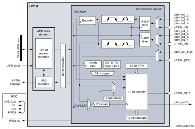
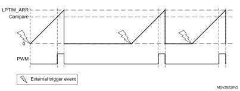
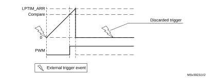
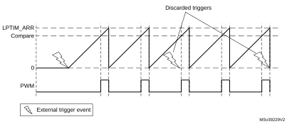

# 33 Low-power timer (LPTIM)

## 33.1 Introduction

The LPTIM is a 16-bit timer that benefits from the ultimate developments in power consumption reduction. Thanks to its diversity of clock sources, the LPTIM is able to keep running in all power modes except for Standby mode. Given its capability to run even with no internal clock source, the LPTIM can be used as a “Pulse Counter” which can be useful in some applications. Also, the LPTIM capability to wake up the system from low-power modes, makes it suitable to realize “Timeout functions” with extremely low power consumption.

The LPTIM introduces a flexible clock scheme that provides the needed functionalities and performance, while minimizing the power consumption.

## 33.2 LPTIM main features

- 16 bit upcounter
- 3-bit prescaler with 8 possible dividing factors (1,2,4,8,16,32,64,128)
- Selectable clock
 - Internal clock sources: configurable internal clock source (see RCC section)
 - External clock source over LPTIM input (working with no embedded oscillator running, used by Pulse Counter application)
- 16 bit ARR autoreload register
- 16 bit compare register
- Continuous/One-shot mode
- Selectable software/hardware input trigger
- Programmable Digital Glitch filter
- Configurable output: Pulse, PWM
- Configurable I/O polarity
- Encoder mode

## 33.3 LPTIM implementation

[Table 326](#XREF_90359__Table_209__STM32G4xx_LPTIM_features%1133) describes LPTIM implementation on STM32G4 series devices.

<table class="TableTitle" style="margin-bottom:10.00pt;"><caption class="TableTitle"><h4 class="TableCap" id="30815980">Table 326. STM32G4 series LPTIM features</h4></caption><col width="445.47px"/><col width="93.11px"/><thead><tr height="28.00px"><th>
LPTIM modes/features<a href="#c7amba%20lptimer1%20v1%20UserSpec_c7amba%20lptimer1%20v1%20UserSpec_FTH_1">1</a>
</th><th>
LPTIM1
</th></tr></thead><tr height="22.67px"><td>
Encoder mode
</td><td>
X
</td></tr></table>

<a href="#c7amba%20lptimer1%20v1%20UserSpec_c7amba%20lptimer1%20v1%20UserSpec_FTB_1">1.</a>X = supported.

## 33.4 LPTIM functional description

### 33.4.1 LPTIM block diagram

#### Figure 521. Low-power timer block diagram

1.lptim\_out is the internal LPTIM output signal that can be connected to internal peripherals.

### 33.4.2 LPTIM input and trigger mapping

The LPTIM external trigger and input connections are detailed hereafter:

<table class="TableTitle"><caption class="Body"><h4 class="TableCap" id="29419765">Table 327. <a id="connection33" name="XREF_12555__Table_211__LPTIM1_external_trigger_connection33">LPTIM1 external trigger connection</a></h4></caption><col width="269.29px"/><col width="269.29px"/><thead><tr height="28.00px"><th>
TRIGSEL
</th><th>
External trigger
</th></tr></thead><tr data-conditional="bigbirdie,birdie,dory,dory_vline,littlebirdie,littledory,littledory_vline,littleshark,RM0440,shark_dualcore,shark_singlecore,stm32g0x1_orcazero128k,stm32l010xx,stm32l0x1xx,stm32l0x2xx,stm32l0x3xx,stm32l43_44_45_46,stm32l4_orca_,stm32l4x6xx,stm32mp13xx,stm32mp151xx,stm32mp153xx,stm32mp157xx,tinydory,tinydory_vline,tinymantalp128k,tinymantalp1_5m,tinyshark" height="37.33px" style="display: none"><td data-conditional="bigbirdie,birdie,dory,dory_vline,littlebirdie,littledory,littledory_vline,littleshark,RM0440,shark_dualcore,shark_singlecore,stm32g0x1_orcazero128k,stm32l010xx,stm32l0x1xx,stm32l0x2xx,stm32l0x3xx,stm32l43_44_45_46,stm32l4_orca_,stm32l4x6xx,stm32mp13xx,stm32mp151xx,stm32mp153xx,stm32mp157xx,tinydory,tinydory_vline,tinymantalp128k,tinymantalp1_5m,tinyshark" style="display: none">
lptim_ext_trig0
</td><td data-conditional="bigbirdie,birdie,dory,dory_vline,littlebirdie,littledory,littledory_vline,littleshark,RM0440,shark_dualcore,shark_singlecore,stm32g0x1_orcazero128k,stm32l010xx,stm32l0x1xx,stm32l0x2xx,stm32l0x3xx,stm32l43_44_45_46,stm32l4_orca_,stm32l4x6xx,stm32mp13xx,stm32mp151xx,stm32mp153xx,stm32mp157xx,tinydory,tinydory_vline,tinymantalp128k,tinymantalp1_5m,tinyshark" style="display: none"></td></tr><tr data-conditional="bigbirdie,birdie,dory,dory_vline,littlebirdie,littledory,littledory_vline,littleshark,RM0440,shark_dualcore,shark_singlecore,stm32g0x1_orcazero128k,stm32l010xx,stm32l0x1xx,stm32l0x2xx,stm32l0x3xx,stm32l43_44_45_46,stm32l4_orca_,stm32l4x6xx,stm32mp13xx,stm32mp151xx,stm32mp153xx,stm32mp157xx,tinydory,tinydory_vline,tinymantalp128k,tinymantalp1_5m,tinyshark" height="22.67px" style="display: none"><td data-conditional="bigbirdie,birdie,dory,dory_vline,littlebirdie,littledory,littledory_vline,littleshark,RM0440,shark_dualcore,shark_singlecore,stm32g0x1_orcazero128k,stm32l010xx,stm32l0x1xx,stm32l0x2xx,stm32l0x3xx,stm32l43_44_45_46,stm32l4_orca_,stm32l4x6xx,stm32mp13xx,stm32mp151xx,stm32mp153xx,stm32mp157xx,tinydory,tinydory_vline,tinymantalp128k,tinymantalp1_5m,tinyshark" style="display: none">
lptim_ext_trig1
</td><td data-conditional="bigbirdie,birdie,dory,dory_vline,littlebirdie,littledory,littledory_vline,littleshark,RM0440,shark_dualcore,shark_singlecore,stm32g0x1_orcazero128k,stm32l010xx,stm32l0x1xx,stm32l0x2xx,stm32l0x3xx,stm32l43_44_45_46,stm32l4_orca_,stm32l4x6xx,stm32mp13xx,stm32mp151xx,stm32mp153xx,stm32mp157xx,tinydory,tinydory_vline,tinymantalp128k,tinymantalp1_5m,tinyshark" style="display: none">
RTC alarm A 
</td></tr><tr data-conditional="bigbirdie,birdie,dory,dory_vline,littlebirdie,littledory,littledory_vline,littleshark,RM0440,shark_dualcore,shark_singlecore,stm32g0x1_orcazero128k,stm32l010xx,stm32l0x1xx,stm32l0x2xx,stm32l0x3xx,stm32l43_44_45_46,stm32l4_orca_,stm32l4x6xx,stm32mp13xx,stm32mp151xx,stm32mp153xx,stm32mp157xx,tinydory,tinydory_vline,tinymantalp128k,tinymantalp1_5m,tinyshark" height="22.67px" style="display: none"><td data-conditional="bigbirdie,birdie,dory,dory_vline,littlebirdie,littledory,littledory_vline,littleshark,RM0440,shark_dualcore,shark_singlecore,stm32g0x1_orcazero128k,stm32l010xx,stm32l0x1xx,stm32l0x2xx,stm32l0x3xx,stm32l43_44_45_46,stm32l4_orca_,stm32l4x6xx,stm32mp13xx,stm32mp151xx,stm32mp153xx,stm32mp157xx,tinydory,tinydory_vline,tinymantalp128k,tinymantalp1_5m,tinyshark" style="display: none">
lptim_ext_trig2
</td><td data-conditional="bigbirdie,birdie,dory,dory_vline,littlebirdie,littledory,littledory_vline,littleshark,RM0440,shark_dualcore,shark_singlecore,stm32g0x1_orcazero128k,stm32l010xx,stm32l0x1xx,stm32l0x2xx,stm32l0x3xx,stm32l43_44_45_46,stm32l4_orca_,stm32l4x6xx,stm32mp13xx,stm32mp151xx,stm32mp153xx,stm32mp157xx,tinydory,tinydory_vline,tinymantalp128k,tinymantalp1_5m,tinyshark" style="display: none">
RTC alarm B
</td></tr><tr data-conditional="bigbirdie,birdie,dory,dory_vline,littlebirdie,littledory,littledory_vline,littleshark,RM0440,shark_dualcore,shark_singlecore,stm32g0x1_orcazero128k,stm32l010xx,stm32l0x1xx,stm32l0x2xx,stm32l0x3xx,stm32l43_44_45_46,stm32l4_orca_,stm32l4x6xx,stm32mp13xx,stm32mp151xx,stm32mp153xx,stm32mp157xx,tinydory,tinydory_vline,tinymantalp128k,tinymantalp1_5m,tinyshark" height="22.67px" style="display: none"><td data-conditional="bigbirdie,birdie,dory,dory_vline,littlebirdie,littledory,littledory_vline,littleshark,RM0440,shark_dualcore,shark_singlecore,stm32g0x1_orcazero128k,stm32l010xx,stm32l0x1xx,stm32l0x2xx,stm32l0x3xx,stm32l43_44_45_46,stm32l4_orca_,stm32l4x6xx,stm32mp13xx,stm32mp151xx,stm32mp153xx,stm32mp157xx,tinydory,tinydory_vline,tinymantalp128k,tinymantalp1_5m,tinyshark" style="display: none">
lptim_ext_trig3
</td><td data-conditional="bigbirdie,birdie,dory,dory_vline,littlebirdie,littledory,littledory_vline,littleshark,RM0440,shark_dualcore,shark_singlecore,stm32g0x1_orcazero128k,stm32l010xx,stm32l0x1xx,stm32l0x2xx,stm32l0x3xx,stm32l43_44_45_46,stm32l4_orca_,stm32l4x6xx,stm32mp13xx,stm32mp151xx,stm32mp153xx,stm32mp157xx,tinydory,tinydory_vline,tinymantalp128k,tinymantalp1_5m,tinyshark" style="display: none">
RTC_TAMP1 input detection
</td></tr><tr data-conditional="bigbirdie,birdie,dory,dory_vline,littlebirdie,littledory,littledory_vline,littleshark,RM0440,shark_dualcore,shark_singlecore,stm32g0x1_orcazero128k,stm32l010xx,stm32l0x1xx,stm32l0x2xx,stm32l0x3xx,stm32l43_44_45_46,stm32l4_orca_,stm32l4x6xx,stm32mp13xx,stm32mp151xx,stm32mp153xx,stm32mp157xx,tinydory,tinydory_vline,tinymantalp128k,tinymantalp1_5m,tinyshark" height="22.67px" style="display: none"><td data-conditional="bigbirdie,birdie,dory,dory_vline,littlebirdie,littledory,littledory_vline,littleshark,RM0440,shark_dualcore,shark_singlecore,stm32g0x1_orcazero128k,stm32l010xx,stm32l0x1xx,stm32l0x2xx,stm32l0x3xx,stm32l43_44_45_46,stm32l4_orca_,stm32l4x6xx,stm32mp13xx,stm32mp151xx,stm32mp153xx,stm32mp157xx,tinydory,tinydory_vline,tinymantalp128k,tinymantalp1_5m,tinyshark" style="display: none">
lptim_ext_trig4
</td><td data-conditional="bigbirdie,birdie,dory,dory_vline,littlebirdie,littledory,littledory_vline,littleshark,RM0440,shark_dualcore,shark_singlecore,stm32g0x1_orcazero128k,stm32l010xx,stm32l0x1xx,stm32l0x2xx,stm32l0x3xx,stm32l43_44_45_46,stm32l4_orca_,stm32l4x6xx,stm32mp13xx,stm32mp151xx,stm32mp153xx,stm32mp157xx,tinydory,tinydory_vline,tinymantalp128k,tinymantalp1_5m,tinyshark" style="display: none">
RTC_TAMP2 input detection
</td></tr><tr data-conditional="bigbirdie,birdie,dory,dory_vline,littlebirdie,littledory,littledory_vline,littleshark,RM0440,shark_dualcore,shark_singlecore,stm32g0x1_orcazero128k,stm32l010xx,stm32l0x1xx,stm32l0x2xx,stm32l0x3xx,stm32l43_44_45_46,stm32l4_orca_,stm32l4x6xx,stm32mp13xx,stm32mp151xx,stm32mp153xx,stm32mp157xx,tinydory,tinydory_vline,tinymantalp128k,tinymantalp1_5m,tinyshark" height="22.67px" style="display: none"><td data-conditional="bigbirdie,birdie,dory,dory_vline,littlebirdie,littledory,littledory_vline,littleshark,RM0440,shark_dualcore,shark_singlecore,stm32g0x1_orcazero128k,stm32l010xx,stm32l0x1xx,stm32l0x2xx,stm32l0x3xx,stm32l43_44_45_46,stm32l4_orca_,stm32l4x6xx,stm32mp13xx,stm32mp151xx,stm32mp153xx,stm32mp157xx,tinydory,tinydory_vline,tinymantalp128k,tinymantalp1_5m,tinyshark" style="display: none">
lptim_ext_trig5
</td><td data-conditional="bigbirdie,birdie,dory,dory_vline,littlebirdie,littledory,littledory_vline,littleshark,RM0440,shark_dualcore,shark_singlecore,stm32g0x1_orcazero128k,stm32l010xx,stm32l0x1xx,stm32l0x2xx,stm32l0x3xx,stm32l43_44_45_46,stm32l4_orca_,stm32l4x6xx,stm32mp13xx,stm32mp151xx,stm32mp153xx,stm32mp157xx,tinydory,tinydory_vline,tinymantalp128k,tinymantalp1_5m,tinyshark" style="display: none">
RTC_TAMP3 input detection
</td></tr><tr data-conditional="bigbirdie,birdie,dory,dory_vline,littlebirdie,littledory,littledory_vline,littleshark,RM0440,shark_dualcore,shark_singlecore,stm32g0x1_orcazero128k,stm32l010xx,stm32l0x1xx,stm32l0x2xx,stm32l0x3xx,stm32l43_44_45_46,stm32l4_orca_,stm32l4x6xx,stm32mp13xx,stm32mp151xx,stm32mp153xx,stm32mp157xx,tinydory,tinydory_vline,tinymantalp128k,tinymantalp1_5m,tinyshark" height="22.67px" style="display: none"><td data-conditional="bigbirdie,birdie,dory,dory_vline,littlebirdie,littledory,littledory_vline,littleshark,RM0440,shark_dualcore,shark_singlecore,stm32g0x1_orcazero128k,stm32l010xx,stm32l0x1xx,stm32l0x2xx,stm32l0x3xx,stm32l43_44_45_46,stm32l4_orca_,stm32l4x6xx,stm32mp13xx,stm32mp151xx,stm32mp153xx,stm32mp157xx,tinydory,tinydory_vline,tinymantalp128k,tinymantalp1_5m,tinyshark" style="display: none">
lptim_ext_trig6
</td><td data-conditional="bigbirdie,birdie,dory,dory_vline,littlebirdie,littledory,littledory_vline,littleshark,RM0440,shark_dualcore,shark_singlecore,stm32g0x1_orcazero128k,stm32l010xx,stm32l0x1xx,stm32l0x2xx,stm32l0x3xx,stm32l43_44_45_46,stm32l4_orca_,stm32l4x6xx,stm32mp13xx,stm32mp151xx,stm32mp153xx,stm32mp157xx,tinydory,tinydory_vline,tinymantalp128k,tinymantalp1_5m,tinyshark" style="display: none">
 COMP1_OUT
</td></tr><tr data-conditional="bigbirdie,birdie,dory,dory_vline,littlebirdie,littledory,littledory_vline,littleshark,RM0440,shark_dualcore,shark_singlecore,stm32g0x1_orcazero128k,stm32l010xx,stm32l0x1xx,stm32l0x2xx,stm32l0x3xx,stm32l43_44_45_46,stm32l4_orca_,stm32l4x6xx,stm32mp13xx,stm32mp151xx,stm32mp153xx,stm32mp157xx,tinydory,tinydory_vline,tinymantalp128k,tinymantalp1_5m,tinyshark" height="22.67px" style="display: none"><td data-conditional="bigbirdie,birdie,dory,dory_vline,littlebirdie,littledory,littledory_vline,littleshark,RM0440,shark_dualcore,shark_singlecore,stm32g0x1_orcazero128k,stm32l010xx,stm32l0x1xx,stm32l0x2xx,stm32l0x3xx,stm32l43_44_45_46,stm32l4_orca_,stm32l4x6xx,stm32mp13xx,stm32mp151xx,stm32mp153xx,stm32mp157xx,tinydory,tinydory_vline,tinymantalp128k,tinymantalp1_5m,tinyshark" style="display: none">
lptim_ext_trig7
</td><td data-conditional="bigbirdie,birdie,dory,dory_vline,littlebirdie,littledory,littledory_vline,littleshark,RM0440,shark_dualcore,shark_singlecore,stm32g0x1_orcazero128k,stm32l010xx,stm32l0x1xx,stm32l0x2xx,stm32l0x3xx,stm32l43_44_45_46,stm32l4_orca_,stm32l4x6xx,stm32mp13xx,stm32mp151xx,stm32mp153xx,stm32mp157xx,tinydory,tinydory_vline,tinymantalp128k,tinymantalp1_5m,tinyshark" style="display: none">
COMP2_OUT
</td></tr><tr data-conditional="bigbirdie,birdie,dory,dory_vline,littlebirdie,littledory,littledory_vline,littleshark,RM0440,shark_dualcore,shark_singlecore,stm32g0x1_orcazero128k,stm32l010xx,stm32l0x1xx,stm32l0x2xx,stm32l0x3xx,stm32l43_44_45_46,stm32l4_orca_,stm32l4x6xx,stm32mp13xx,stm32mp151xx,stm32mp153xx,stm32mp157xx,tinydory,tinydory_vline,tinymantalp128k,tinymantalp1_5m,tinyshark" height="22.67px" style="display: none"><td data-conditional="bigbirdie,birdie,dory,dory_vline,littlebirdie,littledory,littledory_vline,littleshark,RM0440,shark_dualcore,shark_singlecore,stm32g0x1_orcazero128k,stm32l010xx,stm32l0x1xx,stm32l0x2xx,stm32l0x3xx,stm32l43_44_45_46,stm32l4_orca_,stm32l4x6xx,stm32mp13xx,stm32mp151xx,stm32mp153xx,stm32mp157xx,tinydory,tinydory_vline,tinymantalp128k,tinymantalp1_5m,tinyshark" style="display: none">
lptim_ext_trig0
</td><td data-conditional="bigbirdie,birdie,dory,dory_vline,littlebirdie,littledory,littledory_vline,littleshark,RM0440,shark_dualcore,shark_singlecore,stm32g0x1_orcazero128k,stm32l010xx,stm32l0x1xx,stm32l0x2xx,stm32l0x3xx,stm32l43_44_45_46,stm32l4_orca_,stm32l4x6xx,stm32mp13xx,stm32mp151xx,stm32mp153xx,stm32mp157xx,tinydory,tinydory_vline,tinymantalp128k,tinymantalp1_5m,tinyshark" style="display: none">
GPIO
</td></tr><tr data-conditional="bigbirdie,birdie,dory,dory_vline,littlebirdie,littledory,littledory_vline,littleshark,RM0440,shark_dualcore,shark_singlecore,stm32g0x1_orcazero128k,stm32l010xx,stm32l0x1xx,stm32l0x2xx,stm32l0x3xx,stm32l43_44_45_46,stm32l4_orca_,stm32l4x6xx,stm32mp13xx,stm32mp151xx,stm32mp153xx,stm32mp157xx,tinydory,tinydory_vline,tinymantalp128k,tinymantalp1_5m,tinyshark" height="22.67px" style="display: none"><td data-conditional="bigbirdie,birdie,dory,dory_vline,littlebirdie,littledory,littledory_vline,littleshark,RM0440,shark_dualcore,shark_singlecore,stm32g0x1_orcazero128k,stm32l010xx,stm32l0x1xx,stm32l0x2xx,stm32l0x3xx,stm32l43_44_45_46,stm32l4_orca_,stm32l4x6xx,stm32mp13xx,stm32mp151xx,stm32mp153xx,stm32mp157xx,tinydory,tinydory_vline,tinymantalp128k,tinymantalp1_5m,tinyshark" style="display: none">
lptim_ext_trig1
</td><td data-conditional="bigbirdie,birdie,dory,dory_vline,littlebirdie,littledory,littledory_vline,littleshark,RM0440,shark_dualcore,shark_singlecore,stm32g0x1_orcazero128k,stm32l010xx,stm32l0x1xx,stm32l0x2xx,stm32l0x3xx,stm32l43_44_45_46,stm32l4_orca_,stm32l4x6xx,stm32mp13xx,stm32mp151xx,stm32mp153xx,stm32mp157xx,tinydory,tinydory_vline,tinymantalp128k,tinymantalp1_5m,tinyshark" style="display: none">
RTC alarm A 
</td></tr><tr data-conditional="bigbirdie,birdie,dory,dory_vline,littlebirdie,littledory,littledory_vline,littleshark,RM0440,shark_dualcore,shark_singlecore,stm32g0x1_orcazero128k,stm32l010xx,stm32l0x1xx,stm32l0x2xx,stm32l0x3xx,stm32l43_44_45_46,stm32l4_orca_,stm32l4x6xx,stm32mp13xx,stm32mp151xx,stm32mp153xx,stm32mp157xx,tinydory,tinydory_vline,tinymantalp128k,tinymantalp1_5m,tinyshark" height="22.67px" style="display: none"><td data-conditional="bigbirdie,birdie,dory,dory_vline,littlebirdie,littledory,littledory_vline,littleshark,RM0440,shark_dualcore,shark_singlecore,stm32g0x1_orcazero128k,stm32l010xx,stm32l0x1xx,stm32l0x2xx,stm32l0x3xx,stm32l43_44_45_46,stm32l4_orca_,stm32l4x6xx,stm32mp13xx,stm32mp151xx,stm32mp153xx,stm32mp157xx,tinydory,tinydory_vline,tinymantalp128k,tinymantalp1_5m,tinyshark" style="display: none">
lptim_ext_trig2
</td><td data-conditional="bigbirdie,birdie,dory,dory_vline,littlebirdie,littledory,littledory_vline,littleshark,RM0440,shark_dualcore,shark_singlecore,stm32g0x1_orcazero128k,stm32l010xx,stm32l0x1xx,stm32l0x2xx,stm32l0x3xx,stm32l43_44_45_46,stm32l4_orca_,stm32l4x6xx,stm32mp13xx,stm32mp151xx,stm32mp153xx,stm32mp157xx,tinydory,tinydory_vline,tinymantalp128k,tinymantalp1_5m,tinyshark" style="display: none">
RTC alarm B
</td></tr><tr data-conditional="bigbirdie,birdie,dory,dory_vline,littlebirdie,littledory,littledory_vline,littleshark,RM0440,shark_dualcore,shark_singlecore,stm32g0x1_orcazero128k,stm32l010xx,stm32l0x1xx,stm32l0x2xx,stm32l0x3xx,stm32l43_44_45_46,stm32l4_orca_,stm32l4x6xx,stm32mp13xx,stm32mp151xx,stm32mp153xx,stm32mp157xx,tinydory,tinydory_vline,tinymantalp128k,tinymantalp1_5m,tinyshark" height="22.67px" style="display: none"><td data-conditional="bigbirdie,birdie,dory,dory_vline,littlebirdie,littledory,littledory_vline,littleshark,RM0440,shark_dualcore,shark_singlecore,stm32g0x1_orcazero128k,stm32l010xx,stm32l0x1xx,stm32l0x2xx,stm32l0x3xx,stm32l43_44_45_46,stm32l4_orca_,stm32l4x6xx,stm32mp13xx,stm32mp151xx,stm32mp153xx,stm32mp157xx,tinydory,tinydory_vline,tinymantalp128k,tinymantalp1_5m,tinyshark" style="display: none">
lptim_ext_trig3
</td><td data-conditional="bigbirdie,birdie,dory,dory_vline,littlebirdie,littledory,littledory_vline,littleshark,RM0440,shark_dualcore,shark_singlecore,stm32g0x1_orcazero128k,stm32l010xx,stm32l0x1xx,stm32l0x2xx,stm32l0x3xx,stm32l43_44_45_46,stm32l4_orca_,stm32l4x6xx,stm32mp13xx,stm32mp151xx,stm32mp153xx,stm32mp157xx,tinydory,tinydory_vline,tinymantalp128k,tinymantalp1_5m,tinyshark" style="display: none">
RTC_TAMP1 input detection
</td></tr><tr data-conditional="bigbirdie,birdie,dory,dory_vline,littlebirdie,littledory,littledory_vline,littleshark,RM0440,shark_dualcore,shark_singlecore,stm32g0x1_orcazero128k,stm32l010xx,stm32l0x1xx,stm32l0x2xx,stm32l0x3xx,stm32l43_44_45_46,stm32l4_orca_,stm32l4x6xx,stm32mp13xx,stm32mp151xx,stm32mp153xx,stm32mp157xx,tinydory,tinydory_vline,tinymantalp128k,tinymantalp1_5m,tinyshark" height="22.67px" style="display: none"><td data-conditional="bigbirdie,birdie,dory,dory_vline,littlebirdie,littledory,littledory_vline,littleshark,RM0440,shark_dualcore,shark_singlecore,stm32g0x1_orcazero128k,stm32l010xx,stm32l0x1xx,stm32l0x2xx,stm32l0x3xx,stm32l43_44_45_46,stm32l4_orca_,stm32l4x6xx,stm32mp13xx,stm32mp151xx,stm32mp153xx,stm32mp157xx,tinydory,tinydory_vline,tinymantalp128k,tinymantalp1_5m,tinyshark" style="display: none">
lptim_ext_trig4
</td><td data-conditional="bigbirdie,birdie,dory,dory_vline,littlebirdie,littledory,littledory_vline,littleshark,RM0440,shark_dualcore,shark_singlecore,stm32g0x1_orcazero128k,stm32l010xx,stm32l0x1xx,stm32l0x2xx,stm32l0x3xx,stm32l43_44_45_46,stm32l4_orca_,stm32l4x6xx,stm32mp13xx,stm32mp151xx,stm32mp153xx,stm32mp157xx,tinydory,tinydory_vline,tinymantalp128k,tinymantalp1_5m,tinyshark" style="display: none">
RTC_TAMP2 input detection
</td></tr><tr data-conditional="bigbirdie,birdie,dory,dory_vline,littlebirdie,littledory,littledory_vline,littleshark,RM0440,shark_dualcore,shark_singlecore,stm32g0x1_orcazero128k,stm32l010xx,stm32l0x1xx,stm32l0x2xx,stm32l0x3xx,stm32l43_44_45_46,stm32l4_orca_,stm32l4x6xx,stm32mp13xx,stm32mp151xx,stm32mp153xx,stm32mp157xx,tinydory,tinydory_vline,tinymantalp128k,tinymantalp1_5m,tinyshark" height="22.67px" style="display: none"><td data-conditional="bigbirdie,birdie,dory,dory_vline,littlebirdie,littledory,littledory_vline,littleshark,RM0440,shark_dualcore,shark_singlecore,stm32g0x1_orcazero128k,stm32l010xx,stm32l0x1xx,stm32l0x2xx,stm32l0x3xx,stm32l43_44_45_46,stm32l4_orca_,stm32l4x6xx,stm32mp13xx,stm32mp151xx,stm32mp153xx,stm32mp157xx,tinydory,tinydory_vline,tinymantalp128k,tinymantalp1_5m,tinyshark" style="display: none">
lptim_ext_trig5
</td><td data-conditional="bigbirdie,birdie,dory,dory_vline,littlebirdie,littledory,littledory_vline,littleshark,RM0440,shark_dualcore,shark_singlecore,stm32g0x1_orcazero128k,stm32l010xx,stm32l0x1xx,stm32l0x2xx,stm32l0x3xx,stm32l43_44_45_46,stm32l4_orca_,stm32l4x6xx,stm32mp13xx,stm32mp151xx,stm32mp153xx,stm32mp157xx,tinydory,tinydory_vline,tinymantalp128k,tinymantalp1_5m,tinyshark" style="display: none">
RTC_TAMP3 input detection
</td></tr><tr data-conditional="bigbirdie,birdie,dory,dory_vline,littlebirdie,littledory,littledory_vline,littleshark,RM0440,shark_dualcore,shark_singlecore,stm32g0x1_orcazero128k,stm32l010xx,stm32l0x1xx,stm32l0x2xx,stm32l0x3xx,stm32l43_44_45_46,stm32l4_orca_,stm32l4x6xx,stm32mp13xx,stm32mp151xx,stm32mp153xx,stm32mp157xx,tinydory,tinydory_vline,tinymantalp128k,tinymantalp1_5m,tinyshark" height="22.67px" style="display: none"><td data-conditional="bigbirdie,birdie,dory,dory_vline,littlebirdie,littledory,littledory_vline,littleshark,RM0440,shark_dualcore,shark_singlecore,stm32g0x1_orcazero128k,stm32l010xx,stm32l0x1xx,stm32l0x2xx,stm32l0x3xx,stm32l43_44_45_46,stm32l4_orca_,stm32l4x6xx,stm32mp13xx,stm32mp151xx,stm32mp153xx,stm32mp157xx,tinydory,tinydory_vline,tinymantalp128k,tinymantalp1_5m,tinyshark" style="display: none">
lptim_ext_trig6
</td><td data-conditional="bigbirdie,birdie,dory,dory_vline,littlebirdie,littledory,littledory_vline,littleshark,RM0440,shark_dualcore,shark_singlecore,stm32g0x1_orcazero128k,stm32l010xx,stm32l0x1xx,stm32l0x2xx,stm32l0x3xx,stm32l43_44_45_46,stm32l4_orca_,stm32l4x6xx,stm32mp13xx,stm32mp151xx,stm32mp153xx,stm32mp157xx,tinydory,tinydory_vline,tinymantalp128k,tinymantalp1_5m,tinyshark" style="display: none">
 COMP1_OUT
</td></tr><tr data-conditional="bigbirdie,birdie,dory,dory_vline,littlebirdie,littledory,littledory_vline,littleshark,RM0440,shark_dualcore,shark_singlecore,stm32g0x1_orcazero128k,stm32l010xx,stm32l0x1xx,stm32l0x2xx,stm32l0x3xx,stm32l43_44_45_46,stm32l4_orca_,stm32l4x6xx,stm32mp13xx,stm32mp151xx,stm32mp153xx,stm32mp157xx,tinydory,tinydory_vline,tinymantalp128k,tinymantalp1_5m,tinyshark" height="22.67px" style="display: none"><td data-conditional="bigbirdie,birdie,dory,dory_vline,littlebirdie,littledory,littledory_vline,littleshark,RM0440,shark_dualcore,shark_singlecore,stm32g0x1_orcazero128k,stm32l010xx,stm32l0x1xx,stm32l0x2xx,stm32l0x3xx,stm32l43_44_45_46,stm32l4_orca_,stm32l4x6xx,stm32mp13xx,stm32mp151xx,stm32mp153xx,stm32mp157xx,tinydory,tinydory_vline,tinymantalp128k,tinymantalp1_5m,tinyshark" style="display: none">
lptim_ext_trig7
</td><td data-conditional="bigbirdie,birdie,dory,dory_vline,littlebirdie,littledory,littledory_vline,littleshark,RM0440,shark_dualcore,shark_singlecore,stm32g0x1_orcazero128k,stm32l010xx,stm32l0x1xx,stm32l0x2xx,stm32l0x3xx,stm32l43_44_45_46,stm32l4_orca_,stm32l4x6xx,stm32mp13xx,stm32mp151xx,stm32mp153xx,stm32mp157xx,tinydory,tinydory_vline,tinymantalp128k,tinymantalp1_5m,tinyshark" style="display: none">
COMP2_OUT
</td></tr><tr data-conditional="bigbirdie,birdie,dory,dory_vline,littlebirdie,littledory,littledory_vline,littleshark,RM0440,shark_dualcore,shark_singlecore,stm32g0x1_orcazero128k,stm32l010xx,stm32l0x1xx,stm32l0x2xx,stm32l0x3xx,stm32l43_44_45_46,stm32l4_orca_,stm32l4x6xx,stm32mp13xx,stm32mp151xx,stm32mp153xx,stm32mp157xx,tinydory,tinydory_vline,tinymantalp128k,tinymantalp1_5m,tinyshark" height="22.67px" style="display: none"><td data-conditional="bigbirdie,birdie,dory,dory_vline,littlebirdie,littledory,littledory_vline,littleshark,RM0440,shark_dualcore,shark_singlecore,stm32g0x1_orcazero128k,stm32l010xx,stm32l0x1xx,stm32l0x2xx,stm32l0x3xx,stm32l43_44_45_46,stm32l4_orca_,stm32l4x6xx,stm32mp13xx,stm32mp151xx,stm32mp153xx,stm32mp157xx,tinydory,tinydory_vline,tinymantalp128k,tinymantalp1_5m,tinyshark" style="display: none">
lptim_ext_trig0
</td><td data-conditional="bigbirdie,birdie,dory,dory_vline,littlebirdie,littledory,littledory_vline,littleshark,RM0440,shark_dualcore,shark_singlecore,stm32g0x1_orcazero128k,stm32l010xx,stm32l0x1xx,stm32l0x2xx,stm32l0x3xx,stm32l43_44_45_46,stm32l4_orca_,stm32l4x6xx,stm32mp13xx,stm32mp151xx,stm32mp153xx,stm32mp157xx,tinydory,tinydory_vline,tinymantalp128k,tinymantalp1_5m,tinyshark" style="display: none">
GPIO
</td></tr><tr data-conditional="bigbirdie,birdie,dory,dory_vline,littlebirdie,littledory,littledory_vline,littleshark,RM0440,shark_dualcore,shark_singlecore,stm32g0x1_orcazero128k,stm32l010xx,stm32l0x1xx,stm32l0x2xx,stm32l0x3xx,stm32l43_44_45_46,stm32l4_orca_,stm32l4x6xx,stm32mp13xx,stm32mp151xx,stm32mp153xx,stm32mp157xx,tinydory,tinydory_vline,tinymantalp128k,tinymantalp1_5m,tinyshark" height="22.67px" style="display: none"><td data-conditional="bigbirdie,birdie,dory,dory_vline,littlebirdie,littledory,littledory_vline,littleshark,RM0440,shark_dualcore,shark_singlecore,stm32g0x1_orcazero128k,stm32l010xx,stm32l0x1xx,stm32l0x2xx,stm32l0x3xx,stm32l43_44_45_46,stm32l4_orca_,stm32l4x6xx,stm32mp13xx,stm32mp151xx,stm32mp153xx,stm32mp157xx,tinydory,tinydory_vline,tinymantalp128k,tinymantalp1_5m,tinyshark" style="display: none">
lptim_ext_trig1
</td><td data-conditional="bigbirdie,birdie,dory,dory_vline,littlebirdie,littledory,littledory_vline,littleshark,RM0440,shark_dualcore,shark_singlecore,stm32g0x1_orcazero128k,stm32l010xx,stm32l0x1xx,stm32l0x2xx,stm32l0x3xx,stm32l43_44_45_46,stm32l4_orca_,stm32l4x6xx,stm32mp13xx,stm32mp151xx,stm32mp153xx,stm32mp157xx,tinydory,tinydory_vline,tinymantalp128k,tinymantalp1_5m,tinyshark" style="display: none">
RTC alarm A 
</td></tr><tr data-conditional="bigbirdie,birdie,dory,dory_vline,littlebirdie,littledory,littledory_vline,littleshark,RM0440,shark_dualcore,shark_singlecore,stm32g0x1_orcazero128k,stm32l010xx,stm32l0x1xx,stm32l0x2xx,stm32l0x3xx,stm32l43_44_45_46,stm32l4_orca_,stm32l4x6xx,stm32mp13xx,stm32mp151xx,stm32mp153xx,stm32mp157xx,tinydory,tinydory_vline,tinymantalp128k,tinymantalp1_5m,tinyshark" height="22.67px" style="display: none"><td data-conditional="bigbirdie,birdie,dory,dory_vline,littlebirdie,littledory,littledory_vline,littleshark,RM0440,shark_dualcore,shark_singlecore,stm32g0x1_orcazero128k,stm32l010xx,stm32l0x1xx,stm32l0x2xx,stm32l0x3xx,stm32l43_44_45_46,stm32l4_orca_,stm32l4x6xx,stm32mp13xx,stm32mp151xx,stm32mp153xx,stm32mp157xx,tinydory,tinydory_vline,tinymantalp128k,tinymantalp1_5m,tinyshark" style="display: none">
lptim_ext_trig2
</td><td data-conditional="bigbirdie,birdie,dory,dory_vline,littlebirdie,littledory,littledory_vline,littleshark,RM0440,shark_dualcore,shark_singlecore,stm32g0x1_orcazero128k,stm32l010xx,stm32l0x1xx,stm32l0x2xx,stm32l0x3xx,stm32l43_44_45_46,stm32l4_orca_,stm32l4x6xx,stm32mp13xx,stm32mp151xx,stm32mp153xx,stm32mp157xx,tinydory,tinydory_vline,tinymantalp128k,tinymantalp1_5m,tinyshark" style="display: none">
RTC alarm B
</td></tr><tr data-conditional="bigbirdie,birdie,dory,dory_vline,littlebirdie,littledory,littledory_vline,littleshark,RM0440,shark_dualcore,shark_singlecore,stm32g0x1_orcazero128k,stm32l010xx,stm32l0x1xx,stm32l0x2xx,stm32l0x3xx,stm32l43_44_45_46,stm32l4_orca_,stm32l4x6xx,stm32mp13xx,stm32mp151xx,stm32mp153xx,stm32mp157xx,tinydory,tinydory_vline,tinymantalp128k,tinymantalp1_5m,tinyshark" height="22.67px" style="display: none"><td data-conditional="bigbirdie,birdie,dory,dory_vline,littlebirdie,littledory,littledory_vline,littleshark,RM0440,shark_dualcore,shark_singlecore,stm32g0x1_orcazero128k,stm32l010xx,stm32l0x1xx,stm32l0x2xx,stm32l0x3xx,stm32l43_44_45_46,stm32l4_orca_,stm32l4x6xx,stm32mp13xx,stm32mp151xx,stm32mp153xx,stm32mp157xx,tinydory,tinydory_vline,tinymantalp128k,tinymantalp1_5m,tinyshark" style="display: none">
lptim_ext_trig3
</td><td data-conditional="bigbirdie,birdie,dory,dory_vline,littlebirdie,littledory,littledory_vline,littleshark,RM0440,shark_dualcore,shark_singlecore,stm32g0x1_orcazero128k,stm32l010xx,stm32l0x1xx,stm32l0x2xx,stm32l0x3xx,stm32l43_44_45_46,stm32l4_orca_,stm32l4x6xx,stm32mp13xx,stm32mp151xx,stm32mp153xx,stm32mp157xx,tinydory,tinydory_vline,tinymantalp128k,tinymantalp1_5m,tinyshark" style="display: none">
Not connected
</td></tr><tr data-conditional="bigbirdie,birdie,dory,dory_vline,littlebirdie,littledory,littledory_vline,littleshark,RM0440,shark_dualcore,shark_singlecore,stm32g0x1_orcazero128k,stm32l010xx,stm32l0x1xx,stm32l0x2xx,stm32l0x3xx,stm32l43_44_45_46,stm32l4_orca_,stm32l4x6xx,stm32mp13xx,stm32mp151xx,stm32mp153xx,stm32mp157xx,tinydory,tinydory_vline,tinymantalp128k,tinymantalp1_5m,tinyshark" height="22.67px" style="display: none"><td data-conditional="bigbirdie,birdie,dory,dory_vline,littlebirdie,littledory,littledory_vline,littleshark,RM0440,shark_dualcore,shark_singlecore,stm32g0x1_orcazero128k,stm32l010xx,stm32l0x1xx,stm32l0x2xx,stm32l0x3xx,stm32l43_44_45_46,stm32l4_orca_,stm32l4x6xx,stm32mp13xx,stm32mp151xx,stm32mp153xx,stm32mp157xx,tinydory,tinydory_vline,tinymantalp128k,tinymantalp1_5m,tinyshark" style="display: none">
lptim_ext_trig4
</td><td data-conditional="bigbirdie,birdie,dory,dory_vline,littlebirdie,littledory,littledory_vline,littleshark,RM0440,shark_dualcore,shark_singlecore,stm32g0x1_orcazero128k,stm32l010xx,stm32l0x1xx,stm32l0x2xx,stm32l0x3xx,stm32l43_44_45_46,stm32l4_orca_,stm32l4x6xx,stm32mp13xx,stm32mp151xx,stm32mp153xx,stm32mp157xx,tinydory,tinydory_vline,tinymantalp128k,tinymantalp1_5m,tinyshark" style="display: none">
RTC_TAMP2 input detection
</td></tr><tr data-conditional="bigbirdie,birdie,dory,dory_vline,littlebirdie,littledory,littledory_vline,littleshark,RM0440,shark_dualcore,shark_singlecore,stm32g0x1_orcazero128k,stm32l010xx,stm32l0x1xx,stm32l0x2xx,stm32l0x3xx,stm32l43_44_45_46,stm32l4_orca_,stm32l4x6xx,stm32mp13xx,stm32mp151xx,stm32mp153xx,stm32mp157xx,tinydory,tinydory_vline,tinymantalp128k,tinymantalp1_5m,tinyshark" height="22.67px" style="display: none"><td data-conditional="bigbirdie,birdie,dory,dory_vline,littlebirdie,littledory,littledory_vline,littleshark,RM0440,shark_dualcore,shark_singlecore,stm32g0x1_orcazero128k,stm32l010xx,stm32l0x1xx,stm32l0x2xx,stm32l0x3xx,stm32l43_44_45_46,stm32l4_orca_,stm32l4x6xx,stm32mp13xx,stm32mp151xx,stm32mp153xx,stm32mp157xx,tinydory,tinydory_vline,tinymantalp128k,tinymantalp1_5m,tinyshark" style="display: none">
lptim_ext_trig5
</td><td data-conditional="bigbirdie,birdie,dory,dory_vline,littlebirdie,littledory,littledory_vline,littleshark,RM0440,shark_dualcore,shark_singlecore,stm32g0x1_orcazero128k,stm32l010xx,stm32l0x1xx,stm32l0x2xx,stm32l0x3xx,stm32l43_44_45_46,stm32l4_orca_,stm32l4x6xx,stm32mp13xx,stm32mp151xx,stm32mp153xx,stm32mp157xx,tinydory,tinydory_vline,tinymantalp128k,tinymantalp1_5m,tinyshark" style="display: none">
Not connected
</td></tr><tr data-conditional="bigbirdie,birdie,dory,dory_vline,littlebirdie,littledory,littledory_vline,littleshark,RM0440,shark_dualcore,shark_singlecore,stm32g0x1_orcazero128k,stm32l010xx,stm32l0x1xx,stm32l0x2xx,stm32l0x3xx,stm32l43_44_45_46,stm32l4_orca_,stm32l4x6xx,stm32mp13xx,stm32mp151xx,stm32mp153xx,stm32mp157xx,tinydory,tinydory_vline,tinymantalp128k,tinymantalp1_5m,tinyshark" height="22.67px" style="display: none"><td data-conditional="bigbirdie,birdie,dory,dory_vline,littlebirdie,littledory,littledory_vline,littleshark,RM0440,shark_dualcore,shark_singlecore,stm32g0x1_orcazero128k,stm32l010xx,stm32l0x1xx,stm32l0x2xx,stm32l0x3xx,stm32l43_44_45_46,stm32l4_orca_,stm32l4x6xx,stm32mp13xx,stm32mp151xx,stm32mp153xx,stm32mp157xx,tinydory,tinydory_vline,tinymantalp128k,tinymantalp1_5m,tinyshark" style="display: none">
lptim_ext_trig6
</td><td data-conditional="bigbirdie,birdie,dory,dory_vline,littlebirdie,littledory,littledory_vline,littleshark,RM0440,shark_dualcore,shark_singlecore,stm32g0x1_orcazero128k,stm32l010xx,stm32l0x1xx,stm32l0x2xx,stm32l0x3xx,stm32l43_44_45_46,stm32l4_orca_,stm32l4x6xx,stm32mp13xx,stm32mp151xx,stm32mp153xx,stm32mp157xx,tinydory,tinydory_vline,tinymantalp128k,tinymantalp1_5m,tinyshark" style="display: none">
Not connected
</td></tr><tr data-conditional="bigbirdie,birdie,dory,dory_vline,littlebirdie,littledory,littledory_vline,littleshark,RM0440,shark_dualcore,shark_singlecore,stm32g0x1_orcazero128k,stm32l010xx,stm32l0x1xx,stm32l0x2xx,stm32l0x3xx,stm32l43_44_45_46,stm32l4_orca_,stm32l4x6xx,stm32mp13xx,stm32mp151xx,stm32mp153xx,stm32mp157xx,tinydory,tinydory_vline,tinymantalp128k,tinymantalp1_5m,tinyshark" height="22.67px" style="display: none"><td data-conditional="bigbirdie,birdie,dory,dory_vline,littlebirdie,littledory,littledory_vline,littleshark,RM0440,shark_dualcore,shark_singlecore,stm32g0x1_orcazero128k,stm32l010xx,stm32l0x1xx,stm32l0x2xx,stm32l0x3xx,stm32l43_44_45_46,stm32l4_orca_,stm32l4x6xx,stm32mp13xx,stm32mp151xx,stm32mp153xx,stm32mp157xx,tinydory,tinydory_vline,tinymantalp128k,tinymantalp1_5m,tinyshark" style="display: none">
lptim_ext_trig7
</td><td data-conditional="bigbirdie,birdie,dory,dory_vline,littlebirdie,littledory,littledory_vline,littleshark,RM0440,shark_dualcore,shark_singlecore,stm32g0x1_orcazero128k,stm32l010xx,stm32l0x1xx,stm32l0x2xx,stm32l0x3xx,stm32l43_44_45_46,stm32l4_orca_,stm32l4x6xx,stm32mp13xx,stm32mp151xx,stm32mp153xx,stm32mp157xx,tinydory,tinydory_vline,tinymantalp128k,tinymantalp1_5m,tinyshark" style="display: none">
Not connected
</td></tr><tr data-conditional="bigbirdie,birdie,dory,dory_vline,littlebirdie,littledory,littledory_vline,littleshark,RM0440,shark_dualcore,shark_singlecore,stm32g0x1_orcazero128k,stm32l010xx,stm32l0x1xx,stm32l0x2xx,stm32l0x3xx,stm32l43_44_45_46,stm32l4_orca_,stm32l4x6xx,stm32mp13xx,stm32mp151xx,stm32mp153xx,stm32mp157xx,tinydory,tinydory_vline,tinymantalp128k,tinymantalp1_5m,tinyshark" height="22.67px" style="display: none"><td data-conditional="bigbirdie,birdie,dory,dory_vline,littlebirdie,littledory,littledory_vline,littleshark,RM0440,shark_dualcore,shark_singlecore,stm32g0x1_orcazero128k,stm32l010xx,stm32l0x1xx,stm32l0x2xx,stm32l0x3xx,stm32l43_44_45_46,stm32l4_orca_,stm32l4x6xx,stm32mp13xx,stm32mp151xx,stm32mp153xx,stm32mp157xx,tinydory,tinydory_vline,tinymantalp128k,tinymantalp1_5m,tinyshark" style="display: none">
lptim_ext_trig0
</td><td data-conditional="bigbirdie,birdie,dory,dory_vline,littlebirdie,littledory,littledory_vline,littleshark,RM0440,shark_dualcore,shark_singlecore,stm32g0x1_orcazero128k,stm32l010xx,stm32l0x1xx,stm32l0x2xx,stm32l0x3xx,stm32l43_44_45_46,stm32l4_orca_,stm32l4x6xx,stm32mp13xx,stm32mp151xx,stm32mp153xx,stm32mp157xx,tinydory,tinydory_vline,tinymantalp128k,tinymantalp1_5m,tinyshark" style="display: none">
GPIO
</td></tr><tr data-conditional="bigbirdie,birdie,dory,dory_vline,littlebirdie,littledory,littledory_vline,littleshark,RM0440,shark_dualcore,shark_singlecore,stm32g0x1_orcazero128k,stm32l010xx,stm32l0x1xx,stm32l0x2xx,stm32l0x3xx,stm32l43_44_45_46,stm32l4_orca_,stm32l4x6xx,stm32mp13xx,stm32mp151xx,stm32mp153xx,stm32mp157xx,tinydory,tinydory_vline,tinymantalp128k,tinymantalp1_5m,tinyshark" height="22.67px" style="display: none"><td data-conditional="bigbirdie,birdie,dory,dory_vline,littlebirdie,littledory,littledory_vline,littleshark,RM0440,shark_dualcore,shark_singlecore,stm32g0x1_orcazero128k,stm32l010xx,stm32l0x1xx,stm32l0x2xx,stm32l0x3xx,stm32l43_44_45_46,stm32l4_orca_,stm32l4x6xx,stm32mp13xx,stm32mp151xx,stm32mp153xx,stm32mp157xx,tinydory,tinydory_vline,tinymantalp128k,tinymantalp1_5m,tinyshark" style="display: none">
lptim_ext_trig1
</td><td data-conditional="bigbirdie,birdie,dory,dory_vline,littlebirdie,littledory,littledory_vline,littleshark,RM0440,shark_dualcore,shark_singlecore,stm32g0x1_orcazero128k,stm32l010xx,stm32l0x1xx,stm32l0x2xx,stm32l0x3xx,stm32l43_44_45_46,stm32l4_orca_,stm32l4x6xx,stm32mp13xx,stm32mp151xx,stm32mp153xx,stm32mp157xx,tinydory,tinydory_vline,tinymantalp128k,tinymantalp1_5m,tinyshark" style="display: none">
RTC alarm A 
</td></tr><tr data-conditional="bigbirdie,birdie,dory,dory_vline,littlebirdie,littledory,littledory_vline,littleshark,RM0440,shark_dualcore,shark_singlecore,stm32g0x1_orcazero128k,stm32l010xx,stm32l0x1xx,stm32l0x2xx,stm32l0x3xx,stm32l43_44_45_46,stm32l4_orca_,stm32l4x6xx,stm32mp13xx,stm32mp151xx,stm32mp153xx,stm32mp157xx,tinydory,tinydory_vline,tinymantalp128k,tinymantalp1_5m,tinyshark" height="22.67px" style="display: none"><td data-conditional="bigbirdie,birdie,dory,dory_vline,littlebirdie,littledory,littledory_vline,littleshark,RM0440,shark_dualcore,shark_singlecore,stm32g0x1_orcazero128k,stm32l010xx,stm32l0x1xx,stm32l0x2xx,stm32l0x3xx,stm32l43_44_45_46,stm32l4_orca_,stm32l4x6xx,stm32mp13xx,stm32mp151xx,stm32mp153xx,stm32mp157xx,tinydory,tinydory_vline,tinymantalp128k,tinymantalp1_5m,tinyshark" style="display: none">
lptim_ext_trig2
</td><td data-conditional="bigbirdie,birdie,dory,dory_vline,littlebirdie,littledory,littledory_vline,littleshark,RM0440,shark_dualcore,shark_singlecore,stm32g0x1_orcazero128k,stm32l010xx,stm32l0x1xx,stm32l0x2xx,stm32l0x3xx,stm32l43_44_45_46,stm32l4_orca_,stm32l4x6xx,stm32mp13xx,stm32mp151xx,stm32mp153xx,stm32mp157xx,tinydory,tinydory_vline,tinymantalp128k,tinymantalp1_5m,tinyshark" style="display: none">
RTC alarm B
</td></tr><tr data-conditional="bigbirdie,birdie,dory,dory_vline,littlebirdie,littledory,littledory_vline,littleshark,RM0440,shark_dualcore,shark_singlecore,stm32g0x1_orcazero128k,stm32l010xx,stm32l0x1xx,stm32l0x2xx,stm32l0x3xx,stm32l43_44_45_46,stm32l4_orca_,stm32l4x6xx,stm32mp13xx,stm32mp151xx,stm32mp153xx,stm32mp157xx,tinydory,tinydory_vline,tinymantalp128k,tinymantalp1_5m,tinyshark" height="22.67px" style="display: none"><td data-conditional="bigbirdie,birdie,dory,dory_vline,littlebirdie,littledory,littledory_vline,littleshark,RM0440,shark_dualcore,shark_singlecore,stm32g0x1_orcazero128k,stm32l010xx,stm32l0x1xx,stm32l0x2xx,stm32l0x3xx,stm32l43_44_45_46,stm32l4_orca_,stm32l4x6xx,stm32mp13xx,stm32mp151xx,stm32mp153xx,stm32mp157xx,tinydory,tinydory_vline,tinymantalp128k,tinymantalp1_5m,tinyshark" style="display: none">
lptim_ext_trig3
</td><td data-conditional="bigbirdie,birdie,dory,dory_vline,littlebirdie,littledory,littledory_vline,littleshark,RM0440,shark_dualcore,shark_singlecore,stm32g0x1_orcazero128k,stm32l010xx,stm32l0x1xx,stm32l0x2xx,stm32l0x3xx,stm32l43_44_45_46,stm32l4_orca_,stm32l4x6xx,stm32mp13xx,stm32mp151xx,stm32mp153xx,stm32mp157xx,tinydory,tinydory_vline,tinymantalp128k,tinymantalp1_5m,tinyshark" style="display: none">
-
</td></tr><tr data-conditional="bigbirdie,birdie,dory,dory_vline,littlebirdie,littledory,littledory_vline,littleshark,RM0440,shark_dualcore,shark_singlecore,stm32g0x1_orcazero128k,stm32l010xx,stm32l0x1xx,stm32l0x2xx,stm32l0x3xx,stm32l43_44_45_46,stm32l4_orca_,stm32l4x6xx,stm32mp13xx,stm32mp151xx,stm32mp153xx,stm32mp157xx,tinydory,tinydory_vline,tinymantalp128k,tinymantalp1_5m,tinyshark" height="22.67px" style="display: none"><td data-conditional="bigbirdie,birdie,dory,dory_vline,littlebirdie,littledory,littledory_vline,littleshark,RM0440,shark_dualcore,shark_singlecore,stm32g0x1_orcazero128k,stm32l010xx,stm32l0x1xx,stm32l0x2xx,stm32l0x3xx,stm32l43_44_45_46,stm32l4_orca_,stm32l4x6xx,stm32mp13xx,stm32mp151xx,stm32mp153xx,stm32mp157xx,tinydory,tinydory_vline,tinymantalp128k,tinymantalp1_5m,tinyshark" style="display: none">
lptim_ext_trig4
</td><td data-conditional="bigbirdie,birdie,dory,dory_vline,littlebirdie,littledory,littledory_vline,littleshark,RM0440,shark_dualcore,shark_singlecore,stm32g0x1_orcazero128k,stm32l010xx,stm32l0x1xx,stm32l0x2xx,stm32l0x3xx,stm32l43_44_45_46,stm32l4_orca_,stm32l4x6xx,stm32mp13xx,stm32mp151xx,stm32mp153xx,stm32mp157xx,tinydory,tinydory_vline,tinymantalp128k,tinymantalp1_5m,tinyshark" style="display: none">
RTC_TAMP2 input detection
</td></tr><tr data-conditional="bigbirdie,birdie,dory,dory_vline,littlebirdie,littledory,littledory_vline,littleshark,RM0440,shark_dualcore,shark_singlecore,stm32g0x1_orcazero128k,stm32l010xx,stm32l0x1xx,stm32l0x2xx,stm32l0x3xx,stm32l43_44_45_46,stm32l4_orca_,stm32l4x6xx,stm32mp13xx,stm32mp151xx,stm32mp153xx,stm32mp157xx,tinydory,tinydory_vline,tinymantalp128k,tinymantalp1_5m,tinyshark" height="22.67px" style="display: none"><td data-conditional="bigbirdie,birdie,dory,dory_vline,littlebirdie,littledory,littledory_vline,littleshark,RM0440,shark_dualcore,shark_singlecore,stm32g0x1_orcazero128k,stm32l010xx,stm32l0x1xx,stm32l0x2xx,stm32l0x3xx,stm32l43_44_45_46,stm32l4_orca_,stm32l4x6xx,stm32mp13xx,stm32mp151xx,stm32mp153xx,stm32mp157xx,tinydory,tinydory_vline,tinymantalp128k,tinymantalp1_5m,tinyshark" style="display: none">
lptim_ext_trig5
</td><td data-conditional="bigbirdie,birdie,dory,dory_vline,littlebirdie,littledory,littledory_vline,littleshark,RM0440,shark_dualcore,shark_singlecore,stm32g0x1_orcazero128k,stm32l010xx,stm32l0x1xx,stm32l0x2xx,stm32l0x3xx,stm32l43_44_45_46,stm32l4_orca_,stm32l4x6xx,stm32mp13xx,stm32mp151xx,stm32mp153xx,stm32mp157xx,tinydory,tinydory_vline,tinymantalp128k,tinymantalp1_5m,tinyshark" style="display: none">
-
</td></tr><tr data-conditional="bigbirdie,birdie,dory,dory_vline,littlebirdie,littledory,littledory_vline,littleshark,RM0440,shark_dualcore,shark_singlecore,stm32g0x1_orcazero128k,stm32l010xx,stm32l0x1xx,stm32l0x2xx,stm32l0x3xx,stm32l43_44_45_46,stm32l4_orca_,stm32l4x6xx,stm32mp13xx,stm32mp151xx,stm32mp153xx,stm32mp157xx,tinydory,tinydory_vline,tinymantalp128k,tinymantalp1_5m,tinyshark" height="22.67px" style="display: none"><td data-conditional="bigbirdie,birdie,dory,dory_vline,littlebirdie,littledory,littledory_vline,littleshark,RM0440,shark_dualcore,shark_singlecore,stm32g0x1_orcazero128k,stm32l010xx,stm32l0x1xx,stm32l0x2xx,stm32l0x3xx,stm32l43_44_45_46,stm32l4_orca_,stm32l4x6xx,stm32mp13xx,stm32mp151xx,stm32mp153xx,stm32mp157xx,tinydory,tinydory_vline,tinymantalp128k,tinymantalp1_5m,tinyshark" style="display: none">
lptim_ext_trig6
</td><td data-conditional="bigbirdie,birdie,dory,dory_vline,littlebirdie,littledory,littledory_vline,littleshark,RM0440,shark_dualcore,shark_singlecore,stm32g0x1_orcazero128k,stm32l010xx,stm32l0x1xx,stm32l0x2xx,stm32l0x3xx,stm32l43_44_45_46,stm32l4_orca_,stm32l4x6xx,stm32mp13xx,stm32mp151xx,stm32mp153xx,stm32mp157xx,tinydory,tinydory_vline,tinymantalp128k,tinymantalp1_5m,tinyshark" style="display: none">
 COMP1_OUT
</td></tr><tr data-conditional="bigbirdie,birdie,dory,dory_vline,littlebirdie,littledory,littledory_vline,littleshark,RM0440,shark_dualcore,shark_singlecore,stm32g0x1_orcazero128k,stm32l010xx,stm32l0x1xx,stm32l0x2xx,stm32l0x3xx,stm32l43_44_45_46,stm32l4_orca_,stm32l4x6xx,stm32mp13xx,stm32mp151xx,stm32mp153xx,stm32mp157xx,tinydory,tinydory_vline,tinymantalp128k,tinymantalp1_5m,tinyshark" height="22.67px" style="display: none"><td data-conditional="bigbirdie,birdie,dory,dory_vline,littlebirdie,littledory,littledory_vline,littleshark,RM0440,shark_dualcore,shark_singlecore,stm32g0x1_orcazero128k,stm32l010xx,stm32l0x1xx,stm32l0x2xx,stm32l0x3xx,stm32l43_44_45_46,stm32l4_orca_,stm32l4x6xx,stm32mp13xx,stm32mp151xx,stm32mp153xx,stm32mp157xx,tinydory,tinydory_vline,tinymantalp128k,tinymantalp1_5m,tinyshark" style="display: none">
lptim_ext_trig7
</td><td data-conditional="bigbirdie,birdie,dory,dory_vline,littlebirdie,littledory,littledory_vline,littleshark,RM0440,shark_dualcore,shark_singlecore,stm32g0x1_orcazero128k,stm32l010xx,stm32l0x1xx,stm32l0x2xx,stm32l0x3xx,stm32l43_44_45_46,stm32l4_orca_,stm32l4x6xx,stm32mp13xx,stm32mp151xx,stm32mp153xx,stm32mp157xx,tinydory,tinydory_vline,tinymantalp128k,tinymantalp1_5m,tinyshark" style="display: none">
Not connected
</td></tr><tr data-conditional="bigbirdie,birdie,dory,dory_vline,littlebirdie,littledory,littledory_vline,littleshark,RM0440,shark_dualcore,shark_singlecore,stm32g0x1_orcazero128k,stm32l010xx,stm32l0x1xx,stm32l0x2xx,stm32l0x3xx,stm32l43_44_45_46,stm32l4_orca_,stm32l4x6xx,stm32mp13xx,stm32mp151xx,stm32mp153xx,stm32mp157xx,tinydory,tinydory_vline,tinymantalp128k,tinymantalp1_5m,tinyshark" height="22.67px" style="display: none"><td data-conditional="bigbirdie,birdie,dory,dory_vline,littlebirdie,littledory,littledory_vline,littleshark,RM0440,shark_dualcore,shark_singlecore,stm32g0x1_orcazero128k,stm32l010xx,stm32l0x1xx,stm32l0x2xx,stm32l0x3xx,stm32l43_44_45_46,stm32l4_orca_,stm32l4x6xx,stm32mp13xx,stm32mp151xx,stm32mp153xx,stm32mp157xx,tinydory,tinydory_vline,tinymantalp128k,tinymantalp1_5m,tinyshark" style="display: none">
lptim_ext_trig0
</td><td data-conditional="bigbirdie,birdie,dory,dory_vline,littlebirdie,littledory,littledory_vline,littleshark,RM0440,shark_dualcore,shark_singlecore,stm32g0x1_orcazero128k,stm32l010xx,stm32l0x1xx,stm32l0x2xx,stm32l0x3xx,stm32l43_44_45_46,stm32l4_orca_,stm32l4x6xx,stm32mp13xx,stm32mp151xx,stm32mp153xx,stm32mp157xx,tinydory,tinydory_vline,tinymantalp128k,tinymantalp1_5m,tinyshark" style="display: none">
GPIO
</td></tr><tr data-conditional="bigbirdie,birdie,dory,dory_vline,littlebirdie,littledory,littledory_vline,littleshark,RM0440,shark_dualcore,shark_singlecore,stm32g0x1_orcazero128k,stm32l010xx,stm32l0x1xx,stm32l0x2xx,stm32l0x3xx,stm32l43_44_45_46,stm32l4_orca_,stm32l4x6xx,stm32mp13xx,stm32mp151xx,stm32mp153xx,stm32mp157xx,tinydory,tinydory_vline,tinymantalp128k,tinymantalp1_5m,tinyshark" height="22.67px" style="display: none"><td data-conditional="bigbirdie,birdie,dory,dory_vline,littlebirdie,littledory,littledory_vline,littleshark,RM0440,shark_dualcore,shark_singlecore,stm32g0x1_orcazero128k,stm32l010xx,stm32l0x1xx,stm32l0x2xx,stm32l0x3xx,stm32l43_44_45_46,stm32l4_orca_,stm32l4x6xx,stm32mp13xx,stm32mp151xx,stm32mp153xx,stm32mp157xx,tinydory,tinydory_vline,tinymantalp128k,tinymantalp1_5m,tinyshark" style="display: none">
lptim_ext_trig1
</td><td data-conditional="bigbirdie,birdie,dory,dory_vline,littlebirdie,littledory,littledory_vline,littleshark,RM0440,shark_dualcore,shark_singlecore,stm32g0x1_orcazero128k,stm32l010xx,stm32l0x1xx,stm32l0x2xx,stm32l0x3xx,stm32l43_44_45_46,stm32l4_orca_,stm32l4x6xx,stm32mp13xx,stm32mp151xx,stm32mp153xx,stm32mp157xx,tinydory,tinydory_vline,tinymantalp128k,tinymantalp1_5m,tinyshark" style="display: none">
RTC alarm A 
</td></tr><tr data-conditional="bigbirdie,birdie,dory,dory_vline,littlebirdie,littledory,littledory_vline,littleshark,RM0440,shark_dualcore,shark_singlecore,stm32g0x1_orcazero128k,stm32l010xx,stm32l0x1xx,stm32l0x2xx,stm32l0x3xx,stm32l43_44_45_46,stm32l4_orca_,stm32l4x6xx,stm32mp13xx,stm32mp151xx,stm32mp153xx,stm32mp157xx,tinydory,tinydory_vline,tinymantalp128k,tinymantalp1_5m,tinyshark" height="22.67px" style="display: none"><td data-conditional="bigbirdie,birdie,dory,dory_vline,littlebirdie,littledory,littledory_vline,littleshark,RM0440,shark_dualcore,shark_singlecore,stm32g0x1_orcazero128k,stm32l010xx,stm32l0x1xx,stm32l0x2xx,stm32l0x3xx,stm32l43_44_45_46,stm32l4_orca_,stm32l4x6xx,stm32mp13xx,stm32mp151xx,stm32mp153xx,stm32mp157xx,tinydory,tinydory_vline,tinymantalp128k,tinymantalp1_5m,tinyshark" style="display: none">
lptim_ext_trig2
</td><td data-conditional="bigbirdie,birdie,dory,dory_vline,littlebirdie,littledory,littledory_vline,littleshark,RM0440,shark_dualcore,shark_singlecore,stm32g0x1_orcazero128k,stm32l010xx,stm32l0x1xx,stm32l0x2xx,stm32l0x3xx,stm32l43_44_45_46,stm32l4_orca_,stm32l4x6xx,stm32mp13xx,stm32mp151xx,stm32mp153xx,stm32mp157xx,tinydory,tinydory_vline,tinymantalp128k,tinymantalp1_5m,tinyshark" style="display: none">
RTC alarm B
</td></tr><tr data-conditional="bigbirdie,birdie,dory,dory_vline,littlebirdie,littledory,littledory_vline,littleshark,RM0440,shark_dualcore,shark_singlecore,stm32g0x1_orcazero128k,stm32l010xx,stm32l0x1xx,stm32l0x2xx,stm32l0x3xx,stm32l43_44_45_46,stm32l4_orca_,stm32l4x6xx,stm32mp13xx,stm32mp151xx,stm32mp153xx,stm32mp157xx,tinydory,tinydory_vline,tinymantalp128k,tinymantalp1_5m,tinyshark" height="22.67px" style="display: none"><td data-conditional="bigbirdie,birdie,dory,dory_vline,littlebirdie,littledory,littledory_vline,littleshark,RM0440,shark_dualcore,shark_singlecore,stm32g0x1_orcazero128k,stm32l010xx,stm32l0x1xx,stm32l0x2xx,stm32l0x3xx,stm32l43_44_45_46,stm32l4_orca_,stm32l4x6xx,stm32mp13xx,stm32mp151xx,stm32mp153xx,stm32mp157xx,tinydory,tinydory_vline,tinymantalp128k,tinymantalp1_5m,tinyshark" style="display: none">
lptim_ext_trig3
</td><td data-conditional="bigbirdie,birdie,dory,dory_vline,littlebirdie,littledory,littledory_vline,littleshark,RM0440,shark_dualcore,shark_singlecore,stm32g0x1_orcazero128k,stm32l010xx,stm32l0x1xx,stm32l0x2xx,stm32l0x3xx,stm32l43_44_45_46,stm32l4_orca_,stm32l4x6xx,stm32mp13xx,stm32mp151xx,stm32mp153xx,stm32mp157xx,tinydory,tinydory_vline,tinymantalp128k,tinymantalp1_5m,tinyshark" style="display: none">
-
</td></tr><tr data-conditional="bigbirdie,birdie,dory,dory_vline,littlebirdie,littledory,littledory_vline,littleshark,RM0440,shark_dualcore,shark_singlecore,stm32g0x1_orcazero128k,stm32l010xx,stm32l0x1xx,stm32l0x2xx,stm32l0x3xx,stm32l43_44_45_46,stm32l4_orca_,stm32l4x6xx,stm32mp13xx,stm32mp151xx,stm32mp153xx,stm32mp157xx,tinydory,tinydory_vline,tinymantalp128k,tinymantalp1_5m,tinyshark" height="22.67px" style="display: none"><td data-conditional="bigbirdie,birdie,dory,dory_vline,littlebirdie,littledory,littledory_vline,littleshark,RM0440,shark_dualcore,shark_singlecore,stm32g0x1_orcazero128k,stm32l010xx,stm32l0x1xx,stm32l0x2xx,stm32l0x3xx,stm32l43_44_45_46,stm32l4_orca_,stm32l4x6xx,stm32mp13xx,stm32mp151xx,stm32mp153xx,stm32mp157xx,tinydory,tinydory_vline,tinymantalp128k,tinymantalp1_5m,tinyshark" style="display: none">
lptim_ext_trig4
</td><td data-conditional="bigbirdie,birdie,dory,dory_vline,littlebirdie,littledory,littledory_vline,littleshark,RM0440,shark_dualcore,shark_singlecore,stm32g0x1_orcazero128k,stm32l010xx,stm32l0x1xx,stm32l0x2xx,stm32l0x3xx,stm32l43_44_45_46,stm32l4_orca_,stm32l4x6xx,stm32mp13xx,stm32mp151xx,stm32mp153xx,stm32mp157xx,tinydory,tinydory_vline,tinymantalp128k,tinymantalp1_5m,tinyshark" style="display: none">
RTC_TAMP2 input detection
</td></tr><tr data-conditional="bigbirdie,birdie,dory,dory_vline,littlebirdie,littledory,littledory_vline,littleshark,RM0440,shark_dualcore,shark_singlecore,stm32g0x1_orcazero128k,stm32l010xx,stm32l0x1xx,stm32l0x2xx,stm32l0x3xx,stm32l43_44_45_46,stm32l4_orca_,stm32l4x6xx,stm32mp13xx,stm32mp151xx,stm32mp153xx,stm32mp157xx,tinydory,tinydory_vline,tinymantalp128k,tinymantalp1_5m,tinyshark" height="22.67px" style="display: none"><td data-conditional="bigbirdie,birdie,dory,dory_vline,littlebirdie,littledory,littledory_vline,littleshark,RM0440,shark_dualcore,shark_singlecore,stm32g0x1_orcazero128k,stm32l010xx,stm32l0x1xx,stm32l0x2xx,stm32l0x3xx,stm32l43_44_45_46,stm32l4_orca_,stm32l4x6xx,stm32mp13xx,stm32mp151xx,stm32mp153xx,stm32mp157xx,tinydory,tinydory_vline,tinymantalp128k,tinymantalp1_5m,tinyshark" style="display: none">
lptim_ext_trig5
</td><td data-conditional="bigbirdie,birdie,dory,dory_vline,littlebirdie,littledory,littledory_vline,littleshark,RM0440,shark_dualcore,shark_singlecore,stm32g0x1_orcazero128k,stm32l010xx,stm32l0x1xx,stm32l0x2xx,stm32l0x3xx,stm32l43_44_45_46,stm32l4_orca_,stm32l4x6xx,stm32mp13xx,stm32mp151xx,stm32mp153xx,stm32mp157xx,tinydory,tinydory_vline,tinymantalp128k,tinymantalp1_5m,tinyshark" style="display: none">
-
</td></tr><tr data-conditional="bigbirdie,birdie,dory,dory_vline,littlebirdie,littledory,littledory_vline,littleshark,RM0440,shark_dualcore,shark_singlecore,stm32g0x1_orcazero128k,stm32l010xx,stm32l0x1xx,stm32l0x2xx,stm32l0x3xx,stm32l43_44_45_46,stm32l4_orca_,stm32l4x6xx,stm32mp13xx,stm32mp151xx,stm32mp153xx,stm32mp157xx,tinydory,tinydory_vline,tinymantalp128k,tinymantalp1_5m,tinyshark" height="22.67px" style="display: none"><td data-conditional="bigbirdie,birdie,dory,dory_vline,littlebirdie,littledory,littledory_vline,littleshark,RM0440,shark_dualcore,shark_singlecore,stm32g0x1_orcazero128k,stm32l010xx,stm32l0x1xx,stm32l0x2xx,stm32l0x3xx,stm32l43_44_45_46,stm32l4_orca_,stm32l4x6xx,stm32mp13xx,stm32mp151xx,stm32mp153xx,stm32mp157xx,tinydory,tinydory_vline,tinymantalp128k,tinymantalp1_5m,tinyshark" style="display: none">
lptim_ext_trig6
</td><td data-conditional="bigbirdie,birdie,dory,dory_vline,littlebirdie,littledory,littledory_vline,littleshark,RM0440,shark_dualcore,shark_singlecore,stm32g0x1_orcazero128k,stm32l010xx,stm32l0x1xx,stm32l0x2xx,stm32l0x3xx,stm32l43_44_45_46,stm32l4_orca_,stm32l4x6xx,stm32mp13xx,stm32mp151xx,stm32mp153xx,stm32mp157xx,tinydory,tinydory_vline,tinymantalp128k,tinymantalp1_5m,tinyshark" style="display: none">
-
</td></tr><tr data-conditional="bigbirdie,birdie,dory,dory_vline,littlebirdie,littledory,littledory_vline,littleshark,RM0440,shark_dualcore,shark_singlecore,stm32g0x1_orcazero128k,stm32l010xx,stm32l0x1xx,stm32l0x2xx,stm32l0x3xx,stm32l43_44_45_46,stm32l4_orca_,stm32l4x6xx,stm32mp13xx,stm32mp151xx,stm32mp153xx,stm32mp157xx,tinydory,tinydory_vline,tinymantalp128k,tinymantalp1_5m,tinyshark" height="22.67px" style="display: none"><td data-conditional="bigbirdie,birdie,dory,dory_vline,littlebirdie,littledory,littledory_vline,littleshark,RM0440,shark_dualcore,shark_singlecore,stm32g0x1_orcazero128k,stm32l010xx,stm32l0x1xx,stm32l0x2xx,stm32l0x3xx,stm32l43_44_45_46,stm32l4_orca_,stm32l4x6xx,stm32mp13xx,stm32mp151xx,stm32mp153xx,stm32mp157xx,tinydory,tinydory_vline,tinymantalp128k,tinymantalp1_5m,tinyshark" style="display: none">
lptim_ext_trig7
</td><td data-conditional="bigbirdie,birdie,dory,dory_vline,littlebirdie,littledory,littledory_vline,littleshark,RM0440,shark_dualcore,shark_singlecore,stm32g0x1_orcazero128k,stm32l010xx,stm32l0x1xx,stm32l0x2xx,stm32l0x3xx,stm32l43_44_45_46,stm32l4_orca_,stm32l4x6xx,stm32mp13xx,stm32mp151xx,stm32mp153xx,stm32mp157xx,tinydory,tinydory_vline,tinymantalp128k,tinymantalp1_5m,tinyshark" style="display: none">
Not connected
</td></tr><tr data-conditional="bigbirdie,birdie,dory,dory_vline,littlebirdie,littledory,littledory_vline,littleshark,RM0440,shark_dualcore,shark_singlecore,stm32g0x1_orcazero128k,stm32l010xx,stm32l0x1xx,stm32l0x2xx,stm32l0x3xx,stm32l43_44_45_46,stm32l4_orca_,stm32l4x6xx,stm32mp13xx,stm32mp151xx,stm32mp153xx,stm32mp157xx,tinydory,tinydory_vline,tinymantalp128k,tinymantalp1_5m,tinyshark" height="22.67px" style="display: none"><td data-conditional="bigbirdie,birdie,dory,dory_vline,littlebirdie,littledory,littledory_vline,littleshark,RM0440,shark_dualcore,shark_singlecore,stm32g0x1_orcazero128k,stm32l010xx,stm32l0x1xx,stm32l0x2xx,stm32l0x3xx,stm32l43_44_45_46,stm32l4_orca_,stm32l4x6xx,stm32mp13xx,stm32mp151xx,stm32mp153xx,stm32mp157xx,tinydory,tinydory_vline,tinymantalp128k,tinymantalp1_5m,tinyshark" style="display: none">
lptim_ext_trig0
</td><td data-conditional="bigbirdie,birdie,dory,dory_vline,littlebirdie,littledory,littledory_vline,littleshark,RM0440,shark_dualcore,shark_singlecore,stm32g0x1_orcazero128k,stm32l010xx,stm32l0x1xx,stm32l0x2xx,stm32l0x3xx,stm32l43_44_45_46,stm32l4_orca_,stm32l4x6xx,stm32mp13xx,stm32mp151xx,stm32mp153xx,stm32mp157xx,tinydory,tinydory_vline,tinymantalp128k,tinymantalp1_5m,tinyshark" style="display: none">
GPIO
</td></tr><tr data-conditional="bigbirdie,birdie,dory,dory_vline,littlebirdie,littledory,littledory_vline,littleshark,RM0440,shark_dualcore,shark_singlecore,stm32g0x1_orcazero128k,stm32l010xx,stm32l0x1xx,stm32l0x2xx,stm32l0x3xx,stm32l43_44_45_46,stm32l4_orca_,stm32l4x6xx,stm32mp13xx,stm32mp151xx,stm32mp153xx,stm32mp157xx,tinydory,tinydory_vline,tinymantalp128k,tinymantalp1_5m,tinyshark" height="22.67px" style="display: none"><td data-conditional="bigbirdie,birdie,dory,dory_vline,littlebirdie,littledory,littledory_vline,littleshark,RM0440,shark_dualcore,shark_singlecore,stm32g0x1_orcazero128k,stm32l010xx,stm32l0x1xx,stm32l0x2xx,stm32l0x3xx,stm32l43_44_45_46,stm32l4_orca_,stm32l4x6xx,stm32mp13xx,stm32mp151xx,stm32mp153xx,stm32mp157xx,tinydory,tinydory_vline,tinymantalp128k,tinymantalp1_5m,tinyshark" style="display: none">
lptim_ext_trig1
</td><td data-conditional="bigbirdie,birdie,dory,dory_vline,littlebirdie,littledory,littledory_vline,littleshark,RM0440,shark_dualcore,shark_singlecore,stm32g0x1_orcazero128k,stm32l010xx,stm32l0x1xx,stm32l0x2xx,stm32l0x3xx,stm32l43_44_45_46,stm32l4_orca_,stm32l4x6xx,stm32mp13xx,stm32mp151xx,stm32mp153xx,stm32mp157xx,tinydory,tinydory_vline,tinymantalp128k,tinymantalp1_5m,tinyshark" style="display: none">
RTC alarm A 
</td></tr><tr data-conditional="bigbirdie,birdie,dory,dory_vline,littlebirdie,littledory,littledory_vline,littleshark,RM0440,shark_dualcore,shark_singlecore,stm32g0x1_orcazero128k,stm32l010xx,stm32l0x1xx,stm32l0x2xx,stm32l0x3xx,stm32l43_44_45_46,stm32l4_orca_,stm32l4x6xx,stm32mp13xx,stm32mp151xx,stm32mp153xx,stm32mp157xx,tinydory,tinydory_vline,tinymantalp128k,tinymantalp1_5m,tinyshark" height="22.67px" style="display: none"><td data-conditional="bigbirdie,birdie,dory,dory_vline,littlebirdie,littledory,littledory_vline,littleshark,RM0440,shark_dualcore,shark_singlecore,stm32g0x1_orcazero128k,stm32l010xx,stm32l0x1xx,stm32l0x2xx,stm32l0x3xx,stm32l43_44_45_46,stm32l4_orca_,stm32l4x6xx,stm32mp13xx,stm32mp151xx,stm32mp153xx,stm32mp157xx,tinydory,tinydory_vline,tinymantalp128k,tinymantalp1_5m,tinyshark" style="display: none">
lptim_ext_trig2
</td><td data-conditional="bigbirdie,birdie,dory,dory_vline,littlebirdie,littledory,littledory_vline,littleshark,RM0440,shark_dualcore,shark_singlecore,stm32g0x1_orcazero128k,stm32l010xx,stm32l0x1xx,stm32l0x2xx,stm32l0x3xx,stm32l43_44_45_46,stm32l4_orca_,stm32l4x6xx,stm32mp13xx,stm32mp151xx,stm32mp153xx,stm32mp157xx,tinydory,tinydory_vline,tinymantalp128k,tinymantalp1_5m,tinyshark" style="display: none">
RTC alarm B
</td></tr><tr data-conditional="bigbirdie,birdie,dory,dory_vline,littlebirdie,littledory,littledory_vline,littleshark,RM0440,shark_dualcore,shark_singlecore,stm32g0x1_orcazero128k,stm32l010xx,stm32l0x1xx,stm32l0x2xx,stm32l0x3xx,stm32l43_44_45_46,stm32l4_orca_,stm32l4x6xx,stm32mp13xx,stm32mp151xx,stm32mp153xx,stm32mp157xx,tinydory,tinydory_vline,tinymantalp128k,tinymantalp1_5m,tinyshark" height="22.67px" style="display: none"><td data-conditional="bigbirdie,birdie,dory,dory_vline,littlebirdie,littledory,littledory_vline,littleshark,RM0440,shark_dualcore,shark_singlecore,stm32g0x1_orcazero128k,stm32l010xx,stm32l0x1xx,stm32l0x2xx,stm32l0x3xx,stm32l43_44_45_46,stm32l4_orca_,stm32l4x6xx,stm32mp13xx,stm32mp151xx,stm32mp153xx,stm32mp157xx,tinydory,tinydory_vline,tinymantalp128k,tinymantalp1_5m,tinyshark" style="display: none">
lptim_ext_trig3
</td><td data-conditional="bigbirdie,birdie,dory,dory_vline,littlebirdie,littledory,littledory_vline,littleshark,RM0440,shark_dualcore,shark_singlecore,stm32g0x1_orcazero128k,stm32l010xx,stm32l0x1xx,stm32l0x2xx,stm32l0x3xx,stm32l43_44_45_46,stm32l4_orca_,stm32l4x6xx,stm32mp13xx,stm32mp151xx,stm32mp153xx,stm32mp157xx,tinydory,tinydory_vline,tinymantalp128k,tinymantalp1_5m,tinyshark" style="display: none">
Not connected
</td></tr><tr data-conditional="bigbirdie,birdie,dory,dory_vline,littlebirdie,littledory,littledory_vline,littleshark,RM0440,shark_dualcore,shark_singlecore,stm32g0x1_orcazero128k,stm32l010xx,stm32l0x1xx,stm32l0x2xx,stm32l0x3xx,stm32l43_44_45_46,stm32l4_orca_,stm32l4x6xx,stm32mp13xx,stm32mp151xx,stm32mp153xx,stm32mp157xx,tinydory,tinydory_vline,tinymantalp128k,tinymantalp1_5m,tinyshark" height="22.67px" style="display: none"><td data-conditional="bigbirdie,birdie,dory,dory_vline,littlebirdie,littledory,littledory_vline,littleshark,RM0440,shark_dualcore,shark_singlecore,stm32g0x1_orcazero128k,stm32l010xx,stm32l0x1xx,stm32l0x2xx,stm32l0x3xx,stm32l43_44_45_46,stm32l4_orca_,stm32l4x6xx,stm32mp13xx,stm32mp151xx,stm32mp153xx,stm32mp157xx,tinydory,tinydory_vline,tinymantalp128k,tinymantalp1_5m,tinyshark" style="display: none">
lptim_ext_trig4
</td><td data-conditional="bigbirdie,birdie,dory,dory_vline,littlebirdie,littledory,littledory_vline,littleshark,RM0440,shark_dualcore,shark_singlecore,stm32g0x1_orcazero128k,stm32l010xx,stm32l0x1xx,stm32l0x2xx,stm32l0x3xx,stm32l43_44_45_46,stm32l4_orca_,stm32l4x6xx,stm32mp13xx,stm32mp151xx,stm32mp153xx,stm32mp157xx,tinydory,tinydory_vline,tinymantalp128k,tinymantalp1_5m,tinyshark" style="display: none">
RTC_TAMP2 input detection
</td></tr><tr data-conditional="bigbirdie,birdie,dory,dory_vline,littlebirdie,littledory,littledory_vline,littleshark,RM0440,shark_dualcore,shark_singlecore,stm32g0x1_orcazero128k,stm32l010xx,stm32l0x1xx,stm32l0x2xx,stm32l0x3xx,stm32l43_44_45_46,stm32l4_orca_,stm32l4x6xx,stm32mp13xx,stm32mp151xx,stm32mp153xx,stm32mp157xx,tinydory,tinydory_vline,tinymantalp128k,tinymantalp1_5m,tinyshark" height="22.67px" style="display: none"><td data-conditional="bigbirdie,birdie,dory,dory_vline,littlebirdie,littledory,littledory_vline,littleshark,RM0440,shark_dualcore,shark_singlecore,stm32g0x1_orcazero128k,stm32l010xx,stm32l0x1xx,stm32l0x2xx,stm32l0x3xx,stm32l43_44_45_46,stm32l4_orca_,stm32l4x6xx,stm32mp13xx,stm32mp151xx,stm32mp153xx,stm32mp157xx,tinydory,tinydory_vline,tinymantalp128k,tinymantalp1_5m,tinyshark" style="display: none">
lptim_ext_trig5
</td><td data-conditional="bigbirdie,birdie,dory,dory_vline,littlebirdie,littledory,littledory_vline,littleshark,RM0440,shark_dualcore,shark_singlecore,stm32g0x1_orcazero128k,stm32l010xx,stm32l0x1xx,stm32l0x2xx,stm32l0x3xx,stm32l43_44_45_46,stm32l4_orca_,stm32l4x6xx,stm32mp13xx,stm32mp151xx,stm32mp153xx,stm32mp157xx,tinydory,tinydory_vline,tinymantalp128k,tinymantalp1_5m,tinyshark" style="display: none">
Not connected
</td></tr><tr data-conditional="bigbirdie,birdie,dory,dory_vline,littlebirdie,littledory,littledory_vline,littleshark,RM0440,shark_dualcore,shark_singlecore,stm32g0x1_orcazero128k,stm32l010xx,stm32l0x1xx,stm32l0x2xx,stm32l0x3xx,stm32l43_44_45_46,stm32l4_orca_,stm32l4x6xx,stm32mp13xx,stm32mp151xx,stm32mp153xx,stm32mp157xx,tinydory,tinydory_vline,tinymantalp128k,tinymantalp1_5m,tinyshark" height="22.67px" style="display: none"><td data-conditional="bigbirdie,birdie,dory,dory_vline,littlebirdie,littledory,littledory_vline,littleshark,RM0440,shark_dualcore,shark_singlecore,stm32g0x1_orcazero128k,stm32l010xx,stm32l0x1xx,stm32l0x2xx,stm32l0x3xx,stm32l43_44_45_46,stm32l4_orca_,stm32l4x6xx,stm32mp13xx,stm32mp151xx,stm32mp153xx,stm32mp157xx,tinydory,tinydory_vline,tinymantalp128k,tinymantalp1_5m,tinyshark" style="display: none">
lptim_ext_trig6
</td><td data-conditional="bigbirdie,birdie,dory,dory_vline,littlebirdie,littledory,littledory_vline,littleshark,RM0440,shark_dualcore,shark_singlecore,stm32g0x1_orcazero128k,stm32l010xx,stm32l0x1xx,stm32l0x2xx,stm32l0x3xx,stm32l43_44_45_46,stm32l4_orca_,stm32l4x6xx,stm32mp13xx,stm32mp151xx,stm32mp153xx,stm32mp157xx,tinydory,tinydory_vline,tinymantalp128k,tinymantalp1_5m,tinyshark" style="display: none">
Not connected
</td></tr><tr data-conditional="bigbirdie,birdie,dory,dory_vline,littlebirdie,littledory,littledory_vline,littleshark,RM0440,shark_dualcore,shark_singlecore,stm32g0x1_orcazero128k,stm32l010xx,stm32l0x1xx,stm32l0x2xx,stm32l0x3xx,stm32l43_44_45_46,stm32l4_orca_,stm32l4x6xx,stm32mp13xx,stm32mp151xx,stm32mp153xx,stm32mp157xx,tinydory,tinydory_vline,tinymantalp128k,tinymantalp1_5m,tinyshark" height="22.67px" style="display: none"><td data-conditional="bigbirdie,birdie,dory,dory_vline,littlebirdie,littledory,littledory_vline,littleshark,RM0440,shark_dualcore,shark_singlecore,stm32g0x1_orcazero128k,stm32l010xx,stm32l0x1xx,stm32l0x2xx,stm32l0x3xx,stm32l43_44_45_46,stm32l4_orca_,stm32l4x6xx,stm32mp13xx,stm32mp151xx,stm32mp153xx,stm32mp157xx,tinydory,tinydory_vline,tinymantalp128k,tinymantalp1_5m,tinyshark" style="display: none">
lptim_ext_trig7
</td><td data-conditional="bigbirdie,birdie,dory,dory_vline,littlebirdie,littledory,littledory_vline,littleshark,RM0440,shark_dualcore,shark_singlecore,stm32g0x1_orcazero128k,stm32l010xx,stm32l0x1xx,stm32l0x2xx,stm32l0x3xx,stm32l43_44_45_46,stm32l4_orca_,stm32l4x6xx,stm32mp13xx,stm32mp151xx,stm32mp153xx,stm32mp157xx,tinydory,tinydory_vline,tinymantalp128k,tinymantalp1_5m,tinyshark" style="display: none">
Not connected
</td></tr><tr data-conditional="bigbirdie,birdie,dory,dory_vline,littlebirdie,littledory,littledory_vline,littleshark,RM0440,shark_dualcore,shark_singlecore,stm32g0x1_orcazero128k,stm32l010xx,stm32l0x1xx,stm32l0x2xx,stm32l0x3xx,stm32l43_44_45_46,stm32l4_orca_,stm32l4x6xx,stm32mp13xx,stm32mp151xx,stm32mp153xx,stm32mp157xx,tinydory,tinydory_vline,tinymantalp128k,tinymantalp1_5m,tinyshark" height="22.67px" style="display: none"><td data-conditional="bigbirdie,birdie,dory,dory_vline,littlebirdie,littledory,littledory_vline,littleshark,RM0440,shark_dualcore,shark_singlecore,stm32g0x1_orcazero128k,stm32l010xx,stm32l0x1xx,stm32l0x2xx,stm32l0x3xx,stm32l43_44_45_46,stm32l4_orca_,stm32l4x6xx,stm32mp13xx,stm32mp151xx,stm32mp153xx,stm32mp157xx,tinydory,tinydory_vline,tinymantalp128k,tinymantalp1_5m,tinyshark" style="display: none">
lptim_ext_trig0
</td><td data-conditional="bigbirdie,birdie,dory,dory_vline,littlebirdie,littledory,littledory_vline,littleshark,RM0440,shark_dualcore,shark_singlecore,stm32g0x1_orcazero128k,stm32l010xx,stm32l0x1xx,stm32l0x2xx,stm32l0x3xx,stm32l43_44_45_46,stm32l4_orca_,stm32l4x6xx,stm32mp13xx,stm32mp151xx,stm32mp153xx,stm32mp157xx,tinydory,tinydory_vline,tinymantalp128k,tinymantalp1_5m,tinyshark" style="display: none">
GPIO
</td></tr><tr data-conditional="bigbirdie,birdie,dory,dory_vline,littlebirdie,littledory,littledory_vline,littleshark,RM0440,shark_dualcore,shark_singlecore,stm32g0x1_orcazero128k,stm32l010xx,stm32l0x1xx,stm32l0x2xx,stm32l0x3xx,stm32l43_44_45_46,stm32l4_orca_,stm32l4x6xx,stm32mp13xx,stm32mp151xx,stm32mp153xx,stm32mp157xx,tinydory,tinydory_vline,tinymantalp128k,tinymantalp1_5m,tinyshark" height="22.67px" style="display: none"><td data-conditional="bigbirdie,birdie,dory,dory_vline,littlebirdie,littledory,littledory_vline,littleshark,RM0440,shark_dualcore,shark_singlecore,stm32g0x1_orcazero128k,stm32l010xx,stm32l0x1xx,stm32l0x2xx,stm32l0x3xx,stm32l43_44_45_46,stm32l4_orca_,stm32l4x6xx,stm32mp13xx,stm32mp151xx,stm32mp153xx,stm32mp157xx,tinydory,tinydory_vline,tinymantalp128k,tinymantalp1_5m,tinyshark" style="display: none">
lptim_ext_trig1
</td><td data-conditional="bigbirdie,birdie,dory,dory_vline,littlebirdie,littledory,littledory_vline,littleshark,RM0440,shark_dualcore,shark_singlecore,stm32g0x1_orcazero128k,stm32l010xx,stm32l0x1xx,stm32l0x2xx,stm32l0x3xx,stm32l43_44_45_46,stm32l4_orca_,stm32l4x6xx,stm32mp13xx,stm32mp151xx,stm32mp153xx,stm32mp157xx,tinydory,tinydory_vline,tinymantalp128k,tinymantalp1_5m,tinyshark" style="display: none">
RTC alarm A 
</td></tr><tr data-conditional="bigbirdie,birdie,dory,dory_vline,littlebirdie,littledory,littledory_vline,littleshark,RM0440,shark_dualcore,shark_singlecore,stm32g0x1_orcazero128k,stm32l010xx,stm32l0x1xx,stm32l0x2xx,stm32l0x3xx,stm32l43_44_45_46,stm32l4_orca_,stm32l4x6xx,stm32mp13xx,stm32mp151xx,stm32mp153xx,stm32mp157xx,tinydory,tinydory_vline,tinymantalp128k,tinymantalp1_5m,tinyshark" height="22.67px" style="display: none"><td data-conditional="bigbirdie,birdie,dory,dory_vline,littlebirdie,littledory,littledory_vline,littleshark,RM0440,shark_dualcore,shark_singlecore,stm32g0x1_orcazero128k,stm32l010xx,stm32l0x1xx,stm32l0x2xx,stm32l0x3xx,stm32l43_44_45_46,stm32l4_orca_,stm32l4x6xx,stm32mp13xx,stm32mp151xx,stm32mp153xx,stm32mp157xx,tinydory,tinydory_vline,tinymantalp128k,tinymantalp1_5m,tinyshark" style="display: none">
lptim_ext_trig2
</td><td data-conditional="bigbirdie,birdie,dory,dory_vline,littlebirdie,littledory,littledory_vline,littleshark,RM0440,shark_dualcore,shark_singlecore,stm32g0x1_orcazero128k,stm32l010xx,stm32l0x1xx,stm32l0x2xx,stm32l0x3xx,stm32l43_44_45_46,stm32l4_orca_,stm32l4x6xx,stm32mp13xx,stm32mp151xx,stm32mp153xx,stm32mp157xx,tinydory,tinydory_vline,tinymantalp128k,tinymantalp1_5m,tinyshark" style="display: none">
RTC alarm B
</td></tr><tr data-conditional="bigbirdie,birdie,dory,dory_vline,littlebirdie,littledory,littledory_vline,littleshark,RM0440,shark_dualcore,shark_singlecore,stm32g0x1_orcazero128k,stm32l010xx,stm32l0x1xx,stm32l0x2xx,stm32l0x3xx,stm32l43_44_45_46,stm32l4_orca_,stm32l4x6xx,stm32mp13xx,stm32mp151xx,stm32mp153xx,stm32mp157xx,tinydory,tinydory_vline,tinymantalp128k,tinymantalp1_5m,tinyshark" height="22.67px" style="display: none"><td data-conditional="bigbirdie,birdie,dory,dory_vline,littlebirdie,littledory,littledory_vline,littleshark,RM0440,shark_dualcore,shark_singlecore,stm32g0x1_orcazero128k,stm32l010xx,stm32l0x1xx,stm32l0x2xx,stm32l0x3xx,stm32l43_44_45_46,stm32l4_orca_,stm32l4x6xx,stm32mp13xx,stm32mp151xx,stm32mp153xx,stm32mp157xx,tinydory,tinydory_vline,tinymantalp128k,tinymantalp1_5m,tinyshark" style="display: none">
lptim_ext_trig3
</td><td data-conditional="bigbirdie,birdie,dory,dory_vline,littlebirdie,littledory,littledory_vline,littleshark,RM0440,shark_dualcore,shark_singlecore,stm32g0x1_orcazero128k,stm32l010xx,stm32l0x1xx,stm32l0x2xx,stm32l0x3xx,stm32l43_44_45_46,stm32l4_orca_,stm32l4x6xx,stm32mp13xx,stm32mp151xx,stm32mp153xx,stm32mp157xx,tinydory,tinydory_vline,tinymantalp128k,tinymantalp1_5m,tinyshark" style="display: none">
RTC_TAMP1 input detection
</td></tr><tr data-conditional="bigbirdie,birdie,dory,dory_vline,littlebirdie,littledory,littledory_vline,littleshark,RM0440,shark_dualcore,shark_singlecore,stm32g0x1_orcazero128k,stm32l010xx,stm32l0x1xx,stm32l0x2xx,stm32l0x3xx,stm32l43_44_45_46,stm32l4_orca_,stm32l4x6xx,stm32mp13xx,stm32mp151xx,stm32mp153xx,stm32mp157xx,tinydory,tinydory_vline,tinymantalp128k,tinymantalp1_5m,tinyshark" height="22.67px" style="display: none"><td data-conditional="bigbirdie,birdie,dory,dory_vline,littlebirdie,littledory,littledory_vline,littleshark,RM0440,shark_dualcore,shark_singlecore,stm32g0x1_orcazero128k,stm32l010xx,stm32l0x1xx,stm32l0x2xx,stm32l0x3xx,stm32l43_44_45_46,stm32l4_orca_,stm32l4x6xx,stm32mp13xx,stm32mp151xx,stm32mp153xx,stm32mp157xx,tinydory,tinydory_vline,tinymantalp128k,tinymantalp1_5m,tinyshark" style="display: none">
lptim_ext_trig4
</td><td data-conditional="bigbirdie,birdie,dory,dory_vline,littlebirdie,littledory,littledory_vline,littleshark,RM0440,shark_dualcore,shark_singlecore,stm32g0x1_orcazero128k,stm32l010xx,stm32l0x1xx,stm32l0x2xx,stm32l0x3xx,stm32l43_44_45_46,stm32l4_orca_,stm32l4x6xx,stm32mp13xx,stm32mp151xx,stm32mp153xx,stm32mp157xx,tinydory,tinydory_vline,tinymantalp128k,tinymantalp1_5m,tinyshark" style="display: none">
RTC_TAMP2 input detection
</td></tr><tr data-conditional="bigbirdie,birdie,dory,dory_vline,littlebirdie,littledory,littledory_vline,littleshark,RM0440,shark_dualcore,shark_singlecore,stm32g0x1_orcazero128k,stm32l010xx,stm32l0x1xx,stm32l0x2xx,stm32l0x3xx,stm32l43_44_45_46,stm32l4_orca_,stm32l4x6xx,stm32mp13xx,stm32mp151xx,stm32mp153xx,stm32mp157xx,tinydory,tinydory_vline,tinymantalp128k,tinymantalp1_5m,tinyshark" height="22.67px" style="display: none"><td data-conditional="bigbirdie,birdie,dory,dory_vline,littlebirdie,littledory,littledory_vline,littleshark,RM0440,shark_dualcore,shark_singlecore,stm32g0x1_orcazero128k,stm32l010xx,stm32l0x1xx,stm32l0x2xx,stm32l0x3xx,stm32l43_44_45_46,stm32l4_orca_,stm32l4x6xx,stm32mp13xx,stm32mp151xx,stm32mp153xx,stm32mp157xx,tinydory,tinydory_vline,tinymantalp128k,tinymantalp1_5m,tinyshark" style="display: none">
lptim_ext_trig5
</td><td data-conditional="bigbirdie,birdie,dory,dory_vline,littlebirdie,littledory,littledory_vline,littleshark,RM0440,shark_dualcore,shark_singlecore,stm32g0x1_orcazero128k,stm32l010xx,stm32l0x1xx,stm32l0x2xx,stm32l0x3xx,stm32l43_44_45_46,stm32l4_orca_,stm32l4x6xx,stm32mp13xx,stm32mp151xx,stm32mp153xx,stm32mp157xx,tinydory,tinydory_vline,tinymantalp128k,tinymantalp1_5m,tinyshark" style="display: none">
RTC_TAMP3 input detection
</td></tr><tr data-conditional="bigbirdie,birdie,dory,dory_vline,littlebirdie,littledory,littledory_vline,littleshark,RM0440,shark_dualcore,shark_singlecore,stm32g0x1_orcazero128k,stm32l010xx,stm32l0x1xx,stm32l0x2xx,stm32l0x3xx,stm32l43_44_45_46,stm32l4_orca_,stm32l4x6xx,stm32mp13xx,stm32mp151xx,stm32mp153xx,stm32mp157xx,tinydory,tinydory_vline,tinymantalp128k,tinymantalp1_5m,tinyshark" height="22.67px" style="display: none"><td data-conditional="bigbirdie,birdie,dory,dory_vline,littlebirdie,littledory,littledory_vline,littleshark,RM0440,shark_dualcore,shark_singlecore,stm32g0x1_orcazero128k,stm32l010xx,stm32l0x1xx,stm32l0x2xx,stm32l0x3xx,stm32l43_44_45_46,stm32l4_orca_,stm32l4x6xx,stm32mp13xx,stm32mp151xx,stm32mp153xx,stm32mp157xx,tinydory,tinydory_vline,tinymantalp128k,tinymantalp1_5m,tinyshark" style="display: none">
lptim_ext_trig6
</td><td data-conditional="bigbirdie,birdie,dory,dory_vline,littlebirdie,littledory,littledory_vline,littleshark,RM0440,shark_dualcore,shark_singlecore,stm32g0x1_orcazero128k,stm32l010xx,stm32l0x1xx,stm32l0x2xx,stm32l0x3xx,stm32l43_44_45_46,stm32l4_orca_,stm32l4x6xx,stm32mp13xx,stm32mp151xx,stm32mp153xx,stm32mp157xx,tinydory,tinydory_vline,tinymantalp128k,tinymantalp1_5m,tinyshark" style="display: none">
 COMP1_OUT
</td></tr><tr data-conditional="bigbirdie,birdie,dory,dory_vline,littlebirdie,littledory,littledory_vline,littleshark,RM0440,shark_dualcore,shark_singlecore,stm32g0x1_orcazero128k,stm32l010xx,stm32l0x1xx,stm32l0x2xx,stm32l0x3xx,stm32l43_44_45_46,stm32l4_orca_,stm32l4x6xx,stm32mp13xx,stm32mp151xx,stm32mp153xx,stm32mp157xx,tinydory,tinydory_vline,tinymantalp128k,tinymantalp1_5m,tinyshark" height="22.67px" style="display: none"><td data-conditional="bigbirdie,birdie,dory,dory_vline,littlebirdie,littledory,littledory_vline,littleshark,RM0440,shark_dualcore,shark_singlecore,stm32g0x1_orcazero128k,stm32l010xx,stm32l0x1xx,stm32l0x2xx,stm32l0x3xx,stm32l43_44_45_46,stm32l4_orca_,stm32l4x6xx,stm32mp13xx,stm32mp151xx,stm32mp153xx,stm32mp157xx,tinydory,tinydory_vline,tinymantalp128k,tinymantalp1_5m,tinyshark" style="display: none">
lptim_ext_trig7
</td><td data-conditional="bigbirdie,birdie,dory,dory_vline,littlebirdie,littledory,littledory_vline,littleshark,RM0440,shark_dualcore,shark_singlecore,stm32g0x1_orcazero128k,stm32l010xx,stm32l0x1xx,stm32l0x2xx,stm32l0x3xx,stm32l43_44_45_46,stm32l4_orca_,stm32l4x6xx,stm32mp13xx,stm32mp151xx,stm32mp153xx,stm32mp157xx,tinydory,tinydory_vline,tinymantalp128k,tinymantalp1_5m,tinyshark" style="display: none">
COMP2_OUT
</td></tr><tr data-conditional="bigbirdie,birdie,dory,dory_vline,littlebirdie,littledory,littledory_vline,littleshark,RM0440,shark_dualcore,shark_singlecore,stm32g0x1_orcazero128k,stm32l010xx,stm32l0x1xx,stm32l0x2xx,stm32l0x3xx,stm32l43_44_45_46,stm32l4_orca_,stm32l4x6xx,stm32mp13xx,stm32mp151xx,stm32mp153xx,stm32mp157xx,tinydory,tinydory_vline,tinymantalp128k,tinymantalp1_5m,tinyshark" height="22.67px" style="display: none"><td data-conditional="bigbirdie,birdie,dory,dory_vline,littlebirdie,littledory,littledory_vline,littleshark,RM0440,shark_dualcore,shark_singlecore,stm32g0x1_orcazero128k,stm32l010xx,stm32l0x1xx,stm32l0x2xx,stm32l0x3xx,stm32l43_44_45_46,stm32l4_orca_,stm32l4x6xx,stm32mp13xx,stm32mp151xx,stm32mp153xx,stm32mp157xx,tinydory,tinydory_vline,tinymantalp128k,tinymantalp1_5m,tinyshark" style="display: none">
lptim_ext_trig0
</td><td data-conditional="bigbirdie,birdie,dory,dory_vline,littlebirdie,littledory,littledory_vline,littleshark,RM0440,shark_dualcore,shark_singlecore,stm32g0x1_orcazero128k,stm32l010xx,stm32l0x1xx,stm32l0x2xx,stm32l0x3xx,stm32l43_44_45_46,stm32l4_orca_,stm32l4x6xx,stm32mp13xx,stm32mp151xx,stm32mp153xx,stm32mp157xx,tinydory,tinydory_vline,tinymantalp128k,tinymantalp1_5m,tinyshark" style="display: none">
GPIO pin as LPTIM1_ETR alternate function 
</td></tr><tr data-conditional="bigbirdie,birdie,dory,dory_vline,littlebirdie,littledory,littledory_vline,littleshark,RM0440,shark_dualcore,shark_singlecore,stm32g0x1_orcazero128k,stm32l010xx,stm32l0x1xx,stm32l0x2xx,stm32l0x3xx,stm32l43_44_45_46,stm32l4_orca_,stm32l4x6xx,stm32mp13xx,stm32mp151xx,stm32mp153xx,stm32mp157xx,tinydory,tinydory_vline,tinymantalp128k,tinymantalp1_5m,tinyshark" height="22.67px" style="display: none"><td data-conditional="bigbirdie,birdie,dory,dory_vline,littlebirdie,littledory,littledory_vline,littleshark,RM0440,shark_dualcore,shark_singlecore,stm32g0x1_orcazero128k,stm32l010xx,stm32l0x1xx,stm32l0x2xx,stm32l0x3xx,stm32l43_44_45_46,stm32l4_orca_,stm32l4x6xx,stm32mp13xx,stm32mp151xx,stm32mp153xx,stm32mp157xx,tinydory,tinydory_vline,tinymantalp128k,tinymantalp1_5m,tinyshark" style="display: none">
lptim_ext_trig1
</td><td data-conditional="bigbirdie,birdie,dory,dory_vline,littlebirdie,littledory,littledory_vline,littleshark,RM0440,shark_dualcore,shark_singlecore,stm32g0x1_orcazero128k,stm32l010xx,stm32l0x1xx,stm32l0x2xx,stm32l0x3xx,stm32l43_44_45_46,stm32l4_orca_,stm32l4x6xx,stm32mp13xx,stm32mp151xx,stm32mp153xx,stm32mp157xx,tinydory,tinydory_vline,tinymantalp128k,tinymantalp1_5m,tinyshark" style="display: none">
RTC ALARM A
</td></tr><tr data-conditional="bigbirdie,birdie,dory,dory_vline,littlebirdie,littledory,littledory_vline,littleshark,RM0440,shark_dualcore,shark_singlecore,stm32g0x1_orcazero128k,stm32l010xx,stm32l0x1xx,stm32l0x2xx,stm32l0x3xx,stm32l43_44_45_46,stm32l4_orca_,stm32l4x6xx,stm32mp13xx,stm32mp151xx,stm32mp153xx,stm32mp157xx,tinydory,tinydory_vline,tinymantalp128k,tinymantalp1_5m,tinyshark" height="22.67px" style="display: none"><td data-conditional="bigbirdie,birdie,dory,dory_vline,littlebirdie,littledory,littledory_vline,littleshark,RM0440,shark_dualcore,shark_singlecore,stm32g0x1_orcazero128k,stm32l010xx,stm32l0x1xx,stm32l0x2xx,stm32l0x3xx,stm32l43_44_45_46,stm32l4_orca_,stm32l4x6xx,stm32mp13xx,stm32mp151xx,stm32mp153xx,stm32mp157xx,tinydory,tinydory_vline,tinymantalp128k,tinymantalp1_5m,tinyshark" style="display: none">
lptim_ext_trig2
</td><td data-conditional="bigbirdie,birdie,dory,dory_vline,littlebirdie,littledory,littledory_vline,littleshark,RM0440,shark_dualcore,shark_singlecore,stm32g0x1_orcazero128k,stm32l010xx,stm32l0x1xx,stm32l0x2xx,stm32l0x3xx,stm32l43_44_45_46,stm32l4_orca_,stm32l4x6xx,stm32mp13xx,stm32mp151xx,stm32mp153xx,stm32mp157xx,tinydory,tinydory_vline,tinymantalp128k,tinymantalp1_5m,tinyshark" style="display: none">
RTC ALARM B
</td></tr><tr data-conditional="bigbirdie,birdie,dory,dory_vline,littlebirdie,littledory,littledory_vline,littleshark,RM0440,shark_dualcore,shark_singlecore,stm32g0x1_orcazero128k,stm32l010xx,stm32l0x1xx,stm32l0x2xx,stm32l0x3xx,stm32l43_44_45_46,stm32l4_orca_,stm32l4x6xx,stm32mp13xx,stm32mp151xx,stm32mp153xx,stm32mp157xx,tinydory,tinydory_vline,tinymantalp128k,tinymantalp1_5m,tinyshark" height="22.67px" style="display: none"><td data-conditional="bigbirdie,birdie,dory,dory_vline,littlebirdie,littledory,littledory_vline,littleshark,RM0440,shark_dualcore,shark_singlecore,stm32g0x1_orcazero128k,stm32l010xx,stm32l0x1xx,stm32l0x2xx,stm32l0x3xx,stm32l43_44_45_46,stm32l4_orca_,stm32l4x6xx,stm32mp13xx,stm32mp151xx,stm32mp153xx,stm32mp157xx,tinydory,tinydory_vline,tinymantalp128k,tinymantalp1_5m,tinyshark" style="display: none">
lptim_ext_trig3
</td><td data-conditional="bigbirdie,birdie,dory,dory_vline,littlebirdie,littledory,littledory_vline,littleshark,RM0440,shark_dualcore,shark_singlecore,stm32g0x1_orcazero128k,stm32l010xx,stm32l0x1xx,stm32l0x2xx,stm32l0x3xx,stm32l43_44_45_46,stm32l4_orca_,stm32l4x6xx,stm32mp13xx,stm32mp151xx,stm32mp153xx,stm32mp157xx,tinydory,tinydory_vline,tinymantalp128k,tinymantalp1_5m,tinyshark" style="display: none">
TAMP1 input detection
</td></tr><tr data-conditional="bigbirdie,birdie,dory,dory_vline,littlebirdie,littledory,littledory_vline,littleshark,RM0440,shark_dualcore,shark_singlecore,stm32g0x1_orcazero128k,stm32l010xx,stm32l0x1xx,stm32l0x2xx,stm32l0x3xx,stm32l43_44_45_46,stm32l4_orca_,stm32l4x6xx,stm32mp13xx,stm32mp151xx,stm32mp153xx,stm32mp157xx,tinydory,tinydory_vline,tinymantalp128k,tinymantalp1_5m,tinyshark" height="22.67px" style="display: none"><td data-conditional="bigbirdie,birdie,dory,dory_vline,littlebirdie,littledory,littledory_vline,littleshark,RM0440,shark_dualcore,shark_singlecore,stm32g0x1_orcazero128k,stm32l010xx,stm32l0x1xx,stm32l0x2xx,stm32l0x3xx,stm32l43_44_45_46,stm32l4_orca_,stm32l4x6xx,stm32mp13xx,stm32mp151xx,stm32mp153xx,stm32mp157xx,tinydory,tinydory_vline,tinymantalp128k,tinymantalp1_5m,tinyshark" style="display: none">
lptim_ext_trig4
</td><td data-conditional="bigbirdie,birdie,dory,dory_vline,littlebirdie,littledory,littledory_vline,littleshark,RM0440,shark_dualcore,shark_singlecore,stm32g0x1_orcazero128k,stm32l010xx,stm32l0x1xx,stm32l0x2xx,stm32l0x3xx,stm32l43_44_45_46,stm32l4_orca_,stm32l4x6xx,stm32mp13xx,stm32mp151xx,stm32mp153xx,stm32mp157xx,tinydory,tinydory_vline,tinymantalp128k,tinymantalp1_5m,tinyshark" style="display: none">
TAMP2 input detection
</td></tr><tr data-conditional="bigbirdie,birdie,dory,dory_vline,littlebirdie,littledory,littledory_vline,littleshark,RM0440,shark_dualcore,shark_singlecore,stm32g0x1_orcazero128k,stm32l010xx,stm32l0x1xx,stm32l0x2xx,stm32l0x3xx,stm32l43_44_45_46,stm32l4_orca_,stm32l4x6xx,stm32mp13xx,stm32mp151xx,stm32mp153xx,stm32mp157xx,tinydory,tinydory_vline,tinymantalp128k,tinymantalp1_5m,tinyshark" height="22.67px" style="display: none"><td data-conditional="bigbirdie,birdie,dory,dory_vline,littlebirdie,littledory,littledory_vline,littleshark,RM0440,shark_dualcore,shark_singlecore,stm32g0x1_orcazero128k,stm32l010xx,stm32l0x1xx,stm32l0x2xx,stm32l0x3xx,stm32l43_44_45_46,stm32l4_orca_,stm32l4x6xx,stm32mp13xx,stm32mp151xx,stm32mp153xx,stm32mp157xx,tinydory,tinydory_vline,tinymantalp128k,tinymantalp1_5m,tinyshark" style="display: none">
lptim_ext_trig5
</td><td data-conditional="bigbirdie,birdie,dory,dory_vline,littlebirdie,littledory,littledory_vline,littleshark,RM0440,shark_dualcore,shark_singlecore,stm32g0x1_orcazero128k,stm32l010xx,stm32l0x1xx,stm32l0x2xx,stm32l0x3xx,stm32l43_44_45_46,stm32l4_orca_,stm32l4x6xx,stm32mp13xx,stm32mp151xx,stm32mp153xx,stm32mp157xx,tinydory,tinydory_vline,tinymantalp128k,tinymantalp1_5m,tinyshark" style="display: none">
COMP3_OUT
</td></tr><tr data-conditional="bigbirdie,birdie,dory,dory_vline,littlebirdie,littledory,littledory_vline,littleshark,RM0440,shark_dualcore,shark_singlecore,stm32g0x1_orcazero128k,stm32l010xx,stm32l0x1xx,stm32l0x2xx,stm32l0x3xx,stm32l43_44_45_46,stm32l4_orca_,stm32l4x6xx,stm32mp13xx,stm32mp151xx,stm32mp153xx,stm32mp157xx,tinydory,tinydory_vline,tinymantalp128k,tinymantalp1_5m,tinyshark" height="22.67px" style="display: none"><td data-conditional="bigbirdie,birdie,dory,dory_vline,littlebirdie,littledory,littledory_vline,littleshark,RM0440,shark_dualcore,shark_singlecore,stm32g0x1_orcazero128k,stm32l010xx,stm32l0x1xx,stm32l0x2xx,stm32l0x3xx,stm32l43_44_45_46,stm32l4_orca_,stm32l4x6xx,stm32mp13xx,stm32mp151xx,stm32mp153xx,stm32mp157xx,tinydory,tinydory_vline,tinymantalp128k,tinymantalp1_5m,tinyshark" style="display: none">
lptim_ext_trig6
</td><td data-conditional="bigbirdie,birdie,dory,dory_vline,littlebirdie,littledory,littledory_vline,littleshark,RM0440,shark_dualcore,shark_singlecore,stm32g0x1_orcazero128k,stm32l010xx,stm32l0x1xx,stm32l0x2xx,stm32l0x3xx,stm32l43_44_45_46,stm32l4_orca_,stm32l4x6xx,stm32mp13xx,stm32mp151xx,stm32mp153xx,stm32mp157xx,tinydory,tinydory_vline,tinymantalp128k,tinymantalp1_5m,tinyshark" style="display: none">
COMP1_OUT
</td></tr><tr data-conditional="bigbirdie,birdie,dory,dory_vline,littlebirdie,littledory,littledory_vline,littleshark,RM0440,shark_dualcore,shark_singlecore,stm32g0x1_orcazero128k,stm32l010xx,stm32l0x1xx,stm32l0x2xx,stm32l0x3xx,stm32l43_44_45_46,stm32l4_orca_,stm32l4x6xx,stm32mp13xx,stm32mp151xx,stm32mp153xx,stm32mp157xx,tinydory,tinydory_vline,tinymantalp128k,tinymantalp1_5m,tinyshark" height="22.67px" style="display: none"><td data-conditional="bigbirdie,birdie,dory,dory_vline,littlebirdie,littledory,littledory_vline,littleshark,RM0440,shark_dualcore,shark_singlecore,stm32g0x1_orcazero128k,stm32l010xx,stm32l0x1xx,stm32l0x2xx,stm32l0x3xx,stm32l43_44_45_46,stm32l4_orca_,stm32l4x6xx,stm32mp13xx,stm32mp151xx,stm32mp153xx,stm32mp157xx,tinydory,tinydory_vline,tinymantalp128k,tinymantalp1_5m,tinyshark" style="display: none">
lptim_ext_trig7
</td><td data-conditional="bigbirdie,birdie,dory,dory_vline,littlebirdie,littledory,littledory_vline,littleshark,RM0440,shark_dualcore,shark_singlecore,stm32g0x1_orcazero128k,stm32l010xx,stm32l0x1xx,stm32l0x2xx,stm32l0x3xx,stm32l43_44_45_46,stm32l4_orca_,stm32l4x6xx,stm32mp13xx,stm32mp151xx,stm32mp153xx,stm32mp157xx,tinydory,tinydory_vline,tinymantalp128k,tinymantalp1_5m,tinyshark" style="display: none">
COMP2_OUT
</td></tr><tr data-conditional="bigbirdie,birdie,dory,dory_vline,littlebirdie,littledory,littledory_vline,littleshark,RM0440,shark_dualcore,shark_singlecore,stm32g0x1_orcazero128k,stm32l010xx,stm32l0x1xx,stm32l0x2xx,stm32l0x3xx,stm32l43_44_45_46,stm32l4_orca_,stm32l4x6xx,stm32mp13xx,stm32mp151xx,stm32mp153xx,stm32mp157xx,tinydory,tinydory_vline,tinymantalp128k,tinymantalp1_5m,tinyshark" height="22.67px" style="display: none"><td data-conditional="bigbirdie,birdie,dory,dory_vline,littlebirdie,littledory,littledory_vline,littleshark,RM0440,shark_dualcore,shark_singlecore,stm32g0x1_orcazero128k,stm32l010xx,stm32l0x1xx,stm32l0x2xx,stm32l0x3xx,stm32l43_44_45_46,stm32l4_orca_,stm32l4x6xx,stm32mp13xx,stm32mp151xx,stm32mp153xx,stm32mp157xx,tinydory,tinydory_vline,tinymantalp128k,tinymantalp1_5m,tinyshark" style="display: none">
lptim_ext_trig0
</td><td data-conditional="bigbirdie,birdie,dory,dory_vline,littlebirdie,littledory,littledory_vline,littleshark,RM0440,shark_dualcore,shark_singlecore,stm32g0x1_orcazero128k,stm32l010xx,stm32l0x1xx,stm32l0x2xx,stm32l0x3xx,stm32l43_44_45_46,stm32l4_orca_,stm32l4x6xx,stm32mp13xx,stm32mp151xx,stm32mp153xx,stm32mp157xx,tinydory,tinydory_vline,tinymantalp128k,tinymantalp1_5m,tinyshark" style="display: none">
GPIO
</td></tr><tr data-conditional="bigbirdie,birdie,dory,dory_vline,littlebirdie,littledory,littledory_vline,littleshark,RM0440,shark_dualcore,shark_singlecore,stm32g0x1_orcazero128k,stm32l010xx,stm32l0x1xx,stm32l0x2xx,stm32l0x3xx,stm32l43_44_45_46,stm32l4_orca_,stm32l4x6xx,stm32mp13xx,stm32mp151xx,stm32mp153xx,stm32mp157xx,tinydory,tinydory_vline,tinymantalp128k,tinymantalp1_5m,tinyshark" height="22.67px" style="display: none"><td data-conditional="bigbirdie,birdie,dory,dory_vline,littlebirdie,littledory,littledory_vline,littleshark,RM0440,shark_dualcore,shark_singlecore,stm32g0x1_orcazero128k,stm32l010xx,stm32l0x1xx,stm32l0x2xx,stm32l0x3xx,stm32l43_44_45_46,stm32l4_orca_,stm32l4x6xx,stm32mp13xx,stm32mp151xx,stm32mp153xx,stm32mp157xx,tinydory,tinydory_vline,tinymantalp128k,tinymantalp1_5m,tinyshark" style="display: none">
lptim_ext_trig1
</td><td data-conditional="bigbirdie,birdie,dory,dory_vline,littlebirdie,littledory,littledory_vline,littleshark,RM0440,shark_dualcore,shark_singlecore,stm32g0x1_orcazero128k,stm32l010xx,stm32l0x1xx,stm32l0x2xx,stm32l0x3xx,stm32l43_44_45_46,stm32l4_orca_,stm32l4x6xx,stm32mp13xx,stm32mp151xx,stm32mp153xx,stm32mp157xx,tinydory,tinydory_vline,tinymantalp128k,tinymantalp1_5m,tinyshark" style="display: none">
RTC_ALARMA
</td></tr><tr data-conditional="bigbirdie,birdie,dory,dory_vline,littlebirdie,littledory,littledory_vline,littleshark,RM0440,shark_dualcore,shark_singlecore,stm32g0x1_orcazero128k,stm32l010xx,stm32l0x1xx,stm32l0x2xx,stm32l0x3xx,stm32l43_44_45_46,stm32l4_orca_,stm32l4x6xx,stm32mp13xx,stm32mp151xx,stm32mp153xx,stm32mp157xx,tinydory,tinydory_vline,tinymantalp128k,tinymantalp1_5m,tinyshark" height="22.67px" style="display: none"><td data-conditional="bigbirdie,birdie,dory,dory_vline,littlebirdie,littledory,littledory_vline,littleshark,RM0440,shark_dualcore,shark_singlecore,stm32g0x1_orcazero128k,stm32l010xx,stm32l0x1xx,stm32l0x2xx,stm32l0x3xx,stm32l43_44_45_46,stm32l4_orca_,stm32l4x6xx,stm32mp13xx,stm32mp151xx,stm32mp153xx,stm32mp157xx,tinydory,tinydory_vline,tinymantalp128k,tinymantalp1_5m,tinyshark" style="display: none">
lptim_ext_trig2
</td><td data-conditional="bigbirdie,birdie,dory,dory_vline,littlebirdie,littledory,littledory_vline,littleshark,RM0440,shark_dualcore,shark_singlecore,stm32g0x1_orcazero128k,stm32l010xx,stm32l0x1xx,stm32l0x2xx,stm32l0x3xx,stm32l43_44_45_46,stm32l4_orca_,stm32l4x6xx,stm32mp13xx,stm32mp151xx,stm32mp153xx,stm32mp157xx,tinydory,tinydory_vline,tinymantalp128k,tinymantalp1_5m,tinyshark" style="display: none">
RTC_ALARMB
</td></tr><tr data-conditional="bigbirdie,birdie,dory,dory_vline,littlebirdie,littledory,littledory_vline,littleshark,RM0440,shark_dualcore,shark_singlecore,stm32g0x1_orcazero128k,stm32l010xx,stm32l0x1xx,stm32l0x2xx,stm32l0x3xx,stm32l43_44_45_46,stm32l4_orca_,stm32l4x6xx,stm32mp13xx,stm32mp151xx,stm32mp153xx,stm32mp157xx,tinydory,tinydory_vline,tinymantalp128k,tinymantalp1_5m,tinyshark" height="22.67px" style="display: none"><td data-conditional="bigbirdie,birdie,dory,dory_vline,littlebirdie,littledory,littledory_vline,littleshark,RM0440,shark_dualcore,shark_singlecore,stm32g0x1_orcazero128k,stm32l010xx,stm32l0x1xx,stm32l0x2xx,stm32l0x3xx,stm32l43_44_45_46,stm32l4_orca_,stm32l4x6xx,stm32mp13xx,stm32mp151xx,stm32mp153xx,stm32mp157xx,tinydory,tinydory_vline,tinymantalp128k,tinymantalp1_5m,tinyshark" style="display: none">
lptim_ext_trig3
</td><td data-conditional="bigbirdie,birdie,dory,dory_vline,littlebirdie,littledory,littledory_vline,littleshark,RM0440,shark_dualcore,shark_singlecore,stm32g0x1_orcazero128k,stm32l010xx,stm32l0x1xx,stm32l0x2xx,stm32l0x3xx,stm32l43_44_45_46,stm32l4_orca_,stm32l4x6xx,stm32mp13xx,stm32mp151xx,stm32mp153xx,stm32mp157xx,tinydory,tinydory_vline,tinymantalp128k,tinymantalp1_5m,tinyshark" style="display: none">
RTC_TAMP1_OUT
</td></tr><tr data-conditional="bigbirdie,birdie,dory,dory_vline,littlebirdie,littledory,littledory_vline,littleshark,RM0440,shark_dualcore,shark_singlecore,stm32g0x1_orcazero128k,stm32l010xx,stm32l0x1xx,stm32l0x2xx,stm32l0x3xx,stm32l43_44_45_46,stm32l4_orca_,stm32l4x6xx,stm32mp13xx,stm32mp151xx,stm32mp153xx,stm32mp157xx,tinydory,tinydory_vline,tinymantalp128k,tinymantalp1_5m,tinyshark" height="22.67px" style="display: none"><td data-conditional="bigbirdie,birdie,dory,dory_vline,littlebirdie,littledory,littledory_vline,littleshark,RM0440,shark_dualcore,shark_singlecore,stm32g0x1_orcazero128k,stm32l010xx,stm32l0x1xx,stm32l0x2xx,stm32l0x3xx,stm32l43_44_45_46,stm32l4_orca_,stm32l4x6xx,stm32mp13xx,stm32mp151xx,stm32mp153xx,stm32mp157xx,tinydory,tinydory_vline,tinymantalp128k,tinymantalp1_5m,tinyshark" style="display: none">
lptim_ext_trig4
</td><td data-conditional="bigbirdie,birdie,dory,dory_vline,littlebirdie,littledory,littledory_vline,littleshark,RM0440,shark_dualcore,shark_singlecore,stm32g0x1_orcazero128k,stm32l010xx,stm32l0x1xx,stm32l0x2xx,stm32l0x3xx,stm32l43_44_45_46,stm32l4_orca_,stm32l4x6xx,stm32mp13xx,stm32mp151xx,stm32mp153xx,stm32mp157xx,tinydory,tinydory_vline,tinymantalp128k,tinymantalp1_5m,tinyshark" style="display: none">
RTC_TAMP2_OUT
</td></tr><tr data-conditional="bigbirdie,birdie,dory,dory_vline,littlebirdie,littledory,littledory_vline,littleshark,RM0440,shark_dualcore,shark_singlecore,stm32g0x1_orcazero128k,stm32l010xx,stm32l0x1xx,stm32l0x2xx,stm32l0x3xx,stm32l43_44_45_46,stm32l4_orca_,stm32l4x6xx,stm32mp13xx,stm32mp151xx,stm32mp153xx,stm32mp157xx,tinydory,tinydory_vline,tinymantalp128k,tinymantalp1_5m,tinyshark" height="22.67px" style="display: none"><td data-conditional="bigbirdie,birdie,dory,dory_vline,littlebirdie,littledory,littledory_vline,littleshark,RM0440,shark_dualcore,shark_singlecore,stm32g0x1_orcazero128k,stm32l010xx,stm32l0x1xx,stm32l0x2xx,stm32l0x3xx,stm32l43_44_45_46,stm32l4_orca_,stm32l4x6xx,stm32mp13xx,stm32mp151xx,stm32mp153xx,stm32mp157xx,tinydory,tinydory_vline,tinymantalp128k,tinymantalp1_5m,tinyshark" style="display: none">
lptim_ext_trig5
</td><td data-conditional="bigbirdie,birdie,dory,dory_vline,littlebirdie,littledory,littledory_vline,littleshark,RM0440,shark_dualcore,shark_singlecore,stm32g0x1_orcazero128k,stm32l010xx,stm32l0x1xx,stm32l0x2xx,stm32l0x3xx,stm32l43_44_45_46,stm32l4_orca_,stm32l4x6xx,stm32mp13xx,stm32mp151xx,stm32mp153xx,stm32mp157xx,tinydory,tinydory_vline,tinymantalp128k,tinymantalp1_5m,tinyshark" style="display: none">
RTC_TAMP3_OUT
</td></tr><tr data-conditional="bigbirdie,birdie,dory,dory_vline,littlebirdie,littledory,littledory_vline,littleshark,RM0440,shark_dualcore,shark_singlecore,stm32g0x1_orcazero128k,stm32l010xx,stm32l0x1xx,stm32l0x2xx,stm32l0x3xx,stm32l43_44_45_46,stm32l4_orca_,stm32l4x6xx,stm32mp13xx,stm32mp151xx,stm32mp153xx,stm32mp157xx,tinydory,tinydory_vline,tinymantalp128k,tinymantalp1_5m,tinyshark" height="22.67px" style="display: none"><td data-conditional="bigbirdie,birdie,dory,dory_vline,littlebirdie,littledory,littledory_vline,littleshark,RM0440,shark_dualcore,shark_singlecore,stm32g0x1_orcazero128k,stm32l010xx,stm32l0x1xx,stm32l0x2xx,stm32l0x3xx,stm32l43_44_45_46,stm32l4_orca_,stm32l4x6xx,stm32mp13xx,stm32mp151xx,stm32mp153xx,stm32mp157xx,tinydory,tinydory_vline,tinymantalp128k,tinymantalp1_5m,tinyshark" style="display: none">
lptim_ext_trig6
</td><td data-conditional="bigbirdie,birdie,dory,dory_vline,littlebirdie,littledory,littledory_vline,littleshark,RM0440,shark_dualcore,shark_singlecore,stm32g0x1_orcazero128k,stm32l010xx,stm32l0x1xx,stm32l0x2xx,stm32l0x3xx,stm32l43_44_45_46,stm32l4_orca_,stm32l4x6xx,stm32mp13xx,stm32mp151xx,stm32mp153xx,stm32mp157xx,tinydory,tinydory_vline,tinymantalp128k,tinymantalp1_5m,tinyshark" style="display: none">
 Reserved
</td></tr><tr data-conditional="bigbirdie,birdie,dory,dory_vline,littlebirdie,littledory,littledory_vline,littleshark,RM0440,shark_dualcore,shark_singlecore,stm32g0x1_orcazero128k,stm32l010xx,stm32l0x1xx,stm32l0x2xx,stm32l0x3xx,stm32l43_44_45_46,stm32l4_orca_,stm32l4x6xx,stm32mp13xx,stm32mp151xx,stm32mp153xx,stm32mp157xx,tinydory,tinydory_vline,tinymantalp128k,tinymantalp1_5m,tinyshark" height="22.67px" style="display: none"><td data-conditional="bigbirdie,birdie,dory,dory_vline,littlebirdie,littledory,littledory_vline,littleshark,RM0440,shark_dualcore,shark_singlecore,stm32g0x1_orcazero128k,stm32l010xx,stm32l0x1xx,stm32l0x2xx,stm32l0x3xx,stm32l43_44_45_46,stm32l4_orca_,stm32l4x6xx,stm32mp13xx,stm32mp151xx,stm32mp153xx,stm32mp157xx,tinydory,tinydory_vline,tinymantalp128k,tinymantalp1_5m,tinyshark" style="display: none">
lptim_ext_trig7
</td><td data-conditional="bigbirdie,birdie,dory,dory_vline,littlebirdie,littledory,littledory_vline,littleshark,RM0440,shark_dualcore,shark_singlecore,stm32g0x1_orcazero128k,stm32l010xx,stm32l0x1xx,stm32l0x2xx,stm32l0x3xx,stm32l43_44_45_46,stm32l4_orca_,stm32l4x6xx,stm32mp13xx,stm32mp151xx,stm32mp153xx,stm32mp157xx,tinydory,tinydory_vline,tinymantalp128k,tinymantalp1_5m,tinyshark" style="display: none">
Reserved
</td></tr><tr data-conditional="bigbirdie,birdie,dory,dory_vline,littlebirdie,littledory,littledory_vline,littleshark,RM0440,shark_dualcore,shark_singlecore,stm32g0x1_orcazero128k,stm32l010xx,stm32l0x1xx,stm32l0x2xx,stm32l0x3xx,stm32l43_44_45_46,stm32l4_orca_,stm32l4x6xx,stm32mp13xx,stm32mp151xx,stm32mp153xx,stm32mp157xx,tinydory,tinydory_vline,tinymantalp128k,tinymantalp1_5m,tinyshark" height="22.67px" style="display: none"><td data-conditional="bigbirdie,birdie,dory,dory_vline,littlebirdie,littledory,littledory_vline,littleshark,RM0440,shark_dualcore,shark_singlecore,stm32g0x1_orcazero128k,stm32l010xx,stm32l0x1xx,stm32l0x2xx,stm32l0x3xx,stm32l43_44_45_46,stm32l4_orca_,stm32l4x6xx,stm32mp13xx,stm32mp151xx,stm32mp153xx,stm32mp157xx,tinydory,tinydory_vline,tinymantalp128k,tinymantalp1_5m,tinyshark" style="display: none">
lptim_ext_trig0
</td><td data-conditional="bigbirdie,birdie,dory,dory_vline,littlebirdie,littledory,littledory_vline,littleshark,RM0440,shark_dualcore,shark_singlecore,stm32g0x1_orcazero128k,stm32l010xx,stm32l0x1xx,stm32l0x2xx,stm32l0x3xx,stm32l43_44_45_46,stm32l4_orca_,stm32l4x6xx,stm32mp13xx,stm32mp151xx,stm32mp153xx,stm32mp157xx,tinydory,tinydory_vline,tinymantalp128k,tinymantalp1_5m,tinyshark" style="display: none">
PB6 or PC3 input on AF1
</td></tr><tr data-conditional="bigbirdie,birdie,dory,dory_vline,littlebirdie,littledory,littledory_vline,littleshark,RM0440,shark_dualcore,shark_singlecore,stm32g0x1_orcazero128k,stm32l010xx,stm32l0x1xx,stm32l0x2xx,stm32l0x3xx,stm32l43_44_45_46,stm32l4_orca_,stm32l4x6xx,stm32mp13xx,stm32mp151xx,stm32mp153xx,stm32mp157xx,tinydory,tinydory_vline,tinymantalp128k,tinymantalp1_5m,tinyshark" height="22.67px" style="display: none"><td data-conditional="bigbirdie,birdie,dory,dory_vline,littlebirdie,littledory,littledory_vline,littleshark,RM0440,shark_dualcore,shark_singlecore,stm32g0x1_orcazero128k,stm32l010xx,stm32l0x1xx,stm32l0x2xx,stm32l0x3xx,stm32l43_44_45_46,stm32l4_orca_,stm32l4x6xx,stm32mp13xx,stm32mp151xx,stm32mp153xx,stm32mp157xx,tinydory,tinydory_vline,tinymantalp128k,tinymantalp1_5m,tinyshark" style="display: none">
lptim_ext_trig1
</td><td data-conditional="bigbirdie,birdie,dory,dory_vline,littlebirdie,littledory,littledory_vline,littleshark,RM0440,shark_dualcore,shark_singlecore,stm32g0x1_orcazero128k,stm32l010xx,stm32l0x1xx,stm32l0x2xx,stm32l0x3xx,stm32l43_44_45_46,stm32l4_orca_,stm32l4x6xx,stm32mp13xx,stm32mp151xx,stm32mp153xx,stm32mp157xx,tinydory,tinydory_vline,tinymantalp128k,tinymantalp1_5m,tinyshark" style="display: none">
RTC alarm A output signal
</td></tr><tr data-conditional="bigbirdie,birdie,dory,dory_vline,littlebirdie,littledory,littledory_vline,littleshark,RM0440,shark_dualcore,shark_singlecore,stm32g0x1_orcazero128k,stm32l010xx,stm32l0x1xx,stm32l0x2xx,stm32l0x3xx,stm32l43_44_45_46,stm32l4_orca_,stm32l4x6xx,stm32mp13xx,stm32mp151xx,stm32mp153xx,stm32mp157xx,tinydory,tinydory_vline,tinymantalp128k,tinymantalp1_5m,tinyshark" height="22.67px" style="display: none"><td data-conditional="bigbirdie,birdie,dory,dory_vline,littlebirdie,littledory,littledory_vline,littleshark,RM0440,shark_dualcore,shark_singlecore,stm32g0x1_orcazero128k,stm32l010xx,stm32l0x1xx,stm32l0x2xx,stm32l0x3xx,stm32l43_44_45_46,stm32l4_orca_,stm32l4x6xx,stm32mp13xx,stm32mp151xx,stm32mp153xx,stm32mp157xx,tinydory,tinydory_vline,tinymantalp128k,tinymantalp1_5m,tinyshark" style="display: none">
lptim_ext_trig2
</td><td data-conditional="bigbirdie,birdie,dory,dory_vline,littlebirdie,littledory,littledory_vline,littleshark,RM0440,shark_dualcore,shark_singlecore,stm32g0x1_orcazero128k,stm32l010xx,stm32l0x1xx,stm32l0x2xx,stm32l0x3xx,stm32l43_44_45_46,stm32l4_orca_,stm32l4x6xx,stm32mp13xx,stm32mp151xx,stm32mp153xx,stm32mp157xx,tinydory,tinydory_vline,tinymantalp128k,tinymantalp1_5m,tinyshark" style="display: none">
RTC alarm B output signal
</td></tr><tr data-conditional="bigbirdie,birdie,dory,dory_vline,littlebirdie,littledory,littledory_vline,littleshark,RM0440,shark_dualcore,shark_singlecore,stm32g0x1_orcazero128k,stm32l010xx,stm32l0x1xx,stm32l0x2xx,stm32l0x3xx,stm32l43_44_45_46,stm32l4_orca_,stm32l4x6xx,stm32mp13xx,stm32mp151xx,stm32mp153xx,stm32mp157xx,tinydory,tinydory_vline,tinymantalp128k,tinymantalp1_5m,tinyshark" height="22.67px" style="display: none"><td data-conditional="bigbirdie,birdie,dory,dory_vline,littlebirdie,littledory,littledory_vline,littleshark,RM0440,shark_dualcore,shark_singlecore,stm32g0x1_orcazero128k,stm32l010xx,stm32l0x1xx,stm32l0x2xx,stm32l0x3xx,stm32l43_44_45_46,stm32l4_orca_,stm32l4x6xx,stm32mp13xx,stm32mp151xx,stm32mp153xx,stm32mp157xx,tinydory,tinydory_vline,tinymantalp128k,tinymantalp1_5m,tinyshark" style="display: none">
lptim_ext_trig3
</td><td data-conditional="bigbirdie,birdie,dory,dory_vline,littlebirdie,littledory,littledory_vline,littleshark,RM0440,shark_dualcore,shark_singlecore,stm32g0x1_orcazero128k,stm32l010xx,stm32l0x1xx,stm32l0x2xx,stm32l0x3xx,stm32l43_44_45_46,stm32l4_orca_,stm32l4x6xx,stm32mp13xx,stm32mp151xx,stm32mp153xx,stm32mp157xx,tinydory,tinydory_vline,tinymantalp128k,tinymantalp1_5m,tinyshark" style="display: none">
RTC tamper output signal
</td></tr><tr data-conditional="bigbirdie,birdie,dory,dory_vline,littlebirdie,littledory,littledory_vline,littleshark,RM0440,shark_dualcore,shark_singlecore,stm32g0x1_orcazero128k,stm32l010xx,stm32l0x1xx,stm32l0x2xx,stm32l0x3xx,stm32l43_44_45_46,stm32l4_orca_,stm32l4x6xx,stm32mp13xx,stm32mp151xx,stm32mp153xx,stm32mp157xx,tinydory,tinydory_vline,tinymantalp128k,tinymantalp1_5m,tinyshark" height="22.67px" style="display: none"><td data-conditional="bigbirdie,birdie,dory,dory_vline,littlebirdie,littledory,littledory_vline,littleshark,RM0440,shark_dualcore,shark_singlecore,stm32g0x1_orcazero128k,stm32l010xx,stm32l0x1xx,stm32l0x2xx,stm32l0x3xx,stm32l43_44_45_46,stm32l4_orca_,stm32l4x6xx,stm32mp13xx,stm32mp151xx,stm32mp153xx,stm32mp157xx,tinydory,tinydory_vline,tinymantalp128k,tinymantalp1_5m,tinyshark" style="display: none">
lptim_ext_trig4
</td><td data-conditional="bigbirdie,birdie,dory,dory_vline,littlebirdie,littledory,littledory_vline,littleshark,RM0440,shark_dualcore,shark_singlecore,stm32g0x1_orcazero128k,stm32l010xx,stm32l0x1xx,stm32l0x2xx,stm32l0x3xx,stm32l43_44_45_46,stm32l4_orca_,stm32l4x6xx,stm32mp13xx,stm32mp151xx,stm32mp153xx,stm32mp157xx,tinydory,tinydory_vline,tinymantalp128k,tinymantalp1_5m,tinyshark" style="display: none">
TIM1 trigger output () output signal
</td></tr><tr data-conditional="bigbirdie,birdie,dory,dory_vline,littlebirdie,littledory,littledory_vline,littleshark,RM0440,shark_dualcore,shark_singlecore,stm32g0x1_orcazero128k,stm32l010xx,stm32l0x1xx,stm32l0x2xx,stm32l0x3xx,stm32l43_44_45_46,stm32l4_orca_,stm32l4x6xx,stm32mp13xx,stm32mp151xx,stm32mp153xx,stm32mp157xx,tinydory,tinydory_vline,tinymantalp128k,tinymantalp1_5m,tinyshark" height="22.67px" style="display: none"><td data-conditional="bigbirdie,birdie,dory,dory_vline,littlebirdie,littledory,littledory_vline,littleshark,RM0440,shark_dualcore,shark_singlecore,stm32g0x1_orcazero128k,stm32l010xx,stm32l0x1xx,stm32l0x2xx,stm32l0x3xx,stm32l43_44_45_46,stm32l4_orca_,stm32l4x6xx,stm32mp13xx,stm32mp151xx,stm32mp153xx,stm32mp157xx,tinydory,tinydory_vline,tinymantalp128k,tinymantalp1_5m,tinyshark" style="display: none">
lptim_ext_trig5
</td><td data-conditional="bigbirdie,birdie,dory,dory_vline,littlebirdie,littledory,littledory_vline,littleshark,RM0440,shark_dualcore,shark_singlecore,stm32g0x1_orcazero128k,stm32l010xx,stm32l0x1xx,stm32l0x2xx,stm32l0x3xx,stm32l43_44_45_46,stm32l4_orca_,stm32l4x6xx,stm32mp13xx,stm32mp151xx,stm32mp153xx,stm32mp157xx,tinydory,tinydory_vline,tinymantalp128k,tinymantalp1_5m,tinyshark" style="display: none">
TIM5 trigger output (3) output signal
</td></tr><tr data-conditional="bigbirdie,birdie,dory,dory_vline,littlebirdie,littledory,littledory_vline,littleshark,RM0440,shark_dualcore,shark_singlecore,stm32g0x1_orcazero128k,stm32l010xx,stm32l0x1xx,stm32l0x2xx,stm32l0x3xx,stm32l43_44_45_46,stm32l4_orca_,stm32l4x6xx,stm32mp13xx,stm32mp151xx,stm32mp153xx,stm32mp157xx,tinydory,tinydory_vline,tinymantalp128k,tinymantalp1_5m,tinyshark" height="22.67px" style="display: none"><td data-conditional="bigbirdie,birdie,dory,dory_vline,littlebirdie,littledory,littledory_vline,littleshark,RM0440,shark_dualcore,shark_singlecore,stm32g0x1_orcazero128k,stm32l010xx,stm32l0x1xx,stm32l0x2xx,stm32l0x3xx,stm32l43_44_45_46,stm32l4_orca_,stm32l4x6xx,stm32mp13xx,stm32mp151xx,stm32mp153xx,stm32mp157xx,tinydory,tinydory_vline,tinymantalp128k,tinymantalp1_5m,tinyshark" style="display: none">
lptim_ext_trig6
</td><td data-conditional="bigbirdie,birdie,dory,dory_vline,littlebirdie,littledory,littledory_vline,littleshark,RM0440,shark_dualcore,shark_singlecore,stm32g0x1_orcazero128k,stm32l010xx,stm32l0x1xx,stm32l0x2xx,stm32l0x3xx,stm32l43_44_45_46,stm32l4_orca_,stm32l4x6xx,stm32mp13xx,stm32mp151xx,stm32mp153xx,stm32mp157xx,tinydory,tinydory_vline,tinymantalp128k,tinymantalp1_5m,tinyshark" style="display: none">
 Reserved
</td></tr><tr data-conditional="bigbirdie,birdie,dory,dory_vline,littlebirdie,littledory,littledory_vline,littleshark,RM0440,shark_dualcore,shark_singlecore,stm32g0x1_orcazero128k,stm32l010xx,stm32l0x1xx,stm32l0x2xx,stm32l0x3xx,stm32l43_44_45_46,stm32l4_orca_,stm32l4x6xx,stm32mp13xx,stm32mp151xx,stm32mp153xx,stm32mp157xx,tinydory,tinydory_vline,tinymantalp128k,tinymantalp1_5m,tinyshark" height="22.67px" style="display: none"><td data-conditional="bigbirdie,birdie,dory,dory_vline,littlebirdie,littledory,littledory_vline,littleshark,RM0440,shark_dualcore,shark_singlecore,stm32g0x1_orcazero128k,stm32l010xx,stm32l0x1xx,stm32l0x2xx,stm32l0x3xx,stm32l43_44_45_46,stm32l4_orca_,stm32l4x6xx,stm32mp13xx,stm32mp151xx,stm32mp153xx,stm32mp157xx,tinydory,tinydory_vline,tinymantalp128k,tinymantalp1_5m,tinyshark" style="display: none">
lptim_ext_trig7
</td><td data-conditional="bigbirdie,birdie,dory,dory_vline,littlebirdie,littledory,littledory_vline,littleshark,RM0440,shark_dualcore,shark_singlecore,stm32g0x1_orcazero128k,stm32l010xx,stm32l0x1xx,stm32l0x2xx,stm32l0x3xx,stm32l43_44_45_46,stm32l4_orca_,stm32l4x6xx,stm32mp13xx,stm32mp151xx,stm32mp153xx,stm32mp157xx,tinydory,tinydory_vline,tinymantalp128k,tinymantalp1_5m,tinyshark" style="display: none">
Reserved
</td></tr><tr data-conditional="bigbirdie,birdie,dory,dory_vline,littlebirdie,littledory,littledory_vline,littleshark,RM0440,shark_dualcore,shark_singlecore,stm32g0x1_orcazero128k,stm32l010xx,stm32l0x1xx,stm32l0x2xx,stm32l0x3xx,stm32l43_44_45_46,stm32l4_orca_,stm32l4x6xx,stm32mp13xx,stm32mp151xx,stm32mp153xx,stm32mp157xx,tinydory,tinydory_vline,tinymantalp128k,tinymantalp1_5m,tinyshark" height="22.67px" style="display: none"><td data-conditional="bigbirdie,birdie,dory,dory_vline,littlebirdie,littledory,littledory_vline,littleshark,RM0440,shark_dualcore,shark_singlecore,stm32g0x1_orcazero128k,stm32l010xx,stm32l0x1xx,stm32l0x2xx,stm32l0x3xx,stm32l43_44_45_46,stm32l4_orca_,stm32l4x6xx,stm32mp13xx,stm32mp151xx,stm32mp153xx,stm32mp157xx,tinydory,tinydory_vline,tinymantalp128k,tinymantalp1_5m,tinyshark" style="display: none">
lptim_ext_trig0
</td><td data-conditional="bigbirdie,birdie,dory,dory_vline,littlebirdie,littledory,littledory_vline,littleshark,RM0440,shark_dualcore,shark_singlecore,stm32g0x1_orcazero128k,stm32l010xx,stm32l0x1xx,stm32l0x2xx,stm32l0x3xx,stm32l43_44_45_46,stm32l4_orca_,stm32l4x6xx,stm32mp13xx,stm32mp151xx,stm32mp153xx,stm32mp157xx,tinydory,tinydory_vline,tinymantalp128k,tinymantalp1_5m,tinyshark" style="display: none">
GPIO pin as LPTIM1_ETR alternate function 
</td></tr><tr data-conditional="bigbirdie,birdie,dory,dory_vline,littlebirdie,littledory,littledory_vline,littleshark,RM0440,shark_dualcore,shark_singlecore,stm32g0x1_orcazero128k,stm32l010xx,stm32l0x1xx,stm32l0x2xx,stm32l0x3xx,stm32l43_44_45_46,stm32l4_orca_,stm32l4x6xx,stm32mp13xx,stm32mp151xx,stm32mp153xx,stm32mp157xx,tinydory,tinydory_vline,tinymantalp128k,tinymantalp1_5m,tinyshark" height="22.67px" style="display: none"><td data-conditional="bigbirdie,birdie,dory,dory_vline,littlebirdie,littledory,littledory_vline,littleshark,RM0440,shark_dualcore,shark_singlecore,stm32g0x1_orcazero128k,stm32l010xx,stm32l0x1xx,stm32l0x2xx,stm32l0x3xx,stm32l43_44_45_46,stm32l4_orca_,stm32l4x6xx,stm32mp13xx,stm32mp151xx,stm32mp153xx,stm32mp157xx,tinydory,tinydory_vline,tinymantalp128k,tinymantalp1_5m,tinyshark" style="display: none">
lptim_ext_trig1
</td><td data-conditional="bigbirdie,birdie,dory,dory_vline,littlebirdie,littledory,littledory_vline,littleshark,RM0440,shark_dualcore,shark_singlecore,stm32g0x1_orcazero128k,stm32l010xx,stm32l0x1xx,stm32l0x2xx,stm32l0x3xx,stm32l43_44_45_46,stm32l4_orca_,stm32l4x6xx,stm32mp13xx,stm32mp151xx,stm32mp153xx,stm32mp157xx,tinydory,tinydory_vline,tinymantalp128k,tinymantalp1_5m,tinyshark" style="display: none">
RTC_ALARMA
</td></tr><tr data-conditional="bigbirdie,birdie,dory,dory_vline,littlebirdie,littledory,littledory_vline,littleshark,RM0440,shark_dualcore,shark_singlecore,stm32g0x1_orcazero128k,stm32l010xx,stm32l0x1xx,stm32l0x2xx,stm32l0x3xx,stm32l43_44_45_46,stm32l4_orca_,stm32l4x6xx,stm32mp13xx,stm32mp151xx,stm32mp153xx,stm32mp157xx,tinydory,tinydory_vline,tinymantalp128k,tinymantalp1_5m,tinyshark" height="22.67px" style="display: none"><td data-conditional="bigbirdie,birdie,dory,dory_vline,littlebirdie,littledory,littledory_vline,littleshark,RM0440,shark_dualcore,shark_singlecore,stm32g0x1_orcazero128k,stm32l010xx,stm32l0x1xx,stm32l0x2xx,stm32l0x3xx,stm32l43_44_45_46,stm32l4_orca_,stm32l4x6xx,stm32mp13xx,stm32mp151xx,stm32mp153xx,stm32mp157xx,tinydory,tinydory_vline,tinymantalp128k,tinymantalp1_5m,tinyshark" style="display: none">
lptim_ext_trig2
</td><td data-conditional="bigbirdie,birdie,dory,dory_vline,littlebirdie,littledory,littledory_vline,littleshark,RM0440,shark_dualcore,shark_singlecore,stm32g0x1_orcazero128k,stm32l010xx,stm32l0x1xx,stm32l0x2xx,stm32l0x3xx,stm32l43_44_45_46,stm32l4_orca_,stm32l4x6xx,stm32mp13xx,stm32mp151xx,stm32mp153xx,stm32mp157xx,tinydory,tinydory_vline,tinymantalp128k,tinymantalp1_5m,tinyshark" style="display: none">
RTC_ALARMB
</td></tr><tr data-conditional="bigbirdie,birdie,dory,dory_vline,littlebirdie,littledory,littledory_vline,littleshark,RM0440,shark_dualcore,shark_singlecore,stm32g0x1_orcazero128k,stm32l010xx,stm32l0x1xx,stm32l0x2xx,stm32l0x3xx,stm32l43_44_45_46,stm32l4_orca_,stm32l4x6xx,stm32mp13xx,stm32mp151xx,stm32mp153xx,stm32mp157xx,tinydory,tinydory_vline,tinymantalp128k,tinymantalp1_5m,tinyshark" height="22.67px" style="display: none"><td data-conditional="bigbirdie,birdie,dory,dory_vline,littlebirdie,littledory,littledory_vline,littleshark,RM0440,shark_dualcore,shark_singlecore,stm32g0x1_orcazero128k,stm32l010xx,stm32l0x1xx,stm32l0x2xx,stm32l0x3xx,stm32l43_44_45_46,stm32l4_orca_,stm32l4x6xx,stm32mp13xx,stm32mp151xx,stm32mp153xx,stm32mp157xx,tinydory,tinydory_vline,tinymantalp128k,tinymantalp1_5m,tinyshark" style="display: none">
lptim_ext_trig3
</td><td data-conditional="bigbirdie,birdie,dory,dory_vline,littlebirdie,littledory,littledory_vline,littleshark,RM0440,shark_dualcore,shark_singlecore,stm32g0x1_orcazero128k,stm32l010xx,stm32l0x1xx,stm32l0x2xx,stm32l0x3xx,stm32l43_44_45_46,stm32l4_orca_,stm32l4x6xx,stm32mp13xx,stm32mp151xx,stm32mp153xx,stm32mp157xx,tinydory,tinydory_vline,tinymantalp128k,tinymantalp1_5m,tinyshark" style="display: none">
RTC_TAMP1_OUT
</td></tr><tr data-conditional="bigbirdie,birdie,dory,dory_vline,littlebirdie,littledory,littledory_vline,littleshark,RM0440,shark_dualcore,shark_singlecore,stm32g0x1_orcazero128k,stm32l010xx,stm32l0x1xx,stm32l0x2xx,stm32l0x3xx,stm32l43_44_45_46,stm32l4_orca_,stm32l4x6xx,stm32mp13xx,stm32mp151xx,stm32mp153xx,stm32mp157xx,tinydory,tinydory_vline,tinymantalp128k,tinymantalp1_5m,tinyshark" height="22.67px" style="display: none"><td data-conditional="bigbirdie,birdie,dory,dory_vline,littlebirdie,littledory,littledory_vline,littleshark,RM0440,shark_dualcore,shark_singlecore,stm32g0x1_orcazero128k,stm32l010xx,stm32l0x1xx,stm32l0x2xx,stm32l0x3xx,stm32l43_44_45_46,stm32l4_orca_,stm32l4x6xx,stm32mp13xx,stm32mp151xx,stm32mp153xx,stm32mp157xx,tinydory,tinydory_vline,tinymantalp128k,tinymantalp1_5m,tinyshark" style="display: none">
lptim_ext_trig4
</td><td data-conditional="bigbirdie,birdie,dory,dory_vline,littlebirdie,littledory,littledory_vline,littleshark,RM0440,shark_dualcore,shark_singlecore,stm32g0x1_orcazero128k,stm32l010xx,stm32l0x1xx,stm32l0x2xx,stm32l0x3xx,stm32l43_44_45_46,stm32l4_orca_,stm32l4x6xx,stm32mp13xx,stm32mp151xx,stm32mp153xx,stm32mp157xx,tinydory,tinydory_vline,tinymantalp128k,tinymantalp1_5m,tinyshark" style="display: none">
Not connected
</td></tr><tr data-conditional="bigbirdie,birdie,dory,dory_vline,littlebirdie,littledory,littledory_vline,littleshark,RM0440,shark_dualcore,shark_singlecore,stm32g0x1_orcazero128k,stm32l010xx,stm32l0x1xx,stm32l0x2xx,stm32l0x3xx,stm32l43_44_45_46,stm32l4_orca_,stm32l4x6xx,stm32mp13xx,stm32mp151xx,stm32mp153xx,stm32mp157xx,tinydory,tinydory_vline,tinymantalp128k,tinymantalp1_5m,tinyshark" height="22.67px" style="display: none"><td data-conditional="bigbirdie,birdie,dory,dory_vline,littlebirdie,littledory,littledory_vline,littleshark,RM0440,shark_dualcore,shark_singlecore,stm32g0x1_orcazero128k,stm32l010xx,stm32l0x1xx,stm32l0x2xx,stm32l0x3xx,stm32l43_44_45_46,stm32l4_orca_,stm32l4x6xx,stm32mp13xx,stm32mp151xx,stm32mp153xx,stm32mp157xx,tinydory,tinydory_vline,tinymantalp128k,tinymantalp1_5m,tinyshark" style="display: none">
lptim_ext_trig5
</td><td data-conditional="bigbirdie,birdie,dory,dory_vline,littlebirdie,littledory,littledory_vline,littleshark,RM0440,shark_dualcore,shark_singlecore,stm32g0x1_orcazero128k,stm32l010xx,stm32l0x1xx,stm32l0x2xx,stm32l0x3xx,stm32l43_44_45_46,stm32l4_orca_,stm32l4x6xx,stm32mp13xx,stm32mp151xx,stm32mp153xx,stm32mp157xx,tinydory,tinydory_vline,tinymantalp128k,tinymantalp1_5m,tinyshark" style="display: none">
RTC_TAMP3_OUT
</td></tr><tr data-conditional="bigbirdie,birdie,dory,dory_vline,littlebirdie,littledory,littledory_vline,littleshark,RM0440,shark_dualcore,shark_singlecore,stm32g0x1_orcazero128k,stm32l010xx,stm32l0x1xx,stm32l0x2xx,stm32l0x3xx,stm32l43_44_45_46,stm32l4_orca_,stm32l4x6xx,stm32mp13xx,stm32mp151xx,stm32mp153xx,stm32mp157xx,tinydory,tinydory_vline,tinymantalp128k,tinymantalp1_5m,tinyshark" height="22.67px" style="display: none"><td data-conditional="bigbirdie,birdie,dory,dory_vline,littlebirdie,littledory,littledory_vline,littleshark,RM0440,shark_dualcore,shark_singlecore,stm32g0x1_orcazero128k,stm32l010xx,stm32l0x1xx,stm32l0x2xx,stm32l0x3xx,stm32l43_44_45_46,stm32l4_orca_,stm32l4x6xx,stm32mp13xx,stm32mp151xx,stm32mp153xx,stm32mp157xx,tinydory,tinydory_vline,tinymantalp128k,tinymantalp1_5m,tinyshark" style="display: none">
lptim_ext_trig6
</td><td data-conditional="bigbirdie,birdie,dory,dory_vline,littlebirdie,littledory,littledory_vline,littleshark,RM0440,shark_dualcore,shark_singlecore,stm32g0x1_orcazero128k,stm32l010xx,stm32l0x1xx,stm32l0x2xx,stm32l0x3xx,stm32l43_44_45_46,stm32l4_orca_,stm32l4x6xx,stm32mp13xx,stm32mp151xx,stm32mp153xx,stm32mp157xx,tinydory,tinydory_vline,tinymantalp128k,tinymantalp1_5m,tinyshark" style="display: none">
COMP1_OUT
</td></tr><tr data-conditional="bigbirdie,birdie,dory,dory_vline,littlebirdie,littledory,littledory_vline,littleshark,RM0440,shark_dualcore,shark_singlecore,stm32g0x1_orcazero128k,stm32l010xx,stm32l0x1xx,stm32l0x2xx,stm32l0x3xx,stm32l43_44_45_46,stm32l4_orca_,stm32l4x6xx,stm32mp13xx,stm32mp151xx,stm32mp153xx,stm32mp157xx,tinydory,tinydory_vline,tinymantalp128k,tinymantalp1_5m,tinyshark" height="22.67px" style="display: none"><td data-conditional="bigbirdie,birdie,dory,dory_vline,littlebirdie,littledory,littledory_vline,littleshark,RM0440,shark_dualcore,shark_singlecore,stm32g0x1_orcazero128k,stm32l010xx,stm32l0x1xx,stm32l0x2xx,stm32l0x3xx,stm32l43_44_45_46,stm32l4_orca_,stm32l4x6xx,stm32mp13xx,stm32mp151xx,stm32mp153xx,stm32mp157xx,tinydory,tinydory_vline,tinymantalp128k,tinymantalp1_5m,tinyshark" style="display: none">
lptim_ext_trig7
</td><td data-conditional="bigbirdie,birdie,dory,dory_vline,littlebirdie,littledory,littledory_vline,littleshark,RM0440,shark_dualcore,shark_singlecore,stm32g0x1_orcazero128k,stm32l010xx,stm32l0x1xx,stm32l0x2xx,stm32l0x3xx,stm32l43_44_45_46,stm32l4_orca_,stm32l4x6xx,stm32mp13xx,stm32mp151xx,stm32mp153xx,stm32mp157xx,tinydory,tinydory_vline,tinymantalp128k,tinymantalp1_5m,tinyshark" style="display: none">
COMP2_OUT
</td></tr><tr data-conditional="bigbirdie,birdie,dory,dory_vline,littlebirdie,littledory,littledory_vline,littleshark,RM0440,shark_dualcore,shark_singlecore,stm32g0x1_orcazero128k,stm32l010xx,stm32l0x1xx,stm32l0x2xx,stm32l0x3xx,stm32l43_44_45_46,stm32l4_orca_,stm32l4x6xx,stm32mp13xx,stm32mp151xx,stm32mp153xx,stm32mp157xx,tinydory,tinydory_vline,tinymantalp128k,tinymantalp1_5m,tinyshark" height="22.67px" style="display: none"><td data-conditional="bigbirdie,birdie,dory,dory_vline,littlebirdie,littledory,littledory_vline,littleshark,RM0440,shark_dualcore,shark_singlecore,stm32g0x1_orcazero128k,stm32l010xx,stm32l0x1xx,stm32l0x2xx,stm32l0x3xx,stm32l43_44_45_46,stm32l4_orca_,stm32l4x6xx,stm32mp13xx,stm32mp151xx,stm32mp153xx,stm32mp157xx,tinydory,tinydory_vline,tinymantalp128k,tinymantalp1_5m,tinyshark" style="display: none">
lptim_ext_trig0
</td><td data-conditional="bigbirdie,birdie,dory,dory_vline,littlebirdie,littledory,littledory_vline,littleshark,RM0440,shark_dualcore,shark_singlecore,stm32g0x1_orcazero128k,stm32l010xx,stm32l0x1xx,stm32l0x2xx,stm32l0x3xx,stm32l43_44_45_46,stm32l4_orca_,stm32l4x6xx,stm32mp13xx,stm32mp151xx,stm32mp153xx,stm32mp157xx,tinydory,tinydory_vline,tinymantalp128k,tinymantalp1_5m,tinyshark" style="display: none">
GPIO pin as LPTIM1_ETR alternate function 
</td></tr><tr data-conditional="bigbirdie,birdie,dory,dory_vline,littlebirdie,littledory,littledory_vline,littleshark,RM0440,shark_dualcore,shark_singlecore,stm32g0x1_orcazero128k,stm32l010xx,stm32l0x1xx,stm32l0x2xx,stm32l0x3xx,stm32l43_44_45_46,stm32l4_orca_,stm32l4x6xx,stm32mp13xx,stm32mp151xx,stm32mp153xx,stm32mp157xx,tinydory,tinydory_vline,tinymantalp128k,tinymantalp1_5m,tinyshark" height="22.67px" style="display: none"><td data-conditional="bigbirdie,birdie,dory,dory_vline,littlebirdie,littledory,littledory_vline,littleshark,RM0440,shark_dualcore,shark_singlecore,stm32g0x1_orcazero128k,stm32l010xx,stm32l0x1xx,stm32l0x2xx,stm32l0x3xx,stm32l43_44_45_46,stm32l4_orca_,stm32l4x6xx,stm32mp13xx,stm32mp151xx,stm32mp153xx,stm32mp157xx,tinydory,tinydory_vline,tinymantalp128k,tinymantalp1_5m,tinyshark" style="display: none">
lptim_ext_trig1
</td><td data-conditional="bigbirdie,birdie,dory,dory_vline,littlebirdie,littledory,littledory_vline,littleshark,RM0440,shark_dualcore,shark_singlecore,stm32g0x1_orcazero128k,stm32l010xx,stm32l0x1xx,stm32l0x2xx,stm32l0x3xx,stm32l43_44_45_46,stm32l4_orca_,stm32l4x6xx,stm32mp13xx,stm32mp151xx,stm32mp153xx,stm32mp157xx,tinydory,tinydory_vline,tinymantalp128k,tinymantalp1_5m,tinyshark" style="display: none">
RTC_ALARMA
</td></tr><tr data-conditional="bigbirdie,birdie,dory,dory_vline,littlebirdie,littledory,littledory_vline,littleshark,RM0440,shark_dualcore,shark_singlecore,stm32g0x1_orcazero128k,stm32l010xx,stm32l0x1xx,stm32l0x2xx,stm32l0x3xx,stm32l43_44_45_46,stm32l4_orca_,stm32l4x6xx,stm32mp13xx,stm32mp151xx,stm32mp153xx,stm32mp157xx,tinydory,tinydory_vline,tinymantalp128k,tinymantalp1_5m,tinyshark" height="22.67px" style="display: none"><td data-conditional="bigbirdie,birdie,dory,dory_vline,littlebirdie,littledory,littledory_vline,littleshark,RM0440,shark_dualcore,shark_singlecore,stm32g0x1_orcazero128k,stm32l010xx,stm32l0x1xx,stm32l0x2xx,stm32l0x3xx,stm32l43_44_45_46,stm32l4_orca_,stm32l4x6xx,stm32mp13xx,stm32mp151xx,stm32mp153xx,stm32mp157xx,tinydory,tinydory_vline,tinymantalp128k,tinymantalp1_5m,tinyshark" style="display: none">
lptim_ext_trig2
</td><td data-conditional="bigbirdie,birdie,dory,dory_vline,littlebirdie,littledory,littledory_vline,littleshark,RM0440,shark_dualcore,shark_singlecore,stm32g0x1_orcazero128k,stm32l010xx,stm32l0x1xx,stm32l0x2xx,stm32l0x3xx,stm32l43_44_45_46,stm32l4_orca_,stm32l4x6xx,stm32mp13xx,stm32mp151xx,stm32mp153xx,stm32mp157xx,tinydory,tinydory_vline,tinymantalp128k,tinymantalp1_5m,tinyshark" style="display: none">
RTC_ALARMB
</td></tr><tr data-conditional="bigbirdie,birdie,dory,dory_vline,littlebirdie,littledory,littledory_vline,littleshark,RM0440,shark_dualcore,shark_singlecore,stm32g0x1_orcazero128k,stm32l010xx,stm32l0x1xx,stm32l0x2xx,stm32l0x3xx,stm32l43_44_45_46,stm32l4_orca_,stm32l4x6xx,stm32mp13xx,stm32mp151xx,stm32mp153xx,stm32mp157xx,tinydory,tinydory_vline,tinymantalp128k,tinymantalp1_5m,tinyshark" height="22.67px" style="display: none"><td data-conditional="bigbirdie,birdie,dory,dory_vline,littlebirdie,littledory,littledory_vline,littleshark,RM0440,shark_dualcore,shark_singlecore,stm32g0x1_orcazero128k,stm32l010xx,stm32l0x1xx,stm32l0x2xx,stm32l0x3xx,stm32l43_44_45_46,stm32l4_orca_,stm32l4x6xx,stm32mp13xx,stm32mp151xx,stm32mp153xx,stm32mp157xx,tinydory,tinydory_vline,tinymantalp128k,tinymantalp1_5m,tinyshark" style="display: none">
lptim_ext_trig3
</td><td data-conditional="bigbirdie,birdie,dory,dory_vline,littlebirdie,littledory,littledory_vline,littleshark,RM0440,shark_dualcore,shark_singlecore,stm32g0x1_orcazero128k,stm32l010xx,stm32l0x1xx,stm32l0x2xx,stm32l0x3xx,stm32l43_44_45_46,stm32l4_orca_,stm32l4x6xx,stm32mp13xx,stm32mp151xx,stm32mp153xx,stm32mp157xx,tinydory,tinydory_vline,tinymantalp128k,tinymantalp1_5m,tinyshark" style="display: none">
RTC_TAMP1_OUT
</td></tr><tr data-conditional="bigbirdie,birdie,dory,dory_vline,littlebirdie,littledory,littledory_vline,littleshark,RM0440,shark_dualcore,shark_singlecore,stm32g0x1_orcazero128k,stm32l010xx,stm32l0x1xx,stm32l0x2xx,stm32l0x3xx,stm32l43_44_45_46,stm32l4_orca_,stm32l4x6xx,stm32mp13xx,stm32mp151xx,stm32mp153xx,stm32mp157xx,tinydory,tinydory_vline,tinymantalp128k,tinymantalp1_5m,tinyshark" height="22.67px" style="display: none"><td data-conditional="bigbirdie,birdie,dory,dory_vline,littlebirdie,littledory,littledory_vline,littleshark,RM0440,shark_dualcore,shark_singlecore,stm32g0x1_orcazero128k,stm32l010xx,stm32l0x1xx,stm32l0x2xx,stm32l0x3xx,stm32l43_44_45_46,stm32l4_orca_,stm32l4x6xx,stm32mp13xx,stm32mp151xx,stm32mp153xx,stm32mp157xx,tinydory,tinydory_vline,tinymantalp128k,tinymantalp1_5m,tinyshark" style="display: none">
lptim_ext_trig4
</td><td data-conditional="bigbirdie,birdie,dory,dory_vline,littlebirdie,littledory,littledory_vline,littleshark,RM0440,shark_dualcore,shark_singlecore,stm32g0x1_orcazero128k,stm32l010xx,stm32l0x1xx,stm32l0x2xx,stm32l0x3xx,stm32l43_44_45_46,stm32l4_orca_,stm32l4x6xx,stm32mp13xx,stm32mp151xx,stm32mp153xx,stm32mp157xx,tinydory,tinydory_vline,tinymantalp128k,tinymantalp1_5m,tinyshark" style="display: none">
RTC_TAMP2_OUT
</td></tr><tr data-conditional="bigbirdie,birdie,dory,dory_vline,littlebirdie,littledory,littledory_vline,littleshark,RM0440,shark_dualcore,shark_singlecore,stm32g0x1_orcazero128k,stm32l010xx,stm32l0x1xx,stm32l0x2xx,stm32l0x3xx,stm32l43_44_45_46,stm32l4_orca_,stm32l4x6xx,stm32mp13xx,stm32mp151xx,stm32mp153xx,stm32mp157xx,tinydory,tinydory_vline,tinymantalp128k,tinymantalp1_5m,tinyshark" height="22.67px" style="display: none"><td data-conditional="bigbirdie,birdie,dory,dory_vline,littlebirdie,littledory,littledory_vline,littleshark,RM0440,shark_dualcore,shark_singlecore,stm32g0x1_orcazero128k,stm32l010xx,stm32l0x1xx,stm32l0x2xx,stm32l0x3xx,stm32l43_44_45_46,stm32l4_orca_,stm32l4x6xx,stm32mp13xx,stm32mp151xx,stm32mp153xx,stm32mp157xx,tinydory,tinydory_vline,tinymantalp128k,tinymantalp1_5m,tinyshark" style="display: none">
lptim_ext_trig5
</td><td data-conditional="bigbirdie,birdie,dory,dory_vline,littlebirdie,littledory,littledory_vline,littleshark,RM0440,shark_dualcore,shark_singlecore,stm32g0x1_orcazero128k,stm32l010xx,stm32l0x1xx,stm32l0x2xx,stm32l0x3xx,stm32l43_44_45_46,stm32l4_orca_,stm32l4x6xx,stm32mp13xx,stm32mp151xx,stm32mp153xx,stm32mp157xx,tinydory,tinydory_vline,tinymantalp128k,tinymantalp1_5m,tinyshark" style="display: none">
RTC_TAMP3_OUT
</td></tr><tr data-conditional="bigbirdie,birdie,dory,dory_vline,littlebirdie,littledory,littledory_vline,littleshark,RM0440,shark_dualcore,shark_singlecore,stm32g0x1_orcazero128k,stm32l010xx,stm32l0x1xx,stm32l0x2xx,stm32l0x3xx,stm32l43_44_45_46,stm32l4_orca_,stm32l4x6xx,stm32mp13xx,stm32mp151xx,stm32mp153xx,stm32mp157xx,tinydory,tinydory_vline,tinymantalp128k,tinymantalp1_5m,tinyshark" height="22.67px" style="display: none"><td data-conditional="bigbirdie,birdie,dory,dory_vline,littlebirdie,littledory,littledory_vline,littleshark,RM0440,shark_dualcore,shark_singlecore,stm32g0x1_orcazero128k,stm32l010xx,stm32l0x1xx,stm32l0x2xx,stm32l0x3xx,stm32l43_44_45_46,stm32l4_orca_,stm32l4x6xx,stm32mp13xx,stm32mp151xx,stm32mp153xx,stm32mp157xx,tinydory,tinydory_vline,tinymantalp128k,tinymantalp1_5m,tinyshark" style="display: none">
lptim_ext_trig6
</td><td data-conditional="bigbirdie,birdie,dory,dory_vline,littlebirdie,littledory,littledory_vline,littleshark,RM0440,shark_dualcore,shark_singlecore,stm32g0x1_orcazero128k,stm32l010xx,stm32l0x1xx,stm32l0x2xx,stm32l0x3xx,stm32l43_44_45_46,stm32l4_orca_,stm32l4x6xx,stm32mp13xx,stm32mp151xx,stm32mp153xx,stm32mp157xx,tinydory,tinydory_vline,tinymantalp128k,tinymantalp1_5m,tinyshark" style="display: none">
COMP1_OUT
</td></tr><tr data-conditional="bigbirdie,birdie,dory,dory_vline,littlebirdie,littledory,littledory_vline,littleshark,RM0440,shark_dualcore,shark_singlecore,stm32g0x1_orcazero128k,stm32l010xx,stm32l0x1xx,stm32l0x2xx,stm32l0x3xx,stm32l43_44_45_46,stm32l4_orca_,stm32l4x6xx,stm32mp13xx,stm32mp151xx,stm32mp153xx,stm32mp157xx,tinydory,tinydory_vline,tinymantalp128k,tinymantalp1_5m,tinyshark" height="22.67px" style="display: none"><td data-conditional="bigbirdie,birdie,dory,dory_vline,littlebirdie,littledory,littledory_vline,littleshark,RM0440,shark_dualcore,shark_singlecore,stm32g0x1_orcazero128k,stm32l010xx,stm32l0x1xx,stm32l0x2xx,stm32l0x3xx,stm32l43_44_45_46,stm32l4_orca_,stm32l4x6xx,stm32mp13xx,stm32mp151xx,stm32mp153xx,stm32mp157xx,tinydory,tinydory_vline,tinymantalp128k,tinymantalp1_5m,tinyshark" style="display: none">
lptim_ext_trig7
</td><td data-conditional="bigbirdie,birdie,dory,dory_vline,littlebirdie,littledory,littledory_vline,littleshark,RM0440,shark_dualcore,shark_singlecore,stm32g0x1_orcazero128k,stm32l010xx,stm32l0x1xx,stm32l0x2xx,stm32l0x3xx,stm32l43_44_45_46,stm32l4_orca_,stm32l4x6xx,stm32mp13xx,stm32mp151xx,stm32mp153xx,stm32mp157xx,tinydory,tinydory_vline,tinymantalp128k,tinymantalp1_5m,tinyshark" style="display: none">
COMP2_OUT
</td></tr><tr data-conditional="bigbirdie,birdie,dory,dory_vline,littlebirdie,littledory,littledory_vline,littleshark,RM0440,shark_dualcore,shark_singlecore,stm32g0x1_orcazero128k,stm32l010xx,stm32l0x1xx,stm32l0x2xx,stm32l0x3xx,stm32l43_44_45_46,stm32l4_orca_,stm32l4x6xx,stm32mp13xx,stm32mp151xx,stm32mp153xx,stm32mp157xx,tinydory,tinydory_vline,tinymantalp128k,tinymantalp1_5m,tinyshark" height="22.67px" style="display: none"><td data-conditional="bigbirdie,birdie,dory,dory_vline,littlebirdie,littledory,littledory_vline,littleshark,RM0440,shark_dualcore,shark_singlecore,stm32g0x1_orcazero128k,stm32l010xx,stm32l0x1xx,stm32l0x2xx,stm32l0x3xx,stm32l43_44_45_46,stm32l4_orca_,stm32l4x6xx,stm32mp13xx,stm32mp151xx,stm32mp153xx,stm32mp157xx,tinydory,tinydory_vline,tinymantalp128k,tinymantalp1_5m,tinyshark" style="display: none">
lptim_ext_trig0
</td><td data-conditional="bigbirdie,birdie,dory,dory_vline,littlebirdie,littledory,littledory_vline,littleshark,RM0440,shark_dualcore,shark_singlecore,stm32g0x1_orcazero128k,stm32l010xx,stm32l0x1xx,stm32l0x2xx,stm32l0x3xx,stm32l43_44_45_46,stm32l4_orca_,stm32l4x6xx,stm32mp13xx,stm32mp151xx,stm32mp153xx,stm32mp157xx,tinydory,tinydory_vline,tinymantalp128k,tinymantalp1_5m,tinyshark" style="display: none">
GPIO pin as LPTIM1_ETR alternate function 
</td></tr><tr data-conditional="bigbirdie,birdie,dory,dory_vline,littlebirdie,littledory,littledory_vline,littleshark,RM0440,shark_dualcore,shark_singlecore,stm32g0x1_orcazero128k,stm32l010xx,stm32l0x1xx,stm32l0x2xx,stm32l0x3xx,stm32l43_44_45_46,stm32l4_orca_,stm32l4x6xx,stm32mp13xx,stm32mp151xx,stm32mp153xx,stm32mp157xx,tinydory,tinydory_vline,tinymantalp128k,tinymantalp1_5m,tinyshark" height="22.67px" style="display: none"><td data-conditional="bigbirdie,birdie,dory,dory_vline,littlebirdie,littledory,littledory_vline,littleshark,RM0440,shark_dualcore,shark_singlecore,stm32g0x1_orcazero128k,stm32l010xx,stm32l0x1xx,stm32l0x2xx,stm32l0x3xx,stm32l43_44_45_46,stm32l4_orca_,stm32l4x6xx,stm32mp13xx,stm32mp151xx,stm32mp153xx,stm32mp157xx,tinydory,tinydory_vline,tinymantalp128k,tinymantalp1_5m,tinyshark" style="display: none">
lptim_ext_trig1
</td><td data-conditional="bigbirdie,birdie,dory,dory_vline,littlebirdie,littledory,littledory_vline,littleshark,RM0440,shark_dualcore,shark_singlecore,stm32g0x1_orcazero128k,stm32l010xx,stm32l0x1xx,stm32l0x2xx,stm32l0x3xx,stm32l43_44_45_46,stm32l4_orca_,stm32l4x6xx,stm32mp13xx,stm32mp151xx,stm32mp153xx,stm32mp157xx,tinydory,tinydory_vline,tinymantalp128k,tinymantalp1_5m,tinyshark" style="display: none">
RTC_ALARMA
</td></tr><tr data-conditional="bigbirdie,birdie,dory,dory_vline,littlebirdie,littledory,littledory_vline,littleshark,RM0440,shark_dualcore,shark_singlecore,stm32g0x1_orcazero128k,stm32l010xx,stm32l0x1xx,stm32l0x2xx,stm32l0x3xx,stm32l43_44_45_46,stm32l4_orca_,stm32l4x6xx,stm32mp13xx,stm32mp151xx,stm32mp153xx,stm32mp157xx,tinydory,tinydory_vline,tinymantalp128k,tinymantalp1_5m,tinyshark" height="22.67px" style="display: none"><td data-conditional="bigbirdie,birdie,dory,dory_vline,littlebirdie,littledory,littledory_vline,littleshark,RM0440,shark_dualcore,shark_singlecore,stm32g0x1_orcazero128k,stm32l010xx,stm32l0x1xx,stm32l0x2xx,stm32l0x3xx,stm32l43_44_45_46,stm32l4_orca_,stm32l4x6xx,stm32mp13xx,stm32mp151xx,stm32mp153xx,stm32mp157xx,tinydory,tinydory_vline,tinymantalp128k,tinymantalp1_5m,tinyshark" style="display: none">
lptim_ext_trig2
</td><td data-conditional="bigbirdie,birdie,dory,dory_vline,littlebirdie,littledory,littledory_vline,littleshark,RM0440,shark_dualcore,shark_singlecore,stm32g0x1_orcazero128k,stm32l010xx,stm32l0x1xx,stm32l0x2xx,stm32l0x3xx,stm32l43_44_45_46,stm32l4_orca_,stm32l4x6xx,stm32mp13xx,stm32mp151xx,stm32mp153xx,stm32mp157xx,tinydory,tinydory_vline,tinymantalp128k,tinymantalp1_5m,tinyshark" style="display: none">
RTC_ALARMB
</td></tr><tr data-conditional="bigbirdie,birdie,dory,dory_vline,littlebirdie,littledory,littledory_vline,littleshark,RM0440,shark_dualcore,shark_singlecore,stm32g0x1_orcazero128k,stm32l010xx,stm32l0x1xx,stm32l0x2xx,stm32l0x3xx,stm32l43_44_45_46,stm32l4_orca_,stm32l4x6xx,stm32mp13xx,stm32mp151xx,stm32mp153xx,stm32mp157xx,tinydory,tinydory_vline,tinymantalp128k,tinymantalp1_5m,tinyshark" height="22.67px" style="display: none"><td data-conditional="bigbirdie,birdie,dory,dory_vline,littlebirdie,littledory,littledory_vline,littleshark,RM0440,shark_dualcore,shark_singlecore,stm32g0x1_orcazero128k,stm32l010xx,stm32l0x1xx,stm32l0x2xx,stm32l0x3xx,stm32l43_44_45_46,stm32l4_orca_,stm32l4x6xx,stm32mp13xx,stm32mp151xx,stm32mp153xx,stm32mp157xx,tinydory,tinydory_vline,tinymantalp128k,tinymantalp1_5m,tinyshark" style="display: none">
lptim_ext_trig3
</td><td data-conditional="bigbirdie,birdie,dory,dory_vline,littlebirdie,littledory,littledory_vline,littleshark,RM0440,shark_dualcore,shark_singlecore,stm32g0x1_orcazero128k,stm32l010xx,stm32l0x1xx,stm32l0x2xx,stm32l0x3xx,stm32l43_44_45_46,stm32l4_orca_,stm32l4x6xx,stm32mp13xx,stm32mp151xx,stm32mp153xx,stm32mp157xx,tinydory,tinydory_vline,tinymantalp128k,tinymantalp1_5m,tinyshark" style="display: none">
RTC_TAMP1_OUT
</td></tr><tr data-conditional="bigbirdie,birdie,dory,dory_vline,littlebirdie,littledory,littledory_vline,littleshark,RM0440,shark_dualcore,shark_singlecore,stm32g0x1_orcazero128k,stm32l010xx,stm32l0x1xx,stm32l0x2xx,stm32l0x3xx,stm32l43_44_45_46,stm32l4_orca_,stm32l4x6xx,stm32mp13xx,stm32mp151xx,stm32mp153xx,stm32mp157xx,tinydory,tinydory_vline,tinymantalp128k,tinymantalp1_5m,tinyshark" height="22.67px" style="display: none"><td data-conditional="bigbirdie,birdie,dory,dory_vline,littlebirdie,littledory,littledory_vline,littleshark,RM0440,shark_dualcore,shark_singlecore,stm32g0x1_orcazero128k,stm32l010xx,stm32l0x1xx,stm32l0x2xx,stm32l0x3xx,stm32l43_44_45_46,stm32l4_orca_,stm32l4x6xx,stm32mp13xx,stm32mp151xx,stm32mp153xx,stm32mp157xx,tinydory,tinydory_vline,tinymantalp128k,tinymantalp1_5m,tinyshark" style="display: none">
lptim_ext_trig4
</td><td data-conditional="bigbirdie,birdie,dory,dory_vline,littlebirdie,littledory,littledory_vline,littleshark,RM0440,shark_dualcore,shark_singlecore,stm32g0x1_orcazero128k,stm32l010xx,stm32l0x1xx,stm32l0x2xx,stm32l0x3xx,stm32l43_44_45_46,stm32l4_orca_,stm32l4x6xx,stm32mp13xx,stm32mp151xx,stm32mp153xx,stm32mp157xx,tinydory,tinydory_vline,tinymantalp128k,tinymantalp1_5m,tinyshark" style="display: none">
RTC_TAMP2_OUT
</td></tr><tr data-conditional="bigbirdie,birdie,dory,dory_vline,littlebirdie,littledory,littledory_vline,littleshark,RM0440,shark_dualcore,shark_singlecore,stm32g0x1_orcazero128k,stm32l010xx,stm32l0x1xx,stm32l0x2xx,stm32l0x3xx,stm32l43_44_45_46,stm32l4_orca_,stm32l4x6xx,stm32mp13xx,stm32mp151xx,stm32mp153xx,stm32mp157xx,tinydory,tinydory_vline,tinymantalp128k,tinymantalp1_5m,tinyshark" height="22.67px" style="display: none"><td data-conditional="bigbirdie,birdie,dory,dory_vline,littlebirdie,littledory,littledory_vline,littleshark,RM0440,shark_dualcore,shark_singlecore,stm32g0x1_orcazero128k,stm32l010xx,stm32l0x1xx,stm32l0x2xx,stm32l0x3xx,stm32l43_44_45_46,stm32l4_orca_,stm32l4x6xx,stm32mp13xx,stm32mp151xx,stm32mp153xx,stm32mp157xx,tinydory,tinydory_vline,tinymantalp128k,tinymantalp1_5m,tinyshark" style="display: none">
lptim_ext_trig5
</td><td data-conditional="bigbirdie,birdie,dory,dory_vline,littlebirdie,littledory,littledory_vline,littleshark,RM0440,shark_dualcore,shark_singlecore,stm32g0x1_orcazero128k,stm32l010xx,stm32l0x1xx,stm32l0x2xx,stm32l0x3xx,stm32l43_44_45_46,stm32l4_orca_,stm32l4x6xx,stm32mp13xx,stm32mp151xx,stm32mp153xx,stm32mp157xx,tinydory,tinydory_vline,tinymantalp128k,tinymantalp1_5m,tinyshark" style="display: none">
RTC_TAMP3_OUT
</td></tr><tr data-conditional="bigbirdie,birdie,dory,dory_vline,littlebirdie,littledory,littledory_vline,littleshark,RM0440,shark_dualcore,shark_singlecore,stm32g0x1_orcazero128k,stm32l010xx,stm32l0x1xx,stm32l0x2xx,stm32l0x3xx,stm32l43_44_45_46,stm32l4_orca_,stm32l4x6xx,stm32mp13xx,stm32mp151xx,stm32mp153xx,stm32mp157xx,tinydory,tinydory_vline,tinymantalp128k,tinymantalp1_5m,tinyshark" height="22.67px" style="display: none"><td data-conditional="bigbirdie,birdie,dory,dory_vline,littlebirdie,littledory,littledory_vline,littleshark,RM0440,shark_dualcore,shark_singlecore,stm32g0x1_orcazero128k,stm32l010xx,stm32l0x1xx,stm32l0x2xx,stm32l0x3xx,stm32l43_44_45_46,stm32l4_orca_,stm32l4x6xx,stm32mp13xx,stm32mp151xx,stm32mp153xx,stm32mp157xx,tinydory,tinydory_vline,tinymantalp128k,tinymantalp1_5m,tinyshark" style="display: none">
lptim_ext_trig6
</td><td data-conditional="bigbirdie,birdie,dory,dory_vline,littlebirdie,littledory,littledory_vline,littleshark,RM0440,shark_dualcore,shark_singlecore,stm32g0x1_orcazero128k,stm32l010xx,stm32l0x1xx,stm32l0x2xx,stm32l0x3xx,stm32l43_44_45_46,stm32l4_orca_,stm32l4x6xx,stm32mp13xx,stm32mp151xx,stm32mp153xx,stm32mp157xx,tinydory,tinydory_vline,tinymantalp128k,tinymantalp1_5m,tinyshark" style="display: none">
Not connected
</td></tr><tr data-conditional="bigbirdie,birdie,dory,dory_vline,littlebirdie,littledory,littledory_vline,littleshark,RM0440,shark_dualcore,shark_singlecore,stm32g0x1_orcazero128k,stm32l010xx,stm32l0x1xx,stm32l0x2xx,stm32l0x3xx,stm32l43_44_45_46,stm32l4_orca_,stm32l4x6xx,stm32mp13xx,stm32mp151xx,stm32mp153xx,stm32mp157xx,tinydory,tinydory_vline,tinymantalp128k,tinymantalp1_5m,tinyshark" height="22.67px" style="display: none"><td data-conditional="bigbirdie,birdie,dory,dory_vline,littlebirdie,littledory,littledory_vline,littleshark,RM0440,shark_dualcore,shark_singlecore,stm32g0x1_orcazero128k,stm32l010xx,stm32l0x1xx,stm32l0x2xx,stm32l0x3xx,stm32l43_44_45_46,stm32l4_orca_,stm32l4x6xx,stm32mp13xx,stm32mp151xx,stm32mp153xx,stm32mp157xx,tinydory,tinydory_vline,tinymantalp128k,tinymantalp1_5m,tinyshark" style="display: none">
lptim_ext_trig7
</td><td data-conditional="bigbirdie,birdie,dory,dory_vline,littlebirdie,littledory,littledory_vline,littleshark,RM0440,shark_dualcore,shark_singlecore,stm32g0x1_orcazero128k,stm32l010xx,stm32l0x1xx,stm32l0x2xx,stm32l0x3xx,stm32l43_44_45_46,stm32l4_orca_,stm32l4x6xx,stm32mp13xx,stm32mp151xx,stm32mp153xx,stm32mp157xx,tinydory,tinydory_vline,tinymantalp128k,tinymantalp1_5m,tinyshark" style="display: none">
Not connected
</td></tr><tr data-conditional="bigbirdie,birdie,dory,dory_vline,littlebirdie,littledory,littledory_vline,littleshark,RM0440,shark_dualcore,shark_singlecore,stm32g0x1_orcazero128k,stm32l010xx,stm32l0x1xx,stm32l0x2xx,stm32l0x3xx,stm32l43_44_45_46,stm32l4_orca_,stm32l4x6xx,stm32mp13xx,stm32mp151xx,stm32mp153xx,stm32mp157xx,tinydory,tinydory_vline,tinymantalp128k,tinymantalp1_5m,tinyshark" height="22.67px"><td data-conditional="bigbirdie,birdie,dory,dory_vline,littlebirdie,littledory,littledory_vline,littleshark,RM0440,shark_dualcore,shark_singlecore,stm32g0x1_orcazero128k,stm32l010xx,stm32l0x1xx,stm32l0x2xx,stm32l0x3xx,stm32l43_44_45_46,stm32l4_orca_,stm32l4x6xx,stm32mp13xx,stm32mp151xx,stm32mp153xx,stm32mp157xx,tinydory,tinydory_vline,tinymantalp128k,tinymantalp1_5m,tinyshark">
lptim_ext_trig0
</td><td data-conditional="bigbirdie,birdie,dory,dory_vline,littlebirdie,littledory,littledory_vline,littleshark,RM0440,shark_dualcore,shark_singlecore,stm32g0x1_orcazero128k,stm32l010xx,stm32l0x1xx,stm32l0x2xx,stm32l0x3xx,stm32l43_44_45_46,stm32l4_orca_,stm32l4x6xx,stm32mp13xx,stm32mp151xx,stm32mp153xx,stm32mp157xx,tinydory,tinydory_vline,tinymantalp128k,tinymantalp1_5m,tinyshark">
GPIO
</td></tr><tr data-conditional="bigbirdie,birdie,dory,dory_vline,littlebirdie,littledory,littledory_vline,littleshark,RM0440,shark_dualcore,shark_singlecore,stm32g0x1_orcazero128k,stm32l010xx,stm32l0x1xx,stm32l0x2xx,stm32l0x3xx,stm32l43_44_45_46,stm32l4_orca_,stm32l4x6xx,stm32mp13xx,stm32mp151xx,stm32mp153xx,stm32mp157xx,tinydory,tinydory_vline,tinymantalp128k,tinymantalp1_5m,tinyshark" height="22.67px"><td data-conditional="bigbirdie,birdie,dory,dory_vline,littlebirdie,littledory,littledory_vline,littleshark,RM0440,shark_dualcore,shark_singlecore,stm32g0x1_orcazero128k,stm32l010xx,stm32l0x1xx,stm32l0x2xx,stm32l0x3xx,stm32l43_44_45_46,stm32l4_orca_,stm32l4x6xx,stm32mp13xx,stm32mp151xx,stm32mp153xx,stm32mp157xx,tinydory,tinydory_vline,tinymantalp128k,tinymantalp1_5m,tinyshark">
lptim_ext_trig1
</td><td data-conditional="bigbirdie,birdie,dory,dory_vline,littlebirdie,littledory,littledory_vline,littleshark,RM0440,shark_dualcore,shark_singlecore,stm32g0x1_orcazero128k,stm32l010xx,stm32l0x1xx,stm32l0x2xx,stm32l0x3xx,stm32l43_44_45_46,stm32l4_orca_,stm32l4x6xx,stm32mp13xx,stm32mp151xx,stm32mp153xx,stm32mp157xx,tinydory,tinydory_vline,tinymantalp128k,tinymantalp1_5m,tinyshark">
RTC_ALARMA
</td></tr><tr data-conditional="bigbirdie,birdie,dory,dory_vline,littlebirdie,littledory,littledory_vline,littleshark,RM0440,shark_dualcore,shark_singlecore,stm32g0x1_orcazero128k,stm32l010xx,stm32l0x1xx,stm32l0x2xx,stm32l0x3xx,stm32l43_44_45_46,stm32l4_orca_,stm32l4x6xx,stm32mp13xx,stm32mp151xx,stm32mp153xx,stm32mp157xx,tinydory,tinydory_vline,tinymantalp128k,tinymantalp1_5m,tinyshark" height="22.67px"><td data-conditional="bigbirdie,birdie,dory,dory_vline,littlebirdie,littledory,littledory_vline,littleshark,RM0440,shark_dualcore,shark_singlecore,stm32g0x1_orcazero128k,stm32l010xx,stm32l0x1xx,stm32l0x2xx,stm32l0x3xx,stm32l43_44_45_46,stm32l4_orca_,stm32l4x6xx,stm32mp13xx,stm32mp151xx,stm32mp153xx,stm32mp157xx,tinydory,tinydory_vline,tinymantalp128k,tinymantalp1_5m,tinyshark">
lptim_ext_trig2
</td><td data-conditional="bigbirdie,birdie,dory,dory_vline,littlebirdie,littledory,littledory_vline,littleshark,RM0440,shark_dualcore,shark_singlecore,stm32g0x1_orcazero128k,stm32l010xx,stm32l0x1xx,stm32l0x2xx,stm32l0x3xx,stm32l43_44_45_46,stm32l4_orca_,stm32l4x6xx,stm32mp13xx,stm32mp151xx,stm32mp153xx,stm32mp157xx,tinydory,tinydory_vline,tinymantalp128k,tinymantalp1_5m,tinyshark">
RTC_ALARMB
</td></tr><tr data-conditional="bigbirdie,birdie,dory,dory_vline,littlebirdie,littledory,littledory_vline,littleshark,RM0440,shark_dualcore,shark_singlecore,stm32g0x1_orcazero128k,stm32l010xx,stm32l0x1xx,stm32l0x2xx,stm32l0x3xx,stm32l43_44_45_46,stm32l4_orca_,stm32l4x6xx,stm32mp13xx,stm32mp151xx,stm32mp153xx,stm32mp157xx,tinydory,tinydory_vline,tinymantalp128k,tinymantalp1_5m,tinyshark" height="22.67px"><td data-conditional="bigbirdie,birdie,dory,dory_vline,littlebirdie,littledory,littledory_vline,littleshark,RM0440,shark_dualcore,shark_singlecore,stm32g0x1_orcazero128k,stm32l010xx,stm32l0x1xx,stm32l0x2xx,stm32l0x3xx,stm32l43_44_45_46,stm32l4_orca_,stm32l4x6xx,stm32mp13xx,stm32mp151xx,stm32mp153xx,stm32mp157xx,tinydory,tinydory_vline,tinymantalp128k,tinymantalp1_5m,tinyshark">
lptim_ext_trig3
</td><td data-conditional="bigbirdie,birdie,dory,dory_vline,littlebirdie,littledory,littledory_vline,littleshark,RM0440,shark_dualcore,shark_singlecore,stm32g0x1_orcazero128k,stm32l010xx,stm32l0x1xx,stm32l0x2xx,stm32l0x3xx,stm32l43_44_45_46,stm32l4_orca_,stm32l4x6xx,stm32mp13xx,stm32mp151xx,stm32mp153xx,stm32mp157xx,tinydory,tinydory_vline,tinymantalp128k,tinymantalp1_5m,tinyshark">
RTC_TAMP1_OUT
</td></tr><tr data-conditional="bigbirdie,birdie,dory,dory_vline,littlebirdie,littledory,littledory_vline,littleshark,RM0440,shark_dualcore,shark_singlecore,stm32g0x1_orcazero128k,stm32l010xx,stm32l0x1xx,stm32l0x2xx,stm32l0x3xx,stm32l43_44_45_46,stm32l4_orca_,stm32l4x6xx,stm32mp13xx,stm32mp151xx,stm32mp153xx,stm32mp157xx,tinydory,tinydory_vline,tinymantalp128k,tinymantalp1_5m,tinyshark" height="22.67px"><td data-conditional="bigbirdie,birdie,dory,dory_vline,littlebirdie,littledory,littledory_vline,littleshark,RM0440,shark_dualcore,shark_singlecore,stm32g0x1_orcazero128k,stm32l010xx,stm32l0x1xx,stm32l0x2xx,stm32l0x3xx,stm32l43_44_45_46,stm32l4_orca_,stm32l4x6xx,stm32mp13xx,stm32mp151xx,stm32mp153xx,stm32mp157xx,tinydory,tinydory_vline,tinymantalp128k,tinymantalp1_5m,tinyshark">
lptim_ext_trig4
</td><td data-conditional="bigbirdie,birdie,dory,dory_vline,littlebirdie,littledory,littledory_vline,littleshark,RM0440,shark_dualcore,shark_singlecore,stm32g0x1_orcazero128k,stm32l010xx,stm32l0x1xx,stm32l0x2xx,stm32l0x3xx,stm32l43_44_45_46,stm32l4_orca_,stm32l4x6xx,stm32mp13xx,stm32mp151xx,stm32mp153xx,stm32mp157xx,tinydory,tinydory_vline,tinymantalp128k,tinymantalp1_5m,tinyshark">
RTC_TAMP2_OUT
</td></tr><tr data-conditional="bigbirdie,birdie,dory,dory_vline,littlebirdie,littledory,littledory_vline,littleshark,RM0440,shark_dualcore,shark_singlecore,stm32g0x1_orcazero128k,stm32l010xx,stm32l0x1xx,stm32l0x2xx,stm32l0x3xx,stm32l43_44_45_46,stm32l4_orca_,stm32l4x6xx,stm32mp13xx,stm32mp151xx,stm32mp153xx,stm32mp157xx,tinydory,tinydory_vline,tinymantalp128k,tinymantalp1_5m,tinyshark" height="22.67px"><td data-conditional="bigbirdie,birdie,dory,dory_vline,littlebirdie,littledory,littledory_vline,littleshark,RM0440,shark_dualcore,shark_singlecore,stm32g0x1_orcazero128k,stm32l010xx,stm32l0x1xx,stm32l0x2xx,stm32l0x3xx,stm32l43_44_45_46,stm32l4_orca_,stm32l4x6xx,stm32mp13xx,stm32mp151xx,stm32mp153xx,stm32mp157xx,tinydory,tinydory_vline,tinymantalp128k,tinymantalp1_5m,tinyshark">
lptim_ext_trig5
</td><td data-conditional="bigbirdie,birdie,dory,dory_vline,littlebirdie,littledory,littledory_vline,littleshark,RM0440,shark_dualcore,shark_singlecore,stm32g0x1_orcazero128k,stm32l010xx,stm32l0x1xx,stm32l0x2xx,stm32l0x3xx,stm32l43_44_45_46,stm32l4_orca_,stm32l4x6xx,stm32mp13xx,stm32mp151xx,stm32mp153xx,stm32mp157xx,tinydory,tinydory_vline,tinymantalp128k,tinymantalp1_5m,tinyshark">
RTC_TAMP3_OUT
</td></tr><tr data-conditional="bigbirdie,birdie,dory,dory_vline,littlebirdie,littledory,littledory_vline,littleshark,RM0440,shark_dualcore,shark_singlecore,stm32g0x1_orcazero128k,stm32l010xx,stm32l0x1xx,stm32l0x2xx,stm32l0x3xx,stm32l43_44_45_46,stm32l4_orca_,stm32l4x6xx,stm32mp13xx,stm32mp151xx,stm32mp153xx,stm32mp157xx,tinydory,tinydory_vline,tinymantalp128k,tinymantalp1_5m,tinyshark" height="22.67px"><td data-conditional="bigbirdie,birdie,dory,dory_vline,littlebirdie,littledory,littledory_vline,littleshark,RM0440,shark_dualcore,shark_singlecore,stm32g0x1_orcazero128k,stm32l010xx,stm32l0x1xx,stm32l0x2xx,stm32l0x3xx,stm32l43_44_45_46,stm32l4_orca_,stm32l4x6xx,stm32mp13xx,stm32mp151xx,stm32mp153xx,stm32mp157xx,tinydory,tinydory_vline,tinymantalp128k,tinymantalp1_5m,tinyshark">
lptim_ext_trig6
</td><td data-conditional="bigbirdie,birdie,dory,dory_vline,littlebirdie,littledory,littledory_vline,littleshark,RM0440,shark_dualcore,shark_singlecore,stm32g0x1_orcazero128k,stm32l010xx,stm32l0x1xx,stm32l0x2xx,stm32l0x3xx,stm32l43_44_45_46,stm32l4_orca_,stm32l4x6xx,stm32mp13xx,stm32mp151xx,stm32mp153xx,stm32mp157xx,tinydory,tinydory_vline,tinymantalp128k,tinymantalp1_5m,tinyshark">
COMP1_OUT
</td></tr><tr data-conditional="bigbirdie,birdie,dory,dory_vline,littlebirdie,littledory,littledory_vline,littleshark,RM0440,shark_dualcore,shark_singlecore,stm32g0x1_orcazero128k,stm32l010xx,stm32l0x1xx,stm32l0x2xx,stm32l0x3xx,stm32l43_44_45_46,stm32l4_orca_,stm32l4x6xx,stm32mp13xx,stm32mp151xx,stm32mp153xx,stm32mp157xx,tinydory,tinydory_vline,tinymantalp128k,tinymantalp1_5m,tinyshark" height="22.67px"><td data-conditional="bigbirdie,birdie,dory,dory_vline,littlebirdie,littledory,littledory_vline,littleshark,RM0440,shark_dualcore,shark_singlecore,stm32g0x1_orcazero128k,stm32l010xx,stm32l0x1xx,stm32l0x2xx,stm32l0x3xx,stm32l43_44_45_46,stm32l4_orca_,stm32l4x6xx,stm32mp13xx,stm32mp151xx,stm32mp153xx,stm32mp157xx,tinydory,tinydory_vline,tinymantalp128k,tinymantalp1_5m,tinyshark">
lptim_ext_trig7
</td><td data-conditional="bigbirdie,birdie,dory,dory_vline,littlebirdie,littledory,littledory_vline,littleshark,RM0440,shark_dualcore,shark_singlecore,stm32g0x1_orcazero128k,stm32l010xx,stm32l0x1xx,stm32l0x2xx,stm32l0x3xx,stm32l43_44_45_46,stm32l4_orca_,stm32l4x6xx,stm32mp13xx,stm32mp151xx,stm32mp153xx,stm32mp157xx,tinydory,tinydory_vline,tinymantalp128k,tinymantalp1_5m,tinyshark">
COMP2_OUT
</td></tr><tr data-conditional="bigbirdie,birdie,dory,dory_vline,littlebirdie,littledory,littledory_vline,littleshark,RM0440,shark_dualcore,shark_singlecore,stm32g0x1_orcazero128k,stm32l010xx,stm32l0x1xx,stm32l0x2xx,stm32l0x3xx,stm32l43_44_45_46,stm32l4_orca_,stm32l4x6xx,stm32mp13xx,stm32mp151xx,stm32mp153xx,stm32mp157xx,tinydory,tinydory_vline,tinymantalp128k,tinymantalp1_5m,tinyshark" height="22.67px"><td data-conditional="bigbirdie,birdie,dory,dory_vline,littlebirdie,littledory,littledory_vline,littleshark,RM0440,shark_dualcore,shark_singlecore,stm32g0x1_orcazero128k,stm32l010xx,stm32l0x1xx,stm32l0x2xx,stm32l0x3xx,stm32l43_44_45_46,stm32l4_orca_,stm32l4x6xx,stm32mp13xx,stm32mp151xx,stm32mp153xx,stm32mp157xx,tinydory,tinydory_vline,tinymantalp128k,tinymantalp1_5m,tinyshark">
lptim_ext_trig8
</td><td data-conditional="bigbirdie,birdie,dory,dory_vline,littlebirdie,littledory,littledory_vline,littleshark,RM0440,shark_dualcore,shark_singlecore,stm32g0x1_orcazero128k,stm32l010xx,stm32l0x1xx,stm32l0x2xx,stm32l0x3xx,stm32l43_44_45_46,stm32l4_orca_,stm32l4x6xx,stm32mp13xx,stm32mp151xx,stm32mp153xx,stm32mp157xx,tinydory,tinydory_vline,tinymantalp128k,tinymantalp1_5m,tinyshark">
COMP3_OUT
</td></tr><tr data-conditional="bigbirdie,birdie,dory,dory_vline,littlebirdie,littledory,littledory_vline,littleshark,RM0440,shark_dualcore,shark_singlecore,stm32g0x1_orcazero128k,stm32l010xx,stm32l0x1xx,stm32l0x2xx,stm32l0x3xx,stm32l43_44_45_46,stm32l4_orca_,stm32l4x6xx,stm32mp13xx,stm32mp151xx,stm32mp153xx,stm32mp157xx,tinydory,tinydory_vline,tinymantalp128k,tinymantalp1_5m,tinyshark" height="22.67px"><td data-conditional="bigbirdie,birdie,dory,dory_vline,littlebirdie,littledory,littledory_vline,littleshark,RM0440,shark_dualcore,shark_singlecore,stm32g0x1_orcazero128k,stm32l010xx,stm32l0x1xx,stm32l0x2xx,stm32l0x3xx,stm32l43_44_45_46,stm32l4_orca_,stm32l4x6xx,stm32mp13xx,stm32mp151xx,stm32mp153xx,stm32mp157xx,tinydory,tinydory_vline,tinymantalp128k,tinymantalp1_5m,tinyshark">
lptim_ext_trig9
</td><td data-conditional="bigbirdie,birdie,dory,dory_vline,littlebirdie,littledory,littledory_vline,littleshark,RM0440,shark_dualcore,shark_singlecore,stm32g0x1_orcazero128k,stm32l010xx,stm32l0x1xx,stm32l0x2xx,stm32l0x3xx,stm32l43_44_45_46,stm32l4_orca_,stm32l4x6xx,stm32mp13xx,stm32mp151xx,stm32mp153xx,stm32mp157xx,tinydory,tinydory_vline,tinymantalp128k,tinymantalp1_5m,tinyshark">
COMP4_OUT
</td></tr><tr data-conditional="bigbirdie,birdie,dory,dory_vline,littlebirdie,littledory,littledory_vline,littleshark,RM0440,shark_dualcore,shark_singlecore,stm32g0x1_orcazero128k,stm32l010xx,stm32l0x1xx,stm32l0x2xx,stm32l0x3xx,stm32l43_44_45_46,stm32l4_orca_,stm32l4x6xx,stm32mp13xx,stm32mp151xx,stm32mp153xx,stm32mp157xx,tinydory,tinydory_vline,tinymantalp128k,tinymantalp1_5m,tinyshark" height="22.67px"><td data-conditional="bigbirdie,birdie,dory,dory_vline,littlebirdie,littledory,littledory_vline,littleshark,RM0440,shark_dualcore,shark_singlecore,stm32g0x1_orcazero128k,stm32l010xx,stm32l0x1xx,stm32l0x2xx,stm32l0x3xx,stm32l43_44_45_46,stm32l4_orca_,stm32l4x6xx,stm32mp13xx,stm32mp151xx,stm32mp153xx,stm32mp157xx,tinydory,tinydory_vline,tinymantalp128k,tinymantalp1_5m,tinyshark">
lptim_ext_trig10
</td><td data-conditional="bigbirdie,birdie,dory,dory_vline,littlebirdie,littledory,littledory_vline,littleshark,RM0440,shark_dualcore,shark_singlecore,stm32g0x1_orcazero128k,stm32l010xx,stm32l0x1xx,stm32l0x2xx,stm32l0x3xx,stm32l43_44_45_46,stm32l4_orca_,stm32l4x6xx,stm32mp13xx,stm32mp151xx,stm32mp153xx,stm32mp157xx,tinydory,tinydory_vline,tinymantalp128k,tinymantalp1_5m,tinyshark">
COMP5_OUT
</td></tr><tr data-conditional="bigbirdie,birdie,dory,dory_vline,littlebirdie,littledory,littledory_vline,littleshark,RM0440,shark_dualcore,shark_singlecore,stm32g0x1_orcazero128k,stm32l010xx,stm32l0x1xx,stm32l0x2xx,stm32l0x3xx,stm32l43_44_45_46,stm32l4_orca_,stm32l4x6xx,stm32mp13xx,stm32mp151xx,stm32mp153xx,stm32mp157xx,tinydory,tinydory_vline,tinymantalp128k,tinymantalp1_5m,tinyshark" height="22.67px"><td data-conditional="bigbirdie,birdie,dory,dory_vline,littlebirdie,littledory,littledory_vline,littleshark,RM0440,shark_dualcore,shark_singlecore,stm32g0x1_orcazero128k,stm32l010xx,stm32l0x1xx,stm32l0x2xx,stm32l0x3xx,stm32l43_44_45_46,stm32l4_orca_,stm32l4x6xx,stm32mp13xx,stm32mp151xx,stm32mp153xx,stm32mp157xx,tinydory,tinydory_vline,tinymantalp128k,tinymantalp1_5m,tinyshark">
lptim_ext_trig11
</td><td data-conditional="bigbirdie,birdie,dory,dory_vline,littlebirdie,littledory,littledory_vline,littleshark,RM0440,shark_dualcore,shark_singlecore,stm32g0x1_orcazero128k,stm32l010xx,stm32l0x1xx,stm32l0x2xx,stm32l0x3xx,stm32l43_44_45_46,stm32l4_orca_,stm32l4x6xx,stm32mp13xx,stm32mp151xx,stm32mp153xx,stm32mp157xx,tinydory,tinydory_vline,tinymantalp128k,tinymantalp1_5m,tinyshark">
COMP6_OUT
</td></tr><tr data-conditional="bigbirdie,birdie,dory,dory_vline,littlebirdie,littledory,littledory_vline,littleshark,RM0440,shark_dualcore,shark_singlecore,stm32g0x1_orcazero128k,stm32l010xx,stm32l0x1xx,stm32l0x2xx,stm32l0x3xx,stm32l43_44_45_46,stm32l4_orca_,stm32l4x6xx,stm32mp13xx,stm32mp151xx,stm32mp153xx,stm32mp157xx,tinydory,tinydory_vline,tinymantalp128k,tinymantalp1_5m,tinyshark" height="22.67px"><td data-conditional="bigbirdie,birdie,dory,dory_vline,littlebirdie,littledory,littledory_vline,littleshark,RM0440,shark_dualcore,shark_singlecore,stm32g0x1_orcazero128k,stm32l010xx,stm32l0x1xx,stm32l0x2xx,stm32l0x3xx,stm32l43_44_45_46,stm32l4_orca_,stm32l4x6xx,stm32mp13xx,stm32mp151xx,stm32mp153xx,stm32mp157xx,tinydory,tinydory_vline,tinymantalp128k,tinymantalp1_5m,tinyshark">
lptim_ext_trig12
</td><td data-conditional="bigbirdie,birdie,dory,dory_vline,littlebirdie,littledory,littledory_vline,littleshark,RM0440,shark_dualcore,shark_singlecore,stm32g0x1_orcazero128k,stm32l010xx,stm32l0x1xx,stm32l0x2xx,stm32l0x3xx,stm32l43_44_45_46,stm32l4_orca_,stm32l4x6xx,stm32mp13xx,stm32mp151xx,stm32mp153xx,stm32mp157xx,tinydory,tinydory_vline,tinymantalp128k,tinymantalp1_5m,tinyshark">
COMP7_OUT
</td></tr></table>

<table class="TableTitle"><caption class="Body"><h4 class="TableCap" id="30762887">Table 328. <a id="connection33" name="XREF_50173__Table_160__LPTIM1_Input_1_connection33">LPTIM1 input 1 connection</a></h4></caption><col width="269.29px"/><col width="269.29px"/><thead><tr height="28.00px"><th>
lptim_in1_mux
</th><th>
LPTIM1 input 1 connected to
</th></tr></thead><tr data-conditional="littleshark,shark_dualcore,shark_singlecore,stm32g0x1_orcazero128k,tinyshark" height="22.67px" style="display: none"><td data-conditional="littleshark,shark_dualcore,shark_singlecore,stm32g0x1_orcazero128k,tinyshark" style="display: none">
lptim_in1_mux0
</td><td data-conditional="littleshark,shark_dualcore,shark_singlecore,stm32g0x1_orcazero128k,tinyshark" style="display: none">
GPIO pin as LPTIM1_IN1 alternate function 
</td></tr><tr data-conditional="littleshark,shark_dualcore,shark_singlecore,stm32g0x1_orcazero128k,tinyshark" height="22.67px" style="display: none"><td data-conditional="littleshark,shark_dualcore,shark_singlecore,stm32g0x1_orcazero128k,tinyshark" style="display: none">
lptim_in1_mux1
</td><td data-conditional="littleshark,shark_dualcore,shark_singlecore,stm32g0x1_orcazero128k,tinyshark" style="display: none">
COMP1_OUT
</td></tr><tr data-conditional="littleshark,shark_dualcore,shark_singlecore,stm32g0x1_orcazero128k,tinyshark" height="22.67px" style="display: none"><td data-conditional="littleshark,shark_dualcore,shark_singlecore,stm32g0x1_orcazero128k,tinyshark" style="display: none">
lptim_in1_mux2
</td><td data-conditional="littleshark,shark_dualcore,shark_singlecore,stm32g0x1_orcazero128k,tinyshark" style="display: none">
Not connected
</td></tr><tr data-conditional="littleshark,shark_dualcore,shark_singlecore,stm32g0x1_orcazero128k,tinyshark" height="22.67px" style="display: none"><td data-conditional="littleshark,shark_dualcore,shark_singlecore,stm32g0x1_orcazero128k,tinyshark" style="display: none">
lptim_in1_mux3
</td><td data-conditional="littleshark,shark_dualcore,shark_singlecore,stm32g0x1_orcazero128k,tinyshark" style="display: none">
Not connected
</td></tr><tr data-conditional="stm32mp13xx,stm32mp151xx,stm32mp153xx,stm32mp157xx" height="22.67px" style="display: none"><td data-conditional="stm32mp13xx,stm32mp151xx,stm32mp153xx,stm32mp157xx" style="display: none">
lptim_in1_mux0
</td><td data-conditional="stm32mp13xx,stm32mp151xx,stm32mp153xx,stm32mp157xx" style="display: none">
GPIO pin as LPTIM1_IN1 alternate function 
</td></tr><tr data-conditional="stm32mp13xx,stm32mp151xx,stm32mp153xx,stm32mp157xx" height="22.67px" style="display: none"><td data-conditional="stm32mp13xx,stm32mp151xx,stm32mp153xx,stm32mp157xx" style="display: none">
lptim_in1_mux1
</td><td data-conditional="stm32mp13xx,stm32mp151xx,stm32mp153xx,stm32mp157xx" style="display: none">
Not connected
</td></tr><tr data-conditional="stm32mp13xx,stm32mp151xx,stm32mp153xx,stm32mp157xx" height="22.67px" style="display: none"><td data-conditional="stm32mp13xx,stm32mp151xx,stm32mp153xx,stm32mp157xx" style="display: none">
lptim_in1_mux2
</td><td data-conditional="stm32mp13xx,stm32mp151xx,stm32mp153xx,stm32mp157xx" style="display: none">
Not connected
</td></tr><tr data-conditional="stm32mp13xx,stm32mp151xx,stm32mp153xx,stm32mp157xx" height="22.67px" style="display: none"><td data-conditional="stm32mp13xx,stm32mp151xx,stm32mp153xx,stm32mp157xx" style="display: none">
lptim_in1_mux3
</td><td data-conditional="stm32mp13xx,stm32mp151xx,stm32mp153xx,stm32mp157xx" style="display: none">
Not connected
</td></tr><tr data-conditional="RM0440" height="22.67px"><td data-conditional="RM0440">
lptim_in1_0
</td><td data-conditional="RM0440">
GPIO pin as LPTIM1_IN1 alternate function
</td></tr><tr data-conditional="RM0440" height="22.67px"><td data-conditional="RM0440">
lptim_in1_1
</td><td data-conditional="RM0440">
COMP1
</td></tr><tr data-conditional="RM0440" height="22.67px"><td data-conditional="RM0440">
lptim_in1_2
</td><td data-conditional="RM0440">
COMP3
</td></tr><tr data-conditional="RM0440" height="22.67px"><td data-conditional="RM0440">
lptim_in1_3
</td><td data-conditional="RM0440">
COMP5
</td></tr><tr data-conditional="RM0440" height="22.67px"><td data-conditional="RM0440">
lptim_in1_4
</td><td data-conditional="RM0440">
COMP7
</td></tr></table>

<table class="TableTitle"><caption class="Body"><h4 class="TableCap" id="30762953">Table 329. <a id="connection33" name="XREF_63148__Table_161__LPTIM1_Input_2_connection33">LPTIM1 input 2 connection</a></h4></caption><col width="269.29px"/><col width="269.29px"/><thead><tr height="28.00px"><th>
lptim_in2_mux
</th><th>
LPTIM1 input 2 connected to
</th></tr></thead><tr data-conditional="littleshark,RM0440,shark_dualcore,shark_singlecore,stm32g0x1_orcazero128k,stm32mp13xx,stm32mp151xx,stm32mp153xx,stm32mp157xx,tinyshark" height="22.67px" style="display: none"><td data-conditional="littleshark,RM0440,shark_dualcore,shark_singlecore,stm32g0x1_orcazero128k,stm32mp13xx,stm32mp151xx,stm32mp153xx,stm32mp157xx,tinyshark" style="display: none">
lptim_int2_mux0
</td><td data-conditional="littleshark,RM0440,shark_dualcore,shark_singlecore,stm32g0x1_orcazero128k,stm32mp13xx,stm32mp151xx,stm32mp153xx,stm32mp157xx,tinyshark" style="display: none">
GPIO pin as LPTIM1_IN2 alternate function 
</td></tr><tr data-conditional="littleshark,RM0440,shark_dualcore,shark_singlecore,stm32g0x1_orcazero128k,stm32mp13xx,stm32mp151xx,stm32mp153xx,stm32mp157xx,tinyshark" height="22.67px" style="display: none"><td data-conditional="littleshark,RM0440,shark_dualcore,shark_singlecore,stm32g0x1_orcazero128k,stm32mp13xx,stm32mp151xx,stm32mp153xx,stm32mp157xx,tinyshark" style="display: none">
lptim_in2_mux1
</td><td data-conditional="littleshark,RM0440,shark_dualcore,shark_singlecore,stm32g0x1_orcazero128k,stm32mp13xx,stm32mp151xx,stm32mp153xx,stm32mp157xx,tinyshark" style="display: none">
COMP2_OUT
</td></tr><tr data-conditional="littleshark,RM0440,shark_dualcore,shark_singlecore,stm32g0x1_orcazero128k,stm32mp13xx,stm32mp151xx,stm32mp153xx,stm32mp157xx,tinyshark" height="22.67px" style="display: none"><td data-conditional="littleshark,RM0440,shark_dualcore,shark_singlecore,stm32g0x1_orcazero128k,stm32mp13xx,stm32mp151xx,stm32mp153xx,stm32mp157xx,tinyshark" style="display: none">
lptim_in2_mux2
</td><td data-conditional="littleshark,RM0440,shark_dualcore,shark_singlecore,stm32g0x1_orcazero128k,stm32mp13xx,stm32mp151xx,stm32mp153xx,stm32mp157xx,tinyshark" style="display: none">
Not connected
</td></tr><tr data-conditional="littleshark,RM0440,shark_dualcore,shark_singlecore,stm32g0x1_orcazero128k,stm32mp13xx,stm32mp151xx,stm32mp153xx,stm32mp157xx,tinyshark" height="22.67px" style="display: none"><td data-conditional="littleshark,RM0440,shark_dualcore,shark_singlecore,stm32g0x1_orcazero128k,stm32mp13xx,stm32mp151xx,stm32mp153xx,stm32mp157xx,tinyshark" style="display: none">
lptim_in2_mux3
</td><td data-conditional="littleshark,RM0440,shark_dualcore,shark_singlecore,stm32g0x1_orcazero128k,stm32mp13xx,stm32mp151xx,stm32mp153xx,stm32mp157xx,tinyshark" style="display: none">
Not connected
</td></tr><tr data-conditional="littleshark,RM0440,shark_dualcore,shark_singlecore,stm32g0x1_orcazero128k,stm32mp13xx,stm32mp151xx,stm32mp153xx,stm32mp157xx,tinyshark" height="22.67px" style="display: none"><td data-conditional="littleshark,RM0440,shark_dualcore,shark_singlecore,stm32g0x1_orcazero128k,stm32mp13xx,stm32mp151xx,stm32mp153xx,stm32mp157xx,tinyshark" style="display: none">
lptim_int2_mux0
</td><td data-conditional="littleshark,RM0440,shark_dualcore,shark_singlecore,stm32g0x1_orcazero128k,stm32mp13xx,stm32mp151xx,stm32mp153xx,stm32mp157xx,tinyshark" style="display: none">
GPIO pin as LPTIM1_IN2 alternate function 
</td></tr><tr data-conditional="littleshark,RM0440,shark_dualcore,shark_singlecore,stm32g0x1_orcazero128k,stm32mp13xx,stm32mp151xx,stm32mp153xx,stm32mp157xx,tinyshark" height="22.67px" style="display: none"><td data-conditional="littleshark,RM0440,shark_dualcore,shark_singlecore,stm32g0x1_orcazero128k,stm32mp13xx,stm32mp151xx,stm32mp153xx,stm32mp157xx,tinyshark" style="display: none">
lptim_in2_mux1
</td><td data-conditional="littleshark,RM0440,shark_dualcore,shark_singlecore,stm32g0x1_orcazero128k,stm32mp13xx,stm32mp151xx,stm32mp153xx,stm32mp157xx,tinyshark" style="display: none">
Not connected
</td></tr><tr data-conditional="littleshark,RM0440,shark_dualcore,shark_singlecore,stm32g0x1_orcazero128k,stm32mp13xx,stm32mp151xx,stm32mp153xx,stm32mp157xx,tinyshark" height="22.67px" style="display: none"><td data-conditional="littleshark,RM0440,shark_dualcore,shark_singlecore,stm32g0x1_orcazero128k,stm32mp13xx,stm32mp151xx,stm32mp153xx,stm32mp157xx,tinyshark" style="display: none">
lptim_in2_mux2
</td><td data-conditional="littleshark,RM0440,shark_dualcore,shark_singlecore,stm32g0x1_orcazero128k,stm32mp13xx,stm32mp151xx,stm32mp153xx,stm32mp157xx,tinyshark" style="display: none">
Not connected
</td></tr><tr data-conditional="littleshark,RM0440,shark_dualcore,shark_singlecore,stm32g0x1_orcazero128k,stm32mp13xx,stm32mp151xx,stm32mp153xx,stm32mp157xx,tinyshark" height="22.67px" style="display: none"><td data-conditional="littleshark,RM0440,shark_dualcore,shark_singlecore,stm32g0x1_orcazero128k,stm32mp13xx,stm32mp151xx,stm32mp153xx,stm32mp157xx,tinyshark" style="display: none">
lptim_in2_mux3
</td><td data-conditional="littleshark,RM0440,shark_dualcore,shark_singlecore,stm32g0x1_orcazero128k,stm32mp13xx,stm32mp151xx,stm32mp153xx,stm32mp157xx,tinyshark" style="display: none">
Not connected
</td></tr><tr data-conditional="littleshark,RM0440,shark_dualcore,shark_singlecore,stm32g0x1_orcazero128k,stm32mp13xx,stm32mp151xx,stm32mp153xx,stm32mp157xx,tinyshark" height="22.67px"><td data-conditional="littleshark,RM0440,shark_dualcore,shark_singlecore,stm32g0x1_orcazero128k,stm32mp13xx,stm32mp151xx,stm32mp153xx,stm32mp157xx,tinyshark">
lptim_in2_0
</td><td data-conditional="littleshark,RM0440,shark_dualcore,shark_singlecore,stm32g0x1_orcazero128k,stm32mp13xx,stm32mp151xx,stm32mp153xx,stm32mp157xx,tinyshark">
GPIO pin as LPTIM1_IN2 alternate function
</td></tr><tr data-conditional="littleshark,RM0440,shark_dualcore,shark_singlecore,stm32g0x1_orcazero128k,stm32mp13xx,stm32mp151xx,stm32mp153xx,stm32mp157xx,tinyshark" height="22.67px"><td data-conditional="littleshark,RM0440,shark_dualcore,shark_singlecore,stm32g0x1_orcazero128k,stm32mp13xx,stm32mp151xx,stm32mp153xx,stm32mp157xx,tinyshark">
lptim_in2_1
</td><td data-conditional="littleshark,RM0440,shark_dualcore,shark_singlecore,stm32g0x1_orcazero128k,stm32mp13xx,stm32mp151xx,stm32mp153xx,stm32mp157xx,tinyshark">
COMP2
</td></tr><tr data-conditional="littleshark,RM0440,shark_dualcore,shark_singlecore,stm32g0x1_orcazero128k,stm32mp13xx,stm32mp151xx,stm32mp153xx,stm32mp157xx,tinyshark" height="22.67px"><td data-conditional="littleshark,RM0440,shark_dualcore,shark_singlecore,stm32g0x1_orcazero128k,stm32mp13xx,stm32mp151xx,stm32mp153xx,stm32mp157xx,tinyshark">
lptim_in2_2
</td><td data-conditional="littleshark,RM0440,shark_dualcore,shark_singlecore,stm32g0x1_orcazero128k,stm32mp13xx,stm32mp151xx,stm32mp153xx,stm32mp157xx,tinyshark">
COMP4
</td></tr><tr data-conditional="littleshark,RM0440,shark_dualcore,shark_singlecore,stm32g0x1_orcazero128k,stm32mp13xx,stm32mp151xx,stm32mp153xx,stm32mp157xx,tinyshark" height="22.67px"><td data-conditional="littleshark,RM0440,shark_dualcore,shark_singlecore,stm32g0x1_orcazero128k,stm32mp13xx,stm32mp151xx,stm32mp153xx,stm32mp157xx,tinyshark">
lptim_in2_3
</td><td data-conditional="littleshark,RM0440,shark_dualcore,shark_singlecore,stm32g0x1_orcazero128k,stm32mp13xx,stm32mp151xx,stm32mp153xx,stm32mp157xx,tinyshark">
COMP6
</td></tr><tr data-conditional="littleshark,RM0440,shark_dualcore,shark_singlecore,stm32g0x1_orcazero128k,stm32mp13xx,stm32mp151xx,stm32mp153xx,stm32mp157xx,tinyshark" height="22.67px"><td data-conditional="littleshark,RM0440,shark_dualcore,shark_singlecore,stm32g0x1_orcazero128k,stm32mp13xx,stm32mp151xx,stm32mp153xx,stm32mp157xx,tinyshark">
lptim_in2_4
</td><td data-conditional="littleshark,RM0440,shark_dualcore,shark_singlecore,stm32g0x1_orcazero128k,stm32mp13xx,stm32mp151xx,stm32mp153xx,stm32mp157xx,tinyshark">
COMP6
</td></tr></table>

### 33.4.3 LPTIM reset and clocks

The LPTIM can be clocked using several clock sources. It can be clocked using an internal clock signal which can be any configurable internal clock source selectable through the RCC (see RCC section for more details). Also, the LPTIM can be clocked using an external clock signal injected on its external Input1. When clocked with an external clock source, the LPTIM may run in one of these two possible configurations:

- The first configuration is when the LPTIM is clocked by an external signal but in the same time an internal clock signal is provided to the LPTIM from configurable internal clock source (see RCC section).
- The second configuration is when the LPTIM is solely clocked by an external clock source through its external Input1. This configuration is the one used to realize Timeout function or Pulse counter function when all the embedded oscillators are turned off after entering a low-power mode.

Programming the CKSEL and COUNTMODE bits allows controlling whether the LPTIM will use an external clock source or an internal one.

When configured to use an external clock source, the CKPOL bits are used to select the external clock signal active edge. If both edges are configured to be active ones, an internal clock signal should also be provided (first configuration). In this case, the internal clock signal frequency should be at least four times higher than the external clock signal frequency.

### 33.4.4 Glitch filter

The LPTIM inputs, either external (mapped to GPIOs) or internal (mapped on the chip-level to other embedded peripherals), are protected with digital filters that prevent any glitches and noise perturbations to propagate inside the LPTIM. This is in order to prevent spurious counts or triggers.

Before activating the digital filters, an internal clock source should first be provided to the LPTIM. This is necessary to guarantee the proper operation of the filters.

The digital filters are divided into two groups:

- The first group of digital filters protects the LPTIM external inputs. The digital filters sensitivity is controlled by the CKFLT bits
- The second group of digital filters protects the LPTIM internal trigger inputs. The digital filters sensitivity is controlled by the TRGFLT bits.

**Note:**

The digital filters sensitivity is controlled by groups. It is not possible to configure each digital filter sensitivity separately inside the same group.

The filter sensitivity acts on the number of consecutive equal samples that should be detected on one of the LPTIM inputs to consider a signal level change as a valid transition. [Figure 522](#XREF_24436__Figure_193__Glich_filter_timing_diagram33) shows an example of glitch filter behavior in case of a 2 consecutive samples programmed.

#### Figure 522. Glitch filter timing diagram

**Note:**

In case no internal clock signal is provided, the digital filter must be deactivated by setting the CKFLT and TRGFLT bits to ‘0’. In that case, an external analog filter may be used to protect the LPTIM external inputs against glitches.

### 33.4.5 Prescaler

The LPTIM 16-bit counter is preceded by a configurable power-of-2 prescaler. The prescaler division ratio is controlled by the PRESC[2:0] 3-bit field. The table below lists all the possible division ratios:

 

<table class="TableTitle"><caption class="SoftTableCap"><h4 class="TableCap" id="1236798">Table 330. Prescaler division ratios</h4></caption><col width="269.29px"/><col width="269.29px"/><thead><tr height="28.00px"><th>
programming
</th><th>
dividing factor
</th></tr></thead><tr height="22.67px"><td>
000
</td><td>
/1
</td></tr><tr height="22.67px"><td>
001
</td><td>
/2
</td></tr><tr height="22.67px"><td>
010
</td><td>
/4
</td></tr><tr height="22.67px"><td>
011
</td><td>
/8
</td></tr><tr height="22.67px"><td>
100
</td><td>
/16
</td></tr><tr height="22.67px"><td>
101
</td><td>
/32
</td></tr><tr height="22.67px"><td>
110
</td><td>
/64
</td></tr><tr height="22.67px"><td>
111
</td><td>
/128
</td></tr></table>

### 33.4.6 Trigger multiplexer

The LPTIM counter may be started either by software or after the detection of an active edge on one of the 13 trigger inputs.

TRIGEN[1:0] is used to determine the LPTIM trigger source:

- When TRIGEN[1:0] equals ‘00’, The LPTIM counter is started as soon as one of the CNTSTRT or the SNGSTRT bits is set by software. The three remaining possible values for the TRIGEN[1:0] are used to configure the active edge used by the trigger inputs. The LPTIM counter starts as soon as an active edge is detected.
- When TRIGEN[1:0] is different than ‘00’, TRIGSEL[2:0] is used to select which of the 13 trigger inputs is used to start the counter.

The external triggers are considered asynchronous signals for the LPTIM. So after a trigger detection, a two-counter-clock period latency is needed before the timer starts running due to the synchronization.

If a new trigger event occurs when the timer is already started it will be ignored (unless timeout function is enabled).

**Note:**

The timer must be enabled before setting the SNGSTRT/CNTSTRT bits. Any write on these bits when the timer is disabled will be discarded by hardware.

**Note:**

When starting the counter by software (TRIGEN[1:0] = 00), there is a delay of 3 kernel clock cycles between the LPTIM\_CR register update (set one of SNGSTRT or CNTSTRT bits) and the effective start of the counter.

### 33.4.7 Operating mode

The LPTIM features two operating modes:

- The Continuous mode: the timer is free running, the timer is started from a trigger event and never stops until the timer is disabled
- One-shot mode: the timer is started from a trigger event and stops when reaching the ARR value.

#### One-shot mode

To enable the one-shot counting, the SNGSTRT bit must be set.

A new trigger event will re-start the timer. Any trigger event occurring after the counter starts and before the counter reaches ARR will be discarded.

In case an external trigger is selected, each external trigger event arriving after the SNGSTRT bit is set, and after the counter register has stopped (contains zero value), will start the counter for a new one-shot counting cycle as shown in [Figure 523](#XREF_93033__Figure_315_33).

#### Figure 523. LPTIM output waveform, single counting mode configuration

Set-once mode activated:

It should be noted that when the WAVE bit-field in the LPTIM\_CFGR register is set, the Set-once mode is activated. In this case, the counter is only started once following the first trigger, and any subsequent trigger event is discarded as shown in [Figure 524](#XREF_96105__Figure_316_33).

#### Figure 524. LPTIM output waveform, Single counting mode configuration    and Set-once mode activated (WAVE bit is set)

In case of software start (TRIGEN[1:0] = ‘00’), the SNGSTRT setting will start the counter for one-shot counting.

#### Continous mode

To enable the continuous counting, the CNTSTRT bit must be set.

In case an external trigger is selected, an external trigger event arriving after CNTSTRT is set will start the counter for continuous counting. Any subsequent external trigger event will be discarded as shown in [Figure 525](#XREF_68696__Figure_317_33).

In case of software start (TRIGEN[1:0] = ‘00’), setting CNTSTRT will start the counter for continuous counting.

#### Figure 525. LPTIM output waveform, Continuous counting mode configuration

SNGSTRT and CNTSTRT bits can only be set when the timer is enabled (The ENABLE bit is set to ‘1’). It is possible to change “on the fly” from One-shot mode to Continuous mode.

If the Continuous mode was previously selected, setting SNGSTRT will switch the LPTIM to the One-shot mode. The counter (if active) will stop as soon as it reaches ARR.

If the One-shot mode was previously selected, setting CNTSTRT will switch the LPTIM to the Continuous mode. The counter (if active) will restart as soon as it reaches ARR.

### 33.4.8 Timeout function

The detection of an active edge on one selected trigger input can be used to reset the LPTIM counter. This feature is controlled through the TIMOUT bit.

The first trigger event will start the timer, any successive trigger event will reset the counter and the timer will restart.

A low-power timeout function can be realized. The timeout value corresponds to the compare value; if no trigger occurs within the expected time frame, the MCU is waked-up by the compare match event.

### 33.4.9 Waveform generation

Two 16-bit registers, the LPTIM\_ARR (autoreload register) and LPTIM\_CMP (compare register), are used to generate several different waveforms on LPTIM output

The timer can generate the following waveforms:

- The PWM mode: the LPTIM output is set as soon as the counter value in LPTIM\_CNT exceeds the compare value in LPTIM\_CMP. The LPTIM output is reset as soon as a match occurs between the LPTIM\_ARR and the LPTIM\_CNT registers.
- The One-pulse mode: the output waveform is similar to the one of the PWM mode for the first pulse, then the output is permanently reset
- The Set-once mode: the output waveform is similar to the One-pulse mode except that the output is kept to the last signal level (depends on the output configured polarity).

The above described modes require that the LPTIM\_ARR register value be strictly greater than the LPTIM\_CMP register value.

The LPTIM output waveform can be configured through the WAVE bit as follow:

- Resetting the WAVE bit to ‘0’ forces the LPTIM to generate either a PWM waveform or a One pulse waveform depending on which bit is set: CNTSTRT or SNGSTRT.
- Setting the WAVE bit to ‘1’ forces the LPTIM to generate a Set-once mode waveform.

The WAVPOL bit controls the LPTIM output polarity. The change takes effect immediately, so the output default value will change immediately after the polarity is re-configured, even before the timer is enabled.

Signals with frequencies up to the LPTIM clock frequency divided by 2 can be generated. [Figure 526](#XREF_67352__Figure_194__Waveform_generation33) below shows the three possible waveforms that can be generated on the LPTIM output. Also, it shows the effect of the polarity change using the WAVPOL bit.

#### Figure 526. Waveform generation

### 33.4.10 Register update

The LPTIM\_ARR register and LPTIM\_CMP register are updated immediately after the APB bus write operation, or at the end of the current period if the timer is already started.

The PRELOAD bit controls how the LPTIM\_ARR and the LPTIM\_CMP registers are updated:

- When the PRELOAD bit is reset to ‘0’, the LPTIM\_ARR and the LPTIM\_CMP registers are immediately updated after any write access.
- When the PRELOAD bit is set to ‘1’, the LPTIM\_ARR and the LPTIM\_CMP registers are updated at the end of the current period, if the timer has been already started.

The LPTIM APB interface and the LPTIM kernel logic use different clocks, so there is some latency between the APB write and the moment when these values are available to the counter comparator. Within this latency period, any additional write into these registers must be avoided.

The ARROK flag and the CMPOK flag in the LPTIM\_ISR register indicate when the write operation is completed to respectively the LPTIM\_ARR register and the LPTIM\_CMP register.

After a write to the LPTIM\_ARR register or the LPTIM\_CMP register, a new write operation to the same register can only be performed when the previous write operation is completed. Any successive write before respectively the ARROK flag or the CMPOK flag be set, will lead to unpredictable results.

### 33.4.11 Counter mode

The LPTIM counter can be used to count external events on the LPTIM Input1 or it can be used to count internal clock cycles. The CKSEL and COUNTMODE bits control which source will be used for updating the counter.

In case the LPTIM is configured to count external events on Input1, the counter can be updated following a rising edge, falling edge or both edges depending on the value written to the CKPOL[1:0] bits.

The count modes below can be selected, depending on CKSEL and COUNTMODE values:

- CKSEL = 0: the LPTIM is clocked by an internal clock source
 - COUNTMODE = 0

The LPTIM is configured to be clocked by an internal clock source and the LPTIM counter is configured to be updated following each internal clock pulse.

 - COUNTMODE = 1

The LPTIM external Input1 is sampled with the internal clock provided to the LPTIM.

Consequently, in order not to miss any event, the frequency of the changes on the external Input1 signal should never exceed the frequency of the internal clock provided to the LPTIM. Also, the internal clock provided to the LPTIM must not be prescaled (PRESC[2:0] = 000).

- CKSEL = 1: the LPTIM is clocked by an external clock source

COUNTMODE value is don’t care.

In this configuration, the LPTIM has no need for an internal clock source (except if the glitch filters are enabled). The signal injected on the LPTIM external Input1 is used as system clock for the LPTIM. This configuration is suitable for operation modes where no embedded oscillator is enabled.

For this configuration, the LPTIM counter can be updated either on rising edges or falling edges of the input1 clock signal but not on both rising and falling edges.

Since the signal injected on the LPTIM external Input1 is also used to clock the LPTIM kernel logic, there is some initial latency (after the LPTIM is enabled) before the counter is incremented. More precisely, the first five active edges on the LPTIM external Input1 (after LPTIM is enable) are lost.

### 33.4.12 Timer enable

The ENABLE bit located in the LPTIM\_CR register is used to enable/disable the LPTIM kernel logic. After setting the ENABLE bit, a delay of two counter clock is needed before the LPTIM is actually enabled.

The LPTIM\_CFGR and LPTIM\_IER registers must be modified only when the LPTIM is disabled.

### 33.4.13 Timer counter reset

In order to reset the content of LPTIM\_CNT register to zero, two reset mechanisms are implemented:

- The synchronous reset mechanism: the synchronous reset is controlled by the COUNTRST bit in the LPTIM\_CR register. After setting the COUNTRST bit-field to '1', the reset signal is propagated in the LPTIM kernel clock domain. So it is important to note that a few clock pulses of the LPTIM kernel logic will elapse before the reset is taken into account. This will make the LPTIM counter count few extra pluses between the time when the reset is trigger and it become effective. Since the COUNTRST bit is located in the APB clock domain and the LPTIM counter is located in the LPTIM kernel clock domain, a delay of 3 clock cycles of the kernel clock is needed to synchronize the reset signal issued by the APB clock domain when writing '1' to the COUNTRST bit.
- The asynchronous reset mechanism: the asynchronous reset is controlled by the RSTARE bit located in the LPTIM\_CR register. When this bit is set to '1', any read access to the LPTIM\_CNT register will reset its content to zero. Asynchronous reset should be triggered within a timeframe in which no LPTIM core clock is provided. For example when LPTIM Input1 is used as external clock source, the asynchronous reset should be applied only when there is enough insurance that no toggle will occur on the LPTIM Input1.  
  It should be noted that to read reliably the content of the LPTIM\_CNT register two successive read accesses must be performed and compared. A read access can be considered reliable when the value of the two read accesses is equal. Unfortunately when asynchronous reset is enabled there is no possibility to read twice the LPTIM\_CNT register.

Warning:There is no mechanism inside the LPTIM that prevents the two reset mechanisms from being used simultaneously. So developer should make sure that these two mechanisms are used exclusively.

### 33.4.14 Encoder mode

This mode allows handling signals from quadrature encoders used to detect angular position of rotary elements. Encoder interface mode acts simply as an external clock with direction selection. This means that the counter just counts continuously between 0 and the auto-reload value programmed into the LPTIM\_ARR register (0 up to ARR or ARR down to 0 depending on the direction). Therefore LPTIM\_ARR must be configured before starting the counter. From the two external input signals, Input1 and Input2, a clock signal is generated to clock the LPTIM counter. The phase between those two signals determines the counting direction.

The Encoder mode is only available when the LPTIM is clocked by an internal clock source. The signals frequency on both Input1 and Input2 inputs must not exceed the LPTIM internal clock frequency divided by 4. This is mandatory in order to guarantee a proper operation of the LPTIM.

Direction change is signalized by the two Down and Up flags in the LPTIM\_ISR register. Also, an interrupt can be generated for both direction change events if enabled through the DOWNIE bit.

To activate the Encoder mode the ENC bit has to be set to ‘1’. The LPTIM must first be configured in Continuous mode.

When Encoder mode is active, the LPTIM counter is modified automatically following the speed and the direction of the incremental encoder. Therefore, its content always represents the encoder’s position. The count direction, signaled by the Up and Down flags, correspond to the rotation direction of the encoder rotor.

According to the edge sensitivity configured using the CKPOL[1:0] bits, different counting scenarios are possible. The following table summarizes the possible combinations, assuming that Input1 and Input2 do not switch at the same time.

<table class="TableTitle"><caption class="SoftTableCap"><h4 class="TableCap" id="29421157">Table 331. Encoder counting scenarios</h4></caption><col width="103.00px"/><col width="120.13px"/><col width="82.53px"/><col width="76.76px"/><col width="78.84px"/><col width="77.33px"/><thead><tr height="28.00px"><th rowspan="2">
Active edge
</th><th rowspan="2">
Level on opposite signal (Input1 for Input2, Input2 for Input1)
</th><th colspan="2">
Input1 signal
</th><th colspan="2">
Input2 signal
</th></tr><tr height="44.00px"><th>
Rising
</th><th>
Falling
</th><th>
Rising
</th><th>
Falling
</th></tr></thead><tr height="22.67px"><td rowspan="2">
Rising Edge
</td><td>
High
</td><td>
Down
</td><td>
No count
</td><td>
Up
</td><td>
No count
</td></tr><tr height="22.67px"><td>
Low
</td><td>
Up
</td><td>
No count
</td><td>
Down
</td><td>
No count
</td></tr><tr height="22.67px"><td rowspan="2">
Falling Edge
</td><td>
High
</td><td>
No count
</td><td>
Up
</td><td>
No count
</td><td>
Down
</td></tr><tr height="22.67px"><td>
Low
</td><td>
No count
</td><td>
Down
</td><td>
No count
</td><td>
Up
</td></tr><tr height="22.67px"><td rowspan="2">
Both Edges
</td><td>
High
</td><td>
Down
</td><td>
Up
</td><td>
Up
</td><td>
Down
</td></tr><tr height="22.67px"><td>
Low
</td><td>
Up
</td><td>
Down
</td><td>
Down
</td><td>
Up
</td></tr></table>

The following figure shows a counting sequence for Encoder mode where both-edge sensitivity is configured.

Caution:In this mode the LPTIM must be clocked by an internal clock source, so the CKSEL bit must be maintained to its reset value which is equal to ‘0’. Also, the prescaler division ratio must be equal to its reset value which is 1 (PRESC[2:0] bits must be ‘000’).

#### Figure 527. Encoder mode counting sequence

### 33.4.15 Debug mode

When the microcontroller enters debug mode (core halted), the LPTIM counter either continues to work normally or stops, depending on the DBG\_LPTIM\_STOP configuration bit in the DBG module.

## 33.5 LPTIM low-power modes

  

<table class="TableTitle"><caption class="TableTitle"><h4 class="TableCap" id="30816357">Table 332. Effect of low-power modes on the LPTIM</h4></caption><col width="137.71px"/><col width="397.27px"/><thead><tr height="28.00px"><th>
Mode
</th><th>
Description
</th></tr></thead><tr height="22.67px"><td>
Sleep
</td><td>
No effect. LPTIM interrupts cause the device to exit Sleep mode.
</td></tr><tr height="22.67px"><td>
Low-power run
</td><td>
No effect. 
</td></tr><tr height="37.33px"><td>
Low-power sleep
</td><td>
No effect. LPTIM interrupts cause the device to exit the Low-power sleep mode.
</td></tr><tr height="37.33px"><td>
Stop 0 / Stop 1
</td><td>
No effect when LPTIM is clocked by LSE or LSI. LPTIM interrupts cause the device to exit Stop 0 and Stop 1.
</td></tr><tr height="22.67px"><td>
Standby
</td><td rowspan="2">
The LPTIM peripheral is powered down and must be reinitialized after exiting Standby or Shutdown mode.
</td></tr><tr height="22.67px"><td>
Shutdown
</td></tr></table>

## 33.6 LPTIM interrupts

The following events generate an interrupt/wake-up event, if they are enabled through the LPTIM\_IER register:

- Compare match
- Auto-reload match (whatever the direction if encoder mode)
- External trigger event
- Autoreload register write completed
- Compare register write completed
- Direction change (encoder mode), programmable (up / down / both).

**Note:**

If any bit in the LPTIM\_IER register (Interrupt Enable Register) is set after that its corresponding flag in the LPTIM\_ISR register (Status Register) is set, the interrupt is not asserted.

 

<table class="TableTitle"><caption class="Body"><h4 class="TableCap" id="17753583">Table 333. <a id="(continued)33" name="XREF_73830__Table_199__Interrupt_events_(continued)33">Interrupt events</a></h4></caption><col width="132.09px"/><col width="406.49px"/><thead><tr height="28.00px"><th>
Interrupt event
</th><th>
Description
</th></tr></thead><tr height="37.33px"><td>
Compare match
</td><td>
Interrupt flag is raised when the content of the Counter register (LPTIM_CNT) matches the content of the compare register (LPTIM_CMP).
</td></tr><tr height="52.00px"><td>
Auto-reload match
</td><td>
Interrupt flag is raised when the content of the Counter register (LPTIM_CNT) matches the content of the Auto-reload register (LPTIM_ARR).
</td></tr><tr height="22.67px"><td>
External trigger event
</td><td>
Interrupt flag is raised when an external trigger event is detected
</td></tr><tr height="37.33px"><td>
Auto-reload register update OK
</td><td>
Interrupt flag is raised when the write operation to the LPTIM_ARR register is complete.
</td></tr><tr height="37.33px"><td>
Compare register update OK
</td><td>
Interrupt flag is raised when the write operation to the LPTIM_CMP register is complete.
</td></tr><tr data-conditional="_lptimer1v1_encoder_ck" height="72.00px"><td data-conditional="_lptimer1v1_encoder_ck">
Direction change
</td><td data-conditional="_lptimer1v1_encoder_ck">
Used in Encoder mode. Two interrupt flags are embedded to signal direction change:
<li class="TableBullet" id="17753614">–​UP flag signals up-counting direction change</li><li class="TableBullet" id="17753615">–​DOWN flag signals down-counting direction change.</li></td></tr></table>

## 33.7 LPTIM registers

Refer to [Section 1.2: List of abbreviations for registers](Documentation_conventions.md#XREF_82797__1_1_List_of_abbreviations_for_registers1) for a list of abbreviations used in register descriptions.

The peripheral registers can only be accessed by words (32-bit).

### 33.7.1 LPTIM interrupt and status register (LPTIM\_ISR)

Address offset: 0x000

Reset value: 0x0000 0000

 

<table class="RegBitMap"><col width="38.39px"/><col width="38.39px"/><col width="38.39px"/><col width="38.39px"/><col width="38.39px"/><col width="38.39px"/><col width="38.39px"/><col width="38.39px"/><col width="38.39px"/><col width="38.39px"/><col width="38.39px"/><col width="38.39px"/><col width="38.39px"/><col width="38.39px"/><col width="38.39px"/><col width="38.39px"/><tr height="17.33px"><td style="border-bottom-width:0;border-bottom-style:hidden;border-bottom-color:0;">
31
</td><td style="border-bottom-width:0;border-bottom-style:hidden;border-bottom-color:0;">
30
</td><td style="border-bottom-width:0;border-bottom-style:hidden;border-bottom-color:0;">
29
</td><td style="border-bottom-width:0;border-bottom-style:hidden;border-bottom-color:0;">
28
</td><td style="border-bottom-width:0;border-bottom-style:hidden;border-bottom-color:0;">
27
</td><td style="border-bottom-width:0;border-bottom-style:hidden;border-bottom-color:0;">
26
</td><td style="border-bottom-width:0;border-bottom-style:hidden;border-bottom-color:0;">
25
</td><td style="border-bottom-width:0;border-bottom-style:hidden;border-bottom-color:0;">
24
</td><td style="border-bottom-width:0;border-bottom-style:hidden;border-bottom-color:0;">
23
</td><td style="border-bottom-width:0;border-bottom-style:hidden;border-bottom-color:0;">
22
</td><td style="border-bottom-width:0;border-bottom-style:hidden;border-bottom-color:0;">
21
</td><td style="border-bottom-width:0;border-bottom-style:hidden;border-bottom-color:0;">
20
</td><td style="border-bottom-width:0;border-bottom-style:hidden;border-bottom-color:0;">
19
</td><td style="border-bottom-width:0;border-bottom-style:hidden;border-bottom-color:0;">
18
</td><td style="border-bottom-width:0;border-bottom-style:hidden;border-bottom-color:0;">
17
</td><td style="border-bottom-width:0;border-bottom-style:hidden;border-bottom-color:0;">
16
</td></tr><tr height="17.33px"><td style="border-left-width:0.5pt;border-left-style:solid;border-left-color:#000000;border-bottom-width:0.5pt;border-bottom-style:solid;border-bottom-color:#000000;border-right-width:0.5pt;border-right-style:solid;border-right-color:#000000;border-top-width:0.5pt;border-top-style:solid;border-top-color:#000000;">
Res.
</td><td style="border-left-width:0.5pt;border-left-style:solid;border-left-color:#000000;border-bottom-width:0.5pt;border-bottom-style:solid;border-bottom-color:#000000;border-right-width:0.5pt;border-right-style:solid;border-right-color:#000000;border-top-width:0.5pt;border-top-style:solid;border-top-color:#000000;">
Res.
</td><td style="border-left-width:0.5pt;border-left-style:solid;border-left-color:#000000;border-bottom-width:0.5pt;border-bottom-style:solid;border-bottom-color:#000000;border-right-width:0.5pt;border-right-style:solid;border-right-color:#000000;border-top-width:0.5pt;border-top-style:solid;border-top-color:#000000;">
Res.
</td><td style="border-left-width:0.5pt;border-left-style:solid;border-left-color:#000000;border-bottom-width:0.5pt;border-bottom-style:solid;border-bottom-color:#000000;border-right-width:0.5pt;border-right-style:solid;border-right-color:#000000;border-top-width:0.5pt;border-top-style:solid;border-top-color:#000000;">
Res.
</td><td style="border-left-width:0.5pt;border-left-style:solid;border-left-color:#000000;border-bottom-width:0.5pt;border-bottom-style:solid;border-bottom-color:#000000;border-right-width:0.5pt;border-right-style:solid;border-right-color:#000000;border-top-width:0.5pt;border-top-style:solid;border-top-color:#000000;">
Res.
</td><td style="border-left-width:0.5pt;border-left-style:solid;border-left-color:#000000;border-bottom-width:0.5pt;border-bottom-style:solid;border-bottom-color:#000000;border-right-width:0.5pt;border-right-style:solid;border-right-color:#000000;border-top-width:0.5pt;border-top-style:solid;border-top-color:#000000;">
Res.
</td><td style="border-left-width:0.5pt;border-left-style:solid;border-left-color:#000000;border-bottom-width:0.5pt;border-bottom-style:solid;border-bottom-color:#000000;border-right-width:0.5pt;border-right-style:solid;border-right-color:#000000;border-top-width:0.5pt;border-top-style:solid;border-top-color:#000000;">
Res.
</td><td style="border-left-width:0.5pt;border-left-style:solid;border-left-color:#000000;border-bottom-width:0.5pt;border-bottom-style:solid;border-bottom-color:#000000;border-right-width:0.5pt;border-right-style:solid;border-right-color:#000000;border-top-width:0.5pt;border-top-style:solid;border-top-color:#000000;">
Res.
</td><td style="border-left-width:0.5pt;border-left-style:solid;border-left-color:#000000;border-bottom-width:0.5pt;border-bottom-style:solid;border-bottom-color:#000000;border-right-width:0.5pt;border-right-style:solid;border-right-color:#000000;border-top-width:0.5pt;border-top-style:solid;border-top-color:#000000;">
Res.
</td><td style="border-left-width:0.5pt;border-left-style:solid;border-left-color:#000000;border-bottom-width:0.5pt;border-bottom-style:solid;border-bottom-color:#000000;border-right-width:0.5pt;border-right-style:solid;border-right-color:#000000;border-top-width:0.5pt;border-top-style:solid;border-top-color:#000000;">
Res.
</td><td style="border-left-width:0.5pt;border-left-style:solid;border-left-color:#000000;border-bottom-width:0.5pt;border-bottom-style:solid;border-bottom-color:#000000;border-right-width:0.5pt;border-right-style:solid;border-right-color:#000000;border-top-width:0.5pt;border-top-style:solid;border-top-color:#000000;">
Res.
</td><td style="border-left-width:0.5pt;border-left-style:solid;border-left-color:#000000;border-bottom-width:0.5pt;border-bottom-style:solid;border-bottom-color:#000000;border-right-width:0.5pt;border-right-style:solid;border-right-color:#000000;border-top-width:0.5pt;border-top-style:solid;border-top-color:#000000;">
Res.
</td><td style="border-left-width:0.5pt;border-left-style:solid;border-left-color:#000000;border-bottom-width:0.5pt;border-bottom-style:solid;border-bottom-color:#000000;border-right-width:0.5pt;border-right-style:solid;border-right-color:#000000;border-top-width:0.5pt;border-top-style:solid;border-top-color:#000000;">
Res.
</td><td style="border-left-width:0.5pt;border-left-style:solid;border-left-color:#000000;border-bottom-width:0.5pt;border-bottom-style:solid;border-bottom-color:#000000;border-right-width:0.5pt;border-right-style:solid;border-right-color:#000000;border-top-width:0.5pt;border-top-style:solid;border-top-color:#000000;">
Res.
</td><td style="border-left-width:0.5pt;border-left-style:solid;border-left-color:#000000;border-bottom-width:0.5pt;border-bottom-style:solid;border-bottom-color:#000000;border-right-width:0.5pt;border-right-style:solid;border-right-color:#000000;border-top-width:0.5pt;border-top-style:solid;border-top-color:#000000;">
Res.
</td><td style="border-left-width:0.5pt;border-left-style:solid;border-left-color:#000000;border-bottom-width:0.5pt;border-bottom-style:solid;border-bottom-color:#000000;border-right-width:0.5pt;border-right-style:solid;border-right-color:#000000;border-top-width:0.5pt;border-top-style:solid;border-top-color:#000000;">
Res.
</td></tr><tr height="17.33px"><td style="border-left-width:0.5pt;border-left-style:solid;border-left-color:#000000;border-bottom-width:0.5pt;border-bottom-style:solid;border-bottom-color:#000000;border-right-width:0.5pt;border-right-style:solid;border-right-color:#000000;border-top-width:0.5pt;border-top-style:solid;border-top-color:#000000;"></td><td style="border-left-width:0.5pt;border-left-style:solid;border-left-color:#000000;border-bottom-width:0.5pt;border-bottom-style:solid;border-bottom-color:#000000;border-right-width:0.5pt;border-right-style:solid;border-right-color:#000000;border-top-width:0.5pt;border-top-style:solid;border-top-color:#000000;"></td><td style="border-left-width:0.5pt;border-left-style:solid;border-left-color:#000000;border-bottom-width:0.5pt;border-bottom-style:solid;border-bottom-color:#000000;border-right-width:0.5pt;border-right-style:solid;border-right-color:#000000;border-top-width:0.5pt;border-top-style:solid;border-top-color:#000000;"></td><td style="border-left-width:0.5pt;border-left-style:solid;border-left-color:#000000;border-bottom-width:0.5pt;border-bottom-style:solid;border-bottom-color:#000000;border-right-width:0.5pt;border-right-style:solid;border-right-color:#000000;border-top-width:0.5pt;border-top-style:solid;border-top-color:#000000;"></td><td style="border-left-width:0.5pt;border-left-style:solid;border-left-color:#000000;border-bottom-width:0.5pt;border-bottom-style:solid;border-bottom-color:#000000;border-right-width:0.5pt;border-right-style:solid;border-right-color:#000000;border-top-width:0.5pt;border-top-style:solid;border-top-color:#000000;"></td><td style="border-left-width:0.5pt;border-left-style:solid;border-left-color:#000000;border-bottom-width:0.5pt;border-bottom-style:solid;border-bottom-color:#000000;border-right-width:0.5pt;border-right-style:solid;border-right-color:#000000;border-top-width:0.5pt;border-top-style:solid;border-top-color:#000000;"></td><td style="border-left-width:0.5pt;border-left-style:solid;border-left-color:#000000;border-bottom-width:0.5pt;border-bottom-style:solid;border-bottom-color:#000000;border-right-width:0.5pt;border-right-style:solid;border-right-color:#000000;border-top-width:0.5pt;border-top-style:solid;border-top-color:#000000;"></td><td style="border-left-width:0.5pt;border-left-style:solid;border-left-color:#000000;border-bottom-width:0.5pt;border-bottom-style:solid;border-bottom-color:#000000;border-right-width:0.5pt;border-right-style:solid;border-right-color:#000000;border-top-width:0.5pt;border-top-style:solid;border-top-color:#000000;"></td><td style="border-left-width:0.5pt;border-left-style:solid;border-left-color:#000000;border-bottom-width:0.5pt;border-bottom-style:solid;border-bottom-color:#000000;border-right-width:0.5pt;border-right-style:solid;border-right-color:#000000;border-top-width:0.5pt;border-top-style:solid;border-top-color:#000000;"></td><td style="border-left-width:0.5pt;border-left-style:solid;border-left-color:#000000;border-bottom-width:0.5pt;border-bottom-style:solid;border-bottom-color:#000000;border-right-width:0.5pt;border-right-style:solid;border-right-color:#000000;border-top-width:0.5pt;border-top-style:solid;border-top-color:#000000;"></td><td style="border-left-width:0.5pt;border-left-style:solid;border-left-color:#000000;border-bottom-width:0.5pt;border-bottom-style:solid;border-bottom-color:#000000;border-right-width:0.5pt;border-right-style:solid;border-right-color:#000000;border-top-width:0.5pt;border-top-style:solid;border-top-color:#000000;"></td><td style="border-left-width:0.5pt;border-left-style:solid;border-left-color:#000000;border-bottom-width:0.5pt;border-bottom-style:solid;border-bottom-color:#000000;border-right-width:0.5pt;border-right-style:solid;border-right-color:#000000;border-top-width:0.5pt;border-top-style:solid;border-top-color:#000000;"></td><td style="border-left-width:0.5pt;border-left-style:solid;border-left-color:#000000;border-bottom-width:0.5pt;border-bottom-style:solid;border-bottom-color:#000000;border-right-width:0.5pt;border-right-style:solid;border-right-color:#000000;border-top-width:0.5pt;border-top-style:solid;border-top-color:#000000;"></td><td style="border-left-width:0.5pt;border-left-style:solid;border-left-color:#000000;border-bottom-width:0.5pt;border-bottom-style:solid;border-bottom-color:#000000;border-right-width:0.5pt;border-right-style:solid;border-right-color:#000000;border-top-width:0.5pt;border-top-style:solid;border-top-color:#000000;"></td><td style="border-left-width:0.5pt;border-left-style:solid;border-left-color:#000000;border-bottom-width:0.5pt;border-bottom-style:solid;border-bottom-color:#000000;border-right-width:0.5pt;border-right-style:solid;border-right-color:#000000;border-top-width:0.5pt;border-top-style:solid;border-top-color:#000000;"></td><td style="border-left-width:0.5pt;border-left-style:solid;border-left-color:#000000;border-bottom-width:0.5pt;border-bottom-style:solid;border-bottom-color:#000000;border-right-width:0.5pt;border-right-style:solid;border-right-color:#000000;border-top-width:0.5pt;border-top-style:solid;border-top-color:#000000;"></td></tr><tr height="17.33px"><td style="border-bottom-width:0;border-bottom-style:hidden;border-bottom-color:0;border-top-width:0;border-top-style:hidden;border-top-color:0;">
15
</td><td style="border-bottom-width:0;border-bottom-style:hidden;border-bottom-color:0;border-top-width:0;border-top-style:hidden;border-top-color:0;">
14
</td><td style="border-bottom-width:0;border-bottom-style:hidden;border-bottom-color:0;border-top-width:0;border-top-style:hidden;border-top-color:0;">
13
</td><td style="border-bottom-width:0;border-bottom-style:hidden;border-bottom-color:0;border-top-width:0;border-top-style:hidden;border-top-color:0;">
12
</td><td style="border-bottom-width:0;border-bottom-style:hidden;border-bottom-color:0;border-top-width:0;border-top-style:hidden;border-top-color:0;">
11
</td><td style="border-bottom-width:0;border-bottom-style:hidden;border-bottom-color:0;border-top-width:0;border-top-style:hidden;border-top-color:0;">
10
</td><td style="border-bottom-width:0;border-bottom-style:hidden;border-bottom-color:0;border-top-width:0;border-top-style:hidden;border-top-color:0;">
9
</td><td style="border-bottom-width:0;border-bottom-style:hidden;border-bottom-color:0;border-top-width:0;border-top-style:hidden;border-top-color:0;">
8
</td><td style="border-bottom-width:0;border-bottom-style:hidden;border-bottom-color:0;border-top-width:0;border-top-style:hidden;border-top-color:0;">
7
</td><td style="border-bottom-width:0;border-bottom-style:hidden;border-bottom-color:0;border-top-width:0;border-top-style:hidden;border-top-color:0;">
6
</td><td style="border-bottom-width:0;border-bottom-style:hidden;border-bottom-color:0;border-top-width:0;border-top-style:hidden;border-top-color:0;">
5
</td><td style="border-bottom-width:0;border-bottom-style:hidden;border-bottom-color:0;border-top-width:0;border-top-style:hidden;border-top-color:0;">
4
</td><td style="border-bottom-width:0;border-bottom-style:hidden;border-bottom-color:0;border-top-width:0;border-top-style:hidden;border-top-color:0;">
3
</td><td style="border-bottom-width:0;border-bottom-style:hidden;border-bottom-color:0;border-top-width:0;border-top-style:hidden;border-top-color:0;">
2
</td><td style="border-bottom-width:0;border-bottom-style:hidden;border-bottom-color:0;border-top-width:0;border-top-style:hidden;border-top-color:0;">
1
</td><td style="border-bottom-width:0;border-bottom-style:hidden;border-bottom-color:0;border-top-width:0;border-top-style:hidden;border-top-color:0;">
0
</td></tr><tr height="28.00px"><td style="border-left-width:0.5pt;border-left-style:solid;border-left-color:#000000;border-bottom-width:0.5pt;border-bottom-style:solid;border-bottom-color:#000000;border-right-width:0.5pt;border-right-style:solid;border-right-color:#000000;border-top-width:0.5pt;border-top-style:solid;border-top-color:#000000;">
Res.
</td><td style="border-left-width:0.5pt;border-left-style:solid;border-left-color:#000000;border-bottom-width:0.5pt;border-bottom-style:solid;border-bottom-color:#000000;border-right-width:0.5pt;border-right-style:solid;border-right-color:#000000;border-top-width:0.5pt;border-top-style:solid;border-top-color:#000000;">
Res.
</td><td style="border-left-width:0.5pt;border-left-style:solid;border-left-color:#000000;border-bottom-width:0.5pt;border-bottom-style:solid;border-bottom-color:#000000;border-right-width:0.5pt;border-right-style:solid;border-right-color:#000000;border-top-width:0.5pt;border-top-style:solid;border-top-color:#000000;">
Res.
</td><td style="border-left-width:0.5pt;border-left-style:solid;border-left-color:#000000;border-bottom-width:0.5pt;border-bottom-style:solid;border-bottom-color:#000000;border-right-width:0.5pt;border-right-style:solid;border-right-color:#000000;border-top-width:0.5pt;border-top-style:solid;border-top-color:#000000;">
Res.
</td><td style="border-left-width:0.5pt;border-left-style:solid;border-left-color:#000000;border-bottom-width:0.5pt;border-bottom-style:solid;border-bottom-color:#000000;border-right-width:0.5pt;border-right-style:solid;border-right-color:#000000;border-top-width:0.5pt;border-top-style:solid;border-top-color:#000000;">
Res.
</td><td style="border-left-width:0.5pt;border-left-style:solid;border-left-color:#000000;border-bottom-width:0.5pt;border-bottom-style:solid;border-bottom-color:#000000;border-right-width:0.5pt;border-right-style:solid;border-right-color:#000000;border-top-width:0.5pt;border-top-style:solid;border-top-color:#000000;">
Res.
</td><td style="border-left-width:0.5pt;border-left-style:solid;border-left-color:#000000;border-bottom-width:0.5pt;border-bottom-style:solid;border-bottom-color:#000000;border-right-width:0.5pt;border-right-style:solid;border-right-color:#000000;border-top-width:0.5pt;border-top-style:solid;border-top-color:#000000;">
Res.
</td><td style="border-left-width:0.5pt;border-left-style:solid;border-left-color:#000000;border-bottom-width:0.5pt;border-bottom-style:solid;border-bottom-color:#000000;border-right-width:0.5pt;border-right-style:solid;border-right-color:#000000;border-top-width:0.5pt;border-top-style:solid;border-top-color:#000000;">
Res.
</td><td style="border-left-width:0.5pt;border-left-style:solid;border-left-color:#000000;border-bottom-width:0.5pt;border-bottom-style:solid;border-bottom-color:#000000;border-right-width:0.5pt;border-right-style:solid;border-right-color:#000000;border-top-width:0.5pt;border-top-style:solid;border-top-color:#000000;">
Res.
</td><td style="border-left-width:0.5pt;border-left-style:solid;border-left-color:#000000;border-bottom-width:0.5pt;border-bottom-style:solid;border-bottom-color:#000000;border-right-width:0.5pt;border-right-style:solid;border-right-color:#000000;border-top-width:0.5pt;border-top-style:solid;border-top-color:#000000;">
DOWN
</td><td style="border-left-width:0.5pt;border-left-style:solid;border-left-color:#000000;border-bottom-width:0.5pt;border-bottom-style:solid;border-bottom-color:#000000;border-right-width:0.5pt;border-right-style:solid;border-right-color:#000000;border-top-width:0.5pt;border-top-style:solid;border-top-color:#000000;">
UP
</td><td style="border-left-width:0.5pt;border-left-style:solid;border-left-color:#000000;border-bottom-width:0.5pt;border-bottom-style:solid;border-bottom-color:#000000;border-right-width:0.5pt;border-right-style:solid;border-right-color:#000000;border-top-width:0.5pt;border-top-style:solid;border-top-color:#000000;">
ARR OK
</td><td style="border-left-width:0.5pt;border-left-style:solid;border-left-color:#000000;border-bottom-width:0.5pt;border-bottom-style:solid;border-bottom-color:#000000;border-right-width:0.5pt;border-right-style:solid;border-right-color:#000000;border-top-width:0.5pt;border-top-style:solid;border-top-color:#000000;">
CMP OK
</td><td style="border-left-width:0.5pt;border-left-style:solid;border-left-color:#000000;border-bottom-width:0.5pt;border-bottom-style:solid;border-bottom-color:#000000;border-right-width:0.5pt;border-right-style:solid;border-right-color:#000000;border-top-width:0.5pt;border-top-style:solid;border-top-color:#000000;">
EXT TRIG
</td><td style="border-left-width:0.5pt;border-left-style:solid;border-left-color:#000000;border-bottom-width:0.5pt;border-bottom-style:solid;border-bottom-color:#000000;border-right-width:0.5pt;border-right-style:solid;border-right-color:#000000;border-top-width:0.5pt;border-top-style:solid;border-top-color:#000000;">
ARRM
</td><td style="border-left-width:0.5pt;border-left-style:solid;border-left-color:#000000;border-bottom-width:0.5pt;border-bottom-style:solid;border-bottom-color:#000000;border-right-width:0.5pt;border-right-style:solid;border-right-color:#000000;border-top-width:0.5pt;border-top-style:solid;border-top-color:#000000;">
CMPM
</td></tr><tr height="17.33px"><td style="border-left-width:0.5pt;border-left-style:solid;border-left-color:#000000;border-bottom-width:0.5pt;border-bottom-style:solid;border-bottom-color:#000000;border-right-width:0.5pt;border-right-style:solid;border-right-color:#000000;border-top-width:0.5pt;border-top-style:solid;border-top-color:#000000;"></td><td style="border-left-width:0.5pt;border-left-style:solid;border-left-color:#000000;border-bottom-width:0.5pt;border-bottom-style:solid;border-bottom-color:#000000;border-right-width:0.5pt;border-right-style:solid;border-right-color:#000000;border-top-width:0.5pt;border-top-style:solid;border-top-color:#000000;"></td><td style="border-left-width:0.5pt;border-left-style:solid;border-left-color:#000000;border-bottom-width:0.5pt;border-bottom-style:solid;border-bottom-color:#000000;border-right-width:0.5pt;border-right-style:solid;border-right-color:#000000;border-top-width:0.5pt;border-top-style:solid;border-top-color:#000000;"></td><td style="border-left-width:0.5pt;border-left-style:solid;border-left-color:#000000;border-bottom-width:0.5pt;border-bottom-style:solid;border-bottom-color:#000000;border-right-width:0.5pt;border-right-style:solid;border-right-color:#000000;border-top-width:0.5pt;border-top-style:solid;border-top-color:#000000;"></td><td style="border-left-width:0.5pt;border-left-style:solid;border-left-color:#000000;border-bottom-width:0.5pt;border-bottom-style:solid;border-bottom-color:#000000;border-right-width:0.5pt;border-right-style:solid;border-right-color:#000000;border-top-width:0.5pt;border-top-style:solid;border-top-color:#000000;"></td><td style="border-left-width:0.5pt;border-left-style:solid;border-left-color:#000000;border-bottom-width:0.5pt;border-bottom-style:solid;border-bottom-color:#000000;border-right-width:0.5pt;border-right-style:solid;border-right-color:#000000;border-top-width:0.5pt;border-top-style:solid;border-top-color:#000000;"></td><td style="border-left-width:0.5pt;border-left-style:solid;border-left-color:#000000;border-bottom-width:0.5pt;border-bottom-style:solid;border-bottom-color:#000000;border-right-width:0.5pt;border-right-style:solid;border-right-color:#000000;border-top-width:0.5pt;border-top-style:solid;border-top-color:#000000;"></td><td style="border-left-width:0.5pt;border-left-style:solid;border-left-color:#000000;border-bottom-width:0.5pt;border-bottom-style:solid;border-bottom-color:#000000;border-right-width:0.5pt;border-right-style:solid;border-right-color:#000000;border-top-width:0.5pt;border-top-style:solid;border-top-color:#000000;"></td><td style="border-left-width:0.5pt;border-left-style:solid;border-left-color:#000000;border-bottom-width:0.5pt;border-bottom-style:solid;border-bottom-color:#000000;border-right-width:0.5pt;border-right-style:solid;border-right-color:#000000;border-top-width:0.5pt;border-top-style:solid;border-top-color:#000000;"></td><td style="border-left-width:0.5pt;border-left-style:solid;border-left-color:#000000;border-bottom-width:0.5pt;border-bottom-style:solid;border-bottom-color:#000000;border-right-width:0.5pt;border-right-style:solid;border-right-color:#000000;border-top-width:0.5pt;border-top-style:solid;border-top-color:#000000;">
r
</td><td style="border-left-width:0.5pt;border-left-style:solid;border-left-color:#000000;border-bottom-width:0.5pt;border-bottom-style:solid;border-bottom-color:#000000;border-right-width:0.5pt;border-right-style:solid;border-right-color:#000000;border-top-width:0.5pt;border-top-style:solid;border-top-color:#000000;">
r
</td><td style="border-left-width:0.5pt;border-left-style:solid;border-left-color:#000000;border-bottom-width:0.5pt;border-bottom-style:solid;border-bottom-color:#000000;border-right-width:0.5pt;border-right-style:solid;border-right-color:#000000;border-top-width:0.5pt;border-top-style:solid;border-top-color:#000000;">
r
</td><td style="border-left-width:0.5pt;border-left-style:solid;border-left-color:#000000;border-bottom-width:0.5pt;border-bottom-style:solid;border-bottom-color:#000000;border-right-width:0.5pt;border-right-style:solid;border-right-color:#000000;border-top-width:0.5pt;border-top-style:solid;border-top-color:#000000;">
r
</td><td style="border-left-width:0.5pt;border-left-style:solid;border-left-color:#000000;border-bottom-width:0.5pt;border-bottom-style:solid;border-bottom-color:#000000;border-right-width:0.5pt;border-right-style:solid;border-right-color:#000000;border-top-width:0.5pt;border-top-style:solid;border-top-color:#000000;">
r
</td><td style="border-left-width:0.5pt;border-left-style:solid;border-left-color:#000000;border-bottom-width:0.5pt;border-bottom-style:solid;border-bottom-color:#000000;border-right-width:0.5pt;border-right-style:solid;border-right-color:#000000;border-top-width:0.5pt;border-top-style:solid;border-top-color:#000000;">
r
</td><td style="border-left-width:0.5pt;border-left-style:solid;border-left-color:#000000;border-bottom-width:0.5pt;border-bottom-style:solid;border-bottom-color:#000000;border-right-width:0.5pt;border-right-style:solid;border-right-color:#000000;border-top-width:0.5pt;border-top-style:solid;border-top-color:#000000;">
r
</td></tr></table>

 

<table class="RegBitDef"><col width="74.42px"/><col width="539.75px"/><tr height="22.67px"><td>
Bits 31:7
</td><td>
Reserved, must be kept at reset value.
</td></tr><tr data-conditional="_nolptimer1v1_encoder_ck" height="22.67px" style="display: none"><td data-conditional="_nolptimer1v1_encoder_ck" style="display: none"></td><td data-conditional="_nolptimer1v1_encoder_ck" style="display: none"></td></tr><tr data-conditional="_lptimer1v1_encoder_ck" height="101.33px"><td data-conditional="_lptimer1v1_encoder_ck">
Bit 6
</td><td data-conditional="_lptimer1v1_encoder_ck">
DOWN: Counter direction change up to down

In Encoder mode, DOWN bit is set by hardware to inform application that the counter direction has changed from up to down. DOWN flag can be cleared by writing 1 to the DOWNCF bit in the LPTIM_ICR register.

Note:​If the LPTIM does not support encoder mode feature, this bit is reserved. Please refer to <a href="#XREF_10242__26_3_LPTIM_implementation33" style="font-family : Arial ; font-weight:normal;font-style:Italic;font-size : 9.00pt;font-kerning:normal;font-stretch:normal;color:#0000ff;background-color:transparent;letter-spacing : 0.00em;">Section 33.3: LPTIM implementation</a>.
</td></tr><tr data-conditional="_lptimer1v1_encoder_ck" height="101.33px"><td data-conditional="_lptimer1v1_encoder_ck">
Bit 5
</td><td data-conditional="_lptimer1v1_encoder_ck">
UP: Counter direction change down to up

In Encoder mode, UP bit is set by hardware to inform application that the counter direction has changed from down to up. UP flag can be cleared by writing 1 to the UPCF bit in the LPTIM_ICR register.

Note:​If the LPTIM does not support encoder mode feature, this bit is reserved. Please refer to <a href="#XREF_10242__26_3_LPTIM_implementation33" style="font-family : Arial ; font-weight:normal;font-style:Italic;font-size : 9.00pt;font-kerning:normal;font-stretch:normal;color:#0000ff;background-color:transparent;letter-spacing : 0.00em;">Section 33.3: LPTIM implementation</a>.
</td></tr><tr height="69.33px"><td>
Bit 4
</td><td>
ARROK: Autoreload register update OK

ARROK is set by hardware to inform application that the APB bus write operation to the LPTIM_ARR register has been successfully completed. ARROK flag can be cleared by writing 1 to the ARROKCF bit in the LPTIM_ICR register.
</td></tr><tr height="69.33px"><td>
Bit 3
</td><td>
CMPOK: Compare register update OK

CMPOK is set by hardware to inform application that the APB bus write operation to the LPTIM_CMP register has been successfully completed. CMPOK flag can be cleared by writing 1 to the CMPOKCF bit in the LPTIM_ICR register.
</td></tr><tr height="69.33px"><td>
Bit 2
</td><td>
EXTTRIG: External trigger edge event

EXTTRIG is set by hardware to inform application that a valid edge on the selected external trigger input has occurred. If the trigger is ignored because the timer has already started, then this flag is not set. EXTTRIG flag can be cleared by writing 1 to the EXTTRIGCF bit in the LPTIM_ICR register.
</td></tr><tr height="69.33px"><td>
Bit 1
</td><td>
ARRM: Autoreload match

ARRM is set by hardware to inform application that LPTIM_CNT register’s value reached the LPTIM_ARR register’s value. ARRM flag can be cleared by writing 1 to the ARRMCF bit in the LPTIM_ICR register.
</td></tr><tr height="69.33px"><td>
Bit 0
</td><td>
CMPM: Compare match

The CMPM bit is set by hardware to inform application that LPTIM_CNT register value reached the LPTIM_CMP register’s value. CMPM flag can be cleared by writing 1 to the CMPMCF bit in the LPTIM_ICR register.
</td></tr></table>

### 33.7.2 LPTIM interrupt clear register (LPTIM\_ICR)

Address offset: 0x004

Reset value: 0x0000 0000

 

<table class="RegBitMap"><col width="38.39px"/><col width="38.39px"/><col width="38.39px"/><col width="38.39px"/><col width="38.39px"/><col width="38.39px"/><col width="38.39px"/><col width="38.39px"/><col width="38.39px"/><col width="38.39px"/><col width="38.39px"/><col width="38.39px"/><col width="38.39px"/><col width="38.39px"/><col width="38.39px"/><col width="38.39px"/><tr height="17.33px"><td style="border-bottom-width:0.299988pt;border-bottom-style:solid;border-bottom-color:#000000;">
31
</td><td style="border-bottom-width:0.299988pt;border-bottom-style:solid;border-bottom-color:#000000;">
30
</td><td style="border-bottom-width:0.299988pt;border-bottom-style:solid;border-bottom-color:#000000;">
29
</td><td style="border-bottom-width:0.299988pt;border-bottom-style:solid;border-bottom-color:#000000;">
28
</td><td style="border-bottom-width:0.299988pt;border-bottom-style:solid;border-bottom-color:#000000;">
27
</td><td style="border-bottom-width:0.299988pt;border-bottom-style:solid;border-bottom-color:#000000;">
26
</td><td style="border-bottom-width:0.299988pt;border-bottom-style:solid;border-bottom-color:#000000;">
25
</td><td style="border-bottom-width:0.299988pt;border-bottom-style:solid;border-bottom-color:#000000;">
24
</td><td style="border-bottom-width:0.299988pt;border-bottom-style:solid;border-bottom-color:#000000;">
23
</td><td style="border-bottom-width:0.299988pt;border-bottom-style:solid;border-bottom-color:#000000;">
22
</td><td style="border-bottom-width:0.299988pt;border-bottom-style:solid;border-bottom-color:#000000;">
21
</td><td style="border-bottom-width:0.299988pt;border-bottom-style:solid;border-bottom-color:#000000;">
20
</td><td style="border-bottom-width:0.299988pt;border-bottom-style:solid;border-bottom-color:#000000;">
19
</td><td style="border-bottom-width:0.299988pt;border-bottom-style:solid;border-bottom-color:#000000;">
18
</td><td style="border-bottom-width:0.299988pt;border-bottom-style:solid;border-bottom-color:#000000;">
17
</td><td style="border-bottom-width:0.299988pt;border-bottom-style:solid;border-bottom-color:#000000;">
16
</td></tr><tr height="17.33px"><td style="border-left-width:0.5pt;border-left-style:solid;border-left-color:#000000;border-bottom-width:0.5pt;border-bottom-style:solid;border-bottom-color:#000000;border-right-width:0.5pt;border-right-style:solid;border-right-color:#000000;border-top-width:0.5pt;border-top-style:solid;border-top-color:#000000;">
Res.
</td><td style="border-left-width:0.5pt;border-left-style:solid;border-left-color:#000000;border-bottom-width:0.5pt;border-bottom-style:solid;border-bottom-color:#000000;border-right-width:0.5pt;border-right-style:solid;border-right-color:#000000;border-top-width:0.5pt;border-top-style:solid;border-top-color:#000000;">
Res.
</td><td style="border-left-width:0.5pt;border-left-style:solid;border-left-color:#000000;border-bottom-width:0.5pt;border-bottom-style:solid;border-bottom-color:#000000;border-right-width:0.5pt;border-right-style:solid;border-right-color:#000000;border-top-width:0.5pt;border-top-style:solid;border-top-color:#000000;">
Res.
</td><td style="border-left-width:0.5pt;border-left-style:solid;border-left-color:#000000;border-bottom-width:0.5pt;border-bottom-style:solid;border-bottom-color:#000000;border-right-width:0.5pt;border-right-style:solid;border-right-color:#000000;border-top-width:0.5pt;border-top-style:solid;border-top-color:#000000;">
Res.
</td><td style="border-left-width:0.5pt;border-left-style:solid;border-left-color:#000000;border-bottom-width:0.5pt;border-bottom-style:solid;border-bottom-color:#000000;border-right-width:0.5pt;border-right-style:solid;border-right-color:#000000;border-top-width:0.5pt;border-top-style:solid;border-top-color:#000000;">
Res.
</td><td style="border-left-width:0.5pt;border-left-style:solid;border-left-color:#000000;border-bottom-width:0.5pt;border-bottom-style:solid;border-bottom-color:#000000;border-right-width:0.5pt;border-right-style:solid;border-right-color:#000000;border-top-width:0.5pt;border-top-style:solid;border-top-color:#000000;">
Res.
</td><td style="border-left-width:0.5pt;border-left-style:solid;border-left-color:#000000;border-bottom-width:0.5pt;border-bottom-style:solid;border-bottom-color:#000000;border-right-width:0.5pt;border-right-style:solid;border-right-color:#000000;border-top-width:0.5pt;border-top-style:solid;border-top-color:#000000;">
Res.
</td><td style="border-left-width:0.5pt;border-left-style:solid;border-left-color:#000000;border-bottom-width:0.5pt;border-bottom-style:solid;border-bottom-color:#000000;border-right-width:0.5pt;border-right-style:solid;border-right-color:#000000;border-top-width:0.5pt;border-top-style:solid;border-top-color:#000000;">
Res.
</td><td style="border-left-width:0.5pt;border-left-style:solid;border-left-color:#000000;border-bottom-width:0.5pt;border-bottom-style:solid;border-bottom-color:#000000;border-right-width:0.5pt;border-right-style:solid;border-right-color:#000000;border-top-width:0.5pt;border-top-style:solid;border-top-color:#000000;">
Res.
</td><td style="border-left-width:0.5pt;border-left-style:solid;border-left-color:#000000;border-bottom-width:0.5pt;border-bottom-style:solid;border-bottom-color:#000000;border-right-width:0.5pt;border-right-style:solid;border-right-color:#000000;border-top-width:0.5pt;border-top-style:solid;border-top-color:#000000;">
Res.
</td><td style="border-left-width:0.5pt;border-left-style:solid;border-left-color:#000000;border-bottom-width:0.5pt;border-bottom-style:solid;border-bottom-color:#000000;border-right-width:0.5pt;border-right-style:solid;border-right-color:#000000;border-top-width:0.5pt;border-top-style:solid;border-top-color:#000000;">
Res.
</td><td style="border-left-width:0.5pt;border-left-style:solid;border-left-color:#000000;border-bottom-width:0.5pt;border-bottom-style:solid;border-bottom-color:#000000;border-right-width:0.5pt;border-right-style:solid;border-right-color:#000000;border-top-width:0.5pt;border-top-style:solid;border-top-color:#000000;">
Res.
</td><td style="border-left-width:0.5pt;border-left-style:solid;border-left-color:#000000;border-bottom-width:0.5pt;border-bottom-style:solid;border-bottom-color:#000000;border-right-width:0.5pt;border-right-style:solid;border-right-color:#000000;border-top-width:0.5pt;border-top-style:solid;border-top-color:#000000;">
Res.
</td><td style="border-left-width:0.5pt;border-left-style:solid;border-left-color:#000000;border-bottom-width:0.5pt;border-bottom-style:solid;border-bottom-color:#000000;border-right-width:0.5pt;border-right-style:solid;border-right-color:#000000;border-top-width:0.5pt;border-top-style:solid;border-top-color:#000000;">
Res.
</td><td style="border-left-width:0.5pt;border-left-style:solid;border-left-color:#000000;border-bottom-width:0.5pt;border-bottom-style:solid;border-bottom-color:#000000;border-right-width:0.5pt;border-right-style:solid;border-right-color:#000000;border-top-width:0.5pt;border-top-style:solid;border-top-color:#000000;">
Res.
</td><td style="border-left-width:0.5pt;border-left-style:solid;border-left-color:#000000;border-bottom-width:0.5pt;border-bottom-style:solid;border-bottom-color:#000000;border-right-width:0.5pt;border-right-style:solid;border-right-color:#000000;border-top-width:0.5pt;border-top-style:solid;border-top-color:#000000;">
Res.
</td></tr><tr height="17.33px"><td style="border-left-width:0.5pt;border-left-style:solid;border-left-color:#000000;border-bottom-width:0.5pt;border-bottom-style:solid;border-bottom-color:#000000;border-right-width:0.5pt;border-right-style:solid;border-right-color:#000000;border-top-width:0.5pt;border-top-style:solid;border-top-color:#000000;"></td><td style="border-left-width:0.5pt;border-left-style:solid;border-left-color:#000000;border-bottom-width:0.5pt;border-bottom-style:solid;border-bottom-color:#000000;border-right-width:0.5pt;border-right-style:solid;border-right-color:#000000;border-top-width:0.5pt;border-top-style:solid;border-top-color:#000000;"></td><td style="border-left-width:0.5pt;border-left-style:solid;border-left-color:#000000;border-bottom-width:0.5pt;border-bottom-style:solid;border-bottom-color:#000000;border-right-width:0.5pt;border-right-style:solid;border-right-color:#000000;border-top-width:0.5pt;border-top-style:solid;border-top-color:#000000;"></td><td style="border-left-width:0.5pt;border-left-style:solid;border-left-color:#000000;border-bottom-width:0.5pt;border-bottom-style:solid;border-bottom-color:#000000;border-right-width:0.5pt;border-right-style:solid;border-right-color:#000000;border-top-width:0.5pt;border-top-style:solid;border-top-color:#000000;"></td><td style="border-left-width:0.5pt;border-left-style:solid;border-left-color:#000000;border-bottom-width:0.5pt;border-bottom-style:solid;border-bottom-color:#000000;border-right-width:0.5pt;border-right-style:solid;border-right-color:#000000;border-top-width:0.5pt;border-top-style:solid;border-top-color:#000000;"></td><td style="border-left-width:0.5pt;border-left-style:solid;border-left-color:#000000;border-bottom-width:0.5pt;border-bottom-style:solid;border-bottom-color:#000000;border-right-width:0.5pt;border-right-style:solid;border-right-color:#000000;border-top-width:0.5pt;border-top-style:solid;border-top-color:#000000;"></td><td style="border-left-width:0.5pt;border-left-style:solid;border-left-color:#000000;border-bottom-width:0.5pt;border-bottom-style:solid;border-bottom-color:#000000;border-right-width:0.5pt;border-right-style:solid;border-right-color:#000000;border-top-width:0.5pt;border-top-style:solid;border-top-color:#000000;"></td><td style="border-left-width:0.5pt;border-left-style:solid;border-left-color:#000000;border-bottom-width:0.5pt;border-bottom-style:solid;border-bottom-color:#000000;border-right-width:0.5pt;border-right-style:solid;border-right-color:#000000;border-top-width:0.5pt;border-top-style:solid;border-top-color:#000000;"></td><td style="border-left-width:0.5pt;border-left-style:solid;border-left-color:#000000;border-bottom-width:0.5pt;border-bottom-style:solid;border-bottom-color:#000000;border-right-width:0.5pt;border-right-style:solid;border-right-color:#000000;border-top-width:0.5pt;border-top-style:solid;border-top-color:#000000;"></td><td style="border-left-width:0.5pt;border-left-style:solid;border-left-color:#000000;border-bottom-width:0.5pt;border-bottom-style:solid;border-bottom-color:#000000;border-right-width:0.5pt;border-right-style:solid;border-right-color:#000000;border-top-width:0.5pt;border-top-style:solid;border-top-color:#000000;"></td><td style="border-left-width:0.5pt;border-left-style:solid;border-left-color:#000000;border-bottom-width:0.5pt;border-bottom-style:solid;border-bottom-color:#000000;border-right-width:0.5pt;border-right-style:solid;border-right-color:#000000;border-top-width:0.5pt;border-top-style:solid;border-top-color:#000000;"></td><td style="border-left-width:0.5pt;border-left-style:solid;border-left-color:#000000;border-bottom-width:0.5pt;border-bottom-style:solid;border-bottom-color:#000000;border-right-width:0.5pt;border-right-style:solid;border-right-color:#000000;border-top-width:0.5pt;border-top-style:solid;border-top-color:#000000;"></td><td style="border-left-width:0.5pt;border-left-style:solid;border-left-color:#000000;border-bottom-width:0.5pt;border-bottom-style:solid;border-bottom-color:#000000;border-right-width:0.5pt;border-right-style:solid;border-right-color:#000000;border-top-width:0.5pt;border-top-style:solid;border-top-color:#000000;"></td><td style="border-left-width:0.5pt;border-left-style:solid;border-left-color:#000000;border-bottom-width:0.5pt;border-bottom-style:solid;border-bottom-color:#000000;border-right-width:0.5pt;border-right-style:solid;border-right-color:#000000;border-top-width:0.5pt;border-top-style:solid;border-top-color:#000000;"></td><td style="border-left-width:0.5pt;border-left-style:solid;border-left-color:#000000;border-bottom-width:0.5pt;border-bottom-style:solid;border-bottom-color:#000000;border-right-width:0.5pt;border-right-style:solid;border-right-color:#000000;border-top-width:0.5pt;border-top-style:solid;border-top-color:#000000;"></td><td style="border-left-width:0.5pt;border-left-style:solid;border-left-color:#000000;border-bottom-width:0.5pt;border-bottom-style:solid;border-bottom-color:#000000;border-right-width:0.5pt;border-right-style:solid;border-right-color:#000000;border-top-width:0.5pt;border-top-style:solid;border-top-color:#000000;"></td></tr><tr height="17.33px"><td style="border-bottom-width:0.299988pt;border-bottom-style:solid;border-bottom-color:#000000;border-top-width:0.299988pt;border-top-style:solid;border-top-color:#000000;">
15
</td><td style="border-bottom-width:0.299988pt;border-bottom-style:solid;border-bottom-color:#000000;border-top-width:0.299988pt;border-top-style:solid;border-top-color:#000000;">
14
</td><td style="border-bottom-width:0.299988pt;border-bottom-style:solid;border-bottom-color:#000000;border-top-width:0.299988pt;border-top-style:solid;border-top-color:#000000;">
13
</td><td style="border-bottom-width:0.299988pt;border-bottom-style:solid;border-bottom-color:#000000;border-top-width:0.299988pt;border-top-style:solid;border-top-color:#000000;">
12
</td><td style="border-bottom-width:0.299988pt;border-bottom-style:solid;border-bottom-color:#000000;border-top-width:0.299988pt;border-top-style:solid;border-top-color:#000000;">
11
</td><td style="border-bottom-width:0.299988pt;border-bottom-style:solid;border-bottom-color:#000000;border-top-width:0.299988pt;border-top-style:solid;border-top-color:#000000;">
10
</td><td style="border-bottom-width:0.299988pt;border-bottom-style:solid;border-bottom-color:#000000;border-top-width:0.299988pt;border-top-style:solid;border-top-color:#000000;">
9
</td><td style="border-bottom-width:0.299988pt;border-bottom-style:solid;border-bottom-color:#000000;border-top-width:0.299988pt;border-top-style:solid;border-top-color:#000000;">
8
</td><td style="border-bottom-width:0.299988pt;border-bottom-style:solid;border-bottom-color:#000000;border-top-width:0.299988pt;border-top-style:solid;border-top-color:#000000;">
7
</td><td style="border-bottom-width:0.299988pt;border-bottom-style:solid;border-bottom-color:#000000;border-top-width:0.299988pt;border-top-style:solid;border-top-color:#000000;">
6
</td><td style="border-bottom-width:0.299988pt;border-bottom-style:solid;border-bottom-color:#000000;border-top-width:0.299988pt;border-top-style:solid;border-top-color:#000000;">
5
</td><td style="border-bottom-width:0.299988pt;border-bottom-style:solid;border-bottom-color:#000000;border-top-width:0.299988pt;border-top-style:solid;border-top-color:#000000;">
4
</td><td style="border-bottom-width:0.299988pt;border-bottom-style:solid;border-bottom-color:#000000;border-top-width:0.299988pt;border-top-style:solid;border-top-color:#000000;">
3
</td><td style="border-bottom-width:0.299988pt;border-bottom-style:solid;border-bottom-color:#000000;border-top-width:0.299988pt;border-top-style:solid;border-top-color:#000000;">
2
</td><td style="border-bottom-width:0.299988pt;border-bottom-style:solid;border-bottom-color:#000000;border-top-width:0.299988pt;border-top-style:solid;border-top-color:#000000;">
1
</td><td style="border-bottom-width:0.299988pt;border-bottom-style:solid;border-bottom-color:#000000;border-top-width:0.299988pt;border-top-style:solid;border-top-color:#000000;">
0
</td></tr><tr height="28.00px"><td style="border-left-width:0.5pt;border-left-style:solid;border-left-color:#000000;border-bottom-width:0.5pt;border-bottom-style:solid;border-bottom-color:#000000;border-right-width:0.5pt;border-right-style:solid;border-right-color:#000000;border-top-width:0.5pt;border-top-style:solid;border-top-color:#000000;">
Res.
</td><td style="border-left-width:0.5pt;border-left-style:solid;border-left-color:#000000;border-bottom-width:0.5pt;border-bottom-style:solid;border-bottom-color:#000000;border-right-width:0.5pt;border-right-style:solid;border-right-color:#000000;border-top-width:0.5pt;border-top-style:solid;border-top-color:#000000;">
Res.
</td><td style="border-left-width:0.5pt;border-left-style:solid;border-left-color:#000000;border-bottom-width:0.5pt;border-bottom-style:solid;border-bottom-color:#000000;border-right-width:0.5pt;border-right-style:solid;border-right-color:#000000;border-top-width:0.5pt;border-top-style:solid;border-top-color:#000000;">
Res.
</td><td style="border-left-width:0.5pt;border-left-style:solid;border-left-color:#000000;border-bottom-width:0.5pt;border-bottom-style:solid;border-bottom-color:#000000;border-right-width:0.5pt;border-right-style:solid;border-right-color:#000000;border-top-width:0.5pt;border-top-style:solid;border-top-color:#000000;">
Res.
</td><td style="border-left-width:0.5pt;border-left-style:solid;border-left-color:#000000;border-bottom-width:0.5pt;border-bottom-style:solid;border-bottom-color:#000000;border-right-width:0.5pt;border-right-style:solid;border-right-color:#000000;border-top-width:0.5pt;border-top-style:solid;border-top-color:#000000;">
Res.
</td><td style="border-left-width:0.5pt;border-left-style:solid;border-left-color:#000000;border-bottom-width:0.5pt;border-bottom-style:solid;border-bottom-color:#000000;border-right-width:0.5pt;border-right-style:solid;border-right-color:#000000;border-top-width:0.5pt;border-top-style:solid;border-top-color:#000000;">
Res.
</td><td style="border-left-width:0.5pt;border-left-style:solid;border-left-color:#000000;border-bottom-width:0.5pt;border-bottom-style:solid;border-bottom-color:#000000;border-right-width:0.5pt;border-right-style:solid;border-right-color:#000000;border-top-width:0.5pt;border-top-style:solid;border-top-color:#000000;">
Res.
</td><td style="border-left-width:0.5pt;border-left-style:solid;border-left-color:#000000;border-bottom-width:0.5pt;border-bottom-style:solid;border-bottom-color:#000000;border-right-width:0.5pt;border-right-style:solid;border-right-color:#000000;border-top-width:0.5pt;border-top-style:solid;border-top-color:#000000;">
Res.
</td><td style="border-left-width:0.5pt;border-left-style:solid;border-left-color:#000000;border-bottom-width:0.5pt;border-bottom-style:solid;border-bottom-color:#000000;border-right-width:0.5pt;border-right-style:solid;border-right-color:#000000;border-top-width:0.5pt;border-top-style:solid;border-top-color:#000000;">
Res.
</td><td style="border-left-width:0.5pt;border-left-style:solid;border-left-color:#000000;border-bottom-width:0.5pt;border-bottom-style:solid;border-bottom-color:#000000;border-right-width:0.5pt;border-right-style:solid;border-right-color:#000000;border-top-width:0.5pt;border-top-style:solid;border-top-color:#000000;">
DOWNCF
</td><td style="border-left-width:0.5pt;border-left-style:solid;border-left-color:#000000;border-bottom-width:0.5pt;border-bottom-style:solid;border-bottom-color:#000000;border-right-width:0.5pt;border-right-style:solid;border-right-color:#000000;border-top-width:0.5pt;border-top-style:solid;border-top-color:#000000;">
UPCF
</td><td style="border-left-width:0.5pt;border-left-style:solid;border-left-color:#000000;border-bottom-width:0.5pt;border-bottom-style:solid;border-bottom-color:#000000;border-right-width:0.5pt;border-right-style:solid;border-right-color:#000000;border-top-width:0.5pt;border-top-style:solid;border-top-color:#000000;">
ARROKCF
</td><td style="border-left-width:0.5pt;border-left-style:solid;border-left-color:#000000;border-bottom-width:0.5pt;border-bottom-style:solid;border-bottom-color:#000000;border-right-width:0.5pt;border-right-style:solid;border-right-color:#000000;border-top-width:0.5pt;border-top-style:solid;border-top-color:#000000;">
CMPOKCF
</td><td style="border-left-width:0.5pt;border-left-style:solid;border-left-color:#000000;border-bottom-width:0.5pt;border-bottom-style:solid;border-bottom-color:#000000;border-right-width:0.5pt;border-right-style:solid;border-right-color:#000000;border-top-width:0.5pt;border-top-style:solid;border-top-color:#000000;">
EXTTRIGCF
</td><td style="border-left-width:0.5pt;border-left-style:solid;border-left-color:#000000;border-bottom-width:0.5pt;border-bottom-style:solid;border-bottom-color:#000000;border-right-width:0.5pt;border-right-style:solid;border-right-color:#000000;border-top-width:0.5pt;border-top-style:solid;border-top-color:#000000;">
ARRMCF
</td><td style="border-left-width:0.5pt;border-left-style:solid;border-left-color:#000000;border-bottom-width:0.5pt;border-bottom-style:solid;border-bottom-color:#000000;border-right-width:0.5pt;border-right-style:solid;border-right-color:#000000;border-top-width:0.5pt;border-top-style:solid;border-top-color:#000000;">
CMPMCF
</td></tr><tr height="17.33px"><td style="border-left-width:0.5pt;border-left-style:solid;border-left-color:#000000;border-bottom-width:0.5pt;border-bottom-style:solid;border-bottom-color:#000000;border-right-width:0.5pt;border-right-style:solid;border-right-color:#000000;border-top-width:0.5pt;border-top-style:solid;border-top-color:#000000;"></td><td style="border-left-width:0.5pt;border-left-style:solid;border-left-color:#000000;border-bottom-width:0.5pt;border-bottom-style:solid;border-bottom-color:#000000;border-right-width:0.5pt;border-right-style:solid;border-right-color:#000000;border-top-width:0.5pt;border-top-style:solid;border-top-color:#000000;"></td><td style="border-left-width:0.5pt;border-left-style:solid;border-left-color:#000000;border-bottom-width:0.5pt;border-bottom-style:solid;border-bottom-color:#000000;border-right-width:0.5pt;border-right-style:solid;border-right-color:#000000;border-top-width:0.5pt;border-top-style:solid;border-top-color:#000000;"></td><td style="border-left-width:0.5pt;border-left-style:solid;border-left-color:#000000;border-bottom-width:0.5pt;border-bottom-style:solid;border-bottom-color:#000000;border-right-width:0.5pt;border-right-style:solid;border-right-color:#000000;border-top-width:0.5pt;border-top-style:solid;border-top-color:#000000;"></td><td style="border-left-width:0.5pt;border-left-style:solid;border-left-color:#000000;border-bottom-width:0.5pt;border-bottom-style:solid;border-bottom-color:#000000;border-right-width:0.5pt;border-right-style:solid;border-right-color:#000000;border-top-width:0.5pt;border-top-style:solid;border-top-color:#000000;"></td><td style="border-left-width:0.5pt;border-left-style:solid;border-left-color:#000000;border-bottom-width:0.5pt;border-bottom-style:solid;border-bottom-color:#000000;border-right-width:0.5pt;border-right-style:solid;border-right-color:#000000;border-top-width:0.5pt;border-top-style:solid;border-top-color:#000000;"></td><td style="border-left-width:0.5pt;border-left-style:solid;border-left-color:#000000;border-bottom-width:0.5pt;border-bottom-style:solid;border-bottom-color:#000000;border-right-width:0.5pt;border-right-style:solid;border-right-color:#000000;border-top-width:0.5pt;border-top-style:solid;border-top-color:#000000;"></td><td style="border-left-width:0.5pt;border-left-style:solid;border-left-color:#000000;border-bottom-width:0.5pt;border-bottom-style:solid;border-bottom-color:#000000;border-right-width:0.5pt;border-right-style:solid;border-right-color:#000000;border-top-width:0.5pt;border-top-style:solid;border-top-color:#000000;"></td><td style="border-left-width:0.5pt;border-left-style:solid;border-left-color:#000000;border-bottom-width:0.5pt;border-bottom-style:solid;border-bottom-color:#000000;border-right-width:0.5pt;border-right-style:solid;border-right-color:#000000;border-top-width:0.5pt;border-top-style:solid;border-top-color:#000000;"></td><td style="border-left-width:0.5pt;border-left-style:solid;border-left-color:#000000;border-bottom-width:0.5pt;border-bottom-style:solid;border-bottom-color:#000000;border-right-width:0.5pt;border-right-style:solid;border-right-color:#000000;border-top-width:0.5pt;border-top-style:solid;border-top-color:#000000;">
w
</td><td style="border-left-width:0.5pt;border-left-style:solid;border-left-color:#000000;border-bottom-width:0.5pt;border-bottom-style:solid;border-bottom-color:#000000;border-right-width:0.5pt;border-right-style:solid;border-right-color:#000000;border-top-width:0.5pt;border-top-style:solid;border-top-color:#000000;">
w
</td><td style="border-left-width:0.5pt;border-left-style:solid;border-left-color:#000000;border-bottom-width:0.5pt;border-bottom-style:solid;border-bottom-color:#000000;border-right-width:0.5pt;border-right-style:solid;border-right-color:#000000;border-top-width:0.5pt;border-top-style:solid;border-top-color:#000000;">
w
</td><td style="border-left-width:0.5pt;border-left-style:solid;border-left-color:#000000;border-bottom-width:0.5pt;border-bottom-style:solid;border-bottom-color:#000000;border-right-width:0.5pt;border-right-style:solid;border-right-color:#000000;border-top-width:0.5pt;border-top-style:solid;border-top-color:#000000;">
w
</td><td style="border-left-width:0.5pt;border-left-style:solid;border-left-color:#000000;border-bottom-width:0.5pt;border-bottom-style:solid;border-bottom-color:#000000;border-right-width:0.5pt;border-right-style:solid;border-right-color:#000000;border-top-width:0.5pt;border-top-style:solid;border-top-color:#000000;">
w
</td><td style="border-left-width:0.5pt;border-left-style:solid;border-left-color:#000000;border-bottom-width:0.5pt;border-bottom-style:solid;border-bottom-color:#000000;border-right-width:0.5pt;border-right-style:solid;border-right-color:#000000;border-top-width:0.5pt;border-top-style:solid;border-top-color:#000000;">
w
</td><td style="border-left-width:0.5pt;border-left-style:solid;border-left-color:#000000;border-bottom-width:0.5pt;border-bottom-style:solid;border-bottom-color:#000000;border-right-width:0.5pt;border-right-style:solid;border-right-color:#000000;border-top-width:0.5pt;border-top-style:solid;border-top-color:#000000;">
w
</td></tr></table>

 

<table class="RegBitDef"><col width="74.42px"/><col width="539.75px"/><tr height="22.67px"><td>
Bits 31:7
</td><td>
Reserved, must be kept at reset value.
</td></tr><tr data-conditional="_nolptimer1v1_encoder_ck" height="22.67px" style="display: none"><td data-conditional="_nolptimer1v1_encoder_ck" style="display: none"></td><td data-conditional="_nolptimer1v1_encoder_ck" style="display: none"></td></tr><tr data-conditional="_lptimer1v1_encoder_ck" height="72.00px"><td data-conditional="_lptimer1v1_encoder_ck">
Bit 6
</td><td data-conditional="_lptimer1v1_encoder_ck">
DOWNCF: Direction change to down clear flag

Writing 1 to this bit clear the DOWN flag in the LPTIM_ISR register.

Note:​If the LPTIM does not support encoder mode feature, this bit is reserved. Please refer to <a href="#XREF_10242__26_3_LPTIM_implementation33" style="font-family : Arial ; font-weight:normal;font-style:Italic;font-size : 9.00pt;font-kerning:normal;font-stretch:normal;color:#0000ff;background-color:transparent;letter-spacing : 0.00em;">Section 33.3: LPTIM implementation</a>.
</td></tr><tr data-conditional="_lptimer1v1_encoder_ck" height="72.00px"><td data-conditional="_lptimer1v1_encoder_ck">
Bit 5
</td><td data-conditional="_lptimer1v1_encoder_ck">
UPCF: Direction change to UP clear flag

Writing 1 to this bit clear the UP flag in the LPTIM_ISR register.

Note:​If the LPTIM does not support encoder mode feature, this bit is reserved. Please refer to <a href="#XREF_10242__26_3_LPTIM_implementation33" style="font-family : Arial ; font-weight:normal;font-style:Italic;font-size : 9.00pt;font-kerning:normal;font-stretch:normal;color:#0000ff;background-color:transparent;letter-spacing : 0.00em;">Section 33.3: LPTIM implementation</a>.
</td></tr><tr height="40.00px"><td>
Bit 4
</td><td>
ARROKCF: Autoreload register update OK clear flag

Writing 1 to this bit clears the ARROK flag in the LPTIM_ISR register
</td></tr><tr height="40.00px"><td>
Bit 3
</td><td>
CMPOKCF: Compare register update OK clear flag

Writing 1 to this bit clears the CMPOK flag in the LPTIM_ISR register
</td></tr><tr height="40.00px"><td>
Bit 2
</td><td>
EXTTRIGCF: External trigger valid edge clear flag

Writing 1 to this bit clears the EXTTRIG flag in the LPTIM_ISR register
</td></tr><tr height="40.00px"><td>
Bit 1
</td><td>
ARRMCF: Autoreload match clear flag

Writing 1 to this bit clears the ARRM flag in the LPTIM_ISR register
</td></tr><tr height="40.00px"><td>
Bit 0
</td><td>
CMPMCF: Compare match clear flag

Writing 1 to this bit clears the CMPM flag in the LPTIM_ISR register
</td></tr></table>

### 33.7.3 LPTIM interrupt enable register (LPTIM\_IER)

Address offset: 0x008

Reset value: 0x0000 0000

 

<table class="RegBitMap"><col width="38.39px"/><col width="38.39px"/><col width="38.39px"/><col width="38.39px"/><col width="38.39px"/><col width="38.39px"/><col width="38.39px"/><col width="38.39px"/><col width="38.39px"/><col width="38.39px"/><col width="38.39px"/><col width="38.39px"/><col width="38.39px"/><col width="38.39px"/><col width="38.39px"/><col width="38.39px"/><tr height="17.33px"><td style="border-bottom-width:0;border-bottom-style:hidden;border-bottom-color:0;">
31
</td><td style="border-bottom-width:0;border-bottom-style:hidden;border-bottom-color:0;">
30
</td><td style="border-bottom-width:0;border-bottom-style:hidden;border-bottom-color:0;">
29
</td><td style="border-bottom-width:0;border-bottom-style:hidden;border-bottom-color:0;">
28
</td><td style="border-bottom-width:0;border-bottom-style:hidden;border-bottom-color:0;">
27
</td><td style="border-bottom-width:0;border-bottom-style:hidden;border-bottom-color:0;">
26
</td><td style="border-bottom-width:0;border-bottom-style:hidden;border-bottom-color:0;">
25
</td><td style="border-bottom-width:0;border-bottom-style:hidden;border-bottom-color:0;">
24
</td><td style="border-bottom-width:0;border-bottom-style:hidden;border-bottom-color:0;">
23
</td><td style="border-bottom-width:0;border-bottom-style:hidden;border-bottom-color:0;">
22
</td><td style="border-bottom-width:0;border-bottom-style:hidden;border-bottom-color:0;">
21
</td><td style="border-bottom-width:0;border-bottom-style:hidden;border-bottom-color:0;">
20
</td><td style="border-bottom-width:0;border-bottom-style:hidden;border-bottom-color:0;">
19
</td><td style="border-bottom-width:0;border-bottom-style:hidden;border-bottom-color:0;">
18
</td><td style="border-bottom-width:0;border-bottom-style:hidden;border-bottom-color:0;">
17
</td><td style="border-bottom-width:0;border-bottom-style:hidden;border-bottom-color:0;">
16
</td></tr><tr height="17.33px"><td style="border-left-width:0.5pt;border-left-style:solid;border-left-color:#000000;border-bottom-width:0.5pt;border-bottom-style:solid;border-bottom-color:#000000;border-right-width:0.5pt;border-right-style:solid;border-right-color:#000000;border-top-width:0.5pt;border-top-style:solid;border-top-color:#000000;">
Res.
</td><td style="border-left-width:0.5pt;border-left-style:solid;border-left-color:#000000;border-bottom-width:0.5pt;border-bottom-style:solid;border-bottom-color:#000000;border-right-width:0.5pt;border-right-style:solid;border-right-color:#000000;border-top-width:0.5pt;border-top-style:solid;border-top-color:#000000;">
Res.
</td><td style="border-left-width:0.5pt;border-left-style:solid;border-left-color:#000000;border-bottom-width:0.5pt;border-bottom-style:solid;border-bottom-color:#000000;border-right-width:0.5pt;border-right-style:solid;border-right-color:#000000;border-top-width:0.5pt;border-top-style:solid;border-top-color:#000000;">
Res.
</td><td style="border-left-width:0.5pt;border-left-style:solid;border-left-color:#000000;border-bottom-width:0.5pt;border-bottom-style:solid;border-bottom-color:#000000;border-right-width:0.5pt;border-right-style:solid;border-right-color:#000000;border-top-width:0.5pt;border-top-style:solid;border-top-color:#000000;">
Res.
</td><td style="border-left-width:0.5pt;border-left-style:solid;border-left-color:#000000;border-bottom-width:0.5pt;border-bottom-style:solid;border-bottom-color:#000000;border-right-width:0.5pt;border-right-style:solid;border-right-color:#000000;border-top-width:0.5pt;border-top-style:solid;border-top-color:#000000;">
Res.
</td><td style="border-left-width:0.5pt;border-left-style:solid;border-left-color:#000000;border-bottom-width:0.5pt;border-bottom-style:solid;border-bottom-color:#000000;border-right-width:0.5pt;border-right-style:solid;border-right-color:#000000;border-top-width:0.5pt;border-top-style:solid;border-top-color:#000000;">
Res.
</td><td style="border-left-width:0.5pt;border-left-style:solid;border-left-color:#000000;border-bottom-width:0.5pt;border-bottom-style:solid;border-bottom-color:#000000;border-right-width:0.5pt;border-right-style:solid;border-right-color:#000000;border-top-width:0.5pt;border-top-style:solid;border-top-color:#000000;">
Res.
</td><td style="border-left-width:0.5pt;border-left-style:solid;border-left-color:#000000;border-bottom-width:0.5pt;border-bottom-style:solid;border-bottom-color:#000000;border-right-width:0.5pt;border-right-style:solid;border-right-color:#000000;border-top-width:0.5pt;border-top-style:solid;border-top-color:#000000;">
Res.
</td><td style="border-left-width:0.5pt;border-left-style:solid;border-left-color:#000000;border-bottom-width:0.5pt;border-bottom-style:solid;border-bottom-color:#000000;border-right-width:0.5pt;border-right-style:solid;border-right-color:#000000;border-top-width:0.5pt;border-top-style:solid;border-top-color:#000000;">
Res.
</td><td style="border-left-width:0.5pt;border-left-style:solid;border-left-color:#000000;border-bottom-width:0.5pt;border-bottom-style:solid;border-bottom-color:#000000;border-right-width:0.5pt;border-right-style:solid;border-right-color:#000000;border-top-width:0.5pt;border-top-style:solid;border-top-color:#000000;">
Res.
</td><td style="border-left-width:0.5pt;border-left-style:solid;border-left-color:#000000;border-bottom-width:0.5pt;border-bottom-style:solid;border-bottom-color:#000000;border-right-width:0.5pt;border-right-style:solid;border-right-color:#000000;border-top-width:0.5pt;border-top-style:solid;border-top-color:#000000;">
Res.
</td><td style="border-left-width:0.5pt;border-left-style:solid;border-left-color:#000000;border-bottom-width:0.5pt;border-bottom-style:solid;border-bottom-color:#000000;border-right-width:0.5pt;border-right-style:solid;border-right-color:#000000;border-top-width:0.5pt;border-top-style:solid;border-top-color:#000000;">
Res.
</td><td style="border-left-width:0.5pt;border-left-style:solid;border-left-color:#000000;border-bottom-width:0.5pt;border-bottom-style:solid;border-bottom-color:#000000;border-right-width:0.5pt;border-right-style:solid;border-right-color:#000000;border-top-width:0.5pt;border-top-style:solid;border-top-color:#000000;">
Res.
</td><td style="border-left-width:0.5pt;border-left-style:solid;border-left-color:#000000;border-bottom-width:0.5pt;border-bottom-style:solid;border-bottom-color:#000000;border-right-width:0.5pt;border-right-style:solid;border-right-color:#000000;border-top-width:0.5pt;border-top-style:solid;border-top-color:#000000;">
Res.
</td><td style="border-left-width:0.5pt;border-left-style:solid;border-left-color:#000000;border-bottom-width:0.5pt;border-bottom-style:solid;border-bottom-color:#000000;border-right-width:0.5pt;border-right-style:solid;border-right-color:#000000;border-top-width:0.5pt;border-top-style:solid;border-top-color:#000000;">
Res.
</td><td style="border-left-width:0.5pt;border-left-style:solid;border-left-color:#000000;border-bottom-width:0.5pt;border-bottom-style:solid;border-bottom-color:#000000;border-right-width:0.5pt;border-right-style:solid;border-right-color:#000000;border-top-width:0.5pt;border-top-style:solid;border-top-color:#000000;">
Res.
</td></tr><tr height="17.33px"><td style="border-left-width:0.5pt;border-left-style:solid;border-left-color:#000000;border-bottom-width:0.5pt;border-bottom-style:solid;border-bottom-color:#000000;border-right-width:0.5pt;border-right-style:solid;border-right-color:#000000;border-top-width:0.5pt;border-top-style:solid;border-top-color:#000000;"></td><td style="border-left-width:0.5pt;border-left-style:solid;border-left-color:#000000;border-bottom-width:0.5pt;border-bottom-style:solid;border-bottom-color:#000000;border-right-width:0.5pt;border-right-style:solid;border-right-color:#000000;border-top-width:0.5pt;border-top-style:solid;border-top-color:#000000;"></td><td style="border-left-width:0.5pt;border-left-style:solid;border-left-color:#000000;border-bottom-width:0.5pt;border-bottom-style:solid;border-bottom-color:#000000;border-right-width:0.5pt;border-right-style:solid;border-right-color:#000000;border-top-width:0.5pt;border-top-style:solid;border-top-color:#000000;"></td><td style="border-left-width:0.5pt;border-left-style:solid;border-left-color:#000000;border-bottom-width:0.5pt;border-bottom-style:solid;border-bottom-color:#000000;border-right-width:0.5pt;border-right-style:solid;border-right-color:#000000;border-top-width:0.5pt;border-top-style:solid;border-top-color:#000000;"></td><td style="border-left-width:0.5pt;border-left-style:solid;border-left-color:#000000;border-bottom-width:0.5pt;border-bottom-style:solid;border-bottom-color:#000000;border-right-width:0.5pt;border-right-style:solid;border-right-color:#000000;border-top-width:0.5pt;border-top-style:solid;border-top-color:#000000;"></td><td style="border-left-width:0.5pt;border-left-style:solid;border-left-color:#000000;border-bottom-width:0.5pt;border-bottom-style:solid;border-bottom-color:#000000;border-right-width:0.5pt;border-right-style:solid;border-right-color:#000000;border-top-width:0.5pt;border-top-style:solid;border-top-color:#000000;"></td><td style="border-left-width:0.5pt;border-left-style:solid;border-left-color:#000000;border-bottom-width:0.5pt;border-bottom-style:solid;border-bottom-color:#000000;border-right-width:0.5pt;border-right-style:solid;border-right-color:#000000;border-top-width:0.5pt;border-top-style:solid;border-top-color:#000000;"></td><td style="border-left-width:0.5pt;border-left-style:solid;border-left-color:#000000;border-bottom-width:0.5pt;border-bottom-style:solid;border-bottom-color:#000000;border-right-width:0.5pt;border-right-style:solid;border-right-color:#000000;border-top-width:0.5pt;border-top-style:solid;border-top-color:#000000;"></td><td style="border-left-width:0.5pt;border-left-style:solid;border-left-color:#000000;border-bottom-width:0.5pt;border-bottom-style:solid;border-bottom-color:#000000;border-right-width:0.5pt;border-right-style:solid;border-right-color:#000000;border-top-width:0.5pt;border-top-style:solid;border-top-color:#000000;"></td><td style="border-left-width:0.5pt;border-left-style:solid;border-left-color:#000000;border-bottom-width:0.5pt;border-bottom-style:solid;border-bottom-color:#000000;border-right-width:0.5pt;border-right-style:solid;border-right-color:#000000;border-top-width:0.5pt;border-top-style:solid;border-top-color:#000000;"></td><td style="border-left-width:0.5pt;border-left-style:solid;border-left-color:#000000;border-bottom-width:0.5pt;border-bottom-style:solid;border-bottom-color:#000000;border-right-width:0.5pt;border-right-style:solid;border-right-color:#000000;border-top-width:0.5pt;border-top-style:solid;border-top-color:#000000;"></td><td style="border-left-width:0.5pt;border-left-style:solid;border-left-color:#000000;border-bottom-width:0.5pt;border-bottom-style:solid;border-bottom-color:#000000;border-right-width:0.5pt;border-right-style:solid;border-right-color:#000000;border-top-width:0.5pt;border-top-style:solid;border-top-color:#000000;"></td><td style="border-left-width:0.5pt;border-left-style:solid;border-left-color:#000000;border-bottom-width:0.5pt;border-bottom-style:solid;border-bottom-color:#000000;border-right-width:0.5pt;border-right-style:solid;border-right-color:#000000;border-top-width:0.5pt;border-top-style:solid;border-top-color:#000000;"></td><td style="border-left-width:0.5pt;border-left-style:solid;border-left-color:#000000;border-bottom-width:0.5pt;border-bottom-style:solid;border-bottom-color:#000000;border-right-width:0.5pt;border-right-style:solid;border-right-color:#000000;border-top-width:0.5pt;border-top-style:solid;border-top-color:#000000;"></td><td style="border-left-width:0.5pt;border-left-style:solid;border-left-color:#000000;border-bottom-width:0.5pt;border-bottom-style:solid;border-bottom-color:#000000;border-right-width:0.5pt;border-right-style:solid;border-right-color:#000000;border-top-width:0.5pt;border-top-style:solid;border-top-color:#000000;"></td><td style="border-left-width:0.5pt;border-left-style:solid;border-left-color:#000000;border-bottom-width:0.5pt;border-bottom-style:solid;border-bottom-color:#000000;border-right-width:0.5pt;border-right-style:solid;border-right-color:#000000;border-top-width:0.5pt;border-top-style:solid;border-top-color:#000000;"></td></tr><tr height="17.33px"><td style="border-bottom-width:0;border-bottom-style:hidden;border-bottom-color:0;border-top-width:0;border-top-style:hidden;border-top-color:0;">
15
</td><td style="border-bottom-width:0;border-bottom-style:hidden;border-bottom-color:0;border-top-width:0;border-top-style:hidden;border-top-color:0;">
14
</td><td style="border-bottom-width:0;border-bottom-style:hidden;border-bottom-color:0;border-top-width:0;border-top-style:hidden;border-top-color:0;">
13
</td><td style="border-bottom-width:0;border-bottom-style:hidden;border-bottom-color:0;border-top-width:0;border-top-style:hidden;border-top-color:0;">
12
</td><td style="border-bottom-width:0;border-bottom-style:hidden;border-bottom-color:0;border-top-width:0;border-top-style:hidden;border-top-color:0;">
11
</td><td style="border-bottom-width:0;border-bottom-style:hidden;border-bottom-color:0;border-top-width:0;border-top-style:hidden;border-top-color:0;">
10
</td><td style="border-bottom-width:0;border-bottom-style:hidden;border-bottom-color:0;border-top-width:0;border-top-style:hidden;border-top-color:0;">
9
</td><td style="border-bottom-width:0;border-bottom-style:hidden;border-bottom-color:0;border-top-width:0;border-top-style:hidden;border-top-color:0;">
8
</td><td style="border-bottom-width:0;border-bottom-style:hidden;border-bottom-color:0;border-top-width:0;border-top-style:hidden;border-top-color:0;">
7
</td><td style="border-bottom-width:0;border-bottom-style:hidden;border-bottom-color:0;border-top-width:0;border-top-style:hidden;border-top-color:0;">
6
</td><td style="border-bottom-width:0;border-bottom-style:hidden;border-bottom-color:0;border-top-width:0;border-top-style:hidden;border-top-color:0;">
5
</td><td style="border-bottom-width:0;border-bottom-style:hidden;border-bottom-color:0;border-top-width:0;border-top-style:hidden;border-top-color:0;">
4
</td><td style="border-bottom-width:0;border-bottom-style:hidden;border-bottom-color:0;border-top-width:0;border-top-style:hidden;border-top-color:0;">
3
</td><td style="border-bottom-width:0;border-bottom-style:hidden;border-bottom-color:0;border-top-width:0;border-top-style:hidden;border-top-color:0;">
2
</td><td style="border-bottom-width:0;border-bottom-style:hidden;border-bottom-color:0;border-top-width:0;border-top-style:hidden;border-top-color:0;">
1
</td><td style="border-bottom-width:0;border-bottom-style:hidden;border-bottom-color:0;border-top-width:0;border-top-style:hidden;border-top-color:0;">
0
</td></tr><tr height="28.00px"><td style="border-left-width:0.5pt;border-left-style:solid;border-left-color:#000000;border-bottom-width:0.5pt;border-bottom-style:solid;border-bottom-color:#000000;border-right-width:0.5pt;border-right-style:solid;border-right-color:#000000;border-top-width:0.5pt;border-top-style:solid;border-top-color:#000000;">
Res.
</td><td style="border-left-width:0.5pt;border-left-style:solid;border-left-color:#000000;border-bottom-width:0.5pt;border-bottom-style:solid;border-bottom-color:#000000;border-right-width:0.5pt;border-right-style:solid;border-right-color:#000000;border-top-width:0.5pt;border-top-style:solid;border-top-color:#000000;">
Res.
</td><td style="border-left-width:0.5pt;border-left-style:solid;border-left-color:#000000;border-bottom-width:0.5pt;border-bottom-style:solid;border-bottom-color:#000000;border-right-width:0.5pt;border-right-style:solid;border-right-color:#000000;border-top-width:0.5pt;border-top-style:solid;border-top-color:#000000;">
Res.
</td><td style="border-left-width:0.5pt;border-left-style:solid;border-left-color:#000000;border-bottom-width:0.5pt;border-bottom-style:solid;border-bottom-color:#000000;border-right-width:0.5pt;border-right-style:solid;border-right-color:#000000;border-top-width:0.5pt;border-top-style:solid;border-top-color:#000000;">
Res.
</td><td style="border-left-width:0.5pt;border-left-style:solid;border-left-color:#000000;border-bottom-width:0.5pt;border-bottom-style:solid;border-bottom-color:#000000;border-right-width:0.5pt;border-right-style:solid;border-right-color:#000000;border-top-width:0.5pt;border-top-style:solid;border-top-color:#000000;">
Res.
</td><td style="border-left-width:0.5pt;border-left-style:solid;border-left-color:#000000;border-bottom-width:0.5pt;border-bottom-style:solid;border-bottom-color:#000000;border-right-width:0.5pt;border-right-style:solid;border-right-color:#000000;border-top-width:0.5pt;border-top-style:solid;border-top-color:#000000;">
Res.
</td><td style="border-left-width:0.5pt;border-left-style:solid;border-left-color:#000000;border-bottom-width:0.5pt;border-bottom-style:solid;border-bottom-color:#000000;border-right-width:0.5pt;border-right-style:solid;border-right-color:#000000;border-top-width:0.5pt;border-top-style:solid;border-top-color:#000000;">
Res.
</td><td style="border-left-width:0.5pt;border-left-style:solid;border-left-color:#000000;border-bottom-width:0.5pt;border-bottom-style:solid;border-bottom-color:#000000;border-right-width:0.5pt;border-right-style:solid;border-right-color:#000000;border-top-width:0.5pt;border-top-style:solid;border-top-color:#000000;">
Res.
</td><td style="border-left-width:0.5pt;border-left-style:solid;border-left-color:#000000;border-bottom-width:0.5pt;border-bottom-style:solid;border-bottom-color:#000000;border-right-width:0.5pt;border-right-style:solid;border-right-color:#000000;border-top-width:0.5pt;border-top-style:solid;border-top-color:#000000;">
Res.
</td><td style="border-left-width:0.5pt;border-left-style:solid;border-left-color:#000000;border-bottom-width:0.5pt;border-bottom-style:solid;border-bottom-color:#000000;border-right-width:0.5pt;border-right-style:solid;border-right-color:#000000;border-top-width:0.5pt;border-top-style:solid;border-top-color:#000000;">
DOWNIE
</td><td style="border-left-width:0.5pt;border-left-style:solid;border-left-color:#000000;border-bottom-width:0.5pt;border-bottom-style:solid;border-bottom-color:#000000;border-right-width:0.5pt;border-right-style:solid;border-right-color:#000000;border-top-width:0.5pt;border-top-style:solid;border-top-color:#000000;">
UPIE
</td><td style="border-left-width:0.5pt;border-left-style:solid;border-left-color:#000000;border-bottom-width:0.5pt;border-bottom-style:solid;border-bottom-color:#000000;border-right-width:0.5pt;border-right-style:solid;border-right-color:#000000;border-top-width:0.5pt;border-top-style:solid;border-top-color:#000000;">
ARROKIE
</td><td style="border-left-width:0.5pt;border-left-style:solid;border-left-color:#000000;border-bottom-width:0.5pt;border-bottom-style:solid;border-bottom-color:#000000;border-right-width:0.5pt;border-right-style:solid;border-right-color:#000000;border-top-width:0.5pt;border-top-style:solid;border-top-color:#000000;">
CMPOKIE
</td><td style="border-left-width:0.5pt;border-left-style:solid;border-left-color:#000000;border-bottom-width:0.5pt;border-bottom-style:solid;border-bottom-color:#000000;border-right-width:0.5pt;border-right-style:solid;border-right-color:#000000;border-top-width:0.5pt;border-top-style:solid;border-top-color:#000000;">
EXT TRIGIE
</td><td style="border-left-width:0.5pt;border-left-style:solid;border-left-color:#000000;border-bottom-width:0.5pt;border-bottom-style:solid;border-bottom-color:#000000;border-right-width:0.5pt;border-right-style:solid;border-right-color:#000000;border-top-width:0.5pt;border-top-style:solid;border-top-color:#000000;">
ARRM IE
</td><td style="border-left-width:0.5pt;border-left-style:solid;border-left-color:#000000;border-bottom-width:0.5pt;border-bottom-style:solid;border-bottom-color:#000000;border-right-width:0.5pt;border-right-style:solid;border-right-color:#000000;border-top-width:0.5pt;border-top-style:solid;border-top-color:#000000;">
CMPM IE
</td></tr><tr height="17.33px"><td style="border-left-width:0.5pt;border-left-style:solid;border-left-color:#000000;border-bottom-width:0.5pt;border-bottom-style:solid;border-bottom-color:#000000;border-right-width:0.5pt;border-right-style:solid;border-right-color:#000000;border-top-width:0.5pt;border-top-style:solid;border-top-color:#000000;"></td><td style="border-left-width:0.5pt;border-left-style:solid;border-left-color:#000000;border-bottom-width:0.5pt;border-bottom-style:solid;border-bottom-color:#000000;border-right-width:0.5pt;border-right-style:solid;border-right-color:#000000;border-top-width:0.5pt;border-top-style:solid;border-top-color:#000000;"></td><td style="border-left-width:0.5pt;border-left-style:solid;border-left-color:#000000;border-bottom-width:0.5pt;border-bottom-style:solid;border-bottom-color:#000000;border-right-width:0.5pt;border-right-style:solid;border-right-color:#000000;border-top-width:0.5pt;border-top-style:solid;border-top-color:#000000;"></td><td style="border-left-width:0.5pt;border-left-style:solid;border-left-color:#000000;border-bottom-width:0.5pt;border-bottom-style:solid;border-bottom-color:#000000;border-right-width:0.5pt;border-right-style:solid;border-right-color:#000000;border-top-width:0.5pt;border-top-style:solid;border-top-color:#000000;"></td><td style="border-left-width:0.5pt;border-left-style:solid;border-left-color:#000000;border-bottom-width:0.5pt;border-bottom-style:solid;border-bottom-color:#000000;border-right-width:0.5pt;border-right-style:solid;border-right-color:#000000;border-top-width:0.5pt;border-top-style:solid;border-top-color:#000000;"></td><td style="border-left-width:0.5pt;border-left-style:solid;border-left-color:#000000;border-bottom-width:0.5pt;border-bottom-style:solid;border-bottom-color:#000000;border-right-width:0.5pt;border-right-style:solid;border-right-color:#000000;border-top-width:0.5pt;border-top-style:solid;border-top-color:#000000;"></td><td style="border-left-width:0.5pt;border-left-style:solid;border-left-color:#000000;border-bottom-width:0.5pt;border-bottom-style:solid;border-bottom-color:#000000;border-right-width:0.5pt;border-right-style:solid;border-right-color:#000000;border-top-width:0.5pt;border-top-style:solid;border-top-color:#000000;"></td><td style="border-left-width:0.5pt;border-left-style:solid;border-left-color:#000000;border-bottom-width:0.5pt;border-bottom-style:solid;border-bottom-color:#000000;border-right-width:0.5pt;border-right-style:solid;border-right-color:#000000;border-top-width:0.5pt;border-top-style:solid;border-top-color:#000000;"></td><td style="border-left-width:0.5pt;border-left-style:solid;border-left-color:#000000;border-bottom-width:0.5pt;border-bottom-style:solid;border-bottom-color:#000000;border-right-width:0.5pt;border-right-style:solid;border-right-color:#000000;border-top-width:0.5pt;border-top-style:solid;border-top-color:#000000;"></td><td style="border-left-width:0.5pt;border-left-style:solid;border-left-color:#000000;border-bottom-width:0.5pt;border-bottom-style:solid;border-bottom-color:#000000;border-right-width:0.5pt;border-right-style:solid;border-right-color:#000000;border-top-width:0.5pt;border-top-style:solid;border-top-color:#000000;">
rw
</td><td style="border-left-width:0.5pt;border-left-style:solid;border-left-color:#000000;border-bottom-width:0.5pt;border-bottom-style:solid;border-bottom-color:#000000;border-right-width:0.5pt;border-right-style:solid;border-right-color:#000000;border-top-width:0.5pt;border-top-style:solid;border-top-color:#000000;">
rw
</td><td style="border-left-width:0.5pt;border-left-style:solid;border-left-color:#000000;border-bottom-width:0.5pt;border-bottom-style:solid;border-bottom-color:#000000;border-right-width:0.5pt;border-right-style:solid;border-right-color:#000000;border-top-width:0.5pt;border-top-style:solid;border-top-color:#000000;">
rw
</td><td style="border-left-width:0.5pt;border-left-style:solid;border-left-color:#000000;border-bottom-width:0.5pt;border-bottom-style:solid;border-bottom-color:#000000;border-right-width:0.5pt;border-right-style:solid;border-right-color:#000000;border-top-width:0.5pt;border-top-style:solid;border-top-color:#000000;">
rw
</td><td style="border-left-width:0.5pt;border-left-style:solid;border-left-color:#000000;border-bottom-width:0.5pt;border-bottom-style:solid;border-bottom-color:#000000;border-right-width:0.5pt;border-right-style:solid;border-right-color:#000000;border-top-width:0.5pt;border-top-style:solid;border-top-color:#000000;">
rw
</td><td style="border-left-width:0.5pt;border-left-style:solid;border-left-color:#000000;border-bottom-width:0.5pt;border-bottom-style:solid;border-bottom-color:#000000;border-right-width:0.5pt;border-right-style:solid;border-right-color:#000000;border-top-width:0.5pt;border-top-style:solid;border-top-color:#000000;">
rw
</td><td style="border-left-width:0.5pt;border-left-style:solid;border-left-color:#000000;border-bottom-width:0.5pt;border-bottom-style:solid;border-bottom-color:#000000;border-right-width:0.5pt;border-right-style:solid;border-right-color:#000000;border-top-width:0.5pt;border-top-style:solid;border-top-color:#000000;">
rw
</td></tr></table>

 

<table class="RegBitDef"><col width="74.42px"/><col width="539.75px"/><tr height="22.67px"><td>
Bits 31:7
</td><td>
Reserved, must be kept at reset value.
</td></tr><tr data-conditional="_nolptimer1v1_encoder_ck" height="22.67px" style="display: none"><td data-conditional="_nolptimer1v1_encoder_ck" style="display: none"></td><td data-conditional="_nolptimer1v1_encoder_ck" style="display: none"></td></tr><tr data-conditional="_lptimer1v1_encoder_ck" height="88.00px"><td data-conditional="_lptimer1v1_encoder_ck">
Bit 6
</td><td data-conditional="_lptimer1v1_encoder_ck">
DOWNIE: Direction change to down Interrupt Enable

0:   DOWN interrupt disabled

1:   DOWN interrupt enabled

Note:​If the LPTIM does not support encoder mode feature, this bit is reserved. Please refer to <a href="#XREF_10242__26_3_LPTIM_implementation33" style="font-family : Arial ; font-weight:normal;font-style:Italic;font-size : 9.00pt;font-kerning:normal;font-stretch:normal;color:#0000ff;background-color:transparent;letter-spacing : 0.00em;">Section 33.3: LPTIM implementation</a>.
</td></tr><tr data-conditional="_lptimer1v1_encoder_ck" height="88.00px"><td data-conditional="_lptimer1v1_encoder_ck">
Bit 5
</td><td data-conditional="_lptimer1v1_encoder_ck">
UPIE: Direction change to UP Interrupt Enable

0:   UP interrupt disabled

1:   UP interrupt enabled

Note:​If the LPTIM does not support encoder mode feature, this bit is reserved. Please refer to <a href="#XREF_10242__26_3_LPTIM_implementation33" style="font-family : Arial ; font-weight:normal;font-style:Italic;font-size : 9.00pt;font-kerning:normal;font-stretch:normal;color:#0000ff;background-color:transparent;letter-spacing : 0.00em;">Section 33.3: LPTIM implementation</a>.
</td></tr><tr height="56.00px"><td>
Bit 4
</td><td>
ARROKIE: Autoreload register update OK Interrupt Enable

0:   ARROK interrupt disabled

1:   ARROK interrupt enabled
</td></tr><tr height="56.00px"><td>
Bit 3
</td><td>
CMPOKIE: Compare register update OK Interrupt Enable

0:   CMPOK interrupt disabled

1:   CMPOK interrupt enabled
</td></tr><tr height="56.00px"><td>
Bit 2
</td><td>
EXTTRIGIE: External trigger valid edge Interrupt Enable

0:   EXTTRIG interrupt disabled

1:   EXTTRIG interrupt enabled
</td></tr><tr height="56.00px"><td>
Bit 1
</td><td>
ARRMIE: Autoreload match Interrupt Enable

0:   ARRM interrupt disabled

1:   ARRM interrupt enabled
</td></tr><tr height="56.00px"><td>
Bit 0
</td><td>
CMPMIE: Compare match Interrupt Enable

0:   CMPM interrupt disabled

1:   CMPM interrupt enabled
</td></tr></table>

Caution:The LPTIM\_IER register must only be modified when the LPTIM is disabled (ENABLE bit reset to ‘0’)

### 33.7.4 LPTIM configuration register (LPTIM\_CFGR)

Address offset: 0x00C

Reset value: 0x0000 0000

 

<table class="RegBitMap"><col width="36.06px"/><col width="36.06px"/><col width="36.06px"/><col width="36.06px"/><col width="36.06px"/><col width="36.06px"/><col width="36.06px"/><col width="36.06px"/><col width="42.10px"/><col width="51.73px"/><col width="45.46px"/><col width="36.06px"/><col width="42.10px"/><col width="36.06px"/><col width="36.06px"/><col width="36.06px"/><tr height="17.33px"><td style="border-bottom-width:0;border-bottom-style:hidden;border-bottom-color:0;">
31
</td><td style="border-bottom-width:0;border-bottom-style:hidden;border-bottom-color:0;">
30
</td><td style="border-bottom-width:0;border-bottom-style:hidden;border-bottom-color:0;">
29
</td><td style="border-bottom-width:0;border-bottom-style:hidden;border-bottom-color:0;">
28
</td><td style="border-bottom-width:0;border-bottom-style:hidden;border-bottom-color:0;">
27
</td><td style="border-bottom-width:0;border-bottom-style:hidden;border-bottom-color:0;">
26
</td><td style="border-bottom-width:0;border-bottom-style:hidden;border-bottom-color:0;">
25
</td><td style="border-bottom-width:0;border-bottom-style:hidden;border-bottom-color:0;">
24
</td><td style="border-bottom-width:0;border-bottom-style:hidden;border-bottom-color:0;">
23
</td><td style="border-bottom-width:0;border-bottom-style:hidden;border-bottom-color:0;">
22
</td><td style="border-bottom-width:0;border-bottom-style:hidden;border-bottom-color:0;">
21
</td><td style="border-bottom-width:0;border-bottom-style:hidden;border-bottom-color:0;">
20
</td><td style="border-bottom-width:0;border-bottom-style:hidden;border-bottom-color:0;">
19
</td><td style="border-bottom-width:0;border-bottom-style:hidden;border-bottom-color:0;">
18
</td><td style="border-bottom-width:0;border-bottom-style:hidden;border-bottom-color:0;">
17
</td><td style="border-bottom-width:0;border-bottom-style:hidden;border-bottom-color:0;">
16
</td></tr><tr height="38.67px"><td style="border-left-width:0.5pt;border-left-style:solid;border-left-color:#000000;border-bottom-width:0.5pt;border-bottom-style:solid;border-bottom-color:#000000;border-right-width:0.5pt;border-right-style:solid;border-right-color:#000000;border-top-width:0.5pt;border-top-style:solid;border-top-color:#000000;">
Res.
</td><td style="border-left-width:0.5pt;border-left-style:solid;border-left-color:#000000;border-bottom-width:0.5pt;border-bottom-style:solid;border-bottom-color:#000000;border-right-width:0.5pt;border-right-style:solid;border-right-color:#000000;border-top-width:0.5pt;border-top-style:solid;border-top-color:#000000;">
Res.
</td><td style="border-left-width:0.5pt;border-left-style:solid;border-left-color:#000000;border-bottom-width:0.5pt;border-bottom-style:solid;border-bottom-color:#000000;border-right-width:0.5pt;border-right-style:solid;border-right-color:#000000;border-top-width:0.5pt;border-top-style:solid;border-top-color:#000000;">
TRIG SEL [3]
</td><td style="border-left-width:0.5pt;border-left-style:solid;border-left-color:#000000;border-bottom-width:0.5pt;border-bottom-style:solid;border-bottom-color:#000000;border-right-width:0.5pt;border-right-style:solid;border-right-color:#000000;border-top-width:0.5pt;border-top-style:solid;border-top-color:#000000;">
Res.
</td><td style="border-left-width:0.5pt;border-left-style:solid;border-left-color:#000000;border-bottom-width:0.5pt;border-bottom-style:solid;border-bottom-color:#000000;border-right-width:0.5pt;border-right-style:solid;border-right-color:#000000;border-top-width:0.5pt;border-top-style:solid;border-top-color:#000000;">
Res.
</td><td style="border-left-width:0.5pt;border-left-style:solid;border-left-color:#000000;border-bottom-width:0.5pt;border-bottom-style:solid;border-bottom-color:#000000;border-right-width:0.5pt;border-right-style:solid;border-right-color:#000000;border-top-width:0.5pt;border-top-style:solid;border-top-color:#000000;">
Res.
</td><td style="border-left-width:0.5pt;border-left-style:solid;border-left-color:#000000;border-bottom-width:0.5pt;border-bottom-style:solid;border-bottom-color:#000000;border-right-width:0.5pt;border-right-style:solid;border-right-color:#000000;border-top-width:0.5pt;border-top-style:solid;border-top-color:#000000;">
Res.
</td><td style="border-left-width:0.5pt;border-left-style:solid;border-left-color:#000000;border-bottom-width:0.5pt;border-bottom-style:solid;border-bottom-color:#000000;border-right-width:0.5pt;border-right-style:solid;border-right-color:#000000;border-top-width:0.5pt;border-top-style:solid;border-top-color:#000000;">
ENC
</td><td style="border-left-width:0.5pt;border-left-style:solid;border-left-color:#000000;border-bottom-width:0.5pt;border-bottom-style:solid;border-bottom-color:#000000;border-right-width:0.5pt;border-right-style:solid;border-right-color:#000000;border-top-width:0.5pt;border-top-style:solid;border-top-color:#000000;">
COUNTMODE
</td><td style="border-left-width:0.5pt;border-left-style:solid;border-left-color:#000000;border-bottom-width:0.5pt;border-bottom-style:solid;border-bottom-color:#000000;border-right-width:0.5pt;border-right-style:solid;border-right-color:#000000;border-top-width:0.5pt;border-top-style:solid;border-top-color:#000000;">
PRELOAD
</td><td style="border-left-width:0.5pt;border-left-style:solid;border-left-color:#000000;border-bottom-width:0.5pt;border-bottom-style:solid;border-bottom-color:#000000;border-right-width:0.5pt;border-right-style:solid;border-right-color:#000000;border-top-width:0.5pt;border-top-style:solid;border-top-color:#000000;">
WAVPOL
</td><td style="border-left-width:0.5pt;border-left-style:solid;border-left-color:#000000;border-bottom-width:0.5pt;border-bottom-style:solid;border-bottom-color:#000000;border-right-width:0.5pt;border-right-style:solid;border-right-color:#000000;border-top-width:0.5pt;border-top-style:solid;border-top-color:#000000;">
WAVE
</td><td style="border-left-width:0.5pt;border-left-style:solid;border-left-color:#000000;border-bottom-width:0.5pt;border-bottom-style:solid;border-bottom-color:#000000;border-right-width:0.5pt;border-right-style:solid;border-right-color:#000000;border-top-width:0.5pt;border-top-style:solid;border-top-color:#000000;">
TIMOUT
</td><td colspan="2" style="border-left-width:0.5pt;border-left-style:solid;border-left-color:#000000;border-bottom-width:0.5pt;border-bottom-style:solid;border-bottom-color:#000000;border-right-width:0.5pt;border-right-style:solid;border-right-color:#000000;border-top-width:0.5pt;border-top-style:solid;border-top-color:#000000;">
TRIGEN[1:0]
</td><td style="border-left-width:0.5pt;border-left-style:solid;border-left-color:#000000;border-bottom-width:0.5pt;border-bottom-style:solid;border-bottom-color:#000000;border-right-width:0.5pt;border-right-style:solid;border-right-color:#000000;border-top-width:0.5pt;border-top-style:solid;border-top-color:#000000;">
Res.
</td></tr><tr height="17.33px"><td style="border-left-width:0.5pt;border-left-style:solid;border-left-color:#000000;border-bottom-width:0.5pt;border-bottom-style:solid;border-bottom-color:#000000;border-right-width:0.5pt;border-right-style:solid;border-right-color:#000000;border-top-width:0.5pt;border-top-style:solid;border-top-color:#000000;"></td><td style="border-left-width:0.5pt;border-left-style:solid;border-left-color:#000000;border-bottom-width:0.5pt;border-bottom-style:solid;border-bottom-color:#000000;border-right-width:0.5pt;border-right-style:solid;border-right-color:#000000;border-top-width:0.5pt;border-top-style:solid;border-top-color:#000000;"></td><td style="border-left-width:0.5pt;border-left-style:solid;border-left-color:#000000;border-bottom-width:0.5pt;border-bottom-style:solid;border-bottom-color:#000000;border-right-width:0.5pt;border-right-style:solid;border-right-color:#000000;border-top-width:0.5pt;border-top-style:solid;border-top-color:#000000;">
rw
</td><td style="border-left-width:0.5pt;border-left-style:solid;border-left-color:#000000;border-bottom-width:0.5pt;border-bottom-style:solid;border-bottom-color:#000000;border-right-width:0.5pt;border-right-style:solid;border-right-color:#000000;border-top-width:0.5pt;border-top-style:solid;border-top-color:#000000;"></td><td style="border-left-width:0.5pt;border-left-style:solid;border-left-color:#000000;border-bottom-width:0.5pt;border-bottom-style:solid;border-bottom-color:#000000;border-right-width:0.5pt;border-right-style:solid;border-right-color:#000000;border-top-width:0.5pt;border-top-style:solid;border-top-color:#000000;"></td><td style="border-left-width:0.5pt;border-left-style:solid;border-left-color:#000000;border-bottom-width:0.5pt;border-bottom-style:solid;border-bottom-color:#000000;border-right-width:0.5pt;border-right-style:solid;border-right-color:#000000;border-top-width:0.5pt;border-top-style:solid;border-top-color:#000000;"></td><td style="border-left-width:0.5pt;border-left-style:solid;border-left-color:#000000;border-bottom-width:0.5pt;border-bottom-style:solid;border-bottom-color:#000000;border-right-width:0.5pt;border-right-style:solid;border-right-color:#000000;border-top-width:0.5pt;border-top-style:solid;border-top-color:#000000;"></td><td style="border-left-width:0.5pt;border-left-style:solid;border-left-color:#000000;border-bottom-width:0.5pt;border-bottom-style:solid;border-bottom-color:#000000;border-right-width:0.5pt;border-right-style:solid;border-right-color:#000000;border-top-width:0.5pt;border-top-style:solid;border-top-color:#000000;">
rw
</td><td style="border-left-width:0.5pt;border-left-style:solid;border-left-color:#000000;border-bottom-width:0.5pt;border-bottom-style:solid;border-bottom-color:#000000;border-right-width:0.5pt;border-right-style:solid;border-right-color:#000000;border-top-width:0.5pt;border-top-style:solid;border-top-color:#000000;">
rw
</td><td style="border-left-width:0.5pt;border-left-style:solid;border-left-color:#000000;border-bottom-width:0.5pt;border-bottom-style:solid;border-bottom-color:#000000;border-right-width:0.5pt;border-right-style:solid;border-right-color:#000000;border-top-width:0.5pt;border-top-style:solid;border-top-color:#000000;">
rw
</td><td style="border-left-width:0.5pt;border-left-style:solid;border-left-color:#000000;border-bottom-width:0.5pt;border-bottom-style:solid;border-bottom-color:#000000;border-right-width:0.5pt;border-right-style:solid;border-right-color:#000000;border-top-width:0.5pt;border-top-style:solid;border-top-color:#000000;">
rw
</td><td style="border-left-width:0.5pt;border-left-style:solid;border-left-color:#000000;border-bottom-width:0.5pt;border-bottom-style:solid;border-bottom-color:#000000;border-right-width:0.5pt;border-right-style:solid;border-right-color:#000000;border-top-width:0.5pt;border-top-style:solid;border-top-color:#000000;">
rw
</td><td style="border-left-width:0.5pt;border-left-style:solid;border-left-color:#000000;border-bottom-width:0.5pt;border-bottom-style:solid;border-bottom-color:#000000;border-right-width:0.5pt;border-right-style:solid;border-right-color:#000000;border-top-width:0.5pt;border-top-style:solid;border-top-color:#000000;">
rw
</td><td style="border-left-width:0.5pt;border-left-style:solid;border-left-color:#000000;border-bottom-width:0.5pt;border-bottom-style:solid;border-bottom-color:#000000;border-right-width:0.5pt;border-right-style:solid;border-right-color:#000000;border-top-width:0.5pt;border-top-style:solid;border-top-color:#000000;">
rw
</td><td style="border-left-width:0.5pt;border-left-style:solid;border-left-color:#000000;border-bottom-width:0.5pt;border-bottom-style:solid;border-bottom-color:#000000;border-right-width:0.5pt;border-right-style:solid;border-right-color:#000000;border-top-width:0.5pt;border-top-style:solid;border-top-color:#000000;">
rw
</td><td style="border-left-width:0.5pt;border-left-style:solid;border-left-color:#000000;border-bottom-width:0.5pt;border-bottom-style:solid;border-bottom-color:#000000;border-right-width:0.5pt;border-right-style:solid;border-right-color:#000000;border-top-width:0.5pt;border-top-style:solid;border-top-color:#000000;"></td></tr><tr height="17.33px"><td style="border-bottom-width:0.5pt;border-bottom-style:solid;border-bottom-color:#000000;border-top-width:0.5pt;border-top-style:solid;border-top-color:#000000;">
15
</td><td style="border-bottom-width:0.5pt;border-bottom-style:solid;border-bottom-color:#000000;border-top-width:0.5pt;border-top-style:solid;border-top-color:#000000;">
14
</td><td style="border-bottom-width:0.5pt;border-bottom-style:solid;border-bottom-color:#000000;border-top-width:0.5pt;border-top-style:solid;border-top-color:#000000;">
13
</td><td style="border-bottom-width:0.5pt;border-bottom-style:solid;border-bottom-color:#000000;border-top-width:0.5pt;border-top-style:solid;border-top-color:#000000;">
12
</td><td style="border-bottom-width:0.5pt;border-bottom-style:solid;border-bottom-color:#000000;border-top-width:0.5pt;border-top-style:solid;border-top-color:#000000;">
11
</td><td style="border-bottom-width:0.5pt;border-bottom-style:solid;border-bottom-color:#000000;border-top-width:0.5pt;border-top-style:solid;border-top-color:#000000;">
10
</td><td style="border-bottom-width:0.5pt;border-bottom-style:solid;border-bottom-color:#000000;border-top-width:0.5pt;border-top-style:solid;border-top-color:#000000;">
9
</td><td style="border-bottom-width:0.5pt;border-bottom-style:solid;border-bottom-color:#000000;border-top-width:0.5pt;border-top-style:solid;border-top-color:#000000;">
8
</td><td style="border-bottom-width:0.5pt;border-bottom-style:solid;border-bottom-color:#000000;border-top-width:0.5pt;border-top-style:solid;border-top-color:#000000;">
7
</td><td style="border-bottom-width:0.5pt;border-bottom-style:solid;border-bottom-color:#000000;border-top-width:0.5pt;border-top-style:solid;border-top-color:#000000;">
6
</td><td style="border-bottom-width:0.5pt;border-bottom-style:solid;border-bottom-color:#000000;border-top-width:0.5pt;border-top-style:solid;border-top-color:#000000;">
5
</td><td style="border-bottom-width:0.5pt;border-bottom-style:solid;border-bottom-color:#000000;border-top-width:0.5pt;border-top-style:solid;border-top-color:#000000;">
4
</td><td style="border-bottom-width:0.5pt;border-bottom-style:solid;border-bottom-color:#000000;border-top-width:0.5pt;border-top-style:solid;border-top-color:#000000;">
3
</td><td style="border-bottom-width:0.5pt;border-bottom-style:solid;border-bottom-color:#000000;border-top-width:0.5pt;border-top-style:solid;border-top-color:#000000;">
2
</td><td style="border-bottom-width:0.5pt;border-bottom-style:solid;border-bottom-color:#000000;border-top-width:0.5pt;border-top-style:solid;border-top-color:#000000;">
1
</td><td style="border-bottom-width:0.5pt;border-bottom-style:solid;border-bottom-color:#000000;border-top-width:0.5pt;border-top-style:solid;border-top-color:#000000;">
0
</td></tr><tr height="17.33px"><td colspan="3" style="border-left-width:0.5pt;border-left-style:solid;border-left-color:#000000;border-bottom-width:0.5pt;border-bottom-style:solid;border-bottom-color:#000000;border-right-width:0.5pt;border-right-style:solid;border-right-color:#000000;border-top-width:0.5pt;border-top-style:solid;border-top-color:#000000;">
TRIGSEL[2:0]
</td><td style="border-left-width:0.5pt;border-left-style:solid;border-left-color:#000000;border-bottom-width:0.5pt;border-bottom-style:solid;border-bottom-color:#000000;border-right-width:0.5pt;border-right-style:solid;border-right-color:#000000;border-top-width:0.5pt;border-top-style:solid;border-top-color:#000000;">
Res.
</td><td colspan="3" style="border-left-width:0.5pt;border-left-style:solid;border-left-color:#000000;border-bottom-width:0.5pt;border-bottom-style:solid;border-bottom-color:#000000;border-right-width:0.5pt;border-right-style:solid;border-right-color:#000000;border-top-width:0.5pt;border-top-style:solid;border-top-color:#000000;">
PRESC[2:0]
</td><td style="border-left-width:0.5pt;border-left-style:solid;border-left-color:#000000;border-bottom-width:0.5pt;border-bottom-style:solid;border-bottom-color:#000000;border-right-width:0.5pt;border-right-style:solid;border-right-color:#000000;border-top-width:0.5pt;border-top-style:solid;border-top-color:#000000;">
Res.
</td><td colspan="2" style="border-left-width:0.5pt;border-left-style:solid;border-left-color:#000000;border-bottom-width:0.5pt;border-bottom-style:solid;border-bottom-color:#000000;border-right-width:0.5pt;border-right-style:solid;border-right-color:#000000;border-top-width:0.5pt;border-top-style:solid;border-top-color:#000000;">
TRGFLT[1:0]
</td><td style="border-left-width:0.5pt;border-left-style:solid;border-left-color:#000000;border-bottom-width:0.5pt;border-bottom-style:solid;border-bottom-color:#000000;border-right-width:0.5pt;border-right-style:solid;border-right-color:#000000;border-top-width:0.5pt;border-top-style:solid;border-top-color:#000000;">
Res.
</td><td colspan="2" style="border-left-width:0.5pt;border-left-style:solid;border-left-color:#000000;border-bottom-width:0.5pt;border-bottom-style:solid;border-bottom-color:#000000;border-right-width:0.5pt;border-right-style:solid;border-right-color:#000000;border-top-width:0.5pt;border-top-style:solid;border-top-color:#000000;">
CKFLT[1:0]
</td><td colspan="2" style="border-left-width:0.5pt;border-left-style:solid;border-left-color:#000000;border-bottom-width:0.5pt;border-bottom-style:solid;border-bottom-color:#000000;border-right-width:0.5pt;border-right-style:solid;border-right-color:#000000;border-top-width:0.5pt;border-top-style:solid;border-top-color:#000000;">
CKPOL[1:0]
</td><td style="border-left-width:0.5pt;border-left-style:solid;border-left-color:#000000;border-bottom-width:0.5pt;border-bottom-style:solid;border-bottom-color:#000000;border-right-width:0.5pt;border-right-style:solid;border-right-color:#000000;border-top-width:0.5pt;border-top-style:solid;border-top-color:#000000;">
CKSEL
</td></tr><tr height="17.33px"><td style="border-left-width:0.5pt;border-left-style:solid;border-left-color:#000000;border-bottom-width:0.5pt;border-bottom-style:solid;border-bottom-color:#000000;border-right-width:0.5pt;border-right-style:solid;border-right-color:#000000;border-top-width:0.5pt;border-top-style:solid;border-top-color:#000000;">
rw
</td><td style="border-left-width:0.5pt;border-left-style:solid;border-left-color:#000000;border-bottom-width:0.5pt;border-bottom-style:solid;border-bottom-color:#000000;border-right-width:0.5pt;border-right-style:solid;border-right-color:#000000;border-top-width:0.5pt;border-top-style:solid;border-top-color:#000000;">
rw
</td><td style="border-left-width:0.5pt;border-left-style:solid;border-left-color:#000000;border-bottom-width:0.5pt;border-bottom-style:solid;border-bottom-color:#000000;border-right-width:0.5pt;border-right-style:solid;border-right-color:#000000;border-top-width:0.5pt;border-top-style:solid;border-top-color:#000000;">
rw
</td><td style="border-left-width:0.5pt;border-left-style:solid;border-left-color:#000000;border-bottom-width:0.5pt;border-bottom-style:solid;border-bottom-color:#000000;border-right-width:0.5pt;border-right-style:solid;border-right-color:#000000;border-top-width:0.5pt;border-top-style:solid;border-top-color:#000000;"></td><td style="border-left-width:0.5pt;border-left-style:solid;border-left-color:#000000;border-bottom-width:0.5pt;border-bottom-style:solid;border-bottom-color:#000000;border-right-width:0.5pt;border-right-style:solid;border-right-color:#000000;border-top-width:0.5pt;border-top-style:solid;border-top-color:#000000;">
rw
</td><td style="border-left-width:0.5pt;border-left-style:solid;border-left-color:#000000;border-bottom-width:0.5pt;border-bottom-style:solid;border-bottom-color:#000000;border-right-width:0.5pt;border-right-style:solid;border-right-color:#000000;border-top-width:0.5pt;border-top-style:solid;border-top-color:#000000;">
rw
</td><td style="border-left-width:0.5pt;border-left-style:solid;border-left-color:#000000;border-bottom-width:0.5pt;border-bottom-style:solid;border-bottom-color:#000000;border-right-width:0.5pt;border-right-style:solid;border-right-color:#000000;border-top-width:0.5pt;border-top-style:solid;border-top-color:#000000;">
rw
</td><td style="border-left-width:0.5pt;border-left-style:solid;border-left-color:#000000;border-bottom-width:0.5pt;border-bottom-style:solid;border-bottom-color:#000000;border-right-width:0.5pt;border-right-style:solid;border-right-color:#000000;border-top-width:0.5pt;border-top-style:solid;border-top-color:#000000;"></td><td style="border-left-width:0.5pt;border-left-style:solid;border-left-color:#000000;border-bottom-width:0.5pt;border-bottom-style:solid;border-bottom-color:#000000;border-right-width:0.5pt;border-right-style:solid;border-right-color:#000000;border-top-width:0.5pt;border-top-style:solid;border-top-color:#000000;">
rw
</td><td style="border-left-width:0.5pt;border-left-style:solid;border-left-color:#000000;border-bottom-width:0.5pt;border-bottom-style:solid;border-bottom-color:#000000;border-right-width:0.5pt;border-right-style:solid;border-right-color:#000000;border-top-width:0.5pt;border-top-style:solid;border-top-color:#000000;">
rw
</td><td style="border-left-width:0.5pt;border-left-style:solid;border-left-color:#000000;border-bottom-width:0.5pt;border-bottom-style:solid;border-bottom-color:#000000;border-right-width:0.5pt;border-right-style:solid;border-right-color:#000000;border-top-width:0.5pt;border-top-style:solid;border-top-color:#000000;"></td><td style="border-left-width:0.5pt;border-left-style:solid;border-left-color:#000000;border-bottom-width:0.5pt;border-bottom-style:solid;border-bottom-color:#000000;border-right-width:0.5pt;border-right-style:solid;border-right-color:#000000;border-top-width:0.5pt;border-top-style:solid;border-top-color:#000000;">
rw
</td><td style="border-left-width:0.5pt;border-left-style:solid;border-left-color:#000000;border-bottom-width:0.5pt;border-bottom-style:solid;border-bottom-color:#000000;border-right-width:0.5pt;border-right-style:solid;border-right-color:#000000;border-top-width:0.5pt;border-top-style:solid;border-top-color:#000000;">
rw
</td><td style="border-left-width:0.5pt;border-left-style:solid;border-left-color:#000000;border-bottom-width:0.5pt;border-bottom-style:solid;border-bottom-color:#000000;border-right-width:0.5pt;border-right-style:solid;border-right-color:#000000;border-top-width:0.5pt;border-top-style:solid;border-top-color:#000000;">
rw
</td><td style="border-left-width:0.5pt;border-left-style:solid;border-left-color:#000000;border-bottom-width:0.5pt;border-bottom-style:solid;border-bottom-color:#000000;border-right-width:0.5pt;border-right-style:solid;border-right-color:#000000;border-top-width:0.5pt;border-top-style:solid;border-top-color:#000000;">
rw
</td><td style="border-left-width:0.5pt;border-left-style:solid;border-left-color:#000000;border-bottom-width:0.5pt;border-bottom-style:solid;border-bottom-color:#000000;border-right-width:0.5pt;border-right-style:solid;border-right-color:#000000;border-top-width:0.5pt;border-top-style:solid;border-top-color:#000000;">
rw
</td></tr></table>

 

<table class="RegBitDef"><col width="76.05px"/><col width="538.12px"/><tr height="22.67px"><td>
Bits 31:30
</td><td>
Reserved, must be kept at reset value.
</td></tr><tr data-conditional="_lptimer1v1_8trig" height="22.67px" style="display: none"><td data-conditional="_lptimer1v1_8trig" style="display: none"></td><td data-conditional="_lptimer1v1_8trig" style="display: none"></td></tr><tr height="22.67px"><td>
Bits 28:25
</td><td>
Reserved, must be kept at reset value.
</td></tr><tr data-conditional="_lptimer1v1_encoder_ck" height="104.00px"><td data-conditional="_lptimer1v1_encoder_ck">
Bit 24
</td><td data-conditional="_lptimer1v1_encoder_ck">
ENC: Encoder mode enable

The ENC bit controls the Encoder mode

0:   Encoder mode disabled

1:   Encoder mode enabled

Note:​If the LPTIM does not support encoder mode feature, this bit is reserved. Please refer to <a href="#XREF_10242__26_3_LPTIM_implementation33" style="font-family : Arial ; font-weight:normal;font-style:Italic;font-size : 9.00pt;font-kerning:normal;font-stretch:normal;color:#0000ff;background-color:transparent;letter-spacing : 0.00em;">Section 33.3: LPTIM implementation</a>.
</td></tr><tr height="72.00px"><td>
Bit 23
</td><td>
COUNTMODE: counter mode enabled

The COUNTMODE bit selects which clock source is used by the LPTIM to clock the counter:

0:   the counter is incremented following each internal clock pulse

1:   the counter is incremented following each valid clock pulse on the LPTIM external Input1
</td></tr><tr height="72.00px"><td>
Bit 22
</td><td>
PRELOAD: Registers update mode

The PRELOAD bit controls the LPTIM_ARR and the LPTIM_CMP registers update modality

0:   Registers are updated after each APB bus write access

1:   Registers are updated at the end of the current LPTIM period
</td></tr><tr height="117.33px"><td>
Bit 21
</td><td>
WAVPOL: Waveform shape polarity

The WAVEPOL bit controls the output polarity

0:   The LPTIM output reflects the compare results between LPTIM_CNT and LPTIM_CMP registers

1:   The LPTIM output reflects the inverse of the compare results between LPTIM_CNT and LPTIM_CMP registers
</td></tr><tr height="72.00px"><td>
Bit 20
</td><td>
WAVE: Waveform shape

The WAVE bit controls the output shape

0:   Deactivate Set-once mode

1:   Activate the Set-once mode
</td></tr><tr height="72.00px"><td>
Bit 19
</td><td>
TIMOUT: Timeout enable

The TIMOUT bit controls the Timeout feature

0:   A trigger event arriving when the timer is already started will be ignored

1:   A trigger event arriving when the timer is already started will reset and restart the counter
</td></tr><tr height="118.67px"><td>
Bits 18:17
</td><td>
TRIGEN[1:0]: Trigger enable and polarity

The TRIGEN bits controls whether the LPTIM counter is started by an external trigger or not. If the external trigger option is selected, three configurations are possible for the trigger active edge:

00:   software trigger (counting start is initiated by software)

01:   rising edge is the active edge

10:   falling edge is the active edge

11:   both edges are active edges
</td></tr><tr height="22.67px"><td>
Bit 16
</td><td>
Reserved, must be kept at reset value.
</td></tr><tr data-conditional="_lptimer1v1_16trig" height="294.67px"><td data-conditional="_lptimer1v1_16trig">
Bits 29, 15,14,13
</td><td data-conditional="_lptimer1v1_16trig">
TRIGSEL[3:0]: Trigger selector

The TRIGSEL bits select the trigger source that will serve as a trigger event for the LPTIM among the below 13 available sources:

0000: lptim_ext_trig0

0001: lptim_ext_trig1

0010: lptim_ext_trig2

0011: lptim_ext_trig3

0100: lptim_ext_trig4

0101: lptim_ext_trig5

0110: lptim_ext_trig6

0111: lptim_ext_trig7

1000: lptim_ext_trig8

1001: lptim_ext_trig9

1010: lptim_ext_trig10

1011: lptim_ext_trig11

1100: lptim_ext_trig12

Others: Reserved

See <a href="#XREF_21882__34_4_LPTIM_input_and_trigger_mapping33" style="font-family : Arial ; font-weight:normal;font-style:Italic;font-size : 9.00pt;font-kerning:normal;font-stretch:normal;color:#0000ff;background-color:transparent;letter-spacing : 0.00em;">Section 33.4.2: LPTIM input and trigger mapping</a> for details.
</td></tr><tr data-conditional="_lptimer1v1_8trig" height="198.67px" style="display: none"><td data-conditional="_lptimer1v1_8trig" style="display: none"></td><td data-conditional="_lptimer1v1_8trig" style="display: none"></td></tr><tr height="22.67px"><td>
Bit 12
</td><td>
Reserved, must be kept at reset value.
</td></tr><tr height="182.67px"><td>
Bits 11:9
</td><td>
PRESC[2:0]: Clock prescaler

The PRESC bits configure the prescaler division factor. It can be one among the following division factors:

000:   /1

001:   /2

010:   /4

011:   /8

100:   /16

101:   /32

110:   /64

111:   /128
</td></tr><tr height="22.67px"><td>
Bit 8
</td><td>
Reserved, must be kept at reset value.
</td></tr><tr height="177.33px"><td>
Bits 7:6
</td><td>
TRGFLT[1:0]: Configurable digital filter for trigger

The TRGFLT value sets the number of consecutive equal samples that should be detected when a level change occurs on an internal trigger before it is considered as a valid level transition. An internal clock source must be present to use this feature

00:   any trigger active level change is considered as a valid trigger

01:   trigger active level change must be stable for at least 2 clock periods before it is considered as valid trigger.

10:   trigger active level change must be stable for at least 4 clock periods before it is considered as valid trigger.

11:   trigger active level change must be stable for at least 8 clock periods before it is considered as valid trigger.
</td></tr><tr height="22.67px"><td>
Bit 5
</td><td>
Reserved, must be kept at reset value.
</td></tr><tr height="177.33px"><td>
Bits 4:3
</td><td>
CKFLT[1:0]: Configurable digital filter for external clock

The CKFLT value sets the number of consecutive equal samples that should be detected when a level change occurs on an external clock signal before it is considered as a valid level transition. An internal clock source must be present to use this feature

00:   any external clock signal level change is considered as a valid transition

01:   external clock signal level change must be stable for at least 2 clock periods before it is considered as valid transition.

10:   external clock signal level change must be stable for at least 4 clock periods before it is considered as valid transition.

11:   external clock signal level change must be stable for at least 8 clock periods before it is considered as valid transition.
</td></tr><tr height="226.67px"><td>
Bits 2:1
</td><td>
CKPOL[1:0]: Clock polarity

If LPTIM is clocked by an external clock source:

When the LPTIM is clocked by an external clock source, CKPOL bits is used to configure the active edge or edges used by the counter:

00:   the rising edge is the active edge used for counting. If the LPTIM is configured in Encoder mode (ENC bit is set), the encoder sub-mode 1 is active.

01:   the falling edge is the active edge used for counting If the LPTIM is configured in Encoder mode (ENC bit is set), the encoder sub-mode 2 is active.

10:   both edges are active edges. When both external clock signal edges are considered active ones, the LPTIM must also be clocked by an internal clock source with a frequency equal to at least four times the external clock frequency. If the LPTIM is configured in Encoder mode (ENC bit is set), the encoder sub-mode 3 is active.

11:   not allowed

Refer to <a href="#XREF_84344__20_3_11_Encoder_mode33" style="font-style:Italic;color:#0000ff;">Section 33.4.14: Encoder mode</a> for more details about Encoder mode sub-modes.
</td></tr><tr height="72.00px"><td>
Bit 0
</td><td>
CKSEL: Clock selector

The CKSEL bit selects which clock source the LPTIM will use:

0:   LPTIM is clocked by internal clock source (APB clock or any of the embedded oscillators)

1:   LPTIM is clocked by an external clock source through the LPTIM external Input1
</td></tr></table>

Caution:The LPTIM\_CFGR register must only be modified when the LPTIM is disabled (ENABLE bit reset to ‘0’).

### 33.7.5 LPTIM control register (LPTIM\_CR)

Address offset: 0x010

Reset value: 0x0000 0000

 

<table class="RegBitMap"><col width="38.39px"/><col width="38.39px"/><col width="38.39px"/><col width="38.39px"/><col width="38.39px"/><col width="38.39px"/><col width="38.39px"/><col width="38.39px"/><col width="38.39px"/><col width="38.39px"/><col width="38.39px"/><col width="38.39px"/><col width="38.39px"/><col width="38.39px"/><col width="38.39px"/><col width="38.39px"/><tr height="17.33px"><td style="border-bottom-width:0;border-bottom-style:hidden;border-bottom-color:0;">
31
</td><td style="border-bottom-width:0;border-bottom-style:hidden;border-bottom-color:0;">
30
</td><td style="border-bottom-width:0;border-bottom-style:hidden;border-bottom-color:0;">
29
</td><td style="border-bottom-width:0;border-bottom-style:hidden;border-bottom-color:0;">
28
</td><td style="border-bottom-width:0;border-bottom-style:hidden;border-bottom-color:0;">
27
</td><td style="border-bottom-width:0;border-bottom-style:hidden;border-bottom-color:0;">
26
</td><td style="border-bottom-width:0;border-bottom-style:hidden;border-bottom-color:0;">
25
</td><td style="border-bottom-width:0;border-bottom-style:hidden;border-bottom-color:0;">
24
</td><td style="border-bottom-width:0;border-bottom-style:hidden;border-bottom-color:0;">
23
</td><td style="border-bottom-width:0;border-bottom-style:hidden;border-bottom-color:0;">
22
</td><td style="border-bottom-width:0;border-bottom-style:hidden;border-bottom-color:0;">
21
</td><td style="border-bottom-width:0;border-bottom-style:hidden;border-bottom-color:0;">
20
</td><td style="border-bottom-width:0;border-bottom-style:hidden;border-bottom-color:0;">
19
</td><td style="border-bottom-width:0;border-bottom-style:hidden;border-bottom-color:0;">
18
</td><td style="border-bottom-width:0;border-bottom-style:hidden;border-bottom-color:0;">
17
</td><td style="border-bottom-width:0;border-bottom-style:hidden;border-bottom-color:0;">
16
</td></tr><tr height="17.33px"><td style="border-left-width:0.5pt;border-left-style:solid;border-left-color:#000000;border-bottom-width:0.5pt;border-bottom-style:solid;border-bottom-color:#000000;border-right-width:0.5pt;border-right-style:solid;border-right-color:#000000;border-top-width:0.5pt;border-top-style:solid;border-top-color:#000000;">
Res.
</td><td style="border-left-width:0.5pt;border-left-style:solid;border-left-color:#000000;border-bottom-width:0.5pt;border-bottom-style:solid;border-bottom-color:#000000;border-right-width:0.5pt;border-right-style:solid;border-right-color:#000000;border-top-width:0.5pt;border-top-style:solid;border-top-color:#000000;">
Res.
</td><td style="border-left-width:0.5pt;border-left-style:solid;border-left-color:#000000;border-bottom-width:0.5pt;border-bottom-style:solid;border-bottom-color:#000000;border-right-width:0.5pt;border-right-style:solid;border-right-color:#000000;border-top-width:0.5pt;border-top-style:solid;border-top-color:#000000;">
Res.
</td><td style="border-left-width:0.5pt;border-left-style:solid;border-left-color:#000000;border-bottom-width:0.5pt;border-bottom-style:solid;border-bottom-color:#000000;border-right-width:0.5pt;border-right-style:solid;border-right-color:#000000;border-top-width:0.5pt;border-top-style:solid;border-top-color:#000000;">
Res.
</td><td style="border-left-width:0.5pt;border-left-style:solid;border-left-color:#000000;border-bottom-width:0.5pt;border-bottom-style:solid;border-bottom-color:#000000;border-right-width:0.5pt;border-right-style:solid;border-right-color:#000000;border-top-width:0.5pt;border-top-style:solid;border-top-color:#000000;">
Res.
</td><td style="border-left-width:0.5pt;border-left-style:solid;border-left-color:#000000;border-bottom-width:0.5pt;border-bottom-style:solid;border-bottom-color:#000000;border-right-width:0.5pt;border-right-style:solid;border-right-color:#000000;border-top-width:0.5pt;border-top-style:solid;border-top-color:#000000;">
Res.
</td><td style="border-left-width:0.5pt;border-left-style:solid;border-left-color:#000000;border-bottom-width:0.5pt;border-bottom-style:solid;border-bottom-color:#000000;border-right-width:0.5pt;border-right-style:solid;border-right-color:#000000;border-top-width:0.5pt;border-top-style:solid;border-top-color:#000000;">
Res.
</td><td style="border-left-width:0.5pt;border-left-style:solid;border-left-color:#000000;border-bottom-width:0.5pt;border-bottom-style:solid;border-bottom-color:#000000;border-right-width:0.5pt;border-right-style:solid;border-right-color:#000000;border-top-width:0.5pt;border-top-style:solid;border-top-color:#000000;">
Res.
</td><td style="border-left-width:0.5pt;border-left-style:solid;border-left-color:#000000;border-bottom-width:0.5pt;border-bottom-style:solid;border-bottom-color:#000000;border-right-width:0.5pt;border-right-style:solid;border-right-color:#000000;border-top-width:0.5pt;border-top-style:solid;border-top-color:#000000;">
Res.
</td><td style="border-left-width:0.5pt;border-left-style:solid;border-left-color:#000000;border-bottom-width:0.5pt;border-bottom-style:solid;border-bottom-color:#000000;border-right-width:0.5pt;border-right-style:solid;border-right-color:#000000;border-top-width:0.5pt;border-top-style:solid;border-top-color:#000000;">
Res.
</td><td style="border-left-width:0.5pt;border-left-style:solid;border-left-color:#000000;border-bottom-width:0.5pt;border-bottom-style:solid;border-bottom-color:#000000;border-right-width:0.5pt;border-right-style:solid;border-right-color:#000000;border-top-width:0.5pt;border-top-style:solid;border-top-color:#000000;">
Res.
</td><td style="border-left-width:0.5pt;border-left-style:solid;border-left-color:#000000;border-bottom-width:0.5pt;border-bottom-style:solid;border-bottom-color:#000000;border-right-width:0.5pt;border-right-style:solid;border-right-color:#000000;border-top-width:0.5pt;border-top-style:solid;border-top-color:#000000;">
Res.
</td><td style="border-left-width:0.5pt;border-left-style:solid;border-left-color:#000000;border-bottom-width:0.5pt;border-bottom-style:solid;border-bottom-color:#000000;border-right-width:0.5pt;border-right-style:solid;border-right-color:#000000;border-top-width:0.5pt;border-top-style:solid;border-top-color:#000000;">
Res.
</td><td style="border-left-width:0.5pt;border-left-style:solid;border-left-color:#000000;border-bottom-width:0.5pt;border-bottom-style:solid;border-bottom-color:#000000;border-right-width:0.5pt;border-right-style:solid;border-right-color:#000000;border-top-width:0.5pt;border-top-style:solid;border-top-color:#000000;">
Res.
</td><td style="border-left-width:0.5pt;border-left-style:solid;border-left-color:#000000;border-bottom-width:0.5pt;border-bottom-style:solid;border-bottom-color:#000000;border-right-width:0.5pt;border-right-style:solid;border-right-color:#000000;border-top-width:0.5pt;border-top-style:solid;border-top-color:#000000;">
Res.
</td><td style="border-left-width:0.5pt;border-left-style:solid;border-left-color:#000000;border-bottom-width:0.5pt;border-bottom-style:solid;border-bottom-color:#000000;border-right-width:0.5pt;border-right-style:solid;border-right-color:#000000;border-top-width:0.5pt;border-top-style:solid;border-top-color:#000000;">
Res.
</td></tr><tr height="17.33px"><td style="border-left-width:0.5pt;border-left-style:solid;border-left-color:#000000;border-bottom-width:0.5pt;border-bottom-style:solid;border-bottom-color:#000000;border-right-width:0.5pt;border-right-style:solid;border-right-color:#000000;border-top-width:0.5pt;border-top-style:solid;border-top-color:#000000;"></td><td style="border-left-width:0.5pt;border-left-style:solid;border-left-color:#000000;border-bottom-width:0.5pt;border-bottom-style:solid;border-bottom-color:#000000;border-right-width:0.5pt;border-right-style:solid;border-right-color:#000000;border-top-width:0.5pt;border-top-style:solid;border-top-color:#000000;"></td><td style="border-left-width:0.5pt;border-left-style:solid;border-left-color:#000000;border-bottom-width:0.5pt;border-bottom-style:solid;border-bottom-color:#000000;border-right-width:0.5pt;border-right-style:solid;border-right-color:#000000;border-top-width:0.5pt;border-top-style:solid;border-top-color:#000000;"></td><td style="border-left-width:0.5pt;border-left-style:solid;border-left-color:#000000;border-bottom-width:0.5pt;border-bottom-style:solid;border-bottom-color:#000000;border-right-width:0.5pt;border-right-style:solid;border-right-color:#000000;border-top-width:0.5pt;border-top-style:solid;border-top-color:#000000;"></td><td style="border-left-width:0.5pt;border-left-style:solid;border-left-color:#000000;border-bottom-width:0.5pt;border-bottom-style:solid;border-bottom-color:#000000;border-right-width:0.5pt;border-right-style:solid;border-right-color:#000000;border-top-width:0.5pt;border-top-style:solid;border-top-color:#000000;"></td><td style="border-left-width:0.5pt;border-left-style:solid;border-left-color:#000000;border-bottom-width:0.5pt;border-bottom-style:solid;border-bottom-color:#000000;border-right-width:0.5pt;border-right-style:solid;border-right-color:#000000;border-top-width:0.5pt;border-top-style:solid;border-top-color:#000000;"></td><td style="border-left-width:0.5pt;border-left-style:solid;border-left-color:#000000;border-bottom-width:0.5pt;border-bottom-style:solid;border-bottom-color:#000000;border-right-width:0.5pt;border-right-style:solid;border-right-color:#000000;border-top-width:0.5pt;border-top-style:solid;border-top-color:#000000;"></td><td style="border-left-width:0.5pt;border-left-style:solid;border-left-color:#000000;border-bottom-width:0.5pt;border-bottom-style:solid;border-bottom-color:#000000;border-right-width:0.5pt;border-right-style:solid;border-right-color:#000000;border-top-width:0.5pt;border-top-style:solid;border-top-color:#000000;"></td><td style="border-left-width:0.5pt;border-left-style:solid;border-left-color:#000000;border-bottom-width:0.5pt;border-bottom-style:solid;border-bottom-color:#000000;border-right-width:0.5pt;border-right-style:solid;border-right-color:#000000;border-top-width:0.5pt;border-top-style:solid;border-top-color:#000000;"></td><td style="border-left-width:0.5pt;border-left-style:solid;border-left-color:#000000;border-bottom-width:0.5pt;border-bottom-style:solid;border-bottom-color:#000000;border-right-width:0.5pt;border-right-style:solid;border-right-color:#000000;border-top-width:0.5pt;border-top-style:solid;border-top-color:#000000;"></td><td style="border-left-width:0.5pt;border-left-style:solid;border-left-color:#000000;border-bottom-width:0.5pt;border-bottom-style:solid;border-bottom-color:#000000;border-right-width:0.5pt;border-right-style:solid;border-right-color:#000000;border-top-width:0.5pt;border-top-style:solid;border-top-color:#000000;"></td><td style="border-left-width:0.5pt;border-left-style:solid;border-left-color:#000000;border-bottom-width:0.5pt;border-bottom-style:solid;border-bottom-color:#000000;border-right-width:0.5pt;border-right-style:solid;border-right-color:#000000;border-top-width:0.5pt;border-top-style:solid;border-top-color:#000000;"></td><td style="border-left-width:0.5pt;border-left-style:solid;border-left-color:#000000;border-bottom-width:0.5pt;border-bottom-style:solid;border-bottom-color:#000000;border-right-width:0.5pt;border-right-style:solid;border-right-color:#000000;border-top-width:0.5pt;border-top-style:solid;border-top-color:#000000;"></td><td style="border-left-width:0.5pt;border-left-style:solid;border-left-color:#000000;border-bottom-width:0.5pt;border-bottom-style:solid;border-bottom-color:#000000;border-right-width:0.5pt;border-right-style:solid;border-right-color:#000000;border-top-width:0.5pt;border-top-style:solid;border-top-color:#000000;"></td><td style="border-left-width:0.5pt;border-left-style:solid;border-left-color:#000000;border-bottom-width:0.5pt;border-bottom-style:solid;border-bottom-color:#000000;border-right-width:0.5pt;border-right-style:solid;border-right-color:#000000;border-top-width:0.5pt;border-top-style:solid;border-top-color:#000000;"></td><td style="border-left-width:0.5pt;border-left-style:solid;border-left-color:#000000;border-bottom-width:0.5pt;border-bottom-style:solid;border-bottom-color:#000000;border-right-width:0.5pt;border-right-style:solid;border-right-color:#000000;border-top-width:0.5pt;border-top-style:solid;border-top-color:#000000;"></td></tr><tr height="17.33px"><td style="border-bottom-width:0.5pt;border-bottom-style:solid;border-bottom-color:#000000;border-top-width:0.5pt;border-top-style:solid;border-top-color:#000000;">
15
</td><td style="border-bottom-width:0.5pt;border-bottom-style:solid;border-bottom-color:#000000;border-top-width:0.5pt;border-top-style:solid;border-top-color:#000000;">
14
</td><td style="border-bottom-width:0.5pt;border-bottom-style:solid;border-bottom-color:#000000;border-top-width:0.5pt;border-top-style:solid;border-top-color:#000000;">
13
</td><td style="border-bottom-width:0.5pt;border-bottom-style:solid;border-bottom-color:#000000;border-top-width:0.5pt;border-top-style:solid;border-top-color:#000000;">
12
</td><td style="border-bottom-width:0.5pt;border-bottom-style:solid;border-bottom-color:#000000;border-top-width:0.5pt;border-top-style:solid;border-top-color:#000000;">
11
</td><td style="border-bottom-width:0.5pt;border-bottom-style:solid;border-bottom-color:#000000;border-top-width:0.5pt;border-top-style:solid;border-top-color:#000000;">
10
</td><td style="border-bottom-width:0.5pt;border-bottom-style:solid;border-bottom-color:#000000;border-top-width:0.5pt;border-top-style:solid;border-top-color:#000000;">
9
</td><td style="border-bottom-width:0.5pt;border-bottom-style:solid;border-bottom-color:#000000;border-top-width:0.5pt;border-top-style:solid;border-top-color:#000000;">
8
</td><td style="border-bottom-width:0.5pt;border-bottom-style:solid;border-bottom-color:#000000;border-top-width:0.5pt;border-top-style:solid;border-top-color:#000000;">
7
</td><td style="border-bottom-width:0.5pt;border-bottom-style:solid;border-bottom-color:#000000;border-top-width:0.5pt;border-top-style:solid;border-top-color:#000000;">
6
</td><td style="border-bottom-width:0.5pt;border-bottom-style:solid;border-bottom-color:#000000;border-top-width:0.5pt;border-top-style:solid;border-top-color:#000000;">
5
</td><td style="border-bottom-width:0.5pt;border-bottom-style:solid;border-bottom-color:#000000;border-top-width:0.5pt;border-top-style:solid;border-top-color:#000000;">
4
</td><td style="border-bottom-width:0.5pt;border-bottom-style:solid;border-bottom-color:#000000;border-top-width:0.5pt;border-top-style:solid;border-top-color:#000000;">
3
</td><td style="border-bottom-width:0.5pt;border-bottom-style:solid;border-bottom-color:#000000;border-top-width:0.5pt;border-top-style:solid;border-top-color:#000000;">
2
</td><td style="border-bottom-width:0.5pt;border-bottom-style:solid;border-bottom-color:#000000;border-top-width:0.5pt;border-top-style:solid;border-top-color:#000000;">
1
</td><td style="border-bottom-width:0.5pt;border-bottom-style:solid;border-bottom-color:#000000;border-top-width:0.5pt;border-top-style:solid;border-top-color:#000000;">
0
</td></tr><tr height="28.00px"><td style="border-left-width:0.5pt;border-left-style:solid;border-left-color:#000000;border-bottom-width:0.5pt;border-bottom-style:solid;border-bottom-color:#000000;border-right-width:0.5pt;border-right-style:solid;border-right-color:#000000;border-top-width:0.5pt;border-top-style:solid;border-top-color:#000000;">
Res.
</td><td style="border-left-width:0.5pt;border-left-style:solid;border-left-color:#000000;border-bottom-width:0.5pt;border-bottom-style:solid;border-bottom-color:#000000;border-right-width:0.5pt;border-right-style:solid;border-right-color:#000000;border-top-width:0.5pt;border-top-style:solid;border-top-color:#000000;">
Res.
</td><td style="border-left-width:0.5pt;border-left-style:solid;border-left-color:#000000;border-bottom-width:0.5pt;border-bottom-style:solid;border-bottom-color:#000000;border-right-width:0.5pt;border-right-style:solid;border-right-color:#000000;border-top-width:0.5pt;border-top-style:solid;border-top-color:#000000;">
Res.
</td><td style="border-left-width:0.5pt;border-left-style:solid;border-left-color:#000000;border-bottom-width:0.5pt;border-bottom-style:solid;border-bottom-color:#000000;border-right-width:0.5pt;border-right-style:solid;border-right-color:#000000;border-top-width:0.5pt;border-top-style:solid;border-top-color:#000000;">
Res.
</td><td style="border-left-width:0.5pt;border-left-style:solid;border-left-color:#000000;border-bottom-width:0.5pt;border-bottom-style:solid;border-bottom-color:#000000;border-right-width:0.5pt;border-right-style:solid;border-right-color:#000000;border-top-width:0.5pt;border-top-style:solid;border-top-color:#000000;">
Res.
</td><td style="border-left-width:0.5pt;border-left-style:solid;border-left-color:#000000;border-bottom-width:0.5pt;border-bottom-style:solid;border-bottom-color:#000000;border-right-width:0.5pt;border-right-style:solid;border-right-color:#000000;border-top-width:0.5pt;border-top-style:solid;border-top-color:#000000;">
Res.
</td><td style="border-left-width:0.5pt;border-left-style:solid;border-left-color:#000000;border-bottom-width:0.5pt;border-bottom-style:solid;border-bottom-color:#000000;border-right-width:0.5pt;border-right-style:solid;border-right-color:#000000;border-top-width:0.5pt;border-top-style:solid;border-top-color:#000000;">
Res.
</td><td style="border-left-width:0.5pt;border-left-style:solid;border-left-color:#000000;border-bottom-width:0.5pt;border-bottom-style:solid;border-bottom-color:#000000;border-right-width:0.5pt;border-right-style:solid;border-right-color:#000000;border-top-width:0.5pt;border-top-style:solid;border-top-color:#000000;">
Res.
</td><td style="border-left-width:0.5pt;border-left-style:solid;border-left-color:#000000;border-bottom-width:0.5pt;border-bottom-style:solid;border-bottom-color:#000000;border-right-width:0.5pt;border-right-style:solid;border-right-color:#000000;border-top-width:0.5pt;border-top-style:solid;border-top-color:#000000;">
Res.
</td><td style="border-left-width:0.5pt;border-left-style:solid;border-left-color:#000000;border-bottom-width:0.5pt;border-bottom-style:solid;border-bottom-color:#000000;border-right-width:0.5pt;border-right-style:solid;border-right-color:#000000;border-top-width:0.5pt;border-top-style:solid;border-top-color:#000000;">
Res.
</td><td style="border-left-width:0.5pt;border-left-style:solid;border-left-color:#000000;border-bottom-width:0.5pt;border-bottom-style:solid;border-bottom-color:#000000;border-right-width:0.5pt;border-right-style:solid;border-right-color:#000000;border-top-width:0.5pt;border-top-style:solid;border-top-color:#000000;">
Res.
</td><td style="border-left-width:0.5pt;border-left-style:solid;border-left-color:#000000;border-bottom-width:0.5pt;border-bottom-style:solid;border-bottom-color:#000000;border-right-width:0.5pt;border-right-style:solid;border-right-color:#000000;border-top-width:0.5pt;border-top-style:solid;border-top-color:#000000;">
RST ARE
</td><td style="border-left-width:0.5pt;border-left-style:solid;border-left-color:#000000;border-bottom-width:0.5pt;border-bottom-style:solid;border-bottom-color:#000000;border-right-width:0.5pt;border-right-style:solid;border-right-color:#000000;border-top-width:0.5pt;border-top-style:solid;border-top-color:#000000;">
COUNTRST
</td><td style="border-left-width:0.5pt;border-left-style:solid;border-left-color:#000000;border-bottom-width:0.5pt;border-bottom-style:solid;border-bottom-color:#000000;border-right-width:0.5pt;border-right-style:solid;border-right-color:#000000;border-top-width:0.5pt;border-top-style:solid;border-top-color:#000000;">
CNT STRT
</td><td style="border-left-width:0.5pt;border-left-style:solid;border-left-color:#000000;border-bottom-width:0.5pt;border-bottom-style:solid;border-bottom-color:#000000;border-right-width:0.5pt;border-right-style:solid;border-right-color:#000000;border-top-width:0.5pt;border-top-style:solid;border-top-color:#000000;">
SNG STRT
</td><td style="border-left-width:0.5pt;border-left-style:solid;border-left-color:#000000;border-bottom-width:0.5pt;border-bottom-style:solid;border-bottom-color:#000000;border-right-width:0.5pt;border-right-style:solid;border-right-color:#000000;border-top-width:0.5pt;border-top-style:solid;border-top-color:#000000;">
ENA BLE
</td></tr><tr height="17.33px"><td style="border-left-width:0.5pt;border-left-style:solid;border-left-color:#000000;border-bottom-width:0.5pt;border-bottom-style:solid;border-bottom-color:#000000;border-right-width:0.5pt;border-right-style:solid;border-right-color:#000000;border-top-width:0.5pt;border-top-style:solid;border-top-color:#000000;"></td><td style="border-left-width:0.5pt;border-left-style:solid;border-left-color:#000000;border-bottom-width:0.5pt;border-bottom-style:solid;border-bottom-color:#000000;border-right-width:0.5pt;border-right-style:solid;border-right-color:#000000;border-top-width:0.5pt;border-top-style:solid;border-top-color:#000000;"></td><td style="border-left-width:0.5pt;border-left-style:solid;border-left-color:#000000;border-bottom-width:0.5pt;border-bottom-style:solid;border-bottom-color:#000000;border-right-width:0.5pt;border-right-style:solid;border-right-color:#000000;border-top-width:0.5pt;border-top-style:solid;border-top-color:#000000;"></td><td style="border-left-width:0.5pt;border-left-style:solid;border-left-color:#000000;border-bottom-width:0.5pt;border-bottom-style:solid;border-bottom-color:#000000;border-right-width:0.5pt;border-right-style:solid;border-right-color:#000000;border-top-width:0.5pt;border-top-style:solid;border-top-color:#000000;"></td><td style="border-left-width:0.5pt;border-left-style:solid;border-left-color:#000000;border-bottom-width:0.5pt;border-bottom-style:solid;border-bottom-color:#000000;border-right-width:0.5pt;border-right-style:solid;border-right-color:#000000;border-top-width:0.5pt;border-top-style:solid;border-top-color:#000000;"></td><td style="border-left-width:0.5pt;border-left-style:solid;border-left-color:#000000;border-bottom-width:0.5pt;border-bottom-style:solid;border-bottom-color:#000000;border-right-width:0.5pt;border-right-style:solid;border-right-color:#000000;border-top-width:0.5pt;border-top-style:solid;border-top-color:#000000;"></td><td style="border-left-width:0.5pt;border-left-style:solid;border-left-color:#000000;border-bottom-width:0.5pt;border-bottom-style:solid;border-bottom-color:#000000;border-right-width:0.5pt;border-right-style:solid;border-right-color:#000000;border-top-width:0.5pt;border-top-style:solid;border-top-color:#000000;"></td><td style="border-left-width:0.5pt;border-left-style:solid;border-left-color:#000000;border-bottom-width:0.5pt;border-bottom-style:solid;border-bottom-color:#000000;border-right-width:0.5pt;border-right-style:solid;border-right-color:#000000;border-top-width:0.5pt;border-top-style:solid;border-top-color:#000000;"></td><td style="border-left-width:0.5pt;border-left-style:solid;border-left-color:#000000;border-bottom-width:0.5pt;border-bottom-style:solid;border-bottom-color:#000000;border-right-width:0.5pt;border-right-style:solid;border-right-color:#000000;border-top-width:0.5pt;border-top-style:solid;border-top-color:#000000;"></td><td style="border-left-width:0.5pt;border-left-style:solid;border-left-color:#000000;border-bottom-width:0.5pt;border-bottom-style:solid;border-bottom-color:#000000;border-right-width:0.5pt;border-right-style:solid;border-right-color:#000000;border-top-width:0.5pt;border-top-style:solid;border-top-color:#000000;"></td><td style="border-left-width:0.5pt;border-left-style:solid;border-left-color:#000000;border-bottom-width:0.5pt;border-bottom-style:solid;border-bottom-color:#000000;border-right-width:0.5pt;border-right-style:solid;border-right-color:#000000;border-top-width:0.5pt;border-top-style:solid;border-top-color:#000000;"></td><td style="border-left-width:0.5pt;border-left-style:solid;border-left-color:#000000;border-bottom-width:0.5pt;border-bottom-style:solid;border-bottom-color:#000000;border-right-width:0.5pt;border-right-style:solid;border-right-color:#000000;border-top-width:0.5pt;border-top-style:solid;border-top-color:#000000;">
rw
</td><td style="border-left-width:0.5pt;border-left-style:solid;border-left-color:#000000;border-bottom-width:0.5pt;border-bottom-style:solid;border-bottom-color:#000000;border-right-width:0.5pt;border-right-style:solid;border-right-color:#000000;border-top-width:0.5pt;border-top-style:solid;border-top-color:#000000;">
rs
</td><td style="border-left-width:0.5pt;border-left-style:solid;border-left-color:#000000;border-bottom-width:0.5pt;border-bottom-style:solid;border-bottom-color:#000000;border-right-width:0.5pt;border-right-style:solid;border-right-color:#000000;border-top-width:0.5pt;border-top-style:solid;border-top-color:#000000;">
rw
</td><td style="border-left-width:0.5pt;border-left-style:solid;border-left-color:#000000;border-bottom-width:0.5pt;border-bottom-style:solid;border-bottom-color:#000000;border-right-width:0.5pt;border-right-style:solid;border-right-color:#000000;border-top-width:0.5pt;border-top-style:solid;border-top-color:#000000;">
rw
</td><td style="border-left-width:0.5pt;border-left-style:solid;border-left-color:#000000;border-bottom-width:0.5pt;border-bottom-style:solid;border-bottom-color:#000000;border-right-width:0.5pt;border-right-style:solid;border-right-color:#000000;border-top-width:0.5pt;border-top-style:solid;border-top-color:#000000;">
rw
</td></tr></table>

 

<table class="RegBitDef"><col width="76.05px"/><col width="538.12px"/><tr height="22.67px"><td>
Bits 31:5
</td><td>
Reserved, must be kept at reset value.
</td></tr><tr data-conditional="_lptimer1v1_v1_2,_lptimer1v1_v1_3,_lptimer1v1_v1_4" height="88.00px"><td data-conditional="_lptimer1v1_v1_2,_lptimer1v1_v1_3,_lptimer1v1_v1_4">
Bit 4
</td><td data-conditional="_lptimer1v1_v1_2,_lptimer1v1_v1_3,_lptimer1v1_v1_4">
RSTARE: Reset after read enable

This bit is set and cleared by software. When RSTARE is set to '1', any read access to LPTIM_CNT register will asynchronously reset LPTIM_CNT register content.

This bit can be set only when the LPTIM is enabled.
</td></tr><tr data-conditional="_lptimer1v1_v1_2,_lptimer1v1_v1_3,_lptimer1v1_v1_4" height="168.00px"><td data-conditional="_lptimer1v1_v1_2,_lptimer1v1_v1_3,_lptimer1v1_v1_4">
Bit 3
</td><td data-conditional="_lptimer1v1_v1_2,_lptimer1v1_v1_3,_lptimer1v1_v1_4">
COUNTRST: Counter reset

This bit is set by software and cleared by hardware. When set to '1' this bit will trigger a synchronous reset of the LPTIM_CNT counter register. Due to the synchronous nature of this reset, it only takes place after a synchronization delay of 3 LPTimer core clock cycles (LPTimer core clock may be different from APB clock).

This bit can be set only when the LPTIM is enabled. It is automatically reset by hardware.

Caution:​COUNTRST must never be set to '1' by software before it is already cleared to '0' by hardware. Software should consequently check that COUNTRST bit is already cleared to '0' before attempting to set it to '1'.
</td></tr><tr height="148.00px"><td>
Bit 2
</td><td>
CNTSTRT: Timer start in Continuous mode

This bit is set by software and cleared by hardware.

In case of software start (TRIGEN[1:0] = ‘00’), setting this bit starts the LPTIM in Continuous mode.

If the software start is disabled (TRIGEN[1:0] different than ‘00’), setting this bit starts the timer in Continuous mode as soon as an external trigger is detected.

If this bit is set when a single pulse mode counting is ongoing, then the timer will not stop at the next match between the LPTIM_ARR and LPTIM_CNT registers and the LPTIM counter keeps counting in Continuous mode.

This bit can be set only when the LPTIM is enabled. It will be automatically reset by hardware.
</td></tr><tr height="133.33px"><td>
Bit 1
</td><td>
SNGSTRT: LPTIM start in Single mode

This bit is set by software and cleared by hardware.

In case of software start (TRIGEN[1:0] = ‘00’), setting this bit starts the LPTIM in single pulse mode.

If the software start is disabled (TRIGEN[1:0] different than ‘00’), setting this bit starts the LPTIM in single pulse mode as soon as an external trigger is detected.

If this bit is set when the LPTIM is in continuous counting mode, then the LPTIM will stop at the following match between LPTIM_ARR and LPTIM_CNT registers.

This bit can only be set when the LPTIM is enabled. It will be automatically reset by hardware.
</td></tr><tr height="72.00px"><td>
Bit 0
</td><td>
ENABLE: LPTIM enable

The ENABLE bit is set and cleared by software. 

0:   LPTIM is disabled

1:   LPTIM is enabled
</td></tr></table>

### 33.7.6 LPTIM compare register (LPTIM\_CMP)

Address offset: 0x014

Reset value: 0x0000 0000

 

<table class="RegBitMap"><col width="38.39px"/><col width="38.39px"/><col width="38.39px"/><col width="38.39px"/><col width="38.39px"/><col width="38.39px"/><col width="38.39px"/><col width="38.39px"/><col width="38.39px"/><col width="38.39px"/><col width="38.39px"/><col width="38.39px"/><col width="38.39px"/><col width="38.39px"/><col width="38.39px"/><col width="38.39px"/><tr height="17.33px"><td style="border-bottom-width:0;border-bottom-style:hidden;border-bottom-color:0;">
31
</td><td style="border-bottom-width:0;border-bottom-style:hidden;border-bottom-color:0;">
30
</td><td style="border-bottom-width:0;border-bottom-style:hidden;border-bottom-color:0;">
29
</td><td style="border-bottom-width:0;border-bottom-style:hidden;border-bottom-color:0;">
28
</td><td style="border-bottom-width:0;border-bottom-style:hidden;border-bottom-color:0;">
27
</td><td style="border-bottom-width:0;border-bottom-style:hidden;border-bottom-color:0;">
26
</td><td style="border-bottom-width:0;border-bottom-style:hidden;border-bottom-color:0;">
25
</td><td style="border-bottom-width:0;border-bottom-style:hidden;border-bottom-color:0;">
24
</td><td style="border-bottom-width:0;border-bottom-style:hidden;border-bottom-color:0;">
23
</td><td style="border-bottom-width:0;border-bottom-style:hidden;border-bottom-color:0;">
22
</td><td style="border-bottom-width:0;border-bottom-style:hidden;border-bottom-color:0;">
21
</td><td style="border-bottom-width:0;border-bottom-style:hidden;border-bottom-color:0;">
20
</td><td style="border-bottom-width:0;border-bottom-style:hidden;border-bottom-color:0;">
19
</td><td style="border-bottom-width:0;border-bottom-style:hidden;border-bottom-color:0;">
18
</td><td style="border-bottom-width:0;border-bottom-style:hidden;border-bottom-color:0;">
17
</td><td style="border-bottom-width:0;border-bottom-style:hidden;border-bottom-color:0;">
16
</td></tr><tr height="17.33px"><td style="border-left-width:0.5pt;border-left-style:solid;border-left-color:#000000;border-bottom-width:0.5pt;border-bottom-style:solid;border-bottom-color:#000000;border-right-width:0.5pt;border-right-style:solid;border-right-color:#000000;border-top-width:0.5pt;border-top-style:solid;border-top-color:#000000;">
Res.
</td><td style="border-left-width:0.5pt;border-left-style:solid;border-left-color:#000000;border-bottom-width:0.5pt;border-bottom-style:solid;border-bottom-color:#000000;border-right-width:0.5pt;border-right-style:solid;border-right-color:#000000;border-top-width:0.5pt;border-top-style:solid;border-top-color:#000000;">
Res.
</td><td style="border-left-width:0.5pt;border-left-style:solid;border-left-color:#000000;border-bottom-width:0.5pt;border-bottom-style:solid;border-bottom-color:#000000;border-right-width:0.5pt;border-right-style:solid;border-right-color:#000000;border-top-width:0.5pt;border-top-style:solid;border-top-color:#000000;">
Res.
</td><td style="border-left-width:0.5pt;border-left-style:solid;border-left-color:#000000;border-bottom-width:0.5pt;border-bottom-style:solid;border-bottom-color:#000000;border-right-width:0.5pt;border-right-style:solid;border-right-color:#000000;border-top-width:0.5pt;border-top-style:solid;border-top-color:#000000;">
Res.
</td><td style="border-left-width:0.5pt;border-left-style:solid;border-left-color:#000000;border-bottom-width:0.5pt;border-bottom-style:solid;border-bottom-color:#000000;border-right-width:0.5pt;border-right-style:solid;border-right-color:#000000;border-top-width:0.5pt;border-top-style:solid;border-top-color:#000000;">
Res.
</td><td style="border-left-width:0.5pt;border-left-style:solid;border-left-color:#000000;border-bottom-width:0.5pt;border-bottom-style:solid;border-bottom-color:#000000;border-right-width:0.5pt;border-right-style:solid;border-right-color:#000000;border-top-width:0.5pt;border-top-style:solid;border-top-color:#000000;">
Res.
</td><td style="border-left-width:0.5pt;border-left-style:solid;border-left-color:#000000;border-bottom-width:0.5pt;border-bottom-style:solid;border-bottom-color:#000000;border-right-width:0.5pt;border-right-style:solid;border-right-color:#000000;border-top-width:0.5pt;border-top-style:solid;border-top-color:#000000;">
Res.
</td><td style="border-left-width:0.5pt;border-left-style:solid;border-left-color:#000000;border-bottom-width:0.5pt;border-bottom-style:solid;border-bottom-color:#000000;border-right-width:0.5pt;border-right-style:solid;border-right-color:#000000;border-top-width:0.5pt;border-top-style:solid;border-top-color:#000000;">
Res.
</td><td style="border-left-width:0.5pt;border-left-style:solid;border-left-color:#000000;border-bottom-width:0.5pt;border-bottom-style:solid;border-bottom-color:#000000;border-right-width:0.5pt;border-right-style:solid;border-right-color:#000000;border-top-width:0.5pt;border-top-style:solid;border-top-color:#000000;">
Res.
</td><td style="border-left-width:0.5pt;border-left-style:solid;border-left-color:#000000;border-bottom-width:0.5pt;border-bottom-style:solid;border-bottom-color:#000000;border-right-width:0.5pt;border-right-style:solid;border-right-color:#000000;border-top-width:0.5pt;border-top-style:solid;border-top-color:#000000;">
Res.
</td><td style="border-left-width:0.5pt;border-left-style:solid;border-left-color:#000000;border-bottom-width:0.5pt;border-bottom-style:solid;border-bottom-color:#000000;border-right-width:0.5pt;border-right-style:solid;border-right-color:#000000;border-top-width:0.5pt;border-top-style:solid;border-top-color:#000000;">
Res.
</td><td style="border-left-width:0.5pt;border-left-style:solid;border-left-color:#000000;border-bottom-width:0.5pt;border-bottom-style:solid;border-bottom-color:#000000;border-right-width:0.5pt;border-right-style:solid;border-right-color:#000000;border-top-width:0.5pt;border-top-style:solid;border-top-color:#000000;">
Res.
</td><td style="border-left-width:0.5pt;border-left-style:solid;border-left-color:#000000;border-bottom-width:0.5pt;border-bottom-style:solid;border-bottom-color:#000000;border-right-width:0.5pt;border-right-style:solid;border-right-color:#000000;border-top-width:0.5pt;border-top-style:solid;border-top-color:#000000;">
Res.
</td><td style="border-left-width:0.5pt;border-left-style:solid;border-left-color:#000000;border-bottom-width:0.5pt;border-bottom-style:solid;border-bottom-color:#000000;border-right-width:0.5pt;border-right-style:solid;border-right-color:#000000;border-top-width:0.5pt;border-top-style:solid;border-top-color:#000000;">
Res.
</td><td style="border-left-width:0.5pt;border-left-style:solid;border-left-color:#000000;border-bottom-width:0.5pt;border-bottom-style:solid;border-bottom-color:#000000;border-right-width:0.5pt;border-right-style:solid;border-right-color:#000000;border-top-width:0.5pt;border-top-style:solid;border-top-color:#000000;">
Res.
</td><td style="border-left-width:0.5pt;border-left-style:solid;border-left-color:#000000;border-bottom-width:0.5pt;border-bottom-style:solid;border-bottom-color:#000000;border-right-width:0.5pt;border-right-style:solid;border-right-color:#000000;border-top-width:0.5pt;border-top-style:solid;border-top-color:#000000;">
Res.
</td></tr><tr height="17.33px"><td style="border-left-width:0.5pt;border-left-style:solid;border-left-color:#000000;border-bottom-width:0.5pt;border-bottom-style:solid;border-bottom-color:#000000;border-right-width:0.5pt;border-right-style:solid;border-right-color:#000000;border-top-width:0.5pt;border-top-style:solid;border-top-color:#000000;"></td><td style="border-left-width:0.5pt;border-left-style:solid;border-left-color:#000000;border-bottom-width:0.5pt;border-bottom-style:solid;border-bottom-color:#000000;border-right-width:0.5pt;border-right-style:solid;border-right-color:#000000;border-top-width:0.5pt;border-top-style:solid;border-top-color:#000000;"></td><td style="border-left-width:0.5pt;border-left-style:solid;border-left-color:#000000;border-bottom-width:0.5pt;border-bottom-style:solid;border-bottom-color:#000000;border-right-width:0.5pt;border-right-style:solid;border-right-color:#000000;border-top-width:0.5pt;border-top-style:solid;border-top-color:#000000;"></td><td style="border-left-width:0.5pt;border-left-style:solid;border-left-color:#000000;border-bottom-width:0.5pt;border-bottom-style:solid;border-bottom-color:#000000;border-right-width:0.5pt;border-right-style:solid;border-right-color:#000000;border-top-width:0.5pt;border-top-style:solid;border-top-color:#000000;"></td><td style="border-left-width:0.5pt;border-left-style:solid;border-left-color:#000000;border-bottom-width:0.5pt;border-bottom-style:solid;border-bottom-color:#000000;border-right-width:0.5pt;border-right-style:solid;border-right-color:#000000;border-top-width:0.5pt;border-top-style:solid;border-top-color:#000000;"></td><td style="border-left-width:0.5pt;border-left-style:solid;border-left-color:#000000;border-bottom-width:0.5pt;border-bottom-style:solid;border-bottom-color:#000000;border-right-width:0.5pt;border-right-style:solid;border-right-color:#000000;border-top-width:0.5pt;border-top-style:solid;border-top-color:#000000;"></td><td style="border-left-width:0.5pt;border-left-style:solid;border-left-color:#000000;border-bottom-width:0.5pt;border-bottom-style:solid;border-bottom-color:#000000;border-right-width:0.5pt;border-right-style:solid;border-right-color:#000000;border-top-width:0.5pt;border-top-style:solid;border-top-color:#000000;"></td><td style="border-left-width:0.5pt;border-left-style:solid;border-left-color:#000000;border-bottom-width:0.5pt;border-bottom-style:solid;border-bottom-color:#000000;border-right-width:0.5pt;border-right-style:solid;border-right-color:#000000;border-top-width:0.5pt;border-top-style:solid;border-top-color:#000000;"></td><td style="border-left-width:0.5pt;border-left-style:solid;border-left-color:#000000;border-bottom-width:0.5pt;border-bottom-style:solid;border-bottom-color:#000000;border-right-width:0.5pt;border-right-style:solid;border-right-color:#000000;border-top-width:0.5pt;border-top-style:solid;border-top-color:#000000;"></td><td style="border-left-width:0.5pt;border-left-style:solid;border-left-color:#000000;border-bottom-width:0.5pt;border-bottom-style:solid;border-bottom-color:#000000;border-right-width:0.5pt;border-right-style:solid;border-right-color:#000000;border-top-width:0.5pt;border-top-style:solid;border-top-color:#000000;"></td><td style="border-left-width:0.5pt;border-left-style:solid;border-left-color:#000000;border-bottom-width:0.5pt;border-bottom-style:solid;border-bottom-color:#000000;border-right-width:0.5pt;border-right-style:solid;border-right-color:#000000;border-top-width:0.5pt;border-top-style:solid;border-top-color:#000000;"></td><td style="border-left-width:0.5pt;border-left-style:solid;border-left-color:#000000;border-bottom-width:0.5pt;border-bottom-style:solid;border-bottom-color:#000000;border-right-width:0.5pt;border-right-style:solid;border-right-color:#000000;border-top-width:0.5pt;border-top-style:solid;border-top-color:#000000;"></td><td style="border-left-width:0.5pt;border-left-style:solid;border-left-color:#000000;border-bottom-width:0.5pt;border-bottom-style:solid;border-bottom-color:#000000;border-right-width:0.5pt;border-right-style:solid;border-right-color:#000000;border-top-width:0.5pt;border-top-style:solid;border-top-color:#000000;"></td><td style="border-left-width:0.5pt;border-left-style:solid;border-left-color:#000000;border-bottom-width:0.5pt;border-bottom-style:solid;border-bottom-color:#000000;border-right-width:0.5pt;border-right-style:solid;border-right-color:#000000;border-top-width:0.5pt;border-top-style:solid;border-top-color:#000000;"></td><td style="border-left-width:0.5pt;border-left-style:solid;border-left-color:#000000;border-bottom-width:0.5pt;border-bottom-style:solid;border-bottom-color:#000000;border-right-width:0.5pt;border-right-style:solid;border-right-color:#000000;border-top-width:0.5pt;border-top-style:solid;border-top-color:#000000;"></td><td style="border-left-width:0.5pt;border-left-style:solid;border-left-color:#000000;border-bottom-width:0.5pt;border-bottom-style:solid;border-bottom-color:#000000;border-right-width:0.5pt;border-right-style:solid;border-right-color:#000000;border-top-width:0.5pt;border-top-style:solid;border-top-color:#000000;"></td></tr><tr height="17.33px"><td style="border-bottom-width:0;border-bottom-style:hidden;border-bottom-color:0;border-top-width:0;border-top-style:hidden;border-top-color:0;">
15
</td><td style="border-bottom-width:0;border-bottom-style:hidden;border-bottom-color:0;border-top-width:0;border-top-style:hidden;border-top-color:0;">
14
</td><td style="border-bottom-width:0;border-bottom-style:hidden;border-bottom-color:0;border-top-width:0;border-top-style:hidden;border-top-color:0;">
13
</td><td style="border-bottom-width:0;border-bottom-style:hidden;border-bottom-color:0;border-top-width:0;border-top-style:hidden;border-top-color:0;">
12
</td><td style="border-bottom-width:0;border-bottom-style:hidden;border-bottom-color:0;border-top-width:0;border-top-style:hidden;border-top-color:0;">
11
</td><td style="border-bottom-width:0;border-bottom-style:hidden;border-bottom-color:0;border-top-width:0;border-top-style:hidden;border-top-color:0;">
10
</td><td style="border-bottom-width:0;border-bottom-style:hidden;border-bottom-color:0;border-top-width:0;border-top-style:hidden;border-top-color:0;">
9
</td><td style="border-bottom-width:0;border-bottom-style:hidden;border-bottom-color:0;border-top-width:0;border-top-style:hidden;border-top-color:0;">
8
</td><td style="border-bottom-width:0;border-bottom-style:hidden;border-bottom-color:0;border-top-width:0;border-top-style:hidden;border-top-color:0;">
7
</td><td style="border-bottom-width:0;border-bottom-style:hidden;border-bottom-color:0;border-top-width:0;border-top-style:hidden;border-top-color:0;">
6
</td><td style="border-bottom-width:0;border-bottom-style:hidden;border-bottom-color:0;border-top-width:0;border-top-style:hidden;border-top-color:0;">
5
</td><td style="border-bottom-width:0;border-bottom-style:hidden;border-bottom-color:0;border-top-width:0;border-top-style:hidden;border-top-color:0;">
4
</td><td style="border-bottom-width:0;border-bottom-style:hidden;border-bottom-color:0;border-top-width:0;border-top-style:hidden;border-top-color:0;">
3
</td><td style="border-bottom-width:0;border-bottom-style:hidden;border-bottom-color:0;border-top-width:0;border-top-style:hidden;border-top-color:0;">
2
</td><td style="border-bottom-width:0;border-bottom-style:hidden;border-bottom-color:0;border-top-width:0;border-top-style:hidden;border-top-color:0;">
1
</td><td style="border-bottom-width:0;border-bottom-style:hidden;border-bottom-color:0;border-top-width:0;border-top-style:hidden;border-top-color:0;">
0
</td></tr><tr height="17.33px"><td colspan="16" style="border-left-width:0.5pt;border-left-style:solid;border-left-color:#000000;border-bottom-width:0.5pt;border-bottom-style:solid;border-bottom-color:#000000;border-right-width:0.5pt;border-right-style:solid;border-right-color:#000000;border-top-width:0.5pt;border-top-style:solid;border-top-color:#000000;">
CMP[15:0]
</td></tr><tr height="17.33px"><td style="border-left-width:0.5pt;border-left-style:solid;border-left-color:#000000;border-bottom-width:0.5pt;border-bottom-style:solid;border-bottom-color:#000000;border-right-width:0.5pt;border-right-style:solid;border-right-color:#000000;border-top-width:0.5pt;border-top-style:solid;border-top-color:#000000;">
rw
</td><td style="border-left-width:0.5pt;border-left-style:solid;border-left-color:#000000;border-bottom-width:0.5pt;border-bottom-style:solid;border-bottom-color:#000000;border-right-width:0.5pt;border-right-style:solid;border-right-color:#000000;border-top-width:0.5pt;border-top-style:solid;border-top-color:#000000;">
rw
</td><td style="border-left-width:0.5pt;border-left-style:solid;border-left-color:#000000;border-bottom-width:0.5pt;border-bottom-style:solid;border-bottom-color:#000000;border-right-width:0.5pt;border-right-style:solid;border-right-color:#000000;border-top-width:0.5pt;border-top-style:solid;border-top-color:#000000;">
rw
</td><td style="border-left-width:0.5pt;border-left-style:solid;border-left-color:#000000;border-bottom-width:0.5pt;border-bottom-style:solid;border-bottom-color:#000000;border-right-width:0.5pt;border-right-style:solid;border-right-color:#000000;border-top-width:0.5pt;border-top-style:solid;border-top-color:#000000;">
rw
</td><td style="border-left-width:0.5pt;border-left-style:solid;border-left-color:#000000;border-bottom-width:0.5pt;border-bottom-style:solid;border-bottom-color:#000000;border-right-width:0.5pt;border-right-style:solid;border-right-color:#000000;border-top-width:0.5pt;border-top-style:solid;border-top-color:#000000;">
rw
</td><td style="border-left-width:0.5pt;border-left-style:solid;border-left-color:#000000;border-bottom-width:0.5pt;border-bottom-style:solid;border-bottom-color:#000000;border-right-width:0.5pt;border-right-style:solid;border-right-color:#000000;border-top-width:0.5pt;border-top-style:solid;border-top-color:#000000;">
rw
</td><td style="border-left-width:0.5pt;border-left-style:solid;border-left-color:#000000;border-bottom-width:0.5pt;border-bottom-style:solid;border-bottom-color:#000000;border-right-width:0.5pt;border-right-style:solid;border-right-color:#000000;border-top-width:0.5pt;border-top-style:solid;border-top-color:#000000;">
rw
</td><td style="border-left-width:0.5pt;border-left-style:solid;border-left-color:#000000;border-bottom-width:0.5pt;border-bottom-style:solid;border-bottom-color:#000000;border-right-width:0.5pt;border-right-style:solid;border-right-color:#000000;border-top-width:0.5pt;border-top-style:solid;border-top-color:#000000;">
rw
</td><td style="border-left-width:0.5pt;border-left-style:solid;border-left-color:#000000;border-bottom-width:0.5pt;border-bottom-style:solid;border-bottom-color:#000000;border-right-width:0.5pt;border-right-style:solid;border-right-color:#000000;border-top-width:0.5pt;border-top-style:solid;border-top-color:#000000;">
rw
</td><td style="border-left-width:0.5pt;border-left-style:solid;border-left-color:#000000;border-bottom-width:0.5pt;border-bottom-style:solid;border-bottom-color:#000000;border-right-width:0.5pt;border-right-style:solid;border-right-color:#000000;border-top-width:0.5pt;border-top-style:solid;border-top-color:#000000;">
rw
</td><td style="border-left-width:0.5pt;border-left-style:solid;border-left-color:#000000;border-bottom-width:0.5pt;border-bottom-style:solid;border-bottom-color:#000000;border-right-width:0.5pt;border-right-style:solid;border-right-color:#000000;border-top-width:0.5pt;border-top-style:solid;border-top-color:#000000;">
rw
</td><td style="border-left-width:0.5pt;border-left-style:solid;border-left-color:#000000;border-bottom-width:0.5pt;border-bottom-style:solid;border-bottom-color:#000000;border-right-width:0.5pt;border-right-style:solid;border-right-color:#000000;border-top-width:0.5pt;border-top-style:solid;border-top-color:#000000;">
rw
</td><td style="border-left-width:0.5pt;border-left-style:solid;border-left-color:#000000;border-bottom-width:0.5pt;border-bottom-style:solid;border-bottom-color:#000000;border-right-width:0.5pt;border-right-style:solid;border-right-color:#000000;border-top-width:0.5pt;border-top-style:solid;border-top-color:#000000;">
rw
</td><td style="border-left-width:0.5pt;border-left-style:solid;border-left-color:#000000;border-bottom-width:0.5pt;border-bottom-style:solid;border-bottom-color:#000000;border-right-width:0.5pt;border-right-style:solid;border-right-color:#000000;border-top-width:0.5pt;border-top-style:solid;border-top-color:#000000;">
rw
</td><td style="border-left-width:0.5pt;border-left-style:solid;border-left-color:#000000;border-bottom-width:0.5pt;border-bottom-style:solid;border-bottom-color:#000000;border-right-width:0.5pt;border-right-style:solid;border-right-color:#000000;border-top-width:0.5pt;border-top-style:solid;border-top-color:#000000;">
rw
</td><td style="border-left-width:0.5pt;border-left-style:solid;border-left-color:#000000;border-bottom-width:0.5pt;border-bottom-style:solid;border-bottom-color:#000000;border-right-width:0.5pt;border-right-style:solid;border-right-color:#000000;border-top-width:0.5pt;border-top-style:solid;border-top-color:#000000;">
rw
</td></tr></table>

 

<table class="RegBitDef"><col width="73.05px"/><col width="541.12px"/><tr height="22.67px"><td>
Bits 31:16
</td><td>
Reserved, must be kept at reset value.
</td></tr><tr height="40.00px"><td>
Bits 15:0
</td><td>
CMP[15:0]: Compare value

CMP is the compare value used by the LPTIM.
</td></tr></table>

Caution:The LPTIM\_CMP register must only be modified when the LPTIM is enabled (ENABLE bit set to ‘1’).

### 33.7.7 LPTIM autoreload register (LPTIM\_ARR)

Address offset: 0x018

Reset value: 0x0000 0001

 

<table class="RegBitMap"><col width="38.39px"/><col width="38.39px"/><col width="38.39px"/><col width="38.39px"/><col width="38.39px"/><col width="38.39px"/><col width="38.39px"/><col width="38.39px"/><col width="38.39px"/><col width="38.39px"/><col width="38.39px"/><col width="38.39px"/><col width="38.39px"/><col width="38.39px"/><col width="38.39px"/><col width="38.39px"/><tr height="17.33px"><td style="border-bottom-width:0.299988pt;border-bottom-style:solid;border-bottom-color:#000000;">
31
</td><td style="border-bottom-width:0.299988pt;border-bottom-style:solid;border-bottom-color:#000000;">
30
</td><td style="border-bottom-width:0.299988pt;border-bottom-style:solid;border-bottom-color:#000000;">
29
</td><td style="border-bottom-width:0.299988pt;border-bottom-style:solid;border-bottom-color:#000000;">
28
</td><td style="border-bottom-width:0.299988pt;border-bottom-style:solid;border-bottom-color:#000000;">
27
</td><td style="border-bottom-width:0.299988pt;border-bottom-style:solid;border-bottom-color:#000000;">
26
</td><td style="border-bottom-width:0.299988pt;border-bottom-style:solid;border-bottom-color:#000000;">
25
</td><td style="border-bottom-width:0.299988pt;border-bottom-style:solid;border-bottom-color:#000000;">
24
</td><td style="border-bottom-width:0.299988pt;border-bottom-style:solid;border-bottom-color:#000000;">
23
</td><td style="border-bottom-width:0.299988pt;border-bottom-style:solid;border-bottom-color:#000000;">
22
</td><td style="border-bottom-width:0.299988pt;border-bottom-style:solid;border-bottom-color:#000000;">
21
</td><td style="border-bottom-width:0.299988pt;border-bottom-style:solid;border-bottom-color:#000000;">
20
</td><td style="border-bottom-width:0.299988pt;border-bottom-style:solid;border-bottom-color:#000000;">
19
</td><td style="border-bottom-width:0.299988pt;border-bottom-style:solid;border-bottom-color:#000000;">
18
</td><td style="border-bottom-width:0.299988pt;border-bottom-style:solid;border-bottom-color:#000000;">
17
</td><td style="border-bottom-width:0.299988pt;border-bottom-style:solid;border-bottom-color:#000000;">
16
</td></tr><tr height="17.33px"><td style="border-left-width:0.5pt;border-left-style:solid;border-left-color:#000000;border-bottom-width:0.5pt;border-bottom-style:solid;border-bottom-color:#000000;border-right-width:0.5pt;border-right-style:solid;border-right-color:#000000;border-top-width:0.5pt;border-top-style:solid;border-top-color:#000000;">
Res.
</td><td style="border-left-width:0.5pt;border-left-style:solid;border-left-color:#000000;border-bottom-width:0.5pt;border-bottom-style:solid;border-bottom-color:#000000;border-right-width:0.5pt;border-right-style:solid;border-right-color:#000000;border-top-width:0.5pt;border-top-style:solid;border-top-color:#000000;">
Res.
</td><td style="border-left-width:0.5pt;border-left-style:solid;border-left-color:#000000;border-bottom-width:0.5pt;border-bottom-style:solid;border-bottom-color:#000000;border-right-width:0.5pt;border-right-style:solid;border-right-color:#000000;border-top-width:0.5pt;border-top-style:solid;border-top-color:#000000;">
Res.
</td><td style="border-left-width:0.5pt;border-left-style:solid;border-left-color:#000000;border-bottom-width:0.5pt;border-bottom-style:solid;border-bottom-color:#000000;border-right-width:0.5pt;border-right-style:solid;border-right-color:#000000;border-top-width:0.5pt;border-top-style:solid;border-top-color:#000000;">
Res.
</td><td style="border-left-width:0.5pt;border-left-style:solid;border-left-color:#000000;border-bottom-width:0.5pt;border-bottom-style:solid;border-bottom-color:#000000;border-right-width:0.5pt;border-right-style:solid;border-right-color:#000000;border-top-width:0.5pt;border-top-style:solid;border-top-color:#000000;">
Res.
</td><td style="border-left-width:0.5pt;border-left-style:solid;border-left-color:#000000;border-bottom-width:0.5pt;border-bottom-style:solid;border-bottom-color:#000000;border-right-width:0.5pt;border-right-style:solid;border-right-color:#000000;border-top-width:0.5pt;border-top-style:solid;border-top-color:#000000;">
Res.
</td><td style="border-left-width:0.5pt;border-left-style:solid;border-left-color:#000000;border-bottom-width:0.5pt;border-bottom-style:solid;border-bottom-color:#000000;border-right-width:0.5pt;border-right-style:solid;border-right-color:#000000;border-top-width:0.5pt;border-top-style:solid;border-top-color:#000000;">
Res.
</td><td style="border-left-width:0.5pt;border-left-style:solid;border-left-color:#000000;border-bottom-width:0.5pt;border-bottom-style:solid;border-bottom-color:#000000;border-right-width:0.5pt;border-right-style:solid;border-right-color:#000000;border-top-width:0.5pt;border-top-style:solid;border-top-color:#000000;">
Res.
</td><td style="border-left-width:0.5pt;border-left-style:solid;border-left-color:#000000;border-bottom-width:0.5pt;border-bottom-style:solid;border-bottom-color:#000000;border-right-width:0.5pt;border-right-style:solid;border-right-color:#000000;border-top-width:0.5pt;border-top-style:solid;border-top-color:#000000;">
Res.
</td><td style="border-left-width:0.5pt;border-left-style:solid;border-left-color:#000000;border-bottom-width:0.5pt;border-bottom-style:solid;border-bottom-color:#000000;border-right-width:0.5pt;border-right-style:solid;border-right-color:#000000;border-top-width:0.5pt;border-top-style:solid;border-top-color:#000000;">
Res.
</td><td style="border-left-width:0.5pt;border-left-style:solid;border-left-color:#000000;border-bottom-width:0.5pt;border-bottom-style:solid;border-bottom-color:#000000;border-right-width:0.5pt;border-right-style:solid;border-right-color:#000000;border-top-width:0.5pt;border-top-style:solid;border-top-color:#000000;">
Res.
</td><td style="border-left-width:0.5pt;border-left-style:solid;border-left-color:#000000;border-bottom-width:0.5pt;border-bottom-style:solid;border-bottom-color:#000000;border-right-width:0.5pt;border-right-style:solid;border-right-color:#000000;border-top-width:0.5pt;border-top-style:solid;border-top-color:#000000;">
Res.
</td><td style="border-left-width:0.5pt;border-left-style:solid;border-left-color:#000000;border-bottom-width:0.5pt;border-bottom-style:solid;border-bottom-color:#000000;border-right-width:0.5pt;border-right-style:solid;border-right-color:#000000;border-top-width:0.5pt;border-top-style:solid;border-top-color:#000000;">
Res.
</td><td style="border-left-width:0.5pt;border-left-style:solid;border-left-color:#000000;border-bottom-width:0.5pt;border-bottom-style:solid;border-bottom-color:#000000;border-right-width:0.5pt;border-right-style:solid;border-right-color:#000000;border-top-width:0.5pt;border-top-style:solid;border-top-color:#000000;">
Res.
</td><td style="border-left-width:0.5pt;border-left-style:solid;border-left-color:#000000;border-bottom-width:0.5pt;border-bottom-style:solid;border-bottom-color:#000000;border-right-width:0.5pt;border-right-style:solid;border-right-color:#000000;border-top-width:0.5pt;border-top-style:solid;border-top-color:#000000;">
Res.
</td><td style="border-left-width:0.5pt;border-left-style:solid;border-left-color:#000000;border-bottom-width:0.5pt;border-bottom-style:solid;border-bottom-color:#000000;border-right-width:0.5pt;border-right-style:solid;border-right-color:#000000;border-top-width:0.5pt;border-top-style:solid;border-top-color:#000000;">
Res.
</td></tr><tr height="17.33px"><td style="border-left-width:0.5pt;border-left-style:solid;border-left-color:#000000;border-bottom-width:0.5pt;border-bottom-style:solid;border-bottom-color:#000000;border-right-width:0.5pt;border-right-style:solid;border-right-color:#000000;border-top-width:0.5pt;border-top-style:solid;border-top-color:#000000;"></td><td style="border-left-width:0.5pt;border-left-style:solid;border-left-color:#000000;border-bottom-width:0.5pt;border-bottom-style:solid;border-bottom-color:#000000;border-right-width:0.5pt;border-right-style:solid;border-right-color:#000000;border-top-width:0.5pt;border-top-style:solid;border-top-color:#000000;"></td><td style="border-left-width:0.5pt;border-left-style:solid;border-left-color:#000000;border-bottom-width:0.5pt;border-bottom-style:solid;border-bottom-color:#000000;border-right-width:0.5pt;border-right-style:solid;border-right-color:#000000;border-top-width:0.5pt;border-top-style:solid;border-top-color:#000000;"></td><td style="border-left-width:0.5pt;border-left-style:solid;border-left-color:#000000;border-bottom-width:0.5pt;border-bottom-style:solid;border-bottom-color:#000000;border-right-width:0.5pt;border-right-style:solid;border-right-color:#000000;border-top-width:0.5pt;border-top-style:solid;border-top-color:#000000;"></td><td style="border-left-width:0.5pt;border-left-style:solid;border-left-color:#000000;border-bottom-width:0.5pt;border-bottom-style:solid;border-bottom-color:#000000;border-right-width:0.5pt;border-right-style:solid;border-right-color:#000000;border-top-width:0.5pt;border-top-style:solid;border-top-color:#000000;"></td><td style="border-left-width:0.5pt;border-left-style:solid;border-left-color:#000000;border-bottom-width:0.5pt;border-bottom-style:solid;border-bottom-color:#000000;border-right-width:0.5pt;border-right-style:solid;border-right-color:#000000;border-top-width:0.5pt;border-top-style:solid;border-top-color:#000000;"></td><td style="border-left-width:0.5pt;border-left-style:solid;border-left-color:#000000;border-bottom-width:0.5pt;border-bottom-style:solid;border-bottom-color:#000000;border-right-width:0.5pt;border-right-style:solid;border-right-color:#000000;border-top-width:0.5pt;border-top-style:solid;border-top-color:#000000;"></td><td style="border-left-width:0.5pt;border-left-style:solid;border-left-color:#000000;border-bottom-width:0.5pt;border-bottom-style:solid;border-bottom-color:#000000;border-right-width:0.5pt;border-right-style:solid;border-right-color:#000000;border-top-width:0.5pt;border-top-style:solid;border-top-color:#000000;"></td><td style="border-left-width:0.5pt;border-left-style:solid;border-left-color:#000000;border-bottom-width:0.5pt;border-bottom-style:solid;border-bottom-color:#000000;border-right-width:0.5pt;border-right-style:solid;border-right-color:#000000;border-top-width:0.5pt;border-top-style:solid;border-top-color:#000000;"></td><td style="border-left-width:0.5pt;border-left-style:solid;border-left-color:#000000;border-bottom-width:0.5pt;border-bottom-style:solid;border-bottom-color:#000000;border-right-width:0.5pt;border-right-style:solid;border-right-color:#000000;border-top-width:0.5pt;border-top-style:solid;border-top-color:#000000;"></td><td style="border-left-width:0.5pt;border-left-style:solid;border-left-color:#000000;border-bottom-width:0.5pt;border-bottom-style:solid;border-bottom-color:#000000;border-right-width:0.5pt;border-right-style:solid;border-right-color:#000000;border-top-width:0.5pt;border-top-style:solid;border-top-color:#000000;"></td><td style="border-left-width:0.5pt;border-left-style:solid;border-left-color:#000000;border-bottom-width:0.5pt;border-bottom-style:solid;border-bottom-color:#000000;border-right-width:0.5pt;border-right-style:solid;border-right-color:#000000;border-top-width:0.5pt;border-top-style:solid;border-top-color:#000000;"></td><td style="border-left-width:0.5pt;border-left-style:solid;border-left-color:#000000;border-bottom-width:0.5pt;border-bottom-style:solid;border-bottom-color:#000000;border-right-width:0.5pt;border-right-style:solid;border-right-color:#000000;border-top-width:0.5pt;border-top-style:solid;border-top-color:#000000;"></td><td style="border-left-width:0.5pt;border-left-style:solid;border-left-color:#000000;border-bottom-width:0.5pt;border-bottom-style:solid;border-bottom-color:#000000;border-right-width:0.5pt;border-right-style:solid;border-right-color:#000000;border-top-width:0.5pt;border-top-style:solid;border-top-color:#000000;"></td><td style="border-left-width:0.5pt;border-left-style:solid;border-left-color:#000000;border-bottom-width:0.5pt;border-bottom-style:solid;border-bottom-color:#000000;border-right-width:0.5pt;border-right-style:solid;border-right-color:#000000;border-top-width:0.5pt;border-top-style:solid;border-top-color:#000000;"></td><td style="border-left-width:0.5pt;border-left-style:solid;border-left-color:#000000;border-bottom-width:0.5pt;border-bottom-style:solid;border-bottom-color:#000000;border-right-width:0.5pt;border-right-style:solid;border-right-color:#000000;border-top-width:0.5pt;border-top-style:solid;border-top-color:#000000;"></td></tr><tr height="17.33px"><td style="border-bottom-width:0.299988pt;border-bottom-style:solid;border-bottom-color:#000000;border-top-width:0.299988pt;border-top-style:solid;border-top-color:#000000;">
15
</td><td style="border-bottom-width:0.299988pt;border-bottom-style:solid;border-bottom-color:#000000;border-top-width:0.299988pt;border-top-style:solid;border-top-color:#000000;">
14
</td><td style="border-bottom-width:0.299988pt;border-bottom-style:solid;border-bottom-color:#000000;border-top-width:0.299988pt;border-top-style:solid;border-top-color:#000000;">
13
</td><td style="border-bottom-width:0.299988pt;border-bottom-style:solid;border-bottom-color:#000000;border-top-width:0.299988pt;border-top-style:solid;border-top-color:#000000;">
12
</td><td style="border-bottom-width:0.299988pt;border-bottom-style:solid;border-bottom-color:#000000;border-top-width:0.299988pt;border-top-style:solid;border-top-color:#000000;">
11
</td><td style="border-bottom-width:0.299988pt;border-bottom-style:solid;border-bottom-color:#000000;border-top-width:0.299988pt;border-top-style:solid;border-top-color:#000000;">
10
</td><td style="border-bottom-width:0.299988pt;border-bottom-style:solid;border-bottom-color:#000000;border-top-width:0.299988pt;border-top-style:solid;border-top-color:#000000;">
9
</td><td style="border-bottom-width:0.299988pt;border-bottom-style:solid;border-bottom-color:#000000;border-top-width:0.299988pt;border-top-style:solid;border-top-color:#000000;">
8
</td><td style="border-bottom-width:0.299988pt;border-bottom-style:solid;border-bottom-color:#000000;border-top-width:0.299988pt;border-top-style:solid;border-top-color:#000000;">
7
</td><td style="border-bottom-width:0.299988pt;border-bottom-style:solid;border-bottom-color:#000000;border-top-width:0.299988pt;border-top-style:solid;border-top-color:#000000;">
6
</td><td style="border-bottom-width:0.299988pt;border-bottom-style:solid;border-bottom-color:#000000;border-top-width:0.299988pt;border-top-style:solid;border-top-color:#000000;">
5
</td><td style="border-bottom-width:0.299988pt;border-bottom-style:solid;border-bottom-color:#000000;border-top-width:0.299988pt;border-top-style:solid;border-top-color:#000000;">
4
</td><td style="border-bottom-width:0.299988pt;border-bottom-style:solid;border-bottom-color:#000000;border-top-width:0.299988pt;border-top-style:solid;border-top-color:#000000;">
3
</td><td style="border-bottom-width:0.299988pt;border-bottom-style:solid;border-bottom-color:#000000;border-top-width:0.299988pt;border-top-style:solid;border-top-color:#000000;">
2
</td><td style="border-bottom-width:0.299988pt;border-bottom-style:solid;border-bottom-color:#000000;border-top-width:0.299988pt;border-top-style:solid;border-top-color:#000000;">
1
</td><td style="border-bottom-width:0.299988pt;border-bottom-style:solid;border-bottom-color:#000000;border-top-width:0.299988pt;border-top-style:solid;border-top-color:#000000;">
0
</td></tr><tr height="17.33px"><td colspan="16" style="border-left-width:0.5pt;border-left-style:solid;border-left-color:#000000;border-bottom-width:0.5pt;border-bottom-style:solid;border-bottom-color:#000000;border-right-width:0.5pt;border-right-style:solid;border-right-color:#000000;border-top-width:0.5pt;border-top-style:solid;border-top-color:#000000;">
ARR[15:0]
</td></tr><tr height="17.33px"><td style="border-left-width:0.5pt;border-left-style:solid;border-left-color:#000000;border-bottom-width:0.5pt;border-bottom-style:solid;border-bottom-color:#000000;border-right-width:0.5pt;border-right-style:solid;border-right-color:#000000;border-top-width:0.5pt;border-top-style:solid;border-top-color:#000000;">
rw
</td><td style="border-left-width:0.5pt;border-left-style:solid;border-left-color:#000000;border-bottom-width:0.5pt;border-bottom-style:solid;border-bottom-color:#000000;border-right-width:0.5pt;border-right-style:solid;border-right-color:#000000;border-top-width:0.5pt;border-top-style:solid;border-top-color:#000000;">
rw
</td><td style="border-left-width:0.5pt;border-left-style:solid;border-left-color:#000000;border-bottom-width:0.5pt;border-bottom-style:solid;border-bottom-color:#000000;border-right-width:0.5pt;border-right-style:solid;border-right-color:#000000;border-top-width:0.5pt;border-top-style:solid;border-top-color:#000000;">
rw
</td><td style="border-left-width:0.5pt;border-left-style:solid;border-left-color:#000000;border-bottom-width:0.5pt;border-bottom-style:solid;border-bottom-color:#000000;border-right-width:0.5pt;border-right-style:solid;border-right-color:#000000;border-top-width:0.5pt;border-top-style:solid;border-top-color:#000000;">
rw
</td><td style="border-left-width:0.5pt;border-left-style:solid;border-left-color:#000000;border-bottom-width:0.5pt;border-bottom-style:solid;border-bottom-color:#000000;border-right-width:0.5pt;border-right-style:solid;border-right-color:#000000;border-top-width:0.5pt;border-top-style:solid;border-top-color:#000000;">
rw
</td><td style="border-left-width:0.5pt;border-left-style:solid;border-left-color:#000000;border-bottom-width:0.5pt;border-bottom-style:solid;border-bottom-color:#000000;border-right-width:0.5pt;border-right-style:solid;border-right-color:#000000;border-top-width:0.5pt;border-top-style:solid;border-top-color:#000000;">
rw
</td><td style="border-left-width:0.5pt;border-left-style:solid;border-left-color:#000000;border-bottom-width:0.5pt;border-bottom-style:solid;border-bottom-color:#000000;border-right-width:0.5pt;border-right-style:solid;border-right-color:#000000;border-top-width:0.5pt;border-top-style:solid;border-top-color:#000000;">
rw
</td><td style="border-left-width:0.5pt;border-left-style:solid;border-left-color:#000000;border-bottom-width:0.5pt;border-bottom-style:solid;border-bottom-color:#000000;border-right-width:0.5pt;border-right-style:solid;border-right-color:#000000;border-top-width:0.5pt;border-top-style:solid;border-top-color:#000000;">
rw
</td><td style="border-left-width:0.5pt;border-left-style:solid;border-left-color:#000000;border-bottom-width:0.5pt;border-bottom-style:solid;border-bottom-color:#000000;border-right-width:0.5pt;border-right-style:solid;border-right-color:#000000;border-top-width:0.5pt;border-top-style:solid;border-top-color:#000000;">
rw
</td><td style="border-left-width:0.5pt;border-left-style:solid;border-left-color:#000000;border-bottom-width:0.5pt;border-bottom-style:solid;border-bottom-color:#000000;border-right-width:0.5pt;border-right-style:solid;border-right-color:#000000;border-top-width:0.5pt;border-top-style:solid;border-top-color:#000000;">
rw
</td><td style="border-left-width:0.5pt;border-left-style:solid;border-left-color:#000000;border-bottom-width:0.5pt;border-bottom-style:solid;border-bottom-color:#000000;border-right-width:0.5pt;border-right-style:solid;border-right-color:#000000;border-top-width:0.5pt;border-top-style:solid;border-top-color:#000000;">
rw
</td><td style="border-left-width:0.5pt;border-left-style:solid;border-left-color:#000000;border-bottom-width:0.5pt;border-bottom-style:solid;border-bottom-color:#000000;border-right-width:0.5pt;border-right-style:solid;border-right-color:#000000;border-top-width:0.5pt;border-top-style:solid;border-top-color:#000000;">
rw
</td><td style="border-left-width:0.5pt;border-left-style:solid;border-left-color:#000000;border-bottom-width:0.5pt;border-bottom-style:solid;border-bottom-color:#000000;border-right-width:0.5pt;border-right-style:solid;border-right-color:#000000;border-top-width:0.5pt;border-top-style:solid;border-top-color:#000000;">
rw
</td><td style="border-left-width:0.5pt;border-left-style:solid;border-left-color:#000000;border-bottom-width:0.5pt;border-bottom-style:solid;border-bottom-color:#000000;border-right-width:0.5pt;border-right-style:solid;border-right-color:#000000;border-top-width:0.5pt;border-top-style:solid;border-top-color:#000000;">
rw
</td><td style="border-left-width:0.5pt;border-left-style:solid;border-left-color:#000000;border-bottom-width:0.5pt;border-bottom-style:solid;border-bottom-color:#000000;border-right-width:0.5pt;border-right-style:solid;border-right-color:#000000;border-top-width:0.5pt;border-top-style:solid;border-top-color:#000000;">
rw
</td><td style="border-left-width:0.5pt;border-left-style:solid;border-left-color:#000000;border-bottom-width:0.5pt;border-bottom-style:solid;border-bottom-color:#000000;border-right-width:0.5pt;border-right-style:solid;border-right-color:#000000;border-top-width:0.5pt;border-top-style:solid;border-top-color:#000000;">
rw
</td></tr></table>

 

<table class="RegBitDef"><col width="73.05px"/><col width="541.12px"/><tr height="22.67px"><td>
Bits 31:16
</td><td>
Reserved, must be kept at reset value.
</td></tr><tr height="56.00px"><td>
Bits 15:0
</td><td>
ARR[15:0]: Auto reload value

ARR is the autoreload value for the LPTIM.

This value must be strictly greater than the CMP[15:0] value.
</td></tr></table>

Caution:The LPTIM\_ARR register must only be modified when the LPTIM is enabled (ENABLE bit set to ‘1’).

### 33.7.8 LPTIM counter register (LPTIM\_CNT)

Address offset: 0x01C

Reset value: 0x0000 0000

 

<table class="RegBitMap"><col width="38.39px"/><col width="38.39px"/><col width="38.39px"/><col width="38.39px"/><col width="38.39px"/><col width="38.39px"/><col width="38.39px"/><col width="38.39px"/><col width="38.39px"/><col width="38.39px"/><col width="38.39px"/><col width="38.39px"/><col width="38.39px"/><col width="38.39px"/><col width="38.39px"/><col width="38.39px"/><tr height="17.33px"><td style="border-bottom-width:0;border-bottom-style:hidden;border-bottom-color:0;">
31
</td><td style="border-bottom-width:0;border-bottom-style:hidden;border-bottom-color:0;">
30
</td><td style="border-bottom-width:0;border-bottom-style:hidden;border-bottom-color:0;">
29
</td><td style="border-bottom-width:0;border-bottom-style:hidden;border-bottom-color:0;">
28
</td><td style="border-bottom-width:0;border-bottom-style:hidden;border-bottom-color:0;">
27
</td><td style="border-bottom-width:0;border-bottom-style:hidden;border-bottom-color:0;">
26
</td><td style="border-bottom-width:0;border-bottom-style:hidden;border-bottom-color:0;">
25
</td><td style="border-bottom-width:0;border-bottom-style:hidden;border-bottom-color:0;">
24
</td><td style="border-bottom-width:0;border-bottom-style:hidden;border-bottom-color:0;">
23
</td><td style="border-bottom-width:0;border-bottom-style:hidden;border-bottom-color:0;">
22
</td><td style="border-bottom-width:0;border-bottom-style:hidden;border-bottom-color:0;">
21
</td><td style="border-bottom-width:0;border-bottom-style:hidden;border-bottom-color:0;">
20
</td><td style="border-bottom-width:0;border-bottom-style:hidden;border-bottom-color:0;">
19
</td><td style="border-bottom-width:0;border-bottom-style:hidden;border-bottom-color:0;">
18
</td><td style="border-bottom-width:0;border-bottom-style:hidden;border-bottom-color:0;">
17
</td><td style="border-bottom-width:0;border-bottom-style:hidden;border-bottom-color:0;">
16
</td></tr><tr height="17.33px"><td style="border-left-width:0.5pt;border-left-style:solid;border-left-color:#000000;border-bottom-width:0.5pt;border-bottom-style:solid;border-bottom-color:#000000;border-right-width:0.5pt;border-right-style:solid;border-right-color:#000000;border-top-width:0.5pt;border-top-style:solid;border-top-color:#000000;">
Res.
</td><td style="border-left-width:0.5pt;border-left-style:solid;border-left-color:#000000;border-bottom-width:0.5pt;border-bottom-style:solid;border-bottom-color:#000000;border-right-width:0.5pt;border-right-style:solid;border-right-color:#000000;border-top-width:0.5pt;border-top-style:solid;border-top-color:#000000;">
Res.
</td><td style="border-left-width:0.5pt;border-left-style:solid;border-left-color:#000000;border-bottom-width:0.5pt;border-bottom-style:solid;border-bottom-color:#000000;border-right-width:0.5pt;border-right-style:solid;border-right-color:#000000;border-top-width:0.5pt;border-top-style:solid;border-top-color:#000000;">
Res.
</td><td style="border-left-width:0.5pt;border-left-style:solid;border-left-color:#000000;border-bottom-width:0.5pt;border-bottom-style:solid;border-bottom-color:#000000;border-right-width:0.5pt;border-right-style:solid;border-right-color:#000000;border-top-width:0.5pt;border-top-style:solid;border-top-color:#000000;">
Res.
</td><td style="border-left-width:0.5pt;border-left-style:solid;border-left-color:#000000;border-bottom-width:0.5pt;border-bottom-style:solid;border-bottom-color:#000000;border-right-width:0.5pt;border-right-style:solid;border-right-color:#000000;border-top-width:0.5pt;border-top-style:solid;border-top-color:#000000;">
Res.
</td><td style="border-left-width:0.5pt;border-left-style:solid;border-left-color:#000000;border-bottom-width:0.5pt;border-bottom-style:solid;border-bottom-color:#000000;border-right-width:0.5pt;border-right-style:solid;border-right-color:#000000;border-top-width:0.5pt;border-top-style:solid;border-top-color:#000000;">
Res.
</td><td style="border-left-width:0.5pt;border-left-style:solid;border-left-color:#000000;border-bottom-width:0.5pt;border-bottom-style:solid;border-bottom-color:#000000;border-right-width:0.5pt;border-right-style:solid;border-right-color:#000000;border-top-width:0.5pt;border-top-style:solid;border-top-color:#000000;">
Res.
</td><td style="border-left-width:0.5pt;border-left-style:solid;border-left-color:#000000;border-bottom-width:0.5pt;border-bottom-style:solid;border-bottom-color:#000000;border-right-width:0.5pt;border-right-style:solid;border-right-color:#000000;border-top-width:0.5pt;border-top-style:solid;border-top-color:#000000;">
Res.
</td><td style="border-left-width:0.5pt;border-left-style:solid;border-left-color:#000000;border-bottom-width:0.5pt;border-bottom-style:solid;border-bottom-color:#000000;border-right-width:0.5pt;border-right-style:solid;border-right-color:#000000;border-top-width:0.5pt;border-top-style:solid;border-top-color:#000000;">
Res.
</td><td style="border-left-width:0.5pt;border-left-style:solid;border-left-color:#000000;border-bottom-width:0.5pt;border-bottom-style:solid;border-bottom-color:#000000;border-right-width:0.5pt;border-right-style:solid;border-right-color:#000000;border-top-width:0.5pt;border-top-style:solid;border-top-color:#000000;">
Res.
</td><td style="border-left-width:0.5pt;border-left-style:solid;border-left-color:#000000;border-bottom-width:0.5pt;border-bottom-style:solid;border-bottom-color:#000000;border-right-width:0.5pt;border-right-style:solid;border-right-color:#000000;border-top-width:0.5pt;border-top-style:solid;border-top-color:#000000;">
Res.
</td><td style="border-left-width:0.5pt;border-left-style:solid;border-left-color:#000000;border-bottom-width:0.5pt;border-bottom-style:solid;border-bottom-color:#000000;border-right-width:0.5pt;border-right-style:solid;border-right-color:#000000;border-top-width:0.5pt;border-top-style:solid;border-top-color:#000000;">
Res.
</td><td style="border-left-width:0.5pt;border-left-style:solid;border-left-color:#000000;border-bottom-width:0.5pt;border-bottom-style:solid;border-bottom-color:#000000;border-right-width:0.5pt;border-right-style:solid;border-right-color:#000000;border-top-width:0.5pt;border-top-style:solid;border-top-color:#000000;">
Res.
</td><td style="border-left-width:0.5pt;border-left-style:solid;border-left-color:#000000;border-bottom-width:0.5pt;border-bottom-style:solid;border-bottom-color:#000000;border-right-width:0.5pt;border-right-style:solid;border-right-color:#000000;border-top-width:0.5pt;border-top-style:solid;border-top-color:#000000;">
Res.
</td><td style="border-left-width:0.5pt;border-left-style:solid;border-left-color:#000000;border-bottom-width:0.5pt;border-bottom-style:solid;border-bottom-color:#000000;border-right-width:0.5pt;border-right-style:solid;border-right-color:#000000;border-top-width:0.5pt;border-top-style:solid;border-top-color:#000000;">
Res.
</td><td style="border-left-width:0.5pt;border-left-style:solid;border-left-color:#000000;border-bottom-width:0.5pt;border-bottom-style:solid;border-bottom-color:#000000;border-right-width:0.5pt;border-right-style:solid;border-right-color:#000000;border-top-width:0.5pt;border-top-style:solid;border-top-color:#000000;">
Res.
</td></tr><tr height="17.33px"><td style="border-left-width:0.5pt;border-left-style:solid;border-left-color:#000000;border-bottom-width:0.5pt;border-bottom-style:solid;border-bottom-color:#000000;border-right-width:0.5pt;border-right-style:solid;border-right-color:#000000;border-top-width:0.5pt;border-top-style:solid;border-top-color:#000000;"></td><td style="border-left-width:0.5pt;border-left-style:solid;border-left-color:#000000;border-bottom-width:0.5pt;border-bottom-style:solid;border-bottom-color:#000000;border-right-width:0.5pt;border-right-style:solid;border-right-color:#000000;border-top-width:0.5pt;border-top-style:solid;border-top-color:#000000;"></td><td style="border-left-width:0.5pt;border-left-style:solid;border-left-color:#000000;border-bottom-width:0.5pt;border-bottom-style:solid;border-bottom-color:#000000;border-right-width:0.5pt;border-right-style:solid;border-right-color:#000000;border-top-width:0.5pt;border-top-style:solid;border-top-color:#000000;"></td><td style="border-left-width:0.5pt;border-left-style:solid;border-left-color:#000000;border-bottom-width:0.5pt;border-bottom-style:solid;border-bottom-color:#000000;border-right-width:0.5pt;border-right-style:solid;border-right-color:#000000;border-top-width:0.5pt;border-top-style:solid;border-top-color:#000000;"></td><td style="border-left-width:0.5pt;border-left-style:solid;border-left-color:#000000;border-bottom-width:0.5pt;border-bottom-style:solid;border-bottom-color:#000000;border-right-width:0.5pt;border-right-style:solid;border-right-color:#000000;border-top-width:0.5pt;border-top-style:solid;border-top-color:#000000;"></td><td style="border-left-width:0.5pt;border-left-style:solid;border-left-color:#000000;border-bottom-width:0.5pt;border-bottom-style:solid;border-bottom-color:#000000;border-right-width:0.5pt;border-right-style:solid;border-right-color:#000000;border-top-width:0.5pt;border-top-style:solid;border-top-color:#000000;"></td><td style="border-left-width:0.5pt;border-left-style:solid;border-left-color:#000000;border-bottom-width:0.5pt;border-bottom-style:solid;border-bottom-color:#000000;border-right-width:0.5pt;border-right-style:solid;border-right-color:#000000;border-top-width:0.5pt;border-top-style:solid;border-top-color:#000000;"></td><td style="border-left-width:0.5pt;border-left-style:solid;border-left-color:#000000;border-bottom-width:0.5pt;border-bottom-style:solid;border-bottom-color:#000000;border-right-width:0.5pt;border-right-style:solid;border-right-color:#000000;border-top-width:0.5pt;border-top-style:solid;border-top-color:#000000;"></td><td style="border-left-width:0.5pt;border-left-style:solid;border-left-color:#000000;border-bottom-width:0.5pt;border-bottom-style:solid;border-bottom-color:#000000;border-right-width:0.5pt;border-right-style:solid;border-right-color:#000000;border-top-width:0.5pt;border-top-style:solid;border-top-color:#000000;"></td><td style="border-left-width:0.5pt;border-left-style:solid;border-left-color:#000000;border-bottom-width:0.5pt;border-bottom-style:solid;border-bottom-color:#000000;border-right-width:0.5pt;border-right-style:solid;border-right-color:#000000;border-top-width:0.5pt;border-top-style:solid;border-top-color:#000000;"></td><td style="border-left-width:0.5pt;border-left-style:solid;border-left-color:#000000;border-bottom-width:0.5pt;border-bottom-style:solid;border-bottom-color:#000000;border-right-width:0.5pt;border-right-style:solid;border-right-color:#000000;border-top-width:0.5pt;border-top-style:solid;border-top-color:#000000;"></td><td style="border-left-width:0.5pt;border-left-style:solid;border-left-color:#000000;border-bottom-width:0.5pt;border-bottom-style:solid;border-bottom-color:#000000;border-right-width:0.5pt;border-right-style:solid;border-right-color:#000000;border-top-width:0.5pt;border-top-style:solid;border-top-color:#000000;"></td><td style="border-left-width:0.5pt;border-left-style:solid;border-left-color:#000000;border-bottom-width:0.5pt;border-bottom-style:solid;border-bottom-color:#000000;border-right-width:0.5pt;border-right-style:solid;border-right-color:#000000;border-top-width:0.5pt;border-top-style:solid;border-top-color:#000000;"></td><td style="border-left-width:0.5pt;border-left-style:solid;border-left-color:#000000;border-bottom-width:0.5pt;border-bottom-style:solid;border-bottom-color:#000000;border-right-width:0.5pt;border-right-style:solid;border-right-color:#000000;border-top-width:0.5pt;border-top-style:solid;border-top-color:#000000;"></td><td style="border-left-width:0.5pt;border-left-style:solid;border-left-color:#000000;border-bottom-width:0.5pt;border-bottom-style:solid;border-bottom-color:#000000;border-right-width:0.5pt;border-right-style:solid;border-right-color:#000000;border-top-width:0.5pt;border-top-style:solid;border-top-color:#000000;"></td><td style="border-left-width:0.5pt;border-left-style:solid;border-left-color:#000000;border-bottom-width:0.5pt;border-bottom-style:solid;border-bottom-color:#000000;border-right-width:0.5pt;border-right-style:solid;border-right-color:#000000;border-top-width:0.5pt;border-top-style:solid;border-top-color:#000000;"></td></tr><tr height="17.33px"><td style="border-bottom-width:0;border-bottom-style:hidden;border-bottom-color:0;border-top-width:0;border-top-style:hidden;border-top-color:0;">
15
</td><td style="border-bottom-width:0;border-bottom-style:hidden;border-bottom-color:0;border-top-width:0;border-top-style:hidden;border-top-color:0;">
14
</td><td style="border-bottom-width:0;border-bottom-style:hidden;border-bottom-color:0;border-top-width:0;border-top-style:hidden;border-top-color:0;">
13
</td><td style="border-bottom-width:0;border-bottom-style:hidden;border-bottom-color:0;border-top-width:0;border-top-style:hidden;border-top-color:0;">
12
</td><td style="border-bottom-width:0;border-bottom-style:hidden;border-bottom-color:0;border-top-width:0;border-top-style:hidden;border-top-color:0;">
11
</td><td style="border-bottom-width:0;border-bottom-style:hidden;border-bottom-color:0;border-top-width:0;border-top-style:hidden;border-top-color:0;">
10
</td><td style="border-bottom-width:0;border-bottom-style:hidden;border-bottom-color:0;border-top-width:0;border-top-style:hidden;border-top-color:0;">
9
</td><td style="border-bottom-width:0;border-bottom-style:hidden;border-bottom-color:0;border-top-width:0;border-top-style:hidden;border-top-color:0;">
8
</td><td style="border-bottom-width:0;border-bottom-style:hidden;border-bottom-color:0;border-top-width:0;border-top-style:hidden;border-top-color:0;">
7
</td><td style="border-bottom-width:0;border-bottom-style:hidden;border-bottom-color:0;border-top-width:0;border-top-style:hidden;border-top-color:0;">
6
</td><td style="border-bottom-width:0;border-bottom-style:hidden;border-bottom-color:0;border-top-width:0;border-top-style:hidden;border-top-color:0;">
5
</td><td style="border-bottom-width:0;border-bottom-style:hidden;border-bottom-color:0;border-top-width:0;border-top-style:hidden;border-top-color:0;">
4
</td><td style="border-bottom-width:0;border-bottom-style:hidden;border-bottom-color:0;border-top-width:0;border-top-style:hidden;border-top-color:0;">
3
</td><td style="border-bottom-width:0;border-bottom-style:hidden;border-bottom-color:0;border-top-width:0;border-top-style:hidden;border-top-color:0;">
2
</td><td style="border-bottom-width:0;border-bottom-style:hidden;border-bottom-color:0;border-top-width:0;border-top-style:hidden;border-top-color:0;">
1
</td><td style="border-bottom-width:0;border-bottom-style:hidden;border-bottom-color:0;border-top-width:0;border-top-style:hidden;border-top-color:0;">
0
</td></tr><tr height="17.33px"><td colspan="16" style="border-left-width:0.5pt;border-left-style:solid;border-left-color:#000000;border-bottom-width:0.5pt;border-bottom-style:solid;border-bottom-color:#000000;border-right-width:0.5pt;border-right-style:solid;border-right-color:#000000;border-top-width:0.5pt;border-top-style:solid;border-top-color:#000000;">
CNT[15:0]
</td></tr><tr height="17.33px"><td style="border-left-width:0.5pt;border-left-style:solid;border-left-color:#000000;border-bottom-width:0.5pt;border-bottom-style:solid;border-bottom-color:#000000;border-right-width:0.5pt;border-right-style:solid;border-right-color:#000000;border-top-width:0.5pt;border-top-style:solid;border-top-color:#000000;">
r
</td><td style="border-left-width:0.5pt;border-left-style:solid;border-left-color:#000000;border-bottom-width:0.5pt;border-bottom-style:solid;border-bottom-color:#000000;border-right-width:0.5pt;border-right-style:solid;border-right-color:#000000;border-top-width:0.5pt;border-top-style:solid;border-top-color:#000000;">
r
</td><td style="border-left-width:0.5pt;border-left-style:solid;border-left-color:#000000;border-bottom-width:0.5pt;border-bottom-style:solid;border-bottom-color:#000000;border-right-width:0.5pt;border-right-style:solid;border-right-color:#000000;border-top-width:0.5pt;border-top-style:solid;border-top-color:#000000;">
r
</td><td style="border-left-width:0.5pt;border-left-style:solid;border-left-color:#000000;border-bottom-width:0.5pt;border-bottom-style:solid;border-bottom-color:#000000;border-right-width:0.5pt;border-right-style:solid;border-right-color:#000000;border-top-width:0.5pt;border-top-style:solid;border-top-color:#000000;">
r
</td><td style="border-left-width:0.5pt;border-left-style:solid;border-left-color:#000000;border-bottom-width:0.5pt;border-bottom-style:solid;border-bottom-color:#000000;border-right-width:0.5pt;border-right-style:solid;border-right-color:#000000;border-top-width:0.5pt;border-top-style:solid;border-top-color:#000000;">
r
</td><td style="border-left-width:0.5pt;border-left-style:solid;border-left-color:#000000;border-bottom-width:0.5pt;border-bottom-style:solid;border-bottom-color:#000000;border-right-width:0.5pt;border-right-style:solid;border-right-color:#000000;border-top-width:0.5pt;border-top-style:solid;border-top-color:#000000;">
r
</td><td style="border-left-width:0.5pt;border-left-style:solid;border-left-color:#000000;border-bottom-width:0.5pt;border-bottom-style:solid;border-bottom-color:#000000;border-right-width:0.5pt;border-right-style:solid;border-right-color:#000000;border-top-width:0.5pt;border-top-style:solid;border-top-color:#000000;">
r
</td><td style="border-left-width:0.5pt;border-left-style:solid;border-left-color:#000000;border-bottom-width:0.5pt;border-bottom-style:solid;border-bottom-color:#000000;border-right-width:0.5pt;border-right-style:solid;border-right-color:#000000;border-top-width:0.5pt;border-top-style:solid;border-top-color:#000000;">
r
</td><td style="border-left-width:0.5pt;border-left-style:solid;border-left-color:#000000;border-bottom-width:0.5pt;border-bottom-style:solid;border-bottom-color:#000000;border-right-width:0.5pt;border-right-style:solid;border-right-color:#000000;border-top-width:0.5pt;border-top-style:solid;border-top-color:#000000;">
r
</td><td style="border-left-width:0.5pt;border-left-style:solid;border-left-color:#000000;border-bottom-width:0.5pt;border-bottom-style:solid;border-bottom-color:#000000;border-right-width:0.5pt;border-right-style:solid;border-right-color:#000000;border-top-width:0.5pt;border-top-style:solid;border-top-color:#000000;">
r
</td><td style="border-left-width:0.5pt;border-left-style:solid;border-left-color:#000000;border-bottom-width:0.5pt;border-bottom-style:solid;border-bottom-color:#000000;border-right-width:0.5pt;border-right-style:solid;border-right-color:#000000;border-top-width:0.5pt;border-top-style:solid;border-top-color:#000000;">
r
</td><td style="border-left-width:0.5pt;border-left-style:solid;border-left-color:#000000;border-bottom-width:0.5pt;border-bottom-style:solid;border-bottom-color:#000000;border-right-width:0.5pt;border-right-style:solid;border-right-color:#000000;border-top-width:0.5pt;border-top-style:solid;border-top-color:#000000;">
r
</td><td style="border-left-width:0.5pt;border-left-style:solid;border-left-color:#000000;border-bottom-width:0.5pt;border-bottom-style:solid;border-bottom-color:#000000;border-right-width:0.5pt;border-right-style:solid;border-right-color:#000000;border-top-width:0.5pt;border-top-style:solid;border-top-color:#000000;">
r
</td><td style="border-left-width:0.5pt;border-left-style:solid;border-left-color:#000000;border-bottom-width:0.5pt;border-bottom-style:solid;border-bottom-color:#000000;border-right-width:0.5pt;border-right-style:solid;border-right-color:#000000;border-top-width:0.5pt;border-top-style:solid;border-top-color:#000000;">
r
</td><td style="border-left-width:0.5pt;border-left-style:solid;border-left-color:#000000;border-bottom-width:0.5pt;border-bottom-style:solid;border-bottom-color:#000000;border-right-width:0.5pt;border-right-style:solid;border-right-color:#000000;border-top-width:0.5pt;border-top-style:solid;border-top-color:#000000;">
r
</td><td style="border-left-width:0.5pt;border-left-style:solid;border-left-color:#000000;border-bottom-width:0.5pt;border-bottom-style:solid;border-bottom-color:#000000;border-right-width:0.5pt;border-right-style:solid;border-right-color:#000000;border-top-width:0.5pt;border-top-style:solid;border-top-color:#000000;">
r
</td></tr></table>

<table class="RegBitDef"><col width="73.05px"/><col width="541.12px"/><tr height="22.67px"><td>
Bits 31:16
</td><td>
Reserved, must be kept at reset value.
</td></tr><tr height="114.67px"><td>
Bits 15:0
</td><td>
CNT[15:0]: Counter value

When the LPTIM is running with an asynchronous clock, reading the LPTIM_CNT register may return unreliable values. So in this case it is necessary to perform two consecutive read accesses and verify that the two returned values are identical.

It should be noted that for a reliable LPTIM_CNT register read access, two consecutive read accesses must be performed and compared. A read access can be considered reliable when the values of the two consecutive read accesses are equal.
</td></tr></table>

### 33.7.9 LPTIM option register (LPTIM\_OR)

Address offset: 0x020

Reset value: 0x0000 0000

<table class="RegBitMap"><col width="38.39px"/><col width="38.39px"/><col width="38.39px"/><col width="38.39px"/><col width="38.39px"/><col width="38.39px"/><col width="38.39px"/><col width="38.39px"/><col width="38.39px"/><col width="38.39px"/><col width="38.39px"/><col width="38.39px"/><col width="38.39px"/><col width="38.39px"/><col width="38.39px"/><col width="38.39px"/><tr height="17.33px"><td style="border-bottom-width:0;border-bottom-style:hidden;border-bottom-color:0;">
31
</td><td style="border-bottom-width:0;border-bottom-style:hidden;border-bottom-color:0;">
30
</td><td style="border-bottom-width:0;border-bottom-style:hidden;border-bottom-color:0;">
29
</td><td style="border-bottom-width:0;border-bottom-style:hidden;border-bottom-color:0;">
28
</td><td style="border-bottom-width:0;border-bottom-style:hidden;border-bottom-color:0;">
27
</td><td style="border-bottom-width:0;border-bottom-style:hidden;border-bottom-color:0;">
26
</td><td style="border-bottom-width:0;border-bottom-style:hidden;border-bottom-color:0;">
25
</td><td style="border-bottom-width:0;border-bottom-style:hidden;border-bottom-color:0;">
24
</td><td style="border-bottom-width:0;border-bottom-style:hidden;border-bottom-color:0;">
23
</td><td style="border-bottom-width:0;border-bottom-style:hidden;border-bottom-color:0;">
22
</td><td style="border-bottom-width:0;border-bottom-style:hidden;border-bottom-color:0;">
21
</td><td style="border-bottom-width:0;border-bottom-style:hidden;border-bottom-color:0;">
20
</td><td style="border-bottom-width:0;border-bottom-style:hidden;border-bottom-color:0;">
19
</td><td style="border-bottom-width:0;border-bottom-style:hidden;border-bottom-color:0;">
18
</td><td style="border-bottom-width:0;border-bottom-style:hidden;border-bottom-color:0;">
17
</td><td style="border-bottom-width:0;border-bottom-style:hidden;border-bottom-color:0;">
16
</td></tr><tr height="17.33px"><td style="border-left-width:0.5pt;border-left-style:solid;border-left-color:#000000;border-bottom-width:0.5pt;border-bottom-style:solid;border-bottom-color:#000000;border-right-width:0.5pt;border-right-style:solid;border-right-color:#000000;border-top-width:0.5pt;border-top-style:solid;border-top-color:#000000;">
Res.
</td><td style="border-left-width:0.5pt;border-left-style:solid;border-left-color:#000000;border-bottom-width:0.5pt;border-bottom-style:solid;border-bottom-color:#000000;border-right-width:0.5pt;border-right-style:solid;border-right-color:#000000;border-top-width:0.5pt;border-top-style:solid;border-top-color:#000000;">
Res.
</td><td style="border-left-width:0.5pt;border-left-style:solid;border-left-color:#000000;border-bottom-width:0.5pt;border-bottom-style:solid;border-bottom-color:#000000;border-right-width:0.5pt;border-right-style:solid;border-right-color:#000000;border-top-width:0.5pt;border-top-style:solid;border-top-color:#000000;">
Res.
</td><td style="border-left-width:0.5pt;border-left-style:solid;border-left-color:#000000;border-bottom-width:0.5pt;border-bottom-style:solid;border-bottom-color:#000000;border-right-width:0.5pt;border-right-style:solid;border-right-color:#000000;border-top-width:0.5pt;border-top-style:solid;border-top-color:#000000;">
Res.
</td><td style="border-left-width:0.5pt;border-left-style:solid;border-left-color:#000000;border-bottom-width:0.5pt;border-bottom-style:solid;border-bottom-color:#000000;border-right-width:0.5pt;border-right-style:solid;border-right-color:#000000;border-top-width:0.5pt;border-top-style:solid;border-top-color:#000000;">
Res.
</td><td style="border-left-width:0.5pt;border-left-style:solid;border-left-color:#000000;border-bottom-width:0.5pt;border-bottom-style:solid;border-bottom-color:#000000;border-right-width:0.5pt;border-right-style:solid;border-right-color:#000000;border-top-width:0.5pt;border-top-style:solid;border-top-color:#000000;">
Res.
</td><td style="border-left-width:0.5pt;border-left-style:solid;border-left-color:#000000;border-bottom-width:0.5pt;border-bottom-style:solid;border-bottom-color:#000000;border-right-width:0.5pt;border-right-style:solid;border-right-color:#000000;border-top-width:0.5pt;border-top-style:solid;border-top-color:#000000;">
Res.
</td><td style="border-left-width:0.5pt;border-left-style:solid;border-left-color:#000000;border-bottom-width:0.5pt;border-bottom-style:solid;border-bottom-color:#000000;border-right-width:0.5pt;border-right-style:solid;border-right-color:#000000;border-top-width:0.5pt;border-top-style:solid;border-top-color:#000000;">
Res.
</td><td style="border-left-width:0.5pt;border-left-style:solid;border-left-color:#000000;border-bottom-width:0.5pt;border-bottom-style:solid;border-bottom-color:#000000;border-right-width:0.5pt;border-right-style:solid;border-right-color:#000000;border-top-width:0.5pt;border-top-style:solid;border-top-color:#000000;">
Res.
</td><td style="border-left-width:0.5pt;border-left-style:solid;border-left-color:#000000;border-bottom-width:0.5pt;border-bottom-style:solid;border-bottom-color:#000000;border-right-width:0.5pt;border-right-style:solid;border-right-color:#000000;border-top-width:0.5pt;border-top-style:solid;border-top-color:#000000;">
Res.
</td><td style="border-left-width:0.5pt;border-left-style:solid;border-left-color:#000000;border-bottom-width:0.5pt;border-bottom-style:solid;border-bottom-color:#000000;border-right-width:0.5pt;border-right-style:solid;border-right-color:#000000;border-top-width:0.5pt;border-top-style:solid;border-top-color:#000000;">
Res.
</td><td style="border-left-width:0.5pt;border-left-style:solid;border-left-color:#000000;border-bottom-width:0.5pt;border-bottom-style:solid;border-bottom-color:#000000;border-right-width:0.5pt;border-right-style:solid;border-right-color:#000000;border-top-width:0.5pt;border-top-style:solid;border-top-color:#000000;">
Res.
</td><td style="border-left-width:0.5pt;border-left-style:solid;border-left-color:#000000;border-bottom-width:0.5pt;border-bottom-style:solid;border-bottom-color:#000000;border-right-width:0.5pt;border-right-style:solid;border-right-color:#000000;border-top-width:0.5pt;border-top-style:solid;border-top-color:#000000;">
Res.
</td><td style="border-left-width:0.5pt;border-left-style:solid;border-left-color:#000000;border-bottom-width:0.5pt;border-bottom-style:solid;border-bottom-color:#000000;border-right-width:0.5pt;border-right-style:solid;border-right-color:#000000;border-top-width:0.5pt;border-top-style:solid;border-top-color:#000000;">
Res.
</td><td style="border-left-width:0.5pt;border-left-style:solid;border-left-color:#000000;border-bottom-width:0.5pt;border-bottom-style:solid;border-bottom-color:#000000;border-right-width:0.5pt;border-right-style:solid;border-right-color:#000000;border-top-width:0.5pt;border-top-style:solid;border-top-color:#000000;">
Res.
</td><td style="border-left-width:0.5pt;border-left-style:solid;border-left-color:#000000;border-bottom-width:0.5pt;border-bottom-style:solid;border-bottom-color:#000000;border-right-width:0.5pt;border-right-style:solid;border-right-color:#000000;border-top-width:0.5pt;border-top-style:solid;border-top-color:#000000;">
Res.
</td></tr><tr height="17.33px"><td style="border-left-width:0.5pt;border-left-style:solid;border-left-color:#000000;border-bottom-width:0.5pt;border-bottom-style:solid;border-bottom-color:#000000;border-right-width:0.5pt;border-right-style:solid;border-right-color:#000000;border-top-width:0.5pt;border-top-style:solid;border-top-color:#000000;"></td><td style="border-left-width:0.5pt;border-left-style:solid;border-left-color:#000000;border-bottom-width:0.5pt;border-bottom-style:solid;border-bottom-color:#000000;border-right-width:0.5pt;border-right-style:solid;border-right-color:#000000;border-top-width:0.5pt;border-top-style:solid;border-top-color:#000000;"></td><td style="border-left-width:0.5pt;border-left-style:solid;border-left-color:#000000;border-bottom-width:0.5pt;border-bottom-style:solid;border-bottom-color:#000000;border-right-width:0.5pt;border-right-style:solid;border-right-color:#000000;border-top-width:0.5pt;border-top-style:solid;border-top-color:#000000;"></td><td style="border-left-width:0.5pt;border-left-style:solid;border-left-color:#000000;border-bottom-width:0.5pt;border-bottom-style:solid;border-bottom-color:#000000;border-right-width:0.5pt;border-right-style:solid;border-right-color:#000000;border-top-width:0.5pt;border-top-style:solid;border-top-color:#000000;"></td><td style="border-left-width:0.5pt;border-left-style:solid;border-left-color:#000000;border-bottom-width:0.5pt;border-bottom-style:solid;border-bottom-color:#000000;border-right-width:0.5pt;border-right-style:solid;border-right-color:#000000;border-top-width:0.5pt;border-top-style:solid;border-top-color:#000000;"></td><td style="border-left-width:0.5pt;border-left-style:solid;border-left-color:#000000;border-bottom-width:0.5pt;border-bottom-style:solid;border-bottom-color:#000000;border-right-width:0.5pt;border-right-style:solid;border-right-color:#000000;border-top-width:0.5pt;border-top-style:solid;border-top-color:#000000;"></td><td style="border-left-width:0.5pt;border-left-style:solid;border-left-color:#000000;border-bottom-width:0.5pt;border-bottom-style:solid;border-bottom-color:#000000;border-right-width:0.5pt;border-right-style:solid;border-right-color:#000000;border-top-width:0.5pt;border-top-style:solid;border-top-color:#000000;"></td><td style="border-left-width:0.5pt;border-left-style:solid;border-left-color:#000000;border-bottom-width:0.5pt;border-bottom-style:solid;border-bottom-color:#000000;border-right-width:0.5pt;border-right-style:solid;border-right-color:#000000;border-top-width:0.5pt;border-top-style:solid;border-top-color:#000000;"></td><td style="border-left-width:0.5pt;border-left-style:solid;border-left-color:#000000;border-bottom-width:0.5pt;border-bottom-style:solid;border-bottom-color:#000000;border-right-width:0.5pt;border-right-style:solid;border-right-color:#000000;border-top-width:0.5pt;border-top-style:solid;border-top-color:#000000;"></td><td style="border-left-width:0.5pt;border-left-style:solid;border-left-color:#000000;border-bottom-width:0.5pt;border-bottom-style:solid;border-bottom-color:#000000;border-right-width:0.5pt;border-right-style:solid;border-right-color:#000000;border-top-width:0.5pt;border-top-style:solid;border-top-color:#000000;"></td><td style="border-left-width:0.5pt;border-left-style:solid;border-left-color:#000000;border-bottom-width:0.5pt;border-bottom-style:solid;border-bottom-color:#000000;border-right-width:0.5pt;border-right-style:solid;border-right-color:#000000;border-top-width:0.5pt;border-top-style:solid;border-top-color:#000000;"></td><td style="border-left-width:0.5pt;border-left-style:solid;border-left-color:#000000;border-bottom-width:0.5pt;border-bottom-style:solid;border-bottom-color:#000000;border-right-width:0.5pt;border-right-style:solid;border-right-color:#000000;border-top-width:0.5pt;border-top-style:solid;border-top-color:#000000;"></td><td style="border-left-width:0.5pt;border-left-style:solid;border-left-color:#000000;border-bottom-width:0.5pt;border-bottom-style:solid;border-bottom-color:#000000;border-right-width:0.5pt;border-right-style:solid;border-right-color:#000000;border-top-width:0.5pt;border-top-style:solid;border-top-color:#000000;"></td><td style="border-left-width:0.5pt;border-left-style:solid;border-left-color:#000000;border-bottom-width:0.5pt;border-bottom-style:solid;border-bottom-color:#000000;border-right-width:0.5pt;border-right-style:solid;border-right-color:#000000;border-top-width:0.5pt;border-top-style:solid;border-top-color:#000000;"></td><td style="border-left-width:0.5pt;border-left-style:solid;border-left-color:#000000;border-bottom-width:0.5pt;border-bottom-style:solid;border-bottom-color:#000000;border-right-width:0.5pt;border-right-style:solid;border-right-color:#000000;border-top-width:0.5pt;border-top-style:solid;border-top-color:#000000;"></td><td style="border-left-width:0.5pt;border-left-style:solid;border-left-color:#000000;border-bottom-width:0.5pt;border-bottom-style:solid;border-bottom-color:#000000;border-right-width:0.5pt;border-right-style:solid;border-right-color:#000000;border-top-width:0.5pt;border-top-style:solid;border-top-color:#000000;"></td></tr><tr height="17.33px"><td style="border-bottom-width:0;border-bottom-style:hidden;border-bottom-color:0;border-top-width:0;border-top-style:hidden;border-top-color:0;">
15
</td><td style="border-bottom-width:0;border-bottom-style:hidden;border-bottom-color:0;border-top-width:0;border-top-style:hidden;border-top-color:0;">
14
</td><td style="border-bottom-width:0;border-bottom-style:hidden;border-bottom-color:0;border-top-width:0;border-top-style:hidden;border-top-color:0;">
13
</td><td style="border-bottom-width:0;border-bottom-style:hidden;border-bottom-color:0;border-top-width:0;border-top-style:hidden;border-top-color:0;">
12
</td><td style="border-bottom-width:0;border-bottom-style:hidden;border-bottom-color:0;border-top-width:0;border-top-style:hidden;border-top-color:0;">
11
</td><td style="border-bottom-width:0;border-bottom-style:hidden;border-bottom-color:0;border-top-width:0;border-top-style:hidden;border-top-color:0;">
10
</td><td style="border-bottom-width:0;border-bottom-style:hidden;border-bottom-color:0;border-top-width:0;border-top-style:hidden;border-top-color:0;">
9
</td><td style="border-bottom-width:0;border-bottom-style:hidden;border-bottom-color:0;border-top-width:0;border-top-style:hidden;border-top-color:0;">
8
</td><td style="border-bottom-width:0;border-bottom-style:hidden;border-bottom-color:0;border-top-width:0;border-top-style:hidden;border-top-color:0;">
7
</td><td style="border-bottom-width:0;border-bottom-style:hidden;border-bottom-color:0;border-top-width:0;border-top-style:hidden;border-top-color:0;">
6
</td><td style="border-bottom-width:0;border-bottom-style:hidden;border-bottom-color:0;border-top-width:0;border-top-style:hidden;border-top-color:0;">
5
</td><td style="border-bottom-width:0;border-bottom-style:hidden;border-bottom-color:0;border-top-width:0;border-top-style:hidden;border-top-color:0;">
4
</td><td style="border-bottom-width:0;border-bottom-style:hidden;border-bottom-color:0;border-top-width:0;border-top-style:hidden;border-top-color:0;">
3
</td><td style="border-bottom-width:0;border-bottom-style:hidden;border-bottom-color:0;border-top-width:0;border-top-style:hidden;border-top-color:0;">
2
</td><td style="border-bottom-width:0;border-bottom-style:hidden;border-bottom-color:0;border-top-width:0;border-top-style:hidden;border-top-color:0;">
1
</td><td style="border-bottom-width:0;border-bottom-style:hidden;border-bottom-color:0;border-top-width:0;border-top-style:hidden;border-top-color:0;">
0
</td></tr><tr height="17.33px"><td style="border-left-width:0.5pt;border-left-style:solid;border-left-color:#000000;border-bottom-width:0.5pt;border-bottom-style:solid;border-bottom-color:#000000;border-right-width:0.5pt;border-right-style:solid;border-right-color:#000000;border-top-width:0.5pt;border-top-style:solid;border-top-color:#000000;">
Res.
</td><td style="border-left-width:0.5pt;border-left-style:solid;border-left-color:#000000;border-bottom-width:0.5pt;border-bottom-style:solid;border-bottom-color:#000000;border-right-width:0.5pt;border-right-style:solid;border-right-color:#000000;border-top-width:0.5pt;border-top-style:solid;border-top-color:#000000;">
Res.
</td><td style="border-left-width:0.5pt;border-left-style:solid;border-left-color:#000000;border-bottom-width:0.5pt;border-bottom-style:solid;border-bottom-color:#000000;border-right-width:0.5pt;border-right-style:solid;border-right-color:#000000;border-top-width:0.5pt;border-top-style:solid;border-top-color:#000000;">
Res.
</td><td style="border-left-width:0.5pt;border-left-style:solid;border-left-color:#000000;border-bottom-width:0.5pt;border-bottom-style:solid;border-bottom-color:#000000;border-right-width:0.5pt;border-right-style:solid;border-right-color:#000000;border-top-width:0.5pt;border-top-style:solid;border-top-color:#000000;">
Res.
</td><td style="border-left-width:0.5pt;border-left-style:solid;border-left-color:#000000;border-bottom-width:0.5pt;border-bottom-style:solid;border-bottom-color:#000000;border-right-width:0.5pt;border-right-style:solid;border-right-color:#000000;border-top-width:0.5pt;border-top-style:solid;border-top-color:#000000;">
Res.
</td><td style="border-left-width:0.5pt;border-left-style:solid;border-left-color:#000000;border-bottom-width:0.5pt;border-bottom-style:solid;border-bottom-color:#000000;border-right-width:0.5pt;border-right-style:solid;border-right-color:#000000;border-top-width:0.5pt;border-top-style:solid;border-top-color:#000000;">
Res.
</td><td style="border-left-width:0.5pt;border-left-style:solid;border-left-color:#000000;border-bottom-width:0.5pt;border-bottom-style:solid;border-bottom-color:#000000;border-right-width:0.5pt;border-right-style:solid;border-right-color:#000000;border-top-width:0.5pt;border-top-style:solid;border-top-color:#000000;">
Res.
</td><td style="border-left-width:0.5pt;border-left-style:solid;border-left-color:#000000;border-bottom-width:0.5pt;border-bottom-style:solid;border-bottom-color:#000000;border-right-width:0.5pt;border-right-style:solid;border-right-color:#000000;border-top-width:0.5pt;border-top-style:solid;border-top-color:#000000;">
Res.
</td><td style="border-left-width:0.5pt;border-left-style:solid;border-left-color:#000000;border-bottom-width:0.5pt;border-bottom-style:solid;border-bottom-color:#000000;border-right-width:0.5pt;border-right-style:solid;border-right-color:#000000;border-top-width:0.5pt;border-top-style:solid;border-top-color:#000000;">
Res.
</td><td style="border-left-width:0.5pt;border-left-style:solid;border-left-color:#000000;border-bottom-width:0.5pt;border-bottom-style:solid;border-bottom-color:#000000;border-right-width:0.5pt;border-right-style:solid;border-right-color:#000000;border-top-width:0.5pt;border-top-style:solid;border-top-color:#000000;">
Res.
</td><td colspan="2" style="border-left-width:0.5pt;border-left-style:solid;border-left-color:#000000;border-bottom-width:0.5pt;border-bottom-style:solid;border-bottom-color:#000000;border-right-width:0.5pt;border-right-style:solid;border-right-color:#000000;border-top-width:0.5pt;border-top-style:solid;border-top-color:#000000;">
IN2[2:1]
</td><td colspan="2" style="border-left-width:0.5pt;border-left-style:solid;border-left-color:#000000;border-bottom-width:0.5pt;border-bottom-style:solid;border-bottom-color:#000000;border-right-width:0.5pt;border-right-style:solid;border-right-color:#000000;border-top-width:0.5pt;border-top-style:solid;border-top-color:#000000;">
IN1[2:1]
</td><td style="border-left-width:0.5pt;border-left-style:solid;border-left-color:#000000;border-bottom-width:0.5pt;border-bottom-style:solid;border-bottom-color:#000000;border-right-width:0.5pt;border-right-style:solid;border-right-color:#000000;border-top-width:0.5pt;border-top-style:solid;border-top-color:#000000;">
IN2[0]
</td><td style="border-left-width:0.5pt;border-left-style:solid;border-left-color:#000000;border-bottom-width:0.5pt;border-bottom-style:solid;border-bottom-color:#000000;border-right-width:0.5pt;border-right-style:solid;border-right-color:#000000;border-top-width:0.5pt;border-top-style:solid;border-top-color:#000000;">
IN1[0]
</td></tr><tr height="17.33px"><td style="border-left-width:0.5pt;border-left-style:solid;border-left-color:#000000;border-bottom-width:0.5pt;border-bottom-style:solid;border-bottom-color:#000000;border-right-width:0.5pt;border-right-style:solid;border-right-color:#000000;border-top-width:0.5pt;border-top-style:solid;border-top-color:#000000;"></td><td style="border-left-width:0.5pt;border-left-style:solid;border-left-color:#000000;border-bottom-width:0.5pt;border-bottom-style:solid;border-bottom-color:#000000;border-right-width:0.5pt;border-right-style:solid;border-right-color:#000000;border-top-width:0.5pt;border-top-style:solid;border-top-color:#000000;"></td><td style="border-left-width:0.5pt;border-left-style:solid;border-left-color:#000000;border-bottom-width:0.5pt;border-bottom-style:solid;border-bottom-color:#000000;border-right-width:0.5pt;border-right-style:solid;border-right-color:#000000;border-top-width:0.5pt;border-top-style:solid;border-top-color:#000000;"></td><td style="border-left-width:0.5pt;border-left-style:solid;border-left-color:#000000;border-bottom-width:0.5pt;border-bottom-style:solid;border-bottom-color:#000000;border-right-width:0.5pt;border-right-style:solid;border-right-color:#000000;border-top-width:0.5pt;border-top-style:solid;border-top-color:#000000;"></td><td style="border-left-width:0.5pt;border-left-style:solid;border-left-color:#000000;border-bottom-width:0.5pt;border-bottom-style:solid;border-bottom-color:#000000;border-right-width:0.5pt;border-right-style:solid;border-right-color:#000000;border-top-width:0.5pt;border-top-style:solid;border-top-color:#000000;"></td><td style="border-left-width:0.5pt;border-left-style:solid;border-left-color:#000000;border-bottom-width:0.5pt;border-bottom-style:solid;border-bottom-color:#000000;border-right-width:0.5pt;border-right-style:solid;border-right-color:#000000;border-top-width:0.5pt;border-top-style:solid;border-top-color:#000000;"></td><td style="border-left-width:0.5pt;border-left-style:solid;border-left-color:#000000;border-bottom-width:0.5pt;border-bottom-style:solid;border-bottom-color:#000000;border-right-width:0.5pt;border-right-style:solid;border-right-color:#000000;border-top-width:0.5pt;border-top-style:solid;border-top-color:#000000;"></td><td style="border-left-width:0.5pt;border-left-style:solid;border-left-color:#000000;border-bottom-width:0.5pt;border-bottom-style:solid;border-bottom-color:#000000;border-right-width:0.5pt;border-right-style:solid;border-right-color:#000000;border-top-width:0.5pt;border-top-style:solid;border-top-color:#000000;"></td><td style="border-left-width:0.5pt;border-left-style:solid;border-left-color:#000000;border-bottom-width:0.5pt;border-bottom-style:solid;border-bottom-color:#000000;border-right-width:0.5pt;border-right-style:solid;border-right-color:#000000;border-top-width:0.5pt;border-top-style:solid;border-top-color:#000000;"></td><td style="border-left-width:0.5pt;border-left-style:solid;border-left-color:#000000;border-bottom-width:0.5pt;border-bottom-style:solid;border-bottom-color:#000000;border-right-width:0.5pt;border-right-style:solid;border-right-color:#000000;border-top-width:0.5pt;border-top-style:solid;border-top-color:#000000;"></td><td style="border-left-width:0.5pt;border-left-style:solid;border-left-color:#000000;border-bottom-width:0.5pt;border-bottom-style:solid;border-bottom-color:#000000;border-right-width:0.5pt;border-right-style:solid;border-right-color:#000000;border-top-width:0.5pt;border-top-style:solid;border-top-color:#000000;">
rw
</td><td style="border-left-width:0.5pt;border-left-style:solid;border-left-color:#000000;border-bottom-width:0.5pt;border-bottom-style:solid;border-bottom-color:#000000;border-right-width:0.5pt;border-right-style:solid;border-right-color:#000000;border-top-width:0.5pt;border-top-style:solid;border-top-color:#000000;">
rw
</td><td style="border-left-width:0.5pt;border-left-style:solid;border-left-color:#000000;border-bottom-width:0.5pt;border-bottom-style:solid;border-bottom-color:#000000;border-right-width:0.5pt;border-right-style:solid;border-right-color:#000000;border-top-width:0.5pt;border-top-style:solid;border-top-color:#000000;">
rw
</td><td style="border-left-width:0.5pt;border-left-style:solid;border-left-color:#000000;border-bottom-width:0.5pt;border-bottom-style:solid;border-bottom-color:#000000;border-right-width:0.5pt;border-right-style:solid;border-right-color:#000000;border-top-width:0.5pt;border-top-style:solid;border-top-color:#000000;">
rw
</td><td style="border-left-width:0.5pt;border-left-style:solid;border-left-color:#000000;border-bottom-width:0.5pt;border-bottom-style:solid;border-bottom-color:#000000;border-right-width:0.5pt;border-right-style:solid;border-right-color:#000000;border-top-width:0.5pt;border-top-style:solid;border-top-color:#000000;">
rw
</td><td style="border-left-width:0.5pt;border-left-style:solid;border-left-color:#000000;border-bottom-width:0.5pt;border-bottom-style:solid;border-bottom-color:#000000;border-right-width:0.5pt;border-right-style:solid;border-right-color:#000000;border-top-width:0.5pt;border-top-style:solid;border-top-color:#000000;">
rw
</td></tr></table>

<table class="RegBitDef"><col width="73.05px"/><col width="541.12px"/><tr height="22.67px"><td>
Bits 31:6
</td><td>
Reserved, must be kept at reset value.
</td></tr><tr height="104.00px"><td>
Bits 5:4
</td><td>
IN2[2:1]: LPTimer input 2 remap extension

Set and cleared by software.

00: connected to COMP2

01: connected to COMP4

10: connected to COMP6

11: connected to COMP6
</td></tr><tr height="104.00px"><td>
Bits 3:2
</td><td>
IN1[2:1]: LPTimer input 1 remap extension

Set and cleared by software.

00: connected to COMP1

01: connected to COMP3

10: connected to COMP5

11: connected to COMP7
</td></tr><tr height="72.00px"><td>
Bit 1
</td><td>
IN2[0]: LPTimer input 2 remap

Set and cleared by software.

1: connected to COMP output according to IN2[2:1] value

0: connected to GPIO
</td></tr><tr height="72.00px"><td>
Bit 0
</td><td>
IN1[0]: LPTimer input 1 remap

Set and cleared by software.

1: connected to COMP output according to IN1[2:1] value

0: connected to GPIO
</td></tr></table>

### 33.7.10 LPTIM register map

The following table summarizes the LPTIM registers.

 

<table class="TableTitle"><caption class="TableCap"><h4 class="TableCap" id="16728416">Table 334. <a id="(continued)33" name="XREF_35819__Table_9__LPTIM_register_map_and_reset_values_(continued)33">LPTIM register map and reset values</a></h4></caption><col width="46.74px"/><col width="92.66px"/><col width="14.84px"/><col width="14.84px"/><col width="14.84px"/><col width="14.84px"/><col width="14.84px"/><col width="14.84px"/><col width="14.84px"/><col width="14.84px"/><col width="14.84px"/><col width="14.84px"/><col width="14.84px"/><col width="14.84px"/><col width="14.84px"/><col width="14.84px"/><col width="14.84px"/><col width="14.84px"/><col width="14.84px"/><col width="14.84px"/><col width="14.84px"/><col width="14.84px"/><col width="14.84px"/><col width="14.84px"/><col width="14.84px"/><col width="14.84px"/><col width="14.84px"/><col width="14.84px"/><col width="14.84px"/><col width="14.84px"/><col width="14.84px"/><col width="14.84px"/><col width="14.84px"/><col width="14.84px"/><thead><tr height="37.80px"><th style="padding-left:2.00pt;padding-right:2.00pt;">
Offset
</th><th style="padding-left:2.00pt;padding-right:2.00pt;">
Register name
</th><th style="padding-left:2.00pt;padding-right:2.00pt;">
31
</th><th style="padding-left:2.00pt;padding-right:2.00pt;">
30
</th><th style="padding-left:2.00pt;padding-right:2.00pt;">
29
</th><th style="padding-left:2.00pt;padding-right:2.00pt;">
28
</th><th style="padding-left:2.00pt;padding-right:2.00pt;">
27
</th><th style="padding-left:2.00pt;padding-right:2.00pt;">
26
</th><th style="padding-left:2.00pt;padding-right:2.00pt;">
25
</th><th style="padding-left:2.00pt;padding-right:2.00pt;">
24
</th><th style="padding-left:2.00pt;padding-right:2.00pt;">
23
</th><th style="padding-left:2.00pt;padding-right:2.00pt;">
22
</th><th style="padding-left:2.00pt;padding-right:2.00pt;">
21
</th><th style="padding-left:2.00pt;padding-right:2.00pt;">
20
</th><th style="padding-left:2.00pt;padding-right:2.00pt;">
19
</th><th style="padding-left:2.00pt;padding-right:2.00pt;">
18
</th><th style="padding-left:2.00pt;padding-right:2.00pt;">
17
</th><th style="padding-left:2.00pt;padding-right:2.00pt;">
16
</th><th style="padding-left:2.00pt;padding-right:2.00pt;">
15
</th><th style="padding-left:2.00pt;padding-right:2.00pt;">
14
</th><th style="padding-left:2.00pt;padding-right:2.00pt;">
13
</th><th style="padding-left:2.00pt;padding-right:2.00pt;">
12
</th><th style="padding-left:2.00pt;padding-right:2.00pt;">
11
</th><th style="padding-left:2.00pt;padding-right:2.00pt;">
10
</th><th style="padding-left:2.00pt;padding-right:2.00pt;">
9
</th><th style="padding-left:2.00pt;padding-right:2.00pt;">
8
</th><th style="padding-left:2.00pt;padding-right:2.00pt;">
7
</th><th style="padding-left:2.00pt;padding-right:2.00pt;">
6
</th><th style="padding-left:2.00pt;padding-right:2.00pt;">
5
</th><th style="padding-left:2.00pt;padding-right:2.00pt;">
4
</th><th style="padding-left:2.00pt;padding-right:2.00pt;">
3
</th><th style="padding-left:2.00pt;padding-right:2.00pt;">
2
</th><th style="padding-left:2.00pt;padding-right:2.00pt;">
1
</th><th style="padding-left:2.00pt;padding-right:2.00pt;">
0
</th></tr></thead><tr height="41.33px"><td rowspan="2" style="padding-left:2.00pt;padding-right:2.00pt;">
0x000
</td><td style="padding-left:2.00pt;padding-right:2.00pt;">
LPTIM_ISR
</td><td style="padding-left:2.00pt;padding-right:2.00pt;">
Res.
</td><td style="padding-left:2.00pt;padding-right:2.00pt;">
Res.
</td><td style="padding-left:2.00pt;padding-right:2.00pt;">
Res.
</td><td style="padding-left:2.00pt;padding-right:2.00pt;">
Res.
</td><td style="padding-left:2.00pt;padding-right:2.00pt;">
Res.
</td><td style="padding-left:2.00pt;padding-right:2.00pt;">
Res.
</td><td style="padding-left:2.00pt;padding-right:2.00pt;">
Res.
</td><td style="padding-left:2.00pt;padding-right:2.00pt;">
Res.
</td><td style="padding-left:2.00pt;padding-right:2.00pt;">
Res.
</td><td style="padding-left:2.00pt;padding-right:2.00pt;">
Res.
</td><td style="padding-left:2.00pt;padding-right:2.00pt;">
Res.
</td><td style="padding-left:2.00pt;padding-right:2.00pt;">
Res.
</td><td style="padding-left:2.00pt;padding-right:2.00pt;">
Res.
</td><td style="padding-left:2.00pt;padding-right:2.00pt;">
Res.
</td><td style="padding-left:2.00pt;padding-right:2.00pt;">
Res.
</td><td style="padding-left:2.00pt;padding-right:2.00pt;">
Res.
</td><td style="padding-left:2.00pt;padding-right:2.00pt;">
Res.
</td><td style="padding-left:2.00pt;padding-right:2.00pt;">
Res.
</td><td style="padding-left:2.00pt;padding-right:2.00pt;">
Res.
</td><td style="padding-left:2.00pt;padding-right:2.00pt;">
Res.
</td><td style="padding-left:2.00pt;padding-right:2.00pt;">
Res.
</td><td style="padding-left:2.00pt;padding-right:2.00pt;">
Res.
</td><td style="padding-left:2.00pt;padding-right:2.00pt;">
Res.
</td><td style="padding-left:2.00pt;padding-right:2.00pt;">
Res.
</td><td style="padding-left:2.00pt;padding-right:2.00pt;">
Res.
</td><td style="padding-left:2.00pt;padding-right:2.00pt;">
DOWN<a href="#c7amba%20lptimer1%20v1%20UserSpec_c7amba%20lptimer1%20v1%20UserSpec_FTH_1">1</a>
</td><td style="padding-left:2.00pt;padding-right:2.00pt;">
UP<a href="#XREF_20074__1__If_some_instances_of_the_LPTIM_do_not_support_enco33" style="font-family : Arial ; font-weight:normal;font-style:normal;font-size : 7.00pt;text-decoration:none;font-kerning:normal;text-transform:none;font-stretch:normal;color:#000000;background-color:transparent;letter-spacing : 0.00em;">(1)</a>
</td><td data-conditional="_lptimer1v1_encoder_ck" style="padding-left:2.00pt;padding-right:2.00pt;">
ARROK
</td><td data-conditional="_lptimer1v1_encoder_ck" style="padding-left:2.00pt;padding-right:2.00pt;">
CMPOK
</td><td data-conditional="_lptimer1v1_encoder_ck" style="padding-left:2.00pt;padding-right:2.00pt;">
EXTTRIG
</td><td data-conditional="_lptimer1v1_encoder_ck" style="padding-left:2.00pt;padding-right:2.00pt;">
ARRM
</td><td data-conditional="_lptimer1v1_encoder_ck" style="padding-left:2.00pt;padding-right:2.00pt;">
CMPM
</td></tr><tr data-conditional="_lptimer1v1_encoder_ck" height="20.00px"><td style="padding-left:2.00pt;padding-right:2.00pt;">
Reset value
</td><td style="padding-left:2.00pt;padding-right:2.00pt;"></td><td style="padding-left:2.00pt;padding-right:2.00pt;"></td><td style="padding-left:2.00pt;padding-right:2.00pt;"></td><td style="padding-left:2.00pt;padding-right:2.00pt;"></td><td style="padding-left:2.00pt;padding-right:2.00pt;"></td><td style="padding-left:2.00pt;padding-right:2.00pt;"></td><td style="padding-left:2.00pt;padding-right:2.00pt;"></td><td style="padding-left:2.00pt;padding-right:2.00pt;"></td><td style="padding-left:2.00pt;padding-right:2.00pt;"></td><td style="padding-left:2.00pt;padding-right:2.00pt;"></td><td style="padding-left:2.00pt;padding-right:2.00pt;"></td><td style="padding-left:2.00pt;padding-right:2.00pt;"></td><td style="padding-left:2.00pt;padding-right:2.00pt;"></td><td style="padding-left:2.00pt;padding-right:2.00pt;"></td><td style="padding-left:2.00pt;padding-right:2.00pt;"></td><td style="padding-left:2.00pt;padding-right:2.00pt;"></td><td style="padding-left:2.00pt;padding-right:2.00pt;"></td><td style="padding-left:2.00pt;padding-right:2.00pt;"></td><td style="padding-left:2.00pt;padding-right:2.00pt;"></td><td style="padding-left:2.00pt;padding-right:2.00pt;"></td><td style="padding-left:2.00pt;padding-right:2.00pt;"></td><td style="padding-left:2.00pt;padding-right:2.00pt;"></td><td style="padding-left:2.00pt;padding-right:2.00pt;"></td><td style="padding-left:2.00pt;padding-right:2.00pt;"></td><td style="padding-left:2.00pt;padding-right:2.00pt;"></td><td style="padding-left:2.00pt;padding-right:2.00pt;">
0
</td><td style="padding-left:2.00pt;padding-right:2.00pt;">
0
</td><td style="padding-left:2.00pt;padding-right:2.00pt;">
0
</td><td style="padding-left:2.00pt;padding-right:2.00pt;">
0
</td><td style="padding-left:2.00pt;padding-right:2.00pt;">
0
</td><td style="padding-left:2.00pt;padding-right:2.00pt;">
0
</td><td style="padding-left:2.00pt;padding-right:2.00pt;">
0
</td></tr><tr data-conditional="_lptimer1v1_encoder_ck" height="53.33px"><td rowspan="2" style="padding-left:2.00pt;padding-right:2.00pt;">
0x004
</td><td style="padding-left:2.00pt;padding-right:2.00pt;">
LPTIM_ICR
</td><td style="padding-left:2.00pt;padding-right:2.00pt;">
Res.
</td><td style="padding-left:2.00pt;padding-right:2.00pt;">
Res.
</td><td style="padding-left:2.00pt;padding-right:2.00pt;">
Res.
</td><td style="padding-left:2.00pt;padding-right:2.00pt;">
Res.
</td><td style="padding-left:2.00pt;padding-right:2.00pt;">
Res.
</td><td style="padding-left:2.00pt;padding-right:2.00pt;">
Res.
</td><td style="padding-left:2.00pt;padding-right:2.00pt;">
Res.
</td><td style="padding-left:2.00pt;padding-right:2.00pt;">
Res.
</td><td style="padding-left:2.00pt;padding-right:2.00pt;">
Res.
</td><td style="padding-left:2.00pt;padding-right:2.00pt;">
Res.
</td><td style="padding-left:2.00pt;padding-right:2.00pt;">
Res.
</td><td style="padding-left:2.00pt;padding-right:2.00pt;">
Res.
</td><td style="padding-left:2.00pt;padding-right:2.00pt;">
Res.
</td><td style="padding-left:2.00pt;padding-right:2.00pt;">
Res.
</td><td style="padding-left:2.00pt;padding-right:2.00pt;">
Res.
</td><td style="padding-left:2.00pt;padding-right:2.00pt;">
Res.
</td><td style="padding-left:2.00pt;padding-right:2.00pt;">
Res.
</td><td style="padding-left:2.00pt;padding-right:2.00pt;">
Res.
</td><td style="padding-left:2.00pt;padding-right:2.00pt;">
Res.
</td><td style="padding-left:2.00pt;padding-right:2.00pt;">
Res.
</td><td style="padding-left:2.00pt;padding-right:2.00pt;">
Res.
</td><td style="padding-left:2.00pt;padding-right:2.00pt;">
Res.
</td><td style="padding-left:2.00pt;padding-right:2.00pt;">
Res.
</td><td style="padding-left:2.00pt;padding-right:2.00pt;">
Res.
</td><td style="padding-left:2.00pt;padding-right:2.00pt;">
Res.
</td><td style="padding-left:2.00pt;padding-right:2.00pt;">
DOWNCF<a href="#XREF_20074__1__If_some_instances_of_the_LPTIM_do_not_support_enco33" style="font-family : Arial ; font-weight:normal;font-style:normal;font-size : 7.00pt;text-decoration:none;font-kerning:normal;text-transform:none;font-stretch:normal;color:#000000;background-color:transparent;letter-spacing : 0.00em;">(1)</a>
</td><td data-conditional="_lptimer1v1_encoder_ck" style="padding-left:2.00pt;padding-right:2.00pt;">
UPCF<a href="#XREF_20074__1__If_some_instances_of_the_LPTIM_do_not_support_enco33" style="font-family : Arial ; font-weight:normal;font-style:normal;font-size : 7.00pt;text-decoration:none;font-kerning:normal;text-transform:none;font-stretch:normal;color:#000000;background-color:transparent;letter-spacing : 0.00em;">(1)</a>
</td><td data-conditional="_lptimer1v1_encoder_ck" style="padding-left:2.00pt;padding-right:2.00pt;">
ARROKCF
</td><td data-conditional="_lptimer1v1_encoder_ck" style="padding-left:2.00pt;padding-right:2.00pt;">
CMPOKCF
</td><td data-conditional="_lptimer1v1_encoder_ck" style="padding-left:2.00pt;padding-right:2.00pt;">
EXTTRIGCF
</td><td data-conditional="_lptimer1v1_encoder_ck" style="padding-left:2.00pt;padding-right:2.00pt;">
ARRMCF
</td><td data-conditional="_lptimer1v1_encoder_ck" style="padding-left:2.00pt;padding-right:2.00pt;">
CMPMCF
</td></tr><tr data-conditional="_lptimer1v1_encoder_ck" height="20.00px"><td style="padding-left:2.00pt;padding-right:2.00pt;">
Reset value
</td><td style="padding-left:2.00pt;padding-right:2.00pt;"></td><td style="padding-left:2.00pt;padding-right:2.00pt;"></td><td style="padding-left:2.00pt;padding-right:2.00pt;"></td><td style="padding-left:2.00pt;padding-right:2.00pt;"></td><td style="padding-left:2.00pt;padding-right:2.00pt;"></td><td style="padding-left:2.00pt;padding-right:2.00pt;"></td><td style="padding-left:2.00pt;padding-right:2.00pt;"></td><td style="padding-left:2.00pt;padding-right:2.00pt;"></td><td style="padding-left:2.00pt;padding-right:2.00pt;"></td><td style="padding-left:2.00pt;padding-right:2.00pt;"></td><td style="padding-left:2.00pt;padding-right:2.00pt;"></td><td style="padding-left:2.00pt;padding-right:2.00pt;"></td><td style="padding-left:2.00pt;padding-right:2.00pt;"></td><td style="padding-left:2.00pt;padding-right:2.00pt;"></td><td style="padding-left:2.00pt;padding-right:2.00pt;"></td><td style="padding-left:2.00pt;padding-right:2.00pt;"></td><td style="padding-left:2.00pt;padding-right:2.00pt;"></td><td style="padding-left:2.00pt;padding-right:2.00pt;"></td><td style="padding-left:2.00pt;padding-right:2.00pt;"></td><td style="padding-left:2.00pt;padding-right:2.00pt;"></td><td style="padding-left:2.00pt;padding-right:2.00pt;"></td><td style="padding-left:2.00pt;padding-right:2.00pt;"></td><td style="padding-left:2.00pt;padding-right:2.00pt;"></td><td style="padding-left:2.00pt;padding-right:2.00pt;"></td><td style="padding-left:2.00pt;padding-right:2.00pt;"></td><td style="padding-left:2.00pt;padding-right:2.00pt;">
0
</td><td style="padding-left:2.00pt;padding-right:2.00pt;">
0
</td><td style="padding-left:2.00pt;padding-right:2.00pt;">
0
</td><td style="padding-left:2.00pt;padding-right:2.00pt;">
0
</td><td style="padding-left:2.00pt;padding-right:2.00pt;">
0
</td><td style="padding-left:2.00pt;padding-right:2.00pt;">
0
</td><td style="padding-left:2.00pt;padding-right:2.00pt;">
0
</td></tr><tr data-conditional="_lptimer1v1_encoder_ck" height="49.33px"><td rowspan="2" style="padding-left:2.00pt;padding-right:2.00pt;">
0x008
</td><td style="padding-left:2.00pt;padding-right:2.00pt;">
LPTIM_IER
</td><td style="padding-left:2.00pt;padding-right:2.00pt;">
Res.
</td><td style="padding-left:2.00pt;padding-right:2.00pt;">
Res.
</td><td style="padding-left:2.00pt;padding-right:2.00pt;">
Res.
</td><td style="padding-left:2.00pt;padding-right:2.00pt;">
Res.
</td><td style="padding-left:2.00pt;padding-right:2.00pt;">
Res.
</td><td style="padding-left:2.00pt;padding-right:2.00pt;">
Res.
</td><td style="padding-left:2.00pt;padding-right:2.00pt;">
Res.
</td><td style="padding-left:2.00pt;padding-right:2.00pt;">
Res.
</td><td style="padding-left:2.00pt;padding-right:2.00pt;">
Res.
</td><td style="padding-left:2.00pt;padding-right:2.00pt;">
Res.
</td><td style="padding-left:2.00pt;padding-right:2.00pt;">
Res.
</td><td style="padding-left:2.00pt;padding-right:2.00pt;">
Res.
</td><td style="padding-left:2.00pt;padding-right:2.00pt;">
Res.
</td><td style="padding-left:2.00pt;padding-right:2.00pt;">
Res.
</td><td style="padding-left:2.00pt;padding-right:2.00pt;">
Res.
</td><td style="padding-left:2.00pt;padding-right:2.00pt;">
Res.
</td><td style="padding-left:2.00pt;padding-right:2.00pt;">
Res.
</td><td style="padding-left:2.00pt;padding-right:2.00pt;">
Res.
</td><td style="padding-left:2.00pt;padding-right:2.00pt;">
Res.
</td><td style="padding-left:2.00pt;padding-right:2.00pt;">
Res.
</td><td style="padding-left:2.00pt;padding-right:2.00pt;">
Res.
</td><td style="padding-left:2.00pt;padding-right:2.00pt;">
Res.
</td><td style="padding-left:2.00pt;padding-right:2.00pt;">
Res.
</td><td style="padding-left:2.00pt;padding-right:2.00pt;">
Res.
</td><td style="padding-left:2.00pt;padding-right:2.00pt;">
Res.
</td><td style="padding-left:2.00pt;padding-right:2.00pt;">
DOWNIE<a href="#XREF_20074__1__If_some_instances_of_the_LPTIM_do_not_support_enco33" style="font-family : Arial ; font-weight:normal;font-style:normal;font-size : 7.00pt;text-decoration:none;font-kerning:normal;text-transform:none;font-stretch:normal;color:#000000;background-color:transparent;letter-spacing : 0.00em;">(1)</a>
</td><td data-conditional="_lptimer1v1_encoder_ck" style="padding-left:2.00pt;padding-right:2.00pt;">
UPIE<a href="#XREF_20074__1__If_some_instances_of_the_LPTIM_do_not_support_enco33" style="font-family : Arial ; font-weight:normal;font-style:normal;font-size : 7.00pt;text-decoration:none;font-kerning:normal;text-transform:none;font-stretch:normal;color:#000000;background-color:transparent;letter-spacing : 0.00em;">(1)</a>
</td><td data-conditional="_lptimer1v1_encoder_ck" style="padding-left:2.00pt;padding-right:2.00pt;">
ARROKIE
</td><td data-conditional="_lptimer1v1_encoder_ck" style="padding-left:2.00pt;padding-right:2.00pt;">
CMPOKIE
</td><td data-conditional="_lptimer1v1_encoder_ck" style="padding-left:2.00pt;padding-right:2.00pt;">
EXTTRIGIE
</td><td data-conditional="_lptimer1v1_encoder_ck" style="padding-left:2.00pt;padding-right:2.00pt;">
ARRMIE
</td><td data-conditional="_lptimer1v1_encoder_ck" style="padding-left:2.00pt;padding-right:2.00pt;">
CMPMIE
</td></tr><tr data-conditional="_lptimer1v1_encoder_ck" height="20.00px"><td style="padding-left:2.00pt;padding-right:2.00pt;">
Reset value
</td><td style="padding-left:2.00pt;padding-right:2.00pt;"></td><td style="padding-left:2.00pt;padding-right:2.00pt;"></td><td style="padding-left:2.00pt;padding-right:2.00pt;"></td><td style="padding-left:2.00pt;padding-right:2.00pt;"></td><td style="padding-left:2.00pt;padding-right:2.00pt;"></td><td style="padding-left:2.00pt;padding-right:2.00pt;"></td><td style="padding-left:2.00pt;padding-right:2.00pt;"></td><td style="padding-left:2.00pt;padding-right:2.00pt;"></td><td style="padding-left:2.00pt;padding-right:2.00pt;"></td><td style="padding-left:2.00pt;padding-right:2.00pt;"></td><td style="padding-left:2.00pt;padding-right:2.00pt;"></td><td style="padding-left:2.00pt;padding-right:2.00pt;"></td><td style="padding-left:2.00pt;padding-right:2.00pt;"></td><td style="padding-left:2.00pt;padding-right:2.00pt;"></td><td style="padding-left:2.00pt;padding-right:2.00pt;"></td><td style="padding-left:2.00pt;padding-right:2.00pt;"></td><td style="padding-left:2.00pt;padding-right:2.00pt;"></td><td style="padding-left:2.00pt;padding-right:2.00pt;"></td><td style="padding-left:2.00pt;padding-right:2.00pt;"></td><td style="padding-left:2.00pt;padding-right:2.00pt;"></td><td style="padding-left:2.00pt;padding-right:2.00pt;"></td><td style="padding-left:2.00pt;padding-right:2.00pt;"></td><td style="padding-left:2.00pt;padding-right:2.00pt;"></td><td style="padding-left:2.00pt;padding-right:2.00pt;"></td><td style="padding-left:2.00pt;padding-right:2.00pt;"></td><td style="padding-left:2.00pt;padding-right:2.00pt;">
0
</td><td style="padding-left:2.00pt;padding-right:2.00pt;">
0
</td><td style="padding-left:2.00pt;padding-right:2.00pt;">
0
</td><td style="padding-left:2.00pt;padding-right:2.00pt;">
0
</td><td style="padding-left:2.00pt;padding-right:2.00pt;">
0
</td><td style="padding-left:2.00pt;padding-right:2.00pt;">
0
</td><td style="padding-left:2.00pt;padding-right:2.00pt;">
0
</td></tr><tr data-conditional="_lptimer1v1_encoder_ck" height="61.33px"><td rowspan="2" style="padding-left:2.00pt;padding-right:2.00pt;">
0x00C
</td><td style="padding-left:2.00pt;padding-right:2.00pt;">
LPTIM_CFGR
</td><td style="padding-left:2.00pt;padding-right:2.00pt;">
Res.
</td><td style="padding-left:2.00pt;padding-right:2.00pt;">
Res.
</td><td style="padding-left:2.00pt;padding-right:2.00pt;">
TRIGSEL[3]
</td><td style="padding-left:2.00pt;padding-right:2.00pt;">
Res.
</td><td style="padding-left:2.00pt;padding-right:2.00pt;">
Res.
</td><td style="padding-left:2.00pt;padding-right:2.00pt;">
Res.
</td><td style="padding-left:2.00pt;padding-right:2.00pt;">
Res.
</td><td style="padding-left:2.00pt;padding-right:2.00pt;">
ENC<a href="#XREF_20074__1__If_some_instances_of_the_LPTIM_do_not_support_enco33" style="font-family : Arial ; font-weight:normal;font-style:normal;font-size : 7.00pt;text-decoration:none;font-kerning:normal;text-transform:none;font-stretch:normal;color:#000000;background-color:transparent;letter-spacing : 0.00em;">(1)</a>
</td><td data-conditional="_lptimer1v1_encoder_ck" style="padding-left:2.00pt;padding-right:2.00pt;">
COUNTMODE
</td><td data-conditional="_lptimer1v1_encoder_ck" style="padding-left:2.00pt;padding-right:2.00pt;">
PRELOAD
</td><td data-conditional="_lptimer1v1_encoder_ck" style="padding-left:2.00pt;padding-right:2.00pt;">
WAVEPOL
</td><td data-conditional="_lptimer1v1_encoder_ck" style="padding-left:2.00pt;padding-right:2.00pt;">
WAVE
</td><td data-conditional="_lptimer1v1_encoder_ck" style="padding-left:2.00pt;padding-right:2.00pt;">
TIMOUT
</td><td colspan="2" data-conditional="_lptimer1v1_encoder_ck" style="padding-left:2.00pt;padding-right:2.00pt;">
TRIGEN
</td><td data-conditional="_lptimer1v1_encoder_ck" style="padding-left:2.00pt;padding-right:2.00pt;">
Res.
</td><td colspan="3" data-conditional="_lptimer1v1_encoder_ck" style="padding-left:2.00pt;padding-right:2.00pt;">
TRIGSEL[2:0]
</td><td data-conditional="_lptimer1v1_encoder_ck" style="padding-left:2.00pt;padding-right:2.00pt;">
Res.
</td><td colspan="3" data-conditional="_lptimer1v1_encoder_ck" style="padding-left:2.00pt;padding-right:2.00pt;">
PRESC
</td><td data-conditional="_lptimer1v1_encoder_ck" style="padding-left:2.00pt;padding-right:2.00pt;">
Res.
</td><td colspan="2" data-conditional="_lptimer1v1_encoder_ck" style="padding-left:2.00pt;padding-right:2.00pt;">
TRGFLT
</td><td data-conditional="_lptimer1v1_encoder_ck" style="padding-left:2.00pt;padding-right:2.00pt;">
Res.
</td><td colspan="2" data-conditional="_lptimer1v1_encoder_ck" style="padding-left:2.00pt;padding-right:2.00pt;">
CKFLT
</td><td colspan="2" data-conditional="_lptimer1v1_encoder_ck" style="padding-left:2.00pt;padding-right:2.00pt;">
CKPOL
</td><td data-conditional="_lptimer1v1_encoder_ck" style="padding-left:2.00pt;padding-right:2.00pt;">
CKSEL
</td></tr><tr data-conditional="_lptimer1v1_encoder_ck" height="20.00px"><td style="padding-left:2.00pt;padding-right:2.00pt;">
Reset value
</td><td style="padding-left:2.00pt;padding-right:2.00pt;"></td><td style="padding-left:2.00pt;padding-right:2.00pt;"></td><td style="padding-left:2.00pt;padding-right:2.00pt;">
0
</td><td style="padding-left:2.00pt;padding-right:2.00pt;"></td><td style="padding-left:2.00pt;padding-right:2.00pt;"></td><td style="padding-left:2.00pt;padding-right:2.00pt;"></td><td style="padding-left:2.00pt;padding-right:2.00pt;"></td><td style="padding-left:2.00pt;padding-right:2.00pt;">
0
</td><td style="padding-left:2.00pt;padding-right:2.00pt;">
0
</td><td style="padding-left:2.00pt;padding-right:2.00pt;">
0
</td><td style="padding-left:2.00pt;padding-right:2.00pt;">
0
</td><td style="padding-left:2.00pt;padding-right:2.00pt;">
0
</td><td style="padding-left:2.00pt;padding-right:2.00pt;">
0
</td><td style="padding-left:2.00pt;padding-right:2.00pt;">
0
</td><td style="padding-left:2.00pt;padding-right:2.00pt;">
0
</td><td style="padding-left:2.00pt;padding-right:2.00pt;"></td><td style="padding-left:2.00pt;padding-right:2.00pt;">
0
</td><td style="padding-left:2.00pt;padding-right:2.00pt;">
0
</td><td style="padding-left:2.00pt;padding-right:2.00pt;">
0
</td><td style="padding-left:2.00pt;padding-right:2.00pt;"></td><td style="padding-left:2.00pt;padding-right:2.00pt;">
0
</td><td style="padding-left:2.00pt;padding-right:2.00pt;">
0
</td><td style="padding-left:2.00pt;padding-right:2.00pt;">
0
</td><td style="padding-left:2.00pt;padding-right:2.00pt;"></td><td style="padding-left:2.00pt;padding-right:2.00pt;">
0
</td><td style="padding-left:2.00pt;padding-right:2.00pt;">
0
</td><td style="padding-left:2.00pt;padding-right:2.00pt;"></td><td style="padding-left:2.00pt;padding-right:2.00pt;">
0
</td><td style="padding-left:2.00pt;padding-right:2.00pt;">
0
</td><td style="padding-left:2.00pt;padding-right:2.00pt;">
0
</td><td style="padding-left:2.00pt;padding-right:2.00pt;">
0
</td><td style="padding-left:2.00pt;padding-right:2.00pt;">
0
</td></tr><tr data-conditional="_lptimer1v1_encoder_ck" height="52.00px"><td rowspan="2" style="padding-left:2.00pt;padding-right:2.00pt;">
0x010
</td><td style="padding-left:2.00pt;padding-right:2.00pt;">
LPTIM_CR
</td><td style="padding-left:2.00pt;padding-right:2.00pt;">
Res.
</td><td style="padding-left:2.00pt;padding-right:2.00pt;">
Res.
</td><td style="padding-left:2.00pt;padding-right:2.00pt;">
Res.
</td><td style="padding-left:2.00pt;padding-right:2.00pt;">
Res.
</td><td style="padding-left:2.00pt;padding-right:2.00pt;">
Res.
</td><td style="padding-left:2.00pt;padding-right:2.00pt;">
Res.
</td><td style="padding-left:2.00pt;padding-right:2.00pt;">
Res.
</td><td style="padding-left:2.00pt;padding-right:2.00pt;">
Res.
</td><td style="padding-left:2.00pt;padding-right:2.00pt;">
Res.
</td><td style="padding-left:2.00pt;padding-right:2.00pt;">
Res.
</td><td style="padding-left:2.00pt;padding-right:2.00pt;">
Res.
</td><td style="padding-left:2.00pt;padding-right:2.00pt;">
Res.
</td><td style="padding-left:2.00pt;padding-right:2.00pt;">
Res.
</td><td style="padding-left:2.00pt;padding-right:2.00pt;">
Res.
</td><td style="padding-left:2.00pt;padding-right:2.00pt;">
Res.
</td><td style="padding-left:2.00pt;padding-right:2.00pt;">
Res.
</td><td style="padding-left:2.00pt;padding-right:2.00pt;">
Res.
</td><td style="padding-left:2.00pt;padding-right:2.00pt;">
Res.
</td><td style="padding-left:2.00pt;padding-right:2.00pt;">
Res.
</td><td style="padding-left:2.00pt;padding-right:2.00pt;">
Res.
</td><td style="padding-left:2.00pt;padding-right:2.00pt;">
Res.
</td><td style="padding-left:2.00pt;padding-right:2.00pt;">
Res.
</td><td style="padding-left:2.00pt;padding-right:2.00pt;">
Res.
</td><td style="padding-left:2.00pt;padding-right:2.00pt;">
Res.
</td><td style="padding-left:2.00pt;padding-right:2.00pt;">
Res.
</td><td style="padding-left:2.00pt;padding-right:2.00pt;">
Res.
</td><td style="padding-left:2.00pt;padding-right:2.00pt;">
Res.
</td><td style="padding-left:2.00pt;padding-right:2.00pt;">
RSTARE
</td><td style="padding-left:2.00pt;padding-right:2.00pt;">
COUNTRST
</td><td style="padding-left:2.00pt;padding-right:2.00pt;">
CNTSTRT
</td><td style="padding-left:2.00pt;padding-right:2.00pt;">
SNGSTRT
</td><td style="padding-left:2.00pt;padding-right:2.00pt;">
ENABLE
</td></tr><tr data-conditional="_lptimer1v1_encoder_ck" height="20.00px"><td style="padding-left:2.00pt;padding-right:2.00pt;">
Reset value
</td><td style="padding-left:2.00pt;padding-right:2.00pt;"></td><td style="padding-left:2.00pt;padding-right:2.00pt;"></td><td style="padding-left:2.00pt;padding-right:2.00pt;"></td><td style="padding-left:2.00pt;padding-right:2.00pt;"></td><td style="padding-left:2.00pt;padding-right:2.00pt;"></td><td style="padding-left:2.00pt;padding-right:2.00pt;"></td><td style="padding-left:2.00pt;padding-right:2.00pt;"></td><td style="padding-left:2.00pt;padding-right:2.00pt;"></td><td style="padding-left:2.00pt;padding-right:2.00pt;"></td><td style="padding-left:2.00pt;padding-right:2.00pt;"></td><td style="padding-left:2.00pt;padding-right:2.00pt;"></td><td style="padding-left:2.00pt;padding-right:2.00pt;"></td><td style="padding-left:2.00pt;padding-right:2.00pt;"></td><td style="padding-left:2.00pt;padding-right:2.00pt;"></td><td style="padding-left:2.00pt;padding-right:2.00pt;"></td><td style="padding-left:2.00pt;padding-right:2.00pt;"></td><td style="padding-left:2.00pt;padding-right:2.00pt;"></td><td style="padding-left:2.00pt;padding-right:2.00pt;"></td><td style="padding-left:2.00pt;padding-right:2.00pt;"></td><td style="padding-left:2.00pt;padding-right:2.00pt;"></td><td style="padding-left:2.00pt;padding-right:2.00pt;"></td><td style="padding-left:2.00pt;padding-right:2.00pt;"></td><td style="padding-left:2.00pt;padding-right:2.00pt;"></td><td style="padding-left:2.00pt;padding-right:2.00pt;"></td><td style="padding-left:2.00pt;padding-right:2.00pt;"></td><td style="padding-left:2.00pt;padding-right:2.00pt;"></td><td style="padding-left:2.00pt;padding-right:2.00pt;"></td><td style="padding-left:2.00pt;padding-right:2.00pt;">
0
</td><td style="padding-left:2.00pt;padding-right:2.00pt;">
0
</td><td style="padding-left:2.00pt;padding-right:2.00pt;">
0
</td><td style="padding-left:2.00pt;padding-right:2.00pt;">
0
</td><td style="padding-left:2.00pt;padding-right:2.00pt;">
0
</td></tr><tr data-conditional="_lptimer1v1_encoder_ck" height="20.00px"><td rowspan="2" style="padding-left:2.00pt;padding-right:2.00pt;">
0x014
</td><td style="padding-left:2.00pt;padding-right:2.00pt;">
LPTIM_CMP
</td><td style="padding-left:2.00pt;padding-right:2.00pt;">
Res.
</td><td style="padding-left:2.00pt;padding-right:2.00pt;">
Res.
</td><td style="padding-left:2.00pt;padding-right:2.00pt;">
Res.
</td><td style="padding-left:2.00pt;padding-right:2.00pt;">
Res.
</td><td style="padding-left:2.00pt;padding-right:2.00pt;">
Res.
</td><td style="padding-left:2.00pt;padding-right:2.00pt;">
Res.
</td><td style="padding-left:2.00pt;padding-right:2.00pt;">
Res.
</td><td style="padding-left:2.00pt;padding-right:2.00pt;">
Res.
</td><td style="padding-left:2.00pt;padding-right:2.00pt;">
Res.
</td><td style="padding-left:2.00pt;padding-right:2.00pt;">
Res.
</td><td style="padding-left:2.00pt;padding-right:2.00pt;">
Res.
</td><td style="padding-left:2.00pt;padding-right:2.00pt;">
Res.
</td><td style="padding-left:2.00pt;padding-right:2.00pt;">
Res.
</td><td style="padding-left:2.00pt;padding-right:2.00pt;">
Res.
</td><td style="padding-left:2.00pt;padding-right:2.00pt;">
Res.
</td><td style="padding-left:2.00pt;padding-right:2.00pt;">
Res.
</td><td colspan="16" style="padding-left:2.00pt;padding-right:2.00pt;">
CMP[15:0]
</td></tr><tr data-conditional="_lptimer1v1_encoder_ck" height="20.00px"><td style="padding-left:2.00pt;padding-right:2.00pt;">
Reset value
</td><td style="padding-left:2.00pt;padding-right:2.00pt;"></td><td style="padding-left:2.00pt;padding-right:2.00pt;"></td><td style="padding-left:2.00pt;padding-right:2.00pt;"></td><td style="padding-left:2.00pt;padding-right:2.00pt;"></td><td style="padding-left:2.00pt;padding-right:2.00pt;"></td><td style="padding-left:2.00pt;padding-right:2.00pt;"></td><td style="padding-left:2.00pt;padding-right:2.00pt;"></td><td style="padding-left:2.00pt;padding-right:2.00pt;"></td><td style="padding-left:2.00pt;padding-right:2.00pt;"></td><td style="padding-left:2.00pt;padding-right:2.00pt;"></td><td style="padding-left:2.00pt;padding-right:2.00pt;"></td><td style="padding-left:2.00pt;padding-right:2.00pt;"></td><td style="padding-left:2.00pt;padding-right:2.00pt;"></td><td style="padding-left:2.00pt;padding-right:2.00pt;"></td><td style="padding-left:2.00pt;padding-right:2.00pt;"></td><td style="padding-left:2.00pt;padding-right:2.00pt;"></td><td style="padding-left:2.00pt;padding-right:2.00pt;">
0
</td><td style="padding-left:2.00pt;padding-right:2.00pt;">
0
</td><td style="padding-left:2.00pt;padding-right:2.00pt;">
0
</td><td style="padding-left:2.00pt;padding-right:2.00pt;">
0
</td><td style="padding-left:2.00pt;padding-right:2.00pt;">
0
</td><td style="padding-left:2.00pt;padding-right:2.00pt;">
0
</td><td style="padding-left:2.00pt;padding-right:2.00pt;">
0
</td><td style="padding-left:2.00pt;padding-right:2.00pt;">
0
</td><td style="padding-left:2.00pt;padding-right:2.00pt;">
0
</td><td style="padding-left:2.00pt;padding-right:2.00pt;">
0
</td><td style="padding-left:2.00pt;padding-right:2.00pt;">
0
</td><td style="padding-left:2.00pt;padding-right:2.00pt;">
0
</td><td style="padding-left:2.00pt;padding-right:2.00pt;">
0
</td><td style="padding-left:2.00pt;padding-right:2.00pt;">
0
</td><td style="padding-left:2.00pt;padding-right:2.00pt;">
0
</td><td style="padding-left:2.00pt;padding-right:2.00pt;">
0
</td></tr><tr data-conditional="_lptimer1v1_encoder_ck" height="20.00px"><td rowspan="2" style="padding-left:2.00pt;padding-right:2.00pt;">
0x018
</td><td style="padding-left:2.00pt;padding-right:2.00pt;">
LPTIM_ARR
</td><td style="padding-left:2.00pt;padding-right:2.00pt;">
Res.
</td><td style="padding-left:2.00pt;padding-right:2.00pt;">
Res.
</td><td style="padding-left:2.00pt;padding-right:2.00pt;">
Res.
</td><td style="padding-left:2.00pt;padding-right:2.00pt;">
Res.
</td><td style="padding-left:2.00pt;padding-right:2.00pt;">
Res.
</td><td style="padding-left:2.00pt;padding-right:2.00pt;">
Res.
</td><td style="padding-left:2.00pt;padding-right:2.00pt;">
Res.
</td><td style="padding-left:2.00pt;padding-right:2.00pt;">
Res.
</td><td style="padding-left:2.00pt;padding-right:2.00pt;">
Res.
</td><td style="padding-left:2.00pt;padding-right:2.00pt;">
Res.
</td><td style="padding-left:2.00pt;padding-right:2.00pt;">
Res.
</td><td style="padding-left:2.00pt;padding-right:2.00pt;">
Res.
</td><td style="padding-left:2.00pt;padding-right:2.00pt;">
Res.
</td><td style="padding-left:2.00pt;padding-right:2.00pt;">
Res.
</td><td style="padding-left:2.00pt;padding-right:2.00pt;">
Res.
</td><td style="padding-left:2.00pt;padding-right:2.00pt;">
Res.
</td><td colspan="16" style="padding-left:2.00pt;padding-right:2.00pt;">
ARR[15:0]
</td></tr><tr data-conditional="_lptimer1v1_encoder_ck" height="20.00px"><td style="padding-left:2.00pt;padding-right:2.00pt;">
Reset value
</td><td style="padding-left:2.00pt;padding-right:2.00pt;"></td><td style="padding-left:2.00pt;padding-right:2.00pt;"></td><td style="padding-left:2.00pt;padding-right:2.00pt;"></td><td style="padding-left:2.00pt;padding-right:2.00pt;"></td><td style="padding-left:2.00pt;padding-right:2.00pt;"></td><td style="padding-left:2.00pt;padding-right:2.00pt;"></td><td style="padding-left:2.00pt;padding-right:2.00pt;"></td><td style="padding-left:2.00pt;padding-right:2.00pt;"></td><td style="padding-left:2.00pt;padding-right:2.00pt;"></td><td style="padding-left:2.00pt;padding-right:2.00pt;"></td><td style="padding-left:2.00pt;padding-right:2.00pt;"></td><td style="padding-left:2.00pt;padding-right:2.00pt;"></td><td style="padding-left:2.00pt;padding-right:2.00pt;"></td><td style="padding-left:2.00pt;padding-right:2.00pt;"></td><td style="padding-left:2.00pt;padding-right:2.00pt;"></td><td style="padding-left:2.00pt;padding-right:2.00pt;"></td><td style="padding-left:2.00pt;padding-right:2.00pt;">
0
</td><td style="padding-left:2.00pt;padding-right:2.00pt;">
0
</td><td style="padding-left:2.00pt;padding-right:2.00pt;">
0
</td><td style="padding-left:2.00pt;padding-right:2.00pt;">
0
</td><td style="padding-left:2.00pt;padding-right:2.00pt;">
0
</td><td style="padding-left:2.00pt;padding-right:2.00pt;">
0
</td><td style="padding-left:2.00pt;padding-right:2.00pt;">
0
</td><td style="padding-left:2.00pt;padding-right:2.00pt;">
0
</td><td style="padding-left:2.00pt;padding-right:2.00pt;">
0
</td><td style="padding-left:2.00pt;padding-right:2.00pt;">
0
</td><td style="padding-left:2.00pt;padding-right:2.00pt;">
0
</td><td style="padding-left:2.00pt;padding-right:2.00pt;">
0
</td><td style="padding-left:2.00pt;padding-right:2.00pt;">
0
</td><td style="padding-left:2.00pt;padding-right:2.00pt;">
0
</td><td style="padding-left:2.00pt;padding-right:2.00pt;">
0
</td><td style="padding-left:2.00pt;padding-right:2.00pt;">
1
</td></tr><tr data-conditional="_lptimer1v1_encoder_ck" height="20.00px"><td rowspan="2" style="padding-left:2.00pt;padding-right:2.00pt;">
0x01C
</td><td style="padding-left:2.00pt;padding-right:2.00pt;">
LPTIM_CNT
</td><td style="padding-left:2.00pt;padding-right:2.00pt;">
Res.
</td><td style="padding-left:2.00pt;padding-right:2.00pt;">
Res.
</td><td style="padding-left:2.00pt;padding-right:2.00pt;">
Res.
</td><td style="padding-left:2.00pt;padding-right:2.00pt;">
Res.
</td><td style="padding-left:2.00pt;padding-right:2.00pt;">
Res.
</td><td style="padding-left:2.00pt;padding-right:2.00pt;">
Res.
</td><td style="padding-left:2.00pt;padding-right:2.00pt;">
Res.
</td><td style="padding-left:2.00pt;padding-right:2.00pt;">
Res.
</td><td style="padding-left:2.00pt;padding-right:2.00pt;">
Res.
</td><td style="padding-left:2.00pt;padding-right:2.00pt;">
Res.
</td><td style="padding-left:2.00pt;padding-right:2.00pt;">
Res.
</td><td style="padding-left:2.00pt;padding-right:2.00pt;">
Res.
</td><td style="padding-left:2.00pt;padding-right:2.00pt;">
Res.
</td><td style="padding-left:2.00pt;padding-right:2.00pt;">
Res.
</td><td style="padding-left:2.00pt;padding-right:2.00pt;">
Res.
</td><td style="padding-left:2.00pt;padding-right:2.00pt;">
Res.
</td><td colspan="16" style="padding-left:2.00pt;padding-right:2.00pt;">
CNT[15:0]
</td></tr><tr data-conditional="_lptimer1v1_encoder_ck" height="20.00px"><td style="padding-left:2.00pt;padding-right:2.00pt;">
Reset value
</td><td style="padding-left:2.00pt;padding-right:2.00pt;"></td><td style="padding-left:2.00pt;padding-right:2.00pt;"></td><td style="padding-left:2.00pt;padding-right:2.00pt;"></td><td style="padding-left:2.00pt;padding-right:2.00pt;"></td><td style="padding-left:2.00pt;padding-right:2.00pt;"></td><td style="padding-left:2.00pt;padding-right:2.00pt;"></td><td style="padding-left:2.00pt;padding-right:2.00pt;"></td><td style="padding-left:2.00pt;padding-right:2.00pt;"></td><td style="padding-left:2.00pt;padding-right:2.00pt;"></td><td style="padding-left:2.00pt;padding-right:2.00pt;"></td><td style="padding-left:2.00pt;padding-right:2.00pt;"></td><td style="padding-left:2.00pt;padding-right:2.00pt;"></td><td style="padding-left:2.00pt;padding-right:2.00pt;"></td><td style="padding-left:2.00pt;padding-right:2.00pt;"></td><td style="padding-left:2.00pt;padding-right:2.00pt;"></td><td style="padding-left:2.00pt;padding-right:2.00pt;"></td><td style="padding-left:2.00pt;padding-right:2.00pt;">
0
</td><td style="padding-left:2.00pt;padding-right:2.00pt;">
0
</td><td style="padding-left:2.00pt;padding-right:2.00pt;">
0
</td><td style="padding-left:2.00pt;padding-right:2.00pt;">
0
</td><td style="padding-left:2.00pt;padding-right:2.00pt;">
0
</td><td style="padding-left:2.00pt;padding-right:2.00pt;">
0
</td><td style="padding-left:2.00pt;padding-right:2.00pt;">
0
</td><td style="padding-left:2.00pt;padding-right:2.00pt;">
0
</td><td style="padding-left:2.00pt;padding-right:2.00pt;">
0
</td><td style="padding-left:2.00pt;padding-right:2.00pt;">
0
</td><td style="padding-left:2.00pt;padding-right:2.00pt;">
0
</td><td style="padding-left:2.00pt;padding-right:2.00pt;">
0
</td><td style="padding-left:2.00pt;padding-right:2.00pt;">
0
</td><td style="padding-left:2.00pt;padding-right:2.00pt;">
0
</td><td style="padding-left:2.00pt;padding-right:2.00pt;">
0
</td><td style="padding-left:2.00pt;padding-right:2.00pt;">
0
</td></tr><tr data-conditional="_lptimer1v1_encoder_ck,tinymantalp1_5m" height="78.67px" style="display: none"><td data-conditional="_lptimer1v1_encoder_ck,tinymantalp1_5m" rowspan="2" style="padding-left:2.00pt;padding-right:2.00pt;display: none"></td><td data-conditional="_lptimer1v1_encoder_ck,tinymantalp1_5m" style="padding-left:2.00pt;padding-right:2.00pt;display: none"></td><td data-conditional="_lptimer1v1_encoder_ck,tinymantalp1_5m" style="padding-left:2.00pt;padding-right:2.00pt;display: none"></td><td data-conditional="_lptimer1v1_encoder_ck,tinymantalp1_5m" style="padding-left:2.00pt;padding-right:2.00pt;display: none"></td><td data-conditional="_lptimer1v1_encoder_ck,tinymantalp1_5m" style="padding-left:2.00pt;padding-right:2.00pt;display: none"></td><td data-conditional="_lptimer1v1_encoder_ck,tinymantalp1_5m" style="padding-left:2.00pt;padding-right:2.00pt;display: none"></td><td data-conditional="_lptimer1v1_encoder_ck,tinymantalp1_5m" style="padding-left:2.00pt;padding-right:2.00pt;display: none"></td><td data-conditional="_lptimer1v1_encoder_ck,tinymantalp1_5m" style="padding-left:2.00pt;padding-right:2.00pt;display: none"></td><td data-conditional="_lptimer1v1_encoder_ck,tinymantalp1_5m" style="padding-left:2.00pt;padding-right:2.00pt;display: none"></td><td data-conditional="_lptimer1v1_encoder_ck,tinymantalp1_5m" style="padding-left:2.00pt;padding-right:2.00pt;display: none"></td><td data-conditional="_lptimer1v1_encoder_ck,tinymantalp1_5m" style="padding-left:2.00pt;padding-right:2.00pt;display: none"></td><td data-conditional="_lptimer1v1_encoder_ck,tinymantalp1_5m" style="padding-left:2.00pt;padding-right:2.00pt;display: none"></td><td data-conditional="_lptimer1v1_encoder_ck,tinymantalp1_5m" style="padding-left:2.00pt;padding-right:2.00pt;display: none"></td><td data-conditional="_lptimer1v1_encoder_ck,tinymantalp1_5m" style="padding-left:2.00pt;padding-right:2.00pt;display: none"></td><td data-conditional="_lptimer1v1_encoder_ck,tinymantalp1_5m" style="padding-left:2.00pt;padding-right:2.00pt;display: none"></td><td data-conditional="_lptimer1v1_encoder_ck,tinymantalp1_5m" style="padding-left:2.00pt;padding-right:2.00pt;display: none"></td><td data-conditional="_lptimer1v1_encoder_ck,tinymantalp1_5m" style="padding-left:2.00pt;padding-right:2.00pt;display: none"></td><td data-conditional="_lptimer1v1_encoder_ck,tinymantalp1_5m" style="padding-left:2.00pt;padding-right:2.00pt;display: none"></td><td data-conditional="_lptimer1v1_encoder_ck,tinymantalp1_5m" style="padding-left:2.00pt;padding-right:2.00pt;display: none"></td><td data-conditional="_lptimer1v1_encoder_ck,tinymantalp1_5m" style="padding-left:2.00pt;padding-right:2.00pt;display: none"></td><td data-conditional="_lptimer1v1_encoder_ck,tinymantalp1_5m" style="padding-left:2.00pt;padding-right:2.00pt;display: none"></td><td data-conditional="_lptimer1v1_encoder_ck,tinymantalp1_5m" style="padding-left:2.00pt;padding-right:2.00pt;display: none"></td><td data-conditional="_lptimer1v1_encoder_ck,tinymantalp1_5m" style="padding-left:2.00pt;padding-right:2.00pt;display: none"></td><td data-conditional="_lptimer1v1_encoder_ck,tinymantalp1_5m" style="padding-left:2.00pt;padding-right:2.00pt;display: none"></td><td data-conditional="_lptimer1v1_encoder_ck,tinymantalp1_5m" style="padding-left:2.00pt;padding-right:2.00pt;display: none"></td><td data-conditional="_lptimer1v1_encoder_ck,tinymantalp1_5m" style="padding-left:2.00pt;padding-right:2.00pt;display: none"></td><td data-conditional="_lptimer1v1_encoder_ck,tinymantalp1_5m" style="padding-left:2.00pt;padding-right:2.00pt;display: none"></td><td data-conditional="_lptimer1v1_encoder_ck,tinymantalp1_5m" style="padding-left:2.00pt;padding-right:2.00pt;display: none"></td><td data-conditional="_lptimer1v1_encoder_ck,tinymantalp1_5m" style="padding-left:2.00pt;padding-right:2.00pt;display: none"></td><td data-conditional="_lptimer1v1_encoder_ck,tinymantalp1_5m" style="padding-left:2.00pt;padding-right:2.00pt;display: none"></td><td data-conditional="_lptimer1v1_encoder_ck,tinymantalp1_5m" style="padding-left:2.00pt;padding-right:2.00pt;display: none"></td><td data-conditional="_lptimer1v1_encoder_ck,tinymantalp1_5m" style="padding-left:2.00pt;padding-right:2.00pt;display: none"></td><td colspan="2" data-conditional="_lptimer1v1_encoder_ck,tinymantalp1_5m" style="padding-left:2.00pt;padding-right:2.00pt;display: none"></td></tr><tr data-conditional="_lptimer1v1_encoder_ck,tinymantalp1_5m" height="20.00px" style="display: none"><td data-conditional="_lptimer1v1_encoder_ck,tinymantalp1_5m" style="padding-left:2.00pt;padding-right:2.00pt;display: none"></td><td data-conditional="_lptimer1v1_encoder_ck,tinymantalp1_5m" style="padding-left:2.00pt;padding-right:2.00pt;display: none"></td><td data-conditional="_lptimer1v1_encoder_ck,tinymantalp1_5m" style="padding-left:2.00pt;padding-right:2.00pt;display: none"></td><td data-conditional="_lptimer1v1_encoder_ck,tinymantalp1_5m" style="padding-left:2.00pt;padding-right:2.00pt;display: none"></td><td data-conditional="_lptimer1v1_encoder_ck,tinymantalp1_5m" style="padding-left:2.00pt;padding-right:2.00pt;display: none"></td><td data-conditional="_lptimer1v1_encoder_ck,tinymantalp1_5m" style="padding-left:2.00pt;padding-right:2.00pt;display: none"></td><td data-conditional="_lptimer1v1_encoder_ck,tinymantalp1_5m" style="padding-left:2.00pt;padding-right:2.00pt;display: none"></td><td data-conditional="_lptimer1v1_encoder_ck,tinymantalp1_5m" style="padding-left:2.00pt;padding-right:2.00pt;display: none"></td><td data-conditional="_lptimer1v1_encoder_ck,tinymantalp1_5m" style="padding-left:2.00pt;padding-right:2.00pt;display: none"></td><td data-conditional="_lptimer1v1_encoder_ck,tinymantalp1_5m" style="padding-left:2.00pt;padding-right:2.00pt;display: none"></td><td data-conditional="_lptimer1v1_encoder_ck,tinymantalp1_5m" style="padding-left:2.00pt;padding-right:2.00pt;display: none"></td><td data-conditional="_lptimer1v1_encoder_ck,tinymantalp1_5m" style="padding-left:2.00pt;padding-right:2.00pt;display: none"></td><td data-conditional="_lptimer1v1_encoder_ck,tinymantalp1_5m" style="padding-left:2.00pt;padding-right:2.00pt;display: none"></td><td data-conditional="_lptimer1v1_encoder_ck,tinymantalp1_5m" style="padding-left:2.00pt;padding-right:2.00pt;display: none"></td><td data-conditional="_lptimer1v1_encoder_ck,tinymantalp1_5m" style="padding-left:2.00pt;padding-right:2.00pt;display: none"></td><td data-conditional="_lptimer1v1_encoder_ck,tinymantalp1_5m" style="padding-left:2.00pt;padding-right:2.00pt;display: none"></td><td data-conditional="_lptimer1v1_encoder_ck,tinymantalp1_5m" style="padding-left:2.00pt;padding-right:2.00pt;display: none"></td><td data-conditional="_lptimer1v1_encoder_ck,tinymantalp1_5m" style="padding-left:2.00pt;padding-right:2.00pt;display: none"></td><td data-conditional="_lptimer1v1_encoder_ck,tinymantalp1_5m" style="padding-left:2.00pt;padding-right:2.00pt;display: none"></td><td data-conditional="_lptimer1v1_encoder_ck,tinymantalp1_5m" style="padding-left:2.00pt;padding-right:2.00pt;display: none"></td><td data-conditional="_lptimer1v1_encoder_ck,tinymantalp1_5m" style="padding-left:2.00pt;padding-right:2.00pt;display: none"></td><td data-conditional="_lptimer1v1_encoder_ck,tinymantalp1_5m" style="padding-left:2.00pt;padding-right:2.00pt;display: none"></td><td data-conditional="_lptimer1v1_encoder_ck,tinymantalp1_5m" style="padding-left:2.00pt;padding-right:2.00pt;display: none"></td><td data-conditional="_lptimer1v1_encoder_ck,tinymantalp1_5m" style="padding-left:2.00pt;padding-right:2.00pt;display: none"></td><td data-conditional="_lptimer1v1_encoder_ck,tinymantalp1_5m" style="padding-left:2.00pt;padding-right:2.00pt;display: none"></td><td data-conditional="_lptimer1v1_encoder_ck,tinymantalp1_5m" style="padding-left:2.00pt;padding-right:2.00pt;display: none"></td><td data-conditional="_lptimer1v1_encoder_ck,tinymantalp1_5m" style="padding-left:2.00pt;padding-right:2.00pt;display: none"></td><td data-conditional="_lptimer1v1_encoder_ck,tinymantalp1_5m" style="padding-left:2.00pt;padding-right:2.00pt;display: none"></td><td data-conditional="_lptimer1v1_encoder_ck,tinymantalp1_5m" style="padding-left:2.00pt;padding-right:2.00pt;display: none"></td><td data-conditional="_lptimer1v1_encoder_ck,tinymantalp1_5m" style="padding-left:2.00pt;padding-right:2.00pt;display: none"></td><td data-conditional="_lptimer1v1_encoder_ck,tinymantalp1_5m" style="padding-left:2.00pt;padding-right:2.00pt;display: none"></td><td colspan="2" data-conditional="_lptimer1v1_encoder_ck,tinymantalp1_5m" style="padding-left:2.00pt;padding-right:2.00pt;display: none"></td></tr><tr data-conditional="_lptimer1v1_encoder_ck,dory,littledory,stm32l4x6xx,tinymantalp128k" height="30.67px" style="display: none"><td data-conditional="_lptimer1v1_encoder_ck,dory,littledory,stm32l4x6xx,tinymantalp128k" rowspan="2" style="padding-left:2.00pt;padding-right:2.00pt;display: none"></td><td data-conditional="_lptimer1v1_encoder_ck,dory,littledory,stm32l4x6xx,tinymantalp128k" style="padding-left:2.00pt;padding-right:2.00pt;display: none"></td><td data-conditional="_lptimer1v1_encoder_ck,dory,littledory,stm32l4x6xx,tinymantalp128k" style="padding-left:2.00pt;padding-right:2.00pt;display: none"></td><td data-conditional="_lptimer1v1_encoder_ck,dory,littledory,stm32l4x6xx,tinymantalp128k" style="padding-left:2.00pt;padding-right:2.00pt;display: none"></td><td data-conditional="_lptimer1v1_encoder_ck,dory,littledory,stm32l4x6xx,tinymantalp128k" style="padding-left:2.00pt;padding-right:2.00pt;display: none"></td><td data-conditional="_lptimer1v1_encoder_ck,dory,littledory,stm32l4x6xx,tinymantalp128k" style="padding-left:2.00pt;padding-right:2.00pt;display: none"></td><td data-conditional="_lptimer1v1_encoder_ck,dory,littledory,stm32l4x6xx,tinymantalp128k" style="padding-left:2.00pt;padding-right:2.00pt;display: none"></td><td data-conditional="_lptimer1v1_encoder_ck,dory,littledory,stm32l4x6xx,tinymantalp128k" style="padding-left:2.00pt;padding-right:2.00pt;display: none"></td><td data-conditional="_lptimer1v1_encoder_ck,dory,littledory,stm32l4x6xx,tinymantalp128k" style="padding-left:2.00pt;padding-right:2.00pt;display: none"></td><td data-conditional="_lptimer1v1_encoder_ck,dory,littledory,stm32l4x6xx,tinymantalp128k" style="padding-left:2.00pt;padding-right:2.00pt;display: none"></td><td data-conditional="_lptimer1v1_encoder_ck,dory,littledory,stm32l4x6xx,tinymantalp128k" style="padding-left:2.00pt;padding-right:2.00pt;display: none"></td><td data-conditional="_lptimer1v1_encoder_ck,dory,littledory,stm32l4x6xx,tinymantalp128k" style="padding-left:2.00pt;padding-right:2.00pt;display: none"></td><td data-conditional="_lptimer1v1_encoder_ck,dory,littledory,stm32l4x6xx,tinymantalp128k" style="padding-left:2.00pt;padding-right:2.00pt;display: none"></td><td data-conditional="_lptimer1v1_encoder_ck,dory,littledory,stm32l4x6xx,tinymantalp128k" style="padding-left:2.00pt;padding-right:2.00pt;display: none"></td><td data-conditional="_lptimer1v1_encoder_ck,dory,littledory,stm32l4x6xx,tinymantalp128k" style="padding-left:2.00pt;padding-right:2.00pt;display: none"></td><td data-conditional="_lptimer1v1_encoder_ck,dory,littledory,stm32l4x6xx,tinymantalp128k" style="padding-left:2.00pt;padding-right:2.00pt;display: none"></td><td data-conditional="_lptimer1v1_encoder_ck,dory,littledory,stm32l4x6xx,tinymantalp128k" style="padding-left:2.00pt;padding-right:2.00pt;display: none"></td><td data-conditional="_lptimer1v1_encoder_ck,dory,littledory,stm32l4x6xx,tinymantalp128k" style="padding-left:2.00pt;padding-right:2.00pt;display: none"></td><td data-conditional="_lptimer1v1_encoder_ck,dory,littledory,stm32l4x6xx,tinymantalp128k" style="padding-left:2.00pt;padding-right:2.00pt;display: none"></td><td data-conditional="_lptimer1v1_encoder_ck,dory,littledory,stm32l4x6xx,tinymantalp128k" style="padding-left:2.00pt;padding-right:2.00pt;display: none"></td><td data-conditional="_lptimer1v1_encoder_ck,dory,littledory,stm32l4x6xx,tinymantalp128k" style="padding-left:2.00pt;padding-right:2.00pt;display: none"></td><td data-conditional="_lptimer1v1_encoder_ck,dory,littledory,stm32l4x6xx,tinymantalp128k" style="padding-left:2.00pt;padding-right:2.00pt;display: none"></td><td data-conditional="_lptimer1v1_encoder_ck,dory,littledory,stm32l4x6xx,tinymantalp128k" style="padding-left:2.00pt;padding-right:2.00pt;display: none"></td><td data-conditional="_lptimer1v1_encoder_ck,dory,littledory,stm32l4x6xx,tinymantalp128k" style="padding-left:2.00pt;padding-right:2.00pt;display: none"></td><td data-conditional="_lptimer1v1_encoder_ck,dory,littledory,stm32l4x6xx,tinymantalp128k" style="padding-left:2.00pt;padding-right:2.00pt;display: none"></td><td data-conditional="_lptimer1v1_encoder_ck,dory,littledory,stm32l4x6xx,tinymantalp128k" style="padding-left:2.00pt;padding-right:2.00pt;display: none"></td><td data-conditional="_lptimer1v1_encoder_ck,dory,littledory,stm32l4x6xx,tinymantalp128k" style="padding-left:2.00pt;padding-right:2.00pt;display: none"></td><td data-conditional="_lptimer1v1_encoder_ck,dory,littledory,stm32l4x6xx,tinymantalp128k" style="padding-left:2.00pt;padding-right:2.00pt;display: none"></td><td data-conditional="_lptimer1v1_encoder_ck,dory,littledory,stm32l4x6xx,tinymantalp128k" style="padding-left:2.00pt;padding-right:2.00pt;display: none"></td><td data-conditional="_lptimer1v1_encoder_ck,dory,littledory,stm32l4x6xx,tinymantalp128k" style="padding-left:2.00pt;padding-right:2.00pt;display: none"></td><td data-conditional="_lptimer1v1_encoder_ck,dory,littledory,stm32l4x6xx,tinymantalp128k" style="padding-left:2.00pt;padding-right:2.00pt;display: none"></td><td data-conditional="_lptimer1v1_encoder_ck,dory,littledory,stm32l4x6xx,tinymantalp128k" style="padding-left:2.00pt;padding-right:2.00pt;display: none"></td><td data-conditional="_lptimer1v1_encoder_ck,dory,littledory,stm32l4x6xx,tinymantalp128k" style="padding-left:2.00pt;padding-right:2.00pt;display: none"></td><td data-conditional="_lptimer1v1_encoder_ck,dory,littledory,stm32l4x6xx,tinymantalp128k" style="padding-left:2.00pt;padding-right:2.00pt;display: none"></td></tr><tr data-conditional="_lptimer1v1_encoder_ck,dory,littledory,stm32l4x6xx,tinymantalp128k" height="20.00px" style="display: none"><td data-conditional="_lptimer1v1_encoder_ck,dory,littledory,stm32l4x6xx,tinymantalp128k" style="padding-left:2.00pt;padding-right:2.00pt;display: none"></td><td data-conditional="_lptimer1v1_encoder_ck,dory,littledory,stm32l4x6xx,tinymantalp128k" style="padding-left:2.00pt;padding-right:2.00pt;display: none"></td><td data-conditional="_lptimer1v1_encoder_ck,dory,littledory,stm32l4x6xx,tinymantalp128k" style="padding-left:2.00pt;padding-right:2.00pt;display: none"></td><td data-conditional="_lptimer1v1_encoder_ck,dory,littledory,stm32l4x6xx,tinymantalp128k" style="padding-left:2.00pt;padding-right:2.00pt;display: none"></td><td data-conditional="_lptimer1v1_encoder_ck,dory,littledory,stm32l4x6xx,tinymantalp128k" style="padding-left:2.00pt;padding-right:2.00pt;display: none"></td><td data-conditional="_lptimer1v1_encoder_ck,dory,littledory,stm32l4x6xx,tinymantalp128k" style="padding-left:2.00pt;padding-right:2.00pt;display: none"></td><td data-conditional="_lptimer1v1_encoder_ck,dory,littledory,stm32l4x6xx,tinymantalp128k" style="padding-left:2.00pt;padding-right:2.00pt;display: none"></td><td data-conditional="_lptimer1v1_encoder_ck,dory,littledory,stm32l4x6xx,tinymantalp128k" style="padding-left:2.00pt;padding-right:2.00pt;display: none"></td><td data-conditional="_lptimer1v1_encoder_ck,dory,littledory,stm32l4x6xx,tinymantalp128k" style="padding-left:2.00pt;padding-right:2.00pt;display: none"></td><td data-conditional="_lptimer1v1_encoder_ck,dory,littledory,stm32l4x6xx,tinymantalp128k" style="padding-left:2.00pt;padding-right:2.00pt;display: none"></td><td data-conditional="_lptimer1v1_encoder_ck,dory,littledory,stm32l4x6xx,tinymantalp128k" style="padding-left:2.00pt;padding-right:2.00pt;display: none"></td><td data-conditional="_lptimer1v1_encoder_ck,dory,littledory,stm32l4x6xx,tinymantalp128k" style="padding-left:2.00pt;padding-right:2.00pt;display: none"></td><td data-conditional="_lptimer1v1_encoder_ck,dory,littledory,stm32l4x6xx,tinymantalp128k" style="padding-left:2.00pt;padding-right:2.00pt;display: none"></td><td data-conditional="_lptimer1v1_encoder_ck,dory,littledory,stm32l4x6xx,tinymantalp128k" style="padding-left:2.00pt;padding-right:2.00pt;display: none"></td><td data-conditional="_lptimer1v1_encoder_ck,dory,littledory,stm32l4x6xx,tinymantalp128k" style="padding-left:2.00pt;padding-right:2.00pt;display: none"></td><td data-conditional="_lptimer1v1_encoder_ck,dory,littledory,stm32l4x6xx,tinymantalp128k" style="padding-left:2.00pt;padding-right:2.00pt;display: none"></td><td data-conditional="_lptimer1v1_encoder_ck,dory,littledory,stm32l4x6xx,tinymantalp128k" style="padding-left:2.00pt;padding-right:2.00pt;display: none"></td><td data-conditional="_lptimer1v1_encoder_ck,dory,littledory,stm32l4x6xx,tinymantalp128k" style="padding-left:2.00pt;padding-right:2.00pt;display: none"></td><td data-conditional="_lptimer1v1_encoder_ck,dory,littledory,stm32l4x6xx,tinymantalp128k" style="padding-left:2.00pt;padding-right:2.00pt;display: none"></td><td data-conditional="_lptimer1v1_encoder_ck,dory,littledory,stm32l4x6xx,tinymantalp128k" style="padding-left:2.00pt;padding-right:2.00pt;display: none"></td><td data-conditional="_lptimer1v1_encoder_ck,dory,littledory,stm32l4x6xx,tinymantalp128k" style="padding-left:2.00pt;padding-right:2.00pt;display: none"></td><td data-conditional="_lptimer1v1_encoder_ck,dory,littledory,stm32l4x6xx,tinymantalp128k" style="padding-left:2.00pt;padding-right:2.00pt;display: none"></td><td data-conditional="_lptimer1v1_encoder_ck,dory,littledory,stm32l4x6xx,tinymantalp128k" style="padding-left:2.00pt;padding-right:2.00pt;display: none"></td><td data-conditional="_lptimer1v1_encoder_ck,dory,littledory,stm32l4x6xx,tinymantalp128k" style="padding-left:2.00pt;padding-right:2.00pt;display: none"></td><td data-conditional="_lptimer1v1_encoder_ck,dory,littledory,stm32l4x6xx,tinymantalp128k" style="padding-left:2.00pt;padding-right:2.00pt;display: none"></td><td data-conditional="_lptimer1v1_encoder_ck,dory,littledory,stm32l4x6xx,tinymantalp128k" style="padding-left:2.00pt;padding-right:2.00pt;display: none"></td><td data-conditional="_lptimer1v1_encoder_ck,dory,littledory,stm32l4x6xx,tinymantalp128k" style="padding-left:2.00pt;padding-right:2.00pt;display: none"></td><td data-conditional="_lptimer1v1_encoder_ck,dory,littledory,stm32l4x6xx,tinymantalp128k" style="padding-left:2.00pt;padding-right:2.00pt;display: none"></td><td data-conditional="_lptimer1v1_encoder_ck,dory,littledory,stm32l4x6xx,tinymantalp128k" style="padding-left:2.00pt;padding-right:2.00pt;display: none"></td><td data-conditional="_lptimer1v1_encoder_ck,dory,littledory,stm32l4x6xx,tinymantalp128k" style="padding-left:2.00pt;padding-right:2.00pt;display: none"></td><td data-conditional="_lptimer1v1_encoder_ck,dory,littledory,stm32l4x6xx,tinymantalp128k" style="padding-left:2.00pt;padding-right:2.00pt;display: none"></td><td data-conditional="_lptimer1v1_encoder_ck,dory,littledory,stm32l4x6xx,tinymantalp128k" style="padding-left:2.00pt;padding-right:2.00pt;display: none"></td><td data-conditional="_lptimer1v1_encoder_ck,dory,littledory,stm32l4x6xx,tinymantalp128k" style="padding-left:2.00pt;padding-right:2.00pt;display: none"></td></tr><tr data-conditional="_lptimer1v1_encoder_ck,tinydory" height="30.67px" style="display: none"><td data-conditional="_lptimer1v1_encoder_ck,tinydory" rowspan="2" style="padding-left:2.00pt;padding-right:2.00pt;display: none"></td><td data-conditional="_lptimer1v1_encoder_ck,tinydory" style="padding-left:2.00pt;padding-right:2.00pt;display: none"></td><td data-conditional="_lptimer1v1_encoder_ck,tinydory" style="padding-left:2.00pt;padding-right:2.00pt;display: none"></td><td data-conditional="_lptimer1v1_encoder_ck,tinydory" style="padding-left:2.00pt;padding-right:2.00pt;display: none"></td><td data-conditional="_lptimer1v1_encoder_ck,tinydory" style="padding-left:2.00pt;padding-right:2.00pt;display: none"></td><td data-conditional="_lptimer1v1_encoder_ck,tinydory" style="padding-left:2.00pt;padding-right:2.00pt;display: none"></td><td data-conditional="_lptimer1v1_encoder_ck,tinydory" style="padding-left:2.00pt;padding-right:2.00pt;display: none"></td><td data-conditional="_lptimer1v1_encoder_ck,tinydory" style="padding-left:2.00pt;padding-right:2.00pt;display: none"></td><td data-conditional="_lptimer1v1_encoder_ck,tinydory" style="padding-left:2.00pt;padding-right:2.00pt;display: none"></td><td data-conditional="_lptimer1v1_encoder_ck,tinydory" style="padding-left:2.00pt;padding-right:2.00pt;display: none"></td><td data-conditional="_lptimer1v1_encoder_ck,tinydory" style="padding-left:2.00pt;padding-right:2.00pt;display: none"></td><td data-conditional="_lptimer1v1_encoder_ck,tinydory" style="padding-left:2.00pt;padding-right:2.00pt;display: none"></td><td data-conditional="_lptimer1v1_encoder_ck,tinydory" style="padding-left:2.00pt;padding-right:2.00pt;display: none"></td><td data-conditional="_lptimer1v1_encoder_ck,tinydory" style="padding-left:2.00pt;padding-right:2.00pt;display: none"></td><td data-conditional="_lptimer1v1_encoder_ck,tinydory" style="padding-left:2.00pt;padding-right:2.00pt;display: none"></td><td data-conditional="_lptimer1v1_encoder_ck,tinydory" style="padding-left:2.00pt;padding-right:2.00pt;display: none"></td><td data-conditional="_lptimer1v1_encoder_ck,tinydory" style="padding-left:2.00pt;padding-right:2.00pt;display: none"></td><td data-conditional="_lptimer1v1_encoder_ck,tinydory" style="padding-left:2.00pt;padding-right:2.00pt;display: none"></td><td data-conditional="_lptimer1v1_encoder_ck,tinydory" style="padding-left:2.00pt;padding-right:2.00pt;display: none"></td><td data-conditional="_lptimer1v1_encoder_ck,tinydory" style="padding-left:2.00pt;padding-right:2.00pt;display: none"></td><td data-conditional="_lptimer1v1_encoder_ck,tinydory" style="padding-left:2.00pt;padding-right:2.00pt;display: none"></td><td data-conditional="_lptimer1v1_encoder_ck,tinydory" style="padding-left:2.00pt;padding-right:2.00pt;display: none"></td><td data-conditional="_lptimer1v1_encoder_ck,tinydory" style="padding-left:2.00pt;padding-right:2.00pt;display: none"></td><td data-conditional="_lptimer1v1_encoder_ck,tinydory" style="padding-left:2.00pt;padding-right:2.00pt;display: none"></td><td data-conditional="_lptimer1v1_encoder_ck,tinydory" style="padding-left:2.00pt;padding-right:2.00pt;display: none"></td><td data-conditional="_lptimer1v1_encoder_ck,tinydory" style="padding-left:2.00pt;padding-right:2.00pt;display: none"></td><td data-conditional="_lptimer1v1_encoder_ck,tinydory" style="padding-left:2.00pt;padding-right:2.00pt;display: none"></td><td data-conditional="_lptimer1v1_encoder_ck,tinydory" style="padding-left:2.00pt;padding-right:2.00pt;display: none"></td><td data-conditional="_lptimer1v1_encoder_ck,tinydory" style="padding-left:2.00pt;padding-right:2.00pt;display: none"></td><td data-conditional="_lptimer1v1_encoder_ck,tinydory" style="padding-left:2.00pt;padding-right:2.00pt;display: none"></td><td data-conditional="_lptimer1v1_encoder_ck,tinydory" style="padding-left:2.00pt;padding-right:2.00pt;display: none"></td><td data-conditional="_lptimer1v1_encoder_ck,tinydory" style="padding-left:2.00pt;padding-right:2.00pt;display: none"></td><td data-conditional="_lptimer1v1_encoder_ck,tinydory" style="padding-left:2.00pt;padding-right:2.00pt;display: none"></td><td data-conditional="_lptimer1v1_encoder_ck,tinydory" style="padding-left:2.00pt;padding-right:2.00pt;display: none"></td></tr><tr data-conditional="_lptimer1v1_encoder_ck,tinydory" height="20.00px" style="display: none"><td data-conditional="_lptimer1v1_encoder_ck,tinydory" style="padding-left:2.00pt;padding-right:2.00pt;display: none"></td><td data-conditional="_lptimer1v1_encoder_ck,tinydory" style="padding-left:2.00pt;padding-right:2.00pt;display: none"></td><td data-conditional="_lptimer1v1_encoder_ck,tinydory" style="padding-left:2.00pt;padding-right:2.00pt;display: none"></td><td data-conditional="_lptimer1v1_encoder_ck,tinydory" style="padding-left:2.00pt;padding-right:2.00pt;display: none"></td><td data-conditional="_lptimer1v1_encoder_ck,tinydory" style="padding-left:2.00pt;padding-right:2.00pt;display: none"></td><td data-conditional="_lptimer1v1_encoder_ck,tinydory" style="padding-left:2.00pt;padding-right:2.00pt;display: none"></td><td data-conditional="_lptimer1v1_encoder_ck,tinydory" style="padding-left:2.00pt;padding-right:2.00pt;display: none"></td><td data-conditional="_lptimer1v1_encoder_ck,tinydory" style="padding-left:2.00pt;padding-right:2.00pt;display: none"></td><td data-conditional="_lptimer1v1_encoder_ck,tinydory" style="padding-left:2.00pt;padding-right:2.00pt;display: none"></td><td data-conditional="_lptimer1v1_encoder_ck,tinydory" style="padding-left:2.00pt;padding-right:2.00pt;display: none"></td><td data-conditional="_lptimer1v1_encoder_ck,tinydory" style="padding-left:2.00pt;padding-right:2.00pt;display: none"></td><td data-conditional="_lptimer1v1_encoder_ck,tinydory" style="padding-left:2.00pt;padding-right:2.00pt;display: none"></td><td data-conditional="_lptimer1v1_encoder_ck,tinydory" style="padding-left:2.00pt;padding-right:2.00pt;display: none"></td><td data-conditional="_lptimer1v1_encoder_ck,tinydory" style="padding-left:2.00pt;padding-right:2.00pt;display: none"></td><td data-conditional="_lptimer1v1_encoder_ck,tinydory" style="padding-left:2.00pt;padding-right:2.00pt;display: none"></td><td data-conditional="_lptimer1v1_encoder_ck,tinydory" style="padding-left:2.00pt;padding-right:2.00pt;display: none"></td><td data-conditional="_lptimer1v1_encoder_ck,tinydory" style="padding-left:2.00pt;padding-right:2.00pt;display: none"></td><td data-conditional="_lptimer1v1_encoder_ck,tinydory" style="padding-left:2.00pt;padding-right:2.00pt;display: none"></td><td data-conditional="_lptimer1v1_encoder_ck,tinydory" style="padding-left:2.00pt;padding-right:2.00pt;display: none"></td><td data-conditional="_lptimer1v1_encoder_ck,tinydory" style="padding-left:2.00pt;padding-right:2.00pt;display: none"></td><td data-conditional="_lptimer1v1_encoder_ck,tinydory" style="padding-left:2.00pt;padding-right:2.00pt;display: none"></td><td data-conditional="_lptimer1v1_encoder_ck,tinydory" style="padding-left:2.00pt;padding-right:2.00pt;display: none"></td><td data-conditional="_lptimer1v1_encoder_ck,tinydory" style="padding-left:2.00pt;padding-right:2.00pt;display: none"></td><td data-conditional="_lptimer1v1_encoder_ck,tinydory" style="padding-left:2.00pt;padding-right:2.00pt;display: none"></td><td data-conditional="_lptimer1v1_encoder_ck,tinydory" style="padding-left:2.00pt;padding-right:2.00pt;display: none"></td><td data-conditional="_lptimer1v1_encoder_ck,tinydory" style="padding-left:2.00pt;padding-right:2.00pt;display: none"></td><td data-conditional="_lptimer1v1_encoder_ck,tinydory" style="padding-left:2.00pt;padding-right:2.00pt;display: none"></td><td data-conditional="_lptimer1v1_encoder_ck,tinydory" style="padding-left:2.00pt;padding-right:2.00pt;display: none"></td><td data-conditional="_lptimer1v1_encoder_ck,tinydory" style="padding-left:2.00pt;padding-right:2.00pt;display: none"></td><td data-conditional="_lptimer1v1_encoder_ck,tinydory" style="padding-left:2.00pt;padding-right:2.00pt;display: none"></td><td data-conditional="_lptimer1v1_encoder_ck,tinydory" style="padding-left:2.00pt;padding-right:2.00pt;display: none"></td><td data-conditional="_lptimer1v1_encoder_ck,tinydory" style="padding-left:2.00pt;padding-right:2.00pt;display: none"></td><td data-conditional="_lptimer1v1_encoder_ck,tinydory" style="padding-left:2.00pt;padding-right:2.00pt;display: none"></td></tr><tr data-conditional="_lptimer1v1_encoder_ck,tinydory" height="30.67px" style="display: none"><td data-conditional="_lptimer1v1_encoder_ck,tinydory" rowspan="2" style="padding-left:2.00pt;padding-right:2.00pt;display: none"></td><td data-conditional="_lptimer1v1_encoder_ck,tinydory" style="padding-left:2.00pt;padding-right:2.00pt;display: none"></td><td data-conditional="_lptimer1v1_encoder_ck,tinydory" style="padding-left:2.00pt;padding-right:2.00pt;display: none"></td><td data-conditional="_lptimer1v1_encoder_ck,tinydory" style="padding-left:2.00pt;padding-right:2.00pt;display: none"></td><td data-conditional="_lptimer1v1_encoder_ck,tinydory" style="padding-left:2.00pt;padding-right:2.00pt;display: none"></td><td data-conditional="_lptimer1v1_encoder_ck,tinydory" style="padding-left:2.00pt;padding-right:2.00pt;display: none"></td><td data-conditional="_lptimer1v1_encoder_ck,tinydory" style="padding-left:2.00pt;padding-right:2.00pt;display: none"></td><td data-conditional="_lptimer1v1_encoder_ck,tinydory" style="padding-left:2.00pt;padding-right:2.00pt;display: none"></td><td data-conditional="_lptimer1v1_encoder_ck,tinydory" style="padding-left:2.00pt;padding-right:2.00pt;display: none"></td><td data-conditional="_lptimer1v1_encoder_ck,tinydory" style="padding-left:2.00pt;padding-right:2.00pt;display: none"></td><td data-conditional="_lptimer1v1_encoder_ck,tinydory" style="padding-left:2.00pt;padding-right:2.00pt;display: none"></td><td data-conditional="_lptimer1v1_encoder_ck,tinydory" style="padding-left:2.00pt;padding-right:2.00pt;display: none"></td><td data-conditional="_lptimer1v1_encoder_ck,tinydory" style="padding-left:2.00pt;padding-right:2.00pt;display: none"></td><td data-conditional="_lptimer1v1_encoder_ck,tinydory" style="padding-left:2.00pt;padding-right:2.00pt;display: none"></td><td data-conditional="_lptimer1v1_encoder_ck,tinydory" style="padding-left:2.00pt;padding-right:2.00pt;display: none"></td><td data-conditional="_lptimer1v1_encoder_ck,tinydory" style="padding-left:2.00pt;padding-right:2.00pt;display: none"></td><td data-conditional="_lptimer1v1_encoder_ck,tinydory" style="padding-left:2.00pt;padding-right:2.00pt;display: none"></td><td data-conditional="_lptimer1v1_encoder_ck,tinydory" style="padding-left:2.00pt;padding-right:2.00pt;display: none"></td><td data-conditional="_lptimer1v1_encoder_ck,tinydory" style="padding-left:2.00pt;padding-right:2.00pt;display: none"></td><td data-conditional="_lptimer1v1_encoder_ck,tinydory" style="padding-left:2.00pt;padding-right:2.00pt;display: none"></td><td data-conditional="_lptimer1v1_encoder_ck,tinydory" style="padding-left:2.00pt;padding-right:2.00pt;display: none"></td><td data-conditional="_lptimer1v1_encoder_ck,tinydory" style="padding-left:2.00pt;padding-right:2.00pt;display: none"></td><td data-conditional="_lptimer1v1_encoder_ck,tinydory" style="padding-left:2.00pt;padding-right:2.00pt;display: none"></td><td data-conditional="_lptimer1v1_encoder_ck,tinydory" style="padding-left:2.00pt;padding-right:2.00pt;display: none"></td><td data-conditional="_lptimer1v1_encoder_ck,tinydory" style="padding-left:2.00pt;padding-right:2.00pt;display: none"></td><td data-conditional="_lptimer1v1_encoder_ck,tinydory" style="padding-left:2.00pt;padding-right:2.00pt;display: none"></td><td data-conditional="_lptimer1v1_encoder_ck,tinydory" style="padding-left:2.00pt;padding-right:2.00pt;display: none"></td><td data-conditional="_lptimer1v1_encoder_ck,tinydory" style="padding-left:2.00pt;padding-right:2.00pt;display: none"></td><td data-conditional="_lptimer1v1_encoder_ck,tinydory" style="padding-left:2.00pt;padding-right:2.00pt;display: none"></td><td data-conditional="_lptimer1v1_encoder_ck,tinydory" style="padding-left:2.00pt;padding-right:2.00pt;display: none"></td><td data-conditional="_lptimer1v1_encoder_ck,tinydory" style="padding-left:2.00pt;padding-right:2.00pt;display: none"></td><td data-conditional="_lptimer1v1_encoder_ck,tinydory" style="padding-left:2.00pt;padding-right:2.00pt;display: none"></td><td data-conditional="_lptimer1v1_encoder_ck,tinydory" style="padding-left:2.00pt;padding-right:2.00pt;display: none"></td><td data-conditional="_lptimer1v1_encoder_ck,tinydory" style="padding-left:2.00pt;padding-right:2.00pt;display: none"></td></tr><tr data-conditional="_lptimer1v1_encoder_ck,tinydory" height="20.00px" style="display: none"><td data-conditional="_lptimer1v1_encoder_ck,tinydory" style="padding-left:2.00pt;padding-right:2.00pt;display: none"></td><td data-conditional="_lptimer1v1_encoder_ck,tinydory" style="padding-left:2.00pt;padding-right:2.00pt;display: none"></td><td data-conditional="_lptimer1v1_encoder_ck,tinydory" style="padding-left:2.00pt;padding-right:2.00pt;display: none"></td><td data-conditional="_lptimer1v1_encoder_ck,tinydory" style="padding-left:2.00pt;padding-right:2.00pt;display: none"></td><td data-conditional="_lptimer1v1_encoder_ck,tinydory" style="padding-left:2.00pt;padding-right:2.00pt;display: none"></td><td data-conditional="_lptimer1v1_encoder_ck,tinydory" style="padding-left:2.00pt;padding-right:2.00pt;display: none"></td><td data-conditional="_lptimer1v1_encoder_ck,tinydory" style="padding-left:2.00pt;padding-right:2.00pt;display: none"></td><td data-conditional="_lptimer1v1_encoder_ck,tinydory" style="padding-left:2.00pt;padding-right:2.00pt;display: none"></td><td data-conditional="_lptimer1v1_encoder_ck,tinydory" style="padding-left:2.00pt;padding-right:2.00pt;display: none"></td><td data-conditional="_lptimer1v1_encoder_ck,tinydory" style="padding-left:2.00pt;padding-right:2.00pt;display: none"></td><td data-conditional="_lptimer1v1_encoder_ck,tinydory" style="padding-left:2.00pt;padding-right:2.00pt;display: none"></td><td data-conditional="_lptimer1v1_encoder_ck,tinydory" style="padding-left:2.00pt;padding-right:2.00pt;display: none"></td><td data-conditional="_lptimer1v1_encoder_ck,tinydory" style="padding-left:2.00pt;padding-right:2.00pt;display: none"></td><td data-conditional="_lptimer1v1_encoder_ck,tinydory" style="padding-left:2.00pt;padding-right:2.00pt;display: none"></td><td data-conditional="_lptimer1v1_encoder_ck,tinydory" style="padding-left:2.00pt;padding-right:2.00pt;display: none"></td><td data-conditional="_lptimer1v1_encoder_ck,tinydory" style="padding-left:2.00pt;padding-right:2.00pt;display: none"></td><td data-conditional="_lptimer1v1_encoder_ck,tinydory" style="padding-left:2.00pt;padding-right:2.00pt;display: none"></td><td data-conditional="_lptimer1v1_encoder_ck,tinydory" style="padding-left:2.00pt;padding-right:2.00pt;display: none"></td><td data-conditional="_lptimer1v1_encoder_ck,tinydory" style="padding-left:2.00pt;padding-right:2.00pt;display: none"></td><td data-conditional="_lptimer1v1_encoder_ck,tinydory" style="padding-left:2.00pt;padding-right:2.00pt;display: none"></td><td data-conditional="_lptimer1v1_encoder_ck,tinydory" style="padding-left:2.00pt;padding-right:2.00pt;display: none"></td><td data-conditional="_lptimer1v1_encoder_ck,tinydory" style="padding-left:2.00pt;padding-right:2.00pt;display: none"></td><td data-conditional="_lptimer1v1_encoder_ck,tinydory" style="padding-left:2.00pt;padding-right:2.00pt;display: none"></td><td data-conditional="_lptimer1v1_encoder_ck,tinydory" style="padding-left:2.00pt;padding-right:2.00pt;display: none"></td><td data-conditional="_lptimer1v1_encoder_ck,tinydory" style="padding-left:2.00pt;padding-right:2.00pt;display: none"></td><td data-conditional="_lptimer1v1_encoder_ck,tinydory" style="padding-left:2.00pt;padding-right:2.00pt;display: none"></td><td data-conditional="_lptimer1v1_encoder_ck,tinydory" style="padding-left:2.00pt;padding-right:2.00pt;display: none"></td><td data-conditional="_lptimer1v1_encoder_ck,tinydory" style="padding-left:2.00pt;padding-right:2.00pt;display: none"></td><td data-conditional="_lptimer1v1_encoder_ck,tinydory" style="padding-left:2.00pt;padding-right:2.00pt;display: none"></td><td data-conditional="_lptimer1v1_encoder_ck,tinydory" style="padding-left:2.00pt;padding-right:2.00pt;display: none"></td><td data-conditional="_lptimer1v1_encoder_ck,tinydory" style="padding-left:2.00pt;padding-right:2.00pt;display: none"></td><td data-conditional="_lptimer1v1_encoder_ck,tinydory" style="padding-left:2.00pt;padding-right:2.00pt;display: none"></td><td data-conditional="_lptimer1v1_encoder_ck,tinydory" style="padding-left:2.00pt;padding-right:2.00pt;display: none"></td></tr><tr data-conditional="_lptimer1v1_encoder_ck,stm32l43_44_45_46,stm32l4_orca_" height="30.67px" style="display: none"><td data-conditional="_lptimer1v1_encoder_ck,stm32l43_44_45_46,stm32l4_orca_" rowspan="2" style="padding-left:2.00pt;padding-right:2.00pt;display: none"></td><td data-conditional="_lptimer1v1_encoder_ck,stm32l43_44_45_46,stm32l4_orca_" style="padding-left:2.00pt;padding-right:2.00pt;display: none"></td><td data-conditional="_lptimer1v1_encoder_ck,stm32l43_44_45_46,stm32l4_orca_" style="padding-left:2.00pt;padding-right:2.00pt;display: none"></td><td data-conditional="_lptimer1v1_encoder_ck,stm32l43_44_45_46,stm32l4_orca_" style="padding-left:2.00pt;padding-right:2.00pt;display: none"></td><td data-conditional="_lptimer1v1_encoder_ck,stm32l43_44_45_46,stm32l4_orca_" style="padding-left:2.00pt;padding-right:2.00pt;display: none"></td><td data-conditional="_lptimer1v1_encoder_ck,stm32l43_44_45_46,stm32l4_orca_" style="padding-left:2.00pt;padding-right:2.00pt;display: none"></td><td data-conditional="_lptimer1v1_encoder_ck,stm32l43_44_45_46,stm32l4_orca_" style="padding-left:2.00pt;padding-right:2.00pt;display: none"></td><td data-conditional="_lptimer1v1_encoder_ck,stm32l43_44_45_46,stm32l4_orca_" style="padding-left:2.00pt;padding-right:2.00pt;display: none"></td><td data-conditional="_lptimer1v1_encoder_ck,stm32l43_44_45_46,stm32l4_orca_" style="padding-left:2.00pt;padding-right:2.00pt;display: none"></td><td data-conditional="_lptimer1v1_encoder_ck,stm32l43_44_45_46,stm32l4_orca_" style="padding-left:2.00pt;padding-right:2.00pt;display: none"></td><td data-conditional="_lptimer1v1_encoder_ck,stm32l43_44_45_46,stm32l4_orca_" style="padding-left:2.00pt;padding-right:2.00pt;display: none"></td><td data-conditional="_lptimer1v1_encoder_ck,stm32l43_44_45_46,stm32l4_orca_" style="padding-left:2.00pt;padding-right:2.00pt;display: none"></td><td data-conditional="_lptimer1v1_encoder_ck,stm32l43_44_45_46,stm32l4_orca_" style="padding-left:2.00pt;padding-right:2.00pt;display: none"></td><td data-conditional="_lptimer1v1_encoder_ck,stm32l43_44_45_46,stm32l4_orca_" style="padding-left:2.00pt;padding-right:2.00pt;display: none"></td><td data-conditional="_lptimer1v1_encoder_ck,stm32l43_44_45_46,stm32l4_orca_" style="padding-left:2.00pt;padding-right:2.00pt;display: none"></td><td data-conditional="_lptimer1v1_encoder_ck,stm32l43_44_45_46,stm32l4_orca_" style="padding-left:2.00pt;padding-right:2.00pt;display: none"></td><td data-conditional="_lptimer1v1_encoder_ck,stm32l43_44_45_46,stm32l4_orca_" style="padding-left:2.00pt;padding-right:2.00pt;display: none"></td><td data-conditional="_lptimer1v1_encoder_ck,stm32l43_44_45_46,stm32l4_orca_" style="padding-left:2.00pt;padding-right:2.00pt;display: none"></td><td data-conditional="_lptimer1v1_encoder_ck,stm32l43_44_45_46,stm32l4_orca_" style="padding-left:2.00pt;padding-right:2.00pt;display: none"></td><td data-conditional="_lptimer1v1_encoder_ck,stm32l43_44_45_46,stm32l4_orca_" style="padding-left:2.00pt;padding-right:2.00pt;display: none"></td><td data-conditional="_lptimer1v1_encoder_ck,stm32l43_44_45_46,stm32l4_orca_" style="padding-left:2.00pt;padding-right:2.00pt;display: none"></td><td data-conditional="_lptimer1v1_encoder_ck,stm32l43_44_45_46,stm32l4_orca_" style="padding-left:2.00pt;padding-right:2.00pt;display: none"></td><td data-conditional="_lptimer1v1_encoder_ck,stm32l43_44_45_46,stm32l4_orca_" style="padding-left:2.00pt;padding-right:2.00pt;display: none"></td><td data-conditional="_lptimer1v1_encoder_ck,stm32l43_44_45_46,stm32l4_orca_" style="padding-left:2.00pt;padding-right:2.00pt;display: none"></td><td data-conditional="_lptimer1v1_encoder_ck,stm32l43_44_45_46,stm32l4_orca_" style="padding-left:2.00pt;padding-right:2.00pt;display: none"></td><td data-conditional="_lptimer1v1_encoder_ck,stm32l43_44_45_46,stm32l4_orca_" style="padding-left:2.00pt;padding-right:2.00pt;display: none"></td><td data-conditional="_lptimer1v1_encoder_ck,stm32l43_44_45_46,stm32l4_orca_" style="padding-left:2.00pt;padding-right:2.00pt;display: none"></td><td data-conditional="_lptimer1v1_encoder_ck,stm32l43_44_45_46,stm32l4_orca_" style="padding-left:2.00pt;padding-right:2.00pt;display: none"></td><td data-conditional="_lptimer1v1_encoder_ck,stm32l43_44_45_46,stm32l4_orca_" style="padding-left:2.00pt;padding-right:2.00pt;display: none"></td><td data-conditional="_lptimer1v1_encoder_ck,stm32l43_44_45_46,stm32l4_orca_" style="padding-left:2.00pt;padding-right:2.00pt;display: none"></td><td data-conditional="_lptimer1v1_encoder_ck,stm32l43_44_45_46,stm32l4_orca_" style="padding-left:2.00pt;padding-right:2.00pt;display: none"></td><td data-conditional="_lptimer1v1_encoder_ck,stm32l43_44_45_46,stm32l4_orca_" style="padding-left:2.00pt;padding-right:2.00pt;display: none"></td><td data-conditional="_lptimer1v1_encoder_ck,stm32l43_44_45_46,stm32l4_orca_" style="padding-left:2.00pt;padding-right:2.00pt;display: none"></td><td data-conditional="_lptimer1v1_encoder_ck,stm32l43_44_45_46,stm32l4_orca_" style="padding-left:2.00pt;padding-right:2.00pt;display: none"></td></tr><tr data-conditional="_lptimer1v1_encoder_ck,stm32l43_44_45_46,stm32l4_orca_" height="20.00px" style="display: none"><td data-conditional="_lptimer1v1_encoder_ck,stm32l43_44_45_46,stm32l4_orca_" style="padding-left:2.00pt;padding-right:2.00pt;display: none"></td><td data-conditional="_lptimer1v1_encoder_ck,stm32l43_44_45_46,stm32l4_orca_" style="padding-left:2.00pt;padding-right:2.00pt;display: none"></td><td data-conditional="_lptimer1v1_encoder_ck,stm32l43_44_45_46,stm32l4_orca_" style="padding-left:2.00pt;padding-right:2.00pt;display: none"></td><td data-conditional="_lptimer1v1_encoder_ck,stm32l43_44_45_46,stm32l4_orca_" style="padding-left:2.00pt;padding-right:2.00pt;display: none"></td><td data-conditional="_lptimer1v1_encoder_ck,stm32l43_44_45_46,stm32l4_orca_" style="padding-left:2.00pt;padding-right:2.00pt;display: none"></td><td data-conditional="_lptimer1v1_encoder_ck,stm32l43_44_45_46,stm32l4_orca_" style="padding-left:2.00pt;padding-right:2.00pt;display: none"></td><td data-conditional="_lptimer1v1_encoder_ck,stm32l43_44_45_46,stm32l4_orca_" style="padding-left:2.00pt;padding-right:2.00pt;display: none"></td><td data-conditional="_lptimer1v1_encoder_ck,stm32l43_44_45_46,stm32l4_orca_" style="padding-left:2.00pt;padding-right:2.00pt;display: none"></td><td data-conditional="_lptimer1v1_encoder_ck,stm32l43_44_45_46,stm32l4_orca_" style="padding-left:2.00pt;padding-right:2.00pt;display: none"></td><td data-conditional="_lptimer1v1_encoder_ck,stm32l43_44_45_46,stm32l4_orca_" style="padding-left:2.00pt;padding-right:2.00pt;display: none"></td><td data-conditional="_lptimer1v1_encoder_ck,stm32l43_44_45_46,stm32l4_orca_" style="padding-left:2.00pt;padding-right:2.00pt;display: none"></td><td data-conditional="_lptimer1v1_encoder_ck,stm32l43_44_45_46,stm32l4_orca_" style="padding-left:2.00pt;padding-right:2.00pt;display: none"></td><td data-conditional="_lptimer1v1_encoder_ck,stm32l43_44_45_46,stm32l4_orca_" style="padding-left:2.00pt;padding-right:2.00pt;display: none"></td><td data-conditional="_lptimer1v1_encoder_ck,stm32l43_44_45_46,stm32l4_orca_" style="padding-left:2.00pt;padding-right:2.00pt;display: none"></td><td data-conditional="_lptimer1v1_encoder_ck,stm32l43_44_45_46,stm32l4_orca_" style="padding-left:2.00pt;padding-right:2.00pt;display: none"></td><td data-conditional="_lptimer1v1_encoder_ck,stm32l43_44_45_46,stm32l4_orca_" style="padding-left:2.00pt;padding-right:2.00pt;display: none"></td><td data-conditional="_lptimer1v1_encoder_ck,stm32l43_44_45_46,stm32l4_orca_" style="padding-left:2.00pt;padding-right:2.00pt;display: none"></td><td data-conditional="_lptimer1v1_encoder_ck,stm32l43_44_45_46,stm32l4_orca_" style="padding-left:2.00pt;padding-right:2.00pt;display: none"></td><td data-conditional="_lptimer1v1_encoder_ck,stm32l43_44_45_46,stm32l4_orca_" style="padding-left:2.00pt;padding-right:2.00pt;display: none"></td><td data-conditional="_lptimer1v1_encoder_ck,stm32l43_44_45_46,stm32l4_orca_" style="padding-left:2.00pt;padding-right:2.00pt;display: none"></td><td data-conditional="_lptimer1v1_encoder_ck,stm32l43_44_45_46,stm32l4_orca_" style="padding-left:2.00pt;padding-right:2.00pt;display: none"></td><td data-conditional="_lptimer1v1_encoder_ck,stm32l43_44_45_46,stm32l4_orca_" style="padding-left:2.00pt;padding-right:2.00pt;display: none"></td><td data-conditional="_lptimer1v1_encoder_ck,stm32l43_44_45_46,stm32l4_orca_" style="padding-left:2.00pt;padding-right:2.00pt;display: none"></td><td data-conditional="_lptimer1v1_encoder_ck,stm32l43_44_45_46,stm32l4_orca_" style="padding-left:2.00pt;padding-right:2.00pt;display: none"></td><td data-conditional="_lptimer1v1_encoder_ck,stm32l43_44_45_46,stm32l4_orca_" style="padding-left:2.00pt;padding-right:2.00pt;display: none"></td><td data-conditional="_lptimer1v1_encoder_ck,stm32l43_44_45_46,stm32l4_orca_" style="padding-left:2.00pt;padding-right:2.00pt;display: none"></td><td data-conditional="_lptimer1v1_encoder_ck,stm32l43_44_45_46,stm32l4_orca_" style="padding-left:2.00pt;padding-right:2.00pt;display: none"></td><td data-conditional="_lptimer1v1_encoder_ck,stm32l43_44_45_46,stm32l4_orca_" style="padding-left:2.00pt;padding-right:2.00pt;display: none"></td><td data-conditional="_lptimer1v1_encoder_ck,stm32l43_44_45_46,stm32l4_orca_" style="padding-left:2.00pt;padding-right:2.00pt;display: none"></td><td data-conditional="_lptimer1v1_encoder_ck,stm32l43_44_45_46,stm32l4_orca_" style="padding-left:2.00pt;padding-right:2.00pt;display: none"></td><td data-conditional="_lptimer1v1_encoder_ck,stm32l43_44_45_46,stm32l4_orca_" style="padding-left:2.00pt;padding-right:2.00pt;display: none"></td><td data-conditional="_lptimer1v1_encoder_ck,stm32l43_44_45_46,stm32l4_orca_" style="padding-left:2.00pt;padding-right:2.00pt;display: none"></td><td data-conditional="_lptimer1v1_encoder_ck,stm32l43_44_45_46,stm32l4_orca_" style="padding-left:2.00pt;padding-right:2.00pt;display: none"></td></tr><tr data-conditional="_lptimer1v1_encoder_ck,stm32l43_44_45_46,stm32l4_orca_" height="30.67px" style="display: none"><td data-conditional="_lptimer1v1_encoder_ck,stm32l43_44_45_46,stm32l4_orca_" rowspan="2" style="padding-left:2.00pt;padding-right:2.00pt;display: none"></td><td data-conditional="_lptimer1v1_encoder_ck,stm32l43_44_45_46,stm32l4_orca_" style="padding-left:2.00pt;padding-right:2.00pt;display: none"></td><td data-conditional="_lptimer1v1_encoder_ck,stm32l43_44_45_46,stm32l4_orca_" style="padding-left:2.00pt;padding-right:2.00pt;display: none"></td><td data-conditional="_lptimer1v1_encoder_ck,stm32l43_44_45_46,stm32l4_orca_" style="padding-left:2.00pt;padding-right:2.00pt;display: none"></td><td data-conditional="_lptimer1v1_encoder_ck,stm32l43_44_45_46,stm32l4_orca_" style="padding-left:2.00pt;padding-right:2.00pt;display: none"></td><td data-conditional="_lptimer1v1_encoder_ck,stm32l43_44_45_46,stm32l4_orca_" style="padding-left:2.00pt;padding-right:2.00pt;display: none"></td><td data-conditional="_lptimer1v1_encoder_ck,stm32l43_44_45_46,stm32l4_orca_" style="padding-left:2.00pt;padding-right:2.00pt;display: none"></td><td data-conditional="_lptimer1v1_encoder_ck,stm32l43_44_45_46,stm32l4_orca_" style="padding-left:2.00pt;padding-right:2.00pt;display: none"></td><td data-conditional="_lptimer1v1_encoder_ck,stm32l43_44_45_46,stm32l4_orca_" style="padding-left:2.00pt;padding-right:2.00pt;display: none"></td><td data-conditional="_lptimer1v1_encoder_ck,stm32l43_44_45_46,stm32l4_orca_" style="padding-left:2.00pt;padding-right:2.00pt;display: none"></td><td data-conditional="_lptimer1v1_encoder_ck,stm32l43_44_45_46,stm32l4_orca_" style="padding-left:2.00pt;padding-right:2.00pt;display: none"></td><td data-conditional="_lptimer1v1_encoder_ck,stm32l43_44_45_46,stm32l4_orca_" style="padding-left:2.00pt;padding-right:2.00pt;display: none"></td><td data-conditional="_lptimer1v1_encoder_ck,stm32l43_44_45_46,stm32l4_orca_" style="padding-left:2.00pt;padding-right:2.00pt;display: none"></td><td data-conditional="_lptimer1v1_encoder_ck,stm32l43_44_45_46,stm32l4_orca_" style="padding-left:2.00pt;padding-right:2.00pt;display: none"></td><td data-conditional="_lptimer1v1_encoder_ck,stm32l43_44_45_46,stm32l4_orca_" style="padding-left:2.00pt;padding-right:2.00pt;display: none"></td><td data-conditional="_lptimer1v1_encoder_ck,stm32l43_44_45_46,stm32l4_orca_" style="padding-left:2.00pt;padding-right:2.00pt;display: none"></td><td data-conditional="_lptimer1v1_encoder_ck,stm32l43_44_45_46,stm32l4_orca_" style="padding-left:2.00pt;padding-right:2.00pt;display: none"></td><td data-conditional="_lptimer1v1_encoder_ck,stm32l43_44_45_46,stm32l4_orca_" style="padding-left:2.00pt;padding-right:2.00pt;display: none"></td><td data-conditional="_lptimer1v1_encoder_ck,stm32l43_44_45_46,stm32l4_orca_" style="padding-left:2.00pt;padding-right:2.00pt;display: none"></td><td data-conditional="_lptimer1v1_encoder_ck,stm32l43_44_45_46,stm32l4_orca_" style="padding-left:2.00pt;padding-right:2.00pt;display: none"></td><td data-conditional="_lptimer1v1_encoder_ck,stm32l43_44_45_46,stm32l4_orca_" style="padding-left:2.00pt;padding-right:2.00pt;display: none"></td><td data-conditional="_lptimer1v1_encoder_ck,stm32l43_44_45_46,stm32l4_orca_" style="padding-left:2.00pt;padding-right:2.00pt;display: none"></td><td data-conditional="_lptimer1v1_encoder_ck,stm32l43_44_45_46,stm32l4_orca_" style="padding-left:2.00pt;padding-right:2.00pt;display: none"></td><td data-conditional="_lptimer1v1_encoder_ck,stm32l43_44_45_46,stm32l4_orca_" style="padding-left:2.00pt;padding-right:2.00pt;display: none"></td><td data-conditional="_lptimer1v1_encoder_ck,stm32l43_44_45_46,stm32l4_orca_" style="padding-left:2.00pt;padding-right:2.00pt;display: none"></td><td data-conditional="_lptimer1v1_encoder_ck,stm32l43_44_45_46,stm32l4_orca_" style="padding-left:2.00pt;padding-right:2.00pt;display: none"></td><td data-conditional="_lptimer1v1_encoder_ck,stm32l43_44_45_46,stm32l4_orca_" style="padding-left:2.00pt;padding-right:2.00pt;display: none"></td><td data-conditional="_lptimer1v1_encoder_ck,stm32l43_44_45_46,stm32l4_orca_" style="padding-left:2.00pt;padding-right:2.00pt;display: none"></td><td data-conditional="_lptimer1v1_encoder_ck,stm32l43_44_45_46,stm32l4_orca_" style="padding-left:2.00pt;padding-right:2.00pt;display: none"></td><td data-conditional="_lptimer1v1_encoder_ck,stm32l43_44_45_46,stm32l4_orca_" style="padding-left:2.00pt;padding-right:2.00pt;display: none"></td><td data-conditional="_lptimer1v1_encoder_ck,stm32l43_44_45_46,stm32l4_orca_" style="padding-left:2.00pt;padding-right:2.00pt;display: none"></td><td data-conditional="_lptimer1v1_encoder_ck,stm32l43_44_45_46,stm32l4_orca_" style="padding-left:2.00pt;padding-right:2.00pt;display: none"></td><td data-conditional="_lptimer1v1_encoder_ck,stm32l43_44_45_46,stm32l4_orca_" style="padding-left:2.00pt;padding-right:2.00pt;display: none"></td><td data-conditional="_lptimer1v1_encoder_ck,stm32l43_44_45_46,stm32l4_orca_" style="padding-left:2.00pt;padding-right:2.00pt;display: none"></td></tr><tr data-conditional="_lptimer1v1_encoder_ck,stm32l43_44_45_46,stm32l4_orca_" height="20.00px" style="display: none"><td data-conditional="_lptimer1v1_encoder_ck,stm32l43_44_45_46,stm32l4_orca_" style="padding-left:2.00pt;padding-right:2.00pt;display: none"></td><td data-conditional="_lptimer1v1_encoder_ck,stm32l43_44_45_46,stm32l4_orca_" style="padding-left:2.00pt;padding-right:2.00pt;display: none"></td><td data-conditional="_lptimer1v1_encoder_ck,stm32l43_44_45_46,stm32l4_orca_" style="padding-left:2.00pt;padding-right:2.00pt;display: none"></td><td data-conditional="_lptimer1v1_encoder_ck,stm32l43_44_45_46,stm32l4_orca_" style="padding-left:2.00pt;padding-right:2.00pt;display: none"></td><td data-conditional="_lptimer1v1_encoder_ck,stm32l43_44_45_46,stm32l4_orca_" style="padding-left:2.00pt;padding-right:2.00pt;display: none"></td><td data-conditional="_lptimer1v1_encoder_ck,stm32l43_44_45_46,stm32l4_orca_" style="padding-left:2.00pt;padding-right:2.00pt;display: none"></td><td data-conditional="_lptimer1v1_encoder_ck,stm32l43_44_45_46,stm32l4_orca_" style="padding-left:2.00pt;padding-right:2.00pt;display: none"></td><td data-conditional="_lptimer1v1_encoder_ck,stm32l43_44_45_46,stm32l4_orca_" style="padding-left:2.00pt;padding-right:2.00pt;display: none"></td><td data-conditional="_lptimer1v1_encoder_ck,stm32l43_44_45_46,stm32l4_orca_" style="padding-left:2.00pt;padding-right:2.00pt;display: none"></td><td data-conditional="_lptimer1v1_encoder_ck,stm32l43_44_45_46,stm32l4_orca_" style="padding-left:2.00pt;padding-right:2.00pt;display: none"></td><td data-conditional="_lptimer1v1_encoder_ck,stm32l43_44_45_46,stm32l4_orca_" style="padding-left:2.00pt;padding-right:2.00pt;display: none"></td><td data-conditional="_lptimer1v1_encoder_ck,stm32l43_44_45_46,stm32l4_orca_" style="padding-left:2.00pt;padding-right:2.00pt;display: none"></td><td data-conditional="_lptimer1v1_encoder_ck,stm32l43_44_45_46,stm32l4_orca_" style="padding-left:2.00pt;padding-right:2.00pt;display: none"></td><td data-conditional="_lptimer1v1_encoder_ck,stm32l43_44_45_46,stm32l4_orca_" style="padding-left:2.00pt;padding-right:2.00pt;display: none"></td><td data-conditional="_lptimer1v1_encoder_ck,stm32l43_44_45_46,stm32l4_orca_" style="padding-left:2.00pt;padding-right:2.00pt;display: none"></td><td data-conditional="_lptimer1v1_encoder_ck,stm32l43_44_45_46,stm32l4_orca_" style="padding-left:2.00pt;padding-right:2.00pt;display: none"></td><td data-conditional="_lptimer1v1_encoder_ck,stm32l43_44_45_46,stm32l4_orca_" style="padding-left:2.00pt;padding-right:2.00pt;display: none"></td><td data-conditional="_lptimer1v1_encoder_ck,stm32l43_44_45_46,stm32l4_orca_" style="padding-left:2.00pt;padding-right:2.00pt;display: none"></td><td data-conditional="_lptimer1v1_encoder_ck,stm32l43_44_45_46,stm32l4_orca_" style="padding-left:2.00pt;padding-right:2.00pt;display: none"></td><td data-conditional="_lptimer1v1_encoder_ck,stm32l43_44_45_46,stm32l4_orca_" style="padding-left:2.00pt;padding-right:2.00pt;display: none"></td><td data-conditional="_lptimer1v1_encoder_ck,stm32l43_44_45_46,stm32l4_orca_" style="padding-left:2.00pt;padding-right:2.00pt;display: none"></td><td data-conditional="_lptimer1v1_encoder_ck,stm32l43_44_45_46,stm32l4_orca_" style="padding-left:2.00pt;padding-right:2.00pt;display: none"></td><td data-conditional="_lptimer1v1_encoder_ck,stm32l43_44_45_46,stm32l4_orca_" style="padding-left:2.00pt;padding-right:2.00pt;display: none"></td><td data-conditional="_lptimer1v1_encoder_ck,stm32l43_44_45_46,stm32l4_orca_" style="padding-left:2.00pt;padding-right:2.00pt;display: none"></td><td data-conditional="_lptimer1v1_encoder_ck,stm32l43_44_45_46,stm32l4_orca_" style="padding-left:2.00pt;padding-right:2.00pt;display: none"></td><td data-conditional="_lptimer1v1_encoder_ck,stm32l43_44_45_46,stm32l4_orca_" style="padding-left:2.00pt;padding-right:2.00pt;display: none"></td><td data-conditional="_lptimer1v1_encoder_ck,stm32l43_44_45_46,stm32l4_orca_" style="padding-left:2.00pt;padding-right:2.00pt;display: none"></td><td data-conditional="_lptimer1v1_encoder_ck,stm32l43_44_45_46,stm32l4_orca_" style="padding-left:2.00pt;padding-right:2.00pt;display: none"></td><td data-conditional="_lptimer1v1_encoder_ck,stm32l43_44_45_46,stm32l4_orca_" style="padding-left:2.00pt;padding-right:2.00pt;display: none"></td><td data-conditional="_lptimer1v1_encoder_ck,stm32l43_44_45_46,stm32l4_orca_" style="padding-left:2.00pt;padding-right:2.00pt;display: none"></td><td data-conditional="_lptimer1v1_encoder_ck,stm32l43_44_45_46,stm32l4_orca_" style="padding-left:2.00pt;padding-right:2.00pt;display: none"></td><td data-conditional="_lptimer1v1_encoder_ck,stm32l43_44_45_46,stm32l4_orca_" style="padding-left:2.00pt;padding-right:2.00pt;display: none"></td><td data-conditional="_lptimer1v1_encoder_ck,stm32l43_44_45_46,stm32l4_orca_" style="padding-left:2.00pt;padding-right:2.00pt;display: none"></td></tr><tr data-conditional="_lptimer1v1_encoder_ck,stm32g0x1_orcazero128k" height="20.00px" style="display: none"><td data-conditional="_lptimer1v1_encoder_ck,stm32g0x1_orcazero128k" style="padding-left:2.00pt;padding-right:2.00pt;display: none"></td><td data-conditional="_lptimer1v1_encoder_ck,stm32g0x1_orcazero128k" style="padding-left:2.00pt;padding-right:2.00pt;display: none"></td><td data-conditional="_lptimer1v1_encoder_ck,stm32g0x1_orcazero128k" style="padding-left:2.00pt;padding-right:2.00pt;display: none"></td><td data-conditional="_lptimer1v1_encoder_ck,stm32g0x1_orcazero128k" style="padding-left:2.00pt;padding-right:2.00pt;display: none"></td><td data-conditional="_lptimer1v1_encoder_ck,stm32g0x1_orcazero128k" style="padding-left:2.00pt;padding-right:2.00pt;display: none"></td><td data-conditional="_lptimer1v1_encoder_ck,stm32g0x1_orcazero128k" style="padding-left:2.00pt;padding-right:2.00pt;display: none"></td><td data-conditional="_lptimer1v1_encoder_ck,stm32g0x1_orcazero128k" style="padding-left:2.00pt;padding-right:2.00pt;display: none"></td><td data-conditional="_lptimer1v1_encoder_ck,stm32g0x1_orcazero128k" style="padding-left:2.00pt;padding-right:2.00pt;display: none"></td><td data-conditional="_lptimer1v1_encoder_ck,stm32g0x1_orcazero128k" style="padding-left:2.00pt;padding-right:2.00pt;display: none"></td><td data-conditional="_lptimer1v1_encoder_ck,stm32g0x1_orcazero128k" style="padding-left:2.00pt;padding-right:2.00pt;display: none"></td><td data-conditional="_lptimer1v1_encoder_ck,stm32g0x1_orcazero128k" style="padding-left:2.00pt;padding-right:2.00pt;display: none"></td><td data-conditional="_lptimer1v1_encoder_ck,stm32g0x1_orcazero128k" style="padding-left:2.00pt;padding-right:2.00pt;display: none"></td><td data-conditional="_lptimer1v1_encoder_ck,stm32g0x1_orcazero128k" style="padding-left:2.00pt;padding-right:2.00pt;display: none"></td><td data-conditional="_lptimer1v1_encoder_ck,stm32g0x1_orcazero128k" style="padding-left:2.00pt;padding-right:2.00pt;display: none"></td><td data-conditional="_lptimer1v1_encoder_ck,stm32g0x1_orcazero128k" style="padding-left:2.00pt;padding-right:2.00pt;display: none"></td><td data-conditional="_lptimer1v1_encoder_ck,stm32g0x1_orcazero128k" style="padding-left:2.00pt;padding-right:2.00pt;display: none"></td><td data-conditional="_lptimer1v1_encoder_ck,stm32g0x1_orcazero128k" style="padding-left:2.00pt;padding-right:2.00pt;display: none"></td><td data-conditional="_lptimer1v1_encoder_ck,stm32g0x1_orcazero128k" style="padding-left:2.00pt;padding-right:2.00pt;display: none"></td><td data-conditional="_lptimer1v1_encoder_ck,stm32g0x1_orcazero128k" style="padding-left:2.00pt;padding-right:2.00pt;display: none"></td><td data-conditional="_lptimer1v1_encoder_ck,stm32g0x1_orcazero128k" style="padding-left:2.00pt;padding-right:2.00pt;display: none"></td><td data-conditional="_lptimer1v1_encoder_ck,stm32g0x1_orcazero128k" style="padding-left:2.00pt;padding-right:2.00pt;display: none"></td><td data-conditional="_lptimer1v1_encoder_ck,stm32g0x1_orcazero128k" style="padding-left:2.00pt;padding-right:2.00pt;display: none"></td><td data-conditional="_lptimer1v1_encoder_ck,stm32g0x1_orcazero128k" style="padding-left:2.00pt;padding-right:2.00pt;display: none"></td><td data-conditional="_lptimer1v1_encoder_ck,stm32g0x1_orcazero128k" style="padding-left:2.00pt;padding-right:2.00pt;display: none"></td><td data-conditional="_lptimer1v1_encoder_ck,stm32g0x1_orcazero128k" style="padding-left:2.00pt;padding-right:2.00pt;display: none"></td><td data-conditional="_lptimer1v1_encoder_ck,stm32g0x1_orcazero128k" style="padding-left:2.00pt;padding-right:2.00pt;display: none"></td><td data-conditional="_lptimer1v1_encoder_ck,stm32g0x1_orcazero128k" style="padding-left:2.00pt;padding-right:2.00pt;display: none"></td><td data-conditional="_lptimer1v1_encoder_ck,stm32g0x1_orcazero128k" style="padding-left:2.00pt;padding-right:2.00pt;display: none"></td><td data-conditional="_lptimer1v1_encoder_ck,stm32g0x1_orcazero128k" style="padding-left:2.00pt;padding-right:2.00pt;display: none"></td><td data-conditional="_lptimer1v1_encoder_ck,stm32g0x1_orcazero128k" style="padding-left:2.00pt;padding-right:2.00pt;display: none"></td><td data-conditional="_lptimer1v1_encoder_ck,stm32g0x1_orcazero128k" style="padding-left:2.00pt;padding-right:2.00pt;display: none"></td><td data-conditional="_lptimer1v1_encoder_ck,stm32g0x1_orcazero128k" style="padding-left:2.00pt;padding-right:2.00pt;display: none"></td><td data-conditional="_lptimer1v1_encoder_ck,stm32g0x1_orcazero128k" style="padding-left:2.00pt;padding-right:2.00pt;display: none"></td><td data-conditional="_lptimer1v1_encoder_ck,stm32g0x1_orcazero128k" style="padding-left:2.00pt;padding-right:2.00pt;display: none"></td></tr><tr data-conditional="_lptimer1v1_encoder_ck,bigbirdie,birdie,littlebirdie" height="30.67px" style="display: none"><td data-conditional="_lptimer1v1_encoder_ck,bigbirdie,birdie,littlebirdie" rowspan="2" style="padding-left:2.00pt;padding-right:2.00pt;display: none"></td><td data-conditional="_lptimer1v1_encoder_ck,bigbirdie,birdie,littlebirdie" style="padding-left:2.00pt;padding-right:2.00pt;display: none"></td><td data-conditional="_lptimer1v1_encoder_ck,bigbirdie,birdie,littlebirdie" style="padding-left:2.00pt;padding-right:2.00pt;display: none"></td><td data-conditional="_lptimer1v1_encoder_ck,bigbirdie,birdie,littlebirdie" style="padding-left:2.00pt;padding-right:2.00pt;display: none"></td><td data-conditional="_lptimer1v1_encoder_ck,bigbirdie,birdie,littlebirdie" style="padding-left:2.00pt;padding-right:2.00pt;display: none"></td><td data-conditional="_lptimer1v1_encoder_ck,bigbirdie,birdie,littlebirdie" style="padding-left:2.00pt;padding-right:2.00pt;display: none"></td><td data-conditional="_lptimer1v1_encoder_ck,bigbirdie,birdie,littlebirdie" style="padding-left:2.00pt;padding-right:2.00pt;display: none"></td><td data-conditional="_lptimer1v1_encoder_ck,bigbirdie,birdie,littlebirdie" style="padding-left:2.00pt;padding-right:2.00pt;display: none"></td><td data-conditional="_lptimer1v1_encoder_ck,bigbirdie,birdie,littlebirdie" style="padding-left:2.00pt;padding-right:2.00pt;display: none"></td><td data-conditional="_lptimer1v1_encoder_ck,bigbirdie,birdie,littlebirdie" style="padding-left:2.00pt;padding-right:2.00pt;display: none"></td><td data-conditional="_lptimer1v1_encoder_ck,bigbirdie,birdie,littlebirdie" style="padding-left:2.00pt;padding-right:2.00pt;display: none"></td><td data-conditional="_lptimer1v1_encoder_ck,bigbirdie,birdie,littlebirdie" style="padding-left:2.00pt;padding-right:2.00pt;display: none"></td><td data-conditional="_lptimer1v1_encoder_ck,bigbirdie,birdie,littlebirdie" style="padding-left:2.00pt;padding-right:2.00pt;display: none"></td><td data-conditional="_lptimer1v1_encoder_ck,bigbirdie,birdie,littlebirdie" style="padding-left:2.00pt;padding-right:2.00pt;display: none"></td><td data-conditional="_lptimer1v1_encoder_ck,bigbirdie,birdie,littlebirdie" style="padding-left:2.00pt;padding-right:2.00pt;display: none"></td><td data-conditional="_lptimer1v1_encoder_ck,bigbirdie,birdie,littlebirdie" style="padding-left:2.00pt;padding-right:2.00pt;display: none"></td><td data-conditional="_lptimer1v1_encoder_ck,bigbirdie,birdie,littlebirdie" style="padding-left:2.00pt;padding-right:2.00pt;display: none"></td><td data-conditional="_lptimer1v1_encoder_ck,bigbirdie,birdie,littlebirdie" style="padding-left:2.00pt;padding-right:2.00pt;display: none"></td><td data-conditional="_lptimer1v1_encoder_ck,bigbirdie,birdie,littlebirdie" style="padding-left:2.00pt;padding-right:2.00pt;display: none"></td><td data-conditional="_lptimer1v1_encoder_ck,bigbirdie,birdie,littlebirdie" style="padding-left:2.00pt;padding-right:2.00pt;display: none"></td><td data-conditional="_lptimer1v1_encoder_ck,bigbirdie,birdie,littlebirdie" style="padding-left:2.00pt;padding-right:2.00pt;display: none"></td><td data-conditional="_lptimer1v1_encoder_ck,bigbirdie,birdie,littlebirdie" style="padding-left:2.00pt;padding-right:2.00pt;display: none"></td><td data-conditional="_lptimer1v1_encoder_ck,bigbirdie,birdie,littlebirdie" style="padding-left:2.00pt;padding-right:2.00pt;display: none"></td><td data-conditional="_lptimer1v1_encoder_ck,bigbirdie,birdie,littlebirdie" style="padding-left:2.00pt;padding-right:2.00pt;display: none"></td><td data-conditional="_lptimer1v1_encoder_ck,bigbirdie,birdie,littlebirdie" style="padding-left:2.00pt;padding-right:2.00pt;display: none"></td><td data-conditional="_lptimer1v1_encoder_ck,bigbirdie,birdie,littlebirdie" style="padding-left:2.00pt;padding-right:2.00pt;display: none"></td><td data-conditional="_lptimer1v1_encoder_ck,bigbirdie,birdie,littlebirdie" style="padding-left:2.00pt;padding-right:2.00pt;display: none"></td><td data-conditional="_lptimer1v1_encoder_ck,bigbirdie,birdie,littlebirdie" style="padding-left:2.00pt;padding-right:2.00pt;display: none"></td><td data-conditional="_lptimer1v1_encoder_ck,bigbirdie,birdie,littlebirdie" style="padding-left:2.00pt;padding-right:2.00pt;display: none"></td><td data-conditional="_lptimer1v1_encoder_ck,bigbirdie,birdie,littlebirdie" style="padding-left:2.00pt;padding-right:2.00pt;display: none"></td><td data-conditional="_lptimer1v1_encoder_ck,bigbirdie,birdie,littlebirdie" style="padding-left:2.00pt;padding-right:2.00pt;display: none"></td><td data-conditional="_lptimer1v1_encoder_ck,bigbirdie,birdie,littlebirdie" style="padding-left:2.00pt;padding-right:2.00pt;display: none"></td><td data-conditional="_lptimer1v1_encoder_ck,bigbirdie,birdie,littlebirdie" style="padding-left:2.00pt;padding-right:2.00pt;display: none"></td><td data-conditional="_lptimer1v1_encoder_ck,bigbirdie,birdie,littlebirdie" style="padding-left:2.00pt;padding-right:2.00pt;display: none"></td></tr><tr data-conditional="_lptimer1v1_encoder_ck,bigbirdie,birdie,littlebirdie" height="20.00px" style="display: none"><td data-conditional="_lptimer1v1_encoder_ck,bigbirdie,birdie,littlebirdie" style="padding-left:2.00pt;padding-right:2.00pt;display: none"></td><td data-conditional="_lptimer1v1_encoder_ck,bigbirdie,birdie,littlebirdie" style="padding-left:2.00pt;padding-right:2.00pt;display: none"></td><td data-conditional="_lptimer1v1_encoder_ck,bigbirdie,birdie,littlebirdie" style="padding-left:2.00pt;padding-right:2.00pt;display: none"></td><td data-conditional="_lptimer1v1_encoder_ck,bigbirdie,birdie,littlebirdie" style="padding-left:2.00pt;padding-right:2.00pt;display: none"></td><td data-conditional="_lptimer1v1_encoder_ck,bigbirdie,birdie,littlebirdie" style="padding-left:2.00pt;padding-right:2.00pt;display: none"></td><td data-conditional="_lptimer1v1_encoder_ck,bigbirdie,birdie,littlebirdie" style="padding-left:2.00pt;padding-right:2.00pt;display: none"></td><td data-conditional="_lptimer1v1_encoder_ck,bigbirdie,birdie,littlebirdie" style="padding-left:2.00pt;padding-right:2.00pt;display: none"></td><td data-conditional="_lptimer1v1_encoder_ck,bigbirdie,birdie,littlebirdie" style="padding-left:2.00pt;padding-right:2.00pt;display: none"></td><td data-conditional="_lptimer1v1_encoder_ck,bigbirdie,birdie,littlebirdie" style="padding-left:2.00pt;padding-right:2.00pt;display: none"></td><td data-conditional="_lptimer1v1_encoder_ck,bigbirdie,birdie,littlebirdie" style="padding-left:2.00pt;padding-right:2.00pt;display: none"></td><td data-conditional="_lptimer1v1_encoder_ck,bigbirdie,birdie,littlebirdie" style="padding-left:2.00pt;padding-right:2.00pt;display: none"></td><td data-conditional="_lptimer1v1_encoder_ck,bigbirdie,birdie,littlebirdie" style="padding-left:2.00pt;padding-right:2.00pt;display: none"></td><td data-conditional="_lptimer1v1_encoder_ck,bigbirdie,birdie,littlebirdie" style="padding-left:2.00pt;padding-right:2.00pt;display: none"></td><td data-conditional="_lptimer1v1_encoder_ck,bigbirdie,birdie,littlebirdie" style="padding-left:2.00pt;padding-right:2.00pt;display: none"></td><td data-conditional="_lptimer1v1_encoder_ck,bigbirdie,birdie,littlebirdie" style="padding-left:2.00pt;padding-right:2.00pt;display: none"></td><td data-conditional="_lptimer1v1_encoder_ck,bigbirdie,birdie,littlebirdie" style="padding-left:2.00pt;padding-right:2.00pt;display: none"></td><td data-conditional="_lptimer1v1_encoder_ck,bigbirdie,birdie,littlebirdie" style="padding-left:2.00pt;padding-right:2.00pt;display: none"></td><td data-conditional="_lptimer1v1_encoder_ck,bigbirdie,birdie,littlebirdie" style="padding-left:2.00pt;padding-right:2.00pt;display: none"></td><td data-conditional="_lptimer1v1_encoder_ck,bigbirdie,birdie,littlebirdie" style="padding-left:2.00pt;padding-right:2.00pt;display: none"></td><td data-conditional="_lptimer1v1_encoder_ck,bigbirdie,birdie,littlebirdie" style="padding-left:2.00pt;padding-right:2.00pt;display: none"></td><td data-conditional="_lptimer1v1_encoder_ck,bigbirdie,birdie,littlebirdie" style="padding-left:2.00pt;padding-right:2.00pt;display: none"></td><td data-conditional="_lptimer1v1_encoder_ck,bigbirdie,birdie,littlebirdie" style="padding-left:2.00pt;padding-right:2.00pt;display: none"></td><td data-conditional="_lptimer1v1_encoder_ck,bigbirdie,birdie,littlebirdie" style="padding-left:2.00pt;padding-right:2.00pt;display: none"></td><td data-conditional="_lptimer1v1_encoder_ck,bigbirdie,birdie,littlebirdie" style="padding-left:2.00pt;padding-right:2.00pt;display: none"></td><td data-conditional="_lptimer1v1_encoder_ck,bigbirdie,birdie,littlebirdie" style="padding-left:2.00pt;padding-right:2.00pt;display: none"></td><td data-conditional="_lptimer1v1_encoder_ck,bigbirdie,birdie,littlebirdie" style="padding-left:2.00pt;padding-right:2.00pt;display: none"></td><td data-conditional="_lptimer1v1_encoder_ck,bigbirdie,birdie,littlebirdie" style="padding-left:2.00pt;padding-right:2.00pt;display: none"></td><td data-conditional="_lptimer1v1_encoder_ck,bigbirdie,birdie,littlebirdie" style="padding-left:2.00pt;padding-right:2.00pt;display: none"></td><td data-conditional="_lptimer1v1_encoder_ck,bigbirdie,birdie,littlebirdie" style="padding-left:2.00pt;padding-right:2.00pt;display: none"></td><td data-conditional="_lptimer1v1_encoder_ck,bigbirdie,birdie,littlebirdie" style="padding-left:2.00pt;padding-right:2.00pt;display: none"></td><td data-conditional="_lptimer1v1_encoder_ck,bigbirdie,birdie,littlebirdie" style="padding-left:2.00pt;padding-right:2.00pt;display: none"></td><td data-conditional="_lptimer1v1_encoder_ck,bigbirdie,birdie,littlebirdie" style="padding-left:2.00pt;padding-right:2.00pt;display: none"></td><td data-conditional="_lptimer1v1_encoder_ck,bigbirdie,birdie,littlebirdie" style="padding-left:2.00pt;padding-right:2.00pt;display: none"></td></tr><tr data-conditional="_lptimer1v1_encoder_ck,RM0440" height="38.67px"><td data-conditional="_lptimer1v1_encoder_ck,RM0440" rowspan="2" style="padding-left:2.00pt;padding-right:2.00pt;">
0x020
</td><td data-conditional="_lptimer1v1_encoder_ck,RM0440" style="padding-left:2.00pt;padding-right:2.00pt;">
LPTIM_OR
</td><td data-conditional="_lptimer1v1_encoder_ck,RM0440" style="padding-left:2.00pt;padding-right:2.00pt;">
Res.
</td><td data-conditional="_lptimer1v1_encoder_ck,RM0440" style="padding-left:2.00pt;padding-right:2.00pt;">
Res.
</td><td data-conditional="_lptimer1v1_encoder_ck,RM0440" style="padding-left:2.00pt;padding-right:2.00pt;">
Res.
</td><td data-conditional="_lptimer1v1_encoder_ck,RM0440" style="padding-left:2.00pt;padding-right:2.00pt;">
Res.
</td><td data-conditional="_lptimer1v1_encoder_ck,RM0440" style="padding-left:2.00pt;padding-right:2.00pt;">
Res.
</td><td data-conditional="_lptimer1v1_encoder_ck,RM0440" style="padding-left:2.00pt;padding-right:2.00pt;">
Res.
</td><td data-conditional="_lptimer1v1_encoder_ck,RM0440" style="padding-left:2.00pt;padding-right:2.00pt;">
Res.
</td><td data-conditional="_lptimer1v1_encoder_ck,RM0440" style="padding-left:2.00pt;padding-right:2.00pt;">
Res.
</td><td data-conditional="_lptimer1v1_encoder_ck,RM0440" style="padding-left:2.00pt;padding-right:2.00pt;">
Res.
</td><td data-conditional="_lptimer1v1_encoder_ck,RM0440" style="padding-left:2.00pt;padding-right:2.00pt;">
Res.
</td><td data-conditional="_lptimer1v1_encoder_ck,RM0440" style="padding-left:2.00pt;padding-right:2.00pt;">
Res.
</td><td data-conditional="_lptimer1v1_encoder_ck,RM0440" style="padding-left:2.00pt;padding-right:2.00pt;">
Res.
</td><td data-conditional="_lptimer1v1_encoder_ck,RM0440" style="padding-left:2.00pt;padding-right:2.00pt;">
Res.
</td><td data-conditional="_lptimer1v1_encoder_ck,RM0440" style="padding-left:2.00pt;padding-right:2.00pt;">
Res.
</td><td data-conditional="_lptimer1v1_encoder_ck,RM0440" style="padding-left:2.00pt;padding-right:2.00pt;">
Res.
</td><td data-conditional="_lptimer1v1_encoder_ck,RM0440" style="padding-left:2.00pt;padding-right:2.00pt;">
Res.
</td><td data-conditional="_lptimer1v1_encoder_ck,RM0440" style="padding-left:2.00pt;padding-right:2.00pt;">
Res.
</td><td data-conditional="_lptimer1v1_encoder_ck,RM0440" style="padding-left:2.00pt;padding-right:2.00pt;">
Res.
</td><td data-conditional="_lptimer1v1_encoder_ck,RM0440" style="padding-left:2.00pt;padding-right:2.00pt;">
Res.
</td><td data-conditional="_lptimer1v1_encoder_ck,RM0440" style="padding-left:2.00pt;padding-right:2.00pt;">
Res.
</td><td data-conditional="_lptimer1v1_encoder_ck,RM0440" style="padding-left:2.00pt;padding-right:2.00pt;">
Res.
</td><td data-conditional="_lptimer1v1_encoder_ck,RM0440" style="padding-left:2.00pt;padding-right:2.00pt;">
Res.
</td><td data-conditional="_lptimer1v1_encoder_ck,RM0440" style="padding-left:2.00pt;padding-right:2.00pt;">
Res.
</td><td data-conditional="_lptimer1v1_encoder_ck,RM0440" style="padding-left:2.00pt;padding-right:2.00pt;">
Res.
</td><td data-conditional="_lptimer1v1_encoder_ck,RM0440" style="padding-left:2.00pt;padding-right:2.00pt;">
Res.
</td><td data-conditional="_lptimer1v1_encoder_ck,RM0440" style="padding-left:2.00pt;padding-right:2.00pt;">
Res.
</td><td colspan="2" data-conditional="_lptimer1v1_encoder_ck,RM0440" style="padding-left:2.00pt;padding-right:2.00pt;">
IN2[2:1]
</td><td colspan="2" data-conditional="_lptimer1v1_encoder_ck,RM0440" style="padding-left:2.00pt;padding-right:2.00pt;">
IN1[2:1]
</td><td data-conditional="_lptimer1v1_encoder_ck,RM0440" style="padding-left:2.00pt;padding-right:2.00pt;">
IN2[0]
</td><td data-conditional="_lptimer1v1_encoder_ck,RM0440" style="padding-left:2.00pt;padding-right:2.00pt;">
IN1[0]
</td></tr><tr data-conditional="_lptimer1v1_encoder_ck,RM0440" height="20.00px"><td data-conditional="_lptimer1v1_encoder_ck,RM0440" style="padding-left:2.00pt;padding-right:2.00pt;">
Reset value
</td><td data-conditional="_lptimer1v1_encoder_ck,RM0440" style="padding-left:2.00pt;padding-right:2.00pt;"></td><td data-conditional="_lptimer1v1_encoder_ck,RM0440" style="padding-left:2.00pt;padding-right:2.00pt;"></td><td data-conditional="_lptimer1v1_encoder_ck,RM0440" style="padding-left:2.00pt;padding-right:2.00pt;"></td><td data-conditional="_lptimer1v1_encoder_ck,RM0440" style="padding-left:2.00pt;padding-right:2.00pt;"></td><td data-conditional="_lptimer1v1_encoder_ck,RM0440" style="padding-left:2.00pt;padding-right:2.00pt;"></td><td data-conditional="_lptimer1v1_encoder_ck,RM0440" style="padding-left:2.00pt;padding-right:2.00pt;"></td><td data-conditional="_lptimer1v1_encoder_ck,RM0440" style="padding-left:2.00pt;padding-right:2.00pt;"></td><td data-conditional="_lptimer1v1_encoder_ck,RM0440" style="padding-left:2.00pt;padding-right:2.00pt;"></td><td data-conditional="_lptimer1v1_encoder_ck,RM0440" style="padding-left:2.00pt;padding-right:2.00pt;"></td><td data-conditional="_lptimer1v1_encoder_ck,RM0440" style="padding-left:2.00pt;padding-right:2.00pt;"></td><td data-conditional="_lptimer1v1_encoder_ck,RM0440" style="padding-left:2.00pt;padding-right:2.00pt;"></td><td data-conditional="_lptimer1v1_encoder_ck,RM0440" style="padding-left:2.00pt;padding-right:2.00pt;"></td><td data-conditional="_lptimer1v1_encoder_ck,RM0440" style="padding-left:2.00pt;padding-right:2.00pt;"></td><td data-conditional="_lptimer1v1_encoder_ck,RM0440" style="padding-left:2.00pt;padding-right:2.00pt;"></td><td data-conditional="_lptimer1v1_encoder_ck,RM0440" style="padding-left:2.00pt;padding-right:2.00pt;"></td><td data-conditional="_lptimer1v1_encoder_ck,RM0440" style="padding-left:2.00pt;padding-right:2.00pt;"></td><td data-conditional="_lptimer1v1_encoder_ck,RM0440" style="padding-left:2.00pt;padding-right:2.00pt;"></td><td data-conditional="_lptimer1v1_encoder_ck,RM0440" style="padding-left:2.00pt;padding-right:2.00pt;"></td><td data-conditional="_lptimer1v1_encoder_ck,RM0440" style="padding-left:2.00pt;padding-right:2.00pt;"></td><td data-conditional="_lptimer1v1_encoder_ck,RM0440" style="padding-left:2.00pt;padding-right:2.00pt;"></td><td data-conditional="_lptimer1v1_encoder_ck,RM0440" style="padding-left:2.00pt;padding-right:2.00pt;"></td><td data-conditional="_lptimer1v1_encoder_ck,RM0440" style="padding-left:2.00pt;padding-right:2.00pt;"></td><td data-conditional="_lptimer1v1_encoder_ck,RM0440" style="padding-left:2.00pt;padding-right:2.00pt;"></td><td data-conditional="_lptimer1v1_encoder_ck,RM0440" style="padding-left:2.00pt;padding-right:2.00pt;"></td><td data-conditional="_lptimer1v1_encoder_ck,RM0440" style="padding-left:2.00pt;padding-right:2.00pt;"></td><td data-conditional="_lptimer1v1_encoder_ck,RM0440" style="padding-left:2.00pt;padding-right:2.00pt;"></td><td data-conditional="_lptimer1v1_encoder_ck,RM0440" style="padding-left:2.00pt;padding-right:2.00pt;">
0
</td><td data-conditional="_lptimer1v1_encoder_ck,RM0440" style="padding-left:2.00pt;padding-right:2.00pt;">
0
</td><td data-conditional="_lptimer1v1_encoder_ck,RM0440" style="padding-left:2.00pt;padding-right:2.00pt;">
0
</td><td data-conditional="_lptimer1v1_encoder_ck,RM0440" style="padding-left:2.00pt;padding-right:2.00pt;">
0
</td><td data-conditional="_lptimer1v1_encoder_ck,RM0440" style="padding-left:2.00pt;padding-right:2.00pt;">
0
</td><td data-conditional="_lptimer1v1_encoder_ck,RM0440" style="padding-left:2.00pt;padding-right:2.00pt;">
0
</td></tr><tr data-conditional="_lptimer1v1_encoder_ck,stm32mp13xx" height="30.67px" style="display: none"><td data-conditional="_lptimer1v1_encoder_ck,stm32mp13xx" rowspan="2" style="padding-left:2.00pt;padding-right:2.00pt;display: none"></td><td data-conditional="_lptimer1v1_encoder_ck,stm32mp13xx" style="padding-left:2.00pt;padding-right:2.00pt;display: none"></td><td data-conditional="_lptimer1v1_encoder_ck,stm32mp13xx" style="padding-left:2.00pt;padding-right:2.00pt;display: none"></td><td data-conditional="_lptimer1v1_encoder_ck,stm32mp13xx" style="padding-left:2.00pt;padding-right:2.00pt;display: none"></td><td data-conditional="_lptimer1v1_encoder_ck,stm32mp13xx" style="padding-left:2.00pt;padding-right:2.00pt;display: none"></td><td data-conditional="_lptimer1v1_encoder_ck,stm32mp13xx" style="padding-left:2.00pt;padding-right:2.00pt;display: none"></td><td data-conditional="_lptimer1v1_encoder_ck,stm32mp13xx" style="padding-left:2.00pt;padding-right:2.00pt;display: none"></td><td data-conditional="_lptimer1v1_encoder_ck,stm32mp13xx" style="padding-left:2.00pt;padding-right:2.00pt;display: none"></td><td data-conditional="_lptimer1v1_encoder_ck,stm32mp13xx" style="padding-left:2.00pt;padding-right:2.00pt;display: none"></td><td data-conditional="_lptimer1v1_encoder_ck,stm32mp13xx" style="padding-left:2.00pt;padding-right:2.00pt;display: none"></td><td data-conditional="_lptimer1v1_encoder_ck,stm32mp13xx" style="padding-left:2.00pt;padding-right:2.00pt;display: none"></td><td data-conditional="_lptimer1v1_encoder_ck,stm32mp13xx" style="padding-left:2.00pt;padding-right:2.00pt;display: none"></td><td data-conditional="_lptimer1v1_encoder_ck,stm32mp13xx" style="padding-left:2.00pt;padding-right:2.00pt;display: none"></td><td data-conditional="_lptimer1v1_encoder_ck,stm32mp13xx" style="padding-left:2.00pt;padding-right:2.00pt;display: none"></td><td data-conditional="_lptimer1v1_encoder_ck,stm32mp13xx" style="padding-left:2.00pt;padding-right:2.00pt;display: none"></td><td data-conditional="_lptimer1v1_encoder_ck,stm32mp13xx" style="padding-left:2.00pt;padding-right:2.00pt;display: none"></td><td data-conditional="_lptimer1v1_encoder_ck,stm32mp13xx" style="padding-left:2.00pt;padding-right:2.00pt;display: none"></td><td data-conditional="_lptimer1v1_encoder_ck,stm32mp13xx" style="padding-left:2.00pt;padding-right:2.00pt;display: none"></td><td data-conditional="_lptimer1v1_encoder_ck,stm32mp13xx" style="padding-left:2.00pt;padding-right:2.00pt;display: none"></td><td data-conditional="_lptimer1v1_encoder_ck,stm32mp13xx" style="padding-left:2.00pt;padding-right:2.00pt;display: none"></td><td data-conditional="_lptimer1v1_encoder_ck,stm32mp13xx" style="padding-left:2.00pt;padding-right:2.00pt;display: none"></td><td data-conditional="_lptimer1v1_encoder_ck,stm32mp13xx" style="padding-left:2.00pt;padding-right:2.00pt;display: none"></td><td data-conditional="_lptimer1v1_encoder_ck,stm32mp13xx" style="padding-left:2.00pt;padding-right:2.00pt;display: none"></td><td data-conditional="_lptimer1v1_encoder_ck,stm32mp13xx" style="padding-left:2.00pt;padding-right:2.00pt;display: none"></td><td data-conditional="_lptimer1v1_encoder_ck,stm32mp13xx" style="padding-left:2.00pt;padding-right:2.00pt;display: none"></td><td data-conditional="_lptimer1v1_encoder_ck,stm32mp13xx" style="padding-left:2.00pt;padding-right:2.00pt;display: none"></td><td data-conditional="_lptimer1v1_encoder_ck,stm32mp13xx" style="padding-left:2.00pt;padding-right:2.00pt;display: none"></td><td data-conditional="_lptimer1v1_encoder_ck,stm32mp13xx" style="padding-left:2.00pt;padding-right:2.00pt;display: none"></td><td data-conditional="_lptimer1v1_encoder_ck,stm32mp13xx" style="padding-left:2.00pt;padding-right:2.00pt;display: none"></td><td data-conditional="_lptimer1v1_encoder_ck,stm32mp13xx" style="padding-left:2.00pt;padding-right:2.00pt;display: none"></td><td data-conditional="_lptimer1v1_encoder_ck,stm32mp13xx" style="padding-left:2.00pt;padding-right:2.00pt;display: none"></td><td data-conditional="_lptimer1v1_encoder_ck,stm32mp13xx" style="padding-left:2.00pt;padding-right:2.00pt;display: none"></td><td data-conditional="_lptimer1v1_encoder_ck,stm32mp13xx" style="padding-left:2.00pt;padding-right:2.00pt;display: none"></td><td data-conditional="_lptimer1v1_encoder_ck,stm32mp13xx" style="padding-left:2.00pt;padding-right:2.00pt;display: none"></td></tr><tr data-conditional="_lptimer1v1_encoder_ck,stm32mp13xx" height="20.00px" style="display: none"><td data-conditional="_lptimer1v1_encoder_ck,stm32mp13xx" style="padding-left:2.00pt;padding-right:2.00pt;display: none"></td><td data-conditional="_lptimer1v1_encoder_ck,stm32mp13xx" style="padding-left:2.00pt;padding-right:2.00pt;display: none"></td><td data-conditional="_lptimer1v1_encoder_ck,stm32mp13xx" style="padding-left:2.00pt;padding-right:2.00pt;display: none"></td><td data-conditional="_lptimer1v1_encoder_ck,stm32mp13xx" style="padding-left:2.00pt;padding-right:2.00pt;display: none"></td><td data-conditional="_lptimer1v1_encoder_ck,stm32mp13xx" style="padding-left:2.00pt;padding-right:2.00pt;display: none"></td><td data-conditional="_lptimer1v1_encoder_ck,stm32mp13xx" style="padding-left:2.00pt;padding-right:2.00pt;display: none"></td><td data-conditional="_lptimer1v1_encoder_ck,stm32mp13xx" style="padding-left:2.00pt;padding-right:2.00pt;display: none"></td><td data-conditional="_lptimer1v1_encoder_ck,stm32mp13xx" style="padding-left:2.00pt;padding-right:2.00pt;display: none"></td><td data-conditional="_lptimer1v1_encoder_ck,stm32mp13xx" style="padding-left:2.00pt;padding-right:2.00pt;display: none"></td><td data-conditional="_lptimer1v1_encoder_ck,stm32mp13xx" style="padding-left:2.00pt;padding-right:2.00pt;display: none"></td><td data-conditional="_lptimer1v1_encoder_ck,stm32mp13xx" style="padding-left:2.00pt;padding-right:2.00pt;display: none"></td><td data-conditional="_lptimer1v1_encoder_ck,stm32mp13xx" style="padding-left:2.00pt;padding-right:2.00pt;display: none"></td><td data-conditional="_lptimer1v1_encoder_ck,stm32mp13xx" style="padding-left:2.00pt;padding-right:2.00pt;display: none"></td><td data-conditional="_lptimer1v1_encoder_ck,stm32mp13xx" style="padding-left:2.00pt;padding-right:2.00pt;display: none"></td><td data-conditional="_lptimer1v1_encoder_ck,stm32mp13xx" style="padding-left:2.00pt;padding-right:2.00pt;display: none"></td><td data-conditional="_lptimer1v1_encoder_ck,stm32mp13xx" style="padding-left:2.00pt;padding-right:2.00pt;display: none"></td><td data-conditional="_lptimer1v1_encoder_ck,stm32mp13xx" style="padding-left:2.00pt;padding-right:2.00pt;display: none"></td><td data-conditional="_lptimer1v1_encoder_ck,stm32mp13xx" style="padding-left:2.00pt;padding-right:2.00pt;display: none"></td><td data-conditional="_lptimer1v1_encoder_ck,stm32mp13xx" style="padding-left:2.00pt;padding-right:2.00pt;display: none"></td><td data-conditional="_lptimer1v1_encoder_ck,stm32mp13xx" style="padding-left:2.00pt;padding-right:2.00pt;display: none"></td><td data-conditional="_lptimer1v1_encoder_ck,stm32mp13xx" style="padding-left:2.00pt;padding-right:2.00pt;display: none"></td><td data-conditional="_lptimer1v1_encoder_ck,stm32mp13xx" style="padding-left:2.00pt;padding-right:2.00pt;display: none"></td><td data-conditional="_lptimer1v1_encoder_ck,stm32mp13xx" style="padding-left:2.00pt;padding-right:2.00pt;display: none"></td><td data-conditional="_lptimer1v1_encoder_ck,stm32mp13xx" style="padding-left:2.00pt;padding-right:2.00pt;display: none"></td><td data-conditional="_lptimer1v1_encoder_ck,stm32mp13xx" style="padding-left:2.00pt;padding-right:2.00pt;display: none"></td><td data-conditional="_lptimer1v1_encoder_ck,stm32mp13xx" style="padding-left:2.00pt;padding-right:2.00pt;display: none"></td><td data-conditional="_lptimer1v1_encoder_ck,stm32mp13xx" style="padding-left:2.00pt;padding-right:2.00pt;display: none"></td><td data-conditional="_lptimer1v1_encoder_ck,stm32mp13xx" style="padding-left:2.00pt;padding-right:2.00pt;display: none"></td><td data-conditional="_lptimer1v1_encoder_ck,stm32mp13xx" style="padding-left:2.00pt;padding-right:2.00pt;display: none"></td><td data-conditional="_lptimer1v1_encoder_ck,stm32mp13xx" style="padding-left:2.00pt;padding-right:2.00pt;display: none"></td><td data-conditional="_lptimer1v1_encoder_ck,stm32mp13xx" style="padding-left:2.00pt;padding-right:2.00pt;display: none"></td><td data-conditional="_lptimer1v1_encoder_ck,stm32mp13xx" style="padding-left:2.00pt;padding-right:2.00pt;display: none"></td><td data-conditional="_lptimer1v1_encoder_ck,stm32mp13xx" style="padding-left:2.00pt;padding-right:2.00pt;display: none"></td></tr><tr data-conditional="_lptimer1v1_encoder_ck,littleshark,shark_dualcore,shark_singlecore,stm32g0x1_orcazero128k,stm32mp13xx,stm32mp151xx,stm32mp153xx,stm32mp157xx,tinyshark" height="65.33px" style="display: none"><td data-conditional="_lptimer1v1_encoder_ck,littleshark,shark_dualcore,shark_singlecore,stm32g0x1_orcazero128k,stm32mp13xx,stm32mp151xx,stm32mp153xx,stm32mp157xx,tinyshark" rowspan="2" style="padding-left:2.00pt;padding-right:2.00pt;display: none"></td><td data-conditional="_lptimer1v1_encoder_ck,littleshark,shark_dualcore,shark_singlecore,stm32g0x1_orcazero128k,stm32mp13xx,stm32mp151xx,stm32mp153xx,stm32mp157xx,tinyshark" style="padding-left:2.00pt;padding-right:2.00pt;display: none"></td><td data-conditional="_lptimer1v1_encoder_ck,littleshark,shark_dualcore,shark_singlecore,stm32g0x1_orcazero128k,stm32mp13xx,stm32mp151xx,stm32mp153xx,stm32mp157xx,tinyshark" style="padding-left:2.00pt;padding-right:2.00pt;display: none"></td><td data-conditional="_lptimer1v1_encoder_ck,littleshark,shark_dualcore,shark_singlecore,stm32g0x1_orcazero128k,stm32mp13xx,stm32mp151xx,stm32mp153xx,stm32mp157xx,tinyshark" style="padding-left:2.00pt;padding-right:2.00pt;display: none"></td><td data-conditional="_lptimer1v1_encoder_ck,littleshark,shark_dualcore,shark_singlecore,stm32g0x1_orcazero128k,stm32mp13xx,stm32mp151xx,stm32mp153xx,stm32mp157xx,tinyshark" style="padding-left:2.00pt;padding-right:2.00pt;display: none"></td><td data-conditional="_lptimer1v1_encoder_ck,littleshark,shark_dualcore,shark_singlecore,stm32g0x1_orcazero128k,stm32mp13xx,stm32mp151xx,stm32mp153xx,stm32mp157xx,tinyshark" style="padding-left:2.00pt;padding-right:2.00pt;display: none"></td><td data-conditional="_lptimer1v1_encoder_ck,littleshark,shark_dualcore,shark_singlecore,stm32g0x1_orcazero128k,stm32mp13xx,stm32mp151xx,stm32mp153xx,stm32mp157xx,tinyshark" style="padding-left:2.00pt;padding-right:2.00pt;display: none"></td><td data-conditional="_lptimer1v1_encoder_ck,littleshark,shark_dualcore,shark_singlecore,stm32g0x1_orcazero128k,stm32mp13xx,stm32mp151xx,stm32mp153xx,stm32mp157xx,tinyshark" style="padding-left:2.00pt;padding-right:2.00pt;display: none"></td><td data-conditional="_lptimer1v1_encoder_ck,littleshark,shark_dualcore,shark_singlecore,stm32g0x1_orcazero128k,stm32mp13xx,stm32mp151xx,stm32mp153xx,stm32mp157xx,tinyshark" style="padding-left:2.00pt;padding-right:2.00pt;display: none"></td><td data-conditional="_lptimer1v1_encoder_ck,littleshark,shark_dualcore,shark_singlecore,stm32g0x1_orcazero128k,stm32mp13xx,stm32mp151xx,stm32mp153xx,stm32mp157xx,tinyshark" style="padding-left:2.00pt;padding-right:2.00pt;display: none"></td><td data-conditional="_lptimer1v1_encoder_ck,littleshark,shark_dualcore,shark_singlecore,stm32g0x1_orcazero128k,stm32mp13xx,stm32mp151xx,stm32mp153xx,stm32mp157xx,tinyshark" style="padding-left:2.00pt;padding-right:2.00pt;display: none"></td><td data-conditional="_lptimer1v1_encoder_ck,littleshark,shark_dualcore,shark_singlecore,stm32g0x1_orcazero128k,stm32mp13xx,stm32mp151xx,stm32mp153xx,stm32mp157xx,tinyshark" style="padding-left:2.00pt;padding-right:2.00pt;display: none"></td><td data-conditional="_lptimer1v1_encoder_ck,littleshark,shark_dualcore,shark_singlecore,stm32g0x1_orcazero128k,stm32mp13xx,stm32mp151xx,stm32mp153xx,stm32mp157xx,tinyshark" style="padding-left:2.00pt;padding-right:2.00pt;display: none"></td><td data-conditional="_lptimer1v1_encoder_ck,littleshark,shark_dualcore,shark_singlecore,stm32g0x1_orcazero128k,stm32mp13xx,stm32mp151xx,stm32mp153xx,stm32mp157xx,tinyshark" style="padding-left:2.00pt;padding-right:2.00pt;display: none"></td><td data-conditional="_lptimer1v1_encoder_ck,littleshark,shark_dualcore,shark_singlecore,stm32g0x1_orcazero128k,stm32mp13xx,stm32mp151xx,stm32mp153xx,stm32mp157xx,tinyshark" style="padding-left:2.00pt;padding-right:2.00pt;display: none"></td><td data-conditional="_lptimer1v1_encoder_ck,littleshark,shark_dualcore,shark_singlecore,stm32g0x1_orcazero128k,stm32mp13xx,stm32mp151xx,stm32mp153xx,stm32mp157xx,tinyshark" style="padding-left:2.00pt;padding-right:2.00pt;display: none"></td><td data-conditional="_lptimer1v1_encoder_ck,littleshark,shark_dualcore,shark_singlecore,stm32g0x1_orcazero128k,stm32mp13xx,stm32mp151xx,stm32mp153xx,stm32mp157xx,tinyshark" style="padding-left:2.00pt;padding-right:2.00pt;display: none"></td><td data-conditional="_lptimer1v1_encoder_ck,littleshark,shark_dualcore,shark_singlecore,stm32g0x1_orcazero128k,stm32mp13xx,stm32mp151xx,stm32mp153xx,stm32mp157xx,tinyshark" style="padding-left:2.00pt;padding-right:2.00pt;display: none"></td><td data-conditional="_lptimer1v1_encoder_ck,littleshark,shark_dualcore,shark_singlecore,stm32g0x1_orcazero128k,stm32mp13xx,stm32mp151xx,stm32mp153xx,stm32mp157xx,tinyshark" style="padding-left:2.00pt;padding-right:2.00pt;display: none"></td><td data-conditional="_lptimer1v1_encoder_ck,littleshark,shark_dualcore,shark_singlecore,stm32g0x1_orcazero128k,stm32mp13xx,stm32mp151xx,stm32mp153xx,stm32mp157xx,tinyshark" style="padding-left:2.00pt;padding-right:2.00pt;display: none"></td><td data-conditional="_lptimer1v1_encoder_ck,littleshark,shark_dualcore,shark_singlecore,stm32g0x1_orcazero128k,stm32mp13xx,stm32mp151xx,stm32mp153xx,stm32mp157xx,tinyshark" style="padding-left:2.00pt;padding-right:2.00pt;display: none"></td><td data-conditional="_lptimer1v1_encoder_ck,littleshark,shark_dualcore,shark_singlecore,stm32g0x1_orcazero128k,stm32mp13xx,stm32mp151xx,stm32mp153xx,stm32mp157xx,tinyshark" style="padding-left:2.00pt;padding-right:2.00pt;display: none"></td><td data-conditional="_lptimer1v1_encoder_ck,littleshark,shark_dualcore,shark_singlecore,stm32g0x1_orcazero128k,stm32mp13xx,stm32mp151xx,stm32mp153xx,stm32mp157xx,tinyshark" style="padding-left:2.00pt;padding-right:2.00pt;display: none"></td><td data-conditional="_lptimer1v1_encoder_ck,littleshark,shark_dualcore,shark_singlecore,stm32g0x1_orcazero128k,stm32mp13xx,stm32mp151xx,stm32mp153xx,stm32mp157xx,tinyshark" style="padding-left:2.00pt;padding-right:2.00pt;display: none"></td><td data-conditional="_lptimer1v1_encoder_ck,littleshark,shark_dualcore,shark_singlecore,stm32g0x1_orcazero128k,stm32mp13xx,stm32mp151xx,stm32mp153xx,stm32mp157xx,tinyshark" style="padding-left:2.00pt;padding-right:2.00pt;display: none"></td><td data-conditional="_lptimer1v1_encoder_ck,littleshark,shark_dualcore,shark_singlecore,stm32g0x1_orcazero128k,stm32mp13xx,stm32mp151xx,stm32mp153xx,stm32mp157xx,tinyshark" style="padding-left:2.00pt;padding-right:2.00pt;display: none"></td><td data-conditional="_lptimer1v1_encoder_ck,littleshark,shark_dualcore,shark_singlecore,stm32g0x1_orcazero128k,stm32mp13xx,stm32mp151xx,stm32mp153xx,stm32mp157xx,tinyshark" style="padding-left:2.00pt;padding-right:2.00pt;display: none"></td><td data-conditional="_lptimer1v1_encoder_ck,littleshark,shark_dualcore,shark_singlecore,stm32g0x1_orcazero128k,stm32mp13xx,stm32mp151xx,stm32mp153xx,stm32mp157xx,tinyshark" style="padding-left:2.00pt;padding-right:2.00pt;display: none"></td><td colspan="2" data-conditional="_lptimer1v1_encoder_ck,littleshark,shark_dualcore,shark_singlecore,stm32g0x1_orcazero128k,stm32mp13xx,stm32mp151xx,stm32mp153xx,stm32mp157xx,tinyshark" style="padding-left:2.00pt;padding-right:2.00pt;display: none"></td><td data-conditional="_lptimer1v1_encoder_ck,littleshark,shark_dualcore,shark_singlecore,stm32g0x1_orcazero128k,stm32mp13xx,stm32mp151xx,stm32mp153xx,stm32mp157xx,tinyshark" style="padding-left:2.00pt;padding-right:2.00pt;display: none"></td><td data-conditional="_lptimer1v1_encoder_ck,littleshark,shark_dualcore,shark_singlecore,stm32g0x1_orcazero128k,stm32mp13xx,stm32mp151xx,stm32mp153xx,stm32mp157xx,tinyshark" style="padding-left:2.00pt;padding-right:2.00pt;display: none"></td><td colspan="2" data-conditional="_lptimer1v1_encoder_ck,littleshark,shark_dualcore,shark_singlecore,stm32g0x1_orcazero128k,stm32mp13xx,stm32mp151xx,stm32mp153xx,stm32mp157xx,tinyshark" style="padding-left:2.00pt;padding-right:2.00pt;display: none"></td></tr><tr data-conditional="_lptimer1v1_encoder_ck,littleshark,shark_dualcore,shark_singlecore,stm32g0x1_orcazero128k,stm32mp13xx,stm32mp151xx,stm32mp153xx,stm32mp157xx,tinyshark" height="20.00px" style="display: none"><td data-conditional="_lptimer1v1_encoder_ck,littleshark,shark_dualcore,shark_singlecore,stm32g0x1_orcazero128k,stm32mp13xx,stm32mp151xx,stm32mp153xx,stm32mp157xx,tinyshark" style="padding-left:2.00pt;padding-right:2.00pt;display: none"></td><td data-conditional="_lptimer1v1_encoder_ck,littleshark,shark_dualcore,shark_singlecore,stm32g0x1_orcazero128k,stm32mp13xx,stm32mp151xx,stm32mp153xx,stm32mp157xx,tinyshark" style="padding-left:2.00pt;padding-right:2.00pt;display: none"></td><td data-conditional="_lptimer1v1_encoder_ck,littleshark,shark_dualcore,shark_singlecore,stm32g0x1_orcazero128k,stm32mp13xx,stm32mp151xx,stm32mp153xx,stm32mp157xx,tinyshark" style="padding-left:2.00pt;padding-right:2.00pt;display: none"></td><td data-conditional="_lptimer1v1_encoder_ck,littleshark,shark_dualcore,shark_singlecore,stm32g0x1_orcazero128k,stm32mp13xx,stm32mp151xx,stm32mp153xx,stm32mp157xx,tinyshark" style="padding-left:2.00pt;padding-right:2.00pt;display: none"></td><td data-conditional="_lptimer1v1_encoder_ck,littleshark,shark_dualcore,shark_singlecore,stm32g0x1_orcazero128k,stm32mp13xx,stm32mp151xx,stm32mp153xx,stm32mp157xx,tinyshark" style="padding-left:2.00pt;padding-right:2.00pt;display: none"></td><td data-conditional="_lptimer1v1_encoder_ck,littleshark,shark_dualcore,shark_singlecore,stm32g0x1_orcazero128k,stm32mp13xx,stm32mp151xx,stm32mp153xx,stm32mp157xx,tinyshark" style="padding-left:2.00pt;padding-right:2.00pt;display: none"></td><td data-conditional="_lptimer1v1_encoder_ck,littleshark,shark_dualcore,shark_singlecore,stm32g0x1_orcazero128k,stm32mp13xx,stm32mp151xx,stm32mp153xx,stm32mp157xx,tinyshark" style="padding-left:2.00pt;padding-right:2.00pt;display: none"></td><td data-conditional="_lptimer1v1_encoder_ck,littleshark,shark_dualcore,shark_singlecore,stm32g0x1_orcazero128k,stm32mp13xx,stm32mp151xx,stm32mp153xx,stm32mp157xx,tinyshark" style="padding-left:2.00pt;padding-right:2.00pt;display: none"></td><td data-conditional="_lptimer1v1_encoder_ck,littleshark,shark_dualcore,shark_singlecore,stm32g0x1_orcazero128k,stm32mp13xx,stm32mp151xx,stm32mp153xx,stm32mp157xx,tinyshark" style="padding-left:2.00pt;padding-right:2.00pt;display: none"></td><td data-conditional="_lptimer1v1_encoder_ck,littleshark,shark_dualcore,shark_singlecore,stm32g0x1_orcazero128k,stm32mp13xx,stm32mp151xx,stm32mp153xx,stm32mp157xx,tinyshark" style="padding-left:2.00pt;padding-right:2.00pt;display: none"></td><td data-conditional="_lptimer1v1_encoder_ck,littleshark,shark_dualcore,shark_singlecore,stm32g0x1_orcazero128k,stm32mp13xx,stm32mp151xx,stm32mp153xx,stm32mp157xx,tinyshark" style="padding-left:2.00pt;padding-right:2.00pt;display: none"></td><td data-conditional="_lptimer1v1_encoder_ck,littleshark,shark_dualcore,shark_singlecore,stm32g0x1_orcazero128k,stm32mp13xx,stm32mp151xx,stm32mp153xx,stm32mp157xx,tinyshark" style="padding-left:2.00pt;padding-right:2.00pt;display: none"></td><td data-conditional="_lptimer1v1_encoder_ck,littleshark,shark_dualcore,shark_singlecore,stm32g0x1_orcazero128k,stm32mp13xx,stm32mp151xx,stm32mp153xx,stm32mp157xx,tinyshark" style="padding-left:2.00pt;padding-right:2.00pt;display: none"></td><td data-conditional="_lptimer1v1_encoder_ck,littleshark,shark_dualcore,shark_singlecore,stm32g0x1_orcazero128k,stm32mp13xx,stm32mp151xx,stm32mp153xx,stm32mp157xx,tinyshark" style="padding-left:2.00pt;padding-right:2.00pt;display: none"></td><td data-conditional="_lptimer1v1_encoder_ck,littleshark,shark_dualcore,shark_singlecore,stm32g0x1_orcazero128k,stm32mp13xx,stm32mp151xx,stm32mp153xx,stm32mp157xx,tinyshark" style="padding-left:2.00pt;padding-right:2.00pt;display: none"></td><td data-conditional="_lptimer1v1_encoder_ck,littleshark,shark_dualcore,shark_singlecore,stm32g0x1_orcazero128k,stm32mp13xx,stm32mp151xx,stm32mp153xx,stm32mp157xx,tinyshark" style="padding-left:2.00pt;padding-right:2.00pt;display: none"></td><td data-conditional="_lptimer1v1_encoder_ck,littleshark,shark_dualcore,shark_singlecore,stm32g0x1_orcazero128k,stm32mp13xx,stm32mp151xx,stm32mp153xx,stm32mp157xx,tinyshark" style="padding-left:2.00pt;padding-right:2.00pt;display: none"></td><td data-conditional="_lptimer1v1_encoder_ck,littleshark,shark_dualcore,shark_singlecore,stm32g0x1_orcazero128k,stm32mp13xx,stm32mp151xx,stm32mp153xx,stm32mp157xx,tinyshark" style="padding-left:2.00pt;padding-right:2.00pt;display: none"></td><td data-conditional="_lptimer1v1_encoder_ck,littleshark,shark_dualcore,shark_singlecore,stm32g0x1_orcazero128k,stm32mp13xx,stm32mp151xx,stm32mp153xx,stm32mp157xx,tinyshark" style="padding-left:2.00pt;padding-right:2.00pt;display: none"></td><td data-conditional="_lptimer1v1_encoder_ck,littleshark,shark_dualcore,shark_singlecore,stm32g0x1_orcazero128k,stm32mp13xx,stm32mp151xx,stm32mp153xx,stm32mp157xx,tinyshark" style="padding-left:2.00pt;padding-right:2.00pt;display: none"></td><td data-conditional="_lptimer1v1_encoder_ck,littleshark,shark_dualcore,shark_singlecore,stm32g0x1_orcazero128k,stm32mp13xx,stm32mp151xx,stm32mp153xx,stm32mp157xx,tinyshark" style="padding-left:2.00pt;padding-right:2.00pt;display: none"></td><td data-conditional="_lptimer1v1_encoder_ck,littleshark,shark_dualcore,shark_singlecore,stm32g0x1_orcazero128k,stm32mp13xx,stm32mp151xx,stm32mp153xx,stm32mp157xx,tinyshark" style="padding-left:2.00pt;padding-right:2.00pt;display: none"></td><td data-conditional="_lptimer1v1_encoder_ck,littleshark,shark_dualcore,shark_singlecore,stm32g0x1_orcazero128k,stm32mp13xx,stm32mp151xx,stm32mp153xx,stm32mp157xx,tinyshark" style="padding-left:2.00pt;padding-right:2.00pt;display: none"></td><td data-conditional="_lptimer1v1_encoder_ck,littleshark,shark_dualcore,shark_singlecore,stm32g0x1_orcazero128k,stm32mp13xx,stm32mp151xx,stm32mp153xx,stm32mp157xx,tinyshark" style="padding-left:2.00pt;padding-right:2.00pt;display: none"></td><td data-conditional="_lptimer1v1_encoder_ck,littleshark,shark_dualcore,shark_singlecore,stm32g0x1_orcazero128k,stm32mp13xx,stm32mp151xx,stm32mp153xx,stm32mp157xx,tinyshark" style="padding-left:2.00pt;padding-right:2.00pt;display: none"></td><td data-conditional="_lptimer1v1_encoder_ck,littleshark,shark_dualcore,shark_singlecore,stm32g0x1_orcazero128k,stm32mp13xx,stm32mp151xx,stm32mp153xx,stm32mp157xx,tinyshark" style="padding-left:2.00pt;padding-right:2.00pt;display: none"></td><td data-conditional="_lptimer1v1_encoder_ck,littleshark,shark_dualcore,shark_singlecore,stm32g0x1_orcazero128k,stm32mp13xx,stm32mp151xx,stm32mp153xx,stm32mp157xx,tinyshark" style="padding-left:2.00pt;padding-right:2.00pt;display: none"></td><td data-conditional="_lptimer1v1_encoder_ck,littleshark,shark_dualcore,shark_singlecore,stm32g0x1_orcazero128k,stm32mp13xx,stm32mp151xx,stm32mp153xx,stm32mp157xx,tinyshark" style="padding-left:2.00pt;padding-right:2.00pt;display: none"></td><td data-conditional="_lptimer1v1_encoder_ck,littleshark,shark_dualcore,shark_singlecore,stm32g0x1_orcazero128k,stm32mp13xx,stm32mp151xx,stm32mp153xx,stm32mp157xx,tinyshark" style="padding-left:2.00pt;padding-right:2.00pt;display: none"></td><td data-conditional="_lptimer1v1_encoder_ck,littleshark,shark_dualcore,shark_singlecore,stm32g0x1_orcazero128k,stm32mp13xx,stm32mp151xx,stm32mp153xx,stm32mp157xx,tinyshark" style="padding-left:2.00pt;padding-right:2.00pt;display: none"></td><td data-conditional="_lptimer1v1_encoder_ck,littleshark,shark_dualcore,shark_singlecore,stm32g0x1_orcazero128k,stm32mp13xx,stm32mp151xx,stm32mp153xx,stm32mp157xx,tinyshark" style="padding-left:2.00pt;padding-right:2.00pt;display: none"></td><td data-conditional="_lptimer1v1_encoder_ck,littleshark,shark_dualcore,shark_singlecore,stm32g0x1_orcazero128k,stm32mp13xx,stm32mp151xx,stm32mp153xx,stm32mp157xx,tinyshark" style="padding-left:2.00pt;padding-right:2.00pt;display: none"></td><td data-conditional="_lptimer1v1_encoder_ck,littleshark,shark_dualcore,shark_singlecore,stm32g0x1_orcazero128k,stm32mp13xx,stm32mp151xx,stm32mp153xx,stm32mp157xx,tinyshark" style="padding-left:2.00pt;padding-right:2.00pt;display: none"></td></tr><tr data-conditional="_lptimer1v1_encoder_ck,shark_dualcore,shark_singlecore" height="37.33px" style="display: none"><td data-conditional="_lptimer1v1_encoder_ck,shark_dualcore,shark_singlecore" style="padding-left:2.00pt;padding-right:2.00pt;display: none"></td><td data-conditional="_lptimer1v1_encoder_ck,shark_dualcore,shark_singlecore" style="padding-left:2.00pt;padding-right:2.00pt;display: none"></td><td data-conditional="_lptimer1v1_encoder_ck,shark_dualcore,shark_singlecore" style="padding-left:2.00pt;padding-right:2.00pt;display: none"></td><td data-conditional="_lptimer1v1_encoder_ck,shark_dualcore,shark_singlecore" style="padding-left:2.00pt;padding-right:2.00pt;display: none"></td><td data-conditional="_lptimer1v1_encoder_ck,shark_dualcore,shark_singlecore" style="padding-left:2.00pt;padding-right:2.00pt;display: none"></td><td data-conditional="_lptimer1v1_encoder_ck,shark_dualcore,shark_singlecore" style="padding-left:2.00pt;padding-right:2.00pt;display: none"></td><td data-conditional="_lptimer1v1_encoder_ck,shark_dualcore,shark_singlecore" style="padding-left:2.00pt;padding-right:2.00pt;display: none"></td><td data-conditional="_lptimer1v1_encoder_ck,shark_dualcore,shark_singlecore" style="padding-left:2.00pt;padding-right:2.00pt;display: none"></td><td data-conditional="_lptimer1v1_encoder_ck,shark_dualcore,shark_singlecore" style="padding-left:2.00pt;padding-right:2.00pt;display: none"></td><td data-conditional="_lptimer1v1_encoder_ck,shark_dualcore,shark_singlecore" style="padding-left:2.00pt;padding-right:2.00pt;display: none"></td><td data-conditional="_lptimer1v1_encoder_ck,shark_dualcore,shark_singlecore" style="padding-left:2.00pt;padding-right:2.00pt;display: none"></td><td data-conditional="_lptimer1v1_encoder_ck,shark_dualcore,shark_singlecore" style="padding-left:2.00pt;padding-right:2.00pt;display: none"></td><td data-conditional="_lptimer1v1_encoder_ck,shark_dualcore,shark_singlecore" style="padding-left:2.00pt;padding-right:2.00pt;display: none"></td><td data-conditional="_lptimer1v1_encoder_ck,shark_dualcore,shark_singlecore" style="padding-left:2.00pt;padding-right:2.00pt;display: none"></td><td data-conditional="_lptimer1v1_encoder_ck,shark_dualcore,shark_singlecore" style="padding-left:2.00pt;padding-right:2.00pt;display: none"></td><td data-conditional="_lptimer1v1_encoder_ck,shark_dualcore,shark_singlecore" style="padding-left:2.00pt;padding-right:2.00pt;display: none"></td><td data-conditional="_lptimer1v1_encoder_ck,shark_dualcore,shark_singlecore" style="padding-left:2.00pt;padding-right:2.00pt;display: none"></td><td data-conditional="_lptimer1v1_encoder_ck,shark_dualcore,shark_singlecore" style="padding-left:2.00pt;padding-right:2.00pt;display: none"></td><td data-conditional="_lptimer1v1_encoder_ck,shark_dualcore,shark_singlecore" style="padding-left:2.00pt;padding-right:2.00pt;display: none"></td><td data-conditional="_lptimer1v1_encoder_ck,shark_dualcore,shark_singlecore" style="padding-left:2.00pt;padding-right:2.00pt;display: none"></td><td data-conditional="_lptimer1v1_encoder_ck,shark_dualcore,shark_singlecore" style="padding-left:2.00pt;padding-right:2.00pt;display: none"></td><td data-conditional="_lptimer1v1_encoder_ck,shark_dualcore,shark_singlecore" style="padding-left:2.00pt;padding-right:2.00pt;display: none"></td><td data-conditional="_lptimer1v1_encoder_ck,shark_dualcore,shark_singlecore" style="padding-left:2.00pt;padding-right:2.00pt;display: none"></td><td data-conditional="_lptimer1v1_encoder_ck,shark_dualcore,shark_singlecore" style="padding-left:2.00pt;padding-right:2.00pt;display: none"></td><td data-conditional="_lptimer1v1_encoder_ck,shark_dualcore,shark_singlecore" style="padding-left:2.00pt;padding-right:2.00pt;display: none"></td><td data-conditional="_lptimer1v1_encoder_ck,shark_dualcore,shark_singlecore" style="padding-left:2.00pt;padding-right:2.00pt;display: none"></td><td data-conditional="_lptimer1v1_encoder_ck,shark_dualcore,shark_singlecore" style="padding-left:2.00pt;padding-right:2.00pt;display: none"></td><td data-conditional="_lptimer1v1_encoder_ck,shark_dualcore,shark_singlecore" style="padding-left:2.00pt;padding-right:2.00pt;display: none"></td><td data-conditional="_lptimer1v1_encoder_ck,shark_dualcore,shark_singlecore" style="padding-left:2.00pt;padding-right:2.00pt;display: none"></td><td data-conditional="_lptimer1v1_encoder_ck,shark_dualcore,shark_singlecore" style="padding-left:2.00pt;padding-right:2.00pt;display: none"></td><td data-conditional="_lptimer1v1_encoder_ck,shark_dualcore,shark_singlecore" style="padding-left:2.00pt;padding-right:2.00pt;display: none"></td><td data-conditional="_lptimer1v1_encoder_ck,shark_dualcore,shark_singlecore" style="padding-left:2.00pt;padding-right:2.00pt;display: none"></td><td colspan="2" data-conditional="_lptimer1v1_encoder_ck,shark_dualcore,shark_singlecore" style="padding-left:2.00pt;padding-right:2.00pt;display: none"></td></tr><tr data-conditional="_lptimer1v1_encoder_ck,shark_dualcore,shark_singlecore" height="20.00px" style="display: none"><td data-conditional="_lptimer1v1_encoder_ck,shark_dualcore,shark_singlecore" style="padding-left:2.00pt;padding-right:2.00pt;display: none"></td><td data-conditional="_lptimer1v1_encoder_ck,shark_dualcore,shark_singlecore" style="padding-left:2.00pt;padding-right:2.00pt;display: none"></td><td data-conditional="_lptimer1v1_encoder_ck,shark_dualcore,shark_singlecore" style="padding-left:2.00pt;padding-right:2.00pt;display: none"></td><td data-conditional="_lptimer1v1_encoder_ck,shark_dualcore,shark_singlecore" style="padding-left:2.00pt;padding-right:2.00pt;display: none"></td><td data-conditional="_lptimer1v1_encoder_ck,shark_dualcore,shark_singlecore" style="padding-left:2.00pt;padding-right:2.00pt;display: none"></td><td data-conditional="_lptimer1v1_encoder_ck,shark_dualcore,shark_singlecore" style="padding-left:2.00pt;padding-right:2.00pt;display: none"></td><td data-conditional="_lptimer1v1_encoder_ck,shark_dualcore,shark_singlecore" style="padding-left:2.00pt;padding-right:2.00pt;display: none"></td><td data-conditional="_lptimer1v1_encoder_ck,shark_dualcore,shark_singlecore" style="padding-left:2.00pt;padding-right:2.00pt;display: none"></td><td data-conditional="_lptimer1v1_encoder_ck,shark_dualcore,shark_singlecore" style="padding-left:2.00pt;padding-right:2.00pt;display: none"></td><td data-conditional="_lptimer1v1_encoder_ck,shark_dualcore,shark_singlecore" style="padding-left:2.00pt;padding-right:2.00pt;display: none"></td><td data-conditional="_lptimer1v1_encoder_ck,shark_dualcore,shark_singlecore" style="padding-left:2.00pt;padding-right:2.00pt;display: none"></td><td data-conditional="_lptimer1v1_encoder_ck,shark_dualcore,shark_singlecore" style="padding-left:2.00pt;padding-right:2.00pt;display: none"></td><td data-conditional="_lptimer1v1_encoder_ck,shark_dualcore,shark_singlecore" style="padding-left:2.00pt;padding-right:2.00pt;display: none"></td><td data-conditional="_lptimer1v1_encoder_ck,shark_dualcore,shark_singlecore" style="padding-left:2.00pt;padding-right:2.00pt;display: none"></td><td data-conditional="_lptimer1v1_encoder_ck,shark_dualcore,shark_singlecore" style="padding-left:2.00pt;padding-right:2.00pt;display: none"></td><td data-conditional="_lptimer1v1_encoder_ck,shark_dualcore,shark_singlecore" style="padding-left:2.00pt;padding-right:2.00pt;display: none"></td><td data-conditional="_lptimer1v1_encoder_ck,shark_dualcore,shark_singlecore" style="padding-left:2.00pt;padding-right:2.00pt;display: none"></td><td data-conditional="_lptimer1v1_encoder_ck,shark_dualcore,shark_singlecore" style="padding-left:2.00pt;padding-right:2.00pt;display: none"></td><td data-conditional="_lptimer1v1_encoder_ck,shark_dualcore,shark_singlecore" style="padding-left:2.00pt;padding-right:2.00pt;display: none"></td><td data-conditional="_lptimer1v1_encoder_ck,shark_dualcore,shark_singlecore" style="padding-left:2.00pt;padding-right:2.00pt;display: none"></td><td data-conditional="_lptimer1v1_encoder_ck,shark_dualcore,shark_singlecore" style="padding-left:2.00pt;padding-right:2.00pt;display: none"></td><td data-conditional="_lptimer1v1_encoder_ck,shark_dualcore,shark_singlecore" style="padding-left:2.00pt;padding-right:2.00pt;display: none"></td><td data-conditional="_lptimer1v1_encoder_ck,shark_dualcore,shark_singlecore" style="padding-left:2.00pt;padding-right:2.00pt;display: none"></td><td data-conditional="_lptimer1v1_encoder_ck,shark_dualcore,shark_singlecore" style="padding-left:2.00pt;padding-right:2.00pt;display: none"></td><td data-conditional="_lptimer1v1_encoder_ck,shark_dualcore,shark_singlecore" style="padding-left:2.00pt;padding-right:2.00pt;display: none"></td><td data-conditional="_lptimer1v1_encoder_ck,shark_dualcore,shark_singlecore" style="padding-left:2.00pt;padding-right:2.00pt;display: none"></td><td data-conditional="_lptimer1v1_encoder_ck,shark_dualcore,shark_singlecore" style="padding-left:2.00pt;padding-right:2.00pt;display: none"></td><td data-conditional="_lptimer1v1_encoder_ck,shark_dualcore,shark_singlecore" style="padding-left:2.00pt;padding-right:2.00pt;display: none"></td><td data-conditional="_lptimer1v1_encoder_ck,shark_dualcore,shark_singlecore" style="padding-left:2.00pt;padding-right:2.00pt;display: none"></td><td data-conditional="_lptimer1v1_encoder_ck,shark_dualcore,shark_singlecore" style="padding-left:2.00pt;padding-right:2.00pt;display: none"></td><td data-conditional="_lptimer1v1_encoder_ck,shark_dualcore,shark_singlecore" style="padding-left:2.00pt;padding-right:2.00pt;display: none"></td><td data-conditional="_lptimer1v1_encoder_ck,shark_dualcore,shark_singlecore" style="padding-left:2.00pt;padding-right:2.00pt;display: none"></td><td data-conditional="_lptimer1v1_encoder_ck,shark_dualcore,shark_singlecore" style="padding-left:2.00pt;padding-right:2.00pt;display: none"></td><td data-conditional="_lptimer1v1_encoder_ck,shark_dualcore,shark_singlecore" style="padding-left:2.00pt;padding-right:2.00pt;display: none"></td></tr><tr data-conditional="_lptimer1v1_encoder_ck,_lptimer1v1_idreg" height="30.67px" style="display: none"><td data-conditional="_lptimer1v1_encoder_ck,_lptimer1v1_idreg" rowspan="2" style="padding-left:2.00pt;padding-right:2.00pt;display: none"></td><td data-conditional="_lptimer1v1_encoder_ck,_lptimer1v1_idreg" style="padding-left:2.00pt;padding-right:2.00pt;display: none"></td><td colspan="8" data-conditional="_lptimer1v1_encoder_ck,_lptimer1v1_idreg" style="padding-left:2.00pt;padding-right:2.00pt;display: none"></td><td data-conditional="_lptimer1v1_encoder_ck,_lptimer1v1_idreg" style="padding-left:2.00pt;padding-right:2.00pt;display: none"></td><td data-conditional="_lptimer1v1_encoder_ck,_lptimer1v1_idreg" style="padding-left:2.00pt;padding-right:2.00pt;display: none"></td><td data-conditional="_lptimer1v1_encoder_ck,_lptimer1v1_idreg" style="padding-left:2.00pt;padding-right:2.00pt;display: none"></td><td data-conditional="_lptimer1v1_encoder_ck,_lptimer1v1_idreg" style="padding-left:2.00pt;padding-right:2.00pt;display: none"></td><td colspan="4" data-conditional="_lptimer1v1_encoder_ck,_lptimer1v1_idreg" style="padding-left:2.00pt;padding-right:2.00pt;display: none"></td><td colspan="8" data-conditional="_lptimer1v1_encoder_ck,_lptimer1v1_idreg" style="padding-left:2.00pt;padding-right:2.00pt;display: none"></td><td colspan="8" data-conditional="_lptimer1v1_encoder_ck,_lptimer1v1_idreg" style="padding-left:2.00pt;padding-right:2.00pt;display: none"></td></tr><tr data-conditional="_lptimer1v1_encoder_ck,_lptimer1v1_idreg" height="20.00px" style="display: none"><td data-conditional="_lptimer1v1_encoder_ck,_lptimer1v1_idreg" style="padding-left:2.00pt;padding-right:2.00pt;display: none"></td><td data-conditional="_lptimer1v1_encoder_ck,_lptimer1v1_idreg" style="padding-left:2.00pt;padding-right:2.00pt;display: none"></td><td data-conditional="_lptimer1v1_encoder_ck,_lptimer1v1_idreg" style="padding-left:2.00pt;padding-right:2.00pt;display: none"></td><td data-conditional="_lptimer1v1_encoder_ck,_lptimer1v1_idreg" style="padding-left:2.00pt;padding-right:2.00pt;display: none"></td><td data-conditional="_lptimer1v1_encoder_ck,_lptimer1v1_idreg" style="padding-left:2.00pt;padding-right:2.00pt;display: none"></td><td data-conditional="_lptimer1v1_encoder_ck,_lptimer1v1_idreg" style="padding-left:2.00pt;padding-right:2.00pt;display: none"></td><td data-conditional="_lptimer1v1_encoder_ck,_lptimer1v1_idreg" style="padding-left:2.00pt;padding-right:2.00pt;display: none"></td><td data-conditional="_lptimer1v1_encoder_ck,_lptimer1v1_idreg" style="padding-left:2.00pt;padding-right:2.00pt;display: none"></td><td data-conditional="_lptimer1v1_encoder_ck,_lptimer1v1_idreg" style="padding-left:2.00pt;padding-right:2.00pt;display: none"></td><td data-conditional="_lptimer1v1_encoder_ck,_lptimer1v1_idreg" style="padding-left:2.00pt;padding-right:2.00pt;display: none"></td><td data-conditional="_lptimer1v1_encoder_ck,_lptimer1v1_idreg" style="padding-left:2.00pt;padding-right:2.00pt;display: none"></td><td data-conditional="_lptimer1v1_encoder_ck,_lptimer1v1_idreg" style="padding-left:2.00pt;padding-right:2.00pt;display: none"></td><td data-conditional="_lptimer1v1_encoder_ck,_lptimer1v1_idreg" style="padding-left:2.00pt;padding-right:2.00pt;display: none"></td><td data-conditional="_lptimer1v1_encoder_ck,_lptimer1v1_idreg" style="padding-left:2.00pt;padding-right:2.00pt;display: none"></td><td data-conditional="_lptimer1v1_encoder_ck,_lptimer1v1_idreg" style="padding-left:2.00pt;padding-right:2.00pt;display: none"></td><td data-conditional="_lptimer1v1_encoder_ck,_lptimer1v1_idreg" style="padding-left:2.00pt;padding-right:2.00pt;display: none"></td><td data-conditional="_lptimer1v1_encoder_ck,_lptimer1v1_idreg" style="padding-left:2.00pt;padding-right:2.00pt;display: none"></td><td data-conditional="_lptimer1v1_encoder_ck,_lptimer1v1_idreg" style="padding-left:2.00pt;padding-right:2.00pt;display: none"></td><td data-conditional="_lptimer1v1_encoder_ck,_lptimer1v1_idreg" style="padding-left:2.00pt;padding-right:2.00pt;display: none"></td><td data-conditional="_lptimer1v1_encoder_ck,_lptimer1v1_idreg" style="padding-left:2.00pt;padding-right:2.00pt;display: none"></td><td data-conditional="_lptimer1v1_encoder_ck,_lptimer1v1_idreg" style="padding-left:2.00pt;padding-right:2.00pt;display: none"></td><td data-conditional="_lptimer1v1_encoder_ck,_lptimer1v1_idreg" style="padding-left:2.00pt;padding-right:2.00pt;display: none"></td><td data-conditional="_lptimer1v1_encoder_ck,_lptimer1v1_idreg" style="padding-left:2.00pt;padding-right:2.00pt;display: none"></td><td data-conditional="_lptimer1v1_encoder_ck,_lptimer1v1_idreg" style="padding-left:2.00pt;padding-right:2.00pt;display: none"></td><td data-conditional="_lptimer1v1_encoder_ck,_lptimer1v1_idreg" style="padding-left:2.00pt;padding-right:2.00pt;display: none"></td><td data-conditional="_lptimer1v1_encoder_ck,_lptimer1v1_idreg" style="padding-left:2.00pt;padding-right:2.00pt;display: none"></td><td data-conditional="_lptimer1v1_encoder_ck,_lptimer1v1_idreg" style="padding-left:2.00pt;padding-right:2.00pt;display: none"></td><td data-conditional="_lptimer1v1_encoder_ck,_lptimer1v1_idreg" style="padding-left:2.00pt;padding-right:2.00pt;display: none"></td><td data-conditional="_lptimer1v1_encoder_ck,_lptimer1v1_idreg" style="padding-left:2.00pt;padding-right:2.00pt;display: none"></td><td data-conditional="_lptimer1v1_encoder_ck,_lptimer1v1_idreg" style="padding-left:2.00pt;padding-right:2.00pt;display: none"></td><td data-conditional="_lptimer1v1_encoder_ck,_lptimer1v1_idreg" style="padding-left:2.00pt;padding-right:2.00pt;display: none"></td><td data-conditional="_lptimer1v1_encoder_ck,_lptimer1v1_idreg" style="padding-left:2.00pt;padding-right:2.00pt;display: none"></td><td data-conditional="_lptimer1v1_encoder_ck,_lptimer1v1_idreg" style="padding-left:2.00pt;padding-right:2.00pt;display: none"></td></tr><tr data-conditional="_lptimer1v1_encoder_ck,_lptimer1v1_idreg" height="20.00px" style="display: none"><td data-conditional="_lptimer1v1_encoder_ck,_lptimer1v1_idreg" rowspan="2" style="padding-left:2.00pt;padding-right:2.00pt;display: none"></td><td data-conditional="_lptimer1v1_encoder_ck,_lptimer1v1_idreg" style="padding-left:2.00pt;padding-right:2.00pt;display: none"></td><td data-conditional="_lptimer1v1_encoder_ck,_lptimer1v1_idreg" style="padding-left:2.00pt;padding-right:2.00pt;display: none"></td><td data-conditional="_lptimer1v1_encoder_ck,_lptimer1v1_idreg" style="padding-left:2.00pt;padding-right:2.00pt;display: none"></td><td data-conditional="_lptimer1v1_encoder_ck,_lptimer1v1_idreg" style="padding-left:2.00pt;padding-right:2.00pt;display: none"></td><td data-conditional="_lptimer1v1_encoder_ck,_lptimer1v1_idreg" style="padding-left:2.00pt;padding-right:2.00pt;display: none"></td><td data-conditional="_lptimer1v1_encoder_ck,_lptimer1v1_idreg" style="padding-left:2.00pt;padding-right:2.00pt;display: none"></td><td data-conditional="_lptimer1v1_encoder_ck,_lptimer1v1_idreg" style="padding-left:2.00pt;padding-right:2.00pt;display: none"></td><td data-conditional="_lptimer1v1_encoder_ck,_lptimer1v1_idreg" style="padding-left:2.00pt;padding-right:2.00pt;display: none"></td><td data-conditional="_lptimer1v1_encoder_ck,_lptimer1v1_idreg" style="padding-left:2.00pt;padding-right:2.00pt;display: none"></td><td data-conditional="_lptimer1v1_encoder_ck,_lptimer1v1_idreg" style="padding-left:2.00pt;padding-right:2.00pt;display: none"></td><td data-conditional="_lptimer1v1_encoder_ck,_lptimer1v1_idreg" style="padding-left:2.00pt;padding-right:2.00pt;display: none"></td><td data-conditional="_lptimer1v1_encoder_ck,_lptimer1v1_idreg" style="padding-left:2.00pt;padding-right:2.00pt;display: none"></td><td data-conditional="_lptimer1v1_encoder_ck,_lptimer1v1_idreg" style="padding-left:2.00pt;padding-right:2.00pt;display: none"></td><td data-conditional="_lptimer1v1_encoder_ck,_lptimer1v1_idreg" style="padding-left:2.00pt;padding-right:2.00pt;display: none"></td><td data-conditional="_lptimer1v1_encoder_ck,_lptimer1v1_idreg" style="padding-left:2.00pt;padding-right:2.00pt;display: none"></td><td data-conditional="_lptimer1v1_encoder_ck,_lptimer1v1_idreg" style="padding-left:2.00pt;padding-right:2.00pt;display: none"></td><td data-conditional="_lptimer1v1_encoder_ck,_lptimer1v1_idreg" style="padding-left:2.00pt;padding-right:2.00pt;display: none"></td><td data-conditional="_lptimer1v1_encoder_ck,_lptimer1v1_idreg" style="padding-left:2.00pt;padding-right:2.00pt;display: none"></td><td data-conditional="_lptimer1v1_encoder_ck,_lptimer1v1_idreg" style="padding-left:2.00pt;padding-right:2.00pt;display: none"></td><td data-conditional="_lptimer1v1_encoder_ck,_lptimer1v1_idreg" style="padding-left:2.00pt;padding-right:2.00pt;display: none"></td><td data-conditional="_lptimer1v1_encoder_ck,_lptimer1v1_idreg" style="padding-left:2.00pt;padding-right:2.00pt;display: none"></td><td data-conditional="_lptimer1v1_encoder_ck,_lptimer1v1_idreg" style="padding-left:2.00pt;padding-right:2.00pt;display: none"></td><td data-conditional="_lptimer1v1_encoder_ck,_lptimer1v1_idreg" style="padding-left:2.00pt;padding-right:2.00pt;display: none"></td><td data-conditional="_lptimer1v1_encoder_ck,_lptimer1v1_idreg" style="padding-left:2.00pt;padding-right:2.00pt;display: none"></td><td data-conditional="_lptimer1v1_encoder_ck,_lptimer1v1_idreg" style="padding-left:2.00pt;padding-right:2.00pt;display: none"></td><td colspan="4" data-conditional="_lptimer1v1_encoder_ck,_lptimer1v1_idreg" style="padding-left:2.00pt;padding-right:2.00pt;display: none"></td><td colspan="4" data-conditional="_lptimer1v1_encoder_ck,_lptimer1v1_idreg" style="padding-left:2.00pt;padding-right:2.00pt;display: none"></td></tr><tr data-conditional="_lptimer1v1_encoder_ck,_lptimer1v1_idreg" height="20.00px" style="display: none"><td data-conditional="_lptimer1v1_encoder_ck,_lptimer1v1_idreg" style="padding-left:2.00pt;padding-right:2.00pt;display: none"></td><td data-conditional="_lptimer1v1_encoder_ck,_lptimer1v1_idreg" style="padding-left:2.00pt;padding-right:2.00pt;display: none"></td><td data-conditional="_lptimer1v1_encoder_ck,_lptimer1v1_idreg" style="padding-left:2.00pt;padding-right:2.00pt;display: none"></td><td data-conditional="_lptimer1v1_encoder_ck,_lptimer1v1_idreg" style="padding-left:2.00pt;padding-right:2.00pt;display: none"></td><td data-conditional="_lptimer1v1_encoder_ck,_lptimer1v1_idreg" style="padding-left:2.00pt;padding-right:2.00pt;display: none"></td><td data-conditional="_lptimer1v1_encoder_ck,_lptimer1v1_idreg" style="padding-left:2.00pt;padding-right:2.00pt;display: none"></td><td data-conditional="_lptimer1v1_encoder_ck,_lptimer1v1_idreg" style="padding-left:2.00pt;padding-right:2.00pt;display: none"></td><td data-conditional="_lptimer1v1_encoder_ck,_lptimer1v1_idreg" style="padding-left:2.00pt;padding-right:2.00pt;display: none"></td><td data-conditional="_lptimer1v1_encoder_ck,_lptimer1v1_idreg" style="padding-left:2.00pt;padding-right:2.00pt;display: none"></td><td data-conditional="_lptimer1v1_encoder_ck,_lptimer1v1_idreg" style="padding-left:2.00pt;padding-right:2.00pt;display: none"></td><td data-conditional="_lptimer1v1_encoder_ck,_lptimer1v1_idreg" style="padding-left:2.00pt;padding-right:2.00pt;display: none"></td><td data-conditional="_lptimer1v1_encoder_ck,_lptimer1v1_idreg" style="padding-left:2.00pt;padding-right:2.00pt;display: none"></td><td data-conditional="_lptimer1v1_encoder_ck,_lptimer1v1_idreg" style="padding-left:2.00pt;padding-right:2.00pt;display: none"></td><td data-conditional="_lptimer1v1_encoder_ck,_lptimer1v1_idreg" style="padding-left:2.00pt;padding-right:2.00pt;display: none"></td><td data-conditional="_lptimer1v1_encoder_ck,_lptimer1v1_idreg" style="padding-left:2.00pt;padding-right:2.00pt;display: none"></td><td data-conditional="_lptimer1v1_encoder_ck,_lptimer1v1_idreg" style="padding-left:2.00pt;padding-right:2.00pt;display: none"></td><td data-conditional="_lptimer1v1_encoder_ck,_lptimer1v1_idreg" style="padding-left:2.00pt;padding-right:2.00pt;display: none"></td><td data-conditional="_lptimer1v1_encoder_ck,_lptimer1v1_idreg" style="padding-left:2.00pt;padding-right:2.00pt;display: none"></td><td data-conditional="_lptimer1v1_encoder_ck,_lptimer1v1_idreg" style="padding-left:2.00pt;padding-right:2.00pt;display: none"></td><td data-conditional="_lptimer1v1_encoder_ck,_lptimer1v1_idreg" style="padding-left:2.00pt;padding-right:2.00pt;display: none"></td><td data-conditional="_lptimer1v1_encoder_ck,_lptimer1v1_idreg" style="padding-left:2.00pt;padding-right:2.00pt;display: none"></td><td data-conditional="_lptimer1v1_encoder_ck,_lptimer1v1_idreg" style="padding-left:2.00pt;padding-right:2.00pt;display: none"></td><td data-conditional="_lptimer1v1_encoder_ck,_lptimer1v1_idreg" style="padding-left:2.00pt;padding-right:2.00pt;display: none"></td><td data-conditional="_lptimer1v1_encoder_ck,_lptimer1v1_idreg" style="padding-left:2.00pt;padding-right:2.00pt;display: none"></td><td data-conditional="_lptimer1v1_encoder_ck,_lptimer1v1_idreg" style="padding-left:2.00pt;padding-right:2.00pt;display: none"></td><td data-conditional="_lptimer1v1_encoder_ck,_lptimer1v1_idreg" style="padding-left:2.00pt;padding-right:2.00pt;display: none"></td><td data-conditional="_lptimer1v1_encoder_ck,_lptimer1v1_idreg" style="padding-left:2.00pt;padding-right:2.00pt;display: none"></td><td data-conditional="_lptimer1v1_encoder_ck,_lptimer1v1_idreg" style="padding-left:2.00pt;padding-right:2.00pt;display: none"></td><td data-conditional="_lptimer1v1_encoder_ck,_lptimer1v1_idreg" style="padding-left:2.00pt;padding-right:2.00pt;display: none"></td><td data-conditional="_lptimer1v1_encoder_ck,_lptimer1v1_idreg" style="padding-left:2.00pt;padding-right:2.00pt;display: none"></td><td data-conditional="_lptimer1v1_encoder_ck,_lptimer1v1_idreg" style="padding-left:2.00pt;padding-right:2.00pt;display: none"></td><td data-conditional="_lptimer1v1_encoder_ck,_lptimer1v1_idreg" style="padding-left:2.00pt;padding-right:2.00pt;display: none"></td><td data-conditional="_lptimer1v1_encoder_ck,_lptimer1v1_idreg" style="padding-left:2.00pt;padding-right:2.00pt;display: none"></td></tr><tr data-conditional="_lptimer1v1_encoder_ck,_lptimer1v1_idreg" height="20.00px" style="display: none"><td data-conditional="_lptimer1v1_encoder_ck,_lptimer1v1_idreg" rowspan="2" style="padding-left:2.00pt;padding-right:2.00pt;display: none"></td><td data-conditional="_lptimer1v1_encoder_ck,_lptimer1v1_idreg" style="padding-left:2.00pt;padding-right:2.00pt;display: none"></td><td colspan="32" data-conditional="_lptimer1v1_encoder_ck,_lptimer1v1_idreg" style="padding-left:2.00pt;padding-right:2.00pt;display: none"></td></tr><tr data-conditional="_lptimer1v1_encoder_ck,_lptimer1v1_idreg" height="20.00px" style="display: none"><td data-conditional="_lptimer1v1_encoder_ck,_lptimer1v1_idreg" style="padding-left:2.00pt;padding-right:2.00pt;display: none"></td><td data-conditional="_lptimer1v1_encoder_ck,_lptimer1v1_idreg" style="padding-left:2.00pt;padding-right:2.00pt;display: none"></td><td data-conditional="_lptimer1v1_encoder_ck,_lptimer1v1_idreg" style="padding-left:2.00pt;padding-right:2.00pt;display: none"></td><td data-conditional="_lptimer1v1_encoder_ck,_lptimer1v1_idreg" style="padding-left:2.00pt;padding-right:2.00pt;display: none"></td><td data-conditional="_lptimer1v1_encoder_ck,_lptimer1v1_idreg" style="padding-left:2.00pt;padding-right:2.00pt;display: none"></td><td data-conditional="_lptimer1v1_encoder_ck,_lptimer1v1_idreg" style="padding-left:2.00pt;padding-right:2.00pt;display: none"></td><td data-conditional="_lptimer1v1_encoder_ck,_lptimer1v1_idreg" style="padding-left:2.00pt;padding-right:2.00pt;display: none"></td><td data-conditional="_lptimer1v1_encoder_ck,_lptimer1v1_idreg" style="padding-left:2.00pt;padding-right:2.00pt;display: none"></td><td data-conditional="_lptimer1v1_encoder_ck,_lptimer1v1_idreg" style="padding-left:2.00pt;padding-right:2.00pt;display: none"></td><td data-conditional="_lptimer1v1_encoder_ck,_lptimer1v1_idreg" style="padding-left:2.00pt;padding-right:2.00pt;display: none"></td><td data-conditional="_lptimer1v1_encoder_ck,_lptimer1v1_idreg" style="padding-left:2.00pt;padding-right:2.00pt;display: none"></td><td data-conditional="_lptimer1v1_encoder_ck,_lptimer1v1_idreg" style="padding-left:2.00pt;padding-right:2.00pt;display: none"></td><td data-conditional="_lptimer1v1_encoder_ck,_lptimer1v1_idreg" style="padding-left:2.00pt;padding-right:2.00pt;display: none"></td><td data-conditional="_lptimer1v1_encoder_ck,_lptimer1v1_idreg" style="padding-left:2.00pt;padding-right:2.00pt;display: none"></td><td data-conditional="_lptimer1v1_encoder_ck,_lptimer1v1_idreg" style="padding-left:2.00pt;padding-right:2.00pt;display: none"></td><td data-conditional="_lptimer1v1_encoder_ck,_lptimer1v1_idreg" style="padding-left:2.00pt;padding-right:2.00pt;display: none"></td><td data-conditional="_lptimer1v1_encoder_ck,_lptimer1v1_idreg" style="padding-left:2.00pt;padding-right:2.00pt;display: none"></td><td data-conditional="_lptimer1v1_encoder_ck,_lptimer1v1_idreg" style="padding-left:2.00pt;padding-right:2.00pt;display: none"></td><td data-conditional="_lptimer1v1_encoder_ck,_lptimer1v1_idreg" style="padding-left:2.00pt;padding-right:2.00pt;display: none"></td><td data-conditional="_lptimer1v1_encoder_ck,_lptimer1v1_idreg" style="padding-left:2.00pt;padding-right:2.00pt;display: none"></td><td data-conditional="_lptimer1v1_encoder_ck,_lptimer1v1_idreg" style="padding-left:2.00pt;padding-right:2.00pt;display: none"></td><td data-conditional="_lptimer1v1_encoder_ck,_lptimer1v1_idreg" style="padding-left:2.00pt;padding-right:2.00pt;display: none"></td><td data-conditional="_lptimer1v1_encoder_ck,_lptimer1v1_idreg" style="padding-left:2.00pt;padding-right:2.00pt;display: none"></td><td data-conditional="_lptimer1v1_encoder_ck,_lptimer1v1_idreg" style="padding-left:2.00pt;padding-right:2.00pt;display: none"></td><td data-conditional="_lptimer1v1_encoder_ck,_lptimer1v1_idreg" style="padding-left:2.00pt;padding-right:2.00pt;display: none"></td><td data-conditional="_lptimer1v1_encoder_ck,_lptimer1v1_idreg" style="padding-left:2.00pt;padding-right:2.00pt;display: none"></td><td data-conditional="_lptimer1v1_encoder_ck,_lptimer1v1_idreg" style="padding-left:2.00pt;padding-right:2.00pt;display: none"></td><td data-conditional="_lptimer1v1_encoder_ck,_lptimer1v1_idreg" style="padding-left:2.00pt;padding-right:2.00pt;display: none"></td><td data-conditional="_lptimer1v1_encoder_ck,_lptimer1v1_idreg" style="padding-left:2.00pt;padding-right:2.00pt;display: none"></td><td data-conditional="_lptimer1v1_encoder_ck,_lptimer1v1_idreg" style="padding-left:2.00pt;padding-right:2.00pt;display: none"></td><td data-conditional="_lptimer1v1_encoder_ck,_lptimer1v1_idreg" style="padding-left:2.00pt;padding-right:2.00pt;display: none"></td><td data-conditional="_lptimer1v1_encoder_ck,_lptimer1v1_idreg" style="padding-left:2.00pt;padding-right:2.00pt;display: none"></td><td data-conditional="_lptimer1v1_encoder_ck,_lptimer1v1_idreg" style="padding-left:2.00pt;padding-right:2.00pt;display: none"></td></tr><tr data-conditional="_lptimer1v1_encoder_ck,_lptimer1v1_idreg" height="20.00px" style="display: none"><td data-conditional="_lptimer1v1_encoder_ck,_lptimer1v1_idreg" rowspan="2" style="padding-left:2.00pt;padding-right:2.00pt;display: none"></td><td data-conditional="_lptimer1v1_encoder_ck,_lptimer1v1_idreg" style="padding-left:2.00pt;padding-right:2.00pt;display: none"></td><td colspan="32" data-conditional="_lptimer1v1_encoder_ck,_lptimer1v1_idreg" style="padding-left:2.00pt;padding-right:2.00pt;display: none"></td></tr><tr data-conditional="_lptimer1v1_encoder_ck,_lptimer1v1_idreg" height="20.00px" style="display: none"><td data-conditional="_lptimer1v1_encoder_ck,_lptimer1v1_idreg" style="padding-left:2.00pt;padding-right:2.00pt;display: none"></td><td data-conditional="_lptimer1v1_encoder_ck,_lptimer1v1_idreg" style="padding-left:2.00pt;padding-right:2.00pt;display: none"></td><td data-conditional="_lptimer1v1_encoder_ck,_lptimer1v1_idreg" style="padding-left:2.00pt;padding-right:2.00pt;display: none"></td><td data-conditional="_lptimer1v1_encoder_ck,_lptimer1v1_idreg" style="padding-left:2.00pt;padding-right:2.00pt;display: none"></td><td data-conditional="_lptimer1v1_encoder_ck,_lptimer1v1_idreg" style="padding-left:2.00pt;padding-right:2.00pt;display: none"></td><td data-conditional="_lptimer1v1_encoder_ck,_lptimer1v1_idreg" style="padding-left:2.00pt;padding-right:2.00pt;display: none"></td><td data-conditional="_lptimer1v1_encoder_ck,_lptimer1v1_idreg" style="padding-left:2.00pt;padding-right:2.00pt;display: none"></td><td data-conditional="_lptimer1v1_encoder_ck,_lptimer1v1_idreg" style="padding-left:2.00pt;padding-right:2.00pt;display: none"></td><td data-conditional="_lptimer1v1_encoder_ck,_lptimer1v1_idreg" style="padding-left:2.00pt;padding-right:2.00pt;display: none"></td><td data-conditional="_lptimer1v1_encoder_ck,_lptimer1v1_idreg" style="padding-left:2.00pt;padding-right:2.00pt;display: none"></td><td data-conditional="_lptimer1v1_encoder_ck,_lptimer1v1_idreg" style="padding-left:2.00pt;padding-right:2.00pt;display: none"></td><td data-conditional="_lptimer1v1_encoder_ck,_lptimer1v1_idreg" style="padding-left:2.00pt;padding-right:2.00pt;display: none"></td><td data-conditional="_lptimer1v1_encoder_ck,_lptimer1v1_idreg" style="padding-left:2.00pt;padding-right:2.00pt;display: none"></td><td data-conditional="_lptimer1v1_encoder_ck,_lptimer1v1_idreg" style="padding-left:2.00pt;padding-right:2.00pt;display: none"></td><td data-conditional="_lptimer1v1_encoder_ck,_lptimer1v1_idreg" style="padding-left:2.00pt;padding-right:2.00pt;display: none"></td><td data-conditional="_lptimer1v1_encoder_ck,_lptimer1v1_idreg" style="padding-left:2.00pt;padding-right:2.00pt;display: none"></td><td data-conditional="_lptimer1v1_encoder_ck,_lptimer1v1_idreg" style="padding-left:2.00pt;padding-right:2.00pt;display: none"></td><td data-conditional="_lptimer1v1_encoder_ck,_lptimer1v1_idreg" style="padding-left:2.00pt;padding-right:2.00pt;display: none"></td><td data-conditional="_lptimer1v1_encoder_ck,_lptimer1v1_idreg" style="padding-left:2.00pt;padding-right:2.00pt;display: none"></td><td data-conditional="_lptimer1v1_encoder_ck,_lptimer1v1_idreg" style="padding-left:2.00pt;padding-right:2.00pt;display: none"></td><td data-conditional="_lptimer1v1_encoder_ck,_lptimer1v1_idreg" style="padding-left:2.00pt;padding-right:2.00pt;display: none"></td><td data-conditional="_lptimer1v1_encoder_ck,_lptimer1v1_idreg" style="padding-left:2.00pt;padding-right:2.00pt;display: none"></td><td data-conditional="_lptimer1v1_encoder_ck,_lptimer1v1_idreg" style="padding-left:2.00pt;padding-right:2.00pt;display: none"></td><td data-conditional="_lptimer1v1_encoder_ck,_lptimer1v1_idreg" style="padding-left:2.00pt;padding-right:2.00pt;display: none"></td><td data-conditional="_lptimer1v1_encoder_ck,_lptimer1v1_idreg" style="padding-left:2.00pt;padding-right:2.00pt;display: none"></td><td data-conditional="_lptimer1v1_encoder_ck,_lptimer1v1_idreg" style="padding-left:2.00pt;padding-right:2.00pt;display: none"></td><td data-conditional="_lptimer1v1_encoder_ck,_lptimer1v1_idreg" style="padding-left:2.00pt;padding-right:2.00pt;display: none"></td><td data-conditional="_lptimer1v1_encoder_ck,_lptimer1v1_idreg" style="padding-left:2.00pt;padding-right:2.00pt;display: none"></td><td data-conditional="_lptimer1v1_encoder_ck,_lptimer1v1_idreg" style="padding-left:2.00pt;padding-right:2.00pt;display: none"></td><td data-conditional="_lptimer1v1_encoder_ck,_lptimer1v1_idreg" style="padding-left:2.00pt;padding-right:2.00pt;display: none"></td><td data-conditional="_lptimer1v1_encoder_ck,_lptimer1v1_idreg" style="padding-left:2.00pt;padding-right:2.00pt;display: none"></td><td data-conditional="_lptimer1v1_encoder_ck,_lptimer1v1_idreg" style="padding-left:2.00pt;padding-right:2.00pt;display: none"></td><td data-conditional="_lptimer1v1_encoder_ck,_lptimer1v1_idreg" style="padding-left:2.00pt;padding-right:2.00pt;display: none"></td></tr></table>

<a href="#c7amba%20lptimer1%20v1%20UserSpec_c7amba%20lptimer1%20v1%20UserSpec_FTB_1">1.</a><a id="enco33" name="XREF_20074__1__If_some_instances_of_the_LPTIM_do_not_support_enco33">If LPTIM does not support encoder mode feature, this bit is reserved. Please refer to </a><a href="#XREF_10242__26_3_LPTIM_implementation33" style="font-family : Arial ; font-weight:normal;font-style:Italic;font-size : 7.00pt;font-kerning:normal;font-stretch:normal;color:#0000ff;background-color:transparent;letter-spacing : 0.00em;">Section 33.3: LPTIM implementation</a>.

Refer to [Section 2.2 on page 82](MMAP_UserSpec.md#XREF_74896__2_2_Memory_organization4) for the register boundary addresses.