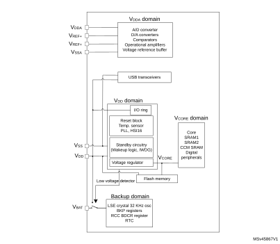
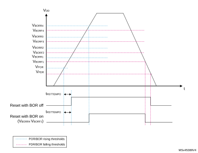

# 6 Power control (PWR)

## 6.1 Power supplies

The STM32G4 series devices require a 1.71 V to 3.6 V operating supply voltage (VDD). Analog peripherals are supplied through independent power domain VDDA.

- VDD = 1.71 V to 3.6 V

VDD is the external power supply for the I/Os, the internal regulator and the system analog such as reset, power management and internal clocks. It is provided externally through VDD pins.

- VDDA = 1.62 V (ADC/ COMP) / 1.71 V (DAC 1MSPS / DAC 15MSPS) / 2 V (OPAMP) / 2.4 V (VREFBUF)

VDDA is the external analog power supply for A/D converters, D/A converters, voltage reference buffer, operational amplifiers and comparators. The VDDA voltage level is independent from the VDD voltage. VDDA should be preferably connected to VDD when these peripherals are not used.

During power up and power down, the following power sequence is required:

 - When VDD is below 1 V, then VDDA supply must remain below VDD + 300 mV
 - When VDD is above 1 V, all power supplies became independent.

During power down phase, VDD can temporarily become lower then other supplies only if the energy provided to the MCU remains below 1 mJ. This allows external decoupling capacitors to be discharged with different time constants during the power down transient phase.

- VBAT = 1.55 V to 3.6 V

VBAT is the power supply for RTC, external clock 32 kHz oscillator and backup registers (through power switch) when VDD is not present. VBAT is internally bonded to VDD for small packages without dedicated pin.

- VREF-, VREF+

VREF+ is the input reference voltage for ADCs and DACs. It is also the output of the internal voltage reference buffer when enabled.

When VDDA < 2 V, VREF+ must be equal to VDDA.

When VDDA ≥ 2 V, VREF+ must be between 2 V and VDDA.

VREF+ can be grounded when ADC and DAC are not active.

The internal voltage reference buffer supports three output voltages, which are configured with VRS bit in the VREFBUF\_CSR register:

 - VREF+ around 2.048 V. This requires VDDA equal to or higher than 2.4 V.
 - VREF+ around 2.5 V. This requires VDDA equal to or higher than 2.8 V.
 - VREF+ around 2.9 V. This requires VDDA equal to or higher than 3.135 V.

VREF+ pin is not available on all packages. When not available on the package, it is bonded to VDDA. When the VREF+ is double-bonded with VDDA in a package, the internal voltage reference buffer (VREFBUF) is not available and must be kept disable (refer to related device datasheet for packages pinout description).

VREF- is internally double bonded with VSSA.

An embedded linear voltage regulator is used to supply the internal digital power VCORE. VCORE is the power supply for digital peripherals SRAM1, SRAM2 and CCM SRAM. The Flash is supplied by VCORE and VDD.

#### Figure 12. STM32G4 series power supply overview

### 6.1.1 Independent analog peripherals supply

To improve ADC and DAC conversion accuracy and to extend the supply flexibility, the analog peripherals have an independent power supply which can be separately filtered and shielded from noise on the PCB.

- The analog peripherals voltage supply input is available on a separate VDDA pin.
- An isolated supply ground connection is provided on VSSA pin.

The VDDA supply voltage can be different from VDD. The presence of VDDA must be checked before enabling any of the analog peripherals supplied by VDDA (A/D converter, D/A converter, comparators, operational amplifiers, voltage reference buffer).

The VDDA supply can be monitored by the Peripheral Voltage Monitoring, and compared with thresholds. Refer to [Section 6.2.3: Peripheral Voltage Monitoring (PVM)](#XREF_20515__1_3_Low_Power_modes34) for more details.

When a single supply is used, VDDA can be externally connected to VDD through the external filtering circuit in order to ensure a noise-free VDDA reference voltage.

#### ADC and DAC reference voltage

To ensure a better accuracy on low-voltage inputs and outputs, the user can connect to VREF+ a separate reference voltage lower than VDDA. VREF+ is the highest voltage, represented by the full scale value, for an analog input (ADC) or output (DAC) signal.

VREF+ can be provided either by an external reference of by an internal buffered voltage reference (VREFBUF).

The internal buffered voltage reference (VREFBUF) is enabled by setting the ENVR bit in the [Section 23.4.1: VREFBUF control and status register (VREFBUF\_CSR)](Voltage_reference_buffer_%28VREFBUF%29.md#XREF_65761__16_3_1_VREF_control_and_status_register_(VREF_CSR)28). The internal buffered voltage reference (VREFBUF) is set to 2.048 V, 2.5 V or 2.9 V according the VRS[1:0] bits setting. The internal buffered voltage reference can also provide the voltage to external components through VREF+ pin. Refer to the device datasheet and to [Section 23: Voltage reference buffer (VREFBUF)](Voltage_reference_buffer_%28VREFBUF%29.md#XREF_85162__1_Voltage_reference_buffer_(VREFBUF)28) for further information.

### 6.1.2 USB transceivers supply

The USB transceivers are supplied from VDD power supply pin. VDD range for USB usage is from 3.0 V to 3.6 V.

### 6.1.3 Battery backup domain

To retain the content of the Backup registers and supply the RTC function when VDD is turned off, the VBATpin can be connected to an optional backup voltage supplied by a battery or by another source.

The VBAT pin powers the RTC unit, the LSE oscillator and the PC13 to PC15 I/Os, allowing the RTC to operate even when the main power supply is turned off. The switch to the VBAT supply is controlled by the power-down reset embedded in the Reset block.

Warning:During tRSTTEMPO (temporization at VDD startup) or after a PDR has been detected, the power switch between VBAT and VDD remains connected to VBAT.  
During the startup phase, if VDD is established in less than tRSTTEMPO (refer to the datasheet for the value of tRSTTEMPO) and VDD > VBAT + 0.6 V, a current may be injected into VBAT through an internal diode connected between VDD and the power switch (VBAT).  
If the power supply/battery connected to the VBAT pin cannot support this current injection, it is strongly recommended to connect an external low-drop diode between this power supply and the VBAT pin.

If no external battery is used in the application, it is recommended to connect VBAT externally to VDD with a 100 nF external ceramic decoupling capacitor.

When the backup domain is supplied by VDD (analog switch connected to VDD), the following pins are available:

- PC13, PC14 and PC15, which can be used as GPIO pins
- PC13, PC14 and PC15, which can be configured by RTC or LSE (refer to [Section 37.3: RTC functional description](Real-time_clock_%28RTC%29.md#XREF_58292__21_3_RTC_functional_description38))
- PA0/RTC\_TAMP2 and PE6/RTC\_TAMP3 when they are configured by the RTC as tamper pins

**Note:**

As the analog switch can transfer only a limited amount of current (3 mA), the use of GPIO PC13 to PC15 in output mode is restricted: the speed must be limited to 2 MHz with a maximum load of 30 pF, and these I/Os must not be used as a current source (e.g. to drive a LED).

When the backup domain is supplied by VBAT (analog switch connected to VBAT because VDD is not present), the following functions are available:

- PC13, PC14 and PC15 can be controlled only by RTC or LSE (refer to [Section 37.3: RTC functional description](Real-time_clock_%28RTC%29.md#XREF_58292__21_3_RTC_functional_description38))
- PA0/RTC\_TAMP2 and PE6/RTC\_TAMP3 when they are configured by the RTC as tamper pins

#### Backup domain access

After a system reset, the backup domain (RTC registers and backup registers) is protected against possible unwanted write accesses. To enable access to the backup domain, proceed as follows:

1. Enable the power interface clock by setting the PWREN bits in the [APB1 peripheral clock enable register 1 (RCC\_APB1ENR1)](Reset_and_clock_control_%28RCC%29.md#XREF_85161__9_4_19_APB1_peripheral_clock_enable_register_1_(RCC_APB1E15)
2. Set the DBP bit in the [Power control register 1 (PWR\_CR1)](#XREF_93563__1_4_1_Power_control_register_1_(PWR_CR1)34) to enable access to the backup domain
3. Select the RTC clock source in the [RTC domain control register (RCC\_BDCR)](Reset_and_clock_control_%28RCC%29.md#XREF_22571__7_4_29_Backup_domain_control_register_(RCC_BDCR)15).
4. Enable the RTC clock by setting the RTCEN [15] bit in the [RTC domain control register (RCC\_BDCR)](Reset_and_clock_control_%28RCC%29.md#XREF_22571__7_4_29_Backup_domain_control_register_(RCC_BDCR)15).

#### VBAT battery charging

When VDD is present, it is possible to charge the external battery on VBAT through an internal resistance. This charging is done through a 5 or a 1.5 kΩ resistor, depending upon the VBRS bit value in the PWR\_CR4 register.

The battery charging is enabled by setting VBE bit in the PWR\_CR4 register. It is automatically disabled in VBAT mode.

### 6.1.4 Voltage regulator

Two embedded linear voltage regulators supply all the digital circuitries, except for the Standby circuitry and the backup domain. The main regulator output voltage (VCORE) can be programmed by software to two different power ranges (Range 1 and Range 2) in order to optimize the consumption depending on the system’s maximum operating frequency (refer to [Section 7.2.8: Clock source frequency versus voltage scaling](Reset_and_clock_control_%28RCC%29.md#XREF_76299__8_2_8_Clock_source_frequency_versus_voltage_scaling15) and to [Section 3.3.3: Read access latency](Embedded_flash_memory_%28FLASH%29_for_category_3_devices.md#XREF_82548__3_3_3_Read_access_latency13).

The voltage regulators are always enabled after a reset. Depending on the application modes, the VCORE supply is provided either by the main regulator (MR) or by the low-power regulator (LPR).

- In Run, Sleep and Stop 0 modes, both regulators are enabled and the main regulator (MR) supplies full power to the VCORE domain (core, memories and digital peripherals).
- In low-power run and low-power sleep modes, the main regulator is off and the low-power regulator (LPR) supplies low power to the VCORE domain, preserving the contents of the registers, SRAM1, SRAM2 and CCM SRAM.
- In Stop 1 modes, the main regulator is off and the low-power regulator (LPR) supplies low power to the VCORE domain, preserving the contents of the registers, SRAM1, SRAM2 and CCM SRAM.
- In Standby mode with SRAM2 content preserved (RRS bit is set in the PWR\_CR3 register), the main regulator (MR) is off and the low-power regulator (LPR) provides the supply to SRAM2 only. The core, digital peripherals (except Standby circuitry and backup domain) SRAM1 and CCM SRAM are powered off.
- In Standby mode, both regulators are powered off. The contents of the registers, SRAM1, SRAM2 and CCM SRAM is lost except for the Standby circuitry and the backup domain.
- In Shutdown mode, both regulators are powered off. When exiting from Shutdown mode, a power-on reset is generated. Consequently, the contents of the registers, SRAM1, SRAM2 and CCM SRAM is lost, except for the backup domain.

### 6.1.5 Dynamic voltage scaling management

The dynamic voltage scaling is a power management technique which consists in increasing or decreasing the voltage used for the digital peripherals (VCORE), according to the application performance and power consumption needs.

Dynamic voltage scaling to increase VCORE is known as overvolting. It allows to improve the device performance.

Dynamic voltage scaling to decrease VCORE is known as undervolting. It is performed to save power, particularly in laptop and other mobile devices where the energy comes from a battery and is thus limited.

- Range 1: High-performance range.

In range 1, the main regulator operates in two modes following the R1MODE bit in the PWR\_CR5 register:

- Main regulator range 1 normal mode: provides a typical output voltage at 1.2 V. It is used when the system clock frequency is up to 150 MHz. The Flash access time for read access is minimum, write and erase operations are possible.
- Main regulator range 1 boost mode: provides a typical output voltage at 1.28 V. It is used when the system clock frequency is up to 170 MHz. The Flash access time for read access is minimum, write and erase operations are possible. To optimize the power consumption it is recommended to select the range1 boost mode when the system clock frequency is greater than 150 MHz. See [Table 38](#XREF_46981__Table_28__Range_1_boost_mode_configuration34).

 

<table class="TableTitle"><caption class="TableCap"><h4 class="TableCap" id="4301399">Table 38. <a id="configuration34" name="XREF_46981__Table_28__Range_1_boost_mode_configuration34">Range 1 boost mode configuration</a></h4></caption><col width="179.53px"/><col width="179.53px"/><col width="179.53px"/><thead><tr height="28.00px"><th>
System frequency
</th><th>
SYSCLK ≤ 150 MHz
</th><th>
SYSCLK ≤ 170 MHz
</th></tr></thead><tr height="22.67px"><td>
R1MODE bit configuration
</td><td>
1
</td><td>
0
</td></tr></table>

- Range 2: Low-power range.

The main regulator provides a typical output voltage at 1.0 V. The system clock frequency can be up to 26 MHz.The Flash access time for a read access is increased as compared to Range 1; write and erase operations are not possible.

Voltage scaling is selected through the VOS bit in the [Section 6.4.1: Power control register 1 (PWR\_CR1)](#XREF_93563__1_4_1_Power_control_register_1_(PWR_CR1)34) register.

The sequence to go from Range 1 (Normal/Boost) to Range 2 is:

1. In case of switching from Range 1 boost mode to Range 2, the system clock must be divided by 2 using the AHB prescaler before switching to a lower system frequency for at least 1us and then reconfigure the AHB prescaler.
2. Reduce the system frequency to a value lower than 26 MHz.
3. Adjust number of wait states according new frequency target in Range 2 (LATENCY bits in the FLASH\_ACR).
4. Program the VOS bits to “10” in the PWR\_CR1 register.

The sequence to go from Range 2 to Range 1 (normal/boost mode) is:

1. Program the VOS bits to “01” in the PWR\_CR1 register.
2. Wait until the VOSF flag is cleared in the PWR\_SR2 register.
3. Adjust number of wait states according new frequency target in Range 1 (LATENCY bits in the FLASH\_ACR).
4. Increase the system frequency by following below procedure:
- If the system frequency is 26 MHz < SYSCLK ≤ 150 MHz:
 - Select the Range 1 normal mode by setting R1MODE bit in the PWR\_CR5 register.
 - Configure and switch to PLL for a new system frequency.
- If the system frequency is SYSCLK > 150 MHz:
 - The system clock must be divided by 2 using the AHB prescaler before switching to a higher system frequency.
 - Select the Range 1 boost mode by clearing the R1MODE bit is in the PWR\_CR5 register.
 - Configure and switch to PLL for a new system frequency.
 - Wait for at least 1us and then reconfigure the AHB prescaler to get the needed HCLK clock frequency.

The sequence to switch from Range1 normal mode to Range1 boost mode is:

1. The system clock must be divided by 2 using the AHB prescaler before switching to a higher system frequency.
2. Clear the R1MODE bit is in the PWR\_CR5 register.
3. Adjust the number of wait states according to the new frequency target in range1 boost mode
4. Configure and switch to new system frequency.
5. Wait for at least 1us and then reconfigure the AHB prescaler to get the needed HCLK clock frequency.

The sequence to switch from Range1 boost mode to Range1 normal mode is:

1. Set the R1MODE bit is in the PWR\_CR5 register.
2. Adjust the number of wait states according new frequency target in Range1 default mode.
3. Configure and switch to new system frequency.

## 6.2 Power supply supervisor

### 6.2.1  Power-on reset (POR) / power-down reset (PDR) / brown-out reset   (BOR)

The device has an integrated power-on reset (POR) / power-down reset (PDR), coupled with a brown-out reset (BOR) circuitry. The BOR is active in all power modes except Shutdown mode, and cannot be disabled.

Five BOR thresholds can be selected through option bytes.

During power-on, the BOR keeps the device under reset until the supply voltage VDD reaches the specified VBORx threshold. When VDD drops below the selected threshold, a device reset is generated. When VDD is above the VBORx upper limit, the device reset is released and the system can start.

For more details on the brown-out reset thresholds, refer to the electrical characteristics section in the datasheet.

#### Figure 13. Brown-out reset waveform

1.The reset temporization tRSTTEMPO is present only for the BOR lowest threshold (VBOR0).

### 6.2.2 Programmable voltage detector (PVD)

You can use the PVD to monitor the VDD power supply by comparing it to a threshold selected by the PLS[2:0] bits in the [Power control register 2 (PWR\_CR2)](#XREF_33235__4_4_2_Power_control_register_2_(PWR_CR2)34).

The PVD is enabled by setting the PVDE bit.

A PVDO flag is available, in the [Power status register 2 (PWR\_SR2)](#XREF_33001__1_4_6_Power_status_register_2_(PWR_SR2)34), to indicate if VDD is higher or lower than the PVD threshold. This event is internally connected to the EXTI line16 and can generate an interrupt if enabled through the EXTI registers. The PVD output interrupt can be generated when VDD drops below the PVD threshold and/or when VDD rises above the PVD threshold depending on EXTI line16 rising/falling edge configuration. As an example, the service routine could perform emergency shutdown tasks.

#### Figure 14. PVD thresholds

### 6.2.3 Peripheral Voltage Monitoring (PVM)

Only VDD is monitored by default, as it is the only supply required for all system-related functions. The VDDA can be independent from VDD and can be monitored with two peripheral voltage monitoring (PVM).

Each of the PVMx (x=1, 2) is a comparator between a fixed threshold VPVMx and the VDDA power supply. PVMOx flags indicate if the independent power supply is higher or lower than the PVMx threshold: PVMOx flag is cleared when the supply voltage is above the PVMx threshold, and is set when the supply voltage is below the PVMx threshold.

Each PVM output is connected to an EXTI line and can generate an interrupt if enabled through the EXTI registers. The PVMx output interrupt is generated when the independent power supply drops below the PVMx threshold and/or when it rises above the PVMx threshold, depending on EXTI line rising/falling edge configuration.

Each PVM can remain active in Stop 0 and Stop 1 modes, and the PVM interrupt can wake up from the Stop mode.

 

<table class="TableTitle"><caption class="TableCap"><h4 class="TableCap" id="4016336">Table 39. PVM features</h4></caption><col width="96.46px"/><col width="96.46px"/><col width="172.83px"/><col width="172.83px"/><thead><tr height="28.00px"><th>
PVM
</th><th>
Power supply
</th><th>
PVM threshold
</th><th>
EXTI line
</th></tr></thead><tr height="22.67px"><td>
PVM1
</td><td>
VDDA
</td><td>
VPVM1 (around 1.65 V)
</td><td>
40
</td></tr><tr height="22.67px"><td>
PVM2
</td><td>
VDDA
</td><td>
VPVM2 (around 1.8 V)
</td><td>
41
</td></tr></table>

The independent analog supply VDDA is not considered as present by default, and a logical and electrical isolation is applied to ignore any information coming from the peripherals supplied by this dedicated supply.

- If VDDA is shorted externally to VDD, the application should assume it is available without enabling any Peripheral Voltage Monitoring.
- If VDDA is independent from VDD, the Peripheral Voltage Monitoring (PVM) can be enabled to confirm whether the supply is present or not.

## 6.3 Low-power modes

By default, the microcontroller is in Run mode after a system or a power Reset. Several   
low-power modes are available to save power when the CPU does not need to be kept running, for example when waiting for an external event. It is up to the user to select the mode that gives the best compromise between low-power consumption, short startup time and available wakeup sources.

The device features seven low-power modes:

- Sleep mode: CPU clock off, all peripherals including Cortex®-M4 with FPU core peripherals such as NVIC, SysTick, etc. can run and wake up the CPU when an interrupt or an event occurs. Refer to [Section 6.3.4: Sleep mode](#XREF_81911__3_3_3_SLEEP_mode34).
- Low-power run mode: This mode is achieved when the CPU clock frequency is reduced below 2 MHz. The code is executed from the SRAM or the Flash memory. The regulator is in low-power mode to minimize the regulator's operating current. Refer to [Section 6.3.2: Low-power run mode (LP run)](#XREF_36627__3_3_4_Deepsleep34).
- Low-power sleep mode: This mode is entered from the Low-power run mode: Cortex®-M4 with FPU is off. Refer to [Section 6.3.5: Low-power sleep mode (LP sleep)](#XREF_48133__6_3_4_Low_power_sleep_mode_(LP_sleep)34).
- Stop 0 and Stop 1 modes: SRAM and all registers content are retained. All clocks in the VCORE domain are stopped, the PLL, the HSI16 and the HSE are disabled. The LSI and the LSE can be kept running.

The RTC and TAMP can remain active (Stop mode with RTC, Stop mode without RTC).

Some peripherals with the wakeup capability can enable the HSI16 RC during the Stop mode to detect their wakeup condition.

In Stop 0 mode, the main regulator remain ON, which allows the fastest wakeup time but with higher consumption. The active peripherals and the wakeup sources are the same as in Stop 1 mode.

The system clock, when exiting from Stop 0 or Stop 1 mode, is the HSI16 clock. If the device is configured to wake up in low-power run mode, the HPRE bits in RCC\_CFGR register must be configured prior to entering Stop mode to provide a frequency not greater than 2 MHz.

Refer to [Section 6.3.6: Stop 0 mode](#XREF_60091__6_3_5_Stop_1_mode34) for details on Stop 0 mode.

- Standby mode: VCORE domain is powered off. However, it is possible to preserve the SRAM contents:
 - Standby mode with SRAM2 retention when the bit RRS is set in PWR\_CR3 register. In this case, SRAM2 is supplied by the low-power regulator.
 - Standby mode when the bit RRS is cleared in PWR\_CR3 register. In this case the main regulator and the low-power regulator are powered off.

All clocks in the VCORE domain are stopped, the PLL, the HSI16 and the HSE oscillator are disabled. The LSI and the LSE can be kept running.

The RTC can remain active (Standby mode with RTC, Standby mode without RTC).

The system clock, when exiting Standby modes, is the HSI16 oscillator clock.

Refer to [Section 6.3.8: Standby mode](#XREF_17571__6_3_7_Standby_mode34).

- Shutdown mode: VCORE domain is powered off. All clocks in the VCORE domain are stopped, the PLL, the HSI16, the LSI and the HSE are disabled. The LSE can be kept running. The system clock, when exiting the Shutdown mode, is HSI16 oscillator clock. In this mode, the supply voltage monitoring is disabled and the product behavior is not guaranteed in case of a power voltage drop. Refer to [Section 6.3.9: Shutdown mode](#XREF_88067__3_8_7_Auto-Wake-Up_(AWU)_from_Low_Power_Mode34).

In addition, the power consumption in Run mode can be reduced by one of the following means:

- Slowing down the system clocks
- Gating the clocks to the APB and AHB peripherals when they are unused.

#### Figure 15. Low-power modes possible transitions

 

<table class="TableTitle"><caption class="~Table Title"><h4 class="TableCap" id="3995752">Table 40. <a id="summary34" name="XREF_82974__Table_4__Low-power_mode_summary34">Low-power mode summary </a></h4></caption><col width="84.30px"/><col width="99.47px"/><col width="104.30px"/><col width="104.30px"/><col width="141.43px"/><col width="41.57px"/><col width="41.57px"/><thead><tr height="42.67px"><th rowspan="2">
Mode name
</th><th rowspan="2">
Entry
</th><th rowspan="2">
Wakeup source<a href="#RM0440%20PWR_RM0440%20PWR_FTH_1">1</a>
</th><th rowspan="2">
Wakeup

system clock
</th><th rowspan="2">
Effect on clocks
</th><th colspan="2">
Voltage regulators
</th></tr><tr height="28.00px"><th>
MR
</th><th>
LPR
</th></tr></thead><tr height="40.00px"><td rowspan="2">
Sleep

(Sleep-now or Sleep-on-exit)
</td><td>
WFI or Return

from ISR
</td><td>
Any interrupt
</td><td rowspan="2">
Same as before entering Sleep mode
</td><td rowspan="2">
CPU clock OFF

no effect on other clocks or analog clock sources
</td><td rowspan="2">
ON
</td><td rowspan="8">
ON
</td></tr><tr height="22.67px"><td>
WFE
</td><td>
Wakeup event
</td></tr><tr height="37.33px"><td>
Low-power run
</td><td>
Set LPR bit 
</td><td>
Clear LPR bit
</td><td>
Same as Low-power run clock
</td><td>
None
</td><td rowspan="3">
OFF
</td></tr><tr height="54.67px"><td rowspan="2">
Low-power sleep
</td><td>
Set LPR bit + WFI or Return

from ISR
</td><td>
Any interrupt
</td><td rowspan="2">
Same as before entering Low-power sleep mode
</td><td rowspan="2">
CPU clock OFF

no effect on other clocks or analog clock sources
</td></tr><tr height="37.33px"><td>
Set LPR bit + WFE
</td><td>
Wakeup event
</td></tr><tr height="69.33px"><td>
Stop 0
</td><td>
 LPMS=”000” + SLEEPDEEP bit + WFI or Return

from ISR or WFE
</td><td rowspan="2">
Any EXTI line (configured in the EXTI registers)

Specific peripherals events 
</td><td rowspan="5">
HSI16
</td><td rowspan="4">
All clocks OFF except LSI and LSE
</td><td>
ON
</td></tr><tr height="69.33px"><td>
Stop 1
</td><td>
LPMS=”001” + SLEEPDEEP bit + WFI or Return

from ISR or WFE
</td><td rowspan="4">
OFF
</td></tr><tr height="84.00px"><td>
Standby with SRAM2
</td><td>
LPMS=”011”+ Set RRS bit + SLEEPDEEP bit + WFI or Return

from ISR or WFE 
</td><td rowspan="2">
WKUP pin edge, RTC event, TAMP event, external reset on NRST pin, IWDG reset
</td></tr><tr height="84.00px"><td>
Standby
</td><td>
LPMS=”011” + Clear RRS bit + SLEEPDEEP bit + WFI or Return

from ISR or WFE 
</td><td rowspan="2">
OFF
</td></tr><tr height="81.33px"><td>
Shutdown
</td><td>
LPMS=”1--” + SLEEPDEEP bit + WFI or Return

from ISR or WFE 
</td><td>
WKUP pin edge, RTC event, TAMP event, external reset on NRST pin
</td><td>
All clocks OFF except LSE
</td></tr></table>

<a href="#RM0440%20PWR_RM0440%20PWR_FTB_1">1.</a>Refer to <a href="#XREF_83428__Table_4__Features_availability_over_all_modes_(continued)34" style="font-family : Arial ; font-weight:normal;font-style:Italic;font-size : 9.00pt;font-kerning:normal;font-stretch:normal;color:#0000ff;background-color:transparent;letter-spacing : 0.00em;">Table 41: Functionalities depending on the working mode</a>.

 

<table class="TableTitle"><caption class="TableCap"><h4 class="TableCap" id="3995968">Table 41. <a id="(continued)34" name="XREF_83428__Table_4__Features_availability_over_all_modes_(continued)34">Functionalities depending on the working mode</a><a href="#RM0440%20PWR_RM0440%20PWR_FTH_1">1</a></h4></caption><col width="218.22px"/><col width="41.37px"/><col width="41.37px"/><col width="41.31px"/><col width="41.31px"/><col width="29.87px"/><col width="29.87px"/><col width="29.87px"/><col width="32.84px"/><col width="32.84px"/><col width="32.84px"/><col width="42.48px"/><thead><tr height="28.00px"><th rowspan="2">
Peripheral
</th><th rowspan="2">
Run
</th><th rowspan="2">
Sleep
</th><th rowspan="2">
Low-power run
</th><th rowspan="2">
Low-power sleep
</th><th colspan="2">
Stop 0/1
</th><th colspan="2">
Standby
</th><th colspan="2">
Shutdown
</th><th rowspan="2">
VBAT
</th></tr><tr height="113.39px"><th>
-
</th><th style="border-left-width:0;border-left-style:hidden;border-left-color:0;">
Wakeup capability
</th><th>
-
</th><th style="border-left-width:0;border-left-style:hidden;border-left-color:0;">
Wakeup capability
</th><th>
-
</th><th style="border-left-width:0;border-left-style:hidden;border-left-color:0;">
Wakeup capability
</th></tr></thead><tr height="22.67px"><td>
CPU
</td><td>
Y
</td><td>
-
</td><td>
Y
</td><td>
-
</td><td>
-
</td><td style="border-left-width:0;border-left-style:hidden;border-left-color:0;">
-
</td><td>
-
</td><td style="border-left-width:0;border-left-style:hidden;border-left-color:0;">
-
</td><td>
-
</td><td style="border-left-width:0;border-left-style:hidden;border-left-color:0;">
-
</td><td>
-
</td></tr><tr height="22.67px"><td>
Flash memory
</td><td>
O<a href="#RM0440%20PWR_RM0440%20PWR_FTH_2">2</a>
</td><td>
O<a href="#XREF_36614__2__The_Flash_can_be_configured_in_power-down_mode__By34" style="font-family : Arial ; font-weight:normal;font-style:normal;font-size : 9.00pt;text-decoration:none;font-kerning:normal;text-transform:none;font-stretch:normal;color:#000000;background-color:transparent;letter-spacing : 0.00em;">(2)</a>
</td><td>
O<a href="#XREF_36614__2__The_Flash_can_be_configured_in_power-down_mode__By34" style="font-family : Arial ; font-weight:normal;font-style:normal;font-size : 9.00pt;text-decoration:none;font-kerning:normal;text-transform:none;font-stretch:normal;color:#000000;background-color:transparent;letter-spacing : 0.00em;">(2)</a>
</td><td>
O<a href="#XREF_36614__2__The_Flash_can_be_configured_in_power-down_mode__By34" style="font-family : Arial ; font-weight:normal;font-style:normal;font-size : 9.00pt;text-decoration:none;font-kerning:normal;text-transform:none;font-stretch:normal;color:#000000;background-color:transparent;letter-spacing : 0.00em;">(2)</a>
</td><td>
-
</td><td style="border-left-width:0;border-left-style:hidden;border-left-color:0;">
-
</td><td>
-
</td><td style="border-left-width:0;border-left-style:hidden;border-left-color:0;">
-
</td><td>
-
</td><td style="border-left-width:0;border-left-style:hidden;border-left-color:0;">
-
</td><td>
-
</td></tr><tr height="22.67px"><td>
SRAM1
</td><td>
Y
</td><td>
Y<a href="#RM0440%20PWR_RM0440%20PWR_FTH_3">3</a>
</td><td>
Y
</td><td>
Y<a href="#XREF_78287__3__The_SRAM_clock_can_be_gated_on_or_off_34" style="font-family : Arial ; font-weight:normal;font-style:normal;font-size : 9.00pt;text-decoration:none;font-kerning:normal;text-transform:none;font-stretch:normal;color:#000000;background-color:transparent;letter-spacing : 0.00em;">(3)</a>
</td><td>
Y
</td><td style="border-left-width:0;border-left-style:hidden;border-left-color:0;">
-
</td><td>
-
</td><td style="border-left-width:0;border-left-style:hidden;border-left-color:0;">
-
</td><td>
-
</td><td style="border-left-width:0;border-left-style:hidden;border-left-color:0;">
-
</td><td>
-
</td></tr><tr height="22.67px"><td>
SRAM2
</td><td>
Y
</td><td>
Y<a href="#XREF_78287__3__The_SRAM_clock_can_be_gated_on_or_off_34" style="font-family : Arial ; font-weight:normal;font-style:normal;font-size : 9.00pt;text-decoration:none;font-kerning:normal;text-transform:none;font-stretch:normal;color:#000000;background-color:transparent;letter-spacing : 0.00em;">(3)</a>
</td><td>
Y
</td><td>
Y<a href="#XREF_78287__3__The_SRAM_clock_can_be_gated_on_or_off_34" style="font-family : Arial ; font-weight:normal;font-style:normal;font-size : 9.00pt;text-decoration:none;font-kerning:normal;text-transform:none;font-stretch:normal;color:#000000;background-color:transparent;letter-spacing : 0.00em;">(3)</a>
</td><td>
Y
</td><td style="border-left-width:0;border-left-style:hidden;border-left-color:0;">
-
</td><td>
O<a href="#RM0440%20PWR_RM0440%20PWR_FTH_4">4</a>
</td><td style="border-left-width:0;border-left-style:hidden;border-left-color:0;">
-
</td><td>
-
</td><td style="border-left-width:0;border-left-style:hidden;border-left-color:0;">
-
</td><td>
-
</td></tr><tr height="22.67px"><td>
CCM SRAM
</td><td>
Y
</td><td>
Y<a href="#XREF_78287__3__The_SRAM_clock_can_be_gated_on_or_off_34" style="font-family : Arial ; font-weight:normal;font-style:normal;font-size : 9.00pt;text-decoration:none;font-kerning:normal;text-transform:none;font-stretch:normal;color:#000000;background-color:transparent;letter-spacing : 0.00em;">(3)</a>
</td><td>
Y
</td><td>
Y<a href="#XREF_78287__3__The_SRAM_clock_can_be_gated_on_or_off_34" style="font-family : Arial ; font-weight:normal;font-style:normal;font-size : 9.00pt;text-decoration:none;font-kerning:normal;text-transform:none;font-stretch:normal;color:#000000;background-color:transparent;letter-spacing : 0.00em;">(3)</a>
</td><td>
Y
</td><td style="border-left-width:0;border-left-style:hidden;border-left-color:0;">
-
</td><td>
-
</td><td style="border-left-width:0;border-left-style:hidden;border-left-color:0;">
-
</td><td>
-
</td><td style="border-left-width:0;border-left-style:hidden;border-left-color:0;">
-
</td><td>
-
</td></tr><tr height="22.67px"><td>
FSMC
</td><td>
O
</td><td>
O
</td><td>
O
</td><td>
O
</td><td>
-
</td><td style="border-left-width:0;border-left-style:hidden;border-left-color:0;">
-
</td><td>
-
</td><td style="border-left-width:0;border-left-style:hidden;border-left-color:0;">
-
</td><td>
-
</td><td style="border-left-width:0;border-left-style:hidden;border-left-color:0;">
-
</td><td>
-
</td></tr><tr height="22.67px"><td>
QUADSPI
</td><td>
O
</td><td>
O
</td><td>
O
</td><td>
O
</td><td>
-
</td><td style="border-left-width:0;border-left-style:hidden;border-left-color:0;">
-
</td><td>
-
</td><td style="border-left-width:0;border-left-style:hidden;border-left-color:0;">
-
</td><td>
-
</td><td style="border-left-width:0;border-left-style:hidden;border-left-color:0;">
-
</td><td>
-
</td></tr><tr height="22.67px"><td>
Backup Registers
</td><td>
Y
</td><td>
Y
</td><td>
Y
</td><td>
Y
</td><td>
Y
</td><td style="border-left-width:0;border-left-style:hidden;border-left-color:0;">
-
</td><td>
Y
</td><td style="border-left-width:0;border-left-style:hidden;border-left-color:0;">
-
</td><td>
Y
</td><td style="border-left-width:0;border-left-style:hidden;border-left-color:0;">
-
</td><td>
Y
</td></tr><tr height="22.67px"><td>
Brown-out reset (BOR)
</td><td>
Y
</td><td>
Y
</td><td>
Y
</td><td>
Y
</td><td>
Y
</td><td style="border-left-width:0;border-left-style:hidden;border-left-color:0;">
Y
</td><td>
Y
</td><td style="border-left-width:0;border-left-style:hidden;border-left-color:0;">
Y
</td><td>
-
</td><td style="border-left-width:0;border-left-style:hidden;border-left-color:0;">
-
</td><td>
-
</td></tr><tr height="37.33px"><td>
Programmable Voltage Detector (PVD) 
</td><td>
O
</td><td>
O
</td><td>
O
</td><td>
O
</td><td>
O
</td><td style="border-left-width:0;border-left-style:hidden;border-left-color:0;">
O
</td><td>
-
</td><td style="border-left-width:0;border-left-style:hidden;border-left-color:0;">
-
</td><td>
-
</td><td style="border-left-width:0;border-left-style:hidden;border-left-color:0;">
-
</td><td>
-
</td></tr><tr height="37.33px"><td>
Peripheral Voltage Monitor (PVM)
</td><td>
O
</td><td>
O
</td><td>
O
</td><td>
O
</td><td>
O
</td><td style="border-left-width:0;border-left-style:hidden;border-left-color:0;">
O
</td><td>
-
</td><td style="border-left-width:0;border-left-style:hidden;border-left-color:0;">
-
</td><td>
-
</td><td style="border-left-width:0;border-left-style:hidden;border-left-color:0;">
-
</td><td>
-
</td></tr><tr height="22.67px"><td>
DMA
</td><td>
O
</td><td>
O
</td><td>
O
</td><td>
O
</td><td>
-
</td><td style="border-left-width:0;border-left-style:hidden;border-left-color:0;">
-
</td><td>
-
</td><td style="border-left-width:0;border-left-style:hidden;border-left-color:0;">
-
</td><td>
-
</td><td style="border-left-width:0;border-left-style:hidden;border-left-color:0;">
-
</td><td>
-
</td></tr><tr height="22.67px"><td>
Oscillator HSI16
</td><td>
O
</td><td>
O
</td><td>
O
</td><td>
O
</td><td>
<a href="#RM0440%20PWR_RM0440%20PWR_FTH_5">5</a>
</td><td style="border-left-width:0;border-left-style:hidden;border-left-color:0;">
-
</td><td>
-
</td><td style="border-left-width:0;border-left-style:hidden;border-left-color:0;">
-
</td><td>
-
</td><td style="border-left-width:0;border-left-style:hidden;border-left-color:0;">
-
</td><td>
-
</td></tr><tr height="22.67px"><td>
Oscillator HSI48
</td><td>
O
</td><td>
O
</td><td>
-
</td><td>
-
</td><td>
-
</td><td style="border-left-width:0;border-left-style:hidden;border-left-color:0;">
-
</td><td>
-
</td><td style="border-left-width:0;border-left-style:hidden;border-left-color:0;">
-
</td><td>
-
</td><td style="border-left-width:0;border-left-style:hidden;border-left-color:0;">
-
</td><td>
-
</td></tr><tr height="37.33px"><td>
High Speed External (HSE)
</td><td>
O
</td><td>
O
</td><td>
O
</td><td>
O
</td><td>
-
</td><td style="border-left-width:0;border-left-style:hidden;border-left-color:0;">
-
</td><td>
-
</td><td style="border-left-width:0;border-left-style:hidden;border-left-color:0;">
-
</td><td>
-
</td><td style="border-left-width:0;border-left-style:hidden;border-left-color:0;">
-
</td><td>
-
</td></tr><tr height="22.67px"><td>
Low Speed Internal (LSI)
</td><td>
O
</td><td>
O
</td><td>
O
</td><td>
O
</td><td>
O
</td><td style="border-left-width:0;border-left-style:hidden;border-left-color:0;">
-
</td><td>
O
</td><td style="border-left-width:0;border-left-style:hidden;border-left-color:0;">
-
</td><td>
-
</td><td style="border-left-width:0;border-left-style:hidden;border-left-color:0;">
-
</td><td>
-
</td></tr><tr height="37.33px"><td>
Low Speed External (LSE)
</td><td>
O
</td><td>
O
</td><td>
O
</td><td>
O
</td><td>
O
</td><td style="border-left-width:0;border-left-style:hidden;border-left-color:0;">
-
</td><td>
O
</td><td style="border-left-width:0;border-left-style:hidden;border-left-color:0;">
-
</td><td>
O
</td><td style="border-left-width:0;border-left-style:hidden;border-left-color:0;">
-
</td><td>
O
</td></tr><tr height="22.67px"><td>
Clock Security System (CSS)
</td><td>
O
</td><td>
O
</td><td>
O
</td><td>
O
</td><td>
-
</td><td style="border-left-width:0;border-left-style:hidden;border-left-color:0;">
-
</td><td>
-
</td><td style="border-left-width:0;border-left-style:hidden;border-left-color:0;">
-
</td><td>
-
</td><td style="border-left-width:0;border-left-style:hidden;border-left-color:0;">
-
</td><td>
-
</td></tr><tr height="22.67px"><td>
Clock Security System on LSE
</td><td>
O
</td><td>
O
</td><td>
O
</td><td>
O
</td><td>
O
</td><td style="border-left-width:0;border-left-style:hidden;border-left-color:0;">
O
</td><td>
O
</td><td style="border-left-width:0;border-left-style:hidden;border-left-color:0;">
O
</td><td>
-
</td><td style="border-left-width:0;border-left-style:hidden;border-left-color:0;">
-
</td><td>
-
</td></tr><tr height="22.67px"><td>
RTC / Auto wakeup
</td><td>
O
</td><td>
O
</td><td>
O
</td><td>
O
</td><td>
O
</td><td style="border-left-width:0;border-left-style:hidden;border-left-color:0;">
O
</td><td>
O
</td><td style="border-left-width:0;border-left-style:hidden;border-left-color:0;">
O
</td><td>
O
</td><td style="border-left-width:0;border-left-style:hidden;border-left-color:0;">
O
</td><td>
O
</td></tr><tr height="22.67px"><td>
Number of RTC Tamper pins
</td><td>
3
</td><td>
3
</td><td>
3
</td><td>
3
</td><td>
3
</td><td style="border-left-width:0;border-left-style:hidden;border-left-color:0;">
O
</td><td>
3
</td><td style="border-left-width:0;border-left-style:hidden;border-left-color:0;">
O
</td><td>
3
</td><td style="border-left-width:0;border-left-style:hidden;border-left-color:0;">
O
</td><td>
3
</td></tr><tr height="22.67px"><td>
USB
</td><td>
O<a href="#XREF_65849__6__RNG_and_USB_peripherals_are_functional_in_voltage34" style="font-family : Arial ; font-weight:normal;font-style:normal;font-size : 9.00pt;text-decoration:none;font-kerning:normal;text-transform:none;font-stretch:normal;color:#000000;background-color:transparent;letter-spacing : 0.00em;">(8)</a>
</td><td>
O<a href="#XREF_65849__6__RNG_and_USB_peripherals_are_functional_in_voltage34" style="font-family : Arial ; font-weight:normal;font-style:normal;font-size : 9.00pt;text-decoration:none;font-kerning:normal;text-transform:none;font-stretch:normal;color:#000000;background-color:transparent;letter-spacing : 0.00em;">(8)</a>
</td><td>
-
</td><td>
-
</td><td>
-
</td><td style="border-left-width:0;border-left-style:hidden;border-left-color:0;">
O
</td><td>
-
</td><td style="border-left-width:0;border-left-style:hidden;border-left-color:0;">
-
</td><td>
-
</td><td style="border-left-width:0;border-left-style:hidden;border-left-color:0;">
-
</td><td>
-
</td></tr><tr height="37.33px"><td>
USARTx (x=1,2,3,4,5)
</td><td>
O
</td><td>
O
</td><td>
O
</td><td>
O
</td><td>
O <a href="#RM0440%20PWR_RM0440%20PWR_FTH_6">6</a>
</td><td style="border-left-width:0;border-left-style:hidden;border-left-color:0;">
O <a href="#XREF_33953__4__UART_and_LPUART_reception_is_functional_in_Stop_mode%2C_and_generates_a_wakeup_interrupt_on_Start%2C_address_match_or34" style="font-family : Arial ; font-weight:normal;font-style:normal;font-size : 9.00pt;text-decoration:none;font-kerning:normal;text-transform:none;font-stretch:normal;color:#000000;background-color:transparent;letter-spacing : 0.00em;">(6)</a>
</td><td>
-
</td><td style="border-left-width:0;border-left-style:hidden;border-left-color:0;">
-
</td><td>
-
</td><td style="border-left-width:0;border-left-style:hidden;border-left-color:0;">
-
</td><td>
-
</td></tr><tr height="37.33px"><td>
Low-power UART (LPUART1)
</td><td>
O
</td><td>
O
</td><td>
O
</td><td>
O
</td><td>
O <a href="#XREF_33953__4__UART_and_LPUART_reception_is_functional_in_Stop_mode%2C_and_generates_a_wakeup_interrupt_on_Start%2C_address_match_or34" style="font-family : Arial ; font-weight:normal;font-style:normal;font-size : 9.00pt;text-decoration:none;font-kerning:normal;text-transform:none;font-stretch:normal;color:#000000;background-color:transparent;letter-spacing : 0.00em;">(6)</a>
</td><td style="border-left-width:0;border-left-style:hidden;border-left-color:0;">
O <a href="#XREF_33953__4__UART_and_LPUART_reception_is_functional_in_Stop_mode%2C_and_generates_a_wakeup_interrupt_on_Start%2C_address_match_or34" style="font-family : Arial ; font-weight:normal;font-style:normal;font-size : 9.00pt;text-decoration:none;font-kerning:normal;text-transform:none;font-stretch:normal;color:#000000;background-color:transparent;letter-spacing : 0.00em;">(6)</a>
</td><td>
-
</td><td style="border-left-width:0;border-left-style:hidden;border-left-color:0;">
-
</td><td>
-
</td><td style="border-left-width:0;border-left-style:hidden;border-left-color:0;">
-
</td><td>
-
</td></tr><tr height="37.33px"><td>
I2Cx (x=1,2,3,4)
</td><td>
O
</td><td>
O
</td><td>
O
</td><td>
O
</td><td>
O <a href="#RM0440%20PWR_RM0440%20PWR_FTH_7">7</a>
</td><td style="border-left-width:0;border-left-style:hidden;border-left-color:0;">
O <a href="#XREF_84055__5__I2C_address_detection_is_functional_in_Stop_mode%2C_and_generates_a_wakeup_interrupt_in_case_of_address_match_34" style="font-family : Arial ; font-weight:normal;font-style:normal;font-size : 9.00pt;text-decoration:none;font-kerning:normal;text-transform:none;font-stretch:normal;color:#000000;background-color:transparent;letter-spacing : 0.00em;">(7)</a>
</td><td>
-
</td><td style="border-left-width:0;border-left-style:hidden;border-left-color:0;">
-
</td><td>
-
</td><td style="border-left-width:0;border-left-style:hidden;border-left-color:0;">
-
</td><td>
-
</td></tr><tr height="22.67px"><td>
SPIx (1,2,3,4)
</td><td>
O
</td><td>
O
</td><td>
O
</td><td>
O
</td><td>
-
</td><td style="border-left-width:0;border-left-style:hidden;border-left-color:0;">
-
</td><td>
-
</td><td style="border-left-width:0;border-left-style:hidden;border-left-color:0;">
-
</td><td>
-
</td><td style="border-left-width:0;border-left-style:hidden;border-left-color:0;">
-
</td><td>
-
</td></tr><tr height="22.67px"><td>
FDCANx (1,2,3)
</td><td>
O
</td><td>
O
</td><td>
O
</td><td>
O
</td><td>
-
</td><td style="border-left-width:0;border-left-style:hidden;border-left-color:0;">
-
</td><td>
-
</td><td style="border-left-width:0;border-left-style:hidden;border-left-color:0;">
-
</td><td>
-
</td><td style="border-left-width:0;border-left-style:hidden;border-left-color:0;">
-
</td><td>
-
</td></tr><tr height="22.67px"><td>
SAI1
</td><td>
O
</td><td>
O
</td><td>
O
</td><td>
O
</td><td>
-
</td><td style="border-left-width:0;border-left-style:hidden;border-left-color:0;">
-
</td><td>
-
</td><td style="border-left-width:0;border-left-style:hidden;border-left-color:0;">
-
</td><td>
-
</td><td style="border-left-width:0;border-left-style:hidden;border-left-color:0;">
-
</td><td>
-
</td></tr><tr height="22.67px"><td>
ADCx (x=1,2,3,4,5)
</td><td>
O
</td><td>
O
</td><td>
O
</td><td>
O
</td><td>
-
</td><td style="border-left-width:0;border-left-style:hidden;border-left-color:0;">
-
</td><td>
-
</td><td style="border-left-width:0;border-left-style:hidden;border-left-color:0;">
-
</td><td>
-
</td><td style="border-left-width:0;border-left-style:hidden;border-left-color:0;">
-
</td><td>
-
</td></tr><tr height="22.67px"><td>
DACx (x=1,2,3,4)
</td><td>
O
</td><td>
O
</td><td>
O
</td><td>
O
</td><td>
O
</td><td style="border-left-width:0;border-left-style:hidden;border-left-color:0;">
-
</td><td>
-
</td><td style="border-left-width:0;border-left-style:hidden;border-left-color:0;">
-
</td><td>
-
</td><td style="border-left-width:0;border-left-style:hidden;border-left-color:0;">
-
</td><td>
-
</td></tr><tr height="22.67px"><td>
VREFBUF
</td><td>
O
</td><td>
O
</td><td>
O
</td><td>
O
</td><td>
O
</td><td style="border-left-width:0;border-left-style:hidden;border-left-color:0;">
-
</td><td>
-
</td><td style="border-left-width:0;border-left-style:hidden;border-left-color:0;">
-
</td><td>
-
</td><td style="border-left-width:0;border-left-style:hidden;border-left-color:0;">
-
</td><td>
-
</td></tr><tr height="22.67px"><td>
OPAMPx (x=1,2,3,4,5,6)
</td><td>
O
</td><td>
O
</td><td>
O
</td><td>
O
</td><td>
O
</td><td style="border-left-width:0;border-left-style:hidden;border-left-color:0;">
-
</td><td>
-
</td><td style="border-left-width:0;border-left-style:hidden;border-left-color:0;">
-
</td><td>
-
</td><td style="border-left-width:0;border-left-style:hidden;border-left-color:0;">
-
</td><td>
-
</td></tr><tr height="22.67px"><td>
COMPx (x=1,2,3,4,5,6,7)
</td><td>
O
</td><td>
O
</td><td>
O
</td><td>
O
</td><td>
O
</td><td style="border-left-width:0;border-left-style:hidden;border-left-color:0;">
O
</td><td>
-
</td><td style="border-left-width:0;border-left-style:hidden;border-left-color:0;">
-
</td><td>
-
</td><td style="border-left-width:0;border-left-style:hidden;border-left-color:0;">
-
</td><td>
-
</td></tr><tr height="22.67px"><td>
Temperature sensor
</td><td>
O
</td><td>
O
</td><td>
O
</td><td>
O
</td><td>
-
</td><td style="border-left-width:0;border-left-style:hidden;border-left-color:0;">
-
</td><td>
-
</td><td style="border-left-width:0;border-left-style:hidden;border-left-color:0;">
-
</td><td>
-
</td><td style="border-left-width:0;border-left-style:hidden;border-left-color:0;">
-
</td><td>
-
</td></tr><tr height="22.67px"><td>
Timers (TIMx)
</td><td>
O
</td><td>
O
</td><td>
O
</td><td>
O
</td><td>
-
</td><td style="border-left-width:0;border-left-style:hidden;border-left-color:0;">
-
</td><td>
-
</td><td style="border-left-width:0;border-left-style:hidden;border-left-color:0;">
-
</td><td>
-
</td><td style="border-left-width:0;border-left-style:hidden;border-left-color:0;">
-
</td><td>
-
</td></tr><tr height="22.67px"><td>
High resolution timer 1 (HRTIM1)
</td><td>
O
</td><td>
O
</td><td>
O
</td><td>
O
</td><td>
-
</td><td style="border-left-width:0;border-left-style:hidden;border-left-color:0;">
-
</td><td>
-
</td><td style="border-left-width:0;border-left-style:hidden;border-left-color:0;">
-
</td><td>
-
</td><td style="border-left-width:0;border-left-style:hidden;border-left-color:0;">
-
</td><td>
-
</td></tr><tr height="37.33px"><td>
Low-power timer 1 (LPTIM1)
</td><td>
O
</td><td>
O
</td><td>
O
</td><td>
O
</td><td>
O
</td><td style="border-left-width:0;border-left-style:hidden;border-left-color:0;">
O
</td><td>
-
</td><td style="border-left-width:0;border-left-style:hidden;border-left-color:0;">
-
</td><td>
-
</td><td style="border-left-width:0;border-left-style:hidden;border-left-color:0;">
-
</td><td>
-
</td></tr><tr height="37.33px"><td>
Independent watchdog (IWDG)
</td><td>
O
</td><td>
O
</td><td>
O
</td><td>
O
</td><td>
O
</td><td style="border-left-width:0;border-left-style:hidden;border-left-color:0;">
O
</td><td>
O
</td><td style="border-left-width:0;border-left-style:hidden;border-left-color:0;">
O
</td><td>
-
</td><td style="border-left-width:0;border-left-style:hidden;border-left-color:0;">
-
</td><td>
-
</td></tr><tr height="37.33px"><td>
Window watchdog (WWDG)
</td><td>
O
</td><td>
O
</td><td>
O
</td><td>
O
</td><td>
-
</td><td style="border-left-width:0;border-left-style:hidden;border-left-color:0;">
-
</td><td>
-
</td><td style="border-left-width:0;border-left-style:hidden;border-left-color:0;">
-
</td><td>
-
</td><td style="border-left-width:0;border-left-style:hidden;border-left-color:0;">
-
</td><td>
-
</td></tr><tr height="22.67px"><td>
SysTick timer
</td><td>
O
</td><td>
O
</td><td>
O
</td><td>
O
</td><td>
-
</td><td style="border-left-width:0;border-left-style:hidden;border-left-color:0;">
-
</td><td>
-
</td><td style="border-left-width:0;border-left-style:hidden;border-left-color:0;">
-
</td><td>
-
</td><td style="border-left-width:0;border-left-style:hidden;border-left-color:0;">
-
</td><td>
-
</td></tr><tr height="22.67px"><td>
Random number generator (RNG)
</td><td>
O<a href="#RM0440%20PWR_RM0440%20PWR_FTH_8">8</a>
</td><td>
O<a href="#XREF_65849__6__RNG_and_USB_peripherals_are_functional_in_voltage34" style="font-family : Arial ; font-weight:normal;font-style:normal;font-size : 9.00pt;text-decoration:none;font-kerning:normal;text-transform:none;font-stretch:normal;color:#000000;background-color:transparent;letter-spacing : 0.00em;">(8)</a>
</td><td>
-
</td><td>
-
</td><td>
-
</td><td style="border-left-width:0;border-left-style:hidden;border-left-color:0;">
-
</td><td>
-
</td><td style="border-left-width:0;border-left-style:hidden;border-left-color:0;">
-
</td><td>
-
</td><td style="border-left-width:0;border-left-style:hidden;border-left-color:0;">
-
</td><td>
-
</td></tr><tr height="22.67px"><td>
AES hardware accelerator
</td><td>
O
</td><td>
O
</td><td>
O
</td><td>
O
</td><td>
-
</td><td style="border-left-width:0;border-left-style:hidden;border-left-color:0;">
-
</td><td>
-
</td><td style="border-left-width:0;border-left-style:hidden;border-left-color:0;">
-
</td><td>
-
</td><td style="border-left-width:0;border-left-style:hidden;border-left-color:0;">
-
</td><td>
-
</td></tr><tr height="22.67px"><td>
CRC calculation unit
</td><td>
O
</td><td>
O
</td><td>
O
</td><td>
O
</td><td>
-
</td><td style="border-left-width:0;border-left-style:hidden;border-left-color:0;">
-
</td><td>
-
</td><td style="border-left-width:0;border-left-style:hidden;border-left-color:0;">
-
</td><td>
-
</td><td style="border-left-width:0;border-left-style:hidden;border-left-color:0;">
-
</td><td>
-
</td></tr><tr height="52.00px"><td>
GPIOs
</td><td>
O
</td><td>
O
</td><td>
O
</td><td>
O
</td><td>
O
</td><td style="border-left-width:0;border-left-style:hidden;border-left-color:0;">
O
</td><td>
<a href="#RM0440%20PWR_RM0440%20PWR_FTH_9">9</a>
</td><td style="border-left-width:0;border-left-style:hidden;border-left-color:0;">
5 pins <a href="#RM0440%20PWR_RM0440%20PWR_FTH_10">10</a>
</td><td>
<a href="#RM0440%20PWR_RM0440%20PWR_FTH_11">11</a>
</td><td style="border-left-width:0;border-left-style:hidden;border-left-color:0;">
5 pins <a href="#XREF_98253_34" style="font-family : Arial ; font-weight:normal;font-style:normal;font-size : 9.00pt;text-decoration:none;font-kerning:normal;text-transform:none;font-stretch:normal;color:#000000;background-color:transparent;letter-spacing : 0.00em;">(10)</a>
</td><td>
-
</td></tr><tr height="37.33px"><td>
Filter Mathematical Accelerator (FMAC)
</td><td>
O
</td><td>
O
</td><td>
O
</td><td>
O
</td><td>
-
</td><td style="border-left-width:0;border-left-style:hidden;border-left-color:0;">
-
</td><td>
-
</td><td style="border-left-width:0;border-left-style:hidden;border-left-color:0;">
-
</td><td>
-
</td><td style="border-left-width:0;border-left-style:hidden;border-left-color:0;">
-
</td><td>
-
</td></tr><tr height="37.33px"><td>
CORDIC co-processor (CORDIC)
</td><td>
O
</td><td>
O
</td><td>
O
</td><td>
O
</td><td>
-
</td><td style="border-left-width:0;border-left-style:hidden;border-left-color:0;">
-
</td><td>
-
</td><td style="border-left-width:0;border-left-style:hidden;border-left-color:0;">
-
</td><td>
-
</td><td style="border-left-width:0;border-left-style:hidden;border-left-color:0;">
-
</td><td>
-
</td></tr></table>

<a href="#RM0440%20PWR_RM0440%20PWR_FTB_1">1.</a>Legend: Y = Yes (Enable). O = Optional (Disable by default. Can be enabled by software). - = Not available , wakeup highlighted in gray.

<a href="#RM0440%20PWR_RM0440%20PWR_FTB_2">2.</a><a id="By34" name="XREF_36614__2__The_Flash_can_be_configured_in_power-down_mode__By34">The Flash can be configured in power-down mode. By default, it is not in power-down mode.</a>

<a href="#RM0440%20PWR_RM0440%20PWR_FTB_3">3.</a><a id="34" name="XREF_78287__3__The_SRAM_clock_can_be_gated_on_or_off_34">The SRAM clock can be gated on or off.</a>

<a href="#RM0440%20PWR_RM0440%20PWR_FTB_4">4.</a>SRAM2 content is preserved when the bit RRS is set in PWR_CR3 register.

<a href="#RM0440%20PWR_RM0440%20PWR_FTB_5">5.</a>Some peripherals with wakeup from Stop capability can request HSI16 to be enabled. In this case, HSI16 is woken up by the peripheral, and only feeds the peripheral which requested it. HSI16 is automatically put off when the peripheral does not need it anymore.

<a href="#RM0440%20PWR_RM0440%20PWR_FTB_6">6.</a>UART and LPUART reception is functional in Stop mode, and generates a wakeup interrupt on Start, address match or received frame event.

<a href="#RM0440%20PWR_RM0440%20PWR_FTB_7">7.</a><a id="34" name="XREF_84055__5__I2C_address_detection_is_functional_in_Stop_mode%2C_and_generates_a_wakeup_interrupt_in_case_of_address_match_34">I2C address detection is functional in Stop mode, and generates a wakeup interrupt in case of address match.</a>

<a href="#RM0440%20PWR_RM0440%20PWR_FTB_8">8.</a><a id="voltage34" name="XREF_65849__6__RNG_and_USB_peripherals_are_functional_in_voltage34">Voltage scaling Range 1 only.</a>

<a href="#RM0440%20PWR_RM0440%20PWR_FTB_9">9.</a><a id="pull34" name="XREF_83441__12__I_Os_can_be_configured_with_internal_pull-up%2C_pull34">I/Os can be configured with internal pull-up, pull-down or floating in Standby mode.</a>

<a href="#RM0440%20PWR_RM0440%20PWR_FTB_10">10.</a><a id="34" name="XREF_98253_34">The I/Os with wakeup from Standby/Shutdown capability are: PA0, PC13, PE6, PA2, PC5.</a>

<a href="#RM0440%20PWR_RM0440%20PWR_FTB_11">11.</a>I/Os can be configured with internal pull-up, pull-down or floating in Shutdown mode but the configuration is lost when exiting the Shutdown mode.

#### Debug mode

By default, the debug connection is lost if the application puts the MCU in Stop 0, Stop1, Standby or Shutdown mode while the debug features are used. This is due to the fact that the Cortex®-M4 with FPU core is no longer clocked.

However, by setting some configuration bits in the DBGMCU\_CR register, the software can be debugged even when using the low-power modes extensively. For more details, refer to [Section 47.16.1: Debug support for low-power modes](Debug_support_%28DBG%29.md#XREF_31091__20_15_1_Debug_support_for_low_power_modes42).

### 6.3.1 Run mode

#### Slowing down system clocks

In Run mode, the speed of the system clocks (SYSCLK, HCLK, PCLK) can be reduced by programming the prescaler registers. These prescalers can also be used to slow down the peripherals before entering the Sleep mode.

For more details, refer to [Section 7.4.3: Clock configuration register (RCC\_CFGR)](Reset_and_clock_control_%28RCC%29.md#XREF_64720__7_4_3_Clock_configuration_register_(RCC_CFGR)15).

#### Peripheral clock gating

In Run mode, the HCLK and PCLK for individual peripherals and memories can be stopped at any time to reduce the power consumption.

To further reduce the power consumption in Sleep mode, the peripheral clocks can be disabled prior to executing the WFI or WFE instructions.

The peripheral clock gating is controlled by the RCC\_AHBxENR and RCC\_APBxENR registers.

Disabling the peripherals clocks in Sleep mode can be performed automatically by resetting the corresponding bit in the RCC\_AHBxSMENR and RCC\_APBxSMENR registers.

### 6.3.2 Low-power run mode (LP run)

To further reduce the consumption when the system is in Run mode, the regulator can be configured in low-power mode. In this mode, the CPU frequency should not exceed 2 MHz.

Please refer to the product datasheet for more details on voltage regulator and peripherals operating conditions.

#### I/O states in Low-power run mode

In Low-power run mode, all I/O pins keep the same state as in Run mode.

#### Entering the Low-power run mode

To enter the Low-power run mode, proceed as follows:

1. Optional: Jump into the SRAM and power-down the Flash by setting the RUN\_PD bit in the [Flash access control register (FLASH\_ACR)](Embedded_flash_memory_%28FLASH%29_for_category_3_devices.md#XREF_57208__3_7_1_Flash_access_control_register_(FLASH_ACR)13).
2. Decrease the CPU clock frequency below 2 MHz.
3. Force the regulator in low-power mode by setting the LPR bit in the PWR\_CR1 register.

Refer to [Table 42: Low-power run](#XREF_89964__Table_19__Low_power_run34) on how to enter the Low-power run mode.

#### Exiting the Low-power run mode

To exit the Low-power run mode, proceed as follows:

1. Force the regulator in main mode by clearing the LPR bit in the PWR\_CR1 register.
2. Wait until REGLPF bit is cleared in the PWR\_SR2 register.
3. Increase the CPU clock frequency.

Refer to [Table 42: Low-power run](#XREF_89964__Table_19__Low_power_run34) on how to exit the Low-power run mode.

 

<table class="TableTitle"><caption class="TableCap"><h4 class="TableCap" id="1410413">Table 42. <a id="run34" name="XREF_89964__Table_19__Low_power_run34">Low-power run</a></h4></caption><col width="134.65px"/><col width="403.81px"/><thead><tr height="28.00px"><th>
Low-power run mode
</th><th>
Description
</th></tr></thead><tr height="40.00px"><td>
Mode entry
</td><td>
Decrease the CPU clock frequency below 2 MHz

LPR = 1
</td></tr><tr height="57.33px"><td>
Mode exit
</td><td>
LPR = 0 

Wait until REGLPF = 0

Increase the CPU clock frequency 
</td></tr><tr height="22.67px"><td>
Wakeup latency
</td><td>
Regulator wakeup time from low-power mode
</td></tr></table>

### 6.3.3 Low power modes

#### Entering low power mode

Low power modes are entered by the MCU by executing the WFI (Wait For Interrupt), or WFE (Wait for Event) instructions, or when the SLEEPONEXIT bit in the Cortex®-M4 with FPU System Control register is set on Return from ISR.

Entering Low-power mode through WFI or WFE is executed only if no interrupt is pending or no event is pending.

#### Exiting low power mode

From Sleep modes, and Stop modes the MCU exit low power mode depending on the way the low power mode was entered:

- If the WFI instruction or Return from ISR was used to enter the low power mode, any peripheral interrupt acknowledged by the NVIC can wake up the device.
- If the WFE instruction is used to enter the low power mode, the MCU exits the low power mode as soon as an event occurs. The wakeup event can be generated either by:
 - NVIC IRQ interrupt.

- When SEVONPEND = 0 in the Cortex®-M4 with FPU System Control register. By enabling an interrupt in the peripheral control register and in the NVIC. When the MCU resumes from WFE, the peripheral interrupt pending bit and the NVIC peripheral IRQ channel pending bit (in the NVIC interrupt clear pending register) have to be cleared.

Only NVIC interrupts with sufficient priority wakeup and interrupt the MCU.

- When SEVONPEND = 1 in the Cortex®-M4 with FPU System Control register.

By enabling an interrupt in the peripheral control register and optionally in the NVIC. When the MCU resumes from WFE, the peripheral interrupt pending bit and when enabled the NVIC peripheral IRQ channel pending bit (in the NVIC interrupt clear pending register) have to be cleared.

All NVIC interrupts wakeup the MCU, even the disabled ones. Only enabled NVIC interrupts with sufficient priority wakeup and interrupt the MCU.

 - Event

Configuring a EXTI line in event mode. When the CPU resumes from WFE, it is not necessary to clear the EXTI peripheral interrupt pending bit or the NVIC IRQ channel pending bit as the pending bits corresponding to the event line is not set.

It may be necessary to clear the interrupt flag in the peripheral.

From Standby modes, and Shutdown modes the MCU exit low power mode through an external reset (NRST pin), an IWDG reset, a rising edge on one of the enabled WKUPx pins or a RTC event occurs (see [Figure 532: RTC block diagram](Real-time_clock_%28RTC%29.md#XREF_84675__Figure_1__RTC_Block_diagram38)s).

After waking up from Standby or Shutdown mode, program execution restarts in the same way as after a Reset (boot pin sampling, option bytes loading, reset vector is fetched, etc.).

### 6.3.4 Sleep mode

#### I/O states in Sleep mode

In Sleep mode, all I/O pins keep the same state as in Run mode.

#### Entering the Sleep mode

The Sleep mode is entered according [Section : Entering low power mode](#XREF_93203__Entering_low_power_mode%0D34), when the SLEEPDEEP bit in the Cortex®-M4 with FPU System Control register is clear.

Refer to [Table 43: Sleep](#XREF_23421__Table_5__SLEEP-NOW_mode34) for details on how to enter the Sleep mode.

#### Exiting the Sleep mode

The Sleep mode is exit according Section : Exiting low power mode.

Refer to [Table 43: Sleep](#XREF_23421__Table_5__SLEEP-NOW_mode34) for more details on how to exit the Sleep mode.

 

<table class="TableTitle"><caption class="TableCap"><h4 class="TableCap" id="1411301">Table 43. <a id="mode34" name="XREF_23421__Table_5__SLEEP-NOW_mode34">Sleep</a></h4></caption><col width="134.65px"/><col width="403.81px"/><thead><tr height="28.00px"><th>
Sleep-now mode
</th><th>
Description
</th></tr></thead><tr height="74.67px"><td rowspan="2">
Mode entry
</td><td>
WFI (Wait for Interrupt) or WFE (Wait for Event) while:
<li class="TableBullet" id="1411312">–​SLEEPDEEP = 0</li><li class="TableBullet" id="1843721">–​No interrupt (for WFI) or event (for WFE) is pending</li>
Refer to the Cortex®-M4 with FPU System Control register. 
</td></tr><tr height="93.39px"><td>
On return from ISR while:
<li class="TableBullet" id="1411321">–​SLEEPDEEP = 0 and</li><li class="TableBullet" id="1411322">–​SLEEPONEXIT = 1</li><li class="TableBullet" id="1843736">–​No interrupt is pending</li>
Refer to the Cortex®-M4 with FPU System Control register.
</td></tr><tr height="136.10px"><td>
Mode exit
</td><td>
If WFI or return from ISR was used for entry

Interrupt: refer to <a href="Nested_vectored_interrupt_controller_%28NVIC%29.htm#XREF_34381__Table_41__STM32L4x6_vector_table25" style="font-family : Arial ; font-weight:normal;font-style:Italic;font-size : 9.00pt;font-kerning:normal;font-stretch:normal;color:#0000ff;background-color:transparent;letter-spacing : 0.00em;">Table 100: STM32G4 series vector table</a>

If WFE was used for entry and SEVONPEND = 0:

Wakeup event: refer to <a href="Extended_interrupts_and_events_controller_%28EXTI%29.htm#XREF_52341__10_2_3_Wakeup_event_management25" style="font-family : Arial ; font-weight:normal;font-style:Italic;font-size : 9.00pt;font-kerning:normal;font-stretch:normal;color:#0000ff;background-color:transparent;letter-spacing : 0.00em;">Section 15.3.2: Wake-up event management</a>

If WFE was used for entry and SEVONPEND = 1:

Interrupt even when disabled in NVIC: refer to <a href="Nested_vectored_interrupt_controller_%28NVIC%29.htm#XREF_34381__Table_41__STM32L4x6_vector_table25" style="font-family : Arial ; font-weight:normal;font-style:Italic;font-size : 9.00pt;font-kerning:normal;font-stretch:normal;color:#0000ff;background-color:transparent;letter-spacing : 0.00em;">Table 100: STM32G4 series vector table</a> or Wakeup event: refer to <a href="Extended_interrupts_and_events_controller_%28EXTI%29.htm#XREF_52341__10_2_3_Wakeup_event_management25" style="font-family : Arial ; font-weight:normal;font-style:Italic;font-size : 9.00pt;font-kerning:normal;font-stretch:normal;color:#0000ff;background-color:transparent;letter-spacing : 0.00em;">Section 15.3.2: Wake-up event management</a>
</td></tr><tr height="22.67px"><td>
Wakeup latency
</td><td>
None
</td></tr></table>

### 6.3.5 Low-power sleep mode (LP sleep)

Please refer to the product datasheet for more details on voltage regulator and peripherals operating conditions.

#### I/O states in Low-power sleep mode

In Low-power sleep mode, all I/O pins keep the same state as in Run mode.

#### Entering the Low-power sleep mode

The Low-power sleep mode is entered from low-power run mode according [Section : Entering low power mode](#XREF_93203__Entering_low_power_mode%0D34), when the SLEEPDEEP bit in the Cortex®-M4 with FPU System Control register is clear.

Refer to [Table 44: Low-power sleep](#XREF_83766__Table_19__Low_power_sleep-now34) for details on how to enter the Low-power sleep mode.

#### Exiting the Low-power sleep mode

The low-power Sleep mode is exit according [Section : Exiting low power mode](#XREF_12024__Exiting_low_power_mode%0D34). When exiting the Low-power sleep mode by issuing an interrupt or an event, the MCU is in Low-power run mode.

Refer to [Table 44: Low-power sleep](#XREF_83766__Table_19__Low_power_sleep-now34) for details on how to exit the Low-power sleep mode.

 

<table class="TableTitle"><caption class="TableCap"><h4 class="TableCap" id="1062765">Table 44. <a id="sleep-now34" name="XREF_83766__Table_19__Low_power_sleep-now34">Low-power sleep</a></h4></caption><col width="134.65px"/><col width="403.81px"/><thead><tr height="42.67px"><th>
Low-power sleep-now mode
</th><th>
Description
</th></tr></thead><tr height="92.00px"><td rowspan="2">
Mode entry
</td><td>
Low-power sleep mode is entered from the Low-power run mode.

WFI (Wait for Interrupt) or WFE (Wait for Event) while:
<li class="TableBullet" id="1062777">–​SLEEPDEEP = 0</li><li class="TableBullet" id="1843770">–​No interrupt (for WFI) or event (for WFE) is pending</li>
Refer to the Cortex®-M4 with FPU System Control register. 
</td></tr><tr height="109.44px"><td>
Low-power sleep mode is entered from the Low-power run mode.

On return from ISR while:
<li class="TableBullet" id="1411952">–​SLEEPDEEP = 0 and</li><li class="TableBullet" id="1411953">–​SLEEPONEXIT = 1</li><li class="TableBullet" id="1843785">–​No interrupt is pending</li>
Refer to the Cortex®-M4 with FPU System Control register.
</td></tr><tr height="170.72px"><td>
Mode exit
</td><td>
If WFI or Return from ISR was used for entry

Interrupt: refer to <a href="Nested_vectored_interrupt_controller_%28NVIC%29.htm#XREF_34381__Table_41__STM32L4x6_vector_table25" style="font-family : Arial ; font-weight:normal;font-style:Italic;font-size : 9.00pt;font-kerning:normal;font-stretch:normal;color:#0000ff;background-color:transparent;letter-spacing : 0.00em;">Table 100: STM32G4 series vector table</a>

If WFE was used for entry and SEVONPEND = 0:

Wakeup event: refer to <a href="Extended_interrupts_and_events_controller_%28EXTI%29.htm#XREF_52341__10_2_3_Wakeup_event_management25" style="font-family : Arial ; font-weight:normal;font-style:Italic;font-size : 9.00pt;font-kerning:normal;font-stretch:normal;color:#0000ff;background-color:transparent;letter-spacing : 0.00em;">Section 15.3.2: Wake-up event management</a>

If WFE was used for entry and SEVONPEND = 1:

Interrupt even when disabled in NVIC: refer to <a href="Nested_vectored_interrupt_controller_%28NVIC%29.htm#XREF_34381__Table_41__STM32L4x6_vector_table25" style="font-family : Arial ; font-weight:normal;font-style:Italic;font-size : 9.00pt;font-kerning:normal;font-stretch:normal;color:#0000ff;background-color:transparent;letter-spacing : 0.00em;">Table 100: STM32G4 series vector table</a>

Wakeup event: refer to <a href="Extended_interrupts_and_events_controller_%28EXTI%29.htm#XREF_52341__10_2_3_Wakeup_event_management25" style="font-family : Arial ; font-weight:normal;font-style:Italic;font-size : 9.00pt;font-kerning:normal;font-stretch:normal;color:#0000ff;background-color:transparent;letter-spacing : 0.00em;">Section 15.3.2: Wake-up event management</a>

After exiting the Low-power sleep mode, the MCU is in Low-power run mode.
</td></tr><tr height="22.67px"><td>
Wakeup latency
</td><td>
None
</td></tr></table>

### 6.3.6 Stop 0 mode

The Stop 0 mode is based on the Cortex®-M4 with FPU deepsleep mode combined with the peripheral clock gating. The voltage regulator is configured in main regulator mode. In Stop 0 mode, all clocks in the VCORE domain are stopped; the PLL, the HSI16 and the HSE oscillators are disabled. Some peripherals with the wakeup capability (I2Cx (x=1,2,3,4), U(S)ARTx(x=1,2...5) and LPUART) can switch on the HSI16 to receive a frame, and switch off the HSI16 after receiving the frame if it is not a wakeup frame. In this case, the HSI16 clock is propagated only to the peripheral requesting it.

SRAM1, SRAM2, CCM SRAM and register contents are preserved.

The BOR is always available in Stop 0 mode. The consumption is increased when thresholds higher than VBOR0 are used.

#### I/O states in Stop 0 mode

In the Stop 0 mode, all I/O pins keep the same state as in the Run mode.

#### Entering the Stop 0 mode

The Stop 0 mode is entered according [Section : Entering low power mode](#XREF_93203__Entering_low_power_mode%0D34), when the SLEEPDEEP bit in the Cortex®-M4 with FPU System Control register is set.

Refer to [Table 45: Stop 0 mode](#XREF_89840__Table_7__STOP_mode34) for details on how to enter the Stop 0 mode.

If Flash memory programming is ongoing, the Stop 0 mode entry is delayed until the memory access is finished.

If an access to the APB domain is ongoing, The Stop 0 mode entry is delayed until the APB access is finished.

In Stop 0 mode, the following features can be selected by programming individual control bits:

- Independent watchdog (IWDG): the IWDG is started by writing to its Key register or by hardware option. Once started, it cannot be stopped except by a Reset. See [Section 35.3: IWDG functional description](Independent_watchdog_%28IWDG%29.md#XREF_48386__44_3_IWDG_functional_description36).
- real-time clock (RTC): this is configured by the RTCEN bit in the [RTC domain control register (RCC\_BDCR)](Reset_and_clock_control_%28RCC%29.md#XREF_22571__7_4_29_Backup_domain_control_register_(RCC_BDCR)15)
- Internal RC oscillator (LSI): this is configured by the LSION bit in the [Control/status register (RCC\_CSR)](Reset_and_clock_control_%28RCC%29.md#XREF_76073__3_1_24_Control_status_register_(RCC_CSR)15).
- External 32.768 kHz oscillator (LSE): this is configured by the LSEON bit in the [RTC domain control register (RCC\_BDCR)](Reset_and_clock_control_%28RCC%29.md#XREF_22571__7_4_29_Backup_domain_control_register_(RCC_BDCR)15).

Several peripherals can be used in Stop 0 mode and can add consumption if they are enabled and clocked by LSI or LSE, or when they request the HSI16 clock: LPTIM1, I2Cx (x=1,2,3,4) U(S)ARTx(x=1,2...5), LPUART.

The DACx (x=1,2,3,4), the OPAMPs and the comparators can be used in Stop 0 mode, the PVM and the PVD as well. If they are not needed, they must be disabled by software to save their power consumptions.

The ADCx (x=1,2,3,4,5), temperature sensor and VREFBUF buffer can consume power during the Stop 0 mode, unless they are disabled before entering this mode.

#### Exiting the Stop 0 mode

The Stop 0 mode is exit according [Entering low power mode](#XREF_93203__Entering_low_power_mode%0D34).

Refer to [Table 45: Stop 0 mode](#XREF_89840__Table_7__STOP_mode34) for details on how to exit Stop 0 mode.

When exiting Stop 0 mode by issuing an interrupt or a wakeup event, the HSI16 oscillator is selected as system clock. If the device is configured to wake up in Low-power run mode, the HPRE bits in RCC\_CFGR register must be configured prior to entering Stop 0 mode to provide a frequency not greater than 2 MHz.

When the voltage regulator operates in low-power mode, an additional startup delay is incurred when waking up from Stop 0 mode with HSI16. By keeping the internal regulator ON during Stop 0 mode, the consumption is higher although the startup time is reduced.

When exiting the Stop 0 mode, the MCU is either in Run mode (Range 1 or Range 2 depending on VOS bit in PWR\_CR1) or in Low-power run mode if the bit LPR is set in the Power control register 1 (PWR\_CR1).

 

<table class="TableTitle"><caption class="TableCap"><h4 class="TableCap" id="1062896">Table 45. <a id="mode34" name="XREF_89840__Table_7__STOP_mode34">Stop 0 mode</a></h4></caption><col width="134.65px"/><col width="403.81px"/><thead><tr height="28.00px"><th>
Stop 0 mode
</th><th>
Description
</th></tr></thead><tr height="74.67px"><td rowspan="3">
Mode entry
</td><td>
WFI (Wait for Interrupt) or WFE (Wait for Event) while:
<li class="TableBullet" id="1062910">–​SLEEPDEEP bit is set in Cortex®-M4 with FPU System Control register</li><li class="TableBullet" id="1843800">–​No interrupt (for WFI) or event (for WFE) is pending</li><li class="TableBullet" id="1062911">–​LPMS = “000” in PWR_CR1</li></td></tr><tr height="93.39px"><td>
On Return from ISR while:
<li class="TableBullet" id="1412143">–​SLEEPDEEP bit is set in Cortex®-M4 with FPU System Control register</li><li class="TableBullet" id="1412144">–​SLEEPONEXIT = 1</li><li class="TableBullet" id="1843819">–​No interrupt is pending</li><li class="TableBullet" id="1412145">–​LPMS = “000” in PWR_CR1</li></td></tr><tr height="66.67px"><td>
Note:​To enter Stop 0 mode, all EXTI Line pending bits (in <a href="Extended_interrupts_and_events_controller_%28EXTI%29.htm#XREF_94141__Pending_register_(EXTI_PR)25" style="font-family : Arial ; font-weight:normal;font-style:Italic;font-size : 9.00pt;font-kerning:normal;font-stretch:normal;color:#0000ff;background-color:transparent;letter-spacing : 0.00em;">Pending register 1 (EXTI_PR1)</a>), and the peripheral flags generating wakeup interrupts must be cleared. Otherwise, the Stop 0 mode entry procedure is ignored and program execution continues.
</td></tr><tr height="226.72px"><td>
Mode exit
</td><td>
If WFI or Return from ISR was used for entry

Any EXTI Line configured in Interrupt mode (the corresponding EXTI Interrupt vector must be enabled in the NVIC). The interrupt source can be external interrupts or peripherals with wakeup capability. Refer to <a href="Nested_vectored_interrupt_controller_%28NVIC%29.htm#XREF_34381__Table_41__STM32L4x6_vector_table25" style="font-family : Arial ; font-weight:normal;font-style:Italic;font-size : 9.00pt;font-kerning:normal;font-stretch:normal;color:#0000ff;background-color:transparent;letter-spacing : 0.00em;">Table 100: STM32G4 series vector table</a>.

If WFE was used for entry and SEVONPEND = 0:

Any EXTI Line configured in event mode. Refer to <a href="Extended_interrupts_and_events_controller_%28EXTI%29.htm#XREF_52341__10_2_3_Wakeup_event_management25" style="font-family : Arial ; font-weight:normal;font-style:Italic;font-size : 9.00pt;font-kerning:normal;font-stretch:normal;color:#0000ff;background-color:transparent;letter-spacing : 0.00em;">Section 15.3.2: Wake-up event management</a>.

If WFE was used for entry and SEVONPEND = 1:

Any EXTI Line configured in Interrupt mode (even if the corresponding EXTI Interrupt vector is disabled in the NVIC). The interrupt source can be external interrupts or peripherals with wakeup capability. Refer to<a href="Nested_vectored_interrupt_controller_%28NVIC%29.htm#XREF_34381__Table_41__STM32L4x6_vector_table25" style="font-family : Arial ; font-weight:normal;font-style:Italic;font-size : 9.00pt;font-kerning:normal;font-stretch:normal;color:#0000ff;background-color:transparent;letter-spacing : 0.00em;">Table 100: STM32G4 series vector table</a>.

Wakeup event: refer to <a href="Extended_interrupts_and_events_controller_%28EXTI%29.htm#XREF_52341__10_2_3_Wakeup_event_management25" style="font-family : Arial ; font-weight:normal;font-style:Italic;font-size : 9.00pt;font-kerning:normal;font-stretch:normal;color:#0000ff;background-color:transparent;letter-spacing : 0.00em;">Section 15.3.2: Wake-up event management</a>
</td></tr><tr height="37.33px"><td>
Wakeup latency
</td><td>
Longest wakeup time between: HSI16 wakeup time and Flash wakeup time from Stop 0 mode.
</td></tr></table>

### 6.3.7 Stop 1 mode

The Stop 1 mode is the same as Stop 0 mode except that the main regulator is OFF, and only the low-power regulator is ON. Stop 1 mode can be entered from Run mode and from Low-power run mode.

Refer to [Table 46: Stop 1 mode](#XREF_36996__Table_30__Stop_1_mode34) for details on how to enter and exit Stop 1 mode.

 

<table class="TableTitle"><caption class="TableCap"><h4 class="TableCap" id="1959895">Table 46. <a id="mode34" name="XREF_36996__Table_30__Stop_1_mode34">Stop 1 mode</a></h4></caption><col width="134.65px"/><col width="403.81px"/><thead><tr height="28.00px"><th>
Stop 1 mode
</th><th>
Description
</th></tr></thead><tr height="74.67px"><td rowspan="3">
Mode entry
</td><td>
WFI (Wait for Interrupt) or WFE (Wait for Event) while:
<li class="TableBullet" id="1959909">–​SLEEPDEEP bit is set in Cortex®-M4 with FPU System Control register</li><li class="TableBullet" id="1959910">–​No interrupt (for WFI) or event (for WFE) is pending</li><li class="TableBullet" id="1959911">–​LPMS = “001” in PWR_CR1</li></td></tr><tr height="93.39px"><td>
On Return from ISR while:
<li class="TableBullet" id="1959919">–​SLEEPDEEP bit is set in Cortex®-M4 with FPU System Control register</li><li class="TableBullet" id="1959920">–​SLEEPONEXIT = 1</li><li class="TableBullet" id="1959921">–​No interrupt is pending</li><li class="TableBullet" id="1959922">–​LPMS = “001” in PWR_CR1</li></td></tr><tr height="81.33px"><td>
Note:​To enter Stop 1 mode, all EXTI Line pending bits (in <a href="Extended_interrupts_and_events_controller_%28EXTI%29.htm#XREF_94141__Pending_register_(EXTI_PR)25" style="font-family : Arial ; font-weight:normal;font-style:Italic;font-size : 9.00pt;font-kerning:normal;font-stretch:normal;color:#0000ff;background-color:transparent;letter-spacing : 0.00em;">Section 15.5.6: Pending register 1 (EXTI_PR1)</a>), and the peripheral flags generating wakeup interrupts must be cleared. Otherwise, the Stop 1 mode entry procedure is ignored and program execution continues.
</td></tr><tr height="226.72px"><td>
Mode exit
</td><td>
If WFI or Return from ISR was used for entry

Any EXTI Line configured in Interrupt mode (the corresponding EXTI Interrupt vector must be enabled in the NVIC). The interrupt source can be external interrupts or peripherals with wakeup capability. Refer to <a href="Nested_vectored_interrupt_controller_%28NVIC%29.htm#XREF_34381__Table_41__STM32L4x6_vector_table25" style="font-family : Arial ; font-weight:normal;font-style:Italic;font-size : 9.00pt;font-kerning:normal;font-stretch:normal;color:#0000ff;background-color:transparent;letter-spacing : 0.00em;">Table 100: STM32G4 series vector table</a>.

If WFE was used for entry and SEVONPEND = 0:

Any EXTI Line configured in event mode. Refer to <a href="Extended_interrupts_and_events_controller_%28EXTI%29.htm#XREF_52341__10_2_3_Wakeup_event_management25" style="font-family : Arial ; font-weight:normal;font-style:Italic;font-size : 9.00pt;font-kerning:normal;font-stretch:normal;color:#0000ff;background-color:transparent;letter-spacing : 0.00em;">Section 15.3.2: Wake-up event management</a>.

If WFE was used for entry and SEVONPEND = 1:

Any EXTI Line configured in Interrupt mode (even if the corresponding EXTI Interrupt vector is disabled in the NVIC). The interrupt source can be external interrupts or peripherals with wakeup capability. Refer to<a href="Nested_vectored_interrupt_controller_%28NVIC%29.htm#XREF_34381__Table_41__STM32L4x6_vector_table25" style="font-family : Arial ; font-weight:normal;font-style:Italic;font-size : 9.00pt;font-kerning:normal;font-stretch:normal;color:#0000ff;background-color:transparent;letter-spacing : 0.00em;">Table 100: STM32G4 series vector table</a>.

Wakeup event: refer to <a href="Extended_interrupts_and_events_controller_%28EXTI%29.htm#XREF_52341__10_2_3_Wakeup_event_management25" style="font-family : Arial ; font-weight:normal;font-style:Italic;font-size : 9.00pt;font-kerning:normal;font-stretch:normal;color:#0000ff;background-color:transparent;letter-spacing : 0.00em;">Section 15.3.2: Wake-up event management</a>
</td></tr><tr height="37.33px"><td>
Wakeup latency
</td><td>
Longest wakeup time between: HSI16 wakeup time and regulator wakeup time from Low-power mode + Flash wakeup time from Stop 1 mode.
</td></tr></table>

### 6.3.8 Standby mode

The Standby mode allows to achieve the lowest power consumption with BOR. It is based on the Cortex®-M4 with FPU deepsleep mode, with the voltage regulators disabled (except when SRAM2 content is preserved). The PLL, the HSI16, and the HSE oscillators are also switched off.

SRAM1 and register contents are lost except for registers in the Backup domain and Standby circuitry (see [Figure 12](#XREF_10165__Figure_1__Power_supply_overview34)). SRAM2 content can be preserved if the bit RRS is set in the PWR\_CR3 register. In this case the Low-power regulator is ON and provides the supply to SRAM2 only.

The BOR is always available in Standby mode. The consumption is increased when thresholds higher than VBOR0 are used.

#### I/O states in Standby mode

In the Standby mode, the I/Os can be configured either with a pull-up (refer to PWR\_PUCRx registers (x=A,B,C,D,E,F,G)), or with a pull-down (refer to PWR\_PDCRx registers (x=A,B,C,D,E,F,G)), or can be kept in analog state.

The RTC outputs on PC13 are functional in Standby mode. PC14 and PC15 used for LSE are also functional. 5 wakeup pins (WKUPx, x=1,2...5) and the 3 RTC tampers are available.

#### Entering Standby mode

The Standby mode is entered according [Section : Entering low power mode](#XREF_93203__Entering_low_power_mode%0D34), when the SLEEPDEEP bit in the Cortex®-M4 with FPU System Control register is set.

Refer to [Table 47: Standby mode](#XREF_39049__Table_8__STANDBY_mode34) for details on how to enter Standby mode.

In Standby mode, the following features can be selected by programming individual control bits:

- Independent watchdog (IWDG): the IWDG is started by writing to its Key register or by hardware option. Once started it cannot be stopped except by a reset. See [Section 35.3: IWDG functional description](Independent_watchdog_%28IWDG%29.md#XREF_48386__44_3_IWDG_functional_description36) in [Section 35: Independent watchdog (IWDG)](Independent_watchdog_%28IWDG%29.md#XREF_27961__10_Independent_watchdog_(IWDG)36).
- real-time clock (RTC): this is configured by the RTCEN bit in the Backup domain control register (RCC\_BDCR)
- Internal RC oscillator (LSI): this is configured by the LSION bit in the Control/status register (RCC\_CSR).
- External 32.768 kHz oscillator (LSE): this is configured by the LSEON bit in the Backup domain control register (RCC\_BDCR)

#### Exiting Standby mode

The Standby mode is exit according [Section : Entering low power mode](#XREF_93203__Entering_low_power_mode%0D34). The SBF status flag in the [Power control register 3 (PWR\_CR3)](#XREF_90574__1_4_3_Power_control_register_3_(PWR_CR3)34) indicates that the MCU was in Standby mode. All registers are reset after wakeup from Standby except for [Power control register 3 (PWR\_CR3)](#XREF_90574__1_4_3_Power_control_register_3_(PWR_CR3)34).

Refer to [Table 47: Standby mode](#XREF_39049__Table_8__STANDBY_mode34) for more details on how to exit Standby mode.

 

<table class="TableTitle"><caption class="TableCap"><h4 class="TableCap" id="1063080">Table 47. <a id="mode34" name="XREF_39049__Table_8__STANDBY_mode34">Standby mode</a></h4></caption><col width="134.65px"/><col width="403.81px"/><thead><tr height="28.00px"><th>
Standby mode
</th><th>
Description
</th></tr></thead><tr height="92.00px"><td rowspan="2">
Mode entry
</td><td>
WFI (Wait for Interrupt) or WFE (Wait for Event) while:
<li class="TableBullet" id="1843992">–​SLEEPDEEP bit is set in Cortex®-M4 with FPU System Control register</li><li class="TableBullet" id="1843879">–​No interrupt (for WFI) or event (for WFE) is pending</li><li class="TableBullet" id="1063095">–​LPMS = “011” in PWR_CR1 </li><li class="TableBullet" id="1063096">–​WUFx bits are cleared in power status register 1 (PWR_SR1)</li></td></tr><tr height="142.72px"><td>
On return from ISR while:
<li class="TableBullet" id="1412684">–​SLEEPDEEP bit is set in Cortex®-M4 with FPU System Control register</li><li class="TableBullet" id="1412685">–​SLEEPONEXIT = 1</li><li class="TableBullet" id="1843894">–​No interrupt is pending</li><li class="TableBullet" id="1412686">–​LPMS = “011” in PWR_CR1 and</li><li class="TableBullet" id="1412679">–​WUFx bits are cleared in power status register 1 (PWR_SR1)</li><li class="TableBullet" id="1843938">–​The RTC flag corresponding to the chosen wakeup source (RTC Alarm A, RTC Alarm B, RTC wakeup, tamper or timestamp flags) is cleared</li></td></tr><tr height="37.33px"><td>
Mode exit
</td><td>
WKUPx pin edge, RTC event, external Reset in NRST pin, IWDG Reset, BOR reset
</td></tr><tr height="22.67px"><td>
Wakeup latency
</td><td>
Reset phase
</td></tr></table>

### 6.3.9 Shutdown mode

The Shutdown mode allows to achieve the lowest power consumption. It is based on the deepsleep mode, with the voltage regulator disabled. The VCORE domain is consequently powered off. The PLL, the HSI16, the LSI and the HSE oscillators are also switched off.

SRAM1, SRAM2, CCM SRAM and register contents are lost except for registers in the Backup domain. The BOR is not available in Shutdown mode. No power voltage monitoring is possible in this mode, therefore the switch to Backup domain is not supported.

#### I/O states in Shutdown mode

In the Shutdown mode, the I/Os can be configured either with a pull-up (refer to PWR\_PUCRx registers (x=A,B,C,D,E,F,G), or with a pull-down (refer to PWR\_PDCRx registers (x=A,B,C,D,E,F,G)), or can be kept in analog state. However this configuration is lost when exiting the Shutdown mode due to the power-on reset.

The RTC outputs on PC13 are functional in Shutdown mode. PC14 and PC15 used for LSE are also functional. 5 wakeup pins (WKUPx, x=1,2...5) and the 3 RTC tampers are available.

#### Entering Shutdown mode

The Shutdown mode is entered according [Entering low power mode](#XREF_93203__Entering_low_power_mode%0D34), when the SLEEPDEEP bit in the Cortex®-M4 with FPU System Control register is set.

Refer to [Table 48: Shutdown mode](#XREF_34198__Table_29__Shutdown_mode34) for details on how to enter Shutdown mode.

In Shutdown mode, the following features can be selected by programming individual control bits:

- real-time clock (RTC): this is configured by the RTCEN bit in the Backup domain control register (RCC\_BDCR). Caution: in case of VDD power-down the RTC content is lost.
- external 32.768 kHz oscillator (LSE): this is configured by the LSEON bit in the Backup domain control register (RCC\_BDCR)

#### Exiting Shutdown mode

The Shutdown mode is exit according [Section : Exiting low power mode](#XREF_12024__Exiting_low_power_mode%0D34). A power-on reset occurs when exiting from Shutdown mode. All registers (except for the ones in the Backup domain) are reset after wakeup from Shutdown.

Refer to [Table 48: Shutdown mode](#XREF_34198__Table_29__Shutdown_mode34) for more details on how to exit Shutdown mode.

 

<table class="TableTitle"><caption class="TableCap"><h4 class="TableCap" id="1456427">Table 48. <a id="mode34" name="XREF_34198__Table_29__Shutdown_mode34">Shutdown mode</a></h4></caption><col width="162.78px"/><col width="375.80px"/><thead><tr height="28.00px"><th>
Shutdown mode
</th><th>
Description
</th></tr></thead><tr height="106.67px"><td rowspan="2">
Mode entry
</td><td>
WFI (Wait for Interrupt) or WFE (Wait for Event) while:
<li class="TableBullet" id="1844007">–​SLEEPDEEP bit is set in Cortex®-M4 with FPU System Control register</li><li class="TableBullet" id="1843977">–​No interrupt (for WFI) or event (for WFE) is pending</li><li class="TableBullet" id="1456442">–​LPMS = “1XX” in PWR_CR1</li><li class="TableBullet" id="1456443">–​WUFx bits are cleared in power status register 1 (PWR_SR1)</li></td></tr><tr height="172.05px"><td>
On return from ISR while:
<li class="TableBullet" id="1456451">–​SLEEPDEEP bit is set in Cortex®-M4 with FPU System Control register</li><li class="TableBullet" id="1456452">–​SLEEPONEXT = 1</li><li class="TableBullet" id="1844060">–​No interrupt is pending</li><li class="TableBullet" id="1456453">–​LPMS = “1XX” in PWR_CR1 and</li><li class="TableBullet" id="1844037">–​WUFx bits are cleared in power status register 1 (PWR_SR1)</li><li class="TableBullet" id="1844075">–​The RTC flag corresponding to the chosen wakeup source (RTC Alarm A, RTC Alarm B, RTC wakeup, tamper or timestamp flags) is cleared</li></td></tr><tr height="22.67px"><td>
Mode exit
</td><td>
WKUPx pin edge, RTC event, external Reset in NRST pin
</td></tr><tr height="22.67px"><td>
Wakeup latency
</td><td>
Reset phase
</td></tr></table>

### 6.3.10 Auto-wakeup from low-power mode

The RTC can be used to wakeup the MCU from low-power mode without depending on an external interrupt (Auto-wakeup mode). The RTC provides a programmable time base for waking up from Stop (0 or 1) or Standby mode at regular intervals. For this purpose, two of the three alternative RTC clock sources can be selected by programming the RTCSEL[1:0] bits in the [RTC domain control register (RCC\_BDCR)](Reset_and_clock_control_%28RCC%29.md#XREF_22571__7_4_29_Backup_domain_control_register_(RCC_BDCR)15):

- Low-power 32.768 kHz external crystal oscillator (LSE OSC)  
  This clock source provides a precise time base with very low-power consumption.
- Low-power internal RC Oscillator (LSI)  
  This clock source has the advantage of saving the cost of the 32.768 kHz crystal. This internal RC Oscillator is designed to add minimum power consumption.

To wakeup from Stop mode with an RTC alarm event, it is necessary to:

- Configure the EXTI Line 17 to be sensitive to rising edge
- Configure the RTC to generate the RTC alarm

To wakeup from Standby mode, there is no need to configure the EXTI Line 17.

To wakeup from Stop mode with an RTC wakeup event, it is necessary to:

- Configure the EXTI Line 20 to be sensitive to rising edge
- Configure the RTC to generate the RTC alarm

To wakeup from Standby mode, there is no need to configure the EXTI Line 20.

## 6.4 PWR registers

The peripheral registers can be accessed by half-words (16-bit) or words (32-bit).

### 6.4.1 Power control register 1 (PWR\_CR1)

Address offset: 0x00

Reset value: 0x0000 0200

This register is reset after wakeup from Standby mode.

 

<table class="RegBitMap"><col width="38.39px"/><col width="38.39px"/><col width="38.39px"/><col width="38.39px"/><col width="38.39px"/><col width="38.39px"/><col width="38.39px"/><col width="38.39px"/><col width="38.39px"/><col width="38.39px"/><col width="38.39px"/><col width="38.39px"/><col width="38.39px"/><col width="38.39px"/><col width="38.39px"/><col width="38.39px"/><tr height="17.33px"><td>
31
</td><td>
30
</td><td>
29
</td><td>
28
</td><td>
27
</td><td>
26
</td><td>
25
</td><td>
24
</td><td>
23
</td><td>
22
</td><td>
21
</td><td>
20
</td><td>
19
</td><td>
18
</td><td>
17
</td><td>
16
</td></tr><tr height="26.46px"><td style="border-left-width:0.5pt;border-left-style:solid;border-left-color:#000000;border-bottom-width:0.5pt;border-bottom-style:solid;border-bottom-color:#000000;border-right-width:0.5pt;border-right-style:solid;border-right-color:#000000;border-top-width:0.5pt;border-top-style:solid;border-top-color:#000000;">
Res.
</td><td style="border-left-width:0.5pt;border-left-style:solid;border-left-color:#000000;border-bottom-width:0.5pt;border-bottom-style:solid;border-bottom-color:#000000;border-right-width:0.5pt;border-right-style:solid;border-right-color:#000000;border-top-width:0.5pt;border-top-style:solid;border-top-color:#000000;">
Res.
</td><td style="border-left-width:0.5pt;border-left-style:solid;border-left-color:#000000;border-bottom-width:0.5pt;border-bottom-style:solid;border-bottom-color:#000000;border-right-width:0.5pt;border-right-style:solid;border-right-color:#000000;border-top-width:0.5pt;border-top-style:solid;border-top-color:#000000;">
Res.
</td><td style="border-left-width:0.5pt;border-left-style:solid;border-left-color:#000000;border-bottom-width:0.5pt;border-bottom-style:solid;border-bottom-color:#000000;border-right-width:0.5pt;border-right-style:solid;border-right-color:#000000;border-top-width:0.5pt;border-top-style:solid;border-top-color:#000000;">
Res.
</td><td style="border-left-width:0.5pt;border-left-style:solid;border-left-color:#000000;border-bottom-width:0.5pt;border-bottom-style:solid;border-bottom-color:#000000;border-right-width:0.5pt;border-right-style:solid;border-right-color:#000000;border-top-width:0.5pt;border-top-style:solid;border-top-color:#000000;">
Res.
</td><td style="border-left-width:0.5pt;border-left-style:solid;border-left-color:#000000;border-bottom-width:0.5pt;border-bottom-style:solid;border-bottom-color:#000000;border-right-width:0.5pt;border-right-style:solid;border-right-color:#000000;border-top-width:0.5pt;border-top-style:solid;border-top-color:#000000;">
Res.
</td><td style="border-left-width:0.5pt;border-left-style:solid;border-left-color:#000000;border-bottom-width:0.5pt;border-bottom-style:solid;border-bottom-color:#000000;border-right-width:0.5pt;border-right-style:solid;border-right-color:#000000;border-top-width:0.5pt;border-top-style:solid;border-top-color:#000000;">
Res.
</td><td style="border-left-width:0.5pt;border-left-style:solid;border-left-color:#000000;border-bottom-width:0.5pt;border-bottom-style:solid;border-bottom-color:#000000;border-right-width:0.5pt;border-right-style:solid;border-right-color:#000000;border-top-width:0.5pt;border-top-style:solid;border-top-color:#000000;">
Res.
</td><td style="border-left-width:0.5pt;border-left-style:solid;border-left-color:#000000;border-bottom-width:0.5pt;border-bottom-style:solid;border-bottom-color:#000000;border-right-width:0.5pt;border-right-style:solid;border-right-color:#000000;border-top-width:0.5pt;border-top-style:solid;border-top-color:#000000;">
Res.
</td><td style="border-left-width:0.5pt;border-left-style:solid;border-left-color:#000000;border-bottom-width:0.5pt;border-bottom-style:solid;border-bottom-color:#000000;border-right-width:0.5pt;border-right-style:solid;border-right-color:#000000;border-top-width:0.5pt;border-top-style:solid;border-top-color:#000000;">
Res.
</td><td style="border-left-width:0.5pt;border-left-style:solid;border-left-color:#000000;border-bottom-width:0.5pt;border-bottom-style:solid;border-bottom-color:#000000;border-right-width:0.5pt;border-right-style:solid;border-right-color:#000000;border-top-width:0.5pt;border-top-style:solid;border-top-color:#000000;">
Res.
</td><td style="border-left-width:0.5pt;border-left-style:solid;border-left-color:#000000;border-bottom-width:0.5pt;border-bottom-style:solid;border-bottom-color:#000000;border-right-width:0.5pt;border-right-style:solid;border-right-color:#000000;border-top-width:0.5pt;border-top-style:solid;border-top-color:#000000;">
Res.
</td><td style="border-left-width:0.5pt;border-left-style:solid;border-left-color:#000000;border-bottom-width:0.5pt;border-bottom-style:solid;border-bottom-color:#000000;border-right-width:0.5pt;border-right-style:solid;border-right-color:#000000;border-top-width:0.5pt;border-top-style:solid;border-top-color:#000000;">
Res.
</td><td style="border-left-width:0.5pt;border-left-style:solid;border-left-color:#000000;border-bottom-width:0.5pt;border-bottom-style:solid;border-bottom-color:#000000;border-right-width:0.5pt;border-right-style:solid;border-right-color:#000000;border-top-width:0.5pt;border-top-style:solid;border-top-color:#000000;">
Res.
</td><td style="border-left-width:0.5pt;border-left-style:solid;border-left-color:#000000;border-bottom-width:0.5pt;border-bottom-style:solid;border-bottom-color:#000000;border-right-width:0.5pt;border-right-style:solid;border-right-color:#000000;border-top-width:0.5pt;border-top-style:solid;border-top-color:#000000;">
Res.
</td><td style="border-left-width:0.5pt;border-left-style:solid;border-left-color:#000000;border-bottom-width:0.5pt;border-bottom-style:solid;border-bottom-color:#000000;border-right-width:0.5pt;border-right-style:solid;border-right-color:#000000;border-top-width:0.5pt;border-top-style:solid;border-top-color:#000000;">
Res.
</td></tr><tr height="17.33px"><td style="border-left-width:0.5pt;border-left-style:solid;border-left-color:#000000;border-bottom-width:0.5pt;border-bottom-style:solid;border-bottom-color:#000000;border-right-width:0.5pt;border-right-style:solid;border-right-color:#000000;border-top-width:0.5pt;border-top-style:solid;border-top-color:#000000;"></td><td style="border-left-width:0.5pt;border-left-style:solid;border-left-color:#000000;border-bottom-width:0.5pt;border-bottom-style:solid;border-bottom-color:#000000;border-right-width:0.5pt;border-right-style:solid;border-right-color:#000000;border-top-width:0.5pt;border-top-style:solid;border-top-color:#000000;"></td><td style="border-left-width:0.5pt;border-left-style:solid;border-left-color:#000000;border-bottom-width:0.5pt;border-bottom-style:solid;border-bottom-color:#000000;border-right-width:0.5pt;border-right-style:solid;border-right-color:#000000;border-top-width:0.5pt;border-top-style:solid;border-top-color:#000000;"></td><td style="border-left-width:0.5pt;border-left-style:solid;border-left-color:#000000;border-bottom-width:0.5pt;border-bottom-style:solid;border-bottom-color:#000000;border-right-width:0.5pt;border-right-style:solid;border-right-color:#000000;border-top-width:0.5pt;border-top-style:solid;border-top-color:#000000;"></td><td style="border-left-width:0.5pt;border-left-style:solid;border-left-color:#000000;border-bottom-width:0.5pt;border-bottom-style:solid;border-bottom-color:#000000;border-right-width:0.5pt;border-right-style:solid;border-right-color:#000000;border-top-width:0.5pt;border-top-style:solid;border-top-color:#000000;"></td><td style="border-left-width:0.5pt;border-left-style:solid;border-left-color:#000000;border-bottom-width:0.5pt;border-bottom-style:solid;border-bottom-color:#000000;border-right-width:0.5pt;border-right-style:solid;border-right-color:#000000;border-top-width:0.5pt;border-top-style:solid;border-top-color:#000000;"></td><td style="border-left-width:0.5pt;border-left-style:solid;border-left-color:#000000;border-bottom-width:0.5pt;border-bottom-style:solid;border-bottom-color:#000000;border-right-width:0.5pt;border-right-style:solid;border-right-color:#000000;border-top-width:0.5pt;border-top-style:solid;border-top-color:#000000;"></td><td style="border-left-width:0.5pt;border-left-style:solid;border-left-color:#000000;border-bottom-width:0.5pt;border-bottom-style:solid;border-bottom-color:#000000;border-right-width:0.5pt;border-right-style:solid;border-right-color:#000000;border-top-width:0.5pt;border-top-style:solid;border-top-color:#000000;"></td><td style="border-left-width:0.5pt;border-left-style:solid;border-left-color:#000000;border-bottom-width:0.5pt;border-bottom-style:solid;border-bottom-color:#000000;border-right-width:0.5pt;border-right-style:solid;border-right-color:#000000;border-top-width:0.5pt;border-top-style:solid;border-top-color:#000000;"></td><td style="border-left-width:0.5pt;border-left-style:solid;border-left-color:#000000;border-bottom-width:0.5pt;border-bottom-style:solid;border-bottom-color:#000000;border-right-width:0.5pt;border-right-style:solid;border-right-color:#000000;border-top-width:0.5pt;border-top-style:solid;border-top-color:#000000;"></td><td style="border-left-width:0.5pt;border-left-style:solid;border-left-color:#000000;border-bottom-width:0.5pt;border-bottom-style:solid;border-bottom-color:#000000;border-right-width:0.5pt;border-right-style:solid;border-right-color:#000000;border-top-width:0.5pt;border-top-style:solid;border-top-color:#000000;"></td><td style="border-left-width:0.5pt;border-left-style:solid;border-left-color:#000000;border-bottom-width:0.5pt;border-bottom-style:solid;border-bottom-color:#000000;border-right-width:0.5pt;border-right-style:solid;border-right-color:#000000;border-top-width:0.5pt;border-top-style:solid;border-top-color:#000000;"></td><td style="border-left-width:0.5pt;border-left-style:solid;border-left-color:#000000;border-bottom-width:0.5pt;border-bottom-style:solid;border-bottom-color:#000000;border-right-width:0.5pt;border-right-style:solid;border-right-color:#000000;border-top-width:0.5pt;border-top-style:solid;border-top-color:#000000;"></td><td style="border-left-width:0.5pt;border-left-style:solid;border-left-color:#000000;border-bottom-width:0.5pt;border-bottom-style:solid;border-bottom-color:#000000;border-right-width:0.5pt;border-right-style:solid;border-right-color:#000000;border-top-width:0.5pt;border-top-style:solid;border-top-color:#000000;"></td><td style="border-left-width:0.5pt;border-left-style:solid;border-left-color:#000000;border-bottom-width:0.5pt;border-bottom-style:solid;border-bottom-color:#000000;border-right-width:0.5pt;border-right-style:solid;border-right-color:#000000;border-top-width:0.5pt;border-top-style:solid;border-top-color:#000000;"></td><td style="border-left-width:0.5pt;border-left-style:solid;border-left-color:#000000;border-bottom-width:0.5pt;border-bottom-style:solid;border-bottom-color:#000000;border-right-width:0.5pt;border-right-style:solid;border-right-color:#000000;border-top-width:0.5pt;border-top-style:solid;border-top-color:#000000;"></td></tr><tr height="17.33px"><td>
15
</td><td>
14
</td><td>
13
</td><td>
12
</td><td>
11
</td><td>
10
</td><td>
9
</td><td>
8
</td><td>
7
</td><td>
6
</td><td>
5
</td><td>
4
</td><td>
3
</td><td>
2
</td><td>
1
</td><td>
0
</td></tr><tr height="26.46px"><td style="border-left-width:0.5pt;border-left-style:solid;border-left-color:#000000;border-bottom-width:0.5pt;border-bottom-style:solid;border-bottom-color:#000000;border-right-width:0.5pt;border-right-style:solid;border-right-color:#000000;border-top-width:0.5pt;border-top-style:solid;border-top-color:#000000;">
Res.
</td><td style="border-left-width:0.5pt;border-left-style:solid;border-left-color:#000000;border-bottom-width:0.5pt;border-bottom-style:solid;border-bottom-color:#000000;border-right-width:0.5pt;border-right-style:solid;border-right-color:#000000;border-top-width:0.5pt;border-top-style:solid;border-top-color:#000000;">
LPR
</td><td style="border-left-width:0.5pt;border-left-style:solid;border-left-color:#000000;border-bottom-width:0.5pt;border-bottom-style:solid;border-bottom-color:#000000;border-right-width:0.5pt;border-right-style:solid;border-right-color:#000000;border-top-width:0.5pt;border-top-style:solid;border-top-color:#000000;">
Res.
</td><td style="border-left-width:0.5pt;border-left-style:solid;border-left-color:#000000;border-bottom-width:0.5pt;border-bottom-style:solid;border-bottom-color:#000000;border-right-width:0.5pt;border-right-style:solid;border-right-color:#000000;border-top-width:0.5pt;border-top-style:solid;border-top-color:#000000;">
Res.
</td><td style="border-left-width:0.5pt;border-left-style:solid;border-left-color:#000000;border-bottom-width:0.5pt;border-bottom-style:solid;border-bottom-color:#000000;border-right-width:0.5pt;border-right-style:solid;border-right-color:#000000;border-top-width:0.5pt;border-top-style:solid;border-top-color:#000000;">
Res.
</td><td colspan="2" style="border-left-width:0.5pt;border-left-style:solid;border-left-color:#000000;border-bottom-width:0.5pt;border-bottom-style:solid;border-bottom-color:#000000;border-right-width:0.5pt;border-right-style:solid;border-right-color:#000000;border-top-width:0.5pt;border-top-style:solid;border-top-color:#000000;">
VOS[1:0]
</td><td style="border-left-width:0.5pt;border-left-style:solid;border-left-color:#000000;border-bottom-width:0.5pt;border-bottom-style:solid;border-bottom-color:#000000;border-right-width:0.5pt;border-right-style:solid;border-right-color:#000000;border-top-width:0.5pt;border-top-style:solid;border-top-color:#000000;">
DBP
</td><td style="border-left-width:0.5pt;border-left-style:solid;border-left-color:#000000;border-bottom-width:0.5pt;border-bottom-style:solid;border-bottom-color:#000000;border-right-width:0.5pt;border-right-style:solid;border-right-color:#000000;border-top-width:0.5pt;border-top-style:solid;border-top-color:#000000;">
Res.
</td><td style="border-left-width:0.5pt;border-left-style:solid;border-left-color:#000000;border-bottom-width:0.5pt;border-bottom-style:solid;border-bottom-color:#000000;border-right-width:0.5pt;border-right-style:solid;border-right-color:#000000;border-top-width:0.5pt;border-top-style:solid;border-top-color:#000000;">
Res.
</td><td style="border-left-width:0.5pt;border-left-style:solid;border-left-color:#000000;border-bottom-width:0.5pt;border-bottom-style:solid;border-bottom-color:#000000;border-right-width:0.5pt;border-right-style:solid;border-right-color:#000000;border-top-width:0.5pt;border-top-style:solid;border-top-color:#000000;">
Res.
</td><td style="border-left-width:0.5pt;border-left-style:solid;border-left-color:#000000;border-bottom-width:0.5pt;border-bottom-style:solid;border-bottom-color:#000000;border-right-width:0.5pt;border-right-style:solid;border-right-color:#000000;border-top-width:0.5pt;border-top-style:solid;border-top-color:#000000;">
Res.
</td><td style="border-left-width:0.5pt;border-left-style:solid;border-left-color:#000000;border-bottom-width:0.5pt;border-bottom-style:solid;border-bottom-color:#000000;border-right-width:0.5pt;border-right-style:solid;border-right-color:#000000;border-top-width:0.5pt;border-top-style:solid;border-top-color:#000000;">
Res.
</td><td colspan="3" style="border-left-width:0.5pt;border-left-style:solid;border-left-color:#000000;border-bottom-width:0.5pt;border-bottom-style:solid;border-bottom-color:#000000;border-right-width:0.5pt;border-right-style:solid;border-right-color:#000000;border-top-width:0.5pt;border-top-style:solid;border-top-color:#000000;">
LPMS[2:0]
</td></tr><tr height="17.33px"><td style="border-left-width:0.5pt;border-left-style:solid;border-left-color:#000000;border-bottom-width:0.5pt;border-bottom-style:solid;border-bottom-color:#000000;border-right-width:0.5pt;border-right-style:solid;border-right-color:#000000;border-top-width:0.5pt;border-top-style:solid;border-top-color:#000000;"></td><td style="border-left-width:0.5pt;border-left-style:solid;border-left-color:#000000;border-bottom-width:0.5pt;border-bottom-style:solid;border-bottom-color:#000000;border-right-width:0.5pt;border-right-style:solid;border-right-color:#000000;border-top-width:0.5pt;border-top-style:solid;border-top-color:#000000;">
rw
</td><td style="border-left-width:0.5pt;border-left-style:solid;border-left-color:#000000;border-bottom-width:0.5pt;border-bottom-style:solid;border-bottom-color:#000000;border-right-width:0.5pt;border-right-style:solid;border-right-color:#000000;border-top-width:0.5pt;border-top-style:solid;border-top-color:#000000;"></td><td style="border-left-width:0.5pt;border-left-style:solid;border-left-color:#000000;border-bottom-width:0.5pt;border-bottom-style:solid;border-bottom-color:#000000;border-right-width:0.5pt;border-right-style:solid;border-right-color:#000000;border-top-width:0.5pt;border-top-style:solid;border-top-color:#000000;"></td><td style="border-left-width:0.5pt;border-left-style:solid;border-left-color:#000000;border-bottom-width:0.5pt;border-bottom-style:solid;border-bottom-color:#000000;border-right-width:0.5pt;border-right-style:solid;border-right-color:#000000;border-top-width:0.5pt;border-top-style:solid;border-top-color:#000000;"></td><td style="border-left-width:0.5pt;border-left-style:solid;border-left-color:#000000;border-bottom-width:0.5pt;border-bottom-style:solid;border-bottom-color:#000000;border-right-width:0.5pt;border-right-style:solid;border-right-color:#000000;border-top-width:0.5pt;border-top-style:solid;border-top-color:#000000;">
rw
</td><td style="border-left-width:0.5pt;border-left-style:solid;border-left-color:#000000;border-bottom-width:0.5pt;border-bottom-style:solid;border-bottom-color:#000000;border-right-width:0.5pt;border-right-style:solid;border-right-color:#000000;border-top-width:0.5pt;border-top-style:solid;border-top-color:#000000;">
rw
</td><td style="border-left-width:0.5pt;border-left-style:solid;border-left-color:#000000;border-bottom-width:0.5pt;border-bottom-style:solid;border-bottom-color:#000000;border-right-width:0.5pt;border-right-style:solid;border-right-color:#000000;border-top-width:0.5pt;border-top-style:solid;border-top-color:#000000;">
rw
</td><td style="border-left-width:0.5pt;border-left-style:solid;border-left-color:#000000;border-bottom-width:0.5pt;border-bottom-style:solid;border-bottom-color:#000000;border-right-width:0.5pt;border-right-style:solid;border-right-color:#000000;border-top-width:0.5pt;border-top-style:solid;border-top-color:#000000;"></td><td style="border-left-width:0.5pt;border-left-style:solid;border-left-color:#000000;border-bottom-width:0.5pt;border-bottom-style:solid;border-bottom-color:#000000;border-right-width:0.5pt;border-right-style:solid;border-right-color:#000000;border-top-width:0.5pt;border-top-style:solid;border-top-color:#000000;"></td><td style="border-left-width:0.5pt;border-left-style:solid;border-left-color:#000000;border-bottom-width:0.5pt;border-bottom-style:solid;border-bottom-color:#000000;border-right-width:0.5pt;border-right-style:solid;border-right-color:#000000;border-top-width:0.5pt;border-top-style:solid;border-top-color:#000000;"></td><td style="border-left-width:0.5pt;border-left-style:solid;border-left-color:#000000;border-bottom-width:0.5pt;border-bottom-style:solid;border-bottom-color:#000000;border-right-width:0.5pt;border-right-style:solid;border-right-color:#000000;border-top-width:0.5pt;border-top-style:solid;border-top-color:#000000;"></td><td style="border-left-width:0.5pt;border-left-style:solid;border-left-color:#000000;border-bottom-width:0.5pt;border-bottom-style:solid;border-bottom-color:#000000;border-right-width:0.5pt;border-right-style:solid;border-right-color:#000000;border-top-width:0.5pt;border-top-style:solid;border-top-color:#000000;"></td><td style="border-left-width:0.5pt;border-left-style:solid;border-left-color:#000000;border-bottom-width:0.5pt;border-bottom-style:solid;border-bottom-color:#000000;border-right-width:0.5pt;border-right-style:solid;border-right-color:#000000;border-top-width:0.5pt;border-top-style:solid;border-top-color:#000000;">
rw
</td><td style="border-left-width:0.5pt;border-left-style:solid;border-left-color:#000000;border-bottom-width:0.5pt;border-bottom-style:solid;border-bottom-color:#000000;border-right-width:0.5pt;border-right-style:solid;border-right-color:#000000;border-top-width:0.5pt;border-top-style:solid;border-top-color:#000000;">
rw
</td><td style="border-left-width:0.5pt;border-left-style:solid;border-left-color:#000000;border-bottom-width:0.5pt;border-bottom-style:solid;border-bottom-color:#000000;border-right-width:0.5pt;border-right-style:solid;border-right-color:#000000;border-top-width:0.5pt;border-top-style:solid;border-top-color:#000000;">
rw
</td></tr></table>

 

<table class="RegBitDef"><col width="114.36px"/><col width="499.76px"/><tr height="22.67px"><td>
Bits 31:15
</td><td>
Reserved, must be kept at reset value.
</td></tr><tr height="54.67px"><td>
Bit 14
</td><td>
LPR: Low-power run

When this bit is set, the regulator is switched from main mode (MR) to low-power mode (LPR).
</td></tr><tr height="22.67px"><td>
Bits 13:11
</td><td>
Reserved, must be kept at reset value.
</td></tr><tr height="86.67px"><td>
Bits 10:9
</td><td>
VOS[1:0]: Voltage scaling range selection

00: Cannot be written (forbidden by hardware) 01: Range 1

10: Range 2

11: Cannot be written (forbidden by hardware)
</td></tr><tr height="85.33px"><td>
Bit 8
</td><td>
DBP: Disable backup domain write protection

In reset state, the RTC and backup registers are protected against parasitic write access. This bit must be set to enable write access to these registers.

0: Access to RTC and Backup registers disabled  1: Access to RTC and Backup registers enabled
</td></tr><tr height="22.67px"><td>
Bits 7:3
</td><td>
Reserved, must be kept at reset value.
</td></tr><tr height="152.00px"><td>
Bits 2:0
</td><td>
LPMS[2:0]: Low-power mode selection

These bits select the low-power mode entered when CPU enters the deepsleep mode.

000: Stop 0 mode

001: Stop 1 mode

010: Reserved

011: Standby mode

1xx: Shutdown mode

Note:​In Standby mode, SRAM2 can be preserved or not, depending on RRS bit configuration in PWR_CR3.
</td></tr></table>

### 6.4.2 Power control register 2 (PWR\_CR2)

Address offset: 0x04

Reset value: 0x0000 0000

This register is reset when exiting Standby mode.

 

<table class="RegBitMap"><col width="38.39px"/><col width="38.39px"/><col width="38.39px"/><col width="38.39px"/><col width="38.39px"/><col width="38.39px"/><col width="38.39px"/><col width="38.39px"/><col width="38.39px"/><col width="38.39px"/><col width="38.39px"/><col width="38.39px"/><col width="38.39px"/><col width="38.39px"/><col width="38.39px"/><col width="38.39px"/><tr height="17.33px"><td>
31
</td><td>
30
</td><td>
29
</td><td>
28
</td><td>
27
</td><td>
26
</td><td>
25
</td><td>
24
</td><td>
23
</td><td>
22
</td><td>
21
</td><td>
20
</td><td>
19
</td><td>
18
</td><td>
17
</td><td>
16
</td></tr><tr height="26.46px"><td style="border-left-width:0.5pt;border-left-style:solid;border-left-color:#000000;border-bottom-width:0.5pt;border-bottom-style:solid;border-bottom-color:#000000;border-right-width:0.5pt;border-right-style:solid;border-right-color:#000000;border-top-width:0.5pt;border-top-style:solid;border-top-color:#000000;">
Res.
</td><td style="border-left-width:0.5pt;border-left-style:solid;border-left-color:#000000;border-bottom-width:0.5pt;border-bottom-style:solid;border-bottom-color:#000000;border-right-width:0.5pt;border-right-style:solid;border-right-color:#000000;border-top-width:0.5pt;border-top-style:solid;border-top-color:#000000;">
Res.
</td><td style="border-left-width:0.5pt;border-left-style:solid;border-left-color:#000000;border-bottom-width:0.5pt;border-bottom-style:solid;border-bottom-color:#000000;border-right-width:0.5pt;border-right-style:solid;border-right-color:#000000;border-top-width:0.5pt;border-top-style:solid;border-top-color:#000000;">
Res.
</td><td style="border-left-width:0.5pt;border-left-style:solid;border-left-color:#000000;border-bottom-width:0.5pt;border-bottom-style:solid;border-bottom-color:#000000;border-right-width:0.5pt;border-right-style:solid;border-right-color:#000000;border-top-width:0.5pt;border-top-style:solid;border-top-color:#000000;">
Res.
</td><td style="border-left-width:0.5pt;border-left-style:solid;border-left-color:#000000;border-bottom-width:0.5pt;border-bottom-style:solid;border-bottom-color:#000000;border-right-width:0.5pt;border-right-style:solid;border-right-color:#000000;border-top-width:0.5pt;border-top-style:solid;border-top-color:#000000;">
Res.
</td><td style="border-left-width:0.5pt;border-left-style:solid;border-left-color:#000000;border-bottom-width:0.5pt;border-bottom-style:solid;border-bottom-color:#000000;border-right-width:0.5pt;border-right-style:solid;border-right-color:#000000;border-top-width:0.5pt;border-top-style:solid;border-top-color:#000000;">
Res.
</td><td style="border-left-width:0.5pt;border-left-style:solid;border-left-color:#000000;border-bottom-width:0.5pt;border-bottom-style:solid;border-bottom-color:#000000;border-right-width:0.5pt;border-right-style:solid;border-right-color:#000000;border-top-width:0.5pt;border-top-style:solid;border-top-color:#000000;">
Res.
</td><td style="border-left-width:0.5pt;border-left-style:solid;border-left-color:#000000;border-bottom-width:0.5pt;border-bottom-style:solid;border-bottom-color:#000000;border-right-width:0.5pt;border-right-style:solid;border-right-color:#000000;border-top-width:0.5pt;border-top-style:solid;border-top-color:#000000;">
Res.
</td><td style="border-left-width:0.5pt;border-left-style:solid;border-left-color:#000000;border-bottom-width:0.5pt;border-bottom-style:solid;border-bottom-color:#000000;border-right-width:0.5pt;border-right-style:solid;border-right-color:#000000;border-top-width:0.5pt;border-top-style:solid;border-top-color:#000000;">
Res.
</td><td style="border-left-width:0.5pt;border-left-style:solid;border-left-color:#000000;border-bottom-width:0.5pt;border-bottom-style:solid;border-bottom-color:#000000;border-right-width:0.5pt;border-right-style:solid;border-right-color:#000000;border-top-width:0.5pt;border-top-style:solid;border-top-color:#000000;">
Res.
</td><td style="border-left-width:0.5pt;border-left-style:solid;border-left-color:#000000;border-bottom-width:0.5pt;border-bottom-style:solid;border-bottom-color:#000000;border-right-width:0.5pt;border-right-style:solid;border-right-color:#000000;border-top-width:0.5pt;border-top-style:solid;border-top-color:#000000;">
Res.
</td><td style="border-left-width:0.5pt;border-left-style:solid;border-left-color:#000000;border-bottom-width:0.5pt;border-bottom-style:solid;border-bottom-color:#000000;border-right-width:0.5pt;border-right-style:solid;border-right-color:#000000;border-top-width:0.5pt;border-top-style:solid;border-top-color:#000000;">
Res.
</td><td style="border-left-width:0.5pt;border-left-style:solid;border-left-color:#000000;border-bottom-width:0.5pt;border-bottom-style:solid;border-bottom-color:#000000;border-right-width:0.5pt;border-right-style:solid;border-right-color:#000000;border-top-width:0.5pt;border-top-style:solid;border-top-color:#000000;">
Res.
</td><td style="border-left-width:0.5pt;border-left-style:solid;border-left-color:#000000;border-bottom-width:0.5pt;border-bottom-style:solid;border-bottom-color:#000000;border-right-width:0.5pt;border-right-style:solid;border-right-color:#000000;border-top-width:0.5pt;border-top-style:solid;border-top-color:#000000;">
Res.
</td><td style="border-left-width:0.5pt;border-left-style:solid;border-left-color:#000000;border-bottom-width:0.5pt;border-bottom-style:solid;border-bottom-color:#000000;border-right-width:0.5pt;border-right-style:solid;border-right-color:#000000;border-top-width:0.5pt;border-top-style:solid;border-top-color:#000000;">
Res.
</td><td style="border-left-width:0.5pt;border-left-style:solid;border-left-color:#000000;border-bottom-width:0.5pt;border-bottom-style:solid;border-bottom-color:#000000;border-right-width:0.5pt;border-right-style:solid;border-right-color:#000000;border-top-width:0.5pt;border-top-style:solid;border-top-color:#000000;">
Res.
</td></tr><tr height="17.33px"><td style="border-left-width:0.5pt;border-left-style:solid;border-left-color:#000000;border-bottom-width:0.5pt;border-bottom-style:solid;border-bottom-color:#000000;border-right-width:0.5pt;border-right-style:solid;border-right-color:#000000;border-top-width:0.5pt;border-top-style:solid;border-top-color:#000000;"></td><td style="border-left-width:0.5pt;border-left-style:solid;border-left-color:#000000;border-bottom-width:0.5pt;border-bottom-style:solid;border-bottom-color:#000000;border-right-width:0.5pt;border-right-style:solid;border-right-color:#000000;border-top-width:0.5pt;border-top-style:solid;border-top-color:#000000;"></td><td style="border-left-width:0.5pt;border-left-style:solid;border-left-color:#000000;border-bottom-width:0.5pt;border-bottom-style:solid;border-bottom-color:#000000;border-right-width:0.5pt;border-right-style:solid;border-right-color:#000000;border-top-width:0.5pt;border-top-style:solid;border-top-color:#000000;"></td><td style="border-left-width:0.5pt;border-left-style:solid;border-left-color:#000000;border-bottom-width:0.5pt;border-bottom-style:solid;border-bottom-color:#000000;border-right-width:0.5pt;border-right-style:solid;border-right-color:#000000;border-top-width:0.5pt;border-top-style:solid;border-top-color:#000000;"></td><td style="border-left-width:0.5pt;border-left-style:solid;border-left-color:#000000;border-bottom-width:0.5pt;border-bottom-style:solid;border-bottom-color:#000000;border-right-width:0.5pt;border-right-style:solid;border-right-color:#000000;border-top-width:0.5pt;border-top-style:solid;border-top-color:#000000;"></td><td style="border-left-width:0.5pt;border-left-style:solid;border-left-color:#000000;border-bottom-width:0.5pt;border-bottom-style:solid;border-bottom-color:#000000;border-right-width:0.5pt;border-right-style:solid;border-right-color:#000000;border-top-width:0.5pt;border-top-style:solid;border-top-color:#000000;"></td><td style="border-left-width:0.5pt;border-left-style:solid;border-left-color:#000000;border-bottom-width:0.5pt;border-bottom-style:solid;border-bottom-color:#000000;border-right-width:0.5pt;border-right-style:solid;border-right-color:#000000;border-top-width:0.5pt;border-top-style:solid;border-top-color:#000000;"></td><td style="border-left-width:0.5pt;border-left-style:solid;border-left-color:#000000;border-bottom-width:0.5pt;border-bottom-style:solid;border-bottom-color:#000000;border-right-width:0.5pt;border-right-style:solid;border-right-color:#000000;border-top-width:0.5pt;border-top-style:solid;border-top-color:#000000;"></td><td style="border-left-width:0.5pt;border-left-style:solid;border-left-color:#000000;border-bottom-width:0.5pt;border-bottom-style:solid;border-bottom-color:#000000;border-right-width:0.5pt;border-right-style:solid;border-right-color:#000000;border-top-width:0.5pt;border-top-style:solid;border-top-color:#000000;"></td><td style="border-left-width:0.5pt;border-left-style:solid;border-left-color:#000000;border-bottom-width:0.5pt;border-bottom-style:solid;border-bottom-color:#000000;border-right-width:0.5pt;border-right-style:solid;border-right-color:#000000;border-top-width:0.5pt;border-top-style:solid;border-top-color:#000000;"></td><td style="border-left-width:0.5pt;border-left-style:solid;border-left-color:#000000;border-bottom-width:0.5pt;border-bottom-style:solid;border-bottom-color:#000000;border-right-width:0.5pt;border-right-style:solid;border-right-color:#000000;border-top-width:0.5pt;border-top-style:solid;border-top-color:#000000;"></td><td style="border-left-width:0.5pt;border-left-style:solid;border-left-color:#000000;border-bottom-width:0.5pt;border-bottom-style:solid;border-bottom-color:#000000;border-right-width:0.5pt;border-right-style:solid;border-right-color:#000000;border-top-width:0.5pt;border-top-style:solid;border-top-color:#000000;"></td><td style="border-left-width:0.5pt;border-left-style:solid;border-left-color:#000000;border-bottom-width:0.5pt;border-bottom-style:solid;border-bottom-color:#000000;border-right-width:0.5pt;border-right-style:solid;border-right-color:#000000;border-top-width:0.5pt;border-top-style:solid;border-top-color:#000000;"></td><td style="border-left-width:0.5pt;border-left-style:solid;border-left-color:#000000;border-bottom-width:0.5pt;border-bottom-style:solid;border-bottom-color:#000000;border-right-width:0.5pt;border-right-style:solid;border-right-color:#000000;border-top-width:0.5pt;border-top-style:solid;border-top-color:#000000;"></td><td style="border-left-width:0.5pt;border-left-style:solid;border-left-color:#000000;border-bottom-width:0.5pt;border-bottom-style:solid;border-bottom-color:#000000;border-right-width:0.5pt;border-right-style:solid;border-right-color:#000000;border-top-width:0.5pt;border-top-style:solid;border-top-color:#000000;"></td><td style="border-left-width:0.5pt;border-left-style:solid;border-left-color:#000000;border-bottom-width:0.5pt;border-bottom-style:solid;border-bottom-color:#000000;border-right-width:0.5pt;border-right-style:solid;border-right-color:#000000;border-top-width:0.5pt;border-top-style:solid;border-top-color:#000000;"></td></tr><tr height="17.33px"><td>
15
</td><td>
14
</td><td>
13
</td><td>
12
</td><td>
11
</td><td>
10
</td><td>
9
</td><td>
8
</td><td>
7
</td><td>
6
</td><td>
5
</td><td>
4
</td><td>
3
</td><td>
2
</td><td>
1
</td><td>
0
</td></tr><tr height="26.46px"><td style="border-left-width:0.5pt;border-left-style:solid;border-left-color:#000000;border-bottom-width:0.5pt;border-bottom-style:solid;border-bottom-color:#000000;border-right-width:0.5pt;border-right-style:solid;border-right-color:#000000;border-top-width:0.5pt;border-top-style:solid;border-top-color:#000000;">
Res.
</td><td style="border-left-width:0.5pt;border-left-style:solid;border-left-color:#000000;border-bottom-width:0.5pt;border-bottom-style:solid;border-bottom-color:#000000;border-right-width:0.5pt;border-right-style:solid;border-right-color:#000000;border-top-width:0.5pt;border-top-style:solid;border-top-color:#000000;">
Res.
</td><td style="border-left-width:0.5pt;border-left-style:solid;border-left-color:#000000;border-bottom-width:0.5pt;border-bottom-style:solid;border-bottom-color:#000000;border-right-width:0.5pt;border-right-style:solid;border-right-color:#000000;border-top-width:0.5pt;border-top-style:solid;border-top-color:#000000;">
Res.
</td><td style="border-left-width:0.5pt;border-left-style:solid;border-left-color:#000000;border-bottom-width:0.5pt;border-bottom-style:solid;border-bottom-color:#000000;border-right-width:0.5pt;border-right-style:solid;border-right-color:#000000;border-top-width:0.5pt;border-top-style:solid;border-top-color:#000000;">
Res.
</td><td style="border-left-width:0.5pt;border-left-style:solid;border-left-color:#000000;border-bottom-width:0.5pt;border-bottom-style:solid;border-bottom-color:#000000;border-right-width:0.5pt;border-right-style:solid;border-right-color:#000000;border-top-width:0.5pt;border-top-style:solid;border-top-color:#000000;">
Res.
</td><td style="border-left-width:0.5pt;border-left-style:solid;border-left-color:#000000;border-bottom-width:0.5pt;border-bottom-style:solid;border-bottom-color:#000000;border-right-width:0.5pt;border-right-style:solid;border-right-color:#000000;border-top-width:0.5pt;border-top-style:solid;border-top-color:#000000;">
Res.
</td><td style="border-left-width:0.5pt;border-left-style:solid;border-left-color:#000000;border-bottom-width:0.5pt;border-bottom-style:solid;border-bottom-color:#000000;border-right-width:0.5pt;border-right-style:solid;border-right-color:#000000;border-top-width:0.5pt;border-top-style:solid;border-top-color:#000000;">
Res.
</td><td style="border-left-width:0.5pt;border-left-style:solid;border-left-color:#000000;border-bottom-width:0.5pt;border-bottom-style:solid;border-bottom-color:#000000;border-right-width:0.5pt;border-right-style:solid;border-right-color:#000000;border-top-width:0.5pt;border-top-style:solid;border-top-color:#000000;">
Res.
</td><td style="border-left-width:0.5pt;border-left-style:solid;border-left-color:#000000;border-bottom-width:0.5pt;border-bottom-style:solid;border-bottom-color:#000000;border-right-width:0.5pt;border-right-style:solid;border-right-color:#000000;border-top-width:0.5pt;border-top-style:solid;border-top-color:#000000;">
PVME2
</td><td style="border-left-width:0.5pt;border-left-style:solid;border-left-color:#000000;border-bottom-width:0.5pt;border-bottom-style:solid;border-bottom-color:#000000;border-right-width:0.5pt;border-right-style:solid;border-right-color:#000000;border-top-width:0.5pt;border-top-style:solid;border-top-color:#000000;">
PVME1
</td><td style="border-left-width:0.5pt;border-left-style:solid;border-left-color:#000000;border-bottom-width:0.5pt;border-bottom-style:solid;border-bottom-color:#000000;border-right-width:0.5pt;border-right-style:solid;border-right-color:#000000;border-top-width:0.5pt;border-top-style:solid;border-top-color:#000000;">
Res.
</td><td style="border-left-width:0.5pt;border-left-style:solid;border-left-color:#000000;border-bottom-width:0.5pt;border-bottom-style:solid;border-bottom-color:#000000;border-right-width:0.5pt;border-right-style:solid;border-right-color:#000000;border-top-width:0.5pt;border-top-style:solid;border-top-color:#000000;">
Res.
</td><td colspan="3" style="border-left-width:0.5pt;border-left-style:solid;border-left-color:#000000;border-bottom-width:0.5pt;border-bottom-style:solid;border-bottom-color:#000000;border-right-width:0.5pt;border-right-style:solid;border-right-color:#000000;border-top-width:0.5pt;border-top-style:solid;border-top-color:#000000;">
PLS[2:0]
</td><td style="border-left-width:0.5pt;border-left-style:solid;border-left-color:#000000;border-bottom-width:0.5pt;border-bottom-style:solid;border-bottom-color:#000000;border-right-width:0.5pt;border-right-style:solid;border-right-color:#000000;border-top-width:0.5pt;border-top-style:solid;border-top-color:#000000;">
PVDE
</td></tr><tr height="17.33px"><td style="border-left-width:0.5pt;border-left-style:solid;border-left-color:#000000;border-bottom-width:0.5pt;border-bottom-style:solid;border-bottom-color:#000000;border-right-width:0.5pt;border-right-style:solid;border-right-color:#000000;border-top-width:0.5pt;border-top-style:solid;border-top-color:#000000;"></td><td style="border-left-width:0.5pt;border-left-style:solid;border-left-color:#000000;border-bottom-width:0.5pt;border-bottom-style:solid;border-bottom-color:#000000;border-right-width:0.5pt;border-right-style:solid;border-right-color:#000000;border-top-width:0.5pt;border-top-style:solid;border-top-color:#000000;"></td><td style="border-left-width:0.5pt;border-left-style:solid;border-left-color:#000000;border-bottom-width:0.5pt;border-bottom-style:solid;border-bottom-color:#000000;border-right-width:0.5pt;border-right-style:solid;border-right-color:#000000;border-top-width:0.5pt;border-top-style:solid;border-top-color:#000000;"></td><td style="border-left-width:0.5pt;border-left-style:solid;border-left-color:#000000;border-bottom-width:0.5pt;border-bottom-style:solid;border-bottom-color:#000000;border-right-width:0.5pt;border-right-style:solid;border-right-color:#000000;border-top-width:0.5pt;border-top-style:solid;border-top-color:#000000;"></td><td style="border-left-width:0.5pt;border-left-style:solid;border-left-color:#000000;border-bottom-width:0.5pt;border-bottom-style:solid;border-bottom-color:#000000;border-right-width:0.5pt;border-right-style:solid;border-right-color:#000000;border-top-width:0.5pt;border-top-style:solid;border-top-color:#000000;"></td><td style="border-left-width:0.5pt;border-left-style:solid;border-left-color:#000000;border-bottom-width:0.5pt;border-bottom-style:solid;border-bottom-color:#000000;border-right-width:0.5pt;border-right-style:solid;border-right-color:#000000;border-top-width:0.5pt;border-top-style:solid;border-top-color:#000000;"></td><td style="border-left-width:0.5pt;border-left-style:solid;border-left-color:#000000;border-bottom-width:0.5pt;border-bottom-style:solid;border-bottom-color:#000000;border-right-width:0.5pt;border-right-style:solid;border-right-color:#000000;border-top-width:0.5pt;border-top-style:solid;border-top-color:#000000;"></td><td style="border-left-width:0.5pt;border-left-style:solid;border-left-color:#000000;border-bottom-width:0.5pt;border-bottom-style:solid;border-bottom-color:#000000;border-right-width:0.5pt;border-right-style:solid;border-right-color:#000000;border-top-width:0.5pt;border-top-style:solid;border-top-color:#000000;"></td><td style="border-left-width:0.5pt;border-left-style:solid;border-left-color:#000000;border-bottom-width:0.5pt;border-bottom-style:solid;border-bottom-color:#000000;border-right-width:0.5pt;border-right-style:solid;border-right-color:#000000;border-top-width:0.5pt;border-top-style:solid;border-top-color:#000000;">
rw
</td><td style="border-left-width:0.5pt;border-left-style:solid;border-left-color:#000000;border-bottom-width:0.5pt;border-bottom-style:solid;border-bottom-color:#000000;border-right-width:0.5pt;border-right-style:solid;border-right-color:#000000;border-top-width:0.5pt;border-top-style:solid;border-top-color:#000000;">
rw
</td><td style="border-left-width:0.5pt;border-left-style:solid;border-left-color:#000000;border-bottom-width:0.5pt;border-bottom-style:solid;border-bottom-color:#000000;border-right-width:0.5pt;border-right-style:solid;border-right-color:#000000;border-top-width:0.5pt;border-top-style:solid;border-top-color:#000000;"></td><td style="border-left-width:0.5pt;border-left-style:solid;border-left-color:#000000;border-bottom-width:0.5pt;border-bottom-style:solid;border-bottom-color:#000000;border-right-width:0.5pt;border-right-style:solid;border-right-color:#000000;border-top-width:0.5pt;border-top-style:solid;border-top-color:#000000;"></td><td style="border-left-width:0.5pt;border-left-style:solid;border-left-color:#000000;border-bottom-width:0.5pt;border-bottom-style:solid;border-bottom-color:#000000;border-right-width:0.5pt;border-right-style:solid;border-right-color:#000000;border-top-width:0.5pt;border-top-style:solid;border-top-color:#000000;">
rw
</td><td style="border-left-width:0.5pt;border-left-style:solid;border-left-color:#000000;border-bottom-width:0.5pt;border-bottom-style:solid;border-bottom-color:#000000;border-right-width:0.5pt;border-right-style:solid;border-right-color:#000000;border-top-width:0.5pt;border-top-style:solid;border-top-color:#000000;">
rw
</td><td style="border-left-width:0.5pt;border-left-style:solid;border-left-color:#000000;border-bottom-width:0.5pt;border-bottom-style:solid;border-bottom-color:#000000;border-right-width:0.5pt;border-right-style:solid;border-right-color:#000000;border-top-width:0.5pt;border-top-style:solid;border-top-color:#000000;">
rw
</td><td style="border-left-width:0.5pt;border-left-style:solid;border-left-color:#000000;border-bottom-width:0.5pt;border-bottom-style:solid;border-bottom-color:#000000;border-right-width:0.5pt;border-right-style:solid;border-right-color:#000000;border-top-width:0.5pt;border-top-style:solid;border-top-color:#000000;">
rw
</td></tr></table>

 

<table class="RegBitDef"><col width="114.36px"/><col width="499.76px"/><tr height="22.67px"><td>
Bits 31:8
</td><td>
Reserved, must be kept at reset value.
</td></tr><tr height="70.67px"><td>
Bit 7
</td><td>
PVME2: Peripheral voltage monitoring 2 enable: VDDA vs. DAC 1MSPS /DAC 15MSPS min voltage.

0: PVM2 (VDDA monitoring vs. 1.8 V threshold) disable.

1: PVM2 (VDDA monitoring vs. 1.8 V threshold) enable.
</td></tr><tr height="56.00px"><td>
Bit 6
</td><td>
PVME1: Peripheral voltage monitoring 1 enable: VDDA vs. ADC/COMP min voltage 1.62V

0: PVM1 (VDDA monitoring vs. 1.62V threshold) disable.

1: PVM1 (VDDA monitoring vs. 1.62V threshold) enable.
</td></tr><tr height="22.67px"><td>
Bits 5:4
</td><td>
Reserved, must be kept at reset value.
</td></tr><tr height="200.00px"><td>
Bits 3:1
</td><td>
PLS[2:0]: Programmable voltage detector level selection.

These bits select the PVD falling threshold:

000: VPVD0 PVD threshold 0

001: VPVD1 PVD threshold 1

010: VPVD2 PVD threshold 2

011: VPVD3 PVD threshold 3

100: VPVD4 PVD threshold 4

101: VPVD5 PVD threshold 5

110: VPVD6 PVD threshold 6

111: External input analog voltage PVD_IN (compared internally to VREFINT)

Note:​These bits are write-protected when the PVDL bit is set in the SYSCFG_CFGR2 register. The protection can be reset only by a system reset.
</td></tr><tr height="88.00px"><td>
Bit 0
</td><td>
PVDE: Programmable voltage detector enable

0: Programmable voltage detector disable.

1: Programmable voltage detector enable.

Note:​This bit is write-protected when the PVDL bit is set in the SYSCFG_CFGR2 register. The protection can be reset only by a system reset.
</td></tr></table>

### 6.4.3 Power control register 3 (PWR\_CR3)

Address offset: 0x08

Reset value: 0x0000 8000

This register is not reset when exiting Standby modes and with the PWRRST bit in the RCC\_APB1RSTR1 register.

Access: Additional APB cycles are needed to access this register vs. a standard APB access (3 for a write and 2 for a read).

 

<table class="RegBitMap"><col width="35.05px"/><col width="40.39px"/><col width="45.05px"/><col width="38.39px"/><col width="38.39px"/><col width="38.39px"/><col width="38.39px"/><col width="38.39px"/><col width="38.39px"/><col width="38.39px"/><col width="38.39px"/><col width="38.39px"/><col width="38.39px"/><col width="38.39px"/><col width="38.39px"/><col width="38.39px"/><tr height="17.33px"><td>
31
</td><td>
30
</td><td>
29
</td><td>
28
</td><td>
27
</td><td>
26
</td><td>
25
</td><td>
24
</td><td>
23
</td><td>
22
</td><td>
21
</td><td>
20
</td><td>
19
</td><td>
18
</td><td>
17
</td><td>
16
</td></tr><tr height="26.46px"><td style="border-left-width:0.5pt;border-left-style:solid;border-left-color:#000000;border-bottom-width:0.5pt;border-bottom-style:solid;border-bottom-color:#000000;border-right-width:0.5pt;border-right-style:solid;border-right-color:#000000;border-top-width:0.5pt;border-top-style:solid;border-top-color:#000000;">
Res.
</td><td style="border-left-width:0.5pt;border-left-style:solid;border-left-color:#000000;border-bottom-width:0.5pt;border-bottom-style:solid;border-bottom-color:#000000;border-right-width:0.5pt;border-right-style:solid;border-right-color:#000000;border-top-width:0.5pt;border-top-style:solid;border-top-color:#000000;">
Res.
</td><td style="border-left-width:0.5pt;border-left-style:solid;border-left-color:#000000;border-bottom-width:0.5pt;border-bottom-style:solid;border-bottom-color:#000000;border-right-width:0.5pt;border-right-style:solid;border-right-color:#000000;border-top-width:0.5pt;border-top-style:solid;border-top-color:#000000;">
Res.
</td><td style="border-left-width:0.5pt;border-left-style:solid;border-left-color:#000000;border-bottom-width:0.5pt;border-bottom-style:solid;border-bottom-color:#000000;border-right-width:0.5pt;border-right-style:solid;border-right-color:#000000;border-top-width:0.5pt;border-top-style:solid;border-top-color:#000000;">
Res.
</td><td style="border-left-width:0.5pt;border-left-style:solid;border-left-color:#000000;border-bottom-width:0.5pt;border-bottom-style:solid;border-bottom-color:#000000;border-right-width:0.5pt;border-right-style:solid;border-right-color:#000000;border-top-width:0.5pt;border-top-style:solid;border-top-color:#000000;">
Res.
</td><td style="border-left-width:0.5pt;border-left-style:solid;border-left-color:#000000;border-bottom-width:0.5pt;border-bottom-style:solid;border-bottom-color:#000000;border-right-width:0.5pt;border-right-style:solid;border-right-color:#000000;border-top-width:0.5pt;border-top-style:solid;border-top-color:#000000;">
Res.
</td><td style="border-left-width:0.5pt;border-left-style:solid;border-left-color:#000000;border-bottom-width:0.5pt;border-bottom-style:solid;border-bottom-color:#000000;border-right-width:0.5pt;border-right-style:solid;border-right-color:#000000;border-top-width:0.5pt;border-top-style:solid;border-top-color:#000000;">
Res.
</td><td style="border-left-width:0.5pt;border-left-style:solid;border-left-color:#000000;border-bottom-width:0.5pt;border-bottom-style:solid;border-bottom-color:#000000;border-right-width:0.5pt;border-right-style:solid;border-right-color:#000000;border-top-width:0.5pt;border-top-style:solid;border-top-color:#000000;">
Res.
</td><td style="border-left-width:0.5pt;border-left-style:solid;border-left-color:#000000;border-bottom-width:0.5pt;border-bottom-style:solid;border-bottom-color:#000000;border-right-width:0.5pt;border-right-style:solid;border-right-color:#000000;border-top-width:0.5pt;border-top-style:solid;border-top-color:#000000;">
Res.
</td><td style="border-left-width:0.5pt;border-left-style:solid;border-left-color:#000000;border-bottom-width:0.5pt;border-bottom-style:solid;border-bottom-color:#000000;border-right-width:0.5pt;border-right-style:solid;border-right-color:#000000;border-top-width:0.5pt;border-top-style:solid;border-top-color:#000000;">
Res.
</td><td style="border-left-width:0.5pt;border-left-style:solid;border-left-color:#000000;border-bottom-width:0.5pt;border-bottom-style:solid;border-bottom-color:#000000;border-right-width:0.5pt;border-right-style:solid;border-right-color:#000000;border-top-width:0.5pt;border-top-style:solid;border-top-color:#000000;">
Res.
</td><td style="border-left-width:0.5pt;border-left-style:solid;border-left-color:#000000;border-bottom-width:0.5pt;border-bottom-style:solid;border-bottom-color:#000000;border-right-width:0.5pt;border-right-style:solid;border-right-color:#000000;border-top-width:0.5pt;border-top-style:solid;border-top-color:#000000;">
Res.
</td><td style="border-left-width:0.5pt;border-left-style:solid;border-left-color:#000000;border-bottom-width:0.5pt;border-bottom-style:solid;border-bottom-color:#000000;border-right-width:0.5pt;border-right-style:solid;border-right-color:#000000;border-top-width:0.5pt;border-top-style:solid;border-top-color:#000000;">
Res.
</td><td style="border-left-width:0.5pt;border-left-style:solid;border-left-color:#000000;border-bottom-width:0.5pt;border-bottom-style:solid;border-bottom-color:#000000;border-right-width:0.5pt;border-right-style:solid;border-right-color:#000000;border-top-width:0.5pt;border-top-style:solid;border-top-color:#000000;">
Res.
</td><td style="border-left-width:0.5pt;border-left-style:solid;border-left-color:#000000;border-bottom-width:0.5pt;border-bottom-style:solid;border-bottom-color:#000000;border-right-width:0.5pt;border-right-style:solid;border-right-color:#000000;border-top-width:0.5pt;border-top-style:solid;border-top-color:#000000;">
Res.
</td><td style="border-left-width:0.5pt;border-left-style:solid;border-left-color:#000000;border-bottom-width:0.5pt;border-bottom-style:solid;border-bottom-color:#000000;border-right-width:0.5pt;border-right-style:solid;border-right-color:#000000;border-top-width:0.5pt;border-top-style:solid;border-top-color:#000000;">
Res.
</td></tr><tr height="17.33px"><td style="border-left-width:0.5pt;border-left-style:solid;border-left-color:#000000;border-bottom-width:0.5pt;border-bottom-style:solid;border-bottom-color:#000000;border-right-width:0.5pt;border-right-style:solid;border-right-color:#000000;border-top-width:0.5pt;border-top-style:solid;border-top-color:#000000;"></td><td style="border-left-width:0.5pt;border-left-style:solid;border-left-color:#000000;border-bottom-width:0.5pt;border-bottom-style:solid;border-bottom-color:#000000;border-right-width:0.5pt;border-right-style:solid;border-right-color:#000000;border-top-width:0.5pt;border-top-style:solid;border-top-color:#000000;"></td><td style="border-left-width:0.5pt;border-left-style:solid;border-left-color:#000000;border-bottom-width:0.5pt;border-bottom-style:solid;border-bottom-color:#000000;border-right-width:0.5pt;border-right-style:solid;border-right-color:#000000;border-top-width:0.5pt;border-top-style:solid;border-top-color:#000000;"></td><td style="border-left-width:0.5pt;border-left-style:solid;border-left-color:#000000;border-bottom-width:0.5pt;border-bottom-style:solid;border-bottom-color:#000000;border-right-width:0.5pt;border-right-style:solid;border-right-color:#000000;border-top-width:0.5pt;border-top-style:solid;border-top-color:#000000;"></td><td style="border-left-width:0.5pt;border-left-style:solid;border-left-color:#000000;border-bottom-width:0.5pt;border-bottom-style:solid;border-bottom-color:#000000;border-right-width:0.5pt;border-right-style:solid;border-right-color:#000000;border-top-width:0.5pt;border-top-style:solid;border-top-color:#000000;"></td><td style="border-left-width:0.5pt;border-left-style:solid;border-left-color:#000000;border-bottom-width:0.5pt;border-bottom-style:solid;border-bottom-color:#000000;border-right-width:0.5pt;border-right-style:solid;border-right-color:#000000;border-top-width:0.5pt;border-top-style:solid;border-top-color:#000000;"></td><td style="border-left-width:0.5pt;border-left-style:solid;border-left-color:#000000;border-bottom-width:0.5pt;border-bottom-style:solid;border-bottom-color:#000000;border-right-width:0.5pt;border-right-style:solid;border-right-color:#000000;border-top-width:0.5pt;border-top-style:solid;border-top-color:#000000;"></td><td style="border-left-width:0.5pt;border-left-style:solid;border-left-color:#000000;border-bottom-width:0.5pt;border-bottom-style:solid;border-bottom-color:#000000;border-right-width:0.5pt;border-right-style:solid;border-right-color:#000000;border-top-width:0.5pt;border-top-style:solid;border-top-color:#000000;"></td><td style="border-left-width:0.5pt;border-left-style:solid;border-left-color:#000000;border-bottom-width:0.5pt;border-bottom-style:solid;border-bottom-color:#000000;border-right-width:0.5pt;border-right-style:solid;border-right-color:#000000;border-top-width:0.5pt;border-top-style:solid;border-top-color:#000000;"></td><td style="border-left-width:0.5pt;border-left-style:solid;border-left-color:#000000;border-bottom-width:0.5pt;border-bottom-style:solid;border-bottom-color:#000000;border-right-width:0.5pt;border-right-style:solid;border-right-color:#000000;border-top-width:0.5pt;border-top-style:solid;border-top-color:#000000;"></td><td style="border-left-width:0.5pt;border-left-style:solid;border-left-color:#000000;border-bottom-width:0.5pt;border-bottom-style:solid;border-bottom-color:#000000;border-right-width:0.5pt;border-right-style:solid;border-right-color:#000000;border-top-width:0.5pt;border-top-style:solid;border-top-color:#000000;"></td><td style="border-left-width:0.5pt;border-left-style:solid;border-left-color:#000000;border-bottom-width:0.5pt;border-bottom-style:solid;border-bottom-color:#000000;border-right-width:0.5pt;border-right-style:solid;border-right-color:#000000;border-top-width:0.5pt;border-top-style:solid;border-top-color:#000000;"></td><td style="border-left-width:0.5pt;border-left-style:solid;border-left-color:#000000;border-bottom-width:0.5pt;border-bottom-style:solid;border-bottom-color:#000000;border-right-width:0.5pt;border-right-style:solid;border-right-color:#000000;border-top-width:0.5pt;border-top-style:solid;border-top-color:#000000;"></td><td style="border-left-width:0.5pt;border-left-style:solid;border-left-color:#000000;border-bottom-width:0.5pt;border-bottom-style:solid;border-bottom-color:#000000;border-right-width:0.5pt;border-right-style:solid;border-right-color:#000000;border-top-width:0.5pt;border-top-style:solid;border-top-color:#000000;"></td><td style="border-left-width:0.5pt;border-left-style:solid;border-left-color:#000000;border-bottom-width:0.5pt;border-bottom-style:solid;border-bottom-color:#000000;border-right-width:0.5pt;border-right-style:solid;border-right-color:#000000;border-top-width:0.5pt;border-top-style:solid;border-top-color:#000000;"></td><td style="border-left-width:0.5pt;border-left-style:solid;border-left-color:#000000;border-bottom-width:0.5pt;border-bottom-style:solid;border-bottom-color:#000000;border-right-width:0.5pt;border-right-style:solid;border-right-color:#000000;border-top-width:0.5pt;border-top-style:solid;border-top-color:#000000;"></td></tr><tr height="17.33px"><td>
15
</td><td>
14
</td><td>
13
</td><td>
12
</td><td>
11
</td><td>
10
</td><td>
9
</td><td>
8
</td><td>
7
</td><td>
6
</td><td>
5
</td><td>
4
</td><td>
3
</td><td>
2
</td><td>
1
</td><td>
0
</td></tr><tr height="28.00px"><td style="border-left-width:0.5pt;border-left-style:solid;border-left-color:#000000;border-bottom-width:0.5pt;border-bottom-style:solid;border-bottom-color:#000000;border-right-width:0.5pt;border-right-style:solid;border-right-color:#000000;border-top-width:0.5pt;border-top-style:solid;border-top-color:#000000;">
EIWUL
</td><td style="border-left-width:0.5pt;border-left-style:solid;border-left-color:#000000;border-bottom-width:0.5pt;border-bottom-style:solid;border-bottom-color:#000000;border-right-width:0.5pt;border-right-style:solid;border-right-color:#000000;border-top-width:0.5pt;border-top-style:solid;border-top-color:#000000;">
UCPD1_DBDIS
</td><td style="border-left-width:0.5pt;border-left-style:solid;border-left-color:#000000;border-bottom-width:0.5pt;border-bottom-style:solid;border-bottom-color:#000000;border-right-width:0.5pt;border-right-style:solid;border-right-color:#000000;border-top-width:0.5pt;border-top-style:solid;border-top-color:#000000;">
UCPD1_STDBY
</td><td style="border-left-width:0.5pt;border-left-style:solid;border-left-color:#000000;border-bottom-width:0.5pt;border-bottom-style:solid;border-bottom-color:#000000;border-right-width:0.5pt;border-right-style:solid;border-right-color:#000000;border-top-width:0.5pt;border-top-style:solid;border-top-color:#000000;">
Res.
</td><td style="border-left-width:0.5pt;border-left-style:solid;border-left-color:#000000;border-bottom-width:0.5pt;border-bottom-style:solid;border-bottom-color:#000000;border-right-width:0.5pt;border-right-style:solid;border-right-color:#000000;border-top-width:0.5pt;border-top-style:solid;border-top-color:#000000;">
Res.
</td><td style="border-left-width:0.5pt;border-left-style:solid;border-left-color:#000000;border-bottom-width:0.5pt;border-bottom-style:solid;border-bottom-color:#000000;border-right-width:0.5pt;border-right-style:solid;border-right-color:#000000;border-top-width:0.5pt;border-top-style:solid;border-top-color:#000000;">
APC
</td><td style="border-left-width:0.5pt;border-left-style:solid;border-left-color:#000000;border-bottom-width:0.5pt;border-bottom-style:solid;border-bottom-color:#000000;border-right-width:0.5pt;border-right-style:solid;border-right-color:#000000;border-top-width:0.5pt;border-top-style:solid;border-top-color:#000000;">
Res.
</td><td style="border-left-width:0.5pt;border-left-style:solid;border-left-color:#000000;border-bottom-width:0.5pt;border-bottom-style:solid;border-bottom-color:#000000;border-right-width:0.5pt;border-right-style:solid;border-right-color:#000000;border-top-width:0.5pt;border-top-style:solid;border-top-color:#000000;">
RRS
</td><td style="border-left-width:0.5pt;border-left-style:solid;border-left-color:#000000;border-bottom-width:0.5pt;border-bottom-style:solid;border-bottom-color:#000000;border-right-width:0.5pt;border-right-style:solid;border-right-color:#000000;border-top-width:0.5pt;border-top-style:solid;border-top-color:#000000;">
Res.
</td><td style="border-left-width:0.5pt;border-left-style:solid;border-left-color:#000000;border-bottom-width:0.5pt;border-bottom-style:solid;border-bottom-color:#000000;border-right-width:0.5pt;border-right-style:solid;border-right-color:#000000;border-top-width:0.5pt;border-top-style:solid;border-top-color:#000000;">
Res.
</td><td style="border-left-width:0.5pt;border-left-style:solid;border-left-color:#000000;border-bottom-width:0.5pt;border-bottom-style:solid;border-bottom-color:#000000;border-right-width:0.5pt;border-right-style:solid;border-right-color:#000000;border-top-width:0.5pt;border-top-style:solid;border-top-color:#000000;">
Res.
</td><td style="border-left-width:0.5pt;border-left-style:solid;border-left-color:#000000;border-bottom-width:0.5pt;border-bottom-style:solid;border-bottom-color:#000000;border-right-width:0.5pt;border-right-style:solid;border-right-color:#000000;border-top-width:0.5pt;border-top-style:solid;border-top-color:#000000;">
EWUP5
</td><td style="border-left-width:0.5pt;border-left-style:solid;border-left-color:#000000;border-bottom-width:0.5pt;border-bottom-style:solid;border-bottom-color:#000000;border-right-width:0.5pt;border-right-style:solid;border-right-color:#000000;border-top-width:0.5pt;border-top-style:solid;border-top-color:#000000;">
EWUP4
</td><td style="border-left-width:0.5pt;border-left-style:solid;border-left-color:#000000;border-bottom-width:0.5pt;border-bottom-style:solid;border-bottom-color:#000000;border-right-width:0.5pt;border-right-style:solid;border-right-color:#000000;border-top-width:0.5pt;border-top-style:solid;border-top-color:#000000;">
EWUP3
</td><td style="border-left-width:0.5pt;border-left-style:solid;border-left-color:#000000;border-bottom-width:0.5pt;border-bottom-style:solid;border-bottom-color:#000000;border-right-width:0.5pt;border-right-style:solid;border-right-color:#000000;border-top-width:0.5pt;border-top-style:solid;border-top-color:#000000;">
EWUP2
</td><td style="border-left-width:0.5pt;border-left-style:solid;border-left-color:#000000;border-bottom-width:0.5pt;border-bottom-style:solid;border-bottom-color:#000000;border-right-width:0.5pt;border-right-style:solid;border-right-color:#000000;border-top-width:0.5pt;border-top-style:solid;border-top-color:#000000;">
EWUP1
</td></tr><tr height="17.33px"><td style="border-left-width:0.5pt;border-left-style:solid;border-left-color:#000000;border-bottom-width:0.5pt;border-bottom-style:solid;border-bottom-color:#000000;border-right-width:0.5pt;border-right-style:solid;border-right-color:#000000;border-top-width:0.5pt;border-top-style:solid;border-top-color:#000000;">
rw
</td><td style="border-left-width:0.5pt;border-left-style:solid;border-left-color:#000000;border-bottom-width:0.5pt;border-bottom-style:solid;border-bottom-color:#000000;border-right-width:0.5pt;border-right-style:solid;border-right-color:#000000;border-top-width:0.5pt;border-top-style:solid;border-top-color:#000000;">
rw
</td><td style="border-left-width:0.5pt;border-left-style:solid;border-left-color:#000000;border-bottom-width:0.5pt;border-bottom-style:solid;border-bottom-color:#000000;border-right-width:0.5pt;border-right-style:solid;border-right-color:#000000;border-top-width:0.5pt;border-top-style:solid;border-top-color:#000000;">
rw
</td><td style="border-left-width:0.5pt;border-left-style:solid;border-left-color:#000000;border-bottom-width:0.5pt;border-bottom-style:solid;border-bottom-color:#000000;border-right-width:0.5pt;border-right-style:solid;border-right-color:#000000;border-top-width:0.5pt;border-top-style:solid;border-top-color:#000000;"></td><td style="border-left-width:0.5pt;border-left-style:solid;border-left-color:#000000;border-bottom-width:0.5pt;border-bottom-style:solid;border-bottom-color:#000000;border-right-width:0.5pt;border-right-style:solid;border-right-color:#000000;border-top-width:0.5pt;border-top-style:solid;border-top-color:#000000;"></td><td style="border-left-width:0.5pt;border-left-style:solid;border-left-color:#000000;border-bottom-width:0.5pt;border-bottom-style:solid;border-bottom-color:#000000;border-right-width:0.5pt;border-right-style:solid;border-right-color:#000000;border-top-width:0.5pt;border-top-style:solid;border-top-color:#000000;">
rw
</td><td style="border-left-width:0.5pt;border-left-style:solid;border-left-color:#000000;border-bottom-width:0.5pt;border-bottom-style:solid;border-bottom-color:#000000;border-right-width:0.5pt;border-right-style:solid;border-right-color:#000000;border-top-width:0.5pt;border-top-style:solid;border-top-color:#000000;"></td><td style="border-left-width:0.5pt;border-left-style:solid;border-left-color:#000000;border-bottom-width:0.5pt;border-bottom-style:solid;border-bottom-color:#000000;border-right-width:0.5pt;border-right-style:solid;border-right-color:#000000;border-top-width:0.5pt;border-top-style:solid;border-top-color:#000000;">
rw
</td><td style="border-left-width:0.5pt;border-left-style:solid;border-left-color:#000000;border-bottom-width:0.5pt;border-bottom-style:solid;border-bottom-color:#000000;border-right-width:0.5pt;border-right-style:solid;border-right-color:#000000;border-top-width:0.5pt;border-top-style:solid;border-top-color:#000000;"></td><td style="border-left-width:0.5pt;border-left-style:solid;border-left-color:#000000;border-bottom-width:0.5pt;border-bottom-style:solid;border-bottom-color:#000000;border-right-width:0.5pt;border-right-style:solid;border-right-color:#000000;border-top-width:0.5pt;border-top-style:solid;border-top-color:#000000;"></td><td style="border-left-width:0.5pt;border-left-style:solid;border-left-color:#000000;border-bottom-width:0.5pt;border-bottom-style:solid;border-bottom-color:#000000;border-right-width:0.5pt;border-right-style:solid;border-right-color:#000000;border-top-width:0.5pt;border-top-style:solid;border-top-color:#000000;"></td><td style="border-left-width:0.5pt;border-left-style:solid;border-left-color:#000000;border-bottom-width:0.5pt;border-bottom-style:solid;border-bottom-color:#000000;border-right-width:0.5pt;border-right-style:solid;border-right-color:#000000;border-top-width:0.5pt;border-top-style:solid;border-top-color:#000000;">
rw
</td><td style="border-left-width:0.5pt;border-left-style:solid;border-left-color:#000000;border-bottom-width:0.5pt;border-bottom-style:solid;border-bottom-color:#000000;border-right-width:0.5pt;border-right-style:solid;border-right-color:#000000;border-top-width:0.5pt;border-top-style:solid;border-top-color:#000000;">
rw
</td><td style="border-left-width:0.5pt;border-left-style:solid;border-left-color:#000000;border-bottom-width:0.5pt;border-bottom-style:solid;border-bottom-color:#000000;border-right-width:0.5pt;border-right-style:solid;border-right-color:#000000;border-top-width:0.5pt;border-top-style:solid;border-top-color:#000000;">
rw
</td><td style="border-left-width:0.5pt;border-left-style:solid;border-left-color:#000000;border-bottom-width:0.5pt;border-bottom-style:solid;border-bottom-color:#000000;border-right-width:0.5pt;border-right-style:solid;border-right-color:#000000;border-top-width:0.5pt;border-top-style:solid;border-top-color:#000000;">
rw
</td><td style="border-left-width:0.5pt;border-left-style:solid;border-left-color:#000000;border-bottom-width:0.5pt;border-bottom-style:solid;border-bottom-color:#000000;border-right-width:0.5pt;border-right-style:solid;border-right-color:#000000;border-top-width:0.5pt;border-top-style:solid;border-top-color:#000000;">
rw
</td></tr></table>

 

<table class="RegBitDef"><col width="114.42px"/><col width="501.31px"/><tr height="22.67px"><td>
Bits 31:16
</td><td>
Reserved, must be kept at reset value.
</td></tr><tr height="56.00px"><td>
Bit 15
</td><td>
EIWUL: Enable internal wakeup line

0: Internal wakeup line disable.

1: Internal wakeup line enable.
</td></tr><tr height="154.67px"><td>
Bit 14
</td><td>
UCPD1_DBDIS: USB Type-C and Power Delivery Dead Battery disable.

After exiting reset, the USB Type-C “dead battery” behavior is enabled, which may have

a pull-down effect on CC1 and CC2 pins. It is recommended to disable it in all cases, either

to stop this pull-down or to hand over control to the UCPD1 (which should therefore be

initialized before doing the disable).

0: Enable USB Type-C dead battery pull-down behavior on UCPD1_CC1 and UCPD1_CC2 pins.

1: Disable USB Type-C dead battery pull-down behavior on UCPD1_CC1 and UCPD1_CC2 pins.
</td></tr><tr height="70.67px"><td>
Bit 13
</td><td>
UCPD1_STDBY: UCPD1_STDBY USB Type-C and Power Delivery standby mode.

0: Write ‘0’ immediately after standby exit when using UCPD1, (and before writing any UCPD1 registers).

1: Write ‘1’ just before entering standby when using UCPD1.
</td></tr><tr height="22.67px"><td>
Bits 12:11
</td><td>
Reserved, must be kept at reset value.
</td></tr><tr height="72.00px"><td>
Bit 10
</td><td>
APC: Apply pull-up and pull-down configuration

When this bit is set, the I/O pull-up and pull-down configurations defined in the PWR_PUCRx

and PWR_PDCRx registers are applied. When this bit is cleared, the PWR_PUCRx and

PWR_PDCRx registers are not applied to the I/Os.
</td></tr><tr height="22.67px"><td>
Bit 9
</td><td>
Reserved, must be kept at reset value.
</td></tr><tr height="56.00px"><td>
Bit 8
</td><td>
RRS: SRAM2 retention in Standby mode

0: SRAM2 is powered off in Standby mode (SRAM2 content is lost).

1: SRAM2 is powered by the low-power regulator in Standby mode (SRAM2 content is kept).
</td></tr><tr height="22.67px"><td>
Bits 7:5
</td><td>
Reserved, must be kept at reset value.
</td></tr><tr height="69.33px"><td>
Bit 4
</td><td>
EWUP5: Enable Wakeup pin WKUP5

When this bit is set, the external wakeup pin WKUP5 is enabled and triggers a wakeup from Standby or Shutdown event when a rising or a falling edge occurs.The active edge is configured via the WP5 bit in the PWR_CR4 register.
</td></tr><tr height="69.33px"><td>
Bit 3
</td><td>
EWUP4: Enable Wakeup pin WKUP4

When this bit is set, the external wakeup pin WKUP4 is enabled and triggers a wakeup from Standby or Shutdown event when a rising or a falling edge occurs. The active edge is configured via the WP4 bit in the PWR_CR4 register.
</td></tr><tr height="69.33px"><td>
Bit 2
</td><td>
EWUP3: Enable Wakeup pin WKUP3

When this bit is set, the external wakeup pin WKUP3 is enabled and triggers a wakeup from Standby or Shutdown event when a rising or a falling edge occurs. The active edge is configured via the WP3 bit in the PWR_CR4 register.
</td></tr><tr height="69.33px"><td>
Bit 1
</td><td>
EWUP2: Enable Wakeup pin WKUP2

When this bit is set, the external wakeup pin WKUP2 is enabled and triggers a wakeup from Standby or Shutdown event when a rising or a falling edge occurs. The active edge is configured via the WP2 bit in the PWR_CR4 register.
</td></tr><tr height="69.33px"><td>
Bit 0
</td><td>
EWUP1: Enable Wakeup pin WKUP1

When this bit is set, the external wakeup pin WKUP1 is enabled and triggers a wakeup from Standby or Shutdown event when a rising or a falling edge occurs. The active edge is configured via the WP1 bit in the PWR_CR4 register.
</td></tr></table>

### 6.4.4 Power control register 4 (PWR\_CR4)

Address offset: 0x0C

Reset value: 0x0000 0000

This register is not reset when exiting Standby modes and with the PWRRST bit in the RCC\_APB1RSTR1 register.

Access: Additional APB cycles are needed to access this register vs. a standard APB access (3 for a write and 2 for a read).

 

<table class="RegBitMap"><col width="38.39px"/><col width="38.39px"/><col width="38.39px"/><col width="38.39px"/><col width="38.39px"/><col width="38.39px"/><col width="38.39px"/><col width="38.39px"/><col width="38.39px"/><col width="38.39px"/><col width="38.39px"/><col width="38.39px"/><col width="38.39px"/><col width="38.39px"/><col width="38.39px"/><col width="38.39px"/><tr height="17.33px"><td>
31
</td><td>
30
</td><td>
29
</td><td>
28
</td><td>
27
</td><td>
26
</td><td>
25
</td><td>
24
</td><td>
23
</td><td>
22
</td><td>
21
</td><td>
20
</td><td>
19
</td><td>
18
</td><td>
17
</td><td>
16
</td></tr><tr height="26.46px"><td style="border-left-width:0.5pt;border-left-style:solid;border-left-color:#000000;border-bottom-width:0.5pt;border-bottom-style:solid;border-bottom-color:#000000;border-right-width:0.5pt;border-right-style:solid;border-right-color:#000000;border-top-width:0.5pt;border-top-style:solid;border-top-color:#000000;">
Res.
</td><td style="border-left-width:0.5pt;border-left-style:solid;border-left-color:#000000;border-bottom-width:0.5pt;border-bottom-style:solid;border-bottom-color:#000000;border-right-width:0.5pt;border-right-style:solid;border-right-color:#000000;border-top-width:0.5pt;border-top-style:solid;border-top-color:#000000;">
Res.
</td><td style="border-left-width:0.5pt;border-left-style:solid;border-left-color:#000000;border-bottom-width:0.5pt;border-bottom-style:solid;border-bottom-color:#000000;border-right-width:0.5pt;border-right-style:solid;border-right-color:#000000;border-top-width:0.5pt;border-top-style:solid;border-top-color:#000000;">
Res.
</td><td style="border-left-width:0.5pt;border-left-style:solid;border-left-color:#000000;border-bottom-width:0.5pt;border-bottom-style:solid;border-bottom-color:#000000;border-right-width:0.5pt;border-right-style:solid;border-right-color:#000000;border-top-width:0.5pt;border-top-style:solid;border-top-color:#000000;">
Res.
</td><td style="border-left-width:0.5pt;border-left-style:solid;border-left-color:#000000;border-bottom-width:0.5pt;border-bottom-style:solid;border-bottom-color:#000000;border-right-width:0.5pt;border-right-style:solid;border-right-color:#000000;border-top-width:0.5pt;border-top-style:solid;border-top-color:#000000;">
Res.
</td><td style="border-left-width:0.5pt;border-left-style:solid;border-left-color:#000000;border-bottom-width:0.5pt;border-bottom-style:solid;border-bottom-color:#000000;border-right-width:0.5pt;border-right-style:solid;border-right-color:#000000;border-top-width:0.5pt;border-top-style:solid;border-top-color:#000000;">
Res.
</td><td style="border-left-width:0.5pt;border-left-style:solid;border-left-color:#000000;border-bottom-width:0.5pt;border-bottom-style:solid;border-bottom-color:#000000;border-right-width:0.5pt;border-right-style:solid;border-right-color:#000000;border-top-width:0.5pt;border-top-style:solid;border-top-color:#000000;">
Res.
</td><td style="border-left-width:0.5pt;border-left-style:solid;border-left-color:#000000;border-bottom-width:0.5pt;border-bottom-style:solid;border-bottom-color:#000000;border-right-width:0.5pt;border-right-style:solid;border-right-color:#000000;border-top-width:0.5pt;border-top-style:solid;border-top-color:#000000;">
Res.
</td><td style="border-left-width:0.5pt;border-left-style:solid;border-left-color:#000000;border-bottom-width:0.5pt;border-bottom-style:solid;border-bottom-color:#000000;border-right-width:0.5pt;border-right-style:solid;border-right-color:#000000;border-top-width:0.5pt;border-top-style:solid;border-top-color:#000000;">
Res.
</td><td style="border-left-width:0.5pt;border-left-style:solid;border-left-color:#000000;border-bottom-width:0.5pt;border-bottom-style:solid;border-bottom-color:#000000;border-right-width:0.5pt;border-right-style:solid;border-right-color:#000000;border-top-width:0.5pt;border-top-style:solid;border-top-color:#000000;">
Res.
</td><td style="border-left-width:0.5pt;border-left-style:solid;border-left-color:#000000;border-bottom-width:0.5pt;border-bottom-style:solid;border-bottom-color:#000000;border-right-width:0.5pt;border-right-style:solid;border-right-color:#000000;border-top-width:0.5pt;border-top-style:solid;border-top-color:#000000;">
Res.
</td><td style="border-left-width:0.5pt;border-left-style:solid;border-left-color:#000000;border-bottom-width:0.5pt;border-bottom-style:solid;border-bottom-color:#000000;border-right-width:0.5pt;border-right-style:solid;border-right-color:#000000;border-top-width:0.5pt;border-top-style:solid;border-top-color:#000000;">
Res.
</td><td style="border-left-width:0.5pt;border-left-style:solid;border-left-color:#000000;border-bottom-width:0.5pt;border-bottom-style:solid;border-bottom-color:#000000;border-right-width:0.5pt;border-right-style:solid;border-right-color:#000000;border-top-width:0.5pt;border-top-style:solid;border-top-color:#000000;">
Res.
</td><td style="border-left-width:0.5pt;border-left-style:solid;border-left-color:#000000;border-bottom-width:0.5pt;border-bottom-style:solid;border-bottom-color:#000000;border-right-width:0.5pt;border-right-style:solid;border-right-color:#000000;border-top-width:0.5pt;border-top-style:solid;border-top-color:#000000;">
Res.
</td><td style="border-left-width:0.5pt;border-left-style:solid;border-left-color:#000000;border-bottom-width:0.5pt;border-bottom-style:solid;border-bottom-color:#000000;border-right-width:0.5pt;border-right-style:solid;border-right-color:#000000;border-top-width:0.5pt;border-top-style:solid;border-top-color:#000000;">
Res.
</td><td style="border-left-width:0.5pt;border-left-style:solid;border-left-color:#000000;border-bottom-width:0.5pt;border-bottom-style:solid;border-bottom-color:#000000;border-right-width:0.5pt;border-right-style:solid;border-right-color:#000000;border-top-width:0.5pt;border-top-style:solid;border-top-color:#000000;">
Res.
</td></tr><tr height="17.33px"><td style="border-left-width:0.5pt;border-left-style:solid;border-left-color:#000000;border-bottom-width:0.5pt;border-bottom-style:solid;border-bottom-color:#000000;border-right-width:0.5pt;border-right-style:solid;border-right-color:#000000;border-top-width:0.5pt;border-top-style:solid;border-top-color:#000000;"></td><td style="border-left-width:0.5pt;border-left-style:solid;border-left-color:#000000;border-bottom-width:0.5pt;border-bottom-style:solid;border-bottom-color:#000000;border-right-width:0.5pt;border-right-style:solid;border-right-color:#000000;border-top-width:0.5pt;border-top-style:solid;border-top-color:#000000;"></td><td style="border-left-width:0.5pt;border-left-style:solid;border-left-color:#000000;border-bottom-width:0.5pt;border-bottom-style:solid;border-bottom-color:#000000;border-right-width:0.5pt;border-right-style:solid;border-right-color:#000000;border-top-width:0.5pt;border-top-style:solid;border-top-color:#000000;"></td><td style="border-left-width:0.5pt;border-left-style:solid;border-left-color:#000000;border-bottom-width:0.5pt;border-bottom-style:solid;border-bottom-color:#000000;border-right-width:0.5pt;border-right-style:solid;border-right-color:#000000;border-top-width:0.5pt;border-top-style:solid;border-top-color:#000000;"></td><td style="border-left-width:0.5pt;border-left-style:solid;border-left-color:#000000;border-bottom-width:0.5pt;border-bottom-style:solid;border-bottom-color:#000000;border-right-width:0.5pt;border-right-style:solid;border-right-color:#000000;border-top-width:0.5pt;border-top-style:solid;border-top-color:#000000;"></td><td style="border-left-width:0.5pt;border-left-style:solid;border-left-color:#000000;border-bottom-width:0.5pt;border-bottom-style:solid;border-bottom-color:#000000;border-right-width:0.5pt;border-right-style:solid;border-right-color:#000000;border-top-width:0.5pt;border-top-style:solid;border-top-color:#000000;"></td><td style="border-left-width:0.5pt;border-left-style:solid;border-left-color:#000000;border-bottom-width:0.5pt;border-bottom-style:solid;border-bottom-color:#000000;border-right-width:0.5pt;border-right-style:solid;border-right-color:#000000;border-top-width:0.5pt;border-top-style:solid;border-top-color:#000000;"></td><td style="border-left-width:0.5pt;border-left-style:solid;border-left-color:#000000;border-bottom-width:0.5pt;border-bottom-style:solid;border-bottom-color:#000000;border-right-width:0.5pt;border-right-style:solid;border-right-color:#000000;border-top-width:0.5pt;border-top-style:solid;border-top-color:#000000;"></td><td style="border-left-width:0.5pt;border-left-style:solid;border-left-color:#000000;border-bottom-width:0.5pt;border-bottom-style:solid;border-bottom-color:#000000;border-right-width:0.5pt;border-right-style:solid;border-right-color:#000000;border-top-width:0.5pt;border-top-style:solid;border-top-color:#000000;"></td><td style="border-left-width:0.5pt;border-left-style:solid;border-left-color:#000000;border-bottom-width:0.5pt;border-bottom-style:solid;border-bottom-color:#000000;border-right-width:0.5pt;border-right-style:solid;border-right-color:#000000;border-top-width:0.5pt;border-top-style:solid;border-top-color:#000000;"></td><td style="border-left-width:0.5pt;border-left-style:solid;border-left-color:#000000;border-bottom-width:0.5pt;border-bottom-style:solid;border-bottom-color:#000000;border-right-width:0.5pt;border-right-style:solid;border-right-color:#000000;border-top-width:0.5pt;border-top-style:solid;border-top-color:#000000;"></td><td style="border-left-width:0.5pt;border-left-style:solid;border-left-color:#000000;border-bottom-width:0.5pt;border-bottom-style:solid;border-bottom-color:#000000;border-right-width:0.5pt;border-right-style:solid;border-right-color:#000000;border-top-width:0.5pt;border-top-style:solid;border-top-color:#000000;"></td><td style="border-left-width:0.5pt;border-left-style:solid;border-left-color:#000000;border-bottom-width:0.5pt;border-bottom-style:solid;border-bottom-color:#000000;border-right-width:0.5pt;border-right-style:solid;border-right-color:#000000;border-top-width:0.5pt;border-top-style:solid;border-top-color:#000000;"></td><td style="border-left-width:0.5pt;border-left-style:solid;border-left-color:#000000;border-bottom-width:0.5pt;border-bottom-style:solid;border-bottom-color:#000000;border-right-width:0.5pt;border-right-style:solid;border-right-color:#000000;border-top-width:0.5pt;border-top-style:solid;border-top-color:#000000;"></td><td style="border-left-width:0.5pt;border-left-style:solid;border-left-color:#000000;border-bottom-width:0.5pt;border-bottom-style:solid;border-bottom-color:#000000;border-right-width:0.5pt;border-right-style:solid;border-right-color:#000000;border-top-width:0.5pt;border-top-style:solid;border-top-color:#000000;"></td><td style="border-left-width:0.5pt;border-left-style:solid;border-left-color:#000000;border-bottom-width:0.5pt;border-bottom-style:solid;border-bottom-color:#000000;border-right-width:0.5pt;border-right-style:solid;border-right-color:#000000;border-top-width:0.5pt;border-top-style:solid;border-top-color:#000000;"></td></tr><tr height="17.33px"><td>
15
</td><td>
14
</td><td>
13
</td><td>
12
</td><td>
11
</td><td>
10
</td><td>
9
</td><td>
8
</td><td>
7
</td><td>
6
</td><td>
5
</td><td>
4
</td><td>
3
</td><td>
2
</td><td>
1
</td><td>
0
</td></tr><tr height="26.46px"><td style="border-left-width:0.5pt;border-left-style:solid;border-left-color:#000000;border-bottom-width:0.5pt;border-bottom-style:solid;border-bottom-color:#000000;border-right-width:0.5pt;border-right-style:solid;border-right-color:#000000;border-top-width:0.5pt;border-top-style:solid;border-top-color:#000000;">
Res.
</td><td style="border-left-width:0.5pt;border-left-style:solid;border-left-color:#000000;border-bottom-width:0.5pt;border-bottom-style:solid;border-bottom-color:#000000;border-right-width:0.5pt;border-right-style:solid;border-right-color:#000000;border-top-width:0.5pt;border-top-style:solid;border-top-color:#000000;">
Res.
</td><td style="border-left-width:0.5pt;border-left-style:solid;border-left-color:#000000;border-bottom-width:0.5pt;border-bottom-style:solid;border-bottom-color:#000000;border-right-width:0.5pt;border-right-style:solid;border-right-color:#000000;border-top-width:0.5pt;border-top-style:solid;border-top-color:#000000;">
Res.
</td><td style="border-left-width:0.5pt;border-left-style:solid;border-left-color:#000000;border-bottom-width:0.5pt;border-bottom-style:solid;border-bottom-color:#000000;border-right-width:0.5pt;border-right-style:solid;border-right-color:#000000;border-top-width:0.5pt;border-top-style:solid;border-top-color:#000000;">
Res.
</td><td style="border-left-width:0.5pt;border-left-style:solid;border-left-color:#000000;border-bottom-width:0.5pt;border-bottom-style:solid;border-bottom-color:#000000;border-right-width:0.5pt;border-right-style:solid;border-right-color:#000000;border-top-width:0.5pt;border-top-style:solid;border-top-color:#000000;">
Res.
</td><td style="border-left-width:0.5pt;border-left-style:solid;border-left-color:#000000;border-bottom-width:0.5pt;border-bottom-style:solid;border-bottom-color:#000000;border-right-width:0.5pt;border-right-style:solid;border-right-color:#000000;border-top-width:0.5pt;border-top-style:solid;border-top-color:#000000;">
Res.
</td><td style="border-left-width:0.5pt;border-left-style:solid;border-left-color:#000000;border-bottom-width:0.5pt;border-bottom-style:solid;border-bottom-color:#000000;border-right-width:0.5pt;border-right-style:solid;border-right-color:#000000;border-top-width:0.5pt;border-top-style:solid;border-top-color:#000000;">
VBRS
</td><td style="border-left-width:0.5pt;border-left-style:solid;border-left-color:#000000;border-bottom-width:0.5pt;border-bottom-style:solid;border-bottom-color:#000000;border-right-width:0.5pt;border-right-style:solid;border-right-color:#000000;border-top-width:0.5pt;border-top-style:solid;border-top-color:#000000;">
VBE
</td><td style="border-left-width:0.5pt;border-left-style:solid;border-left-color:#000000;border-bottom-width:0.5pt;border-bottom-style:solid;border-bottom-color:#000000;border-right-width:0.5pt;border-right-style:solid;border-right-color:#000000;border-top-width:0.5pt;border-top-style:solid;border-top-color:#000000;">
Res.
</td><td style="border-left-width:0.5pt;border-left-style:solid;border-left-color:#000000;border-bottom-width:0.5pt;border-bottom-style:solid;border-bottom-color:#000000;border-right-width:0.5pt;border-right-style:solid;border-right-color:#000000;border-top-width:0.5pt;border-top-style:solid;border-top-color:#000000;">
Res.
</td><td style="border-left-width:0.5pt;border-left-style:solid;border-left-color:#000000;border-bottom-width:0.5pt;border-bottom-style:solid;border-bottom-color:#000000;border-right-width:0.5pt;border-right-style:solid;border-right-color:#000000;border-top-width:0.5pt;border-top-style:solid;border-top-color:#000000;">
Res.
</td><td style="border-left-width:0.5pt;border-left-style:solid;border-left-color:#000000;border-bottom-width:0.5pt;border-bottom-style:solid;border-bottom-color:#000000;border-right-width:0.5pt;border-right-style:solid;border-right-color:#000000;border-top-width:0.5pt;border-top-style:solid;border-top-color:#000000;">
WP5
</td><td style="border-left-width:0.5pt;border-left-style:solid;border-left-color:#000000;border-bottom-width:0.5pt;border-bottom-style:solid;border-bottom-color:#000000;border-right-width:0.5pt;border-right-style:solid;border-right-color:#000000;border-top-width:0.5pt;border-top-style:solid;border-top-color:#000000;">
WP4
</td><td style="border-left-width:0.5pt;border-left-style:solid;border-left-color:#000000;border-bottom-width:0.5pt;border-bottom-style:solid;border-bottom-color:#000000;border-right-width:0.5pt;border-right-style:solid;border-right-color:#000000;border-top-width:0.5pt;border-top-style:solid;border-top-color:#000000;">
WP3
</td><td style="border-left-width:0.5pt;border-left-style:solid;border-left-color:#000000;border-bottom-width:0.5pt;border-bottom-style:solid;border-bottom-color:#000000;border-right-width:0.5pt;border-right-style:solid;border-right-color:#000000;border-top-width:0.5pt;border-top-style:solid;border-top-color:#000000;">
WP2
</td><td style="border-left-width:0.5pt;border-left-style:solid;border-left-color:#000000;border-bottom-width:0.5pt;border-bottom-style:solid;border-bottom-color:#000000;border-right-width:0.5pt;border-right-style:solid;border-right-color:#000000;border-top-width:0.5pt;border-top-style:solid;border-top-color:#000000;">
WP1
</td></tr><tr height="17.33px"><td style="border-left-width:0.5pt;border-left-style:solid;border-left-color:#000000;border-bottom-width:0.5pt;border-bottom-style:solid;border-bottom-color:#000000;border-right-width:0.5pt;border-right-style:solid;border-right-color:#000000;border-top-width:0.5pt;border-top-style:solid;border-top-color:#000000;"></td><td style="border-left-width:0.5pt;border-left-style:solid;border-left-color:#000000;border-bottom-width:0.5pt;border-bottom-style:solid;border-bottom-color:#000000;border-right-width:0.5pt;border-right-style:solid;border-right-color:#000000;border-top-width:0.5pt;border-top-style:solid;border-top-color:#000000;"></td><td style="border-left-width:0.5pt;border-left-style:solid;border-left-color:#000000;border-bottom-width:0.5pt;border-bottom-style:solid;border-bottom-color:#000000;border-right-width:0.5pt;border-right-style:solid;border-right-color:#000000;border-top-width:0.5pt;border-top-style:solid;border-top-color:#000000;"></td><td style="border-left-width:0.5pt;border-left-style:solid;border-left-color:#000000;border-bottom-width:0.5pt;border-bottom-style:solid;border-bottom-color:#000000;border-right-width:0.5pt;border-right-style:solid;border-right-color:#000000;border-top-width:0.5pt;border-top-style:solid;border-top-color:#000000;"></td><td style="border-left-width:0.5pt;border-left-style:solid;border-left-color:#000000;border-bottom-width:0.5pt;border-bottom-style:solid;border-bottom-color:#000000;border-right-width:0.5pt;border-right-style:solid;border-right-color:#000000;border-top-width:0.5pt;border-top-style:solid;border-top-color:#000000;"></td><td style="border-left-width:0.5pt;border-left-style:solid;border-left-color:#000000;border-bottom-width:0.5pt;border-bottom-style:solid;border-bottom-color:#000000;border-right-width:0.5pt;border-right-style:solid;border-right-color:#000000;border-top-width:0.5pt;border-top-style:solid;border-top-color:#000000;"></td><td style="border-left-width:0.5pt;border-left-style:solid;border-left-color:#000000;border-bottom-width:0.5pt;border-bottom-style:solid;border-bottom-color:#000000;border-right-width:0.5pt;border-right-style:solid;border-right-color:#000000;border-top-width:0.5pt;border-top-style:solid;border-top-color:#000000;">
rw
</td><td style="border-left-width:0.5pt;border-left-style:solid;border-left-color:#000000;border-bottom-width:0.5pt;border-bottom-style:solid;border-bottom-color:#000000;border-right-width:0.5pt;border-right-style:solid;border-right-color:#000000;border-top-width:0.5pt;border-top-style:solid;border-top-color:#000000;">
rw
</td><td style="border-left-width:0.5pt;border-left-style:solid;border-left-color:#000000;border-bottom-width:0.5pt;border-bottom-style:solid;border-bottom-color:#000000;border-right-width:0.5pt;border-right-style:solid;border-right-color:#000000;border-top-width:0.5pt;border-top-style:solid;border-top-color:#000000;"></td><td style="border-left-width:0.5pt;border-left-style:solid;border-left-color:#000000;border-bottom-width:0.5pt;border-bottom-style:solid;border-bottom-color:#000000;border-right-width:0.5pt;border-right-style:solid;border-right-color:#000000;border-top-width:0.5pt;border-top-style:solid;border-top-color:#000000;"></td><td style="border-left-width:0.5pt;border-left-style:solid;border-left-color:#000000;border-bottom-width:0.5pt;border-bottom-style:solid;border-bottom-color:#000000;border-right-width:0.5pt;border-right-style:solid;border-right-color:#000000;border-top-width:0.5pt;border-top-style:solid;border-top-color:#000000;"></td><td style="border-left-width:0.5pt;border-left-style:solid;border-left-color:#000000;border-bottom-width:0.5pt;border-bottom-style:solid;border-bottom-color:#000000;border-right-width:0.5pt;border-right-style:solid;border-right-color:#000000;border-top-width:0.5pt;border-top-style:solid;border-top-color:#000000;">
rw
</td><td style="border-left-width:0.5pt;border-left-style:solid;border-left-color:#000000;border-bottom-width:0.5pt;border-bottom-style:solid;border-bottom-color:#000000;border-right-width:0.5pt;border-right-style:solid;border-right-color:#000000;border-top-width:0.5pt;border-top-style:solid;border-top-color:#000000;">
rw
</td><td style="border-left-width:0.5pt;border-left-style:solid;border-left-color:#000000;border-bottom-width:0.5pt;border-bottom-style:solid;border-bottom-color:#000000;border-right-width:0.5pt;border-right-style:solid;border-right-color:#000000;border-top-width:0.5pt;border-top-style:solid;border-top-color:#000000;">
rw
</td><td style="border-left-width:0.5pt;border-left-style:solid;border-left-color:#000000;border-bottom-width:0.5pt;border-bottom-style:solid;border-bottom-color:#000000;border-right-width:0.5pt;border-right-style:solid;border-right-color:#000000;border-top-width:0.5pt;border-top-style:solid;border-top-color:#000000;">
rw
</td><td style="border-left-width:0.5pt;border-left-style:solid;border-left-color:#000000;border-bottom-width:0.5pt;border-bottom-style:solid;border-bottom-color:#000000;border-right-width:0.5pt;border-right-style:solid;border-right-color:#000000;border-top-width:0.5pt;border-top-style:solid;border-top-color:#000000;">
rw
</td></tr></table>

 

<table class="RegBitDef"><col width="114.42px"/><col width="501.31px"/><tr height="22.67px"><td>
Bits 31:10
</td><td>
Reserved, must be kept at reset value.
</td></tr><tr height="56.00px"><td>
Bit 9
</td><td>
VBRS: VBAT battery charging resistor selection

0: Charge VBAT through a 5 kOhms resistor

1: Charge VBAT through a 1.5 kOhms resistor
</td></tr><tr height="56.00px"><td>
Bit 8
</td><td>
VBE: VBAT battery charging enable

0: VBAT battery charging disable

1: VBAT battery charging enable 
</td></tr><tr height="22.67px"><td>
Bits 7:5
</td><td>
Reserved, must be kept at reset value.
</td></tr><tr height="72.00px"><td>
Bit 4
</td><td>
WP5: Wakeup pin WKUP5 polarity

This bit defines the polarity used for an event detection on external wake-up pin, WKUP5

0: Detection on high level (rising edge)

1: Detection on low level (falling edge)
</td></tr><tr height="72.00px"><td>
Bit 3
</td><td>
WP4: Wakeup pin WKUP4 polarity

This bit defines the polarity used for an event detection on external wake-up pin, WKUP4

0: Detection on high level (rising edge)

1: Detection on low level (falling edge)
</td></tr><tr height="72.00px"><td>
Bit 2
</td><td>
WP3: Wakeup pin WKUP3 polarity

This bit defines the polarity used for an event detection on external wake-up pin, WKUP3

0: Detection on high level (rising edge)

1: Detection on low level (falling edge)
</td></tr><tr height="72.00px"><td>
Bit 1
</td><td>
WP2: Wakeup pin WKUP2 polarity

This bit defines the polarity used for an event detection on external wake-up pin, WKUP2

0: Detection on high level (rising edge)

1: Detection on low level (falling edge)
</td></tr><tr height="72.00px"><td>
Bit 0
</td><td>
WP1: Wakeup pin WKUP1 polarity

This bit defines the polarity used for an event detection on external wake-up pin, WKUP1

0: Detection on high level (rising edge)

1: Detection on low level (falling edge)
</td></tr></table>

### 6.4.5 Power status register 1 (PWR\_SR1)

Address offset: 0x10

Reset value: 0x0000 0000

This register is not reset when exiting Standby modes and with the PWRRST bit in the RCC\_APB1RSTR1 register.

Access: 2 additional APB cycles are needed to read this register vs. a standard APB read.

 

<table class="RegBitMap"><col width="38.39px"/><col width="38.39px"/><col width="38.39px"/><col width="38.39px"/><col width="38.39px"/><col width="38.39px"/><col width="38.39px"/><col width="38.39px"/><col width="38.39px"/><col width="38.39px"/><col width="38.39px"/><col width="38.39px"/><col width="38.39px"/><col width="38.39px"/><col width="38.39px"/><col width="38.39px"/><tr height="17.33px"><td>
31
</td><td>
30
</td><td>
29
</td><td>
28
</td><td>
27
</td><td>
26
</td><td>
25
</td><td>
24
</td><td>
23
</td><td>
22
</td><td>
21
</td><td>
20
</td><td>
19
</td><td>
18
</td><td>
17
</td><td>
16
</td></tr><tr height="26.46px"><td style="border-left-width:0.5pt;border-left-style:solid;border-left-color:#000000;border-bottom-width:0.5pt;border-bottom-style:solid;border-bottom-color:#000000;border-right-width:0.5pt;border-right-style:solid;border-right-color:#000000;border-top-width:0.5pt;border-top-style:solid;border-top-color:#000000;">
Res.
</td><td style="border-left-width:0.5pt;border-left-style:solid;border-left-color:#000000;border-bottom-width:0.5pt;border-bottom-style:solid;border-bottom-color:#000000;border-right-width:0.5pt;border-right-style:solid;border-right-color:#000000;border-top-width:0.5pt;border-top-style:solid;border-top-color:#000000;">
Res.
</td><td style="border-left-width:0.5pt;border-left-style:solid;border-left-color:#000000;border-bottom-width:0.5pt;border-bottom-style:solid;border-bottom-color:#000000;border-right-width:0.5pt;border-right-style:solid;border-right-color:#000000;border-top-width:0.5pt;border-top-style:solid;border-top-color:#000000;">
Res.
</td><td style="border-left-width:0.5pt;border-left-style:solid;border-left-color:#000000;border-bottom-width:0.5pt;border-bottom-style:solid;border-bottom-color:#000000;border-right-width:0.5pt;border-right-style:solid;border-right-color:#000000;border-top-width:0.5pt;border-top-style:solid;border-top-color:#000000;">
Res.
</td><td style="border-left-width:0.5pt;border-left-style:solid;border-left-color:#000000;border-bottom-width:0.5pt;border-bottom-style:solid;border-bottom-color:#000000;border-right-width:0.5pt;border-right-style:solid;border-right-color:#000000;border-top-width:0.5pt;border-top-style:solid;border-top-color:#000000;">
Res.
</td><td style="border-left-width:0.5pt;border-left-style:solid;border-left-color:#000000;border-bottom-width:0.5pt;border-bottom-style:solid;border-bottom-color:#000000;border-right-width:0.5pt;border-right-style:solid;border-right-color:#000000;border-top-width:0.5pt;border-top-style:solid;border-top-color:#000000;">
Res.
</td><td style="border-left-width:0.5pt;border-left-style:solid;border-left-color:#000000;border-bottom-width:0.5pt;border-bottom-style:solid;border-bottom-color:#000000;border-right-width:0.5pt;border-right-style:solid;border-right-color:#000000;border-top-width:0.5pt;border-top-style:solid;border-top-color:#000000;">
Res.
</td><td style="border-left-width:0.5pt;border-left-style:solid;border-left-color:#000000;border-bottom-width:0.5pt;border-bottom-style:solid;border-bottom-color:#000000;border-right-width:0.5pt;border-right-style:solid;border-right-color:#000000;border-top-width:0.5pt;border-top-style:solid;border-top-color:#000000;">
Res.
</td><td style="border-left-width:0.5pt;border-left-style:solid;border-left-color:#000000;border-bottom-width:0.5pt;border-bottom-style:solid;border-bottom-color:#000000;border-right-width:0.5pt;border-right-style:solid;border-right-color:#000000;border-top-width:0.5pt;border-top-style:solid;border-top-color:#000000;">
Res.
</td><td style="border-left-width:0.5pt;border-left-style:solid;border-left-color:#000000;border-bottom-width:0.5pt;border-bottom-style:solid;border-bottom-color:#000000;border-right-width:0.5pt;border-right-style:solid;border-right-color:#000000;border-top-width:0.5pt;border-top-style:solid;border-top-color:#000000;">
Res.
</td><td style="border-left-width:0.5pt;border-left-style:solid;border-left-color:#000000;border-bottom-width:0.5pt;border-bottom-style:solid;border-bottom-color:#000000;border-right-width:0.5pt;border-right-style:solid;border-right-color:#000000;border-top-width:0.5pt;border-top-style:solid;border-top-color:#000000;">
Res.
</td><td style="border-left-width:0.5pt;border-left-style:solid;border-left-color:#000000;border-bottom-width:0.5pt;border-bottom-style:solid;border-bottom-color:#000000;border-right-width:0.5pt;border-right-style:solid;border-right-color:#000000;border-top-width:0.5pt;border-top-style:solid;border-top-color:#000000;">
Res.
</td><td style="border-left-width:0.5pt;border-left-style:solid;border-left-color:#000000;border-bottom-width:0.5pt;border-bottom-style:solid;border-bottom-color:#000000;border-right-width:0.5pt;border-right-style:solid;border-right-color:#000000;border-top-width:0.5pt;border-top-style:solid;border-top-color:#000000;">
Res.
</td><td style="border-left-width:0.5pt;border-left-style:solid;border-left-color:#000000;border-bottom-width:0.5pt;border-bottom-style:solid;border-bottom-color:#000000;border-right-width:0.5pt;border-right-style:solid;border-right-color:#000000;border-top-width:0.5pt;border-top-style:solid;border-top-color:#000000;">
Res.
</td><td style="border-left-width:0.5pt;border-left-style:solid;border-left-color:#000000;border-bottom-width:0.5pt;border-bottom-style:solid;border-bottom-color:#000000;border-right-width:0.5pt;border-right-style:solid;border-right-color:#000000;border-top-width:0.5pt;border-top-style:solid;border-top-color:#000000;">
Res.
</td><td style="border-left-width:0.5pt;border-left-style:solid;border-left-color:#000000;border-bottom-width:0.5pt;border-bottom-style:solid;border-bottom-color:#000000;border-right-width:0.5pt;border-right-style:solid;border-right-color:#000000;border-top-width:0.5pt;border-top-style:solid;border-top-color:#000000;">
Res.
</td></tr><tr height="17.33px"><td style="border-left-width:0.5pt;border-left-style:solid;border-left-color:#000000;border-bottom-width:0.5pt;border-bottom-style:solid;border-bottom-color:#000000;border-right-width:0.5pt;border-right-style:solid;border-right-color:#000000;border-top-width:0.5pt;border-top-style:solid;border-top-color:#000000;"></td><td style="border-left-width:0.5pt;border-left-style:solid;border-left-color:#000000;border-bottom-width:0.5pt;border-bottom-style:solid;border-bottom-color:#000000;border-right-width:0.5pt;border-right-style:solid;border-right-color:#000000;border-top-width:0.5pt;border-top-style:solid;border-top-color:#000000;"></td><td style="border-left-width:0.5pt;border-left-style:solid;border-left-color:#000000;border-bottom-width:0.5pt;border-bottom-style:solid;border-bottom-color:#000000;border-right-width:0.5pt;border-right-style:solid;border-right-color:#000000;border-top-width:0.5pt;border-top-style:solid;border-top-color:#000000;"></td><td style="border-left-width:0.5pt;border-left-style:solid;border-left-color:#000000;border-bottom-width:0.5pt;border-bottom-style:solid;border-bottom-color:#000000;border-right-width:0.5pt;border-right-style:solid;border-right-color:#000000;border-top-width:0.5pt;border-top-style:solid;border-top-color:#000000;"></td><td style="border-left-width:0.5pt;border-left-style:solid;border-left-color:#000000;border-bottom-width:0.5pt;border-bottom-style:solid;border-bottom-color:#000000;border-right-width:0.5pt;border-right-style:solid;border-right-color:#000000;border-top-width:0.5pt;border-top-style:solid;border-top-color:#000000;"></td><td style="border-left-width:0.5pt;border-left-style:solid;border-left-color:#000000;border-bottom-width:0.5pt;border-bottom-style:solid;border-bottom-color:#000000;border-right-width:0.5pt;border-right-style:solid;border-right-color:#000000;border-top-width:0.5pt;border-top-style:solid;border-top-color:#000000;"></td><td style="border-left-width:0.5pt;border-left-style:solid;border-left-color:#000000;border-bottom-width:0.5pt;border-bottom-style:solid;border-bottom-color:#000000;border-right-width:0.5pt;border-right-style:solid;border-right-color:#000000;border-top-width:0.5pt;border-top-style:solid;border-top-color:#000000;"></td><td style="border-left-width:0.5pt;border-left-style:solid;border-left-color:#000000;border-bottom-width:0.5pt;border-bottom-style:solid;border-bottom-color:#000000;border-right-width:0.5pt;border-right-style:solid;border-right-color:#000000;border-top-width:0.5pt;border-top-style:solid;border-top-color:#000000;"></td><td style="border-left-width:0.5pt;border-left-style:solid;border-left-color:#000000;border-bottom-width:0.5pt;border-bottom-style:solid;border-bottom-color:#000000;border-right-width:0.5pt;border-right-style:solid;border-right-color:#000000;border-top-width:0.5pt;border-top-style:solid;border-top-color:#000000;"></td><td style="border-left-width:0.5pt;border-left-style:solid;border-left-color:#000000;border-bottom-width:0.5pt;border-bottom-style:solid;border-bottom-color:#000000;border-right-width:0.5pt;border-right-style:solid;border-right-color:#000000;border-top-width:0.5pt;border-top-style:solid;border-top-color:#000000;"></td><td style="border-left-width:0.5pt;border-left-style:solid;border-left-color:#000000;border-bottom-width:0.5pt;border-bottom-style:solid;border-bottom-color:#000000;border-right-width:0.5pt;border-right-style:solid;border-right-color:#000000;border-top-width:0.5pt;border-top-style:solid;border-top-color:#000000;"></td><td style="border-left-width:0.5pt;border-left-style:solid;border-left-color:#000000;border-bottom-width:0.5pt;border-bottom-style:solid;border-bottom-color:#000000;border-right-width:0.5pt;border-right-style:solid;border-right-color:#000000;border-top-width:0.5pt;border-top-style:solid;border-top-color:#000000;"></td><td style="border-left-width:0.5pt;border-left-style:solid;border-left-color:#000000;border-bottom-width:0.5pt;border-bottom-style:solid;border-bottom-color:#000000;border-right-width:0.5pt;border-right-style:solid;border-right-color:#000000;border-top-width:0.5pt;border-top-style:solid;border-top-color:#000000;"></td><td style="border-left-width:0.5pt;border-left-style:solid;border-left-color:#000000;border-bottom-width:0.5pt;border-bottom-style:solid;border-bottom-color:#000000;border-right-width:0.5pt;border-right-style:solid;border-right-color:#000000;border-top-width:0.5pt;border-top-style:solid;border-top-color:#000000;"></td><td style="border-left-width:0.5pt;border-left-style:solid;border-left-color:#000000;border-bottom-width:0.5pt;border-bottom-style:solid;border-bottom-color:#000000;border-right-width:0.5pt;border-right-style:solid;border-right-color:#000000;border-top-width:0.5pt;border-top-style:solid;border-top-color:#000000;"></td><td style="border-left-width:0.5pt;border-left-style:solid;border-left-color:#000000;border-bottom-width:0.5pt;border-bottom-style:solid;border-bottom-color:#000000;border-right-width:0.5pt;border-right-style:solid;border-right-color:#000000;border-top-width:0.5pt;border-top-style:solid;border-top-color:#000000;"></td></tr><tr height="17.33px"><td>
15
</td><td>
14
</td><td>
13
</td><td>
12
</td><td>
11
</td><td>
10
</td><td>
9
</td><td>
8
</td><td>
7
</td><td>
6
</td><td>
5
</td><td>
4
</td><td>
3
</td><td>
2
</td><td>
1
</td><td>
0
</td></tr><tr height="26.46px"><td style="border-left-width:0.5pt;border-left-style:solid;border-left-color:#000000;border-bottom-width:0.5pt;border-bottom-style:solid;border-bottom-color:#000000;border-right-width:0.5pt;border-right-style:solid;border-right-color:#000000;border-top-width:0.5pt;border-top-style:solid;border-top-color:#000000;">
WUFI
</td><td style="border-left-width:0.5pt;border-left-style:solid;border-left-color:#000000;border-bottom-width:0.5pt;border-bottom-style:solid;border-bottom-color:#000000;border-right-width:0.5pt;border-right-style:solid;border-right-color:#000000;border-top-width:0.5pt;border-top-style:solid;border-top-color:#000000;">
Res.
</td><td style="border-left-width:0.5pt;border-left-style:solid;border-left-color:#000000;border-bottom-width:0.5pt;border-bottom-style:solid;border-bottom-color:#000000;border-right-width:0.5pt;border-right-style:solid;border-right-color:#000000;border-top-width:0.5pt;border-top-style:solid;border-top-color:#000000;">
Res.
</td><td style="border-left-width:0.5pt;border-left-style:solid;border-left-color:#000000;border-bottom-width:0.5pt;border-bottom-style:solid;border-bottom-color:#000000;border-right-width:0.5pt;border-right-style:solid;border-right-color:#000000;border-top-width:0.5pt;border-top-style:solid;border-top-color:#000000;">
Res.
</td><td style="border-left-width:0.5pt;border-left-style:solid;border-left-color:#000000;border-bottom-width:0.5pt;border-bottom-style:solid;border-bottom-color:#000000;border-right-width:0.5pt;border-right-style:solid;border-right-color:#000000;border-top-width:0.5pt;border-top-style:solid;border-top-color:#000000;">
Res.
</td><td style="border-left-width:0.5pt;border-left-style:solid;border-left-color:#000000;border-bottom-width:0.5pt;border-bottom-style:solid;border-bottom-color:#000000;border-right-width:0.5pt;border-right-style:solid;border-right-color:#000000;border-top-width:0.5pt;border-top-style:solid;border-top-color:#000000;">
Res.
</td><td style="border-left-width:0.5pt;border-left-style:solid;border-left-color:#000000;border-bottom-width:0.5pt;border-bottom-style:solid;border-bottom-color:#000000;border-right-width:0.5pt;border-right-style:solid;border-right-color:#000000;border-top-width:0.5pt;border-top-style:solid;border-top-color:#000000;">
Res.
</td><td style="border-left-width:0.5pt;border-left-style:solid;border-left-color:#000000;border-bottom-width:0.5pt;border-bottom-style:solid;border-bottom-color:#000000;border-right-width:0.5pt;border-right-style:solid;border-right-color:#000000;border-top-width:0.5pt;border-top-style:solid;border-top-color:#000000;">
SBF
</td><td style="border-left-width:0.5pt;border-left-style:solid;border-left-color:#000000;border-bottom-width:0.5pt;border-bottom-style:solid;border-bottom-color:#000000;border-right-width:0.5pt;border-right-style:solid;border-right-color:#000000;border-top-width:0.5pt;border-top-style:solid;border-top-color:#000000;">
Res.
</td><td style="border-left-width:0.5pt;border-left-style:solid;border-left-color:#000000;border-bottom-width:0.5pt;border-bottom-style:solid;border-bottom-color:#000000;border-right-width:0.5pt;border-right-style:solid;border-right-color:#000000;border-top-width:0.5pt;border-top-style:solid;border-top-color:#000000;">
Res.
</td><td style="border-left-width:0.5pt;border-left-style:solid;border-left-color:#000000;border-bottom-width:0.5pt;border-bottom-style:solid;border-bottom-color:#000000;border-right-width:0.5pt;border-right-style:solid;border-right-color:#000000;border-top-width:0.5pt;border-top-style:solid;border-top-color:#000000;">
Res.
</td><td style="border-left-width:0.5pt;border-left-style:solid;border-left-color:#000000;border-bottom-width:0.5pt;border-bottom-style:solid;border-bottom-color:#000000;border-right-width:0.5pt;border-right-style:solid;border-right-color:#000000;border-top-width:0.5pt;border-top-style:solid;border-top-color:#000000;">
WUF5
</td><td style="border-left-width:0.5pt;border-left-style:solid;border-left-color:#000000;border-bottom-width:0.5pt;border-bottom-style:solid;border-bottom-color:#000000;border-right-width:0.5pt;border-right-style:solid;border-right-color:#000000;border-top-width:0.5pt;border-top-style:solid;border-top-color:#000000;">
WUF4
</td><td style="border-left-width:0.5pt;border-left-style:solid;border-left-color:#000000;border-bottom-width:0.5pt;border-bottom-style:solid;border-bottom-color:#000000;border-right-width:0.5pt;border-right-style:solid;border-right-color:#000000;border-top-width:0.5pt;border-top-style:solid;border-top-color:#000000;">
WUF3
</td><td style="border-left-width:0.5pt;border-left-style:solid;border-left-color:#000000;border-bottom-width:0.5pt;border-bottom-style:solid;border-bottom-color:#000000;border-right-width:0.5pt;border-right-style:solid;border-right-color:#000000;border-top-width:0.5pt;border-top-style:solid;border-top-color:#000000;">
WUF2
</td><td style="border-left-width:0.5pt;border-left-style:solid;border-left-color:#000000;border-bottom-width:0.5pt;border-bottom-style:solid;border-bottom-color:#000000;border-right-width:0.5pt;border-right-style:solid;border-right-color:#000000;border-top-width:0.5pt;border-top-style:solid;border-top-color:#000000;">
WUF1
</td></tr><tr height="17.33px"><td style="border-left-width:0.5pt;border-left-style:solid;border-left-color:#000000;border-bottom-width:0.5pt;border-bottom-style:solid;border-bottom-color:#000000;border-right-width:0.5pt;border-right-style:solid;border-right-color:#000000;border-top-width:0.5pt;border-top-style:solid;border-top-color:#000000;">
r
</td><td style="border-left-width:0.5pt;border-left-style:solid;border-left-color:#000000;border-bottom-width:0.5pt;border-bottom-style:solid;border-bottom-color:#000000;border-right-width:0.5pt;border-right-style:solid;border-right-color:#000000;border-top-width:0.5pt;border-top-style:solid;border-top-color:#000000;"></td><td style="border-left-width:0.5pt;border-left-style:solid;border-left-color:#000000;border-bottom-width:0.5pt;border-bottom-style:solid;border-bottom-color:#000000;border-right-width:0.5pt;border-right-style:solid;border-right-color:#000000;border-top-width:0.5pt;border-top-style:solid;border-top-color:#000000;"></td><td style="border-left-width:0.5pt;border-left-style:solid;border-left-color:#000000;border-bottom-width:0.5pt;border-bottom-style:solid;border-bottom-color:#000000;border-right-width:0.5pt;border-right-style:solid;border-right-color:#000000;border-top-width:0.5pt;border-top-style:solid;border-top-color:#000000;"></td><td style="border-left-width:0.5pt;border-left-style:solid;border-left-color:#000000;border-bottom-width:0.5pt;border-bottom-style:solid;border-bottom-color:#000000;border-right-width:0.5pt;border-right-style:solid;border-right-color:#000000;border-top-width:0.5pt;border-top-style:solid;border-top-color:#000000;"></td><td style="border-left-width:0.5pt;border-left-style:solid;border-left-color:#000000;border-bottom-width:0.5pt;border-bottom-style:solid;border-bottom-color:#000000;border-right-width:0.5pt;border-right-style:solid;border-right-color:#000000;border-top-width:0.5pt;border-top-style:solid;border-top-color:#000000;"></td><td style="border-left-width:0.5pt;border-left-style:solid;border-left-color:#000000;border-bottom-width:0.5pt;border-bottom-style:solid;border-bottom-color:#000000;border-right-width:0.5pt;border-right-style:solid;border-right-color:#000000;border-top-width:0.5pt;border-top-style:solid;border-top-color:#000000;"></td><td style="border-left-width:0.5pt;border-left-style:solid;border-left-color:#000000;border-bottom-width:0.5pt;border-bottom-style:solid;border-bottom-color:#000000;border-right-width:0.5pt;border-right-style:solid;border-right-color:#000000;border-top-width:0.5pt;border-top-style:solid;border-top-color:#000000;">
r
</td><td style="border-left-width:0.5pt;border-left-style:solid;border-left-color:#000000;border-bottom-width:0.5pt;border-bottom-style:solid;border-bottom-color:#000000;border-right-width:0.5pt;border-right-style:solid;border-right-color:#000000;border-top-width:0.5pt;border-top-style:solid;border-top-color:#000000;"></td><td style="border-left-width:0.5pt;border-left-style:solid;border-left-color:#000000;border-bottom-width:0.5pt;border-bottom-style:solid;border-bottom-color:#000000;border-right-width:0.5pt;border-right-style:solid;border-right-color:#000000;border-top-width:0.5pt;border-top-style:solid;border-top-color:#000000;"></td><td style="border-left-width:0.5pt;border-left-style:solid;border-left-color:#000000;border-bottom-width:0.5pt;border-bottom-style:solid;border-bottom-color:#000000;border-right-width:0.5pt;border-right-style:solid;border-right-color:#000000;border-top-width:0.5pt;border-top-style:solid;border-top-color:#000000;"></td><td style="border-left-width:0.5pt;border-left-style:solid;border-left-color:#000000;border-bottom-width:0.5pt;border-bottom-style:solid;border-bottom-color:#000000;border-right-width:0.5pt;border-right-style:solid;border-right-color:#000000;border-top-width:0.5pt;border-top-style:solid;border-top-color:#000000;">
r
</td><td style="border-left-width:0.5pt;border-left-style:solid;border-left-color:#000000;border-bottom-width:0.5pt;border-bottom-style:solid;border-bottom-color:#000000;border-right-width:0.5pt;border-right-style:solid;border-right-color:#000000;border-top-width:0.5pt;border-top-style:solid;border-top-color:#000000;">
r
</td><td style="border-left-width:0.5pt;border-left-style:solid;border-left-color:#000000;border-bottom-width:0.5pt;border-bottom-style:solid;border-bottom-color:#000000;border-right-width:0.5pt;border-right-style:solid;border-right-color:#000000;border-top-width:0.5pt;border-top-style:solid;border-top-color:#000000;">
r
</td><td style="border-left-width:0.5pt;border-left-style:solid;border-left-color:#000000;border-bottom-width:0.5pt;border-bottom-style:solid;border-bottom-color:#000000;border-right-width:0.5pt;border-right-style:solid;border-right-color:#000000;border-top-width:0.5pt;border-top-style:solid;border-top-color:#000000;">
r
</td><td style="border-left-width:0.5pt;border-left-style:solid;border-left-color:#000000;border-bottom-width:0.5pt;border-bottom-style:solid;border-bottom-color:#000000;border-right-width:0.5pt;border-right-style:solid;border-right-color:#000000;border-top-width:0.5pt;border-top-style:solid;border-top-color:#000000;">
r
</td></tr></table>

 

<table class="RegBitDef"><col width="114.42px"/><col width="501.31px"/><tr height="22.67px"><td>
Bits 31:16
</td><td>
Reserved, must be kept at reset value.
</td></tr><tr height="54.67px"><td>
Bit 15
</td><td>
WUFI: Wakeup flag internal

This bit is set when a wakeup is detected on the internal wakeup line. It is cleared when all internal wakeup sources are cleared.
</td></tr><tr height="22.67px"><td>
Bits 14:9
</td><td>
Reserved, must be kept at reset value.
</td></tr><tr height="101.33px"><td>
Bit 8
</td><td>
SBF: Standby flag

This bit is set by hardware when the device enters the Standby mode and is cleared by setting the CSBF bit in the PWR_SCR register, or by a power-on reset. It is not cleared by the system reset.

0: The device did not enter the Standby mode

1: The device entered the Standby mode 
</td></tr><tr height="22.67px"><td>
Bits 7:5
</td><td>
Reserved, must be kept at reset value.
</td></tr><tr height="54.67px"><td>
Bit 4
</td><td>
WUF5: Wakeup flag 5

This bit is set when a wakeup event is detected on wakeup pin, WKUP5. It is cleared by writing ‘1’ in the CWUF5 bit of the PWR_SCR register.
</td></tr><tr height="54.67px"><td>
Bit 3
</td><td>
WUF4: Wakeup flag 4

This bit is set when a wakeup event is detected on wakeup pin,WKUP4. It is cleared by writing ‘1’ in the CWUF4 bit of the PWR_SCR register.
</td></tr><tr height="54.67px"><td>
Bit 2
</td><td>
WUF3: Wakeup flag 3

This bit is set when a wakeup event is detected on wakeup pin, WKUP3. It is cleared by writing ‘1’ in the CWUF3 bit of the PWR_SCR register.
</td></tr><tr height="54.67px"><td>
Bit 1
</td><td>
WUF2: Wakeup flag 2

This bit is set when a wakeup event is detected on wakeup pin, WKUP2. It is cleared by writing ‘1’ in the CWUF2 bit of the PWR_SCR register.
</td></tr><tr height="54.67px"><td>
Bit 0
</td><td>
WUF1: Wakeup flag 1

This bit is set when a wakeup event is detected on wakeup pin, WKUP1. It is cleared by writing ‘1’ in the CWUF1 bit of the PWR_SCR register.
</td></tr></table>

### 6.4.6 Power status register 2 (PWR\_SR2)

Address offset: 0x14

Reset value: 0x0000 0000

This register is partially reset when exiting Standby/Shutdown modes.

 

<table class="RegBitMap"><col width="38.39px"/><col width="38.39px"/><col width="38.39px"/><col width="38.39px"/><col width="38.39px"/><col width="38.39px"/><col width="42.89px"/><col width="46.89px"/><col width="38.39px"/><col width="36.67px"/><col width="36.67px"/><col width="36.67px"/><col width="36.67px"/><col width="36.67px"/><col width="36.67px"/><col width="36.67px"/><tr height="17.33px"><td>
31
</td><td>
30
</td><td>
29
</td><td>
28
</td><td>
27
</td><td>
26
</td><td>
25
</td><td>
24
</td><td>
23
</td><td>
22
</td><td>
21
</td><td>
20
</td><td>
19
</td><td>
18
</td><td>
17
</td><td>
16
</td></tr><tr height="26.46px"><td style="border-left-width:0.5pt;border-left-style:solid;border-left-color:#000000;border-bottom-width:0.5pt;border-bottom-style:solid;border-bottom-color:#000000;border-right-width:0.5pt;border-right-style:solid;border-right-color:#000000;border-top-width:0.5pt;border-top-style:solid;border-top-color:#000000;">
Res.
</td><td style="border-left-width:0.5pt;border-left-style:solid;border-left-color:#000000;border-bottom-width:0.5pt;border-bottom-style:solid;border-bottom-color:#000000;border-right-width:0.5pt;border-right-style:solid;border-right-color:#000000;border-top-width:0.5pt;border-top-style:solid;border-top-color:#000000;">
Res.
</td><td style="border-left-width:0.5pt;border-left-style:solid;border-left-color:#000000;border-bottom-width:0.5pt;border-bottom-style:solid;border-bottom-color:#000000;border-right-width:0.5pt;border-right-style:solid;border-right-color:#000000;border-top-width:0.5pt;border-top-style:solid;border-top-color:#000000;">
Res.
</td><td style="border-left-width:0.5pt;border-left-style:solid;border-left-color:#000000;border-bottom-width:0.5pt;border-bottom-style:solid;border-bottom-color:#000000;border-right-width:0.5pt;border-right-style:solid;border-right-color:#000000;border-top-width:0.5pt;border-top-style:solid;border-top-color:#000000;">
Res.
</td><td style="border-left-width:0.5pt;border-left-style:solid;border-left-color:#000000;border-bottom-width:0.5pt;border-bottom-style:solid;border-bottom-color:#000000;border-right-width:0.5pt;border-right-style:solid;border-right-color:#000000;border-top-width:0.5pt;border-top-style:solid;border-top-color:#000000;">
Res.
</td><td style="border-left-width:0.5pt;border-left-style:solid;border-left-color:#000000;border-bottom-width:0.5pt;border-bottom-style:solid;border-bottom-color:#000000;border-right-width:0.5pt;border-right-style:solid;border-right-color:#000000;border-top-width:0.5pt;border-top-style:solid;border-top-color:#000000;">
Res.
</td><td style="border-left-width:0.5pt;border-left-style:solid;border-left-color:#000000;border-bottom-width:0.5pt;border-bottom-style:solid;border-bottom-color:#000000;border-right-width:0.5pt;border-right-style:solid;border-right-color:#000000;border-top-width:0.5pt;border-top-style:solid;border-top-color:#000000;">
Res.
</td><td style="border-left-width:0.5pt;border-left-style:solid;border-left-color:#000000;border-bottom-width:0.5pt;border-bottom-style:solid;border-bottom-color:#000000;border-right-width:0.5pt;border-right-style:solid;border-right-color:#000000;border-top-width:0.5pt;border-top-style:solid;border-top-color:#000000;">
Res.
</td><td style="border-left-width:0.5pt;border-left-style:solid;border-left-color:#000000;border-bottom-width:0.5pt;border-bottom-style:solid;border-bottom-color:#000000;border-right-width:0.5pt;border-right-style:solid;border-right-color:#000000;border-top-width:0.5pt;border-top-style:solid;border-top-color:#000000;">
Res.
</td><td style="border-left-width:0.5pt;border-left-style:solid;border-left-color:#000000;border-bottom-width:0.5pt;border-bottom-style:solid;border-bottom-color:#000000;border-right-width:0.5pt;border-right-style:solid;border-right-color:#000000;border-top-width:0.5pt;border-top-style:solid;border-top-color:#000000;">
Res.
</td><td style="border-left-width:0.5pt;border-left-style:solid;border-left-color:#000000;border-bottom-width:0.5pt;border-bottom-style:solid;border-bottom-color:#000000;border-right-width:0.5pt;border-right-style:solid;border-right-color:#000000;border-top-width:0.5pt;border-top-style:solid;border-top-color:#000000;">
Res.
</td><td style="border-left-width:0.5pt;border-left-style:solid;border-left-color:#000000;border-bottom-width:0.5pt;border-bottom-style:solid;border-bottom-color:#000000;border-right-width:0.5pt;border-right-style:solid;border-right-color:#000000;border-top-width:0.5pt;border-top-style:solid;border-top-color:#000000;">
Res.
</td><td style="border-left-width:0.5pt;border-left-style:solid;border-left-color:#000000;border-bottom-width:0.5pt;border-bottom-style:solid;border-bottom-color:#000000;border-right-width:0.5pt;border-right-style:solid;border-right-color:#000000;border-top-width:0.5pt;border-top-style:solid;border-top-color:#000000;">
Res.
</td><td style="border-left-width:0.5pt;border-left-style:solid;border-left-color:#000000;border-bottom-width:0.5pt;border-bottom-style:solid;border-bottom-color:#000000;border-right-width:0.5pt;border-right-style:solid;border-right-color:#000000;border-top-width:0.5pt;border-top-style:solid;border-top-color:#000000;">
Res.
</td><td style="border-left-width:0.5pt;border-left-style:solid;border-left-color:#000000;border-bottom-width:0.5pt;border-bottom-style:solid;border-bottom-color:#000000;border-right-width:0.5pt;border-right-style:solid;border-right-color:#000000;border-top-width:0.5pt;border-top-style:solid;border-top-color:#000000;">
Res.
</td><td style="border-left-width:0.5pt;border-left-style:solid;border-left-color:#000000;border-bottom-width:0.5pt;border-bottom-style:solid;border-bottom-color:#000000;border-right-width:0.5pt;border-right-style:solid;border-right-color:#000000;border-top-width:0.5pt;border-top-style:solid;border-top-color:#000000;">
Res.
</td></tr><tr height="17.33px"><td style="border-left-width:0.5pt;border-left-style:solid;border-left-color:#000000;border-bottom-width:0.5pt;border-bottom-style:solid;border-bottom-color:#000000;border-right-width:0.5pt;border-right-style:solid;border-right-color:#000000;border-top-width:0.5pt;border-top-style:solid;border-top-color:#000000;"></td><td style="border-left-width:0.5pt;border-left-style:solid;border-left-color:#000000;border-bottom-width:0.5pt;border-bottom-style:solid;border-bottom-color:#000000;border-right-width:0.5pt;border-right-style:solid;border-right-color:#000000;border-top-width:0.5pt;border-top-style:solid;border-top-color:#000000;"></td><td style="border-left-width:0.5pt;border-left-style:solid;border-left-color:#000000;border-bottom-width:0.5pt;border-bottom-style:solid;border-bottom-color:#000000;border-right-width:0.5pt;border-right-style:solid;border-right-color:#000000;border-top-width:0.5pt;border-top-style:solid;border-top-color:#000000;"></td><td style="border-left-width:0.5pt;border-left-style:solid;border-left-color:#000000;border-bottom-width:0.5pt;border-bottom-style:solid;border-bottom-color:#000000;border-right-width:0.5pt;border-right-style:solid;border-right-color:#000000;border-top-width:0.5pt;border-top-style:solid;border-top-color:#000000;"></td><td style="border-left-width:0.5pt;border-left-style:solid;border-left-color:#000000;border-bottom-width:0.5pt;border-bottom-style:solid;border-bottom-color:#000000;border-right-width:0.5pt;border-right-style:solid;border-right-color:#000000;border-top-width:0.5pt;border-top-style:solid;border-top-color:#000000;"></td><td style="border-left-width:0.5pt;border-left-style:solid;border-left-color:#000000;border-bottom-width:0.5pt;border-bottom-style:solid;border-bottom-color:#000000;border-right-width:0.5pt;border-right-style:solid;border-right-color:#000000;border-top-width:0.5pt;border-top-style:solid;border-top-color:#000000;"></td><td style="border-left-width:0.5pt;border-left-style:solid;border-left-color:#000000;border-bottom-width:0.5pt;border-bottom-style:solid;border-bottom-color:#000000;border-right-width:0.5pt;border-right-style:solid;border-right-color:#000000;border-top-width:0.5pt;border-top-style:solid;border-top-color:#000000;"></td><td style="border-left-width:0.5pt;border-left-style:solid;border-left-color:#000000;border-bottom-width:0.5pt;border-bottom-style:solid;border-bottom-color:#000000;border-right-width:0.5pt;border-right-style:solid;border-right-color:#000000;border-top-width:0.5pt;border-top-style:solid;border-top-color:#000000;"></td><td style="border-left-width:0.5pt;border-left-style:solid;border-left-color:#000000;border-bottom-width:0.5pt;border-bottom-style:solid;border-bottom-color:#000000;border-right-width:0.5pt;border-right-style:solid;border-right-color:#000000;border-top-width:0.5pt;border-top-style:solid;border-top-color:#000000;"></td><td style="border-left-width:0.5pt;border-left-style:solid;border-left-color:#000000;border-bottom-width:0.5pt;border-bottom-style:solid;border-bottom-color:#000000;border-right-width:0.5pt;border-right-style:solid;border-right-color:#000000;border-top-width:0.5pt;border-top-style:solid;border-top-color:#000000;"></td><td style="border-left-width:0.5pt;border-left-style:solid;border-left-color:#000000;border-bottom-width:0.5pt;border-bottom-style:solid;border-bottom-color:#000000;border-right-width:0.5pt;border-right-style:solid;border-right-color:#000000;border-top-width:0.5pt;border-top-style:solid;border-top-color:#000000;"></td><td style="border-left-width:0.5pt;border-left-style:solid;border-left-color:#000000;border-bottom-width:0.5pt;border-bottom-style:solid;border-bottom-color:#000000;border-right-width:0.5pt;border-right-style:solid;border-right-color:#000000;border-top-width:0.5pt;border-top-style:solid;border-top-color:#000000;"></td><td style="border-left-width:0.5pt;border-left-style:solid;border-left-color:#000000;border-bottom-width:0.5pt;border-bottom-style:solid;border-bottom-color:#000000;border-right-width:0.5pt;border-right-style:solid;border-right-color:#000000;border-top-width:0.5pt;border-top-style:solid;border-top-color:#000000;"></td><td style="border-left-width:0.5pt;border-left-style:solid;border-left-color:#000000;border-bottom-width:0.5pt;border-bottom-style:solid;border-bottom-color:#000000;border-right-width:0.5pt;border-right-style:solid;border-right-color:#000000;border-top-width:0.5pt;border-top-style:solid;border-top-color:#000000;"></td><td style="border-left-width:0.5pt;border-left-style:solid;border-left-color:#000000;border-bottom-width:0.5pt;border-bottom-style:solid;border-bottom-color:#000000;border-right-width:0.5pt;border-right-style:solid;border-right-color:#000000;border-top-width:0.5pt;border-top-style:solid;border-top-color:#000000;"></td><td style="border-left-width:0.5pt;border-left-style:solid;border-left-color:#000000;border-bottom-width:0.5pt;border-bottom-style:solid;border-bottom-color:#000000;border-right-width:0.5pt;border-right-style:solid;border-right-color:#000000;border-top-width:0.5pt;border-top-style:solid;border-top-color:#000000;"></td></tr><tr height="17.33px"><td>
15
</td><td>
14
</td><td>
13
</td><td>
12
</td><td>
11
</td><td>
10
</td><td>
9
</td><td>
8
</td><td>
7
</td><td>
6
</td><td>
5
</td><td>
4
</td><td>
3
</td><td>
2
</td><td>
1
</td><td>
0
</td></tr><tr height="28.00px"><td style="border-left-width:0.5pt;border-left-style:solid;border-left-color:#000000;border-bottom-width:0.5pt;border-bottom-style:solid;border-bottom-color:#000000;border-right-width:0.5pt;border-right-style:solid;border-right-color:#000000;border-top-width:0.5pt;border-top-style:solid;border-top-color:#000000;">
PVMO2
</td><td style="border-left-width:0.5pt;border-left-style:solid;border-left-color:#000000;border-bottom-width:0.5pt;border-bottom-style:solid;border-bottom-color:#000000;border-right-width:0.5pt;border-right-style:solid;border-right-color:#000000;border-top-width:0.5pt;border-top-style:solid;border-top-color:#000000;">
PVMO1
</td><td style="border-left-width:0.5pt;border-left-style:solid;border-left-color:#000000;border-bottom-width:0.5pt;border-bottom-style:solid;border-bottom-color:#000000;border-right-width:0.5pt;border-right-style:solid;border-right-color:#000000;border-top-width:0.5pt;border-top-style:solid;border-top-color:#000000;">
Res.
</td><td style="border-left-width:0.5pt;border-left-style:solid;border-left-color:#000000;border-bottom-width:0.5pt;border-bottom-style:solid;border-bottom-color:#000000;border-right-width:0.5pt;border-right-style:solid;border-right-color:#000000;border-top-width:0.5pt;border-top-style:solid;border-top-color:#000000;">
Res.
</td><td style="border-left-width:0.5pt;border-left-style:solid;border-left-color:#000000;border-bottom-width:0.5pt;border-bottom-style:solid;border-bottom-color:#000000;border-right-width:0.5pt;border-right-style:solid;border-right-color:#000000;border-top-width:0.5pt;border-top-style:solid;border-top-color:#000000;">
PVDO
</td><td style="border-left-width:0.5pt;border-left-style:solid;border-left-color:#000000;border-bottom-width:0.5pt;border-bottom-style:solid;border-bottom-color:#000000;border-right-width:0.5pt;border-right-style:solid;border-right-color:#000000;border-top-width:0.5pt;border-top-style:solid;border-top-color:#000000;">
VOSF
</td><td style="border-left-width:0.5pt;border-left-style:solid;border-left-color:#000000;border-bottom-width:0.5pt;border-bottom-style:solid;border-bottom-color:#000000;border-right-width:0.5pt;border-right-style:solid;border-right-color:#000000;border-top-width:0.5pt;border-top-style:solid;border-top-color:#000000;">
REGLPF
</td><td style="border-left-width:0.5pt;border-left-style:solid;border-left-color:#000000;border-bottom-width:0.5pt;border-bottom-style:solid;border-bottom-color:#000000;border-right-width:0.5pt;border-right-style:solid;border-right-color:#000000;border-top-width:0.5pt;border-top-style:solid;border-top-color:#000000;">
REGLPS
</td><td style="border-left-width:0.5pt;border-left-style:solid;border-left-color:#000000;border-bottom-width:0.5pt;border-bottom-style:solid;border-bottom-color:#000000;border-right-width:0.5pt;border-right-style:solid;border-right-color:#000000;border-top-width:0.5pt;border-top-style:solid;border-top-color:#000000;">
FLASH_RDY
</td><td style="border-left-width:0.5pt;border-left-style:solid;border-left-color:#000000;border-bottom-width:0.5pt;border-bottom-style:solid;border-bottom-color:#000000;border-right-width:0.5pt;border-right-style:solid;border-right-color:#000000;border-top-width:0.5pt;border-top-style:solid;border-top-color:#000000;">
Res.
</td><td style="border-left-width:0.5pt;border-left-style:solid;border-left-color:#000000;border-bottom-width:0.5pt;border-bottom-style:solid;border-bottom-color:#000000;border-right-width:0.5pt;border-right-style:solid;border-right-color:#000000;border-top-width:0.5pt;border-top-style:solid;border-top-color:#000000;">
Res.
</td><td style="border-left-width:0.5pt;border-left-style:solid;border-left-color:#000000;border-bottom-width:0.5pt;border-bottom-style:solid;border-bottom-color:#000000;border-right-width:0.5pt;border-right-style:solid;border-right-color:#000000;border-top-width:0.5pt;border-top-style:solid;border-top-color:#000000;">
Res.
</td><td style="border-left-width:0.5pt;border-left-style:solid;border-left-color:#000000;border-bottom-width:0.5pt;border-bottom-style:solid;border-bottom-color:#000000;border-right-width:0.5pt;border-right-style:solid;border-right-color:#000000;border-top-width:0.5pt;border-top-style:solid;border-top-color:#000000;">
Res.
</td><td style="border-left-width:0.5pt;border-left-style:solid;border-left-color:#000000;border-bottom-width:0.5pt;border-bottom-style:solid;border-bottom-color:#000000;border-right-width:0.5pt;border-right-style:solid;border-right-color:#000000;border-top-width:0.5pt;border-top-style:solid;border-top-color:#000000;">
Res.
</td><td style="border-left-width:0.5pt;border-left-style:solid;border-left-color:#000000;border-bottom-width:0.5pt;border-bottom-style:solid;border-bottom-color:#000000;border-right-width:0.5pt;border-right-style:solid;border-right-color:#000000;border-top-width:0.5pt;border-top-style:solid;border-top-color:#000000;">
Res.
</td><td style="border-left-width:0.5pt;border-left-style:solid;border-left-color:#000000;border-bottom-width:0.5pt;border-bottom-style:solid;border-bottom-color:#000000;border-right-width:0.5pt;border-right-style:solid;border-right-color:#000000;border-top-width:0.5pt;border-top-style:solid;border-top-color:#000000;">
Res.
</td></tr><tr height="17.33px"><td style="border-left-width:0.5pt;border-left-style:solid;border-left-color:#000000;border-bottom-width:0.5pt;border-bottom-style:solid;border-bottom-color:#000000;border-right-width:0.5pt;border-right-style:solid;border-right-color:#000000;border-top-width:0.5pt;border-top-style:solid;border-top-color:#000000;">
r
</td><td style="border-left-width:0.5pt;border-left-style:solid;border-left-color:#000000;border-bottom-width:0.5pt;border-bottom-style:solid;border-bottom-color:#000000;border-right-width:0.5pt;border-right-style:solid;border-right-color:#000000;border-top-width:0.5pt;border-top-style:solid;border-top-color:#000000;">
r
</td><td style="border-left-width:0.5pt;border-left-style:solid;border-left-color:#000000;border-bottom-width:0.5pt;border-bottom-style:solid;border-bottom-color:#000000;border-right-width:0.5pt;border-right-style:solid;border-right-color:#000000;border-top-width:0.5pt;border-top-style:solid;border-top-color:#000000;"></td><td style="border-left-width:0.5pt;border-left-style:solid;border-left-color:#000000;border-bottom-width:0.5pt;border-bottom-style:solid;border-bottom-color:#000000;border-right-width:0.5pt;border-right-style:solid;border-right-color:#000000;border-top-width:0.5pt;border-top-style:solid;border-top-color:#000000;"></td><td style="border-left-width:0.5pt;border-left-style:solid;border-left-color:#000000;border-bottom-width:0.5pt;border-bottom-style:solid;border-bottom-color:#000000;border-right-width:0.5pt;border-right-style:solid;border-right-color:#000000;border-top-width:0.5pt;border-top-style:solid;border-top-color:#000000;">
r
</td><td style="border-left-width:0.5pt;border-left-style:solid;border-left-color:#000000;border-bottom-width:0.5pt;border-bottom-style:solid;border-bottom-color:#000000;border-right-width:0.5pt;border-right-style:solid;border-right-color:#000000;border-top-width:0.5pt;border-top-style:solid;border-top-color:#000000;">
r
</td><td style="border-left-width:0.5pt;border-left-style:solid;border-left-color:#000000;border-bottom-width:0.5pt;border-bottom-style:solid;border-bottom-color:#000000;border-right-width:0.5pt;border-right-style:solid;border-right-color:#000000;border-top-width:0.5pt;border-top-style:solid;border-top-color:#000000;">
r
</td><td style="border-left-width:0.5pt;border-left-style:solid;border-left-color:#000000;border-bottom-width:0.5pt;border-bottom-style:solid;border-bottom-color:#000000;border-right-width:0.5pt;border-right-style:solid;border-right-color:#000000;border-top-width:0.5pt;border-top-style:solid;border-top-color:#000000;">
r
</td><td style="border-left-width:0.5pt;border-left-style:solid;border-left-color:#000000;border-bottom-width:0.5pt;border-bottom-style:solid;border-bottom-color:#000000;border-right-width:0.5pt;border-right-style:solid;border-right-color:#000000;border-top-width:0.5pt;border-top-style:solid;border-top-color:#000000;">
r
</td><td style="border-left-width:0.5pt;border-left-style:solid;border-left-color:#000000;border-bottom-width:0.5pt;border-bottom-style:solid;border-bottom-color:#000000;border-right-width:0.5pt;border-right-style:solid;border-right-color:#000000;border-top-width:0.5pt;border-top-style:solid;border-top-color:#000000;"></td><td style="border-left-width:0.5pt;border-left-style:solid;border-left-color:#000000;border-bottom-width:0.5pt;border-bottom-style:solid;border-bottom-color:#000000;border-right-width:0.5pt;border-right-style:solid;border-right-color:#000000;border-top-width:0.5pt;border-top-style:solid;border-top-color:#000000;"></td><td style="border-left-width:0.5pt;border-left-style:solid;border-left-color:#000000;border-bottom-width:0.5pt;border-bottom-style:solid;border-bottom-color:#000000;border-right-width:0.5pt;border-right-style:solid;border-right-color:#000000;border-top-width:0.5pt;border-top-style:solid;border-top-color:#000000;"></td><td style="border-left-width:0.5pt;border-left-style:solid;border-left-color:#000000;border-bottom-width:0.5pt;border-bottom-style:solid;border-bottom-color:#000000;border-right-width:0.5pt;border-right-style:solid;border-right-color:#000000;border-top-width:0.5pt;border-top-style:solid;border-top-color:#000000;"></td><td style="border-left-width:0.5pt;border-left-style:solid;border-left-color:#000000;border-bottom-width:0.5pt;border-bottom-style:solid;border-bottom-color:#000000;border-right-width:0.5pt;border-right-style:solid;border-right-color:#000000;border-top-width:0.5pt;border-top-style:solid;border-top-color:#000000;"></td><td style="border-left-width:0.5pt;border-left-style:solid;border-left-color:#000000;border-bottom-width:0.5pt;border-bottom-style:solid;border-bottom-color:#000000;border-right-width:0.5pt;border-right-style:solid;border-right-color:#000000;border-top-width:0.5pt;border-top-style:solid;border-top-color:#000000;"></td><td style="border-left-width:0.5pt;border-left-style:solid;border-left-color:#000000;border-bottom-width:0.5pt;border-bottom-style:solid;border-bottom-color:#000000;border-right-width:0.5pt;border-right-style:solid;border-right-color:#000000;border-top-width:0.5pt;border-top-style:solid;border-top-color:#000000;"></td></tr></table>

 

<table class="RegBitDef"><col width="114.45px"/><col width="499.01px"/><tr height="22.67px"><td>
Bits 31:16
</td><td>
Reserved, must be kept at reset value.
</td></tr><tr height="88.00px"><td>
Bit 15
</td><td>
PVMO2: Peripheral voltage monitoring output: VDDA vs. 1.8 V

0: VDDA voltage is above PVM2 threshold (around 1.8 V).

1: VDDA voltage is below PVM2 threshold (around 1.8 V).

Note:​PVMO2 is cleared when PVM2 is disabled (PVME2 = 0). After enabling PVM2, the PVM2 output is valid after the PVM2 wakeup time.
</td></tr><tr height="88.00px"><td>
Bit 14
</td><td>
PVMO1: Peripheral voltage monitoring output: VDDA vs. 1.62 V

0: VDDA voltage is above PVM1 threshold (around 1.62 V).

1: VDDA voltage is below PVM1 threshold (around 1.62 V).

Note:​PVMO1 is cleared when PVM1 is disabled (PVME1 = 0). After enabling PVM1, the PVM1 output is valid after the PVM1 wakeup time.
</td></tr><tr height="22.67px"><td>
Bits 13:12
</td><td>
Reserved, must be kept at reset value.
</td></tr><tr height="56.00px"><td>
Bit 11
</td><td>
PVDO: Programmable voltage detector output

0: VDD is above the selected PVD threshold

1: VDD is below the selected PVD threshold
</td></tr><tr height="101.33px"><td>
Bit 10
</td><td>
VOSF: Voltage scaling flag

A delay is required for the internal regulator to be ready after the voltage scaling has been changed. VOSF indicates that the regulator reached the voltage level defined with VOS bits of the PWR_CR1 register.

0: The regulator is ready in the selected voltage range

1: The regulator output voltage is changing to the required voltage level
</td></tr><tr height="118.67px"><td>
Bit 9
</td><td>
REGLPF: Low-power regulator flag

This bit is set by hardware when the MCU is in Low-power run mode. When the MCU exits

the Low-power run mode, this bit remains at 1 until the regulator is ready in main mode. A polling on this bit must be done before increasing the product frequency.

This bit is cleared by hardware when the regulator is ready.

0: The regulator is ready in main mode (MR)

1: The regulator is in low-power mode (LPR)
</td></tr><tr height="102.67px"><td>
Bit 8
</td><td>
REGLPS: Low-power regulator started

This bit provides the information whether the low-power regulator is ready after a power-on

reset or a Standby/Shutdown. If the Standby mode is entered while REGLPS bit is still cleared, the wakeup from Standby mode time may be increased.

0: The low-power regulator is not ready

1: The low-power regulator is ready
</td></tr><tr height="133.33px"><td>
Bit 7
</td><td>
FLASH_RDY: Flash ready flag

This bit is set by hardware to indicate when the Flash memory is ready to be accessed after wakeup from power-down. To place the Flash memory in power-down, set either FPD_LPRUN, FPD_LPSLP or FPD_STP bits.

0: Flash memory in power-down

1: Flash memory ready to be accessed

Note:​If the system boots from SRAM, the user application must wait till FLASH_RDY bit is set, prior to jumping to Flash memory.
</td></tr><tr height="22.67px"><td>
Bits 6:0
</td><td>
Reserved, must be kept at reset value.
</td></tr></table>

### 6.4.7 Power status clear register (PWR\_SCR)

Address offset: 0x18

Reset value: 0x0000 0000

Access: 3 additional APB cycles are needed to write this register vs. a standard APB write.

 

<table class="RegBitMap"><col width="38.39px"/><col width="38.39px"/><col width="38.39px"/><col width="38.39px"/><col width="38.39px"/><col width="38.39px"/><col width="38.39px"/><col width="38.39px"/><col width="38.39px"/><col width="38.39px"/><col width="38.39px"/><col width="38.39px"/><col width="38.39px"/><col width="38.39px"/><col width="38.39px"/><col width="38.39px"/><tr height="17.33px"><td>
31
</td><td>
30
</td><td>
29
</td><td>
28
</td><td>
27
</td><td>
26
</td><td>
25
</td><td>
24
</td><td>
23
</td><td>
22
</td><td>
21
</td><td>
20
</td><td>
19
</td><td>
18
</td><td>
17
</td><td>
16
</td></tr><tr height="26.46px"><td style="border-left-width:0.5pt;border-left-style:solid;border-left-color:#000000;border-bottom-width:0.5pt;border-bottom-style:solid;border-bottom-color:#000000;border-right-width:0.5pt;border-right-style:solid;border-right-color:#000000;border-top-width:0.5pt;border-top-style:solid;border-top-color:#000000;">
Res.
</td><td style="border-left-width:0.5pt;border-left-style:solid;border-left-color:#000000;border-bottom-width:0.5pt;border-bottom-style:solid;border-bottom-color:#000000;border-right-width:0.5pt;border-right-style:solid;border-right-color:#000000;border-top-width:0.5pt;border-top-style:solid;border-top-color:#000000;">
Res.
</td><td style="border-left-width:0.5pt;border-left-style:solid;border-left-color:#000000;border-bottom-width:0.5pt;border-bottom-style:solid;border-bottom-color:#000000;border-right-width:0.5pt;border-right-style:solid;border-right-color:#000000;border-top-width:0.5pt;border-top-style:solid;border-top-color:#000000;">
Res.
</td><td style="border-left-width:0.5pt;border-left-style:solid;border-left-color:#000000;border-bottom-width:0.5pt;border-bottom-style:solid;border-bottom-color:#000000;border-right-width:0.5pt;border-right-style:solid;border-right-color:#000000;border-top-width:0.5pt;border-top-style:solid;border-top-color:#000000;">
Res.
</td><td style="border-left-width:0.5pt;border-left-style:solid;border-left-color:#000000;border-bottom-width:0.5pt;border-bottom-style:solid;border-bottom-color:#000000;border-right-width:0.5pt;border-right-style:solid;border-right-color:#000000;border-top-width:0.5pt;border-top-style:solid;border-top-color:#000000;">
Res.
</td><td style="border-left-width:0.5pt;border-left-style:solid;border-left-color:#000000;border-bottom-width:0.5pt;border-bottom-style:solid;border-bottom-color:#000000;border-right-width:0.5pt;border-right-style:solid;border-right-color:#000000;border-top-width:0.5pt;border-top-style:solid;border-top-color:#000000;">
Res.
</td><td style="border-left-width:0.5pt;border-left-style:solid;border-left-color:#000000;border-bottom-width:0.5pt;border-bottom-style:solid;border-bottom-color:#000000;border-right-width:0.5pt;border-right-style:solid;border-right-color:#000000;border-top-width:0.5pt;border-top-style:solid;border-top-color:#000000;">
Res.
</td><td style="border-left-width:0.5pt;border-left-style:solid;border-left-color:#000000;border-bottom-width:0.5pt;border-bottom-style:solid;border-bottom-color:#000000;border-right-width:0.5pt;border-right-style:solid;border-right-color:#000000;border-top-width:0.5pt;border-top-style:solid;border-top-color:#000000;">
Res.
</td><td style="border-left-width:0.5pt;border-left-style:solid;border-left-color:#000000;border-bottom-width:0.5pt;border-bottom-style:solid;border-bottom-color:#000000;border-right-width:0.5pt;border-right-style:solid;border-right-color:#000000;border-top-width:0.5pt;border-top-style:solid;border-top-color:#000000;">
Res.
</td><td style="border-left-width:0.5pt;border-left-style:solid;border-left-color:#000000;border-bottom-width:0.5pt;border-bottom-style:solid;border-bottom-color:#000000;border-right-width:0.5pt;border-right-style:solid;border-right-color:#000000;border-top-width:0.5pt;border-top-style:solid;border-top-color:#000000;">
Res.
</td><td style="border-left-width:0.5pt;border-left-style:solid;border-left-color:#000000;border-bottom-width:0.5pt;border-bottom-style:solid;border-bottom-color:#000000;border-right-width:0.5pt;border-right-style:solid;border-right-color:#000000;border-top-width:0.5pt;border-top-style:solid;border-top-color:#000000;">
Res.
</td><td style="border-left-width:0.5pt;border-left-style:solid;border-left-color:#000000;border-bottom-width:0.5pt;border-bottom-style:solid;border-bottom-color:#000000;border-right-width:0.5pt;border-right-style:solid;border-right-color:#000000;border-top-width:0.5pt;border-top-style:solid;border-top-color:#000000;">
Res.
</td><td style="border-left-width:0.5pt;border-left-style:solid;border-left-color:#000000;border-bottom-width:0.5pt;border-bottom-style:solid;border-bottom-color:#000000;border-right-width:0.5pt;border-right-style:solid;border-right-color:#000000;border-top-width:0.5pt;border-top-style:solid;border-top-color:#000000;">
Res.
</td><td style="border-left-width:0.5pt;border-left-style:solid;border-left-color:#000000;border-bottom-width:0.5pt;border-bottom-style:solid;border-bottom-color:#000000;border-right-width:0.5pt;border-right-style:solid;border-right-color:#000000;border-top-width:0.5pt;border-top-style:solid;border-top-color:#000000;">
Res.
</td><td style="border-left-width:0.5pt;border-left-style:solid;border-left-color:#000000;border-bottom-width:0.5pt;border-bottom-style:solid;border-bottom-color:#000000;border-right-width:0.5pt;border-right-style:solid;border-right-color:#000000;border-top-width:0.5pt;border-top-style:solid;border-top-color:#000000;">
Res.
</td><td style="border-left-width:0.5pt;border-left-style:solid;border-left-color:#000000;border-bottom-width:0.5pt;border-bottom-style:solid;border-bottom-color:#000000;border-right-width:0.5pt;border-right-style:solid;border-right-color:#000000;border-top-width:0.5pt;border-top-style:solid;border-top-color:#000000;">
Res.
</td></tr><tr height="17.33px"><td style="border-left-width:0.5pt;border-left-style:solid;border-left-color:#000000;border-bottom-width:0.5pt;border-bottom-style:solid;border-bottom-color:#000000;border-right-width:0.5pt;border-right-style:solid;border-right-color:#000000;border-top-width:0.5pt;border-top-style:solid;border-top-color:#000000;"></td><td style="border-left-width:0.5pt;border-left-style:solid;border-left-color:#000000;border-bottom-width:0.5pt;border-bottom-style:solid;border-bottom-color:#000000;border-right-width:0.5pt;border-right-style:solid;border-right-color:#000000;border-top-width:0.5pt;border-top-style:solid;border-top-color:#000000;"></td><td style="border-left-width:0.5pt;border-left-style:solid;border-left-color:#000000;border-bottom-width:0.5pt;border-bottom-style:solid;border-bottom-color:#000000;border-right-width:0.5pt;border-right-style:solid;border-right-color:#000000;border-top-width:0.5pt;border-top-style:solid;border-top-color:#000000;"></td><td style="border-left-width:0.5pt;border-left-style:solid;border-left-color:#000000;border-bottom-width:0.5pt;border-bottom-style:solid;border-bottom-color:#000000;border-right-width:0.5pt;border-right-style:solid;border-right-color:#000000;border-top-width:0.5pt;border-top-style:solid;border-top-color:#000000;"></td><td style="border-left-width:0.5pt;border-left-style:solid;border-left-color:#000000;border-bottom-width:0.5pt;border-bottom-style:solid;border-bottom-color:#000000;border-right-width:0.5pt;border-right-style:solid;border-right-color:#000000;border-top-width:0.5pt;border-top-style:solid;border-top-color:#000000;"></td><td style="border-left-width:0.5pt;border-left-style:solid;border-left-color:#000000;border-bottom-width:0.5pt;border-bottom-style:solid;border-bottom-color:#000000;border-right-width:0.5pt;border-right-style:solid;border-right-color:#000000;border-top-width:0.5pt;border-top-style:solid;border-top-color:#000000;"></td><td style="border-left-width:0.5pt;border-left-style:solid;border-left-color:#000000;border-bottom-width:0.5pt;border-bottom-style:solid;border-bottom-color:#000000;border-right-width:0.5pt;border-right-style:solid;border-right-color:#000000;border-top-width:0.5pt;border-top-style:solid;border-top-color:#000000;"></td><td style="border-left-width:0.5pt;border-left-style:solid;border-left-color:#000000;border-bottom-width:0.5pt;border-bottom-style:solid;border-bottom-color:#000000;border-right-width:0.5pt;border-right-style:solid;border-right-color:#000000;border-top-width:0.5pt;border-top-style:solid;border-top-color:#000000;"></td><td style="border-left-width:0.5pt;border-left-style:solid;border-left-color:#000000;border-bottom-width:0.5pt;border-bottom-style:solid;border-bottom-color:#000000;border-right-width:0.5pt;border-right-style:solid;border-right-color:#000000;border-top-width:0.5pt;border-top-style:solid;border-top-color:#000000;"></td><td style="border-left-width:0.5pt;border-left-style:solid;border-left-color:#000000;border-bottom-width:0.5pt;border-bottom-style:solid;border-bottom-color:#000000;border-right-width:0.5pt;border-right-style:solid;border-right-color:#000000;border-top-width:0.5pt;border-top-style:solid;border-top-color:#000000;"></td><td style="border-left-width:0.5pt;border-left-style:solid;border-left-color:#000000;border-bottom-width:0.5pt;border-bottom-style:solid;border-bottom-color:#000000;border-right-width:0.5pt;border-right-style:solid;border-right-color:#000000;border-top-width:0.5pt;border-top-style:solid;border-top-color:#000000;"></td><td style="border-left-width:0.5pt;border-left-style:solid;border-left-color:#000000;border-bottom-width:0.5pt;border-bottom-style:solid;border-bottom-color:#000000;border-right-width:0.5pt;border-right-style:solid;border-right-color:#000000;border-top-width:0.5pt;border-top-style:solid;border-top-color:#000000;"></td><td style="border-left-width:0.5pt;border-left-style:solid;border-left-color:#000000;border-bottom-width:0.5pt;border-bottom-style:solid;border-bottom-color:#000000;border-right-width:0.5pt;border-right-style:solid;border-right-color:#000000;border-top-width:0.5pt;border-top-style:solid;border-top-color:#000000;"></td><td style="border-left-width:0.5pt;border-left-style:solid;border-left-color:#000000;border-bottom-width:0.5pt;border-bottom-style:solid;border-bottom-color:#000000;border-right-width:0.5pt;border-right-style:solid;border-right-color:#000000;border-top-width:0.5pt;border-top-style:solid;border-top-color:#000000;"></td><td style="border-left-width:0.5pt;border-left-style:solid;border-left-color:#000000;border-bottom-width:0.5pt;border-bottom-style:solid;border-bottom-color:#000000;border-right-width:0.5pt;border-right-style:solid;border-right-color:#000000;border-top-width:0.5pt;border-top-style:solid;border-top-color:#000000;"></td><td style="border-left-width:0.5pt;border-left-style:solid;border-left-color:#000000;border-bottom-width:0.5pt;border-bottom-style:solid;border-bottom-color:#000000;border-right-width:0.5pt;border-right-style:solid;border-right-color:#000000;border-top-width:0.5pt;border-top-style:solid;border-top-color:#000000;"></td></tr><tr height="17.33px"><td>
15
</td><td>
14
</td><td>
13
</td><td>
12
</td><td>
11
</td><td>
10
</td><td>
9
</td><td>
8
</td><td>
7
</td><td>
6
</td><td>
5
</td><td>
4
</td><td>
3
</td><td>
2
</td><td>
1
</td><td>
0
</td></tr><tr height="28.00px"><td style="border-left-width:0.5pt;border-left-style:solid;border-left-color:#000000;border-bottom-width:0.5pt;border-bottom-style:solid;border-bottom-color:#000000;border-right-width:0.5pt;border-right-style:solid;border-right-color:#000000;border-top-width:0.5pt;border-top-style:solid;border-top-color:#000000;">
Res.
</td><td style="border-left-width:0.5pt;border-left-style:solid;border-left-color:#000000;border-bottom-width:0.5pt;border-bottom-style:solid;border-bottom-color:#000000;border-right-width:0.5pt;border-right-style:solid;border-right-color:#000000;border-top-width:0.5pt;border-top-style:solid;border-top-color:#000000;">
Res.
</td><td style="border-left-width:0.5pt;border-left-style:solid;border-left-color:#000000;border-bottom-width:0.5pt;border-bottom-style:solid;border-bottom-color:#000000;border-right-width:0.5pt;border-right-style:solid;border-right-color:#000000;border-top-width:0.5pt;border-top-style:solid;border-top-color:#000000;">
Res.
</td><td style="border-left-width:0.5pt;border-left-style:solid;border-left-color:#000000;border-bottom-width:0.5pt;border-bottom-style:solid;border-bottom-color:#000000;border-right-width:0.5pt;border-right-style:solid;border-right-color:#000000;border-top-width:0.5pt;border-top-style:solid;border-top-color:#000000;">
Res.
</td><td style="border-left-width:0.5pt;border-left-style:solid;border-left-color:#000000;border-bottom-width:0.5pt;border-bottom-style:solid;border-bottom-color:#000000;border-right-width:0.5pt;border-right-style:solid;border-right-color:#000000;border-top-width:0.5pt;border-top-style:solid;border-top-color:#000000;">
Res.
</td><td style="border-left-width:0.5pt;border-left-style:solid;border-left-color:#000000;border-bottom-width:0.5pt;border-bottom-style:solid;border-bottom-color:#000000;border-right-width:0.5pt;border-right-style:solid;border-right-color:#000000;border-top-width:0.5pt;border-top-style:solid;border-top-color:#000000;">
Res.
</td><td style="border-left-width:0.5pt;border-left-style:solid;border-left-color:#000000;border-bottom-width:0.5pt;border-bottom-style:solid;border-bottom-color:#000000;border-right-width:0.5pt;border-right-style:solid;border-right-color:#000000;border-top-width:0.5pt;border-top-style:solid;border-top-color:#000000;">
Res.
</td><td style="border-left-width:0.5pt;border-left-style:solid;border-left-color:#000000;border-bottom-width:0.5pt;border-bottom-style:solid;border-bottom-color:#000000;border-right-width:0.5pt;border-right-style:solid;border-right-color:#000000;border-top-width:0.5pt;border-top-style:solid;border-top-color:#000000;">
CSBF
</td><td style="border-left-width:0.5pt;border-left-style:solid;border-left-color:#000000;border-bottom-width:0.5pt;border-bottom-style:solid;border-bottom-color:#000000;border-right-width:0.5pt;border-right-style:solid;border-right-color:#000000;border-top-width:0.5pt;border-top-style:solid;border-top-color:#000000;">
Res.
</td><td style="border-left-width:0.5pt;border-left-style:solid;border-left-color:#000000;border-bottom-width:0.5pt;border-bottom-style:solid;border-bottom-color:#000000;border-right-width:0.5pt;border-right-style:solid;border-right-color:#000000;border-top-width:0.5pt;border-top-style:solid;border-top-color:#000000;">
Res.
</td><td style="border-left-width:0.5pt;border-left-style:solid;border-left-color:#000000;border-bottom-width:0.5pt;border-bottom-style:solid;border-bottom-color:#000000;border-right-width:0.5pt;border-right-style:solid;border-right-color:#000000;border-top-width:0.5pt;border-top-style:solid;border-top-color:#000000;">
Res.
</td><td style="border-left-width:0.5pt;border-left-style:solid;border-left-color:#000000;border-bottom-width:0.5pt;border-bottom-style:solid;border-bottom-color:#000000;border-right-width:0.5pt;border-right-style:solid;border-right-color:#000000;border-top-width:0.5pt;border-top-style:solid;border-top-color:#000000;">
CWUF5
</td><td style="border-left-width:0.5pt;border-left-style:solid;border-left-color:#000000;border-bottom-width:0.5pt;border-bottom-style:solid;border-bottom-color:#000000;border-right-width:0.5pt;border-right-style:solid;border-right-color:#000000;border-top-width:0.5pt;border-top-style:solid;border-top-color:#000000;">
CWUF4
</td><td style="border-left-width:0.5pt;border-left-style:solid;border-left-color:#000000;border-bottom-width:0.5pt;border-bottom-style:solid;border-bottom-color:#000000;border-right-width:0.5pt;border-right-style:solid;border-right-color:#000000;border-top-width:0.5pt;border-top-style:solid;border-top-color:#000000;">
CWUF3
</td><td style="border-left-width:0.5pt;border-left-style:solid;border-left-color:#000000;border-bottom-width:0.5pt;border-bottom-style:solid;border-bottom-color:#000000;border-right-width:0.5pt;border-right-style:solid;border-right-color:#000000;border-top-width:0.5pt;border-top-style:solid;border-top-color:#000000;">
CWUF2
</td><td style="border-left-width:0.5pt;border-left-style:solid;border-left-color:#000000;border-bottom-width:0.5pt;border-bottom-style:solid;border-bottom-color:#000000;border-right-width:0.5pt;border-right-style:solid;border-right-color:#000000;border-top-width:0.5pt;border-top-style:solid;border-top-color:#000000;">
CWUF1
</td></tr><tr height="17.33px"><td style="border-left-width:0.5pt;border-left-style:solid;border-left-color:#000000;border-bottom-width:0.5pt;border-bottom-style:solid;border-bottom-color:#000000;border-right-width:0.5pt;border-right-style:solid;border-right-color:#000000;border-top-width:0.5pt;border-top-style:solid;border-top-color:#000000;"></td><td style="border-left-width:0.5pt;border-left-style:solid;border-left-color:#000000;border-bottom-width:0.5pt;border-bottom-style:solid;border-bottom-color:#000000;border-right-width:0.5pt;border-right-style:solid;border-right-color:#000000;border-top-width:0.5pt;border-top-style:solid;border-top-color:#000000;"></td><td style="border-left-width:0.5pt;border-left-style:solid;border-left-color:#000000;border-bottom-width:0.5pt;border-bottom-style:solid;border-bottom-color:#000000;border-right-width:0.5pt;border-right-style:solid;border-right-color:#000000;border-top-width:0.5pt;border-top-style:solid;border-top-color:#000000;"></td><td style="border-left-width:0.5pt;border-left-style:solid;border-left-color:#000000;border-bottom-width:0.5pt;border-bottom-style:solid;border-bottom-color:#000000;border-right-width:0.5pt;border-right-style:solid;border-right-color:#000000;border-top-width:0.5pt;border-top-style:solid;border-top-color:#000000;"></td><td style="border-left-width:0.5pt;border-left-style:solid;border-left-color:#000000;border-bottom-width:0.5pt;border-bottom-style:solid;border-bottom-color:#000000;border-right-width:0.5pt;border-right-style:solid;border-right-color:#000000;border-top-width:0.5pt;border-top-style:solid;border-top-color:#000000;"></td><td style="border-left-width:0.5pt;border-left-style:solid;border-left-color:#000000;border-bottom-width:0.5pt;border-bottom-style:solid;border-bottom-color:#000000;border-right-width:0.5pt;border-right-style:solid;border-right-color:#000000;border-top-width:0.5pt;border-top-style:solid;border-top-color:#000000;"></td><td style="border-left-width:0.5pt;border-left-style:solid;border-left-color:#000000;border-bottom-width:0.5pt;border-bottom-style:solid;border-bottom-color:#000000;border-right-width:0.5pt;border-right-style:solid;border-right-color:#000000;border-top-width:0.5pt;border-top-style:solid;border-top-color:#000000;"></td><td style="border-left-width:0.5pt;border-left-style:solid;border-left-color:#000000;border-bottom-width:0.5pt;border-bottom-style:solid;border-bottom-color:#000000;border-right-width:0.5pt;border-right-style:solid;border-right-color:#000000;border-top-width:0.5pt;border-top-style:solid;border-top-color:#000000;">
w
</td><td style="border-left-width:0.5pt;border-left-style:solid;border-left-color:#000000;border-bottom-width:0.5pt;border-bottom-style:solid;border-bottom-color:#000000;border-right-width:0.5pt;border-right-style:solid;border-right-color:#000000;border-top-width:0.5pt;border-top-style:solid;border-top-color:#000000;"></td><td style="border-left-width:0.5pt;border-left-style:solid;border-left-color:#000000;border-bottom-width:0.5pt;border-bottom-style:solid;border-bottom-color:#000000;border-right-width:0.5pt;border-right-style:solid;border-right-color:#000000;border-top-width:0.5pt;border-top-style:solid;border-top-color:#000000;"></td><td style="border-left-width:0.5pt;border-left-style:solid;border-left-color:#000000;border-bottom-width:0.5pt;border-bottom-style:solid;border-bottom-color:#000000;border-right-width:0.5pt;border-right-style:solid;border-right-color:#000000;border-top-width:0.5pt;border-top-style:solid;border-top-color:#000000;"></td><td style="border-left-width:0.5pt;border-left-style:solid;border-left-color:#000000;border-bottom-width:0.5pt;border-bottom-style:solid;border-bottom-color:#000000;border-right-width:0.5pt;border-right-style:solid;border-right-color:#000000;border-top-width:0.5pt;border-top-style:solid;border-top-color:#000000;">
w
</td><td style="border-left-width:0.5pt;border-left-style:solid;border-left-color:#000000;border-bottom-width:0.5pt;border-bottom-style:solid;border-bottom-color:#000000;border-right-width:0.5pt;border-right-style:solid;border-right-color:#000000;border-top-width:0.5pt;border-top-style:solid;border-top-color:#000000;">
w
</td><td style="border-left-width:0.5pt;border-left-style:solid;border-left-color:#000000;border-bottom-width:0.5pt;border-bottom-style:solid;border-bottom-color:#000000;border-right-width:0.5pt;border-right-style:solid;border-right-color:#000000;border-top-width:0.5pt;border-top-style:solid;border-top-color:#000000;">
w
</td><td style="border-left-width:0.5pt;border-left-style:solid;border-left-color:#000000;border-bottom-width:0.5pt;border-bottom-style:solid;border-bottom-color:#000000;border-right-width:0.5pt;border-right-style:solid;border-right-color:#000000;border-top-width:0.5pt;border-top-style:solid;border-top-color:#000000;">
w
</td><td style="border-left-width:0.5pt;border-left-style:solid;border-left-color:#000000;border-bottom-width:0.5pt;border-bottom-style:solid;border-bottom-color:#000000;border-right-width:0.5pt;border-right-style:solid;border-right-color:#000000;border-top-width:0.5pt;border-top-style:solid;border-top-color:#000000;">
w
</td></tr></table>

 

<table class="RegBitDef"><col width="113.34px"/><col width="501.32px"/><tr height="22.67px"><td>
Bits 31:9
</td><td>
Reserved, must be kept at reset value.
</td></tr><tr height="40.00px"><td>
Bit 8
</td><td>
CSBF: Clear standby flag

Setting this bit clears the SBF flag in the PWR_SR1 register.
</td></tr><tr height="22.67px"><td>
Bits 7:5
</td><td>
Reserved, must be kept at reset value.
</td></tr><tr height="40.00px"><td>
Bit 4
</td><td>
CWUF5: Clear wakeup flag 5

Setting this bit clears the WUF5 flag in the PWR_SR1 register.
</td></tr><tr height="40.00px"><td>
Bit 3
</td><td>
CWUF4: Clear wakeup flag 4

Setting this bit clears the WUF4 flag in the PWR_SR1 register.
</td></tr><tr height="40.00px"><td>
Bit 2
</td><td>
CWUF3: Clear wakeup flag 3

Setting this bit clears the WUF3 flag in the PWR_SR1 register.
</td></tr><tr height="40.00px"><td>
Bit 1
</td><td>
CWUF2: Clear wakeup flag 2

Setting this bit clears the WUF2 flag in the PWR_SR1 register.
</td></tr><tr height="40.00px"><td>
Bit 0
</td><td>
CWUF1: Clear wakeup flag 1

Setting this bit clears the WUF1 flag in the PWR_SR1 register.
</td></tr></table>

### 6.4.8 Power Port A pull-up control register (PWR\_PUCRA)

Address offset: 0x20.

Reset value: 0x0000 0000

This register is not reset when exiting Standby modes and with PWRRST bit in the RCC\_APB1RSTR1 register.

Access: Additional APB cycles are needed to access this register vs. a standard APB access (3 for a write and 2 for a read).

 

<table class="RegBitMap"><col width="38.39px"/><col width="38.39px"/><col width="38.39px"/><col width="38.39px"/><col width="38.39px"/><col width="38.39px"/><col width="38.39px"/><col width="38.39px"/><col width="38.39px"/><col width="38.39px"/><col width="38.39px"/><col width="38.39px"/><col width="38.39px"/><col width="38.39px"/><col width="38.39px"/><col width="38.39px"/><tr height="17.33px"><td>
31
</td><td>
30
</td><td>
29
</td><td>
28
</td><td>
27
</td><td>
26
</td><td>
25
</td><td>
24
</td><td>
23
</td><td>
22
</td><td>
21
</td><td>
20
</td><td>
19
</td><td>
18
</td><td>
17
</td><td>
16
</td></tr><tr height="26.46px"><td style="border-left-width:0.5pt;border-left-style:solid;border-left-color:#000000;border-bottom-width:0.5pt;border-bottom-style:solid;border-bottom-color:#000000;border-right-width:0.5pt;border-right-style:solid;border-right-color:#000000;border-top-width:0.5pt;border-top-style:solid;border-top-color:#000000;">
Res.
</td><td style="border-left-width:0.5pt;border-left-style:solid;border-left-color:#000000;border-bottom-width:0.5pt;border-bottom-style:solid;border-bottom-color:#000000;border-right-width:0.5pt;border-right-style:solid;border-right-color:#000000;border-top-width:0.5pt;border-top-style:solid;border-top-color:#000000;">
Res.
</td><td style="border-left-width:0.5pt;border-left-style:solid;border-left-color:#000000;border-bottom-width:0.5pt;border-bottom-style:solid;border-bottom-color:#000000;border-right-width:0.5pt;border-right-style:solid;border-right-color:#000000;border-top-width:0.5pt;border-top-style:solid;border-top-color:#000000;">
Res.
</td><td style="border-left-width:0.5pt;border-left-style:solid;border-left-color:#000000;border-bottom-width:0.5pt;border-bottom-style:solid;border-bottom-color:#000000;border-right-width:0.5pt;border-right-style:solid;border-right-color:#000000;border-top-width:0.5pt;border-top-style:solid;border-top-color:#000000;">
Res.
</td><td style="border-left-width:0.5pt;border-left-style:solid;border-left-color:#000000;border-bottom-width:0.5pt;border-bottom-style:solid;border-bottom-color:#000000;border-right-width:0.5pt;border-right-style:solid;border-right-color:#000000;border-top-width:0.5pt;border-top-style:solid;border-top-color:#000000;">
Res.
</td><td style="border-left-width:0.5pt;border-left-style:solid;border-left-color:#000000;border-bottom-width:0.5pt;border-bottom-style:solid;border-bottom-color:#000000;border-right-width:0.5pt;border-right-style:solid;border-right-color:#000000;border-top-width:0.5pt;border-top-style:solid;border-top-color:#000000;">
Res.
</td><td style="border-left-width:0.5pt;border-left-style:solid;border-left-color:#000000;border-bottom-width:0.5pt;border-bottom-style:solid;border-bottom-color:#000000;border-right-width:0.5pt;border-right-style:solid;border-right-color:#000000;border-top-width:0.5pt;border-top-style:solid;border-top-color:#000000;">
Res.
</td><td style="border-left-width:0.5pt;border-left-style:solid;border-left-color:#000000;border-bottom-width:0.5pt;border-bottom-style:solid;border-bottom-color:#000000;border-right-width:0.5pt;border-right-style:solid;border-right-color:#000000;border-top-width:0.5pt;border-top-style:solid;border-top-color:#000000;">
Res.
</td><td style="border-left-width:0.5pt;border-left-style:solid;border-left-color:#000000;border-bottom-width:0.5pt;border-bottom-style:solid;border-bottom-color:#000000;border-right-width:0.5pt;border-right-style:solid;border-right-color:#000000;border-top-width:0.5pt;border-top-style:solid;border-top-color:#000000;">
Res.
</td><td style="border-left-width:0.5pt;border-left-style:solid;border-left-color:#000000;border-bottom-width:0.5pt;border-bottom-style:solid;border-bottom-color:#000000;border-right-width:0.5pt;border-right-style:solid;border-right-color:#000000;border-top-width:0.5pt;border-top-style:solid;border-top-color:#000000;">
Res.
</td><td style="border-left-width:0.5pt;border-left-style:solid;border-left-color:#000000;border-bottom-width:0.5pt;border-bottom-style:solid;border-bottom-color:#000000;border-right-width:0.5pt;border-right-style:solid;border-right-color:#000000;border-top-width:0.5pt;border-top-style:solid;border-top-color:#000000;">
Res.
</td><td style="border-left-width:0.5pt;border-left-style:solid;border-left-color:#000000;border-bottom-width:0.5pt;border-bottom-style:solid;border-bottom-color:#000000;border-right-width:0.5pt;border-right-style:solid;border-right-color:#000000;border-top-width:0.5pt;border-top-style:solid;border-top-color:#000000;">
Res.
</td><td style="border-left-width:0.5pt;border-left-style:solid;border-left-color:#000000;border-bottom-width:0.5pt;border-bottom-style:solid;border-bottom-color:#000000;border-right-width:0.5pt;border-right-style:solid;border-right-color:#000000;border-top-width:0.5pt;border-top-style:solid;border-top-color:#000000;">
Res.
</td><td style="border-left-width:0.5pt;border-left-style:solid;border-left-color:#000000;border-bottom-width:0.5pt;border-bottom-style:solid;border-bottom-color:#000000;border-right-width:0.5pt;border-right-style:solid;border-right-color:#000000;border-top-width:0.5pt;border-top-style:solid;border-top-color:#000000;">
Res.
</td><td style="border-left-width:0.5pt;border-left-style:solid;border-left-color:#000000;border-bottom-width:0.5pt;border-bottom-style:solid;border-bottom-color:#000000;border-right-width:0.5pt;border-right-style:solid;border-right-color:#000000;border-top-width:0.5pt;border-top-style:solid;border-top-color:#000000;">
Res.
</td><td style="border-left-width:0.5pt;border-left-style:solid;border-left-color:#000000;border-bottom-width:0.5pt;border-bottom-style:solid;border-bottom-color:#000000;border-right-width:0.5pt;border-right-style:solid;border-right-color:#000000;border-top-width:0.5pt;border-top-style:solid;border-top-color:#000000;">
Res.
</td></tr><tr height="17.33px"><td style="border-left-width:0.5pt;border-left-style:solid;border-left-color:#000000;border-bottom-width:0.5pt;border-bottom-style:solid;border-bottom-color:#000000;border-right-width:0.5pt;border-right-style:solid;border-right-color:#000000;border-top-width:0.5pt;border-top-style:solid;border-top-color:#000000;"></td><td style="border-left-width:0.5pt;border-left-style:solid;border-left-color:#000000;border-bottom-width:0.5pt;border-bottom-style:solid;border-bottom-color:#000000;border-right-width:0.5pt;border-right-style:solid;border-right-color:#000000;border-top-width:0.5pt;border-top-style:solid;border-top-color:#000000;"></td><td style="border-left-width:0.5pt;border-left-style:solid;border-left-color:#000000;border-bottom-width:0.5pt;border-bottom-style:solid;border-bottom-color:#000000;border-right-width:0.5pt;border-right-style:solid;border-right-color:#000000;border-top-width:0.5pt;border-top-style:solid;border-top-color:#000000;"></td><td style="border-left-width:0.5pt;border-left-style:solid;border-left-color:#000000;border-bottom-width:0.5pt;border-bottom-style:solid;border-bottom-color:#000000;border-right-width:0.5pt;border-right-style:solid;border-right-color:#000000;border-top-width:0.5pt;border-top-style:solid;border-top-color:#000000;"></td><td style="border-left-width:0.5pt;border-left-style:solid;border-left-color:#000000;border-bottom-width:0.5pt;border-bottom-style:solid;border-bottom-color:#000000;border-right-width:0.5pt;border-right-style:solid;border-right-color:#000000;border-top-width:0.5pt;border-top-style:solid;border-top-color:#000000;"></td><td style="border-left-width:0.5pt;border-left-style:solid;border-left-color:#000000;border-bottom-width:0.5pt;border-bottom-style:solid;border-bottom-color:#000000;border-right-width:0.5pt;border-right-style:solid;border-right-color:#000000;border-top-width:0.5pt;border-top-style:solid;border-top-color:#000000;"></td><td style="border-left-width:0.5pt;border-left-style:solid;border-left-color:#000000;border-bottom-width:0.5pt;border-bottom-style:solid;border-bottom-color:#000000;border-right-width:0.5pt;border-right-style:solid;border-right-color:#000000;border-top-width:0.5pt;border-top-style:solid;border-top-color:#000000;"></td><td style="border-left-width:0.5pt;border-left-style:solid;border-left-color:#000000;border-bottom-width:0.5pt;border-bottom-style:solid;border-bottom-color:#000000;border-right-width:0.5pt;border-right-style:solid;border-right-color:#000000;border-top-width:0.5pt;border-top-style:solid;border-top-color:#000000;"></td><td style="border-left-width:0.5pt;border-left-style:solid;border-left-color:#000000;border-bottom-width:0.5pt;border-bottom-style:solid;border-bottom-color:#000000;border-right-width:0.5pt;border-right-style:solid;border-right-color:#000000;border-top-width:0.5pt;border-top-style:solid;border-top-color:#000000;"></td><td style="border-left-width:0.5pt;border-left-style:solid;border-left-color:#000000;border-bottom-width:0.5pt;border-bottom-style:solid;border-bottom-color:#000000;border-right-width:0.5pt;border-right-style:solid;border-right-color:#000000;border-top-width:0.5pt;border-top-style:solid;border-top-color:#000000;"></td><td style="border-left-width:0.5pt;border-left-style:solid;border-left-color:#000000;border-bottom-width:0.5pt;border-bottom-style:solid;border-bottom-color:#000000;border-right-width:0.5pt;border-right-style:solid;border-right-color:#000000;border-top-width:0.5pt;border-top-style:solid;border-top-color:#000000;"></td><td style="border-left-width:0.5pt;border-left-style:solid;border-left-color:#000000;border-bottom-width:0.5pt;border-bottom-style:solid;border-bottom-color:#000000;border-right-width:0.5pt;border-right-style:solid;border-right-color:#000000;border-top-width:0.5pt;border-top-style:solid;border-top-color:#000000;"></td><td style="border-left-width:0.5pt;border-left-style:solid;border-left-color:#000000;border-bottom-width:0.5pt;border-bottom-style:solid;border-bottom-color:#000000;border-right-width:0.5pt;border-right-style:solid;border-right-color:#000000;border-top-width:0.5pt;border-top-style:solid;border-top-color:#000000;"></td><td style="border-left-width:0.5pt;border-left-style:solid;border-left-color:#000000;border-bottom-width:0.5pt;border-bottom-style:solid;border-bottom-color:#000000;border-right-width:0.5pt;border-right-style:solid;border-right-color:#000000;border-top-width:0.5pt;border-top-style:solid;border-top-color:#000000;"></td><td style="border-left-width:0.5pt;border-left-style:solid;border-left-color:#000000;border-bottom-width:0.5pt;border-bottom-style:solid;border-bottom-color:#000000;border-right-width:0.5pt;border-right-style:solid;border-right-color:#000000;border-top-width:0.5pt;border-top-style:solid;border-top-color:#000000;"></td><td style="border-left-width:0.5pt;border-left-style:solid;border-left-color:#000000;border-bottom-width:0.5pt;border-bottom-style:solid;border-bottom-color:#000000;border-right-width:0.5pt;border-right-style:solid;border-right-color:#000000;border-top-width:0.5pt;border-top-style:solid;border-top-color:#000000;"></td></tr><tr height="17.33px"><td>
15
</td><td>
14
</td><td>
13
</td><td>
12
</td><td>
11
</td><td>
10
</td><td>
9
</td><td>
8
</td><td>
7
</td><td>
6
</td><td>
5
</td><td>
4
</td><td>
3
</td><td>
2
</td><td>
1
</td><td>
0
</td></tr><tr height="26.46px"><td style="border-left-width:0.5pt;border-left-style:solid;border-left-color:#000000;border-bottom-width:0.5pt;border-bottom-style:solid;border-bottom-color:#000000;border-right-width:0.5pt;border-right-style:solid;border-right-color:#000000;border-top-width:0.5pt;border-top-style:solid;border-top-color:#000000;">
PU15
</td><td style="border-left-width:0.5pt;border-left-style:solid;border-left-color:#000000;border-bottom-width:0.5pt;border-bottom-style:solid;border-bottom-color:#000000;border-right-width:0.5pt;border-right-style:solid;border-right-color:#000000;border-top-width:0.5pt;border-top-style:solid;border-top-color:#000000;">
Res.
</td><td style="border-left-width:0.5pt;border-left-style:solid;border-left-color:#000000;border-bottom-width:0.5pt;border-bottom-style:solid;border-bottom-color:#000000;border-right-width:0.5pt;border-right-style:solid;border-right-color:#000000;border-top-width:0.5pt;border-top-style:solid;border-top-color:#000000;">
PU13
</td><td style="border-left-width:0.5pt;border-left-style:solid;border-left-color:#000000;border-bottom-width:0.5pt;border-bottom-style:solid;border-bottom-color:#000000;border-right-width:0.5pt;border-right-style:solid;border-right-color:#000000;border-top-width:0.5pt;border-top-style:solid;border-top-color:#000000;">
PU12
</td><td style="border-left-width:0.5pt;border-left-style:solid;border-left-color:#000000;border-bottom-width:0.5pt;border-bottom-style:solid;border-bottom-color:#000000;border-right-width:0.5pt;border-right-style:solid;border-right-color:#000000;border-top-width:0.5pt;border-top-style:solid;border-top-color:#000000;">
PU11
</td><td style="border-left-width:0.5pt;border-left-style:solid;border-left-color:#000000;border-bottom-width:0.5pt;border-bottom-style:solid;border-bottom-color:#000000;border-right-width:0.5pt;border-right-style:solid;border-right-color:#000000;border-top-width:0.5pt;border-top-style:solid;border-top-color:#000000;">
PU10
</td><td style="border-left-width:0.5pt;border-left-style:solid;border-left-color:#000000;border-bottom-width:0.5pt;border-bottom-style:solid;border-bottom-color:#000000;border-right-width:0.5pt;border-right-style:solid;border-right-color:#000000;border-top-width:0.5pt;border-top-style:solid;border-top-color:#000000;">
PU9
</td><td style="border-left-width:0.5pt;border-left-style:solid;border-left-color:#000000;border-bottom-width:0.5pt;border-bottom-style:solid;border-bottom-color:#000000;border-right-width:0.5pt;border-right-style:solid;border-right-color:#000000;border-top-width:0.5pt;border-top-style:solid;border-top-color:#000000;">
PU8
</td><td style="border-left-width:0.5pt;border-left-style:solid;border-left-color:#000000;border-bottom-width:0.5pt;border-bottom-style:solid;border-bottom-color:#000000;border-right-width:0.5pt;border-right-style:solid;border-right-color:#000000;border-top-width:0.5pt;border-top-style:solid;border-top-color:#000000;">
PU7
</td><td style="border-left-width:0.5pt;border-left-style:solid;border-left-color:#000000;border-bottom-width:0.5pt;border-bottom-style:solid;border-bottom-color:#000000;border-right-width:0.5pt;border-right-style:solid;border-right-color:#000000;border-top-width:0.5pt;border-top-style:solid;border-top-color:#000000;">
PU6
</td><td style="border-left-width:0.5pt;border-left-style:solid;border-left-color:#000000;border-bottom-width:0.5pt;border-bottom-style:solid;border-bottom-color:#000000;border-right-width:0.5pt;border-right-style:solid;border-right-color:#000000;border-top-width:0.5pt;border-top-style:solid;border-top-color:#000000;">
PU5
</td><td style="border-left-width:0.5pt;border-left-style:solid;border-left-color:#000000;border-bottom-width:0.5pt;border-bottom-style:solid;border-bottom-color:#000000;border-right-width:0.5pt;border-right-style:solid;border-right-color:#000000;border-top-width:0.5pt;border-top-style:solid;border-top-color:#000000;">
PU4
</td><td style="border-left-width:0.5pt;border-left-style:solid;border-left-color:#000000;border-bottom-width:0.5pt;border-bottom-style:solid;border-bottom-color:#000000;border-right-width:0.5pt;border-right-style:solid;border-right-color:#000000;border-top-width:0.5pt;border-top-style:solid;border-top-color:#000000;">
PU3
</td><td style="border-left-width:0.5pt;border-left-style:solid;border-left-color:#000000;border-bottom-width:0.5pt;border-bottom-style:solid;border-bottom-color:#000000;border-right-width:0.5pt;border-right-style:solid;border-right-color:#000000;border-top-width:0.5pt;border-top-style:solid;border-top-color:#000000;">
PU2
</td><td style="border-left-width:0.5pt;border-left-style:solid;border-left-color:#000000;border-bottom-width:0.5pt;border-bottom-style:solid;border-bottom-color:#000000;border-right-width:0.5pt;border-right-style:solid;border-right-color:#000000;border-top-width:0.5pt;border-top-style:solid;border-top-color:#000000;">
PU1
</td><td style="border-left-width:0.5pt;border-left-style:solid;border-left-color:#000000;border-bottom-width:0.5pt;border-bottom-style:solid;border-bottom-color:#000000;border-right-width:0.5pt;border-right-style:solid;border-right-color:#000000;border-top-width:0.5pt;border-top-style:solid;border-top-color:#000000;">
PU0
</td></tr><tr height="17.33px"><td style="border-left-width:0.5pt;border-left-style:solid;border-left-color:#000000;border-bottom-width:0.5pt;border-bottom-style:solid;border-bottom-color:#000000;border-right-width:0.5pt;border-right-style:solid;border-right-color:#000000;border-top-width:0.5pt;border-top-style:solid;border-top-color:#000000;">
rw
</td><td style="border-left-width:0.5pt;border-left-style:solid;border-left-color:#000000;border-bottom-width:0.5pt;border-bottom-style:solid;border-bottom-color:#000000;border-right-width:0.5pt;border-right-style:solid;border-right-color:#000000;border-top-width:0.5pt;border-top-style:solid;border-top-color:#000000;"></td><td style="border-left-width:0.5pt;border-left-style:solid;border-left-color:#000000;border-bottom-width:0.5pt;border-bottom-style:solid;border-bottom-color:#000000;border-right-width:0.5pt;border-right-style:solid;border-right-color:#000000;border-top-width:0.5pt;border-top-style:solid;border-top-color:#000000;">
rw
</td><td style="border-left-width:0.5pt;border-left-style:solid;border-left-color:#000000;border-bottom-width:0.5pt;border-bottom-style:solid;border-bottom-color:#000000;border-right-width:0.5pt;border-right-style:solid;border-right-color:#000000;border-top-width:0.5pt;border-top-style:solid;border-top-color:#000000;">
rw
</td><td style="border-left-width:0.5pt;border-left-style:solid;border-left-color:#000000;border-bottom-width:0.5pt;border-bottom-style:solid;border-bottom-color:#000000;border-right-width:0.5pt;border-right-style:solid;border-right-color:#000000;border-top-width:0.5pt;border-top-style:solid;border-top-color:#000000;">
rw
</td><td style="border-left-width:0.5pt;border-left-style:solid;border-left-color:#000000;border-bottom-width:0.5pt;border-bottom-style:solid;border-bottom-color:#000000;border-right-width:0.5pt;border-right-style:solid;border-right-color:#000000;border-top-width:0.5pt;border-top-style:solid;border-top-color:#000000;">
rw
</td><td style="border-left-width:0.5pt;border-left-style:solid;border-left-color:#000000;border-bottom-width:0.5pt;border-bottom-style:solid;border-bottom-color:#000000;border-right-width:0.5pt;border-right-style:solid;border-right-color:#000000;border-top-width:0.5pt;border-top-style:solid;border-top-color:#000000;">
rw
</td><td style="border-left-width:0.5pt;border-left-style:solid;border-left-color:#000000;border-bottom-width:0.5pt;border-bottom-style:solid;border-bottom-color:#000000;border-right-width:0.5pt;border-right-style:solid;border-right-color:#000000;border-top-width:0.5pt;border-top-style:solid;border-top-color:#000000;">
rw
</td><td style="border-left-width:0.5pt;border-left-style:solid;border-left-color:#000000;border-bottom-width:0.5pt;border-bottom-style:solid;border-bottom-color:#000000;border-right-width:0.5pt;border-right-style:solid;border-right-color:#000000;border-top-width:0.5pt;border-top-style:solid;border-top-color:#000000;">
rw
</td><td style="border-left-width:0.5pt;border-left-style:solid;border-left-color:#000000;border-bottom-width:0.5pt;border-bottom-style:solid;border-bottom-color:#000000;border-right-width:0.5pt;border-right-style:solid;border-right-color:#000000;border-top-width:0.5pt;border-top-style:solid;border-top-color:#000000;">
rw
</td><td style="border-left-width:0.5pt;border-left-style:solid;border-left-color:#000000;border-bottom-width:0.5pt;border-bottom-style:solid;border-bottom-color:#000000;border-right-width:0.5pt;border-right-style:solid;border-right-color:#000000;border-top-width:0.5pt;border-top-style:solid;border-top-color:#000000;">
rw
</td><td style="border-left-width:0.5pt;border-left-style:solid;border-left-color:#000000;border-bottom-width:0.5pt;border-bottom-style:solid;border-bottom-color:#000000;border-right-width:0.5pt;border-right-style:solid;border-right-color:#000000;border-top-width:0.5pt;border-top-style:solid;border-top-color:#000000;">
rw
</td><td style="border-left-width:0.5pt;border-left-style:solid;border-left-color:#000000;border-bottom-width:0.5pt;border-bottom-style:solid;border-bottom-color:#000000;border-right-width:0.5pt;border-right-style:solid;border-right-color:#000000;border-top-width:0.5pt;border-top-style:solid;border-top-color:#000000;">
rw
</td><td style="border-left-width:0.5pt;border-left-style:solid;border-left-color:#000000;border-bottom-width:0.5pt;border-bottom-style:solid;border-bottom-color:#000000;border-right-width:0.5pt;border-right-style:solid;border-right-color:#000000;border-top-width:0.5pt;border-top-style:solid;border-top-color:#000000;">
rw
</td><td style="border-left-width:0.5pt;border-left-style:solid;border-left-color:#000000;border-bottom-width:0.5pt;border-bottom-style:solid;border-bottom-color:#000000;border-right-width:0.5pt;border-right-style:solid;border-right-color:#000000;border-top-width:0.5pt;border-top-style:solid;border-top-color:#000000;">
rw
</td><td style="border-left-width:0.5pt;border-left-style:solid;border-left-color:#000000;border-bottom-width:0.5pt;border-bottom-style:solid;border-bottom-color:#000000;border-right-width:0.5pt;border-right-style:solid;border-right-color:#000000;border-top-width:0.5pt;border-top-style:solid;border-top-color:#000000;">
rw
</td></tr></table>

 

<table class="RegBitDef"><col width="113.34px"/><col width="501.32px"/><tr height="22.67px"><td>
Bits 31:16
</td><td>
Reserved, must be kept at reset value.
</td></tr><tr height="54.67px"><td>
Bit 15
</td><td>
PU15: Port A pull-up bit 15

When set, this bit activates the pull-up on PA[15] when APC bit is set in PWR_CR3 register. The pull-up is not activated if the corresponding PD15 bit is also set.
</td></tr><tr height="22.67px"><td>
Bit 14
</td><td>
Reserved, must be kept at reset value.
</td></tr><tr height="54.67px"><td>
Bits 13:0
</td><td>
PUy: Port A pull-up bit y (y = 13 to 0)

When set, this bit activates the pull-up on PA[y] when APC bit is set in PWR_CR3 register. The pull-up is not activated if the corresponding PDy bit is also set.
</td></tr></table>

### 6.4.9 Power Port A pull-down control register (PWR\_PDCRA)

Address offset: 0x24.

Reset value: 0x0000 0000

This register is not reset when exiting Standby modes and with PWRRST bit in the RCC\_APB1RSTR1 register.

Access: Additional APB cycles are needed to access this register vs. a standard APB access (3 for a write and 2 for a read).

 

<table class="RegBitMap"><col width="38.39px"/><col width="38.39px"/><col width="38.39px"/><col width="38.39px"/><col width="38.39px"/><col width="38.39px"/><col width="38.39px"/><col width="38.39px"/><col width="38.39px"/><col width="38.39px"/><col width="38.39px"/><col width="38.39px"/><col width="38.39px"/><col width="38.39px"/><col width="38.39px"/><col width="38.39px"/><tr height="17.33px"><td>
31
</td><td>
30
</td><td>
29
</td><td>
28
</td><td>
27
</td><td>
26
</td><td>
25
</td><td>
24
</td><td>
23
</td><td>
22
</td><td>
21
</td><td>
20
</td><td>
19
</td><td>
18
</td><td>
17
</td><td>
16
</td></tr><tr height="26.46px"><td style="border-left-width:0.5pt;border-left-style:solid;border-left-color:#000000;border-bottom-width:0.5pt;border-bottom-style:solid;border-bottom-color:#000000;border-right-width:0.5pt;border-right-style:solid;border-right-color:#000000;border-top-width:0.5pt;border-top-style:solid;border-top-color:#000000;">
Res.
</td><td style="border-left-width:0.5pt;border-left-style:solid;border-left-color:#000000;border-bottom-width:0.5pt;border-bottom-style:solid;border-bottom-color:#000000;border-right-width:0.5pt;border-right-style:solid;border-right-color:#000000;border-top-width:0.5pt;border-top-style:solid;border-top-color:#000000;">
Res.
</td><td style="border-left-width:0.5pt;border-left-style:solid;border-left-color:#000000;border-bottom-width:0.5pt;border-bottom-style:solid;border-bottom-color:#000000;border-right-width:0.5pt;border-right-style:solid;border-right-color:#000000;border-top-width:0.5pt;border-top-style:solid;border-top-color:#000000;">
Res.
</td><td style="border-left-width:0.5pt;border-left-style:solid;border-left-color:#000000;border-bottom-width:0.5pt;border-bottom-style:solid;border-bottom-color:#000000;border-right-width:0.5pt;border-right-style:solid;border-right-color:#000000;border-top-width:0.5pt;border-top-style:solid;border-top-color:#000000;">
Res.
</td><td style="border-left-width:0.5pt;border-left-style:solid;border-left-color:#000000;border-bottom-width:0.5pt;border-bottom-style:solid;border-bottom-color:#000000;border-right-width:0.5pt;border-right-style:solid;border-right-color:#000000;border-top-width:0.5pt;border-top-style:solid;border-top-color:#000000;">
Res.
</td><td style="border-left-width:0.5pt;border-left-style:solid;border-left-color:#000000;border-bottom-width:0.5pt;border-bottom-style:solid;border-bottom-color:#000000;border-right-width:0.5pt;border-right-style:solid;border-right-color:#000000;border-top-width:0.5pt;border-top-style:solid;border-top-color:#000000;">
Res.
</td><td style="border-left-width:0.5pt;border-left-style:solid;border-left-color:#000000;border-bottom-width:0.5pt;border-bottom-style:solid;border-bottom-color:#000000;border-right-width:0.5pt;border-right-style:solid;border-right-color:#000000;border-top-width:0.5pt;border-top-style:solid;border-top-color:#000000;">
Res.
</td><td style="border-left-width:0.5pt;border-left-style:solid;border-left-color:#000000;border-bottom-width:0.5pt;border-bottom-style:solid;border-bottom-color:#000000;border-right-width:0.5pt;border-right-style:solid;border-right-color:#000000;border-top-width:0.5pt;border-top-style:solid;border-top-color:#000000;">
Res.
</td><td style="border-left-width:0.5pt;border-left-style:solid;border-left-color:#000000;border-bottom-width:0.5pt;border-bottom-style:solid;border-bottom-color:#000000;border-right-width:0.5pt;border-right-style:solid;border-right-color:#000000;border-top-width:0.5pt;border-top-style:solid;border-top-color:#000000;">
Res.
</td><td style="border-left-width:0.5pt;border-left-style:solid;border-left-color:#000000;border-bottom-width:0.5pt;border-bottom-style:solid;border-bottom-color:#000000;border-right-width:0.5pt;border-right-style:solid;border-right-color:#000000;border-top-width:0.5pt;border-top-style:solid;border-top-color:#000000;">
Res.
</td><td style="border-left-width:0.5pt;border-left-style:solid;border-left-color:#000000;border-bottom-width:0.5pt;border-bottom-style:solid;border-bottom-color:#000000;border-right-width:0.5pt;border-right-style:solid;border-right-color:#000000;border-top-width:0.5pt;border-top-style:solid;border-top-color:#000000;">
Res.
</td><td style="border-left-width:0.5pt;border-left-style:solid;border-left-color:#000000;border-bottom-width:0.5pt;border-bottom-style:solid;border-bottom-color:#000000;border-right-width:0.5pt;border-right-style:solid;border-right-color:#000000;border-top-width:0.5pt;border-top-style:solid;border-top-color:#000000;">
Res.
</td><td style="border-left-width:0.5pt;border-left-style:solid;border-left-color:#000000;border-bottom-width:0.5pt;border-bottom-style:solid;border-bottom-color:#000000;border-right-width:0.5pt;border-right-style:solid;border-right-color:#000000;border-top-width:0.5pt;border-top-style:solid;border-top-color:#000000;">
Res.
</td><td style="border-left-width:0.5pt;border-left-style:solid;border-left-color:#000000;border-bottom-width:0.5pt;border-bottom-style:solid;border-bottom-color:#000000;border-right-width:0.5pt;border-right-style:solid;border-right-color:#000000;border-top-width:0.5pt;border-top-style:solid;border-top-color:#000000;">
Res.
</td><td style="border-left-width:0.5pt;border-left-style:solid;border-left-color:#000000;border-bottom-width:0.5pt;border-bottom-style:solid;border-bottom-color:#000000;border-right-width:0.5pt;border-right-style:solid;border-right-color:#000000;border-top-width:0.5pt;border-top-style:solid;border-top-color:#000000;">
Res.
</td><td style="border-left-width:0.5pt;border-left-style:solid;border-left-color:#000000;border-bottom-width:0.5pt;border-bottom-style:solid;border-bottom-color:#000000;border-right-width:0.5pt;border-right-style:solid;border-right-color:#000000;border-top-width:0.5pt;border-top-style:solid;border-top-color:#000000;">
Res.
</td></tr><tr height="17.33px"><td style="border-left-width:0.5pt;border-left-style:solid;border-left-color:#000000;border-bottom-width:0.5pt;border-bottom-style:solid;border-bottom-color:#000000;border-right-width:0.5pt;border-right-style:solid;border-right-color:#000000;border-top-width:0.5pt;border-top-style:solid;border-top-color:#000000;"></td><td style="border-left-width:0.5pt;border-left-style:solid;border-left-color:#000000;border-bottom-width:0.5pt;border-bottom-style:solid;border-bottom-color:#000000;border-right-width:0.5pt;border-right-style:solid;border-right-color:#000000;border-top-width:0.5pt;border-top-style:solid;border-top-color:#000000;"></td><td style="border-left-width:0.5pt;border-left-style:solid;border-left-color:#000000;border-bottom-width:0.5pt;border-bottom-style:solid;border-bottom-color:#000000;border-right-width:0.5pt;border-right-style:solid;border-right-color:#000000;border-top-width:0.5pt;border-top-style:solid;border-top-color:#000000;"></td><td style="border-left-width:0.5pt;border-left-style:solid;border-left-color:#000000;border-bottom-width:0.5pt;border-bottom-style:solid;border-bottom-color:#000000;border-right-width:0.5pt;border-right-style:solid;border-right-color:#000000;border-top-width:0.5pt;border-top-style:solid;border-top-color:#000000;"></td><td style="border-left-width:0.5pt;border-left-style:solid;border-left-color:#000000;border-bottom-width:0.5pt;border-bottom-style:solid;border-bottom-color:#000000;border-right-width:0.5pt;border-right-style:solid;border-right-color:#000000;border-top-width:0.5pt;border-top-style:solid;border-top-color:#000000;"></td><td style="border-left-width:0.5pt;border-left-style:solid;border-left-color:#000000;border-bottom-width:0.5pt;border-bottom-style:solid;border-bottom-color:#000000;border-right-width:0.5pt;border-right-style:solid;border-right-color:#000000;border-top-width:0.5pt;border-top-style:solid;border-top-color:#000000;"></td><td style="border-left-width:0.5pt;border-left-style:solid;border-left-color:#000000;border-bottom-width:0.5pt;border-bottom-style:solid;border-bottom-color:#000000;border-right-width:0.5pt;border-right-style:solid;border-right-color:#000000;border-top-width:0.5pt;border-top-style:solid;border-top-color:#000000;"></td><td style="border-left-width:0.5pt;border-left-style:solid;border-left-color:#000000;border-bottom-width:0.5pt;border-bottom-style:solid;border-bottom-color:#000000;border-right-width:0.5pt;border-right-style:solid;border-right-color:#000000;border-top-width:0.5pt;border-top-style:solid;border-top-color:#000000;"></td><td style="border-left-width:0.5pt;border-left-style:solid;border-left-color:#000000;border-bottom-width:0.5pt;border-bottom-style:solid;border-bottom-color:#000000;border-right-width:0.5pt;border-right-style:solid;border-right-color:#000000;border-top-width:0.5pt;border-top-style:solid;border-top-color:#000000;"></td><td style="border-left-width:0.5pt;border-left-style:solid;border-left-color:#000000;border-bottom-width:0.5pt;border-bottom-style:solid;border-bottom-color:#000000;border-right-width:0.5pt;border-right-style:solid;border-right-color:#000000;border-top-width:0.5pt;border-top-style:solid;border-top-color:#000000;"></td><td style="border-left-width:0.5pt;border-left-style:solid;border-left-color:#000000;border-bottom-width:0.5pt;border-bottom-style:solid;border-bottom-color:#000000;border-right-width:0.5pt;border-right-style:solid;border-right-color:#000000;border-top-width:0.5pt;border-top-style:solid;border-top-color:#000000;"></td><td style="border-left-width:0.5pt;border-left-style:solid;border-left-color:#000000;border-bottom-width:0.5pt;border-bottom-style:solid;border-bottom-color:#000000;border-right-width:0.5pt;border-right-style:solid;border-right-color:#000000;border-top-width:0.5pt;border-top-style:solid;border-top-color:#000000;"></td><td style="border-left-width:0.5pt;border-left-style:solid;border-left-color:#000000;border-bottom-width:0.5pt;border-bottom-style:solid;border-bottom-color:#000000;border-right-width:0.5pt;border-right-style:solid;border-right-color:#000000;border-top-width:0.5pt;border-top-style:solid;border-top-color:#000000;"></td><td style="border-left-width:0.5pt;border-left-style:solid;border-left-color:#000000;border-bottom-width:0.5pt;border-bottom-style:solid;border-bottom-color:#000000;border-right-width:0.5pt;border-right-style:solid;border-right-color:#000000;border-top-width:0.5pt;border-top-style:solid;border-top-color:#000000;"></td><td style="border-left-width:0.5pt;border-left-style:solid;border-left-color:#000000;border-bottom-width:0.5pt;border-bottom-style:solid;border-bottom-color:#000000;border-right-width:0.5pt;border-right-style:solid;border-right-color:#000000;border-top-width:0.5pt;border-top-style:solid;border-top-color:#000000;"></td><td style="border-left-width:0.5pt;border-left-style:solid;border-left-color:#000000;border-bottom-width:0.5pt;border-bottom-style:solid;border-bottom-color:#000000;border-right-width:0.5pt;border-right-style:solid;border-right-color:#000000;border-top-width:0.5pt;border-top-style:solid;border-top-color:#000000;"></td></tr><tr height="17.33px"><td>
15
</td><td>
14
</td><td>
13
</td><td>
12
</td><td>
11
</td><td>
10
</td><td>
9
</td><td>
8
</td><td>
7
</td><td>
6
</td><td>
5
</td><td>
4
</td><td>
3
</td><td>
2
</td><td>
1
</td><td>
0
</td></tr><tr height="26.46px"><td style="border-left-width:0.5pt;border-left-style:solid;border-left-color:#000000;border-bottom-width:0.5pt;border-bottom-style:solid;border-bottom-color:#000000;border-right-width:0.5pt;border-right-style:solid;border-right-color:#000000;border-top-width:0.5pt;border-top-style:solid;border-top-color:#000000;">
Res.
</td><td style="border-left-width:0.5pt;border-left-style:solid;border-left-color:#000000;border-bottom-width:0.5pt;border-bottom-style:solid;border-bottom-color:#000000;border-right-width:0.5pt;border-right-style:solid;border-right-color:#000000;border-top-width:0.5pt;border-top-style:solid;border-top-color:#000000;">
PD14
</td><td style="border-left-width:0.5pt;border-left-style:solid;border-left-color:#000000;border-bottom-width:0.5pt;border-bottom-style:solid;border-bottom-color:#000000;border-right-width:0.5pt;border-right-style:solid;border-right-color:#000000;border-top-width:0.5pt;border-top-style:solid;border-top-color:#000000;">
Res.
</td><td style="border-left-width:0.5pt;border-left-style:solid;border-left-color:#000000;border-bottom-width:0.5pt;border-bottom-style:solid;border-bottom-color:#000000;border-right-width:0.5pt;border-right-style:solid;border-right-color:#000000;border-top-width:0.5pt;border-top-style:solid;border-top-color:#000000;">
PD12
</td><td style="border-left-width:0.5pt;border-left-style:solid;border-left-color:#000000;border-bottom-width:0.5pt;border-bottom-style:solid;border-bottom-color:#000000;border-right-width:0.5pt;border-right-style:solid;border-right-color:#000000;border-top-width:0.5pt;border-top-style:solid;border-top-color:#000000;">
PD11
</td><td style="border-left-width:0.5pt;border-left-style:solid;border-left-color:#000000;border-bottom-width:0.5pt;border-bottom-style:solid;border-bottom-color:#000000;border-right-width:0.5pt;border-right-style:solid;border-right-color:#000000;border-top-width:0.5pt;border-top-style:solid;border-top-color:#000000;">
PD10
</td><td style="border-left-width:0.5pt;border-left-style:solid;border-left-color:#000000;border-bottom-width:0.5pt;border-bottom-style:solid;border-bottom-color:#000000;border-right-width:0.5pt;border-right-style:solid;border-right-color:#000000;border-top-width:0.5pt;border-top-style:solid;border-top-color:#000000;">
PD9
</td><td style="border-left-width:0.5pt;border-left-style:solid;border-left-color:#000000;border-bottom-width:0.5pt;border-bottom-style:solid;border-bottom-color:#000000;border-right-width:0.5pt;border-right-style:solid;border-right-color:#000000;border-top-width:0.5pt;border-top-style:solid;border-top-color:#000000;">
PD8
</td><td style="border-left-width:0.5pt;border-left-style:solid;border-left-color:#000000;border-bottom-width:0.5pt;border-bottom-style:solid;border-bottom-color:#000000;border-right-width:0.5pt;border-right-style:solid;border-right-color:#000000;border-top-width:0.5pt;border-top-style:solid;border-top-color:#000000;">
PD7
</td><td style="border-left-width:0.5pt;border-left-style:solid;border-left-color:#000000;border-bottom-width:0.5pt;border-bottom-style:solid;border-bottom-color:#000000;border-right-width:0.5pt;border-right-style:solid;border-right-color:#000000;border-top-width:0.5pt;border-top-style:solid;border-top-color:#000000;">
PD6
</td><td style="border-left-width:0.5pt;border-left-style:solid;border-left-color:#000000;border-bottom-width:0.5pt;border-bottom-style:solid;border-bottom-color:#000000;border-right-width:0.5pt;border-right-style:solid;border-right-color:#000000;border-top-width:0.5pt;border-top-style:solid;border-top-color:#000000;">
PD5
</td><td style="border-left-width:0.5pt;border-left-style:solid;border-left-color:#000000;border-bottom-width:0.5pt;border-bottom-style:solid;border-bottom-color:#000000;border-right-width:0.5pt;border-right-style:solid;border-right-color:#000000;border-top-width:0.5pt;border-top-style:solid;border-top-color:#000000;">
PD4
</td><td style="border-left-width:0.5pt;border-left-style:solid;border-left-color:#000000;border-bottom-width:0.5pt;border-bottom-style:solid;border-bottom-color:#000000;border-right-width:0.5pt;border-right-style:solid;border-right-color:#000000;border-top-width:0.5pt;border-top-style:solid;border-top-color:#000000;">
PD3
</td><td style="border-left-width:0.5pt;border-left-style:solid;border-left-color:#000000;border-bottom-width:0.5pt;border-bottom-style:solid;border-bottom-color:#000000;border-right-width:0.5pt;border-right-style:solid;border-right-color:#000000;border-top-width:0.5pt;border-top-style:solid;border-top-color:#000000;">
PD2
</td><td style="border-left-width:0.5pt;border-left-style:solid;border-left-color:#000000;border-bottom-width:0.5pt;border-bottom-style:solid;border-bottom-color:#000000;border-right-width:0.5pt;border-right-style:solid;border-right-color:#000000;border-top-width:0.5pt;border-top-style:solid;border-top-color:#000000;">
PD1
</td><td style="border-left-width:0.5pt;border-left-style:solid;border-left-color:#000000;border-bottom-width:0.5pt;border-bottom-style:solid;border-bottom-color:#000000;border-right-width:0.5pt;border-right-style:solid;border-right-color:#000000;border-top-width:0.5pt;border-top-style:solid;border-top-color:#000000;">
PD0
</td></tr><tr height="17.33px"><td style="border-left-width:0.5pt;border-left-style:solid;border-left-color:#000000;border-bottom-width:0.5pt;border-bottom-style:solid;border-bottom-color:#000000;border-right-width:0.5pt;border-right-style:solid;border-right-color:#000000;border-top-width:0.5pt;border-top-style:solid;border-top-color:#000000;"></td><td style="border-left-width:0.5pt;border-left-style:solid;border-left-color:#000000;border-bottom-width:0.5pt;border-bottom-style:solid;border-bottom-color:#000000;border-right-width:0.5pt;border-right-style:solid;border-right-color:#000000;border-top-width:0.5pt;border-top-style:solid;border-top-color:#000000;">
rw
</td><td style="border-left-width:0.5pt;border-left-style:solid;border-left-color:#000000;border-bottom-width:0.5pt;border-bottom-style:solid;border-bottom-color:#000000;border-right-width:0.5pt;border-right-style:solid;border-right-color:#000000;border-top-width:0.5pt;border-top-style:solid;border-top-color:#000000;"></td><td style="border-left-width:0.5pt;border-left-style:solid;border-left-color:#000000;border-bottom-width:0.5pt;border-bottom-style:solid;border-bottom-color:#000000;border-right-width:0.5pt;border-right-style:solid;border-right-color:#000000;border-top-width:0.5pt;border-top-style:solid;border-top-color:#000000;">
rw
</td><td style="border-left-width:0.5pt;border-left-style:solid;border-left-color:#000000;border-bottom-width:0.5pt;border-bottom-style:solid;border-bottom-color:#000000;border-right-width:0.5pt;border-right-style:solid;border-right-color:#000000;border-top-width:0.5pt;border-top-style:solid;border-top-color:#000000;">
rw
</td><td style="border-left-width:0.5pt;border-left-style:solid;border-left-color:#000000;border-bottom-width:0.5pt;border-bottom-style:solid;border-bottom-color:#000000;border-right-width:0.5pt;border-right-style:solid;border-right-color:#000000;border-top-width:0.5pt;border-top-style:solid;border-top-color:#000000;">
rw
</td><td style="border-left-width:0.5pt;border-left-style:solid;border-left-color:#000000;border-bottom-width:0.5pt;border-bottom-style:solid;border-bottom-color:#000000;border-right-width:0.5pt;border-right-style:solid;border-right-color:#000000;border-top-width:0.5pt;border-top-style:solid;border-top-color:#000000;">
rw
</td><td style="border-left-width:0.5pt;border-left-style:solid;border-left-color:#000000;border-bottom-width:0.5pt;border-bottom-style:solid;border-bottom-color:#000000;border-right-width:0.5pt;border-right-style:solid;border-right-color:#000000;border-top-width:0.5pt;border-top-style:solid;border-top-color:#000000;">
rw
</td><td style="border-left-width:0.5pt;border-left-style:solid;border-left-color:#000000;border-bottom-width:0.5pt;border-bottom-style:solid;border-bottom-color:#000000;border-right-width:0.5pt;border-right-style:solid;border-right-color:#000000;border-top-width:0.5pt;border-top-style:solid;border-top-color:#000000;">
rw
</td><td style="border-left-width:0.5pt;border-left-style:solid;border-left-color:#000000;border-bottom-width:0.5pt;border-bottom-style:solid;border-bottom-color:#000000;border-right-width:0.5pt;border-right-style:solid;border-right-color:#000000;border-top-width:0.5pt;border-top-style:solid;border-top-color:#000000;">
rw
</td><td style="border-left-width:0.5pt;border-left-style:solid;border-left-color:#000000;border-bottom-width:0.5pt;border-bottom-style:solid;border-bottom-color:#000000;border-right-width:0.5pt;border-right-style:solid;border-right-color:#000000;border-top-width:0.5pt;border-top-style:solid;border-top-color:#000000;">
rw
</td><td style="border-left-width:0.5pt;border-left-style:solid;border-left-color:#000000;border-bottom-width:0.5pt;border-bottom-style:solid;border-bottom-color:#000000;border-right-width:0.5pt;border-right-style:solid;border-right-color:#000000;border-top-width:0.5pt;border-top-style:solid;border-top-color:#000000;">
rw
</td><td style="border-left-width:0.5pt;border-left-style:solid;border-left-color:#000000;border-bottom-width:0.5pt;border-bottom-style:solid;border-bottom-color:#000000;border-right-width:0.5pt;border-right-style:solid;border-right-color:#000000;border-top-width:0.5pt;border-top-style:solid;border-top-color:#000000;">
rw
</td><td style="border-left-width:0.5pt;border-left-style:solid;border-left-color:#000000;border-bottom-width:0.5pt;border-bottom-style:solid;border-bottom-color:#000000;border-right-width:0.5pt;border-right-style:solid;border-right-color:#000000;border-top-width:0.5pt;border-top-style:solid;border-top-color:#000000;">
rw
</td><td style="border-left-width:0.5pt;border-left-style:solid;border-left-color:#000000;border-bottom-width:0.5pt;border-bottom-style:solid;border-bottom-color:#000000;border-right-width:0.5pt;border-right-style:solid;border-right-color:#000000;border-top-width:0.5pt;border-top-style:solid;border-top-color:#000000;">
rw
</td><td style="border-left-width:0.5pt;border-left-style:solid;border-left-color:#000000;border-bottom-width:0.5pt;border-bottom-style:solid;border-bottom-color:#000000;border-right-width:0.5pt;border-right-style:solid;border-right-color:#000000;border-top-width:0.5pt;border-top-style:solid;border-top-color:#000000;">
rw
</td></tr></table>

 

<table class="RegBitDef"><col width="113.34px"/><col width="501.32px"/><tr height="22.67px"><td>
Bits 31:15
</td><td>
Reserved, must be kept at reset value.
</td></tr><tr height="54.67px"><td>
Bit 14
</td><td>
PD14: Port A pull-down bit 14

When set, this bit activates the pull-down on PA[14] when APC bit is set in PWR_CR3 register.
</td></tr><tr height="22.67px"><td>
Bit 13
</td><td>
Reserved, must be kept at reset value.
</td></tr><tr height="40.00px"><td>
Bits 12:0
</td><td>
PDy: Port A pull-down bit y (y = 12 to 0)

When set, this bit activates the pull-down on PA[y] when APC bit is set in PWR_CR3 register.
</td></tr></table>

### 6.4.10 Power Port B pull-up control register (PWR\_PUCRB)

Address offset: 0x28.

Reset value: 0x0000 0000

This register is not reset when exiting Standby modes and with PWRRST bit in the RCC\_APB1RSTR1 register.

Access: Additional APB cycles are needed to access this register vs. a standard APB access (3 for a write and 2 for a read).

 

<table class="RegBitMap"><col width="38.39px"/><col width="38.39px"/><col width="38.39px"/><col width="38.39px"/><col width="38.39px"/><col width="38.39px"/><col width="38.39px"/><col width="38.39px"/><col width="38.39px"/><col width="38.39px"/><col width="38.39px"/><col width="38.39px"/><col width="38.39px"/><col width="38.39px"/><col width="38.39px"/><col width="38.39px"/><tr height="17.33px"><td>
31
</td><td>
30
</td><td>
29
</td><td>
28
</td><td>
27
</td><td>
26
</td><td>
25
</td><td>
24
</td><td>
23
</td><td>
22
</td><td>
21
</td><td>
20
</td><td>
19
</td><td>
18
</td><td>
17
</td><td>
16
</td></tr><tr height="26.46px"><td style="border-left-width:0.5pt;border-left-style:solid;border-left-color:#000000;border-bottom-width:0.5pt;border-bottom-style:solid;border-bottom-color:#000000;border-right-width:0.5pt;border-right-style:solid;border-right-color:#000000;border-top-width:0.5pt;border-top-style:solid;border-top-color:#000000;">
Res.
</td><td style="border-left-width:0.5pt;border-left-style:solid;border-left-color:#000000;border-bottom-width:0.5pt;border-bottom-style:solid;border-bottom-color:#000000;border-right-width:0.5pt;border-right-style:solid;border-right-color:#000000;border-top-width:0.5pt;border-top-style:solid;border-top-color:#000000;">
Res.
</td><td style="border-left-width:0.5pt;border-left-style:solid;border-left-color:#000000;border-bottom-width:0.5pt;border-bottom-style:solid;border-bottom-color:#000000;border-right-width:0.5pt;border-right-style:solid;border-right-color:#000000;border-top-width:0.5pt;border-top-style:solid;border-top-color:#000000;">
Res.
</td><td style="border-left-width:0.5pt;border-left-style:solid;border-left-color:#000000;border-bottom-width:0.5pt;border-bottom-style:solid;border-bottom-color:#000000;border-right-width:0.5pt;border-right-style:solid;border-right-color:#000000;border-top-width:0.5pt;border-top-style:solid;border-top-color:#000000;">
Res.
</td><td style="border-left-width:0.5pt;border-left-style:solid;border-left-color:#000000;border-bottom-width:0.5pt;border-bottom-style:solid;border-bottom-color:#000000;border-right-width:0.5pt;border-right-style:solid;border-right-color:#000000;border-top-width:0.5pt;border-top-style:solid;border-top-color:#000000;">
Res.
</td><td style="border-left-width:0.5pt;border-left-style:solid;border-left-color:#000000;border-bottom-width:0.5pt;border-bottom-style:solid;border-bottom-color:#000000;border-right-width:0.5pt;border-right-style:solid;border-right-color:#000000;border-top-width:0.5pt;border-top-style:solid;border-top-color:#000000;">
Res.
</td><td style="border-left-width:0.5pt;border-left-style:solid;border-left-color:#000000;border-bottom-width:0.5pt;border-bottom-style:solid;border-bottom-color:#000000;border-right-width:0.5pt;border-right-style:solid;border-right-color:#000000;border-top-width:0.5pt;border-top-style:solid;border-top-color:#000000;">
Res.
</td><td style="border-left-width:0.5pt;border-left-style:solid;border-left-color:#000000;border-bottom-width:0.5pt;border-bottom-style:solid;border-bottom-color:#000000;border-right-width:0.5pt;border-right-style:solid;border-right-color:#000000;border-top-width:0.5pt;border-top-style:solid;border-top-color:#000000;">
Res.
</td><td style="border-left-width:0.5pt;border-left-style:solid;border-left-color:#000000;border-bottom-width:0.5pt;border-bottom-style:solid;border-bottom-color:#000000;border-right-width:0.5pt;border-right-style:solid;border-right-color:#000000;border-top-width:0.5pt;border-top-style:solid;border-top-color:#000000;">
Res.
</td><td style="border-left-width:0.5pt;border-left-style:solid;border-left-color:#000000;border-bottom-width:0.5pt;border-bottom-style:solid;border-bottom-color:#000000;border-right-width:0.5pt;border-right-style:solid;border-right-color:#000000;border-top-width:0.5pt;border-top-style:solid;border-top-color:#000000;">
Res.
</td><td style="border-left-width:0.5pt;border-left-style:solid;border-left-color:#000000;border-bottom-width:0.5pt;border-bottom-style:solid;border-bottom-color:#000000;border-right-width:0.5pt;border-right-style:solid;border-right-color:#000000;border-top-width:0.5pt;border-top-style:solid;border-top-color:#000000;">
Res.
</td><td style="border-left-width:0.5pt;border-left-style:solid;border-left-color:#000000;border-bottom-width:0.5pt;border-bottom-style:solid;border-bottom-color:#000000;border-right-width:0.5pt;border-right-style:solid;border-right-color:#000000;border-top-width:0.5pt;border-top-style:solid;border-top-color:#000000;">
Res.
</td><td style="border-left-width:0.5pt;border-left-style:solid;border-left-color:#000000;border-bottom-width:0.5pt;border-bottom-style:solid;border-bottom-color:#000000;border-right-width:0.5pt;border-right-style:solid;border-right-color:#000000;border-top-width:0.5pt;border-top-style:solid;border-top-color:#000000;">
Res.
</td><td style="border-left-width:0.5pt;border-left-style:solid;border-left-color:#000000;border-bottom-width:0.5pt;border-bottom-style:solid;border-bottom-color:#000000;border-right-width:0.5pt;border-right-style:solid;border-right-color:#000000;border-top-width:0.5pt;border-top-style:solid;border-top-color:#000000;">
Res.
</td><td style="border-left-width:0.5pt;border-left-style:solid;border-left-color:#000000;border-bottom-width:0.5pt;border-bottom-style:solid;border-bottom-color:#000000;border-right-width:0.5pt;border-right-style:solid;border-right-color:#000000;border-top-width:0.5pt;border-top-style:solid;border-top-color:#000000;">
Res.
</td><td style="border-left-width:0.5pt;border-left-style:solid;border-left-color:#000000;border-bottom-width:0.5pt;border-bottom-style:solid;border-bottom-color:#000000;border-right-width:0.5pt;border-right-style:solid;border-right-color:#000000;border-top-width:0.5pt;border-top-style:solid;border-top-color:#000000;">
Res.
</td></tr><tr height="17.33px"><td style="border-left-width:0.5pt;border-left-style:solid;border-left-color:#000000;border-bottom-width:0.5pt;border-bottom-style:solid;border-bottom-color:#000000;border-right-width:0.5pt;border-right-style:solid;border-right-color:#000000;border-top-width:0.5pt;border-top-style:solid;border-top-color:#000000;"></td><td style="border-left-width:0.5pt;border-left-style:solid;border-left-color:#000000;border-bottom-width:0.5pt;border-bottom-style:solid;border-bottom-color:#000000;border-right-width:0.5pt;border-right-style:solid;border-right-color:#000000;border-top-width:0.5pt;border-top-style:solid;border-top-color:#000000;"></td><td style="border-left-width:0.5pt;border-left-style:solid;border-left-color:#000000;border-bottom-width:0.5pt;border-bottom-style:solid;border-bottom-color:#000000;border-right-width:0.5pt;border-right-style:solid;border-right-color:#000000;border-top-width:0.5pt;border-top-style:solid;border-top-color:#000000;"></td><td style="border-left-width:0.5pt;border-left-style:solid;border-left-color:#000000;border-bottom-width:0.5pt;border-bottom-style:solid;border-bottom-color:#000000;border-right-width:0.5pt;border-right-style:solid;border-right-color:#000000;border-top-width:0.5pt;border-top-style:solid;border-top-color:#000000;"></td><td style="border-left-width:0.5pt;border-left-style:solid;border-left-color:#000000;border-bottom-width:0.5pt;border-bottom-style:solid;border-bottom-color:#000000;border-right-width:0.5pt;border-right-style:solid;border-right-color:#000000;border-top-width:0.5pt;border-top-style:solid;border-top-color:#000000;"></td><td style="border-left-width:0.5pt;border-left-style:solid;border-left-color:#000000;border-bottom-width:0.5pt;border-bottom-style:solid;border-bottom-color:#000000;border-right-width:0.5pt;border-right-style:solid;border-right-color:#000000;border-top-width:0.5pt;border-top-style:solid;border-top-color:#000000;"></td><td style="border-left-width:0.5pt;border-left-style:solid;border-left-color:#000000;border-bottom-width:0.5pt;border-bottom-style:solid;border-bottom-color:#000000;border-right-width:0.5pt;border-right-style:solid;border-right-color:#000000;border-top-width:0.5pt;border-top-style:solid;border-top-color:#000000;"></td><td style="border-left-width:0.5pt;border-left-style:solid;border-left-color:#000000;border-bottom-width:0.5pt;border-bottom-style:solid;border-bottom-color:#000000;border-right-width:0.5pt;border-right-style:solid;border-right-color:#000000;border-top-width:0.5pt;border-top-style:solid;border-top-color:#000000;"></td><td style="border-left-width:0.5pt;border-left-style:solid;border-left-color:#000000;border-bottom-width:0.5pt;border-bottom-style:solid;border-bottom-color:#000000;border-right-width:0.5pt;border-right-style:solid;border-right-color:#000000;border-top-width:0.5pt;border-top-style:solid;border-top-color:#000000;"></td><td style="border-left-width:0.5pt;border-left-style:solid;border-left-color:#000000;border-bottom-width:0.5pt;border-bottom-style:solid;border-bottom-color:#000000;border-right-width:0.5pt;border-right-style:solid;border-right-color:#000000;border-top-width:0.5pt;border-top-style:solid;border-top-color:#000000;"></td><td style="border-left-width:0.5pt;border-left-style:solid;border-left-color:#000000;border-bottom-width:0.5pt;border-bottom-style:solid;border-bottom-color:#000000;border-right-width:0.5pt;border-right-style:solid;border-right-color:#000000;border-top-width:0.5pt;border-top-style:solid;border-top-color:#000000;"></td><td style="border-left-width:0.5pt;border-left-style:solid;border-left-color:#000000;border-bottom-width:0.5pt;border-bottom-style:solid;border-bottom-color:#000000;border-right-width:0.5pt;border-right-style:solid;border-right-color:#000000;border-top-width:0.5pt;border-top-style:solid;border-top-color:#000000;"></td><td style="border-left-width:0.5pt;border-left-style:solid;border-left-color:#000000;border-bottom-width:0.5pt;border-bottom-style:solid;border-bottom-color:#000000;border-right-width:0.5pt;border-right-style:solid;border-right-color:#000000;border-top-width:0.5pt;border-top-style:solid;border-top-color:#000000;"></td><td style="border-left-width:0.5pt;border-left-style:solid;border-left-color:#000000;border-bottom-width:0.5pt;border-bottom-style:solid;border-bottom-color:#000000;border-right-width:0.5pt;border-right-style:solid;border-right-color:#000000;border-top-width:0.5pt;border-top-style:solid;border-top-color:#000000;"></td><td style="border-left-width:0.5pt;border-left-style:solid;border-left-color:#000000;border-bottom-width:0.5pt;border-bottom-style:solid;border-bottom-color:#000000;border-right-width:0.5pt;border-right-style:solid;border-right-color:#000000;border-top-width:0.5pt;border-top-style:solid;border-top-color:#000000;"></td><td style="border-left-width:0.5pt;border-left-style:solid;border-left-color:#000000;border-bottom-width:0.5pt;border-bottom-style:solid;border-bottom-color:#000000;border-right-width:0.5pt;border-right-style:solid;border-right-color:#000000;border-top-width:0.5pt;border-top-style:solid;border-top-color:#000000;"></td></tr><tr height="17.33px"><td>
15
</td><td>
14
</td><td>
13
</td><td>
12
</td><td>
11
</td><td>
10
</td><td>
9
</td><td>
8
</td><td>
7
</td><td>
6
</td><td>
5
</td><td>
4
</td><td>
3
</td><td>
2
</td><td>
1
</td><td>
0
</td></tr><tr height="26.46px"><td style="border-left-width:0.5pt;border-left-style:solid;border-left-color:#000000;border-bottom-width:0.5pt;border-bottom-style:solid;border-bottom-color:#000000;border-right-width:0.5pt;border-right-style:solid;border-right-color:#000000;border-top-width:0.5pt;border-top-style:solid;border-top-color:#000000;">
PU15
</td><td style="border-left-width:0.5pt;border-left-style:solid;border-left-color:#000000;border-bottom-width:0.5pt;border-bottom-style:solid;border-bottom-color:#000000;border-right-width:0.5pt;border-right-style:solid;border-right-color:#000000;border-top-width:0.5pt;border-top-style:solid;border-top-color:#000000;">
PU14
</td><td style="border-left-width:0.5pt;border-left-style:solid;border-left-color:#000000;border-bottom-width:0.5pt;border-bottom-style:solid;border-bottom-color:#000000;border-right-width:0.5pt;border-right-style:solid;border-right-color:#000000;border-top-width:0.5pt;border-top-style:solid;border-top-color:#000000;">
PU13
</td><td style="border-left-width:0.5pt;border-left-style:solid;border-left-color:#000000;border-bottom-width:0.5pt;border-bottom-style:solid;border-bottom-color:#000000;border-right-width:0.5pt;border-right-style:solid;border-right-color:#000000;border-top-width:0.5pt;border-top-style:solid;border-top-color:#000000;">
PU12
</td><td style="border-left-width:0.5pt;border-left-style:solid;border-left-color:#000000;border-bottom-width:0.5pt;border-bottom-style:solid;border-bottom-color:#000000;border-right-width:0.5pt;border-right-style:solid;border-right-color:#000000;border-top-width:0.5pt;border-top-style:solid;border-top-color:#000000;">
PU11
</td><td style="border-left-width:0.5pt;border-left-style:solid;border-left-color:#000000;border-bottom-width:0.5pt;border-bottom-style:solid;border-bottom-color:#000000;border-right-width:0.5pt;border-right-style:solid;border-right-color:#000000;border-top-width:0.5pt;border-top-style:solid;border-top-color:#000000;">
PU10
</td><td style="border-left-width:0.5pt;border-left-style:solid;border-left-color:#000000;border-bottom-width:0.5pt;border-bottom-style:solid;border-bottom-color:#000000;border-right-width:0.5pt;border-right-style:solid;border-right-color:#000000;border-top-width:0.5pt;border-top-style:solid;border-top-color:#000000;">
PU9
</td><td style="border-left-width:0.5pt;border-left-style:solid;border-left-color:#000000;border-bottom-width:0.5pt;border-bottom-style:solid;border-bottom-color:#000000;border-right-width:0.5pt;border-right-style:solid;border-right-color:#000000;border-top-width:0.5pt;border-top-style:solid;border-top-color:#000000;">
PU8
</td><td style="border-left-width:0.5pt;border-left-style:solid;border-left-color:#000000;border-bottom-width:0.5pt;border-bottom-style:solid;border-bottom-color:#000000;border-right-width:0.5pt;border-right-style:solid;border-right-color:#000000;border-top-width:0.5pt;border-top-style:solid;border-top-color:#000000;">
PU7
</td><td style="border-left-width:0.5pt;border-left-style:solid;border-left-color:#000000;border-bottom-width:0.5pt;border-bottom-style:solid;border-bottom-color:#000000;border-right-width:0.5pt;border-right-style:solid;border-right-color:#000000;border-top-width:0.5pt;border-top-style:solid;border-top-color:#000000;">
PU6
</td><td style="border-left-width:0.5pt;border-left-style:solid;border-left-color:#000000;border-bottom-width:0.5pt;border-bottom-style:solid;border-bottom-color:#000000;border-right-width:0.5pt;border-right-style:solid;border-right-color:#000000;border-top-width:0.5pt;border-top-style:solid;border-top-color:#000000;">
PU5
</td><td style="border-left-width:0.5pt;border-left-style:solid;border-left-color:#000000;border-bottom-width:0.5pt;border-bottom-style:solid;border-bottom-color:#000000;border-right-width:0.5pt;border-right-style:solid;border-right-color:#000000;border-top-width:0.5pt;border-top-style:solid;border-top-color:#000000;">
PU4
</td><td style="border-left-width:0.5pt;border-left-style:solid;border-left-color:#000000;border-bottom-width:0.5pt;border-bottom-style:solid;border-bottom-color:#000000;border-right-width:0.5pt;border-right-style:solid;border-right-color:#000000;border-top-width:0.5pt;border-top-style:solid;border-top-color:#000000;">
PU3
</td><td style="border-left-width:0.5pt;border-left-style:solid;border-left-color:#000000;border-bottom-width:0.5pt;border-bottom-style:solid;border-bottom-color:#000000;border-right-width:0.5pt;border-right-style:solid;border-right-color:#000000;border-top-width:0.5pt;border-top-style:solid;border-top-color:#000000;">
PU2
</td><td style="border-left-width:0.5pt;border-left-style:solid;border-left-color:#000000;border-bottom-width:0.5pt;border-bottom-style:solid;border-bottom-color:#000000;border-right-width:0.5pt;border-right-style:solid;border-right-color:#000000;border-top-width:0.5pt;border-top-style:solid;border-top-color:#000000;">
PU1
</td><td style="border-left-width:0.5pt;border-left-style:solid;border-left-color:#000000;border-bottom-width:0.5pt;border-bottom-style:solid;border-bottom-color:#000000;border-right-width:0.5pt;border-right-style:solid;border-right-color:#000000;border-top-width:0.5pt;border-top-style:solid;border-top-color:#000000;">
PU0
</td></tr><tr height="17.33px"><td style="border-left-width:0.5pt;border-left-style:solid;border-left-color:#000000;border-bottom-width:0.5pt;border-bottom-style:solid;border-bottom-color:#000000;border-right-width:0.5pt;border-right-style:solid;border-right-color:#000000;border-top-width:0.5pt;border-top-style:solid;border-top-color:#000000;">
rw
</td><td style="border-left-width:0.5pt;border-left-style:solid;border-left-color:#000000;border-bottom-width:0.5pt;border-bottom-style:solid;border-bottom-color:#000000;border-right-width:0.5pt;border-right-style:solid;border-right-color:#000000;border-top-width:0.5pt;border-top-style:solid;border-top-color:#000000;">
rw
</td><td style="border-left-width:0.5pt;border-left-style:solid;border-left-color:#000000;border-bottom-width:0.5pt;border-bottom-style:solid;border-bottom-color:#000000;border-right-width:0.5pt;border-right-style:solid;border-right-color:#000000;border-top-width:0.5pt;border-top-style:solid;border-top-color:#000000;">
rw
</td><td style="border-left-width:0.5pt;border-left-style:solid;border-left-color:#000000;border-bottom-width:0.5pt;border-bottom-style:solid;border-bottom-color:#000000;border-right-width:0.5pt;border-right-style:solid;border-right-color:#000000;border-top-width:0.5pt;border-top-style:solid;border-top-color:#000000;">
rw
</td><td style="border-left-width:0.5pt;border-left-style:solid;border-left-color:#000000;border-bottom-width:0.5pt;border-bottom-style:solid;border-bottom-color:#000000;border-right-width:0.5pt;border-right-style:solid;border-right-color:#000000;border-top-width:0.5pt;border-top-style:solid;border-top-color:#000000;">
rw
</td><td style="border-left-width:0.5pt;border-left-style:solid;border-left-color:#000000;border-bottom-width:0.5pt;border-bottom-style:solid;border-bottom-color:#000000;border-right-width:0.5pt;border-right-style:solid;border-right-color:#000000;border-top-width:0.5pt;border-top-style:solid;border-top-color:#000000;">
rw
</td><td style="border-left-width:0.5pt;border-left-style:solid;border-left-color:#000000;border-bottom-width:0.5pt;border-bottom-style:solid;border-bottom-color:#000000;border-right-width:0.5pt;border-right-style:solid;border-right-color:#000000;border-top-width:0.5pt;border-top-style:solid;border-top-color:#000000;">
rw
</td><td style="border-left-width:0.5pt;border-left-style:solid;border-left-color:#000000;border-bottom-width:0.5pt;border-bottom-style:solid;border-bottom-color:#000000;border-right-width:0.5pt;border-right-style:solid;border-right-color:#000000;border-top-width:0.5pt;border-top-style:solid;border-top-color:#000000;">
rw
</td><td style="border-left-width:0.5pt;border-left-style:solid;border-left-color:#000000;border-bottom-width:0.5pt;border-bottom-style:solid;border-bottom-color:#000000;border-right-width:0.5pt;border-right-style:solid;border-right-color:#000000;border-top-width:0.5pt;border-top-style:solid;border-top-color:#000000;">
rw
</td><td style="border-left-width:0.5pt;border-left-style:solid;border-left-color:#000000;border-bottom-width:0.5pt;border-bottom-style:solid;border-bottom-color:#000000;border-right-width:0.5pt;border-right-style:solid;border-right-color:#000000;border-top-width:0.5pt;border-top-style:solid;border-top-color:#000000;">
rw
</td><td style="border-left-width:0.5pt;border-left-style:solid;border-left-color:#000000;border-bottom-width:0.5pt;border-bottom-style:solid;border-bottom-color:#000000;border-right-width:0.5pt;border-right-style:solid;border-right-color:#000000;border-top-width:0.5pt;border-top-style:solid;border-top-color:#000000;">
rw
</td><td style="border-left-width:0.5pt;border-left-style:solid;border-left-color:#000000;border-bottom-width:0.5pt;border-bottom-style:solid;border-bottom-color:#000000;border-right-width:0.5pt;border-right-style:solid;border-right-color:#000000;border-top-width:0.5pt;border-top-style:solid;border-top-color:#000000;">
rw
</td><td style="border-left-width:0.5pt;border-left-style:solid;border-left-color:#000000;border-bottom-width:0.5pt;border-bottom-style:solid;border-bottom-color:#000000;border-right-width:0.5pt;border-right-style:solid;border-right-color:#000000;border-top-width:0.5pt;border-top-style:solid;border-top-color:#000000;">
rw
</td><td style="border-left-width:0.5pt;border-left-style:solid;border-left-color:#000000;border-bottom-width:0.5pt;border-bottom-style:solid;border-bottom-color:#000000;border-right-width:0.5pt;border-right-style:solid;border-right-color:#000000;border-top-width:0.5pt;border-top-style:solid;border-top-color:#000000;">
rw
</td><td style="border-left-width:0.5pt;border-left-style:solid;border-left-color:#000000;border-bottom-width:0.5pt;border-bottom-style:solid;border-bottom-color:#000000;border-right-width:0.5pt;border-right-style:solid;border-right-color:#000000;border-top-width:0.5pt;border-top-style:solid;border-top-color:#000000;">
rw
</td><td style="border-left-width:0.5pt;border-left-style:solid;border-left-color:#000000;border-bottom-width:0.5pt;border-bottom-style:solid;border-bottom-color:#000000;border-right-width:0.5pt;border-right-style:solid;border-right-color:#000000;border-top-width:0.5pt;border-top-style:solid;border-top-color:#000000;">
rw
</td></tr></table>

 

<table class="RegBitDef"><col width="113.34px"/><col width="501.32px"/><tr height="22.67px"><td>
Bits 31:16
</td><td>
Reserved, must be kept at reset value.
</td></tr><tr height="54.67px"><td>
Bits 15:0
</td><td>
PUy: Port B pull-up bit y (y = 15 to 0)

When set, this bit activates the pull-up on PB[y] when APC bit is set in PWR_CR3 register. The pull-up is not activated if the corresponding PDy bit is also set.
</td></tr></table>

### 6.4.11 Power Port B pull-down control register (PWR\_PDCRB)

Address offset: 0x2C.

Reset value: 0x0000 0000

This register is not reset when exiting Standby modes and with PWRRST bit in the RCC\_APB1RSTR1 register.

Access: Additional APB cycles are needed to access this register vs. a standard APB access (3 for a write and 2 for a read).

 

<table class="RegBitMap"><col width="38.39px"/><col width="38.39px"/><col width="38.39px"/><col width="38.39px"/><col width="38.39px"/><col width="38.39px"/><col width="38.39px"/><col width="38.39px"/><col width="38.39px"/><col width="38.39px"/><col width="38.39px"/><col width="38.39px"/><col width="38.39px"/><col width="38.39px"/><col width="38.39px"/><col width="38.39px"/><tr height="17.33px"><td>
31
</td><td>
30
</td><td>
29
</td><td>
28
</td><td>
27
</td><td>
26
</td><td>
25
</td><td>
24
</td><td>
23
</td><td>
22
</td><td>
21
</td><td>
20
</td><td>
19
</td><td>
18
</td><td>
17
</td><td>
16
</td></tr><tr height="26.46px"><td style="border-left-width:0.5pt;border-left-style:solid;border-left-color:#000000;border-bottom-width:0.5pt;border-bottom-style:solid;border-bottom-color:#000000;border-right-width:0.5pt;border-right-style:solid;border-right-color:#000000;border-top-width:0.5pt;border-top-style:solid;border-top-color:#000000;">
Res.
</td><td style="border-left-width:0.5pt;border-left-style:solid;border-left-color:#000000;border-bottom-width:0.5pt;border-bottom-style:solid;border-bottom-color:#000000;border-right-width:0.5pt;border-right-style:solid;border-right-color:#000000;border-top-width:0.5pt;border-top-style:solid;border-top-color:#000000;">
Res.
</td><td style="border-left-width:0.5pt;border-left-style:solid;border-left-color:#000000;border-bottom-width:0.5pt;border-bottom-style:solid;border-bottom-color:#000000;border-right-width:0.5pt;border-right-style:solid;border-right-color:#000000;border-top-width:0.5pt;border-top-style:solid;border-top-color:#000000;">
Res.
</td><td style="border-left-width:0.5pt;border-left-style:solid;border-left-color:#000000;border-bottom-width:0.5pt;border-bottom-style:solid;border-bottom-color:#000000;border-right-width:0.5pt;border-right-style:solid;border-right-color:#000000;border-top-width:0.5pt;border-top-style:solid;border-top-color:#000000;">
Res.
</td><td style="border-left-width:0.5pt;border-left-style:solid;border-left-color:#000000;border-bottom-width:0.5pt;border-bottom-style:solid;border-bottom-color:#000000;border-right-width:0.5pt;border-right-style:solid;border-right-color:#000000;border-top-width:0.5pt;border-top-style:solid;border-top-color:#000000;">
Res.
</td><td style="border-left-width:0.5pt;border-left-style:solid;border-left-color:#000000;border-bottom-width:0.5pt;border-bottom-style:solid;border-bottom-color:#000000;border-right-width:0.5pt;border-right-style:solid;border-right-color:#000000;border-top-width:0.5pt;border-top-style:solid;border-top-color:#000000;">
Res.
</td><td style="border-left-width:0.5pt;border-left-style:solid;border-left-color:#000000;border-bottom-width:0.5pt;border-bottom-style:solid;border-bottom-color:#000000;border-right-width:0.5pt;border-right-style:solid;border-right-color:#000000;border-top-width:0.5pt;border-top-style:solid;border-top-color:#000000;">
Res.
</td><td style="border-left-width:0.5pt;border-left-style:solid;border-left-color:#000000;border-bottom-width:0.5pt;border-bottom-style:solid;border-bottom-color:#000000;border-right-width:0.5pt;border-right-style:solid;border-right-color:#000000;border-top-width:0.5pt;border-top-style:solid;border-top-color:#000000;">
Res.
</td><td style="border-left-width:0.5pt;border-left-style:solid;border-left-color:#000000;border-bottom-width:0.5pt;border-bottom-style:solid;border-bottom-color:#000000;border-right-width:0.5pt;border-right-style:solid;border-right-color:#000000;border-top-width:0.5pt;border-top-style:solid;border-top-color:#000000;">
Res.
</td><td style="border-left-width:0.5pt;border-left-style:solid;border-left-color:#000000;border-bottom-width:0.5pt;border-bottom-style:solid;border-bottom-color:#000000;border-right-width:0.5pt;border-right-style:solid;border-right-color:#000000;border-top-width:0.5pt;border-top-style:solid;border-top-color:#000000;">
Res.
</td><td style="border-left-width:0.5pt;border-left-style:solid;border-left-color:#000000;border-bottom-width:0.5pt;border-bottom-style:solid;border-bottom-color:#000000;border-right-width:0.5pt;border-right-style:solid;border-right-color:#000000;border-top-width:0.5pt;border-top-style:solid;border-top-color:#000000;">
Res.
</td><td style="border-left-width:0.5pt;border-left-style:solid;border-left-color:#000000;border-bottom-width:0.5pt;border-bottom-style:solid;border-bottom-color:#000000;border-right-width:0.5pt;border-right-style:solid;border-right-color:#000000;border-top-width:0.5pt;border-top-style:solid;border-top-color:#000000;">
Res.
</td><td style="border-left-width:0.5pt;border-left-style:solid;border-left-color:#000000;border-bottom-width:0.5pt;border-bottom-style:solid;border-bottom-color:#000000;border-right-width:0.5pt;border-right-style:solid;border-right-color:#000000;border-top-width:0.5pt;border-top-style:solid;border-top-color:#000000;">
Res.
</td><td style="border-left-width:0.5pt;border-left-style:solid;border-left-color:#000000;border-bottom-width:0.5pt;border-bottom-style:solid;border-bottom-color:#000000;border-right-width:0.5pt;border-right-style:solid;border-right-color:#000000;border-top-width:0.5pt;border-top-style:solid;border-top-color:#000000;">
Res.
</td><td style="border-left-width:0.5pt;border-left-style:solid;border-left-color:#000000;border-bottom-width:0.5pt;border-bottom-style:solid;border-bottom-color:#000000;border-right-width:0.5pt;border-right-style:solid;border-right-color:#000000;border-top-width:0.5pt;border-top-style:solid;border-top-color:#000000;">
Res.
</td><td style="border-left-width:0.5pt;border-left-style:solid;border-left-color:#000000;border-bottom-width:0.5pt;border-bottom-style:solid;border-bottom-color:#000000;border-right-width:0.5pt;border-right-style:solid;border-right-color:#000000;border-top-width:0.5pt;border-top-style:solid;border-top-color:#000000;">
Res.
</td></tr><tr height="17.33px"><td style="border-left-width:0.5pt;border-left-style:solid;border-left-color:#000000;border-bottom-width:0.5pt;border-bottom-style:solid;border-bottom-color:#000000;border-right-width:0.5pt;border-right-style:solid;border-right-color:#000000;border-top-width:0.5pt;border-top-style:solid;border-top-color:#000000;"></td><td style="border-left-width:0.5pt;border-left-style:solid;border-left-color:#000000;border-bottom-width:0.5pt;border-bottom-style:solid;border-bottom-color:#000000;border-right-width:0.5pt;border-right-style:solid;border-right-color:#000000;border-top-width:0.5pt;border-top-style:solid;border-top-color:#000000;"></td><td style="border-left-width:0.5pt;border-left-style:solid;border-left-color:#000000;border-bottom-width:0.5pt;border-bottom-style:solid;border-bottom-color:#000000;border-right-width:0.5pt;border-right-style:solid;border-right-color:#000000;border-top-width:0.5pt;border-top-style:solid;border-top-color:#000000;"></td><td style="border-left-width:0.5pt;border-left-style:solid;border-left-color:#000000;border-bottom-width:0.5pt;border-bottom-style:solid;border-bottom-color:#000000;border-right-width:0.5pt;border-right-style:solid;border-right-color:#000000;border-top-width:0.5pt;border-top-style:solid;border-top-color:#000000;"></td><td style="border-left-width:0.5pt;border-left-style:solid;border-left-color:#000000;border-bottom-width:0.5pt;border-bottom-style:solid;border-bottom-color:#000000;border-right-width:0.5pt;border-right-style:solid;border-right-color:#000000;border-top-width:0.5pt;border-top-style:solid;border-top-color:#000000;"></td><td style="border-left-width:0.5pt;border-left-style:solid;border-left-color:#000000;border-bottom-width:0.5pt;border-bottom-style:solid;border-bottom-color:#000000;border-right-width:0.5pt;border-right-style:solid;border-right-color:#000000;border-top-width:0.5pt;border-top-style:solid;border-top-color:#000000;"></td><td style="border-left-width:0.5pt;border-left-style:solid;border-left-color:#000000;border-bottom-width:0.5pt;border-bottom-style:solid;border-bottom-color:#000000;border-right-width:0.5pt;border-right-style:solid;border-right-color:#000000;border-top-width:0.5pt;border-top-style:solid;border-top-color:#000000;"></td><td style="border-left-width:0.5pt;border-left-style:solid;border-left-color:#000000;border-bottom-width:0.5pt;border-bottom-style:solid;border-bottom-color:#000000;border-right-width:0.5pt;border-right-style:solid;border-right-color:#000000;border-top-width:0.5pt;border-top-style:solid;border-top-color:#000000;"></td><td style="border-left-width:0.5pt;border-left-style:solid;border-left-color:#000000;border-bottom-width:0.5pt;border-bottom-style:solid;border-bottom-color:#000000;border-right-width:0.5pt;border-right-style:solid;border-right-color:#000000;border-top-width:0.5pt;border-top-style:solid;border-top-color:#000000;"></td><td style="border-left-width:0.5pt;border-left-style:solid;border-left-color:#000000;border-bottom-width:0.5pt;border-bottom-style:solid;border-bottom-color:#000000;border-right-width:0.5pt;border-right-style:solid;border-right-color:#000000;border-top-width:0.5pt;border-top-style:solid;border-top-color:#000000;"></td><td style="border-left-width:0.5pt;border-left-style:solid;border-left-color:#000000;border-bottom-width:0.5pt;border-bottom-style:solid;border-bottom-color:#000000;border-right-width:0.5pt;border-right-style:solid;border-right-color:#000000;border-top-width:0.5pt;border-top-style:solid;border-top-color:#000000;"></td><td style="border-left-width:0.5pt;border-left-style:solid;border-left-color:#000000;border-bottom-width:0.5pt;border-bottom-style:solid;border-bottom-color:#000000;border-right-width:0.5pt;border-right-style:solid;border-right-color:#000000;border-top-width:0.5pt;border-top-style:solid;border-top-color:#000000;"></td><td style="border-left-width:0.5pt;border-left-style:solid;border-left-color:#000000;border-bottom-width:0.5pt;border-bottom-style:solid;border-bottom-color:#000000;border-right-width:0.5pt;border-right-style:solid;border-right-color:#000000;border-top-width:0.5pt;border-top-style:solid;border-top-color:#000000;"></td><td style="border-left-width:0.5pt;border-left-style:solid;border-left-color:#000000;border-bottom-width:0.5pt;border-bottom-style:solid;border-bottom-color:#000000;border-right-width:0.5pt;border-right-style:solid;border-right-color:#000000;border-top-width:0.5pt;border-top-style:solid;border-top-color:#000000;"></td><td style="border-left-width:0.5pt;border-left-style:solid;border-left-color:#000000;border-bottom-width:0.5pt;border-bottom-style:solid;border-bottom-color:#000000;border-right-width:0.5pt;border-right-style:solid;border-right-color:#000000;border-top-width:0.5pt;border-top-style:solid;border-top-color:#000000;"></td><td style="border-left-width:0.5pt;border-left-style:solid;border-left-color:#000000;border-bottom-width:0.5pt;border-bottom-style:solid;border-bottom-color:#000000;border-right-width:0.5pt;border-right-style:solid;border-right-color:#000000;border-top-width:0.5pt;border-top-style:solid;border-top-color:#000000;"></td></tr><tr height="17.33px"><td>
15
</td><td>
14
</td><td>
13
</td><td>
12
</td><td>
11
</td><td>
10
</td><td>
9
</td><td>
8
</td><td>
7
</td><td>
6
</td><td>
5
</td><td>
4
</td><td>
3
</td><td>
2
</td><td>
1
</td><td>
0
</td></tr><tr height="26.46px"><td style="border-left-width:0.5pt;border-left-style:solid;border-left-color:#000000;border-bottom-width:0.5pt;border-bottom-style:solid;border-bottom-color:#000000;border-right-width:0.5pt;border-right-style:solid;border-right-color:#000000;border-top-width:0.5pt;border-top-style:solid;border-top-color:#000000;">
PD15
</td><td style="border-left-width:0.5pt;border-left-style:solid;border-left-color:#000000;border-bottom-width:0.5pt;border-bottom-style:solid;border-bottom-color:#000000;border-right-width:0.5pt;border-right-style:solid;border-right-color:#000000;border-top-width:0.5pt;border-top-style:solid;border-top-color:#000000;">
PD14
</td><td style="border-left-width:0.5pt;border-left-style:solid;border-left-color:#000000;border-bottom-width:0.5pt;border-bottom-style:solid;border-bottom-color:#000000;border-right-width:0.5pt;border-right-style:solid;border-right-color:#000000;border-top-width:0.5pt;border-top-style:solid;border-top-color:#000000;">
PD13
</td><td style="border-left-width:0.5pt;border-left-style:solid;border-left-color:#000000;border-bottom-width:0.5pt;border-bottom-style:solid;border-bottom-color:#000000;border-right-width:0.5pt;border-right-style:solid;border-right-color:#000000;border-top-width:0.5pt;border-top-style:solid;border-top-color:#000000;">
PD12
</td><td style="border-left-width:0.5pt;border-left-style:solid;border-left-color:#000000;border-bottom-width:0.5pt;border-bottom-style:solid;border-bottom-color:#000000;border-right-width:0.5pt;border-right-style:solid;border-right-color:#000000;border-top-width:0.5pt;border-top-style:solid;border-top-color:#000000;">
PD11
</td><td style="border-left-width:0.5pt;border-left-style:solid;border-left-color:#000000;border-bottom-width:0.5pt;border-bottom-style:solid;border-bottom-color:#000000;border-right-width:0.5pt;border-right-style:solid;border-right-color:#000000;border-top-width:0.5pt;border-top-style:solid;border-top-color:#000000;">
PD10
</td><td style="border-left-width:0.5pt;border-left-style:solid;border-left-color:#000000;border-bottom-width:0.5pt;border-bottom-style:solid;border-bottom-color:#000000;border-right-width:0.5pt;border-right-style:solid;border-right-color:#000000;border-top-width:0.5pt;border-top-style:solid;border-top-color:#000000;">
PD9
</td><td style="border-left-width:0.5pt;border-left-style:solid;border-left-color:#000000;border-bottom-width:0.5pt;border-bottom-style:solid;border-bottom-color:#000000;border-right-width:0.5pt;border-right-style:solid;border-right-color:#000000;border-top-width:0.5pt;border-top-style:solid;border-top-color:#000000;">
PD8
</td><td style="border-left-width:0.5pt;border-left-style:solid;border-left-color:#000000;border-bottom-width:0.5pt;border-bottom-style:solid;border-bottom-color:#000000;border-right-width:0.5pt;border-right-style:solid;border-right-color:#000000;border-top-width:0.5pt;border-top-style:solid;border-top-color:#000000;">
PD7
</td><td style="border-left-width:0.5pt;border-left-style:solid;border-left-color:#000000;border-bottom-width:0.5pt;border-bottom-style:solid;border-bottom-color:#000000;border-right-width:0.5pt;border-right-style:solid;border-right-color:#000000;border-top-width:0.5pt;border-top-style:solid;border-top-color:#000000;">
PD6
</td><td style="border-left-width:0.5pt;border-left-style:solid;border-left-color:#000000;border-bottom-width:0.5pt;border-bottom-style:solid;border-bottom-color:#000000;border-right-width:0.5pt;border-right-style:solid;border-right-color:#000000;border-top-width:0.5pt;border-top-style:solid;border-top-color:#000000;">
PD5
</td><td style="border-left-width:0.5pt;border-left-style:solid;border-left-color:#000000;border-bottom-width:0.5pt;border-bottom-style:solid;border-bottom-color:#000000;border-right-width:0.5pt;border-right-style:solid;border-right-color:#000000;border-top-width:0.5pt;border-top-style:solid;border-top-color:#000000;">
Res.
</td><td style="border-left-width:0.5pt;border-left-style:solid;border-left-color:#000000;border-bottom-width:0.5pt;border-bottom-style:solid;border-bottom-color:#000000;border-right-width:0.5pt;border-right-style:solid;border-right-color:#000000;border-top-width:0.5pt;border-top-style:solid;border-top-color:#000000;">
PD3
</td><td style="border-left-width:0.5pt;border-left-style:solid;border-left-color:#000000;border-bottom-width:0.5pt;border-bottom-style:solid;border-bottom-color:#000000;border-right-width:0.5pt;border-right-style:solid;border-right-color:#000000;border-top-width:0.5pt;border-top-style:solid;border-top-color:#000000;">
PD2
</td><td style="border-left-width:0.5pt;border-left-style:solid;border-left-color:#000000;border-bottom-width:0.5pt;border-bottom-style:solid;border-bottom-color:#000000;border-right-width:0.5pt;border-right-style:solid;border-right-color:#000000;border-top-width:0.5pt;border-top-style:solid;border-top-color:#000000;">
PD1
</td><td style="border-left-width:0.5pt;border-left-style:solid;border-left-color:#000000;border-bottom-width:0.5pt;border-bottom-style:solid;border-bottom-color:#000000;border-right-width:0.5pt;border-right-style:solid;border-right-color:#000000;border-top-width:0.5pt;border-top-style:solid;border-top-color:#000000;">
PD0
</td></tr><tr height="17.33px"><td style="border-left-width:0.5pt;border-left-style:solid;border-left-color:#000000;border-bottom-width:0.5pt;border-bottom-style:solid;border-bottom-color:#000000;border-right-width:0.5pt;border-right-style:solid;border-right-color:#000000;border-top-width:0.5pt;border-top-style:solid;border-top-color:#000000;">
rw
</td><td style="border-left-width:0.5pt;border-left-style:solid;border-left-color:#000000;border-bottom-width:0.5pt;border-bottom-style:solid;border-bottom-color:#000000;border-right-width:0.5pt;border-right-style:solid;border-right-color:#000000;border-top-width:0.5pt;border-top-style:solid;border-top-color:#000000;">
rw
</td><td style="border-left-width:0.5pt;border-left-style:solid;border-left-color:#000000;border-bottom-width:0.5pt;border-bottom-style:solid;border-bottom-color:#000000;border-right-width:0.5pt;border-right-style:solid;border-right-color:#000000;border-top-width:0.5pt;border-top-style:solid;border-top-color:#000000;">
rw
</td><td style="border-left-width:0.5pt;border-left-style:solid;border-left-color:#000000;border-bottom-width:0.5pt;border-bottom-style:solid;border-bottom-color:#000000;border-right-width:0.5pt;border-right-style:solid;border-right-color:#000000;border-top-width:0.5pt;border-top-style:solid;border-top-color:#000000;">
rw
</td><td style="border-left-width:0.5pt;border-left-style:solid;border-left-color:#000000;border-bottom-width:0.5pt;border-bottom-style:solid;border-bottom-color:#000000;border-right-width:0.5pt;border-right-style:solid;border-right-color:#000000;border-top-width:0.5pt;border-top-style:solid;border-top-color:#000000;">
rw
</td><td style="border-left-width:0.5pt;border-left-style:solid;border-left-color:#000000;border-bottom-width:0.5pt;border-bottom-style:solid;border-bottom-color:#000000;border-right-width:0.5pt;border-right-style:solid;border-right-color:#000000;border-top-width:0.5pt;border-top-style:solid;border-top-color:#000000;">
rw
</td><td style="border-left-width:0.5pt;border-left-style:solid;border-left-color:#000000;border-bottom-width:0.5pt;border-bottom-style:solid;border-bottom-color:#000000;border-right-width:0.5pt;border-right-style:solid;border-right-color:#000000;border-top-width:0.5pt;border-top-style:solid;border-top-color:#000000;">
rw
</td><td style="border-left-width:0.5pt;border-left-style:solid;border-left-color:#000000;border-bottom-width:0.5pt;border-bottom-style:solid;border-bottom-color:#000000;border-right-width:0.5pt;border-right-style:solid;border-right-color:#000000;border-top-width:0.5pt;border-top-style:solid;border-top-color:#000000;">
rw
</td><td style="border-left-width:0.5pt;border-left-style:solid;border-left-color:#000000;border-bottom-width:0.5pt;border-bottom-style:solid;border-bottom-color:#000000;border-right-width:0.5pt;border-right-style:solid;border-right-color:#000000;border-top-width:0.5pt;border-top-style:solid;border-top-color:#000000;">
rw
</td><td style="border-left-width:0.5pt;border-left-style:solid;border-left-color:#000000;border-bottom-width:0.5pt;border-bottom-style:solid;border-bottom-color:#000000;border-right-width:0.5pt;border-right-style:solid;border-right-color:#000000;border-top-width:0.5pt;border-top-style:solid;border-top-color:#000000;">
rw
</td><td style="border-left-width:0.5pt;border-left-style:solid;border-left-color:#000000;border-bottom-width:0.5pt;border-bottom-style:solid;border-bottom-color:#000000;border-right-width:0.5pt;border-right-style:solid;border-right-color:#000000;border-top-width:0.5pt;border-top-style:solid;border-top-color:#000000;">
rw
</td><td style="border-left-width:0.5pt;border-left-style:solid;border-left-color:#000000;border-bottom-width:0.5pt;border-bottom-style:solid;border-bottom-color:#000000;border-right-width:0.5pt;border-right-style:solid;border-right-color:#000000;border-top-width:0.5pt;border-top-style:solid;border-top-color:#000000;"></td><td style="border-left-width:0.5pt;border-left-style:solid;border-left-color:#000000;border-bottom-width:0.5pt;border-bottom-style:solid;border-bottom-color:#000000;border-right-width:0.5pt;border-right-style:solid;border-right-color:#000000;border-top-width:0.5pt;border-top-style:solid;border-top-color:#000000;">
rw
</td><td style="border-left-width:0.5pt;border-left-style:solid;border-left-color:#000000;border-bottom-width:0.5pt;border-bottom-style:solid;border-bottom-color:#000000;border-right-width:0.5pt;border-right-style:solid;border-right-color:#000000;border-top-width:0.5pt;border-top-style:solid;border-top-color:#000000;">
rw
</td><td style="border-left-width:0.5pt;border-left-style:solid;border-left-color:#000000;border-bottom-width:0.5pt;border-bottom-style:solid;border-bottom-color:#000000;border-right-width:0.5pt;border-right-style:solid;border-right-color:#000000;border-top-width:0.5pt;border-top-style:solid;border-top-color:#000000;">
rw
</td><td style="border-left-width:0.5pt;border-left-style:solid;border-left-color:#000000;border-bottom-width:0.5pt;border-bottom-style:solid;border-bottom-color:#000000;border-right-width:0.5pt;border-right-style:solid;border-right-color:#000000;border-top-width:0.5pt;border-top-style:solid;border-top-color:#000000;">
rw
</td></tr></table>

 

<table class="RegBitDef"><col width="113.34px"/><col width="501.32px"/><tr height="22.67px"><td>
Bits 31:16
</td><td>
Reserved, must be kept at reset value.
</td></tr><tr height="40.00px"><td>
Bits 15:5
</td><td>
PDy: Port B pull-down bit y (y = 15 to 5)

When set, this bit activates the pull-down on PB[y] when APC bit is set in PWR_CR3 register.
</td></tr><tr height="22.67px"><td>
Bit 4
</td><td>
Reserved, must be kept at reset value.
</td></tr><tr height="40.00px"><td>
Bits 3:0
</td><td>
PDy: Port B pull-down bit y (y = 3 to 0)

When set, this bit activates the pull-down on PB[y] when APC bit is set in PWR_CR3 register.
</td></tr></table>

### 6.4.12 Power Port C pull-up control register (PWR\_PUCRC)

Address offset: 0x30.

Reset value: 0x0000 0000

This register is not reset when exiting Standby modes and with PWRRST bit in the RCC\_APB1RSTR1 register.

Access: Additional APB cycles are needed to access this register vs. a standard APB access (3 for a write and 2 for a read).

 

<table class="RegBitMap"><col width="38.39px"/><col width="38.39px"/><col width="38.39px"/><col width="38.39px"/><col width="38.39px"/><col width="38.39px"/><col width="38.39px"/><col width="38.39px"/><col width="38.39px"/><col width="38.39px"/><col width="38.39px"/><col width="38.39px"/><col width="38.39px"/><col width="38.39px"/><col width="38.39px"/><col width="38.39px"/><tr height="17.33px"><td>
31
</td><td>
30
</td><td>
29
</td><td>
28
</td><td>
27
</td><td>
26
</td><td>
25
</td><td>
24
</td><td>
23
</td><td>
22
</td><td>
21
</td><td>
20
</td><td>
19
</td><td>
18
</td><td>
17
</td><td>
16
</td></tr><tr height="26.46px"><td style="border-left-width:0.5pt;border-left-style:solid;border-left-color:#000000;border-bottom-width:0.5pt;border-bottom-style:solid;border-bottom-color:#000000;border-right-width:0.5pt;border-right-style:solid;border-right-color:#000000;border-top-width:0.5pt;border-top-style:solid;border-top-color:#000000;">
Res.
</td><td style="border-left-width:0.5pt;border-left-style:solid;border-left-color:#000000;border-bottom-width:0.5pt;border-bottom-style:solid;border-bottom-color:#000000;border-right-width:0.5pt;border-right-style:solid;border-right-color:#000000;border-top-width:0.5pt;border-top-style:solid;border-top-color:#000000;">
Res.
</td><td style="border-left-width:0.5pt;border-left-style:solid;border-left-color:#000000;border-bottom-width:0.5pt;border-bottom-style:solid;border-bottom-color:#000000;border-right-width:0.5pt;border-right-style:solid;border-right-color:#000000;border-top-width:0.5pt;border-top-style:solid;border-top-color:#000000;">
Res.
</td><td style="border-left-width:0.5pt;border-left-style:solid;border-left-color:#000000;border-bottom-width:0.5pt;border-bottom-style:solid;border-bottom-color:#000000;border-right-width:0.5pt;border-right-style:solid;border-right-color:#000000;border-top-width:0.5pt;border-top-style:solid;border-top-color:#000000;">
Res.
</td><td style="border-left-width:0.5pt;border-left-style:solid;border-left-color:#000000;border-bottom-width:0.5pt;border-bottom-style:solid;border-bottom-color:#000000;border-right-width:0.5pt;border-right-style:solid;border-right-color:#000000;border-top-width:0.5pt;border-top-style:solid;border-top-color:#000000;">
Res.
</td><td style="border-left-width:0.5pt;border-left-style:solid;border-left-color:#000000;border-bottom-width:0.5pt;border-bottom-style:solid;border-bottom-color:#000000;border-right-width:0.5pt;border-right-style:solid;border-right-color:#000000;border-top-width:0.5pt;border-top-style:solid;border-top-color:#000000;">
Res.
</td><td style="border-left-width:0.5pt;border-left-style:solid;border-left-color:#000000;border-bottom-width:0.5pt;border-bottom-style:solid;border-bottom-color:#000000;border-right-width:0.5pt;border-right-style:solid;border-right-color:#000000;border-top-width:0.5pt;border-top-style:solid;border-top-color:#000000;">
Res.
</td><td style="border-left-width:0.5pt;border-left-style:solid;border-left-color:#000000;border-bottom-width:0.5pt;border-bottom-style:solid;border-bottom-color:#000000;border-right-width:0.5pt;border-right-style:solid;border-right-color:#000000;border-top-width:0.5pt;border-top-style:solid;border-top-color:#000000;">
Res.
</td><td style="border-left-width:0.5pt;border-left-style:solid;border-left-color:#000000;border-bottom-width:0.5pt;border-bottom-style:solid;border-bottom-color:#000000;border-right-width:0.5pt;border-right-style:solid;border-right-color:#000000;border-top-width:0.5pt;border-top-style:solid;border-top-color:#000000;">
Res.
</td><td style="border-left-width:0.5pt;border-left-style:solid;border-left-color:#000000;border-bottom-width:0.5pt;border-bottom-style:solid;border-bottom-color:#000000;border-right-width:0.5pt;border-right-style:solid;border-right-color:#000000;border-top-width:0.5pt;border-top-style:solid;border-top-color:#000000;">
Res.
</td><td style="border-left-width:0.5pt;border-left-style:solid;border-left-color:#000000;border-bottom-width:0.5pt;border-bottom-style:solid;border-bottom-color:#000000;border-right-width:0.5pt;border-right-style:solid;border-right-color:#000000;border-top-width:0.5pt;border-top-style:solid;border-top-color:#000000;">
Res.
</td><td style="border-left-width:0.5pt;border-left-style:solid;border-left-color:#000000;border-bottom-width:0.5pt;border-bottom-style:solid;border-bottom-color:#000000;border-right-width:0.5pt;border-right-style:solid;border-right-color:#000000;border-top-width:0.5pt;border-top-style:solid;border-top-color:#000000;">
Res.
</td><td style="border-left-width:0.5pt;border-left-style:solid;border-left-color:#000000;border-bottom-width:0.5pt;border-bottom-style:solid;border-bottom-color:#000000;border-right-width:0.5pt;border-right-style:solid;border-right-color:#000000;border-top-width:0.5pt;border-top-style:solid;border-top-color:#000000;">
Res.
</td><td style="border-left-width:0.5pt;border-left-style:solid;border-left-color:#000000;border-bottom-width:0.5pt;border-bottom-style:solid;border-bottom-color:#000000;border-right-width:0.5pt;border-right-style:solid;border-right-color:#000000;border-top-width:0.5pt;border-top-style:solid;border-top-color:#000000;">
Res.
</td><td style="border-left-width:0.5pt;border-left-style:solid;border-left-color:#000000;border-bottom-width:0.5pt;border-bottom-style:solid;border-bottom-color:#000000;border-right-width:0.5pt;border-right-style:solid;border-right-color:#000000;border-top-width:0.5pt;border-top-style:solid;border-top-color:#000000;">
Res.
</td><td style="border-left-width:0.5pt;border-left-style:solid;border-left-color:#000000;border-bottom-width:0.5pt;border-bottom-style:solid;border-bottom-color:#000000;border-right-width:0.5pt;border-right-style:solid;border-right-color:#000000;border-top-width:0.5pt;border-top-style:solid;border-top-color:#000000;">
Res.
</td></tr><tr height="17.33px"><td style="border-left-width:0.5pt;border-left-style:solid;border-left-color:#000000;border-bottom-width:0.5pt;border-bottom-style:solid;border-bottom-color:#000000;border-right-width:0.5pt;border-right-style:solid;border-right-color:#000000;border-top-width:0.5pt;border-top-style:solid;border-top-color:#000000;"></td><td style="border-left-width:0.5pt;border-left-style:solid;border-left-color:#000000;border-bottom-width:0.5pt;border-bottom-style:solid;border-bottom-color:#000000;border-right-width:0.5pt;border-right-style:solid;border-right-color:#000000;border-top-width:0.5pt;border-top-style:solid;border-top-color:#000000;"></td><td style="border-left-width:0.5pt;border-left-style:solid;border-left-color:#000000;border-bottom-width:0.5pt;border-bottom-style:solid;border-bottom-color:#000000;border-right-width:0.5pt;border-right-style:solid;border-right-color:#000000;border-top-width:0.5pt;border-top-style:solid;border-top-color:#000000;"></td><td style="border-left-width:0.5pt;border-left-style:solid;border-left-color:#000000;border-bottom-width:0.5pt;border-bottom-style:solid;border-bottom-color:#000000;border-right-width:0.5pt;border-right-style:solid;border-right-color:#000000;border-top-width:0.5pt;border-top-style:solid;border-top-color:#000000;"></td><td style="border-left-width:0.5pt;border-left-style:solid;border-left-color:#000000;border-bottom-width:0.5pt;border-bottom-style:solid;border-bottom-color:#000000;border-right-width:0.5pt;border-right-style:solid;border-right-color:#000000;border-top-width:0.5pt;border-top-style:solid;border-top-color:#000000;"></td><td style="border-left-width:0.5pt;border-left-style:solid;border-left-color:#000000;border-bottom-width:0.5pt;border-bottom-style:solid;border-bottom-color:#000000;border-right-width:0.5pt;border-right-style:solid;border-right-color:#000000;border-top-width:0.5pt;border-top-style:solid;border-top-color:#000000;"></td><td style="border-left-width:0.5pt;border-left-style:solid;border-left-color:#000000;border-bottom-width:0.5pt;border-bottom-style:solid;border-bottom-color:#000000;border-right-width:0.5pt;border-right-style:solid;border-right-color:#000000;border-top-width:0.5pt;border-top-style:solid;border-top-color:#000000;"></td><td style="border-left-width:0.5pt;border-left-style:solid;border-left-color:#000000;border-bottom-width:0.5pt;border-bottom-style:solid;border-bottom-color:#000000;border-right-width:0.5pt;border-right-style:solid;border-right-color:#000000;border-top-width:0.5pt;border-top-style:solid;border-top-color:#000000;"></td><td style="border-left-width:0.5pt;border-left-style:solid;border-left-color:#000000;border-bottom-width:0.5pt;border-bottom-style:solid;border-bottom-color:#000000;border-right-width:0.5pt;border-right-style:solid;border-right-color:#000000;border-top-width:0.5pt;border-top-style:solid;border-top-color:#000000;"></td><td style="border-left-width:0.5pt;border-left-style:solid;border-left-color:#000000;border-bottom-width:0.5pt;border-bottom-style:solid;border-bottom-color:#000000;border-right-width:0.5pt;border-right-style:solid;border-right-color:#000000;border-top-width:0.5pt;border-top-style:solid;border-top-color:#000000;"></td><td style="border-left-width:0.5pt;border-left-style:solid;border-left-color:#000000;border-bottom-width:0.5pt;border-bottom-style:solid;border-bottom-color:#000000;border-right-width:0.5pt;border-right-style:solid;border-right-color:#000000;border-top-width:0.5pt;border-top-style:solid;border-top-color:#000000;"></td><td style="border-left-width:0.5pt;border-left-style:solid;border-left-color:#000000;border-bottom-width:0.5pt;border-bottom-style:solid;border-bottom-color:#000000;border-right-width:0.5pt;border-right-style:solid;border-right-color:#000000;border-top-width:0.5pt;border-top-style:solid;border-top-color:#000000;"></td><td style="border-left-width:0.5pt;border-left-style:solid;border-left-color:#000000;border-bottom-width:0.5pt;border-bottom-style:solid;border-bottom-color:#000000;border-right-width:0.5pt;border-right-style:solid;border-right-color:#000000;border-top-width:0.5pt;border-top-style:solid;border-top-color:#000000;"></td><td style="border-left-width:0.5pt;border-left-style:solid;border-left-color:#000000;border-bottom-width:0.5pt;border-bottom-style:solid;border-bottom-color:#000000;border-right-width:0.5pt;border-right-style:solid;border-right-color:#000000;border-top-width:0.5pt;border-top-style:solid;border-top-color:#000000;"></td><td style="border-left-width:0.5pt;border-left-style:solid;border-left-color:#000000;border-bottom-width:0.5pt;border-bottom-style:solid;border-bottom-color:#000000;border-right-width:0.5pt;border-right-style:solid;border-right-color:#000000;border-top-width:0.5pt;border-top-style:solid;border-top-color:#000000;"></td><td style="border-left-width:0.5pt;border-left-style:solid;border-left-color:#000000;border-bottom-width:0.5pt;border-bottom-style:solid;border-bottom-color:#000000;border-right-width:0.5pt;border-right-style:solid;border-right-color:#000000;border-top-width:0.5pt;border-top-style:solid;border-top-color:#000000;"></td></tr><tr height="17.33px"><td>
15
</td><td>
14
</td><td>
13
</td><td>
12
</td><td>
11
</td><td>
10
</td><td>
9
</td><td>
8
</td><td>
7
</td><td>
6
</td><td>
5
</td><td>
4
</td><td>
3
</td><td>
2
</td><td>
1
</td><td>
0
</td></tr><tr height="26.46px"><td style="border-left-width:0.5pt;border-left-style:solid;border-left-color:#000000;border-bottom-width:0.5pt;border-bottom-style:solid;border-bottom-color:#000000;border-right-width:0.5pt;border-right-style:solid;border-right-color:#000000;border-top-width:0.5pt;border-top-style:solid;border-top-color:#000000;">
PU15
</td><td style="border-left-width:0.5pt;border-left-style:solid;border-left-color:#000000;border-bottom-width:0.5pt;border-bottom-style:solid;border-bottom-color:#000000;border-right-width:0.5pt;border-right-style:solid;border-right-color:#000000;border-top-width:0.5pt;border-top-style:solid;border-top-color:#000000;">
PU14
</td><td style="border-left-width:0.5pt;border-left-style:solid;border-left-color:#000000;border-bottom-width:0.5pt;border-bottom-style:solid;border-bottom-color:#000000;border-right-width:0.5pt;border-right-style:solid;border-right-color:#000000;border-top-width:0.5pt;border-top-style:solid;border-top-color:#000000;">
PU13
</td><td style="border-left-width:0.5pt;border-left-style:solid;border-left-color:#000000;border-bottom-width:0.5pt;border-bottom-style:solid;border-bottom-color:#000000;border-right-width:0.5pt;border-right-style:solid;border-right-color:#000000;border-top-width:0.5pt;border-top-style:solid;border-top-color:#000000;">
PU12
</td><td style="border-left-width:0.5pt;border-left-style:solid;border-left-color:#000000;border-bottom-width:0.5pt;border-bottom-style:solid;border-bottom-color:#000000;border-right-width:0.5pt;border-right-style:solid;border-right-color:#000000;border-top-width:0.5pt;border-top-style:solid;border-top-color:#000000;">
PU11
</td><td style="border-left-width:0.5pt;border-left-style:solid;border-left-color:#000000;border-bottom-width:0.5pt;border-bottom-style:solid;border-bottom-color:#000000;border-right-width:0.5pt;border-right-style:solid;border-right-color:#000000;border-top-width:0.5pt;border-top-style:solid;border-top-color:#000000;">
PU10
</td><td style="border-left-width:0.5pt;border-left-style:solid;border-left-color:#000000;border-bottom-width:0.5pt;border-bottom-style:solid;border-bottom-color:#000000;border-right-width:0.5pt;border-right-style:solid;border-right-color:#000000;border-top-width:0.5pt;border-top-style:solid;border-top-color:#000000;">
PU9
</td><td style="border-left-width:0.5pt;border-left-style:solid;border-left-color:#000000;border-bottom-width:0.5pt;border-bottom-style:solid;border-bottom-color:#000000;border-right-width:0.5pt;border-right-style:solid;border-right-color:#000000;border-top-width:0.5pt;border-top-style:solid;border-top-color:#000000;">
PU8
</td><td style="border-left-width:0.5pt;border-left-style:solid;border-left-color:#000000;border-bottom-width:0.5pt;border-bottom-style:solid;border-bottom-color:#000000;border-right-width:0.5pt;border-right-style:solid;border-right-color:#000000;border-top-width:0.5pt;border-top-style:solid;border-top-color:#000000;">
PU7
</td><td style="border-left-width:0.5pt;border-left-style:solid;border-left-color:#000000;border-bottom-width:0.5pt;border-bottom-style:solid;border-bottom-color:#000000;border-right-width:0.5pt;border-right-style:solid;border-right-color:#000000;border-top-width:0.5pt;border-top-style:solid;border-top-color:#000000;">
PU6
</td><td style="border-left-width:0.5pt;border-left-style:solid;border-left-color:#000000;border-bottom-width:0.5pt;border-bottom-style:solid;border-bottom-color:#000000;border-right-width:0.5pt;border-right-style:solid;border-right-color:#000000;border-top-width:0.5pt;border-top-style:solid;border-top-color:#000000;">
PU5
</td><td style="border-left-width:0.5pt;border-left-style:solid;border-left-color:#000000;border-bottom-width:0.5pt;border-bottom-style:solid;border-bottom-color:#000000;border-right-width:0.5pt;border-right-style:solid;border-right-color:#000000;border-top-width:0.5pt;border-top-style:solid;border-top-color:#000000;">
PU4
</td><td style="border-left-width:0.5pt;border-left-style:solid;border-left-color:#000000;border-bottom-width:0.5pt;border-bottom-style:solid;border-bottom-color:#000000;border-right-width:0.5pt;border-right-style:solid;border-right-color:#000000;border-top-width:0.5pt;border-top-style:solid;border-top-color:#000000;">
PU3
</td><td style="border-left-width:0.5pt;border-left-style:solid;border-left-color:#000000;border-bottom-width:0.5pt;border-bottom-style:solid;border-bottom-color:#000000;border-right-width:0.5pt;border-right-style:solid;border-right-color:#000000;border-top-width:0.5pt;border-top-style:solid;border-top-color:#000000;">
PU2
</td><td style="border-left-width:0.5pt;border-left-style:solid;border-left-color:#000000;border-bottom-width:0.5pt;border-bottom-style:solid;border-bottom-color:#000000;border-right-width:0.5pt;border-right-style:solid;border-right-color:#000000;border-top-width:0.5pt;border-top-style:solid;border-top-color:#000000;">
PU1
</td><td style="border-left-width:0.5pt;border-left-style:solid;border-left-color:#000000;border-bottom-width:0.5pt;border-bottom-style:solid;border-bottom-color:#000000;border-right-width:0.5pt;border-right-style:solid;border-right-color:#000000;border-top-width:0.5pt;border-top-style:solid;border-top-color:#000000;">
PU0
</td></tr><tr height="17.33px"><td style="border-left-width:0.5pt;border-left-style:solid;border-left-color:#000000;border-bottom-width:0.5pt;border-bottom-style:solid;border-bottom-color:#000000;border-right-width:0.5pt;border-right-style:solid;border-right-color:#000000;border-top-width:0.5pt;border-top-style:solid;border-top-color:#000000;">
rw
</td><td style="border-left-width:0.5pt;border-left-style:solid;border-left-color:#000000;border-bottom-width:0.5pt;border-bottom-style:solid;border-bottom-color:#000000;border-right-width:0.5pt;border-right-style:solid;border-right-color:#000000;border-top-width:0.5pt;border-top-style:solid;border-top-color:#000000;">
rw
</td><td style="border-left-width:0.5pt;border-left-style:solid;border-left-color:#000000;border-bottom-width:0.5pt;border-bottom-style:solid;border-bottom-color:#000000;border-right-width:0.5pt;border-right-style:solid;border-right-color:#000000;border-top-width:0.5pt;border-top-style:solid;border-top-color:#000000;">
rw
</td><td style="border-left-width:0.5pt;border-left-style:solid;border-left-color:#000000;border-bottom-width:0.5pt;border-bottom-style:solid;border-bottom-color:#000000;border-right-width:0.5pt;border-right-style:solid;border-right-color:#000000;border-top-width:0.5pt;border-top-style:solid;border-top-color:#000000;">
rw
</td><td style="border-left-width:0.5pt;border-left-style:solid;border-left-color:#000000;border-bottom-width:0.5pt;border-bottom-style:solid;border-bottom-color:#000000;border-right-width:0.5pt;border-right-style:solid;border-right-color:#000000;border-top-width:0.5pt;border-top-style:solid;border-top-color:#000000;">
rw
</td><td style="border-left-width:0.5pt;border-left-style:solid;border-left-color:#000000;border-bottom-width:0.5pt;border-bottom-style:solid;border-bottom-color:#000000;border-right-width:0.5pt;border-right-style:solid;border-right-color:#000000;border-top-width:0.5pt;border-top-style:solid;border-top-color:#000000;">
rw
</td><td style="border-left-width:0.5pt;border-left-style:solid;border-left-color:#000000;border-bottom-width:0.5pt;border-bottom-style:solid;border-bottom-color:#000000;border-right-width:0.5pt;border-right-style:solid;border-right-color:#000000;border-top-width:0.5pt;border-top-style:solid;border-top-color:#000000;">
rw
</td><td style="border-left-width:0.5pt;border-left-style:solid;border-left-color:#000000;border-bottom-width:0.5pt;border-bottom-style:solid;border-bottom-color:#000000;border-right-width:0.5pt;border-right-style:solid;border-right-color:#000000;border-top-width:0.5pt;border-top-style:solid;border-top-color:#000000;">
rw
</td><td style="border-left-width:0.5pt;border-left-style:solid;border-left-color:#000000;border-bottom-width:0.5pt;border-bottom-style:solid;border-bottom-color:#000000;border-right-width:0.5pt;border-right-style:solid;border-right-color:#000000;border-top-width:0.5pt;border-top-style:solid;border-top-color:#000000;">
rw
</td><td style="border-left-width:0.5pt;border-left-style:solid;border-left-color:#000000;border-bottom-width:0.5pt;border-bottom-style:solid;border-bottom-color:#000000;border-right-width:0.5pt;border-right-style:solid;border-right-color:#000000;border-top-width:0.5pt;border-top-style:solid;border-top-color:#000000;">
rw
</td><td style="border-left-width:0.5pt;border-left-style:solid;border-left-color:#000000;border-bottom-width:0.5pt;border-bottom-style:solid;border-bottom-color:#000000;border-right-width:0.5pt;border-right-style:solid;border-right-color:#000000;border-top-width:0.5pt;border-top-style:solid;border-top-color:#000000;">
rw
</td><td style="border-left-width:0.5pt;border-left-style:solid;border-left-color:#000000;border-bottom-width:0.5pt;border-bottom-style:solid;border-bottom-color:#000000;border-right-width:0.5pt;border-right-style:solid;border-right-color:#000000;border-top-width:0.5pt;border-top-style:solid;border-top-color:#000000;">
rw
</td><td style="border-left-width:0.5pt;border-left-style:solid;border-left-color:#000000;border-bottom-width:0.5pt;border-bottom-style:solid;border-bottom-color:#000000;border-right-width:0.5pt;border-right-style:solid;border-right-color:#000000;border-top-width:0.5pt;border-top-style:solid;border-top-color:#000000;">
rw
</td><td style="border-left-width:0.5pt;border-left-style:solid;border-left-color:#000000;border-bottom-width:0.5pt;border-bottom-style:solid;border-bottom-color:#000000;border-right-width:0.5pt;border-right-style:solid;border-right-color:#000000;border-top-width:0.5pt;border-top-style:solid;border-top-color:#000000;">
rw
</td><td style="border-left-width:0.5pt;border-left-style:solid;border-left-color:#000000;border-bottom-width:0.5pt;border-bottom-style:solid;border-bottom-color:#000000;border-right-width:0.5pt;border-right-style:solid;border-right-color:#000000;border-top-width:0.5pt;border-top-style:solid;border-top-color:#000000;">
rw
</td><td style="border-left-width:0.5pt;border-left-style:solid;border-left-color:#000000;border-bottom-width:0.5pt;border-bottom-style:solid;border-bottom-color:#000000;border-right-width:0.5pt;border-right-style:solid;border-right-color:#000000;border-top-width:0.5pt;border-top-style:solid;border-top-color:#000000;">
rw
</td></tr></table>

 

<table class="RegBitDef"><col width="113.34px"/><col width="501.32px"/><tr height="22.67px"><td>
Bits 31:16
</td><td>
Reserved, must be kept at reset value.
</td></tr><tr height="54.67px"><td>
Bits 15:0
</td><td>
PUy: Port C pull-up bit y (y = 15 to 0)

When set, this bit activates the pull-up on PC[y] when APC bit is set in PWR_CR3 register. The pull-up is not activated if the corresponding PDy bit is also set.
</td></tr></table>

### 6.4.13 Power Port C pull-down control register (PWR\_PDCRC)

Address offset: 0x34.

Reset value: 0x0000 0000

This register is not reset when exiting Standby modes and with PWRRST bit in the RCC\_APB1RSTR1 register.

Access: Additional APB cycles are needed to access this register vs. a standard APB access (3 for a write and 2 for a read).

 

<table class="RegBitMap"><col width="38.39px"/><col width="38.39px"/><col width="38.39px"/><col width="38.39px"/><col width="38.39px"/><col width="38.39px"/><col width="38.39px"/><col width="38.39px"/><col width="38.39px"/><col width="38.39px"/><col width="38.39px"/><col width="38.39px"/><col width="38.39px"/><col width="38.39px"/><col width="38.39px"/><col width="38.39px"/><tr height="17.33px"><td>
31
</td><td>
30
</td><td>
29
</td><td>
28
</td><td>
27
</td><td>
26
</td><td>
25
</td><td>
24
</td><td>
23
</td><td>
22
</td><td>
21
</td><td>
20
</td><td>
19
</td><td>
18
</td><td>
17
</td><td>
16
</td></tr><tr height="26.46px"><td style="border-left-width:0.5pt;border-left-style:solid;border-left-color:#000000;border-bottom-width:0.5pt;border-bottom-style:solid;border-bottom-color:#000000;border-right-width:0.5pt;border-right-style:solid;border-right-color:#000000;border-top-width:0.5pt;border-top-style:solid;border-top-color:#000000;">
Res.
</td><td style="border-left-width:0.5pt;border-left-style:solid;border-left-color:#000000;border-bottom-width:0.5pt;border-bottom-style:solid;border-bottom-color:#000000;border-right-width:0.5pt;border-right-style:solid;border-right-color:#000000;border-top-width:0.5pt;border-top-style:solid;border-top-color:#000000;">
Res.
</td><td style="border-left-width:0.5pt;border-left-style:solid;border-left-color:#000000;border-bottom-width:0.5pt;border-bottom-style:solid;border-bottom-color:#000000;border-right-width:0.5pt;border-right-style:solid;border-right-color:#000000;border-top-width:0.5pt;border-top-style:solid;border-top-color:#000000;">
Res.
</td><td style="border-left-width:0.5pt;border-left-style:solid;border-left-color:#000000;border-bottom-width:0.5pt;border-bottom-style:solid;border-bottom-color:#000000;border-right-width:0.5pt;border-right-style:solid;border-right-color:#000000;border-top-width:0.5pt;border-top-style:solid;border-top-color:#000000;">
Res.
</td><td style="border-left-width:0.5pt;border-left-style:solid;border-left-color:#000000;border-bottom-width:0.5pt;border-bottom-style:solid;border-bottom-color:#000000;border-right-width:0.5pt;border-right-style:solid;border-right-color:#000000;border-top-width:0.5pt;border-top-style:solid;border-top-color:#000000;">
Res.
</td><td style="border-left-width:0.5pt;border-left-style:solid;border-left-color:#000000;border-bottom-width:0.5pt;border-bottom-style:solid;border-bottom-color:#000000;border-right-width:0.5pt;border-right-style:solid;border-right-color:#000000;border-top-width:0.5pt;border-top-style:solid;border-top-color:#000000;">
Res.
</td><td style="border-left-width:0.5pt;border-left-style:solid;border-left-color:#000000;border-bottom-width:0.5pt;border-bottom-style:solid;border-bottom-color:#000000;border-right-width:0.5pt;border-right-style:solid;border-right-color:#000000;border-top-width:0.5pt;border-top-style:solid;border-top-color:#000000;">
Res.
</td><td style="border-left-width:0.5pt;border-left-style:solid;border-left-color:#000000;border-bottom-width:0.5pt;border-bottom-style:solid;border-bottom-color:#000000;border-right-width:0.5pt;border-right-style:solid;border-right-color:#000000;border-top-width:0.5pt;border-top-style:solid;border-top-color:#000000;">
Res.
</td><td style="border-left-width:0.5pt;border-left-style:solid;border-left-color:#000000;border-bottom-width:0.5pt;border-bottom-style:solid;border-bottom-color:#000000;border-right-width:0.5pt;border-right-style:solid;border-right-color:#000000;border-top-width:0.5pt;border-top-style:solid;border-top-color:#000000;">
Res.
</td><td style="border-left-width:0.5pt;border-left-style:solid;border-left-color:#000000;border-bottom-width:0.5pt;border-bottom-style:solid;border-bottom-color:#000000;border-right-width:0.5pt;border-right-style:solid;border-right-color:#000000;border-top-width:0.5pt;border-top-style:solid;border-top-color:#000000;">
Res.
</td><td style="border-left-width:0.5pt;border-left-style:solid;border-left-color:#000000;border-bottom-width:0.5pt;border-bottom-style:solid;border-bottom-color:#000000;border-right-width:0.5pt;border-right-style:solid;border-right-color:#000000;border-top-width:0.5pt;border-top-style:solid;border-top-color:#000000;">
Res.
</td><td style="border-left-width:0.5pt;border-left-style:solid;border-left-color:#000000;border-bottom-width:0.5pt;border-bottom-style:solid;border-bottom-color:#000000;border-right-width:0.5pt;border-right-style:solid;border-right-color:#000000;border-top-width:0.5pt;border-top-style:solid;border-top-color:#000000;">
Res.
</td><td style="border-left-width:0.5pt;border-left-style:solid;border-left-color:#000000;border-bottom-width:0.5pt;border-bottom-style:solid;border-bottom-color:#000000;border-right-width:0.5pt;border-right-style:solid;border-right-color:#000000;border-top-width:0.5pt;border-top-style:solid;border-top-color:#000000;">
Res.
</td><td style="border-left-width:0.5pt;border-left-style:solid;border-left-color:#000000;border-bottom-width:0.5pt;border-bottom-style:solid;border-bottom-color:#000000;border-right-width:0.5pt;border-right-style:solid;border-right-color:#000000;border-top-width:0.5pt;border-top-style:solid;border-top-color:#000000;">
Res.
</td><td style="border-left-width:0.5pt;border-left-style:solid;border-left-color:#000000;border-bottom-width:0.5pt;border-bottom-style:solid;border-bottom-color:#000000;border-right-width:0.5pt;border-right-style:solid;border-right-color:#000000;border-top-width:0.5pt;border-top-style:solid;border-top-color:#000000;">
Res.
</td><td style="border-left-width:0.5pt;border-left-style:solid;border-left-color:#000000;border-bottom-width:0.5pt;border-bottom-style:solid;border-bottom-color:#000000;border-right-width:0.5pt;border-right-style:solid;border-right-color:#000000;border-top-width:0.5pt;border-top-style:solid;border-top-color:#000000;">
Res.
</td></tr><tr height="17.33px"><td style="border-left-width:0.5pt;border-left-style:solid;border-left-color:#000000;border-bottom-width:0.5pt;border-bottom-style:solid;border-bottom-color:#000000;border-right-width:0.5pt;border-right-style:solid;border-right-color:#000000;border-top-width:0.5pt;border-top-style:solid;border-top-color:#000000;"></td><td style="border-left-width:0.5pt;border-left-style:solid;border-left-color:#000000;border-bottom-width:0.5pt;border-bottom-style:solid;border-bottom-color:#000000;border-right-width:0.5pt;border-right-style:solid;border-right-color:#000000;border-top-width:0.5pt;border-top-style:solid;border-top-color:#000000;"></td><td style="border-left-width:0.5pt;border-left-style:solid;border-left-color:#000000;border-bottom-width:0.5pt;border-bottom-style:solid;border-bottom-color:#000000;border-right-width:0.5pt;border-right-style:solid;border-right-color:#000000;border-top-width:0.5pt;border-top-style:solid;border-top-color:#000000;"></td><td style="border-left-width:0.5pt;border-left-style:solid;border-left-color:#000000;border-bottom-width:0.5pt;border-bottom-style:solid;border-bottom-color:#000000;border-right-width:0.5pt;border-right-style:solid;border-right-color:#000000;border-top-width:0.5pt;border-top-style:solid;border-top-color:#000000;"></td><td style="border-left-width:0.5pt;border-left-style:solid;border-left-color:#000000;border-bottom-width:0.5pt;border-bottom-style:solid;border-bottom-color:#000000;border-right-width:0.5pt;border-right-style:solid;border-right-color:#000000;border-top-width:0.5pt;border-top-style:solid;border-top-color:#000000;"></td><td style="border-left-width:0.5pt;border-left-style:solid;border-left-color:#000000;border-bottom-width:0.5pt;border-bottom-style:solid;border-bottom-color:#000000;border-right-width:0.5pt;border-right-style:solid;border-right-color:#000000;border-top-width:0.5pt;border-top-style:solid;border-top-color:#000000;"></td><td style="border-left-width:0.5pt;border-left-style:solid;border-left-color:#000000;border-bottom-width:0.5pt;border-bottom-style:solid;border-bottom-color:#000000;border-right-width:0.5pt;border-right-style:solid;border-right-color:#000000;border-top-width:0.5pt;border-top-style:solid;border-top-color:#000000;"></td><td style="border-left-width:0.5pt;border-left-style:solid;border-left-color:#000000;border-bottom-width:0.5pt;border-bottom-style:solid;border-bottom-color:#000000;border-right-width:0.5pt;border-right-style:solid;border-right-color:#000000;border-top-width:0.5pt;border-top-style:solid;border-top-color:#000000;"></td><td style="border-left-width:0.5pt;border-left-style:solid;border-left-color:#000000;border-bottom-width:0.5pt;border-bottom-style:solid;border-bottom-color:#000000;border-right-width:0.5pt;border-right-style:solid;border-right-color:#000000;border-top-width:0.5pt;border-top-style:solid;border-top-color:#000000;"></td><td style="border-left-width:0.5pt;border-left-style:solid;border-left-color:#000000;border-bottom-width:0.5pt;border-bottom-style:solid;border-bottom-color:#000000;border-right-width:0.5pt;border-right-style:solid;border-right-color:#000000;border-top-width:0.5pt;border-top-style:solid;border-top-color:#000000;"></td><td style="border-left-width:0.5pt;border-left-style:solid;border-left-color:#000000;border-bottom-width:0.5pt;border-bottom-style:solid;border-bottom-color:#000000;border-right-width:0.5pt;border-right-style:solid;border-right-color:#000000;border-top-width:0.5pt;border-top-style:solid;border-top-color:#000000;"></td><td style="border-left-width:0.5pt;border-left-style:solid;border-left-color:#000000;border-bottom-width:0.5pt;border-bottom-style:solid;border-bottom-color:#000000;border-right-width:0.5pt;border-right-style:solid;border-right-color:#000000;border-top-width:0.5pt;border-top-style:solid;border-top-color:#000000;"></td><td style="border-left-width:0.5pt;border-left-style:solid;border-left-color:#000000;border-bottom-width:0.5pt;border-bottom-style:solid;border-bottom-color:#000000;border-right-width:0.5pt;border-right-style:solid;border-right-color:#000000;border-top-width:0.5pt;border-top-style:solid;border-top-color:#000000;"></td><td style="border-left-width:0.5pt;border-left-style:solid;border-left-color:#000000;border-bottom-width:0.5pt;border-bottom-style:solid;border-bottom-color:#000000;border-right-width:0.5pt;border-right-style:solid;border-right-color:#000000;border-top-width:0.5pt;border-top-style:solid;border-top-color:#000000;"></td><td style="border-left-width:0.5pt;border-left-style:solid;border-left-color:#000000;border-bottom-width:0.5pt;border-bottom-style:solid;border-bottom-color:#000000;border-right-width:0.5pt;border-right-style:solid;border-right-color:#000000;border-top-width:0.5pt;border-top-style:solid;border-top-color:#000000;"></td><td style="border-left-width:0.5pt;border-left-style:solid;border-left-color:#000000;border-bottom-width:0.5pt;border-bottom-style:solid;border-bottom-color:#000000;border-right-width:0.5pt;border-right-style:solid;border-right-color:#000000;border-top-width:0.5pt;border-top-style:solid;border-top-color:#000000;"></td></tr><tr height="17.33px"><td>
15
</td><td>
14
</td><td>
13
</td><td>
12
</td><td>
11
</td><td>
10
</td><td>
9
</td><td>
8
</td><td>
7
</td><td>
6
</td><td>
5
</td><td>
4
</td><td>
3
</td><td>
2
</td><td>
1
</td><td>
0
</td></tr><tr height="26.46px"><td style="border-left-width:0.5pt;border-left-style:solid;border-left-color:#000000;border-bottom-width:0.5pt;border-bottom-style:solid;border-bottom-color:#000000;border-right-width:0.5pt;border-right-style:solid;border-right-color:#000000;border-top-width:0.5pt;border-top-style:solid;border-top-color:#000000;">
PD15
</td><td style="border-left-width:0.5pt;border-left-style:solid;border-left-color:#000000;border-bottom-width:0.5pt;border-bottom-style:solid;border-bottom-color:#000000;border-right-width:0.5pt;border-right-style:solid;border-right-color:#000000;border-top-width:0.5pt;border-top-style:solid;border-top-color:#000000;">
PD14
</td><td style="border-left-width:0.5pt;border-left-style:solid;border-left-color:#000000;border-bottom-width:0.5pt;border-bottom-style:solid;border-bottom-color:#000000;border-right-width:0.5pt;border-right-style:solid;border-right-color:#000000;border-top-width:0.5pt;border-top-style:solid;border-top-color:#000000;">
PD13
</td><td style="border-left-width:0.5pt;border-left-style:solid;border-left-color:#000000;border-bottom-width:0.5pt;border-bottom-style:solid;border-bottom-color:#000000;border-right-width:0.5pt;border-right-style:solid;border-right-color:#000000;border-top-width:0.5pt;border-top-style:solid;border-top-color:#000000;">
PD12
</td><td style="border-left-width:0.5pt;border-left-style:solid;border-left-color:#000000;border-bottom-width:0.5pt;border-bottom-style:solid;border-bottom-color:#000000;border-right-width:0.5pt;border-right-style:solid;border-right-color:#000000;border-top-width:0.5pt;border-top-style:solid;border-top-color:#000000;">
PD11
</td><td style="border-left-width:0.5pt;border-left-style:solid;border-left-color:#000000;border-bottom-width:0.5pt;border-bottom-style:solid;border-bottom-color:#000000;border-right-width:0.5pt;border-right-style:solid;border-right-color:#000000;border-top-width:0.5pt;border-top-style:solid;border-top-color:#000000;">
PD10
</td><td style="border-left-width:0.5pt;border-left-style:solid;border-left-color:#000000;border-bottom-width:0.5pt;border-bottom-style:solid;border-bottom-color:#000000;border-right-width:0.5pt;border-right-style:solid;border-right-color:#000000;border-top-width:0.5pt;border-top-style:solid;border-top-color:#000000;">
PD9
</td><td style="border-left-width:0.5pt;border-left-style:solid;border-left-color:#000000;border-bottom-width:0.5pt;border-bottom-style:solid;border-bottom-color:#000000;border-right-width:0.5pt;border-right-style:solid;border-right-color:#000000;border-top-width:0.5pt;border-top-style:solid;border-top-color:#000000;">
PD8
</td><td style="border-left-width:0.5pt;border-left-style:solid;border-left-color:#000000;border-bottom-width:0.5pt;border-bottom-style:solid;border-bottom-color:#000000;border-right-width:0.5pt;border-right-style:solid;border-right-color:#000000;border-top-width:0.5pt;border-top-style:solid;border-top-color:#000000;">
PD7
</td><td style="border-left-width:0.5pt;border-left-style:solid;border-left-color:#000000;border-bottom-width:0.5pt;border-bottom-style:solid;border-bottom-color:#000000;border-right-width:0.5pt;border-right-style:solid;border-right-color:#000000;border-top-width:0.5pt;border-top-style:solid;border-top-color:#000000;">
PD6
</td><td style="border-left-width:0.5pt;border-left-style:solid;border-left-color:#000000;border-bottom-width:0.5pt;border-bottom-style:solid;border-bottom-color:#000000;border-right-width:0.5pt;border-right-style:solid;border-right-color:#000000;border-top-width:0.5pt;border-top-style:solid;border-top-color:#000000;">
PD5
</td><td style="border-left-width:0.5pt;border-left-style:solid;border-left-color:#000000;border-bottom-width:0.5pt;border-bottom-style:solid;border-bottom-color:#000000;border-right-width:0.5pt;border-right-style:solid;border-right-color:#000000;border-top-width:0.5pt;border-top-style:solid;border-top-color:#000000;">
PD4
</td><td style="border-left-width:0.5pt;border-left-style:solid;border-left-color:#000000;border-bottom-width:0.5pt;border-bottom-style:solid;border-bottom-color:#000000;border-right-width:0.5pt;border-right-style:solid;border-right-color:#000000;border-top-width:0.5pt;border-top-style:solid;border-top-color:#000000;">
PD3
</td><td style="border-left-width:0.5pt;border-left-style:solid;border-left-color:#000000;border-bottom-width:0.5pt;border-bottom-style:solid;border-bottom-color:#000000;border-right-width:0.5pt;border-right-style:solid;border-right-color:#000000;border-top-width:0.5pt;border-top-style:solid;border-top-color:#000000;">
PD2
</td><td style="border-left-width:0.5pt;border-left-style:solid;border-left-color:#000000;border-bottom-width:0.5pt;border-bottom-style:solid;border-bottom-color:#000000;border-right-width:0.5pt;border-right-style:solid;border-right-color:#000000;border-top-width:0.5pt;border-top-style:solid;border-top-color:#000000;">
PD1
</td><td style="border-left-width:0.5pt;border-left-style:solid;border-left-color:#000000;border-bottom-width:0.5pt;border-bottom-style:solid;border-bottom-color:#000000;border-right-width:0.5pt;border-right-style:solid;border-right-color:#000000;border-top-width:0.5pt;border-top-style:solid;border-top-color:#000000;">
PD0
</td></tr><tr height="17.33px"><td style="border-left-width:0.5pt;border-left-style:solid;border-left-color:#000000;border-bottom-width:0.5pt;border-bottom-style:solid;border-bottom-color:#000000;border-right-width:0.5pt;border-right-style:solid;border-right-color:#000000;border-top-width:0.5pt;border-top-style:solid;border-top-color:#000000;">
rw
</td><td style="border-left-width:0.5pt;border-left-style:solid;border-left-color:#000000;border-bottom-width:0.5pt;border-bottom-style:solid;border-bottom-color:#000000;border-right-width:0.5pt;border-right-style:solid;border-right-color:#000000;border-top-width:0.5pt;border-top-style:solid;border-top-color:#000000;">
rw
</td><td style="border-left-width:0.5pt;border-left-style:solid;border-left-color:#000000;border-bottom-width:0.5pt;border-bottom-style:solid;border-bottom-color:#000000;border-right-width:0.5pt;border-right-style:solid;border-right-color:#000000;border-top-width:0.5pt;border-top-style:solid;border-top-color:#000000;">
rw
</td><td style="border-left-width:0.5pt;border-left-style:solid;border-left-color:#000000;border-bottom-width:0.5pt;border-bottom-style:solid;border-bottom-color:#000000;border-right-width:0.5pt;border-right-style:solid;border-right-color:#000000;border-top-width:0.5pt;border-top-style:solid;border-top-color:#000000;">
rw
</td><td style="border-left-width:0.5pt;border-left-style:solid;border-left-color:#000000;border-bottom-width:0.5pt;border-bottom-style:solid;border-bottom-color:#000000;border-right-width:0.5pt;border-right-style:solid;border-right-color:#000000;border-top-width:0.5pt;border-top-style:solid;border-top-color:#000000;">
rw
</td><td style="border-left-width:0.5pt;border-left-style:solid;border-left-color:#000000;border-bottom-width:0.5pt;border-bottom-style:solid;border-bottom-color:#000000;border-right-width:0.5pt;border-right-style:solid;border-right-color:#000000;border-top-width:0.5pt;border-top-style:solid;border-top-color:#000000;">
rw
</td><td style="border-left-width:0.5pt;border-left-style:solid;border-left-color:#000000;border-bottom-width:0.5pt;border-bottom-style:solid;border-bottom-color:#000000;border-right-width:0.5pt;border-right-style:solid;border-right-color:#000000;border-top-width:0.5pt;border-top-style:solid;border-top-color:#000000;">
rw
</td><td style="border-left-width:0.5pt;border-left-style:solid;border-left-color:#000000;border-bottom-width:0.5pt;border-bottom-style:solid;border-bottom-color:#000000;border-right-width:0.5pt;border-right-style:solid;border-right-color:#000000;border-top-width:0.5pt;border-top-style:solid;border-top-color:#000000;">
rw
</td><td style="border-left-width:0.5pt;border-left-style:solid;border-left-color:#000000;border-bottom-width:0.5pt;border-bottom-style:solid;border-bottom-color:#000000;border-right-width:0.5pt;border-right-style:solid;border-right-color:#000000;border-top-width:0.5pt;border-top-style:solid;border-top-color:#000000;">
rw
</td><td style="border-left-width:0.5pt;border-left-style:solid;border-left-color:#000000;border-bottom-width:0.5pt;border-bottom-style:solid;border-bottom-color:#000000;border-right-width:0.5pt;border-right-style:solid;border-right-color:#000000;border-top-width:0.5pt;border-top-style:solid;border-top-color:#000000;">
rw
</td><td style="border-left-width:0.5pt;border-left-style:solid;border-left-color:#000000;border-bottom-width:0.5pt;border-bottom-style:solid;border-bottom-color:#000000;border-right-width:0.5pt;border-right-style:solid;border-right-color:#000000;border-top-width:0.5pt;border-top-style:solid;border-top-color:#000000;">
rw
</td><td style="border-left-width:0.5pt;border-left-style:solid;border-left-color:#000000;border-bottom-width:0.5pt;border-bottom-style:solid;border-bottom-color:#000000;border-right-width:0.5pt;border-right-style:solid;border-right-color:#000000;border-top-width:0.5pt;border-top-style:solid;border-top-color:#000000;">
rw
</td><td style="border-left-width:0.5pt;border-left-style:solid;border-left-color:#000000;border-bottom-width:0.5pt;border-bottom-style:solid;border-bottom-color:#000000;border-right-width:0.5pt;border-right-style:solid;border-right-color:#000000;border-top-width:0.5pt;border-top-style:solid;border-top-color:#000000;">
rw
</td><td style="border-left-width:0.5pt;border-left-style:solid;border-left-color:#000000;border-bottom-width:0.5pt;border-bottom-style:solid;border-bottom-color:#000000;border-right-width:0.5pt;border-right-style:solid;border-right-color:#000000;border-top-width:0.5pt;border-top-style:solid;border-top-color:#000000;">
rw
</td><td style="border-left-width:0.5pt;border-left-style:solid;border-left-color:#000000;border-bottom-width:0.5pt;border-bottom-style:solid;border-bottom-color:#000000;border-right-width:0.5pt;border-right-style:solid;border-right-color:#000000;border-top-width:0.5pt;border-top-style:solid;border-top-color:#000000;">
rw
</td><td style="border-left-width:0.5pt;border-left-style:solid;border-left-color:#000000;border-bottom-width:0.5pt;border-bottom-style:solid;border-bottom-color:#000000;border-right-width:0.5pt;border-right-style:solid;border-right-color:#000000;border-top-width:0.5pt;border-top-style:solid;border-top-color:#000000;">
rw
</td></tr></table>

 

<table class="RegBitDef"><col width="113.34px"/><col width="501.32px"/><tr height="22.67px"><td>
Bits 31:16
</td><td>
Reserved, must be kept at reset value.
</td></tr><tr height="40.00px"><td>
Bits 15:0
</td><td>
PDy: Port C pull-down bit y (y = 15 to 0)

When set, this bit activates the pull-down on PC[y] when APC bit is set in PWR_CR3 register.
</td></tr></table>

### 6.4.14 Power Port D pull-up control register (PWR\_PUCRD)

Address offset: 0x38.

Reset value: 0x0000 0000

This register is not reset when exiting Standby modes and with PWRRST bit in the RCC\_APB1RSTR1 register.

Access: Additional APB cycles are needed to access this register vs. a standard APB access (3 for a write and 2 for a read).

 

<table class="RegBitMap"><col width="38.39px"/><col width="38.39px"/><col width="38.39px"/><col width="38.39px"/><col width="38.39px"/><col width="38.39px"/><col width="38.39px"/><col width="38.39px"/><col width="38.39px"/><col width="38.39px"/><col width="38.39px"/><col width="38.39px"/><col width="38.39px"/><col width="38.39px"/><col width="38.39px"/><col width="38.39px"/><tr height="17.33px"><td>
31
</td><td>
30
</td><td>
29
</td><td>
28
</td><td>
27
</td><td>
26
</td><td>
25
</td><td>
24
</td><td>
23
</td><td>
22
</td><td>
21
</td><td>
20
</td><td>
19
</td><td>
18
</td><td>
17
</td><td>
16
</td></tr><tr height="26.46px"><td style="border-left-width:0.5pt;border-left-style:solid;border-left-color:#000000;border-bottom-width:0.5pt;border-bottom-style:solid;border-bottom-color:#000000;border-right-width:0.5pt;border-right-style:solid;border-right-color:#000000;border-top-width:0.5pt;border-top-style:solid;border-top-color:#000000;">
Res.
</td><td style="border-left-width:0.5pt;border-left-style:solid;border-left-color:#000000;border-bottom-width:0.5pt;border-bottom-style:solid;border-bottom-color:#000000;border-right-width:0.5pt;border-right-style:solid;border-right-color:#000000;border-top-width:0.5pt;border-top-style:solid;border-top-color:#000000;">
Res.
</td><td style="border-left-width:0.5pt;border-left-style:solid;border-left-color:#000000;border-bottom-width:0.5pt;border-bottom-style:solid;border-bottom-color:#000000;border-right-width:0.5pt;border-right-style:solid;border-right-color:#000000;border-top-width:0.5pt;border-top-style:solid;border-top-color:#000000;">
Res.
</td><td style="border-left-width:0.5pt;border-left-style:solid;border-left-color:#000000;border-bottom-width:0.5pt;border-bottom-style:solid;border-bottom-color:#000000;border-right-width:0.5pt;border-right-style:solid;border-right-color:#000000;border-top-width:0.5pt;border-top-style:solid;border-top-color:#000000;">
Res.
</td><td style="border-left-width:0.5pt;border-left-style:solid;border-left-color:#000000;border-bottom-width:0.5pt;border-bottom-style:solid;border-bottom-color:#000000;border-right-width:0.5pt;border-right-style:solid;border-right-color:#000000;border-top-width:0.5pt;border-top-style:solid;border-top-color:#000000;">
Res.
</td><td style="border-left-width:0.5pt;border-left-style:solid;border-left-color:#000000;border-bottom-width:0.5pt;border-bottom-style:solid;border-bottom-color:#000000;border-right-width:0.5pt;border-right-style:solid;border-right-color:#000000;border-top-width:0.5pt;border-top-style:solid;border-top-color:#000000;">
Res.
</td><td style="border-left-width:0.5pt;border-left-style:solid;border-left-color:#000000;border-bottom-width:0.5pt;border-bottom-style:solid;border-bottom-color:#000000;border-right-width:0.5pt;border-right-style:solid;border-right-color:#000000;border-top-width:0.5pt;border-top-style:solid;border-top-color:#000000;">
Res.
</td><td style="border-left-width:0.5pt;border-left-style:solid;border-left-color:#000000;border-bottom-width:0.5pt;border-bottom-style:solid;border-bottom-color:#000000;border-right-width:0.5pt;border-right-style:solid;border-right-color:#000000;border-top-width:0.5pt;border-top-style:solid;border-top-color:#000000;">
Res.
</td><td style="border-left-width:0.5pt;border-left-style:solid;border-left-color:#000000;border-bottom-width:0.5pt;border-bottom-style:solid;border-bottom-color:#000000;border-right-width:0.5pt;border-right-style:solid;border-right-color:#000000;border-top-width:0.5pt;border-top-style:solid;border-top-color:#000000;">
Res.
</td><td style="border-left-width:0.5pt;border-left-style:solid;border-left-color:#000000;border-bottom-width:0.5pt;border-bottom-style:solid;border-bottom-color:#000000;border-right-width:0.5pt;border-right-style:solid;border-right-color:#000000;border-top-width:0.5pt;border-top-style:solid;border-top-color:#000000;">
Res.
</td><td style="border-left-width:0.5pt;border-left-style:solid;border-left-color:#000000;border-bottom-width:0.5pt;border-bottom-style:solid;border-bottom-color:#000000;border-right-width:0.5pt;border-right-style:solid;border-right-color:#000000;border-top-width:0.5pt;border-top-style:solid;border-top-color:#000000;">
Res.
</td><td style="border-left-width:0.5pt;border-left-style:solid;border-left-color:#000000;border-bottom-width:0.5pt;border-bottom-style:solid;border-bottom-color:#000000;border-right-width:0.5pt;border-right-style:solid;border-right-color:#000000;border-top-width:0.5pt;border-top-style:solid;border-top-color:#000000;">
Res.
</td><td style="border-left-width:0.5pt;border-left-style:solid;border-left-color:#000000;border-bottom-width:0.5pt;border-bottom-style:solid;border-bottom-color:#000000;border-right-width:0.5pt;border-right-style:solid;border-right-color:#000000;border-top-width:0.5pt;border-top-style:solid;border-top-color:#000000;">
Res.
</td><td style="border-left-width:0.5pt;border-left-style:solid;border-left-color:#000000;border-bottom-width:0.5pt;border-bottom-style:solid;border-bottom-color:#000000;border-right-width:0.5pt;border-right-style:solid;border-right-color:#000000;border-top-width:0.5pt;border-top-style:solid;border-top-color:#000000;">
Res.
</td><td style="border-left-width:0.5pt;border-left-style:solid;border-left-color:#000000;border-bottom-width:0.5pt;border-bottom-style:solid;border-bottom-color:#000000;border-right-width:0.5pt;border-right-style:solid;border-right-color:#000000;border-top-width:0.5pt;border-top-style:solid;border-top-color:#000000;">
Res.
</td><td style="border-left-width:0.5pt;border-left-style:solid;border-left-color:#000000;border-bottom-width:0.5pt;border-bottom-style:solid;border-bottom-color:#000000;border-right-width:0.5pt;border-right-style:solid;border-right-color:#000000;border-top-width:0.5pt;border-top-style:solid;border-top-color:#000000;">
Res.
</td></tr><tr height="17.33px"><td style="border-left-width:0.5pt;border-left-style:solid;border-left-color:#000000;border-bottom-width:0.5pt;border-bottom-style:solid;border-bottom-color:#000000;border-right-width:0.5pt;border-right-style:solid;border-right-color:#000000;border-top-width:0.5pt;border-top-style:solid;border-top-color:#000000;"></td><td style="border-left-width:0.5pt;border-left-style:solid;border-left-color:#000000;border-bottom-width:0.5pt;border-bottom-style:solid;border-bottom-color:#000000;border-right-width:0.5pt;border-right-style:solid;border-right-color:#000000;border-top-width:0.5pt;border-top-style:solid;border-top-color:#000000;"></td><td style="border-left-width:0.5pt;border-left-style:solid;border-left-color:#000000;border-bottom-width:0.5pt;border-bottom-style:solid;border-bottom-color:#000000;border-right-width:0.5pt;border-right-style:solid;border-right-color:#000000;border-top-width:0.5pt;border-top-style:solid;border-top-color:#000000;"></td><td style="border-left-width:0.5pt;border-left-style:solid;border-left-color:#000000;border-bottom-width:0.5pt;border-bottom-style:solid;border-bottom-color:#000000;border-right-width:0.5pt;border-right-style:solid;border-right-color:#000000;border-top-width:0.5pt;border-top-style:solid;border-top-color:#000000;"></td><td style="border-left-width:0.5pt;border-left-style:solid;border-left-color:#000000;border-bottom-width:0.5pt;border-bottom-style:solid;border-bottom-color:#000000;border-right-width:0.5pt;border-right-style:solid;border-right-color:#000000;border-top-width:0.5pt;border-top-style:solid;border-top-color:#000000;"></td><td style="border-left-width:0.5pt;border-left-style:solid;border-left-color:#000000;border-bottom-width:0.5pt;border-bottom-style:solid;border-bottom-color:#000000;border-right-width:0.5pt;border-right-style:solid;border-right-color:#000000;border-top-width:0.5pt;border-top-style:solid;border-top-color:#000000;"></td><td style="border-left-width:0.5pt;border-left-style:solid;border-left-color:#000000;border-bottom-width:0.5pt;border-bottom-style:solid;border-bottom-color:#000000;border-right-width:0.5pt;border-right-style:solid;border-right-color:#000000;border-top-width:0.5pt;border-top-style:solid;border-top-color:#000000;"></td><td style="border-left-width:0.5pt;border-left-style:solid;border-left-color:#000000;border-bottom-width:0.5pt;border-bottom-style:solid;border-bottom-color:#000000;border-right-width:0.5pt;border-right-style:solid;border-right-color:#000000;border-top-width:0.5pt;border-top-style:solid;border-top-color:#000000;"></td><td style="border-left-width:0.5pt;border-left-style:solid;border-left-color:#000000;border-bottom-width:0.5pt;border-bottom-style:solid;border-bottom-color:#000000;border-right-width:0.5pt;border-right-style:solid;border-right-color:#000000;border-top-width:0.5pt;border-top-style:solid;border-top-color:#000000;"></td><td style="border-left-width:0.5pt;border-left-style:solid;border-left-color:#000000;border-bottom-width:0.5pt;border-bottom-style:solid;border-bottom-color:#000000;border-right-width:0.5pt;border-right-style:solid;border-right-color:#000000;border-top-width:0.5pt;border-top-style:solid;border-top-color:#000000;"></td><td style="border-left-width:0.5pt;border-left-style:solid;border-left-color:#000000;border-bottom-width:0.5pt;border-bottom-style:solid;border-bottom-color:#000000;border-right-width:0.5pt;border-right-style:solid;border-right-color:#000000;border-top-width:0.5pt;border-top-style:solid;border-top-color:#000000;"></td><td style="border-left-width:0.5pt;border-left-style:solid;border-left-color:#000000;border-bottom-width:0.5pt;border-bottom-style:solid;border-bottom-color:#000000;border-right-width:0.5pt;border-right-style:solid;border-right-color:#000000;border-top-width:0.5pt;border-top-style:solid;border-top-color:#000000;"></td><td style="border-left-width:0.5pt;border-left-style:solid;border-left-color:#000000;border-bottom-width:0.5pt;border-bottom-style:solid;border-bottom-color:#000000;border-right-width:0.5pt;border-right-style:solid;border-right-color:#000000;border-top-width:0.5pt;border-top-style:solid;border-top-color:#000000;"></td><td style="border-left-width:0.5pt;border-left-style:solid;border-left-color:#000000;border-bottom-width:0.5pt;border-bottom-style:solid;border-bottom-color:#000000;border-right-width:0.5pt;border-right-style:solid;border-right-color:#000000;border-top-width:0.5pt;border-top-style:solid;border-top-color:#000000;"></td><td style="border-left-width:0.5pt;border-left-style:solid;border-left-color:#000000;border-bottom-width:0.5pt;border-bottom-style:solid;border-bottom-color:#000000;border-right-width:0.5pt;border-right-style:solid;border-right-color:#000000;border-top-width:0.5pt;border-top-style:solid;border-top-color:#000000;"></td><td style="border-left-width:0.5pt;border-left-style:solid;border-left-color:#000000;border-bottom-width:0.5pt;border-bottom-style:solid;border-bottom-color:#000000;border-right-width:0.5pt;border-right-style:solid;border-right-color:#000000;border-top-width:0.5pt;border-top-style:solid;border-top-color:#000000;"></td></tr><tr height="17.33px"><td>
15
</td><td>
14
</td><td>
13
</td><td>
12
</td><td>
11
</td><td>
10
</td><td>
9
</td><td>
8
</td><td>
7
</td><td>
6
</td><td>
5
</td><td>
4
</td><td>
3
</td><td>
2
</td><td>
1
</td><td>
0
</td></tr><tr height="26.46px"><td style="border-left-width:0.5pt;border-left-style:solid;border-left-color:#000000;border-bottom-width:0.5pt;border-bottom-style:solid;border-bottom-color:#000000;border-right-width:0.5pt;border-right-style:solid;border-right-color:#000000;border-top-width:0.5pt;border-top-style:solid;border-top-color:#000000;">
PU15
</td><td style="border-left-width:0.5pt;border-left-style:solid;border-left-color:#000000;border-bottom-width:0.5pt;border-bottom-style:solid;border-bottom-color:#000000;border-right-width:0.5pt;border-right-style:solid;border-right-color:#000000;border-top-width:0.5pt;border-top-style:solid;border-top-color:#000000;">
PU14
</td><td style="border-left-width:0.5pt;border-left-style:solid;border-left-color:#000000;border-bottom-width:0.5pt;border-bottom-style:solid;border-bottom-color:#000000;border-right-width:0.5pt;border-right-style:solid;border-right-color:#000000;border-top-width:0.5pt;border-top-style:solid;border-top-color:#000000;">
PU13
</td><td style="border-left-width:0.5pt;border-left-style:solid;border-left-color:#000000;border-bottom-width:0.5pt;border-bottom-style:solid;border-bottom-color:#000000;border-right-width:0.5pt;border-right-style:solid;border-right-color:#000000;border-top-width:0.5pt;border-top-style:solid;border-top-color:#000000;">
PU12
</td><td style="border-left-width:0.5pt;border-left-style:solid;border-left-color:#000000;border-bottom-width:0.5pt;border-bottom-style:solid;border-bottom-color:#000000;border-right-width:0.5pt;border-right-style:solid;border-right-color:#000000;border-top-width:0.5pt;border-top-style:solid;border-top-color:#000000;">
PU11
</td><td style="border-left-width:0.5pt;border-left-style:solid;border-left-color:#000000;border-bottom-width:0.5pt;border-bottom-style:solid;border-bottom-color:#000000;border-right-width:0.5pt;border-right-style:solid;border-right-color:#000000;border-top-width:0.5pt;border-top-style:solid;border-top-color:#000000;">
PU10
</td><td style="border-left-width:0.5pt;border-left-style:solid;border-left-color:#000000;border-bottom-width:0.5pt;border-bottom-style:solid;border-bottom-color:#000000;border-right-width:0.5pt;border-right-style:solid;border-right-color:#000000;border-top-width:0.5pt;border-top-style:solid;border-top-color:#000000;">
PU9
</td><td style="border-left-width:0.5pt;border-left-style:solid;border-left-color:#000000;border-bottom-width:0.5pt;border-bottom-style:solid;border-bottom-color:#000000;border-right-width:0.5pt;border-right-style:solid;border-right-color:#000000;border-top-width:0.5pt;border-top-style:solid;border-top-color:#000000;">
PU8
</td><td style="border-left-width:0.5pt;border-left-style:solid;border-left-color:#000000;border-bottom-width:0.5pt;border-bottom-style:solid;border-bottom-color:#000000;border-right-width:0.5pt;border-right-style:solid;border-right-color:#000000;border-top-width:0.5pt;border-top-style:solid;border-top-color:#000000;">
PU7
</td><td style="border-left-width:0.5pt;border-left-style:solid;border-left-color:#000000;border-bottom-width:0.5pt;border-bottom-style:solid;border-bottom-color:#000000;border-right-width:0.5pt;border-right-style:solid;border-right-color:#000000;border-top-width:0.5pt;border-top-style:solid;border-top-color:#000000;">
PU6
</td><td style="border-left-width:0.5pt;border-left-style:solid;border-left-color:#000000;border-bottom-width:0.5pt;border-bottom-style:solid;border-bottom-color:#000000;border-right-width:0.5pt;border-right-style:solid;border-right-color:#000000;border-top-width:0.5pt;border-top-style:solid;border-top-color:#000000;">
PU5
</td><td style="border-left-width:0.5pt;border-left-style:solid;border-left-color:#000000;border-bottom-width:0.5pt;border-bottom-style:solid;border-bottom-color:#000000;border-right-width:0.5pt;border-right-style:solid;border-right-color:#000000;border-top-width:0.5pt;border-top-style:solid;border-top-color:#000000;">
PU4
</td><td style="border-left-width:0.5pt;border-left-style:solid;border-left-color:#000000;border-bottom-width:0.5pt;border-bottom-style:solid;border-bottom-color:#000000;border-right-width:0.5pt;border-right-style:solid;border-right-color:#000000;border-top-width:0.5pt;border-top-style:solid;border-top-color:#000000;">
PU3
</td><td style="border-left-width:0.5pt;border-left-style:solid;border-left-color:#000000;border-bottom-width:0.5pt;border-bottom-style:solid;border-bottom-color:#000000;border-right-width:0.5pt;border-right-style:solid;border-right-color:#000000;border-top-width:0.5pt;border-top-style:solid;border-top-color:#000000;">
PU2
</td><td style="border-left-width:0.5pt;border-left-style:solid;border-left-color:#000000;border-bottom-width:0.5pt;border-bottom-style:solid;border-bottom-color:#000000;border-right-width:0.5pt;border-right-style:solid;border-right-color:#000000;border-top-width:0.5pt;border-top-style:solid;border-top-color:#000000;">
PU1
</td><td style="border-left-width:0.5pt;border-left-style:solid;border-left-color:#000000;border-bottom-width:0.5pt;border-bottom-style:solid;border-bottom-color:#000000;border-right-width:0.5pt;border-right-style:solid;border-right-color:#000000;border-top-width:0.5pt;border-top-style:solid;border-top-color:#000000;">
PU0
</td></tr><tr height="17.33px"><td style="border-left-width:0.5pt;border-left-style:solid;border-left-color:#000000;border-bottom-width:0.5pt;border-bottom-style:solid;border-bottom-color:#000000;border-right-width:0.5pt;border-right-style:solid;border-right-color:#000000;border-top-width:0.5pt;border-top-style:solid;border-top-color:#000000;">
rw
</td><td style="border-left-width:0.5pt;border-left-style:solid;border-left-color:#000000;border-bottom-width:0.5pt;border-bottom-style:solid;border-bottom-color:#000000;border-right-width:0.5pt;border-right-style:solid;border-right-color:#000000;border-top-width:0.5pt;border-top-style:solid;border-top-color:#000000;">
rw
</td><td style="border-left-width:0.5pt;border-left-style:solid;border-left-color:#000000;border-bottom-width:0.5pt;border-bottom-style:solid;border-bottom-color:#000000;border-right-width:0.5pt;border-right-style:solid;border-right-color:#000000;border-top-width:0.5pt;border-top-style:solid;border-top-color:#000000;">
rw
</td><td style="border-left-width:0.5pt;border-left-style:solid;border-left-color:#000000;border-bottom-width:0.5pt;border-bottom-style:solid;border-bottom-color:#000000;border-right-width:0.5pt;border-right-style:solid;border-right-color:#000000;border-top-width:0.5pt;border-top-style:solid;border-top-color:#000000;">
rw
</td><td style="border-left-width:0.5pt;border-left-style:solid;border-left-color:#000000;border-bottom-width:0.5pt;border-bottom-style:solid;border-bottom-color:#000000;border-right-width:0.5pt;border-right-style:solid;border-right-color:#000000;border-top-width:0.5pt;border-top-style:solid;border-top-color:#000000;">
rw
</td><td style="border-left-width:0.5pt;border-left-style:solid;border-left-color:#000000;border-bottom-width:0.5pt;border-bottom-style:solid;border-bottom-color:#000000;border-right-width:0.5pt;border-right-style:solid;border-right-color:#000000;border-top-width:0.5pt;border-top-style:solid;border-top-color:#000000;">
rw
</td><td style="border-left-width:0.5pt;border-left-style:solid;border-left-color:#000000;border-bottom-width:0.5pt;border-bottom-style:solid;border-bottom-color:#000000;border-right-width:0.5pt;border-right-style:solid;border-right-color:#000000;border-top-width:0.5pt;border-top-style:solid;border-top-color:#000000;">
rw
</td><td style="border-left-width:0.5pt;border-left-style:solid;border-left-color:#000000;border-bottom-width:0.5pt;border-bottom-style:solid;border-bottom-color:#000000;border-right-width:0.5pt;border-right-style:solid;border-right-color:#000000;border-top-width:0.5pt;border-top-style:solid;border-top-color:#000000;">
rw
</td><td style="border-left-width:0.5pt;border-left-style:solid;border-left-color:#000000;border-bottom-width:0.5pt;border-bottom-style:solid;border-bottom-color:#000000;border-right-width:0.5pt;border-right-style:solid;border-right-color:#000000;border-top-width:0.5pt;border-top-style:solid;border-top-color:#000000;">
rw
</td><td style="border-left-width:0.5pt;border-left-style:solid;border-left-color:#000000;border-bottom-width:0.5pt;border-bottom-style:solid;border-bottom-color:#000000;border-right-width:0.5pt;border-right-style:solid;border-right-color:#000000;border-top-width:0.5pt;border-top-style:solid;border-top-color:#000000;">
rw
</td><td style="border-left-width:0.5pt;border-left-style:solid;border-left-color:#000000;border-bottom-width:0.5pt;border-bottom-style:solid;border-bottom-color:#000000;border-right-width:0.5pt;border-right-style:solid;border-right-color:#000000;border-top-width:0.5pt;border-top-style:solid;border-top-color:#000000;">
rw
</td><td style="border-left-width:0.5pt;border-left-style:solid;border-left-color:#000000;border-bottom-width:0.5pt;border-bottom-style:solid;border-bottom-color:#000000;border-right-width:0.5pt;border-right-style:solid;border-right-color:#000000;border-top-width:0.5pt;border-top-style:solid;border-top-color:#000000;">
rw
</td><td style="border-left-width:0.5pt;border-left-style:solid;border-left-color:#000000;border-bottom-width:0.5pt;border-bottom-style:solid;border-bottom-color:#000000;border-right-width:0.5pt;border-right-style:solid;border-right-color:#000000;border-top-width:0.5pt;border-top-style:solid;border-top-color:#000000;">
rw
</td><td style="border-left-width:0.5pt;border-left-style:solid;border-left-color:#000000;border-bottom-width:0.5pt;border-bottom-style:solid;border-bottom-color:#000000;border-right-width:0.5pt;border-right-style:solid;border-right-color:#000000;border-top-width:0.5pt;border-top-style:solid;border-top-color:#000000;">
rw
</td><td style="border-left-width:0.5pt;border-left-style:solid;border-left-color:#000000;border-bottom-width:0.5pt;border-bottom-style:solid;border-bottom-color:#000000;border-right-width:0.5pt;border-right-style:solid;border-right-color:#000000;border-top-width:0.5pt;border-top-style:solid;border-top-color:#000000;">
rw
</td><td style="border-left-width:0.5pt;border-left-style:solid;border-left-color:#000000;border-bottom-width:0.5pt;border-bottom-style:solid;border-bottom-color:#000000;border-right-width:0.5pt;border-right-style:solid;border-right-color:#000000;border-top-width:0.5pt;border-top-style:solid;border-top-color:#000000;">
rw
</td></tr></table>

 

<table class="RegBitDef"><col width="113.34px"/><col width="501.32px"/><tr height="22.67px"><td>
Bits 31:16
</td><td>
Reserved, must be kept at reset value.
</td></tr><tr height="54.67px"><td>
Bits 15:0
</td><td>
PUy: Port D pull-up bit y (y = 15 to 0)

When set, this bit activates the pull-up on PD[y] when APC bit is set in PWR_CR3 register. The pull-up is not activated if the corresponding PDy bit is also set.
</td></tr></table>

### 6.4.15 Power Port D pull-down control register (PWR\_PDCRD)

Address offset: 0x3C.

Reset value: 0x0000 0000

This register is not reset when exiting Standby modes and with PWRRST bit in the RCC\_APB1RSTR1 register.

Access: Additional APB cycles are needed to access this register vs. a standard APB access (3 for a write and 2 for a read).

 

<table class="RegBitMap"><col width="38.39px"/><col width="38.39px"/><col width="38.39px"/><col width="38.39px"/><col width="38.39px"/><col width="38.39px"/><col width="38.39px"/><col width="38.39px"/><col width="38.39px"/><col width="38.39px"/><col width="38.39px"/><col width="38.39px"/><col width="38.39px"/><col width="38.39px"/><col width="38.39px"/><col width="38.39px"/><tr height="17.33px"><td>
31
</td><td>
30
</td><td>
29
</td><td>
28
</td><td>
27
</td><td>
26
</td><td>
25
</td><td>
24
</td><td>
23
</td><td>
22
</td><td>
21
</td><td>
20
</td><td>
19
</td><td>
18
</td><td>
17
</td><td>
16
</td></tr><tr height="26.46px"><td style="border-left-width:0.5pt;border-left-style:solid;border-left-color:#000000;border-bottom-width:0.5pt;border-bottom-style:solid;border-bottom-color:#000000;border-right-width:0.5pt;border-right-style:solid;border-right-color:#000000;border-top-width:0.5pt;border-top-style:solid;border-top-color:#000000;">
Res.
</td><td style="border-left-width:0.5pt;border-left-style:solid;border-left-color:#000000;border-bottom-width:0.5pt;border-bottom-style:solid;border-bottom-color:#000000;border-right-width:0.5pt;border-right-style:solid;border-right-color:#000000;border-top-width:0.5pt;border-top-style:solid;border-top-color:#000000;">
Res.
</td><td style="border-left-width:0.5pt;border-left-style:solid;border-left-color:#000000;border-bottom-width:0.5pt;border-bottom-style:solid;border-bottom-color:#000000;border-right-width:0.5pt;border-right-style:solid;border-right-color:#000000;border-top-width:0.5pt;border-top-style:solid;border-top-color:#000000;">
Res.
</td><td style="border-left-width:0.5pt;border-left-style:solid;border-left-color:#000000;border-bottom-width:0.5pt;border-bottom-style:solid;border-bottom-color:#000000;border-right-width:0.5pt;border-right-style:solid;border-right-color:#000000;border-top-width:0.5pt;border-top-style:solid;border-top-color:#000000;">
Res.
</td><td style="border-left-width:0.5pt;border-left-style:solid;border-left-color:#000000;border-bottom-width:0.5pt;border-bottom-style:solid;border-bottom-color:#000000;border-right-width:0.5pt;border-right-style:solid;border-right-color:#000000;border-top-width:0.5pt;border-top-style:solid;border-top-color:#000000;">
Res.
</td><td style="border-left-width:0.5pt;border-left-style:solid;border-left-color:#000000;border-bottom-width:0.5pt;border-bottom-style:solid;border-bottom-color:#000000;border-right-width:0.5pt;border-right-style:solid;border-right-color:#000000;border-top-width:0.5pt;border-top-style:solid;border-top-color:#000000;">
Res.
</td><td style="border-left-width:0.5pt;border-left-style:solid;border-left-color:#000000;border-bottom-width:0.5pt;border-bottom-style:solid;border-bottom-color:#000000;border-right-width:0.5pt;border-right-style:solid;border-right-color:#000000;border-top-width:0.5pt;border-top-style:solid;border-top-color:#000000;">
Res.
</td><td style="border-left-width:0.5pt;border-left-style:solid;border-left-color:#000000;border-bottom-width:0.5pt;border-bottom-style:solid;border-bottom-color:#000000;border-right-width:0.5pt;border-right-style:solid;border-right-color:#000000;border-top-width:0.5pt;border-top-style:solid;border-top-color:#000000;">
Res.
</td><td style="border-left-width:0.5pt;border-left-style:solid;border-left-color:#000000;border-bottom-width:0.5pt;border-bottom-style:solid;border-bottom-color:#000000;border-right-width:0.5pt;border-right-style:solid;border-right-color:#000000;border-top-width:0.5pt;border-top-style:solid;border-top-color:#000000;">
Res.
</td><td style="border-left-width:0.5pt;border-left-style:solid;border-left-color:#000000;border-bottom-width:0.5pt;border-bottom-style:solid;border-bottom-color:#000000;border-right-width:0.5pt;border-right-style:solid;border-right-color:#000000;border-top-width:0.5pt;border-top-style:solid;border-top-color:#000000;">
Res.
</td><td style="border-left-width:0.5pt;border-left-style:solid;border-left-color:#000000;border-bottom-width:0.5pt;border-bottom-style:solid;border-bottom-color:#000000;border-right-width:0.5pt;border-right-style:solid;border-right-color:#000000;border-top-width:0.5pt;border-top-style:solid;border-top-color:#000000;">
Res.
</td><td style="border-left-width:0.5pt;border-left-style:solid;border-left-color:#000000;border-bottom-width:0.5pt;border-bottom-style:solid;border-bottom-color:#000000;border-right-width:0.5pt;border-right-style:solid;border-right-color:#000000;border-top-width:0.5pt;border-top-style:solid;border-top-color:#000000;">
Res.
</td><td style="border-left-width:0.5pt;border-left-style:solid;border-left-color:#000000;border-bottom-width:0.5pt;border-bottom-style:solid;border-bottom-color:#000000;border-right-width:0.5pt;border-right-style:solid;border-right-color:#000000;border-top-width:0.5pt;border-top-style:solid;border-top-color:#000000;">
Res.
</td><td style="border-left-width:0.5pt;border-left-style:solid;border-left-color:#000000;border-bottom-width:0.5pt;border-bottom-style:solid;border-bottom-color:#000000;border-right-width:0.5pt;border-right-style:solid;border-right-color:#000000;border-top-width:0.5pt;border-top-style:solid;border-top-color:#000000;">
Res.
</td><td style="border-left-width:0.5pt;border-left-style:solid;border-left-color:#000000;border-bottom-width:0.5pt;border-bottom-style:solid;border-bottom-color:#000000;border-right-width:0.5pt;border-right-style:solid;border-right-color:#000000;border-top-width:0.5pt;border-top-style:solid;border-top-color:#000000;">
Res.
</td><td style="border-left-width:0.5pt;border-left-style:solid;border-left-color:#000000;border-bottom-width:0.5pt;border-bottom-style:solid;border-bottom-color:#000000;border-right-width:0.5pt;border-right-style:solid;border-right-color:#000000;border-top-width:0.5pt;border-top-style:solid;border-top-color:#000000;">
Res.
</td></tr><tr height="17.33px"><td style="border-left-width:0.5pt;border-left-style:solid;border-left-color:#000000;border-bottom-width:0.5pt;border-bottom-style:solid;border-bottom-color:#000000;border-right-width:0.5pt;border-right-style:solid;border-right-color:#000000;border-top-width:0.5pt;border-top-style:solid;border-top-color:#000000;"></td><td style="border-left-width:0.5pt;border-left-style:solid;border-left-color:#000000;border-bottom-width:0.5pt;border-bottom-style:solid;border-bottom-color:#000000;border-right-width:0.5pt;border-right-style:solid;border-right-color:#000000;border-top-width:0.5pt;border-top-style:solid;border-top-color:#000000;"></td><td style="border-left-width:0.5pt;border-left-style:solid;border-left-color:#000000;border-bottom-width:0.5pt;border-bottom-style:solid;border-bottom-color:#000000;border-right-width:0.5pt;border-right-style:solid;border-right-color:#000000;border-top-width:0.5pt;border-top-style:solid;border-top-color:#000000;"></td><td style="border-left-width:0.5pt;border-left-style:solid;border-left-color:#000000;border-bottom-width:0.5pt;border-bottom-style:solid;border-bottom-color:#000000;border-right-width:0.5pt;border-right-style:solid;border-right-color:#000000;border-top-width:0.5pt;border-top-style:solid;border-top-color:#000000;"></td><td style="border-left-width:0.5pt;border-left-style:solid;border-left-color:#000000;border-bottom-width:0.5pt;border-bottom-style:solid;border-bottom-color:#000000;border-right-width:0.5pt;border-right-style:solid;border-right-color:#000000;border-top-width:0.5pt;border-top-style:solid;border-top-color:#000000;"></td><td style="border-left-width:0.5pt;border-left-style:solid;border-left-color:#000000;border-bottom-width:0.5pt;border-bottom-style:solid;border-bottom-color:#000000;border-right-width:0.5pt;border-right-style:solid;border-right-color:#000000;border-top-width:0.5pt;border-top-style:solid;border-top-color:#000000;"></td><td style="border-left-width:0.5pt;border-left-style:solid;border-left-color:#000000;border-bottom-width:0.5pt;border-bottom-style:solid;border-bottom-color:#000000;border-right-width:0.5pt;border-right-style:solid;border-right-color:#000000;border-top-width:0.5pt;border-top-style:solid;border-top-color:#000000;"></td><td style="border-left-width:0.5pt;border-left-style:solid;border-left-color:#000000;border-bottom-width:0.5pt;border-bottom-style:solid;border-bottom-color:#000000;border-right-width:0.5pt;border-right-style:solid;border-right-color:#000000;border-top-width:0.5pt;border-top-style:solid;border-top-color:#000000;"></td><td style="border-left-width:0.5pt;border-left-style:solid;border-left-color:#000000;border-bottom-width:0.5pt;border-bottom-style:solid;border-bottom-color:#000000;border-right-width:0.5pt;border-right-style:solid;border-right-color:#000000;border-top-width:0.5pt;border-top-style:solid;border-top-color:#000000;"></td><td style="border-left-width:0.5pt;border-left-style:solid;border-left-color:#000000;border-bottom-width:0.5pt;border-bottom-style:solid;border-bottom-color:#000000;border-right-width:0.5pt;border-right-style:solid;border-right-color:#000000;border-top-width:0.5pt;border-top-style:solid;border-top-color:#000000;"></td><td style="border-left-width:0.5pt;border-left-style:solid;border-left-color:#000000;border-bottom-width:0.5pt;border-bottom-style:solid;border-bottom-color:#000000;border-right-width:0.5pt;border-right-style:solid;border-right-color:#000000;border-top-width:0.5pt;border-top-style:solid;border-top-color:#000000;"></td><td style="border-left-width:0.5pt;border-left-style:solid;border-left-color:#000000;border-bottom-width:0.5pt;border-bottom-style:solid;border-bottom-color:#000000;border-right-width:0.5pt;border-right-style:solid;border-right-color:#000000;border-top-width:0.5pt;border-top-style:solid;border-top-color:#000000;"></td><td style="border-left-width:0.5pt;border-left-style:solid;border-left-color:#000000;border-bottom-width:0.5pt;border-bottom-style:solid;border-bottom-color:#000000;border-right-width:0.5pt;border-right-style:solid;border-right-color:#000000;border-top-width:0.5pt;border-top-style:solid;border-top-color:#000000;"></td><td style="border-left-width:0.5pt;border-left-style:solid;border-left-color:#000000;border-bottom-width:0.5pt;border-bottom-style:solid;border-bottom-color:#000000;border-right-width:0.5pt;border-right-style:solid;border-right-color:#000000;border-top-width:0.5pt;border-top-style:solid;border-top-color:#000000;"></td><td style="border-left-width:0.5pt;border-left-style:solid;border-left-color:#000000;border-bottom-width:0.5pt;border-bottom-style:solid;border-bottom-color:#000000;border-right-width:0.5pt;border-right-style:solid;border-right-color:#000000;border-top-width:0.5pt;border-top-style:solid;border-top-color:#000000;"></td><td style="border-left-width:0.5pt;border-left-style:solid;border-left-color:#000000;border-bottom-width:0.5pt;border-bottom-style:solid;border-bottom-color:#000000;border-right-width:0.5pt;border-right-style:solid;border-right-color:#000000;border-top-width:0.5pt;border-top-style:solid;border-top-color:#000000;"></td></tr><tr height="17.33px"><td>
15
</td><td>
14
</td><td>
13
</td><td>
12
</td><td>
11
</td><td>
10
</td><td>
9
</td><td>
8
</td><td>
7
</td><td>
6
</td><td>
5
</td><td>
4
</td><td>
3
</td><td>
2
</td><td>
1
</td><td>
0
</td></tr><tr height="26.46px"><td style="border-left-width:0.5pt;border-left-style:solid;border-left-color:#000000;border-bottom-width:0.5pt;border-bottom-style:solid;border-bottom-color:#000000;border-right-width:0.5pt;border-right-style:solid;border-right-color:#000000;border-top-width:0.5pt;border-top-style:solid;border-top-color:#000000;">
PD15
</td><td style="border-left-width:0.5pt;border-left-style:solid;border-left-color:#000000;border-bottom-width:0.5pt;border-bottom-style:solid;border-bottom-color:#000000;border-right-width:0.5pt;border-right-style:solid;border-right-color:#000000;border-top-width:0.5pt;border-top-style:solid;border-top-color:#000000;">
PD14
</td><td style="border-left-width:0.5pt;border-left-style:solid;border-left-color:#000000;border-bottom-width:0.5pt;border-bottom-style:solid;border-bottom-color:#000000;border-right-width:0.5pt;border-right-style:solid;border-right-color:#000000;border-top-width:0.5pt;border-top-style:solid;border-top-color:#000000;">
PD13
</td><td style="border-left-width:0.5pt;border-left-style:solid;border-left-color:#000000;border-bottom-width:0.5pt;border-bottom-style:solid;border-bottom-color:#000000;border-right-width:0.5pt;border-right-style:solid;border-right-color:#000000;border-top-width:0.5pt;border-top-style:solid;border-top-color:#000000;">
PD12
</td><td style="border-left-width:0.5pt;border-left-style:solid;border-left-color:#000000;border-bottom-width:0.5pt;border-bottom-style:solid;border-bottom-color:#000000;border-right-width:0.5pt;border-right-style:solid;border-right-color:#000000;border-top-width:0.5pt;border-top-style:solid;border-top-color:#000000;">
PD11
</td><td style="border-left-width:0.5pt;border-left-style:solid;border-left-color:#000000;border-bottom-width:0.5pt;border-bottom-style:solid;border-bottom-color:#000000;border-right-width:0.5pt;border-right-style:solid;border-right-color:#000000;border-top-width:0.5pt;border-top-style:solid;border-top-color:#000000;">
PD10
</td><td style="border-left-width:0.5pt;border-left-style:solid;border-left-color:#000000;border-bottom-width:0.5pt;border-bottom-style:solid;border-bottom-color:#000000;border-right-width:0.5pt;border-right-style:solid;border-right-color:#000000;border-top-width:0.5pt;border-top-style:solid;border-top-color:#000000;">
PD9
</td><td style="border-left-width:0.5pt;border-left-style:solid;border-left-color:#000000;border-bottom-width:0.5pt;border-bottom-style:solid;border-bottom-color:#000000;border-right-width:0.5pt;border-right-style:solid;border-right-color:#000000;border-top-width:0.5pt;border-top-style:solid;border-top-color:#000000;">
PD8
</td><td style="border-left-width:0.5pt;border-left-style:solid;border-left-color:#000000;border-bottom-width:0.5pt;border-bottom-style:solid;border-bottom-color:#000000;border-right-width:0.5pt;border-right-style:solid;border-right-color:#000000;border-top-width:0.5pt;border-top-style:solid;border-top-color:#000000;">
PD7
</td><td style="border-left-width:0.5pt;border-left-style:solid;border-left-color:#000000;border-bottom-width:0.5pt;border-bottom-style:solid;border-bottom-color:#000000;border-right-width:0.5pt;border-right-style:solid;border-right-color:#000000;border-top-width:0.5pt;border-top-style:solid;border-top-color:#000000;">
PD6
</td><td style="border-left-width:0.5pt;border-left-style:solid;border-left-color:#000000;border-bottom-width:0.5pt;border-bottom-style:solid;border-bottom-color:#000000;border-right-width:0.5pt;border-right-style:solid;border-right-color:#000000;border-top-width:0.5pt;border-top-style:solid;border-top-color:#000000;">
PD5
</td><td style="border-left-width:0.5pt;border-left-style:solid;border-left-color:#000000;border-bottom-width:0.5pt;border-bottom-style:solid;border-bottom-color:#000000;border-right-width:0.5pt;border-right-style:solid;border-right-color:#000000;border-top-width:0.5pt;border-top-style:solid;border-top-color:#000000;">
PD4
</td><td style="border-left-width:0.5pt;border-left-style:solid;border-left-color:#000000;border-bottom-width:0.5pt;border-bottom-style:solid;border-bottom-color:#000000;border-right-width:0.5pt;border-right-style:solid;border-right-color:#000000;border-top-width:0.5pt;border-top-style:solid;border-top-color:#000000;">
PD3
</td><td style="border-left-width:0.5pt;border-left-style:solid;border-left-color:#000000;border-bottom-width:0.5pt;border-bottom-style:solid;border-bottom-color:#000000;border-right-width:0.5pt;border-right-style:solid;border-right-color:#000000;border-top-width:0.5pt;border-top-style:solid;border-top-color:#000000;">
PD2
</td><td style="border-left-width:0.5pt;border-left-style:solid;border-left-color:#000000;border-bottom-width:0.5pt;border-bottom-style:solid;border-bottom-color:#000000;border-right-width:0.5pt;border-right-style:solid;border-right-color:#000000;border-top-width:0.5pt;border-top-style:solid;border-top-color:#000000;">
PD1
</td><td style="border-left-width:0.5pt;border-left-style:solid;border-left-color:#000000;border-bottom-width:0.5pt;border-bottom-style:solid;border-bottom-color:#000000;border-right-width:0.5pt;border-right-style:solid;border-right-color:#000000;border-top-width:0.5pt;border-top-style:solid;border-top-color:#000000;">
PD0
</td></tr><tr height="17.33px"><td style="border-left-width:0.5pt;border-left-style:solid;border-left-color:#000000;border-bottom-width:0.5pt;border-bottom-style:solid;border-bottom-color:#000000;border-right-width:0.5pt;border-right-style:solid;border-right-color:#000000;border-top-width:0.5pt;border-top-style:solid;border-top-color:#000000;">
rw
</td><td style="border-left-width:0.5pt;border-left-style:solid;border-left-color:#000000;border-bottom-width:0.5pt;border-bottom-style:solid;border-bottom-color:#000000;border-right-width:0.5pt;border-right-style:solid;border-right-color:#000000;border-top-width:0.5pt;border-top-style:solid;border-top-color:#000000;">
rw
</td><td style="border-left-width:0.5pt;border-left-style:solid;border-left-color:#000000;border-bottom-width:0.5pt;border-bottom-style:solid;border-bottom-color:#000000;border-right-width:0.5pt;border-right-style:solid;border-right-color:#000000;border-top-width:0.5pt;border-top-style:solid;border-top-color:#000000;">
rw
</td><td style="border-left-width:0.5pt;border-left-style:solid;border-left-color:#000000;border-bottom-width:0.5pt;border-bottom-style:solid;border-bottom-color:#000000;border-right-width:0.5pt;border-right-style:solid;border-right-color:#000000;border-top-width:0.5pt;border-top-style:solid;border-top-color:#000000;">
rw
</td><td style="border-left-width:0.5pt;border-left-style:solid;border-left-color:#000000;border-bottom-width:0.5pt;border-bottom-style:solid;border-bottom-color:#000000;border-right-width:0.5pt;border-right-style:solid;border-right-color:#000000;border-top-width:0.5pt;border-top-style:solid;border-top-color:#000000;">
rw
</td><td style="border-left-width:0.5pt;border-left-style:solid;border-left-color:#000000;border-bottom-width:0.5pt;border-bottom-style:solid;border-bottom-color:#000000;border-right-width:0.5pt;border-right-style:solid;border-right-color:#000000;border-top-width:0.5pt;border-top-style:solid;border-top-color:#000000;">
rw
</td><td style="border-left-width:0.5pt;border-left-style:solid;border-left-color:#000000;border-bottom-width:0.5pt;border-bottom-style:solid;border-bottom-color:#000000;border-right-width:0.5pt;border-right-style:solid;border-right-color:#000000;border-top-width:0.5pt;border-top-style:solid;border-top-color:#000000;">
rw
</td><td style="border-left-width:0.5pt;border-left-style:solid;border-left-color:#000000;border-bottom-width:0.5pt;border-bottom-style:solid;border-bottom-color:#000000;border-right-width:0.5pt;border-right-style:solid;border-right-color:#000000;border-top-width:0.5pt;border-top-style:solid;border-top-color:#000000;">
rw
</td><td style="border-left-width:0.5pt;border-left-style:solid;border-left-color:#000000;border-bottom-width:0.5pt;border-bottom-style:solid;border-bottom-color:#000000;border-right-width:0.5pt;border-right-style:solid;border-right-color:#000000;border-top-width:0.5pt;border-top-style:solid;border-top-color:#000000;">
rw
</td><td style="border-left-width:0.5pt;border-left-style:solid;border-left-color:#000000;border-bottom-width:0.5pt;border-bottom-style:solid;border-bottom-color:#000000;border-right-width:0.5pt;border-right-style:solid;border-right-color:#000000;border-top-width:0.5pt;border-top-style:solid;border-top-color:#000000;">
rw
</td><td style="border-left-width:0.5pt;border-left-style:solid;border-left-color:#000000;border-bottom-width:0.5pt;border-bottom-style:solid;border-bottom-color:#000000;border-right-width:0.5pt;border-right-style:solid;border-right-color:#000000;border-top-width:0.5pt;border-top-style:solid;border-top-color:#000000;">
rw
</td><td style="border-left-width:0.5pt;border-left-style:solid;border-left-color:#000000;border-bottom-width:0.5pt;border-bottom-style:solid;border-bottom-color:#000000;border-right-width:0.5pt;border-right-style:solid;border-right-color:#000000;border-top-width:0.5pt;border-top-style:solid;border-top-color:#000000;">
rw
</td><td style="border-left-width:0.5pt;border-left-style:solid;border-left-color:#000000;border-bottom-width:0.5pt;border-bottom-style:solid;border-bottom-color:#000000;border-right-width:0.5pt;border-right-style:solid;border-right-color:#000000;border-top-width:0.5pt;border-top-style:solid;border-top-color:#000000;">
rw
</td><td style="border-left-width:0.5pt;border-left-style:solid;border-left-color:#000000;border-bottom-width:0.5pt;border-bottom-style:solid;border-bottom-color:#000000;border-right-width:0.5pt;border-right-style:solid;border-right-color:#000000;border-top-width:0.5pt;border-top-style:solid;border-top-color:#000000;">
rw
</td><td style="border-left-width:0.5pt;border-left-style:solid;border-left-color:#000000;border-bottom-width:0.5pt;border-bottom-style:solid;border-bottom-color:#000000;border-right-width:0.5pt;border-right-style:solid;border-right-color:#000000;border-top-width:0.5pt;border-top-style:solid;border-top-color:#000000;">
rw
</td><td style="border-left-width:0.5pt;border-left-style:solid;border-left-color:#000000;border-bottom-width:0.5pt;border-bottom-style:solid;border-bottom-color:#000000;border-right-width:0.5pt;border-right-style:solid;border-right-color:#000000;border-top-width:0.5pt;border-top-style:solid;border-top-color:#000000;">
rw
</td></tr></table>

 

<table class="RegBitDef"><col width="113.34px"/><col width="501.32px"/><tr height="22.67px"><td>
Bits 31:16
</td><td>
Reserved, must be kept at reset value.
</td></tr><tr height="40.00px"><td>
Bits 15:0
</td><td>
PDy: Port D pull-down bit y (y = 15 to 0)

When set, this bit activates the pull-down on PD[y] when APC bit is set in PWR_CR3 register.
</td></tr></table>

### 6.4.16 Power Port E pull-up control register (PWR\_PUCRE)

Address offset: 0x40.

Reset value: 0x0000 0000

This register is not reset when exiting Standby modes and with PWRRST bit in the RCC\_APB1RSTR1 register.

Access: Additional APB cycles are needed to access this register vs. a standard APB access (3 for a write and 2 for a read).

 

<table class="RegBitMap"><col width="38.39px"/><col width="38.39px"/><col width="38.39px"/><col width="38.39px"/><col width="38.39px"/><col width="38.39px"/><col width="38.39px"/><col width="38.39px"/><col width="38.39px"/><col width="38.39px"/><col width="38.39px"/><col width="38.39px"/><col width="38.39px"/><col width="38.39px"/><col width="38.39px"/><col width="38.39px"/><tr height="17.33px"><td>
31
</td><td>
30
</td><td>
29
</td><td>
28
</td><td>
27
</td><td>
26
</td><td>
25
</td><td>
24
</td><td>
23
</td><td>
22
</td><td>
21
</td><td>
20
</td><td>
19
</td><td>
18
</td><td>
17
</td><td>
16
</td></tr><tr height="26.46px"><td style="border-left-width:0.5pt;border-left-style:solid;border-left-color:#000000;border-bottom-width:0.5pt;border-bottom-style:solid;border-bottom-color:#000000;border-right-width:0.5pt;border-right-style:solid;border-right-color:#000000;border-top-width:0.5pt;border-top-style:solid;border-top-color:#000000;">
Res.
</td><td style="border-left-width:0.5pt;border-left-style:solid;border-left-color:#000000;border-bottom-width:0.5pt;border-bottom-style:solid;border-bottom-color:#000000;border-right-width:0.5pt;border-right-style:solid;border-right-color:#000000;border-top-width:0.5pt;border-top-style:solid;border-top-color:#000000;">
Res.
</td><td style="border-left-width:0.5pt;border-left-style:solid;border-left-color:#000000;border-bottom-width:0.5pt;border-bottom-style:solid;border-bottom-color:#000000;border-right-width:0.5pt;border-right-style:solid;border-right-color:#000000;border-top-width:0.5pt;border-top-style:solid;border-top-color:#000000;">
Res.
</td><td style="border-left-width:0.5pt;border-left-style:solid;border-left-color:#000000;border-bottom-width:0.5pt;border-bottom-style:solid;border-bottom-color:#000000;border-right-width:0.5pt;border-right-style:solid;border-right-color:#000000;border-top-width:0.5pt;border-top-style:solid;border-top-color:#000000;">
Res.
</td><td style="border-left-width:0.5pt;border-left-style:solid;border-left-color:#000000;border-bottom-width:0.5pt;border-bottom-style:solid;border-bottom-color:#000000;border-right-width:0.5pt;border-right-style:solid;border-right-color:#000000;border-top-width:0.5pt;border-top-style:solid;border-top-color:#000000;">
Res.
</td><td style="border-left-width:0.5pt;border-left-style:solid;border-left-color:#000000;border-bottom-width:0.5pt;border-bottom-style:solid;border-bottom-color:#000000;border-right-width:0.5pt;border-right-style:solid;border-right-color:#000000;border-top-width:0.5pt;border-top-style:solid;border-top-color:#000000;">
Res.
</td><td style="border-left-width:0.5pt;border-left-style:solid;border-left-color:#000000;border-bottom-width:0.5pt;border-bottom-style:solid;border-bottom-color:#000000;border-right-width:0.5pt;border-right-style:solid;border-right-color:#000000;border-top-width:0.5pt;border-top-style:solid;border-top-color:#000000;">
Res.
</td><td style="border-left-width:0.5pt;border-left-style:solid;border-left-color:#000000;border-bottom-width:0.5pt;border-bottom-style:solid;border-bottom-color:#000000;border-right-width:0.5pt;border-right-style:solid;border-right-color:#000000;border-top-width:0.5pt;border-top-style:solid;border-top-color:#000000;">
Res.
</td><td style="border-left-width:0.5pt;border-left-style:solid;border-left-color:#000000;border-bottom-width:0.5pt;border-bottom-style:solid;border-bottom-color:#000000;border-right-width:0.5pt;border-right-style:solid;border-right-color:#000000;border-top-width:0.5pt;border-top-style:solid;border-top-color:#000000;">
Res.
</td><td style="border-left-width:0.5pt;border-left-style:solid;border-left-color:#000000;border-bottom-width:0.5pt;border-bottom-style:solid;border-bottom-color:#000000;border-right-width:0.5pt;border-right-style:solid;border-right-color:#000000;border-top-width:0.5pt;border-top-style:solid;border-top-color:#000000;">
Res.
</td><td style="border-left-width:0.5pt;border-left-style:solid;border-left-color:#000000;border-bottom-width:0.5pt;border-bottom-style:solid;border-bottom-color:#000000;border-right-width:0.5pt;border-right-style:solid;border-right-color:#000000;border-top-width:0.5pt;border-top-style:solid;border-top-color:#000000;">
Res.
</td><td style="border-left-width:0.5pt;border-left-style:solid;border-left-color:#000000;border-bottom-width:0.5pt;border-bottom-style:solid;border-bottom-color:#000000;border-right-width:0.5pt;border-right-style:solid;border-right-color:#000000;border-top-width:0.5pt;border-top-style:solid;border-top-color:#000000;">
Res.
</td><td style="border-left-width:0.5pt;border-left-style:solid;border-left-color:#000000;border-bottom-width:0.5pt;border-bottom-style:solid;border-bottom-color:#000000;border-right-width:0.5pt;border-right-style:solid;border-right-color:#000000;border-top-width:0.5pt;border-top-style:solid;border-top-color:#000000;">
Res.
</td><td style="border-left-width:0.5pt;border-left-style:solid;border-left-color:#000000;border-bottom-width:0.5pt;border-bottom-style:solid;border-bottom-color:#000000;border-right-width:0.5pt;border-right-style:solid;border-right-color:#000000;border-top-width:0.5pt;border-top-style:solid;border-top-color:#000000;">
Res.
</td><td style="border-left-width:0.5pt;border-left-style:solid;border-left-color:#000000;border-bottom-width:0.5pt;border-bottom-style:solid;border-bottom-color:#000000;border-right-width:0.5pt;border-right-style:solid;border-right-color:#000000;border-top-width:0.5pt;border-top-style:solid;border-top-color:#000000;">
Res.
</td><td style="border-left-width:0.5pt;border-left-style:solid;border-left-color:#000000;border-bottom-width:0.5pt;border-bottom-style:solid;border-bottom-color:#000000;border-right-width:0.5pt;border-right-style:solid;border-right-color:#000000;border-top-width:0.5pt;border-top-style:solid;border-top-color:#000000;">
Res.
</td></tr><tr height="17.33px"><td style="border-left-width:0.5pt;border-left-style:solid;border-left-color:#000000;border-bottom-width:0.5pt;border-bottom-style:solid;border-bottom-color:#000000;border-right-width:0.5pt;border-right-style:solid;border-right-color:#000000;border-top-width:0.5pt;border-top-style:solid;border-top-color:#000000;"></td><td style="border-left-width:0.5pt;border-left-style:solid;border-left-color:#000000;border-bottom-width:0.5pt;border-bottom-style:solid;border-bottom-color:#000000;border-right-width:0.5pt;border-right-style:solid;border-right-color:#000000;border-top-width:0.5pt;border-top-style:solid;border-top-color:#000000;"></td><td style="border-left-width:0.5pt;border-left-style:solid;border-left-color:#000000;border-bottom-width:0.5pt;border-bottom-style:solid;border-bottom-color:#000000;border-right-width:0.5pt;border-right-style:solid;border-right-color:#000000;border-top-width:0.5pt;border-top-style:solid;border-top-color:#000000;"></td><td style="border-left-width:0.5pt;border-left-style:solid;border-left-color:#000000;border-bottom-width:0.5pt;border-bottom-style:solid;border-bottom-color:#000000;border-right-width:0.5pt;border-right-style:solid;border-right-color:#000000;border-top-width:0.5pt;border-top-style:solid;border-top-color:#000000;"></td><td style="border-left-width:0.5pt;border-left-style:solid;border-left-color:#000000;border-bottom-width:0.5pt;border-bottom-style:solid;border-bottom-color:#000000;border-right-width:0.5pt;border-right-style:solid;border-right-color:#000000;border-top-width:0.5pt;border-top-style:solid;border-top-color:#000000;"></td><td style="border-left-width:0.5pt;border-left-style:solid;border-left-color:#000000;border-bottom-width:0.5pt;border-bottom-style:solid;border-bottom-color:#000000;border-right-width:0.5pt;border-right-style:solid;border-right-color:#000000;border-top-width:0.5pt;border-top-style:solid;border-top-color:#000000;"></td><td style="border-left-width:0.5pt;border-left-style:solid;border-left-color:#000000;border-bottom-width:0.5pt;border-bottom-style:solid;border-bottom-color:#000000;border-right-width:0.5pt;border-right-style:solid;border-right-color:#000000;border-top-width:0.5pt;border-top-style:solid;border-top-color:#000000;"></td><td style="border-left-width:0.5pt;border-left-style:solid;border-left-color:#000000;border-bottom-width:0.5pt;border-bottom-style:solid;border-bottom-color:#000000;border-right-width:0.5pt;border-right-style:solid;border-right-color:#000000;border-top-width:0.5pt;border-top-style:solid;border-top-color:#000000;"></td><td style="border-left-width:0.5pt;border-left-style:solid;border-left-color:#000000;border-bottom-width:0.5pt;border-bottom-style:solid;border-bottom-color:#000000;border-right-width:0.5pt;border-right-style:solid;border-right-color:#000000;border-top-width:0.5pt;border-top-style:solid;border-top-color:#000000;"></td><td style="border-left-width:0.5pt;border-left-style:solid;border-left-color:#000000;border-bottom-width:0.5pt;border-bottom-style:solid;border-bottom-color:#000000;border-right-width:0.5pt;border-right-style:solid;border-right-color:#000000;border-top-width:0.5pt;border-top-style:solid;border-top-color:#000000;"></td><td style="border-left-width:0.5pt;border-left-style:solid;border-left-color:#000000;border-bottom-width:0.5pt;border-bottom-style:solid;border-bottom-color:#000000;border-right-width:0.5pt;border-right-style:solid;border-right-color:#000000;border-top-width:0.5pt;border-top-style:solid;border-top-color:#000000;"></td><td style="border-left-width:0.5pt;border-left-style:solid;border-left-color:#000000;border-bottom-width:0.5pt;border-bottom-style:solid;border-bottom-color:#000000;border-right-width:0.5pt;border-right-style:solid;border-right-color:#000000;border-top-width:0.5pt;border-top-style:solid;border-top-color:#000000;"></td><td style="border-left-width:0.5pt;border-left-style:solid;border-left-color:#000000;border-bottom-width:0.5pt;border-bottom-style:solid;border-bottom-color:#000000;border-right-width:0.5pt;border-right-style:solid;border-right-color:#000000;border-top-width:0.5pt;border-top-style:solid;border-top-color:#000000;"></td><td style="border-left-width:0.5pt;border-left-style:solid;border-left-color:#000000;border-bottom-width:0.5pt;border-bottom-style:solid;border-bottom-color:#000000;border-right-width:0.5pt;border-right-style:solid;border-right-color:#000000;border-top-width:0.5pt;border-top-style:solid;border-top-color:#000000;"></td><td style="border-left-width:0.5pt;border-left-style:solid;border-left-color:#000000;border-bottom-width:0.5pt;border-bottom-style:solid;border-bottom-color:#000000;border-right-width:0.5pt;border-right-style:solid;border-right-color:#000000;border-top-width:0.5pt;border-top-style:solid;border-top-color:#000000;"></td><td style="border-left-width:0.5pt;border-left-style:solid;border-left-color:#000000;border-bottom-width:0.5pt;border-bottom-style:solid;border-bottom-color:#000000;border-right-width:0.5pt;border-right-style:solid;border-right-color:#000000;border-top-width:0.5pt;border-top-style:solid;border-top-color:#000000;"></td></tr><tr height="17.33px"><td>
15
</td><td>
14
</td><td>
13
</td><td>
12
</td><td>
11
</td><td>
10
</td><td>
9
</td><td>
8
</td><td>
7
</td><td>
6
</td><td>
5
</td><td>
4
</td><td>
3
</td><td>
2
</td><td>
1
</td><td>
0
</td></tr><tr height="26.46px"><td style="border-left-width:0.5pt;border-left-style:solid;border-left-color:#000000;border-bottom-width:0.5pt;border-bottom-style:solid;border-bottom-color:#000000;border-right-width:0.5pt;border-right-style:solid;border-right-color:#000000;border-top-width:0.5pt;border-top-style:solid;border-top-color:#000000;">
PU15
</td><td style="border-left-width:0.5pt;border-left-style:solid;border-left-color:#000000;border-bottom-width:0.5pt;border-bottom-style:solid;border-bottom-color:#000000;border-right-width:0.5pt;border-right-style:solid;border-right-color:#000000;border-top-width:0.5pt;border-top-style:solid;border-top-color:#000000;">
PU14
</td><td style="border-left-width:0.5pt;border-left-style:solid;border-left-color:#000000;border-bottom-width:0.5pt;border-bottom-style:solid;border-bottom-color:#000000;border-right-width:0.5pt;border-right-style:solid;border-right-color:#000000;border-top-width:0.5pt;border-top-style:solid;border-top-color:#000000;">
PU13
</td><td style="border-left-width:0.5pt;border-left-style:solid;border-left-color:#000000;border-bottom-width:0.5pt;border-bottom-style:solid;border-bottom-color:#000000;border-right-width:0.5pt;border-right-style:solid;border-right-color:#000000;border-top-width:0.5pt;border-top-style:solid;border-top-color:#000000;">
PU12
</td><td style="border-left-width:0.5pt;border-left-style:solid;border-left-color:#000000;border-bottom-width:0.5pt;border-bottom-style:solid;border-bottom-color:#000000;border-right-width:0.5pt;border-right-style:solid;border-right-color:#000000;border-top-width:0.5pt;border-top-style:solid;border-top-color:#000000;">
PU11
</td><td style="border-left-width:0.5pt;border-left-style:solid;border-left-color:#000000;border-bottom-width:0.5pt;border-bottom-style:solid;border-bottom-color:#000000;border-right-width:0.5pt;border-right-style:solid;border-right-color:#000000;border-top-width:0.5pt;border-top-style:solid;border-top-color:#000000;">
PU10
</td><td style="border-left-width:0.5pt;border-left-style:solid;border-left-color:#000000;border-bottom-width:0.5pt;border-bottom-style:solid;border-bottom-color:#000000;border-right-width:0.5pt;border-right-style:solid;border-right-color:#000000;border-top-width:0.5pt;border-top-style:solid;border-top-color:#000000;">
PU9
</td><td style="border-left-width:0.5pt;border-left-style:solid;border-left-color:#000000;border-bottom-width:0.5pt;border-bottom-style:solid;border-bottom-color:#000000;border-right-width:0.5pt;border-right-style:solid;border-right-color:#000000;border-top-width:0.5pt;border-top-style:solid;border-top-color:#000000;">
PU8
</td><td style="border-left-width:0.5pt;border-left-style:solid;border-left-color:#000000;border-bottom-width:0.5pt;border-bottom-style:solid;border-bottom-color:#000000;border-right-width:0.5pt;border-right-style:solid;border-right-color:#000000;border-top-width:0.5pt;border-top-style:solid;border-top-color:#000000;">
PU7
</td><td style="border-left-width:0.5pt;border-left-style:solid;border-left-color:#000000;border-bottom-width:0.5pt;border-bottom-style:solid;border-bottom-color:#000000;border-right-width:0.5pt;border-right-style:solid;border-right-color:#000000;border-top-width:0.5pt;border-top-style:solid;border-top-color:#000000;">
PU6
</td><td style="border-left-width:0.5pt;border-left-style:solid;border-left-color:#000000;border-bottom-width:0.5pt;border-bottom-style:solid;border-bottom-color:#000000;border-right-width:0.5pt;border-right-style:solid;border-right-color:#000000;border-top-width:0.5pt;border-top-style:solid;border-top-color:#000000;">
PU5
</td><td style="border-left-width:0.5pt;border-left-style:solid;border-left-color:#000000;border-bottom-width:0.5pt;border-bottom-style:solid;border-bottom-color:#000000;border-right-width:0.5pt;border-right-style:solid;border-right-color:#000000;border-top-width:0.5pt;border-top-style:solid;border-top-color:#000000;">
PU4
</td><td style="border-left-width:0.5pt;border-left-style:solid;border-left-color:#000000;border-bottom-width:0.5pt;border-bottom-style:solid;border-bottom-color:#000000;border-right-width:0.5pt;border-right-style:solid;border-right-color:#000000;border-top-width:0.5pt;border-top-style:solid;border-top-color:#000000;">
PU3
</td><td style="border-left-width:0.5pt;border-left-style:solid;border-left-color:#000000;border-bottom-width:0.5pt;border-bottom-style:solid;border-bottom-color:#000000;border-right-width:0.5pt;border-right-style:solid;border-right-color:#000000;border-top-width:0.5pt;border-top-style:solid;border-top-color:#000000;">
PU2
</td><td style="border-left-width:0.5pt;border-left-style:solid;border-left-color:#000000;border-bottom-width:0.5pt;border-bottom-style:solid;border-bottom-color:#000000;border-right-width:0.5pt;border-right-style:solid;border-right-color:#000000;border-top-width:0.5pt;border-top-style:solid;border-top-color:#000000;">
PU1
</td><td style="border-left-width:0.5pt;border-left-style:solid;border-left-color:#000000;border-bottom-width:0.5pt;border-bottom-style:solid;border-bottom-color:#000000;border-right-width:0.5pt;border-right-style:solid;border-right-color:#000000;border-top-width:0.5pt;border-top-style:solid;border-top-color:#000000;">
PU0
</td></tr><tr height="17.33px"><td style="border-left-width:0.5pt;border-left-style:solid;border-left-color:#000000;border-bottom-width:0.5pt;border-bottom-style:solid;border-bottom-color:#000000;border-right-width:0.5pt;border-right-style:solid;border-right-color:#000000;border-top-width:0.5pt;border-top-style:solid;border-top-color:#000000;">
rw
</td><td style="border-left-width:0.5pt;border-left-style:solid;border-left-color:#000000;border-bottom-width:0.5pt;border-bottom-style:solid;border-bottom-color:#000000;border-right-width:0.5pt;border-right-style:solid;border-right-color:#000000;border-top-width:0.5pt;border-top-style:solid;border-top-color:#000000;">
rw
</td><td style="border-left-width:0.5pt;border-left-style:solid;border-left-color:#000000;border-bottom-width:0.5pt;border-bottom-style:solid;border-bottom-color:#000000;border-right-width:0.5pt;border-right-style:solid;border-right-color:#000000;border-top-width:0.5pt;border-top-style:solid;border-top-color:#000000;">
rw
</td><td style="border-left-width:0.5pt;border-left-style:solid;border-left-color:#000000;border-bottom-width:0.5pt;border-bottom-style:solid;border-bottom-color:#000000;border-right-width:0.5pt;border-right-style:solid;border-right-color:#000000;border-top-width:0.5pt;border-top-style:solid;border-top-color:#000000;">
rw
</td><td style="border-left-width:0.5pt;border-left-style:solid;border-left-color:#000000;border-bottom-width:0.5pt;border-bottom-style:solid;border-bottom-color:#000000;border-right-width:0.5pt;border-right-style:solid;border-right-color:#000000;border-top-width:0.5pt;border-top-style:solid;border-top-color:#000000;">
rw
</td><td style="border-left-width:0.5pt;border-left-style:solid;border-left-color:#000000;border-bottom-width:0.5pt;border-bottom-style:solid;border-bottom-color:#000000;border-right-width:0.5pt;border-right-style:solid;border-right-color:#000000;border-top-width:0.5pt;border-top-style:solid;border-top-color:#000000;">
rw
</td><td style="border-left-width:0.5pt;border-left-style:solid;border-left-color:#000000;border-bottom-width:0.5pt;border-bottom-style:solid;border-bottom-color:#000000;border-right-width:0.5pt;border-right-style:solid;border-right-color:#000000;border-top-width:0.5pt;border-top-style:solid;border-top-color:#000000;">
rw
</td><td style="border-left-width:0.5pt;border-left-style:solid;border-left-color:#000000;border-bottom-width:0.5pt;border-bottom-style:solid;border-bottom-color:#000000;border-right-width:0.5pt;border-right-style:solid;border-right-color:#000000;border-top-width:0.5pt;border-top-style:solid;border-top-color:#000000;">
rw
</td><td style="border-left-width:0.5pt;border-left-style:solid;border-left-color:#000000;border-bottom-width:0.5pt;border-bottom-style:solid;border-bottom-color:#000000;border-right-width:0.5pt;border-right-style:solid;border-right-color:#000000;border-top-width:0.5pt;border-top-style:solid;border-top-color:#000000;">
rw
</td><td style="border-left-width:0.5pt;border-left-style:solid;border-left-color:#000000;border-bottom-width:0.5pt;border-bottom-style:solid;border-bottom-color:#000000;border-right-width:0.5pt;border-right-style:solid;border-right-color:#000000;border-top-width:0.5pt;border-top-style:solid;border-top-color:#000000;">
rw
</td><td style="border-left-width:0.5pt;border-left-style:solid;border-left-color:#000000;border-bottom-width:0.5pt;border-bottom-style:solid;border-bottom-color:#000000;border-right-width:0.5pt;border-right-style:solid;border-right-color:#000000;border-top-width:0.5pt;border-top-style:solid;border-top-color:#000000;">
rw
</td><td style="border-left-width:0.5pt;border-left-style:solid;border-left-color:#000000;border-bottom-width:0.5pt;border-bottom-style:solid;border-bottom-color:#000000;border-right-width:0.5pt;border-right-style:solid;border-right-color:#000000;border-top-width:0.5pt;border-top-style:solid;border-top-color:#000000;">
rw
</td><td style="border-left-width:0.5pt;border-left-style:solid;border-left-color:#000000;border-bottom-width:0.5pt;border-bottom-style:solid;border-bottom-color:#000000;border-right-width:0.5pt;border-right-style:solid;border-right-color:#000000;border-top-width:0.5pt;border-top-style:solid;border-top-color:#000000;">
rw
</td><td style="border-left-width:0.5pt;border-left-style:solid;border-left-color:#000000;border-bottom-width:0.5pt;border-bottom-style:solid;border-bottom-color:#000000;border-right-width:0.5pt;border-right-style:solid;border-right-color:#000000;border-top-width:0.5pt;border-top-style:solid;border-top-color:#000000;">
rw
</td><td style="border-left-width:0.5pt;border-left-style:solid;border-left-color:#000000;border-bottom-width:0.5pt;border-bottom-style:solid;border-bottom-color:#000000;border-right-width:0.5pt;border-right-style:solid;border-right-color:#000000;border-top-width:0.5pt;border-top-style:solid;border-top-color:#000000;">
rw
</td><td style="border-left-width:0.5pt;border-left-style:solid;border-left-color:#000000;border-bottom-width:0.5pt;border-bottom-style:solid;border-bottom-color:#000000;border-right-width:0.5pt;border-right-style:solid;border-right-color:#000000;border-top-width:0.5pt;border-top-style:solid;border-top-color:#000000;">
rw
</td></tr></table>

 

<table class="RegBitDef"><col width="113.34px"/><col width="501.32px"/><tr height="22.67px"><td>
Bits 31:16
</td><td>
Reserved, must be kept at reset value.
</td></tr><tr height="54.67px"><td>
Bits 15:0
</td><td>
PUy: Port E pull-up bit y (y = 15 to 0)

When set, this bit activates the pull-up on PE[y] when APC bit is set in PWR_CR3 register. The pull-up is not activated if the corresponding PDy bit is also set.
</td></tr></table>

### 6.4.17 Power Port E pull-down control register (PWR\_PDCRE)

Address offset: 0x44.

Reset value: 0x0000 0000

This register is not reset when exiting Standby modes and with PWRRST bit in the RCC\_APB1RSTR1 register.

Access: Additional APB cycles are needed to access this register vs. a standard APB access (3 for a write and 2 for a read).

 

<table class="RegBitMap"><col width="38.39px"/><col width="38.39px"/><col width="38.39px"/><col width="38.39px"/><col width="38.39px"/><col width="38.39px"/><col width="38.39px"/><col width="38.39px"/><col width="38.39px"/><col width="38.39px"/><col width="38.39px"/><col width="38.39px"/><col width="38.39px"/><col width="38.39px"/><col width="38.39px"/><col width="38.39px"/><tr height="17.33px"><td>
31
</td><td>
30
</td><td>
29
</td><td>
28
</td><td>
27
</td><td>
26
</td><td>
25
</td><td>
24
</td><td>
23
</td><td>
22
</td><td>
21
</td><td>
20
</td><td>
19
</td><td>
18
</td><td>
17
</td><td>
16
</td></tr><tr height="26.46px"><td style="border-left-width:0.5pt;border-left-style:solid;border-left-color:#000000;border-bottom-width:0.5pt;border-bottom-style:solid;border-bottom-color:#000000;border-right-width:0.5pt;border-right-style:solid;border-right-color:#000000;border-top-width:0.5pt;border-top-style:solid;border-top-color:#000000;">
Res.
</td><td style="border-left-width:0.5pt;border-left-style:solid;border-left-color:#000000;border-bottom-width:0.5pt;border-bottom-style:solid;border-bottom-color:#000000;border-right-width:0.5pt;border-right-style:solid;border-right-color:#000000;border-top-width:0.5pt;border-top-style:solid;border-top-color:#000000;">
Res.
</td><td style="border-left-width:0.5pt;border-left-style:solid;border-left-color:#000000;border-bottom-width:0.5pt;border-bottom-style:solid;border-bottom-color:#000000;border-right-width:0.5pt;border-right-style:solid;border-right-color:#000000;border-top-width:0.5pt;border-top-style:solid;border-top-color:#000000;">
Res.
</td><td style="border-left-width:0.5pt;border-left-style:solid;border-left-color:#000000;border-bottom-width:0.5pt;border-bottom-style:solid;border-bottom-color:#000000;border-right-width:0.5pt;border-right-style:solid;border-right-color:#000000;border-top-width:0.5pt;border-top-style:solid;border-top-color:#000000;">
Res.
</td><td style="border-left-width:0.5pt;border-left-style:solid;border-left-color:#000000;border-bottom-width:0.5pt;border-bottom-style:solid;border-bottom-color:#000000;border-right-width:0.5pt;border-right-style:solid;border-right-color:#000000;border-top-width:0.5pt;border-top-style:solid;border-top-color:#000000;">
Res.
</td><td style="border-left-width:0.5pt;border-left-style:solid;border-left-color:#000000;border-bottom-width:0.5pt;border-bottom-style:solid;border-bottom-color:#000000;border-right-width:0.5pt;border-right-style:solid;border-right-color:#000000;border-top-width:0.5pt;border-top-style:solid;border-top-color:#000000;">
Res.
</td><td style="border-left-width:0.5pt;border-left-style:solid;border-left-color:#000000;border-bottom-width:0.5pt;border-bottom-style:solid;border-bottom-color:#000000;border-right-width:0.5pt;border-right-style:solid;border-right-color:#000000;border-top-width:0.5pt;border-top-style:solid;border-top-color:#000000;">
Res.
</td><td style="border-left-width:0.5pt;border-left-style:solid;border-left-color:#000000;border-bottom-width:0.5pt;border-bottom-style:solid;border-bottom-color:#000000;border-right-width:0.5pt;border-right-style:solid;border-right-color:#000000;border-top-width:0.5pt;border-top-style:solid;border-top-color:#000000;">
Res.
</td><td style="border-left-width:0.5pt;border-left-style:solid;border-left-color:#000000;border-bottom-width:0.5pt;border-bottom-style:solid;border-bottom-color:#000000;border-right-width:0.5pt;border-right-style:solid;border-right-color:#000000;border-top-width:0.5pt;border-top-style:solid;border-top-color:#000000;">
Res.
</td><td style="border-left-width:0.5pt;border-left-style:solid;border-left-color:#000000;border-bottom-width:0.5pt;border-bottom-style:solid;border-bottom-color:#000000;border-right-width:0.5pt;border-right-style:solid;border-right-color:#000000;border-top-width:0.5pt;border-top-style:solid;border-top-color:#000000;">
Res.
</td><td style="border-left-width:0.5pt;border-left-style:solid;border-left-color:#000000;border-bottom-width:0.5pt;border-bottom-style:solid;border-bottom-color:#000000;border-right-width:0.5pt;border-right-style:solid;border-right-color:#000000;border-top-width:0.5pt;border-top-style:solid;border-top-color:#000000;">
Res.
</td><td style="border-left-width:0.5pt;border-left-style:solid;border-left-color:#000000;border-bottom-width:0.5pt;border-bottom-style:solid;border-bottom-color:#000000;border-right-width:0.5pt;border-right-style:solid;border-right-color:#000000;border-top-width:0.5pt;border-top-style:solid;border-top-color:#000000;">
Res.
</td><td style="border-left-width:0.5pt;border-left-style:solid;border-left-color:#000000;border-bottom-width:0.5pt;border-bottom-style:solid;border-bottom-color:#000000;border-right-width:0.5pt;border-right-style:solid;border-right-color:#000000;border-top-width:0.5pt;border-top-style:solid;border-top-color:#000000;">
Res.
</td><td style="border-left-width:0.5pt;border-left-style:solid;border-left-color:#000000;border-bottom-width:0.5pt;border-bottom-style:solid;border-bottom-color:#000000;border-right-width:0.5pt;border-right-style:solid;border-right-color:#000000;border-top-width:0.5pt;border-top-style:solid;border-top-color:#000000;">
Res.
</td><td style="border-left-width:0.5pt;border-left-style:solid;border-left-color:#000000;border-bottom-width:0.5pt;border-bottom-style:solid;border-bottom-color:#000000;border-right-width:0.5pt;border-right-style:solid;border-right-color:#000000;border-top-width:0.5pt;border-top-style:solid;border-top-color:#000000;">
Res.
</td><td style="border-left-width:0.5pt;border-left-style:solid;border-left-color:#000000;border-bottom-width:0.5pt;border-bottom-style:solid;border-bottom-color:#000000;border-right-width:0.5pt;border-right-style:solid;border-right-color:#000000;border-top-width:0.5pt;border-top-style:solid;border-top-color:#000000;">
Res.
</td></tr><tr height="17.33px"><td style="border-left-width:0.5pt;border-left-style:solid;border-left-color:#000000;border-bottom-width:0.5pt;border-bottom-style:solid;border-bottom-color:#000000;border-right-width:0.5pt;border-right-style:solid;border-right-color:#000000;border-top-width:0.5pt;border-top-style:solid;border-top-color:#000000;"></td><td style="border-left-width:0.5pt;border-left-style:solid;border-left-color:#000000;border-bottom-width:0.5pt;border-bottom-style:solid;border-bottom-color:#000000;border-right-width:0.5pt;border-right-style:solid;border-right-color:#000000;border-top-width:0.5pt;border-top-style:solid;border-top-color:#000000;"></td><td style="border-left-width:0.5pt;border-left-style:solid;border-left-color:#000000;border-bottom-width:0.5pt;border-bottom-style:solid;border-bottom-color:#000000;border-right-width:0.5pt;border-right-style:solid;border-right-color:#000000;border-top-width:0.5pt;border-top-style:solid;border-top-color:#000000;"></td><td style="border-left-width:0.5pt;border-left-style:solid;border-left-color:#000000;border-bottom-width:0.5pt;border-bottom-style:solid;border-bottom-color:#000000;border-right-width:0.5pt;border-right-style:solid;border-right-color:#000000;border-top-width:0.5pt;border-top-style:solid;border-top-color:#000000;"></td><td style="border-left-width:0.5pt;border-left-style:solid;border-left-color:#000000;border-bottom-width:0.5pt;border-bottom-style:solid;border-bottom-color:#000000;border-right-width:0.5pt;border-right-style:solid;border-right-color:#000000;border-top-width:0.5pt;border-top-style:solid;border-top-color:#000000;"></td><td style="border-left-width:0.5pt;border-left-style:solid;border-left-color:#000000;border-bottom-width:0.5pt;border-bottom-style:solid;border-bottom-color:#000000;border-right-width:0.5pt;border-right-style:solid;border-right-color:#000000;border-top-width:0.5pt;border-top-style:solid;border-top-color:#000000;"></td><td style="border-left-width:0.5pt;border-left-style:solid;border-left-color:#000000;border-bottom-width:0.5pt;border-bottom-style:solid;border-bottom-color:#000000;border-right-width:0.5pt;border-right-style:solid;border-right-color:#000000;border-top-width:0.5pt;border-top-style:solid;border-top-color:#000000;"></td><td style="border-left-width:0.5pt;border-left-style:solid;border-left-color:#000000;border-bottom-width:0.5pt;border-bottom-style:solid;border-bottom-color:#000000;border-right-width:0.5pt;border-right-style:solid;border-right-color:#000000;border-top-width:0.5pt;border-top-style:solid;border-top-color:#000000;"></td><td style="border-left-width:0.5pt;border-left-style:solid;border-left-color:#000000;border-bottom-width:0.5pt;border-bottom-style:solid;border-bottom-color:#000000;border-right-width:0.5pt;border-right-style:solid;border-right-color:#000000;border-top-width:0.5pt;border-top-style:solid;border-top-color:#000000;"></td><td style="border-left-width:0.5pt;border-left-style:solid;border-left-color:#000000;border-bottom-width:0.5pt;border-bottom-style:solid;border-bottom-color:#000000;border-right-width:0.5pt;border-right-style:solid;border-right-color:#000000;border-top-width:0.5pt;border-top-style:solid;border-top-color:#000000;"></td><td style="border-left-width:0.5pt;border-left-style:solid;border-left-color:#000000;border-bottom-width:0.5pt;border-bottom-style:solid;border-bottom-color:#000000;border-right-width:0.5pt;border-right-style:solid;border-right-color:#000000;border-top-width:0.5pt;border-top-style:solid;border-top-color:#000000;"></td><td style="border-left-width:0.5pt;border-left-style:solid;border-left-color:#000000;border-bottom-width:0.5pt;border-bottom-style:solid;border-bottom-color:#000000;border-right-width:0.5pt;border-right-style:solid;border-right-color:#000000;border-top-width:0.5pt;border-top-style:solid;border-top-color:#000000;"></td><td style="border-left-width:0.5pt;border-left-style:solid;border-left-color:#000000;border-bottom-width:0.5pt;border-bottom-style:solid;border-bottom-color:#000000;border-right-width:0.5pt;border-right-style:solid;border-right-color:#000000;border-top-width:0.5pt;border-top-style:solid;border-top-color:#000000;"></td><td style="border-left-width:0.5pt;border-left-style:solid;border-left-color:#000000;border-bottom-width:0.5pt;border-bottom-style:solid;border-bottom-color:#000000;border-right-width:0.5pt;border-right-style:solid;border-right-color:#000000;border-top-width:0.5pt;border-top-style:solid;border-top-color:#000000;"></td><td style="border-left-width:0.5pt;border-left-style:solid;border-left-color:#000000;border-bottom-width:0.5pt;border-bottom-style:solid;border-bottom-color:#000000;border-right-width:0.5pt;border-right-style:solid;border-right-color:#000000;border-top-width:0.5pt;border-top-style:solid;border-top-color:#000000;"></td><td style="border-left-width:0.5pt;border-left-style:solid;border-left-color:#000000;border-bottom-width:0.5pt;border-bottom-style:solid;border-bottom-color:#000000;border-right-width:0.5pt;border-right-style:solid;border-right-color:#000000;border-top-width:0.5pt;border-top-style:solid;border-top-color:#000000;"></td></tr><tr height="17.33px"><td>
15
</td><td>
14
</td><td>
13
</td><td>
12
</td><td>
11
</td><td>
10
</td><td>
9
</td><td>
8
</td><td>
7
</td><td>
6
</td><td>
5
</td><td>
4
</td><td>
3
</td><td>
2
</td><td>
1
</td><td>
0
</td></tr><tr height="26.46px"><td style="border-left-width:0.5pt;border-left-style:solid;border-left-color:#000000;border-bottom-width:0.5pt;border-bottom-style:solid;border-bottom-color:#000000;border-right-width:0.5pt;border-right-style:solid;border-right-color:#000000;border-top-width:0.5pt;border-top-style:solid;border-top-color:#000000;">
PD15
</td><td style="border-left-width:0.5pt;border-left-style:solid;border-left-color:#000000;border-bottom-width:0.5pt;border-bottom-style:solid;border-bottom-color:#000000;border-right-width:0.5pt;border-right-style:solid;border-right-color:#000000;border-top-width:0.5pt;border-top-style:solid;border-top-color:#000000;">
PD14
</td><td style="border-left-width:0.5pt;border-left-style:solid;border-left-color:#000000;border-bottom-width:0.5pt;border-bottom-style:solid;border-bottom-color:#000000;border-right-width:0.5pt;border-right-style:solid;border-right-color:#000000;border-top-width:0.5pt;border-top-style:solid;border-top-color:#000000;">
PD13
</td><td style="border-left-width:0.5pt;border-left-style:solid;border-left-color:#000000;border-bottom-width:0.5pt;border-bottom-style:solid;border-bottom-color:#000000;border-right-width:0.5pt;border-right-style:solid;border-right-color:#000000;border-top-width:0.5pt;border-top-style:solid;border-top-color:#000000;">
PD12
</td><td style="border-left-width:0.5pt;border-left-style:solid;border-left-color:#000000;border-bottom-width:0.5pt;border-bottom-style:solid;border-bottom-color:#000000;border-right-width:0.5pt;border-right-style:solid;border-right-color:#000000;border-top-width:0.5pt;border-top-style:solid;border-top-color:#000000;">
PD11
</td><td style="border-left-width:0.5pt;border-left-style:solid;border-left-color:#000000;border-bottom-width:0.5pt;border-bottom-style:solid;border-bottom-color:#000000;border-right-width:0.5pt;border-right-style:solid;border-right-color:#000000;border-top-width:0.5pt;border-top-style:solid;border-top-color:#000000;">
PD10
</td><td style="border-left-width:0.5pt;border-left-style:solid;border-left-color:#000000;border-bottom-width:0.5pt;border-bottom-style:solid;border-bottom-color:#000000;border-right-width:0.5pt;border-right-style:solid;border-right-color:#000000;border-top-width:0.5pt;border-top-style:solid;border-top-color:#000000;">
PD9
</td><td style="border-left-width:0.5pt;border-left-style:solid;border-left-color:#000000;border-bottom-width:0.5pt;border-bottom-style:solid;border-bottom-color:#000000;border-right-width:0.5pt;border-right-style:solid;border-right-color:#000000;border-top-width:0.5pt;border-top-style:solid;border-top-color:#000000;">
PD8
</td><td style="border-left-width:0.5pt;border-left-style:solid;border-left-color:#000000;border-bottom-width:0.5pt;border-bottom-style:solid;border-bottom-color:#000000;border-right-width:0.5pt;border-right-style:solid;border-right-color:#000000;border-top-width:0.5pt;border-top-style:solid;border-top-color:#000000;">
PD7
</td><td style="border-left-width:0.5pt;border-left-style:solid;border-left-color:#000000;border-bottom-width:0.5pt;border-bottom-style:solid;border-bottom-color:#000000;border-right-width:0.5pt;border-right-style:solid;border-right-color:#000000;border-top-width:0.5pt;border-top-style:solid;border-top-color:#000000;">
PD6
</td><td style="border-left-width:0.5pt;border-left-style:solid;border-left-color:#000000;border-bottom-width:0.5pt;border-bottom-style:solid;border-bottom-color:#000000;border-right-width:0.5pt;border-right-style:solid;border-right-color:#000000;border-top-width:0.5pt;border-top-style:solid;border-top-color:#000000;">
PD5
</td><td style="border-left-width:0.5pt;border-left-style:solid;border-left-color:#000000;border-bottom-width:0.5pt;border-bottom-style:solid;border-bottom-color:#000000;border-right-width:0.5pt;border-right-style:solid;border-right-color:#000000;border-top-width:0.5pt;border-top-style:solid;border-top-color:#000000;">
PD4
</td><td style="border-left-width:0.5pt;border-left-style:solid;border-left-color:#000000;border-bottom-width:0.5pt;border-bottom-style:solid;border-bottom-color:#000000;border-right-width:0.5pt;border-right-style:solid;border-right-color:#000000;border-top-width:0.5pt;border-top-style:solid;border-top-color:#000000;">
PD3
</td><td style="border-left-width:0.5pt;border-left-style:solid;border-left-color:#000000;border-bottom-width:0.5pt;border-bottom-style:solid;border-bottom-color:#000000;border-right-width:0.5pt;border-right-style:solid;border-right-color:#000000;border-top-width:0.5pt;border-top-style:solid;border-top-color:#000000;">
PD2
</td><td style="border-left-width:0.5pt;border-left-style:solid;border-left-color:#000000;border-bottom-width:0.5pt;border-bottom-style:solid;border-bottom-color:#000000;border-right-width:0.5pt;border-right-style:solid;border-right-color:#000000;border-top-width:0.5pt;border-top-style:solid;border-top-color:#000000;">
PD1
</td><td style="border-left-width:0.5pt;border-left-style:solid;border-left-color:#000000;border-bottom-width:0.5pt;border-bottom-style:solid;border-bottom-color:#000000;border-right-width:0.5pt;border-right-style:solid;border-right-color:#000000;border-top-width:0.5pt;border-top-style:solid;border-top-color:#000000;">
PD0
</td></tr><tr height="17.33px"><td style="border-left-width:0.5pt;border-left-style:solid;border-left-color:#000000;border-bottom-width:0.5pt;border-bottom-style:solid;border-bottom-color:#000000;border-right-width:0.5pt;border-right-style:solid;border-right-color:#000000;border-top-width:0.5pt;border-top-style:solid;border-top-color:#000000;">
rw
</td><td style="border-left-width:0.5pt;border-left-style:solid;border-left-color:#000000;border-bottom-width:0.5pt;border-bottom-style:solid;border-bottom-color:#000000;border-right-width:0.5pt;border-right-style:solid;border-right-color:#000000;border-top-width:0.5pt;border-top-style:solid;border-top-color:#000000;">
rw
</td><td style="border-left-width:0.5pt;border-left-style:solid;border-left-color:#000000;border-bottom-width:0.5pt;border-bottom-style:solid;border-bottom-color:#000000;border-right-width:0.5pt;border-right-style:solid;border-right-color:#000000;border-top-width:0.5pt;border-top-style:solid;border-top-color:#000000;">
rw
</td><td style="border-left-width:0.5pt;border-left-style:solid;border-left-color:#000000;border-bottom-width:0.5pt;border-bottom-style:solid;border-bottom-color:#000000;border-right-width:0.5pt;border-right-style:solid;border-right-color:#000000;border-top-width:0.5pt;border-top-style:solid;border-top-color:#000000;">
rw
</td><td style="border-left-width:0.5pt;border-left-style:solid;border-left-color:#000000;border-bottom-width:0.5pt;border-bottom-style:solid;border-bottom-color:#000000;border-right-width:0.5pt;border-right-style:solid;border-right-color:#000000;border-top-width:0.5pt;border-top-style:solid;border-top-color:#000000;">
rw
</td><td style="border-left-width:0.5pt;border-left-style:solid;border-left-color:#000000;border-bottom-width:0.5pt;border-bottom-style:solid;border-bottom-color:#000000;border-right-width:0.5pt;border-right-style:solid;border-right-color:#000000;border-top-width:0.5pt;border-top-style:solid;border-top-color:#000000;">
rw
</td><td style="border-left-width:0.5pt;border-left-style:solid;border-left-color:#000000;border-bottom-width:0.5pt;border-bottom-style:solid;border-bottom-color:#000000;border-right-width:0.5pt;border-right-style:solid;border-right-color:#000000;border-top-width:0.5pt;border-top-style:solid;border-top-color:#000000;">
rw
</td><td style="border-left-width:0.5pt;border-left-style:solid;border-left-color:#000000;border-bottom-width:0.5pt;border-bottom-style:solid;border-bottom-color:#000000;border-right-width:0.5pt;border-right-style:solid;border-right-color:#000000;border-top-width:0.5pt;border-top-style:solid;border-top-color:#000000;">
rw
</td><td style="border-left-width:0.5pt;border-left-style:solid;border-left-color:#000000;border-bottom-width:0.5pt;border-bottom-style:solid;border-bottom-color:#000000;border-right-width:0.5pt;border-right-style:solid;border-right-color:#000000;border-top-width:0.5pt;border-top-style:solid;border-top-color:#000000;">
rw
</td><td style="border-left-width:0.5pt;border-left-style:solid;border-left-color:#000000;border-bottom-width:0.5pt;border-bottom-style:solid;border-bottom-color:#000000;border-right-width:0.5pt;border-right-style:solid;border-right-color:#000000;border-top-width:0.5pt;border-top-style:solid;border-top-color:#000000;">
rw
</td><td style="border-left-width:0.5pt;border-left-style:solid;border-left-color:#000000;border-bottom-width:0.5pt;border-bottom-style:solid;border-bottom-color:#000000;border-right-width:0.5pt;border-right-style:solid;border-right-color:#000000;border-top-width:0.5pt;border-top-style:solid;border-top-color:#000000;">
rw
</td><td style="border-left-width:0.5pt;border-left-style:solid;border-left-color:#000000;border-bottom-width:0.5pt;border-bottom-style:solid;border-bottom-color:#000000;border-right-width:0.5pt;border-right-style:solid;border-right-color:#000000;border-top-width:0.5pt;border-top-style:solid;border-top-color:#000000;">
rw
</td><td style="border-left-width:0.5pt;border-left-style:solid;border-left-color:#000000;border-bottom-width:0.5pt;border-bottom-style:solid;border-bottom-color:#000000;border-right-width:0.5pt;border-right-style:solid;border-right-color:#000000;border-top-width:0.5pt;border-top-style:solid;border-top-color:#000000;">
rw
</td><td style="border-left-width:0.5pt;border-left-style:solid;border-left-color:#000000;border-bottom-width:0.5pt;border-bottom-style:solid;border-bottom-color:#000000;border-right-width:0.5pt;border-right-style:solid;border-right-color:#000000;border-top-width:0.5pt;border-top-style:solid;border-top-color:#000000;">
rw
</td><td style="border-left-width:0.5pt;border-left-style:solid;border-left-color:#000000;border-bottom-width:0.5pt;border-bottom-style:solid;border-bottom-color:#000000;border-right-width:0.5pt;border-right-style:solid;border-right-color:#000000;border-top-width:0.5pt;border-top-style:solid;border-top-color:#000000;">
rw
</td><td style="border-left-width:0.5pt;border-left-style:solid;border-left-color:#000000;border-bottom-width:0.5pt;border-bottom-style:solid;border-bottom-color:#000000;border-right-width:0.5pt;border-right-style:solid;border-right-color:#000000;border-top-width:0.5pt;border-top-style:solid;border-top-color:#000000;">
rw
</td></tr></table>

 

<table class="RegBitDef"><col width="113.34px"/><col width="501.32px"/><tr height="22.67px"><td>
Bits 31:16
</td><td>
Reserved, must be kept at reset value.
</td></tr><tr height="40.00px"><td>
Bits 15:0
</td><td>
PDy: Port E pull-down bit y (y = 15 to 0)

When set, this bit activates the pull-down on PE[y] when APC bit is set in PWR_CR3 register.
</td></tr></table>

### 6.4.18 Power Port F pull-up control register (PWR\_PUCRF)

Address offset: 0x48.

Reset value: 0x0000 0000

This register is not reset when exiting Standby modes and with PWRRST bit in the RCC\_APB1RSTR1 register.

Access: Additional APB cycles are needed to access this register vs. a standard APB access (3 for a write and 2 for a read).

 

<table class="RegBitMap"><col width="38.39px"/><col width="38.39px"/><col width="38.39px"/><col width="38.39px"/><col width="38.39px"/><col width="38.39px"/><col width="38.39px"/><col width="38.39px"/><col width="38.39px"/><col width="38.39px"/><col width="38.39px"/><col width="38.39px"/><col width="38.39px"/><col width="38.39px"/><col width="38.39px"/><col width="38.39px"/><tr height="17.33px"><td>
31
</td><td>
30
</td><td>
29
</td><td>
28
</td><td>
27
</td><td>
26
</td><td>
25
</td><td>
24
</td><td>
23
</td><td>
22
</td><td>
21
</td><td>
20
</td><td>
19
</td><td>
18
</td><td>
17
</td><td>
16
</td></tr><tr height="26.46px"><td style="border-left-width:0.5pt;border-left-style:solid;border-left-color:#000000;border-bottom-width:0.5pt;border-bottom-style:solid;border-bottom-color:#000000;border-right-width:0.5pt;border-right-style:solid;border-right-color:#000000;border-top-width:0.5pt;border-top-style:solid;border-top-color:#000000;">
Res.
</td><td style="border-left-width:0.5pt;border-left-style:solid;border-left-color:#000000;border-bottom-width:0.5pt;border-bottom-style:solid;border-bottom-color:#000000;border-right-width:0.5pt;border-right-style:solid;border-right-color:#000000;border-top-width:0.5pt;border-top-style:solid;border-top-color:#000000;">
Res.
</td><td style="border-left-width:0.5pt;border-left-style:solid;border-left-color:#000000;border-bottom-width:0.5pt;border-bottom-style:solid;border-bottom-color:#000000;border-right-width:0.5pt;border-right-style:solid;border-right-color:#000000;border-top-width:0.5pt;border-top-style:solid;border-top-color:#000000;">
Res.
</td><td style="border-left-width:0.5pt;border-left-style:solid;border-left-color:#000000;border-bottom-width:0.5pt;border-bottom-style:solid;border-bottom-color:#000000;border-right-width:0.5pt;border-right-style:solid;border-right-color:#000000;border-top-width:0.5pt;border-top-style:solid;border-top-color:#000000;">
Res.
</td><td style="border-left-width:0.5pt;border-left-style:solid;border-left-color:#000000;border-bottom-width:0.5pt;border-bottom-style:solid;border-bottom-color:#000000;border-right-width:0.5pt;border-right-style:solid;border-right-color:#000000;border-top-width:0.5pt;border-top-style:solid;border-top-color:#000000;">
Res.
</td><td style="border-left-width:0.5pt;border-left-style:solid;border-left-color:#000000;border-bottom-width:0.5pt;border-bottom-style:solid;border-bottom-color:#000000;border-right-width:0.5pt;border-right-style:solid;border-right-color:#000000;border-top-width:0.5pt;border-top-style:solid;border-top-color:#000000;">
Res.
</td><td style="border-left-width:0.5pt;border-left-style:solid;border-left-color:#000000;border-bottom-width:0.5pt;border-bottom-style:solid;border-bottom-color:#000000;border-right-width:0.5pt;border-right-style:solid;border-right-color:#000000;border-top-width:0.5pt;border-top-style:solid;border-top-color:#000000;">
Res.
</td><td style="border-left-width:0.5pt;border-left-style:solid;border-left-color:#000000;border-bottom-width:0.5pt;border-bottom-style:solid;border-bottom-color:#000000;border-right-width:0.5pt;border-right-style:solid;border-right-color:#000000;border-top-width:0.5pt;border-top-style:solid;border-top-color:#000000;">
Res.
</td><td style="border-left-width:0.5pt;border-left-style:solid;border-left-color:#000000;border-bottom-width:0.5pt;border-bottom-style:solid;border-bottom-color:#000000;border-right-width:0.5pt;border-right-style:solid;border-right-color:#000000;border-top-width:0.5pt;border-top-style:solid;border-top-color:#000000;">
Res.
</td><td style="border-left-width:0.5pt;border-left-style:solid;border-left-color:#000000;border-bottom-width:0.5pt;border-bottom-style:solid;border-bottom-color:#000000;border-right-width:0.5pt;border-right-style:solid;border-right-color:#000000;border-top-width:0.5pt;border-top-style:solid;border-top-color:#000000;">
Res.
</td><td style="border-left-width:0.5pt;border-left-style:solid;border-left-color:#000000;border-bottom-width:0.5pt;border-bottom-style:solid;border-bottom-color:#000000;border-right-width:0.5pt;border-right-style:solid;border-right-color:#000000;border-top-width:0.5pt;border-top-style:solid;border-top-color:#000000;">
Res.
</td><td style="border-left-width:0.5pt;border-left-style:solid;border-left-color:#000000;border-bottom-width:0.5pt;border-bottom-style:solid;border-bottom-color:#000000;border-right-width:0.5pt;border-right-style:solid;border-right-color:#000000;border-top-width:0.5pt;border-top-style:solid;border-top-color:#000000;">
Res.
</td><td style="border-left-width:0.5pt;border-left-style:solid;border-left-color:#000000;border-bottom-width:0.5pt;border-bottom-style:solid;border-bottom-color:#000000;border-right-width:0.5pt;border-right-style:solid;border-right-color:#000000;border-top-width:0.5pt;border-top-style:solid;border-top-color:#000000;">
Res.
</td><td style="border-left-width:0.5pt;border-left-style:solid;border-left-color:#000000;border-bottom-width:0.5pt;border-bottom-style:solid;border-bottom-color:#000000;border-right-width:0.5pt;border-right-style:solid;border-right-color:#000000;border-top-width:0.5pt;border-top-style:solid;border-top-color:#000000;">
Res.
</td><td style="border-left-width:0.5pt;border-left-style:solid;border-left-color:#000000;border-bottom-width:0.5pt;border-bottom-style:solid;border-bottom-color:#000000;border-right-width:0.5pt;border-right-style:solid;border-right-color:#000000;border-top-width:0.5pt;border-top-style:solid;border-top-color:#000000;">
Res.
</td><td style="border-left-width:0.5pt;border-left-style:solid;border-left-color:#000000;border-bottom-width:0.5pt;border-bottom-style:solid;border-bottom-color:#000000;border-right-width:0.5pt;border-right-style:solid;border-right-color:#000000;border-top-width:0.5pt;border-top-style:solid;border-top-color:#000000;">
Res.
</td></tr><tr height="17.33px"><td style="border-left-width:0.5pt;border-left-style:solid;border-left-color:#000000;border-bottom-width:0.5pt;border-bottom-style:solid;border-bottom-color:#000000;border-right-width:0.5pt;border-right-style:solid;border-right-color:#000000;border-top-width:0.5pt;border-top-style:solid;border-top-color:#000000;"></td><td style="border-left-width:0.5pt;border-left-style:solid;border-left-color:#000000;border-bottom-width:0.5pt;border-bottom-style:solid;border-bottom-color:#000000;border-right-width:0.5pt;border-right-style:solid;border-right-color:#000000;border-top-width:0.5pt;border-top-style:solid;border-top-color:#000000;"></td><td style="border-left-width:0.5pt;border-left-style:solid;border-left-color:#000000;border-bottom-width:0.5pt;border-bottom-style:solid;border-bottom-color:#000000;border-right-width:0.5pt;border-right-style:solid;border-right-color:#000000;border-top-width:0.5pt;border-top-style:solid;border-top-color:#000000;"></td><td style="border-left-width:0.5pt;border-left-style:solid;border-left-color:#000000;border-bottom-width:0.5pt;border-bottom-style:solid;border-bottom-color:#000000;border-right-width:0.5pt;border-right-style:solid;border-right-color:#000000;border-top-width:0.5pt;border-top-style:solid;border-top-color:#000000;"></td><td style="border-left-width:0.5pt;border-left-style:solid;border-left-color:#000000;border-bottom-width:0.5pt;border-bottom-style:solid;border-bottom-color:#000000;border-right-width:0.5pt;border-right-style:solid;border-right-color:#000000;border-top-width:0.5pt;border-top-style:solid;border-top-color:#000000;"></td><td style="border-left-width:0.5pt;border-left-style:solid;border-left-color:#000000;border-bottom-width:0.5pt;border-bottom-style:solid;border-bottom-color:#000000;border-right-width:0.5pt;border-right-style:solid;border-right-color:#000000;border-top-width:0.5pt;border-top-style:solid;border-top-color:#000000;"></td><td style="border-left-width:0.5pt;border-left-style:solid;border-left-color:#000000;border-bottom-width:0.5pt;border-bottom-style:solid;border-bottom-color:#000000;border-right-width:0.5pt;border-right-style:solid;border-right-color:#000000;border-top-width:0.5pt;border-top-style:solid;border-top-color:#000000;"></td><td style="border-left-width:0.5pt;border-left-style:solid;border-left-color:#000000;border-bottom-width:0.5pt;border-bottom-style:solid;border-bottom-color:#000000;border-right-width:0.5pt;border-right-style:solid;border-right-color:#000000;border-top-width:0.5pt;border-top-style:solid;border-top-color:#000000;"></td><td style="border-left-width:0.5pt;border-left-style:solid;border-left-color:#000000;border-bottom-width:0.5pt;border-bottom-style:solid;border-bottom-color:#000000;border-right-width:0.5pt;border-right-style:solid;border-right-color:#000000;border-top-width:0.5pt;border-top-style:solid;border-top-color:#000000;"></td><td style="border-left-width:0.5pt;border-left-style:solid;border-left-color:#000000;border-bottom-width:0.5pt;border-bottom-style:solid;border-bottom-color:#000000;border-right-width:0.5pt;border-right-style:solid;border-right-color:#000000;border-top-width:0.5pt;border-top-style:solid;border-top-color:#000000;"></td><td style="border-left-width:0.5pt;border-left-style:solid;border-left-color:#000000;border-bottom-width:0.5pt;border-bottom-style:solid;border-bottom-color:#000000;border-right-width:0.5pt;border-right-style:solid;border-right-color:#000000;border-top-width:0.5pt;border-top-style:solid;border-top-color:#000000;"></td><td style="border-left-width:0.5pt;border-left-style:solid;border-left-color:#000000;border-bottom-width:0.5pt;border-bottom-style:solid;border-bottom-color:#000000;border-right-width:0.5pt;border-right-style:solid;border-right-color:#000000;border-top-width:0.5pt;border-top-style:solid;border-top-color:#000000;"></td><td style="border-left-width:0.5pt;border-left-style:solid;border-left-color:#000000;border-bottom-width:0.5pt;border-bottom-style:solid;border-bottom-color:#000000;border-right-width:0.5pt;border-right-style:solid;border-right-color:#000000;border-top-width:0.5pt;border-top-style:solid;border-top-color:#000000;"></td><td style="border-left-width:0.5pt;border-left-style:solid;border-left-color:#000000;border-bottom-width:0.5pt;border-bottom-style:solid;border-bottom-color:#000000;border-right-width:0.5pt;border-right-style:solid;border-right-color:#000000;border-top-width:0.5pt;border-top-style:solid;border-top-color:#000000;"></td><td style="border-left-width:0.5pt;border-left-style:solid;border-left-color:#000000;border-bottom-width:0.5pt;border-bottom-style:solid;border-bottom-color:#000000;border-right-width:0.5pt;border-right-style:solid;border-right-color:#000000;border-top-width:0.5pt;border-top-style:solid;border-top-color:#000000;"></td><td style="border-left-width:0.5pt;border-left-style:solid;border-left-color:#000000;border-bottom-width:0.5pt;border-bottom-style:solid;border-bottom-color:#000000;border-right-width:0.5pt;border-right-style:solid;border-right-color:#000000;border-top-width:0.5pt;border-top-style:solid;border-top-color:#000000;"></td></tr><tr height="17.33px"><td>
15
</td><td>
14
</td><td>
13
</td><td>
12
</td><td>
11
</td><td>
10
</td><td>
9
</td><td>
8
</td><td>
7
</td><td>
6
</td><td>
5
</td><td>
4
</td><td>
3
</td><td>
2
</td><td>
1
</td><td>
0
</td></tr><tr height="26.46px"><td style="border-left-width:0.5pt;border-left-style:solid;border-left-color:#000000;border-bottom-width:0.5pt;border-bottom-style:solid;border-bottom-color:#000000;border-right-width:0.5pt;border-right-style:solid;border-right-color:#000000;border-top-width:0.5pt;border-top-style:solid;border-top-color:#000000;">
PU15
</td><td style="border-left-width:0.5pt;border-left-style:solid;border-left-color:#000000;border-bottom-width:0.5pt;border-bottom-style:solid;border-bottom-color:#000000;border-right-width:0.5pt;border-right-style:solid;border-right-color:#000000;border-top-width:0.5pt;border-top-style:solid;border-top-color:#000000;">
PU14
</td><td style="border-left-width:0.5pt;border-left-style:solid;border-left-color:#000000;border-bottom-width:0.5pt;border-bottom-style:solid;border-bottom-color:#000000;border-right-width:0.5pt;border-right-style:solid;border-right-color:#000000;border-top-width:0.5pt;border-top-style:solid;border-top-color:#000000;">
PU13
</td><td style="border-left-width:0.5pt;border-left-style:solid;border-left-color:#000000;border-bottom-width:0.5pt;border-bottom-style:solid;border-bottom-color:#000000;border-right-width:0.5pt;border-right-style:solid;border-right-color:#000000;border-top-width:0.5pt;border-top-style:solid;border-top-color:#000000;">
PU12
</td><td style="border-left-width:0.5pt;border-left-style:solid;border-left-color:#000000;border-bottom-width:0.5pt;border-bottom-style:solid;border-bottom-color:#000000;border-right-width:0.5pt;border-right-style:solid;border-right-color:#000000;border-top-width:0.5pt;border-top-style:solid;border-top-color:#000000;">
PU11
</td><td style="border-left-width:0.5pt;border-left-style:solid;border-left-color:#000000;border-bottom-width:0.5pt;border-bottom-style:solid;border-bottom-color:#000000;border-right-width:0.5pt;border-right-style:solid;border-right-color:#000000;border-top-width:0.5pt;border-top-style:solid;border-top-color:#000000;">
PU10
</td><td style="border-left-width:0.5pt;border-left-style:solid;border-left-color:#000000;border-bottom-width:0.5pt;border-bottom-style:solid;border-bottom-color:#000000;border-right-width:0.5pt;border-right-style:solid;border-right-color:#000000;border-top-width:0.5pt;border-top-style:solid;border-top-color:#000000;">
PU9
</td><td style="border-left-width:0.5pt;border-left-style:solid;border-left-color:#000000;border-bottom-width:0.5pt;border-bottom-style:solid;border-bottom-color:#000000;border-right-width:0.5pt;border-right-style:solid;border-right-color:#000000;border-top-width:0.5pt;border-top-style:solid;border-top-color:#000000;">
PU8
</td><td style="border-left-width:0.5pt;border-left-style:solid;border-left-color:#000000;border-bottom-width:0.5pt;border-bottom-style:solid;border-bottom-color:#000000;border-right-width:0.5pt;border-right-style:solid;border-right-color:#000000;border-top-width:0.5pt;border-top-style:solid;border-top-color:#000000;">
PU7
</td><td style="border-left-width:0.5pt;border-left-style:solid;border-left-color:#000000;border-bottom-width:0.5pt;border-bottom-style:solid;border-bottom-color:#000000;border-right-width:0.5pt;border-right-style:solid;border-right-color:#000000;border-top-width:0.5pt;border-top-style:solid;border-top-color:#000000;">
PU6
</td><td style="border-left-width:0.5pt;border-left-style:solid;border-left-color:#000000;border-bottom-width:0.5pt;border-bottom-style:solid;border-bottom-color:#000000;border-right-width:0.5pt;border-right-style:solid;border-right-color:#000000;border-top-width:0.5pt;border-top-style:solid;border-top-color:#000000;">
PU5
</td><td style="border-left-width:0.5pt;border-left-style:solid;border-left-color:#000000;border-bottom-width:0.5pt;border-bottom-style:solid;border-bottom-color:#000000;border-right-width:0.5pt;border-right-style:solid;border-right-color:#000000;border-top-width:0.5pt;border-top-style:solid;border-top-color:#000000;">
PU4
</td><td style="border-left-width:0.5pt;border-left-style:solid;border-left-color:#000000;border-bottom-width:0.5pt;border-bottom-style:solid;border-bottom-color:#000000;border-right-width:0.5pt;border-right-style:solid;border-right-color:#000000;border-top-width:0.5pt;border-top-style:solid;border-top-color:#000000;">
PU3
</td><td style="border-left-width:0.5pt;border-left-style:solid;border-left-color:#000000;border-bottom-width:0.5pt;border-bottom-style:solid;border-bottom-color:#000000;border-right-width:0.5pt;border-right-style:solid;border-right-color:#000000;border-top-width:0.5pt;border-top-style:solid;border-top-color:#000000;">
PU2
</td><td style="border-left-width:0.5pt;border-left-style:solid;border-left-color:#000000;border-bottom-width:0.5pt;border-bottom-style:solid;border-bottom-color:#000000;border-right-width:0.5pt;border-right-style:solid;border-right-color:#000000;border-top-width:0.5pt;border-top-style:solid;border-top-color:#000000;">
PU1
</td><td style="border-left-width:0.5pt;border-left-style:solid;border-left-color:#000000;border-bottom-width:0.5pt;border-bottom-style:solid;border-bottom-color:#000000;border-right-width:0.5pt;border-right-style:solid;border-right-color:#000000;border-top-width:0.5pt;border-top-style:solid;border-top-color:#000000;">
PU0
</td></tr><tr height="17.33px"><td style="border-left-width:0.5pt;border-left-style:solid;border-left-color:#000000;border-bottom-width:0.5pt;border-bottom-style:solid;border-bottom-color:#000000;border-right-width:0.5pt;border-right-style:solid;border-right-color:#000000;border-top-width:0.5pt;border-top-style:solid;border-top-color:#000000;">
rw
</td><td style="border-left-width:0.5pt;border-left-style:solid;border-left-color:#000000;border-bottom-width:0.5pt;border-bottom-style:solid;border-bottom-color:#000000;border-right-width:0.5pt;border-right-style:solid;border-right-color:#000000;border-top-width:0.5pt;border-top-style:solid;border-top-color:#000000;">
rw
</td><td style="border-left-width:0.5pt;border-left-style:solid;border-left-color:#000000;border-bottom-width:0.5pt;border-bottom-style:solid;border-bottom-color:#000000;border-right-width:0.5pt;border-right-style:solid;border-right-color:#000000;border-top-width:0.5pt;border-top-style:solid;border-top-color:#000000;">
rw
</td><td style="border-left-width:0.5pt;border-left-style:solid;border-left-color:#000000;border-bottom-width:0.5pt;border-bottom-style:solid;border-bottom-color:#000000;border-right-width:0.5pt;border-right-style:solid;border-right-color:#000000;border-top-width:0.5pt;border-top-style:solid;border-top-color:#000000;">
rw
</td><td style="border-left-width:0.5pt;border-left-style:solid;border-left-color:#000000;border-bottom-width:0.5pt;border-bottom-style:solid;border-bottom-color:#000000;border-right-width:0.5pt;border-right-style:solid;border-right-color:#000000;border-top-width:0.5pt;border-top-style:solid;border-top-color:#000000;">
rw
</td><td style="border-left-width:0.5pt;border-left-style:solid;border-left-color:#000000;border-bottom-width:0.5pt;border-bottom-style:solid;border-bottom-color:#000000;border-right-width:0.5pt;border-right-style:solid;border-right-color:#000000;border-top-width:0.5pt;border-top-style:solid;border-top-color:#000000;">
rw
</td><td style="border-left-width:0.5pt;border-left-style:solid;border-left-color:#000000;border-bottom-width:0.5pt;border-bottom-style:solid;border-bottom-color:#000000;border-right-width:0.5pt;border-right-style:solid;border-right-color:#000000;border-top-width:0.5pt;border-top-style:solid;border-top-color:#000000;">
rw
</td><td style="border-left-width:0.5pt;border-left-style:solid;border-left-color:#000000;border-bottom-width:0.5pt;border-bottom-style:solid;border-bottom-color:#000000;border-right-width:0.5pt;border-right-style:solid;border-right-color:#000000;border-top-width:0.5pt;border-top-style:solid;border-top-color:#000000;">
rw
</td><td style="border-left-width:0.5pt;border-left-style:solid;border-left-color:#000000;border-bottom-width:0.5pt;border-bottom-style:solid;border-bottom-color:#000000;border-right-width:0.5pt;border-right-style:solid;border-right-color:#000000;border-top-width:0.5pt;border-top-style:solid;border-top-color:#000000;">
rw
</td><td style="border-left-width:0.5pt;border-left-style:solid;border-left-color:#000000;border-bottom-width:0.5pt;border-bottom-style:solid;border-bottom-color:#000000;border-right-width:0.5pt;border-right-style:solid;border-right-color:#000000;border-top-width:0.5pt;border-top-style:solid;border-top-color:#000000;">
rw
</td><td style="border-left-width:0.5pt;border-left-style:solid;border-left-color:#000000;border-bottom-width:0.5pt;border-bottom-style:solid;border-bottom-color:#000000;border-right-width:0.5pt;border-right-style:solid;border-right-color:#000000;border-top-width:0.5pt;border-top-style:solid;border-top-color:#000000;">
rw
</td><td style="border-left-width:0.5pt;border-left-style:solid;border-left-color:#000000;border-bottom-width:0.5pt;border-bottom-style:solid;border-bottom-color:#000000;border-right-width:0.5pt;border-right-style:solid;border-right-color:#000000;border-top-width:0.5pt;border-top-style:solid;border-top-color:#000000;">
rw
</td><td style="border-left-width:0.5pt;border-left-style:solid;border-left-color:#000000;border-bottom-width:0.5pt;border-bottom-style:solid;border-bottom-color:#000000;border-right-width:0.5pt;border-right-style:solid;border-right-color:#000000;border-top-width:0.5pt;border-top-style:solid;border-top-color:#000000;">
rw
</td><td style="border-left-width:0.5pt;border-left-style:solid;border-left-color:#000000;border-bottom-width:0.5pt;border-bottom-style:solid;border-bottom-color:#000000;border-right-width:0.5pt;border-right-style:solid;border-right-color:#000000;border-top-width:0.5pt;border-top-style:solid;border-top-color:#000000;">
rw
</td><td style="border-left-width:0.5pt;border-left-style:solid;border-left-color:#000000;border-bottom-width:0.5pt;border-bottom-style:solid;border-bottom-color:#000000;border-right-width:0.5pt;border-right-style:solid;border-right-color:#000000;border-top-width:0.5pt;border-top-style:solid;border-top-color:#000000;">
rw
</td><td style="border-left-width:0.5pt;border-left-style:solid;border-left-color:#000000;border-bottom-width:0.5pt;border-bottom-style:solid;border-bottom-color:#000000;border-right-width:0.5pt;border-right-style:solid;border-right-color:#000000;border-top-width:0.5pt;border-top-style:solid;border-top-color:#000000;">
rw
</td></tr></table>

 

<table class="RegBitDef"><col width="113.34px"/><col width="501.32px"/><tr height="22.67px"><td>
Bits 31:16
</td><td>
Reserved, must be kept at reset value.
</td></tr><tr height="54.67px"><td>
Bits 15:0
</td><td>
PUy: Port F pull-up bit y (y = 15 to 0)

When set, this bit activates the pull-up on PF[y] when APC bit is set in PWR_CR3 register. The pull-up is not activated if the corresponding PDy bit is also set.
</td></tr></table>

### 6.4.19 Power Port F pull-down control register (PWR\_PDCRF)

Address offset: 0x4C.

Reset value: 0x0000 0000

This register is not reset when exiting Standby modes and with PWRRST bit in the RCC\_APB1RSTR1 register.

Access: Additional APB cycles are needed to access this register vs. a standard APB access (3 for a write and 2 for a read).

 

<table class="RegBitMap"><col width="38.39px"/><col width="38.39px"/><col width="38.39px"/><col width="38.39px"/><col width="38.39px"/><col width="38.39px"/><col width="38.39px"/><col width="38.39px"/><col width="38.39px"/><col width="38.39px"/><col width="38.39px"/><col width="38.39px"/><col width="38.39px"/><col width="38.39px"/><col width="38.39px"/><col width="38.39px"/><tr height="17.33px"><td>
31
</td><td>
30
</td><td>
29
</td><td>
28
</td><td>
27
</td><td>
26
</td><td>
25
</td><td>
24
</td><td>
23
</td><td>
22
</td><td>
21
</td><td>
20
</td><td>
19
</td><td>
18
</td><td>
17
</td><td>
16
</td></tr><tr height="26.46px"><td style="border-left-width:0.5pt;border-left-style:solid;border-left-color:#000000;border-bottom-width:0.5pt;border-bottom-style:solid;border-bottom-color:#000000;border-right-width:0.5pt;border-right-style:solid;border-right-color:#000000;border-top-width:0.5pt;border-top-style:solid;border-top-color:#000000;">
Res.
</td><td style="border-left-width:0.5pt;border-left-style:solid;border-left-color:#000000;border-bottom-width:0.5pt;border-bottom-style:solid;border-bottom-color:#000000;border-right-width:0.5pt;border-right-style:solid;border-right-color:#000000;border-top-width:0.5pt;border-top-style:solid;border-top-color:#000000;">
Res.
</td><td style="border-left-width:0.5pt;border-left-style:solid;border-left-color:#000000;border-bottom-width:0.5pt;border-bottom-style:solid;border-bottom-color:#000000;border-right-width:0.5pt;border-right-style:solid;border-right-color:#000000;border-top-width:0.5pt;border-top-style:solid;border-top-color:#000000;">
Res.
</td><td style="border-left-width:0.5pt;border-left-style:solid;border-left-color:#000000;border-bottom-width:0.5pt;border-bottom-style:solid;border-bottom-color:#000000;border-right-width:0.5pt;border-right-style:solid;border-right-color:#000000;border-top-width:0.5pt;border-top-style:solid;border-top-color:#000000;">
Res.
</td><td style="border-left-width:0.5pt;border-left-style:solid;border-left-color:#000000;border-bottom-width:0.5pt;border-bottom-style:solid;border-bottom-color:#000000;border-right-width:0.5pt;border-right-style:solid;border-right-color:#000000;border-top-width:0.5pt;border-top-style:solid;border-top-color:#000000;">
Res.
</td><td style="border-left-width:0.5pt;border-left-style:solid;border-left-color:#000000;border-bottom-width:0.5pt;border-bottom-style:solid;border-bottom-color:#000000;border-right-width:0.5pt;border-right-style:solid;border-right-color:#000000;border-top-width:0.5pt;border-top-style:solid;border-top-color:#000000;">
Res.
</td><td style="border-left-width:0.5pt;border-left-style:solid;border-left-color:#000000;border-bottom-width:0.5pt;border-bottom-style:solid;border-bottom-color:#000000;border-right-width:0.5pt;border-right-style:solid;border-right-color:#000000;border-top-width:0.5pt;border-top-style:solid;border-top-color:#000000;">
Res.
</td><td style="border-left-width:0.5pt;border-left-style:solid;border-left-color:#000000;border-bottom-width:0.5pt;border-bottom-style:solid;border-bottom-color:#000000;border-right-width:0.5pt;border-right-style:solid;border-right-color:#000000;border-top-width:0.5pt;border-top-style:solid;border-top-color:#000000;">
Res.
</td><td style="border-left-width:0.5pt;border-left-style:solid;border-left-color:#000000;border-bottom-width:0.5pt;border-bottom-style:solid;border-bottom-color:#000000;border-right-width:0.5pt;border-right-style:solid;border-right-color:#000000;border-top-width:0.5pt;border-top-style:solid;border-top-color:#000000;">
Res.
</td><td style="border-left-width:0.5pt;border-left-style:solid;border-left-color:#000000;border-bottom-width:0.5pt;border-bottom-style:solid;border-bottom-color:#000000;border-right-width:0.5pt;border-right-style:solid;border-right-color:#000000;border-top-width:0.5pt;border-top-style:solid;border-top-color:#000000;">
Res.
</td><td style="border-left-width:0.5pt;border-left-style:solid;border-left-color:#000000;border-bottom-width:0.5pt;border-bottom-style:solid;border-bottom-color:#000000;border-right-width:0.5pt;border-right-style:solid;border-right-color:#000000;border-top-width:0.5pt;border-top-style:solid;border-top-color:#000000;">
Res.
</td><td style="border-left-width:0.5pt;border-left-style:solid;border-left-color:#000000;border-bottom-width:0.5pt;border-bottom-style:solid;border-bottom-color:#000000;border-right-width:0.5pt;border-right-style:solid;border-right-color:#000000;border-top-width:0.5pt;border-top-style:solid;border-top-color:#000000;">
Res.
</td><td style="border-left-width:0.5pt;border-left-style:solid;border-left-color:#000000;border-bottom-width:0.5pt;border-bottom-style:solid;border-bottom-color:#000000;border-right-width:0.5pt;border-right-style:solid;border-right-color:#000000;border-top-width:0.5pt;border-top-style:solid;border-top-color:#000000;">
Res.
</td><td style="border-left-width:0.5pt;border-left-style:solid;border-left-color:#000000;border-bottom-width:0.5pt;border-bottom-style:solid;border-bottom-color:#000000;border-right-width:0.5pt;border-right-style:solid;border-right-color:#000000;border-top-width:0.5pt;border-top-style:solid;border-top-color:#000000;">
Res.
</td><td style="border-left-width:0.5pt;border-left-style:solid;border-left-color:#000000;border-bottom-width:0.5pt;border-bottom-style:solid;border-bottom-color:#000000;border-right-width:0.5pt;border-right-style:solid;border-right-color:#000000;border-top-width:0.5pt;border-top-style:solid;border-top-color:#000000;">
Res.
</td><td style="border-left-width:0.5pt;border-left-style:solid;border-left-color:#000000;border-bottom-width:0.5pt;border-bottom-style:solid;border-bottom-color:#000000;border-right-width:0.5pt;border-right-style:solid;border-right-color:#000000;border-top-width:0.5pt;border-top-style:solid;border-top-color:#000000;">
Res.
</td></tr><tr height="17.33px"><td style="border-left-width:0.5pt;border-left-style:solid;border-left-color:#000000;border-bottom-width:0.5pt;border-bottom-style:solid;border-bottom-color:#000000;border-right-width:0.5pt;border-right-style:solid;border-right-color:#000000;border-top-width:0.5pt;border-top-style:solid;border-top-color:#000000;"></td><td style="border-left-width:0.5pt;border-left-style:solid;border-left-color:#000000;border-bottom-width:0.5pt;border-bottom-style:solid;border-bottom-color:#000000;border-right-width:0.5pt;border-right-style:solid;border-right-color:#000000;border-top-width:0.5pt;border-top-style:solid;border-top-color:#000000;"></td><td style="border-left-width:0.5pt;border-left-style:solid;border-left-color:#000000;border-bottom-width:0.5pt;border-bottom-style:solid;border-bottom-color:#000000;border-right-width:0.5pt;border-right-style:solid;border-right-color:#000000;border-top-width:0.5pt;border-top-style:solid;border-top-color:#000000;"></td><td style="border-left-width:0.5pt;border-left-style:solid;border-left-color:#000000;border-bottom-width:0.5pt;border-bottom-style:solid;border-bottom-color:#000000;border-right-width:0.5pt;border-right-style:solid;border-right-color:#000000;border-top-width:0.5pt;border-top-style:solid;border-top-color:#000000;"></td><td style="border-left-width:0.5pt;border-left-style:solid;border-left-color:#000000;border-bottom-width:0.5pt;border-bottom-style:solid;border-bottom-color:#000000;border-right-width:0.5pt;border-right-style:solid;border-right-color:#000000;border-top-width:0.5pt;border-top-style:solid;border-top-color:#000000;"></td><td style="border-left-width:0.5pt;border-left-style:solid;border-left-color:#000000;border-bottom-width:0.5pt;border-bottom-style:solid;border-bottom-color:#000000;border-right-width:0.5pt;border-right-style:solid;border-right-color:#000000;border-top-width:0.5pt;border-top-style:solid;border-top-color:#000000;"></td><td style="border-left-width:0.5pt;border-left-style:solid;border-left-color:#000000;border-bottom-width:0.5pt;border-bottom-style:solid;border-bottom-color:#000000;border-right-width:0.5pt;border-right-style:solid;border-right-color:#000000;border-top-width:0.5pt;border-top-style:solid;border-top-color:#000000;"></td><td style="border-left-width:0.5pt;border-left-style:solid;border-left-color:#000000;border-bottom-width:0.5pt;border-bottom-style:solid;border-bottom-color:#000000;border-right-width:0.5pt;border-right-style:solid;border-right-color:#000000;border-top-width:0.5pt;border-top-style:solid;border-top-color:#000000;"></td><td style="border-left-width:0.5pt;border-left-style:solid;border-left-color:#000000;border-bottom-width:0.5pt;border-bottom-style:solid;border-bottom-color:#000000;border-right-width:0.5pt;border-right-style:solid;border-right-color:#000000;border-top-width:0.5pt;border-top-style:solid;border-top-color:#000000;"></td><td style="border-left-width:0.5pt;border-left-style:solid;border-left-color:#000000;border-bottom-width:0.5pt;border-bottom-style:solid;border-bottom-color:#000000;border-right-width:0.5pt;border-right-style:solid;border-right-color:#000000;border-top-width:0.5pt;border-top-style:solid;border-top-color:#000000;"></td><td style="border-left-width:0.5pt;border-left-style:solid;border-left-color:#000000;border-bottom-width:0.5pt;border-bottom-style:solid;border-bottom-color:#000000;border-right-width:0.5pt;border-right-style:solid;border-right-color:#000000;border-top-width:0.5pt;border-top-style:solid;border-top-color:#000000;"></td><td style="border-left-width:0.5pt;border-left-style:solid;border-left-color:#000000;border-bottom-width:0.5pt;border-bottom-style:solid;border-bottom-color:#000000;border-right-width:0.5pt;border-right-style:solid;border-right-color:#000000;border-top-width:0.5pt;border-top-style:solid;border-top-color:#000000;"></td><td style="border-left-width:0.5pt;border-left-style:solid;border-left-color:#000000;border-bottom-width:0.5pt;border-bottom-style:solid;border-bottom-color:#000000;border-right-width:0.5pt;border-right-style:solid;border-right-color:#000000;border-top-width:0.5pt;border-top-style:solid;border-top-color:#000000;"></td><td style="border-left-width:0.5pt;border-left-style:solid;border-left-color:#000000;border-bottom-width:0.5pt;border-bottom-style:solid;border-bottom-color:#000000;border-right-width:0.5pt;border-right-style:solid;border-right-color:#000000;border-top-width:0.5pt;border-top-style:solid;border-top-color:#000000;"></td><td style="border-left-width:0.5pt;border-left-style:solid;border-left-color:#000000;border-bottom-width:0.5pt;border-bottom-style:solid;border-bottom-color:#000000;border-right-width:0.5pt;border-right-style:solid;border-right-color:#000000;border-top-width:0.5pt;border-top-style:solid;border-top-color:#000000;"></td><td style="border-left-width:0.5pt;border-left-style:solid;border-left-color:#000000;border-bottom-width:0.5pt;border-bottom-style:solid;border-bottom-color:#000000;border-right-width:0.5pt;border-right-style:solid;border-right-color:#000000;border-top-width:0.5pt;border-top-style:solid;border-top-color:#000000;"></td></tr><tr height="17.33px"><td>
15
</td><td>
14
</td><td>
13
</td><td>
12
</td><td>
11
</td><td>
10
</td><td>
9
</td><td>
8
</td><td>
7
</td><td>
6
</td><td>
5
</td><td>
4
</td><td>
3
</td><td>
2
</td><td>
1
</td><td>
0
</td></tr><tr height="26.46px"><td style="border-left-width:0.5pt;border-left-style:solid;border-left-color:#000000;border-bottom-width:0.5pt;border-bottom-style:solid;border-bottom-color:#000000;border-right-width:0.5pt;border-right-style:solid;border-right-color:#000000;border-top-width:0.5pt;border-top-style:solid;border-top-color:#000000;">
PD15
</td><td style="border-left-width:0.5pt;border-left-style:solid;border-left-color:#000000;border-bottom-width:0.5pt;border-bottom-style:solid;border-bottom-color:#000000;border-right-width:0.5pt;border-right-style:solid;border-right-color:#000000;border-top-width:0.5pt;border-top-style:solid;border-top-color:#000000;">
PD14
</td><td style="border-left-width:0.5pt;border-left-style:solid;border-left-color:#000000;border-bottom-width:0.5pt;border-bottom-style:solid;border-bottom-color:#000000;border-right-width:0.5pt;border-right-style:solid;border-right-color:#000000;border-top-width:0.5pt;border-top-style:solid;border-top-color:#000000;">
PD13
</td><td style="border-left-width:0.5pt;border-left-style:solid;border-left-color:#000000;border-bottom-width:0.5pt;border-bottom-style:solid;border-bottom-color:#000000;border-right-width:0.5pt;border-right-style:solid;border-right-color:#000000;border-top-width:0.5pt;border-top-style:solid;border-top-color:#000000;">
PD12
</td><td style="border-left-width:0.5pt;border-left-style:solid;border-left-color:#000000;border-bottom-width:0.5pt;border-bottom-style:solid;border-bottom-color:#000000;border-right-width:0.5pt;border-right-style:solid;border-right-color:#000000;border-top-width:0.5pt;border-top-style:solid;border-top-color:#000000;">
PD11
</td><td style="border-left-width:0.5pt;border-left-style:solid;border-left-color:#000000;border-bottom-width:0.5pt;border-bottom-style:solid;border-bottom-color:#000000;border-right-width:0.5pt;border-right-style:solid;border-right-color:#000000;border-top-width:0.5pt;border-top-style:solid;border-top-color:#000000;">
PD10
</td><td style="border-left-width:0.5pt;border-left-style:solid;border-left-color:#000000;border-bottom-width:0.5pt;border-bottom-style:solid;border-bottom-color:#000000;border-right-width:0.5pt;border-right-style:solid;border-right-color:#000000;border-top-width:0.5pt;border-top-style:solid;border-top-color:#000000;">
PD9
</td><td style="border-left-width:0.5pt;border-left-style:solid;border-left-color:#000000;border-bottom-width:0.5pt;border-bottom-style:solid;border-bottom-color:#000000;border-right-width:0.5pt;border-right-style:solid;border-right-color:#000000;border-top-width:0.5pt;border-top-style:solid;border-top-color:#000000;">
PD8
</td><td style="border-left-width:0.5pt;border-left-style:solid;border-left-color:#000000;border-bottom-width:0.5pt;border-bottom-style:solid;border-bottom-color:#000000;border-right-width:0.5pt;border-right-style:solid;border-right-color:#000000;border-top-width:0.5pt;border-top-style:solid;border-top-color:#000000;">
PD7
</td><td style="border-left-width:0.5pt;border-left-style:solid;border-left-color:#000000;border-bottom-width:0.5pt;border-bottom-style:solid;border-bottom-color:#000000;border-right-width:0.5pt;border-right-style:solid;border-right-color:#000000;border-top-width:0.5pt;border-top-style:solid;border-top-color:#000000;">
PD6
</td><td style="border-left-width:0.5pt;border-left-style:solid;border-left-color:#000000;border-bottom-width:0.5pt;border-bottom-style:solid;border-bottom-color:#000000;border-right-width:0.5pt;border-right-style:solid;border-right-color:#000000;border-top-width:0.5pt;border-top-style:solid;border-top-color:#000000;">
PD5
</td><td style="border-left-width:0.5pt;border-left-style:solid;border-left-color:#000000;border-bottom-width:0.5pt;border-bottom-style:solid;border-bottom-color:#000000;border-right-width:0.5pt;border-right-style:solid;border-right-color:#000000;border-top-width:0.5pt;border-top-style:solid;border-top-color:#000000;">
PD4
</td><td style="border-left-width:0.5pt;border-left-style:solid;border-left-color:#000000;border-bottom-width:0.5pt;border-bottom-style:solid;border-bottom-color:#000000;border-right-width:0.5pt;border-right-style:solid;border-right-color:#000000;border-top-width:0.5pt;border-top-style:solid;border-top-color:#000000;">
PD3
</td><td style="border-left-width:0.5pt;border-left-style:solid;border-left-color:#000000;border-bottom-width:0.5pt;border-bottom-style:solid;border-bottom-color:#000000;border-right-width:0.5pt;border-right-style:solid;border-right-color:#000000;border-top-width:0.5pt;border-top-style:solid;border-top-color:#000000;">
PD2
</td><td style="border-left-width:0.5pt;border-left-style:solid;border-left-color:#000000;border-bottom-width:0.5pt;border-bottom-style:solid;border-bottom-color:#000000;border-right-width:0.5pt;border-right-style:solid;border-right-color:#000000;border-top-width:0.5pt;border-top-style:solid;border-top-color:#000000;">
PD1
</td><td style="border-left-width:0.5pt;border-left-style:solid;border-left-color:#000000;border-bottom-width:0.5pt;border-bottom-style:solid;border-bottom-color:#000000;border-right-width:0.5pt;border-right-style:solid;border-right-color:#000000;border-top-width:0.5pt;border-top-style:solid;border-top-color:#000000;">
PD0
</td></tr><tr height="17.33px"><td style="border-left-width:0.5pt;border-left-style:solid;border-left-color:#000000;border-bottom-width:0.5pt;border-bottom-style:solid;border-bottom-color:#000000;border-right-width:0.5pt;border-right-style:solid;border-right-color:#000000;border-top-width:0.5pt;border-top-style:solid;border-top-color:#000000;">
rw
</td><td style="border-left-width:0.5pt;border-left-style:solid;border-left-color:#000000;border-bottom-width:0.5pt;border-bottom-style:solid;border-bottom-color:#000000;border-right-width:0.5pt;border-right-style:solid;border-right-color:#000000;border-top-width:0.5pt;border-top-style:solid;border-top-color:#000000;">
rw
</td><td style="border-left-width:0.5pt;border-left-style:solid;border-left-color:#000000;border-bottom-width:0.5pt;border-bottom-style:solid;border-bottom-color:#000000;border-right-width:0.5pt;border-right-style:solid;border-right-color:#000000;border-top-width:0.5pt;border-top-style:solid;border-top-color:#000000;">
rw
</td><td style="border-left-width:0.5pt;border-left-style:solid;border-left-color:#000000;border-bottom-width:0.5pt;border-bottom-style:solid;border-bottom-color:#000000;border-right-width:0.5pt;border-right-style:solid;border-right-color:#000000;border-top-width:0.5pt;border-top-style:solid;border-top-color:#000000;">
rw
</td><td style="border-left-width:0.5pt;border-left-style:solid;border-left-color:#000000;border-bottom-width:0.5pt;border-bottom-style:solid;border-bottom-color:#000000;border-right-width:0.5pt;border-right-style:solid;border-right-color:#000000;border-top-width:0.5pt;border-top-style:solid;border-top-color:#000000;">
rw
</td><td style="border-left-width:0.5pt;border-left-style:solid;border-left-color:#000000;border-bottom-width:0.5pt;border-bottom-style:solid;border-bottom-color:#000000;border-right-width:0.5pt;border-right-style:solid;border-right-color:#000000;border-top-width:0.5pt;border-top-style:solid;border-top-color:#000000;">
rw
</td><td style="border-left-width:0.5pt;border-left-style:solid;border-left-color:#000000;border-bottom-width:0.5pt;border-bottom-style:solid;border-bottom-color:#000000;border-right-width:0.5pt;border-right-style:solid;border-right-color:#000000;border-top-width:0.5pt;border-top-style:solid;border-top-color:#000000;">
rw
</td><td style="border-left-width:0.5pt;border-left-style:solid;border-left-color:#000000;border-bottom-width:0.5pt;border-bottom-style:solid;border-bottom-color:#000000;border-right-width:0.5pt;border-right-style:solid;border-right-color:#000000;border-top-width:0.5pt;border-top-style:solid;border-top-color:#000000;">
rw
</td><td style="border-left-width:0.5pt;border-left-style:solid;border-left-color:#000000;border-bottom-width:0.5pt;border-bottom-style:solid;border-bottom-color:#000000;border-right-width:0.5pt;border-right-style:solid;border-right-color:#000000;border-top-width:0.5pt;border-top-style:solid;border-top-color:#000000;">
rw
</td><td style="border-left-width:0.5pt;border-left-style:solid;border-left-color:#000000;border-bottom-width:0.5pt;border-bottom-style:solid;border-bottom-color:#000000;border-right-width:0.5pt;border-right-style:solid;border-right-color:#000000;border-top-width:0.5pt;border-top-style:solid;border-top-color:#000000;">
rw
</td><td style="border-left-width:0.5pt;border-left-style:solid;border-left-color:#000000;border-bottom-width:0.5pt;border-bottom-style:solid;border-bottom-color:#000000;border-right-width:0.5pt;border-right-style:solid;border-right-color:#000000;border-top-width:0.5pt;border-top-style:solid;border-top-color:#000000;">
rw
</td><td style="border-left-width:0.5pt;border-left-style:solid;border-left-color:#000000;border-bottom-width:0.5pt;border-bottom-style:solid;border-bottom-color:#000000;border-right-width:0.5pt;border-right-style:solid;border-right-color:#000000;border-top-width:0.5pt;border-top-style:solid;border-top-color:#000000;">
rw
</td><td style="border-left-width:0.5pt;border-left-style:solid;border-left-color:#000000;border-bottom-width:0.5pt;border-bottom-style:solid;border-bottom-color:#000000;border-right-width:0.5pt;border-right-style:solid;border-right-color:#000000;border-top-width:0.5pt;border-top-style:solid;border-top-color:#000000;">
rw
</td><td style="border-left-width:0.5pt;border-left-style:solid;border-left-color:#000000;border-bottom-width:0.5pt;border-bottom-style:solid;border-bottom-color:#000000;border-right-width:0.5pt;border-right-style:solid;border-right-color:#000000;border-top-width:0.5pt;border-top-style:solid;border-top-color:#000000;">
rw
</td><td style="border-left-width:0.5pt;border-left-style:solid;border-left-color:#000000;border-bottom-width:0.5pt;border-bottom-style:solid;border-bottom-color:#000000;border-right-width:0.5pt;border-right-style:solid;border-right-color:#000000;border-top-width:0.5pt;border-top-style:solid;border-top-color:#000000;">
rw
</td><td style="border-left-width:0.5pt;border-left-style:solid;border-left-color:#000000;border-bottom-width:0.5pt;border-bottom-style:solid;border-bottom-color:#000000;border-right-width:0.5pt;border-right-style:solid;border-right-color:#000000;border-top-width:0.5pt;border-top-style:solid;border-top-color:#000000;">
rw
</td></tr></table>

 

<table class="RegBitDef"><col width="113.34px"/><col width="501.32px"/><tr height="22.67px"><td>
Bits 31:16
</td><td>
Reserved, must be kept at reset value.
</td></tr><tr height="40.00px"><td>
Bits 15:0
</td><td>
PDy: Port F pull-down bit y (y = 15 to 0)

When set, this bit activates the pull-down on PF[y] when APC bit is set in PWR_CR3 register.
</td></tr></table>

### 6.4.20 Power Port G pull-up control register (PWR\_PUCRG)

Address offset: 0x50.

Reset value: 0x0000 0000

This register is not reset when exiting Standby modes and with PWRRST bit in the RCC\_APB1RSTR1 register.

Access: Additional APB cycles are needed to access this register vs. a standard APB access (3 for a write and 2 for a read).

 

<table class="RegBitMap"><col width="38.39px"/><col width="38.39px"/><col width="38.39px"/><col width="38.39px"/><col width="38.39px"/><col width="38.39px"/><col width="38.39px"/><col width="38.39px"/><col width="38.39px"/><col width="38.39px"/><col width="38.39px"/><col width="38.39px"/><col width="38.39px"/><col width="38.39px"/><col width="38.39px"/><col width="38.39px"/><tr height="17.33px"><td>
31
</td><td>
30
</td><td>
29
</td><td>
28
</td><td>
27
</td><td>
26
</td><td>
25
</td><td>
24
</td><td>
23
</td><td>
22
</td><td>
21
</td><td>
20
</td><td>
19
</td><td>
18
</td><td>
17
</td><td>
16
</td></tr><tr height="26.46px"><td style="border-left-width:0.5pt;border-left-style:solid;border-left-color:#000000;border-bottom-width:0.5pt;border-bottom-style:solid;border-bottom-color:#000000;border-right-width:0.5pt;border-right-style:solid;border-right-color:#000000;border-top-width:0.5pt;border-top-style:solid;border-top-color:#000000;">
Res.
</td><td style="border-left-width:0.5pt;border-left-style:solid;border-left-color:#000000;border-bottom-width:0.5pt;border-bottom-style:solid;border-bottom-color:#000000;border-right-width:0.5pt;border-right-style:solid;border-right-color:#000000;border-top-width:0.5pt;border-top-style:solid;border-top-color:#000000;">
Res.
</td><td style="border-left-width:0.5pt;border-left-style:solid;border-left-color:#000000;border-bottom-width:0.5pt;border-bottom-style:solid;border-bottom-color:#000000;border-right-width:0.5pt;border-right-style:solid;border-right-color:#000000;border-top-width:0.5pt;border-top-style:solid;border-top-color:#000000;">
Res.
</td><td style="border-left-width:0.5pt;border-left-style:solid;border-left-color:#000000;border-bottom-width:0.5pt;border-bottom-style:solid;border-bottom-color:#000000;border-right-width:0.5pt;border-right-style:solid;border-right-color:#000000;border-top-width:0.5pt;border-top-style:solid;border-top-color:#000000;">
Res.
</td><td style="border-left-width:0.5pt;border-left-style:solid;border-left-color:#000000;border-bottom-width:0.5pt;border-bottom-style:solid;border-bottom-color:#000000;border-right-width:0.5pt;border-right-style:solid;border-right-color:#000000;border-top-width:0.5pt;border-top-style:solid;border-top-color:#000000;">
Res.
</td><td style="border-left-width:0.5pt;border-left-style:solid;border-left-color:#000000;border-bottom-width:0.5pt;border-bottom-style:solid;border-bottom-color:#000000;border-right-width:0.5pt;border-right-style:solid;border-right-color:#000000;border-top-width:0.5pt;border-top-style:solid;border-top-color:#000000;">
Res.
</td><td style="border-left-width:0.5pt;border-left-style:solid;border-left-color:#000000;border-bottom-width:0.5pt;border-bottom-style:solid;border-bottom-color:#000000;border-right-width:0.5pt;border-right-style:solid;border-right-color:#000000;border-top-width:0.5pt;border-top-style:solid;border-top-color:#000000;">
Res.
</td><td style="border-left-width:0.5pt;border-left-style:solid;border-left-color:#000000;border-bottom-width:0.5pt;border-bottom-style:solid;border-bottom-color:#000000;border-right-width:0.5pt;border-right-style:solid;border-right-color:#000000;border-top-width:0.5pt;border-top-style:solid;border-top-color:#000000;">
Res.
</td><td style="border-left-width:0.5pt;border-left-style:solid;border-left-color:#000000;border-bottom-width:0.5pt;border-bottom-style:solid;border-bottom-color:#000000;border-right-width:0.5pt;border-right-style:solid;border-right-color:#000000;border-top-width:0.5pt;border-top-style:solid;border-top-color:#000000;">
Res.
</td><td style="border-left-width:0.5pt;border-left-style:solid;border-left-color:#000000;border-bottom-width:0.5pt;border-bottom-style:solid;border-bottom-color:#000000;border-right-width:0.5pt;border-right-style:solid;border-right-color:#000000;border-top-width:0.5pt;border-top-style:solid;border-top-color:#000000;">
Res.
</td><td style="border-left-width:0.5pt;border-left-style:solid;border-left-color:#000000;border-bottom-width:0.5pt;border-bottom-style:solid;border-bottom-color:#000000;border-right-width:0.5pt;border-right-style:solid;border-right-color:#000000;border-top-width:0.5pt;border-top-style:solid;border-top-color:#000000;">
Res.
</td><td style="border-left-width:0.5pt;border-left-style:solid;border-left-color:#000000;border-bottom-width:0.5pt;border-bottom-style:solid;border-bottom-color:#000000;border-right-width:0.5pt;border-right-style:solid;border-right-color:#000000;border-top-width:0.5pt;border-top-style:solid;border-top-color:#000000;">
Res.
</td><td style="border-left-width:0.5pt;border-left-style:solid;border-left-color:#000000;border-bottom-width:0.5pt;border-bottom-style:solid;border-bottom-color:#000000;border-right-width:0.5pt;border-right-style:solid;border-right-color:#000000;border-top-width:0.5pt;border-top-style:solid;border-top-color:#000000;">
Res.
</td><td style="border-left-width:0.5pt;border-left-style:solid;border-left-color:#000000;border-bottom-width:0.5pt;border-bottom-style:solid;border-bottom-color:#000000;border-right-width:0.5pt;border-right-style:solid;border-right-color:#000000;border-top-width:0.5pt;border-top-style:solid;border-top-color:#000000;">
Res.
</td><td style="border-left-width:0.5pt;border-left-style:solid;border-left-color:#000000;border-bottom-width:0.5pt;border-bottom-style:solid;border-bottom-color:#000000;border-right-width:0.5pt;border-right-style:solid;border-right-color:#000000;border-top-width:0.5pt;border-top-style:solid;border-top-color:#000000;">
Res.
</td><td style="border-left-width:0.5pt;border-left-style:solid;border-left-color:#000000;border-bottom-width:0.5pt;border-bottom-style:solid;border-bottom-color:#000000;border-right-width:0.5pt;border-right-style:solid;border-right-color:#000000;border-top-width:0.5pt;border-top-style:solid;border-top-color:#000000;">
Res.
</td></tr><tr height="17.33px"><td style="border-left-width:0.5pt;border-left-style:solid;border-left-color:#000000;border-bottom-width:0.5pt;border-bottom-style:solid;border-bottom-color:#000000;border-right-width:0.5pt;border-right-style:solid;border-right-color:#000000;border-top-width:0.5pt;border-top-style:solid;border-top-color:#000000;"></td><td style="border-left-width:0.5pt;border-left-style:solid;border-left-color:#000000;border-bottom-width:0.5pt;border-bottom-style:solid;border-bottom-color:#000000;border-right-width:0.5pt;border-right-style:solid;border-right-color:#000000;border-top-width:0.5pt;border-top-style:solid;border-top-color:#000000;"></td><td style="border-left-width:0.5pt;border-left-style:solid;border-left-color:#000000;border-bottom-width:0.5pt;border-bottom-style:solid;border-bottom-color:#000000;border-right-width:0.5pt;border-right-style:solid;border-right-color:#000000;border-top-width:0.5pt;border-top-style:solid;border-top-color:#000000;"></td><td style="border-left-width:0.5pt;border-left-style:solid;border-left-color:#000000;border-bottom-width:0.5pt;border-bottom-style:solid;border-bottom-color:#000000;border-right-width:0.5pt;border-right-style:solid;border-right-color:#000000;border-top-width:0.5pt;border-top-style:solid;border-top-color:#000000;"></td><td style="border-left-width:0.5pt;border-left-style:solid;border-left-color:#000000;border-bottom-width:0.5pt;border-bottom-style:solid;border-bottom-color:#000000;border-right-width:0.5pt;border-right-style:solid;border-right-color:#000000;border-top-width:0.5pt;border-top-style:solid;border-top-color:#000000;"></td><td style="border-left-width:0.5pt;border-left-style:solid;border-left-color:#000000;border-bottom-width:0.5pt;border-bottom-style:solid;border-bottom-color:#000000;border-right-width:0.5pt;border-right-style:solid;border-right-color:#000000;border-top-width:0.5pt;border-top-style:solid;border-top-color:#000000;"></td><td style="border-left-width:0.5pt;border-left-style:solid;border-left-color:#000000;border-bottom-width:0.5pt;border-bottom-style:solid;border-bottom-color:#000000;border-right-width:0.5pt;border-right-style:solid;border-right-color:#000000;border-top-width:0.5pt;border-top-style:solid;border-top-color:#000000;"></td><td style="border-left-width:0.5pt;border-left-style:solid;border-left-color:#000000;border-bottom-width:0.5pt;border-bottom-style:solid;border-bottom-color:#000000;border-right-width:0.5pt;border-right-style:solid;border-right-color:#000000;border-top-width:0.5pt;border-top-style:solid;border-top-color:#000000;"></td><td style="border-left-width:0.5pt;border-left-style:solid;border-left-color:#000000;border-bottom-width:0.5pt;border-bottom-style:solid;border-bottom-color:#000000;border-right-width:0.5pt;border-right-style:solid;border-right-color:#000000;border-top-width:0.5pt;border-top-style:solid;border-top-color:#000000;"></td><td style="border-left-width:0.5pt;border-left-style:solid;border-left-color:#000000;border-bottom-width:0.5pt;border-bottom-style:solid;border-bottom-color:#000000;border-right-width:0.5pt;border-right-style:solid;border-right-color:#000000;border-top-width:0.5pt;border-top-style:solid;border-top-color:#000000;"></td><td style="border-left-width:0.5pt;border-left-style:solid;border-left-color:#000000;border-bottom-width:0.5pt;border-bottom-style:solid;border-bottom-color:#000000;border-right-width:0.5pt;border-right-style:solid;border-right-color:#000000;border-top-width:0.5pt;border-top-style:solid;border-top-color:#000000;"></td><td style="border-left-width:0.5pt;border-left-style:solid;border-left-color:#000000;border-bottom-width:0.5pt;border-bottom-style:solid;border-bottom-color:#000000;border-right-width:0.5pt;border-right-style:solid;border-right-color:#000000;border-top-width:0.5pt;border-top-style:solid;border-top-color:#000000;"></td><td style="border-left-width:0.5pt;border-left-style:solid;border-left-color:#000000;border-bottom-width:0.5pt;border-bottom-style:solid;border-bottom-color:#000000;border-right-width:0.5pt;border-right-style:solid;border-right-color:#000000;border-top-width:0.5pt;border-top-style:solid;border-top-color:#000000;"></td><td style="border-left-width:0.5pt;border-left-style:solid;border-left-color:#000000;border-bottom-width:0.5pt;border-bottom-style:solid;border-bottom-color:#000000;border-right-width:0.5pt;border-right-style:solid;border-right-color:#000000;border-top-width:0.5pt;border-top-style:solid;border-top-color:#000000;"></td><td style="border-left-width:0.5pt;border-left-style:solid;border-left-color:#000000;border-bottom-width:0.5pt;border-bottom-style:solid;border-bottom-color:#000000;border-right-width:0.5pt;border-right-style:solid;border-right-color:#000000;border-top-width:0.5pt;border-top-style:solid;border-top-color:#000000;"></td><td style="border-left-width:0.5pt;border-left-style:solid;border-left-color:#000000;border-bottom-width:0.5pt;border-bottom-style:solid;border-bottom-color:#000000;border-right-width:0.5pt;border-right-style:solid;border-right-color:#000000;border-top-width:0.5pt;border-top-style:solid;border-top-color:#000000;"></td></tr><tr height="17.33px"><td>
15
</td><td>
14
</td><td>
13
</td><td>
12
</td><td>
11
</td><td>
10
</td><td>
9
</td><td>
8
</td><td>
7
</td><td>
6
</td><td>
5
</td><td>
4
</td><td>
3
</td><td>
2
</td><td>
1
</td><td>
0
</td></tr><tr height="26.46px"><td style="border-left-width:0.5pt;border-left-style:solid;border-left-color:#000000;border-bottom-width:0.5pt;border-bottom-style:solid;border-bottom-color:#000000;border-right-width:0.5pt;border-right-style:solid;border-right-color:#000000;border-top-width:0.5pt;border-top-style:solid;border-top-color:#000000;">
Res.
</td><td style="border-left-width:0.5pt;border-left-style:solid;border-left-color:#000000;border-bottom-width:0.5pt;border-bottom-style:solid;border-bottom-color:#000000;border-right-width:0.5pt;border-right-style:solid;border-right-color:#000000;border-top-width:0.5pt;border-top-style:solid;border-top-color:#000000;">
Res.
</td><td style="border-left-width:0.5pt;border-left-style:solid;border-left-color:#000000;border-bottom-width:0.5pt;border-bottom-style:solid;border-bottom-color:#000000;border-right-width:0.5pt;border-right-style:solid;border-right-color:#000000;border-top-width:0.5pt;border-top-style:solid;border-top-color:#000000;">
Res.
</td><td style="border-left-width:0.5pt;border-left-style:solid;border-left-color:#000000;border-bottom-width:0.5pt;border-bottom-style:solid;border-bottom-color:#000000;border-right-width:0.5pt;border-right-style:solid;border-right-color:#000000;border-top-width:0.5pt;border-top-style:solid;border-top-color:#000000;">
Res.
</td><td style="border-left-width:0.5pt;border-left-style:solid;border-left-color:#000000;border-bottom-width:0.5pt;border-bottom-style:solid;border-bottom-color:#000000;border-right-width:0.5pt;border-right-style:solid;border-right-color:#000000;border-top-width:0.5pt;border-top-style:solid;border-top-color:#000000;">
Res.
</td><td style="border-left-width:0.5pt;border-left-style:solid;border-left-color:#000000;border-bottom-width:0.5pt;border-bottom-style:solid;border-bottom-color:#000000;border-right-width:0.5pt;border-right-style:solid;border-right-color:#000000;border-top-width:0.5pt;border-top-style:solid;border-top-color:#000000;">
PU10
</td><td style="border-left-width:0.5pt;border-left-style:solid;border-left-color:#000000;border-bottom-width:0.5pt;border-bottom-style:solid;border-bottom-color:#000000;border-right-width:0.5pt;border-right-style:solid;border-right-color:#000000;border-top-width:0.5pt;border-top-style:solid;border-top-color:#000000;">
PU9
</td><td style="border-left-width:0.5pt;border-left-style:solid;border-left-color:#000000;border-bottom-width:0.5pt;border-bottom-style:solid;border-bottom-color:#000000;border-right-width:0.5pt;border-right-style:solid;border-right-color:#000000;border-top-width:0.5pt;border-top-style:solid;border-top-color:#000000;">
PU8
</td><td style="border-left-width:0.5pt;border-left-style:solid;border-left-color:#000000;border-bottom-width:0.5pt;border-bottom-style:solid;border-bottom-color:#000000;border-right-width:0.5pt;border-right-style:solid;border-right-color:#000000;border-top-width:0.5pt;border-top-style:solid;border-top-color:#000000;">
PU7
</td><td style="border-left-width:0.5pt;border-left-style:solid;border-left-color:#000000;border-bottom-width:0.5pt;border-bottom-style:solid;border-bottom-color:#000000;border-right-width:0.5pt;border-right-style:solid;border-right-color:#000000;border-top-width:0.5pt;border-top-style:solid;border-top-color:#000000;">
PU6
</td><td style="border-left-width:0.5pt;border-left-style:solid;border-left-color:#000000;border-bottom-width:0.5pt;border-bottom-style:solid;border-bottom-color:#000000;border-right-width:0.5pt;border-right-style:solid;border-right-color:#000000;border-top-width:0.5pt;border-top-style:solid;border-top-color:#000000;">
PU5
</td><td style="border-left-width:0.5pt;border-left-style:solid;border-left-color:#000000;border-bottom-width:0.5pt;border-bottom-style:solid;border-bottom-color:#000000;border-right-width:0.5pt;border-right-style:solid;border-right-color:#000000;border-top-width:0.5pt;border-top-style:solid;border-top-color:#000000;">
PU4
</td><td style="border-left-width:0.5pt;border-left-style:solid;border-left-color:#000000;border-bottom-width:0.5pt;border-bottom-style:solid;border-bottom-color:#000000;border-right-width:0.5pt;border-right-style:solid;border-right-color:#000000;border-top-width:0.5pt;border-top-style:solid;border-top-color:#000000;">
PU3
</td><td style="border-left-width:0.5pt;border-left-style:solid;border-left-color:#000000;border-bottom-width:0.5pt;border-bottom-style:solid;border-bottom-color:#000000;border-right-width:0.5pt;border-right-style:solid;border-right-color:#000000;border-top-width:0.5pt;border-top-style:solid;border-top-color:#000000;">
PU2
</td><td style="border-left-width:0.5pt;border-left-style:solid;border-left-color:#000000;border-bottom-width:0.5pt;border-bottom-style:solid;border-bottom-color:#000000;border-right-width:0.5pt;border-right-style:solid;border-right-color:#000000;border-top-width:0.5pt;border-top-style:solid;border-top-color:#000000;">
PU1
</td><td style="border-left-width:0.5pt;border-left-style:solid;border-left-color:#000000;border-bottom-width:0.5pt;border-bottom-style:solid;border-bottom-color:#000000;border-right-width:0.5pt;border-right-style:solid;border-right-color:#000000;border-top-width:0.5pt;border-top-style:solid;border-top-color:#000000;">
PU0
</td></tr><tr height="17.33px"><td style="border-left-width:0.5pt;border-left-style:solid;border-left-color:#000000;border-bottom-width:0.5pt;border-bottom-style:solid;border-bottom-color:#000000;border-right-width:0.5pt;border-right-style:solid;border-right-color:#000000;border-top-width:0.5pt;border-top-style:solid;border-top-color:#000000;"></td><td style="border-left-width:0.5pt;border-left-style:solid;border-left-color:#000000;border-bottom-width:0.5pt;border-bottom-style:solid;border-bottom-color:#000000;border-right-width:0.5pt;border-right-style:solid;border-right-color:#000000;border-top-width:0.5pt;border-top-style:solid;border-top-color:#000000;"></td><td style="border-left-width:0.5pt;border-left-style:solid;border-left-color:#000000;border-bottom-width:0.5pt;border-bottom-style:solid;border-bottom-color:#000000;border-right-width:0.5pt;border-right-style:solid;border-right-color:#000000;border-top-width:0.5pt;border-top-style:solid;border-top-color:#000000;"></td><td style="border-left-width:0.5pt;border-left-style:solid;border-left-color:#000000;border-bottom-width:0.5pt;border-bottom-style:solid;border-bottom-color:#000000;border-right-width:0.5pt;border-right-style:solid;border-right-color:#000000;border-top-width:0.5pt;border-top-style:solid;border-top-color:#000000;"></td><td style="border-left-width:0.5pt;border-left-style:solid;border-left-color:#000000;border-bottom-width:0.5pt;border-bottom-style:solid;border-bottom-color:#000000;border-right-width:0.5pt;border-right-style:solid;border-right-color:#000000;border-top-width:0.5pt;border-top-style:solid;border-top-color:#000000;"></td><td style="border-left-width:0.5pt;border-left-style:solid;border-left-color:#000000;border-bottom-width:0.5pt;border-bottom-style:solid;border-bottom-color:#000000;border-right-width:0.5pt;border-right-style:solid;border-right-color:#000000;border-top-width:0.5pt;border-top-style:solid;border-top-color:#000000;">
rw
</td><td style="border-left-width:0.5pt;border-left-style:solid;border-left-color:#000000;border-bottom-width:0.5pt;border-bottom-style:solid;border-bottom-color:#000000;border-right-width:0.5pt;border-right-style:solid;border-right-color:#000000;border-top-width:0.5pt;border-top-style:solid;border-top-color:#000000;">
rw
</td><td style="border-left-width:0.5pt;border-left-style:solid;border-left-color:#000000;border-bottom-width:0.5pt;border-bottom-style:solid;border-bottom-color:#000000;border-right-width:0.5pt;border-right-style:solid;border-right-color:#000000;border-top-width:0.5pt;border-top-style:solid;border-top-color:#000000;">
rw
</td><td style="border-left-width:0.5pt;border-left-style:solid;border-left-color:#000000;border-bottom-width:0.5pt;border-bottom-style:solid;border-bottom-color:#000000;border-right-width:0.5pt;border-right-style:solid;border-right-color:#000000;border-top-width:0.5pt;border-top-style:solid;border-top-color:#000000;">
rw
</td><td style="border-left-width:0.5pt;border-left-style:solid;border-left-color:#000000;border-bottom-width:0.5pt;border-bottom-style:solid;border-bottom-color:#000000;border-right-width:0.5pt;border-right-style:solid;border-right-color:#000000;border-top-width:0.5pt;border-top-style:solid;border-top-color:#000000;">
rw
</td><td style="border-left-width:0.5pt;border-left-style:solid;border-left-color:#000000;border-bottom-width:0.5pt;border-bottom-style:solid;border-bottom-color:#000000;border-right-width:0.5pt;border-right-style:solid;border-right-color:#000000;border-top-width:0.5pt;border-top-style:solid;border-top-color:#000000;">
rw
</td><td style="border-left-width:0.5pt;border-left-style:solid;border-left-color:#000000;border-bottom-width:0.5pt;border-bottom-style:solid;border-bottom-color:#000000;border-right-width:0.5pt;border-right-style:solid;border-right-color:#000000;border-top-width:0.5pt;border-top-style:solid;border-top-color:#000000;">
rw
</td><td style="border-left-width:0.5pt;border-left-style:solid;border-left-color:#000000;border-bottom-width:0.5pt;border-bottom-style:solid;border-bottom-color:#000000;border-right-width:0.5pt;border-right-style:solid;border-right-color:#000000;border-top-width:0.5pt;border-top-style:solid;border-top-color:#000000;">
rw
</td><td style="border-left-width:0.5pt;border-left-style:solid;border-left-color:#000000;border-bottom-width:0.5pt;border-bottom-style:solid;border-bottom-color:#000000;border-right-width:0.5pt;border-right-style:solid;border-right-color:#000000;border-top-width:0.5pt;border-top-style:solid;border-top-color:#000000;">
rw
</td><td style="border-left-width:0.5pt;border-left-style:solid;border-left-color:#000000;border-bottom-width:0.5pt;border-bottom-style:solid;border-bottom-color:#000000;border-right-width:0.5pt;border-right-style:solid;border-right-color:#000000;border-top-width:0.5pt;border-top-style:solid;border-top-color:#000000;">
rw
</td><td style="border-left-width:0.5pt;border-left-style:solid;border-left-color:#000000;border-bottom-width:0.5pt;border-bottom-style:solid;border-bottom-color:#000000;border-right-width:0.5pt;border-right-style:solid;border-right-color:#000000;border-top-width:0.5pt;border-top-style:solid;border-top-color:#000000;">
rw
</td></tr></table>

 

<table class="RegBitDef"><col width="113.34px"/><col width="501.32px"/><tr height="22.67px"><td>
Bits 31:11
</td><td>
Reserved, must be kept at reset value.
</td></tr><tr height="54.67px"><td>
Bits 10:0
</td><td>
PUy: Port G pull-up bit y (y = 10 to 0)

When set, this bit activates the pull-up on PG[y] when APC bit is set in PWR_CR3 register. The pull-up is not activated if the corresponding PDy bit is also set.
</td></tr></table>

### 6.4.21 Power Port G pull-down control register (PWR\_PDCRG)

Address offset: 0x54.

Reset value: 0x0000 0000

This register is not reset when exiting Standby modes and with PWRRST bit in the RCC\_APB1RSTR1 register.

Access: Additional APB cycles are needed to access this register vs. a standard APB access (3 for a write and 2 for a read).

 

<table class="RegBitMap"><col width="38.39px"/><col width="38.39px"/><col width="38.39px"/><col width="38.39px"/><col width="38.39px"/><col width="38.39px"/><col width="38.39px"/><col width="38.39px"/><col width="38.39px"/><col width="38.39px"/><col width="38.39px"/><col width="38.39px"/><col width="38.39px"/><col width="38.39px"/><col width="38.39px"/><col width="38.39px"/><tr height="17.33px"><td>
31
</td><td>
30
</td><td>
29
</td><td>
28
</td><td>
27
</td><td>
26
</td><td>
25
</td><td>
24
</td><td>
23
</td><td>
22
</td><td>
21
</td><td>
20
</td><td>
19
</td><td>
18
</td><td>
17
</td><td>
16
</td></tr><tr height="26.46px"><td style="border-left-width:0.5pt;border-left-style:solid;border-left-color:#000000;border-bottom-width:0.5pt;border-bottom-style:solid;border-bottom-color:#000000;border-right-width:0.5pt;border-right-style:solid;border-right-color:#000000;border-top-width:0.5pt;border-top-style:solid;border-top-color:#000000;">
Res.
</td><td style="border-left-width:0.5pt;border-left-style:solid;border-left-color:#000000;border-bottom-width:0.5pt;border-bottom-style:solid;border-bottom-color:#000000;border-right-width:0.5pt;border-right-style:solid;border-right-color:#000000;border-top-width:0.5pt;border-top-style:solid;border-top-color:#000000;">
Res.
</td><td style="border-left-width:0.5pt;border-left-style:solid;border-left-color:#000000;border-bottom-width:0.5pt;border-bottom-style:solid;border-bottom-color:#000000;border-right-width:0.5pt;border-right-style:solid;border-right-color:#000000;border-top-width:0.5pt;border-top-style:solid;border-top-color:#000000;">
Res.
</td><td style="border-left-width:0.5pt;border-left-style:solid;border-left-color:#000000;border-bottom-width:0.5pt;border-bottom-style:solid;border-bottom-color:#000000;border-right-width:0.5pt;border-right-style:solid;border-right-color:#000000;border-top-width:0.5pt;border-top-style:solid;border-top-color:#000000;">
Res.
</td><td style="border-left-width:0.5pt;border-left-style:solid;border-left-color:#000000;border-bottom-width:0.5pt;border-bottom-style:solid;border-bottom-color:#000000;border-right-width:0.5pt;border-right-style:solid;border-right-color:#000000;border-top-width:0.5pt;border-top-style:solid;border-top-color:#000000;">
Res.
</td><td style="border-left-width:0.5pt;border-left-style:solid;border-left-color:#000000;border-bottom-width:0.5pt;border-bottom-style:solid;border-bottom-color:#000000;border-right-width:0.5pt;border-right-style:solid;border-right-color:#000000;border-top-width:0.5pt;border-top-style:solid;border-top-color:#000000;">
Res.
</td><td style="border-left-width:0.5pt;border-left-style:solid;border-left-color:#000000;border-bottom-width:0.5pt;border-bottom-style:solid;border-bottom-color:#000000;border-right-width:0.5pt;border-right-style:solid;border-right-color:#000000;border-top-width:0.5pt;border-top-style:solid;border-top-color:#000000;">
Res.
</td><td style="border-left-width:0.5pt;border-left-style:solid;border-left-color:#000000;border-bottom-width:0.5pt;border-bottom-style:solid;border-bottom-color:#000000;border-right-width:0.5pt;border-right-style:solid;border-right-color:#000000;border-top-width:0.5pt;border-top-style:solid;border-top-color:#000000;">
Res.
</td><td style="border-left-width:0.5pt;border-left-style:solid;border-left-color:#000000;border-bottom-width:0.5pt;border-bottom-style:solid;border-bottom-color:#000000;border-right-width:0.5pt;border-right-style:solid;border-right-color:#000000;border-top-width:0.5pt;border-top-style:solid;border-top-color:#000000;">
Res.
</td><td style="border-left-width:0.5pt;border-left-style:solid;border-left-color:#000000;border-bottom-width:0.5pt;border-bottom-style:solid;border-bottom-color:#000000;border-right-width:0.5pt;border-right-style:solid;border-right-color:#000000;border-top-width:0.5pt;border-top-style:solid;border-top-color:#000000;">
Res.
</td><td style="border-left-width:0.5pt;border-left-style:solid;border-left-color:#000000;border-bottom-width:0.5pt;border-bottom-style:solid;border-bottom-color:#000000;border-right-width:0.5pt;border-right-style:solid;border-right-color:#000000;border-top-width:0.5pt;border-top-style:solid;border-top-color:#000000;">
Res.
</td><td style="border-left-width:0.5pt;border-left-style:solid;border-left-color:#000000;border-bottom-width:0.5pt;border-bottom-style:solid;border-bottom-color:#000000;border-right-width:0.5pt;border-right-style:solid;border-right-color:#000000;border-top-width:0.5pt;border-top-style:solid;border-top-color:#000000;">
Res.
</td><td style="border-left-width:0.5pt;border-left-style:solid;border-left-color:#000000;border-bottom-width:0.5pt;border-bottom-style:solid;border-bottom-color:#000000;border-right-width:0.5pt;border-right-style:solid;border-right-color:#000000;border-top-width:0.5pt;border-top-style:solid;border-top-color:#000000;">
Res.
</td><td style="border-left-width:0.5pt;border-left-style:solid;border-left-color:#000000;border-bottom-width:0.5pt;border-bottom-style:solid;border-bottom-color:#000000;border-right-width:0.5pt;border-right-style:solid;border-right-color:#000000;border-top-width:0.5pt;border-top-style:solid;border-top-color:#000000;">
Res.
</td><td style="border-left-width:0.5pt;border-left-style:solid;border-left-color:#000000;border-bottom-width:0.5pt;border-bottom-style:solid;border-bottom-color:#000000;border-right-width:0.5pt;border-right-style:solid;border-right-color:#000000;border-top-width:0.5pt;border-top-style:solid;border-top-color:#000000;">
Res.
</td><td style="border-left-width:0.5pt;border-left-style:solid;border-left-color:#000000;border-bottom-width:0.5pt;border-bottom-style:solid;border-bottom-color:#000000;border-right-width:0.5pt;border-right-style:solid;border-right-color:#000000;border-top-width:0.5pt;border-top-style:solid;border-top-color:#000000;">
Res.
</td></tr><tr height="17.33px"><td style="border-left-width:0.5pt;border-left-style:solid;border-left-color:#000000;border-bottom-width:0.5pt;border-bottom-style:solid;border-bottom-color:#000000;border-right-width:0.5pt;border-right-style:solid;border-right-color:#000000;border-top-width:0.5pt;border-top-style:solid;border-top-color:#000000;"></td><td style="border-left-width:0.5pt;border-left-style:solid;border-left-color:#000000;border-bottom-width:0.5pt;border-bottom-style:solid;border-bottom-color:#000000;border-right-width:0.5pt;border-right-style:solid;border-right-color:#000000;border-top-width:0.5pt;border-top-style:solid;border-top-color:#000000;"></td><td style="border-left-width:0.5pt;border-left-style:solid;border-left-color:#000000;border-bottom-width:0.5pt;border-bottom-style:solid;border-bottom-color:#000000;border-right-width:0.5pt;border-right-style:solid;border-right-color:#000000;border-top-width:0.5pt;border-top-style:solid;border-top-color:#000000;"></td><td style="border-left-width:0.5pt;border-left-style:solid;border-left-color:#000000;border-bottom-width:0.5pt;border-bottom-style:solid;border-bottom-color:#000000;border-right-width:0.5pt;border-right-style:solid;border-right-color:#000000;border-top-width:0.5pt;border-top-style:solid;border-top-color:#000000;"></td><td style="border-left-width:0.5pt;border-left-style:solid;border-left-color:#000000;border-bottom-width:0.5pt;border-bottom-style:solid;border-bottom-color:#000000;border-right-width:0.5pt;border-right-style:solid;border-right-color:#000000;border-top-width:0.5pt;border-top-style:solid;border-top-color:#000000;"></td><td style="border-left-width:0.5pt;border-left-style:solid;border-left-color:#000000;border-bottom-width:0.5pt;border-bottom-style:solid;border-bottom-color:#000000;border-right-width:0.5pt;border-right-style:solid;border-right-color:#000000;border-top-width:0.5pt;border-top-style:solid;border-top-color:#000000;"></td><td style="border-left-width:0.5pt;border-left-style:solid;border-left-color:#000000;border-bottom-width:0.5pt;border-bottom-style:solid;border-bottom-color:#000000;border-right-width:0.5pt;border-right-style:solid;border-right-color:#000000;border-top-width:0.5pt;border-top-style:solid;border-top-color:#000000;"></td><td style="border-left-width:0.5pt;border-left-style:solid;border-left-color:#000000;border-bottom-width:0.5pt;border-bottom-style:solid;border-bottom-color:#000000;border-right-width:0.5pt;border-right-style:solid;border-right-color:#000000;border-top-width:0.5pt;border-top-style:solid;border-top-color:#000000;"></td><td style="border-left-width:0.5pt;border-left-style:solid;border-left-color:#000000;border-bottom-width:0.5pt;border-bottom-style:solid;border-bottom-color:#000000;border-right-width:0.5pt;border-right-style:solid;border-right-color:#000000;border-top-width:0.5pt;border-top-style:solid;border-top-color:#000000;"></td><td style="border-left-width:0.5pt;border-left-style:solid;border-left-color:#000000;border-bottom-width:0.5pt;border-bottom-style:solid;border-bottom-color:#000000;border-right-width:0.5pt;border-right-style:solid;border-right-color:#000000;border-top-width:0.5pt;border-top-style:solid;border-top-color:#000000;"></td><td style="border-left-width:0.5pt;border-left-style:solid;border-left-color:#000000;border-bottom-width:0.5pt;border-bottom-style:solid;border-bottom-color:#000000;border-right-width:0.5pt;border-right-style:solid;border-right-color:#000000;border-top-width:0.5pt;border-top-style:solid;border-top-color:#000000;"></td><td style="border-left-width:0.5pt;border-left-style:solid;border-left-color:#000000;border-bottom-width:0.5pt;border-bottom-style:solid;border-bottom-color:#000000;border-right-width:0.5pt;border-right-style:solid;border-right-color:#000000;border-top-width:0.5pt;border-top-style:solid;border-top-color:#000000;"></td><td style="border-left-width:0.5pt;border-left-style:solid;border-left-color:#000000;border-bottom-width:0.5pt;border-bottom-style:solid;border-bottom-color:#000000;border-right-width:0.5pt;border-right-style:solid;border-right-color:#000000;border-top-width:0.5pt;border-top-style:solid;border-top-color:#000000;"></td><td style="border-left-width:0.5pt;border-left-style:solid;border-left-color:#000000;border-bottom-width:0.5pt;border-bottom-style:solid;border-bottom-color:#000000;border-right-width:0.5pt;border-right-style:solid;border-right-color:#000000;border-top-width:0.5pt;border-top-style:solid;border-top-color:#000000;"></td><td style="border-left-width:0.5pt;border-left-style:solid;border-left-color:#000000;border-bottom-width:0.5pt;border-bottom-style:solid;border-bottom-color:#000000;border-right-width:0.5pt;border-right-style:solid;border-right-color:#000000;border-top-width:0.5pt;border-top-style:solid;border-top-color:#000000;"></td><td style="border-left-width:0.5pt;border-left-style:solid;border-left-color:#000000;border-bottom-width:0.5pt;border-bottom-style:solid;border-bottom-color:#000000;border-right-width:0.5pt;border-right-style:solid;border-right-color:#000000;border-top-width:0.5pt;border-top-style:solid;border-top-color:#000000;"></td></tr><tr height="17.33px"><td>
15
</td><td>
14
</td><td>
13
</td><td>
12
</td><td>
11
</td><td>
10
</td><td>
9
</td><td>
8
</td><td>
7
</td><td>
6
</td><td>
5
</td><td>
4
</td><td>
3
</td><td>
2
</td><td>
1
</td><td>
0
</td></tr><tr height="26.46px"><td style="border-left-width:0.5pt;border-left-style:solid;border-left-color:#000000;border-bottom-width:0.5pt;border-bottom-style:solid;border-bottom-color:#000000;border-right-width:0.5pt;border-right-style:solid;border-right-color:#000000;border-top-width:0.5pt;border-top-style:solid;border-top-color:#000000;">
Res.
</td><td style="border-left-width:0.5pt;border-left-style:solid;border-left-color:#000000;border-bottom-width:0.5pt;border-bottom-style:solid;border-bottom-color:#000000;border-right-width:0.5pt;border-right-style:solid;border-right-color:#000000;border-top-width:0.5pt;border-top-style:solid;border-top-color:#000000;">
Res.
</td><td style="border-left-width:0.5pt;border-left-style:solid;border-left-color:#000000;border-bottom-width:0.5pt;border-bottom-style:solid;border-bottom-color:#000000;border-right-width:0.5pt;border-right-style:solid;border-right-color:#000000;border-top-width:0.5pt;border-top-style:solid;border-top-color:#000000;">
Res.
</td><td style="border-left-width:0.5pt;border-left-style:solid;border-left-color:#000000;border-bottom-width:0.5pt;border-bottom-style:solid;border-bottom-color:#000000;border-right-width:0.5pt;border-right-style:solid;border-right-color:#000000;border-top-width:0.5pt;border-top-style:solid;border-top-color:#000000;">
Res.
</td><td style="border-left-width:0.5pt;border-left-style:solid;border-left-color:#000000;border-bottom-width:0.5pt;border-bottom-style:solid;border-bottom-color:#000000;border-right-width:0.5pt;border-right-style:solid;border-right-color:#000000;border-top-width:0.5pt;border-top-style:solid;border-top-color:#000000;">
Res.
</td><td style="border-left-width:0.5pt;border-left-style:solid;border-left-color:#000000;border-bottom-width:0.5pt;border-bottom-style:solid;border-bottom-color:#000000;border-right-width:0.5pt;border-right-style:solid;border-right-color:#000000;border-top-width:0.5pt;border-top-style:solid;border-top-color:#000000;">
PD10
</td><td style="border-left-width:0.5pt;border-left-style:solid;border-left-color:#000000;border-bottom-width:0.5pt;border-bottom-style:solid;border-bottom-color:#000000;border-right-width:0.5pt;border-right-style:solid;border-right-color:#000000;border-top-width:0.5pt;border-top-style:solid;border-top-color:#000000;">
PD9
</td><td style="border-left-width:0.5pt;border-left-style:solid;border-left-color:#000000;border-bottom-width:0.5pt;border-bottom-style:solid;border-bottom-color:#000000;border-right-width:0.5pt;border-right-style:solid;border-right-color:#000000;border-top-width:0.5pt;border-top-style:solid;border-top-color:#000000;">
PD8
</td><td style="border-left-width:0.5pt;border-left-style:solid;border-left-color:#000000;border-bottom-width:0.5pt;border-bottom-style:solid;border-bottom-color:#000000;border-right-width:0.5pt;border-right-style:solid;border-right-color:#000000;border-top-width:0.5pt;border-top-style:solid;border-top-color:#000000;">
PD7
</td><td style="border-left-width:0.5pt;border-left-style:solid;border-left-color:#000000;border-bottom-width:0.5pt;border-bottom-style:solid;border-bottom-color:#000000;border-right-width:0.5pt;border-right-style:solid;border-right-color:#000000;border-top-width:0.5pt;border-top-style:solid;border-top-color:#000000;">
PD6
</td><td style="border-left-width:0.5pt;border-left-style:solid;border-left-color:#000000;border-bottom-width:0.5pt;border-bottom-style:solid;border-bottom-color:#000000;border-right-width:0.5pt;border-right-style:solid;border-right-color:#000000;border-top-width:0.5pt;border-top-style:solid;border-top-color:#000000;">
PD5
</td><td style="border-left-width:0.5pt;border-left-style:solid;border-left-color:#000000;border-bottom-width:0.5pt;border-bottom-style:solid;border-bottom-color:#000000;border-right-width:0.5pt;border-right-style:solid;border-right-color:#000000;border-top-width:0.5pt;border-top-style:solid;border-top-color:#000000;">
PD4
</td><td style="border-left-width:0.5pt;border-left-style:solid;border-left-color:#000000;border-bottom-width:0.5pt;border-bottom-style:solid;border-bottom-color:#000000;border-right-width:0.5pt;border-right-style:solid;border-right-color:#000000;border-top-width:0.5pt;border-top-style:solid;border-top-color:#000000;">
PD3
</td><td style="border-left-width:0.5pt;border-left-style:solid;border-left-color:#000000;border-bottom-width:0.5pt;border-bottom-style:solid;border-bottom-color:#000000;border-right-width:0.5pt;border-right-style:solid;border-right-color:#000000;border-top-width:0.5pt;border-top-style:solid;border-top-color:#000000;">
PD2
</td><td style="border-left-width:0.5pt;border-left-style:solid;border-left-color:#000000;border-bottom-width:0.5pt;border-bottom-style:solid;border-bottom-color:#000000;border-right-width:0.5pt;border-right-style:solid;border-right-color:#000000;border-top-width:0.5pt;border-top-style:solid;border-top-color:#000000;">
PD1
</td><td style="border-left-width:0.5pt;border-left-style:solid;border-left-color:#000000;border-bottom-width:0.5pt;border-bottom-style:solid;border-bottom-color:#000000;border-right-width:0.5pt;border-right-style:solid;border-right-color:#000000;border-top-width:0.5pt;border-top-style:solid;border-top-color:#000000;">
PD0
</td></tr><tr height="17.33px"><td style="border-left-width:0.5pt;border-left-style:solid;border-left-color:#000000;border-bottom-width:0.5pt;border-bottom-style:solid;border-bottom-color:#000000;border-right-width:0.5pt;border-right-style:solid;border-right-color:#000000;border-top-width:0.5pt;border-top-style:solid;border-top-color:#000000;"></td><td style="border-left-width:0.5pt;border-left-style:solid;border-left-color:#000000;border-bottom-width:0.5pt;border-bottom-style:solid;border-bottom-color:#000000;border-right-width:0.5pt;border-right-style:solid;border-right-color:#000000;border-top-width:0.5pt;border-top-style:solid;border-top-color:#000000;"></td><td style="border-left-width:0.5pt;border-left-style:solid;border-left-color:#000000;border-bottom-width:0.5pt;border-bottom-style:solid;border-bottom-color:#000000;border-right-width:0.5pt;border-right-style:solid;border-right-color:#000000;border-top-width:0.5pt;border-top-style:solid;border-top-color:#000000;"></td><td style="border-left-width:0.5pt;border-left-style:solid;border-left-color:#000000;border-bottom-width:0.5pt;border-bottom-style:solid;border-bottom-color:#000000;border-right-width:0.5pt;border-right-style:solid;border-right-color:#000000;border-top-width:0.5pt;border-top-style:solid;border-top-color:#000000;"></td><td style="border-left-width:0.5pt;border-left-style:solid;border-left-color:#000000;border-bottom-width:0.5pt;border-bottom-style:solid;border-bottom-color:#000000;border-right-width:0.5pt;border-right-style:solid;border-right-color:#000000;border-top-width:0.5pt;border-top-style:solid;border-top-color:#000000;"></td><td style="border-left-width:0.5pt;border-left-style:solid;border-left-color:#000000;border-bottom-width:0.5pt;border-bottom-style:solid;border-bottom-color:#000000;border-right-width:0.5pt;border-right-style:solid;border-right-color:#000000;border-top-width:0.5pt;border-top-style:solid;border-top-color:#000000;">
rw
</td><td style="border-left-width:0.5pt;border-left-style:solid;border-left-color:#000000;border-bottom-width:0.5pt;border-bottom-style:solid;border-bottom-color:#000000;border-right-width:0.5pt;border-right-style:solid;border-right-color:#000000;border-top-width:0.5pt;border-top-style:solid;border-top-color:#000000;">
rw
</td><td style="border-left-width:0.5pt;border-left-style:solid;border-left-color:#000000;border-bottom-width:0.5pt;border-bottom-style:solid;border-bottom-color:#000000;border-right-width:0.5pt;border-right-style:solid;border-right-color:#000000;border-top-width:0.5pt;border-top-style:solid;border-top-color:#000000;">
rw
</td><td style="border-left-width:0.5pt;border-left-style:solid;border-left-color:#000000;border-bottom-width:0.5pt;border-bottom-style:solid;border-bottom-color:#000000;border-right-width:0.5pt;border-right-style:solid;border-right-color:#000000;border-top-width:0.5pt;border-top-style:solid;border-top-color:#000000;">
rw
</td><td style="border-left-width:0.5pt;border-left-style:solid;border-left-color:#000000;border-bottom-width:0.5pt;border-bottom-style:solid;border-bottom-color:#000000;border-right-width:0.5pt;border-right-style:solid;border-right-color:#000000;border-top-width:0.5pt;border-top-style:solid;border-top-color:#000000;">
rw
</td><td style="border-left-width:0.5pt;border-left-style:solid;border-left-color:#000000;border-bottom-width:0.5pt;border-bottom-style:solid;border-bottom-color:#000000;border-right-width:0.5pt;border-right-style:solid;border-right-color:#000000;border-top-width:0.5pt;border-top-style:solid;border-top-color:#000000;">
rw
</td><td style="border-left-width:0.5pt;border-left-style:solid;border-left-color:#000000;border-bottom-width:0.5pt;border-bottom-style:solid;border-bottom-color:#000000;border-right-width:0.5pt;border-right-style:solid;border-right-color:#000000;border-top-width:0.5pt;border-top-style:solid;border-top-color:#000000;">
rw
</td><td style="border-left-width:0.5pt;border-left-style:solid;border-left-color:#000000;border-bottom-width:0.5pt;border-bottom-style:solid;border-bottom-color:#000000;border-right-width:0.5pt;border-right-style:solid;border-right-color:#000000;border-top-width:0.5pt;border-top-style:solid;border-top-color:#000000;">
rw
</td><td style="border-left-width:0.5pt;border-left-style:solid;border-left-color:#000000;border-bottom-width:0.5pt;border-bottom-style:solid;border-bottom-color:#000000;border-right-width:0.5pt;border-right-style:solid;border-right-color:#000000;border-top-width:0.5pt;border-top-style:solid;border-top-color:#000000;">
rw
</td><td style="border-left-width:0.5pt;border-left-style:solid;border-left-color:#000000;border-bottom-width:0.5pt;border-bottom-style:solid;border-bottom-color:#000000;border-right-width:0.5pt;border-right-style:solid;border-right-color:#000000;border-top-width:0.5pt;border-top-style:solid;border-top-color:#000000;">
rw
</td><td style="border-left-width:0.5pt;border-left-style:solid;border-left-color:#000000;border-bottom-width:0.5pt;border-bottom-style:solid;border-bottom-color:#000000;border-right-width:0.5pt;border-right-style:solid;border-right-color:#000000;border-top-width:0.5pt;border-top-style:solid;border-top-color:#000000;">
rw
</td></tr></table>

 

<table class="RegBitDef"><col width="113.34px"/><col width="501.32px"/><tr height="40.00px"><td>
Bits 31:11
</td><td>
Reserved, must be kept at reset value.
</td></tr><tr height="40.00px"><td>
Bits 10:0
</td><td>
PDy: Port G pull-down bit y (y = 10 to 0)

When set, this bit activates the pull-down on PG[y] when APC bit is set in PWR_CR3 register.
</td></tr></table>

### 6.4.22 Power control register (PWR\_CR5)

Address offset: 0x80.

Reset value: 0x0000 0100

This register is reset only by power on reset.

 

<table class="RegBitMap"><col width="37.68px"/><col width="37.68px"/><col width="37.68px"/><col width="37.68px"/><col width="37.68px"/><col width="37.68px"/><col width="37.68px"/><col width="48.47px"/><col width="37.74px"/><col width="37.74px"/><col width="37.74px"/><col width="37.74px"/><col width="37.74px"/><col width="37.74px"/><col width="37.74px"/><col width="37.74px"/><tr height="17.33px"><td>
31
</td><td>
30
</td><td>
29
</td><td>
28
</td><td>
27
</td><td>
26
</td><td>
25
</td><td>
24
</td><td>
23
</td><td>
22
</td><td>
21
</td><td>
20
</td><td>
19
</td><td>
18
</td><td>
17
</td><td>
16
</td></tr><tr height="26.46px"><td style="border-left-width:0.5pt;border-left-style:solid;border-left-color:#000000;border-bottom-width:0.5pt;border-bottom-style:solid;border-bottom-color:#000000;border-right-width:0.5pt;border-right-style:solid;border-right-color:#000000;border-top-width:0.5pt;border-top-style:solid;border-top-color:#000000;">
Res.
</td><td style="border-left-width:0.5pt;border-left-style:solid;border-left-color:#000000;border-bottom-width:0.5pt;border-bottom-style:solid;border-bottom-color:#000000;border-right-width:0.5pt;border-right-style:solid;border-right-color:#000000;border-top-width:0.5pt;border-top-style:solid;border-top-color:#000000;">
Res.
</td><td style="border-left-width:0.5pt;border-left-style:solid;border-left-color:#000000;border-bottom-width:0.5pt;border-bottom-style:solid;border-bottom-color:#000000;border-right-width:0.5pt;border-right-style:solid;border-right-color:#000000;border-top-width:0.5pt;border-top-style:solid;border-top-color:#000000;">
Res.
</td><td style="border-left-width:0.5pt;border-left-style:solid;border-left-color:#000000;border-bottom-width:0.5pt;border-bottom-style:solid;border-bottom-color:#000000;border-right-width:0.5pt;border-right-style:solid;border-right-color:#000000;border-top-width:0.5pt;border-top-style:solid;border-top-color:#000000;">
Res.
</td><td style="border-left-width:0.5pt;border-left-style:solid;border-left-color:#000000;border-bottom-width:0.5pt;border-bottom-style:solid;border-bottom-color:#000000;border-right-width:0.5pt;border-right-style:solid;border-right-color:#000000;border-top-width:0.5pt;border-top-style:solid;border-top-color:#000000;">
Res.
</td><td style="border-left-width:0.5pt;border-left-style:solid;border-left-color:#000000;border-bottom-width:0.5pt;border-bottom-style:solid;border-bottom-color:#000000;border-right-width:0.5pt;border-right-style:solid;border-right-color:#000000;border-top-width:0.5pt;border-top-style:solid;border-top-color:#000000;">
Res.
</td><td style="border-left-width:0.5pt;border-left-style:solid;border-left-color:#000000;border-bottom-width:0.5pt;border-bottom-style:solid;border-bottom-color:#000000;border-right-width:0.5pt;border-right-style:solid;border-right-color:#000000;border-top-width:0.5pt;border-top-style:solid;border-top-color:#000000;">
Res.
</td><td style="border-left-width:0.5pt;border-left-style:solid;border-left-color:#000000;border-bottom-width:0.5pt;border-bottom-style:solid;border-bottom-color:#000000;border-right-width:0.5pt;border-right-style:solid;border-right-color:#000000;border-top-width:0.5pt;border-top-style:solid;border-top-color:#000000;">
Res.
</td><td style="border-left-width:0.5pt;border-left-style:solid;border-left-color:#000000;border-bottom-width:0.5pt;border-bottom-style:solid;border-bottom-color:#000000;border-right-width:0.5pt;border-right-style:solid;border-right-color:#000000;border-top-width:0.5pt;border-top-style:solid;border-top-color:#000000;">
Res.
</td><td style="border-left-width:0.5pt;border-left-style:solid;border-left-color:#000000;border-bottom-width:0.5pt;border-bottom-style:solid;border-bottom-color:#000000;border-right-width:0.5pt;border-right-style:solid;border-right-color:#000000;border-top-width:0.5pt;border-top-style:solid;border-top-color:#000000;">
Res.
</td><td style="border-left-width:0.5pt;border-left-style:solid;border-left-color:#000000;border-bottom-width:0.5pt;border-bottom-style:solid;border-bottom-color:#000000;border-right-width:0.5pt;border-right-style:solid;border-right-color:#000000;border-top-width:0.5pt;border-top-style:solid;border-top-color:#000000;">
Res.
</td><td style="border-left-width:0.5pt;border-left-style:solid;border-left-color:#000000;border-bottom-width:0.5pt;border-bottom-style:solid;border-bottom-color:#000000;border-right-width:0.5pt;border-right-style:solid;border-right-color:#000000;border-top-width:0.5pt;border-top-style:solid;border-top-color:#000000;">
Res.
</td><td style="border-left-width:0.5pt;border-left-style:solid;border-left-color:#000000;border-bottom-width:0.5pt;border-bottom-style:solid;border-bottom-color:#000000;border-right-width:0.5pt;border-right-style:solid;border-right-color:#000000;border-top-width:0.5pt;border-top-style:solid;border-top-color:#000000;">
Res.
</td><td style="border-left-width:0.5pt;border-left-style:solid;border-left-color:#000000;border-bottom-width:0.5pt;border-bottom-style:solid;border-bottom-color:#000000;border-right-width:0.5pt;border-right-style:solid;border-right-color:#000000;border-top-width:0.5pt;border-top-style:solid;border-top-color:#000000;">
Res.
</td><td style="border-left-width:0.5pt;border-left-style:solid;border-left-color:#000000;border-bottom-width:0.5pt;border-bottom-style:solid;border-bottom-color:#000000;border-right-width:0.5pt;border-right-style:solid;border-right-color:#000000;border-top-width:0.5pt;border-top-style:solid;border-top-color:#000000;">
Res.
</td><td style="border-left-width:0.5pt;border-left-style:solid;border-left-color:#000000;border-bottom-width:0.5pt;border-bottom-style:solid;border-bottom-color:#000000;border-right-width:0.5pt;border-right-style:solid;border-right-color:#000000;border-top-width:0.5pt;border-top-style:solid;border-top-color:#000000;">
Res.
</td></tr><tr height="17.33px"><td style="border-left-width:0.5pt;border-left-style:solid;border-left-color:#000000;border-bottom-width:0.5pt;border-bottom-style:solid;border-bottom-color:#000000;border-right-width:0.5pt;border-right-style:solid;border-right-color:#000000;border-top-width:0.5pt;border-top-style:solid;border-top-color:#000000;"></td><td style="border-left-width:0.5pt;border-left-style:solid;border-left-color:#000000;border-bottom-width:0.5pt;border-bottom-style:solid;border-bottom-color:#000000;border-right-width:0.5pt;border-right-style:solid;border-right-color:#000000;border-top-width:0.5pt;border-top-style:solid;border-top-color:#000000;"></td><td style="border-left-width:0.5pt;border-left-style:solid;border-left-color:#000000;border-bottom-width:0.5pt;border-bottom-style:solid;border-bottom-color:#000000;border-right-width:0.5pt;border-right-style:solid;border-right-color:#000000;border-top-width:0.5pt;border-top-style:solid;border-top-color:#000000;"></td><td style="border-left-width:0.5pt;border-left-style:solid;border-left-color:#000000;border-bottom-width:0.5pt;border-bottom-style:solid;border-bottom-color:#000000;border-right-width:0.5pt;border-right-style:solid;border-right-color:#000000;border-top-width:0.5pt;border-top-style:solid;border-top-color:#000000;"></td><td style="border-left-width:0.5pt;border-left-style:solid;border-left-color:#000000;border-bottom-width:0.5pt;border-bottom-style:solid;border-bottom-color:#000000;border-right-width:0.5pt;border-right-style:solid;border-right-color:#000000;border-top-width:0.5pt;border-top-style:solid;border-top-color:#000000;"></td><td style="border-left-width:0.5pt;border-left-style:solid;border-left-color:#000000;border-bottom-width:0.5pt;border-bottom-style:solid;border-bottom-color:#000000;border-right-width:0.5pt;border-right-style:solid;border-right-color:#000000;border-top-width:0.5pt;border-top-style:solid;border-top-color:#000000;"></td><td style="border-left-width:0.5pt;border-left-style:solid;border-left-color:#000000;border-bottom-width:0.5pt;border-bottom-style:solid;border-bottom-color:#000000;border-right-width:0.5pt;border-right-style:solid;border-right-color:#000000;border-top-width:0.5pt;border-top-style:solid;border-top-color:#000000;"></td><td style="border-left-width:0.5pt;border-left-style:solid;border-left-color:#000000;border-bottom-width:0.5pt;border-bottom-style:solid;border-bottom-color:#000000;border-right-width:0.5pt;border-right-style:solid;border-right-color:#000000;border-top-width:0.5pt;border-top-style:solid;border-top-color:#000000;"></td><td style="border-left-width:0.5pt;border-left-style:solid;border-left-color:#000000;border-bottom-width:0.5pt;border-bottom-style:solid;border-bottom-color:#000000;border-right-width:0.5pt;border-right-style:solid;border-right-color:#000000;border-top-width:0.5pt;border-top-style:solid;border-top-color:#000000;"></td><td style="border-left-width:0.5pt;border-left-style:solid;border-left-color:#000000;border-bottom-width:0.5pt;border-bottom-style:solid;border-bottom-color:#000000;border-right-width:0.5pt;border-right-style:solid;border-right-color:#000000;border-top-width:0.5pt;border-top-style:solid;border-top-color:#000000;"></td><td style="border-left-width:0.5pt;border-left-style:solid;border-left-color:#000000;border-bottom-width:0.5pt;border-bottom-style:solid;border-bottom-color:#000000;border-right-width:0.5pt;border-right-style:solid;border-right-color:#000000;border-top-width:0.5pt;border-top-style:solid;border-top-color:#000000;"></td><td style="border-left-width:0.5pt;border-left-style:solid;border-left-color:#000000;border-bottom-width:0.5pt;border-bottom-style:solid;border-bottom-color:#000000;border-right-width:0.5pt;border-right-style:solid;border-right-color:#000000;border-top-width:0.5pt;border-top-style:solid;border-top-color:#000000;"></td><td style="border-left-width:0.5pt;border-left-style:solid;border-left-color:#000000;border-bottom-width:0.5pt;border-bottom-style:solid;border-bottom-color:#000000;border-right-width:0.5pt;border-right-style:solid;border-right-color:#000000;border-top-width:0.5pt;border-top-style:solid;border-top-color:#000000;"></td><td style="border-left-width:0.5pt;border-left-style:solid;border-left-color:#000000;border-bottom-width:0.5pt;border-bottom-style:solid;border-bottom-color:#000000;border-right-width:0.5pt;border-right-style:solid;border-right-color:#000000;border-top-width:0.5pt;border-top-style:solid;border-top-color:#000000;"></td><td style="border-left-width:0.5pt;border-left-style:solid;border-left-color:#000000;border-bottom-width:0.5pt;border-bottom-style:solid;border-bottom-color:#000000;border-right-width:0.5pt;border-right-style:solid;border-right-color:#000000;border-top-width:0.5pt;border-top-style:solid;border-top-color:#000000;"></td><td style="border-left-width:0.5pt;border-left-style:solid;border-left-color:#000000;border-bottom-width:0.5pt;border-bottom-style:solid;border-bottom-color:#000000;border-right-width:0.5pt;border-right-style:solid;border-right-color:#000000;border-top-width:0.5pt;border-top-style:solid;border-top-color:#000000;"></td></tr><tr height="17.33px"><td>
15
</td><td>
14
</td><td>
13
</td><td>
12
</td><td>
11
</td><td>
10
</td><td>
9
</td><td>
8
</td><td>
7
</td><td>
6
</td><td>
5
</td><td>
4
</td><td>
3
</td><td>
2
</td><td>
1
</td><td>
0
</td></tr><tr height="26.46px"><td style="border-left-width:0.5pt;border-left-style:solid;border-left-color:#000000;border-bottom-width:0.5pt;border-bottom-style:solid;border-bottom-color:#000000;border-right-width:0.5pt;border-right-style:solid;border-right-color:#000000;border-top-width:0.5pt;border-top-style:solid;border-top-color:#000000;">
Res.
</td><td style="border-left-width:0.5pt;border-left-style:solid;border-left-color:#000000;border-bottom-width:0.5pt;border-bottom-style:solid;border-bottom-color:#000000;border-right-width:0.5pt;border-right-style:solid;border-right-color:#000000;border-top-width:0.5pt;border-top-style:solid;border-top-color:#000000;">
Res.
</td><td style="border-left-width:0.5pt;border-left-style:solid;border-left-color:#000000;border-bottom-width:0.5pt;border-bottom-style:solid;border-bottom-color:#000000;border-right-width:0.5pt;border-right-style:solid;border-right-color:#000000;border-top-width:0.5pt;border-top-style:solid;border-top-color:#000000;">
Res.
</td><td style="border-left-width:0.5pt;border-left-style:solid;border-left-color:#000000;border-bottom-width:0.5pt;border-bottom-style:solid;border-bottom-color:#000000;border-right-width:0.5pt;border-right-style:solid;border-right-color:#000000;border-top-width:0.5pt;border-top-style:solid;border-top-color:#000000;">
Res.
</td><td style="border-left-width:0.5pt;border-left-style:solid;border-left-color:#000000;border-bottom-width:0.5pt;border-bottom-style:solid;border-bottom-color:#000000;border-right-width:0.5pt;border-right-style:solid;border-right-color:#000000;border-top-width:0.5pt;border-top-style:solid;border-top-color:#000000;">
Res.
</td><td style="border-left-width:0.5pt;border-left-style:solid;border-left-color:#000000;border-bottom-width:0.5pt;border-bottom-style:solid;border-bottom-color:#000000;border-right-width:0.5pt;border-right-style:solid;border-right-color:#000000;border-top-width:0.5pt;border-top-style:solid;border-top-color:#000000;">
Res.
</td><td style="border-left-width:0.5pt;border-left-style:solid;border-left-color:#000000;border-bottom-width:0.5pt;border-bottom-style:solid;border-bottom-color:#000000;border-right-width:0.5pt;border-right-style:solid;border-right-color:#000000;border-top-width:0.5pt;border-top-style:solid;border-top-color:#000000;">
Res.
</td><td style="border-left-width:0.5pt;border-left-style:solid;border-left-color:#000000;border-bottom-width:0.5pt;border-bottom-style:solid;border-bottom-color:#000000;border-right-width:0.5pt;border-right-style:solid;border-right-color:#000000;border-top-width:0.5pt;border-top-style:solid;border-top-color:#000000;">
R1MODE
</td><td style="border-left-width:0.5pt;border-left-style:solid;border-left-color:#000000;border-bottom-width:0.5pt;border-bottom-style:solid;border-bottom-color:#000000;border-right-width:0.5pt;border-right-style:solid;border-right-color:#000000;border-top-width:0.5pt;border-top-style:solid;border-top-color:#000000;">
Res.
</td><td style="border-left-width:0.5pt;border-left-style:solid;border-left-color:#000000;border-bottom-width:0.5pt;border-bottom-style:solid;border-bottom-color:#000000;border-right-width:0.5pt;border-right-style:solid;border-right-color:#000000;border-top-width:0.5pt;border-top-style:solid;border-top-color:#000000;">
Res.
</td><td style="border-left-width:0.5pt;border-left-style:solid;border-left-color:#000000;border-bottom-width:0.5pt;border-bottom-style:solid;border-bottom-color:#000000;border-right-width:0.5pt;border-right-style:solid;border-right-color:#000000;border-top-width:0.5pt;border-top-style:solid;border-top-color:#000000;">
Res.
</td><td style="border-left-width:0.5pt;border-left-style:solid;border-left-color:#000000;border-bottom-width:0.5pt;border-bottom-style:solid;border-bottom-color:#000000;border-right-width:0.5pt;border-right-style:solid;border-right-color:#000000;border-top-width:0.5pt;border-top-style:solid;border-top-color:#000000;">
Res.
</td><td style="border-left-width:0.5pt;border-left-style:solid;border-left-color:#000000;border-bottom-width:0.5pt;border-bottom-style:solid;border-bottom-color:#000000;border-right-width:0.5pt;border-right-style:solid;border-right-color:#000000;border-top-width:0.5pt;border-top-style:solid;border-top-color:#000000;">
Res.
</td><td style="border-left-width:0.5pt;border-left-style:solid;border-left-color:#000000;border-bottom-width:0.5pt;border-bottom-style:solid;border-bottom-color:#000000;border-right-width:0.5pt;border-right-style:solid;border-right-color:#000000;border-top-width:0.5pt;border-top-style:solid;border-top-color:#000000;">
Res.
</td><td style="border-left-width:0.5pt;border-left-style:solid;border-left-color:#000000;border-bottom-width:0.5pt;border-bottom-style:solid;border-bottom-color:#000000;border-right-width:0.5pt;border-right-style:solid;border-right-color:#000000;border-top-width:0.5pt;border-top-style:solid;border-top-color:#000000;">
Res.
</td><td style="border-left-width:0.5pt;border-left-style:solid;border-left-color:#000000;border-bottom-width:0.5pt;border-bottom-style:solid;border-bottom-color:#000000;border-right-width:0.5pt;border-right-style:solid;border-right-color:#000000;border-top-width:0.5pt;border-top-style:solid;border-top-color:#000000;">
Res.
</td></tr><tr height="17.33px"><td style="border-left-width:0.5pt;border-left-style:solid;border-left-color:#000000;border-bottom-width:0.5pt;border-bottom-style:solid;border-bottom-color:#000000;border-right-width:0.5pt;border-right-style:solid;border-right-color:#000000;border-top-width:0.5pt;border-top-style:solid;border-top-color:#000000;"></td><td style="border-left-width:0.5pt;border-left-style:solid;border-left-color:#000000;border-bottom-width:0.5pt;border-bottom-style:solid;border-bottom-color:#000000;border-right-width:0.5pt;border-right-style:solid;border-right-color:#000000;border-top-width:0.5pt;border-top-style:solid;border-top-color:#000000;"></td><td style="border-left-width:0.5pt;border-left-style:solid;border-left-color:#000000;border-bottom-width:0.5pt;border-bottom-style:solid;border-bottom-color:#000000;border-right-width:0.5pt;border-right-style:solid;border-right-color:#000000;border-top-width:0.5pt;border-top-style:solid;border-top-color:#000000;"></td><td style="border-left-width:0.5pt;border-left-style:solid;border-left-color:#000000;border-bottom-width:0.5pt;border-bottom-style:solid;border-bottom-color:#000000;border-right-width:0.5pt;border-right-style:solid;border-right-color:#000000;border-top-width:0.5pt;border-top-style:solid;border-top-color:#000000;"></td><td style="border-left-width:0.5pt;border-left-style:solid;border-left-color:#000000;border-bottom-width:0.5pt;border-bottom-style:solid;border-bottom-color:#000000;border-right-width:0.5pt;border-right-style:solid;border-right-color:#000000;border-top-width:0.5pt;border-top-style:solid;border-top-color:#000000;"></td><td style="border-left-width:0.5pt;border-left-style:solid;border-left-color:#000000;border-bottom-width:0.5pt;border-bottom-style:solid;border-bottom-color:#000000;border-right-width:0.5pt;border-right-style:solid;border-right-color:#000000;border-top-width:0.5pt;border-top-style:solid;border-top-color:#000000;"></td><td style="border-left-width:0.5pt;border-left-style:solid;border-left-color:#000000;border-bottom-width:0.5pt;border-bottom-style:solid;border-bottom-color:#000000;border-right-width:0.5pt;border-right-style:solid;border-right-color:#000000;border-top-width:0.5pt;border-top-style:solid;border-top-color:#000000;"></td><td style="border-left-width:0.5pt;border-left-style:solid;border-left-color:#000000;border-bottom-width:0.5pt;border-bottom-style:solid;border-bottom-color:#000000;border-right-width:0.5pt;border-right-style:solid;border-right-color:#000000;border-top-width:0.5pt;border-top-style:solid;border-top-color:#000000;">
rw
</td><td style="border-left-width:0.5pt;border-left-style:solid;border-left-color:#000000;border-bottom-width:0.5pt;border-bottom-style:solid;border-bottom-color:#000000;border-right-width:0.5pt;border-right-style:solid;border-right-color:#000000;border-top-width:0.5pt;border-top-style:solid;border-top-color:#000000;"></td><td style="border-left-width:0.5pt;border-left-style:solid;border-left-color:#000000;border-bottom-width:0.5pt;border-bottom-style:solid;border-bottom-color:#000000;border-right-width:0.5pt;border-right-style:solid;border-right-color:#000000;border-top-width:0.5pt;border-top-style:solid;border-top-color:#000000;"></td><td style="border-left-width:0.5pt;border-left-style:solid;border-left-color:#000000;border-bottom-width:0.5pt;border-bottom-style:solid;border-bottom-color:#000000;border-right-width:0.5pt;border-right-style:solid;border-right-color:#000000;border-top-width:0.5pt;border-top-style:solid;border-top-color:#000000;"></td><td style="border-left-width:0.5pt;border-left-style:solid;border-left-color:#000000;border-bottom-width:0.5pt;border-bottom-style:solid;border-bottom-color:#000000;border-right-width:0.5pt;border-right-style:solid;border-right-color:#000000;border-top-width:0.5pt;border-top-style:solid;border-top-color:#000000;"></td><td style="border-left-width:0.5pt;border-left-style:solid;border-left-color:#000000;border-bottom-width:0.5pt;border-bottom-style:solid;border-bottom-color:#000000;border-right-width:0.5pt;border-right-style:solid;border-right-color:#000000;border-top-width:0.5pt;border-top-style:solid;border-top-color:#000000;"></td><td style="border-left-width:0.5pt;border-left-style:solid;border-left-color:#000000;border-bottom-width:0.5pt;border-bottom-style:solid;border-bottom-color:#000000;border-right-width:0.5pt;border-right-style:solid;border-right-color:#000000;border-top-width:0.5pt;border-top-style:solid;border-top-color:#000000;"></td><td style="border-left-width:0.5pt;border-left-style:solid;border-left-color:#000000;border-bottom-width:0.5pt;border-bottom-style:solid;border-bottom-color:#000000;border-right-width:0.5pt;border-right-style:solid;border-right-color:#000000;border-top-width:0.5pt;border-top-style:solid;border-top-color:#000000;"></td><td style="border-left-width:0.5pt;border-left-style:solid;border-left-color:#000000;border-bottom-width:0.5pt;border-bottom-style:solid;border-bottom-color:#000000;border-right-width:0.5pt;border-right-style:solid;border-right-color:#000000;border-top-width:0.5pt;border-top-style:solid;border-top-color:#000000;"></td></tr></table>

 

<table class="RegBitDef"><col width="113.34px"/><col width="501.32px"/><tr height="22.67px"><td>
Bits 31:9
</td><td>
Reserved, must be kept at reset value.
</td></tr><tr height="101.33px"><td>
Bit 8
</td><td>
R1MODE: Main regular range 1 mode

This bit is only valid for the main regulator in range 1 and has no effect on range 2. It is recommended to reset this bit when the system frequency is greater than 150 MHz. Refer to <a href="#XREF_46981__Table_28__Range_1_boost_mode_configuration34" style="font-family : Arial ; font-weight:normal;font-style:Italic;font-size : 9.00pt;font-kerning:normal;font-stretch:normal;color:#0000ff;background-color:transparent;letter-spacing : 0.00em;">Table 38: Range 1 boost mode configuration</a>.

0: Main regulator in range 1 boost mode.

1: Main regulator in range 1 normal mode.
</td></tr><tr height="22.67px"><td>
Bits 7:0
</td><td>
Reserved, must be kept at reset value.
</td></tr></table>

### 6.4.23 PWR register map and reset value table

 

<table class="TableTitle" style="margin-bottom:10.00pt;"><caption class="TableCap"><h4 class="TableCap" id="4338869">Table 49. <a id="(continued)34" name="XREF_74990__Table_33__PWR_register_map_and_reset_values_(continued)34" style="text-transform:uppercase;">PWR</a> register map</h4></caption><col width="40.75px"/><col width="87.65px"/><col width="15.19px"/><col width="15.19px"/><col width="15.19px"/><col width="15.19px"/><col width="15.19px"/><col width="15.19px"/><col width="15.19px"/><col width="15.19px"/><col width="15.19px"/><col width="15.19px"/><col width="15.19px"/><col width="15.19px"/><col width="15.19px"/><col width="15.19px"/><col width="15.19px"/><col width="15.19px"/><col width="15.19px"/><col width="15.19px"/><col width="15.19px"/><col width="15.19px"/><col width="15.19px"/><col width="15.19px"/><col width="15.19px"/><col width="15.19px"/><col width="15.19px"/><col width="15.19px"/><col width="15.19px"/><col width="15.19px"/><col width="15.19px"/><col width="15.19px"/><col width="14.78px"/><col width="14.78px"/><thead><tr height="37.80px"><th style="padding-left:1.00pt;padding-right:1.00pt;padding-top:3.00pt;">
Offset
</th><th style="padding-left:1.00pt;padding-right:1.00pt;padding-top:3.00pt;">
Register
</th><th style="padding-left:1.00pt;padding-right:1.00pt;padding-top:3.00pt;">
31
</th><th style="padding-left:1.00pt;padding-right:1.00pt;padding-top:3.00pt;">
30
</th><th style="padding-left:1.00pt;padding-right:1.00pt;padding-top:3.00pt;">
29
</th><th style="padding-left:1.00pt;padding-right:1.00pt;padding-top:3.00pt;">
28
</th><th style="padding-left:1.00pt;padding-right:1.00pt;padding-top:3.00pt;">
27
</th><th style="padding-left:1.00pt;padding-right:1.00pt;padding-top:3.00pt;">
26
</th><th style="padding-left:1.00pt;padding-right:1.00pt;padding-top:3.00pt;">
25
</th><th style="padding-left:1.00pt;padding-right:1.00pt;padding-top:3.00pt;">
24
</th><th style="padding-left:1.00pt;padding-right:1.00pt;padding-top:3.00pt;">
23
</th><th style="padding-left:1.00pt;padding-right:1.00pt;padding-top:3.00pt;">
22
</th><th style="padding-left:1.00pt;padding-right:1.00pt;padding-top:3.00pt;">
21
</th><th style="padding-left:1.00pt;padding-right:1.00pt;padding-top:3.00pt;">
20
</th><th style="padding-left:1.00pt;padding-right:1.00pt;padding-top:3.00pt;">
19
</th><th style="padding-left:1.00pt;padding-right:1.00pt;padding-top:3.00pt;">
18
</th><th style="padding-left:1.00pt;padding-right:1.00pt;padding-top:3.00pt;">
17
</th><th style="padding-left:1.00pt;padding-right:1.00pt;padding-top:3.00pt;">
16
</th><th style="padding-left:1.00pt;padding-right:1.00pt;padding-top:3.00pt;">
15
</th><th style="padding-left:1.00pt;padding-right:1.00pt;padding-top:3.00pt;">
14
</th><th style="padding-left:1.00pt;padding-right:1.00pt;padding-top:3.00pt;">
13
</th><th style="padding-left:1.00pt;padding-right:1.00pt;padding-top:3.00pt;">
12
</th><th style="padding-left:1.00pt;padding-right:1.00pt;padding-top:3.00pt;">
11
</th><th style="padding-left:1.00pt;padding-right:1.00pt;padding-top:3.00pt;">
10
</th><th style="padding-left:1.00pt;padding-right:1.00pt;padding-top:3.00pt;">
9
</th><th style="padding-left:1.00pt;padding-right:1.00pt;padding-top:3.00pt;">
8
</th><th style="padding-left:1.00pt;padding-right:1.00pt;padding-top:3.00pt;">
7
</th><th style="padding-left:1.00pt;padding-right:1.00pt;padding-top:3.00pt;">
6
</th><th style="padding-left:1.00pt;padding-right:1.00pt;padding-top:3.00pt;">
5
</th><th style="padding-left:1.00pt;padding-right:1.00pt;padding-top:3.00pt;">
4
</th><th style="padding-left:1.00pt;padding-right:1.00pt;padding-top:3.00pt;">
3
</th><th style="padding-left:1.00pt;padding-right:1.00pt;padding-top:3.00pt;">
2
</th><th style="padding-left:1.00pt;padding-right:1.00pt;padding-top:3.00pt;">
1
</th><th style="padding-left:1.00pt;padding-right:1.00pt;padding-top:3.00pt;">
0
</th></tr></thead><tr height="52.00px"><td rowspan="2" style="padding-left:1.00pt;padding-right:1.00pt;padding-top:3.00pt;">
0x00
</td><td style="padding-left:1.00pt;padding-right:1.00pt;padding-top:3.00pt;">
PWR_CR1
</td><td style="padding-left:1.00pt;padding-right:1.00pt;padding-top:3.00pt;">
Res.
</td><td style="padding-left:1.00pt;padding-right:1.00pt;padding-top:3.00pt;">
Res.
</td><td style="padding-left:1.00pt;padding-right:1.00pt;padding-top:3.00pt;">
Res.
</td><td style="padding-left:1.00pt;padding-right:1.00pt;padding-top:3.00pt;">
Res.
</td><td style="padding-left:1.00pt;padding-right:1.00pt;padding-top:3.00pt;">
Res.
</td><td style="padding-left:1.00pt;padding-right:1.00pt;padding-top:3.00pt;">
Res.
</td><td style="padding-left:1.00pt;padding-right:1.00pt;padding-top:3.00pt;">
Res.
</td><td style="padding-left:1.00pt;padding-right:1.00pt;padding-top:3.00pt;">
Res.
</td><td style="padding-left:1.00pt;padding-right:1.00pt;padding-top:3.00pt;">
Res.
</td><td style="padding-left:1.00pt;padding-right:1.00pt;padding-top:3.00pt;">
Res.
</td><td style="padding-left:1.00pt;padding-right:1.00pt;padding-top:3.00pt;">
Res.
</td><td style="padding-left:1.00pt;padding-right:1.00pt;padding-top:3.00pt;">
Res.
</td><td style="padding-left:1.00pt;padding-right:1.00pt;padding-top:3.00pt;">
Res.
</td><td style="padding-left:1.00pt;padding-right:1.00pt;padding-top:3.00pt;">
Res.
</td><td style="padding-left:1.00pt;padding-right:1.00pt;padding-top:3.00pt;">
Res.
</td><td style="padding-left:1.00pt;padding-right:1.00pt;padding-top:3.00pt;">
Res.
</td><td style="padding-left:1.00pt;padding-right:1.00pt;padding-top:3.00pt;">
Res.
</td><td style="padding-left:1.00pt;padding-right:1.00pt;padding-top:3.00pt;">
LPR
</td><td style="padding-left:1.00pt;padding-right:1.00pt;padding-top:3.00pt;">
Res.
</td><td style="padding-left:1.00pt;padding-right:1.00pt;padding-top:3.00pt;">
Res.
</td><td style="padding-left:1.00pt;padding-right:1.00pt;padding-top:3.00pt;">
Res.
</td><td colspan="2" style="padding-left:1.00pt;padding-right:1.00pt;padding-top:3.00pt;">
VOS [1:0]
</td><td style="padding-left:1.00pt;padding-right:1.00pt;padding-top:3.00pt;">
DBP
</td><td style="padding-left:1.00pt;padding-right:1.00pt;padding-top:3.00pt;">
Res.
</td><td style="padding-left:1.00pt;padding-right:1.00pt;padding-top:3.00pt;">
Res.
</td><td style="padding-left:1.00pt;padding-right:1.00pt;padding-top:3.00pt;">
Res.
</td><td style="padding-left:1.00pt;padding-right:1.00pt;padding-top:3.00pt;">
Res.
</td><td style="padding-left:1.00pt;padding-right:1.00pt;padding-top:3.00pt;">
FPD_STOP
</td><td colspan="3" style="padding-left:1.00pt;padding-right:1.00pt;padding-top:3.00pt;">
LPMS [2:0]
</td></tr><tr height="17.33px"><td style="padding-left:1.00pt;padding-right:1.00pt;padding-top:3.00pt;">
Reset value
</td><td style="padding-left:1.00pt;padding-right:1.00pt;padding-top:3.00pt;"></td><td style="padding-left:1.00pt;padding-right:1.00pt;padding-top:3.00pt;"></td><td style="padding-left:1.00pt;padding-right:1.00pt;padding-top:3.00pt;"></td><td style="padding-left:1.00pt;padding-right:1.00pt;padding-top:3.00pt;"></td><td style="padding-left:1.00pt;padding-right:1.00pt;padding-top:3.00pt;"></td><td style="padding-left:1.00pt;padding-right:1.00pt;padding-top:3.00pt;"></td><td style="padding-left:1.00pt;padding-right:1.00pt;padding-top:3.00pt;"></td><td style="padding-left:1.00pt;padding-right:1.00pt;padding-top:3.00pt;"></td><td style="padding-left:1.00pt;padding-right:1.00pt;padding-top:3.00pt;"></td><td style="padding-left:1.00pt;padding-right:1.00pt;padding-top:3.00pt;"></td><td style="padding-left:1.00pt;padding-right:1.00pt;padding-top:3.00pt;"></td><td style="padding-left:1.00pt;padding-right:1.00pt;padding-top:3.00pt;"></td><td style="padding-left:1.00pt;padding-right:1.00pt;padding-top:3.00pt;"></td><td style="padding-left:1.00pt;padding-right:1.00pt;padding-top:3.00pt;"></td><td style="padding-left:1.00pt;padding-right:1.00pt;padding-top:3.00pt;"></td><td style="padding-left:1.00pt;padding-right:1.00pt;padding-top:3.00pt;"></td><td style="padding-left:1.00pt;padding-right:1.00pt;padding-top:3.00pt;"></td><td style="padding-left:1.00pt;padding-right:1.00pt;padding-top:3.00pt;">
0
</td><td style="padding-left:1.00pt;padding-right:1.00pt;padding-top:3.00pt;"></td><td style="padding-left:1.00pt;padding-right:1.00pt;padding-top:3.00pt;"></td><td style="padding-left:1.00pt;padding-right:1.00pt;padding-top:3.00pt;"></td><td style="padding-left:1.00pt;padding-right:1.00pt;padding-top:3.00pt;">
0
</td><td style="padding-left:1.00pt;padding-right:1.00pt;padding-top:3.00pt;">
1
</td><td style="padding-left:1.00pt;padding-right:1.00pt;padding-top:3.00pt;">
0
</td><td style="padding-left:1.00pt;padding-right:1.00pt;padding-top:3.00pt;"></td><td style="padding-left:1.00pt;padding-right:1.00pt;padding-top:3.00pt;"></td><td style="padding-left:1.00pt;padding-right:1.00pt;padding-top:3.00pt;"></td><td style="padding-left:1.00pt;padding-right:1.00pt;padding-top:3.00pt;"></td><td style="padding-left:1.00pt;padding-right:1.00pt;padding-top:3.00pt;">
1
</td><td style="padding-left:1.00pt;padding-right:1.00pt;padding-top:3.00pt;">
0
</td><td style="padding-left:1.00pt;padding-right:1.00pt;padding-top:3.00pt;">
0
</td><td style="padding-left:1.00pt;padding-right:1.00pt;padding-top:3.00pt;">
0
</td></tr><tr height="34.67px"><td rowspan="2" style="padding-left:1.00pt;padding-right:1.00pt;padding-top:3.00pt;">
0x04
</td><td style="padding-left:1.00pt;padding-right:1.00pt;padding-top:3.00pt;">
PWR_CR2
</td><td style="padding-left:1.00pt;padding-right:1.00pt;padding-top:3.00pt;">
Res.
</td><td style="padding-left:1.00pt;padding-right:1.00pt;padding-top:3.00pt;">
Res.
</td><td style="padding-left:1.00pt;padding-right:1.00pt;padding-top:3.00pt;">
Res.
</td><td style="padding-left:1.00pt;padding-right:1.00pt;padding-top:3.00pt;">
Res.
</td><td style="padding-left:1.00pt;padding-right:1.00pt;padding-top:3.00pt;">
Res.
</td><td style="padding-left:1.00pt;padding-right:1.00pt;padding-top:3.00pt;">
Res.
</td><td style="padding-left:1.00pt;padding-right:1.00pt;padding-top:3.00pt;">
Res.
</td><td style="padding-left:1.00pt;padding-right:1.00pt;padding-top:3.00pt;">
Res.
</td><td style="padding-left:1.00pt;padding-right:1.00pt;padding-top:3.00pt;">
Res.
</td><td style="padding-left:1.00pt;padding-right:1.00pt;padding-top:3.00pt;">
Res.
</td><td style="padding-left:1.00pt;padding-right:1.00pt;padding-top:3.00pt;">
Res.
</td><td style="padding-left:1.00pt;padding-right:1.00pt;padding-top:3.00pt;">
Res.
</td><td style="padding-left:1.00pt;padding-right:1.00pt;padding-top:3.00pt;">
Res.
</td><td style="padding-left:1.00pt;padding-right:1.00pt;padding-top:3.00pt;">
Res.
</td><td style="padding-left:1.00pt;padding-right:1.00pt;padding-top:3.00pt;">
Res.
</td><td style="padding-left:1.00pt;padding-right:1.00pt;padding-top:3.00pt;">
Res.
</td><td style="padding-left:1.00pt;padding-right:1.00pt;padding-top:3.00pt;">
Res.
</td><td style="padding-left:1.00pt;padding-right:1.00pt;padding-top:3.00pt;">
Res.
</td><td style="padding-left:1.00pt;padding-right:1.00pt;padding-top:3.00pt;">
Res.
</td><td style="padding-left:1.00pt;padding-right:1.00pt;padding-top:3.00pt;">
Res.
</td><td style="padding-left:1.00pt;padding-right:1.00pt;padding-top:3.00pt;">
Res.
</td><td style="padding-left:1.00pt;padding-right:1.00pt;padding-top:3.00pt;">
Res.
</td><td style="padding-left:1.00pt;padding-right:1.00pt;padding-top:3.00pt;">
Res.
</td><td style="padding-left:1.00pt;padding-right:1.00pt;padding-top:3.00pt;">
Res.
</td><td style="padding-left:1.00pt;padding-right:1.00pt;padding-top:3.00pt;">
PVME2
</td><td style="padding-left:1.00pt;padding-right:1.00pt;padding-top:3.00pt;">
PVME1
</td><td style="padding-left:1.00pt;padding-right:1.00pt;padding-top:3.00pt;">
Res.
</td><td style="padding-left:1.00pt;padding-right:1.00pt;padding-top:3.00pt;">
Res.
</td><td colspan="3" style="padding-left:1.00pt;padding-right:1.00pt;padding-top:3.00pt;">
PLS[2:0]
</td><td style="padding-left:1.00pt;padding-right:1.00pt;padding-top:3.00pt;">
PVDE
</td></tr><tr height="17.33px"><td style="padding-left:1.00pt;padding-right:1.00pt;padding-top:3.00pt;">
Reset value
</td><td style="padding-left:1.00pt;padding-right:1.00pt;padding-top:3.00pt;"></td><td style="padding-left:1.00pt;padding-right:1.00pt;padding-top:3.00pt;"></td><td style="padding-left:1.00pt;padding-right:1.00pt;padding-top:3.00pt;"></td><td style="padding-left:1.00pt;padding-right:1.00pt;padding-top:3.00pt;"></td><td style="padding-left:1.00pt;padding-right:1.00pt;padding-top:3.00pt;"></td><td style="padding-left:1.00pt;padding-right:1.00pt;padding-top:3.00pt;"></td><td style="padding-left:1.00pt;padding-right:1.00pt;padding-top:3.00pt;"></td><td style="padding-left:1.00pt;padding-right:1.00pt;padding-top:3.00pt;"></td><td style="padding-left:1.00pt;padding-right:1.00pt;padding-top:3.00pt;"></td><td style="padding-left:1.00pt;padding-right:1.00pt;padding-top:3.00pt;"></td><td style="padding-left:1.00pt;padding-right:1.00pt;padding-top:3.00pt;"></td><td style="padding-left:1.00pt;padding-right:1.00pt;padding-top:3.00pt;"></td><td style="padding-left:1.00pt;padding-right:1.00pt;padding-top:3.00pt;"></td><td style="padding-left:1.00pt;padding-right:1.00pt;padding-top:3.00pt;"></td><td style="padding-left:1.00pt;padding-right:1.00pt;padding-top:3.00pt;"></td><td style="padding-left:1.00pt;padding-right:1.00pt;padding-top:3.00pt;"></td><td style="padding-left:1.00pt;padding-right:1.00pt;padding-top:3.00pt;"></td><td style="padding-left:1.00pt;padding-right:1.00pt;padding-top:3.00pt;"></td><td style="padding-left:1.00pt;padding-right:1.00pt;padding-top:3.00pt;"></td><td style="padding-left:1.00pt;padding-right:1.00pt;padding-top:3.00pt;"></td><td style="padding-left:1.00pt;padding-right:1.00pt;padding-top:3.00pt;"></td><td style="padding-left:1.00pt;padding-right:1.00pt;padding-top:3.00pt;"></td><td style="padding-left:1.00pt;padding-right:1.00pt;padding-top:3.00pt;"></td><td style="padding-left:1.00pt;padding-right:1.00pt;padding-top:3.00pt;"></td><td style="padding-left:1.00pt;padding-right:1.00pt;padding-top:3.00pt;">
0
</td><td style="padding-left:1.00pt;padding-right:1.00pt;padding-top:3.00pt;">
0
</td><td style="padding-left:1.00pt;padding-right:1.00pt;padding-top:3.00pt;"></td><td style="padding-left:1.00pt;padding-right:1.00pt;padding-top:3.00pt;"></td><td style="padding-left:1.00pt;padding-right:1.00pt;padding-top:3.00pt;">
0
</td><td style="padding-left:1.00pt;padding-right:1.00pt;padding-top:3.00pt;">
0
</td><td style="padding-left:1.00pt;padding-right:1.00pt;padding-top:3.00pt;">
0
</td><td style="padding-left:1.00pt;padding-right:1.00pt;padding-top:3.00pt;">
0
</td></tr><tr height="70.67px"><td rowspan="2" style="padding-left:1.00pt;padding-right:1.00pt;padding-top:3.00pt;">
0x08
</td><td style="padding-left:1.00pt;padding-right:1.00pt;padding-top:3.00pt;">
PWR_CR3
</td><td style="padding-left:1.00pt;padding-right:1.00pt;padding-top:3.00pt;">
Res.
</td><td style="padding-left:1.00pt;padding-right:1.00pt;padding-top:3.00pt;">
Res.
</td><td style="padding-left:1.00pt;padding-right:1.00pt;padding-top:3.00pt;">
Res.
</td><td style="padding-left:1.00pt;padding-right:1.00pt;padding-top:3.00pt;">
Res.
</td><td style="padding-left:1.00pt;padding-right:1.00pt;padding-top:3.00pt;">
Res.
</td><td style="padding-left:1.00pt;padding-right:1.00pt;padding-top:3.00pt;">
Res.
</td><td style="padding-left:1.00pt;padding-right:1.00pt;padding-top:3.00pt;">
Res.
</td><td style="padding-left:1.00pt;padding-right:1.00pt;padding-top:3.00pt;">
Res.
</td><td style="padding-left:1.00pt;padding-right:1.00pt;padding-top:3.00pt;">
Res.
</td><td style="padding-left:1.00pt;padding-right:1.00pt;padding-top:3.00pt;">
Res.
</td><td style="padding-left:1.00pt;padding-right:1.00pt;padding-top:3.00pt;">
Res.
</td><td style="padding-left:1.00pt;padding-right:1.00pt;padding-top:3.00pt;">
Res.
</td><td style="padding-left:1.00pt;padding-right:1.00pt;padding-top:3.00pt;">
Res.
</td><td style="padding-left:1.00pt;padding-right:1.00pt;padding-top:3.00pt;">
Res.
</td><td style="padding-left:1.00pt;padding-right:1.00pt;padding-top:3.00pt;">
Res.
</td><td style="padding-left:1.00pt;padding-right:1.00pt;padding-top:3.00pt;">
Res.
</td><td style="padding-left:1.00pt;padding-right:1.00pt;padding-top:3.00pt;">
EIWUL
</td><td style="padding-left:1.00pt;padding-right:1.00pt;padding-top:3.00pt;">
UCPD1_DBDIS
</td><td style="padding-left:1.00pt;padding-right:1.00pt;padding-top:3.00pt;">
UCPD1_STDBY
</td><td style="padding-left:1.00pt;padding-right:1.00pt;padding-top:3.00pt;">
Res.
</td><td style="padding-left:1.00pt;padding-right:1.00pt;padding-top:3.00pt;">
Res.
</td><td style="padding-left:1.00pt;padding-right:1.00pt;padding-top:3.00pt;">
APC
</td><td style="padding-left:1.00pt;padding-right:1.00pt;padding-top:3.00pt;">
Res.
</td><td style="padding-left:1.00pt;padding-right:1.00pt;padding-top:3.00pt;">
RRS
</td><td style="padding-left:1.00pt;padding-right:1.00pt;padding-top:3.00pt;">
Res.
</td><td style="padding-left:1.00pt;padding-right:1.00pt;padding-top:3.00pt;">
Res.
</td><td style="padding-left:1.00pt;padding-right:1.00pt;padding-top:3.00pt;">
Res.
</td><td style="padding-left:1.00pt;padding-right:1.00pt;padding-top:3.00pt;">
EWUP5
</td><td style="padding-left:1.00pt;padding-right:1.00pt;padding-top:3.00pt;">
EWUP4
</td><td style="padding-left:1.00pt;padding-right:1.00pt;padding-top:3.00pt;">
EWUP3
</td><td style="padding-left:1.00pt;padding-right:1.00pt;padding-top:3.00pt;">
EWUP2
</td><td style="padding-left:1.00pt;padding-right:1.00pt;padding-top:3.00pt;">
EWUP1
</td></tr><tr height="17.33px"><td style="padding-left:1.00pt;padding-right:1.00pt;padding-top:3.00pt;">
Reset value
</td><td style="padding-left:1.00pt;padding-right:1.00pt;padding-top:3.00pt;"></td><td style="padding-left:1.00pt;padding-right:1.00pt;padding-top:3.00pt;"></td><td style="padding-left:1.00pt;padding-right:1.00pt;padding-top:3.00pt;"></td><td style="padding-left:1.00pt;padding-right:1.00pt;padding-top:3.00pt;"></td><td style="padding-left:1.00pt;padding-right:1.00pt;padding-top:3.00pt;"></td><td style="padding-left:1.00pt;padding-right:1.00pt;padding-top:3.00pt;"></td><td style="padding-left:1.00pt;padding-right:1.00pt;padding-top:3.00pt;"></td><td style="padding-left:1.00pt;padding-right:1.00pt;padding-top:3.00pt;"></td><td style="padding-left:1.00pt;padding-right:1.00pt;padding-top:3.00pt;"></td><td style="padding-left:1.00pt;padding-right:1.00pt;padding-top:3.00pt;"></td><td style="padding-left:1.00pt;padding-right:1.00pt;padding-top:3.00pt;"></td><td style="padding-left:1.00pt;padding-right:1.00pt;padding-top:3.00pt;"></td><td style="padding-left:1.00pt;padding-right:1.00pt;padding-top:3.00pt;"></td><td style="padding-left:1.00pt;padding-right:1.00pt;padding-top:3.00pt;"></td><td style="padding-left:1.00pt;padding-right:1.00pt;padding-top:3.00pt;"></td><td style="padding-left:1.00pt;padding-right:1.00pt;padding-top:3.00pt;"></td><td style="padding-left:1.00pt;padding-right:1.00pt;padding-top:3.00pt;">
0
</td><td style="padding-left:1.00pt;padding-right:1.00pt;padding-top:3.00pt;">
0
</td><td style="padding-left:1.00pt;padding-right:1.00pt;padding-top:3.00pt;">
0
</td><td style="padding-left:1.00pt;padding-right:1.00pt;padding-top:3.00pt;"></td><td style="padding-left:1.00pt;padding-right:1.00pt;padding-top:3.00pt;"></td><td style="padding-left:1.00pt;padding-right:1.00pt;padding-top:3.00pt;">
0
</td><td style="padding-left:1.00pt;padding-right:1.00pt;padding-top:3.00pt;"></td><td style="padding-left:1.00pt;padding-right:1.00pt;padding-top:3.00pt;">
0
</td><td style="padding-left:1.00pt;padding-right:1.00pt;padding-top:3.00pt;"></td><td style="padding-left:1.00pt;padding-right:1.00pt;padding-top:3.00pt;"></td><td style="padding-left:1.00pt;padding-right:1.00pt;padding-top:3.00pt;"></td><td style="padding-left:1.00pt;padding-right:1.00pt;padding-top:3.00pt;">
0
</td><td style="padding-left:1.00pt;padding-right:1.00pt;padding-top:3.00pt;">
0
</td><td style="padding-left:1.00pt;padding-right:1.00pt;padding-top:3.00pt;">
0
</td><td style="padding-left:1.00pt;padding-right:1.00pt;padding-top:3.00pt;">
0
</td><td style="padding-left:1.00pt;padding-right:1.00pt;padding-top:3.00pt;">
0
</td></tr><tr height="29.33px"><td rowspan="2" style="padding-left:1.00pt;padding-right:1.00pt;padding-top:3.00pt;">
0x0C
</td><td style="padding-left:1.00pt;padding-right:1.00pt;padding-top:3.00pt;">
PWR_CR4
</td><td style="padding-left:1.00pt;padding-right:1.00pt;padding-top:3.00pt;">
Res.
</td><td style="padding-left:1.00pt;padding-right:1.00pt;padding-top:3.00pt;">
Res.
</td><td style="padding-left:1.00pt;padding-right:1.00pt;padding-top:3.00pt;">
Res.
</td><td style="padding-left:1.00pt;padding-right:1.00pt;padding-top:3.00pt;">
Res.
</td><td style="padding-left:1.00pt;padding-right:1.00pt;padding-top:3.00pt;">
Res.
</td><td style="padding-left:1.00pt;padding-right:1.00pt;padding-top:3.00pt;">
Res.
</td><td style="padding-left:1.00pt;padding-right:1.00pt;padding-top:3.00pt;">
Res.
</td><td style="padding-left:1.00pt;padding-right:1.00pt;padding-top:3.00pt;">
Res.
</td><td style="padding-left:1.00pt;padding-right:1.00pt;padding-top:3.00pt;">
Res.
</td><td style="padding-left:1.00pt;padding-right:1.00pt;padding-top:3.00pt;">
Res.
</td><td style="padding-left:1.00pt;padding-right:1.00pt;padding-top:3.00pt;">
Res.
</td><td style="padding-left:1.00pt;padding-right:1.00pt;padding-top:3.00pt;">
Res.
</td><td style="padding-left:1.00pt;padding-right:1.00pt;padding-top:3.00pt;">
Res.
</td><td style="padding-left:1.00pt;padding-right:1.00pt;padding-top:3.00pt;">
Res.
</td><td style="padding-left:1.00pt;padding-right:1.00pt;padding-top:3.00pt;">
Res.
</td><td style="padding-left:1.00pt;padding-right:1.00pt;padding-top:3.00pt;">
Res.
</td><td style="padding-left:1.00pt;padding-right:1.00pt;padding-top:3.00pt;">
Res.
</td><td style="padding-left:1.00pt;padding-right:1.00pt;padding-top:3.00pt;">
Res.
</td><td style="padding-left:1.00pt;padding-right:1.00pt;padding-top:3.00pt;">
Res.
</td><td style="padding-left:1.00pt;padding-right:1.00pt;padding-top:3.00pt;">
Res.
</td><td style="padding-left:1.00pt;padding-right:1.00pt;padding-top:3.00pt;">
Res.
</td><td style="padding-left:1.00pt;padding-right:1.00pt;padding-top:3.00pt;">
Res.
</td><td style="padding-left:1.00pt;padding-right:1.00pt;padding-top:3.00pt;">
VBRS
</td><td style="padding-left:1.00pt;padding-right:1.00pt;padding-top:3.00pt;">
VBE
</td><td style="padding-left:1.00pt;padding-right:1.00pt;padding-top:3.00pt;">
Res.
</td><td style="padding-left:1.00pt;padding-right:1.00pt;padding-top:3.00pt;">
Res.
</td><td style="padding-left:1.00pt;padding-right:1.00pt;padding-top:3.00pt;">
Res.
</td><td style="padding-left:1.00pt;padding-right:1.00pt;padding-top:3.00pt;">
WP5
</td><td style="padding-left:1.00pt;padding-right:1.00pt;padding-top:3.00pt;">
WP4
</td><td style="padding-left:1.00pt;padding-right:1.00pt;padding-top:3.00pt;">
WP3
</td><td style="padding-left:1.00pt;padding-right:1.00pt;padding-top:3.00pt;">
WP2
</td><td style="padding-left:1.00pt;padding-right:1.00pt;padding-top:3.00pt;">
WP1
</td></tr><tr height="17.33px"><td style="padding-left:1.00pt;padding-right:1.00pt;padding-top:3.00pt;">
Reset value
</td><td style="padding-left:1.00pt;padding-right:1.00pt;padding-top:3.00pt;"></td><td style="padding-left:1.00pt;padding-right:1.00pt;padding-top:3.00pt;"></td><td style="padding-left:1.00pt;padding-right:1.00pt;padding-top:3.00pt;"></td><td style="padding-left:1.00pt;padding-right:1.00pt;padding-top:3.00pt;"></td><td style="padding-left:1.00pt;padding-right:1.00pt;padding-top:3.00pt;"></td><td style="padding-left:1.00pt;padding-right:1.00pt;padding-top:3.00pt;"></td><td style="padding-left:1.00pt;padding-right:1.00pt;padding-top:3.00pt;"></td><td style="padding-left:1.00pt;padding-right:1.00pt;padding-top:3.00pt;"></td><td style="padding-left:1.00pt;padding-right:1.00pt;padding-top:3.00pt;"></td><td style="padding-left:1.00pt;padding-right:1.00pt;padding-top:3.00pt;"></td><td style="padding-left:1.00pt;padding-right:1.00pt;padding-top:3.00pt;"></td><td style="padding-left:1.00pt;padding-right:1.00pt;padding-top:3.00pt;"></td><td style="padding-left:1.00pt;padding-right:1.00pt;padding-top:3.00pt;"></td><td style="padding-left:1.00pt;padding-right:1.00pt;padding-top:3.00pt;"></td><td style="padding-left:1.00pt;padding-right:1.00pt;padding-top:3.00pt;"></td><td style="padding-left:1.00pt;padding-right:1.00pt;padding-top:3.00pt;"></td><td style="padding-left:1.00pt;padding-right:1.00pt;padding-top:3.00pt;"></td><td style="padding-left:1.00pt;padding-right:1.00pt;padding-top:3.00pt;"></td><td style="padding-left:1.00pt;padding-right:1.00pt;padding-top:3.00pt;"></td><td style="padding-left:1.00pt;padding-right:1.00pt;padding-top:3.00pt;"></td><td style="padding-left:1.00pt;padding-right:1.00pt;padding-top:3.00pt;"></td><td style="padding-left:1.00pt;padding-right:1.00pt;padding-top:3.00pt;"></td><td style="padding-left:1.00pt;padding-right:1.00pt;padding-top:3.00pt;">
0
</td><td style="padding-left:1.00pt;padding-right:1.00pt;padding-top:3.00pt;">
0
</td><td style="padding-left:1.00pt;padding-right:1.00pt;padding-top:3.00pt;"></td><td style="padding-left:1.00pt;padding-right:1.00pt;padding-top:3.00pt;"></td><td style="padding-left:1.00pt;padding-right:1.00pt;padding-top:3.00pt;"></td><td style="padding-left:1.00pt;padding-right:1.00pt;padding-top:3.00pt;">
0
</td><td style="padding-left:1.00pt;padding-right:1.00pt;padding-top:3.00pt;">
0
</td><td style="padding-left:1.00pt;padding-right:1.00pt;padding-top:3.00pt;">
0
</td><td style="padding-left:1.00pt;padding-right:1.00pt;padding-top:3.00pt;">
0
</td><td style="padding-left:1.00pt;padding-right:1.00pt;padding-top:3.00pt;">
0
</td></tr><tr height="29.33px"><td rowspan="2" style="padding-left:1.00pt;padding-right:1.00pt;padding-top:3.00pt;">
0x10
</td><td style="padding-left:1.00pt;padding-right:1.00pt;padding-top:3.00pt;">
PWR_SR1
</td><td style="padding-left:1.00pt;padding-right:1.00pt;padding-top:3.00pt;">
Res.
</td><td style="padding-left:1.00pt;padding-right:1.00pt;padding-top:3.00pt;">
Res.
</td><td style="padding-left:1.00pt;padding-right:1.00pt;padding-top:3.00pt;">
Res.
</td><td style="padding-left:1.00pt;padding-right:1.00pt;padding-top:3.00pt;">
Res.
</td><td style="padding-left:1.00pt;padding-right:1.00pt;padding-top:3.00pt;">
Res.
</td><td style="padding-left:1.00pt;padding-right:1.00pt;padding-top:3.00pt;">
Res.
</td><td style="padding-left:1.00pt;padding-right:1.00pt;padding-top:3.00pt;">
Res.
</td><td style="padding-left:1.00pt;padding-right:1.00pt;padding-top:3.00pt;">
Res.
</td><td style="padding-left:1.00pt;padding-right:1.00pt;padding-top:3.00pt;">
Res.
</td><td style="padding-left:1.00pt;padding-right:1.00pt;padding-top:3.00pt;">
Res.
</td><td style="padding-left:1.00pt;padding-right:1.00pt;padding-top:3.00pt;">
Res.
</td><td style="padding-left:1.00pt;padding-right:1.00pt;padding-top:3.00pt;">
Res.
</td><td style="padding-left:1.00pt;padding-right:1.00pt;padding-top:3.00pt;">
Res.
</td><td style="padding-left:1.00pt;padding-right:1.00pt;padding-top:3.00pt;">
Res.
</td><td style="padding-left:1.00pt;padding-right:1.00pt;padding-top:3.00pt;">
Res.
</td><td style="padding-left:1.00pt;padding-right:1.00pt;padding-top:3.00pt;">
Res.
</td><td style="padding-left:1.00pt;padding-right:1.00pt;padding-top:3.00pt;">
WUFI
</td><td style="padding-left:1.00pt;padding-right:1.00pt;padding-top:3.00pt;">
Res.
</td><td style="padding-left:1.00pt;padding-right:1.00pt;padding-top:3.00pt;">
Res.
</td><td style="padding-left:1.00pt;padding-right:1.00pt;padding-top:3.00pt;">
Res.
</td><td style="padding-left:1.00pt;padding-right:1.00pt;padding-top:3.00pt;">
Res.
</td><td style="padding-left:1.00pt;padding-right:1.00pt;padding-top:3.00pt;">
Res.
</td><td style="padding-left:1.00pt;padding-right:1.00pt;padding-top:3.00pt;">
Res.
</td><td style="padding-left:1.00pt;padding-right:1.00pt;padding-top:3.00pt;">
SBF
</td><td style="padding-left:1.00pt;padding-right:1.00pt;padding-top:3.00pt;">
Res.
</td><td style="padding-left:1.00pt;padding-right:1.00pt;padding-top:3.00pt;">
Res.
</td><td style="padding-left:1.00pt;padding-right:1.00pt;padding-top:3.00pt;">
Res.
</td><td style="padding-left:1.00pt;padding-right:1.00pt;padding-top:3.00pt;">
WUF5
</td><td style="padding-left:1.00pt;padding-right:1.00pt;padding-top:3.00pt;">
WUF4
</td><td style="padding-left:1.00pt;padding-right:1.00pt;padding-top:3.00pt;">
WUF3
</td><td style="padding-left:1.00pt;padding-right:1.00pt;padding-top:3.00pt;">
WUF2
</td><td style="padding-left:1.00pt;padding-right:1.00pt;padding-top:3.00pt;">
WUF1
</td></tr><tr height="17.33px"><td style="padding-left:1.00pt;padding-right:1.00pt;padding-top:3.00pt;">
Reset value
</td><td style="padding-left:1.00pt;padding-right:1.00pt;padding-top:3.00pt;"></td><td style="padding-left:1.00pt;padding-right:1.00pt;padding-top:3.00pt;"></td><td style="padding-left:1.00pt;padding-right:1.00pt;padding-top:3.00pt;"></td><td style="padding-left:1.00pt;padding-right:1.00pt;padding-top:3.00pt;"></td><td style="padding-left:1.00pt;padding-right:1.00pt;padding-top:3.00pt;"></td><td style="padding-left:1.00pt;padding-right:1.00pt;padding-top:3.00pt;"></td><td style="padding-left:1.00pt;padding-right:1.00pt;padding-top:3.00pt;"></td><td style="padding-left:1.00pt;padding-right:1.00pt;padding-top:3.00pt;"></td><td style="padding-left:1.00pt;padding-right:1.00pt;padding-top:3.00pt;"></td><td style="padding-left:1.00pt;padding-right:1.00pt;padding-top:3.00pt;"></td><td style="padding-left:1.00pt;padding-right:1.00pt;padding-top:3.00pt;"></td><td style="padding-left:1.00pt;padding-right:1.00pt;padding-top:3.00pt;"></td><td style="padding-left:1.00pt;padding-right:1.00pt;padding-top:3.00pt;"></td><td style="padding-left:1.00pt;padding-right:1.00pt;padding-top:3.00pt;"></td><td style="padding-left:1.00pt;padding-right:1.00pt;padding-top:3.00pt;"></td><td style="padding-left:1.00pt;padding-right:1.00pt;padding-top:3.00pt;"></td><td style="padding-left:1.00pt;padding-right:1.00pt;padding-top:3.00pt;">
0
</td><td style="padding-left:1.00pt;padding-right:1.00pt;padding-top:3.00pt;"></td><td style="padding-left:1.00pt;padding-right:1.00pt;padding-top:3.00pt;"></td><td style="padding-left:1.00pt;padding-right:1.00pt;padding-top:3.00pt;"></td><td style="padding-left:1.00pt;padding-right:1.00pt;padding-top:3.00pt;"></td><td style="padding-left:1.00pt;padding-right:1.00pt;padding-top:3.00pt;"></td><td style="padding-left:1.00pt;padding-right:1.00pt;padding-top:3.00pt;"></td><td style="padding-left:1.00pt;padding-right:1.00pt;padding-top:3.00pt;">
0
</td><td style="padding-left:1.00pt;padding-right:1.00pt;padding-top:3.00pt;"></td><td style="padding-left:1.00pt;padding-right:1.00pt;padding-top:3.00pt;"></td><td style="padding-left:1.00pt;padding-right:1.00pt;padding-top:3.00pt;"></td><td style="padding-left:1.00pt;padding-right:1.00pt;padding-top:3.00pt;">
0
</td><td style="padding-left:1.00pt;padding-right:1.00pt;padding-top:3.00pt;">
0
</td><td style="padding-left:1.00pt;padding-right:1.00pt;padding-top:3.00pt;">
0
</td><td style="padding-left:1.00pt;padding-right:1.00pt;padding-top:3.00pt;">
0
</td><td style="padding-left:1.00pt;padding-right:1.00pt;padding-top:3.00pt;">
0
</td></tr><tr height="41.33px"><td rowspan="2" style="padding-left:1.00pt;padding-right:1.00pt;padding-top:3.00pt;">
0x14
</td><td style="padding-left:1.00pt;padding-right:1.00pt;padding-top:3.00pt;">
PWR_SR2
</td><td style="padding-left:1.00pt;padding-right:1.00pt;padding-top:3.00pt;">
Res.
</td><td style="padding-left:1.00pt;padding-right:1.00pt;padding-top:3.00pt;">
Res.
</td><td style="padding-left:1.00pt;padding-right:1.00pt;padding-top:3.00pt;">
Res.
</td><td style="padding-left:1.00pt;padding-right:1.00pt;padding-top:3.00pt;">
Res.
</td><td style="padding-left:1.00pt;padding-right:1.00pt;padding-top:3.00pt;">
Res.
</td><td style="padding-left:1.00pt;padding-right:1.00pt;padding-top:3.00pt;">
Res.
</td><td style="padding-left:1.00pt;padding-right:1.00pt;padding-top:3.00pt;">
Res.
</td><td style="padding-left:1.00pt;padding-right:1.00pt;padding-top:3.00pt;">
Res.
</td><td style="padding-left:1.00pt;padding-right:1.00pt;padding-top:3.00pt;">
Res.
</td><td style="padding-left:1.00pt;padding-right:1.00pt;padding-top:3.00pt;">
Res.
</td><td style="padding-left:1.00pt;padding-right:1.00pt;padding-top:3.00pt;">
Res.
</td><td style="padding-left:1.00pt;padding-right:1.00pt;padding-top:3.00pt;">
Res.
</td><td style="padding-left:1.00pt;padding-right:1.00pt;padding-top:3.00pt;">
Res.
</td><td style="padding-left:1.00pt;padding-right:1.00pt;padding-top:3.00pt;">
Res.
</td><td style="padding-left:1.00pt;padding-right:1.00pt;padding-top:3.00pt;">
Res.
</td><td style="padding-left:1.00pt;padding-right:1.00pt;padding-top:3.00pt;">
Res.
</td><td style="padding-left:1.00pt;padding-right:1.00pt;padding-top:3.00pt;">
PVMO2
</td><td style="padding-left:1.00pt;padding-right:1.00pt;padding-top:3.00pt;">
PVMO1
</td><td style="padding-left:1.00pt;padding-right:1.00pt;padding-top:3.00pt;">
Res.
</td><td style="padding-left:1.00pt;padding-right:1.00pt;padding-top:3.00pt;">
Res.
</td><td style="padding-left:1.00pt;padding-right:1.00pt;padding-top:3.00pt;">
PVDO
</td><td style="padding-left:1.00pt;padding-right:1.00pt;padding-top:3.00pt;">
VOSF
</td><td style="padding-left:1.00pt;padding-right:1.00pt;padding-top:3.00pt;">
REGLPF
</td><td style="padding-left:1.00pt;padding-right:1.00pt;padding-top:3.00pt;">
REGLPS
</td><td style="padding-left:1.00pt;padding-right:1.00pt;padding-top:3.00pt;">
Res.
</td><td style="padding-left:1.00pt;padding-right:1.00pt;padding-top:3.00pt;">
Res.
</td><td style="padding-left:1.00pt;padding-right:1.00pt;padding-top:3.00pt;">
Res.
</td><td style="padding-left:1.00pt;padding-right:1.00pt;padding-top:3.00pt;">
Res.
</td><td style="padding-left:1.00pt;padding-right:1.00pt;padding-top:3.00pt;">
Res.
</td><td style="padding-left:1.00pt;padding-right:1.00pt;padding-top:3.00pt;">
Res.
</td><td style="padding-left:1.00pt;padding-right:1.00pt;padding-top:3.00pt;">
Res.
</td><td style="padding-left:1.00pt;padding-right:1.00pt;padding-top:3.00pt;">
Res.
</td></tr><tr height="17.33px"><td style="padding-left:1.00pt;padding-right:1.00pt;padding-top:3.00pt;">
Reset value
</td><td style="padding-left:1.00pt;padding-right:1.00pt;padding-top:3.00pt;"></td><td style="padding-left:1.00pt;padding-right:1.00pt;padding-top:3.00pt;"></td><td style="padding-left:1.00pt;padding-right:1.00pt;padding-top:3.00pt;"></td><td style="padding-left:1.00pt;padding-right:1.00pt;padding-top:3.00pt;"></td><td style="padding-left:1.00pt;padding-right:1.00pt;padding-top:3.00pt;"></td><td style="padding-left:1.00pt;padding-right:1.00pt;padding-top:3.00pt;"></td><td style="padding-left:1.00pt;padding-right:1.00pt;padding-top:3.00pt;"></td><td style="padding-left:1.00pt;padding-right:1.00pt;padding-top:3.00pt;"></td><td style="padding-left:1.00pt;padding-right:1.00pt;padding-top:3.00pt;"></td><td style="padding-left:1.00pt;padding-right:1.00pt;padding-top:3.00pt;"></td><td style="padding-left:1.00pt;padding-right:1.00pt;padding-top:3.00pt;"></td><td style="padding-left:1.00pt;padding-right:1.00pt;padding-top:3.00pt;"></td><td style="padding-left:1.00pt;padding-right:1.00pt;padding-top:3.00pt;"></td><td style="padding-left:1.00pt;padding-right:1.00pt;padding-top:3.00pt;"></td><td style="padding-left:1.00pt;padding-right:1.00pt;padding-top:3.00pt;"></td><td style="padding-left:1.00pt;padding-right:1.00pt;padding-top:3.00pt;"></td><td style="padding-left:1.00pt;padding-right:1.00pt;padding-top:3.00pt;">
0
</td><td style="padding-left:1.00pt;padding-right:1.00pt;padding-top:3.00pt;">
0
</td><td style="padding-left:1.00pt;padding-right:1.00pt;padding-top:3.00pt;"></td><td style="padding-left:1.00pt;padding-right:1.00pt;padding-top:3.00pt;"></td><td style="padding-left:1.00pt;padding-right:1.00pt;padding-top:3.00pt;">
0
</td><td style="padding-left:1.00pt;padding-right:1.00pt;padding-top:3.00pt;">
0
</td><td style="padding-left:1.00pt;padding-right:1.00pt;padding-top:3.00pt;">
0
</td><td style="padding-left:1.00pt;padding-right:1.00pt;padding-top:3.00pt;">
0
</td><td style="padding-left:1.00pt;padding-right:1.00pt;padding-top:3.00pt;"></td><td style="padding-left:1.00pt;padding-right:1.00pt;padding-top:3.00pt;"></td><td style="padding-left:1.00pt;padding-right:1.00pt;padding-top:3.00pt;"></td><td style="padding-left:1.00pt;padding-right:1.00pt;padding-top:3.00pt;"></td><td style="padding-left:1.00pt;padding-right:1.00pt;padding-top:3.00pt;"></td><td style="padding-left:1.00pt;padding-right:1.00pt;padding-top:3.00pt;"></td><td style="padding-left:1.00pt;padding-right:1.00pt;padding-top:3.00pt;"></td><td style="padding-left:1.00pt;padding-right:1.00pt;padding-top:3.00pt;"></td></tr><tr height="36.00px"><td rowspan="2" style="padding-left:1.00pt;padding-right:1.00pt;padding-top:3.00pt;">
0x18
</td><td style="padding-left:1.00pt;padding-right:1.00pt;padding-top:3.00pt;">
PWR_SCR
</td><td style="padding-left:1.00pt;padding-right:1.00pt;padding-top:3.00pt;">
Res.
</td><td style="padding-left:1.00pt;padding-right:1.00pt;padding-top:3.00pt;">
Res.
</td><td style="padding-left:1.00pt;padding-right:1.00pt;padding-top:3.00pt;">
Res.
</td><td style="padding-left:1.00pt;padding-right:1.00pt;padding-top:3.00pt;">
Res.
</td><td style="padding-left:1.00pt;padding-right:1.00pt;padding-top:3.00pt;">
Res.
</td><td style="padding-left:1.00pt;padding-right:1.00pt;padding-top:3.00pt;">
Res.
</td><td style="padding-left:1.00pt;padding-right:1.00pt;padding-top:3.00pt;">
Res.
</td><td style="padding-left:1.00pt;padding-right:1.00pt;padding-top:3.00pt;">
Res.
</td><td style="padding-left:1.00pt;padding-right:1.00pt;padding-top:3.00pt;">
Res.
</td><td style="padding-left:1.00pt;padding-right:1.00pt;padding-top:3.00pt;">
Res.
</td><td style="padding-left:1.00pt;padding-right:1.00pt;padding-top:3.00pt;">
Res.
</td><td style="padding-left:1.00pt;padding-right:1.00pt;padding-top:3.00pt;">
Res.
</td><td style="padding-left:1.00pt;padding-right:1.00pt;padding-top:3.00pt;">
Res.
</td><td style="padding-left:1.00pt;padding-right:1.00pt;padding-top:3.00pt;">
Res.
</td><td style="padding-left:1.00pt;padding-right:1.00pt;padding-top:3.00pt;">
Res.
</td><td style="padding-left:1.00pt;padding-right:1.00pt;padding-top:3.00pt;">
Res.
</td><td style="padding-left:1.00pt;padding-right:1.00pt;padding-top:3.00pt;">
Res.
</td><td style="padding-left:1.00pt;padding-right:1.00pt;padding-top:3.00pt;">
Res.
</td><td style="padding-left:1.00pt;padding-right:1.00pt;padding-top:3.00pt;">
Res.
</td><td style="padding-left:1.00pt;padding-right:1.00pt;padding-top:3.00pt;">
Res.
</td><td style="padding-left:1.00pt;padding-right:1.00pt;padding-top:3.00pt;">
Res.
</td><td style="padding-left:1.00pt;padding-right:1.00pt;padding-top:3.00pt;">
Res.
</td><td style="padding-left:1.00pt;padding-right:1.00pt;padding-top:3.00pt;">
Res.
</td><td style="padding-left:1.00pt;padding-right:1.00pt;padding-top:3.00pt;">
CSBF
</td><td style="padding-left:1.00pt;padding-right:1.00pt;padding-top:3.00pt;">
Res.
</td><td style="padding-left:1.00pt;padding-right:1.00pt;padding-top:3.00pt;">
Res.
</td><td style="padding-left:1.00pt;padding-right:1.00pt;padding-top:3.00pt;">
Res.
</td><td style="padding-left:1.00pt;padding-right:1.00pt;padding-top:3.00pt;">
CWUF5
</td><td style="padding-left:1.00pt;padding-right:1.00pt;padding-top:3.00pt;">
CWUF4
</td><td style="padding-left:1.00pt;padding-right:1.00pt;padding-top:3.00pt;">
CWUF3
</td><td style="padding-left:1.00pt;padding-right:1.00pt;padding-top:3.00pt;">
CWUF2
</td><td style="padding-left:1.00pt;padding-right:1.00pt;padding-top:3.00pt;">
CWUF1
</td></tr><tr height="17.33px"><td style="padding-left:1.00pt;padding-right:1.00pt;padding-top:3.00pt;">
Reset value
</td><td style="padding-left:1.00pt;padding-right:1.00pt;padding-top:3.00pt;"></td><td style="padding-left:1.00pt;padding-right:1.00pt;padding-top:3.00pt;"></td><td style="padding-left:1.00pt;padding-right:1.00pt;padding-top:3.00pt;"></td><td style="padding-left:1.00pt;padding-right:1.00pt;padding-top:3.00pt;"></td><td style="padding-left:1.00pt;padding-right:1.00pt;padding-top:3.00pt;"></td><td style="padding-left:1.00pt;padding-right:1.00pt;padding-top:3.00pt;"></td><td style="padding-left:1.00pt;padding-right:1.00pt;padding-top:3.00pt;"></td><td style="padding-left:1.00pt;padding-right:1.00pt;padding-top:3.00pt;"></td><td style="padding-left:1.00pt;padding-right:1.00pt;padding-top:3.00pt;"></td><td style="padding-left:1.00pt;padding-right:1.00pt;padding-top:3.00pt;"></td><td style="padding-left:1.00pt;padding-right:1.00pt;padding-top:3.00pt;"></td><td style="padding-left:1.00pt;padding-right:1.00pt;padding-top:3.00pt;"></td><td style="padding-left:1.00pt;padding-right:1.00pt;padding-top:3.00pt;"></td><td style="padding-left:1.00pt;padding-right:1.00pt;padding-top:3.00pt;"></td><td style="padding-left:1.00pt;padding-right:1.00pt;padding-top:3.00pt;"></td><td style="padding-left:1.00pt;padding-right:1.00pt;padding-top:3.00pt;"></td><td style="padding-left:1.00pt;padding-right:1.00pt;padding-top:3.00pt;"></td><td style="padding-left:1.00pt;padding-right:1.00pt;padding-top:3.00pt;"></td><td style="padding-left:1.00pt;padding-right:1.00pt;padding-top:3.00pt;"></td><td style="padding-left:1.00pt;padding-right:1.00pt;padding-top:3.00pt;"></td><td style="padding-left:1.00pt;padding-right:1.00pt;padding-top:3.00pt;"></td><td style="padding-left:1.00pt;padding-right:1.00pt;padding-top:3.00pt;"></td><td style="padding-left:1.00pt;padding-right:1.00pt;padding-top:3.00pt;"></td><td style="padding-left:1.00pt;padding-right:1.00pt;padding-top:3.00pt;">
0
</td><td style="padding-left:1.00pt;padding-right:1.00pt;padding-top:3.00pt;"></td><td style="padding-left:1.00pt;padding-right:1.00pt;padding-top:3.00pt;"></td><td style="padding-left:1.00pt;padding-right:1.00pt;padding-top:3.00pt;"></td><td style="padding-left:1.00pt;padding-right:1.00pt;padding-top:3.00pt;">
0
</td><td style="padding-left:1.00pt;padding-right:1.00pt;padding-top:3.00pt;">
0
</td><td style="padding-left:1.00pt;padding-right:1.00pt;padding-top:3.00pt;">
0
</td><td style="padding-left:1.00pt;padding-right:1.00pt;padding-top:3.00pt;">
0
</td><td style="padding-left:1.00pt;padding-right:1.00pt;padding-top:3.00pt;">
0
</td></tr><tr height="26.67px"><td rowspan="2" style="padding-left:1.00pt;padding-right:1.00pt;padding-top:3.00pt;">
0x20
</td><td style="padding-left:1.00pt;padding-right:1.00pt;padding-top:3.00pt;">
PWR_PUCRA
</td><td style="padding-left:1.00pt;padding-right:1.00pt;padding-top:3.00pt;">
Res.
</td><td style="padding-left:1.00pt;padding-right:1.00pt;padding-top:3.00pt;">
Res.
</td><td style="padding-left:1.00pt;padding-right:1.00pt;padding-top:3.00pt;">
Res.
</td><td style="padding-left:1.00pt;padding-right:1.00pt;padding-top:3.00pt;">
Res.
</td><td style="padding-left:1.00pt;padding-right:1.00pt;padding-top:3.00pt;">
Res.
</td><td style="padding-left:1.00pt;padding-right:1.00pt;padding-top:3.00pt;">
Res.
</td><td style="padding-left:1.00pt;padding-right:1.00pt;padding-top:3.00pt;">
Res.
</td><td style="padding-left:1.00pt;padding-right:1.00pt;padding-top:3.00pt;">
Res.
</td><td style="padding-left:1.00pt;padding-right:1.00pt;padding-top:3.00pt;">
Res.
</td><td style="padding-left:1.00pt;padding-right:1.00pt;padding-top:3.00pt;">
Res.
</td><td style="padding-left:1.00pt;padding-right:1.00pt;padding-top:3.00pt;">
Res.
</td><td style="padding-left:1.00pt;padding-right:1.00pt;padding-top:3.00pt;">
Res.
</td><td style="padding-left:1.00pt;padding-right:1.00pt;padding-top:3.00pt;">
Res.
</td><td style="padding-left:1.00pt;padding-right:1.00pt;padding-top:3.00pt;">
Res.
</td><td style="padding-left:1.00pt;padding-right:1.00pt;padding-top:3.00pt;">
Res.
</td><td style="padding-left:1.00pt;padding-right:1.00pt;padding-top:3.00pt;">
Res.
</td><td style="padding-left:1.00pt;padding-right:1.00pt;padding-top:3.00pt;">
PU15
</td><td style="padding-left:1.00pt;padding-right:1.00pt;padding-top:3.00pt;">
Res.
</td><td style="padding-left:1.00pt;padding-right:1.00pt;padding-top:3.00pt;">
PU13
</td><td style="padding-left:1.00pt;padding-right:1.00pt;padding-top:3.00pt;">
PU12
</td><td style="padding-left:1.00pt;padding-right:1.00pt;padding-top:3.00pt;">
PU11
</td><td style="padding-left:1.00pt;padding-right:1.00pt;padding-top:3.00pt;">
PU10
</td><td style="padding-left:1.00pt;padding-right:1.00pt;padding-top:3.00pt;">
PU9
</td><td style="padding-left:1.00pt;padding-right:1.00pt;padding-top:3.00pt;">
PU8
</td><td style="padding-left:1.00pt;padding-right:1.00pt;padding-top:3.00pt;">
PU7
</td><td style="padding-left:1.00pt;padding-right:1.00pt;padding-top:3.00pt;">
PU6
</td><td style="padding-left:1.00pt;padding-right:1.00pt;padding-top:3.00pt;">
PU5
</td><td style="padding-left:1.00pt;padding-right:1.00pt;padding-top:3.00pt;">
PU4
</td><td style="padding-left:1.00pt;padding-right:1.00pt;padding-top:3.00pt;">
PU3
</td><td style="padding-left:1.00pt;padding-right:1.00pt;padding-top:3.00pt;">
PU2
</td><td style="padding-left:1.00pt;padding-right:1.00pt;padding-top:3.00pt;">
PU1
</td><td style="padding-left:1.00pt;padding-right:1.00pt;padding-top:3.00pt;">
PU0
</td></tr><tr height="17.33px"><td style="padding-left:1.00pt;padding-right:1.00pt;padding-top:3.00pt;">
Reset value
</td><td style="padding-left:1.00pt;padding-right:1.00pt;padding-top:3.00pt;"></td><td style="padding-left:1.00pt;padding-right:1.00pt;padding-top:3.00pt;"></td><td style="padding-left:1.00pt;padding-right:1.00pt;padding-top:3.00pt;"></td><td style="padding-left:1.00pt;padding-right:1.00pt;padding-top:3.00pt;"></td><td style="padding-left:1.00pt;padding-right:1.00pt;padding-top:3.00pt;"></td><td style="padding-left:1.00pt;padding-right:1.00pt;padding-top:3.00pt;"></td><td style="padding-left:1.00pt;padding-right:1.00pt;padding-top:3.00pt;"></td><td style="padding-left:1.00pt;padding-right:1.00pt;padding-top:3.00pt;"></td><td style="padding-left:1.00pt;padding-right:1.00pt;padding-top:3.00pt;"></td><td style="padding-left:1.00pt;padding-right:1.00pt;padding-top:3.00pt;"></td><td style="padding-left:1.00pt;padding-right:1.00pt;padding-top:3.00pt;"></td><td style="padding-left:1.00pt;padding-right:1.00pt;padding-top:3.00pt;"></td><td style="padding-left:1.00pt;padding-right:1.00pt;padding-top:3.00pt;"></td><td style="padding-left:1.00pt;padding-right:1.00pt;padding-top:3.00pt;"></td><td style="padding-left:1.00pt;padding-right:1.00pt;padding-top:3.00pt;"></td><td style="padding-left:1.00pt;padding-right:1.00pt;padding-top:3.00pt;"></td><td style="padding-left:1.00pt;padding-right:1.00pt;padding-top:3.00pt;">
0
</td><td style="padding-left:1.00pt;padding-right:1.00pt;padding-top:3.00pt;"></td><td style="padding-left:1.00pt;padding-right:1.00pt;padding-top:3.00pt;">
0
</td><td style="padding-left:1.00pt;padding-right:1.00pt;padding-top:3.00pt;">
0
</td><td style="padding-left:1.00pt;padding-right:1.00pt;padding-top:3.00pt;">
0
</td><td style="padding-left:1.00pt;padding-right:1.00pt;padding-top:3.00pt;">
0
</td><td style="padding-left:1.00pt;padding-right:1.00pt;padding-top:3.00pt;">
0
</td><td style="padding-left:1.00pt;padding-right:1.00pt;padding-top:3.00pt;">
0
</td><td style="padding-left:1.00pt;padding-right:1.00pt;padding-top:3.00pt;">
0
</td><td style="padding-left:1.00pt;padding-right:1.00pt;padding-top:3.00pt;">
0
</td><td style="padding-left:1.00pt;padding-right:1.00pt;padding-top:3.00pt;">
0
</td><td style="padding-left:1.00pt;padding-right:1.00pt;padding-top:3.00pt;">
0
</td><td style="padding-left:1.00pt;padding-right:1.00pt;padding-top:3.00pt;">
0
</td><td style="padding-left:1.00pt;padding-right:1.00pt;padding-top:3.00pt;">
0
</td><td style="padding-left:1.00pt;padding-right:1.00pt;padding-top:3.00pt;">
0
</td><td style="padding-left:1.00pt;padding-right:1.00pt;padding-top:3.00pt;">
0
</td></tr><tr height="26.67px"><td rowspan="2" style="padding-left:1.00pt;padding-right:1.00pt;padding-top:3.00pt;">
0x24
</td><td style="padding-left:1.00pt;padding-right:1.00pt;padding-top:3.00pt;">
PWR_PDCRA
</td><td style="padding-left:1.00pt;padding-right:1.00pt;padding-top:3.00pt;">
Res.
</td><td style="padding-left:1.00pt;padding-right:1.00pt;padding-top:3.00pt;">
Res.
</td><td style="padding-left:1.00pt;padding-right:1.00pt;padding-top:3.00pt;">
Res.
</td><td style="padding-left:1.00pt;padding-right:1.00pt;padding-top:3.00pt;">
Res.
</td><td style="padding-left:1.00pt;padding-right:1.00pt;padding-top:3.00pt;">
Res.
</td><td style="padding-left:1.00pt;padding-right:1.00pt;padding-top:3.00pt;">
Res.
</td><td style="padding-left:1.00pt;padding-right:1.00pt;padding-top:3.00pt;">
Res.
</td><td style="padding-left:1.00pt;padding-right:1.00pt;padding-top:3.00pt;">
Res.
</td><td style="padding-left:1.00pt;padding-right:1.00pt;padding-top:3.00pt;">
Res.
</td><td style="padding-left:1.00pt;padding-right:1.00pt;padding-top:3.00pt;">
Res.
</td><td style="padding-left:1.00pt;padding-right:1.00pt;padding-top:3.00pt;">
Res.
</td><td style="padding-left:1.00pt;padding-right:1.00pt;padding-top:3.00pt;">
Res.
</td><td style="padding-left:1.00pt;padding-right:1.00pt;padding-top:3.00pt;">
Res.
</td><td style="padding-left:1.00pt;padding-right:1.00pt;padding-top:3.00pt;">
Res.
</td><td style="padding-left:1.00pt;padding-right:1.00pt;padding-top:3.00pt;">
Res.
</td><td style="padding-left:1.00pt;padding-right:1.00pt;padding-top:3.00pt;">
Res.
</td><td style="padding-left:1.00pt;padding-right:1.00pt;padding-top:3.00pt;">
Res.
</td><td style="padding-left:1.00pt;padding-right:1.00pt;padding-top:3.00pt;">
PD14
</td><td style="padding-left:1.00pt;padding-right:1.00pt;padding-top:3.00pt;">
Res.
</td><td style="padding-left:1.00pt;padding-right:1.00pt;padding-top:3.00pt;">
PD12
</td><td style="padding-left:1.00pt;padding-right:1.00pt;padding-top:3.00pt;">
PD11
</td><td style="padding-left:1.00pt;padding-right:1.00pt;padding-top:3.00pt;">
PD10
</td><td style="padding-left:1.00pt;padding-right:1.00pt;padding-top:3.00pt;">
PD9
</td><td style="padding-left:1.00pt;padding-right:1.00pt;padding-top:3.00pt;">
PD8
</td><td style="padding-left:1.00pt;padding-right:1.00pt;padding-top:3.00pt;">
PD7
</td><td style="padding-left:1.00pt;padding-right:1.00pt;padding-top:3.00pt;">
PD6
</td><td style="padding-left:1.00pt;padding-right:1.00pt;padding-top:3.00pt;">
PD5
</td><td style="padding-left:1.00pt;padding-right:1.00pt;padding-top:3.00pt;">
PD4
</td><td style="padding-left:1.00pt;padding-right:1.00pt;padding-top:3.00pt;">
PD3
</td><td style="padding-left:1.00pt;padding-right:1.00pt;padding-top:3.00pt;">
PD2
</td><td style="padding-left:1.00pt;padding-right:1.00pt;padding-top:3.00pt;">
PD1
</td><td style="padding-left:1.00pt;padding-right:1.00pt;padding-top:3.00pt;">
PD0
</td></tr><tr height="17.33px"><td style="padding-left:1.00pt;padding-right:1.00pt;padding-top:3.00pt;">
Reset value
</td><td style="padding-left:1.00pt;padding-right:1.00pt;padding-top:3.00pt;"></td><td style="padding-left:1.00pt;padding-right:1.00pt;padding-top:3.00pt;"></td><td style="padding-left:1.00pt;padding-right:1.00pt;padding-top:3.00pt;"></td><td style="padding-left:1.00pt;padding-right:1.00pt;padding-top:3.00pt;"></td><td style="padding-left:1.00pt;padding-right:1.00pt;padding-top:3.00pt;"></td><td style="padding-left:1.00pt;padding-right:1.00pt;padding-top:3.00pt;"></td><td style="padding-left:1.00pt;padding-right:1.00pt;padding-top:3.00pt;"></td><td style="padding-left:1.00pt;padding-right:1.00pt;padding-top:3.00pt;"></td><td style="padding-left:1.00pt;padding-right:1.00pt;padding-top:3.00pt;"></td><td style="padding-left:1.00pt;padding-right:1.00pt;padding-top:3.00pt;"></td><td style="padding-left:1.00pt;padding-right:1.00pt;padding-top:3.00pt;"></td><td style="padding-left:1.00pt;padding-right:1.00pt;padding-top:3.00pt;"></td><td style="padding-left:1.00pt;padding-right:1.00pt;padding-top:3.00pt;"></td><td style="padding-left:1.00pt;padding-right:1.00pt;padding-top:3.00pt;"></td><td style="padding-left:1.00pt;padding-right:1.00pt;padding-top:3.00pt;"></td><td style="padding-left:1.00pt;padding-right:1.00pt;padding-top:3.00pt;"></td><td style="padding-left:1.00pt;padding-right:1.00pt;padding-top:3.00pt;"></td><td style="padding-left:1.00pt;padding-right:1.00pt;padding-top:3.00pt;">
0
</td><td style="padding-left:1.00pt;padding-right:1.00pt;padding-top:3.00pt;"></td><td style="padding-left:1.00pt;padding-right:1.00pt;padding-top:3.00pt;">
0
</td><td style="padding-left:1.00pt;padding-right:1.00pt;padding-top:3.00pt;">
0
</td><td style="padding-left:1.00pt;padding-right:1.00pt;padding-top:3.00pt;">
0
</td><td style="padding-left:1.00pt;padding-right:1.00pt;padding-top:3.00pt;">
0
</td><td style="padding-left:1.00pt;padding-right:1.00pt;padding-top:3.00pt;">
0
</td><td style="padding-left:1.00pt;padding-right:1.00pt;padding-top:3.00pt;">
0
</td><td style="padding-left:1.00pt;padding-right:1.00pt;padding-top:3.00pt;">
0
</td><td style="padding-left:1.00pt;padding-right:1.00pt;padding-top:3.00pt;">
0
</td><td style="padding-left:1.00pt;padding-right:1.00pt;padding-top:3.00pt;">
0
</td><td style="padding-left:1.00pt;padding-right:1.00pt;padding-top:3.00pt;">
0
</td><td style="padding-left:1.00pt;padding-right:1.00pt;padding-top:3.00pt;">
0
</td><td style="padding-left:1.00pt;padding-right:1.00pt;padding-top:3.00pt;">
0
</td><td style="padding-left:1.00pt;padding-right:1.00pt;padding-top:3.00pt;">
0
</td></tr><tr height="26.67px"><td rowspan="2" style="padding-left:1.00pt;padding-right:1.00pt;padding-top:3.00pt;">
0x28
</td><td style="padding-left:1.00pt;padding-right:1.00pt;padding-top:3.00pt;">
PWR_PUCRB
</td><td style="padding-left:1.00pt;padding-right:1.00pt;padding-top:3.00pt;">
Res.
</td><td style="padding-left:1.00pt;padding-right:1.00pt;padding-top:3.00pt;">
Res.
</td><td style="padding-left:1.00pt;padding-right:1.00pt;padding-top:3.00pt;">
Res.
</td><td style="padding-left:1.00pt;padding-right:1.00pt;padding-top:3.00pt;">
Res.
</td><td style="padding-left:1.00pt;padding-right:1.00pt;padding-top:3.00pt;">
Res.
</td><td style="padding-left:1.00pt;padding-right:1.00pt;padding-top:3.00pt;">
Res.
</td><td style="padding-left:1.00pt;padding-right:1.00pt;padding-top:3.00pt;">
Res.
</td><td style="padding-left:1.00pt;padding-right:1.00pt;padding-top:3.00pt;">
Res.
</td><td style="padding-left:1.00pt;padding-right:1.00pt;padding-top:3.00pt;">
Res.
</td><td style="padding-left:1.00pt;padding-right:1.00pt;padding-top:3.00pt;">
Res.
</td><td style="padding-left:1.00pt;padding-right:1.00pt;padding-top:3.00pt;">
Res.
</td><td style="padding-left:1.00pt;padding-right:1.00pt;padding-top:3.00pt;">
Res.
</td><td style="padding-left:1.00pt;padding-right:1.00pt;padding-top:3.00pt;">
Res.
</td><td style="padding-left:1.00pt;padding-right:1.00pt;padding-top:3.00pt;">
Res.
</td><td style="padding-left:1.00pt;padding-right:1.00pt;padding-top:3.00pt;">
Res.
</td><td style="padding-left:1.00pt;padding-right:1.00pt;padding-top:3.00pt;">
Res.
</td><td style="padding-left:1.00pt;padding-right:1.00pt;padding-top:3.00pt;">
PU15
</td><td style="padding-left:1.00pt;padding-right:1.00pt;padding-top:3.00pt;">
PU14
</td><td style="padding-left:1.00pt;padding-right:1.00pt;padding-top:3.00pt;">
PU13
</td><td style="padding-left:1.00pt;padding-right:1.00pt;padding-top:3.00pt;">
PU12
</td><td style="padding-left:1.00pt;padding-right:1.00pt;padding-top:3.00pt;">
PU11
</td><td style="padding-left:1.00pt;padding-right:1.00pt;padding-top:3.00pt;">
PU10
</td><td style="padding-left:1.00pt;padding-right:1.00pt;padding-top:3.00pt;">
PU9
</td><td style="padding-left:1.00pt;padding-right:1.00pt;padding-top:3.00pt;">
PU8
</td><td style="padding-left:1.00pt;padding-right:1.00pt;padding-top:3.00pt;">
PU7
</td><td style="padding-left:1.00pt;padding-right:1.00pt;padding-top:3.00pt;">
PU6
</td><td style="padding-left:1.00pt;padding-right:1.00pt;padding-top:3.00pt;">
PU5
</td><td style="padding-left:1.00pt;padding-right:1.00pt;padding-top:3.00pt;">
PU4
</td><td style="padding-left:1.00pt;padding-right:1.00pt;padding-top:3.00pt;">
PU3
</td><td style="padding-left:1.00pt;padding-right:1.00pt;padding-top:3.00pt;">
PU2
</td><td style="padding-left:1.00pt;padding-right:1.00pt;padding-top:3.00pt;">
PU1
</td><td style="padding-left:1.00pt;padding-right:1.00pt;padding-top:3.00pt;">
PU0
</td></tr><tr height="17.33px"><td style="padding-left:1.00pt;padding-right:1.00pt;padding-top:3.00pt;">
Reset value
</td><td style="padding-left:1.00pt;padding-right:1.00pt;padding-top:3.00pt;"></td><td style="padding-left:1.00pt;padding-right:1.00pt;padding-top:3.00pt;"></td><td style="padding-left:1.00pt;padding-right:1.00pt;padding-top:3.00pt;"></td><td style="padding-left:1.00pt;padding-right:1.00pt;padding-top:3.00pt;"></td><td style="padding-left:1.00pt;padding-right:1.00pt;padding-top:3.00pt;"></td><td style="padding-left:1.00pt;padding-right:1.00pt;padding-top:3.00pt;"></td><td style="padding-left:1.00pt;padding-right:1.00pt;padding-top:3.00pt;"></td><td style="padding-left:1.00pt;padding-right:1.00pt;padding-top:3.00pt;"></td><td style="padding-left:1.00pt;padding-right:1.00pt;padding-top:3.00pt;"></td><td style="padding-left:1.00pt;padding-right:1.00pt;padding-top:3.00pt;"></td><td style="padding-left:1.00pt;padding-right:1.00pt;padding-top:3.00pt;"></td><td style="padding-left:1.00pt;padding-right:1.00pt;padding-top:3.00pt;"></td><td style="padding-left:1.00pt;padding-right:1.00pt;padding-top:3.00pt;"></td><td style="padding-left:1.00pt;padding-right:1.00pt;padding-top:3.00pt;"></td><td style="padding-left:1.00pt;padding-right:1.00pt;padding-top:3.00pt;"></td><td style="padding-left:1.00pt;padding-right:1.00pt;padding-top:3.00pt;"></td><td style="padding-left:1.00pt;padding-right:1.00pt;padding-top:3.00pt;">
0
</td><td style="padding-left:1.00pt;padding-right:1.00pt;padding-top:3.00pt;">
0
</td><td style="padding-left:1.00pt;padding-right:1.00pt;padding-top:3.00pt;">
0
</td><td style="padding-left:1.00pt;padding-right:1.00pt;padding-top:3.00pt;">
0
</td><td style="padding-left:1.00pt;padding-right:1.00pt;padding-top:3.00pt;">
0
</td><td style="padding-left:1.00pt;padding-right:1.00pt;padding-top:3.00pt;">
0
</td><td style="padding-left:1.00pt;padding-right:1.00pt;padding-top:3.00pt;">
0
</td><td style="padding-left:1.00pt;padding-right:1.00pt;padding-top:3.00pt;">
0
</td><td style="padding-left:1.00pt;padding-right:1.00pt;padding-top:3.00pt;">
0
</td><td style="padding-left:1.00pt;padding-right:1.00pt;padding-top:3.00pt;">
0
</td><td style="padding-left:1.00pt;padding-right:1.00pt;padding-top:3.00pt;">
0
</td><td style="padding-left:1.00pt;padding-right:1.00pt;padding-top:3.00pt;">
0
</td><td style="padding-left:1.00pt;padding-right:1.00pt;padding-top:3.00pt;">
0
</td><td style="padding-left:1.00pt;padding-right:1.00pt;padding-top:3.00pt;">
0
</td><td style="padding-left:1.00pt;padding-right:1.00pt;padding-top:3.00pt;">
0
</td><td style="padding-left:1.00pt;padding-right:1.00pt;padding-top:3.00pt;">
0
</td></tr><tr height="26.67px"><td rowspan="2" style="padding-left:1.00pt;padding-right:1.00pt;padding-top:3.00pt;">
0x2C
</td><td style="padding-left:1.00pt;padding-right:1.00pt;padding-top:3.00pt;">
PWR_PDCRB
</td><td style="padding-left:1.00pt;padding-right:1.00pt;padding-top:3.00pt;">
Res.
</td><td style="padding-left:1.00pt;padding-right:1.00pt;padding-top:3.00pt;">
Res.
</td><td style="padding-left:1.00pt;padding-right:1.00pt;padding-top:3.00pt;">
Res.
</td><td style="padding-left:1.00pt;padding-right:1.00pt;padding-top:3.00pt;">
Res.
</td><td style="padding-left:1.00pt;padding-right:1.00pt;padding-top:3.00pt;">
Res.
</td><td style="padding-left:1.00pt;padding-right:1.00pt;padding-top:3.00pt;">
Res.
</td><td style="padding-left:1.00pt;padding-right:1.00pt;padding-top:3.00pt;">
Res.
</td><td style="padding-left:1.00pt;padding-right:1.00pt;padding-top:3.00pt;">
Res.
</td><td style="padding-left:1.00pt;padding-right:1.00pt;padding-top:3.00pt;">
Res.
</td><td style="padding-left:1.00pt;padding-right:1.00pt;padding-top:3.00pt;">
Res.
</td><td style="padding-left:1.00pt;padding-right:1.00pt;padding-top:3.00pt;">
Res.
</td><td style="padding-left:1.00pt;padding-right:1.00pt;padding-top:3.00pt;">
Res.
</td><td style="padding-left:1.00pt;padding-right:1.00pt;padding-top:3.00pt;">
Res.
</td><td style="padding-left:1.00pt;padding-right:1.00pt;padding-top:3.00pt;">
Res.
</td><td style="padding-left:1.00pt;padding-right:1.00pt;padding-top:3.00pt;">
Res.
</td><td style="padding-left:1.00pt;padding-right:1.00pt;padding-top:3.00pt;">
Res.
</td><td style="padding-left:1.00pt;padding-right:1.00pt;padding-top:3.00pt;">
PD15
</td><td style="padding-left:1.00pt;padding-right:1.00pt;padding-top:3.00pt;">
PD14
</td><td style="padding-left:1.00pt;padding-right:1.00pt;padding-top:3.00pt;">
PD13
</td><td style="padding-left:1.00pt;padding-right:1.00pt;padding-top:3.00pt;">
PD12
</td><td style="padding-left:1.00pt;padding-right:1.00pt;padding-top:3.00pt;">
PD11
</td><td style="padding-left:1.00pt;padding-right:1.00pt;padding-top:3.00pt;">
PD10
</td><td style="padding-left:1.00pt;padding-right:1.00pt;padding-top:3.00pt;">
PD9
</td><td style="padding-left:1.00pt;padding-right:1.00pt;padding-top:3.00pt;">
PD8
</td><td style="padding-left:1.00pt;padding-right:1.00pt;padding-top:3.00pt;">
PD7
</td><td style="padding-left:1.00pt;padding-right:1.00pt;padding-top:3.00pt;">
PD6
</td><td style="padding-left:1.00pt;padding-right:1.00pt;padding-top:3.00pt;">
PD5
</td><td style="padding-left:1.00pt;padding-right:1.00pt;padding-top:3.00pt;">
Res.
</td><td style="padding-left:1.00pt;padding-right:1.00pt;padding-top:3.00pt;">
PD3
</td><td style="padding-left:1.00pt;padding-right:1.00pt;padding-top:3.00pt;">
PD2
</td><td style="padding-left:1.00pt;padding-right:1.00pt;padding-top:3.00pt;">
PD1
</td><td style="padding-left:1.00pt;padding-right:1.00pt;padding-top:3.00pt;">
PD0
</td></tr><tr height="17.33px"><td style="padding-left:1.00pt;padding-right:1.00pt;padding-top:3.00pt;">
Reset value
</td><td style="padding-left:1.00pt;padding-right:1.00pt;padding-top:3.00pt;"></td><td style="padding-left:1.00pt;padding-right:1.00pt;padding-top:3.00pt;"></td><td style="padding-left:1.00pt;padding-right:1.00pt;padding-top:3.00pt;"></td><td style="padding-left:1.00pt;padding-right:1.00pt;padding-top:3.00pt;"></td><td style="padding-left:1.00pt;padding-right:1.00pt;padding-top:3.00pt;"></td><td style="padding-left:1.00pt;padding-right:1.00pt;padding-top:3.00pt;"></td><td style="padding-left:1.00pt;padding-right:1.00pt;padding-top:3.00pt;"></td><td style="padding-left:1.00pt;padding-right:1.00pt;padding-top:3.00pt;"></td><td style="padding-left:1.00pt;padding-right:1.00pt;padding-top:3.00pt;"></td><td style="padding-left:1.00pt;padding-right:1.00pt;padding-top:3.00pt;"></td><td style="padding-left:1.00pt;padding-right:1.00pt;padding-top:3.00pt;"></td><td style="padding-left:1.00pt;padding-right:1.00pt;padding-top:3.00pt;"></td><td style="padding-left:1.00pt;padding-right:1.00pt;padding-top:3.00pt;"></td><td style="padding-left:1.00pt;padding-right:1.00pt;padding-top:3.00pt;"></td><td style="padding-left:1.00pt;padding-right:1.00pt;padding-top:3.00pt;"></td><td style="padding-left:1.00pt;padding-right:1.00pt;padding-top:3.00pt;"></td><td style="padding-left:1.00pt;padding-right:1.00pt;padding-top:3.00pt;">
0
</td><td style="padding-left:1.00pt;padding-right:1.00pt;padding-top:3.00pt;">
0
</td><td style="padding-left:1.00pt;padding-right:1.00pt;padding-top:3.00pt;">
0
</td><td style="padding-left:1.00pt;padding-right:1.00pt;padding-top:3.00pt;">
0
</td><td style="padding-left:1.00pt;padding-right:1.00pt;padding-top:3.00pt;">
0
</td><td style="padding-left:1.00pt;padding-right:1.00pt;padding-top:3.00pt;">
0
</td><td style="padding-left:1.00pt;padding-right:1.00pt;padding-top:3.00pt;">
0
</td><td style="padding-left:1.00pt;padding-right:1.00pt;padding-top:3.00pt;">
0
</td><td style="padding-left:1.00pt;padding-right:1.00pt;padding-top:3.00pt;">
0
</td><td style="padding-left:1.00pt;padding-right:1.00pt;padding-top:3.00pt;">
0
</td><td style="padding-left:1.00pt;padding-right:1.00pt;padding-top:3.00pt;">
0
</td><td style="padding-left:1.00pt;padding-right:1.00pt;padding-top:3.00pt;"></td><td style="padding-left:1.00pt;padding-right:1.00pt;padding-top:3.00pt;">
0
</td><td style="padding-left:1.00pt;padding-right:1.00pt;padding-top:3.00pt;">
0
</td><td style="padding-left:1.00pt;padding-right:1.00pt;padding-top:3.00pt;">
0
</td><td style="padding-left:1.00pt;padding-right:1.00pt;padding-top:3.00pt;">
0
</td></tr><tr height="26.67px"><td rowspan="2" style="padding-left:1.00pt;padding-right:1.00pt;padding-top:3.00pt;">
0x30
</td><td style="padding-left:1.00pt;padding-right:1.00pt;padding-top:3.00pt;">
PWR_PUCRC
</td><td style="padding-left:1.00pt;padding-right:1.00pt;padding-top:3.00pt;">
Res.
</td><td style="padding-left:1.00pt;padding-right:1.00pt;padding-top:3.00pt;">
Res.
</td><td style="padding-left:1.00pt;padding-right:1.00pt;padding-top:3.00pt;">
Res.
</td><td style="padding-left:1.00pt;padding-right:1.00pt;padding-top:3.00pt;">
Res.
</td><td style="padding-left:1.00pt;padding-right:1.00pt;padding-top:3.00pt;">
Res.
</td><td style="padding-left:1.00pt;padding-right:1.00pt;padding-top:3.00pt;">
Res.
</td><td style="padding-left:1.00pt;padding-right:1.00pt;padding-top:3.00pt;">
Res.
</td><td style="padding-left:1.00pt;padding-right:1.00pt;padding-top:3.00pt;">
Res.
</td><td style="padding-left:1.00pt;padding-right:1.00pt;padding-top:3.00pt;">
Res.
</td><td style="padding-left:1.00pt;padding-right:1.00pt;padding-top:3.00pt;">
Res.
</td><td style="padding-left:1.00pt;padding-right:1.00pt;padding-top:3.00pt;">
Res.
</td><td style="padding-left:1.00pt;padding-right:1.00pt;padding-top:3.00pt;">
Res.
</td><td style="padding-left:1.00pt;padding-right:1.00pt;padding-top:3.00pt;">
Res.
</td><td style="padding-left:1.00pt;padding-right:1.00pt;padding-top:3.00pt;">
Res.
</td><td style="padding-left:1.00pt;padding-right:1.00pt;padding-top:3.00pt;">
Res.
</td><td style="padding-left:1.00pt;padding-right:1.00pt;padding-top:3.00pt;">
Res.
</td><td style="padding-left:1.00pt;padding-right:1.00pt;padding-top:3.00pt;">
PU15
</td><td style="padding-left:1.00pt;padding-right:1.00pt;padding-top:3.00pt;">
PU14
</td><td style="padding-left:1.00pt;padding-right:1.00pt;padding-top:3.00pt;">
PU13
</td><td style="padding-left:1.00pt;padding-right:1.00pt;padding-top:3.00pt;">
PU12
</td><td style="padding-left:1.00pt;padding-right:1.00pt;padding-top:3.00pt;">
PU11
</td><td style="padding-left:1.00pt;padding-right:1.00pt;padding-top:3.00pt;">
PU10
</td><td style="padding-left:1.00pt;padding-right:1.00pt;padding-top:3.00pt;">
PU9
</td><td style="padding-left:1.00pt;padding-right:1.00pt;padding-top:3.00pt;">
PU8
</td><td style="padding-left:1.00pt;padding-right:1.00pt;padding-top:3.00pt;">
PU7
</td><td style="padding-left:1.00pt;padding-right:1.00pt;padding-top:3.00pt;">
PU6
</td><td style="padding-left:1.00pt;padding-right:1.00pt;padding-top:3.00pt;">
PU5
</td><td style="padding-left:1.00pt;padding-right:1.00pt;padding-top:3.00pt;">
PU4
</td><td style="padding-left:1.00pt;padding-right:1.00pt;padding-top:3.00pt;">
PU3
</td><td style="padding-left:1.00pt;padding-right:1.00pt;padding-top:3.00pt;">
PU2
</td><td style="padding-left:1.00pt;padding-right:1.00pt;padding-top:3.00pt;">
PU1
</td><td style="padding-left:1.00pt;padding-right:1.00pt;padding-top:3.00pt;">
PU0
</td></tr><tr height="17.33px"><td style="padding-left:1.00pt;padding-right:1.00pt;padding-top:3.00pt;">
Reset value
</td><td style="padding-left:1.00pt;padding-right:1.00pt;padding-top:3.00pt;"></td><td style="padding-left:1.00pt;padding-right:1.00pt;padding-top:3.00pt;"></td><td style="padding-left:1.00pt;padding-right:1.00pt;padding-top:3.00pt;"></td><td style="padding-left:1.00pt;padding-right:1.00pt;padding-top:3.00pt;"></td><td style="padding-left:1.00pt;padding-right:1.00pt;padding-top:3.00pt;"></td><td style="padding-left:1.00pt;padding-right:1.00pt;padding-top:3.00pt;"></td><td style="padding-left:1.00pt;padding-right:1.00pt;padding-top:3.00pt;"></td><td style="padding-left:1.00pt;padding-right:1.00pt;padding-top:3.00pt;"></td><td style="padding-left:1.00pt;padding-right:1.00pt;padding-top:3.00pt;"></td><td style="padding-left:1.00pt;padding-right:1.00pt;padding-top:3.00pt;"></td><td style="padding-left:1.00pt;padding-right:1.00pt;padding-top:3.00pt;"></td><td style="padding-left:1.00pt;padding-right:1.00pt;padding-top:3.00pt;"></td><td style="padding-left:1.00pt;padding-right:1.00pt;padding-top:3.00pt;"></td><td style="padding-left:1.00pt;padding-right:1.00pt;padding-top:3.00pt;"></td><td style="padding-left:1.00pt;padding-right:1.00pt;padding-top:3.00pt;"></td><td style="padding-left:1.00pt;padding-right:1.00pt;padding-top:3.00pt;"></td><td style="padding-left:1.00pt;padding-right:1.00pt;padding-top:3.00pt;">
0
</td><td style="padding-left:1.00pt;padding-right:1.00pt;padding-top:3.00pt;">
0
</td><td style="padding-left:1.00pt;padding-right:1.00pt;padding-top:3.00pt;">
0
</td><td style="padding-left:1.00pt;padding-right:1.00pt;padding-top:3.00pt;">
0
</td><td style="padding-left:1.00pt;padding-right:1.00pt;padding-top:3.00pt;">
0
</td><td style="padding-left:1.00pt;padding-right:1.00pt;padding-top:3.00pt;">
0
</td><td style="padding-left:1.00pt;padding-right:1.00pt;padding-top:3.00pt;">
0
</td><td style="padding-left:1.00pt;padding-right:1.00pt;padding-top:3.00pt;">
0
</td><td style="padding-left:1.00pt;padding-right:1.00pt;padding-top:3.00pt;">
0
</td><td style="padding-left:1.00pt;padding-right:1.00pt;padding-top:3.00pt;">
0
</td><td style="padding-left:1.00pt;padding-right:1.00pt;padding-top:3.00pt;">
0
</td><td style="padding-left:1.00pt;padding-right:1.00pt;padding-top:3.00pt;">
0
</td><td style="padding-left:1.00pt;padding-right:1.00pt;padding-top:3.00pt;">
0
</td><td style="padding-left:1.00pt;padding-right:1.00pt;padding-top:3.00pt;">
0
</td><td style="padding-left:1.00pt;padding-right:1.00pt;padding-top:3.00pt;">
0
</td><td style="padding-left:1.00pt;padding-right:1.00pt;padding-top:3.00pt;">
0
</td></tr><tr height="26.67px"><td rowspan="2" style="padding-left:1.00pt;padding-right:1.00pt;padding-top:3.00pt;">
0x34
</td><td style="padding-left:1.00pt;padding-right:1.00pt;padding-top:3.00pt;">
PWR_PDCRC
</td><td style="padding-left:1.00pt;padding-right:1.00pt;padding-top:3.00pt;">
Res.
</td><td style="padding-left:1.00pt;padding-right:1.00pt;padding-top:3.00pt;">
Res.
</td><td style="padding-left:1.00pt;padding-right:1.00pt;padding-top:3.00pt;">
Res.
</td><td style="padding-left:1.00pt;padding-right:1.00pt;padding-top:3.00pt;">
Res.
</td><td style="padding-left:1.00pt;padding-right:1.00pt;padding-top:3.00pt;">
Res.
</td><td style="padding-left:1.00pt;padding-right:1.00pt;padding-top:3.00pt;">
Res.
</td><td style="padding-left:1.00pt;padding-right:1.00pt;padding-top:3.00pt;">
Res.
</td><td style="padding-left:1.00pt;padding-right:1.00pt;padding-top:3.00pt;">
Res.
</td><td style="padding-left:1.00pt;padding-right:1.00pt;padding-top:3.00pt;">
Res.
</td><td style="padding-left:1.00pt;padding-right:1.00pt;padding-top:3.00pt;">
Res.
</td><td style="padding-left:1.00pt;padding-right:1.00pt;padding-top:3.00pt;">
Res.
</td><td style="padding-left:1.00pt;padding-right:1.00pt;padding-top:3.00pt;">
Res.
</td><td style="padding-left:1.00pt;padding-right:1.00pt;padding-top:3.00pt;">
Res.
</td><td style="padding-left:1.00pt;padding-right:1.00pt;padding-top:3.00pt;">
Res.
</td><td style="padding-left:1.00pt;padding-right:1.00pt;padding-top:3.00pt;">
Res.
</td><td style="padding-left:1.00pt;padding-right:1.00pt;padding-top:3.00pt;">
Res.
</td><td style="padding-left:1.00pt;padding-right:1.00pt;padding-top:3.00pt;">
PD15
</td><td style="padding-left:1.00pt;padding-right:1.00pt;padding-top:3.00pt;">
PD14
</td><td style="padding-left:1.00pt;padding-right:1.00pt;padding-top:3.00pt;">
PD13
</td><td style="padding-left:1.00pt;padding-right:1.00pt;padding-top:3.00pt;">
PD12
</td><td style="padding-left:1.00pt;padding-right:1.00pt;padding-top:3.00pt;">
PD11
</td><td style="padding-left:1.00pt;padding-right:1.00pt;padding-top:3.00pt;">
PD10
</td><td style="padding-left:1.00pt;padding-right:1.00pt;padding-top:3.00pt;">
PD9
</td><td style="padding-left:1.00pt;padding-right:1.00pt;padding-top:3.00pt;">
PD8
</td><td style="padding-left:1.00pt;padding-right:1.00pt;padding-top:3.00pt;">
PD7
</td><td style="padding-left:1.00pt;padding-right:1.00pt;padding-top:3.00pt;">
PD6
</td><td style="padding-left:1.00pt;padding-right:1.00pt;padding-top:3.00pt;">
PD5
</td><td style="padding-left:1.00pt;padding-right:1.00pt;padding-top:3.00pt;">
PD4
</td><td style="padding-left:1.00pt;padding-right:1.00pt;padding-top:3.00pt;">
PD3
</td><td style="padding-left:1.00pt;padding-right:1.00pt;padding-top:3.00pt;">
PD2
</td><td style="padding-left:1.00pt;padding-right:1.00pt;padding-top:3.00pt;">
PD1
</td><td style="padding-left:1.00pt;padding-right:1.00pt;padding-top:3.00pt;">
PD0
</td></tr><tr height="17.33px"><td style="padding-left:1.00pt;padding-right:1.00pt;padding-top:3.00pt;">
Reset value
</td><td style="padding-left:1.00pt;padding-right:1.00pt;padding-top:3.00pt;"></td><td style="padding-left:1.00pt;padding-right:1.00pt;padding-top:3.00pt;"></td><td style="padding-left:1.00pt;padding-right:1.00pt;padding-top:3.00pt;"></td><td style="padding-left:1.00pt;padding-right:1.00pt;padding-top:3.00pt;"></td><td style="padding-left:1.00pt;padding-right:1.00pt;padding-top:3.00pt;"></td><td style="padding-left:1.00pt;padding-right:1.00pt;padding-top:3.00pt;"></td><td style="padding-left:1.00pt;padding-right:1.00pt;padding-top:3.00pt;"></td><td style="padding-left:1.00pt;padding-right:1.00pt;padding-top:3.00pt;"></td><td style="padding-left:1.00pt;padding-right:1.00pt;padding-top:3.00pt;"></td><td style="padding-left:1.00pt;padding-right:1.00pt;padding-top:3.00pt;"></td><td style="padding-left:1.00pt;padding-right:1.00pt;padding-top:3.00pt;"></td><td style="padding-left:1.00pt;padding-right:1.00pt;padding-top:3.00pt;"></td><td style="padding-left:1.00pt;padding-right:1.00pt;padding-top:3.00pt;"></td><td style="padding-left:1.00pt;padding-right:1.00pt;padding-top:3.00pt;"></td><td style="padding-left:1.00pt;padding-right:1.00pt;padding-top:3.00pt;"></td><td style="padding-left:1.00pt;padding-right:1.00pt;padding-top:3.00pt;"></td><td style="padding-left:1.00pt;padding-right:1.00pt;padding-top:3.00pt;">
0
</td><td style="padding-left:1.00pt;padding-right:1.00pt;padding-top:3.00pt;">
0
</td><td style="padding-left:1.00pt;padding-right:1.00pt;padding-top:3.00pt;">
0
</td><td style="padding-left:1.00pt;padding-right:1.00pt;padding-top:3.00pt;">
0
</td><td style="padding-left:1.00pt;padding-right:1.00pt;padding-top:3.00pt;">
0
</td><td style="padding-left:1.00pt;padding-right:1.00pt;padding-top:3.00pt;">
0
</td><td style="padding-left:1.00pt;padding-right:1.00pt;padding-top:3.00pt;">
0
</td><td style="padding-left:1.00pt;padding-right:1.00pt;padding-top:3.00pt;">
0
</td><td style="padding-left:1.00pt;padding-right:1.00pt;padding-top:3.00pt;">
0
</td><td style="padding-left:1.00pt;padding-right:1.00pt;padding-top:3.00pt;">
0
</td><td style="padding-left:1.00pt;padding-right:1.00pt;padding-top:3.00pt;">
0
</td><td style="padding-left:1.00pt;padding-right:1.00pt;padding-top:3.00pt;">
0
</td><td style="padding-left:1.00pt;padding-right:1.00pt;padding-top:3.00pt;">
0
</td><td style="padding-left:1.00pt;padding-right:1.00pt;padding-top:3.00pt;">
0
</td><td style="padding-left:1.00pt;padding-right:1.00pt;padding-top:3.00pt;">
0
</td><td style="padding-left:1.00pt;padding-right:1.00pt;padding-top:3.00pt;">
0
</td></tr><tr height="26.67px"><td rowspan="2" style="padding-left:1.00pt;padding-right:1.00pt;padding-top:3.00pt;">
0x38
</td><td style="padding-left:1.00pt;padding-right:1.00pt;padding-top:3.00pt;">
PWR_PUCRD
</td><td style="padding-left:1.00pt;padding-right:1.00pt;padding-top:3.00pt;">
Res.
</td><td style="padding-left:1.00pt;padding-right:1.00pt;padding-top:3.00pt;">
Res.
</td><td style="padding-left:1.00pt;padding-right:1.00pt;padding-top:3.00pt;">
Res.
</td><td style="padding-left:1.00pt;padding-right:1.00pt;padding-top:3.00pt;">
Res.
</td><td style="padding-left:1.00pt;padding-right:1.00pt;padding-top:3.00pt;">
Res.
</td><td style="padding-left:1.00pt;padding-right:1.00pt;padding-top:3.00pt;">
Res.
</td><td style="padding-left:1.00pt;padding-right:1.00pt;padding-top:3.00pt;">
Res.
</td><td style="padding-left:1.00pt;padding-right:1.00pt;padding-top:3.00pt;">
Res.
</td><td style="padding-left:1.00pt;padding-right:1.00pt;padding-top:3.00pt;">
Res.
</td><td style="padding-left:1.00pt;padding-right:1.00pt;padding-top:3.00pt;">
Res.
</td><td style="padding-left:1.00pt;padding-right:1.00pt;padding-top:3.00pt;">
Res.
</td><td style="padding-left:1.00pt;padding-right:1.00pt;padding-top:3.00pt;">
Res.
</td><td style="padding-left:1.00pt;padding-right:1.00pt;padding-top:3.00pt;">
Res.
</td><td style="padding-left:1.00pt;padding-right:1.00pt;padding-top:3.00pt;">
Res.
</td><td style="padding-left:1.00pt;padding-right:1.00pt;padding-top:3.00pt;">
Res.
</td><td style="padding-left:1.00pt;padding-right:1.00pt;padding-top:3.00pt;">
Res.
</td><td style="padding-left:1.00pt;padding-right:1.00pt;padding-top:3.00pt;">
PU15
</td><td style="padding-left:1.00pt;padding-right:1.00pt;padding-top:3.00pt;">
PU14
</td><td style="padding-left:1.00pt;padding-right:1.00pt;padding-top:3.00pt;">
PU13
</td><td style="padding-left:1.00pt;padding-right:1.00pt;padding-top:3.00pt;">
PU12
</td><td style="padding-left:1.00pt;padding-right:1.00pt;padding-top:3.00pt;">
PU11
</td><td style="padding-left:1.00pt;padding-right:1.00pt;padding-top:3.00pt;">
PU10
</td><td style="padding-left:1.00pt;padding-right:1.00pt;padding-top:3.00pt;">
PU9
</td><td style="padding-left:1.00pt;padding-right:1.00pt;padding-top:3.00pt;">
PU8
</td><td style="padding-left:1.00pt;padding-right:1.00pt;padding-top:3.00pt;">
PU7
</td><td style="padding-left:1.00pt;padding-right:1.00pt;padding-top:3.00pt;">
PU6
</td><td style="padding-left:1.00pt;padding-right:1.00pt;padding-top:3.00pt;">
PU5
</td><td style="padding-left:1.00pt;padding-right:1.00pt;padding-top:3.00pt;">
PU4
</td><td style="padding-left:1.00pt;padding-right:1.00pt;padding-top:3.00pt;">
PU3
</td><td style="padding-left:1.00pt;padding-right:1.00pt;padding-top:3.00pt;">
PU2
</td><td style="padding-left:1.00pt;padding-right:1.00pt;padding-top:3.00pt;">
PU1
</td><td style="padding-left:1.00pt;padding-right:1.00pt;padding-top:3.00pt;">
PU0
</td></tr><tr height="17.33px"><td style="padding-left:1.00pt;padding-right:1.00pt;padding-top:3.00pt;">
Reset value
</td><td style="padding-left:1.00pt;padding-right:1.00pt;padding-top:3.00pt;"></td><td style="padding-left:1.00pt;padding-right:1.00pt;padding-top:3.00pt;"></td><td style="padding-left:1.00pt;padding-right:1.00pt;padding-top:3.00pt;"></td><td style="padding-left:1.00pt;padding-right:1.00pt;padding-top:3.00pt;"></td><td style="padding-left:1.00pt;padding-right:1.00pt;padding-top:3.00pt;"></td><td style="padding-left:1.00pt;padding-right:1.00pt;padding-top:3.00pt;"></td><td style="padding-left:1.00pt;padding-right:1.00pt;padding-top:3.00pt;"></td><td style="padding-left:1.00pt;padding-right:1.00pt;padding-top:3.00pt;"></td><td style="padding-left:1.00pt;padding-right:1.00pt;padding-top:3.00pt;"></td><td style="padding-left:1.00pt;padding-right:1.00pt;padding-top:3.00pt;"></td><td style="padding-left:1.00pt;padding-right:1.00pt;padding-top:3.00pt;"></td><td style="padding-left:1.00pt;padding-right:1.00pt;padding-top:3.00pt;"></td><td style="padding-left:1.00pt;padding-right:1.00pt;padding-top:3.00pt;"></td><td style="padding-left:1.00pt;padding-right:1.00pt;padding-top:3.00pt;"></td><td style="padding-left:1.00pt;padding-right:1.00pt;padding-top:3.00pt;"></td><td style="padding-left:1.00pt;padding-right:1.00pt;padding-top:3.00pt;"></td><td style="padding-left:1.00pt;padding-right:1.00pt;padding-top:3.00pt;">
0
</td><td style="padding-left:1.00pt;padding-right:1.00pt;padding-top:3.00pt;">
0
</td><td style="padding-left:1.00pt;padding-right:1.00pt;padding-top:3.00pt;">
0
</td><td style="padding-left:1.00pt;padding-right:1.00pt;padding-top:3.00pt;">
0
</td><td style="padding-left:1.00pt;padding-right:1.00pt;padding-top:3.00pt;">
0
</td><td style="padding-left:1.00pt;padding-right:1.00pt;padding-top:3.00pt;">
0
</td><td style="padding-left:1.00pt;padding-right:1.00pt;padding-top:3.00pt;">
0
</td><td style="padding-left:1.00pt;padding-right:1.00pt;padding-top:3.00pt;">
0
</td><td style="padding-left:1.00pt;padding-right:1.00pt;padding-top:3.00pt;">
0
</td><td style="padding-left:1.00pt;padding-right:1.00pt;padding-top:3.00pt;">
0
</td><td style="padding-left:1.00pt;padding-right:1.00pt;padding-top:3.00pt;">
0
</td><td style="padding-left:1.00pt;padding-right:1.00pt;padding-top:3.00pt;">
0
</td><td style="padding-left:1.00pt;padding-right:1.00pt;padding-top:3.00pt;">
0
</td><td style="padding-left:1.00pt;padding-right:1.00pt;padding-top:3.00pt;">
0
</td><td style="padding-left:1.00pt;padding-right:1.00pt;padding-top:3.00pt;">
0
</td><td style="padding-left:1.00pt;padding-right:1.00pt;padding-top:3.00pt;">
0
</td></tr><tr height="26.67px"><td rowspan="2" style="padding-left:1.00pt;padding-right:1.00pt;padding-top:3.00pt;">
0x3C
</td><td style="padding-left:1.00pt;padding-right:1.00pt;padding-top:3.00pt;">
PWR_PDCRD
</td><td style="padding-left:1.00pt;padding-right:1.00pt;padding-top:3.00pt;">
Res.
</td><td style="padding-left:1.00pt;padding-right:1.00pt;padding-top:3.00pt;">
Res.
</td><td style="padding-left:1.00pt;padding-right:1.00pt;padding-top:3.00pt;">
Res.
</td><td style="padding-left:1.00pt;padding-right:1.00pt;padding-top:3.00pt;">
Res.
</td><td style="padding-left:1.00pt;padding-right:1.00pt;padding-top:3.00pt;">
Res.
</td><td style="padding-left:1.00pt;padding-right:1.00pt;padding-top:3.00pt;">
Res.
</td><td style="padding-left:1.00pt;padding-right:1.00pt;padding-top:3.00pt;">
Res.
</td><td style="padding-left:1.00pt;padding-right:1.00pt;padding-top:3.00pt;">
Res.
</td><td style="padding-left:1.00pt;padding-right:1.00pt;padding-top:3.00pt;">
Res.
</td><td style="padding-left:1.00pt;padding-right:1.00pt;padding-top:3.00pt;">
Res.
</td><td style="padding-left:1.00pt;padding-right:1.00pt;padding-top:3.00pt;">
Res.
</td><td style="padding-left:1.00pt;padding-right:1.00pt;padding-top:3.00pt;">
Res.
</td><td style="padding-left:1.00pt;padding-right:1.00pt;padding-top:3.00pt;">
Res.
</td><td style="padding-left:1.00pt;padding-right:1.00pt;padding-top:3.00pt;">
Res.
</td><td style="padding-left:1.00pt;padding-right:1.00pt;padding-top:3.00pt;">
Res.
</td><td style="padding-left:1.00pt;padding-right:1.00pt;padding-top:3.00pt;">
Res.
</td><td style="padding-left:1.00pt;padding-right:1.00pt;padding-top:3.00pt;">
PD15
</td><td style="padding-left:1.00pt;padding-right:1.00pt;padding-top:3.00pt;">
PD14
</td><td style="padding-left:1.00pt;padding-right:1.00pt;padding-top:3.00pt;">
PD13
</td><td style="padding-left:1.00pt;padding-right:1.00pt;padding-top:3.00pt;">
PD12
</td><td style="padding-left:1.00pt;padding-right:1.00pt;padding-top:3.00pt;">
PD11
</td><td style="padding-left:1.00pt;padding-right:1.00pt;padding-top:3.00pt;">
PD10
</td><td style="padding-left:1.00pt;padding-right:1.00pt;padding-top:3.00pt;">
PD9
</td><td style="padding-left:1.00pt;padding-right:1.00pt;padding-top:3.00pt;">
PD8
</td><td style="padding-left:1.00pt;padding-right:1.00pt;padding-top:3.00pt;">
PD7
</td><td style="padding-left:1.00pt;padding-right:1.00pt;padding-top:3.00pt;">
PD6
</td><td style="padding-left:1.00pt;padding-right:1.00pt;padding-top:3.00pt;">
PD5
</td><td style="padding-left:1.00pt;padding-right:1.00pt;padding-top:3.00pt;">
PD4
</td><td style="padding-left:1.00pt;padding-right:1.00pt;padding-top:3.00pt;">
PD3
</td><td style="padding-left:1.00pt;padding-right:1.00pt;padding-top:3.00pt;">
PD2
</td><td style="padding-left:1.00pt;padding-right:1.00pt;padding-top:3.00pt;">
D1
</td><td style="padding-left:1.00pt;padding-right:1.00pt;padding-top:3.00pt;">
PD0
</td></tr><tr height="17.33px"><td style="padding-left:1.00pt;padding-right:1.00pt;padding-top:3.00pt;">
Reset value
</td><td style="padding-left:1.00pt;padding-right:1.00pt;padding-top:3.00pt;"></td><td style="padding-left:1.00pt;padding-right:1.00pt;padding-top:3.00pt;"></td><td style="padding-left:1.00pt;padding-right:1.00pt;padding-top:3.00pt;"></td><td style="padding-left:1.00pt;padding-right:1.00pt;padding-top:3.00pt;"></td><td style="padding-left:1.00pt;padding-right:1.00pt;padding-top:3.00pt;"></td><td style="padding-left:1.00pt;padding-right:1.00pt;padding-top:3.00pt;"></td><td style="padding-left:1.00pt;padding-right:1.00pt;padding-top:3.00pt;"></td><td style="padding-left:1.00pt;padding-right:1.00pt;padding-top:3.00pt;"></td><td style="padding-left:1.00pt;padding-right:1.00pt;padding-top:3.00pt;"></td><td style="padding-left:1.00pt;padding-right:1.00pt;padding-top:3.00pt;"></td><td style="padding-left:1.00pt;padding-right:1.00pt;padding-top:3.00pt;"></td><td style="padding-left:1.00pt;padding-right:1.00pt;padding-top:3.00pt;"></td><td style="padding-left:1.00pt;padding-right:1.00pt;padding-top:3.00pt;"></td><td style="padding-left:1.00pt;padding-right:1.00pt;padding-top:3.00pt;"></td><td style="padding-left:1.00pt;padding-right:1.00pt;padding-top:3.00pt;"></td><td style="padding-left:1.00pt;padding-right:1.00pt;padding-top:3.00pt;"></td><td style="padding-left:1.00pt;padding-right:1.00pt;padding-top:3.00pt;">
0
</td><td style="padding-left:1.00pt;padding-right:1.00pt;padding-top:3.00pt;">
0
</td><td style="padding-left:1.00pt;padding-right:1.00pt;padding-top:3.00pt;">
0
</td><td style="padding-left:1.00pt;padding-right:1.00pt;padding-top:3.00pt;">
0
</td><td style="padding-left:1.00pt;padding-right:1.00pt;padding-top:3.00pt;">
0
</td><td style="padding-left:1.00pt;padding-right:1.00pt;padding-top:3.00pt;">
0
</td><td style="padding-left:1.00pt;padding-right:1.00pt;padding-top:3.00pt;">
0
</td><td style="padding-left:1.00pt;padding-right:1.00pt;padding-top:3.00pt;">
0
</td><td style="padding-left:1.00pt;padding-right:1.00pt;padding-top:3.00pt;">
0
</td><td style="padding-left:1.00pt;padding-right:1.00pt;padding-top:3.00pt;">
0
</td><td style="padding-left:1.00pt;padding-right:1.00pt;padding-top:3.00pt;">
0
</td><td style="padding-left:1.00pt;padding-right:1.00pt;padding-top:3.00pt;">
0
</td><td style="padding-left:1.00pt;padding-right:1.00pt;padding-top:3.00pt;">
0
</td><td style="padding-left:1.00pt;padding-right:1.00pt;padding-top:3.00pt;">
0
</td><td style="padding-left:1.00pt;padding-right:1.00pt;padding-top:3.00pt;">
0
</td><td style="padding-left:1.00pt;padding-right:1.00pt;padding-top:3.00pt;">
0
</td></tr><tr height="26.67px"><td rowspan="2" style="padding-left:1.00pt;padding-right:1.00pt;padding-top:3.00pt;">
0x40
</td><td style="padding-left:1.00pt;padding-right:1.00pt;padding-top:3.00pt;">
PWR_PUCRE
</td><td style="padding-left:1.00pt;padding-right:1.00pt;padding-top:3.00pt;">
Res.
</td><td style="padding-left:1.00pt;padding-right:1.00pt;padding-top:3.00pt;">
Res.
</td><td style="padding-left:1.00pt;padding-right:1.00pt;padding-top:3.00pt;">
Res.
</td><td style="padding-left:1.00pt;padding-right:1.00pt;padding-top:3.00pt;">
Res.
</td><td style="padding-left:1.00pt;padding-right:1.00pt;padding-top:3.00pt;">
Res.
</td><td style="padding-left:1.00pt;padding-right:1.00pt;padding-top:3.00pt;">
Res.
</td><td style="padding-left:1.00pt;padding-right:1.00pt;padding-top:3.00pt;">
Res.
</td><td style="padding-left:1.00pt;padding-right:1.00pt;padding-top:3.00pt;">
Res.
</td><td style="padding-left:1.00pt;padding-right:1.00pt;padding-top:3.00pt;">
Res.
</td><td style="padding-left:1.00pt;padding-right:1.00pt;padding-top:3.00pt;">
Res.
</td><td style="padding-left:1.00pt;padding-right:1.00pt;padding-top:3.00pt;">
Res.
</td><td style="padding-left:1.00pt;padding-right:1.00pt;padding-top:3.00pt;">
Res.
</td><td style="padding-left:1.00pt;padding-right:1.00pt;padding-top:3.00pt;">
Res.
</td><td style="padding-left:1.00pt;padding-right:1.00pt;padding-top:3.00pt;">
Res.
</td><td style="padding-left:1.00pt;padding-right:1.00pt;padding-top:3.00pt;">
Res.
</td><td style="padding-left:1.00pt;padding-right:1.00pt;padding-top:3.00pt;">
Res.
</td><td style="padding-left:1.00pt;padding-right:1.00pt;padding-top:3.00pt;">
PU15
</td><td style="padding-left:1.00pt;padding-right:1.00pt;padding-top:3.00pt;">
PU14
</td><td style="padding-left:1.00pt;padding-right:1.00pt;padding-top:3.00pt;">
PU13
</td><td style="padding-left:1.00pt;padding-right:1.00pt;padding-top:3.00pt;">
PU12
</td><td style="padding-left:1.00pt;padding-right:1.00pt;padding-top:3.00pt;">
PU11
</td><td style="padding-left:1.00pt;padding-right:1.00pt;padding-top:3.00pt;">
PU10
</td><td style="padding-left:1.00pt;padding-right:1.00pt;padding-top:3.00pt;">
PU9
</td><td style="padding-left:1.00pt;padding-right:1.00pt;padding-top:3.00pt;">
PU8
</td><td style="padding-left:1.00pt;padding-right:1.00pt;padding-top:3.00pt;">
PU7
</td><td style="padding-left:1.00pt;padding-right:1.00pt;padding-top:3.00pt;">
PU6
</td><td style="padding-left:1.00pt;padding-right:1.00pt;padding-top:3.00pt;">
PU5
</td><td style="padding-left:1.00pt;padding-right:1.00pt;padding-top:3.00pt;">
PU4
</td><td style="padding-left:1.00pt;padding-right:1.00pt;padding-top:3.00pt;">
PU3
</td><td style="padding-left:1.00pt;padding-right:1.00pt;padding-top:3.00pt;">
PU2
</td><td style="padding-left:1.00pt;padding-right:1.00pt;padding-top:3.00pt;">
PU1
</td><td style="padding-left:1.00pt;padding-right:1.00pt;padding-top:3.00pt;">
PU0
</td></tr><tr height="17.33px"><td style="padding-left:1.00pt;padding-right:1.00pt;padding-top:3.00pt;">
Reset value
</td><td style="padding-left:1.00pt;padding-right:1.00pt;padding-top:3.00pt;"></td><td style="padding-left:1.00pt;padding-right:1.00pt;padding-top:3.00pt;"></td><td style="padding-left:1.00pt;padding-right:1.00pt;padding-top:3.00pt;"></td><td style="padding-left:1.00pt;padding-right:1.00pt;padding-top:3.00pt;"></td><td style="padding-left:1.00pt;padding-right:1.00pt;padding-top:3.00pt;"></td><td style="padding-left:1.00pt;padding-right:1.00pt;padding-top:3.00pt;"></td><td style="padding-left:1.00pt;padding-right:1.00pt;padding-top:3.00pt;"></td><td style="padding-left:1.00pt;padding-right:1.00pt;padding-top:3.00pt;"></td><td style="padding-left:1.00pt;padding-right:1.00pt;padding-top:3.00pt;"></td><td style="padding-left:1.00pt;padding-right:1.00pt;padding-top:3.00pt;"></td><td style="padding-left:1.00pt;padding-right:1.00pt;padding-top:3.00pt;"></td><td style="padding-left:1.00pt;padding-right:1.00pt;padding-top:3.00pt;"></td><td style="padding-left:1.00pt;padding-right:1.00pt;padding-top:3.00pt;"></td><td style="padding-left:1.00pt;padding-right:1.00pt;padding-top:3.00pt;"></td><td style="padding-left:1.00pt;padding-right:1.00pt;padding-top:3.00pt;"></td><td style="padding-left:1.00pt;padding-right:1.00pt;padding-top:3.00pt;"></td><td style="padding-left:1.00pt;padding-right:1.00pt;padding-top:3.00pt;">
0
</td><td style="padding-left:1.00pt;padding-right:1.00pt;padding-top:3.00pt;">
0
</td><td style="padding-left:1.00pt;padding-right:1.00pt;padding-top:3.00pt;">
0
</td><td style="padding-left:1.00pt;padding-right:1.00pt;padding-top:3.00pt;">
0
</td><td style="padding-left:1.00pt;padding-right:1.00pt;padding-top:3.00pt;">
0
</td><td style="padding-left:1.00pt;padding-right:1.00pt;padding-top:3.00pt;">
0
</td><td style="padding-left:1.00pt;padding-right:1.00pt;padding-top:3.00pt;">
0
</td><td style="padding-left:1.00pt;padding-right:1.00pt;padding-top:3.00pt;">
0
</td><td style="padding-left:1.00pt;padding-right:1.00pt;padding-top:3.00pt;">
0
</td><td style="padding-left:1.00pt;padding-right:1.00pt;padding-top:3.00pt;">
0
</td><td style="padding-left:1.00pt;padding-right:1.00pt;padding-top:3.00pt;">
0
</td><td style="padding-left:1.00pt;padding-right:1.00pt;padding-top:3.00pt;">
0
</td><td style="padding-left:1.00pt;padding-right:1.00pt;padding-top:3.00pt;">
0
</td><td style="padding-left:1.00pt;padding-right:1.00pt;padding-top:3.00pt;">
0
</td><td style="padding-left:1.00pt;padding-right:1.00pt;padding-top:3.00pt;">
0
</td><td style="padding-left:1.00pt;padding-right:1.00pt;padding-top:3.00pt;">
0
</td></tr><tr height="26.67px"><td rowspan="2" style="padding-left:1.00pt;padding-right:1.00pt;padding-top:3.00pt;">
0x44
</td><td style="padding-left:1.00pt;padding-right:1.00pt;padding-top:3.00pt;">
PWR_PDCRE
</td><td style="padding-left:1.00pt;padding-right:1.00pt;padding-top:3.00pt;">
Res.
</td><td style="padding-left:1.00pt;padding-right:1.00pt;padding-top:3.00pt;">
Res.
</td><td style="padding-left:1.00pt;padding-right:1.00pt;padding-top:3.00pt;">
Res.
</td><td style="padding-left:1.00pt;padding-right:1.00pt;padding-top:3.00pt;">
Res.
</td><td style="padding-left:1.00pt;padding-right:1.00pt;padding-top:3.00pt;">
Res.
</td><td style="padding-left:1.00pt;padding-right:1.00pt;padding-top:3.00pt;">
Res.
</td><td style="padding-left:1.00pt;padding-right:1.00pt;padding-top:3.00pt;">
Res.
</td><td style="padding-left:1.00pt;padding-right:1.00pt;padding-top:3.00pt;">
Res.
</td><td style="padding-left:1.00pt;padding-right:1.00pt;padding-top:3.00pt;">
Res.
</td><td style="padding-left:1.00pt;padding-right:1.00pt;padding-top:3.00pt;">
Res.
</td><td style="padding-left:1.00pt;padding-right:1.00pt;padding-top:3.00pt;">
Res.
</td><td style="padding-left:1.00pt;padding-right:1.00pt;padding-top:3.00pt;">
Res.
</td><td style="padding-left:1.00pt;padding-right:1.00pt;padding-top:3.00pt;">
Res.
</td><td style="padding-left:1.00pt;padding-right:1.00pt;padding-top:3.00pt;">
Res.
</td><td style="padding-left:1.00pt;padding-right:1.00pt;padding-top:3.00pt;">
Res.
</td><td style="padding-left:1.00pt;padding-right:1.00pt;padding-top:3.00pt;">
Res.
</td><td style="padding-left:1.00pt;padding-right:1.00pt;padding-top:3.00pt;">
PD15
</td><td style="padding-left:1.00pt;padding-right:1.00pt;padding-top:3.00pt;">
PD14
</td><td style="padding-left:1.00pt;padding-right:1.00pt;padding-top:3.00pt;">
PD13
</td><td style="padding-left:1.00pt;padding-right:1.00pt;padding-top:3.00pt;">
PD12
</td><td style="padding-left:1.00pt;padding-right:1.00pt;padding-top:3.00pt;">
PD11
</td><td style="padding-left:1.00pt;padding-right:1.00pt;padding-top:3.00pt;">
PD10
</td><td style="padding-left:1.00pt;padding-right:1.00pt;padding-top:3.00pt;">
PD9
</td><td style="padding-left:1.00pt;padding-right:1.00pt;padding-top:3.00pt;">
PD8
</td><td style="padding-left:1.00pt;padding-right:1.00pt;padding-top:3.00pt;">
PD7
</td><td style="padding-left:1.00pt;padding-right:1.00pt;padding-top:3.00pt;">
PD6
</td><td style="padding-left:1.00pt;padding-right:1.00pt;padding-top:3.00pt;">
PD5
</td><td style="padding-left:1.00pt;padding-right:1.00pt;padding-top:3.00pt;">
PD4
</td><td style="padding-left:1.00pt;padding-right:1.00pt;padding-top:3.00pt;">
PD3
</td><td style="padding-left:1.00pt;padding-right:1.00pt;padding-top:3.00pt;">
PD2
</td><td style="padding-left:1.00pt;padding-right:1.00pt;padding-top:3.00pt;">
PD1
</td><td style="padding-left:1.00pt;padding-right:1.00pt;padding-top:3.00pt;">
PD0
</td></tr><tr height="17.33px"><td style="padding-left:1.00pt;padding-right:1.00pt;padding-top:3.00pt;">
Reset value
</td><td style="padding-left:1.00pt;padding-right:1.00pt;padding-top:3.00pt;"></td><td style="padding-left:1.00pt;padding-right:1.00pt;padding-top:3.00pt;"></td><td style="padding-left:1.00pt;padding-right:1.00pt;padding-top:3.00pt;"></td><td style="padding-left:1.00pt;padding-right:1.00pt;padding-top:3.00pt;"></td><td style="padding-left:1.00pt;padding-right:1.00pt;padding-top:3.00pt;"></td><td style="padding-left:1.00pt;padding-right:1.00pt;padding-top:3.00pt;"></td><td style="padding-left:1.00pt;padding-right:1.00pt;padding-top:3.00pt;"></td><td style="padding-left:1.00pt;padding-right:1.00pt;padding-top:3.00pt;"></td><td style="padding-left:1.00pt;padding-right:1.00pt;padding-top:3.00pt;"></td><td style="padding-left:1.00pt;padding-right:1.00pt;padding-top:3.00pt;"></td><td style="padding-left:1.00pt;padding-right:1.00pt;padding-top:3.00pt;"></td><td style="padding-left:1.00pt;padding-right:1.00pt;padding-top:3.00pt;"></td><td style="padding-left:1.00pt;padding-right:1.00pt;padding-top:3.00pt;"></td><td style="padding-left:1.00pt;padding-right:1.00pt;padding-top:3.00pt;"></td><td style="padding-left:1.00pt;padding-right:1.00pt;padding-top:3.00pt;"></td><td style="padding-left:1.00pt;padding-right:1.00pt;padding-top:3.00pt;"></td><td style="padding-left:1.00pt;padding-right:1.00pt;padding-top:3.00pt;">
0
</td><td style="padding-left:1.00pt;padding-right:1.00pt;padding-top:3.00pt;">
0
</td><td style="padding-left:1.00pt;padding-right:1.00pt;padding-top:3.00pt;">
0
</td><td style="padding-left:1.00pt;padding-right:1.00pt;padding-top:3.00pt;">
0
</td><td style="padding-left:1.00pt;padding-right:1.00pt;padding-top:3.00pt;">
0
</td><td style="padding-left:1.00pt;padding-right:1.00pt;padding-top:3.00pt;">
0
</td><td style="padding-left:1.00pt;padding-right:1.00pt;padding-top:3.00pt;">
0
</td><td style="padding-left:1.00pt;padding-right:1.00pt;padding-top:3.00pt;">
0
</td><td style="padding-left:1.00pt;padding-right:1.00pt;padding-top:3.00pt;">
0
</td><td style="padding-left:1.00pt;padding-right:1.00pt;padding-top:3.00pt;">
0
</td><td style="padding-left:1.00pt;padding-right:1.00pt;padding-top:3.00pt;">
0
</td><td style="padding-left:1.00pt;padding-right:1.00pt;padding-top:3.00pt;">
0
</td><td style="padding-left:1.00pt;padding-right:1.00pt;padding-top:3.00pt;">
0
</td><td style="padding-left:1.00pt;padding-right:1.00pt;padding-top:3.00pt;">
0
</td><td style="padding-left:1.00pt;padding-right:1.00pt;padding-top:3.00pt;">
0
</td><td style="padding-left:1.00pt;padding-right:1.00pt;padding-top:3.00pt;">
0
</td></tr><tr height="26.67px"><td rowspan="2" style="padding-left:1.00pt;padding-right:1.00pt;padding-top:3.00pt;">
0x48
</td><td style="padding-left:1.00pt;padding-right:1.00pt;padding-top:3.00pt;">
PWR_PUCRF
</td><td style="padding-left:1.00pt;padding-right:1.00pt;padding-top:3.00pt;">
Res.
</td><td style="padding-left:1.00pt;padding-right:1.00pt;padding-top:3.00pt;">
Res.
</td><td style="padding-left:1.00pt;padding-right:1.00pt;padding-top:3.00pt;">
Res.
</td><td style="padding-left:1.00pt;padding-right:1.00pt;padding-top:3.00pt;">
Res.
</td><td style="padding-left:1.00pt;padding-right:1.00pt;padding-top:3.00pt;">
Res.
</td><td style="padding-left:1.00pt;padding-right:1.00pt;padding-top:3.00pt;">
Res.
</td><td style="padding-left:1.00pt;padding-right:1.00pt;padding-top:3.00pt;">
Res.
</td><td style="padding-left:1.00pt;padding-right:1.00pt;padding-top:3.00pt;">
Res.
</td><td style="padding-left:1.00pt;padding-right:1.00pt;padding-top:3.00pt;">
Res.
</td><td style="padding-left:1.00pt;padding-right:1.00pt;padding-top:3.00pt;">
Res.
</td><td style="padding-left:1.00pt;padding-right:1.00pt;padding-top:3.00pt;">
Res.
</td><td style="padding-left:1.00pt;padding-right:1.00pt;padding-top:3.00pt;">
Res.
</td><td style="padding-left:1.00pt;padding-right:1.00pt;padding-top:3.00pt;">
Res.
</td><td style="padding-left:1.00pt;padding-right:1.00pt;padding-top:3.00pt;">
Res.
</td><td style="padding-left:1.00pt;padding-right:1.00pt;padding-top:3.00pt;">
Res.
</td><td style="padding-left:1.00pt;padding-right:1.00pt;padding-top:3.00pt;">
Res.
</td><td style="padding-left:1.00pt;padding-right:1.00pt;padding-top:3.00pt;">
PU15
</td><td style="padding-left:1.00pt;padding-right:1.00pt;padding-top:3.00pt;">
PU14
</td><td style="padding-left:1.00pt;padding-right:1.00pt;padding-top:3.00pt;">
PU13
</td><td style="padding-left:1.00pt;padding-right:1.00pt;padding-top:3.00pt;">
PU12
</td><td style="padding-left:1.00pt;padding-right:1.00pt;padding-top:3.00pt;">
PU11
</td><td style="padding-left:1.00pt;padding-right:1.00pt;padding-top:3.00pt;">
PU10
</td><td style="padding-left:1.00pt;padding-right:1.00pt;padding-top:3.00pt;">
PU9
</td><td style="padding-left:1.00pt;padding-right:1.00pt;padding-top:3.00pt;">
PU8
</td><td style="padding-left:1.00pt;padding-right:1.00pt;padding-top:3.00pt;">
PU7
</td><td style="padding-left:1.00pt;padding-right:1.00pt;padding-top:3.00pt;">
PU6
</td><td style="padding-left:1.00pt;padding-right:1.00pt;padding-top:3.00pt;">
PU5
</td><td style="padding-left:1.00pt;padding-right:1.00pt;padding-top:3.00pt;">
PU4
</td><td style="padding-left:1.00pt;padding-right:1.00pt;padding-top:3.00pt;">
PU3
</td><td style="padding-left:1.00pt;padding-right:1.00pt;padding-top:3.00pt;">
PU2
</td><td style="padding-left:1.00pt;padding-right:1.00pt;padding-top:3.00pt;">
PU1
</td><td style="padding-left:1.00pt;padding-right:1.00pt;padding-top:3.00pt;">
PU0
</td></tr><tr height="17.33px"><td style="padding-left:1.00pt;padding-right:1.00pt;padding-top:3.00pt;">
Reset value
</td><td style="padding-left:1.00pt;padding-right:1.00pt;padding-top:3.00pt;"></td><td style="padding-left:1.00pt;padding-right:1.00pt;padding-top:3.00pt;"></td><td style="padding-left:1.00pt;padding-right:1.00pt;padding-top:3.00pt;"></td><td style="padding-left:1.00pt;padding-right:1.00pt;padding-top:3.00pt;"></td><td style="padding-left:1.00pt;padding-right:1.00pt;padding-top:3.00pt;"></td><td style="padding-left:1.00pt;padding-right:1.00pt;padding-top:3.00pt;"></td><td style="padding-left:1.00pt;padding-right:1.00pt;padding-top:3.00pt;"></td><td style="padding-left:1.00pt;padding-right:1.00pt;padding-top:3.00pt;"></td><td style="padding-left:1.00pt;padding-right:1.00pt;padding-top:3.00pt;"></td><td style="padding-left:1.00pt;padding-right:1.00pt;padding-top:3.00pt;"></td><td style="padding-left:1.00pt;padding-right:1.00pt;padding-top:3.00pt;"></td><td style="padding-left:1.00pt;padding-right:1.00pt;padding-top:3.00pt;"></td><td style="padding-left:1.00pt;padding-right:1.00pt;padding-top:3.00pt;"></td><td style="padding-left:1.00pt;padding-right:1.00pt;padding-top:3.00pt;"></td><td style="padding-left:1.00pt;padding-right:1.00pt;padding-top:3.00pt;"></td><td style="padding-left:1.00pt;padding-right:1.00pt;padding-top:3.00pt;"></td><td style="padding-left:1.00pt;padding-right:1.00pt;padding-top:3.00pt;">
0
</td><td style="padding-left:1.00pt;padding-right:1.00pt;padding-top:3.00pt;">
0
</td><td style="padding-left:1.00pt;padding-right:1.00pt;padding-top:3.00pt;">
0
</td><td style="padding-left:1.00pt;padding-right:1.00pt;padding-top:3.00pt;">
0
</td><td style="padding-left:1.00pt;padding-right:1.00pt;padding-top:3.00pt;">
0
</td><td style="padding-left:1.00pt;padding-right:1.00pt;padding-top:3.00pt;">
0
</td><td style="padding-left:1.00pt;padding-right:1.00pt;padding-top:3.00pt;">
0
</td><td style="padding-left:1.00pt;padding-right:1.00pt;padding-top:3.00pt;">
0
</td><td style="padding-left:1.00pt;padding-right:1.00pt;padding-top:3.00pt;">
0
</td><td style="padding-left:1.00pt;padding-right:1.00pt;padding-top:3.00pt;">
0
</td><td style="padding-left:1.00pt;padding-right:1.00pt;padding-top:3.00pt;">
0
</td><td style="padding-left:1.00pt;padding-right:1.00pt;padding-top:3.00pt;">
0
</td><td style="padding-left:1.00pt;padding-right:1.00pt;padding-top:3.00pt;">
0
</td><td style="padding-left:1.00pt;padding-right:1.00pt;padding-top:3.00pt;">
0
</td><td style="padding-left:1.00pt;padding-right:1.00pt;padding-top:3.00pt;">
0
</td><td style="padding-left:1.00pt;padding-right:1.00pt;padding-top:3.00pt;">
0
</td></tr><tr height="26.67px"><td rowspan="2" style="padding-left:1.00pt;padding-right:1.00pt;padding-top:3.00pt;">
0x4C
</td><td style="padding-left:1.00pt;padding-right:1.00pt;padding-top:3.00pt;">
PWR_PDCRF
</td><td style="padding-left:1.00pt;padding-right:1.00pt;padding-top:3.00pt;">
Res.
</td><td style="padding-left:1.00pt;padding-right:1.00pt;padding-top:3.00pt;">
Res.
</td><td style="padding-left:1.00pt;padding-right:1.00pt;padding-top:3.00pt;">
Res.
</td><td style="padding-left:1.00pt;padding-right:1.00pt;padding-top:3.00pt;">
Res.
</td><td style="padding-left:1.00pt;padding-right:1.00pt;padding-top:3.00pt;">
Res.
</td><td style="padding-left:1.00pt;padding-right:1.00pt;padding-top:3.00pt;">
Res.
</td><td style="padding-left:1.00pt;padding-right:1.00pt;padding-top:3.00pt;">
Res.
</td><td style="padding-left:1.00pt;padding-right:1.00pt;padding-top:3.00pt;">
Res.
</td><td style="padding-left:1.00pt;padding-right:1.00pt;padding-top:3.00pt;">
Res.
</td><td style="padding-left:1.00pt;padding-right:1.00pt;padding-top:3.00pt;">
Res.
</td><td style="padding-left:1.00pt;padding-right:1.00pt;padding-top:3.00pt;">
Res.
</td><td style="padding-left:1.00pt;padding-right:1.00pt;padding-top:3.00pt;">
Res.
</td><td style="padding-left:1.00pt;padding-right:1.00pt;padding-top:3.00pt;">
Res.
</td><td style="padding-left:1.00pt;padding-right:1.00pt;padding-top:3.00pt;">
Res.
</td><td style="padding-left:1.00pt;padding-right:1.00pt;padding-top:3.00pt;">
Res.
</td><td style="padding-left:1.00pt;padding-right:1.00pt;padding-top:3.00pt;">
Res.
</td><td style="padding-left:1.00pt;padding-right:1.00pt;padding-top:3.00pt;">
PD15
</td><td style="padding-left:1.00pt;padding-right:1.00pt;padding-top:3.00pt;">
PD14
</td><td style="padding-left:1.00pt;padding-right:1.00pt;padding-top:3.00pt;">
PD13
</td><td style="padding-left:1.00pt;padding-right:1.00pt;padding-top:3.00pt;">
PD12
</td><td style="padding-left:1.00pt;padding-right:1.00pt;padding-top:3.00pt;">
PD11
</td><td style="padding-left:1.00pt;padding-right:1.00pt;padding-top:3.00pt;">
PD10
</td><td style="padding-left:1.00pt;padding-right:1.00pt;padding-top:3.00pt;">
PD9
</td><td style="padding-left:1.00pt;padding-right:1.00pt;padding-top:3.00pt;">
PD8
</td><td style="padding-left:1.00pt;padding-right:1.00pt;padding-top:3.00pt;">
PD7
</td><td style="padding-left:1.00pt;padding-right:1.00pt;padding-top:3.00pt;">
PD6
</td><td style="padding-left:1.00pt;padding-right:1.00pt;padding-top:3.00pt;">
PD5
</td><td style="padding-left:1.00pt;padding-right:1.00pt;padding-top:3.00pt;">
PD4
</td><td style="padding-left:1.00pt;padding-right:1.00pt;padding-top:3.00pt;">
PD3
</td><td style="padding-left:1.00pt;padding-right:1.00pt;padding-top:3.00pt;">
PD2
</td><td style="padding-left:1.00pt;padding-right:1.00pt;padding-top:3.00pt;">
PD1
</td><td style="padding-left:1.00pt;padding-right:1.00pt;padding-top:3.00pt;">
PD0
</td></tr><tr height="17.33px"><td style="padding-left:1.00pt;padding-right:1.00pt;padding-top:3.00pt;">
Reset value
</td><td style="padding-left:1.00pt;padding-right:1.00pt;padding-top:3.00pt;"></td><td style="padding-left:1.00pt;padding-right:1.00pt;padding-top:3.00pt;"></td><td style="padding-left:1.00pt;padding-right:1.00pt;padding-top:3.00pt;"></td><td style="padding-left:1.00pt;padding-right:1.00pt;padding-top:3.00pt;"></td><td style="padding-left:1.00pt;padding-right:1.00pt;padding-top:3.00pt;"></td><td style="padding-left:1.00pt;padding-right:1.00pt;padding-top:3.00pt;"></td><td style="padding-left:1.00pt;padding-right:1.00pt;padding-top:3.00pt;"></td><td style="padding-left:1.00pt;padding-right:1.00pt;padding-top:3.00pt;"></td><td style="padding-left:1.00pt;padding-right:1.00pt;padding-top:3.00pt;"></td><td style="padding-left:1.00pt;padding-right:1.00pt;padding-top:3.00pt;"></td><td style="padding-left:1.00pt;padding-right:1.00pt;padding-top:3.00pt;"></td><td style="padding-left:1.00pt;padding-right:1.00pt;padding-top:3.00pt;"></td><td style="padding-left:1.00pt;padding-right:1.00pt;padding-top:3.00pt;"></td><td style="padding-left:1.00pt;padding-right:1.00pt;padding-top:3.00pt;"></td><td style="padding-left:1.00pt;padding-right:1.00pt;padding-top:3.00pt;"></td><td style="padding-left:1.00pt;padding-right:1.00pt;padding-top:3.00pt;"></td><td style="padding-left:1.00pt;padding-right:1.00pt;padding-top:3.00pt;">
0
</td><td style="padding-left:1.00pt;padding-right:1.00pt;padding-top:3.00pt;">
0
</td><td style="padding-left:1.00pt;padding-right:1.00pt;padding-top:3.00pt;">
0
</td><td style="padding-left:1.00pt;padding-right:1.00pt;padding-top:3.00pt;">
0
</td><td style="padding-left:1.00pt;padding-right:1.00pt;padding-top:3.00pt;">
0
</td><td style="padding-left:1.00pt;padding-right:1.00pt;padding-top:3.00pt;">
0
</td><td style="padding-left:1.00pt;padding-right:1.00pt;padding-top:3.00pt;">
0
</td><td style="padding-left:1.00pt;padding-right:1.00pt;padding-top:3.00pt;">
0
</td><td style="padding-left:1.00pt;padding-right:1.00pt;padding-top:3.00pt;">
0
</td><td style="padding-left:1.00pt;padding-right:1.00pt;padding-top:3.00pt;">
0
</td><td style="padding-left:1.00pt;padding-right:1.00pt;padding-top:3.00pt;">
0
</td><td style="padding-left:1.00pt;padding-right:1.00pt;padding-top:3.00pt;">
0
</td><td style="padding-left:1.00pt;padding-right:1.00pt;padding-top:3.00pt;">
0
</td><td style="padding-left:1.00pt;padding-right:1.00pt;padding-top:3.00pt;">
0
</td><td style="padding-left:1.00pt;padding-right:1.00pt;padding-top:3.00pt;">
0
</td><td style="padding-left:1.00pt;padding-right:1.00pt;padding-top:3.00pt;">
0
</td></tr><tr height="26.67px"><td rowspan="2" style="padding-left:1.00pt;padding-right:1.00pt;padding-top:3.00pt;">
0x50
</td><td style="padding-left:1.00pt;padding-right:1.00pt;padding-top:3.00pt;">
PWR_PUCRG
</td><td style="padding-left:1.00pt;padding-right:1.00pt;padding-top:3.00pt;">
Res.
</td><td style="padding-left:1.00pt;padding-right:1.00pt;padding-top:3.00pt;">
Res.
</td><td style="padding-left:1.00pt;padding-right:1.00pt;padding-top:3.00pt;">
Res.
</td><td style="padding-left:1.00pt;padding-right:1.00pt;padding-top:3.00pt;">
Res.
</td><td style="padding-left:1.00pt;padding-right:1.00pt;padding-top:3.00pt;">
Res.
</td><td style="padding-left:1.00pt;padding-right:1.00pt;padding-top:3.00pt;">
Res.
</td><td style="padding-left:1.00pt;padding-right:1.00pt;padding-top:3.00pt;">
Res.
</td><td style="padding-left:1.00pt;padding-right:1.00pt;padding-top:3.00pt;">
Res.
</td><td style="padding-left:1.00pt;padding-right:1.00pt;padding-top:3.00pt;">
Res.
</td><td style="padding-left:1.00pt;padding-right:1.00pt;padding-top:3.00pt;">
Res.
</td><td style="padding-left:1.00pt;padding-right:1.00pt;padding-top:3.00pt;">
Res.
</td><td style="padding-left:1.00pt;padding-right:1.00pt;padding-top:3.00pt;">
Res.
</td><td style="padding-left:1.00pt;padding-right:1.00pt;padding-top:3.00pt;">
Res.
</td><td style="padding-left:1.00pt;padding-right:1.00pt;padding-top:3.00pt;">
Res.
</td><td style="padding-left:1.00pt;padding-right:1.00pt;padding-top:3.00pt;">
Res.
</td><td style="padding-left:1.00pt;padding-right:1.00pt;padding-top:3.00pt;">
Res.
</td><td style="padding-left:1.00pt;padding-right:1.00pt;padding-top:3.00pt;">
Res.
</td><td style="padding-left:1.00pt;padding-right:1.00pt;padding-top:3.00pt;">
Res.
</td><td style="padding-left:1.00pt;padding-right:1.00pt;padding-top:3.00pt;">
Res.
</td><td style="padding-left:1.00pt;padding-right:1.00pt;padding-top:3.00pt;">
Res.
</td><td style="padding-left:1.00pt;padding-right:1.00pt;padding-top:3.00pt;">
Res.
</td><td style="padding-left:1.00pt;padding-right:1.00pt;padding-top:3.00pt;">
PU10
</td><td style="padding-left:1.00pt;padding-right:1.00pt;padding-top:3.00pt;">
PU9
</td><td style="padding-left:1.00pt;padding-right:1.00pt;padding-top:3.00pt;">
PU8
</td><td style="padding-left:1.00pt;padding-right:1.00pt;padding-top:3.00pt;">
PU7
</td><td style="padding-left:1.00pt;padding-right:1.00pt;padding-top:3.00pt;">
PU6
</td><td style="padding-left:1.00pt;padding-right:1.00pt;padding-top:3.00pt;">
PU5
</td><td style="padding-left:1.00pt;padding-right:1.00pt;padding-top:3.00pt;">
PU4
</td><td style="padding-left:1.00pt;padding-right:1.00pt;padding-top:3.00pt;">
PU3
</td><td style="padding-left:1.00pt;padding-right:1.00pt;padding-top:3.00pt;">
PU2
</td><td style="padding-left:1.00pt;padding-right:1.00pt;padding-top:3.00pt;">
PU1
</td><td style="padding-left:1.00pt;padding-right:1.00pt;padding-top:3.00pt;">
PU0
</td></tr><tr height="17.33px"><td style="padding-left:1.00pt;padding-right:1.00pt;padding-top:3.00pt;">
Reset value
</td><td style="padding-left:1.00pt;padding-right:1.00pt;padding-top:3.00pt;"></td><td style="padding-left:1.00pt;padding-right:1.00pt;padding-top:3.00pt;"></td><td style="padding-left:1.00pt;padding-right:1.00pt;padding-top:3.00pt;"></td><td style="padding-left:1.00pt;padding-right:1.00pt;padding-top:3.00pt;"></td><td style="padding-left:1.00pt;padding-right:1.00pt;padding-top:3.00pt;"></td><td style="padding-left:1.00pt;padding-right:1.00pt;padding-top:3.00pt;"></td><td style="padding-left:1.00pt;padding-right:1.00pt;padding-top:3.00pt;"></td><td style="padding-left:1.00pt;padding-right:1.00pt;padding-top:3.00pt;"></td><td style="padding-left:1.00pt;padding-right:1.00pt;padding-top:3.00pt;"></td><td style="padding-left:1.00pt;padding-right:1.00pt;padding-top:3.00pt;"></td><td style="padding-left:1.00pt;padding-right:1.00pt;padding-top:3.00pt;"></td><td style="padding-left:1.00pt;padding-right:1.00pt;padding-top:3.00pt;"></td><td style="padding-left:1.00pt;padding-right:1.00pt;padding-top:3.00pt;"></td><td style="padding-left:1.00pt;padding-right:1.00pt;padding-top:3.00pt;"></td><td style="padding-left:1.00pt;padding-right:1.00pt;padding-top:3.00pt;"></td><td style="padding-left:1.00pt;padding-right:1.00pt;padding-top:3.00pt;"></td><td style="padding-left:1.00pt;padding-right:1.00pt;padding-top:3.00pt;"></td><td style="padding-left:1.00pt;padding-right:1.00pt;padding-top:3.00pt;"></td><td style="padding-left:1.00pt;padding-right:1.00pt;padding-top:3.00pt;"></td><td style="padding-left:1.00pt;padding-right:1.00pt;padding-top:3.00pt;"></td><td style="padding-left:1.00pt;padding-right:1.00pt;padding-top:3.00pt;"></td><td style="padding-left:1.00pt;padding-right:1.00pt;padding-top:3.00pt;">
0
</td><td style="padding-left:1.00pt;padding-right:1.00pt;padding-top:3.00pt;">
0
</td><td style="padding-left:1.00pt;padding-right:1.00pt;padding-top:3.00pt;">
0
</td><td style="padding-left:1.00pt;padding-right:1.00pt;padding-top:3.00pt;">
0
</td><td style="padding-left:1.00pt;padding-right:1.00pt;padding-top:3.00pt;">
0
</td><td style="padding-left:1.00pt;padding-right:1.00pt;padding-top:3.00pt;">
0
</td><td style="padding-left:1.00pt;padding-right:1.00pt;padding-top:3.00pt;">
0
</td><td style="padding-left:1.00pt;padding-right:1.00pt;padding-top:3.00pt;">
0
</td><td style="padding-left:1.00pt;padding-right:1.00pt;padding-top:3.00pt;">
0
</td><td style="padding-left:1.00pt;padding-right:1.00pt;padding-top:3.00pt;">
0
</td><td style="padding-left:1.00pt;padding-right:1.00pt;padding-top:3.00pt;">
0
</td></tr><tr height="26.67px"><td rowspan="2" style="padding-left:1.00pt;padding-right:1.00pt;padding-top:3.00pt;">
0x54
</td><td style="padding-left:1.00pt;padding-right:1.00pt;padding-top:3.00pt;">
PWR_PDCRG
</td><td style="padding-left:1.00pt;padding-right:1.00pt;padding-top:3.00pt;">
Res.
</td><td style="padding-left:1.00pt;padding-right:1.00pt;padding-top:3.00pt;">
Res.
</td><td style="padding-left:1.00pt;padding-right:1.00pt;padding-top:3.00pt;">
Res.
</td><td style="padding-left:1.00pt;padding-right:1.00pt;padding-top:3.00pt;">
Res.
</td><td style="padding-left:1.00pt;padding-right:1.00pt;padding-top:3.00pt;">
Res.
</td><td style="padding-left:1.00pt;padding-right:1.00pt;padding-top:3.00pt;">
Res.
</td><td style="padding-left:1.00pt;padding-right:1.00pt;padding-top:3.00pt;">
Res.
</td><td style="padding-left:1.00pt;padding-right:1.00pt;padding-top:3.00pt;">
Res.
</td><td style="padding-left:1.00pt;padding-right:1.00pt;padding-top:3.00pt;">
Res.
</td><td style="padding-left:1.00pt;padding-right:1.00pt;padding-top:3.00pt;">
Res.
</td><td style="padding-left:1.00pt;padding-right:1.00pt;padding-top:3.00pt;">
Res.
</td><td style="padding-left:1.00pt;padding-right:1.00pt;padding-top:3.00pt;">
Res.
</td><td style="padding-left:1.00pt;padding-right:1.00pt;padding-top:3.00pt;">
Res.
</td><td style="padding-left:1.00pt;padding-right:1.00pt;padding-top:3.00pt;">
Res.
</td><td style="padding-left:1.00pt;padding-right:1.00pt;padding-top:3.00pt;">
Res.
</td><td style="padding-left:1.00pt;padding-right:1.00pt;padding-top:3.00pt;">
Res.
</td><td style="padding-left:1.00pt;padding-right:1.00pt;padding-top:3.00pt;">
Res.
</td><td style="padding-left:1.00pt;padding-right:1.00pt;padding-top:3.00pt;">
Res.
</td><td style="padding-left:1.00pt;padding-right:1.00pt;padding-top:3.00pt;">
Res.
</td><td style="padding-left:1.00pt;padding-right:1.00pt;padding-top:3.00pt;">
Res.
</td><td style="padding-left:1.00pt;padding-right:1.00pt;padding-top:3.00pt;">
Res.
</td><td style="padding-left:1.00pt;padding-right:1.00pt;padding-top:3.00pt;">
PD10
</td><td style="padding-left:1.00pt;padding-right:1.00pt;padding-top:3.00pt;">
PD9
</td><td style="padding-left:1.00pt;padding-right:1.00pt;padding-top:3.00pt;">
PD8
</td><td style="padding-left:1.00pt;padding-right:1.00pt;padding-top:3.00pt;">
PD7
</td><td style="padding-left:1.00pt;padding-right:1.00pt;padding-top:3.00pt;">
PD6
</td><td style="padding-left:1.00pt;padding-right:1.00pt;padding-top:3.00pt;">
PD5
</td><td style="padding-left:1.00pt;padding-right:1.00pt;padding-top:3.00pt;">
PD4
</td><td style="padding-left:1.00pt;padding-right:1.00pt;padding-top:3.00pt;">
PD3
</td><td style="padding-left:1.00pt;padding-right:1.00pt;padding-top:3.00pt;">
PD2
</td><td style="padding-left:1.00pt;padding-right:1.00pt;padding-top:3.00pt;">
PD1
</td><td style="padding-left:1.00pt;padding-right:1.00pt;padding-top:3.00pt;">
PD0
</td></tr><tr height="17.33px"><td style="padding-left:1.00pt;padding-right:1.00pt;padding-top:3.00pt;">
Reset value
</td><td style="padding-left:1.00pt;padding-right:1.00pt;padding-top:3.00pt;"></td><td style="padding-left:1.00pt;padding-right:1.00pt;padding-top:3.00pt;"></td><td style="padding-left:1.00pt;padding-right:1.00pt;padding-top:3.00pt;"></td><td style="padding-left:1.00pt;padding-right:1.00pt;padding-top:3.00pt;"></td><td style="padding-left:1.00pt;padding-right:1.00pt;padding-top:3.00pt;"></td><td style="padding-left:1.00pt;padding-right:1.00pt;padding-top:3.00pt;"></td><td style="padding-left:1.00pt;padding-right:1.00pt;padding-top:3.00pt;"></td><td style="padding-left:1.00pt;padding-right:1.00pt;padding-top:3.00pt;"></td><td style="padding-left:1.00pt;padding-right:1.00pt;padding-top:3.00pt;"></td><td style="padding-left:1.00pt;padding-right:1.00pt;padding-top:3.00pt;"></td><td style="padding-left:1.00pt;padding-right:1.00pt;padding-top:3.00pt;"></td><td style="padding-left:1.00pt;padding-right:1.00pt;padding-top:3.00pt;"></td><td style="padding-left:1.00pt;padding-right:1.00pt;padding-top:3.00pt;"></td><td style="padding-left:1.00pt;padding-right:1.00pt;padding-top:3.00pt;"></td><td style="padding-left:1.00pt;padding-right:1.00pt;padding-top:3.00pt;"></td><td style="padding-left:1.00pt;padding-right:1.00pt;padding-top:3.00pt;"></td><td style="padding-left:1.00pt;padding-right:1.00pt;padding-top:3.00pt;"></td><td style="padding-left:1.00pt;padding-right:1.00pt;padding-top:3.00pt;"></td><td style="padding-left:1.00pt;padding-right:1.00pt;padding-top:3.00pt;"></td><td style="padding-left:1.00pt;padding-right:1.00pt;padding-top:3.00pt;"></td><td style="padding-left:1.00pt;padding-right:1.00pt;padding-top:3.00pt;"></td><td style="padding-left:1.00pt;padding-right:1.00pt;padding-top:3.00pt;">
0
</td><td style="padding-left:1.00pt;padding-right:1.00pt;padding-top:3.00pt;">
0
</td><td style="padding-left:1.00pt;padding-right:1.00pt;padding-top:3.00pt;">
0
</td><td style="padding-left:1.00pt;padding-right:1.00pt;padding-top:3.00pt;">
0
</td><td style="padding-left:1.00pt;padding-right:1.00pt;padding-top:3.00pt;">
0
</td><td style="padding-left:1.00pt;padding-right:1.00pt;padding-top:3.00pt;">
0
</td><td style="padding-left:1.00pt;padding-right:1.00pt;padding-top:3.00pt;">
0
</td><td style="padding-left:1.00pt;padding-right:1.00pt;padding-top:3.00pt;">
0
</td><td style="padding-left:1.00pt;padding-right:1.00pt;padding-top:3.00pt;">
0
</td><td style="padding-left:1.00pt;padding-right:1.00pt;padding-top:3.00pt;">
0
</td><td style="padding-left:1.00pt;padding-right:1.00pt;padding-top:3.00pt;">
0
</td></tr><tr height="42.67px"><td rowspan="2" style="padding-left:1.00pt;padding-right:1.00pt;padding-top:3.00pt;">
0x80
</td><td style="padding-left:1.00pt;padding-right:1.00pt;padding-top:3.00pt;">
PWR_CR5
</td><td style="padding-left:1.00pt;padding-right:1.00pt;padding-top:3.00pt;">
Res.
</td><td style="padding-left:1.00pt;padding-right:1.00pt;padding-top:3.00pt;">
Res.
</td><td style="padding-left:1.00pt;padding-right:1.00pt;padding-top:3.00pt;">
Res.
</td><td style="padding-left:1.00pt;padding-right:1.00pt;padding-top:3.00pt;">
Res.
</td><td style="padding-left:1.00pt;padding-right:1.00pt;padding-top:3.00pt;">
Res.
</td><td style="padding-left:1.00pt;padding-right:1.00pt;padding-top:3.00pt;">
Res.
</td><td style="padding-left:1.00pt;padding-right:1.00pt;padding-top:3.00pt;">
Res.
</td><td style="padding-left:1.00pt;padding-right:1.00pt;padding-top:3.00pt;">
Res.
</td><td style="padding-left:1.00pt;padding-right:1.00pt;padding-top:3.00pt;">
Res.
</td><td style="padding-left:1.00pt;padding-right:1.00pt;padding-top:3.00pt;">
Res.
</td><td style="padding-left:1.00pt;padding-right:1.00pt;padding-top:3.00pt;">
Res.
</td><td style="padding-left:1.00pt;padding-right:1.00pt;padding-top:3.00pt;">
Res.
</td><td style="padding-left:1.00pt;padding-right:1.00pt;padding-top:3.00pt;">
Res.
</td><td style="padding-left:1.00pt;padding-right:1.00pt;padding-top:3.00pt;">
Res.
</td><td style="padding-left:1.00pt;padding-right:1.00pt;padding-top:3.00pt;">
Res.
</td><td style="padding-left:1.00pt;padding-right:1.00pt;padding-top:3.00pt;">
Res.
</td><td style="padding-left:1.00pt;padding-right:1.00pt;padding-top:3.00pt;">
Res.
</td><td style="padding-left:1.00pt;padding-right:1.00pt;padding-top:3.00pt;">
Res.
</td><td style="padding-left:1.00pt;padding-right:1.00pt;padding-top:3.00pt;">
Res.
</td><td style="padding-left:1.00pt;padding-right:1.00pt;padding-top:3.00pt;">
Res.
</td><td style="padding-left:1.00pt;padding-right:1.00pt;padding-top:3.00pt;">
Res.
</td><td style="padding-left:1.00pt;padding-right:1.00pt;padding-top:3.00pt;">
Res.
</td><td style="padding-left:1.00pt;padding-right:1.00pt;padding-top:3.00pt;">
Res.
</td><td style="padding-left:1.00pt;padding-right:1.00pt;padding-top:3.00pt;">
R1MODE
</td><td style="padding-left:1.00pt;padding-right:1.00pt;padding-top:3.00pt;">
Res.
</td><td style="padding-left:1.00pt;padding-right:1.00pt;padding-top:3.00pt;">
Res.
</td><td style="padding-left:1.00pt;padding-right:1.00pt;padding-top:3.00pt;">
Res.
</td><td style="padding-left:1.00pt;padding-right:1.00pt;padding-top:3.00pt;">
Res.
</td><td style="padding-left:1.00pt;padding-right:1.00pt;padding-top:3.00pt;">
Res.
</td><td style="padding-left:1.00pt;padding-right:1.00pt;padding-top:3.00pt;">
Res.
</td><td style="padding-left:1.00pt;padding-right:1.00pt;padding-top:3.00pt;">
Res.
</td><td style="padding-left:1.00pt;padding-right:1.00pt;padding-top:3.00pt;">
Res.
</td></tr><tr height="17.33px"><td style="padding-left:1.00pt;padding-right:1.00pt;padding-top:3.00pt;">
Reset value
</td><td style="padding-left:1.00pt;padding-right:1.00pt;padding-top:3.00pt;"></td><td style="padding-left:1.00pt;padding-right:1.00pt;padding-top:3.00pt;"></td><td style="padding-left:1.00pt;padding-right:1.00pt;padding-top:3.00pt;"></td><td style="padding-left:1.00pt;padding-right:1.00pt;padding-top:3.00pt;"></td><td style="padding-left:1.00pt;padding-right:1.00pt;padding-top:3.00pt;"></td><td style="padding-left:1.00pt;padding-right:1.00pt;padding-top:3.00pt;"></td><td style="padding-left:1.00pt;padding-right:1.00pt;padding-top:3.00pt;"></td><td style="padding-left:1.00pt;padding-right:1.00pt;padding-top:3.00pt;"></td><td style="padding-left:1.00pt;padding-right:1.00pt;padding-top:3.00pt;"></td><td style="padding-left:1.00pt;padding-right:1.00pt;padding-top:3.00pt;"></td><td style="padding-left:1.00pt;padding-right:1.00pt;padding-top:3.00pt;"></td><td style="padding-left:1.00pt;padding-right:1.00pt;padding-top:3.00pt;"></td><td style="padding-left:1.00pt;padding-right:1.00pt;padding-top:3.00pt;"></td><td style="padding-left:1.00pt;padding-right:1.00pt;padding-top:3.00pt;"></td><td style="padding-left:1.00pt;padding-right:1.00pt;padding-top:3.00pt;"></td><td style="padding-left:1.00pt;padding-right:1.00pt;padding-top:3.00pt;"></td><td style="padding-left:1.00pt;padding-right:1.00pt;padding-top:3.00pt;"></td><td style="padding-left:1.00pt;padding-right:1.00pt;padding-top:3.00pt;"></td><td style="padding-left:1.00pt;padding-right:1.00pt;padding-top:3.00pt;"></td><td style="padding-left:1.00pt;padding-right:1.00pt;padding-top:3.00pt;"></td><td style="padding-left:1.00pt;padding-right:1.00pt;padding-top:3.00pt;"></td><td style="padding-left:1.00pt;padding-right:1.00pt;padding-top:3.00pt;"></td><td style="padding-left:1.00pt;padding-right:1.00pt;padding-top:3.00pt;"></td><td style="padding-left:1.00pt;padding-right:1.00pt;padding-top:3.00pt;">
1
</td><td style="padding-left:1.00pt;padding-right:1.00pt;padding-top:3.00pt;"></td><td style="padding-left:1.00pt;padding-right:1.00pt;padding-top:3.00pt;"></td><td style="padding-left:1.00pt;padding-right:1.00pt;padding-top:3.00pt;"></td><td style="padding-left:1.00pt;padding-right:1.00pt;padding-top:3.00pt;"></td><td style="padding-left:1.00pt;padding-right:1.00pt;padding-top:3.00pt;"></td><td style="padding-left:1.00pt;padding-right:1.00pt;padding-top:3.00pt;"></td><td style="padding-left:1.00pt;padding-right:1.00pt;padding-top:3.00pt;"></td><td style="padding-left:1.00pt;padding-right:1.00pt;padding-top:3.00pt;"></td></tr></table>

Refer to [Section 2.2 on page 82](MMAP_UserSpec.md#XREF_74896__2_2_Memory_organization4) for the register boundary addresses.