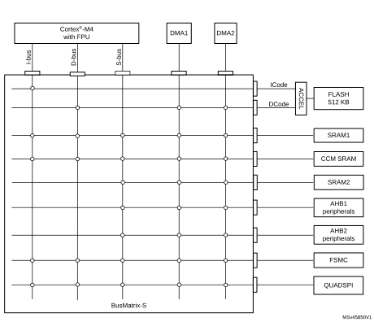

# 2 System and memory overview

## 2.1 System architecture

The main system consists of 32-bit multilayer AHB bus matrix that interconnects:

- Up to five masters:
 - Cortex®-M4 with FPU core I-bus
 - Cortex®-M4 with FPU core D-bus
 - Cortex®-M4 with FPU core S-bus
 - DMA1
 - DMA2
- Up to nine slaves:
 - Internal flash memory on ICode bus
 - Internal flash memory on DCode bus
 - Internal SRAM1
 - Internal SRAM2
 - Internal CCM SRAM
 - AHB1 peripherals including AHB to APB bridges and APB peripherals (connected to APB1 and APB2)
 - AHB2 peripherals
 - Flexible static memory controller (FSMC)
 - QUAD SPI memory interface (QUADSPI)

The bus matrix provides access from a master to a slave, enabling concurrent access and efficient operation even when several high-speed peripherals work simultaneously. This architecture is shown in [Figure 1](#XREF_73674__Figure_1__Multi_Layer_AHB_Bus_Architecture2):

#### Figure 1. System architecture

### 2.1.1 I-bus

This bus connects the instruction bus of the Cortex®-M4 with FPU core to the BusMatrix. This bus is used by the core to fetch instructions. The target of this bus is a memory containing code (either internal Flash memory, internal SRAMs or external memories through the FSMC or QUADSPI).

### 2.1.2 D-bus

This bus connects the data bus of the Cortex®-M4 with FPU core to the BusMatrix. This bus is used by the core for literal load and debug access. The target of this bus is a memory containing code (either internal Flash memory, internal SRAMs or external memories through the FSMC or QUADSPI).

### 2.1.3 S-bus

This bus connects the system bus of the Cortex®-M4 with FPU core to the BusMatrix. This bus is used by the core to access data located in a peripheral or SRAM area. The targets of this bus are the internal SRAM, the AHB1 peripherals including the APB1 and APB2 peripherals, the AHB2 peripherals and the external memories through the QUADSPI or the FSMC.

The CCM SRAM is also accessible on this bus to allow continuous mapping with SRAM1 and SRAM2.

### 2.1.4 DMA-bus

This bus connects the AHB master interface of the DMA to the BusMatrix.The targets of this bus are the SRAM1, SRAM2 and CCM SRAM, the AHB1 peripherals including the APB1 and APB2 peripherals, the AHB2 peripherals and the external memories through the QUADSPI or the FSMC.

### 2.1.5 BusMatrix

The BusMatrix manages the access arbitration between masters. The arbitration uses a Round Robin algorithm. The BusMatrix is composed of up to five masters (CPU AHB, system bus, DCode bus, ICode bus, DMA1, DMA2, ) and up to nine slaves (FLASH, SRAM1, SRAM2, CCM SRAM, AHB1 (including APB1 and APB2), AHB2, QUADSPI, and FSMC).

#### AHB/APB bridges

The two AHB/APB bridges provide full synchronous connections between the AHB and the two APB buses, allowing flexible selection of the peripheral frequency.

Refer to [Section 2.2.2: Memory map and register boundary addresses on page 83](RM0440_MAP_UserSpec.md#XREF_39751__1_1_Register_boundary_addresses3) for the address mapping of the peripherals connected to this bridge.

After each device reset, all peripheral clocks are disabled (except for the SRAM1/2 and Flash memory interface). Before using a peripheral you have to enable its clock in the RCC\_AHBxENR and the RCC\_APBxENR registers.

**Note:**

When a 16- or 8-bit access is performed on an APB register, the access is transformed into a 32-bit access: the bridge duplicates the 16- or 8-bit data to feed the 32-bit vector.