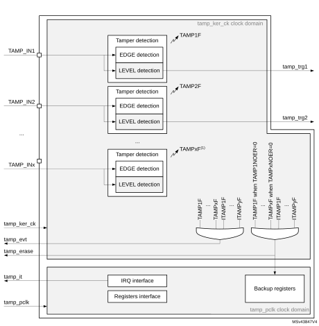

# 38 Tamper and backup registers (TAMP)

## 38.1 Introduction

32 (category 3 and category 4 devices) or 16 (category 2 devices) 32-bit backup registers are retained in all low-power modes and also in VBAT mode. They can be used to store sensitive data as their content is protected by an tamper detection circuit. 3 tamper pins and 4 internal tampers are available for anti-tamper detection. The external tamper pins can be configured for edge detection, or level detection with or without filtering.

## 38.2 TAMP main features

- 32 (category 3 and category 4 devices) or 16 (category 2 devices) backup registers:
 - the backup registers (TAMP\_BKPxR) are implemented in the RTC domain that remains powered-on by VBAT when the VDD power is switched off.
- 3 external tamper detection events.
 - External passive tampers with configurable filter and internal pull-up.
- 4 internal tamper events.
- Any tamper detection can generate a RTC timestamp event.
- Any tamper detection can erase the backup registers.

## 38.3 TAMP functional description

### 38.3.1 TAMP block diagram

#### Figure 533. TAMP block diagram

1.The number of external and internal tampers depends on products.

### 38.3.2 TAMP pins and internal signals

 

<table class="TableTitle"><caption class="TableCap"><h4 class="TableCap" id="4763211">Table 346. <a id="pins%1138" name="XREF_25220__Table_341__TAMP_input_output_pins%1138">TAMP input/output pins</a></h4></caption><col width="189.39px"/><col width="102.05px"/><col width="247.14px"/><thead><tr height="28.00px"><th>
Pin name
</th><th>
Signal type
</th><th>
Description
</th></tr></thead><tr height="22.67px"><td>
TAMP_INx (x = pin index)
</td><td>
Input
</td><td>
Tamper input pin
</td></tr><tr data-conditional="_rtc3v1_act_tmp" height="22.67px" style="display: none"><td data-conditional="_rtc3v1_act_tmp" style="display: none">
TAMP_OUTx (x = pin index)
</td><td data-conditional="_rtc3v1_act_tmp" style="display: none">
Output
</td><td data-conditional="_rtc3v1_act_tmp" style="display: none">
Tamper output pin
</td></tr></table>

 

<table class="TableTitle"><caption class="TableCap"><h4 class="TableCap" id="4763755">Table 347. <a id="signals%1138" name="XREF_92337__Table_305__TAMP_internal_input_output_signals%1138">TAMP internal input/output signals</a></h4></caption><col width="140.92px"/><col width="140.92px"/><col width="256.74px"/><thead><tr height="28.00px"><th>
Internal signal name
</th><th>
Signal type
</th><th>
Description
</th></tr></thead><tr height="37.33px"><td>
tamp_ker_ck
</td><td>
Input
</td><td>
TAMP kernel clock, connected to rtc_ker_ck and also named RTCCLK in this document
</td></tr><tr height="22.67px"><td>
tamp_pclk
</td><td>
Input
</td><td>
TAMP APB clock, connected to rtc_pclk
</td></tr><tr height="37.33px"><td>
tamp_itamp[y] (y = signal index)
</td><td>
Inputs
</td><td>
Internal tamper event sources
</td></tr><tr height="54.67px"><td>
tamp_evt
</td><td>
Output
</td><td>
Tamper event detection (internal or external)

The tamp_evt is used to generate a RTC timestamp event
</td></tr><tr height="37.33px"><td>
tamp_erase
</td><td>
Output
</td><td>
Device secrets erase request following tamper event detection (internal or external)
</td></tr><tr height="37.33px"><td>
tamp_it
</td><td>
Output
</td><td>
TAMP interrupt (refer to <a href="#XREF_27922__51_5_TAMP_interrupts38" style="font-family : Arial ; font-weight:normal;font-style:Italic;font-size : 9.00pt;font-kerning:normal;font-stretch:normal;color:#0000ff;background-color:transparent;letter-spacing : 0.00em;">Section 38.5: TAMP interrupts</a> for details)
</td></tr><tr height="37.33px"><td>
tamp_trg[x] (x = signal index)
</td><td>
Output
</td><td>
Tamper detection trigger
</td></tr></table>

The TAMP kernel clock is usually the LSE at 32.768 kHz although it is possible to select other clock sources in the RCC (refer to RCC for more details). Some detections modes are not available in some low-power modes or VBAT when the selected clock is not LSE (refer to [Section 38.4: TAMP low-power modes](#XREF_34938__51_4_TAMP_low-power_modes38) for more details.

 

<table class="TableTitle"><caption class="TableCap"><h4 class="TableCap" id="4764000">Table 348. <a id="interconnection%1138" name="XREF_99884__Table_332__TAMP_interconnection%1138">TAMP interconnection</a></h4></caption><col width="141.28px"/><col width="397.30px"/><thead><tr height="28.00px"><th>
 Signal name
</th><th>
Source/Destination
</th></tr></thead><tr height="22.67px"><td>
tamp_evt
</td><td>
rtc_tamp_evt used to generate a timestamp event
</td></tr><tr height="37.33px"><td>
tamp_erase
</td><td>
The tamp_erase signal is used to erase the device secrets listed hereafter: backup registers
</td></tr><tr data-conditional="_rtc3v1_tmp_int1" height="22.67px" style="display: none"><td data-conditional="_rtc3v1_tmp_int1" style="display: none">
tamp_itamp1
</td><td data-conditional="_rtc3v1_tmp_int1" style="display: none">
RTC voltage domain monitoring
</td></tr><tr data-conditional="_rtc3v1_tmp_int2" height="22.67px" style="display: none"><td data-conditional="_rtc3v1_tmp_int2" style="display: none">
tamp_itamp2
</td><td data-conditional="_rtc3v1_tmp_int2" style="display: none">
Temperature monitoring
</td></tr><tr data-conditional="_rtc3v1_tmp_int3" height="22.67px"><td data-conditional="_rtc3v1_tmp_int3">
tamp_itamp3
</td><td data-conditional="_rtc3v1_tmp_int3">
LSE monitoring
</td></tr><tr data-conditional="_rtc3v1_tmp_int4" height="22.67px"><td data-conditional="_rtc3v1_tmp_int4">
tamp_itamp4
</td><td data-conditional="_rtc3v1_tmp_int4">
HSE monitoring
</td></tr><tr height="22.67px"><td>
tamp_itamp5
</td><td>
RTC calendar overflow (rtc_calovf)
</td></tr><tr data-conditional="_rtc3v1_tmp_int6" height="22.67px"><td data-conditional="_rtc3v1_tmp_int6">
tamp_itamp6
</td><td data-conditional="_rtc3v1_tmp_int6">
ST manufacturer readout
</td></tr><tr data-conditional="_rtc3v1_tmp_int8" height="22.67px" style="display: none"><td data-conditional="_rtc3v1_tmp_int8" style="display: none">
tamp_itamp8<a href="#c7amba%20rtc3%20v1%20UserSpec_Real-time%20clock%20(RTC)_FTH_1">1</a>
</td><td data-conditional="_rtc3v1_tmp_int8" style="display: none">
Monotonic counter overflow
</td></tr></table>

<a href="#c7amba%20rtc3%20v1%20UserSpec_Real-time%20clock%20(RTC)_FTB_1">1.</a>This signal is generated in the TAMP peripheral.

### 38.3.3 TAMP register write protection

After system reset, the TAMP registers (including backup registers) are protected against parasitic write access by the DBP bit in the power control peripheral (refer to the PWR power control section). DBP bit must be set in order to enable TAMP registers write access.

### 38.3.4 Tamper detection

The tamper detection can be configured for the following purposes:

- erase the backup registers (default configuration)
- generate an interrupt, capable to wakeup from Stop and Standby mode
- generate a hardware trigger for the low-power timers

#### TAMP backup registers

The backup registers (TAMP\_BKPxR) are not reset by system reset or when the device wakes up from Standby mode.

The backup registers are reset when a tamper detection event occurs except if the TAMPxNOER bit is set, or if the TAMPxMSK is set in the TAMP\_CR2 register.

**Note:**

The backup registers are also erased when the readout protection of the flash is changed from level 1 to level 0.

#### Tamper detection initialization

Each input can be enabled by setting the corresponding TAMPxE bits to 1 in the TAMP\_CR register.

Each TAMP\_INx tamper detection input is associated with a flag TAMPxF in the TAMP\_SR register.

When TAMPxMSK is cleared:

The TAMPxF flag is asserted after the tamper event on the pin, with the latency provided below:

- 3 ck\_apre cycles when TAMPFLT differs from 0x0 (level detection with filtering)
- 3 ck\_apre cycles when TAMPTS = 1 (timestamp on tamper event)
- No latency when TAMPFLT = 0x0 (edge detection) and TAMPTS = 0

A new tamper occurring on the same pin during this period and as long as TAMPxF is set cannot be detected.

When TAMPxMSK is set:

A new tamper occurring on the same pin cannot be detected during the latency described above and 2.5 ck\_rtc additional cycles.

By setting the TAMPxIE bit in the TAMP\_IER register, an interrupt is generated when a tamper detection event occurs (when TAMPxF is set). Setting TAMPxIE is not allowed when the corresponding TAMPxMSK is set.

#### Trigger output generation on tamper event

The tamper event detection can be used as trigger input by the low-power timers.

When TAMPxMSK bit in cleared in TAMP\_CR register, the TAMPxF flag must be cleared by software in order to allow a new tamper detection on the same pin.

When TAMPxMSK bit is set, the TAMPxF flag is masked, and kept cleared in TAMP\_SR register. This configuration allows to trig automatically the low-power timers in Stop mode, without requiring the system wakeup to perform the TAMPxF clearing. In this case, the backup registers are not cleared.

This feature is available only when the tamper is configured in the [Level detection with filtering on tamper inputs (passive mode)](#XREF_96851__Level_detection_with_filtering_on_tamper_inputs_(p38) mode (TAMPFLT ≠ 00 and active mode is not selected).

#### Timestamp on tamper event

With TAMPTS set to 1 in the RTC\_CR, any tamper event causes a timestamp to occur. In this case, either the TSF bit or the TSOVF bit is set in RTC\_SR, in the same manner as if a normal timestamp event occurs. The affected tamper flag register TAMPxF is set in the TAMP\_SR at the same time that TSF or TSOVF is set in the RTC\_SR.

#### Edge detection on tamper inputs (passive mode)

If the TAMPFLT bits are 00, the TAMP\_INx pins generate tamper detection events when either a rising edge/high level or a falling edge/low level is observed depending on the corresponding TAMPxTRG bit. The internal pull-up resistors on the TAMP\_INx inputs are deactivated when edge detection is selected.

Caution:When using the edge detection, it is recommended to check by software the tamper pin level just after enabling the tamper detection (by reading the GPIO registers), and before writing sensitive values in the backup registers, to ensure that an active edge did not occur before enabling the tamper event detection.  
When TAMPFLT = 00 and TAMPxTRG = 0 (rising edge detection), a tamper event may be detected by hardware if the tamper input is already at high level before enabling the tamper detection.

After a tamper event has been detected and cleared, the TAMP\_INx should be disabled and then re-enabled (TAMPxE set to 1) before re-programming the backup registers (TAMP\_BKPxR). This prevents the application from writing to the backup registers while the TAMP\_INx input value still indicates a tamper detection. This is equivalent to a level detection on the TAMP\_INx input.

**Note:**

Tamper detection is still active when VDD power is switched off. To avoid unwanted resetting of the backup registers, the pin to which the TAMPx is mapped should be externally tied to the correct level.

#### Level detection with filtering on tamper inputs (passive mode)

Level detection with filtering is performed by setting TAMPFLT to a non-zero value. A tamper detection event is generated when either 2, 4, or 8 (depending on TAMPFLT) consecutive samples are observed at the level designated by the TAMPxTRG bits.

The TAMP\_INx inputs are precharged through the I/O internal pull-up resistance before its state is sampled, unless disabled by setting TAMPPUDIS to 1. The duration of the precharge is determined by the TAMPPRCH bits, allowing for larger capacitances on the TAMP\_INx inputs.

The trade-off between tamper detection latency and power consumption through the pull-up can be optimized by using TAMPFREQ to determine the frequency of the sampling for level detection.

**Note:**

Refer to the datasheet for the electrical characteristics of the pull-up resistors.

## 38.4 TAMP low-power modes

 

<table class="TableTitle"><caption class="TableTitle"><h4 class="TableCap" id="4764339">Table 349. <a id="TAMP%1138" name="XREF_86357__Table_357__Effect_of_low-power_modes_on_TAMP%1138">Effect of low-power modes on TAMP</a></h4></caption><col width="63.72px"/><col width="474.86px"/><thead><tr height="28.00px"><th>
Mode 
</th><th>
Description 
</th></tr></thead><tr height="40.00px"><td>
Sleep
</td><td>
No effect.

TAMP interrupts cause the device to exit the Sleep mode.
</td></tr><tr height="54.67px"><td>
Stop
</td><td>
No effect on all features, except for level detection with filtering mode which remain active only when the clock source is LSE or LSI.

TAMP interrupts cause the device to exit the Stop mode.
</td></tr><tr height="52.00px"><td>
Standby
</td><td>
No effect on all features, except for level detection with filtering mode which remain active only when the clock source is LSE or LSI. TAMP interrupts cause the device to exit the Standby mode.
</td></tr><tr data-conditional="_rtc3v1_shutdown" height="52.00px"><td data-conditional="_rtc3v1_shutdown">
Shutdown
</td><td data-conditional="_rtc3v1_shutdown">
No effect on all features, except for level detection with filtering mode which remain active only when the clock source is LSE. TAMP interrupts cause the device to exit the Shutdown mode.
</td></tr></table>

## 38.5 TAMP interrupts

The interrupt channel is set in the interrupt status register. The interrupt output is also activated.

<table class="TableTitle"><caption class="TableTitle"><h4 class="TableCap" id="22054798">Table 350. Interrupt requests</h4></caption><col width="77.82px"/><col width="88.16px"/><col width="78.17px"/><col width="82.92px"/><col width="79.73px"/><col width="69.13px"/><col width="69.13px"/><col width="69.13px"/><thead><tr height="72.00px"><th>
Interrupt acronym
</th><th>
Interrupt event
</th><th>
Event flag<a href="#c7amba%20rtc3%20v1%20UserSpec_Real-time%20clock%20(RTC)_FTH_1">1</a>
</th><th>
Enable control bit<a href="#c7amba%20rtc3%20v1%20UserSpec_Real-time%20clock%20(RTC)_FTH_2">2</a>
</th><th>
Interrupt clear method
</th><th>
Exit from Sleep mode
</th><th>
Exit from Stop and Standby modes
</th><th>
Exit from Shutdown mode
</th></tr></thead><tr height="37.33px"><td rowspan="2">
TAMP
</td><td>
Tamper x<a href="#c7amba%20rtc3%20v1%20UserSpec_Real-time%20clock%20(RTC)_FTH_3">3</a>
</td><td>
TAMPxF
</td><td>
TAMPxIE
</td><td>
Write 1 in CTAMPxF
</td><td>
Yes
</td><td>
Yes<a href="#c7amba%20rtc3%20v1%20UserSpec_Real-time%20clock%20(RTC)_FTH_4">4</a>
</td><td>
Yes<a href="#c7amba%20rtc3%20v1%20UserSpec_Real-time%20clock%20(RTC)_FTH_5">5</a>
</td></tr><tr height="40.00px"><td>
Internal 

tamper y<a href="#XREF_55898__3__The_number_of_tampers_and_internal_tampers_events38" style="font-family : Arial ; font-weight:normal;font-style:normal;font-size : 9.00pt;text-decoration:none;font-kerning:normal;text-transform:none;font-stretch:normal;color:#000000;background-color:transparent;letter-spacing : 0.00em;">(3)</a>
</td><td>
ITAMPyF
</td><td>
ITAMPyIE
</td><td>
Write 1 in CITAMPxF
</td><td>
Yes
</td><td>
Yes<a href="#XREF_62004__4__In_case_of_level_detection_with_filtering_passive38" style="font-family : Arial ; font-weight:normal;font-style:normal;font-size : 9.00pt;text-decoration:none;font-kerning:normal;text-transform:none;font-stretch:normal;color:#000000;background-color:transparent;letter-spacing : 0.00em;">(4)</a>
</td><td>
Yes<a href="#XREF_10016__5__In_case_of_level_detection_with_filtering_passive38" style="font-family : Arial ; font-weight:normal;font-style:normal;font-size : 9.00pt;text-decoration:none;font-kerning:normal;text-transform:none;font-stretch:normal;color:#000000;background-color:transparent;letter-spacing : 0.00em;">(5)</a>
</td></tr></table>

<a href="#c7amba%20rtc3%20v1%20UserSpec_Real-time%20clock%20(RTC)_FTB_1">1.</a>The event flags are in the TAMP_SR register.

<a href="#c7amba%20rtc3%20v1%20UserSpec_Real-time%20clock%20(RTC)_FTB_2">2.</a>The interrupt masked flags (resulting from event flags AND enable control bits) are in the TAMP_MISR register.

<a href="#c7amba%20rtc3%20v1%20UserSpec_Real-time%20clock%20(RTC)_FTB_3">3.</a><a id="events38" name="XREF_55898__3__The_number_of_tampers_and_internal_tampers_events38" style="font-kerning:none;">The number of tampers and internal tampers events depend on products.</a>

<a href="#c7amba%20rtc3%20v1%20UserSpec_Real-time%20clock%20(RTC)_FTB_4">4.</a><a id="passive38" name="XREF_62004__4__In_case_of_level_detection_with_filtering_passive38">In case of level detection with filtering passive tamper mode</a>, wakeup from Stop and Standby modes is possible only when the TAMP clock source is LSE or LSI.

<a href="#c7amba%20rtc3%20v1%20UserSpec_Real-time%20clock%20(RTC)_FTB_5">5.</a><a id="passive38" name="XREF_10016__5__In_case_of_level_detection_with_filtering_passive38">In case of level detection with filtering passive tamper mode</a>, wakeup from Shutdown modes is possible only when the TAMP clock source is LSE.

## 38.6 TAMP registers

Refer to [Section 1.2 on page 74](Documentation_conventions.md#XREF_82797__1_1_List_of_abbreviations_for_registers1) of the reference manual for a list of abbreviations used in register descriptions. The peripheral registers can be accessed by words (32-bit).

### 38.6.1 TAMP control register 1 (TAMP\_CR1)

Address offset: 0x00

Backup domain reset value: 0xFFFF 0000

System reset: not affected

 

<table class="RegBitMap"><col width="38.39px"/><col width="38.39px"/><col width="38.39px"/><col width="38.39px"/><col width="38.39px"/><col width="38.39px"/><col width="38.39px"/><col width="38.39px"/><col width="38.39px"/><col width="38.39px"/><col width="38.39px"/><col width="38.39px"/><col width="38.39px"/><col width="38.39px"/><col width="38.39px"/><col width="38.39px"/><tr height="17.33px"><td style="border-bottom-width:0;border-bottom-style:hidden;border-bottom-color:0;">
31
</td><td style="border-bottom-width:0;border-bottom-style:hidden;border-bottom-color:0;">
30
</td><td style="border-bottom-width:0;border-bottom-style:hidden;border-bottom-color:0;">
29
</td><td style="border-bottom-width:0;border-bottom-style:hidden;border-bottom-color:0;">
28
</td><td style="border-bottom-width:0;border-bottom-style:hidden;border-bottom-color:0;">
27
</td><td style="border-bottom-width:0;border-bottom-style:hidden;border-bottom-color:0;">
26
</td><td style="border-bottom-width:0;border-bottom-style:hidden;border-bottom-color:0;">
25
</td><td style="border-bottom-width:0;border-bottom-style:hidden;border-bottom-color:0;">
24
</td><td style="border-bottom-width:0;border-bottom-style:hidden;border-bottom-color:0;">
23
</td><td style="border-bottom-width:0;border-bottom-style:hidden;border-bottom-color:0;">
22
</td><td style="border-bottom-width:0;border-bottom-style:hidden;border-bottom-color:0;">
21
</td><td style="border-bottom-width:0;border-bottom-style:hidden;border-bottom-color:0;">
20
</td><td style="border-bottom-width:0;border-bottom-style:hidden;border-bottom-color:0;">
19
</td><td style="border-bottom-width:0;border-bottom-style:hidden;border-bottom-color:0;">
18
</td><td style="border-bottom-width:0;border-bottom-style:hidden;border-bottom-color:0;">
17
</td><td style="border-bottom-width:0;border-bottom-style:hidden;border-bottom-color:0;">
16
</td></tr><tr height="28.00px"><td style="border-left-width:0.5pt;border-left-style:solid;border-left-color:#000000;border-bottom-width:0.5pt;border-bottom-style:solid;border-bottom-color:#000000;border-right-width:0.5pt;border-right-style:solid;border-right-color:#000000;border-top-width:0.5pt;border-top-style:solid;border-top-color:#000000;">
Res.
</td><td style="border-left-width:0.5pt;border-left-style:solid;border-left-color:#000000;border-bottom-width:0.5pt;border-bottom-style:solid;border-bottom-color:#000000;border-right-width:0.5pt;border-right-style:solid;border-right-color:#000000;border-top-width:0.5pt;border-top-style:solid;border-top-color:#000000;">
Res.
</td><td style="border-left-width:0.5pt;border-left-style:solid;border-left-color:#000000;border-bottom-width:0.5pt;border-bottom-style:solid;border-bottom-color:#000000;border-right-width:0.5pt;border-right-style:solid;border-right-color:#000000;border-top-width:0.5pt;border-top-style:solid;border-top-color:#000000;">
Res.
</td><td style="border-left-width:0.5pt;border-left-style:solid;border-left-color:#000000;border-bottom-width:0.5pt;border-bottom-style:solid;border-bottom-color:#000000;border-right-width:0.5pt;border-right-style:solid;border-right-color:#000000;border-top-width:0.5pt;border-top-style:solid;border-top-color:#000000;">
Res.
</td><td style="border-left-width:0.5pt;border-left-style:solid;border-left-color:#000000;border-bottom-width:0.5pt;border-bottom-style:solid;border-bottom-color:#000000;border-right-width:0.5pt;border-right-style:solid;border-right-color:#000000;border-top-width:0.5pt;border-top-style:solid;border-top-color:#000000;">
Res.
</td><td style="border-left-width:0.5pt;border-left-style:solid;border-left-color:#000000;border-bottom-width:0.5pt;border-bottom-style:solid;border-bottom-color:#000000;border-right-width:0.5pt;border-right-style:solid;border-right-color:#000000;border-top-width:0.5pt;border-top-style:solid;border-top-color:#000000;">
Res.
</td><td style="border-left-width:0.5pt;border-left-style:solid;border-left-color:#000000;border-bottom-width:0.5pt;border-bottom-style:solid;border-bottom-color:#000000;border-right-width:0.5pt;border-right-style:solid;border-right-color:#000000;border-top-width:0.5pt;border-top-style:solid;border-top-color:#000000;">
Res.
</td><td style="border-left-width:0.5pt;border-left-style:solid;border-left-color:#000000;border-bottom-width:0.5pt;border-bottom-style:solid;border-bottom-color:#000000;border-right-width:0.5pt;border-right-style:solid;border-right-color:#000000;border-top-width:0.5pt;border-top-style:solid;border-top-color:#000000;">
Res.
</td><td style="border-left-width:0.5pt;border-left-style:solid;border-left-color:#000000;border-bottom-width:0.5pt;border-bottom-style:solid;border-bottom-color:#000000;border-right-width:0.5pt;border-right-style:solid;border-right-color:#000000;border-top-width:0.5pt;border-top-style:solid;border-top-color:#000000;">
Res.
</td><td style="border-left-width:0.5pt;border-left-style:solid;border-left-color:#000000;border-bottom-width:0.5pt;border-bottom-style:solid;border-bottom-color:#000000;border-right-width:0.5pt;border-right-style:solid;border-right-color:#000000;border-top-width:0.5pt;border-top-style:solid;border-top-color:#000000;">
Res.
</td><td style="border-left-width:0.5pt;border-left-style:solid;border-left-color:#000000;border-bottom-width:0.5pt;border-bottom-style:solid;border-bottom-color:#000000;border-right-width:0.5pt;border-right-style:solid;border-right-color:#000000;border-top-width:0.5pt;border-top-style:solid;border-top-color:#000000;">
ITAMP6 E
</td><td style="border-left-width:0.5pt;border-left-style:solid;border-left-color:#000000;border-bottom-width:0.5pt;border-bottom-style:solid;border-bottom-color:#000000;border-right-width:0.5pt;border-right-style:solid;border-right-color:#000000;border-top-width:0.5pt;border-top-style:solid;border-top-color:#000000;">
ITAMP5 E
</td><td style="border-left-width:0.5pt;border-left-style:solid;border-left-color:#000000;border-bottom-width:0.5pt;border-bottom-style:solid;border-bottom-color:#000000;border-right-width:0.5pt;border-right-style:solid;border-right-color:#000000;border-top-width:0.5pt;border-top-style:solid;border-top-color:#000000;">
ITAMP4 E
</td><td style="border-left-width:0.5pt;border-left-style:solid;border-left-color:#000000;border-bottom-width:0.5pt;border-bottom-style:solid;border-bottom-color:#000000;border-right-width:0.5pt;border-right-style:solid;border-right-color:#000000;border-top-width:0.5pt;border-top-style:solid;border-top-color:#000000;">
ITAMP3 E
</td><td style="border-left-width:0.5pt;border-left-style:solid;border-left-color:#000000;border-bottom-width:0.5pt;border-bottom-style:solid;border-bottom-color:#000000;border-right-width:0.5pt;border-right-style:solid;border-right-color:#000000;border-top-width:0.5pt;border-top-style:solid;border-top-color:#000000;">
Res.
</td><td style="border-left-width:0.5pt;border-left-style:solid;border-left-color:#000000;border-bottom-width:0.5pt;border-bottom-style:solid;border-bottom-color:#000000;border-right-width:0.5pt;border-right-style:solid;border-right-color:#000000;border-top-width:0.5pt;border-top-style:solid;border-top-color:#000000;">
Res.
</td></tr><tr height="20.00px"><td style="border-left-width:0.5pt;border-left-style:solid;border-left-color:#000000;border-bottom-width:0.5pt;border-bottom-style:solid;border-bottom-color:#000000;border-right-width:0.5pt;border-right-style:solid;border-right-color:#000000;border-top-width:0.5pt;border-top-style:solid;border-top-color:#000000;"></td><td style="border-left-width:0.5pt;border-left-style:solid;border-left-color:#000000;border-bottom-width:0.5pt;border-bottom-style:solid;border-bottom-color:#000000;border-right-width:0.5pt;border-right-style:solid;border-right-color:#000000;border-top-width:0.5pt;border-top-style:solid;border-top-color:#000000;"></td><td style="border-left-width:0.5pt;border-left-style:solid;border-left-color:#000000;border-bottom-width:0.5pt;border-bottom-style:solid;border-bottom-color:#000000;border-right-width:0.5pt;border-right-style:solid;border-right-color:#000000;border-top-width:0.5pt;border-top-style:solid;border-top-color:#000000;"></td><td style="border-left-width:0.5pt;border-left-style:solid;border-left-color:#000000;border-bottom-width:0.5pt;border-bottom-style:solid;border-bottom-color:#000000;border-right-width:0.5pt;border-right-style:solid;border-right-color:#000000;border-top-width:0.5pt;border-top-style:solid;border-top-color:#000000;"></td><td style="border-left-width:0.5pt;border-left-style:solid;border-left-color:#000000;border-bottom-width:0.5pt;border-bottom-style:solid;border-bottom-color:#000000;border-right-width:0.5pt;border-right-style:solid;border-right-color:#000000;border-top-width:0.5pt;border-top-style:solid;border-top-color:#000000;"></td><td style="border-left-width:0.5pt;border-left-style:solid;border-left-color:#000000;border-bottom-width:0.5pt;border-bottom-style:solid;border-bottom-color:#000000;border-right-width:0.5pt;border-right-style:solid;border-right-color:#000000;border-top-width:0.5pt;border-top-style:solid;border-top-color:#000000;"></td><td style="border-left-width:0.5pt;border-left-style:solid;border-left-color:#000000;border-bottom-width:0.5pt;border-bottom-style:solid;border-bottom-color:#000000;border-right-width:0.5pt;border-right-style:solid;border-right-color:#000000;border-top-width:0.5pt;border-top-style:solid;border-top-color:#000000;"></td><td style="border-left-width:0.5pt;border-left-style:solid;border-left-color:#000000;border-bottom-width:0.5pt;border-bottom-style:solid;border-bottom-color:#000000;border-right-width:0.5pt;border-right-style:solid;border-right-color:#000000;border-top-width:0.5pt;border-top-style:solid;border-top-color:#000000;"></td><td style="border-left-width:0.5pt;border-left-style:solid;border-left-color:#000000;border-bottom-width:0.5pt;border-bottom-style:solid;border-bottom-color:#000000;border-right-width:0.5pt;border-right-style:solid;border-right-color:#000000;border-top-width:0.5pt;border-top-style:solid;border-top-color:#000000;"></td><td style="border-left-width:0.5pt;border-left-style:solid;border-left-color:#000000;border-bottom-width:0.5pt;border-bottom-style:solid;border-bottom-color:#000000;border-right-width:0.5pt;border-right-style:solid;border-right-color:#000000;border-top-width:0.5pt;border-top-style:solid;border-top-color:#000000;"></td><td style="border-left-width:0.5pt;border-left-style:solid;border-left-color:#000000;border-bottom-width:0.5pt;border-bottom-style:solid;border-bottom-color:#000000;border-right-width:0.5pt;border-right-style:solid;border-right-color:#000000;border-top-width:0.5pt;border-top-style:solid;border-top-color:#000000;">
rw
</td><td style="border-left-width:0.5pt;border-left-style:solid;border-left-color:#000000;border-bottom-width:0.5pt;border-bottom-style:solid;border-bottom-color:#000000;border-right-width:0.5pt;border-right-style:solid;border-right-color:#000000;border-top-width:0.5pt;border-top-style:solid;border-top-color:#000000;">
rw
</td><td style="border-left-width:0.5pt;border-left-style:solid;border-left-color:#000000;border-bottom-width:0.5pt;border-bottom-style:solid;border-bottom-color:#000000;border-right-width:0.5pt;border-right-style:solid;border-right-color:#000000;border-top-width:0.5pt;border-top-style:solid;border-top-color:#000000;">
rw
</td><td style="border-left-width:0.5pt;border-left-style:solid;border-left-color:#000000;border-bottom-width:0.5pt;border-bottom-style:solid;border-bottom-color:#000000;border-right-width:0.5pt;border-right-style:solid;border-right-color:#000000;border-top-width:0.5pt;border-top-style:solid;border-top-color:#000000;">
rw
</td><td style="border-left-width:0.5pt;border-left-style:solid;border-left-color:#000000;border-bottom-width:0.5pt;border-bottom-style:solid;border-bottom-color:#000000;border-right-width:0.5pt;border-right-style:solid;border-right-color:#000000;border-top-width:0.5pt;border-top-style:solid;border-top-color:#000000;"></td><td style="border-left-width:0.5pt;border-left-style:solid;border-left-color:#000000;border-bottom-width:0.5pt;border-bottom-style:solid;border-bottom-color:#000000;border-right-width:0.5pt;border-right-style:solid;border-right-color:#000000;border-top-width:0.5pt;border-top-style:solid;border-top-color:#000000;"></td></tr><tr height="17.33px"><td style="border-bottom-width:0;border-bottom-style:hidden;border-bottom-color:0;border-top-width:0;border-top-style:hidden;border-top-color:0;">
15
</td><td style="border-bottom-width:0;border-bottom-style:hidden;border-bottom-color:0;border-top-width:0;border-top-style:hidden;border-top-color:0;">
14
</td><td style="border-bottom-width:0;border-bottom-style:hidden;border-bottom-color:0;border-top-width:0;border-top-style:hidden;border-top-color:0;">
13
</td><td style="border-bottom-width:0;border-bottom-style:hidden;border-bottom-color:0;border-top-width:0;border-top-style:hidden;border-top-color:0;">
12
</td><td style="border-bottom-width:0;border-bottom-style:hidden;border-bottom-color:0;border-top-width:0;border-top-style:hidden;border-top-color:0;">
11
</td><td style="border-bottom-width:0;border-bottom-style:hidden;border-bottom-color:0;border-top-width:0;border-top-style:hidden;border-top-color:0;">
10
</td><td style="border-bottom-width:0;border-bottom-style:hidden;border-bottom-color:0;border-top-width:0;border-top-style:hidden;border-top-color:0;">
9
</td><td style="border-bottom-width:0;border-bottom-style:hidden;border-bottom-color:0;border-top-width:0;border-top-style:hidden;border-top-color:0;">
8
</td><td style="border-bottom-width:0;border-bottom-style:hidden;border-bottom-color:0;border-top-width:0;border-top-style:hidden;border-top-color:0;">
7
</td><td style="border-bottom-width:0;border-bottom-style:hidden;border-bottom-color:0;border-top-width:0;border-top-style:hidden;border-top-color:0;">
6
</td><td style="border-bottom-width:0;border-bottom-style:hidden;border-bottom-color:0;border-top-width:0;border-top-style:hidden;border-top-color:0;">
5
</td><td style="border-bottom-width:0;border-bottom-style:hidden;border-bottom-color:0;border-top-width:0;border-top-style:hidden;border-top-color:0;">
4
</td><td style="border-bottom-width:0;border-bottom-style:hidden;border-bottom-color:0;border-top-width:0;border-top-style:hidden;border-top-color:0;">
3
</td><td style="border-bottom-width:0;border-bottom-style:hidden;border-bottom-color:0;border-top-width:0;border-top-style:hidden;border-top-color:0;">
2
</td><td style="border-bottom-width:0;border-bottom-style:hidden;border-bottom-color:0;border-top-width:0;border-top-style:hidden;border-top-color:0;">
1
</td><td style="border-bottom-width:0;border-bottom-style:hidden;border-bottom-color:0;border-top-width:0;border-top-style:hidden;border-top-color:0;">
0
</td></tr><tr height="28.00px"><td style="border-left-width:0.5pt;border-left-style:solid;border-left-color:#000000;border-bottom-width:0.5pt;border-bottom-style:solid;border-bottom-color:#000000;border-right-width:0.5pt;border-right-style:solid;border-right-color:#000000;border-top-width:0.5pt;border-top-style:solid;border-top-color:#000000;">
Res.
</td><td style="border-left-width:0.5pt;border-left-style:solid;border-left-color:#000000;border-bottom-width:0.5pt;border-bottom-style:solid;border-bottom-color:#000000;border-right-width:0.5pt;border-right-style:solid;border-right-color:#000000;border-top-width:0.5pt;border-top-style:solid;border-top-color:#000000;">
Res.
</td><td style="border-left-width:0.5pt;border-left-style:solid;border-left-color:#000000;border-bottom-width:0.5pt;border-bottom-style:solid;border-bottom-color:#000000;border-right-width:0.5pt;border-right-style:solid;border-right-color:#000000;border-top-width:0.5pt;border-top-style:solid;border-top-color:#000000;">
Res.
</td><td style="border-left-width:0.5pt;border-left-style:solid;border-left-color:#000000;border-bottom-width:0.5pt;border-bottom-style:solid;border-bottom-color:#000000;border-right-width:0.5pt;border-right-style:solid;border-right-color:#000000;border-top-width:0.5pt;border-top-style:solid;border-top-color:#000000;">
Res.
</td><td style="border-left-width:0.5pt;border-left-style:solid;border-left-color:#000000;border-bottom-width:0.5pt;border-bottom-style:solid;border-bottom-color:#000000;border-right-width:0.5pt;border-right-style:solid;border-right-color:#000000;border-top-width:0.5pt;border-top-style:solid;border-top-color:#000000;">
Res.
</td><td style="border-left-width:0.5pt;border-left-style:solid;border-left-color:#000000;border-bottom-width:0.5pt;border-bottom-style:solid;border-bottom-color:#000000;border-right-width:0.5pt;border-right-style:solid;border-right-color:#000000;border-top-width:0.5pt;border-top-style:solid;border-top-color:#000000;">
Res.
</td><td style="border-left-width:0.5pt;border-left-style:solid;border-left-color:#000000;border-bottom-width:0.5pt;border-bottom-style:solid;border-bottom-color:#000000;border-right-width:0.5pt;border-right-style:solid;border-right-color:#000000;border-top-width:0.5pt;border-top-style:solid;border-top-color:#000000;">
Res.
</td><td style="border-left-width:0.5pt;border-left-style:solid;border-left-color:#000000;border-bottom-width:0.5pt;border-bottom-style:solid;border-bottom-color:#000000;border-right-width:0.5pt;border-right-style:solid;border-right-color:#000000;border-top-width:0.5pt;border-top-style:solid;border-top-color:#000000;">
Res.
</td><td style="border-left-width:0.5pt;border-left-style:solid;border-left-color:#000000;border-bottom-width:0.5pt;border-bottom-style:solid;border-bottom-color:#000000;border-right-width:0.5pt;border-right-style:solid;border-right-color:#000000;border-top-width:0.5pt;border-top-style:solid;border-top-color:#000000;">
Res.
</td><td style="border-left-width:0.5pt;border-left-style:solid;border-left-color:#000000;border-bottom-width:0.5pt;border-bottom-style:solid;border-bottom-color:#000000;border-right-width:0.5pt;border-right-style:solid;border-right-color:#000000;border-top-width:0.5pt;border-top-style:solid;border-top-color:#000000;">
Res.
</td><td style="border-left-width:0.5pt;border-left-style:solid;border-left-color:#000000;border-bottom-width:0.5pt;border-bottom-style:solid;border-bottom-color:#000000;border-right-width:0.5pt;border-right-style:solid;border-right-color:#000000;border-top-width:0.5pt;border-top-style:solid;border-top-color:#000000;">
Res.
</td><td style="border-left-width:0.5pt;border-left-style:solid;border-left-color:#000000;border-bottom-width:0.5pt;border-bottom-style:solid;border-bottom-color:#000000;border-right-width:0.5pt;border-right-style:solid;border-right-color:#000000;border-top-width:0.5pt;border-top-style:solid;border-top-color:#000000;">
Res.
</td><td style="border-left-width:0.5pt;border-left-style:solid;border-left-color:#000000;border-bottom-width:0.5pt;border-bottom-style:solid;border-bottom-color:#000000;border-right-width:0.5pt;border-right-style:solid;border-right-color:#000000;border-top-width:0.5pt;border-top-style:solid;border-top-color:#000000;">
Res.
</td><td style="border-left-width:0.5pt;border-left-style:solid;border-left-color:#000000;border-bottom-width:0.5pt;border-bottom-style:solid;border-bottom-color:#000000;border-right-width:0.5pt;border-right-style:solid;border-right-color:#000000;border-top-width:0.5pt;border-top-style:solid;border-top-color:#000000;">
TAMP3 E
</td><td style="border-left-width:0.5pt;border-left-style:solid;border-left-color:#000000;border-bottom-width:0.5pt;border-bottom-style:solid;border-bottom-color:#000000;border-right-width:0.5pt;border-right-style:solid;border-right-color:#000000;border-top-width:0.5pt;border-top-style:solid;border-top-color:#000000;">
TAMP2 E
</td><td style="border-left-width:0.5pt;border-left-style:solid;border-left-color:#000000;border-bottom-width:0.5pt;border-bottom-style:solid;border-bottom-color:#000000;border-right-width:0.5pt;border-right-style:solid;border-right-color:#000000;border-top-width:0.5pt;border-top-style:solid;border-top-color:#000000;">
TAMP1 E
</td></tr><tr height="20.00px"><td style="border-left-width:0.5pt;border-left-style:solid;border-left-color:#000000;border-bottom-width:0.5pt;border-bottom-style:solid;border-bottom-color:#000000;border-right-width:0.5pt;border-right-style:solid;border-right-color:#000000;border-top-width:0.5pt;border-top-style:solid;border-top-color:#000000;"></td><td style="border-left-width:0.5pt;border-left-style:solid;border-left-color:#000000;border-bottom-width:0.5pt;border-bottom-style:solid;border-bottom-color:#000000;border-right-width:0.5pt;border-right-style:solid;border-right-color:#000000;border-top-width:0.5pt;border-top-style:solid;border-top-color:#000000;"></td><td style="border-left-width:0.5pt;border-left-style:solid;border-left-color:#000000;border-bottom-width:0.5pt;border-bottom-style:solid;border-bottom-color:#000000;border-right-width:0.5pt;border-right-style:solid;border-right-color:#000000;border-top-width:0.5pt;border-top-style:solid;border-top-color:#000000;"></td><td style="border-left-width:0.5pt;border-left-style:solid;border-left-color:#000000;border-bottom-width:0.5pt;border-bottom-style:solid;border-bottom-color:#000000;border-right-width:0.5pt;border-right-style:solid;border-right-color:#000000;border-top-width:0.5pt;border-top-style:solid;border-top-color:#000000;"></td><td style="border-left-width:0.5pt;border-left-style:solid;border-left-color:#000000;border-bottom-width:0.5pt;border-bottom-style:solid;border-bottom-color:#000000;border-right-width:0.5pt;border-right-style:solid;border-right-color:#000000;border-top-width:0.5pt;border-top-style:solid;border-top-color:#000000;"></td><td style="border-left-width:0.5pt;border-left-style:solid;border-left-color:#000000;border-bottom-width:0.5pt;border-bottom-style:solid;border-bottom-color:#000000;border-right-width:0.5pt;border-right-style:solid;border-right-color:#000000;border-top-width:0.5pt;border-top-style:solid;border-top-color:#000000;"></td><td style="border-left-width:0.5pt;border-left-style:solid;border-left-color:#000000;border-bottom-width:0.5pt;border-bottom-style:solid;border-bottom-color:#000000;border-right-width:0.5pt;border-right-style:solid;border-right-color:#000000;border-top-width:0.5pt;border-top-style:solid;border-top-color:#000000;"></td><td style="border-left-width:0.5pt;border-left-style:solid;border-left-color:#000000;border-bottom-width:0.5pt;border-bottom-style:solid;border-bottom-color:#000000;border-right-width:0.5pt;border-right-style:solid;border-right-color:#000000;border-top-width:0.5pt;border-top-style:solid;border-top-color:#000000;"></td><td style="border-left-width:0.5pt;border-left-style:solid;border-left-color:#000000;border-bottom-width:0.5pt;border-bottom-style:solid;border-bottom-color:#000000;border-right-width:0.5pt;border-right-style:solid;border-right-color:#000000;border-top-width:0.5pt;border-top-style:solid;border-top-color:#000000;"></td><td style="border-left-width:0.5pt;border-left-style:solid;border-left-color:#000000;border-bottom-width:0.5pt;border-bottom-style:solid;border-bottom-color:#000000;border-right-width:0.5pt;border-right-style:solid;border-right-color:#000000;border-top-width:0.5pt;border-top-style:solid;border-top-color:#000000;"></td><td style="border-left-width:0.5pt;border-left-style:solid;border-left-color:#000000;border-bottom-width:0.5pt;border-bottom-style:solid;border-bottom-color:#000000;border-right-width:0.5pt;border-right-style:solid;border-right-color:#000000;border-top-width:0.5pt;border-top-style:solid;border-top-color:#000000;"></td><td style="border-left-width:0.5pt;border-left-style:solid;border-left-color:#000000;border-bottom-width:0.5pt;border-bottom-style:solid;border-bottom-color:#000000;border-right-width:0.5pt;border-right-style:solid;border-right-color:#000000;border-top-width:0.5pt;border-top-style:solid;border-top-color:#000000;"></td><td style="border-left-width:0.5pt;border-left-style:solid;border-left-color:#000000;border-bottom-width:0.5pt;border-bottom-style:solid;border-bottom-color:#000000;border-right-width:0.5pt;border-right-style:solid;border-right-color:#000000;border-top-width:0.5pt;border-top-style:solid;border-top-color:#000000;"></td><td style="border-left-width:0.5pt;border-left-style:solid;border-left-color:#000000;border-bottom-width:0.5pt;border-bottom-style:solid;border-bottom-color:#000000;border-right-width:0.5pt;border-right-style:solid;border-right-color:#000000;border-top-width:0.5pt;border-top-style:solid;border-top-color:#000000;">
rw
</td><td style="border-left-width:0.5pt;border-left-style:solid;border-left-color:#000000;border-bottom-width:0.5pt;border-bottom-style:solid;border-bottom-color:#000000;border-right-width:0.5pt;border-right-style:solid;border-right-color:#000000;border-top-width:0.5pt;border-top-style:solid;border-top-color:#000000;">
rw
</td><td style="border-left-width:0.5pt;border-left-style:solid;border-left-color:#000000;border-bottom-width:0.5pt;border-bottom-style:solid;border-bottom-color:#000000;border-right-width:0.5pt;border-right-style:solid;border-right-color:#000000;border-top-width:0.5pt;border-top-style:solid;border-top-color:#000000;">
rw
</td></tr></table>

 

<table class="RegBitDef"><col width="114.37px"/><col width="499.80px"/><tr data-conditional="nonuser" height="56.00px" style="display: none"><td data-conditional="nonuser" style="display: none">
Bit 31
</td><td data-conditional="nonuser" style="display: none">
ITAMP16E: Internal tamper 16 enable

0: Internal tamper 16 disabled.

1: Internal tamper 16 enabled.
</td></tr><tr data-conditional="nonuser" height="56.00px" style="display: none"><td data-conditional="nonuser" style="display: none">
Bit 30
</td><td data-conditional="nonuser" style="display: none">
ITAMP15E: Internal tamper 15 enable

0: Internal tamper 15 disabled.

1: Internal tamper 15 enabled.
</td></tr><tr data-conditional="nonuser" height="56.00px" style="display: none"><td data-conditional="nonuser" style="display: none">
Bit 29
</td><td data-conditional="nonuser" style="display: none">
ITAMP14E: Internal tamper 14 enable

0: Internal tamper 14 disabled.

1: Internal tamper 14 enabled.
</td></tr><tr data-conditional="nonuser" height="56.00px" style="display: none"><td data-conditional="nonuser" style="display: none">
Bit 28
</td><td data-conditional="nonuser" style="display: none">
ITAMP13E: Internal tamper 13 enable

0: Internal tamper 13 disabled.

1: Internal tamper 13 enabled.
</td></tr><tr data-conditional="nonuser" height="56.00px" style="display: none"><td data-conditional="nonuser" style="display: none">
Bit 27
</td><td data-conditional="nonuser" style="display: none">
ITAMP12E: Internal tamper 12 enable

0: Internal tamper 12 disabled.

1: Internal tamper 12 enabled.
</td></tr><tr data-conditional="nonuser" height="56.00px" style="display: none"><td data-conditional="nonuser" style="display: none">
Bit 26
</td><td data-conditional="nonuser" style="display: none">
ITAMP11E: Internal tamper 11 enable

0: Internal tamper 11 disabled.

1: Internal tamper 11 enabled.
</td></tr><tr data-conditional="nonuser" height="56.00px" style="display: none"><td data-conditional="nonuser" style="display: none">
Bit 25
</td><td data-conditional="nonuser" style="display: none">
ITAMP10E: Internal tamper 10 enable

0: Internal tamper 10 disabled.

1: Internal tamper 10 enabled.
</td></tr><tr data-conditional="nonuser" height="56.00px" style="display: none"><td data-conditional="nonuser" style="display: none">
Bit 24
</td><td data-conditional="nonuser" style="display: none">
ITAMP9E: Internal tamper 9 enable

0: Internal tamper 9 disabled.

1: Internal tamper 9 enabled.
</td></tr><tr height="22.67px"><td>
Bits 31:24
</td><td>
Reserved, must be kept at reset value.
</td></tr><tr data-conditional="_nortc3v1_tmp_int8" height="22.67px"><td data-conditional="_nortc3v1_tmp_int8">
Bit 23
</td><td data-conditional="_nortc3v1_tmp_int8">
Reserved, must be kept at reset value.
</td></tr><tr data-conditional="_rtc3v1_tmp_int8" height="56.00px" style="display: none"><td data-conditional="_rtc3v1_tmp_int8" style="display: none">
Bit 23
</td><td data-conditional="_rtc3v1_tmp_int8" style="display: none">
ITAMP8E: Internal tamper 8 enable: monotonic counter overflow

0: Internal tamper 8 disabled.

1: Internal tamper 8 enabled: a tamper is generated when the TAMP_CNT overflows.
</td></tr><tr height="22.67px"><td>
Bit 22
</td><td>
Reserved, must be kept at reset value.
</td></tr><tr data-conditional="_nortc3v1_tmp_int6" height="22.67px" style="display: none"><td data-conditional="_nortc3v1_tmp_int6" style="display: none">
Bit 21
</td><td data-conditional="_nortc3v1_tmp_int6" style="display: none">
Reserved, must be kept at reset value.
</td></tr><tr data-conditional="_rtc3v1_tmp_int6" height="56.00px"><td data-conditional="_rtc3v1_tmp_int6">
Bit 21
</td><td data-conditional="_rtc3v1_tmp_int6">
ITAMP6E: Internal tamper 6 enable: ST manufacturer readout

0: Internal tamper 6 disabled.

1: Internal tamper 6 enabled: a tamper is generated in case of ST manufacturer readout.
</td></tr><tr height="85.33px"><td>
Bit 20
</td><td>
ITAMP5E: Internal tamper 5 enable: RTC calendar overflow

0: Internal tamper 5 disabled.

1: Internal tamper 5 enabled: a tamper is generated when the RTC calendar reaches its maximum value, on the 31st of December 99, at 23:59:59. The calendar is then frozen and cannot overflow.
</td></tr><tr data-conditional="_nortc3v1_tmp_int4" height="22.67px" style="display: none"><td data-conditional="_nortc3v1_tmp_int4" style="display: none">
Bit 19
</td><td data-conditional="_nortc3v1_tmp_int4" style="display: none">
Reserved, must be kept at reset value.
</td></tr><tr data-conditional="_rtc3v1_tmp_int4" height="70.67px"><td data-conditional="_rtc3v1_tmp_int4">
Bit 19
</td><td data-conditional="_rtc3v1_tmp_int4">
ITAMP4E: Internal tamper 4 enable: HSE monitoring

0: Internal tamper 4 disabled.

1: Internal tamper 4 enabled. a tamper is generated when the HSE frequency is below or above thresholds.
</td></tr><tr data-conditional="_nortc3v1_tmp_int3" height="22.67px" style="display: none"><td data-conditional="_nortc3v1_tmp_int3" style="display: none">
Bit 18
</td><td data-conditional="_nortc3v1_tmp_int3" style="display: none">
Reserved, must be kept at reset value.
</td></tr><tr data-conditional="_rtc3v1_tmp_int3" height="70.67px"><td data-conditional="_rtc3v1_tmp_int3">
Bit 18
</td><td data-conditional="_rtc3v1_tmp_int3">
ITAMP3E: Internal tamper 3 enable: LSE monitoring

0: Internal tamper 3 disabled.

1: Internal tamper 3 enabled: a tamper is generated when the LSE frequency is below or above thresholds.
</td></tr><tr data-conditional="_nortc3v1_tmp_int2" height="22.67px"><td data-conditional="_nortc3v1_tmp_int2">
Bit 17
</td><td data-conditional="_nortc3v1_tmp_int2">
Reserved, must be kept at reset value.
</td></tr><tr data-conditional="_rtc3v1_tmp_int2" height="70.67px" style="display: none"><td data-conditional="_rtc3v1_tmp_int2" style="display: none">
Bit 17
</td><td data-conditional="_rtc3v1_tmp_int2" style="display: none">
ITAMP2E: Internal tamper 2 enable: Temperature monitoring

0: Internal tamper 2 disabled.

1: Internal tamper 2 enabled: a tamper is generated when the temperature is below or above thresholds.
</td></tr><tr data-conditional="_nortc3v1_tmp_int1" height="22.67px"><td data-conditional="_nortc3v1_tmp_int1">
Bit 16
</td><td data-conditional="_nortc3v1_tmp_int1">
Reserved, must be kept at reset value.
</td></tr><tr data-conditional="_rtc3v1_tmp_int1" height="70.67px" style="display: none"><td data-conditional="_rtc3v1_tmp_int1" style="display: none">
Bit 16
</td><td data-conditional="_rtc3v1_tmp_int1" style="display: none">
ITAMP1E: Internal tamper 1 enable: RTC power domain supply monitoring

0: Internal tamper 1 disabled.

1: Internal tamper 1 enabled: a tamper is generated when the RTC power domain supply is below or above thresholds.
</td></tr><tr data-conditional="_rtc3v1_tmp_8events" height="22.67px" style="display: none"><td data-conditional="_rtc3v1_tmp_8events" style="display: none">
Bits 15:8
</td><td data-conditional="_rtc3v1_tmp_8events" style="display: none">
Reserved, must be kept at reset value.
</td></tr><tr data-conditional="_rtc3v1_tmp_3events" height="22.67px"><td data-conditional="_rtc3v1_tmp_3events">
Bits 15:3
</td><td data-conditional="_rtc3v1_tmp_3events">
Reserved, must be kept at reset value.
</td></tr><tr data-conditional="_rtc3v1_tmp_2events" height="22.67px" style="display: none"><td data-conditional="_rtc3v1_tmp_2events" style="display: none">
Bits 15:2
</td><td data-conditional="_rtc3v1_tmp_2events" style="display: none">
Reserved, must be kept at reset value.
</td></tr><tr data-conditional="nonuser" height="56.00px" style="display: none"><td data-conditional="nonuser" style="display: none">
Bit 15
</td><td data-conditional="nonuser" style="display: none">
TAMP16E: Tamper detection on TAMP_IN16 enable<a href="#XREF_64242__1__xxxxTamper_detection_mode_(selected_with_TAMP_FLTC38" style="font-family : Arial ; font-weight:normal;font-style:normal;font-size : 9.00pt;text-decoration:none;font-kerning:normal;text-transform:none;font-stretch:normal;color:#000000;background-color:transparent;letter-spacing : 0.00em;">(1)</a>

0: Tamper detection on TAMP_IN16 is disabled.

1: Tamper detection on TAMP_IN16 is enabled.
</td></tr><tr data-conditional="nonuser" height="56.00px" style="display: none"><td data-conditional="nonuser" style="display: none">
Bit 14
</td><td data-conditional="nonuser" style="display: none">
TAMP15E: Tamper detection on TAMP_IN15 enable<a href="#XREF_64242__1__xxxxTamper_detection_mode_(selected_with_TAMP_FLTC38" style="font-family : Arial ; font-weight:normal;font-style:normal;font-size : 9.00pt;text-decoration:none;font-kerning:normal;text-transform:none;font-stretch:normal;color:#000000;background-color:transparent;letter-spacing : 0.00em;">(1)</a>

0: Tamper detection on TAMP_IN15 is disabled.

1: Tamper detection on TAMP_IN15 is enabled.
</td></tr><tr data-conditional="nonuser" height="56.00px" style="display: none"><td data-conditional="nonuser" style="display: none">
Bit 13
</td><td data-conditional="nonuser" style="display: none">
TAMP14E: Tamper detection on TAMP_IN14 enable<a href="#XREF_64242__1__xxxxTamper_detection_mode_(selected_with_TAMP_FLTC38" style="font-family : Arial ; font-weight:normal;font-style:normal;font-size : 9.00pt;text-decoration:none;font-kerning:normal;text-transform:none;font-stretch:normal;color:#000000;background-color:transparent;letter-spacing : 0.00em;">(1)</a>

0: Tamper detection on TAMP_IN14 is disabled.

1: Tamper detection on TAMP_IN14 is enabled.
</td></tr><tr data-conditional="nonuser" height="56.00px" style="display: none"><td data-conditional="nonuser" style="display: none">
Bit 12
</td><td data-conditional="nonuser" style="display: none">
TAMP13E: Tamper detection on TAMP_IN13 enable<a href="#XREF_64242__1__xxxxTamper_detection_mode_(selected_with_TAMP_FLTC38" style="font-family : Arial ; font-weight:normal;font-style:normal;font-size : 9.00pt;text-decoration:none;font-kerning:normal;text-transform:none;font-stretch:normal;color:#000000;background-color:transparent;letter-spacing : 0.00em;">(1)</a>

0: Tamper detection on TAMP_IN13 is disabled.

1: Tamper detection on TAMP_IN13 is enabled.
</td></tr><tr data-conditional="nonuser" height="56.00px" style="display: none"><td data-conditional="nonuser" style="display: none">
Bit 11
</td><td data-conditional="nonuser" style="display: none">
TAMP12E: Tamper detection on TAMP_IN12 enable<a href="#XREF_64242__1__xxxxTamper_detection_mode_(selected_with_TAMP_FLTC38" style="font-family : Arial ; font-weight:normal;font-style:normal;font-size : 9.00pt;text-decoration:none;font-kerning:normal;text-transform:none;font-stretch:normal;color:#000000;background-color:transparent;letter-spacing : 0.00em;">(1)</a>

0: Tamper detection on TAMP_IN12 is disabled.

1: Tamper detection on TAMP_IN12 is enabled.
</td></tr><tr data-conditional="nonuser" height="56.00px" style="display: none"><td data-conditional="nonuser" style="display: none">
Bit 10
</td><td data-conditional="nonuser" style="display: none">
TAMP11E: Tamper detection on TAMP_IN11 enable<a href="#XREF_64242__1__xxxxTamper_detection_mode_(selected_with_TAMP_FLTC38" style="font-family : Arial ; font-weight:normal;font-style:normal;font-size : 9.00pt;text-decoration:none;font-kerning:normal;text-transform:none;font-stretch:normal;color:#000000;background-color:transparent;letter-spacing : 0.00em;">(1)</a>

0: Tamper detection on TAMP_IN11 is disabled.

1: Tamper detection on TAMP_IN11 is enabled.
</td></tr><tr data-conditional="nonuser" height="56.00px" style="display: none"><td data-conditional="nonuser" style="display: none">
Bit 9
</td><td data-conditional="nonuser" style="display: none">
TAMP10E: Tamper detection on TAMP_IN10 enable<a href="#XREF_64242__1__xxxxTamper_detection_mode_(selected_with_TAMP_FLTC38" style="font-family : Arial ; font-weight:normal;font-style:normal;font-size : 9.00pt;text-decoration:none;font-kerning:normal;text-transform:none;font-stretch:normal;color:#000000;background-color:transparent;letter-spacing : 0.00em;">(1)</a>

0: Tamper detection on TAMP_IN10 is disabled.

1: Tamper detection on TAMP_IN10 is enabled.
</td></tr><tr data-conditional="nonuser" height="56.00px" style="display: none"><td data-conditional="nonuser" style="display: none">
Bit 8
</td><td data-conditional="nonuser" style="display: none">
TAMP9E: Tamper detection on TAMP_IN9 enable<a href="#XREF_64242__1__xxxxTamper_detection_mode_(selected_with_TAMP_FLTC38" style="font-family : Arial ; font-weight:normal;font-style:normal;font-size : 9.00pt;text-decoration:none;font-kerning:normal;text-transform:none;font-stretch:normal;color:#000000;background-color:transparent;letter-spacing : 0.00em;">(1)</a>

0: Tamper detection on TAMP_IN9 is disabled.

1: Tamper detection on TAMP_IN9 is enabled.
</td></tr><tr data-conditional="_rtc3v1_tmp_8events" height="56.00px" style="display: none"><td data-conditional="_rtc3v1_tmp_8events" style="display: none">
Bit 7
</td><td data-conditional="_rtc3v1_tmp_8events" style="display: none">
TAMP8E: Tamper detection on TAMP_IN8 enable<a href="#XREF_64242__1__xxxxTamper_detection_mode_(selected_with_TAMP_FLTC38" style="font-family : Arial ; font-weight:normal;font-style:normal;font-size : 9.00pt;text-decoration:none;font-kerning:normal;text-transform:none;font-stretch:normal;color:#000000;background-color:transparent;letter-spacing : 0.00em;">(1)</a>

0: Tamper detection on TAMP_IN8 is disabled.

1: Tamper detection on TAMP_IN8 is enabled.
</td></tr><tr data-conditional="_rtc3v1_tmp_8events" height="56.00px" style="display: none"><td data-conditional="_rtc3v1_tmp_8events" style="display: none">
Bit 6
</td><td data-conditional="_rtc3v1_tmp_8events" style="display: none">
TAMP7E: Tamper detection on TAMP_IN7 enable<a href="#XREF_64242__1__xxxxTamper_detection_mode_(selected_with_TAMP_FLTC38" style="font-family : Arial ; font-weight:normal;font-style:normal;font-size : 9.00pt;text-decoration:none;font-kerning:normal;text-transform:none;font-stretch:normal;color:#000000;background-color:transparent;letter-spacing : 0.00em;">(1)</a>

0: Tamper detection on TAMP_IN7 is disabled.

1: Tamper detection on TAMP_IN7 is enabled.
</td></tr><tr data-conditional="_rtc3v1_tmp_8events" height="56.00px" style="display: none"><td data-conditional="_rtc3v1_tmp_8events" style="display: none">
Bit 5
</td><td data-conditional="_rtc3v1_tmp_8events" style="display: none">
TAMP6E: Tamper detection on TAMP_IN6 enable<a href="#XREF_64242__1__xxxxTamper_detection_mode_(selected_with_TAMP_FLTC38" style="font-family : Arial ; font-weight:normal;font-style:normal;font-size : 9.00pt;text-decoration:none;font-kerning:normal;text-transform:none;font-stretch:normal;color:#000000;background-color:transparent;letter-spacing : 0.00em;">(1)</a>

0: Tamper detection on TAMP_IN6 is disabled.

1: Tamper detection on TAMP_IN6 is enabled.
</td></tr><tr data-conditional="_rtc3v1_tmp_8events" height="56.00px" style="display: none"><td data-conditional="_rtc3v1_tmp_8events" style="display: none">
Bit 4
</td><td data-conditional="_rtc3v1_tmp_8events" style="display: none">
TAMP5E: Tamper detection on TAMP_IN5 enable<a href="#XREF_64242__1__xxxxTamper_detection_mode_(selected_with_TAMP_FLTC38" style="font-family : Arial ; font-weight:normal;font-style:normal;font-size : 9.00pt;text-decoration:none;font-kerning:normal;text-transform:none;font-stretch:normal;color:#000000;background-color:transparent;letter-spacing : 0.00em;">(1)</a>

0: Tamper detection on TAMP_IN5 is disabled.

1: Tamper detection on TAMP_IN5 is enabled.
</td></tr><tr data-conditional="_rtc3v1_tmp_8events" height="56.00px" style="display: none"><td data-conditional="_rtc3v1_tmp_8events" style="display: none">
Bit 3
</td><td data-conditional="_rtc3v1_tmp_8events" style="display: none">
TAMP4E: Tamper detection on TAMP_IN4 enable<a href="#XREF_64242__1__xxxxTamper_detection_mode_(selected_with_TAMP_FLTC38" style="font-family : Arial ; font-weight:normal;font-style:normal;font-size : 9.00pt;text-decoration:none;font-kerning:normal;text-transform:none;font-stretch:normal;color:#000000;background-color:transparent;letter-spacing : 0.00em;">(1)</a>

0: Tamper detection on TAMP_IN4 is disabled.

1: Tamper detection on TAMP_IN4 is enabled.
</td></tr><tr data-conditional="_rtc3v1_tmp_3events,_rtc3v1_tmp_8events" height="56.00px"><td data-conditional="_rtc3v1_tmp_3events,_rtc3v1_tmp_8events">
Bit 2
</td><td data-conditional="_rtc3v1_tmp_3events,_rtc3v1_tmp_8events">
TAMP3E: Tamper detection on TAMP_IN3 enable<a href="#XREF_64242__1__xxxxTamper_detection_mode_(selected_with_TAMP_FLTC38" style="font-family : Arial ; font-weight:normal;font-style:normal;font-size : 9.00pt;text-decoration:none;font-kerning:normal;text-transform:none;font-stretch:normal;color:#000000;background-color:transparent;letter-spacing : 0.00em;">(1)</a>

0: Tamper detection on TAMP_IN3 is disabled.

1: Tamper detection on TAMP_IN3 is enabled.
</td></tr><tr height="56.00px"><td>
Bit 1
</td><td>
TAMP2E: Tamper detection on TAMP_IN2 enable<a href="#XREF_64242__1__xxxxTamper_detection_mode_(selected_with_TAMP_FLTC38" style="font-family : Arial ; font-weight:normal;font-style:normal;font-size : 9.00pt;text-decoration:none;font-kerning:normal;text-transform:none;font-stretch:normal;color:#000000;background-color:transparent;letter-spacing : 0.00em;">(1)</a>

0: Tamper detection on TAMP_IN2 is disabled.

1: Tamper detection on TAMP_IN2 is enabled.
</td></tr><tr height="56.00px"><td>
Bit 0
</td><td>
TAMP1E: Tamper detection on TAMP_IN1 enable<a href="#c7amba%20rtc3%20v1%20UserSpec_Real-time%20clock%20(RTC)_FTH_1">1</a>

0: Tamper detection on TAMP_IN1 is disabled.

1: Tamper detection on TAMP_IN1 is enabled.
</td></tr></table>

<a href="#c7amba%20rtc3%20v1%20UserSpec_Real-time%20clock%20(RTC)_FTB_1">1.</a><a id="FLTC38" name="XREF_64242__1__xxxxTamper_detection_mode_(selected_with_TAMP_FLTC38">Tamper detection mode (selected with TAMP_FLTCR</a> register and TAMPxTRG bits in TAMP_CR2), must be configured before enabling the tamper detection.

### 38.6.2 TAMP control register 2 (TAMP\_CR2)

Address offset: 0x04

Backup domain reset value: 0x0000 0000

System reset: not affected

 

<table class="RegBitMap"><col width="38.39px"/><col width="38.39px"/><col width="38.39px"/><col width="38.39px"/><col width="38.39px"/><col width="38.39px"/><col width="38.39px"/><col width="38.39px"/><col width="38.39px"/><col width="38.39px"/><col width="38.39px"/><col width="38.39px"/><col width="38.39px"/><col width="38.39px"/><col width="38.39px"/><col width="38.39px"/><tr height="17.33px"><td style="border-bottom-width:0;border-bottom-style:hidden;border-bottom-color:0;">
31
</td><td style="border-bottom-width:0;border-bottom-style:hidden;border-bottom-color:0;">
30
</td><td style="border-bottom-width:0;border-bottom-style:hidden;border-bottom-color:0;">
29
</td><td style="border-bottom-width:0;border-bottom-style:hidden;border-bottom-color:0;">
28
</td><td style="border-bottom-width:0;border-bottom-style:hidden;border-bottom-color:0;">
27
</td><td style="border-bottom-width:0;border-bottom-style:hidden;border-bottom-color:0;">
26
</td><td style="border-bottom-width:0;border-bottom-style:hidden;border-bottom-color:0;">
25
</td><td style="border-bottom-width:0;border-bottom-style:hidden;border-bottom-color:0;">
24
</td><td style="border-bottom-width:0;border-bottom-style:hidden;border-bottom-color:0;">
23
</td><td style="border-bottom-width:0;border-bottom-style:hidden;border-bottom-color:0;">
22
</td><td style="border-bottom-width:0;border-bottom-style:hidden;border-bottom-color:0;">
21
</td><td style="border-bottom-width:0;border-bottom-style:hidden;border-bottom-color:0;">
20
</td><td style="border-bottom-width:0;border-bottom-style:hidden;border-bottom-color:0;">
19
</td><td style="border-bottom-width:0;border-bottom-style:hidden;border-bottom-color:0;">
18
</td><td style="border-bottom-width:0;border-bottom-style:hidden;border-bottom-color:0;">
17
</td><td style="border-bottom-width:0;border-bottom-style:hidden;border-bottom-color:0;">
16
</td></tr><tr data-conditional="_rtc3v1_tmp_2events" height="28.00px" style="display: none"><td data-conditional="_rtc3v1_tmp_2events" style="border-left-width:0.5pt;border-left-style:solid;border-left-color:#000000;border-bottom-width:0.5pt;border-bottom-style:solid;border-bottom-color:#000000;border-right-width:0.5pt;border-right-style:solid;border-right-color:#000000;border-top-width:0.5pt;border-top-style:solid;border-top-color:#000000;display: none">
Res.
</td><td data-conditional="_rtc3v1_tmp_2events" style="border-left-width:0.5pt;border-left-style:solid;border-left-color:#000000;border-bottom-width:0.5pt;border-bottom-style:solid;border-bottom-color:#000000;border-right-width:0.5pt;border-right-style:solid;border-right-color:#000000;border-top-width:0.5pt;border-top-style:solid;border-top-color:#000000;display: none">
Res.
</td><td data-conditional="_rtc3v1_tmp_2events" style="border-left-width:0.5pt;border-left-style:solid;border-left-color:#000000;border-bottom-width:0.5pt;border-bottom-style:solid;border-bottom-color:#000000;border-right-width:0.5pt;border-right-style:solid;border-right-color:#000000;border-top-width:0.5pt;border-top-style:solid;border-top-color:#000000;display: none">
Res.
</td><td data-conditional="_rtc3v1_tmp_2events" style="border-left-width:0.5pt;border-left-style:solid;border-left-color:#000000;border-bottom-width:0.5pt;border-bottom-style:solid;border-bottom-color:#000000;border-right-width:0.5pt;border-right-style:solid;border-right-color:#000000;border-top-width:0.5pt;border-top-style:solid;border-top-color:#000000;display: none">
Res.
</td><td data-conditional="_rtc3v1_tmp_2events" style="border-left-width:0.5pt;border-left-style:solid;border-left-color:#000000;border-bottom-width:0.5pt;border-bottom-style:solid;border-bottom-color:#000000;border-right-width:0.5pt;border-right-style:solid;border-right-color:#000000;border-top-width:0.5pt;border-top-style:solid;border-top-color:#000000;display: none">
Res.
</td><td data-conditional="_rtc3v1_tmp_2events" style="border-left-width:0.5pt;border-left-style:solid;border-left-color:#000000;border-bottom-width:0.5pt;border-bottom-style:solid;border-bottom-color:#000000;border-right-width:0.5pt;border-right-style:solid;border-right-color:#000000;border-top-width:0.5pt;border-top-style:solid;border-top-color:#000000;display: none">
Res.
</td><td data-conditional="_rtc3v1_tmp_2events" style="border-left-width:0.5pt;border-left-style:solid;border-left-color:#000000;border-bottom-width:0.5pt;border-bottom-style:solid;border-bottom-color:#000000;border-right-width:0.5pt;border-right-style:solid;border-right-color:#000000;border-top-width:0.5pt;border-top-style:solid;border-top-color:#000000;display: none">
TAMP2 TRG
</td><td data-conditional="_rtc3v1_tmp_2events" style="border-left-width:0.5pt;border-left-style:solid;border-left-color:#000000;border-bottom-width:0.5pt;border-bottom-style:solid;border-bottom-color:#000000;border-right-width:0.5pt;border-right-style:solid;border-right-color:#000000;border-top-width:0.5pt;border-top-style:solid;border-top-color:#000000;display: none">
TAMP1 TRG
</td><td data-conditional="_rtc3v1_tmp_2events" style="border-left-width:0.5pt;border-left-style:solid;border-left-color:#000000;border-bottom-width:0.5pt;border-bottom-style:solid;border-bottom-color:#000000;border-right-width:0.5pt;border-right-style:solid;border-right-color:#000000;border-top-width:0.5pt;border-top-style:solid;border-top-color:#000000;display: none">
Res.
</td><td data-conditional="_rtc3v1_tmp_2events" style="border-left-width:0.5pt;border-left-style:solid;border-left-color:#000000;border-bottom-width:0.5pt;border-bottom-style:solid;border-bottom-color:#000000;border-right-width:0.5pt;border-right-style:solid;border-right-color:#000000;border-top-width:0.5pt;border-top-style:solid;border-top-color:#000000;display: none">
Res.
</td><td data-conditional="_rtc3v1_tmp_2events" style="border-left-width:0.5pt;border-left-style:solid;border-left-color:#000000;border-bottom-width:0.5pt;border-bottom-style:solid;border-bottom-color:#000000;border-right-width:0.5pt;border-right-style:solid;border-right-color:#000000;border-top-width:0.5pt;border-top-style:solid;border-top-color:#000000;display: none">
Res.
</td><td data-conditional="_rtc3v1_tmp_2events" style="border-left-width:0.5pt;border-left-style:solid;border-left-color:#000000;border-bottom-width:0.5pt;border-bottom-style:solid;border-bottom-color:#000000;border-right-width:0.5pt;border-right-style:solid;border-right-color:#000000;border-top-width:0.5pt;border-top-style:solid;border-top-color:#000000;display: none">
Res.
</td><td data-conditional="_rtc3v1_tmp_2events" style="border-left-width:0.5pt;border-left-style:solid;border-left-color:#000000;border-bottom-width:0.5pt;border-bottom-style:solid;border-bottom-color:#000000;border-right-width:0.5pt;border-right-style:solid;border-right-color:#000000;border-top-width:0.5pt;border-top-style:solid;border-top-color:#000000;display: none">
Res.
</td><td data-conditional="_rtc3v1_tmp_2events" style="border-left-width:0.5pt;border-left-style:solid;border-left-color:#000000;border-bottom-width:0.5pt;border-bottom-style:solid;border-bottom-color:#000000;border-right-width:0.5pt;border-right-style:solid;border-right-color:#000000;border-top-width:0.5pt;border-top-style:solid;border-top-color:#000000;display: none">
Res.
</td><td data-conditional="_rtc3v1_tmp_2events" style="border-left-width:0.5pt;border-left-style:solid;border-left-color:#000000;border-bottom-width:0.5pt;border-bottom-style:solid;border-bottom-color:#000000;border-right-width:0.5pt;border-right-style:solid;border-right-color:#000000;border-top-width:0.5pt;border-top-style:solid;border-top-color:#000000;display: none">
TAMP2 MSK
</td><td data-conditional="_rtc3v1_tmp_2events" style="border-left-width:0.5pt;border-left-style:solid;border-left-color:#000000;border-bottom-width:0.5pt;border-bottom-style:solid;border-bottom-color:#000000;border-right-width:0.5pt;border-right-style:solid;border-right-color:#000000;border-top-width:0.5pt;border-top-style:solid;border-top-color:#000000;display: none">
TAMP1 MSK
</td></tr><tr data-conditional="_rtc3v1_tmp_2events" height="20.00px" style="display: none"><td data-conditional="_rtc3v1_tmp_2events" style="border-left-width:0.5pt;border-left-style:solid;border-left-color:#000000;border-bottom-width:0.5pt;border-bottom-style:solid;border-bottom-color:#000000;border-right-width:0.5pt;border-right-style:solid;border-right-color:#000000;border-top-width:0.5pt;border-top-style:solid;border-top-color:#000000;display: none"></td><td data-conditional="_rtc3v1_tmp_2events" style="border-left-width:0.5pt;border-left-style:solid;border-left-color:#000000;border-bottom-width:0.5pt;border-bottom-style:solid;border-bottom-color:#000000;border-right-width:0.5pt;border-right-style:solid;border-right-color:#000000;border-top-width:0.5pt;border-top-style:solid;border-top-color:#000000;display: none"></td><td data-conditional="_rtc3v1_tmp_2events" style="border-left-width:0.5pt;border-left-style:solid;border-left-color:#000000;border-bottom-width:0.5pt;border-bottom-style:solid;border-bottom-color:#000000;border-right-width:0.5pt;border-right-style:solid;border-right-color:#000000;border-top-width:0.5pt;border-top-style:solid;border-top-color:#000000;display: none"></td><td data-conditional="_rtc3v1_tmp_2events" style="border-left-width:0.5pt;border-left-style:solid;border-left-color:#000000;border-bottom-width:0.5pt;border-bottom-style:solid;border-bottom-color:#000000;border-right-width:0.5pt;border-right-style:solid;border-right-color:#000000;border-top-width:0.5pt;border-top-style:solid;border-top-color:#000000;display: none"></td><td data-conditional="_rtc3v1_tmp_2events" style="border-left-width:0.5pt;border-left-style:solid;border-left-color:#000000;border-bottom-width:0.5pt;border-bottom-style:solid;border-bottom-color:#000000;border-right-width:0.5pt;border-right-style:solid;border-right-color:#000000;border-top-width:0.5pt;border-top-style:solid;border-top-color:#000000;display: none"></td><td data-conditional="_rtc3v1_tmp_2events" style="border-left-width:0.5pt;border-left-style:solid;border-left-color:#000000;border-bottom-width:0.5pt;border-bottom-style:solid;border-bottom-color:#000000;border-right-width:0.5pt;border-right-style:solid;border-right-color:#000000;border-top-width:0.5pt;border-top-style:solid;border-top-color:#000000;display: none"></td><td data-conditional="_rtc3v1_tmp_2events" style="border-left-width:0.5pt;border-left-style:solid;border-left-color:#000000;border-bottom-width:0.5pt;border-bottom-style:solid;border-bottom-color:#000000;border-right-width:0.5pt;border-right-style:solid;border-right-color:#000000;border-top-width:0.5pt;border-top-style:solid;border-top-color:#000000;display: none">
rw
</td><td data-conditional="_rtc3v1_tmp_2events" style="border-left-width:0.5pt;border-left-style:solid;border-left-color:#000000;border-bottom-width:0.5pt;border-bottom-style:solid;border-bottom-color:#000000;border-right-width:0.5pt;border-right-style:solid;border-right-color:#000000;border-top-width:0.5pt;border-top-style:solid;border-top-color:#000000;display: none">
rw
</td><td data-conditional="_rtc3v1_tmp_2events" style="border-left-width:0.5pt;border-left-style:solid;border-left-color:#000000;border-bottom-width:0.5pt;border-bottom-style:solid;border-bottom-color:#000000;border-right-width:0.5pt;border-right-style:solid;border-right-color:#000000;border-top-width:0.5pt;border-top-style:solid;border-top-color:#000000;display: none"></td><td data-conditional="_rtc3v1_tmp_2events" style="border-left-width:0.5pt;border-left-style:solid;border-left-color:#000000;border-bottom-width:0.5pt;border-bottom-style:solid;border-bottom-color:#000000;border-right-width:0.5pt;border-right-style:solid;border-right-color:#000000;border-top-width:0.5pt;border-top-style:solid;border-top-color:#000000;display: none"></td><td data-conditional="_rtc3v1_tmp_2events" style="border-left-width:0.5pt;border-left-style:solid;border-left-color:#000000;border-bottom-width:0.5pt;border-bottom-style:solid;border-bottom-color:#000000;border-right-width:0.5pt;border-right-style:solid;border-right-color:#000000;border-top-width:0.5pt;border-top-style:solid;border-top-color:#000000;display: none"></td><td data-conditional="_rtc3v1_tmp_2events" style="border-left-width:0.5pt;border-left-style:solid;border-left-color:#000000;border-bottom-width:0.5pt;border-bottom-style:solid;border-bottom-color:#000000;border-right-width:0.5pt;border-right-style:solid;border-right-color:#000000;border-top-width:0.5pt;border-top-style:solid;border-top-color:#000000;display: none"></td><td data-conditional="_rtc3v1_tmp_2events" style="border-left-width:0.5pt;border-left-style:solid;border-left-color:#000000;border-bottom-width:0.5pt;border-bottom-style:solid;border-bottom-color:#000000;border-right-width:0.5pt;border-right-style:solid;border-right-color:#000000;border-top-width:0.5pt;border-top-style:solid;border-top-color:#000000;display: none"></td><td data-conditional="_rtc3v1_tmp_2events" style="border-left-width:0.5pt;border-left-style:solid;border-left-color:#000000;border-bottom-width:0.5pt;border-bottom-style:solid;border-bottom-color:#000000;border-right-width:0.5pt;border-right-style:solid;border-right-color:#000000;border-top-width:0.5pt;border-top-style:solid;border-top-color:#000000;display: none"></td><td data-conditional="_rtc3v1_tmp_2events" style="border-left-width:0.5pt;border-left-style:solid;border-left-color:#000000;border-bottom-width:0.5pt;border-bottom-style:solid;border-bottom-color:#000000;border-right-width:0.5pt;border-right-style:solid;border-right-color:#000000;border-top-width:0.5pt;border-top-style:solid;border-top-color:#000000;display: none">
rw
</td><td data-conditional="_rtc3v1_tmp_2events" style="border-left-width:0.5pt;border-left-style:solid;border-left-color:#000000;border-bottom-width:0.5pt;border-bottom-style:solid;border-bottom-color:#000000;border-right-width:0.5pt;border-right-style:solid;border-right-color:#000000;border-top-width:0.5pt;border-top-style:solid;border-top-color:#000000;display: none">
rw
</td></tr><tr data-conditional="_rtc3v1_tmp_3events" height="28.00px"><td data-conditional="_rtc3v1_tmp_3events" style="border-left-width:0.5pt;border-left-style:solid;border-left-color:#000000;border-bottom-width:0.5pt;border-bottom-style:solid;border-bottom-color:#000000;border-right-width:0.5pt;border-right-style:solid;border-right-color:#000000;border-top-width:0.5pt;border-top-style:solid;border-top-color:#000000;">
Res.
</td><td data-conditional="_rtc3v1_tmp_3events" style="border-left-width:0.5pt;border-left-style:solid;border-left-color:#000000;border-bottom-width:0.5pt;border-bottom-style:solid;border-bottom-color:#000000;border-right-width:0.5pt;border-right-style:solid;border-right-color:#000000;border-top-width:0.5pt;border-top-style:solid;border-top-color:#000000;">
Res.
</td><td data-conditional="_rtc3v1_tmp_3events" style="border-left-width:0.5pt;border-left-style:solid;border-left-color:#000000;border-bottom-width:0.5pt;border-bottom-style:solid;border-bottom-color:#000000;border-right-width:0.5pt;border-right-style:solid;border-right-color:#000000;border-top-width:0.5pt;border-top-style:solid;border-top-color:#000000;">
Res.
</td><td data-conditional="_rtc3v1_tmp_3events" style="border-left-width:0.5pt;border-left-style:solid;border-left-color:#000000;border-bottom-width:0.5pt;border-bottom-style:solid;border-bottom-color:#000000;border-right-width:0.5pt;border-right-style:solid;border-right-color:#000000;border-top-width:0.5pt;border-top-style:solid;border-top-color:#000000;">
Res.
</td><td data-conditional="_rtc3v1_tmp_3events" style="border-left-width:0.5pt;border-left-style:solid;border-left-color:#000000;border-bottom-width:0.5pt;border-bottom-style:solid;border-bottom-color:#000000;border-right-width:0.5pt;border-right-style:solid;border-right-color:#000000;border-top-width:0.5pt;border-top-style:solid;border-top-color:#000000;">
Res.
</td><td data-conditional="_rtc3v1_tmp_3events" style="border-left-width:0.5pt;border-left-style:solid;border-left-color:#000000;border-bottom-width:0.5pt;border-bottom-style:solid;border-bottom-color:#000000;border-right-width:0.5pt;border-right-style:solid;border-right-color:#000000;border-top-width:0.5pt;border-top-style:solid;border-top-color:#000000;">
TAMP3 TRG
</td><td data-conditional="_rtc3v1_tmp_3events" style="border-left-width:0.5pt;border-left-style:solid;border-left-color:#000000;border-bottom-width:0.5pt;border-bottom-style:solid;border-bottom-color:#000000;border-right-width:0.5pt;border-right-style:solid;border-right-color:#000000;border-top-width:0.5pt;border-top-style:solid;border-top-color:#000000;">
TAMP2 TRG
</td><td data-conditional="_rtc3v1_tmp_3events" style="border-left-width:0.5pt;border-left-style:solid;border-left-color:#000000;border-bottom-width:0.5pt;border-bottom-style:solid;border-bottom-color:#000000;border-right-width:0.5pt;border-right-style:solid;border-right-color:#000000;border-top-width:0.5pt;border-top-style:solid;border-top-color:#000000;">
TAMP1 TRG
</td><td data-conditional="_rtc3v1_tmp_3events" style="border-left-width:0.5pt;border-left-style:solid;border-left-color:#000000;border-bottom-width:0.5pt;border-bottom-style:solid;border-bottom-color:#000000;border-right-width:0.5pt;border-right-style:solid;border-right-color:#000000;border-top-width:0.5pt;border-top-style:solid;border-top-color:#000000;">
Res.
</td><td data-conditional="_rtc3v1_tmp_3events" style="border-left-width:0.5pt;border-left-style:solid;border-left-color:#000000;border-bottom-width:0.5pt;border-bottom-style:solid;border-bottom-color:#000000;border-right-width:0.5pt;border-right-style:solid;border-right-color:#000000;border-top-width:0.5pt;border-top-style:solid;border-top-color:#000000;">
Res.
</td><td data-conditional="_rtc3v1_tmp_3events" style="border-left-width:0.5pt;border-left-style:solid;border-left-color:#000000;border-bottom-width:0.5pt;border-bottom-style:solid;border-bottom-color:#000000;border-right-width:0.5pt;border-right-style:solid;border-right-color:#000000;border-top-width:0.5pt;border-top-style:solid;border-top-color:#000000;">
Res.
</td><td data-conditional="_rtc3v1_tmp_3events" style="border-left-width:0.5pt;border-left-style:solid;border-left-color:#000000;border-bottom-width:0.5pt;border-bottom-style:solid;border-bottom-color:#000000;border-right-width:0.5pt;border-right-style:solid;border-right-color:#000000;border-top-width:0.5pt;border-top-style:solid;border-top-color:#000000;">
Res.
</td><td data-conditional="_rtc3v1_tmp_3events" style="border-left-width:0.5pt;border-left-style:solid;border-left-color:#000000;border-bottom-width:0.5pt;border-bottom-style:solid;border-bottom-color:#000000;border-right-width:0.5pt;border-right-style:solid;border-right-color:#000000;border-top-width:0.5pt;border-top-style:solid;border-top-color:#000000;">
Res.
</td><td data-conditional="_rtc3v1_tmp_3events" style="border-left-width:0.5pt;border-left-style:solid;border-left-color:#000000;border-bottom-width:0.5pt;border-bottom-style:solid;border-bottom-color:#000000;border-right-width:0.5pt;border-right-style:solid;border-right-color:#000000;border-top-width:0.5pt;border-top-style:solid;border-top-color:#000000;">
TAMP3 MSK
</td><td data-conditional="_rtc3v1_tmp_3events" style="border-left-width:0.5pt;border-left-style:solid;border-left-color:#000000;border-bottom-width:0.5pt;border-bottom-style:solid;border-bottom-color:#000000;border-right-width:0.5pt;border-right-style:solid;border-right-color:#000000;border-top-width:0.5pt;border-top-style:solid;border-top-color:#000000;">
TAMP2 MSK
</td><td data-conditional="_rtc3v1_tmp_3events" style="border-left-width:0.5pt;border-left-style:solid;border-left-color:#000000;border-bottom-width:0.5pt;border-bottom-style:solid;border-bottom-color:#000000;border-right-width:0.5pt;border-right-style:solid;border-right-color:#000000;border-top-width:0.5pt;border-top-style:solid;border-top-color:#000000;">
TAMP1 MSK
</td></tr><tr data-conditional="_rtc3v1_tmp_3events" height="20.00px"><td data-conditional="_rtc3v1_tmp_3events" style="border-left-width:0.5pt;border-left-style:solid;border-left-color:#000000;border-bottom-width:0.5pt;border-bottom-style:solid;border-bottom-color:#000000;border-right-width:0.5pt;border-right-style:solid;border-right-color:#000000;border-top-width:0.5pt;border-top-style:solid;border-top-color:#000000;"></td><td data-conditional="_rtc3v1_tmp_3events" style="border-left-width:0.5pt;border-left-style:solid;border-left-color:#000000;border-bottom-width:0.5pt;border-bottom-style:solid;border-bottom-color:#000000;border-right-width:0.5pt;border-right-style:solid;border-right-color:#000000;border-top-width:0.5pt;border-top-style:solid;border-top-color:#000000;"></td><td data-conditional="_rtc3v1_tmp_3events" style="border-left-width:0.5pt;border-left-style:solid;border-left-color:#000000;border-bottom-width:0.5pt;border-bottom-style:solid;border-bottom-color:#000000;border-right-width:0.5pt;border-right-style:solid;border-right-color:#000000;border-top-width:0.5pt;border-top-style:solid;border-top-color:#000000;"></td><td data-conditional="_rtc3v1_tmp_3events" style="border-left-width:0.5pt;border-left-style:solid;border-left-color:#000000;border-bottom-width:0.5pt;border-bottom-style:solid;border-bottom-color:#000000;border-right-width:0.5pt;border-right-style:solid;border-right-color:#000000;border-top-width:0.5pt;border-top-style:solid;border-top-color:#000000;"></td><td data-conditional="_rtc3v1_tmp_3events" style="border-left-width:0.5pt;border-left-style:solid;border-left-color:#000000;border-bottom-width:0.5pt;border-bottom-style:solid;border-bottom-color:#000000;border-right-width:0.5pt;border-right-style:solid;border-right-color:#000000;border-top-width:0.5pt;border-top-style:solid;border-top-color:#000000;"></td><td data-conditional="_rtc3v1_tmp_3events" style="border-left-width:0.5pt;border-left-style:solid;border-left-color:#000000;border-bottom-width:0.5pt;border-bottom-style:solid;border-bottom-color:#000000;border-right-width:0.5pt;border-right-style:solid;border-right-color:#000000;border-top-width:0.5pt;border-top-style:solid;border-top-color:#000000;">
rw
</td><td data-conditional="_rtc3v1_tmp_3events" style="border-left-width:0.5pt;border-left-style:solid;border-left-color:#000000;border-bottom-width:0.5pt;border-bottom-style:solid;border-bottom-color:#000000;border-right-width:0.5pt;border-right-style:solid;border-right-color:#000000;border-top-width:0.5pt;border-top-style:solid;border-top-color:#000000;">
rw
</td><td data-conditional="_rtc3v1_tmp_3events" style="border-left-width:0.5pt;border-left-style:solid;border-left-color:#000000;border-bottom-width:0.5pt;border-bottom-style:solid;border-bottom-color:#000000;border-right-width:0.5pt;border-right-style:solid;border-right-color:#000000;border-top-width:0.5pt;border-top-style:solid;border-top-color:#000000;">
rw
</td><td data-conditional="_rtc3v1_tmp_3events" style="border-left-width:0.5pt;border-left-style:solid;border-left-color:#000000;border-bottom-width:0.5pt;border-bottom-style:solid;border-bottom-color:#000000;border-right-width:0.5pt;border-right-style:solid;border-right-color:#000000;border-top-width:0.5pt;border-top-style:solid;border-top-color:#000000;"></td><td data-conditional="_rtc3v1_tmp_3events" style="border-left-width:0.5pt;border-left-style:solid;border-left-color:#000000;border-bottom-width:0.5pt;border-bottom-style:solid;border-bottom-color:#000000;border-right-width:0.5pt;border-right-style:solid;border-right-color:#000000;border-top-width:0.5pt;border-top-style:solid;border-top-color:#000000;"></td><td data-conditional="_rtc3v1_tmp_3events" style="border-left-width:0.5pt;border-left-style:solid;border-left-color:#000000;border-bottom-width:0.5pt;border-bottom-style:solid;border-bottom-color:#000000;border-right-width:0.5pt;border-right-style:solid;border-right-color:#000000;border-top-width:0.5pt;border-top-style:solid;border-top-color:#000000;"></td><td data-conditional="_rtc3v1_tmp_3events" style="border-left-width:0.5pt;border-left-style:solid;border-left-color:#000000;border-bottom-width:0.5pt;border-bottom-style:solid;border-bottom-color:#000000;border-right-width:0.5pt;border-right-style:solid;border-right-color:#000000;border-top-width:0.5pt;border-top-style:solid;border-top-color:#000000;"></td><td data-conditional="_rtc3v1_tmp_3events" style="border-left-width:0.5pt;border-left-style:solid;border-left-color:#000000;border-bottom-width:0.5pt;border-bottom-style:solid;border-bottom-color:#000000;border-right-width:0.5pt;border-right-style:solid;border-right-color:#000000;border-top-width:0.5pt;border-top-style:solid;border-top-color:#000000;"></td><td data-conditional="_rtc3v1_tmp_3events" style="border-left-width:0.5pt;border-left-style:solid;border-left-color:#000000;border-bottom-width:0.5pt;border-bottom-style:solid;border-bottom-color:#000000;border-right-width:0.5pt;border-right-style:solid;border-right-color:#000000;border-top-width:0.5pt;border-top-style:solid;border-top-color:#000000;">
rw
</td><td data-conditional="_rtc3v1_tmp_3events" style="border-left-width:0.5pt;border-left-style:solid;border-left-color:#000000;border-bottom-width:0.5pt;border-bottom-style:solid;border-bottom-color:#000000;border-right-width:0.5pt;border-right-style:solid;border-right-color:#000000;border-top-width:0.5pt;border-top-style:solid;border-top-color:#000000;">
rw
</td><td data-conditional="_rtc3v1_tmp_3events" style="border-left-width:0.5pt;border-left-style:solid;border-left-color:#000000;border-bottom-width:0.5pt;border-bottom-style:solid;border-bottom-color:#000000;border-right-width:0.5pt;border-right-style:solid;border-right-color:#000000;border-top-width:0.5pt;border-top-style:solid;border-top-color:#000000;">
rw
</td></tr><tr data-conditional="_rtc3v1_tmp_8events" height="28.00px" style="display: none"><td data-conditional="_rtc3v1_tmp_8events" style="border-left-width:0.5pt;border-left-style:solid;border-left-color:#000000;border-bottom-width:0.5pt;border-bottom-style:solid;border-bottom-color:#000000;border-right-width:0.5pt;border-right-style:solid;border-right-color:#000000;border-top-width:0.5pt;border-top-style:solid;border-top-color:#000000;display: none">
TAMP8 TRG
</td><td data-conditional="_rtc3v1_tmp_8events" style="border-left-width:0.5pt;border-left-style:solid;border-left-color:#000000;border-bottom-width:0.5pt;border-bottom-style:solid;border-bottom-color:#000000;border-right-width:0.5pt;border-right-style:solid;border-right-color:#000000;border-top-width:0.5pt;border-top-style:solid;border-top-color:#000000;display: none">
TAMP7 TRG
</td><td data-conditional="_rtc3v1_tmp_8events" style="border-left-width:0.5pt;border-left-style:solid;border-left-color:#000000;border-bottom-width:0.5pt;border-bottom-style:solid;border-bottom-color:#000000;border-right-width:0.5pt;border-right-style:solid;border-right-color:#000000;border-top-width:0.5pt;border-top-style:solid;border-top-color:#000000;display: none">
TAMP6 TRG
</td><td data-conditional="_rtc3v1_tmp_8events" style="border-left-width:0.5pt;border-left-style:solid;border-left-color:#000000;border-bottom-width:0.5pt;border-bottom-style:solid;border-bottom-color:#000000;border-right-width:0.5pt;border-right-style:solid;border-right-color:#000000;border-top-width:0.5pt;border-top-style:solid;border-top-color:#000000;display: none">
TAMP5 TRG
</td><td data-conditional="_rtc3v1_tmp_8events" style="border-left-width:0.5pt;border-left-style:solid;border-left-color:#000000;border-bottom-width:0.5pt;border-bottom-style:solid;border-bottom-color:#000000;border-right-width:0.5pt;border-right-style:solid;border-right-color:#000000;border-top-width:0.5pt;border-top-style:solid;border-top-color:#000000;display: none">
TAMP4 TRG
</td><td data-conditional="_rtc3v1_tmp_8events" style="border-left-width:0.5pt;border-left-style:solid;border-left-color:#000000;border-bottom-width:0.5pt;border-bottom-style:solid;border-bottom-color:#000000;border-right-width:0.5pt;border-right-style:solid;border-right-color:#000000;border-top-width:0.5pt;border-top-style:solid;border-top-color:#000000;display: none">
TAMP3 TRG
</td><td data-conditional="_rtc3v1_tmp_8events" style="border-left-width:0.5pt;border-left-style:solid;border-left-color:#000000;border-bottom-width:0.5pt;border-bottom-style:solid;border-bottom-color:#000000;border-right-width:0.5pt;border-right-style:solid;border-right-color:#000000;border-top-width:0.5pt;border-top-style:solid;border-top-color:#000000;display: none">
TAMP2 TRG
</td><td data-conditional="_rtc3v1_tmp_8events" style="border-left-width:0.5pt;border-left-style:solid;border-left-color:#000000;border-bottom-width:0.5pt;border-bottom-style:solid;border-bottom-color:#000000;border-right-width:0.5pt;border-right-style:solid;border-right-color:#000000;border-top-width:0.5pt;border-top-style:solid;border-top-color:#000000;display: none">
TAMP1 TRG
</td><td data-conditional="_rtc3v1_tmp_8events" style="border-left-width:0.5pt;border-left-style:solid;border-left-color:#000000;border-bottom-width:0.5pt;border-bottom-style:solid;border-bottom-color:#000000;border-right-width:0.5pt;border-right-style:solid;border-right-color:#000000;border-top-width:0.5pt;border-top-style:solid;border-top-color:#000000;display: none">
Res.
</td><td data-conditional="_rtc3v1_tmp_8events" style="border-left-width:0.5pt;border-left-style:solid;border-left-color:#000000;border-bottom-width:0.5pt;border-bottom-style:solid;border-bottom-color:#000000;border-right-width:0.5pt;border-right-style:solid;border-right-color:#000000;border-top-width:0.5pt;border-top-style:solid;border-top-color:#000000;display: none">
Res.
</td><td data-conditional="_rtc3v1_tmp_8events" style="border-left-width:0.5pt;border-left-style:solid;border-left-color:#000000;border-bottom-width:0.5pt;border-bottom-style:solid;border-bottom-color:#000000;border-right-width:0.5pt;border-right-style:solid;border-right-color:#000000;border-top-width:0.5pt;border-top-style:solid;border-top-color:#000000;display: none">
Res.
</td><td data-conditional="_rtc3v1_tmp_8events" style="border-left-width:0.5pt;border-left-style:solid;border-left-color:#000000;border-bottom-width:0.5pt;border-bottom-style:solid;border-bottom-color:#000000;border-right-width:0.5pt;border-right-style:solid;border-right-color:#000000;border-top-width:0.5pt;border-top-style:solid;border-top-color:#000000;display: none">
Res.
</td><td data-conditional="_rtc3v1_tmp_8events" style="border-left-width:0.5pt;border-left-style:solid;border-left-color:#000000;border-bottom-width:0.5pt;border-bottom-style:solid;border-bottom-color:#000000;border-right-width:0.5pt;border-right-style:solid;border-right-color:#000000;border-top-width:0.5pt;border-top-style:solid;border-top-color:#000000;display: none">
Res.
</td><td data-conditional="_rtc3v1_tmp_8events" style="border-left-width:0.5pt;border-left-style:solid;border-left-color:#000000;border-bottom-width:0.5pt;border-bottom-style:solid;border-bottom-color:#000000;border-right-width:0.5pt;border-right-style:solid;border-right-color:#000000;border-top-width:0.5pt;border-top-style:solid;border-top-color:#000000;display: none">
TAMP3 MSK
</td><td data-conditional="_rtc3v1_tmp_8events" style="border-left-width:0.5pt;border-left-style:solid;border-left-color:#000000;border-bottom-width:0.5pt;border-bottom-style:solid;border-bottom-color:#000000;border-right-width:0.5pt;border-right-style:solid;border-right-color:#000000;border-top-width:0.5pt;border-top-style:solid;border-top-color:#000000;display: none">
TAMP2 MSK
</td><td data-conditional="_rtc3v1_tmp_8events" style="border-left-width:0.5pt;border-left-style:solid;border-left-color:#000000;border-bottom-width:0.5pt;border-bottom-style:solid;border-bottom-color:#000000;border-right-width:0.5pt;border-right-style:solid;border-right-color:#000000;border-top-width:0.5pt;border-top-style:solid;border-top-color:#000000;display: none">
TAMP1 MSK
</td></tr><tr data-conditional="_rtc3v1_tmp_8events" height="20.00px" style="display: none"><td data-conditional="_rtc3v1_tmp_8events" style="border-left-width:0.5pt;border-left-style:solid;border-left-color:#000000;border-bottom-width:0.5pt;border-bottom-style:solid;border-bottom-color:#000000;border-right-width:0.5pt;border-right-style:solid;border-right-color:#000000;border-top-width:0.5pt;border-top-style:solid;border-top-color:#000000;display: none">
rw
</td><td data-conditional="_rtc3v1_tmp_8events" style="border-left-width:0.5pt;border-left-style:solid;border-left-color:#000000;border-bottom-width:0.5pt;border-bottom-style:solid;border-bottom-color:#000000;border-right-width:0.5pt;border-right-style:solid;border-right-color:#000000;border-top-width:0.5pt;border-top-style:solid;border-top-color:#000000;display: none">
rw
</td><td data-conditional="_rtc3v1_tmp_8events" style="border-left-width:0.5pt;border-left-style:solid;border-left-color:#000000;border-bottom-width:0.5pt;border-bottom-style:solid;border-bottom-color:#000000;border-right-width:0.5pt;border-right-style:solid;border-right-color:#000000;border-top-width:0.5pt;border-top-style:solid;border-top-color:#000000;display: none">
rw
</td><td data-conditional="_rtc3v1_tmp_8events" style="border-left-width:0.5pt;border-left-style:solid;border-left-color:#000000;border-bottom-width:0.5pt;border-bottom-style:solid;border-bottom-color:#000000;border-right-width:0.5pt;border-right-style:solid;border-right-color:#000000;border-top-width:0.5pt;border-top-style:solid;border-top-color:#000000;display: none">
rw
</td><td data-conditional="_rtc3v1_tmp_8events" style="border-left-width:0.5pt;border-left-style:solid;border-left-color:#000000;border-bottom-width:0.5pt;border-bottom-style:solid;border-bottom-color:#000000;border-right-width:0.5pt;border-right-style:solid;border-right-color:#000000;border-top-width:0.5pt;border-top-style:solid;border-top-color:#000000;display: none">
rw
</td><td data-conditional="_rtc3v1_tmp_8events" style="border-left-width:0.5pt;border-left-style:solid;border-left-color:#000000;border-bottom-width:0.5pt;border-bottom-style:solid;border-bottom-color:#000000;border-right-width:0.5pt;border-right-style:solid;border-right-color:#000000;border-top-width:0.5pt;border-top-style:solid;border-top-color:#000000;display: none">
rw
</td><td data-conditional="_rtc3v1_tmp_8events" style="border-left-width:0.5pt;border-left-style:solid;border-left-color:#000000;border-bottom-width:0.5pt;border-bottom-style:solid;border-bottom-color:#000000;border-right-width:0.5pt;border-right-style:solid;border-right-color:#000000;border-top-width:0.5pt;border-top-style:solid;border-top-color:#000000;display: none">
rw
</td><td data-conditional="_rtc3v1_tmp_8events" style="border-left-width:0.5pt;border-left-style:solid;border-left-color:#000000;border-bottom-width:0.5pt;border-bottom-style:solid;border-bottom-color:#000000;border-right-width:0.5pt;border-right-style:solid;border-right-color:#000000;border-top-width:0.5pt;border-top-style:solid;border-top-color:#000000;display: none">
rw
</td><td data-conditional="_rtc3v1_tmp_8events" style="border-left-width:0.5pt;border-left-style:solid;border-left-color:#000000;border-bottom-width:0.5pt;border-bottom-style:solid;border-bottom-color:#000000;border-right-width:0.5pt;border-right-style:solid;border-right-color:#000000;border-top-width:0.5pt;border-top-style:solid;border-top-color:#000000;display: none"></td><td data-conditional="_rtc3v1_tmp_8events" style="border-left-width:0.5pt;border-left-style:solid;border-left-color:#000000;border-bottom-width:0.5pt;border-bottom-style:solid;border-bottom-color:#000000;border-right-width:0.5pt;border-right-style:solid;border-right-color:#000000;border-top-width:0.5pt;border-top-style:solid;border-top-color:#000000;display: none"></td><td data-conditional="_rtc3v1_tmp_8events" style="border-left-width:0.5pt;border-left-style:solid;border-left-color:#000000;border-bottom-width:0.5pt;border-bottom-style:solid;border-bottom-color:#000000;border-right-width:0.5pt;border-right-style:solid;border-right-color:#000000;border-top-width:0.5pt;border-top-style:solid;border-top-color:#000000;display: none"></td><td data-conditional="_rtc3v1_tmp_8events" style="border-left-width:0.5pt;border-left-style:solid;border-left-color:#000000;border-bottom-width:0.5pt;border-bottom-style:solid;border-bottom-color:#000000;border-right-width:0.5pt;border-right-style:solid;border-right-color:#000000;border-top-width:0.5pt;border-top-style:solid;border-top-color:#000000;display: none"></td><td data-conditional="_rtc3v1_tmp_8events" style="border-left-width:0.5pt;border-left-style:solid;border-left-color:#000000;border-bottom-width:0.5pt;border-bottom-style:solid;border-bottom-color:#000000;border-right-width:0.5pt;border-right-style:solid;border-right-color:#000000;border-top-width:0.5pt;border-top-style:solid;border-top-color:#000000;display: none"></td><td data-conditional="_rtc3v1_tmp_8events" style="border-left-width:0.5pt;border-left-style:solid;border-left-color:#000000;border-bottom-width:0.5pt;border-bottom-style:solid;border-bottom-color:#000000;border-right-width:0.5pt;border-right-style:solid;border-right-color:#000000;border-top-width:0.5pt;border-top-style:solid;border-top-color:#000000;display: none">
rw
</td><td data-conditional="_rtc3v1_tmp_8events" style="border-left-width:0.5pt;border-left-style:solid;border-left-color:#000000;border-bottom-width:0.5pt;border-bottom-style:solid;border-bottom-color:#000000;border-right-width:0.5pt;border-right-style:solid;border-right-color:#000000;border-top-width:0.5pt;border-top-style:solid;border-top-color:#000000;display: none">
rw
</td><td data-conditional="_rtc3v1_tmp_8events" style="border-left-width:0.5pt;border-left-style:solid;border-left-color:#000000;border-bottom-width:0.5pt;border-bottom-style:solid;border-bottom-color:#000000;border-right-width:0.5pt;border-right-style:solid;border-right-color:#000000;border-top-width:0.5pt;border-top-style:solid;border-top-color:#000000;display: none">
rw
</td></tr><tr height="17.33px"><td style="border-bottom-width:0;border-bottom-style:hidden;border-bottom-color:0;border-top-width:0;border-top-style:hidden;border-top-color:0;">
15
</td><td style="border-bottom-width:0;border-bottom-style:hidden;border-bottom-color:0;border-top-width:0;border-top-style:hidden;border-top-color:0;">
14
</td><td style="border-bottom-width:0;border-bottom-style:hidden;border-bottom-color:0;border-top-width:0;border-top-style:hidden;border-top-color:0;">
13
</td><td style="border-bottom-width:0;border-bottom-style:hidden;border-bottom-color:0;border-top-width:0;border-top-style:hidden;border-top-color:0;">
12
</td><td style="border-bottom-width:0;border-bottom-style:hidden;border-bottom-color:0;border-top-width:0;border-top-style:hidden;border-top-color:0;">
11
</td><td style="border-bottom-width:0;border-bottom-style:hidden;border-bottom-color:0;border-top-width:0;border-top-style:hidden;border-top-color:0;">
10
</td><td style="border-bottom-width:0;border-bottom-style:hidden;border-bottom-color:0;border-top-width:0;border-top-style:hidden;border-top-color:0;">
9
</td><td style="border-bottom-width:0;border-bottom-style:hidden;border-bottom-color:0;border-top-width:0;border-top-style:hidden;border-top-color:0;">
8
</td><td style="border-bottom-width:0;border-bottom-style:hidden;border-bottom-color:0;border-top-width:0;border-top-style:hidden;border-top-color:0;">
7
</td><td style="border-bottom-width:0;border-bottom-style:hidden;border-bottom-color:0;border-top-width:0;border-top-style:hidden;border-top-color:0;">
6
</td><td style="border-bottom-width:0;border-bottom-style:hidden;border-bottom-color:0;border-top-width:0;border-top-style:hidden;border-top-color:0;">
5
</td><td style="border-bottom-width:0;border-bottom-style:hidden;border-bottom-color:0;border-top-width:0;border-top-style:hidden;border-top-color:0;">
4
</td><td style="border-bottom-width:0;border-bottom-style:hidden;border-bottom-color:0;border-top-width:0;border-top-style:hidden;border-top-color:0;">
3
</td><td style="border-bottom-width:0;border-bottom-style:hidden;border-bottom-color:0;border-top-width:0;border-top-style:hidden;border-top-color:0;">
2
</td><td style="border-bottom-width:0;border-bottom-style:hidden;border-bottom-color:0;border-top-width:0;border-top-style:hidden;border-top-color:0;">
1
</td><td style="border-bottom-width:0;border-bottom-style:hidden;border-bottom-color:0;border-top-width:0;border-top-style:hidden;border-top-color:0;">
0
</td></tr><tr data-conditional="_rtc3v1_tmp_2events" height="28.00px" style="display: none"><td data-conditional="_rtc3v1_tmp_2events" style="border-left-width:0.5pt;border-left-style:solid;border-left-color:#000000;border-bottom-width:0.5pt;border-bottom-style:solid;border-bottom-color:#000000;border-right-width:0.5pt;border-right-style:solid;border-right-color:#000000;border-top-width:0.5pt;border-top-style:solid;border-top-color:#000000;display: none">
Res.
</td><td data-conditional="_rtc3v1_tmp_2events" style="border-left-width:0.5pt;border-left-style:solid;border-left-color:#000000;border-bottom-width:0.5pt;border-bottom-style:solid;border-bottom-color:#000000;border-right-width:0.5pt;border-right-style:solid;border-right-color:#000000;border-top-width:0.5pt;border-top-style:solid;border-top-color:#000000;display: none">
Res.
</td><td data-conditional="_rtc3v1_tmp_2events" style="border-left-width:0.5pt;border-left-style:solid;border-left-color:#000000;border-bottom-width:0.5pt;border-bottom-style:solid;border-bottom-color:#000000;border-right-width:0.5pt;border-right-style:solid;border-right-color:#000000;border-top-width:0.5pt;border-top-style:solid;border-top-color:#000000;display: none">
Res.
</td><td data-conditional="_rtc3v1_tmp_2events" style="border-left-width:0.5pt;border-left-style:solid;border-left-color:#000000;border-bottom-width:0.5pt;border-bottom-style:solid;border-bottom-color:#000000;border-right-width:0.5pt;border-right-style:solid;border-right-color:#000000;border-top-width:0.5pt;border-top-style:solid;border-top-color:#000000;display: none">
Res.
</td><td data-conditional="_rtc3v1_tmp_2events" style="border-left-width:0.5pt;border-left-style:solid;border-left-color:#000000;border-bottom-width:0.5pt;border-bottom-style:solid;border-bottom-color:#000000;border-right-width:0.5pt;border-right-style:solid;border-right-color:#000000;border-top-width:0.5pt;border-top-style:solid;border-top-color:#000000;display: none">
Res.
</td><td data-conditional="_rtc3v1_tmp_2events" style="border-left-width:0.5pt;border-left-style:solid;border-left-color:#000000;border-bottom-width:0.5pt;border-bottom-style:solid;border-bottom-color:#000000;border-right-width:0.5pt;border-right-style:solid;border-right-color:#000000;border-top-width:0.5pt;border-top-style:solid;border-top-color:#000000;display: none">
Res.
</td><td data-conditional="_rtc3v1_tmp_2events" style="border-left-width:0.5pt;border-left-style:solid;border-left-color:#000000;border-bottom-width:0.5pt;border-bottom-style:solid;border-bottom-color:#000000;border-right-width:0.5pt;border-right-style:solid;border-right-color:#000000;border-top-width:0.5pt;border-top-style:solid;border-top-color:#000000;display: none">
Res.
</td><td data-conditional="_rtc3v1_tmp_2events" style="border-left-width:0.5pt;border-left-style:solid;border-left-color:#000000;border-bottom-width:0.5pt;border-bottom-style:solid;border-bottom-color:#000000;border-right-width:0.5pt;border-right-style:solid;border-right-color:#000000;border-top-width:0.5pt;border-top-style:solid;border-top-color:#000000;display: none">
Res.
</td><td data-conditional="_rtc3v1_tmp_2events" style="border-left-width:0.5pt;border-left-style:solid;border-left-color:#000000;border-bottom-width:0.5pt;border-bottom-style:solid;border-bottom-color:#000000;border-right-width:0.5pt;border-right-style:solid;border-right-color:#000000;border-top-width:0.5pt;border-top-style:solid;border-top-color:#000000;display: none">
Res.
</td><td data-conditional="_rtc3v1_tmp_2events" style="border-left-width:0.5pt;border-left-style:solid;border-left-color:#000000;border-bottom-width:0.5pt;border-bottom-style:solid;border-bottom-color:#000000;border-right-width:0.5pt;border-right-style:solid;border-right-color:#000000;border-top-width:0.5pt;border-top-style:solid;border-top-color:#000000;display: none">
Res.
</td><td data-conditional="_rtc3v1_tmp_2events" style="border-left-width:0.5pt;border-left-style:solid;border-left-color:#000000;border-bottom-width:0.5pt;border-bottom-style:solid;border-bottom-color:#000000;border-right-width:0.5pt;border-right-style:solid;border-right-color:#000000;border-top-width:0.5pt;border-top-style:solid;border-top-color:#000000;display: none">
Res.
</td><td data-conditional="_rtc3v1_tmp_2events" style="border-left-width:0.5pt;border-left-style:solid;border-left-color:#000000;border-bottom-width:0.5pt;border-bottom-style:solid;border-bottom-color:#000000;border-right-width:0.5pt;border-right-style:solid;border-right-color:#000000;border-top-width:0.5pt;border-top-style:solid;border-top-color:#000000;display: none">
Res.
</td><td data-conditional="_rtc3v1_tmp_2events" style="border-left-width:0.5pt;border-left-style:solid;border-left-color:#000000;border-bottom-width:0.5pt;border-bottom-style:solid;border-bottom-color:#000000;border-right-width:0.5pt;border-right-style:solid;border-right-color:#000000;border-top-width:0.5pt;border-top-style:solid;border-top-color:#000000;display: none">
Res.
</td><td data-conditional="_rtc3v1_tmp_2events" style="border-left-width:0.5pt;border-left-style:solid;border-left-color:#000000;border-bottom-width:0.5pt;border-bottom-style:solid;border-bottom-color:#000000;border-right-width:0.5pt;border-right-style:solid;border-right-color:#000000;border-top-width:0.5pt;border-top-style:solid;border-top-color:#000000;display: none">
Res.
</td><td data-conditional="_rtc3v1_tmp_2events" style="border-left-width:0.5pt;border-left-style:solid;border-left-color:#000000;border-bottom-width:0.5pt;border-bottom-style:solid;border-bottom-color:#000000;border-right-width:0.5pt;border-right-style:solid;border-right-color:#000000;border-top-width:0.5pt;border-top-style:solid;border-top-color:#000000;display: none">
TAMP2 NOER
</td><td data-conditional="_rtc3v1_tmp_2events" style="border-left-width:0.5pt;border-left-style:solid;border-left-color:#000000;border-bottom-width:0.5pt;border-bottom-style:solid;border-bottom-color:#000000;border-right-width:0.5pt;border-right-style:solid;border-right-color:#000000;border-top-width:0.5pt;border-top-style:solid;border-top-color:#000000;display: none">
TAMP1 NOER
</td></tr><tr data-conditional="_rtc3v1_tmp_2events" height="20.00px" style="display: none"><td data-conditional="_rtc3v1_tmp_2events" style="border-left-width:0.5pt;border-left-style:solid;border-left-color:#000000;border-bottom-width:0.5pt;border-bottom-style:solid;border-bottom-color:#000000;border-right-width:0.5pt;border-right-style:solid;border-right-color:#000000;border-top-width:0.5pt;border-top-style:solid;border-top-color:#000000;display: none"></td><td data-conditional="_rtc3v1_tmp_2events" style="border-left-width:0.5pt;border-left-style:solid;border-left-color:#000000;border-bottom-width:0.5pt;border-bottom-style:solid;border-bottom-color:#000000;border-right-width:0.5pt;border-right-style:solid;border-right-color:#000000;border-top-width:0.5pt;border-top-style:solid;border-top-color:#000000;display: none"></td><td data-conditional="_rtc3v1_tmp_2events" style="border-left-width:0.5pt;border-left-style:solid;border-left-color:#000000;border-bottom-width:0.5pt;border-bottom-style:solid;border-bottom-color:#000000;border-right-width:0.5pt;border-right-style:solid;border-right-color:#000000;border-top-width:0.5pt;border-top-style:solid;border-top-color:#000000;display: none"></td><td data-conditional="_rtc3v1_tmp_2events" style="border-left-width:0.5pt;border-left-style:solid;border-left-color:#000000;border-bottom-width:0.5pt;border-bottom-style:solid;border-bottom-color:#000000;border-right-width:0.5pt;border-right-style:solid;border-right-color:#000000;border-top-width:0.5pt;border-top-style:solid;border-top-color:#000000;display: none"></td><td data-conditional="_rtc3v1_tmp_2events" style="border-left-width:0.5pt;border-left-style:solid;border-left-color:#000000;border-bottom-width:0.5pt;border-bottom-style:solid;border-bottom-color:#000000;border-right-width:0.5pt;border-right-style:solid;border-right-color:#000000;border-top-width:0.5pt;border-top-style:solid;border-top-color:#000000;display: none"></td><td data-conditional="_rtc3v1_tmp_2events" style="border-left-width:0.5pt;border-left-style:solid;border-left-color:#000000;border-bottom-width:0.5pt;border-bottom-style:solid;border-bottom-color:#000000;border-right-width:0.5pt;border-right-style:solid;border-right-color:#000000;border-top-width:0.5pt;border-top-style:solid;border-top-color:#000000;display: none"></td><td data-conditional="_rtc3v1_tmp_2events" style="border-left-width:0.5pt;border-left-style:solid;border-left-color:#000000;border-bottom-width:0.5pt;border-bottom-style:solid;border-bottom-color:#000000;border-right-width:0.5pt;border-right-style:solid;border-right-color:#000000;border-top-width:0.5pt;border-top-style:solid;border-top-color:#000000;display: none"></td><td data-conditional="_rtc3v1_tmp_2events" style="border-left-width:0.5pt;border-left-style:solid;border-left-color:#000000;border-bottom-width:0.5pt;border-bottom-style:solid;border-bottom-color:#000000;border-right-width:0.5pt;border-right-style:solid;border-right-color:#000000;border-top-width:0.5pt;border-top-style:solid;border-top-color:#000000;display: none"></td><td data-conditional="_rtc3v1_tmp_2events" style="border-left-width:0.5pt;border-left-style:solid;border-left-color:#000000;border-bottom-width:0.5pt;border-bottom-style:solid;border-bottom-color:#000000;border-right-width:0.5pt;border-right-style:solid;border-right-color:#000000;border-top-width:0.5pt;border-top-style:solid;border-top-color:#000000;display: none"></td><td data-conditional="_rtc3v1_tmp_2events" style="border-left-width:0.5pt;border-left-style:solid;border-left-color:#000000;border-bottom-width:0.5pt;border-bottom-style:solid;border-bottom-color:#000000;border-right-width:0.5pt;border-right-style:solid;border-right-color:#000000;border-top-width:0.5pt;border-top-style:solid;border-top-color:#000000;display: none"></td><td data-conditional="_rtc3v1_tmp_2events" style="border-left-width:0.5pt;border-left-style:solid;border-left-color:#000000;border-bottom-width:0.5pt;border-bottom-style:solid;border-bottom-color:#000000;border-right-width:0.5pt;border-right-style:solid;border-right-color:#000000;border-top-width:0.5pt;border-top-style:solid;border-top-color:#000000;display: none"></td><td data-conditional="_rtc3v1_tmp_2events" style="border-left-width:0.5pt;border-left-style:solid;border-left-color:#000000;border-bottom-width:0.5pt;border-bottom-style:solid;border-bottom-color:#000000;border-right-width:0.5pt;border-right-style:solid;border-right-color:#000000;border-top-width:0.5pt;border-top-style:solid;border-top-color:#000000;display: none"></td><td data-conditional="_rtc3v1_tmp_2events" style="border-left-width:0.5pt;border-left-style:solid;border-left-color:#000000;border-bottom-width:0.5pt;border-bottom-style:solid;border-bottom-color:#000000;border-right-width:0.5pt;border-right-style:solid;border-right-color:#000000;border-top-width:0.5pt;border-top-style:solid;border-top-color:#000000;display: none"></td><td data-conditional="_rtc3v1_tmp_2events" style="border-left-width:0.5pt;border-left-style:solid;border-left-color:#000000;border-bottom-width:0.5pt;border-bottom-style:solid;border-bottom-color:#000000;border-right-width:0.5pt;border-right-style:solid;border-right-color:#000000;border-top-width:0.5pt;border-top-style:solid;border-top-color:#000000;display: none"></td><td data-conditional="_rtc3v1_tmp_2events" style="border-left-width:0.5pt;border-left-style:solid;border-left-color:#000000;border-bottom-width:0.5pt;border-bottom-style:solid;border-bottom-color:#000000;border-right-width:0.5pt;border-right-style:solid;border-right-color:#000000;border-top-width:0.5pt;border-top-style:solid;border-top-color:#000000;display: none">
rw
</td><td data-conditional="_rtc3v1_tmp_2events" style="border-left-width:0.5pt;border-left-style:solid;border-left-color:#000000;border-bottom-width:0.5pt;border-bottom-style:solid;border-bottom-color:#000000;border-right-width:0.5pt;border-right-style:solid;border-right-color:#000000;border-top-width:0.5pt;border-top-style:solid;border-top-color:#000000;display: none">
rw
</td></tr><tr data-conditional="_rtc3v1_tmp_3events" height="28.00px"><td data-conditional="_rtc3v1_tmp_3events" style="border-left-width:0.5pt;border-left-style:solid;border-left-color:#000000;border-bottom-width:0.5pt;border-bottom-style:solid;border-bottom-color:#000000;border-right-width:0.5pt;border-right-style:solid;border-right-color:#000000;border-top-width:0.5pt;border-top-style:solid;border-top-color:#000000;">
Res.
</td><td data-conditional="_rtc3v1_tmp_3events" style="border-left-width:0.5pt;border-left-style:solid;border-left-color:#000000;border-bottom-width:0.5pt;border-bottom-style:solid;border-bottom-color:#000000;border-right-width:0.5pt;border-right-style:solid;border-right-color:#000000;border-top-width:0.5pt;border-top-style:solid;border-top-color:#000000;">
Res.
</td><td data-conditional="_rtc3v1_tmp_3events" style="border-left-width:0.5pt;border-left-style:solid;border-left-color:#000000;border-bottom-width:0.5pt;border-bottom-style:solid;border-bottom-color:#000000;border-right-width:0.5pt;border-right-style:solid;border-right-color:#000000;border-top-width:0.5pt;border-top-style:solid;border-top-color:#000000;">
Res.
</td><td data-conditional="_rtc3v1_tmp_3events" style="border-left-width:0.5pt;border-left-style:solid;border-left-color:#000000;border-bottom-width:0.5pt;border-bottom-style:solid;border-bottom-color:#000000;border-right-width:0.5pt;border-right-style:solid;border-right-color:#000000;border-top-width:0.5pt;border-top-style:solid;border-top-color:#000000;">
Res.
</td><td data-conditional="_rtc3v1_tmp_3events" style="border-left-width:0.5pt;border-left-style:solid;border-left-color:#000000;border-bottom-width:0.5pt;border-bottom-style:solid;border-bottom-color:#000000;border-right-width:0.5pt;border-right-style:solid;border-right-color:#000000;border-top-width:0.5pt;border-top-style:solid;border-top-color:#000000;">
Res.
</td><td data-conditional="_rtc3v1_tmp_3events" style="border-left-width:0.5pt;border-left-style:solid;border-left-color:#000000;border-bottom-width:0.5pt;border-bottom-style:solid;border-bottom-color:#000000;border-right-width:0.5pt;border-right-style:solid;border-right-color:#000000;border-top-width:0.5pt;border-top-style:solid;border-top-color:#000000;">
Res.
</td><td data-conditional="_rtc3v1_tmp_3events" style="border-left-width:0.5pt;border-left-style:solid;border-left-color:#000000;border-bottom-width:0.5pt;border-bottom-style:solid;border-bottom-color:#000000;border-right-width:0.5pt;border-right-style:solid;border-right-color:#000000;border-top-width:0.5pt;border-top-style:solid;border-top-color:#000000;">
Res.
</td><td data-conditional="_rtc3v1_tmp_3events" style="border-left-width:0.5pt;border-left-style:solid;border-left-color:#000000;border-bottom-width:0.5pt;border-bottom-style:solid;border-bottom-color:#000000;border-right-width:0.5pt;border-right-style:solid;border-right-color:#000000;border-top-width:0.5pt;border-top-style:solid;border-top-color:#000000;">
Res.
</td><td data-conditional="_rtc3v1_tmp_3events" style="border-left-width:0.5pt;border-left-style:solid;border-left-color:#000000;border-bottom-width:0.5pt;border-bottom-style:solid;border-bottom-color:#000000;border-right-width:0.5pt;border-right-style:solid;border-right-color:#000000;border-top-width:0.5pt;border-top-style:solid;border-top-color:#000000;">
Res.
</td><td data-conditional="_rtc3v1_tmp_3events" style="border-left-width:0.5pt;border-left-style:solid;border-left-color:#000000;border-bottom-width:0.5pt;border-bottom-style:solid;border-bottom-color:#000000;border-right-width:0.5pt;border-right-style:solid;border-right-color:#000000;border-top-width:0.5pt;border-top-style:solid;border-top-color:#000000;">
Res.
</td><td data-conditional="_rtc3v1_tmp_3events" style="border-left-width:0.5pt;border-left-style:solid;border-left-color:#000000;border-bottom-width:0.5pt;border-bottom-style:solid;border-bottom-color:#000000;border-right-width:0.5pt;border-right-style:solid;border-right-color:#000000;border-top-width:0.5pt;border-top-style:solid;border-top-color:#000000;">
Res.
</td><td data-conditional="_rtc3v1_tmp_3events" style="border-left-width:0.5pt;border-left-style:solid;border-left-color:#000000;border-bottom-width:0.5pt;border-bottom-style:solid;border-bottom-color:#000000;border-right-width:0.5pt;border-right-style:solid;border-right-color:#000000;border-top-width:0.5pt;border-top-style:solid;border-top-color:#000000;">
Res.
</td><td data-conditional="_rtc3v1_tmp_3events" style="border-left-width:0.5pt;border-left-style:solid;border-left-color:#000000;border-bottom-width:0.5pt;border-bottom-style:solid;border-bottom-color:#000000;border-right-width:0.5pt;border-right-style:solid;border-right-color:#000000;border-top-width:0.5pt;border-top-style:solid;border-top-color:#000000;">
Res.
</td><td data-conditional="_rtc3v1_tmp_3events" style="border-left-width:0.5pt;border-left-style:solid;border-left-color:#000000;border-bottom-width:0.5pt;border-bottom-style:solid;border-bottom-color:#000000;border-right-width:0.5pt;border-right-style:solid;border-right-color:#000000;border-top-width:0.5pt;border-top-style:solid;border-top-color:#000000;">
TAMP3 NOER
</td><td data-conditional="_rtc3v1_tmp_3events" style="border-left-width:0.5pt;border-left-style:solid;border-left-color:#000000;border-bottom-width:0.5pt;border-bottom-style:solid;border-bottom-color:#000000;border-right-width:0.5pt;border-right-style:solid;border-right-color:#000000;border-top-width:0.5pt;border-top-style:solid;border-top-color:#000000;">
TAMP2 NOER
</td><td data-conditional="_rtc3v1_tmp_3events" style="border-left-width:0.5pt;border-left-style:solid;border-left-color:#000000;border-bottom-width:0.5pt;border-bottom-style:solid;border-bottom-color:#000000;border-right-width:0.5pt;border-right-style:solid;border-right-color:#000000;border-top-width:0.5pt;border-top-style:solid;border-top-color:#000000;">
TAMP1 NOER
</td></tr><tr data-conditional="_rtc3v1_tmp_3events" height="20.00px"><td data-conditional="_rtc3v1_tmp_3events" style="border-left-width:0.5pt;border-left-style:solid;border-left-color:#000000;border-bottom-width:0.5pt;border-bottom-style:solid;border-bottom-color:#000000;border-right-width:0.5pt;border-right-style:solid;border-right-color:#000000;border-top-width:0.5pt;border-top-style:solid;border-top-color:#000000;"></td><td data-conditional="_rtc3v1_tmp_3events" style="border-left-width:0.5pt;border-left-style:solid;border-left-color:#000000;border-bottom-width:0.5pt;border-bottom-style:solid;border-bottom-color:#000000;border-right-width:0.5pt;border-right-style:solid;border-right-color:#000000;border-top-width:0.5pt;border-top-style:solid;border-top-color:#000000;"></td><td data-conditional="_rtc3v1_tmp_3events" style="border-left-width:0.5pt;border-left-style:solid;border-left-color:#000000;border-bottom-width:0.5pt;border-bottom-style:solid;border-bottom-color:#000000;border-right-width:0.5pt;border-right-style:solid;border-right-color:#000000;border-top-width:0.5pt;border-top-style:solid;border-top-color:#000000;"></td><td data-conditional="_rtc3v1_tmp_3events" style="border-left-width:0.5pt;border-left-style:solid;border-left-color:#000000;border-bottom-width:0.5pt;border-bottom-style:solid;border-bottom-color:#000000;border-right-width:0.5pt;border-right-style:solid;border-right-color:#000000;border-top-width:0.5pt;border-top-style:solid;border-top-color:#000000;"></td><td data-conditional="_rtc3v1_tmp_3events" style="border-left-width:0.5pt;border-left-style:solid;border-left-color:#000000;border-bottom-width:0.5pt;border-bottom-style:solid;border-bottom-color:#000000;border-right-width:0.5pt;border-right-style:solid;border-right-color:#000000;border-top-width:0.5pt;border-top-style:solid;border-top-color:#000000;"></td><td data-conditional="_rtc3v1_tmp_3events" style="border-left-width:0.5pt;border-left-style:solid;border-left-color:#000000;border-bottom-width:0.5pt;border-bottom-style:solid;border-bottom-color:#000000;border-right-width:0.5pt;border-right-style:solid;border-right-color:#000000;border-top-width:0.5pt;border-top-style:solid;border-top-color:#000000;"></td><td data-conditional="_rtc3v1_tmp_3events" style="border-left-width:0.5pt;border-left-style:solid;border-left-color:#000000;border-bottom-width:0.5pt;border-bottom-style:solid;border-bottom-color:#000000;border-right-width:0.5pt;border-right-style:solid;border-right-color:#000000;border-top-width:0.5pt;border-top-style:solid;border-top-color:#000000;"></td><td data-conditional="_rtc3v1_tmp_3events" style="border-left-width:0.5pt;border-left-style:solid;border-left-color:#000000;border-bottom-width:0.5pt;border-bottom-style:solid;border-bottom-color:#000000;border-right-width:0.5pt;border-right-style:solid;border-right-color:#000000;border-top-width:0.5pt;border-top-style:solid;border-top-color:#000000;"></td><td data-conditional="_rtc3v1_tmp_3events" style="border-left-width:0.5pt;border-left-style:solid;border-left-color:#000000;border-bottom-width:0.5pt;border-bottom-style:solid;border-bottom-color:#000000;border-right-width:0.5pt;border-right-style:solid;border-right-color:#000000;border-top-width:0.5pt;border-top-style:solid;border-top-color:#000000;"></td><td data-conditional="_rtc3v1_tmp_3events" style="border-left-width:0.5pt;border-left-style:solid;border-left-color:#000000;border-bottom-width:0.5pt;border-bottom-style:solid;border-bottom-color:#000000;border-right-width:0.5pt;border-right-style:solid;border-right-color:#000000;border-top-width:0.5pt;border-top-style:solid;border-top-color:#000000;"></td><td data-conditional="_rtc3v1_tmp_3events" style="border-left-width:0.5pt;border-left-style:solid;border-left-color:#000000;border-bottom-width:0.5pt;border-bottom-style:solid;border-bottom-color:#000000;border-right-width:0.5pt;border-right-style:solid;border-right-color:#000000;border-top-width:0.5pt;border-top-style:solid;border-top-color:#000000;"></td><td data-conditional="_rtc3v1_tmp_3events" style="border-left-width:0.5pt;border-left-style:solid;border-left-color:#000000;border-bottom-width:0.5pt;border-bottom-style:solid;border-bottom-color:#000000;border-right-width:0.5pt;border-right-style:solid;border-right-color:#000000;border-top-width:0.5pt;border-top-style:solid;border-top-color:#000000;"></td><td data-conditional="_rtc3v1_tmp_3events" style="border-left-width:0.5pt;border-left-style:solid;border-left-color:#000000;border-bottom-width:0.5pt;border-bottom-style:solid;border-bottom-color:#000000;border-right-width:0.5pt;border-right-style:solid;border-right-color:#000000;border-top-width:0.5pt;border-top-style:solid;border-top-color:#000000;"></td><td data-conditional="_rtc3v1_tmp_3events" style="border-left-width:0.5pt;border-left-style:solid;border-left-color:#000000;border-bottom-width:0.5pt;border-bottom-style:solid;border-bottom-color:#000000;border-right-width:0.5pt;border-right-style:solid;border-right-color:#000000;border-top-width:0.5pt;border-top-style:solid;border-top-color:#000000;">
rw
</td><td data-conditional="_rtc3v1_tmp_3events" style="border-left-width:0.5pt;border-left-style:solid;border-left-color:#000000;border-bottom-width:0.5pt;border-bottom-style:solid;border-bottom-color:#000000;border-right-width:0.5pt;border-right-style:solid;border-right-color:#000000;border-top-width:0.5pt;border-top-style:solid;border-top-color:#000000;">
rw
</td><td data-conditional="_rtc3v1_tmp_3events" style="border-left-width:0.5pt;border-left-style:solid;border-left-color:#000000;border-bottom-width:0.5pt;border-bottom-style:solid;border-bottom-color:#000000;border-right-width:0.5pt;border-right-style:solid;border-right-color:#000000;border-top-width:0.5pt;border-top-style:solid;border-top-color:#000000;">
rw
</td></tr><tr data-conditional="_rtc3v1_tmp_8events" height="28.00px" style="display: none"><td data-conditional="_rtc3v1_tmp_8events" style="border-left-width:0.5pt;border-left-style:solid;border-left-color:#000000;border-bottom-width:0.5pt;border-bottom-style:solid;border-bottom-color:#000000;border-right-width:0.5pt;border-right-style:solid;border-right-color:#000000;border-top-width:0.5pt;border-top-style:solid;border-top-color:#000000;display: none">
Res.
</td><td data-conditional="_rtc3v1_tmp_8events" style="border-left-width:0.5pt;border-left-style:solid;border-left-color:#000000;border-bottom-width:0.5pt;border-bottom-style:solid;border-bottom-color:#000000;border-right-width:0.5pt;border-right-style:solid;border-right-color:#000000;border-top-width:0.5pt;border-top-style:solid;border-top-color:#000000;display: none">
Res.
</td><td data-conditional="_rtc3v1_tmp_8events" style="border-left-width:0.5pt;border-left-style:solid;border-left-color:#000000;border-bottom-width:0.5pt;border-bottom-style:solid;border-bottom-color:#000000;border-right-width:0.5pt;border-right-style:solid;border-right-color:#000000;border-top-width:0.5pt;border-top-style:solid;border-top-color:#000000;display: none">
Res.
</td><td data-conditional="_rtc3v1_tmp_8events" style="border-left-width:0.5pt;border-left-style:solid;border-left-color:#000000;border-bottom-width:0.5pt;border-bottom-style:solid;border-bottom-color:#000000;border-right-width:0.5pt;border-right-style:solid;border-right-color:#000000;border-top-width:0.5pt;border-top-style:solid;border-top-color:#000000;display: none">
Res.
</td><td data-conditional="_rtc3v1_tmp_8events" style="border-left-width:0.5pt;border-left-style:solid;border-left-color:#000000;border-bottom-width:0.5pt;border-bottom-style:solid;border-bottom-color:#000000;border-right-width:0.5pt;border-right-style:solid;border-right-color:#000000;border-top-width:0.5pt;border-top-style:solid;border-top-color:#000000;display: none">
Res.
</td><td data-conditional="_rtc3v1_tmp_8events" style="border-left-width:0.5pt;border-left-style:solid;border-left-color:#000000;border-bottom-width:0.5pt;border-bottom-style:solid;border-bottom-color:#000000;border-right-width:0.5pt;border-right-style:solid;border-right-color:#000000;border-top-width:0.5pt;border-top-style:solid;border-top-color:#000000;display: none">
Res.
</td><td data-conditional="_rtc3v1_tmp_8events" style="border-left-width:0.5pt;border-left-style:solid;border-left-color:#000000;border-bottom-width:0.5pt;border-bottom-style:solid;border-bottom-color:#000000;border-right-width:0.5pt;border-right-style:solid;border-right-color:#000000;border-top-width:0.5pt;border-top-style:solid;border-top-color:#000000;display: none">
Res.
</td><td data-conditional="_rtc3v1_tmp_8events" style="border-left-width:0.5pt;border-left-style:solid;border-left-color:#000000;border-bottom-width:0.5pt;border-bottom-style:solid;border-bottom-color:#000000;border-right-width:0.5pt;border-right-style:solid;border-right-color:#000000;border-top-width:0.5pt;border-top-style:solid;border-top-color:#000000;display: none">
Res.
</td><td data-conditional="_rtc3v1_tmp_8events" style="border-left-width:0.5pt;border-left-style:solid;border-left-color:#000000;border-bottom-width:0.5pt;border-bottom-style:solid;border-bottom-color:#000000;border-right-width:0.5pt;border-right-style:solid;border-right-color:#000000;border-top-width:0.5pt;border-top-style:solid;border-top-color:#000000;display: none">
TAMP8 NOER
</td><td data-conditional="_rtc3v1_tmp_8events" style="border-left-width:0.5pt;border-left-style:solid;border-left-color:#000000;border-bottom-width:0.5pt;border-bottom-style:solid;border-bottom-color:#000000;border-right-width:0.5pt;border-right-style:solid;border-right-color:#000000;border-top-width:0.5pt;border-top-style:solid;border-top-color:#000000;display: none">
TAMP7 NOER
</td><td data-conditional="_rtc3v1_tmp_8events" style="border-left-width:0.5pt;border-left-style:solid;border-left-color:#000000;border-bottom-width:0.5pt;border-bottom-style:solid;border-bottom-color:#000000;border-right-width:0.5pt;border-right-style:solid;border-right-color:#000000;border-top-width:0.5pt;border-top-style:solid;border-top-color:#000000;display: none">
TAMP6 NOER
</td><td data-conditional="_rtc3v1_tmp_8events" style="border-left-width:0.5pt;border-left-style:solid;border-left-color:#000000;border-bottom-width:0.5pt;border-bottom-style:solid;border-bottom-color:#000000;border-right-width:0.5pt;border-right-style:solid;border-right-color:#000000;border-top-width:0.5pt;border-top-style:solid;border-top-color:#000000;display: none">
TAMP5 NOER
</td><td data-conditional="_rtc3v1_tmp_8events" style="border-left-width:0.5pt;border-left-style:solid;border-left-color:#000000;border-bottom-width:0.5pt;border-bottom-style:solid;border-bottom-color:#000000;border-right-width:0.5pt;border-right-style:solid;border-right-color:#000000;border-top-width:0.5pt;border-top-style:solid;border-top-color:#000000;display: none">
TAMP4 NOER
</td><td data-conditional="_rtc3v1_tmp_8events" style="border-left-width:0.5pt;border-left-style:solid;border-left-color:#000000;border-bottom-width:0.5pt;border-bottom-style:solid;border-bottom-color:#000000;border-right-width:0.5pt;border-right-style:solid;border-right-color:#000000;border-top-width:0.5pt;border-top-style:solid;border-top-color:#000000;display: none">
TAMP3 NOER
</td><td data-conditional="_rtc3v1_tmp_8events" style="border-left-width:0.5pt;border-left-style:solid;border-left-color:#000000;border-bottom-width:0.5pt;border-bottom-style:solid;border-bottom-color:#000000;border-right-width:0.5pt;border-right-style:solid;border-right-color:#000000;border-top-width:0.5pt;border-top-style:solid;border-top-color:#000000;display: none">
TAMP2 NOER
</td><td data-conditional="_rtc3v1_tmp_8events" style="border-left-width:0.5pt;border-left-style:solid;border-left-color:#000000;border-bottom-width:0.5pt;border-bottom-style:solid;border-bottom-color:#000000;border-right-width:0.5pt;border-right-style:solid;border-right-color:#000000;border-top-width:0.5pt;border-top-style:solid;border-top-color:#000000;display: none">
TAMP1 NOER
</td></tr><tr data-conditional="_rtc3v1_tmp_8events" height="20.00px" style="display: none"><td data-conditional="_rtc3v1_tmp_8events" style="border-left-width:0.5pt;border-left-style:solid;border-left-color:#000000;border-bottom-width:0.5pt;border-bottom-style:solid;border-bottom-color:#000000;border-right-width:0.5pt;border-right-style:solid;border-right-color:#000000;border-top-width:0.5pt;border-top-style:solid;border-top-color:#000000;display: none"></td><td data-conditional="_rtc3v1_tmp_8events" style="border-left-width:0.5pt;border-left-style:solid;border-left-color:#000000;border-bottom-width:0.5pt;border-bottom-style:solid;border-bottom-color:#000000;border-right-width:0.5pt;border-right-style:solid;border-right-color:#000000;border-top-width:0.5pt;border-top-style:solid;border-top-color:#000000;display: none"></td><td data-conditional="_rtc3v1_tmp_8events" style="border-left-width:0.5pt;border-left-style:solid;border-left-color:#000000;border-bottom-width:0.5pt;border-bottom-style:solid;border-bottom-color:#000000;border-right-width:0.5pt;border-right-style:solid;border-right-color:#000000;border-top-width:0.5pt;border-top-style:solid;border-top-color:#000000;display: none"></td><td data-conditional="_rtc3v1_tmp_8events" style="border-left-width:0.5pt;border-left-style:solid;border-left-color:#000000;border-bottom-width:0.5pt;border-bottom-style:solid;border-bottom-color:#000000;border-right-width:0.5pt;border-right-style:solid;border-right-color:#000000;border-top-width:0.5pt;border-top-style:solid;border-top-color:#000000;display: none"></td><td data-conditional="_rtc3v1_tmp_8events" style="border-left-width:0.5pt;border-left-style:solid;border-left-color:#000000;border-bottom-width:0.5pt;border-bottom-style:solid;border-bottom-color:#000000;border-right-width:0.5pt;border-right-style:solid;border-right-color:#000000;border-top-width:0.5pt;border-top-style:solid;border-top-color:#000000;display: none"></td><td data-conditional="_rtc3v1_tmp_8events" style="border-left-width:0.5pt;border-left-style:solid;border-left-color:#000000;border-bottom-width:0.5pt;border-bottom-style:solid;border-bottom-color:#000000;border-right-width:0.5pt;border-right-style:solid;border-right-color:#000000;border-top-width:0.5pt;border-top-style:solid;border-top-color:#000000;display: none"></td><td data-conditional="_rtc3v1_tmp_8events" style="border-left-width:0.5pt;border-left-style:solid;border-left-color:#000000;border-bottom-width:0.5pt;border-bottom-style:solid;border-bottom-color:#000000;border-right-width:0.5pt;border-right-style:solid;border-right-color:#000000;border-top-width:0.5pt;border-top-style:solid;border-top-color:#000000;display: none"></td><td data-conditional="_rtc3v1_tmp_8events" style="border-left-width:0.5pt;border-left-style:solid;border-left-color:#000000;border-bottom-width:0.5pt;border-bottom-style:solid;border-bottom-color:#000000;border-right-width:0.5pt;border-right-style:solid;border-right-color:#000000;border-top-width:0.5pt;border-top-style:solid;border-top-color:#000000;display: none"></td><td data-conditional="_rtc3v1_tmp_8events" style="border-left-width:0.5pt;border-left-style:solid;border-left-color:#000000;border-bottom-width:0.5pt;border-bottom-style:solid;border-bottom-color:#000000;border-right-width:0.5pt;border-right-style:solid;border-right-color:#000000;border-top-width:0.5pt;border-top-style:solid;border-top-color:#000000;display: none">
rw
</td><td data-conditional="_rtc3v1_tmp_8events" style="border-left-width:0.5pt;border-left-style:solid;border-left-color:#000000;border-bottom-width:0.5pt;border-bottom-style:solid;border-bottom-color:#000000;border-right-width:0.5pt;border-right-style:solid;border-right-color:#000000;border-top-width:0.5pt;border-top-style:solid;border-top-color:#000000;display: none">
rw
</td><td data-conditional="_rtc3v1_tmp_8events" style="border-left-width:0.5pt;border-left-style:solid;border-left-color:#000000;border-bottom-width:0.5pt;border-bottom-style:solid;border-bottom-color:#000000;border-right-width:0.5pt;border-right-style:solid;border-right-color:#000000;border-top-width:0.5pt;border-top-style:solid;border-top-color:#000000;display: none">
rw
</td><td data-conditional="_rtc3v1_tmp_8events" style="border-left-width:0.5pt;border-left-style:solid;border-left-color:#000000;border-bottom-width:0.5pt;border-bottom-style:solid;border-bottom-color:#000000;border-right-width:0.5pt;border-right-style:solid;border-right-color:#000000;border-top-width:0.5pt;border-top-style:solid;border-top-color:#000000;display: none">
rw
</td><td data-conditional="_rtc3v1_tmp_8events" style="border-left-width:0.5pt;border-left-style:solid;border-left-color:#000000;border-bottom-width:0.5pt;border-bottom-style:solid;border-bottom-color:#000000;border-right-width:0.5pt;border-right-style:solid;border-right-color:#000000;border-top-width:0.5pt;border-top-style:solid;border-top-color:#000000;display: none">
rw
</td><td data-conditional="_rtc3v1_tmp_8events" style="border-left-width:0.5pt;border-left-style:solid;border-left-color:#000000;border-bottom-width:0.5pt;border-bottom-style:solid;border-bottom-color:#000000;border-right-width:0.5pt;border-right-style:solid;border-right-color:#000000;border-top-width:0.5pt;border-top-style:solid;border-top-color:#000000;display: none">
rw
</td><td data-conditional="_rtc3v1_tmp_8events" style="border-left-width:0.5pt;border-left-style:solid;border-left-color:#000000;border-bottom-width:0.5pt;border-bottom-style:solid;border-bottom-color:#000000;border-right-width:0.5pt;border-right-style:solid;border-right-color:#000000;border-top-width:0.5pt;border-top-style:solid;border-top-color:#000000;display: none">
rw
</td><td data-conditional="_rtc3v1_tmp_8events" style="border-left-width:0.5pt;border-left-style:solid;border-left-color:#000000;border-bottom-width:0.5pt;border-bottom-style:solid;border-bottom-color:#000000;border-right-width:0.5pt;border-right-style:solid;border-right-color:#000000;border-top-width:0.5pt;border-top-style:solid;border-top-color:#000000;display: none">
rw
</td></tr></table>

 

<table class="RegBitDef"><col width="114.37px"/><col width="499.80px"/><tr data-conditional="_rtc3v1_tmp_3events" height="22.67px"><td data-conditional="_rtc3v1_tmp_3events">
Bits 31:27
</td><td data-conditional="_rtc3v1_tmp_3events">
Reserved, must be kept at reset value.
</td></tr><tr data-conditional="_rtc3v1_tmp_2events" height="22.67px" style="display: none"><td data-conditional="_rtc3v1_tmp_2events" style="display: none">
Bits 31:26
</td><td data-conditional="_rtc3v1_tmp_2events" style="display: none">
Reserved, must be kept at reset value.
</td></tr><tr data-conditional="_rtc3v1_tmp_8events" height="114.67px" style="display: none"><td data-conditional="_rtc3v1_tmp_8events" style="display: none">
Bit 31
</td><td data-conditional="_rtc3v1_tmp_8events" style="display: none">
TAMP8TRG: Active level for tamper 8 input

0:   If TAMPFLT ≠ 00 Tamper 8 input staying low triggers a tamper detection event. If TAMPFLT = 00 Tamper 8 input rising edge and high level triggers a tamper detection event.

1:   If TAMPFLT ≠ 00 Tamper 8 input staying high triggers a tamper detection event. If TAMPFLT = 00 Tamper 8 input falling edge and low level triggers a tamper detection event.
</td></tr><tr data-conditional="_rtc3v1_tmp_8events" height="114.67px" style="display: none"><td data-conditional="_rtc3v1_tmp_8events" style="display: none">
Bit 30
</td><td data-conditional="_rtc3v1_tmp_8events" style="display: none">
TAMP7TRG: Active level for tamper 7 input

0:   If TAMPFLT ≠ 00 Tamper 7 input staying low triggers a tamper detection event. If TAMPFLT = 00 Tamper 7 input rising edge and high level triggers a tamper detection event.

1:   If TAMPFLT ≠ 00 Tamper 7 input staying high triggers a tamper detection event. If TAMPFLT = 00 Tamper 7 input falling edge and low level triggers a tamper detection event.
</td></tr><tr data-conditional="_rtc3v1_tmp_8events" height="114.67px" style="display: none"><td data-conditional="_rtc3v1_tmp_8events" style="display: none">
Bit 29
</td><td data-conditional="_rtc3v1_tmp_8events" style="display: none">
TAMP6TRG: Active level for tamper 6 input (active mode disabled)

0:   If TAMPFLT ≠ 00 Tamper 6 input staying low triggers a tamper detection event. If TAMPFLT = 00 Tamper 6 input rising edge and high level triggers a tamper detection event.

1:   If TAMPFLT ≠ 00 Tamper 6 input staying high triggers a tamper detection event. If TAMPFLT = 00 Tamper 6 input falling edge and low level triggers a tamper detection event.
</td></tr><tr data-conditional="_rtc3v1_tmp_8events" height="114.67px" style="display: none"><td data-conditional="_rtc3v1_tmp_8events" style="display: none">
Bit 28
</td><td data-conditional="_rtc3v1_tmp_8events" style="display: none">
TAMP5TRG: Active level for tamper 5 input (active mode disabled)

0:   If TAMPFLT ≠ 00 Tamper 5 input staying low triggers a tamper detection event. If TAMPFLT = 00 Tamper 5 input rising edge and high level triggers a tamper detection event.

1:   If TAMPFLT ≠ 00 Tamper 5 input staying high triggers a tamper detection event. If TAMPFLT = 00 Tamper 5 input falling edge and low level triggers a tamper detection event.
</td></tr><tr data-conditional="_rtc3v1_tmp_8events" height="114.67px" style="display: none"><td data-conditional="_rtc3v1_tmp_8events" style="display: none">
Bit 27
</td><td data-conditional="_rtc3v1_tmp_8events" style="display: none">
TAMP4TRG: Active level for tamper 4 input (active mode disabled)

0:   If TAMPFLT ≠ 00 Tamper 4 input staying low triggers a tamper detection event. If TAMPFLT = 00 Tamper 4 input rising edge and high level triggers a tamper detection event.

1:   If TAMPFLT ≠ 00 Tamper 4 input staying high triggers a tamper detection event. If TAMPFLT = 00 Tamper 4 input falling edge and low level triggers a tamper detection event.
</td></tr><tr data-conditional="_rtc3v1_tmp_3events,_rtc3v1_tmp_8events" height="114.67px"><td data-conditional="_rtc3v1_tmp_3events,_rtc3v1_tmp_8events">
Bit 26
</td><td data-conditional="_rtc3v1_tmp_3events,_rtc3v1_tmp_8events">
TAMP3TRG: Active level for tamper 3 input (active mode disabled)

0:   If TAMPFLT ≠ 00 Tamper 3 input staying low triggers a tamper detection event. If TAMPFLT = 00 Tamper 3 input rising edge and high level triggers a tamper detection event.

1:   If TAMPFLT ≠ 00 Tamper 3 input staying high triggers a tamper detection event. If TAMPFLT = 00 Tamper 3 input falling edge and low level triggers a tamper detection event.
</td></tr><tr height="114.67px"><td>
Bit 25
</td><td>
TAMP2TRG: Active level for tamper 2 input (active mode disabled)

0:   If TAMPFLT ≠ 00 Tamper 2 input staying low triggers a tamper detection event. If TAMPFLT = 00 Tamper 2 input rising edge and high level triggers a tamper detection event.

1:   If TAMPFLT ≠ 00 Tamper 2 input staying high triggers a tamper detection event. If TAMPFLT = 00 Tamper 2 input falling edge and low level triggers a tamper detection event.
</td></tr><tr height="114.67px"><td>
Bit 24
</td><td>
TAMP1TRG: Active level for tamper 1 input (active mode disabled)

0:   If TAMPFLT ≠ 00 Tamper 1 input staying low triggers a tamper detection event. If TAMPFLT = 00 Tamper 1 input rising edge and high level triggers a tamper detection event.

1:   If TAMPFLT ≠ 00 Tamper 1 input staying high triggers a tamper detection event. If TAMPFLT = 00 Tamper 1 input falling edge and low level triggers a tamper detection event.
</td></tr><tr height="22.67px"><td>
Bit 23
</td><td>
Reserved, must be kept at reset value.
</td></tr><tr data-conditional="nonuser" height="101.33px" style="display: none"><td data-conditional="nonuser" style="display: none">
Bit 22
</td><td data-conditional="nonuser" style="display: none">
TAMP7MF: Tamper 7 mask flag

0: Tamper 7 event generates a trigger event and TAMP7F must be cleared by software to allow next tamper event detection.

1: Tamper 7 event generates a trigger event. TAMP7F is masked and internally cleared by hardware. The backup registers are not erased.

The tamper 7 interrupt must not be enabled when TAMP7MF is set.
</td></tr><tr data-conditional="nonuser" height="101.33px" style="display: none"><td data-conditional="nonuser" style="display: none">
Bit 21
</td><td data-conditional="nonuser" style="display: none">
TAMP6MF: Tamper 6 mask flag

0: Tamper 6 event generates a trigger event and TAMP6F must be cleared by software to allow next tamper event detection.

1: Tamper 6 event generates a trigger event. TAMP6F is masked and internally cleared by hardware. The backup registers are not erased.

The tamper 6 interrupt must not be enabled when TAMP6MF is set.
</td></tr><tr data-conditional="nonuser" height="101.33px" style="display: none"><td data-conditional="nonuser" style="display: none">
Bit 20
</td><td data-conditional="nonuser" style="display: none">
TAMP5MF: Tamper 5 mask flag

0: Tamper 5 event generates a trigger event and TAMP5F must be cleared by software to allow next tamper event detection.

1: Tamper 5 event generates a trigger event. TAMP5F is masked and internally cleared by hardware. The backup registers are not erased.

The tamper 5 interrupt must not be enabled when TAMP5MF is set.
</td></tr><tr data-conditional="nonuser" height="101.33px" style="display: none"><td data-conditional="nonuser" style="display: none">
Bit 19
</td><td data-conditional="nonuser" style="display: none">
TAMP4MF: Tamper 4 mask flag

0: Tamper 4 event generates a trigger event and TAMP4F must be cleared by software to allow next tamper event detection.

1: Tamper 4 event generates a trigger event. TAMP4F is masked and internally cleared by hardware. The backup registers are not erased.

The tamper 4 interrupt must not be enabled when TAMP4MF is set.
</td></tr><tr height="22.67px"><td>
Bits 22:19
</td><td>
Reserved, must be kept at reset value.
</td></tr><tr data-conditional="_rtc3v1_tmp_3events,_rtc3v1_tmp_8events" height="101.33px"><td data-conditional="_rtc3v1_tmp_3events,_rtc3v1_tmp_8events">
Bit 18
</td><td data-conditional="_rtc3v1_tmp_3events,_rtc3v1_tmp_8events">
TAMP3MSK: Tamper 3 mask

0: Tamper 3 event generates a trigger event and TAMP3F must be cleared by software to allow next tamper event detection.

1: Tamper 3 event generates a trigger event. TAMP3F is masked and internally cleared by hardware. The backup registers are not erased.

The tamper 3 interrupt must not be enabled when TAMP3MSK is set.
</td></tr><tr height="101.33px"><td>
Bit 17
</td><td>
TAMP2MSK: Tamper 2 mask

0: Tamper 2 event generates a trigger event and TAMP2F must be cleared by software to allow next tamper event detection.

1: Tamper 2 event generates a trigger event. TAMP2F is masked and internally cleared by hardware. The backup registers are not erased.

The tamper 2 interrupt must not be enabled when TAMP2MSK is set.
</td></tr><tr height="101.33px"><td>
Bit 16
</td><td>
TAMP1MSK: Tamper 1 mask

0: Tamper 1 event generates a trigger event and TAMP1F must be cleared by software to allow next tamper event detection.

1: Tamper 1 event generates a trigger event. TAMP1F is masked and internally cleared by hardware. The backup registers are not erased.

The tamper 1 interrupt must not be enabled when TAMP1MSK is set.
</td></tr><tr data-conditional="_rtc3v1_tmp_8events" height="22.67px" style="display: none"><td data-conditional="_rtc3v1_tmp_8events" style="display: none">
Bits 15:8
</td><td data-conditional="_rtc3v1_tmp_8events" style="display: none">
Reserved, must be kept at reset value.
</td></tr><tr data-conditional="_rtc3v1_tmp_3events" height="22.67px"><td data-conditional="_rtc3v1_tmp_3events">
Bits 15:3
</td><td data-conditional="_rtc3v1_tmp_3events">
Reserved, must be kept at reset value.
</td></tr><tr data-conditional="_rtc3v1_tmp_2events" height="22.67px" style="display: none"><td data-conditional="_rtc3v1_tmp_2events" style="display: none">
Bits 15:2
</td><td data-conditional="_rtc3v1_tmp_2events" style="display: none">
Reserved, must be kept at reset value.
</td></tr><tr data-conditional="nonuser" height="56.00px" style="display: none"><td data-conditional="nonuser" style="display: none">
Bit 15
</td><td data-conditional="nonuser" style="display: none">
TAMP16NOER: Tamper 16 no erase

0: Tamper 16 event erases the backup registers.

1: Tamper 16 event does not erase the backup registers.
</td></tr><tr data-conditional="nonuser" height="56.00px" style="display: none"><td data-conditional="nonuser" style="display: none">
Bit 14
</td><td data-conditional="nonuser" style="display: none">
TAMP15NOER: Tamper 15 no erase

0: Tamper 15 event erases the backup registers.

1: Tamper 15 event does not erase the backup registers.
</td></tr><tr data-conditional="nonuser" height="56.00px" style="display: none"><td data-conditional="nonuser" style="display: none">
Bit 13
</td><td data-conditional="nonuser" style="display: none">
TAMP14NOER: Tamper 14 no erase

0: Tamper 14 event erases the backup registers.

1: Tamper 14 event does not erase the backup registers.
</td></tr><tr data-conditional="nonuser" height="56.00px" style="display: none"><td data-conditional="nonuser" style="display: none">
Bit 12
</td><td data-conditional="nonuser" style="display: none">
TAMP13NOER: Tamper 13 no erase

0: Tamper 13 event erases the backup registers.

1: Tamper 13 event does not erase the backup registers.
</td></tr><tr data-conditional="nonuser" height="56.00px" style="display: none"><td data-conditional="nonuser" style="display: none">
Bit 11
</td><td data-conditional="nonuser" style="display: none">
TAMP12NOER: Tamper 12 no erase

0: Tamper 12 event erases the backup registers.

1: Tamper 12 event does not erase the backup registers.
</td></tr><tr data-conditional="nonuser" height="56.00px" style="display: none"><td data-conditional="nonuser" style="display: none">
Bit 10
</td><td data-conditional="nonuser" style="display: none">
TAMP11NOER: Tamper 11 no erase

0: Tamper 11 event erases the backup registers.

1: Tamper 11 event does not erase the backup registers.
</td></tr><tr data-conditional="nonuser" height="56.00px" style="display: none"><td data-conditional="nonuser" style="display: none">
Bit 9
</td><td data-conditional="nonuser" style="display: none">
TAMP10NOER: Tamper 10 no erase

0: Tamper 10 event erases the backup registers.

1: Tamper 10 event does not erase the backup registers.
</td></tr><tr data-conditional="nonuser" height="56.00px" style="display: none"><td data-conditional="nonuser" style="display: none">
Bit 8
</td><td data-conditional="nonuser" style="display: none">
TAMP9NOER: Tamper 9 no erase

0: Tamper 9 event erases the backup registers.

1: Tamper 9 event does not erase the backup registers.
</td></tr><tr data-conditional="_rtc3v1_tmp_8events" height="56.00px" style="display: none"><td data-conditional="_rtc3v1_tmp_8events" style="display: none">
Bit 7
</td><td data-conditional="_rtc3v1_tmp_8events" style="display: none">
TAMP8NOER: Tamper 8 no erase

0: Tamper 8 event erases the backup registers.

1: Tamper 8 event does not erase the backup registers.
</td></tr><tr data-conditional="_rtc3v1_tmp_8events" height="56.00px" style="display: none"><td data-conditional="_rtc3v1_tmp_8events" style="display: none">
Bit 6
</td><td data-conditional="_rtc3v1_tmp_8events" style="display: none">
TAMP7NOER: Tamper 7 no erase

0: Tamper 7 event erases the backup registers.

1: Tamper 7 event does not erase the backup registers.
</td></tr><tr data-conditional="_rtc3v1_tmp_8events" height="56.00px" style="display: none"><td data-conditional="_rtc3v1_tmp_8events" style="display: none">
Bit 5
</td><td data-conditional="_rtc3v1_tmp_8events" style="display: none">
TAMP6NOER: Tamper 6 no erase

0: Tamper 6 event erases the backup registers.

1: Tamper 6 event does not erase the backup registers.
</td></tr><tr data-conditional="_rtc3v1_tmp_8events" height="56.00px" style="display: none"><td data-conditional="_rtc3v1_tmp_8events" style="display: none">
Bit 4
</td><td data-conditional="_rtc3v1_tmp_8events" style="display: none">
TAMP5NOER: Tamper 5 no erase

0: Tamper 5 event erases the backup registers.

1: Tamper 5 event does not erase the backup registers.
</td></tr><tr data-conditional="_rtc3v1_tmp_8events" height="56.00px" style="display: none"><td data-conditional="_rtc3v1_tmp_8events" style="display: none">
Bit 3
</td><td data-conditional="_rtc3v1_tmp_8events" style="display: none">
TAMP4NOER: Tamper 4 no erase

0: Tamper 4 event erases the backup registers.

1: Tamper 4 event does not erase the backup registers.
</td></tr><tr data-conditional="_rtc3v1_tmp_3events,_rtc3v1_tmp_8events" height="56.00px"><td data-conditional="_rtc3v1_tmp_3events,_rtc3v1_tmp_8events">
Bit 2
</td><td data-conditional="_rtc3v1_tmp_3events,_rtc3v1_tmp_8events">
TAMP3NOER: Tamper 3 no erase

0: Tamper 3 event erases the backup registers.

1: Tamper 3 event does not erase the backup registers.
</td></tr><tr height="56.00px"><td>
Bit 1
</td><td>
TAMP2NOER: Tamper 2 no erase

0: Tamper 2 event erases the backup registers.

1: Tamper 2 event does not erase the backup registers.
</td></tr><tr height="56.00px"><td>
Bit 0
</td><td>
TAMP1NOER: Tamper 1 no erase

0: Tamper 1 event erases the backup registers.

1: Tamper 1 event does not erase the backup registers.
</td></tr></table>

### 38.6.3 TAMP filter control register (TAMP\_FLTCR)

Address offset: 0x0C

Backup domain reset value: 0x0000 0000

System reset: not affected

 

<table class="RegBitMap"><col width="38.39px"/><col width="38.39px"/><col width="38.39px"/><col width="38.39px"/><col width="38.39px"/><col width="38.39px"/><col width="38.39px"/><col width="38.39px"/><col width="38.39px"/><col width="38.39px"/><col width="38.39px"/><col width="38.39px"/><col width="38.39px"/><col width="38.39px"/><col width="38.39px"/><col width="38.39px"/><tr height="17.33px"><td style="border-bottom-width:0;border-bottom-style:hidden;border-bottom-color:0;">
31
</td><td style="border-bottom-width:0;border-bottom-style:hidden;border-bottom-color:0;">
30
</td><td style="border-bottom-width:0;border-bottom-style:hidden;border-bottom-color:0;">
29
</td><td style="border-bottom-width:0;border-bottom-style:hidden;border-bottom-color:0;">
28
</td><td style="border-bottom-width:0;border-bottom-style:hidden;border-bottom-color:0;">
27
</td><td style="border-bottom-width:0;border-bottom-style:hidden;border-bottom-color:0;">
26
</td><td style="border-bottom-width:0;border-bottom-style:hidden;border-bottom-color:0;">
25
</td><td style="border-bottom-width:0;border-bottom-style:hidden;border-bottom-color:0;">
24
</td><td style="border-bottom-width:0;border-bottom-style:hidden;border-bottom-color:0;">
23
</td><td style="border-bottom-width:0;border-bottom-style:hidden;border-bottom-color:0;">
22
</td><td style="border-bottom-width:0;border-bottom-style:hidden;border-bottom-color:0;">
21
</td><td style="border-bottom-width:0;border-bottom-style:hidden;border-bottom-color:0;">
20
</td><td style="border-bottom-width:0;border-bottom-style:hidden;border-bottom-color:0;">
19
</td><td style="border-bottom-width:0;border-bottom-style:hidden;border-bottom-color:0;">
18
</td><td style="border-bottom-width:0;border-bottom-style:hidden;border-bottom-color:0;">
17
</td><td style="border-bottom-width:0;border-bottom-style:hidden;border-bottom-color:0;">
16
</td></tr><tr height="17.33px"><td style="border-left-width:0.5pt;border-left-style:solid;border-left-color:#000000;border-bottom-width:0.5pt;border-bottom-style:solid;border-bottom-color:#000000;border-right-width:0.5pt;border-right-style:solid;border-right-color:#000000;border-top-width:0.5pt;border-top-style:solid;border-top-color:#000000;">
Res.
</td><td style="border-left-width:0.5pt;border-left-style:solid;border-left-color:#000000;border-bottom-width:0.5pt;border-bottom-style:solid;border-bottom-color:#000000;border-right-width:0.5pt;border-right-style:solid;border-right-color:#000000;border-top-width:0.5pt;border-top-style:solid;border-top-color:#000000;">
Res.
</td><td style="border-left-width:0.5pt;border-left-style:solid;border-left-color:#000000;border-bottom-width:0.5pt;border-bottom-style:solid;border-bottom-color:#000000;border-right-width:0.5pt;border-right-style:solid;border-right-color:#000000;border-top-width:0.5pt;border-top-style:solid;border-top-color:#000000;">
Res.
</td><td style="border-left-width:0.5pt;border-left-style:solid;border-left-color:#000000;border-bottom-width:0.5pt;border-bottom-style:solid;border-bottom-color:#000000;border-right-width:0.5pt;border-right-style:solid;border-right-color:#000000;border-top-width:0.5pt;border-top-style:solid;border-top-color:#000000;">
Res.
</td><td style="border-left-width:0.5pt;border-left-style:solid;border-left-color:#000000;border-bottom-width:0.5pt;border-bottom-style:solid;border-bottom-color:#000000;border-right-width:0.5pt;border-right-style:solid;border-right-color:#000000;border-top-width:0.5pt;border-top-style:solid;border-top-color:#000000;">
Res.
</td><td style="border-left-width:0.5pt;border-left-style:solid;border-left-color:#000000;border-bottom-width:0.5pt;border-bottom-style:solid;border-bottom-color:#000000;border-right-width:0.5pt;border-right-style:solid;border-right-color:#000000;border-top-width:0.5pt;border-top-style:solid;border-top-color:#000000;">
Res.
</td><td style="border-left-width:0.5pt;border-left-style:solid;border-left-color:#000000;border-bottom-width:0.5pt;border-bottom-style:solid;border-bottom-color:#000000;border-right-width:0.5pt;border-right-style:solid;border-right-color:#000000;border-top-width:0.5pt;border-top-style:solid;border-top-color:#000000;">
Res.
</td><td style="border-left-width:0.5pt;border-left-style:solid;border-left-color:#000000;border-bottom-width:0.5pt;border-bottom-style:solid;border-bottom-color:#000000;border-right-width:0.5pt;border-right-style:solid;border-right-color:#000000;border-top-width:0.5pt;border-top-style:solid;border-top-color:#000000;">
Res.
</td><td style="border-left-width:0.5pt;border-left-style:solid;border-left-color:#000000;border-bottom-width:0.5pt;border-bottom-style:solid;border-bottom-color:#000000;border-right-width:0.5pt;border-right-style:solid;border-right-color:#000000;border-top-width:0.5pt;border-top-style:solid;border-top-color:#000000;">
Res.
</td><td style="border-left-width:0.5pt;border-left-style:solid;border-left-color:#000000;border-bottom-width:0.5pt;border-bottom-style:solid;border-bottom-color:#000000;border-right-width:0.5pt;border-right-style:solid;border-right-color:#000000;border-top-width:0.5pt;border-top-style:solid;border-top-color:#000000;">
Res.
</td><td style="border-left-width:0.5pt;border-left-style:solid;border-left-color:#000000;border-bottom-width:0.5pt;border-bottom-style:solid;border-bottom-color:#000000;border-right-width:0.5pt;border-right-style:solid;border-right-color:#000000;border-top-width:0.5pt;border-top-style:solid;border-top-color:#000000;">
Res.
</td><td style="border-left-width:0.5pt;border-left-style:solid;border-left-color:#000000;border-bottom-width:0.5pt;border-bottom-style:solid;border-bottom-color:#000000;border-right-width:0.5pt;border-right-style:solid;border-right-color:#000000;border-top-width:0.5pt;border-top-style:solid;border-top-color:#000000;">
Res.
</td><td style="border-left-width:0.5pt;border-left-style:solid;border-left-color:#000000;border-bottom-width:0.5pt;border-bottom-style:solid;border-bottom-color:#000000;border-right-width:0.5pt;border-right-style:solid;border-right-color:#000000;border-top-width:0.5pt;border-top-style:solid;border-top-color:#000000;">
Res.
</td><td style="border-left-width:0.5pt;border-left-style:solid;border-left-color:#000000;border-bottom-width:0.5pt;border-bottom-style:solid;border-bottom-color:#000000;border-right-width:0.5pt;border-right-style:solid;border-right-color:#000000;border-top-width:0.5pt;border-top-style:solid;border-top-color:#000000;">
Res.
</td><td style="border-left-width:0.5pt;border-left-style:solid;border-left-color:#000000;border-bottom-width:0.5pt;border-bottom-style:solid;border-bottom-color:#000000;border-right-width:0.5pt;border-right-style:solid;border-right-color:#000000;border-top-width:0.5pt;border-top-style:solid;border-top-color:#000000;">
Res.
</td><td style="border-left-width:0.5pt;border-left-style:solid;border-left-color:#000000;border-bottom-width:0.5pt;border-bottom-style:solid;border-bottom-color:#000000;border-right-width:0.5pt;border-right-style:solid;border-right-color:#000000;border-top-width:0.5pt;border-top-style:solid;border-top-color:#000000;">
Res.
</td></tr><tr height="17.33px"><td style="border-left-width:0.5pt;border-left-style:solid;border-left-color:#000000;border-bottom-width:0.5pt;border-bottom-style:solid;border-bottom-color:#000000;border-right-width:0.5pt;border-right-style:solid;border-right-color:#000000;border-top-width:0.5pt;border-top-style:solid;border-top-color:#000000;"></td><td style="border-left-width:0.5pt;border-left-style:solid;border-left-color:#000000;border-bottom-width:0.5pt;border-bottom-style:solid;border-bottom-color:#000000;border-right-width:0.5pt;border-right-style:solid;border-right-color:#000000;border-top-width:0.5pt;border-top-style:solid;border-top-color:#000000;"></td><td style="border-left-width:0.5pt;border-left-style:solid;border-left-color:#000000;border-bottom-width:0.5pt;border-bottom-style:solid;border-bottom-color:#000000;border-right-width:0.5pt;border-right-style:solid;border-right-color:#000000;border-top-width:0.5pt;border-top-style:solid;border-top-color:#000000;"></td><td style="border-left-width:0.5pt;border-left-style:solid;border-left-color:#000000;border-bottom-width:0.5pt;border-bottom-style:solid;border-bottom-color:#000000;border-right-width:0.5pt;border-right-style:solid;border-right-color:#000000;border-top-width:0.5pt;border-top-style:solid;border-top-color:#000000;"></td><td style="border-left-width:0.5pt;border-left-style:solid;border-left-color:#000000;border-bottom-width:0.5pt;border-bottom-style:solid;border-bottom-color:#000000;border-right-width:0.5pt;border-right-style:solid;border-right-color:#000000;border-top-width:0.5pt;border-top-style:solid;border-top-color:#000000;"></td><td style="border-left-width:0.5pt;border-left-style:solid;border-left-color:#000000;border-bottom-width:0.5pt;border-bottom-style:solid;border-bottom-color:#000000;border-right-width:0.5pt;border-right-style:solid;border-right-color:#000000;border-top-width:0.5pt;border-top-style:solid;border-top-color:#000000;"></td><td style="border-left-width:0.5pt;border-left-style:solid;border-left-color:#000000;border-bottom-width:0.5pt;border-bottom-style:solid;border-bottom-color:#000000;border-right-width:0.5pt;border-right-style:solid;border-right-color:#000000;border-top-width:0.5pt;border-top-style:solid;border-top-color:#000000;"></td><td style="border-left-width:0.5pt;border-left-style:solid;border-left-color:#000000;border-bottom-width:0.5pt;border-bottom-style:solid;border-bottom-color:#000000;border-right-width:0.5pt;border-right-style:solid;border-right-color:#000000;border-top-width:0.5pt;border-top-style:solid;border-top-color:#000000;"></td><td style="border-left-width:0.5pt;border-left-style:solid;border-left-color:#000000;border-bottom-width:0.5pt;border-bottom-style:solid;border-bottom-color:#000000;border-right-width:0.5pt;border-right-style:solid;border-right-color:#000000;border-top-width:0.5pt;border-top-style:solid;border-top-color:#000000;"></td><td style="border-left-width:0.5pt;border-left-style:solid;border-left-color:#000000;border-bottom-width:0.5pt;border-bottom-style:solid;border-bottom-color:#000000;border-right-width:0.5pt;border-right-style:solid;border-right-color:#000000;border-top-width:0.5pt;border-top-style:solid;border-top-color:#000000;"></td><td style="border-left-width:0.5pt;border-left-style:solid;border-left-color:#000000;border-bottom-width:0.5pt;border-bottom-style:solid;border-bottom-color:#000000;border-right-width:0.5pt;border-right-style:solid;border-right-color:#000000;border-top-width:0.5pt;border-top-style:solid;border-top-color:#000000;"></td><td style="border-left-width:0.5pt;border-left-style:solid;border-left-color:#000000;border-bottom-width:0.5pt;border-bottom-style:solid;border-bottom-color:#000000;border-right-width:0.5pt;border-right-style:solid;border-right-color:#000000;border-top-width:0.5pt;border-top-style:solid;border-top-color:#000000;"></td><td style="border-left-width:0.5pt;border-left-style:solid;border-left-color:#000000;border-bottom-width:0.5pt;border-bottom-style:solid;border-bottom-color:#000000;border-right-width:0.5pt;border-right-style:solid;border-right-color:#000000;border-top-width:0.5pt;border-top-style:solid;border-top-color:#000000;"></td><td style="border-left-width:0.5pt;border-left-style:solid;border-left-color:#000000;border-bottom-width:0.5pt;border-bottom-style:solid;border-bottom-color:#000000;border-right-width:0.5pt;border-right-style:solid;border-right-color:#000000;border-top-width:0.5pt;border-top-style:solid;border-top-color:#000000;"></td><td style="border-left-width:0.5pt;border-left-style:solid;border-left-color:#000000;border-bottom-width:0.5pt;border-bottom-style:solid;border-bottom-color:#000000;border-right-width:0.5pt;border-right-style:solid;border-right-color:#000000;border-top-width:0.5pt;border-top-style:solid;border-top-color:#000000;"></td><td style="border-left-width:0.5pt;border-left-style:solid;border-left-color:#000000;border-bottom-width:0.5pt;border-bottom-style:solid;border-bottom-color:#000000;border-right-width:0.5pt;border-right-style:solid;border-right-color:#000000;border-top-width:0.5pt;border-top-style:solid;border-top-color:#000000;"></td></tr><tr height="17.33px"><td style="border-bottom-width:0;border-bottom-style:hidden;border-bottom-color:0;border-top-width:0;border-top-style:hidden;border-top-color:0;">
15
</td><td style="border-bottom-width:0;border-bottom-style:hidden;border-bottom-color:0;border-top-width:0;border-top-style:hidden;border-top-color:0;">
14
</td><td style="border-bottom-width:0;border-bottom-style:hidden;border-bottom-color:0;border-top-width:0;border-top-style:hidden;border-top-color:0;">
13
</td><td style="border-bottom-width:0;border-bottom-style:hidden;border-bottom-color:0;border-top-width:0;border-top-style:hidden;border-top-color:0;">
12
</td><td style="border-bottom-width:0;border-bottom-style:hidden;border-bottom-color:0;border-top-width:0;border-top-style:hidden;border-top-color:0;">
11
</td><td style="border-bottom-width:0;border-bottom-style:hidden;border-bottom-color:0;border-top-width:0;border-top-style:hidden;border-top-color:0;">
10
</td><td style="border-bottom-width:0;border-bottom-style:hidden;border-bottom-color:0;border-top-width:0;border-top-style:hidden;border-top-color:0;">
9
</td><td style="border-bottom-width:0;border-bottom-style:hidden;border-bottom-color:0;border-top-width:0;border-top-style:hidden;border-top-color:0;">
8
</td><td style="border-bottom-width:0;border-bottom-style:hidden;border-bottom-color:0;border-top-width:0;border-top-style:hidden;border-top-color:0;">
7
</td><td style="border-bottom-width:0;border-bottom-style:hidden;border-bottom-color:0;border-top-width:0;border-top-style:hidden;border-top-color:0;">
6
</td><td style="border-bottom-width:0;border-bottom-style:hidden;border-bottom-color:0;border-top-width:0;border-top-style:hidden;border-top-color:0;">
5
</td><td style="border-bottom-width:0;border-bottom-style:hidden;border-bottom-color:0;border-top-width:0;border-top-style:hidden;border-top-color:0;">
4
</td><td style="border-bottom-width:0;border-bottom-style:hidden;border-bottom-color:0;border-top-width:0;border-top-style:hidden;border-top-color:0;">
3
</td><td style="border-bottom-width:0;border-bottom-style:hidden;border-bottom-color:0;border-top-width:0;border-top-style:hidden;border-top-color:0;">
2
</td><td style="border-bottom-width:0;border-bottom-style:hidden;border-bottom-color:0;border-top-width:0;border-top-style:hidden;border-top-color:0;">
1
</td><td style="border-bottom-width:0;border-bottom-style:hidden;border-bottom-color:0;border-top-width:0;border-top-style:hidden;border-top-color:0;">
0
</td></tr><tr height="28.00px"><td style="border-left-width:0.5pt;border-left-style:solid;border-left-color:#000000;border-bottom-width:0.5pt;border-bottom-style:solid;border-bottom-color:#000000;border-right-width:0.5pt;border-right-style:solid;border-right-color:#000000;border-top-width:0.5pt;border-top-style:solid;border-top-color:#000000;">
Res.
</td><td style="border-left-width:0.5pt;border-left-style:solid;border-left-color:#000000;border-bottom-width:0.5pt;border-bottom-style:solid;border-bottom-color:#000000;border-right-width:0.5pt;border-right-style:solid;border-right-color:#000000;border-top-width:0.5pt;border-top-style:solid;border-top-color:#000000;">
Res.
</td><td style="border-left-width:0.5pt;border-left-style:solid;border-left-color:#000000;border-bottom-width:0.5pt;border-bottom-style:solid;border-bottom-color:#000000;border-right-width:0.5pt;border-right-style:solid;border-right-color:#000000;border-top-width:0.5pt;border-top-style:solid;border-top-color:#000000;">
Res.
</td><td style="border-left-width:0.5pt;border-left-style:solid;border-left-color:#000000;border-bottom-width:0.5pt;border-bottom-style:solid;border-bottom-color:#000000;border-right-width:0.5pt;border-right-style:solid;border-right-color:#000000;border-top-width:0.5pt;border-top-style:solid;border-top-color:#000000;">
Res.
</td><td style="border-left-width:0.5pt;border-left-style:solid;border-left-color:#000000;border-bottom-width:0.5pt;border-bottom-style:solid;border-bottom-color:#000000;border-right-width:0.5pt;border-right-style:solid;border-right-color:#000000;border-top-width:0.5pt;border-top-style:solid;border-top-color:#000000;">
Res.
</td><td style="border-left-width:0.5pt;border-left-style:solid;border-left-color:#000000;border-bottom-width:0.5pt;border-bottom-style:solid;border-bottom-color:#000000;border-right-width:0.5pt;border-right-style:solid;border-right-color:#000000;border-top-width:0.5pt;border-top-style:solid;border-top-color:#000000;">
Res.
</td><td style="border-left-width:0.5pt;border-left-style:solid;border-left-color:#000000;border-bottom-width:0.5pt;border-bottom-style:solid;border-bottom-color:#000000;border-right-width:0.5pt;border-right-style:solid;border-right-color:#000000;border-top-width:0.5pt;border-top-style:solid;border-top-color:#000000;">
Res.
</td><td style="border-left-width:0.5pt;border-left-style:solid;border-left-color:#000000;border-bottom-width:0.5pt;border-bottom-style:solid;border-bottom-color:#000000;border-right-width:0.5pt;border-right-style:solid;border-right-color:#000000;border-top-width:0.5pt;border-top-style:solid;border-top-color:#000000;">
Res.
</td><td style="border-left-width:0.5pt;border-left-style:solid;border-left-color:#000000;border-bottom-width:0.5pt;border-bottom-style:solid;border-bottom-color:#000000;border-right-width:0.5pt;border-right-style:solid;border-right-color:#000000;border-top-width:0.5pt;border-top-style:solid;border-top-color:#000000;">
TAMP PUDIS
</td><td colspan="2" style="border-left-width:0.5pt;border-left-style:solid;border-left-color:#000000;border-bottom-width:0.5pt;border-bottom-style:solid;border-bottom-color:#000000;border-right-width:0.5pt;border-right-style:solid;border-right-color:#000000;border-top-width:0.5pt;border-top-style:solid;border-top-color:#000000;">
TAMPPRCH [1:0]
</td><td colspan="2" style="border-left-width:0.5pt;border-left-style:solid;border-left-color:#000000;border-bottom-width:0.5pt;border-bottom-style:solid;border-bottom-color:#000000;border-right-width:0.5pt;border-right-style:solid;border-right-color:#000000;border-top-width:0.5pt;border-top-style:solid;border-top-color:#000000;">
TAMPFLT [1:0]
</td><td colspan="3" style="border-left-width:0.5pt;border-left-style:solid;border-left-color:#000000;border-bottom-width:0.5pt;border-bottom-style:solid;border-bottom-color:#000000;border-right-width:0.5pt;border-right-style:solid;border-right-color:#000000;border-top-width:0.5pt;border-top-style:solid;border-top-color:#000000;">
TAMPFREQ [2:0]
</td></tr><tr height="17.33px"><td style="border-left-width:0.5pt;border-left-style:solid;border-left-color:#000000;border-bottom-width:0.5pt;border-bottom-style:solid;border-bottom-color:#000000;border-right-width:0.5pt;border-right-style:solid;border-right-color:#000000;border-top-width:0.5pt;border-top-style:solid;border-top-color:#000000;"></td><td style="border-left-width:0.5pt;border-left-style:solid;border-left-color:#000000;border-bottom-width:0.5pt;border-bottom-style:solid;border-bottom-color:#000000;border-right-width:0.5pt;border-right-style:solid;border-right-color:#000000;border-top-width:0.5pt;border-top-style:solid;border-top-color:#000000;"></td><td style="border-left-width:0.5pt;border-left-style:solid;border-left-color:#000000;border-bottom-width:0.5pt;border-bottom-style:solid;border-bottom-color:#000000;border-right-width:0.5pt;border-right-style:solid;border-right-color:#000000;border-top-width:0.5pt;border-top-style:solid;border-top-color:#000000;"></td><td style="border-left-width:0.5pt;border-left-style:solid;border-left-color:#000000;border-bottom-width:0.5pt;border-bottom-style:solid;border-bottom-color:#000000;border-right-width:0.5pt;border-right-style:solid;border-right-color:#000000;border-top-width:0.5pt;border-top-style:solid;border-top-color:#000000;"></td><td style="border-left-width:0.5pt;border-left-style:solid;border-left-color:#000000;border-bottom-width:0.5pt;border-bottom-style:solid;border-bottom-color:#000000;border-right-width:0.5pt;border-right-style:solid;border-right-color:#000000;border-top-width:0.5pt;border-top-style:solid;border-top-color:#000000;"></td><td style="border-left-width:0.5pt;border-left-style:solid;border-left-color:#000000;border-bottom-width:0.5pt;border-bottom-style:solid;border-bottom-color:#000000;border-right-width:0.5pt;border-right-style:solid;border-right-color:#000000;border-top-width:0.5pt;border-top-style:solid;border-top-color:#000000;"></td><td style="border-left-width:0.5pt;border-left-style:solid;border-left-color:#000000;border-bottom-width:0.5pt;border-bottom-style:solid;border-bottom-color:#000000;border-right-width:0.5pt;border-right-style:solid;border-right-color:#000000;border-top-width:0.5pt;border-top-style:solid;border-top-color:#000000;"></td><td style="border-left-width:0.5pt;border-left-style:solid;border-left-color:#000000;border-bottom-width:0.5pt;border-bottom-style:solid;border-bottom-color:#000000;border-right-width:0.5pt;border-right-style:solid;border-right-color:#000000;border-top-width:0.5pt;border-top-style:solid;border-top-color:#000000;"></td><td style="border-left-width:0.5pt;border-left-style:solid;border-left-color:#000000;border-bottom-width:0.5pt;border-bottom-style:solid;border-bottom-color:#000000;border-right-width:0.5pt;border-right-style:solid;border-right-color:#000000;border-top-width:0.5pt;border-top-style:solid;border-top-color:#000000;">
rw
</td><td style="border-left-width:0.5pt;border-left-style:solid;border-left-color:#000000;border-bottom-width:0.5pt;border-bottom-style:solid;border-bottom-color:#000000;border-right-width:0.5pt;border-right-style:solid;border-right-color:#000000;border-top-width:0.5pt;border-top-style:solid;border-top-color:#000000;">
rw
</td><td style="border-left-width:0.5pt;border-left-style:solid;border-left-color:#000000;border-bottom-width:0.5pt;border-bottom-style:solid;border-bottom-color:#000000;border-right-width:0.5pt;border-right-style:solid;border-right-color:#000000;border-top-width:0.5pt;border-top-style:solid;border-top-color:#000000;">
rw
</td><td style="border-left-width:0.5pt;border-left-style:solid;border-left-color:#000000;border-bottom-width:0.5pt;border-bottom-style:solid;border-bottom-color:#000000;border-right-width:0.5pt;border-right-style:solid;border-right-color:#000000;border-top-width:0.5pt;border-top-style:solid;border-top-color:#000000;">
rw
</td><td style="border-left-width:0.5pt;border-left-style:solid;border-left-color:#000000;border-bottom-width:0.5pt;border-bottom-style:solid;border-bottom-color:#000000;border-right-width:0.5pt;border-right-style:solid;border-right-color:#000000;border-top-width:0.5pt;border-top-style:solid;border-top-color:#000000;">
rw
</td><td style="border-left-width:0.5pt;border-left-style:solid;border-left-color:#000000;border-bottom-width:0.5pt;border-bottom-style:solid;border-bottom-color:#000000;border-right-width:0.5pt;border-right-style:solid;border-right-color:#000000;border-top-width:0.5pt;border-top-style:solid;border-top-color:#000000;">
rw
</td><td style="border-left-width:0.5pt;border-left-style:solid;border-left-color:#000000;border-bottom-width:0.5pt;border-bottom-style:solid;border-bottom-color:#000000;border-right-width:0.5pt;border-right-style:solid;border-right-color:#000000;border-top-width:0.5pt;border-top-style:solid;border-top-color:#000000;">
rw
</td><td style="border-left-width:0.5pt;border-left-style:solid;border-left-color:#000000;border-bottom-width:0.5pt;border-bottom-style:solid;border-bottom-color:#000000;border-right-width:0.5pt;border-right-style:solid;border-right-color:#000000;border-top-width:0.5pt;border-top-style:solid;border-top-color:#000000;">
rw
</td></tr></table>

 

<table class="RegBitDef"><col width="114.37px"/><col width="499.80px"/><tr height="22.67px"><td>
Bits 31:8
</td><td>
Reserved, must be kept at reset value.
</td></tr><tr height="72.00px"><td>
Bit 7
</td><td>
TAMPPUDIS: TAMP_INx pull-up disable

This bit determines if each of the TAMPx pins are precharged before each sample.

0: Precharge TAMP_INx pins before sampling (enable internal pull-up)

1: Disable precharge of TAMP_INx pins.
</td></tr><tr height="118.67px"><td>
Bits 6:5
</td><td>
TAMPPRCH[1:0]: TAMP_INx precharge duration

These bit determines the duration of time during which the pull-up/is activated before each sample. TAMPPRCH is valid for each of the TAMP_INx inputs.

0x0: 1 RTCCLK cycle

0x1: 2 RTCCLK cycles

0x2: 4 RTCCLK cycles

0x3: 8 RTCCLK cycles
</td></tr><tr height="148.00px"><td>
Bits 4:3
</td><td>
TAMPFLT[1:0]: TAMP_INx filter count

These bits determines the number of consecutive samples at the specified level (TAMP*TRG) needed to activate a tamper event. TAMPFLT is valid for each of the TAMP_INx inputs.

0x0: Tamper event is activated on edge of TAMP_INx input transitions to the active level (no internal pull-up on TAMP_INx input).

0x1: Tamper event is activated after 2 consecutive samples at the active level.

0x2: Tamper event is activated after 4 consecutive samples at the active level.

0x3: Tamper event is activated after 8 consecutive samples at the active level.
</td></tr><tr height="168.00px"><td>
Bits 2:0
</td><td>
TAMPFREQ[2:0]: Tamper sampling frequency

Determines the frequency at which each of the TAMP_INx inputs are sampled.

0x0: RTCCLK / 32768 (1 Hz when RTCCLK = 32768 Hz)

0x1: RTCCLK / 16384 (2 Hz when RTCCLK = 32768 Hz)

0x2: RTCCLK / 8192 (4 Hz when RTCCLK = 32768 Hz)

0x3: RTCCLK / 4096 (8 Hz when RTCCLK = 32768 Hz)

0x4: RTCCLK / 2048 (16 Hz when RTCCLK = 32768 Hz)

0x5: RTCCLK / 1024 (32 Hz when RTCCLK = 32768 Hz)

0x6: RTCCLK / 512 (64 Hz when RTCCLK = 32768 Hz)

0x7: RTCCLK / 256 (128 Hz when RTCCLK = 32768 Hz)
</td></tr></table>

**Note:**

This register concerns only the tamper inputs in passive mode.

### 38.6.4 TAMP interrupt enable register (TAMP\_IER)

Address offset: 0x2C

Backup domain reset value: 0x0000 0000

System reset: not affected

 

<table class="RegBitMap"><col width="38.39px"/><col width="38.39px"/><col width="38.39px"/><col width="38.39px"/><col width="38.39px"/><col width="38.39px"/><col width="38.39px"/><col width="38.39px"/><col width="38.39px"/><col width="38.39px"/><col width="38.39px"/><col width="38.39px"/><col width="38.39px"/><col width="38.39px"/><col width="38.39px"/><col width="38.39px"/><tr height="17.33px"><td style="border-bottom-width:0;border-bottom-style:hidden;border-bottom-color:0;">
31
</td><td style="border-bottom-width:0;border-bottom-style:hidden;border-bottom-color:0;">
30
</td><td style="border-bottom-width:0;border-bottom-style:hidden;border-bottom-color:0;">
29
</td><td style="border-bottom-width:0;border-bottom-style:hidden;border-bottom-color:0;">
28
</td><td style="border-bottom-width:0;border-bottom-style:hidden;border-bottom-color:0;">
27
</td><td style="border-bottom-width:0;border-bottom-style:hidden;border-bottom-color:0;">
26
</td><td style="border-bottom-width:0;border-bottom-style:hidden;border-bottom-color:0;">
25
</td><td style="border-bottom-width:0;border-bottom-style:hidden;border-bottom-color:0;">
24
</td><td style="border-bottom-width:0;border-bottom-style:hidden;border-bottom-color:0;">
23
</td><td style="border-bottom-width:0;border-bottom-style:hidden;border-bottom-color:0;">
22
</td><td style="border-bottom-width:0;border-bottom-style:hidden;border-bottom-color:0;">
21
</td><td style="border-bottom-width:0;border-bottom-style:hidden;border-bottom-color:0;">
20
</td><td style="border-bottom-width:0;border-bottom-style:hidden;border-bottom-color:0;">
19
</td><td style="border-bottom-width:0;border-bottom-style:hidden;border-bottom-color:0;">
18
</td><td style="border-bottom-width:0;border-bottom-style:hidden;border-bottom-color:0;">
17
</td><td style="border-bottom-width:0;border-bottom-style:hidden;border-bottom-color:0;">
16
</td></tr><tr height="28.00px"><td style="border-left-width:0.5pt;border-left-style:solid;border-left-color:#000000;border-bottom-width:0.5pt;border-bottom-style:solid;border-bottom-color:#000000;border-right-width:0.5pt;border-right-style:solid;border-right-color:#000000;border-top-width:0.5pt;border-top-style:solid;border-top-color:#000000;">
Res.
</td><td style="border-left-width:0.5pt;border-left-style:solid;border-left-color:#000000;border-bottom-width:0.5pt;border-bottom-style:solid;border-bottom-color:#000000;border-right-width:0.5pt;border-right-style:solid;border-right-color:#000000;border-top-width:0.5pt;border-top-style:solid;border-top-color:#000000;">
Res.
</td><td style="border-left-width:0.5pt;border-left-style:solid;border-left-color:#000000;border-bottom-width:0.5pt;border-bottom-style:solid;border-bottom-color:#000000;border-right-width:0.5pt;border-right-style:solid;border-right-color:#000000;border-top-width:0.5pt;border-top-style:solid;border-top-color:#000000;">
Res.
</td><td style="border-left-width:0.5pt;border-left-style:solid;border-left-color:#000000;border-bottom-width:0.5pt;border-bottom-style:solid;border-bottom-color:#000000;border-right-width:0.5pt;border-right-style:solid;border-right-color:#000000;border-top-width:0.5pt;border-top-style:solid;border-top-color:#000000;">
Res.
</td><td style="border-left-width:0.5pt;border-left-style:solid;border-left-color:#000000;border-bottom-width:0.5pt;border-bottom-style:solid;border-bottom-color:#000000;border-right-width:0.5pt;border-right-style:solid;border-right-color:#000000;border-top-width:0.5pt;border-top-style:solid;border-top-color:#000000;">
Res.
</td><td style="border-left-width:0.5pt;border-left-style:solid;border-left-color:#000000;border-bottom-width:0.5pt;border-bottom-style:solid;border-bottom-color:#000000;border-right-width:0.5pt;border-right-style:solid;border-right-color:#000000;border-top-width:0.5pt;border-top-style:solid;border-top-color:#000000;">
Res.
</td><td style="border-left-width:0.5pt;border-left-style:solid;border-left-color:#000000;border-bottom-width:0.5pt;border-bottom-style:solid;border-bottom-color:#000000;border-right-width:0.5pt;border-right-style:solid;border-right-color:#000000;border-top-width:0.5pt;border-top-style:solid;border-top-color:#000000;">
Res.
</td><td style="border-left-width:0.5pt;border-left-style:solid;border-left-color:#000000;border-bottom-width:0.5pt;border-bottom-style:solid;border-bottom-color:#000000;border-right-width:0.5pt;border-right-style:solid;border-right-color:#000000;border-top-width:0.5pt;border-top-style:solid;border-top-color:#000000;">
Res.
</td><td style="border-left-width:0.5pt;border-left-style:solid;border-left-color:#000000;border-bottom-width:0.5pt;border-bottom-style:solid;border-bottom-color:#000000;border-right-width:0.5pt;border-right-style:solid;border-right-color:#000000;border-top-width:0.5pt;border-top-style:solid;border-top-color:#000000;">
Res.
</td><td style="border-left-width:0.5pt;border-left-style:solid;border-left-color:#000000;border-bottom-width:0.5pt;border-bottom-style:solid;border-bottom-color:#000000;border-right-width:0.5pt;border-right-style:solid;border-right-color:#000000;border-top-width:0.5pt;border-top-style:solid;border-top-color:#000000;">
Res.
</td><td style="border-left-width:0.5pt;border-left-style:solid;border-left-color:#000000;border-bottom-width:0.5pt;border-bottom-style:solid;border-bottom-color:#000000;border-right-width:0.5pt;border-right-style:solid;border-right-color:#000000;border-top-width:0.5pt;border-top-style:solid;border-top-color:#000000;">
ITAMP6 IE
</td><td style="border-left-width:0.5pt;border-left-style:solid;border-left-color:#000000;border-bottom-width:0.5pt;border-bottom-style:solid;border-bottom-color:#000000;border-right-width:0.5pt;border-right-style:solid;border-right-color:#000000;border-top-width:0.5pt;border-top-style:solid;border-top-color:#000000;">
ITAMP5 IE
</td><td style="border-left-width:0.5pt;border-left-style:solid;border-left-color:#000000;border-bottom-width:0.5pt;border-bottom-style:solid;border-bottom-color:#000000;border-right-width:0.5pt;border-right-style:solid;border-right-color:#000000;border-top-width:0.5pt;border-top-style:solid;border-top-color:#000000;">
ITAMP4 IE
</td><td style="border-left-width:0.5pt;border-left-style:solid;border-left-color:#000000;border-bottom-width:0.5pt;border-bottom-style:solid;border-bottom-color:#000000;border-right-width:0.5pt;border-right-style:solid;border-right-color:#000000;border-top-width:0.5pt;border-top-style:solid;border-top-color:#000000;">
ITAMP3 IE
</td><td style="border-left-width:0.5pt;border-left-style:solid;border-left-color:#000000;border-bottom-width:0.5pt;border-bottom-style:solid;border-bottom-color:#000000;border-right-width:0.5pt;border-right-style:solid;border-right-color:#000000;border-top-width:0.5pt;border-top-style:solid;border-top-color:#000000;">
Res.
</td><td style="border-left-width:0.5pt;border-left-style:solid;border-left-color:#000000;border-bottom-width:0.5pt;border-bottom-style:solid;border-bottom-color:#000000;border-right-width:0.5pt;border-right-style:solid;border-right-color:#000000;border-top-width:0.5pt;border-top-style:solid;border-top-color:#000000;">
Res.
</td></tr><tr height="20.00px"><td style="border-left-width:0.5pt;border-left-style:solid;border-left-color:#000000;border-bottom-width:0.5pt;border-bottom-style:solid;border-bottom-color:#000000;border-right-width:0.5pt;border-right-style:solid;border-right-color:#000000;border-top-width:0.5pt;border-top-style:solid;border-top-color:#000000;"></td><td style="border-left-width:0.5pt;border-left-style:solid;border-left-color:#000000;border-bottom-width:0.5pt;border-bottom-style:solid;border-bottom-color:#000000;border-right-width:0.5pt;border-right-style:solid;border-right-color:#000000;border-top-width:0.5pt;border-top-style:solid;border-top-color:#000000;"></td><td style="border-left-width:0.5pt;border-left-style:solid;border-left-color:#000000;border-bottom-width:0.5pt;border-bottom-style:solid;border-bottom-color:#000000;border-right-width:0.5pt;border-right-style:solid;border-right-color:#000000;border-top-width:0.5pt;border-top-style:solid;border-top-color:#000000;"></td><td style="border-left-width:0.5pt;border-left-style:solid;border-left-color:#000000;border-bottom-width:0.5pt;border-bottom-style:solid;border-bottom-color:#000000;border-right-width:0.5pt;border-right-style:solid;border-right-color:#000000;border-top-width:0.5pt;border-top-style:solid;border-top-color:#000000;"></td><td style="border-left-width:0.5pt;border-left-style:solid;border-left-color:#000000;border-bottom-width:0.5pt;border-bottom-style:solid;border-bottom-color:#000000;border-right-width:0.5pt;border-right-style:solid;border-right-color:#000000;border-top-width:0.5pt;border-top-style:solid;border-top-color:#000000;"></td><td style="border-left-width:0.5pt;border-left-style:solid;border-left-color:#000000;border-bottom-width:0.5pt;border-bottom-style:solid;border-bottom-color:#000000;border-right-width:0.5pt;border-right-style:solid;border-right-color:#000000;border-top-width:0.5pt;border-top-style:solid;border-top-color:#000000;"></td><td style="border-left-width:0.5pt;border-left-style:solid;border-left-color:#000000;border-bottom-width:0.5pt;border-bottom-style:solid;border-bottom-color:#000000;border-right-width:0.5pt;border-right-style:solid;border-right-color:#000000;border-top-width:0.5pt;border-top-style:solid;border-top-color:#000000;"></td><td style="border-left-width:0.5pt;border-left-style:solid;border-left-color:#000000;border-bottom-width:0.5pt;border-bottom-style:solid;border-bottom-color:#000000;border-right-width:0.5pt;border-right-style:solid;border-right-color:#000000;border-top-width:0.5pt;border-top-style:solid;border-top-color:#000000;"></td><td style="border-left-width:0.5pt;border-left-style:solid;border-left-color:#000000;border-bottom-width:0.5pt;border-bottom-style:solid;border-bottom-color:#000000;border-right-width:0.5pt;border-right-style:solid;border-right-color:#000000;border-top-width:0.5pt;border-top-style:solid;border-top-color:#000000;"></td><td style="border-left-width:0.5pt;border-left-style:solid;border-left-color:#000000;border-bottom-width:0.5pt;border-bottom-style:solid;border-bottom-color:#000000;border-right-width:0.5pt;border-right-style:solid;border-right-color:#000000;border-top-width:0.5pt;border-top-style:solid;border-top-color:#000000;"></td><td style="border-left-width:0.5pt;border-left-style:solid;border-left-color:#000000;border-bottom-width:0.5pt;border-bottom-style:solid;border-bottom-color:#000000;border-right-width:0.5pt;border-right-style:solid;border-right-color:#000000;border-top-width:0.5pt;border-top-style:solid;border-top-color:#000000;">
rw
</td><td style="border-left-width:0.5pt;border-left-style:solid;border-left-color:#000000;border-bottom-width:0.5pt;border-bottom-style:solid;border-bottom-color:#000000;border-right-width:0.5pt;border-right-style:solid;border-right-color:#000000;border-top-width:0.5pt;border-top-style:solid;border-top-color:#000000;">
rw
</td><td style="border-left-width:0.5pt;border-left-style:solid;border-left-color:#000000;border-bottom-width:0.5pt;border-bottom-style:solid;border-bottom-color:#000000;border-right-width:0.5pt;border-right-style:solid;border-right-color:#000000;border-top-width:0.5pt;border-top-style:solid;border-top-color:#000000;">
rw
</td><td style="border-left-width:0.5pt;border-left-style:solid;border-left-color:#000000;border-bottom-width:0.5pt;border-bottom-style:solid;border-bottom-color:#000000;border-right-width:0.5pt;border-right-style:solid;border-right-color:#000000;border-top-width:0.5pt;border-top-style:solid;border-top-color:#000000;">
rw
</td><td style="border-left-width:0.5pt;border-left-style:solid;border-left-color:#000000;border-bottom-width:0.5pt;border-bottom-style:solid;border-bottom-color:#000000;border-right-width:0.5pt;border-right-style:solid;border-right-color:#000000;border-top-width:0.5pt;border-top-style:solid;border-top-color:#000000;"></td><td style="border-left-width:0.5pt;border-left-style:solid;border-left-color:#000000;border-bottom-width:0.5pt;border-bottom-style:solid;border-bottom-color:#000000;border-right-width:0.5pt;border-right-style:solid;border-right-color:#000000;border-top-width:0.5pt;border-top-style:solid;border-top-color:#000000;"></td></tr><tr height="17.33px"><td style="border-bottom-width:0;border-bottom-style:hidden;border-bottom-color:0;border-top-width:0;border-top-style:hidden;border-top-color:0;">
15
</td><td style="border-bottom-width:0;border-bottom-style:hidden;border-bottom-color:0;border-top-width:0;border-top-style:hidden;border-top-color:0;">
14
</td><td style="border-bottom-width:0;border-bottom-style:hidden;border-bottom-color:0;border-top-width:0;border-top-style:hidden;border-top-color:0;">
13
</td><td style="border-bottom-width:0;border-bottom-style:hidden;border-bottom-color:0;border-top-width:0;border-top-style:hidden;border-top-color:0;">
12
</td><td style="border-bottom-width:0;border-bottom-style:hidden;border-bottom-color:0;border-top-width:0;border-top-style:hidden;border-top-color:0;">
11
</td><td style="border-bottom-width:0;border-bottom-style:hidden;border-bottom-color:0;border-top-width:0;border-top-style:hidden;border-top-color:0;">
10
</td><td style="border-bottom-width:0;border-bottom-style:hidden;border-bottom-color:0;border-top-width:0;border-top-style:hidden;border-top-color:0;">
9
</td><td style="border-bottom-width:0;border-bottom-style:hidden;border-bottom-color:0;border-top-width:0;border-top-style:hidden;border-top-color:0;">
8
</td><td style="border-bottom-width:0;border-bottom-style:hidden;border-bottom-color:0;border-top-width:0;border-top-style:hidden;border-top-color:0;">
7
</td><td style="border-bottom-width:0;border-bottom-style:hidden;border-bottom-color:0;border-top-width:0;border-top-style:hidden;border-top-color:0;">
6
</td><td style="border-bottom-width:0;border-bottom-style:hidden;border-bottom-color:0;border-top-width:0;border-top-style:hidden;border-top-color:0;">
5
</td><td style="border-bottom-width:0;border-bottom-style:hidden;border-bottom-color:0;border-top-width:0;border-top-style:hidden;border-top-color:0;">
4
</td><td style="border-bottom-width:0;border-bottom-style:hidden;border-bottom-color:0;border-top-width:0;border-top-style:hidden;border-top-color:0;">
3
</td><td style="border-bottom-width:0;border-bottom-style:hidden;border-bottom-color:0;border-top-width:0;border-top-style:hidden;border-top-color:0;">
2
</td><td style="border-bottom-width:0;border-bottom-style:hidden;border-bottom-color:0;border-top-width:0;border-top-style:hidden;border-top-color:0;">
1
</td><td style="border-bottom-width:0;border-bottom-style:hidden;border-bottom-color:0;border-top-width:0;border-top-style:hidden;border-top-color:0;">
0
</td></tr><tr height="28.00px"><td style="border-left-width:0.5pt;border-left-style:solid;border-left-color:#000000;border-bottom-width:0.5pt;border-bottom-style:solid;border-bottom-color:#000000;border-right-width:0.5pt;border-right-style:solid;border-right-color:#000000;border-top-width:0.5pt;border-top-style:solid;border-top-color:#000000;">
Res.
</td><td style="border-left-width:0.5pt;border-left-style:solid;border-left-color:#000000;border-bottom-width:0.5pt;border-bottom-style:solid;border-bottom-color:#000000;border-right-width:0.5pt;border-right-style:solid;border-right-color:#000000;border-top-width:0.5pt;border-top-style:solid;border-top-color:#000000;">
Res.
</td><td style="border-left-width:0.5pt;border-left-style:solid;border-left-color:#000000;border-bottom-width:0.5pt;border-bottom-style:solid;border-bottom-color:#000000;border-right-width:0.5pt;border-right-style:solid;border-right-color:#000000;border-top-width:0.5pt;border-top-style:solid;border-top-color:#000000;">
Res.
</td><td style="border-left-width:0.5pt;border-left-style:solid;border-left-color:#000000;border-bottom-width:0.5pt;border-bottom-style:solid;border-bottom-color:#000000;border-right-width:0.5pt;border-right-style:solid;border-right-color:#000000;border-top-width:0.5pt;border-top-style:solid;border-top-color:#000000;">
Res.
</td><td style="border-left-width:0.5pt;border-left-style:solid;border-left-color:#000000;border-bottom-width:0.5pt;border-bottom-style:solid;border-bottom-color:#000000;border-right-width:0.5pt;border-right-style:solid;border-right-color:#000000;border-top-width:0.5pt;border-top-style:solid;border-top-color:#000000;">
Res.
</td><td style="border-left-width:0.5pt;border-left-style:solid;border-left-color:#000000;border-bottom-width:0.5pt;border-bottom-style:solid;border-bottom-color:#000000;border-right-width:0.5pt;border-right-style:solid;border-right-color:#000000;border-top-width:0.5pt;border-top-style:solid;border-top-color:#000000;">
Res.
</td><td style="border-left-width:0.5pt;border-left-style:solid;border-left-color:#000000;border-bottom-width:0.5pt;border-bottom-style:solid;border-bottom-color:#000000;border-right-width:0.5pt;border-right-style:solid;border-right-color:#000000;border-top-width:0.5pt;border-top-style:solid;border-top-color:#000000;">
Res.
</td><td style="border-left-width:0.5pt;border-left-style:solid;border-left-color:#000000;border-bottom-width:0.5pt;border-bottom-style:solid;border-bottom-color:#000000;border-right-width:0.5pt;border-right-style:solid;border-right-color:#000000;border-top-width:0.5pt;border-top-style:solid;border-top-color:#000000;">
Res.
</td><td style="border-left-width:0.5pt;border-left-style:solid;border-left-color:#000000;border-bottom-width:0.5pt;border-bottom-style:solid;border-bottom-color:#000000;border-right-width:0.5pt;border-right-style:solid;border-right-color:#000000;border-top-width:0.5pt;border-top-style:solid;border-top-color:#000000;">
Res.
</td><td style="border-left-width:0.5pt;border-left-style:solid;border-left-color:#000000;border-bottom-width:0.5pt;border-bottom-style:solid;border-bottom-color:#000000;border-right-width:0.5pt;border-right-style:solid;border-right-color:#000000;border-top-width:0.5pt;border-top-style:solid;border-top-color:#000000;">
Res.
</td><td style="border-left-width:0.5pt;border-left-style:solid;border-left-color:#000000;border-bottom-width:0.5pt;border-bottom-style:solid;border-bottom-color:#000000;border-right-width:0.5pt;border-right-style:solid;border-right-color:#000000;border-top-width:0.5pt;border-top-style:solid;border-top-color:#000000;">
Res.
</td><td style="border-left-width:0.5pt;border-left-style:solid;border-left-color:#000000;border-bottom-width:0.5pt;border-bottom-style:solid;border-bottom-color:#000000;border-right-width:0.5pt;border-right-style:solid;border-right-color:#000000;border-top-width:0.5pt;border-top-style:solid;border-top-color:#000000;">
Res.
</td><td style="border-left-width:0.5pt;border-left-style:solid;border-left-color:#000000;border-bottom-width:0.5pt;border-bottom-style:solid;border-bottom-color:#000000;border-right-width:0.5pt;border-right-style:solid;border-right-color:#000000;border-top-width:0.5pt;border-top-style:solid;border-top-color:#000000;">
Res.
</td><td style="border-left-width:0.5pt;border-left-style:solid;border-left-color:#000000;border-bottom-width:0.5pt;border-bottom-style:solid;border-bottom-color:#000000;border-right-width:0.5pt;border-right-style:solid;border-right-color:#000000;border-top-width:0.5pt;border-top-style:solid;border-top-color:#000000;">
TAMP 3IE
</td><td style="border-left-width:0.5pt;border-left-style:solid;border-left-color:#000000;border-bottom-width:0.5pt;border-bottom-style:solid;border-bottom-color:#000000;border-right-width:0.5pt;border-right-style:solid;border-right-color:#000000;border-top-width:0.5pt;border-top-style:solid;border-top-color:#000000;">
TAMP 2IE
</td><td style="border-left-width:0.5pt;border-left-style:solid;border-left-color:#000000;border-bottom-width:0.5pt;border-bottom-style:solid;border-bottom-color:#000000;border-right-width:0.5pt;border-right-style:solid;border-right-color:#000000;border-top-width:0.5pt;border-top-style:solid;border-top-color:#000000;">
TAMP 1IE
</td></tr><tr height="20.00px"><td style="border-left-width:0.5pt;border-left-style:solid;border-left-color:#000000;border-bottom-width:0.5pt;border-bottom-style:solid;border-bottom-color:#000000;border-right-width:0.5pt;border-right-style:solid;border-right-color:#000000;border-top-width:0.5pt;border-top-style:solid;border-top-color:#000000;"></td><td style="border-left-width:0.5pt;border-left-style:solid;border-left-color:#000000;border-bottom-width:0.5pt;border-bottom-style:solid;border-bottom-color:#000000;border-right-width:0.5pt;border-right-style:solid;border-right-color:#000000;border-top-width:0.5pt;border-top-style:solid;border-top-color:#000000;"></td><td style="border-left-width:0.5pt;border-left-style:solid;border-left-color:#000000;border-bottom-width:0.5pt;border-bottom-style:solid;border-bottom-color:#000000;border-right-width:0.5pt;border-right-style:solid;border-right-color:#000000;border-top-width:0.5pt;border-top-style:solid;border-top-color:#000000;"></td><td style="border-left-width:0.5pt;border-left-style:solid;border-left-color:#000000;border-bottom-width:0.5pt;border-bottom-style:solid;border-bottom-color:#000000;border-right-width:0.5pt;border-right-style:solid;border-right-color:#000000;border-top-width:0.5pt;border-top-style:solid;border-top-color:#000000;"></td><td style="border-left-width:0.5pt;border-left-style:solid;border-left-color:#000000;border-bottom-width:0.5pt;border-bottom-style:solid;border-bottom-color:#000000;border-right-width:0.5pt;border-right-style:solid;border-right-color:#000000;border-top-width:0.5pt;border-top-style:solid;border-top-color:#000000;"></td><td style="border-left-width:0.5pt;border-left-style:solid;border-left-color:#000000;border-bottom-width:0.5pt;border-bottom-style:solid;border-bottom-color:#000000;border-right-width:0.5pt;border-right-style:solid;border-right-color:#000000;border-top-width:0.5pt;border-top-style:solid;border-top-color:#000000;"></td><td style="border-left-width:0.5pt;border-left-style:solid;border-left-color:#000000;border-bottom-width:0.5pt;border-bottom-style:solid;border-bottom-color:#000000;border-right-width:0.5pt;border-right-style:solid;border-right-color:#000000;border-top-width:0.5pt;border-top-style:solid;border-top-color:#000000;"></td><td style="border-left-width:0.5pt;border-left-style:solid;border-left-color:#000000;border-bottom-width:0.5pt;border-bottom-style:solid;border-bottom-color:#000000;border-right-width:0.5pt;border-right-style:solid;border-right-color:#000000;border-top-width:0.5pt;border-top-style:solid;border-top-color:#000000;"></td><td style="border-left-width:0.5pt;border-left-style:solid;border-left-color:#000000;border-bottom-width:0.5pt;border-bottom-style:solid;border-bottom-color:#000000;border-right-width:0.5pt;border-right-style:solid;border-right-color:#000000;border-top-width:0.5pt;border-top-style:solid;border-top-color:#000000;"></td><td style="border-left-width:0.5pt;border-left-style:solid;border-left-color:#000000;border-bottom-width:0.5pt;border-bottom-style:solid;border-bottom-color:#000000;border-right-width:0.5pt;border-right-style:solid;border-right-color:#000000;border-top-width:0.5pt;border-top-style:solid;border-top-color:#000000;"></td><td style="border-left-width:0.5pt;border-left-style:solid;border-left-color:#000000;border-bottom-width:0.5pt;border-bottom-style:solid;border-bottom-color:#000000;border-right-width:0.5pt;border-right-style:solid;border-right-color:#000000;border-top-width:0.5pt;border-top-style:solid;border-top-color:#000000;"></td><td style="border-left-width:0.5pt;border-left-style:solid;border-left-color:#000000;border-bottom-width:0.5pt;border-bottom-style:solid;border-bottom-color:#000000;border-right-width:0.5pt;border-right-style:solid;border-right-color:#000000;border-top-width:0.5pt;border-top-style:solid;border-top-color:#000000;"></td><td style="border-left-width:0.5pt;border-left-style:solid;border-left-color:#000000;border-bottom-width:0.5pt;border-bottom-style:solid;border-bottom-color:#000000;border-right-width:0.5pt;border-right-style:solid;border-right-color:#000000;border-top-width:0.5pt;border-top-style:solid;border-top-color:#000000;"></td><td style="border-left-width:0.5pt;border-left-style:solid;border-left-color:#000000;border-bottom-width:0.5pt;border-bottom-style:solid;border-bottom-color:#000000;border-right-width:0.5pt;border-right-style:solid;border-right-color:#000000;border-top-width:0.5pt;border-top-style:solid;border-top-color:#000000;">
rw
</td><td style="border-left-width:0.5pt;border-left-style:solid;border-left-color:#000000;border-bottom-width:0.5pt;border-bottom-style:solid;border-bottom-color:#000000;border-right-width:0.5pt;border-right-style:solid;border-right-color:#000000;border-top-width:0.5pt;border-top-style:solid;border-top-color:#000000;">
rw
</td><td style="border-left-width:0.5pt;border-left-style:solid;border-left-color:#000000;border-bottom-width:0.5pt;border-bottom-style:solid;border-bottom-color:#000000;border-right-width:0.5pt;border-right-style:solid;border-right-color:#000000;border-top-width:0.5pt;border-top-style:solid;border-top-color:#000000;">
rw
</td></tr></table>

 

<table class="RegBitDef"><col width="114.37px"/><col width="499.80px"/><tr data-conditional="nonuser" height="56.00px" style="display: none"><td data-conditional="nonuser" style="display: none">
Bit 31
</td><td data-conditional="nonuser" style="display: none">
ITAMP16IE: Internal tamper 16 interrupt enable

0: Internal tamper 16 interrupt disabled.

1: Internal tamper 16 interrupt enabled.
</td></tr><tr data-conditional="nonuser" height="56.00px" style="display: none"><td data-conditional="nonuser" style="display: none">
Bit 30
</td><td data-conditional="nonuser" style="display: none">
ITAMP15IE: Internal tamper 15 interrupt enable

0: Internal tamper 15 interrupt disabled.

1: Internal tamper 15 interrupt enabled.
</td></tr><tr data-conditional="nonuser" height="56.00px" style="display: none"><td data-conditional="nonuser" style="display: none">
Bit 29
</td><td data-conditional="nonuser" style="display: none">
ITAMP14IE: Internal tamper 14 interrupt enable

0: Internal tamper 14 interrupt disabled.

1: Internal tamper 14 interrupt enabled.
</td></tr><tr data-conditional="nonuser" height="56.00px" style="display: none"><td data-conditional="nonuser" style="display: none">
Bit 28
</td><td data-conditional="nonuser" style="display: none">
ITAMP13IE: Internal tamper 13 interrupt enable

0: Internal tamper 13 interrupt disabled.

1: Internal tamper 13 interrupt enabled.
</td></tr><tr data-conditional="nonuser" height="56.00px" style="display: none"><td data-conditional="nonuser" style="display: none">
Bit 27
</td><td data-conditional="nonuser" style="display: none">
ITAMP12IE: Internal tamper 12 interrupt enable

0: Internal tamper 12 interruptdisabled.

1: Internal tamper 12 interrupt enabled.
</td></tr><tr data-conditional="nonuser" height="56.00px" style="display: none"><td data-conditional="nonuser" style="display: none">
Bit 26
</td><td data-conditional="nonuser" style="display: none">
ITAMP11IE: Internal tamper 11 interrupt enable

0: Internal tamper 11 interrupt disabled.

1: Internal tamper 11 interrupt enabled.
</td></tr><tr data-conditional="nonuser" height="56.00px" style="display: none"><td data-conditional="nonuser" style="display: none">
Bit 25
</td><td data-conditional="nonuser" style="display: none">
ITAMP10IE: Internal tamper 10 interrupt enable

0: Internal tamper 10 interrupt disabled.

1: Internal tamper 10 interrupt enabled.
</td></tr><tr data-conditional="nonuser" height="56.00px" style="display: none"><td data-conditional="nonuser" style="display: none">
Bit 24
</td><td data-conditional="nonuser" style="display: none">
ITAMP9IE: Internal tamper 9 interrupt enable

0: Internal tamper 9 interrupt disabled.

1: Internal tamper 9 interrupt enabled.
</td></tr><tr height="22.67px"><td>
Bits 31:24
</td><td>
Reserved, must be kept at reset value.
</td></tr><tr data-conditional="_nortc3v1_tmp_int8" height="22.67px"><td data-conditional="_nortc3v1_tmp_int8">
Bit 23
</td><td data-conditional="_nortc3v1_tmp_int8">
Reserved, must be kept at reset value.
</td></tr><tr data-conditional="_rtc3v1_tmp_int8" height="56.00px" style="display: none"><td data-conditional="_rtc3v1_tmp_int8" style="display: none">
Bit 23
</td><td data-conditional="_rtc3v1_tmp_int8" style="display: none">
ITAMP8IE: Internal tamper 8 interrupt enable: monotonic counter overflow

0: Internal tamper 8 interrupt disabled.

1: Internal tamper 8 interrupt enabled. 
</td></tr><tr height="22.67px"><td>
Bit 22
</td><td>
Reserved, must be kept at reset value.
</td></tr><tr data-conditional="_nortc3v1_tmp_int6" height="22.67px" style="display: none"><td data-conditional="_nortc3v1_tmp_int6" style="display: none">
Bit 21
</td><td data-conditional="_nortc3v1_tmp_int6" style="display: none">
Reserved, must be kept at reset value.
</td></tr><tr data-conditional="_rtc3v1_tmp_int6" height="56.00px"><td data-conditional="_rtc3v1_tmp_int6">
Bit 21
</td><td data-conditional="_rtc3v1_tmp_int6">
ITAMP6IE: Internal tamper 6 interrupt enable: ST manufacturer readout

0: Internal tamper 6 interrupt disabled.

1: Internal tamper 6 interrupt enabled.
</td></tr><tr height="56.00px"><td>
Bit 20
</td><td>
ITAMP5IE: Internal tamper 5 interrupt enable: RTC calendar overflow

0: Internal tamper 5 interrupt disabled.

1: Internal tamper 5 interrupt enabled.
</td></tr><tr data-conditional="_nortc3v1_tmp_int4" height="22.67px" style="display: none"><td data-conditional="_nortc3v1_tmp_int4" style="display: none">
Bit 19
</td><td data-conditional="_nortc3v1_tmp_int4" style="display: none">
Reserved, must be kept at reset value.
</td></tr><tr data-conditional="_rtc3v1_tmp_int4" height="56.00px"><td data-conditional="_rtc3v1_tmp_int4">
Bit 19
</td><td data-conditional="_rtc3v1_tmp_int4">
ITAMP4IE: Internal tamper 4 interrupt enable: HSE monitoring

0: Internal tamper 4 interrupt disabled.

1: Internal tamper 4 interrupt enabled.
</td></tr><tr data-conditional="_nortc3v1_tmp_int3" height="22.67px" style="display: none"><td data-conditional="_nortc3v1_tmp_int3" style="display: none">
Bit 18
</td><td data-conditional="_nortc3v1_tmp_int3" style="display: none">
Reserved, must be kept at reset value.
</td></tr><tr data-conditional="_rtc3v1_tmp_int3" height="56.00px"><td data-conditional="_rtc3v1_tmp_int3">
Bit 18
</td><td data-conditional="_rtc3v1_tmp_int3">
ITAMP3IE: Internal tamper 3 interrupt enable: LSE monitoring

0: Internal tamper 3 interrupt disabled.

1: Internal tamper 3 interrupt enabled.
</td></tr><tr data-conditional="_nortc3v1_tmp_int2" height="22.67px"><td data-conditional="_nortc3v1_tmp_int2">
Bit 17
</td><td data-conditional="_nortc3v1_tmp_int2">
Reserved, must be kept at reset value.
</td></tr><tr data-conditional="_rtc3v1_tmp_int2" height="56.00px" style="display: none"><td data-conditional="_rtc3v1_tmp_int2" style="display: none">
Bit 17
</td><td data-conditional="_rtc3v1_tmp_int2" style="display: none">
ITAMP2IE: Internal tamper 2 interrupt enable: Temperature monitoring

0: Internal tamper 2 interrupt disabled.

1: Internal tamper 2 interrupt enabled.
</td></tr><tr data-conditional="_nortc3v1_tmp_int1" height="22.67px"><td data-conditional="_nortc3v1_tmp_int1">
Bit 16
</td><td data-conditional="_nortc3v1_tmp_int1">
Reserved, must be kept at reset value.
</td></tr><tr data-conditional="_rtc3v1_tmp_int1" height="56.00px" style="display: none"><td data-conditional="_rtc3v1_tmp_int1" style="display: none">
Bit 16
</td><td data-conditional="_rtc3v1_tmp_int1" style="display: none">
ITAMP1IE: Internal tamper 1 interrupt enable: RTC power domain supply monitoring

0: Internal tamper 1 interrupt disabled.

1: Internal tamper 1 interrupt enabled
</td></tr><tr data-conditional="_rtc3v1_tmp_8events" height="22.67px" style="display: none"><td data-conditional="_rtc3v1_tmp_8events" style="display: none">
Bits 15:8
</td><td data-conditional="_rtc3v1_tmp_8events" style="display: none">
Reserved, must be kept at reset value.
</td></tr><tr data-conditional="_rtc3v1_tmp_3events" height="22.67px"><td data-conditional="_rtc3v1_tmp_3events">
Bits 15:3
</td><td data-conditional="_rtc3v1_tmp_3events">
Reserved, must be kept at reset value.
</td></tr><tr data-conditional="_rtc3v1_tmp_2events" height="22.67px" style="display: none"><td data-conditional="_rtc3v1_tmp_2events" style="display: none">
Bits 15:2
</td><td data-conditional="_rtc3v1_tmp_2events" style="display: none">
Reserved, must be kept at reset value.
</td></tr><tr data-conditional="nonuser" height="56.00px" style="display: none"><td data-conditional="nonuser" style="display: none">
Bit 15
</td><td data-conditional="nonuser" style="display: none">
TAMP16IE: Tamper 16 interrupt enable

0: Tamper 16 interrupt disabled.

1: Tamper 16 interrupt enabled.
</td></tr><tr data-conditional="nonuser" height="56.00px" style="display: none"><td data-conditional="nonuser" style="display: none">
Bit 14
</td><td data-conditional="nonuser" style="display: none">
TAMP15IE: Tamper 15 interrupt enable

0: Tamper 15 interrupt disabled.

1: Tamper 15 interrupt enabled.
</td></tr><tr data-conditional="nonuser" height="56.00px" style="display: none"><td data-conditional="nonuser" style="display: none">
Bit 13
</td><td data-conditional="nonuser" style="display: none">
TAMP14IE: Tamper 14 interrupt enable

0: Tamper 14 interrupt disabled.

1: Tamper 14 interrupt enabled.
</td></tr><tr data-conditional="nonuser" height="56.00px" style="display: none"><td data-conditional="nonuser" style="display: none">
Bit 12
</td><td data-conditional="nonuser" style="display: none">
TAMP13IE: Tamper 13 interrupt enable

0: Tamper 13 interrupt disabled.

1: Tamper 13 interrupt enabled.
</td></tr><tr data-conditional="nonuser" height="56.00px" style="display: none"><td data-conditional="nonuser" style="display: none">
Bit 11
</td><td data-conditional="nonuser" style="display: none">
TAMP12IE: Tamper 12 interrupt enable

0: Tamper 12 interrupt disabled.

1: Tamper 12 interrupt enabled.
</td></tr><tr data-conditional="nonuser" height="56.00px" style="display: none"><td data-conditional="nonuser" style="display: none">
Bit 10
</td><td data-conditional="nonuser" style="display: none">
TAMP11IE: Tamper 11 interrupt enable

0: Tamper 11 interrupt disabled.

1: Tamper 11 interrupt enabled.
</td></tr><tr data-conditional="nonuser" height="56.00px" style="display: none"><td data-conditional="nonuser" style="display: none">
Bit 9
</td><td data-conditional="nonuser" style="display: none">
TAMP10IE: Tamper 10 interrupt enable

0: Tamper 10 interrupt disabled.

1: Tamper 10 interrupt enabled.
</td></tr><tr data-conditional="nonuser" height="56.00px" style="display: none"><td data-conditional="nonuser" style="display: none">
Bit 8
</td><td data-conditional="nonuser" style="display: none">
TAMP9IE: Tamper 9 interrupt enable

0: Tamper 9 interrupt disabled.

1: Tamper 9 interrupt enabled.
</td></tr><tr data-conditional="_rtc3v1_tmp_8events" height="56.00px" style="display: none"><td data-conditional="_rtc3v1_tmp_8events" style="display: none">
Bit 7
</td><td data-conditional="_rtc3v1_tmp_8events" style="display: none">
TAMP8IE: Tamper 8 interrupt enable

0: Tamper 8 interrupt disabled.

1: Tamper 8 interrupt enabled.
</td></tr><tr data-conditional="_rtc3v1_tmp_8events" height="56.00px" style="display: none"><td data-conditional="_rtc3v1_tmp_8events" style="display: none">
Bit 6
</td><td data-conditional="_rtc3v1_tmp_8events" style="display: none">
TAMP7IE: Tamper 7interrupt enable

0: Tamper 7 interrupt disabled.

1: Tamper 7interrupt enabled.
</td></tr><tr data-conditional="_rtc3v1_tmp_8events" height="56.00px" style="display: none"><td data-conditional="_rtc3v1_tmp_8events" style="display: none">
Bit 5
</td><td data-conditional="_rtc3v1_tmp_8events" style="display: none">
TAMP6IE: Tamper 6 interrupt enable

0: Tamper 6 interrupt disabled.

1: Tamper 6 interrupt enabled.
</td></tr><tr data-conditional="_rtc3v1_tmp_8events" height="56.00px" style="display: none"><td data-conditional="_rtc3v1_tmp_8events" style="display: none">
Bit 4
</td><td data-conditional="_rtc3v1_tmp_8events" style="display: none">
TAMP5IE: Tamper 5 interrupt enable

0: Tamper 5 interrupt disabled.

1: Tamper 5 interrupt enabled.
</td></tr><tr data-conditional="_rtc3v1_tmp_8events" height="56.00px" style="display: none"><td data-conditional="_rtc3v1_tmp_8events" style="display: none">
Bit 3
</td><td data-conditional="_rtc3v1_tmp_8events" style="display: none">
TAMP4IE: Tamper 4 interrupt enable

0: Tamper 4 interrupt disabled.

1: Tamper 4 interrupt enabled.
</td></tr><tr data-conditional="_rtc3v1_tmp_3events,_rtc3v1_tmp_8events" height="56.00px"><td data-conditional="_rtc3v1_tmp_3events,_rtc3v1_tmp_8events">
Bit 2
</td><td data-conditional="_rtc3v1_tmp_3events,_rtc3v1_tmp_8events">
TAMP3IE: Tamper 3 interrupt enable

0: Tamper 3 interrupt disabled.

1: Tamper 3 interrupt enabled..
</td></tr><tr height="56.00px"><td>
Bit 1
</td><td>
TAMP2IE: Tamper 2 interrupt enable

0: Tamper 2 interrupt disabled.

1: Tamper 2 interrupt enabled.
</td></tr><tr height="56.00px"><td>
Bit 0
</td><td>
TAMP1IE: Tamper 1 interrupt enable

0: Tamper 1 interrupt disabled.

1: Tamper 1 interrupt enabled.
</td></tr></table>

### 38.6.5 TAMP status register (TAMP\_SR)

Address offset: 0x30

Backup domain reset value: 0x0000 0000

System reset: not affected

 

<table class="RegBitMap"><col width="38.39px"/><col width="38.39px"/><col width="38.39px"/><col width="38.39px"/><col width="38.39px"/><col width="38.39px"/><col width="38.39px"/><col width="38.39px"/><col width="38.39px"/><col width="38.39px"/><col width="38.39px"/><col width="38.39px"/><col width="38.39px"/><col width="38.39px"/><col width="38.39px"/><col width="38.39px"/><tr height="17.33px"><td style="border-bottom-width:0;border-bottom-style:hidden;border-bottom-color:0;">
31
</td><td style="border-bottom-width:0;border-bottom-style:hidden;border-bottom-color:0;">
30
</td><td style="border-bottom-width:0;border-bottom-style:hidden;border-bottom-color:0;">
29
</td><td style="border-bottom-width:0;border-bottom-style:hidden;border-bottom-color:0;">
28
</td><td style="border-bottom-width:0;border-bottom-style:hidden;border-bottom-color:0;">
27
</td><td style="border-bottom-width:0;border-bottom-style:hidden;border-bottom-color:0;">
26
</td><td style="border-bottom-width:0;border-bottom-style:hidden;border-bottom-color:0;">
25
</td><td style="border-bottom-width:0;border-bottom-style:hidden;border-bottom-color:0;">
24
</td><td style="border-bottom-width:0;border-bottom-style:hidden;border-bottom-color:0;">
23
</td><td style="border-bottom-width:0;border-bottom-style:hidden;border-bottom-color:0;">
22
</td><td style="border-bottom-width:0;border-bottom-style:hidden;border-bottom-color:0;">
21
</td><td style="border-bottom-width:0;border-bottom-style:hidden;border-bottom-color:0;">
20
</td><td style="border-bottom-width:0;border-bottom-style:hidden;border-bottom-color:0;">
19
</td><td style="border-bottom-width:0;border-bottom-style:hidden;border-bottom-color:0;">
18
</td><td style="border-bottom-width:0;border-bottom-style:hidden;border-bottom-color:0;">
17
</td><td style="border-bottom-width:0;border-bottom-style:hidden;border-bottom-color:0;">
16
</td></tr><tr height="28.00px"><td style="border-left-width:0.5pt;border-left-style:solid;border-left-color:#000000;border-bottom-width:0.5pt;border-bottom-style:solid;border-bottom-color:#000000;border-right-width:0.5pt;border-right-style:solid;border-right-color:#000000;border-top-width:0.5pt;border-top-style:solid;border-top-color:#000000;">
Res.
</td><td style="border-left-width:0.5pt;border-left-style:solid;border-left-color:#000000;border-bottom-width:0.5pt;border-bottom-style:solid;border-bottom-color:#000000;border-right-width:0.5pt;border-right-style:solid;border-right-color:#000000;border-top-width:0.5pt;border-top-style:solid;border-top-color:#000000;">
Res.
</td><td style="border-left-width:0.5pt;border-left-style:solid;border-left-color:#000000;border-bottom-width:0.5pt;border-bottom-style:solid;border-bottom-color:#000000;border-right-width:0.5pt;border-right-style:solid;border-right-color:#000000;border-top-width:0.5pt;border-top-style:solid;border-top-color:#000000;">
Res.
</td><td style="border-left-width:0.5pt;border-left-style:solid;border-left-color:#000000;border-bottom-width:0.5pt;border-bottom-style:solid;border-bottom-color:#000000;border-right-width:0.5pt;border-right-style:solid;border-right-color:#000000;border-top-width:0.5pt;border-top-style:solid;border-top-color:#000000;">
Res.
</td><td style="border-left-width:0.5pt;border-left-style:solid;border-left-color:#000000;border-bottom-width:0.5pt;border-bottom-style:solid;border-bottom-color:#000000;border-right-width:0.5pt;border-right-style:solid;border-right-color:#000000;border-top-width:0.5pt;border-top-style:solid;border-top-color:#000000;">
Res.
</td><td style="border-left-width:0.5pt;border-left-style:solid;border-left-color:#000000;border-bottom-width:0.5pt;border-bottom-style:solid;border-bottom-color:#000000;border-right-width:0.5pt;border-right-style:solid;border-right-color:#000000;border-top-width:0.5pt;border-top-style:solid;border-top-color:#000000;">
Res.
</td><td style="border-left-width:0.5pt;border-left-style:solid;border-left-color:#000000;border-bottom-width:0.5pt;border-bottom-style:solid;border-bottom-color:#000000;border-right-width:0.5pt;border-right-style:solid;border-right-color:#000000;border-top-width:0.5pt;border-top-style:solid;border-top-color:#000000;">
Res.
</td><td style="border-left-width:0.5pt;border-left-style:solid;border-left-color:#000000;border-bottom-width:0.5pt;border-bottom-style:solid;border-bottom-color:#000000;border-right-width:0.5pt;border-right-style:solid;border-right-color:#000000;border-top-width:0.5pt;border-top-style:solid;border-top-color:#000000;">
Res.
</td><td style="border-left-width:0.5pt;border-left-style:solid;border-left-color:#000000;border-bottom-width:0.5pt;border-bottom-style:solid;border-bottom-color:#000000;border-right-width:0.5pt;border-right-style:solid;border-right-color:#000000;border-top-width:0.5pt;border-top-style:solid;border-top-color:#000000;">
Res.
</td><td style="border-left-width:0.5pt;border-left-style:solid;border-left-color:#000000;border-bottom-width:0.5pt;border-bottom-style:solid;border-bottom-color:#000000;border-right-width:0.5pt;border-right-style:solid;border-right-color:#000000;border-top-width:0.5pt;border-top-style:solid;border-top-color:#000000;">
Res.
</td><td style="border-left-width:0.5pt;border-left-style:solid;border-left-color:#000000;border-bottom-width:0.5pt;border-bottom-style:solid;border-bottom-color:#000000;border-right-width:0.5pt;border-right-style:solid;border-right-color:#000000;border-top-width:0.5pt;border-top-style:solid;border-top-color:#000000;">
ITAMP6 F
</td><td style="border-left-width:0.5pt;border-left-style:solid;border-left-color:#000000;border-bottom-width:0.5pt;border-bottom-style:solid;border-bottom-color:#000000;border-right-width:0.5pt;border-right-style:solid;border-right-color:#000000;border-top-width:0.5pt;border-top-style:solid;border-top-color:#000000;">
ITAMP5 F
</td><td style="border-left-width:0.5pt;border-left-style:solid;border-left-color:#000000;border-bottom-width:0.5pt;border-bottom-style:solid;border-bottom-color:#000000;border-right-width:0.5pt;border-right-style:solid;border-right-color:#000000;border-top-width:0.5pt;border-top-style:solid;border-top-color:#000000;">
ITAMP4 F
</td><td style="border-left-width:0.5pt;border-left-style:solid;border-left-color:#000000;border-bottom-width:0.5pt;border-bottom-style:solid;border-bottom-color:#000000;border-right-width:0.5pt;border-right-style:solid;border-right-color:#000000;border-top-width:0.5pt;border-top-style:solid;border-top-color:#000000;">
ITAMP3 F
</td><td style="border-left-width:0.5pt;border-left-style:solid;border-left-color:#000000;border-bottom-width:0.5pt;border-bottom-style:solid;border-bottom-color:#000000;border-right-width:0.5pt;border-right-style:solid;border-right-color:#000000;border-top-width:0.5pt;border-top-style:solid;border-top-color:#000000;">
Res.
</td><td style="border-left-width:0.5pt;border-left-style:solid;border-left-color:#000000;border-bottom-width:0.5pt;border-bottom-style:solid;border-bottom-color:#000000;border-right-width:0.5pt;border-right-style:solid;border-right-color:#000000;border-top-width:0.5pt;border-top-style:solid;border-top-color:#000000;">
Res.
</td></tr><tr height="20.00px"><td style="border-left-width:0.5pt;border-left-style:solid;border-left-color:#000000;border-bottom-width:0.5pt;border-bottom-style:solid;border-bottom-color:#000000;border-right-width:0.5pt;border-right-style:solid;border-right-color:#000000;border-top-width:0.5pt;border-top-style:solid;border-top-color:#000000;"></td><td style="border-left-width:0.5pt;border-left-style:solid;border-left-color:#000000;border-bottom-width:0.5pt;border-bottom-style:solid;border-bottom-color:#000000;border-right-width:0.5pt;border-right-style:solid;border-right-color:#000000;border-top-width:0.5pt;border-top-style:solid;border-top-color:#000000;"></td><td style="border-left-width:0.5pt;border-left-style:solid;border-left-color:#000000;border-bottom-width:0.5pt;border-bottom-style:solid;border-bottom-color:#000000;border-right-width:0.5pt;border-right-style:solid;border-right-color:#000000;border-top-width:0.5pt;border-top-style:solid;border-top-color:#000000;"></td><td style="border-left-width:0.5pt;border-left-style:solid;border-left-color:#000000;border-bottom-width:0.5pt;border-bottom-style:solid;border-bottom-color:#000000;border-right-width:0.5pt;border-right-style:solid;border-right-color:#000000;border-top-width:0.5pt;border-top-style:solid;border-top-color:#000000;"></td><td style="border-left-width:0.5pt;border-left-style:solid;border-left-color:#000000;border-bottom-width:0.5pt;border-bottom-style:solid;border-bottom-color:#000000;border-right-width:0.5pt;border-right-style:solid;border-right-color:#000000;border-top-width:0.5pt;border-top-style:solid;border-top-color:#000000;"></td><td style="border-left-width:0.5pt;border-left-style:solid;border-left-color:#000000;border-bottom-width:0.5pt;border-bottom-style:solid;border-bottom-color:#000000;border-right-width:0.5pt;border-right-style:solid;border-right-color:#000000;border-top-width:0.5pt;border-top-style:solid;border-top-color:#000000;"></td><td style="border-left-width:0.5pt;border-left-style:solid;border-left-color:#000000;border-bottom-width:0.5pt;border-bottom-style:solid;border-bottom-color:#000000;border-right-width:0.5pt;border-right-style:solid;border-right-color:#000000;border-top-width:0.5pt;border-top-style:solid;border-top-color:#000000;"></td><td style="border-left-width:0.5pt;border-left-style:solid;border-left-color:#000000;border-bottom-width:0.5pt;border-bottom-style:solid;border-bottom-color:#000000;border-right-width:0.5pt;border-right-style:solid;border-right-color:#000000;border-top-width:0.5pt;border-top-style:solid;border-top-color:#000000;"></td><td style="border-left-width:0.5pt;border-left-style:solid;border-left-color:#000000;border-bottom-width:0.5pt;border-bottom-style:solid;border-bottom-color:#000000;border-right-width:0.5pt;border-right-style:solid;border-right-color:#000000;border-top-width:0.5pt;border-top-style:solid;border-top-color:#000000;"></td><td style="border-left-width:0.5pt;border-left-style:solid;border-left-color:#000000;border-bottom-width:0.5pt;border-bottom-style:solid;border-bottom-color:#000000;border-right-width:0.5pt;border-right-style:solid;border-right-color:#000000;border-top-width:0.5pt;border-top-style:solid;border-top-color:#000000;"></td><td style="border-left-width:0.5pt;border-left-style:solid;border-left-color:#000000;border-bottom-width:0.5pt;border-bottom-style:solid;border-bottom-color:#000000;border-right-width:0.5pt;border-right-style:solid;border-right-color:#000000;border-top-width:0.5pt;border-top-style:solid;border-top-color:#000000;">
r
</td><td style="border-left-width:0.5pt;border-left-style:solid;border-left-color:#000000;border-bottom-width:0.5pt;border-bottom-style:solid;border-bottom-color:#000000;border-right-width:0.5pt;border-right-style:solid;border-right-color:#000000;border-top-width:0.5pt;border-top-style:solid;border-top-color:#000000;">
r
</td><td style="border-left-width:0.5pt;border-left-style:solid;border-left-color:#000000;border-bottom-width:0.5pt;border-bottom-style:solid;border-bottom-color:#000000;border-right-width:0.5pt;border-right-style:solid;border-right-color:#000000;border-top-width:0.5pt;border-top-style:solid;border-top-color:#000000;">
r
</td><td style="border-left-width:0.5pt;border-left-style:solid;border-left-color:#000000;border-bottom-width:0.5pt;border-bottom-style:solid;border-bottom-color:#000000;border-right-width:0.5pt;border-right-style:solid;border-right-color:#000000;border-top-width:0.5pt;border-top-style:solid;border-top-color:#000000;">
r
</td><td style="border-left-width:0.5pt;border-left-style:solid;border-left-color:#000000;border-bottom-width:0.5pt;border-bottom-style:solid;border-bottom-color:#000000;border-right-width:0.5pt;border-right-style:solid;border-right-color:#000000;border-top-width:0.5pt;border-top-style:solid;border-top-color:#000000;"></td><td style="border-left-width:0.5pt;border-left-style:solid;border-left-color:#000000;border-bottom-width:0.5pt;border-bottom-style:solid;border-bottom-color:#000000;border-right-width:0.5pt;border-right-style:solid;border-right-color:#000000;border-top-width:0.5pt;border-top-style:solid;border-top-color:#000000;"></td></tr><tr height="17.33px"><td style="border-bottom-width:0;border-bottom-style:hidden;border-bottom-color:0;border-top-width:0;border-top-style:hidden;border-top-color:0;">
15
</td><td style="border-bottom-width:0;border-bottom-style:hidden;border-bottom-color:0;border-top-width:0;border-top-style:hidden;border-top-color:0;">
14
</td><td style="border-bottom-width:0;border-bottom-style:hidden;border-bottom-color:0;border-top-width:0;border-top-style:hidden;border-top-color:0;">
13
</td><td style="border-bottom-width:0;border-bottom-style:hidden;border-bottom-color:0;border-top-width:0;border-top-style:hidden;border-top-color:0;">
12
</td><td style="border-bottom-width:0;border-bottom-style:hidden;border-bottom-color:0;border-top-width:0;border-top-style:hidden;border-top-color:0;">
11
</td><td style="border-bottom-width:0;border-bottom-style:hidden;border-bottom-color:0;border-top-width:0;border-top-style:hidden;border-top-color:0;">
10
</td><td style="border-bottom-width:0;border-bottom-style:hidden;border-bottom-color:0;border-top-width:0;border-top-style:hidden;border-top-color:0;">
9
</td><td style="border-bottom-width:0;border-bottom-style:hidden;border-bottom-color:0;border-top-width:0;border-top-style:hidden;border-top-color:0;">
8
</td><td style="border-bottom-width:0;border-bottom-style:hidden;border-bottom-color:0;border-top-width:0;border-top-style:hidden;border-top-color:0;">
7
</td><td style="border-bottom-width:0;border-bottom-style:hidden;border-bottom-color:0;border-top-width:0;border-top-style:hidden;border-top-color:0;">
6
</td><td style="border-bottom-width:0;border-bottom-style:hidden;border-bottom-color:0;border-top-width:0;border-top-style:hidden;border-top-color:0;">
5
</td><td style="border-bottom-width:0;border-bottom-style:hidden;border-bottom-color:0;border-top-width:0;border-top-style:hidden;border-top-color:0;">
4
</td><td style="border-bottom-width:0;border-bottom-style:hidden;border-bottom-color:0;border-top-width:0;border-top-style:hidden;border-top-color:0;">
3
</td><td style="border-bottom-width:0;border-bottom-style:hidden;border-bottom-color:0;border-top-width:0;border-top-style:hidden;border-top-color:0;">
2
</td><td style="border-bottom-width:0;border-bottom-style:hidden;border-bottom-color:0;border-top-width:0;border-top-style:hidden;border-top-color:0;">
1
</td><td style="border-bottom-width:0;border-bottom-style:hidden;border-bottom-color:0;border-top-width:0;border-top-style:hidden;border-top-color:0;">
0
</td></tr><tr height="28.00px"><td style="border-left-width:0.5pt;border-left-style:solid;border-left-color:#000000;border-bottom-width:0.5pt;border-bottom-style:solid;border-bottom-color:#000000;border-right-width:0.5pt;border-right-style:solid;border-right-color:#000000;border-top-width:0.5pt;border-top-style:solid;border-top-color:#000000;">
Res.
</td><td style="border-left-width:0.5pt;border-left-style:solid;border-left-color:#000000;border-bottom-width:0.5pt;border-bottom-style:solid;border-bottom-color:#000000;border-right-width:0.5pt;border-right-style:solid;border-right-color:#000000;border-top-width:0.5pt;border-top-style:solid;border-top-color:#000000;">
Res.
</td><td style="border-left-width:0.5pt;border-left-style:solid;border-left-color:#000000;border-bottom-width:0.5pt;border-bottom-style:solid;border-bottom-color:#000000;border-right-width:0.5pt;border-right-style:solid;border-right-color:#000000;border-top-width:0.5pt;border-top-style:solid;border-top-color:#000000;">
Res.
</td><td style="border-left-width:0.5pt;border-left-style:solid;border-left-color:#000000;border-bottom-width:0.5pt;border-bottom-style:solid;border-bottom-color:#000000;border-right-width:0.5pt;border-right-style:solid;border-right-color:#000000;border-top-width:0.5pt;border-top-style:solid;border-top-color:#000000;">
Res.
</td><td style="border-left-width:0.5pt;border-left-style:solid;border-left-color:#000000;border-bottom-width:0.5pt;border-bottom-style:solid;border-bottom-color:#000000;border-right-width:0.5pt;border-right-style:solid;border-right-color:#000000;border-top-width:0.5pt;border-top-style:solid;border-top-color:#000000;">
Res.
</td><td style="border-left-width:0.5pt;border-left-style:solid;border-left-color:#000000;border-bottom-width:0.5pt;border-bottom-style:solid;border-bottom-color:#000000;border-right-width:0.5pt;border-right-style:solid;border-right-color:#000000;border-top-width:0.5pt;border-top-style:solid;border-top-color:#000000;">
Res.
</td><td style="border-left-width:0.5pt;border-left-style:solid;border-left-color:#000000;border-bottom-width:0.5pt;border-bottom-style:solid;border-bottom-color:#000000;border-right-width:0.5pt;border-right-style:solid;border-right-color:#000000;border-top-width:0.5pt;border-top-style:solid;border-top-color:#000000;">
Res.
</td><td style="border-left-width:0.5pt;border-left-style:solid;border-left-color:#000000;border-bottom-width:0.5pt;border-bottom-style:solid;border-bottom-color:#000000;border-right-width:0.5pt;border-right-style:solid;border-right-color:#000000;border-top-width:0.5pt;border-top-style:solid;border-top-color:#000000;">
Res.
</td><td style="border-left-width:0.5pt;border-left-style:solid;border-left-color:#000000;border-bottom-width:0.5pt;border-bottom-style:solid;border-bottom-color:#000000;border-right-width:0.5pt;border-right-style:solid;border-right-color:#000000;border-top-width:0.5pt;border-top-style:solid;border-top-color:#000000;">
Res.
</td><td style="border-left-width:0.5pt;border-left-style:solid;border-left-color:#000000;border-bottom-width:0.5pt;border-bottom-style:solid;border-bottom-color:#000000;border-right-width:0.5pt;border-right-style:solid;border-right-color:#000000;border-top-width:0.5pt;border-top-style:solid;border-top-color:#000000;">
Res.
</td><td style="border-left-width:0.5pt;border-left-style:solid;border-left-color:#000000;border-bottom-width:0.5pt;border-bottom-style:solid;border-bottom-color:#000000;border-right-width:0.5pt;border-right-style:solid;border-right-color:#000000;border-top-width:0.5pt;border-top-style:solid;border-top-color:#000000;">
Res.
</td><td style="border-left-width:0.5pt;border-left-style:solid;border-left-color:#000000;border-bottom-width:0.5pt;border-bottom-style:solid;border-bottom-color:#000000;border-right-width:0.5pt;border-right-style:solid;border-right-color:#000000;border-top-width:0.5pt;border-top-style:solid;border-top-color:#000000;">
Res.
</td><td style="border-left-width:0.5pt;border-left-style:solid;border-left-color:#000000;border-bottom-width:0.5pt;border-bottom-style:solid;border-bottom-color:#000000;border-right-width:0.5pt;border-right-style:solid;border-right-color:#000000;border-top-width:0.5pt;border-top-style:solid;border-top-color:#000000;">
Res.
</td><td style="border-left-width:0.5pt;border-left-style:solid;border-left-color:#000000;border-bottom-width:0.5pt;border-bottom-style:solid;border-bottom-color:#000000;border-right-width:0.5pt;border-right-style:solid;border-right-color:#000000;border-top-width:0.5pt;border-top-style:solid;border-top-color:#000000;">
TAMP 3F
</td><td style="border-left-width:0.5pt;border-left-style:solid;border-left-color:#000000;border-bottom-width:0.5pt;border-bottom-style:solid;border-bottom-color:#000000;border-right-width:0.5pt;border-right-style:solid;border-right-color:#000000;border-top-width:0.5pt;border-top-style:solid;border-top-color:#000000;">
TAMP 2F
</td><td style="border-left-width:0.5pt;border-left-style:solid;border-left-color:#000000;border-bottom-width:0.5pt;border-bottom-style:solid;border-bottom-color:#000000;border-right-width:0.5pt;border-right-style:solid;border-right-color:#000000;border-top-width:0.5pt;border-top-style:solid;border-top-color:#000000;">
TAMP 1F
</td></tr><tr height="20.00px"><td style="border-left-width:0.5pt;border-left-style:solid;border-left-color:#000000;border-bottom-width:0.5pt;border-bottom-style:solid;border-bottom-color:#000000;border-right-width:0.5pt;border-right-style:solid;border-right-color:#000000;border-top-width:0.5pt;border-top-style:solid;border-top-color:#000000;"></td><td style="border-left-width:0.5pt;border-left-style:solid;border-left-color:#000000;border-bottom-width:0.5pt;border-bottom-style:solid;border-bottom-color:#000000;border-right-width:0.5pt;border-right-style:solid;border-right-color:#000000;border-top-width:0.5pt;border-top-style:solid;border-top-color:#000000;"></td><td style="border-left-width:0.5pt;border-left-style:solid;border-left-color:#000000;border-bottom-width:0.5pt;border-bottom-style:solid;border-bottom-color:#000000;border-right-width:0.5pt;border-right-style:solid;border-right-color:#000000;border-top-width:0.5pt;border-top-style:solid;border-top-color:#000000;"></td><td style="border-left-width:0.5pt;border-left-style:solid;border-left-color:#000000;border-bottom-width:0.5pt;border-bottom-style:solid;border-bottom-color:#000000;border-right-width:0.5pt;border-right-style:solid;border-right-color:#000000;border-top-width:0.5pt;border-top-style:solid;border-top-color:#000000;"></td><td style="border-left-width:0.5pt;border-left-style:solid;border-left-color:#000000;border-bottom-width:0.5pt;border-bottom-style:solid;border-bottom-color:#000000;border-right-width:0.5pt;border-right-style:solid;border-right-color:#000000;border-top-width:0.5pt;border-top-style:solid;border-top-color:#000000;"></td><td style="border-left-width:0.5pt;border-left-style:solid;border-left-color:#000000;border-bottom-width:0.5pt;border-bottom-style:solid;border-bottom-color:#000000;border-right-width:0.5pt;border-right-style:solid;border-right-color:#000000;border-top-width:0.5pt;border-top-style:solid;border-top-color:#000000;"></td><td style="border-left-width:0.5pt;border-left-style:solid;border-left-color:#000000;border-bottom-width:0.5pt;border-bottom-style:solid;border-bottom-color:#000000;border-right-width:0.5pt;border-right-style:solid;border-right-color:#000000;border-top-width:0.5pt;border-top-style:solid;border-top-color:#000000;"></td><td style="border-left-width:0.5pt;border-left-style:solid;border-left-color:#000000;border-bottom-width:0.5pt;border-bottom-style:solid;border-bottom-color:#000000;border-right-width:0.5pt;border-right-style:solid;border-right-color:#000000;border-top-width:0.5pt;border-top-style:solid;border-top-color:#000000;"></td><td style="border-left-width:0.5pt;border-left-style:solid;border-left-color:#000000;border-bottom-width:0.5pt;border-bottom-style:solid;border-bottom-color:#000000;border-right-width:0.5pt;border-right-style:solid;border-right-color:#000000;border-top-width:0.5pt;border-top-style:solid;border-top-color:#000000;"></td><td style="border-left-width:0.5pt;border-left-style:solid;border-left-color:#000000;border-bottom-width:0.5pt;border-bottom-style:solid;border-bottom-color:#000000;border-right-width:0.5pt;border-right-style:solid;border-right-color:#000000;border-top-width:0.5pt;border-top-style:solid;border-top-color:#000000;"></td><td style="border-left-width:0.5pt;border-left-style:solid;border-left-color:#000000;border-bottom-width:0.5pt;border-bottom-style:solid;border-bottom-color:#000000;border-right-width:0.5pt;border-right-style:solid;border-right-color:#000000;border-top-width:0.5pt;border-top-style:solid;border-top-color:#000000;"></td><td style="border-left-width:0.5pt;border-left-style:solid;border-left-color:#000000;border-bottom-width:0.5pt;border-bottom-style:solid;border-bottom-color:#000000;border-right-width:0.5pt;border-right-style:solid;border-right-color:#000000;border-top-width:0.5pt;border-top-style:solid;border-top-color:#000000;"></td><td style="border-left-width:0.5pt;border-left-style:solid;border-left-color:#000000;border-bottom-width:0.5pt;border-bottom-style:solid;border-bottom-color:#000000;border-right-width:0.5pt;border-right-style:solid;border-right-color:#000000;border-top-width:0.5pt;border-top-style:solid;border-top-color:#000000;"></td><td style="border-left-width:0.5pt;border-left-style:solid;border-left-color:#000000;border-bottom-width:0.5pt;border-bottom-style:solid;border-bottom-color:#000000;border-right-width:0.5pt;border-right-style:solid;border-right-color:#000000;border-top-width:0.5pt;border-top-style:solid;border-top-color:#000000;">
r
</td><td style="border-left-width:0.5pt;border-left-style:solid;border-left-color:#000000;border-bottom-width:0.5pt;border-bottom-style:solid;border-bottom-color:#000000;border-right-width:0.5pt;border-right-style:solid;border-right-color:#000000;border-top-width:0.5pt;border-top-style:solid;border-top-color:#000000;">
r
</td><td style="border-left-width:0.5pt;border-left-style:solid;border-left-color:#000000;border-bottom-width:0.5pt;border-bottom-style:solid;border-bottom-color:#000000;border-right-width:0.5pt;border-right-style:solid;border-right-color:#000000;border-top-width:0.5pt;border-top-style:solid;border-top-color:#000000;">
r
</td></tr></table>

 

<table class="RegBitDef"><col width="114.37px"/><col width="499.80px"/><tr data-conditional="nonuser" height="54.67px" style="display: none"><td data-conditional="nonuser" style="display: none">
Bit 31
</td><td data-conditional="nonuser" style="display: none">
ITAMP16F: internal tamper 16 detection flag

This flag is set by hardware when a tamper detection event is detected on the internal tamper 16.
</td></tr><tr data-conditional="nonuser" height="54.67px" style="display: none"><td data-conditional="nonuser" style="display: none">
Bit 30
</td><td data-conditional="nonuser" style="display: none">
ITAMP15F: internal tamper 15 detection flag

This flag is set by hardware when a tamper detection event is detected on the internal tamper 15.
</td></tr><tr data-conditional="nonuser" height="54.67px" style="display: none"><td data-conditional="nonuser" style="display: none">
Bit 29
</td><td data-conditional="nonuser" style="display: none">
ITAMP14F: internal tamper 14 detection flag

This flag is set by hardware when a tamper detection event is detected on the internal tamper 14.
</td></tr><tr data-conditional="nonuser" height="54.67px" style="display: none"><td data-conditional="nonuser" style="display: none">
Bit 28
</td><td data-conditional="nonuser" style="display: none">
ITAMP13F: internal tamper 13 detection flag

This flag is set by hardware when a tamper detection event is detected on the internal tamper 13.
</td></tr><tr data-conditional="nonuser" height="54.67px" style="display: none"><td data-conditional="nonuser" style="display: none">
Bit 27
</td><td data-conditional="nonuser" style="display: none">
ITAMP12F: internal tamper 12 detection flag

This flag is set by hardware when a tamper detection event is detected on the internal tamper 12.
</td></tr><tr data-conditional="nonuser" height="54.67px" style="display: none"><td data-conditional="nonuser" style="display: none">
Bit 26
</td><td data-conditional="nonuser" style="display: none">
ITAMP11F: internal tamper 11 detection flag

This flag is set by hardware when a tamper detection event is detected on the internal tamper 11.
</td></tr><tr data-conditional="nonuser" height="54.67px" style="display: none"><td data-conditional="nonuser" style="display: none">
Bit 25
</td><td data-conditional="nonuser" style="display: none">
ITAMP10F: internal tamper 10 detection flag

This flag is set by hardware when a tamper detection event is detected on the internal tamper 10.
</td></tr><tr data-conditional="nonuser" height="54.67px" style="display: none"><td data-conditional="nonuser" style="display: none">
Bit 24
</td><td data-conditional="nonuser" style="display: none">
ITAMP9F: internal tamper 9 detection flag

This flag is set by hardware when a tamper detection event is detected on the internal tamper 9.
</td></tr><tr height="22.67px"><td>
Bits 31:24
</td><td>
Reserved, must be kept at reset value.
</td></tr><tr data-conditional="_nortc3v1_tmp_int8" height="22.67px"><td data-conditional="_nortc3v1_tmp_int8">
Bit 23
</td><td data-conditional="_nortc3v1_tmp_int8">
Reserved, must be kept at reset value.
</td></tr><tr data-conditional="_rtc3v1_tmp_int8" height="54.67px" style="display: none"><td data-conditional="_rtc3v1_tmp_int8" style="display: none">
Bit 23
</td><td data-conditional="_rtc3v1_tmp_int8" style="display: none">
ITAMP8F: Monotonic counter overflow tamper flag

This flag is set by hardware when a tamper detection event is detected on the internal tamper 8.
</td></tr><tr height="22.67px"><td>
Bit 22
</td><td>
Reserved, must be kept at reset value.
</td></tr><tr data-conditional="_nortc3v1_tmp_int6" height="22.67px" style="display: none"><td data-conditional="_nortc3v1_tmp_int6" style="display: none">
Bit 21
</td><td data-conditional="_nortc3v1_tmp_int6" style="display: none">
Reserved, must be kept at reset value.
</td></tr><tr data-conditional="_rtc3v1_tmp_int6" height="54.67px"><td data-conditional="_rtc3v1_tmp_int6">
Bit 21
</td><td data-conditional="_rtc3v1_tmp_int6">
ITAMP6F: ST manufacturer readout tamper detection flag

This flag is set by hardware when a tamper detection event is detected on the internal tamper 6.
</td></tr><tr height="54.67px"><td>
Bit 20
</td><td>
ITAMP5F: RTC calendar overflow tamper detection flag

This flag is set by hardware when a tamper detection event is detected on the internal tamper 5.
</td></tr><tr data-conditional="_nortc3v1_tmp_int4" height="22.67px" style="display: none"><td data-conditional="_nortc3v1_tmp_int4" style="display: none">
Bit 22
</td><td data-conditional="_nortc3v1_tmp_int4" style="display: none">
Reserved, must be kept at reset value.
</td></tr><tr data-conditional="_rtc3v1_tmp_int4" height="54.67px"><td data-conditional="_rtc3v1_tmp_int4">
Bit 19
</td><td data-conditional="_rtc3v1_tmp_int4">
ITAMP4F: HSE monitoring tamper detection flag

This flag is set by hardware when a tamper detection event is detected on the internal tamper 4.
</td></tr><tr data-conditional="_nortc3v1_tmp_int3" height="22.67px" style="display: none"><td data-conditional="_nortc3v1_tmp_int3" style="display: none">
Bit 18
</td><td data-conditional="_nortc3v1_tmp_int3" style="display: none">
Reserved, must be kept at reset value.
</td></tr><tr data-conditional="_rtc3v1_tmp_int3" height="54.67px"><td data-conditional="_rtc3v1_tmp_int3">
Bit 18
</td><td data-conditional="_rtc3v1_tmp_int3">
ITAMP3F: LSE monitoring tamper detection flag

This flag is set by hardware when a tamper detection event is detected on the internal tamper 3.
</td></tr><tr data-conditional="_nortc3v1_tmp_int2" height="22.67px"><td data-conditional="_nortc3v1_tmp_int2">
Bit 17
</td><td data-conditional="_nortc3v1_tmp_int2">
Reserved, must be kept at reset value.
</td></tr><tr data-conditional="_rtc3v1_tmp_int2" height="54.67px" style="display: none"><td data-conditional="_rtc3v1_tmp_int2" style="display: none">
Bit 17
</td><td data-conditional="_rtc3v1_tmp_int2" style="display: none">
ITAMP2F: Temperature monitoring tamper detection flag

This flag is set by hardware when a tamper detection event is detected on the internal tamper 2.
</td></tr><tr data-conditional="_nortc3v1_tmp_int1" height="22.67px"><td data-conditional="_nortc3v1_tmp_int1">
Bit 16
</td><td data-conditional="_nortc3v1_tmp_int1">
Reserved, must be kept at reset value.
</td></tr><tr data-conditional="_rtc3v1_tmp_int1" height="54.67px" style="display: none"><td data-conditional="_rtc3v1_tmp_int1" style="display: none">
Bit 16
</td><td data-conditional="_rtc3v1_tmp_int1" style="display: none">
ITAMP1F: RTC power domain voltage monitoring tamper detection flag

This flag is set by hardware when a tamper detection event is detected on the internal tamper 1.
</td></tr><tr data-conditional="_rtc3v1_tmp_8events" height="22.67px" style="display: none"><td data-conditional="_rtc3v1_tmp_8events" style="display: none">
Bits 15:8
</td><td data-conditional="_rtc3v1_tmp_8events" style="display: none">
Reserved, must be kept at reset value.
</td></tr><tr data-conditional="_rtc3v1_tmp_3events" height="22.67px"><td data-conditional="_rtc3v1_tmp_3events">
Bits 15:3
</td><td data-conditional="_rtc3v1_tmp_3events">
Reserved, must be kept at reset value.
</td></tr><tr data-conditional="_rtc3v1_tmp_2events" height="22.67px" style="display: none"><td data-conditional="_rtc3v1_tmp_2events" style="display: none">
Bits 15:2
</td><td data-conditional="_rtc3v1_tmp_2events" style="display: none">
Reserved, must be kept at reset value.
</td></tr><tr data-conditional="nonuser" height="40.00px" style="display: none"><td data-conditional="nonuser" style="display: none">
Bit 15
</td><td data-conditional="nonuser" style="display: none">
TAMP16F: TAMP16 detection flag

This flag is set by hardware when a tamper detection event is detected on the TAMP16 input
</td></tr><tr data-conditional="nonuser" height="40.00px" style="display: none"><td data-conditional="nonuser" style="display: none">
Bit 14
</td><td data-conditional="nonuser" style="display: none">
TAMP15F: TAMP15 detection flag

This flag is set by hardware when a tamper detection event is detected on the TAMP15 input
</td></tr><tr data-conditional="nonuser" height="40.00px" style="display: none"><td data-conditional="nonuser" style="display: none">
Bit 13
</td><td data-conditional="nonuser" style="display: none">
TAMP14F: TAMP14 detection flag

This flag is set by hardware when a tamper detection event is detected on the TAMP14 input
</td></tr><tr data-conditional="nonuser" height="40.00px" style="display: none"><td data-conditional="nonuser" style="display: none">
Bit 12
</td><td data-conditional="nonuser" style="display: none">
TAMP13F: TAMP13 detection flag13

This flag is set by hardware when a tamper detection event is detected on the TAMP13 input
</td></tr><tr data-conditional="nonuser" height="40.00px" style="display: none"><td data-conditional="nonuser" style="display: none">
Bit 11
</td><td data-conditional="nonuser" style="display: none">
TAMP12F: TAMP12 detection flag

This flag is set by hardware when a tamper detection event is detected on the TAMP12 input
</td></tr><tr data-conditional="nonuser" height="40.00px" style="display: none"><td data-conditional="nonuser" style="display: none">
Bit 10
</td><td data-conditional="nonuser" style="display: none">
TAMP11F: TAMP11 detection flag

This flag is set by hardware when a tamper detection event is detected on the TAMP11 input
</td></tr><tr data-conditional="nonuser" height="40.00px" style="display: none"><td data-conditional="nonuser" style="display: none">
Bit 9
</td><td data-conditional="nonuser" style="display: none">
TAMP10F: TAMP10 detection flag

This flag is set by hardware when a tamper detection event is detected on the TAMP10 input
</td></tr><tr data-conditional="nonuser" height="40.00px" style="display: none"><td data-conditional="nonuser" style="display: none">
Bit 8
</td><td data-conditional="nonuser" style="display: none">
TAMP9F: TAMP9 detection flag

This flag is set by hardware when a tamper detection event is detected on the TAMP9 input
</td></tr><tr data-conditional="_rtc3v1_tmp_8events" height="40.00px" style="display: none"><td data-conditional="_rtc3v1_tmp_8events" style="display: none">
Bit 7
</td><td data-conditional="_rtc3v1_tmp_8events" style="display: none">
TAMP8F: TAMP8 detection flag

This flag is set by hardware when a tamper detection event is detected on the TAMP8 input
</td></tr><tr data-conditional="_rtc3v1_tmp_8events" height="40.00px" style="display: none"><td data-conditional="_rtc3v1_tmp_8events" style="display: none">
Bit 6
</td><td data-conditional="_rtc3v1_tmp_8events" style="display: none">
TAMP7F: TAMP7 detection flag

This flag is set by hardware when a tamper detection event is detected on the TAMP7 input.
</td></tr><tr data-conditional="_rtc3v1_tmp_8events" height="40.00px" style="display: none"><td data-conditional="_rtc3v1_tmp_8events" style="display: none">
Bit 5
</td><td data-conditional="_rtc3v1_tmp_8events" style="display: none">
TAMP6F: TAMP6 detection flag

This flag is set by hardware when a tamper detection event is detected on the TAMP6 input.
</td></tr><tr data-conditional="_rtc3v1_tmp_8events" height="40.00px" style="display: none"><td data-conditional="_rtc3v1_tmp_8events" style="display: none">
Bit 4
</td><td data-conditional="_rtc3v1_tmp_8events" style="display: none">
TAMP5F: TAMP5 detection flag

This flag is set by hardware when a tamper detection event is detected on the TAMP5 input.
</td></tr><tr data-conditional="_rtc3v1_tmp_8events" height="40.00px" style="display: none"><td data-conditional="_rtc3v1_tmp_8events" style="display: none">
Bit 3
</td><td data-conditional="_rtc3v1_tmp_8events" style="display: none">
TAMP4F: TAMP4 detection flag

This flag is set by hardware when a tamper detection event is detected on the TAMP4 input.
</td></tr><tr data-conditional="_rtc3v1_tmp_3events,_rtc3v1_tmp_8events" height="40.00px"><td data-conditional="_rtc3v1_tmp_3events,_rtc3v1_tmp_8events">
Bit 2
</td><td data-conditional="_rtc3v1_tmp_3events,_rtc3v1_tmp_8events">
TAMP3F: TAMP3 detection flag

This flag is set by hardware when a tamper detection event is detected on the TAMP3 input.
</td></tr><tr height="40.00px"><td>
Bit 1
</td><td>
TAMP2F: TAMP2 detection flag

This flag is set by hardware when a tamper detection event is detected on the TAMP2 input.
</td></tr><tr height="40.00px"><td>
Bit 0
</td><td>
TAMP1F: TAMP1 detection flag

This flag is set by hardware when a tamper detection event is detected on the TAMP1 input.
</td></tr></table>

### 38.6.6 TAMP masked interrupt status register (TAMP\_MISR)

Address offset: 0x34

Backup domain reset value: 0x0000 0000

System reset: not affected

 

<table class="RegBitMap"><col width="38.39px"/><col width="38.39px"/><col width="38.39px"/><col width="38.39px"/><col width="38.39px"/><col width="38.39px"/><col width="38.39px"/><col width="38.39px"/><col width="38.39px"/><col width="38.39px"/><col width="38.39px"/><col width="38.39px"/><col width="38.39px"/><col width="38.39px"/><col width="38.39px"/><col width="38.39px"/><tr height="17.33px"><td style="border-bottom-width:0;border-bottom-style:hidden;border-bottom-color:0;">
31
</td><td style="border-bottom-width:0;border-bottom-style:hidden;border-bottom-color:0;">
30
</td><td style="border-bottom-width:0;border-bottom-style:hidden;border-bottom-color:0;">
29
</td><td style="border-bottom-width:0;border-bottom-style:hidden;border-bottom-color:0;">
28
</td><td style="border-bottom-width:0;border-bottom-style:hidden;border-bottom-color:0;">
27
</td><td style="border-bottom-width:0;border-bottom-style:hidden;border-bottom-color:0;">
26
</td><td style="border-bottom-width:0;border-bottom-style:hidden;border-bottom-color:0;">
25
</td><td style="border-bottom-width:0;border-bottom-style:hidden;border-bottom-color:0;">
24
</td><td style="border-bottom-width:0;border-bottom-style:hidden;border-bottom-color:0;">
23
</td><td style="border-bottom-width:0;border-bottom-style:hidden;border-bottom-color:0;">
22
</td><td style="border-bottom-width:0;border-bottom-style:hidden;border-bottom-color:0;">
21
</td><td style="border-bottom-width:0;border-bottom-style:hidden;border-bottom-color:0;">
20
</td><td style="border-bottom-width:0;border-bottom-style:hidden;border-bottom-color:0;">
19
</td><td style="border-bottom-width:0;border-bottom-style:hidden;border-bottom-color:0;">
18
</td><td style="border-bottom-width:0;border-bottom-style:hidden;border-bottom-color:0;">
17
</td><td style="border-bottom-width:0;border-bottom-style:hidden;border-bottom-color:0;">
16
</td></tr><tr height="28.00px"><td style="border-left-width:0.5pt;border-left-style:solid;border-left-color:#000000;border-bottom-width:0.5pt;border-bottom-style:solid;border-bottom-color:#000000;border-right-width:0.5pt;border-right-style:solid;border-right-color:#000000;border-top-width:0.5pt;border-top-style:solid;border-top-color:#000000;">
Res.
</td><td style="border-left-width:0.5pt;border-left-style:solid;border-left-color:#000000;border-bottom-width:0.5pt;border-bottom-style:solid;border-bottom-color:#000000;border-right-width:0.5pt;border-right-style:solid;border-right-color:#000000;border-top-width:0.5pt;border-top-style:solid;border-top-color:#000000;">
Res.
</td><td style="border-left-width:0.5pt;border-left-style:solid;border-left-color:#000000;border-bottom-width:0.5pt;border-bottom-style:solid;border-bottom-color:#000000;border-right-width:0.5pt;border-right-style:solid;border-right-color:#000000;border-top-width:0.5pt;border-top-style:solid;border-top-color:#000000;">
Res.
</td><td style="border-left-width:0.5pt;border-left-style:solid;border-left-color:#000000;border-bottom-width:0.5pt;border-bottom-style:solid;border-bottom-color:#000000;border-right-width:0.5pt;border-right-style:solid;border-right-color:#000000;border-top-width:0.5pt;border-top-style:solid;border-top-color:#000000;">
Res.
</td><td style="border-left-width:0.5pt;border-left-style:solid;border-left-color:#000000;border-bottom-width:0.5pt;border-bottom-style:solid;border-bottom-color:#000000;border-right-width:0.5pt;border-right-style:solid;border-right-color:#000000;border-top-width:0.5pt;border-top-style:solid;border-top-color:#000000;">
Res.
</td><td style="border-left-width:0.5pt;border-left-style:solid;border-left-color:#000000;border-bottom-width:0.5pt;border-bottom-style:solid;border-bottom-color:#000000;border-right-width:0.5pt;border-right-style:solid;border-right-color:#000000;border-top-width:0.5pt;border-top-style:solid;border-top-color:#000000;">
Res.
</td><td style="border-left-width:0.5pt;border-left-style:solid;border-left-color:#000000;border-bottom-width:0.5pt;border-bottom-style:solid;border-bottom-color:#000000;border-right-width:0.5pt;border-right-style:solid;border-right-color:#000000;border-top-width:0.5pt;border-top-style:solid;border-top-color:#000000;">
Res.
</td><td style="border-left-width:0.5pt;border-left-style:solid;border-left-color:#000000;border-bottom-width:0.5pt;border-bottom-style:solid;border-bottom-color:#000000;border-right-width:0.5pt;border-right-style:solid;border-right-color:#000000;border-top-width:0.5pt;border-top-style:solid;border-top-color:#000000;">
Res.
</td><td style="border-left-width:0.5pt;border-left-style:solid;border-left-color:#000000;border-bottom-width:0.5pt;border-bottom-style:solid;border-bottom-color:#000000;border-right-width:0.5pt;border-right-style:solid;border-right-color:#000000;border-top-width:0.5pt;border-top-style:solid;border-top-color:#000000;">
Res.
</td><td style="border-left-width:0.5pt;border-left-style:solid;border-left-color:#000000;border-bottom-width:0.5pt;border-bottom-style:solid;border-bottom-color:#000000;border-right-width:0.5pt;border-right-style:solid;border-right-color:#000000;border-top-width:0.5pt;border-top-style:solid;border-top-color:#000000;">
Res.
</td><td style="border-left-width:0.5pt;border-left-style:solid;border-left-color:#000000;border-bottom-width:0.5pt;border-bottom-style:solid;border-bottom-color:#000000;border-right-width:0.5pt;border-right-style:solid;border-right-color:#000000;border-top-width:0.5pt;border-top-style:solid;border-top-color:#000000;">
ITAMP6 MF
</td><td style="border-left-width:0.5pt;border-left-style:solid;border-left-color:#000000;border-bottom-width:0.5pt;border-bottom-style:solid;border-bottom-color:#000000;border-right-width:0.5pt;border-right-style:solid;border-right-color:#000000;border-top-width:0.5pt;border-top-style:solid;border-top-color:#000000;">
ITAMP5 MF
</td><td style="border-left-width:0.5pt;border-left-style:solid;border-left-color:#000000;border-bottom-width:0.5pt;border-bottom-style:solid;border-bottom-color:#000000;border-right-width:0.5pt;border-right-style:solid;border-right-color:#000000;border-top-width:0.5pt;border-top-style:solid;border-top-color:#000000;">
ITAMP4 MF
</td><td style="border-left-width:0.5pt;border-left-style:solid;border-left-color:#000000;border-bottom-width:0.5pt;border-bottom-style:solid;border-bottom-color:#000000;border-right-width:0.5pt;border-right-style:solid;border-right-color:#000000;border-top-width:0.5pt;border-top-style:solid;border-top-color:#000000;">
ITAMP3 MF
</td><td style="border-left-width:0.5pt;border-left-style:solid;border-left-color:#000000;border-bottom-width:0.5pt;border-bottom-style:solid;border-bottom-color:#000000;border-right-width:0.5pt;border-right-style:solid;border-right-color:#000000;border-top-width:0.5pt;border-top-style:solid;border-top-color:#000000;">
Res.
</td><td style="border-left-width:0.5pt;border-left-style:solid;border-left-color:#000000;border-bottom-width:0.5pt;border-bottom-style:solid;border-bottom-color:#000000;border-right-width:0.5pt;border-right-style:solid;border-right-color:#000000;border-top-width:0.5pt;border-top-style:solid;border-top-color:#000000;">
Res.
</td></tr><tr height="20.00px"><td style="border-left-width:0.5pt;border-left-style:solid;border-left-color:#000000;border-bottom-width:0.5pt;border-bottom-style:solid;border-bottom-color:#000000;border-right-width:0.5pt;border-right-style:solid;border-right-color:#000000;border-top-width:0.5pt;border-top-style:solid;border-top-color:#000000;"></td><td style="border-left-width:0.5pt;border-left-style:solid;border-left-color:#000000;border-bottom-width:0.5pt;border-bottom-style:solid;border-bottom-color:#000000;border-right-width:0.5pt;border-right-style:solid;border-right-color:#000000;border-top-width:0.5pt;border-top-style:solid;border-top-color:#000000;"></td><td style="border-left-width:0.5pt;border-left-style:solid;border-left-color:#000000;border-bottom-width:0.5pt;border-bottom-style:solid;border-bottom-color:#000000;border-right-width:0.5pt;border-right-style:solid;border-right-color:#000000;border-top-width:0.5pt;border-top-style:solid;border-top-color:#000000;"></td><td style="border-left-width:0.5pt;border-left-style:solid;border-left-color:#000000;border-bottom-width:0.5pt;border-bottom-style:solid;border-bottom-color:#000000;border-right-width:0.5pt;border-right-style:solid;border-right-color:#000000;border-top-width:0.5pt;border-top-style:solid;border-top-color:#000000;"></td><td style="border-left-width:0.5pt;border-left-style:solid;border-left-color:#000000;border-bottom-width:0.5pt;border-bottom-style:solid;border-bottom-color:#000000;border-right-width:0.5pt;border-right-style:solid;border-right-color:#000000;border-top-width:0.5pt;border-top-style:solid;border-top-color:#000000;"></td><td style="border-left-width:0.5pt;border-left-style:solid;border-left-color:#000000;border-bottom-width:0.5pt;border-bottom-style:solid;border-bottom-color:#000000;border-right-width:0.5pt;border-right-style:solid;border-right-color:#000000;border-top-width:0.5pt;border-top-style:solid;border-top-color:#000000;"></td><td style="border-left-width:0.5pt;border-left-style:solid;border-left-color:#000000;border-bottom-width:0.5pt;border-bottom-style:solid;border-bottom-color:#000000;border-right-width:0.5pt;border-right-style:solid;border-right-color:#000000;border-top-width:0.5pt;border-top-style:solid;border-top-color:#000000;"></td><td style="border-left-width:0.5pt;border-left-style:solid;border-left-color:#000000;border-bottom-width:0.5pt;border-bottom-style:solid;border-bottom-color:#000000;border-right-width:0.5pt;border-right-style:solid;border-right-color:#000000;border-top-width:0.5pt;border-top-style:solid;border-top-color:#000000;"></td><td style="border-left-width:0.5pt;border-left-style:solid;border-left-color:#000000;border-bottom-width:0.5pt;border-bottom-style:solid;border-bottom-color:#000000;border-right-width:0.5pt;border-right-style:solid;border-right-color:#000000;border-top-width:0.5pt;border-top-style:solid;border-top-color:#000000;"></td><td style="border-left-width:0.5pt;border-left-style:solid;border-left-color:#000000;border-bottom-width:0.5pt;border-bottom-style:solid;border-bottom-color:#000000;border-right-width:0.5pt;border-right-style:solid;border-right-color:#000000;border-top-width:0.5pt;border-top-style:solid;border-top-color:#000000;"></td><td style="border-left-width:0.5pt;border-left-style:solid;border-left-color:#000000;border-bottom-width:0.5pt;border-bottom-style:solid;border-bottom-color:#000000;border-right-width:0.5pt;border-right-style:solid;border-right-color:#000000;border-top-width:0.5pt;border-top-style:solid;border-top-color:#000000;">
r
</td><td style="border-left-width:0.5pt;border-left-style:solid;border-left-color:#000000;border-bottom-width:0.5pt;border-bottom-style:solid;border-bottom-color:#000000;border-right-width:0.5pt;border-right-style:solid;border-right-color:#000000;border-top-width:0.5pt;border-top-style:solid;border-top-color:#000000;">
r
</td><td style="border-left-width:0.5pt;border-left-style:solid;border-left-color:#000000;border-bottom-width:0.5pt;border-bottom-style:solid;border-bottom-color:#000000;border-right-width:0.5pt;border-right-style:solid;border-right-color:#000000;border-top-width:0.5pt;border-top-style:solid;border-top-color:#000000;">
r
</td><td style="border-left-width:0.5pt;border-left-style:solid;border-left-color:#000000;border-bottom-width:0.5pt;border-bottom-style:solid;border-bottom-color:#000000;border-right-width:0.5pt;border-right-style:solid;border-right-color:#000000;border-top-width:0.5pt;border-top-style:solid;border-top-color:#000000;">
r
</td><td style="border-left-width:0.5pt;border-left-style:solid;border-left-color:#000000;border-bottom-width:0.5pt;border-bottom-style:solid;border-bottom-color:#000000;border-right-width:0.5pt;border-right-style:solid;border-right-color:#000000;border-top-width:0.5pt;border-top-style:solid;border-top-color:#000000;"></td><td style="border-left-width:0.5pt;border-left-style:solid;border-left-color:#000000;border-bottom-width:0.5pt;border-bottom-style:solid;border-bottom-color:#000000;border-right-width:0.5pt;border-right-style:solid;border-right-color:#000000;border-top-width:0.5pt;border-top-style:solid;border-top-color:#000000;"></td></tr><tr height="17.33px"><td style="border-bottom-width:0;border-bottom-style:hidden;border-bottom-color:0;border-top-width:0;border-top-style:hidden;border-top-color:0;">
15
</td><td style="border-bottom-width:0;border-bottom-style:hidden;border-bottom-color:0;border-top-width:0;border-top-style:hidden;border-top-color:0;">
14
</td><td style="border-bottom-width:0;border-bottom-style:hidden;border-bottom-color:0;border-top-width:0;border-top-style:hidden;border-top-color:0;">
13
</td><td style="border-bottom-width:0;border-bottom-style:hidden;border-bottom-color:0;border-top-width:0;border-top-style:hidden;border-top-color:0;">
12
</td><td style="border-bottom-width:0;border-bottom-style:hidden;border-bottom-color:0;border-top-width:0;border-top-style:hidden;border-top-color:0;">
11
</td><td style="border-bottom-width:0;border-bottom-style:hidden;border-bottom-color:0;border-top-width:0;border-top-style:hidden;border-top-color:0;">
10
</td><td style="border-bottom-width:0;border-bottom-style:hidden;border-bottom-color:0;border-top-width:0;border-top-style:hidden;border-top-color:0;">
9
</td><td style="border-bottom-width:0;border-bottom-style:hidden;border-bottom-color:0;border-top-width:0;border-top-style:hidden;border-top-color:0;">
8
</td><td style="border-bottom-width:0;border-bottom-style:hidden;border-bottom-color:0;border-top-width:0;border-top-style:hidden;border-top-color:0;">
7
</td><td style="border-bottom-width:0;border-bottom-style:hidden;border-bottom-color:0;border-top-width:0;border-top-style:hidden;border-top-color:0;">
6
</td><td style="border-bottom-width:0;border-bottom-style:hidden;border-bottom-color:0;border-top-width:0;border-top-style:hidden;border-top-color:0;">
5
</td><td style="border-bottom-width:0;border-bottom-style:hidden;border-bottom-color:0;border-top-width:0;border-top-style:hidden;border-top-color:0;">
4
</td><td style="border-bottom-width:0;border-bottom-style:hidden;border-bottom-color:0;border-top-width:0;border-top-style:hidden;border-top-color:0;">
3
</td><td style="border-bottom-width:0;border-bottom-style:hidden;border-bottom-color:0;border-top-width:0;border-top-style:hidden;border-top-color:0;">
2
</td><td style="border-bottom-width:0;border-bottom-style:hidden;border-bottom-color:0;border-top-width:0;border-top-style:hidden;border-top-color:0;">
1
</td><td style="border-bottom-width:0;border-bottom-style:hidden;border-bottom-color:0;border-top-width:0;border-top-style:hidden;border-top-color:0;">
0
</td></tr><tr height="28.00px"><td style="border-left-width:0.5pt;border-left-style:solid;border-left-color:#000000;border-bottom-width:0.5pt;border-bottom-style:solid;border-bottom-color:#000000;border-right-width:0.5pt;border-right-style:solid;border-right-color:#000000;border-top-width:0.5pt;border-top-style:solid;border-top-color:#000000;">
Res.
</td><td style="border-left-width:0.5pt;border-left-style:solid;border-left-color:#000000;border-bottom-width:0.5pt;border-bottom-style:solid;border-bottom-color:#000000;border-right-width:0.5pt;border-right-style:solid;border-right-color:#000000;border-top-width:0.5pt;border-top-style:solid;border-top-color:#000000;">
Res.
</td><td style="border-left-width:0.5pt;border-left-style:solid;border-left-color:#000000;border-bottom-width:0.5pt;border-bottom-style:solid;border-bottom-color:#000000;border-right-width:0.5pt;border-right-style:solid;border-right-color:#000000;border-top-width:0.5pt;border-top-style:solid;border-top-color:#000000;">
Res.
</td><td style="border-left-width:0.5pt;border-left-style:solid;border-left-color:#000000;border-bottom-width:0.5pt;border-bottom-style:solid;border-bottom-color:#000000;border-right-width:0.5pt;border-right-style:solid;border-right-color:#000000;border-top-width:0.5pt;border-top-style:solid;border-top-color:#000000;">
Res.
</td><td style="border-left-width:0.5pt;border-left-style:solid;border-left-color:#000000;border-bottom-width:0.5pt;border-bottom-style:solid;border-bottom-color:#000000;border-right-width:0.5pt;border-right-style:solid;border-right-color:#000000;border-top-width:0.5pt;border-top-style:solid;border-top-color:#000000;">
Res.
</td><td style="border-left-width:0.5pt;border-left-style:solid;border-left-color:#000000;border-bottom-width:0.5pt;border-bottom-style:solid;border-bottom-color:#000000;border-right-width:0.5pt;border-right-style:solid;border-right-color:#000000;border-top-width:0.5pt;border-top-style:solid;border-top-color:#000000;">
Res.
</td><td style="border-left-width:0.5pt;border-left-style:solid;border-left-color:#000000;border-bottom-width:0.5pt;border-bottom-style:solid;border-bottom-color:#000000;border-right-width:0.5pt;border-right-style:solid;border-right-color:#000000;border-top-width:0.5pt;border-top-style:solid;border-top-color:#000000;">
Res.
</td><td style="border-left-width:0.5pt;border-left-style:solid;border-left-color:#000000;border-bottom-width:0.5pt;border-bottom-style:solid;border-bottom-color:#000000;border-right-width:0.5pt;border-right-style:solid;border-right-color:#000000;border-top-width:0.5pt;border-top-style:solid;border-top-color:#000000;">
Res.
</td><td style="border-left-width:0.5pt;border-left-style:solid;border-left-color:#000000;border-bottom-width:0.5pt;border-bottom-style:solid;border-bottom-color:#000000;border-right-width:0.5pt;border-right-style:solid;border-right-color:#000000;border-top-width:0.5pt;border-top-style:solid;border-top-color:#000000;">
Res.
</td><td style="border-left-width:0.5pt;border-left-style:solid;border-left-color:#000000;border-bottom-width:0.5pt;border-bottom-style:solid;border-bottom-color:#000000;border-right-width:0.5pt;border-right-style:solid;border-right-color:#000000;border-top-width:0.5pt;border-top-style:solid;border-top-color:#000000;">
Res.
</td><td style="border-left-width:0.5pt;border-left-style:solid;border-left-color:#000000;border-bottom-width:0.5pt;border-bottom-style:solid;border-bottom-color:#000000;border-right-width:0.5pt;border-right-style:solid;border-right-color:#000000;border-top-width:0.5pt;border-top-style:solid;border-top-color:#000000;">
Res.
</td><td style="border-left-width:0.5pt;border-left-style:solid;border-left-color:#000000;border-bottom-width:0.5pt;border-bottom-style:solid;border-bottom-color:#000000;border-right-width:0.5pt;border-right-style:solid;border-right-color:#000000;border-top-width:0.5pt;border-top-style:solid;border-top-color:#000000;">
Res.
</td><td style="border-left-width:0.5pt;border-left-style:solid;border-left-color:#000000;border-bottom-width:0.5pt;border-bottom-style:solid;border-bottom-color:#000000;border-right-width:0.5pt;border-right-style:solid;border-right-color:#000000;border-top-width:0.5pt;border-top-style:solid;border-top-color:#000000;">
Res.
</td><td style="border-left-width:0.5pt;border-left-style:solid;border-left-color:#000000;border-bottom-width:0.5pt;border-bottom-style:solid;border-bottom-color:#000000;border-right-width:0.5pt;border-right-style:solid;border-right-color:#000000;border-top-width:0.5pt;border-top-style:solid;border-top-color:#000000;">
TAMP 3MF
</td><td style="border-left-width:0.5pt;border-left-style:solid;border-left-color:#000000;border-bottom-width:0.5pt;border-bottom-style:solid;border-bottom-color:#000000;border-right-width:0.5pt;border-right-style:solid;border-right-color:#000000;border-top-width:0.5pt;border-top-style:solid;border-top-color:#000000;">
TAMP 2MF
</td><td style="border-left-width:0.5pt;border-left-style:solid;border-left-color:#000000;border-bottom-width:0.5pt;border-bottom-style:solid;border-bottom-color:#000000;border-right-width:0.5pt;border-right-style:solid;border-right-color:#000000;border-top-width:0.5pt;border-top-style:solid;border-top-color:#000000;">
TAMP 1MF
</td></tr><tr height="20.00px"><td style="border-left-width:0.5pt;border-left-style:solid;border-left-color:#000000;border-bottom-width:0.5pt;border-bottom-style:solid;border-bottom-color:#000000;border-right-width:0.5pt;border-right-style:solid;border-right-color:#000000;border-top-width:0.5pt;border-top-style:solid;border-top-color:#000000;"></td><td style="border-left-width:0.5pt;border-left-style:solid;border-left-color:#000000;border-bottom-width:0.5pt;border-bottom-style:solid;border-bottom-color:#000000;border-right-width:0.5pt;border-right-style:solid;border-right-color:#000000;border-top-width:0.5pt;border-top-style:solid;border-top-color:#000000;"></td><td style="border-left-width:0.5pt;border-left-style:solid;border-left-color:#000000;border-bottom-width:0.5pt;border-bottom-style:solid;border-bottom-color:#000000;border-right-width:0.5pt;border-right-style:solid;border-right-color:#000000;border-top-width:0.5pt;border-top-style:solid;border-top-color:#000000;"></td><td style="border-left-width:0.5pt;border-left-style:solid;border-left-color:#000000;border-bottom-width:0.5pt;border-bottom-style:solid;border-bottom-color:#000000;border-right-width:0.5pt;border-right-style:solid;border-right-color:#000000;border-top-width:0.5pt;border-top-style:solid;border-top-color:#000000;"></td><td style="border-left-width:0.5pt;border-left-style:solid;border-left-color:#000000;border-bottom-width:0.5pt;border-bottom-style:solid;border-bottom-color:#000000;border-right-width:0.5pt;border-right-style:solid;border-right-color:#000000;border-top-width:0.5pt;border-top-style:solid;border-top-color:#000000;"></td><td style="border-left-width:0.5pt;border-left-style:solid;border-left-color:#000000;border-bottom-width:0.5pt;border-bottom-style:solid;border-bottom-color:#000000;border-right-width:0.5pt;border-right-style:solid;border-right-color:#000000;border-top-width:0.5pt;border-top-style:solid;border-top-color:#000000;"></td><td style="border-left-width:0.5pt;border-left-style:solid;border-left-color:#000000;border-bottom-width:0.5pt;border-bottom-style:solid;border-bottom-color:#000000;border-right-width:0.5pt;border-right-style:solid;border-right-color:#000000;border-top-width:0.5pt;border-top-style:solid;border-top-color:#000000;"></td><td style="border-left-width:0.5pt;border-left-style:solid;border-left-color:#000000;border-bottom-width:0.5pt;border-bottom-style:solid;border-bottom-color:#000000;border-right-width:0.5pt;border-right-style:solid;border-right-color:#000000;border-top-width:0.5pt;border-top-style:solid;border-top-color:#000000;"></td><td style="border-left-width:0.5pt;border-left-style:solid;border-left-color:#000000;border-bottom-width:0.5pt;border-bottom-style:solid;border-bottom-color:#000000;border-right-width:0.5pt;border-right-style:solid;border-right-color:#000000;border-top-width:0.5pt;border-top-style:solid;border-top-color:#000000;"></td><td style="border-left-width:0.5pt;border-left-style:solid;border-left-color:#000000;border-bottom-width:0.5pt;border-bottom-style:solid;border-bottom-color:#000000;border-right-width:0.5pt;border-right-style:solid;border-right-color:#000000;border-top-width:0.5pt;border-top-style:solid;border-top-color:#000000;"></td><td style="border-left-width:0.5pt;border-left-style:solid;border-left-color:#000000;border-bottom-width:0.5pt;border-bottom-style:solid;border-bottom-color:#000000;border-right-width:0.5pt;border-right-style:solid;border-right-color:#000000;border-top-width:0.5pt;border-top-style:solid;border-top-color:#000000;"></td><td style="border-left-width:0.5pt;border-left-style:solid;border-left-color:#000000;border-bottom-width:0.5pt;border-bottom-style:solid;border-bottom-color:#000000;border-right-width:0.5pt;border-right-style:solid;border-right-color:#000000;border-top-width:0.5pt;border-top-style:solid;border-top-color:#000000;"></td><td style="border-left-width:0.5pt;border-left-style:solid;border-left-color:#000000;border-bottom-width:0.5pt;border-bottom-style:solid;border-bottom-color:#000000;border-right-width:0.5pt;border-right-style:solid;border-right-color:#000000;border-top-width:0.5pt;border-top-style:solid;border-top-color:#000000;"></td><td style="border-left-width:0.5pt;border-left-style:solid;border-left-color:#000000;border-bottom-width:0.5pt;border-bottom-style:solid;border-bottom-color:#000000;border-right-width:0.5pt;border-right-style:solid;border-right-color:#000000;border-top-width:0.5pt;border-top-style:solid;border-top-color:#000000;">
r
</td><td style="border-left-width:0.5pt;border-left-style:solid;border-left-color:#000000;border-bottom-width:0.5pt;border-bottom-style:solid;border-bottom-color:#000000;border-right-width:0.5pt;border-right-style:solid;border-right-color:#000000;border-top-width:0.5pt;border-top-style:solid;border-top-color:#000000;">
r
</td><td style="border-left-width:0.5pt;border-left-style:solid;border-left-color:#000000;border-bottom-width:0.5pt;border-bottom-style:solid;border-bottom-color:#000000;border-right-width:0.5pt;border-right-style:solid;border-right-color:#000000;border-top-width:0.5pt;border-top-style:solid;border-top-color:#000000;">
r
</td></tr></table>

 

<table class="RegBitDef"><col width="114.37px"/><col width="499.80px"/><tr data-conditional="nonuser" height="40.00px" style="display: none"><td data-conditional="nonuser" style="display: none">
Bit 31
</td><td data-conditional="nonuser" style="display: none">
ITAMP16MF: internal tamper 16 interrupt masked flag

This flag is set by hardware when the internal tamper 16 interrupt is raised.
</td></tr><tr data-conditional="nonuser" height="40.00px" style="display: none"><td data-conditional="nonuser" style="display: none">
Bit 30
</td><td data-conditional="nonuser" style="display: none">
ITAMP15MF: internal tamper 15 interrupt masked flag

This flag is set by hardware when the internal tamper 15 interrupt is raised.
</td></tr><tr data-conditional="nonuser" height="40.00px" style="display: none"><td data-conditional="nonuser" style="display: none">
Bit 29
</td><td data-conditional="nonuser" style="display: none">
ITAMP14MF: internal tamper 14 interrupt masked flag

This flag is set by hardware when the internal tamper 14 interrupt is raised.
</td></tr><tr data-conditional="nonuser" height="40.00px" style="display: none"><td data-conditional="nonuser" style="display: none">
Bit 28
</td><td data-conditional="nonuser" style="display: none">
ITAMP13MF: internal tamper 13 interrupt masked flag

This flag is set by hardware when the internal tamper 13 interrupt is raised.
</td></tr><tr data-conditional="nonuser" height="40.00px" style="display: none"><td data-conditional="nonuser" style="display: none">
Bit 27
</td><td data-conditional="nonuser" style="display: none">
ITAMP12MF: internal tamper 12 interrupt masked flag

This flag is set by hardware when the internal tamper 12 interrupt is raised.
</td></tr><tr data-conditional="nonuser" height="40.00px" style="display: none"><td data-conditional="nonuser" style="display: none">
Bit 26
</td><td data-conditional="nonuser" style="display: none">
ITAMP11MF: internal tamper 11 interrupt masked flag

This flag is set by hardware when the internal tamper 11 interrupt is raised.
</td></tr><tr data-conditional="nonuser" height="40.00px" style="display: none"><td data-conditional="nonuser" style="display: none">
Bit 25
</td><td data-conditional="nonuser" style="display: none">
ITAMP10MF: internal tamper 10 interrupt masked flag

This flag is set by hardware when the internal tamper 10 interrupt is raised.
</td></tr><tr data-conditional="nonuser" height="40.00px" style="display: none"><td data-conditional="nonuser" style="display: none">
Bit 24
</td><td data-conditional="nonuser" style="display: none">
ITAMP9MF: internal tamper 9 interrupt masked flag

This flag is set by hardware when the internal tamper 9 interrupt is raised.
</td></tr><tr height="22.67px"><td>
Bits 31:24
</td><td>
Reserved, must be kept at reset value.
</td></tr><tr data-conditional="_nortc3v1_tmp_int8" height="22.67px"><td data-conditional="_nortc3v1_tmp_int8">
Bit 23
</td><td data-conditional="_nortc3v1_tmp_int8">
Reserved, must be kept at reset value.
</td></tr><tr data-conditional="_rtc3v1_tmp_int8" height="40.00px" style="display: none"><td data-conditional="_rtc3v1_tmp_int8" style="display: none">
Bit 23
</td><td data-conditional="_rtc3v1_tmp_int8" style="display: none">
ITAMP8MF: Monotonic counter overflow interrupt masked flag

This flag is set by hardware when the internal tamper 8 interrupt is raised.
</td></tr><tr height="22.67px"><td>
Bit 22
</td><td>
Reserved, must be kept at reset value.
</td></tr><tr data-conditional="_nortc3v1_tmp_int6" height="22.67px" style="display: none"><td data-conditional="_nortc3v1_tmp_int6" style="display: none">
Bit 21
</td><td data-conditional="_nortc3v1_tmp_int6" style="display: none">
Reserved, must be kept at reset value.
</td></tr><tr data-conditional="_rtc3v1_tmp_int6" height="40.00px"><td data-conditional="_rtc3v1_tmp_int6">
Bit 21
</td><td data-conditional="_rtc3v1_tmp_int6">
ITAMP6MF: ST manufacturer readout tamper interrupt masked flag

This flag is set by hardware when the internal tamper 6 interrupt is raised.
</td></tr><tr height="40.00px"><td>
Bit 20
</td><td>
ITAMP5MF: RTC calendar overflow tamper interrupt masked flag

This flag is set by hardware when the internal tamper 5 interrupt is raised.
</td></tr><tr data-conditional="_nortc3v1_tmp_int4" height="22.67px" style="display: none"><td data-conditional="_nortc3v1_tmp_int4" style="display: none">
Bit 19
</td><td data-conditional="_nortc3v1_tmp_int4" style="display: none">
Reserved, must be kept at reset value.
</td></tr><tr data-conditional="_rtc3v1_tmp_int4" height="40.00px"><td data-conditional="_rtc3v1_tmp_int4">
Bit 19
</td><td data-conditional="_rtc3v1_tmp_int4">
ITAMP4MF: HSE monitoring tamper interrupt masked flag

This flag is set by hardware when the internal tamper 4 interrupt is raised.
</td></tr><tr data-conditional="_nortc3v1_tmp_int3" height="22.67px" style="display: none"><td data-conditional="_nortc3v1_tmp_int3" style="display: none">
Bit 18
</td><td data-conditional="_nortc3v1_tmp_int3" style="display: none">
Reserved, must be kept at reset value.
</td></tr><tr data-conditional="_rtc3v1_tmp_int3" height="40.00px"><td data-conditional="_rtc3v1_tmp_int3">
Bit 18
</td><td data-conditional="_rtc3v1_tmp_int3">
ITAMP3MF: LSE monitoring tamper interrupt masked flag

This flag is set by hardware when the internal tamper 3 interrupt is raised.
</td></tr><tr data-conditional="_nortc3v1_tmp_int2" height="22.67px"><td data-conditional="_nortc3v1_tmp_int2">
Bit 17
</td><td data-conditional="_nortc3v1_tmp_int2">
Reserved, must be kept at reset value.
</td></tr><tr data-conditional="_rtc3v1_tmp_int2" height="40.00px" style="display: none"><td data-conditional="_rtc3v1_tmp_int2" style="display: none">
Bit 17
</td><td data-conditional="_rtc3v1_tmp_int2" style="display: none">
ITAMP2MF: Temperature monitoring tamper interrupt masked flag

This flag is set by hardware when the internal tamper 2 interrupt is raised.
</td></tr><tr data-conditional="_nortc3v1_tmp_int1" height="22.67px"><td data-conditional="_nortc3v1_tmp_int1">
Bit 16
</td><td data-conditional="_nortc3v1_tmp_int1">
Reserved, must be kept at reset value.
</td></tr><tr data-conditional="_rtc3v1_tmp_int1" height="40.00px" style="display: none"><td data-conditional="_rtc3v1_tmp_int1" style="display: none">
Bit 16
</td><td data-conditional="_rtc3v1_tmp_int1" style="display: none">
ITAMP1MF: RTC power domain voltage monitoring tamper interrupt masked flag

This flag is set by hardware when the internal tamper 1 interrupt is raised.
</td></tr><tr data-conditional="_rtc3v1_tmp_8events" height="22.67px" style="display: none"><td data-conditional="_rtc3v1_tmp_8events" style="display: none">
Bits 15:8
</td><td data-conditional="_rtc3v1_tmp_8events" style="display: none">
Reserved, must be kept at reset value.
</td></tr><tr data-conditional="_rtc3v1_tmp_3events" height="22.67px"><td data-conditional="_rtc3v1_tmp_3events">
Bits 15:3
</td><td data-conditional="_rtc3v1_tmp_3events">
Reserved, must be kept at reset value.
</td></tr><tr data-conditional="_rtc3v1_tmp_2events" height="22.67px" style="display: none"><td data-conditional="_rtc3v1_tmp_2events" style="display: none">
Bits 15:2
</td><td data-conditional="_rtc3v1_tmp_2events" style="display: none">
Reserved, must be kept at reset value.
</td></tr><tr data-conditional="nonuser" height="40.00px" style="display: none"><td data-conditional="nonuser" style="display: none">
Bit 15
</td><td data-conditional="nonuser" style="display: none">
TAMP16MF: TAMP16 interrupt masked flag

This flag is set by hardware when the tamper 16 interrupt is raised. 
</td></tr><tr data-conditional="nonuser" height="40.00px" style="display: none"><td data-conditional="nonuser" style="display: none">
Bit 14
</td><td data-conditional="nonuser" style="display: none">
TAMP15MF: TAMP15 interrupt masked flag

This flag is set by hardware when the tamper 15 interrupt is raised. 
</td></tr><tr data-conditional="nonuser" height="40.00px" style="display: none"><td data-conditional="nonuser" style="display: none">
Bit 13
</td><td data-conditional="nonuser" style="display: none">
TAMP14MF: TAMP14 interrupt masked flag

This flag is set by hardware when the tamper 14 interrupt is raised. 
</td></tr><tr data-conditional="nonuser" height="40.00px" style="display: none"><td data-conditional="nonuser" style="display: none">
Bit 12
</td><td data-conditional="nonuser" style="display: none">
TAMP13MF: TAMP13 interrupt masked flag

This flag is set by hardware when the tamper 13 interrupt is raised. 
</td></tr><tr data-conditional="nonuser" height="40.00px" style="display: none"><td data-conditional="nonuser" style="display: none">
Bit 11
</td><td data-conditional="nonuser" style="display: none">
TAMP12MF: TAMP12 interrupt masked flag

This flag is set by hardware when the tamper 12 interrupt is raised. 
</td></tr><tr data-conditional="nonuser" height="40.00px" style="display: none"><td data-conditional="nonuser" style="display: none">
Bit 10
</td><td data-conditional="nonuser" style="display: none">
TAMP11MF: TAMP11 interrupt masked flag

This flag is set by hardware when the tamper 11 interrupt is raised. 
</td></tr><tr data-conditional="nonuser" height="40.00px" style="display: none"><td data-conditional="nonuser" style="display: none">
Bit 9
</td><td data-conditional="nonuser" style="display: none">
TAMP10MF: TAMP10 interrupt masked flag

This flag is set by hardware when the tamper 10 interrupt is raised. 
</td></tr><tr data-conditional="nonuser" height="40.00px" style="display: none"><td data-conditional="nonuser" style="display: none">
Bit 8
</td><td data-conditional="nonuser" style="display: none">
TAMP9MF: TAMP9 interrupt masked flag

This flag is set by hardware when the tamper 9 interrupt is raised. 
</td></tr><tr data-conditional="_rtc3v1_tmp_8events" height="40.00px" style="display: none"><td data-conditional="_rtc3v1_tmp_8events" style="display: none">
Bit 7
</td><td data-conditional="_rtc3v1_tmp_8events" style="display: none">
TAMP8MF: TAMP8 interrupt masked flag

This flag is set by hardware when the tamper 8 interrupt is raised. 
</td></tr><tr data-conditional="_rtc3v1_tmp_8events" height="40.00px" style="display: none"><td data-conditional="_rtc3v1_tmp_8events" style="display: none">
Bit 6
</td><td data-conditional="_rtc3v1_tmp_8events" style="display: none">
TAMP7MF: TAMP7 interrupt masked flag

This flag is set by hardware when the tamper 7 interrupt is raised.
</td></tr><tr data-conditional="_rtc3v1_tmp_8events" height="40.00px" style="display: none"><td data-conditional="_rtc3v1_tmp_8events" style="display: none">
Bit 5
</td><td data-conditional="_rtc3v1_tmp_8events" style="display: none">
TAMP6MF: TAMP6 interrupt masked flag

This flag is set by hardware when the tamper 6 interrupt is raised.
</td></tr><tr data-conditional="_rtc3v1_tmp_8events" height="40.00px" style="display: none"><td data-conditional="_rtc3v1_tmp_8events" style="display: none">
Bit 4
</td><td data-conditional="_rtc3v1_tmp_8events" style="display: none">
TAMP5MF: TAMP5 interrupt masked flag

This flag is set by hardware when the tamper 5 interrupt is raised.
</td></tr><tr data-conditional="_rtc3v1_tmp_8events" height="40.00px" style="display: none"><td data-conditional="_rtc3v1_tmp_8events" style="display: none">
Bit 3
</td><td data-conditional="_rtc3v1_tmp_8events" style="display: none">
TAMP4MF: TAMP4 interrupt masked flag

This flag is set by hardware when the tamper 4 interrupt is raised.
</td></tr><tr data-conditional="_rtc3v1_tmp_3events,_rtc3v1_tmp_8events" height="40.00px"><td data-conditional="_rtc3v1_tmp_3events,_rtc3v1_tmp_8events">
Bit 2
</td><td data-conditional="_rtc3v1_tmp_3events,_rtc3v1_tmp_8events">
TAMP3MF: TAMP3 interrupt masked flag

This flag is set by hardware when the tamper 3 interrupt is raised.
</td></tr><tr height="40.00px"><td>
Bit 1
</td><td>
TAMP2MF: TAMP2 interrupt masked flag

This flag is set by hardware when the tamper 2 interrupt is raised.
</td></tr><tr height="40.00px"><td>
Bit 0
</td><td>
TAMP1MF: TAMP1 interrupt masked flag

This flag is set by hardware when the tamper 1 interrupt is raised.
</td></tr></table>

### 38.6.7 TAMP status clear register (TAMP\_SCR)

Address offset: 0x3C

System reset value: 0x0000 0000

 

<table class="RegBitMap"><col width="38.39px"/><col width="38.39px"/><col width="38.39px"/><col width="38.39px"/><col width="38.39px"/><col width="38.39px"/><col width="38.39px"/><col width="38.39px"/><col width="38.39px"/><col width="38.39px"/><col width="38.39px"/><col width="38.39px"/><col width="38.39px"/><col width="38.39px"/><col width="38.39px"/><col width="38.39px"/><tr height="17.33px"><td style="border-bottom-width:0;border-bottom-style:hidden;border-bottom-color:0;">
31
</td><td style="border-bottom-width:0;border-bottom-style:hidden;border-bottom-color:0;">
30
</td><td style="border-bottom-width:0;border-bottom-style:hidden;border-bottom-color:0;">
29
</td><td style="border-bottom-width:0;border-bottom-style:hidden;border-bottom-color:0;">
28
</td><td style="border-bottom-width:0;border-bottom-style:hidden;border-bottom-color:0;">
27
</td><td style="border-bottom-width:0;border-bottom-style:hidden;border-bottom-color:0;">
26
</td><td style="border-bottom-width:0;border-bottom-style:hidden;border-bottom-color:0;">
25
</td><td style="border-bottom-width:0;border-bottom-style:hidden;border-bottom-color:0;">
24
</td><td style="border-bottom-width:0;border-bottom-style:hidden;border-bottom-color:0;">
23
</td><td style="border-bottom-width:0;border-bottom-style:hidden;border-bottom-color:0;">
22
</td><td style="border-bottom-width:0;border-bottom-style:hidden;border-bottom-color:0;">
21
</td><td style="border-bottom-width:0;border-bottom-style:hidden;border-bottom-color:0;">
20
</td><td style="border-bottom-width:0;border-bottom-style:hidden;border-bottom-color:0;">
19
</td><td style="border-bottom-width:0;border-bottom-style:hidden;border-bottom-color:0;">
18
</td><td style="border-bottom-width:0;border-bottom-style:hidden;border-bottom-color:0;">
17
</td><td style="border-bottom-width:0;border-bottom-style:hidden;border-bottom-color:0;">
16
</td></tr><tr height="38.67px"><td style="border-left-width:0.5pt;border-left-style:solid;border-left-color:#000000;border-bottom-width:0.5pt;border-bottom-style:solid;border-bottom-color:#000000;border-right-width:0.5pt;border-right-style:solid;border-right-color:#000000;border-top-width:0.5pt;border-top-style:solid;border-top-color:#000000;">
Res.
</td><td style="border-left-width:0.5pt;border-left-style:solid;border-left-color:#000000;border-bottom-width:0.5pt;border-bottom-style:solid;border-bottom-color:#000000;border-right-width:0.5pt;border-right-style:solid;border-right-color:#000000;border-top-width:0.5pt;border-top-style:solid;border-top-color:#000000;">
Res.
</td><td style="border-left-width:0.5pt;border-left-style:solid;border-left-color:#000000;border-bottom-width:0.5pt;border-bottom-style:solid;border-bottom-color:#000000;border-right-width:0.5pt;border-right-style:solid;border-right-color:#000000;border-top-width:0.5pt;border-top-style:solid;border-top-color:#000000;">
Res.
</td><td style="border-left-width:0.5pt;border-left-style:solid;border-left-color:#000000;border-bottom-width:0.5pt;border-bottom-style:solid;border-bottom-color:#000000;border-right-width:0.5pt;border-right-style:solid;border-right-color:#000000;border-top-width:0.5pt;border-top-style:solid;border-top-color:#000000;">
Res.
</td><td style="border-left-width:0.5pt;border-left-style:solid;border-left-color:#000000;border-bottom-width:0.5pt;border-bottom-style:solid;border-bottom-color:#000000;border-right-width:0.5pt;border-right-style:solid;border-right-color:#000000;border-top-width:0.5pt;border-top-style:solid;border-top-color:#000000;">
Res.
</td><td style="border-left-width:0.5pt;border-left-style:solid;border-left-color:#000000;border-bottom-width:0.5pt;border-bottom-style:solid;border-bottom-color:#000000;border-right-width:0.5pt;border-right-style:solid;border-right-color:#000000;border-top-width:0.5pt;border-top-style:solid;border-top-color:#000000;">
Res.
</td><td style="border-left-width:0.5pt;border-left-style:solid;border-left-color:#000000;border-bottom-width:0.5pt;border-bottom-style:solid;border-bottom-color:#000000;border-right-width:0.5pt;border-right-style:solid;border-right-color:#000000;border-top-width:0.5pt;border-top-style:solid;border-top-color:#000000;">
Res.
</td><td style="border-left-width:0.5pt;border-left-style:solid;border-left-color:#000000;border-bottom-width:0.5pt;border-bottom-style:solid;border-bottom-color:#000000;border-right-width:0.5pt;border-right-style:solid;border-right-color:#000000;border-top-width:0.5pt;border-top-style:solid;border-top-color:#000000;">
Res.
</td><td style="border-left-width:0.5pt;border-left-style:solid;border-left-color:#000000;border-bottom-width:0.5pt;border-bottom-style:solid;border-bottom-color:#000000;border-right-width:0.5pt;border-right-style:solid;border-right-color:#000000;border-top-width:0.5pt;border-top-style:solid;border-top-color:#000000;">
Res.
</td><td style="border-left-width:0.5pt;border-left-style:solid;border-left-color:#000000;border-bottom-width:0.5pt;border-bottom-style:solid;border-bottom-color:#000000;border-right-width:0.5pt;border-right-style:solid;border-right-color:#000000;border-top-width:0.5pt;border-top-style:solid;border-top-color:#000000;">
Res.
</td><td style="border-left-width:0.5pt;border-left-style:solid;border-left-color:#000000;border-bottom-width:0.5pt;border-bottom-style:solid;border-bottom-color:#000000;border-right-width:0.5pt;border-right-style:solid;border-right-color:#000000;border-top-width:0.5pt;border-top-style:solid;border-top-color:#000000;">
C ITAMP 6F
</td><td style="border-left-width:0.5pt;border-left-style:solid;border-left-color:#000000;border-bottom-width:0.5pt;border-bottom-style:solid;border-bottom-color:#000000;border-right-width:0.5pt;border-right-style:solid;border-right-color:#000000;border-top-width:0.5pt;border-top-style:solid;border-top-color:#000000;">
C ITAMP 5F
</td><td style="border-left-width:0.5pt;border-left-style:solid;border-left-color:#000000;border-bottom-width:0.5pt;border-bottom-style:solid;border-bottom-color:#000000;border-right-width:0.5pt;border-right-style:solid;border-right-color:#000000;border-top-width:0.5pt;border-top-style:solid;border-top-color:#000000;">
C ITAMP 4F
</td><td style="border-left-width:0.5pt;border-left-style:solid;border-left-color:#000000;border-bottom-width:0.5pt;border-bottom-style:solid;border-bottom-color:#000000;border-right-width:0.5pt;border-right-style:solid;border-right-color:#000000;border-top-width:0.5pt;border-top-style:solid;border-top-color:#000000;">
C ITAMP 3F
</td><td style="border-left-width:0.5pt;border-left-style:solid;border-left-color:#000000;border-bottom-width:0.5pt;border-bottom-style:solid;border-bottom-color:#000000;border-right-width:0.5pt;border-right-style:solid;border-right-color:#000000;border-top-width:0.5pt;border-top-style:solid;border-top-color:#000000;">
Res.
</td><td style="border-left-width:0.5pt;border-left-style:solid;border-left-color:#000000;border-bottom-width:0.5pt;border-bottom-style:solid;border-bottom-color:#000000;border-right-width:0.5pt;border-right-style:solid;border-right-color:#000000;border-top-width:0.5pt;border-top-style:solid;border-top-color:#000000;">
Res.
</td></tr><tr height="20.00px"><td style="border-left-width:0.5pt;border-left-style:solid;border-left-color:#000000;border-bottom-width:0.5pt;border-bottom-style:solid;border-bottom-color:#000000;border-right-width:0.5pt;border-right-style:solid;border-right-color:#000000;border-top-width:0.5pt;border-top-style:solid;border-top-color:#000000;"></td><td style="border-left-width:0.5pt;border-left-style:solid;border-left-color:#000000;border-bottom-width:0.5pt;border-bottom-style:solid;border-bottom-color:#000000;border-right-width:0.5pt;border-right-style:solid;border-right-color:#000000;border-top-width:0.5pt;border-top-style:solid;border-top-color:#000000;"></td><td style="border-left-width:0.5pt;border-left-style:solid;border-left-color:#000000;border-bottom-width:0.5pt;border-bottom-style:solid;border-bottom-color:#000000;border-right-width:0.5pt;border-right-style:solid;border-right-color:#000000;border-top-width:0.5pt;border-top-style:solid;border-top-color:#000000;"></td><td style="border-left-width:0.5pt;border-left-style:solid;border-left-color:#000000;border-bottom-width:0.5pt;border-bottom-style:solid;border-bottom-color:#000000;border-right-width:0.5pt;border-right-style:solid;border-right-color:#000000;border-top-width:0.5pt;border-top-style:solid;border-top-color:#000000;"></td><td style="border-left-width:0.5pt;border-left-style:solid;border-left-color:#000000;border-bottom-width:0.5pt;border-bottom-style:solid;border-bottom-color:#000000;border-right-width:0.5pt;border-right-style:solid;border-right-color:#000000;border-top-width:0.5pt;border-top-style:solid;border-top-color:#000000;"></td><td style="border-left-width:0.5pt;border-left-style:solid;border-left-color:#000000;border-bottom-width:0.5pt;border-bottom-style:solid;border-bottom-color:#000000;border-right-width:0.5pt;border-right-style:solid;border-right-color:#000000;border-top-width:0.5pt;border-top-style:solid;border-top-color:#000000;"></td><td style="border-left-width:0.5pt;border-left-style:solid;border-left-color:#000000;border-bottom-width:0.5pt;border-bottom-style:solid;border-bottom-color:#000000;border-right-width:0.5pt;border-right-style:solid;border-right-color:#000000;border-top-width:0.5pt;border-top-style:solid;border-top-color:#000000;"></td><td style="border-left-width:0.5pt;border-left-style:solid;border-left-color:#000000;border-bottom-width:0.5pt;border-bottom-style:solid;border-bottom-color:#000000;border-right-width:0.5pt;border-right-style:solid;border-right-color:#000000;border-top-width:0.5pt;border-top-style:solid;border-top-color:#000000;"></td><td style="border-left-width:0.5pt;border-left-style:solid;border-left-color:#000000;border-bottom-width:0.5pt;border-bottom-style:solid;border-bottom-color:#000000;border-right-width:0.5pt;border-right-style:solid;border-right-color:#000000;border-top-width:0.5pt;border-top-style:solid;border-top-color:#000000;"></td><td style="border-left-width:0.5pt;border-left-style:solid;border-left-color:#000000;border-bottom-width:0.5pt;border-bottom-style:solid;border-bottom-color:#000000;border-right-width:0.5pt;border-right-style:solid;border-right-color:#000000;border-top-width:0.5pt;border-top-style:solid;border-top-color:#000000;"></td><td style="border-left-width:0.5pt;border-left-style:solid;border-left-color:#000000;border-bottom-width:0.5pt;border-bottom-style:solid;border-bottom-color:#000000;border-right-width:0.5pt;border-right-style:solid;border-right-color:#000000;border-top-width:0.5pt;border-top-style:solid;border-top-color:#000000;">
w
</td><td style="border-left-width:0.5pt;border-left-style:solid;border-left-color:#000000;border-bottom-width:0.5pt;border-bottom-style:solid;border-bottom-color:#000000;border-right-width:0.5pt;border-right-style:solid;border-right-color:#000000;border-top-width:0.5pt;border-top-style:solid;border-top-color:#000000;">
w
</td><td style="border-left-width:0.5pt;border-left-style:solid;border-left-color:#000000;border-bottom-width:0.5pt;border-bottom-style:solid;border-bottom-color:#000000;border-right-width:0.5pt;border-right-style:solid;border-right-color:#000000;border-top-width:0.5pt;border-top-style:solid;border-top-color:#000000;">
w
</td><td style="border-left-width:0.5pt;border-left-style:solid;border-left-color:#000000;border-bottom-width:0.5pt;border-bottom-style:solid;border-bottom-color:#000000;border-right-width:0.5pt;border-right-style:solid;border-right-color:#000000;border-top-width:0.5pt;border-top-style:solid;border-top-color:#000000;">
w
</td><td style="border-left-width:0.5pt;border-left-style:solid;border-left-color:#000000;border-bottom-width:0.5pt;border-bottom-style:solid;border-bottom-color:#000000;border-right-width:0.5pt;border-right-style:solid;border-right-color:#000000;border-top-width:0.5pt;border-top-style:solid;border-top-color:#000000;"></td><td style="border-left-width:0.5pt;border-left-style:solid;border-left-color:#000000;border-bottom-width:0.5pt;border-bottom-style:solid;border-bottom-color:#000000;border-right-width:0.5pt;border-right-style:solid;border-right-color:#000000;border-top-width:0.5pt;border-top-style:solid;border-top-color:#000000;"></td></tr><tr height="17.33px"><td style="border-bottom-width:0;border-bottom-style:hidden;border-bottom-color:0;border-top-width:0;border-top-style:hidden;border-top-color:0;">
15
</td><td style="border-bottom-width:0;border-bottom-style:hidden;border-bottom-color:0;border-top-width:0;border-top-style:hidden;border-top-color:0;">
14
</td><td style="border-bottom-width:0;border-bottom-style:hidden;border-bottom-color:0;border-top-width:0;border-top-style:hidden;border-top-color:0;">
13
</td><td style="border-bottom-width:0;border-bottom-style:hidden;border-bottom-color:0;border-top-width:0;border-top-style:hidden;border-top-color:0;">
12
</td><td style="border-bottom-width:0;border-bottom-style:hidden;border-bottom-color:0;border-top-width:0;border-top-style:hidden;border-top-color:0;">
11
</td><td style="border-bottom-width:0;border-bottom-style:hidden;border-bottom-color:0;border-top-width:0;border-top-style:hidden;border-top-color:0;">
10
</td><td style="border-bottom-width:0;border-bottom-style:hidden;border-bottom-color:0;border-top-width:0;border-top-style:hidden;border-top-color:0;">
9
</td><td style="border-bottom-width:0;border-bottom-style:hidden;border-bottom-color:0;border-top-width:0;border-top-style:hidden;border-top-color:0;">
8
</td><td style="border-bottom-width:0;border-bottom-style:hidden;border-bottom-color:0;border-top-width:0;border-top-style:hidden;border-top-color:0;">
7
</td><td style="border-bottom-width:0;border-bottom-style:hidden;border-bottom-color:0;border-top-width:0;border-top-style:hidden;border-top-color:0;">
6
</td><td style="border-bottom-width:0;border-bottom-style:hidden;border-bottom-color:0;border-top-width:0;border-top-style:hidden;border-top-color:0;">
5
</td><td style="border-bottom-width:0;border-bottom-style:hidden;border-bottom-color:0;border-top-width:0;border-top-style:hidden;border-top-color:0;">
4
</td><td style="border-bottom-width:0;border-bottom-style:hidden;border-bottom-color:0;border-top-width:0;border-top-style:hidden;border-top-color:0;">
3
</td><td style="border-bottom-width:0;border-bottom-style:hidden;border-bottom-color:0;border-top-width:0;border-top-style:hidden;border-top-color:0;">
2
</td><td style="border-bottom-width:0;border-bottom-style:hidden;border-bottom-color:0;border-top-width:0;border-top-style:hidden;border-top-color:0;">
1
</td><td style="border-bottom-width:0;border-bottom-style:hidden;border-bottom-color:0;border-top-width:0;border-top-style:hidden;border-top-color:0;">
0
</td></tr><tr height="28.00px"><td style="border-left-width:0.5pt;border-left-style:solid;border-left-color:#000000;border-bottom-width:0.5pt;border-bottom-style:solid;border-bottom-color:#000000;border-right-width:0.5pt;border-right-style:solid;border-right-color:#000000;border-top-width:0.5pt;border-top-style:solid;border-top-color:#000000;">
Res.
</td><td style="border-left-width:0.5pt;border-left-style:solid;border-left-color:#000000;border-bottom-width:0.5pt;border-bottom-style:solid;border-bottom-color:#000000;border-right-width:0.5pt;border-right-style:solid;border-right-color:#000000;border-top-width:0.5pt;border-top-style:solid;border-top-color:#000000;">
Res.
</td><td style="border-left-width:0.5pt;border-left-style:solid;border-left-color:#000000;border-bottom-width:0.5pt;border-bottom-style:solid;border-bottom-color:#000000;border-right-width:0.5pt;border-right-style:solid;border-right-color:#000000;border-top-width:0.5pt;border-top-style:solid;border-top-color:#000000;">
Res.
</td><td style="border-left-width:0.5pt;border-left-style:solid;border-left-color:#000000;border-bottom-width:0.5pt;border-bottom-style:solid;border-bottom-color:#000000;border-right-width:0.5pt;border-right-style:solid;border-right-color:#000000;border-top-width:0.5pt;border-top-style:solid;border-top-color:#000000;">
Res.
</td><td style="border-left-width:0.5pt;border-left-style:solid;border-left-color:#000000;border-bottom-width:0.5pt;border-bottom-style:solid;border-bottom-color:#000000;border-right-width:0.5pt;border-right-style:solid;border-right-color:#000000;border-top-width:0.5pt;border-top-style:solid;border-top-color:#000000;">
Res.
</td><td style="border-left-width:0.5pt;border-left-style:solid;border-left-color:#000000;border-bottom-width:0.5pt;border-bottom-style:solid;border-bottom-color:#000000;border-right-width:0.5pt;border-right-style:solid;border-right-color:#000000;border-top-width:0.5pt;border-top-style:solid;border-top-color:#000000;">
Res.
</td><td style="border-left-width:0.5pt;border-left-style:solid;border-left-color:#000000;border-bottom-width:0.5pt;border-bottom-style:solid;border-bottom-color:#000000;border-right-width:0.5pt;border-right-style:solid;border-right-color:#000000;border-top-width:0.5pt;border-top-style:solid;border-top-color:#000000;">
Res.
</td><td style="border-left-width:0.5pt;border-left-style:solid;border-left-color:#000000;border-bottom-width:0.5pt;border-bottom-style:solid;border-bottom-color:#000000;border-right-width:0.5pt;border-right-style:solid;border-right-color:#000000;border-top-width:0.5pt;border-top-style:solid;border-top-color:#000000;">
Res.
</td><td style="border-left-width:0.5pt;border-left-style:solid;border-left-color:#000000;border-bottom-width:0.5pt;border-bottom-style:solid;border-bottom-color:#000000;border-right-width:0.5pt;border-right-style:solid;border-right-color:#000000;border-top-width:0.5pt;border-top-style:solid;border-top-color:#000000;">
Res.
</td><td style="border-left-width:0.5pt;border-left-style:solid;border-left-color:#000000;border-bottom-width:0.5pt;border-bottom-style:solid;border-bottom-color:#000000;border-right-width:0.5pt;border-right-style:solid;border-right-color:#000000;border-top-width:0.5pt;border-top-style:solid;border-top-color:#000000;">
Res.
</td><td style="border-left-width:0.5pt;border-left-style:solid;border-left-color:#000000;border-bottom-width:0.5pt;border-bottom-style:solid;border-bottom-color:#000000;border-right-width:0.5pt;border-right-style:solid;border-right-color:#000000;border-top-width:0.5pt;border-top-style:solid;border-top-color:#000000;">
Res.
</td><td style="border-left-width:0.5pt;border-left-style:solid;border-left-color:#000000;border-bottom-width:0.5pt;border-bottom-style:solid;border-bottom-color:#000000;border-right-width:0.5pt;border-right-style:solid;border-right-color:#000000;border-top-width:0.5pt;border-top-style:solid;border-top-color:#000000;">
Res.
</td><td style="border-left-width:0.5pt;border-left-style:solid;border-left-color:#000000;border-bottom-width:0.5pt;border-bottom-style:solid;border-bottom-color:#000000;border-right-width:0.5pt;border-right-style:solid;border-right-color:#000000;border-top-width:0.5pt;border-top-style:solid;border-top-color:#000000;">
Res.
</td><td style="border-left-width:0.5pt;border-left-style:solid;border-left-color:#000000;border-bottom-width:0.5pt;border-bottom-style:solid;border-bottom-color:#000000;border-right-width:0.5pt;border-right-style:solid;border-right-color:#000000;border-top-width:0.5pt;border-top-style:solid;border-top-color:#000000;">
CTAMP 3F
</td><td style="border-left-width:0.5pt;border-left-style:solid;border-left-color:#000000;border-bottom-width:0.5pt;border-bottom-style:solid;border-bottom-color:#000000;border-right-width:0.5pt;border-right-style:solid;border-right-color:#000000;border-top-width:0.5pt;border-top-style:solid;border-top-color:#000000;">
CTAMP 2F
</td><td style="border-left-width:0.5pt;border-left-style:solid;border-left-color:#000000;border-bottom-width:0.5pt;border-bottom-style:solid;border-bottom-color:#000000;border-right-width:0.5pt;border-right-style:solid;border-right-color:#000000;border-top-width:0.5pt;border-top-style:solid;border-top-color:#000000;">
CTAMP 1F
</td></tr><tr height="17.33px"><td style="border-left-width:0.5pt;border-left-style:solid;border-left-color:#000000;border-bottom-width:0.5pt;border-bottom-style:solid;border-bottom-color:#000000;border-right-width:0.5pt;border-right-style:solid;border-right-color:#000000;border-top-width:0.5pt;border-top-style:solid;border-top-color:#000000;"></td><td style="border-left-width:0.5pt;border-left-style:solid;border-left-color:#000000;border-bottom-width:0.5pt;border-bottom-style:solid;border-bottom-color:#000000;border-right-width:0.5pt;border-right-style:solid;border-right-color:#000000;border-top-width:0.5pt;border-top-style:solid;border-top-color:#000000;"></td><td style="border-left-width:0.5pt;border-left-style:solid;border-left-color:#000000;border-bottom-width:0.5pt;border-bottom-style:solid;border-bottom-color:#000000;border-right-width:0.5pt;border-right-style:solid;border-right-color:#000000;border-top-width:0.5pt;border-top-style:solid;border-top-color:#000000;"></td><td style="border-left-width:0.5pt;border-left-style:solid;border-left-color:#000000;border-bottom-width:0.5pt;border-bottom-style:solid;border-bottom-color:#000000;border-right-width:0.5pt;border-right-style:solid;border-right-color:#000000;border-top-width:0.5pt;border-top-style:solid;border-top-color:#000000;"></td><td style="border-left-width:0.5pt;border-left-style:solid;border-left-color:#000000;border-bottom-width:0.5pt;border-bottom-style:solid;border-bottom-color:#000000;border-right-width:0.5pt;border-right-style:solid;border-right-color:#000000;border-top-width:0.5pt;border-top-style:solid;border-top-color:#000000;"></td><td style="border-left-width:0.5pt;border-left-style:solid;border-left-color:#000000;border-bottom-width:0.5pt;border-bottom-style:solid;border-bottom-color:#000000;border-right-width:0.5pt;border-right-style:solid;border-right-color:#000000;border-top-width:0.5pt;border-top-style:solid;border-top-color:#000000;"></td><td style="border-left-width:0.5pt;border-left-style:solid;border-left-color:#000000;border-bottom-width:0.5pt;border-bottom-style:solid;border-bottom-color:#000000;border-right-width:0.5pt;border-right-style:solid;border-right-color:#000000;border-top-width:0.5pt;border-top-style:solid;border-top-color:#000000;"></td><td style="border-left-width:0.5pt;border-left-style:solid;border-left-color:#000000;border-bottom-width:0.5pt;border-bottom-style:solid;border-bottom-color:#000000;border-right-width:0.5pt;border-right-style:solid;border-right-color:#000000;border-top-width:0.5pt;border-top-style:solid;border-top-color:#000000;"></td><td style="border-left-width:0.5pt;border-left-style:solid;border-left-color:#000000;border-bottom-width:0.5pt;border-bottom-style:solid;border-bottom-color:#000000;border-right-width:0.5pt;border-right-style:solid;border-right-color:#000000;border-top-width:0.5pt;border-top-style:solid;border-top-color:#000000;"></td><td style="border-left-width:0.5pt;border-left-style:solid;border-left-color:#000000;border-bottom-width:0.5pt;border-bottom-style:solid;border-bottom-color:#000000;border-right-width:0.5pt;border-right-style:solid;border-right-color:#000000;border-top-width:0.5pt;border-top-style:solid;border-top-color:#000000;"></td><td style="border-left-width:0.5pt;border-left-style:solid;border-left-color:#000000;border-bottom-width:0.5pt;border-bottom-style:solid;border-bottom-color:#000000;border-right-width:0.5pt;border-right-style:solid;border-right-color:#000000;border-top-width:0.5pt;border-top-style:solid;border-top-color:#000000;"></td><td style="border-left-width:0.5pt;border-left-style:solid;border-left-color:#000000;border-bottom-width:0.5pt;border-bottom-style:solid;border-bottom-color:#000000;border-right-width:0.5pt;border-right-style:solid;border-right-color:#000000;border-top-width:0.5pt;border-top-style:solid;border-top-color:#000000;"></td><td style="border-left-width:0.5pt;border-left-style:solid;border-left-color:#000000;border-bottom-width:0.5pt;border-bottom-style:solid;border-bottom-color:#000000;border-right-width:0.5pt;border-right-style:solid;border-right-color:#000000;border-top-width:0.5pt;border-top-style:solid;border-top-color:#000000;"></td><td style="border-left-width:0.5pt;border-left-style:solid;border-left-color:#000000;border-bottom-width:0.5pt;border-bottom-style:solid;border-bottom-color:#000000;border-right-width:0.5pt;border-right-style:solid;border-right-color:#000000;border-top-width:0.5pt;border-top-style:solid;border-top-color:#000000;">
w
</td><td style="border-left-width:0.5pt;border-left-style:solid;border-left-color:#000000;border-bottom-width:0.5pt;border-bottom-style:solid;border-bottom-color:#000000;border-right-width:0.5pt;border-right-style:solid;border-right-color:#000000;border-top-width:0.5pt;border-top-style:solid;border-top-color:#000000;">
w
</td><td style="border-left-width:0.5pt;border-left-style:solid;border-left-color:#000000;border-bottom-width:0.5pt;border-bottom-style:solid;border-bottom-color:#000000;border-right-width:0.5pt;border-right-style:solid;border-right-color:#000000;border-top-width:0.5pt;border-top-style:solid;border-top-color:#000000;">
w
</td></tr></table>

 

<table class="RegBitDef"><col width="114.37px"/><col width="499.80px"/><tr data-conditional="nonuser" height="40.00px" style="display: none"><td data-conditional="nonuser" style="display: none">
Bit 31
</td><td data-conditional="nonuser" style="display: none">
CITAMP16F: Clear ITAMP16 detection flag

Writing 1 in this bit clears the ITAMP16F bit in the TAMP_SR register.
</td></tr><tr data-conditional="nonuser" height="40.00px" style="display: none"><td data-conditional="nonuser" style="display: none">
Bit 30
</td><td data-conditional="nonuser" style="display: none">
CITAMP15F: Clear ITAMP15 detection flag

Writing 1 in this bit clears the ITAMP15F bit in the TAMP_SR register.
</td></tr><tr data-conditional="nonuser" height="40.00px" style="display: none"><td data-conditional="nonuser" style="display: none">
Bit 29
</td><td data-conditional="nonuser" style="display: none">
CITAMP14F: Clear ITAMP14 detection flag

Writing 1 in this bit clears the ITAMP14F bit in the TAMP_SR register.
</td></tr><tr data-conditional="nonuser" height="40.00px" style="display: none"><td data-conditional="nonuser" style="display: none">
Bit 28
</td><td data-conditional="nonuser" style="display: none">
CITAMP13F: Clear ITAMP13 detection flag

Writing 1 in this bit clears the ITAMP13F bit in the TAMP_SR register.
</td></tr><tr data-conditional="nonuser" height="40.00px" style="display: none"><td data-conditional="nonuser" style="display: none">
Bit 27
</td><td data-conditional="nonuser" style="display: none">
CITAMP12F: Clear ITAMP12 detection flag

Writing 1 in this bit clears the ITAMP12F bit in the TAMP_SR register.
</td></tr><tr data-conditional="nonuser" height="40.00px" style="display: none"><td data-conditional="nonuser" style="display: none">
Bit 26
</td><td data-conditional="nonuser" style="display: none">
CITAMP11F: Clear ITAMP11 detection flag

Writing 1 in this bit clears the ITAMP11F bit in the TAMP_SR register.
</td></tr><tr data-conditional="nonuser" height="40.00px" style="display: none"><td data-conditional="nonuser" style="display: none">
Bit 25
</td><td data-conditional="nonuser" style="display: none">
CITAMP10F: Clear ITAMP10 detection flag

Writing 1 in this bit clears the ITAMP10F bit in the TAMP_SR register.
</td></tr><tr data-conditional="nonuser" height="40.00px" style="display: none"><td data-conditional="nonuser" style="display: none">
Bit 24
</td><td data-conditional="nonuser" style="display: none">
CITAMP9F: Clear ITAMP9 detection flag

Writing 1 in this bit clears the ITAMP9F bit in the TAMP_SR register.
</td></tr><tr height="22.67px"><td>
Bits 31:24
</td><td>
Reserved, must be kept at reset value.
</td></tr><tr data-conditional="_nortc3v1_tmp_int8" height="22.67px"><td data-conditional="_nortc3v1_tmp_int8">
Bit 23
</td><td data-conditional="_nortc3v1_tmp_int8">
Reserved, must be kept at reset value.
</td></tr><tr data-conditional="_rtc3v1_tmp_int8" height="40.00px" style="display: none"><td data-conditional="_rtc3v1_tmp_int8" style="display: none">
Bit 23
</td><td data-conditional="_rtc3v1_tmp_int8" style="display: none">
CITAMP8F: Clear ITAMP8 detection flag

Writing 1 in this bit clears the ITAMP8F bit in the TAMP_SR register.
</td></tr><tr height="22.67px"><td>
Bit 22
</td><td>
Reserved, must be kept at reset value.
</td></tr><tr data-conditional="_nortc3v1_tmp_int6" height="22.67px" style="display: none"><td data-conditional="_nortc3v1_tmp_int6" style="display: none">
Bit 21
</td><td data-conditional="_nortc3v1_tmp_int6" style="display: none">
Reserved, must be kept at reset value.
</td></tr><tr data-conditional="_rtc3v1_tmp_int6" height="40.00px"><td data-conditional="_rtc3v1_tmp_int6">
Bit 21
</td><td data-conditional="_rtc3v1_tmp_int6">
CITAMP6F: Clear ITAMP6 detection flag

Writing 1 in this bit clears the ITAMP6F bit in the TAMP_SR register.
</td></tr><tr height="40.00px"><td>
Bit 20
</td><td>
CITAMP5F: Clear ITAMP5 detection flag

Writing 1 in this bit clears the ITAMP5F bit in the TAMP_SR register.
</td></tr><tr data-conditional="_nortc3v1_tmp_int4" height="22.67px" style="display: none"><td data-conditional="_nortc3v1_tmp_int4" style="display: none">
Bit 19
</td><td data-conditional="_nortc3v1_tmp_int4" style="display: none">
Reserved, must be kept at reset value.
</td></tr><tr data-conditional="_rtc3v1_tmp_int4" height="40.00px"><td data-conditional="_rtc3v1_tmp_int4">
Bit 19
</td><td data-conditional="_rtc3v1_tmp_int4">
CITAMP4F: Clear ITAMP4 detection flag

Writing 1 in this bit clears the ITAMP4F bit in the TAMP_SR register.
</td></tr><tr data-conditional="_nortc3v1_tmp_int3" height="22.67px" style="display: none"><td data-conditional="_nortc3v1_tmp_int3" style="display: none">
Bit 18
</td><td data-conditional="_nortc3v1_tmp_int3" style="display: none">
Reserved, must be kept at reset value.
</td></tr><tr data-conditional="_rtc3v1_tmp_int3" height="40.00px"><td data-conditional="_rtc3v1_tmp_int3">
Bit 18
</td><td data-conditional="_rtc3v1_tmp_int3">
CITAMP3F: Clear ITAMP3 detection flag

Writing 1 in this bit clears the ITAMP3F bit in the TAMP_SR register.
</td></tr><tr data-conditional="_nortc3v1_tmp_int2" height="22.67px"><td data-conditional="_nortc3v1_tmp_int2">
Bit 17
</td><td data-conditional="_nortc3v1_tmp_int2">
Reserved, must be kept at reset value.
</td></tr><tr data-conditional="_rtc3v1_tmp_int2" height="40.00px" style="display: none"><td data-conditional="_rtc3v1_tmp_int2" style="display: none">
Bit 17
</td><td data-conditional="_rtc3v1_tmp_int2" style="display: none">
CITAMP2F: Clear ITAMP2 detection flag

Writing 1 in this bit clears the ITAMP2F bit in the TAMP_SR register.
</td></tr><tr data-conditional="_nortc3v1_tmp_int1" height="22.67px"><td data-conditional="_nortc3v1_tmp_int1">
Bit 16
</td><td data-conditional="_nortc3v1_tmp_int1">
Reserved, must be kept at reset value.
</td></tr><tr data-conditional="_rtc3v1_tmp_int1" height="40.00px" style="display: none"><td data-conditional="_rtc3v1_tmp_int1" style="display: none">
Bit 16
</td><td data-conditional="_rtc3v1_tmp_int1" style="display: none">
CITAMP1F: Clear ITAMP1 detection flag

Writing 1 in this bit clears the ITAMP1F bit in the TAMP_SR register.
</td></tr><tr data-conditional="_rtc3v1_tmp_8events" height="22.67px" style="display: none"><td data-conditional="_rtc3v1_tmp_8events" style="display: none">
Bits 15:8
</td><td data-conditional="_rtc3v1_tmp_8events" style="display: none">
Reserved, must be kept at reset value.
</td></tr><tr data-conditional="_rtc3v1_tmp_3events" height="22.67px"><td data-conditional="_rtc3v1_tmp_3events">
Bits 15:3
</td><td data-conditional="_rtc3v1_tmp_3events">
Reserved, must be kept at reset value.
</td></tr><tr data-conditional="_rtc3v1_tmp_2events" height="22.67px" style="display: none"><td data-conditional="_rtc3v1_tmp_2events" style="display: none">
Bits 15:2
</td><td data-conditional="_rtc3v1_tmp_2events" style="display: none">
Reserved, must be kept at reset value.
</td></tr><tr data-conditional="nonuser" height="40.00px" style="display: none"><td data-conditional="nonuser" style="display: none">
Bit 15
</td><td data-conditional="nonuser" style="display: none">
CTAMP16F: Clear TAMP16 detection flag

Writing 1 in this bit clears the TAMP16F bit in the TAMP_SR register.
</td></tr><tr data-conditional="nonuser" height="40.00px" style="display: none"><td data-conditional="nonuser" style="display: none">
Bit 14
</td><td data-conditional="nonuser" style="display: none">
CTAMP15F: Clear TAMP15 detection flag

Writing 1 in this bit clears the TAMP15F bit in the TAMP_SR register.
</td></tr><tr data-conditional="nonuser" height="40.00px" style="display: none"><td data-conditional="nonuser" style="display: none">
Bit 13
</td><td data-conditional="nonuser" style="display: none">
CTAMP14F: Clear TAMP14 detection flag

Writing 1 in this bit clears the TAMP14F bit in the TAMP_SR register.
</td></tr><tr data-conditional="nonuser" height="40.00px" style="display: none"><td data-conditional="nonuser" style="display: none">
Bit 12
</td><td data-conditional="nonuser" style="display: none">
CTAMP13F: Clear TAMP13 detection flag

Writing 1 in this bit clears the TAMP13F bit in the TAMP_SR register.
</td></tr><tr data-conditional="nonuser" height="40.00px" style="display: none"><td data-conditional="nonuser" style="display: none">
Bit 11
</td><td data-conditional="nonuser" style="display: none">
CTAMP12F: Clear TAMP12 detection flag

Writing 1 in this bit clears the TAMP12F bit in the TAMP_SR register.
</td></tr><tr data-conditional="nonuser" height="40.00px" style="display: none"><td data-conditional="nonuser" style="display: none">
Bit 10
</td><td data-conditional="nonuser" style="display: none">
CTAMP11F: Clear TAMP11 detection flag

Writing 1 in this bit clears the TAMP11F bit in the TAMP_SR register.
</td></tr><tr data-conditional="nonuser" height="40.00px" style="display: none"><td data-conditional="nonuser" style="display: none">
Bit 9
</td><td data-conditional="nonuser" style="display: none">
CTAMP10F: Clear TAMP10 detection flag

Writing 1 in this bit clears the TAMP10F bit in the TAMP_SR register.
</td></tr><tr data-conditional="nonuser" height="40.00px" style="display: none"><td data-conditional="nonuser" style="display: none">
Bit 8
</td><td data-conditional="nonuser" style="display: none">
CTAMP9F: Clear TAMP16 detection flag

Writing 1 in this bit clears the TAMP9F bit in the TAMP_SR register.
</td></tr><tr data-conditional="_rtc3v1_tmp_8events" height="40.00px" style="display: none"><td data-conditional="_rtc3v1_tmp_8events" style="display: none">
Bit 7
</td><td data-conditional="_rtc3v1_tmp_8events" style="display: none">
CTAMP8F: Clear TAMP8 detection flag

Writing 1 in this bit clears the TAMP8F bit in the TAMP_SR register.
</td></tr><tr data-conditional="_rtc3v1_tmp_8events" height="40.00px" style="display: none"><td data-conditional="_rtc3v1_tmp_8events" style="display: none">
Bit 6
</td><td data-conditional="_rtc3v1_tmp_8events" style="display: none">
CTAMP7F: Clear TAMP7 detection flag

Writing 1 in this bit clears the TAMP7F bit in the TAMP_SR register.
</td></tr><tr data-conditional="_rtc3v1_tmp_8events" height="40.00px" style="display: none"><td data-conditional="_rtc3v1_tmp_8events" style="display: none">
Bit 5
</td><td data-conditional="_rtc3v1_tmp_8events" style="display: none">
CTAMP6F: Clear TAMP6 detection flag

Writing 1 in this bit clears the TAMP6F bit in the TAMP_SR register.
</td></tr><tr data-conditional="_rtc3v1_tmp_8events" height="40.00px" style="display: none"><td data-conditional="_rtc3v1_tmp_8events" style="display: none">
Bit 4
</td><td data-conditional="_rtc3v1_tmp_8events" style="display: none">
CTAMP5F: Clear TAMP5 detection flag

Writing 1 in this bit clears the TAMP5F bit in the TAMP_SR register.
</td></tr><tr data-conditional="_rtc3v1_tmp_8events" height="40.00px" style="display: none"><td data-conditional="_rtc3v1_tmp_8events" style="display: none">
Bit 3
</td><td data-conditional="_rtc3v1_tmp_8events" style="display: none">
CTAMP4F: Clear TAMP4 detection flag

Writing 1 in this bit clears the TAMP4F bit in the TAMP_SR register.
</td></tr><tr data-conditional="_rtc3v1_tmp_3events,_rtc3v1_tmp_8events" height="40.00px"><td data-conditional="_rtc3v1_tmp_3events,_rtc3v1_tmp_8events">
Bit 2
</td><td data-conditional="_rtc3v1_tmp_3events,_rtc3v1_tmp_8events">
CTAMP3F: Clear TAMP3 detection flag

Writing 1 in this bit clears the TAMP3F bit in the TAMP_SR register.
</td></tr><tr height="40.00px"><td>
Bit 1
</td><td>
CTAMP2F: Clear TAMP2 detection flag

Writing 1 in this bit clears the TAMP2F bit in the TAMP_SR register.
</td></tr><tr height="40.00px"><td>
Bit 0
</td><td>
CTAMP1F: Clear TAMP1 detection flag

Writing 1 in this bit clears the TAMP1F bit in the TAMP_SR register.
</td></tr></table>

### 38.6.8 TAMP backup x register (TAMP\_BKPxR)

Address offset: 0x100 + 0x04 \* x, (x = 0 to 31)

Backup domain reset value: 0x0000 0000

System reset: not affected

 

<table class="RegBitMap"><col width="38.39px"/><col width="38.39px"/><col width="38.39px"/><col width="38.39px"/><col width="38.39px"/><col width="38.39px"/><col width="38.39px"/><col width="38.39px"/><col width="38.39px"/><col width="38.39px"/><col width="38.39px"/><col width="38.39px"/><col width="38.39px"/><col width="38.39px"/><col width="38.39px"/><col width="38.39px"/><tr height="17.33px"><td style="border-bottom-width:0;border-bottom-style:hidden;border-bottom-color:0;">
31
</td><td style="border-bottom-width:0;border-bottom-style:hidden;border-bottom-color:0;">
30
</td><td style="border-bottom-width:0;border-bottom-style:hidden;border-bottom-color:0;">
29
</td><td style="border-bottom-width:0;border-bottom-style:hidden;border-bottom-color:0;">
28
</td><td style="border-bottom-width:0;border-bottom-style:hidden;border-bottom-color:0;">
27
</td><td style="border-bottom-width:0;border-bottom-style:hidden;border-bottom-color:0;">
26
</td><td style="border-bottom-width:0;border-bottom-style:hidden;border-bottom-color:0;">
25
</td><td style="border-bottom-width:0;border-bottom-style:hidden;border-bottom-color:0;">
24
</td><td style="border-bottom-width:0;border-bottom-style:hidden;border-bottom-color:0;">
23
</td><td style="border-bottom-width:0;border-bottom-style:hidden;border-bottom-color:0;">
22
</td><td style="border-bottom-width:0;border-bottom-style:hidden;border-bottom-color:0;">
21
</td><td style="border-bottom-width:0;border-bottom-style:hidden;border-bottom-color:0;">
20
</td><td style="border-bottom-width:0;border-bottom-style:hidden;border-bottom-color:0;">
19
</td><td style="border-bottom-width:0;border-bottom-style:hidden;border-bottom-color:0;">
18
</td><td style="border-bottom-width:0;border-bottom-style:hidden;border-bottom-color:0;">
17
</td><td style="border-bottom-width:0;border-bottom-style:hidden;border-bottom-color:0;">
16
</td></tr><tr height="17.33px"><td colspan="16" style="border-left-width:0.5pt;border-left-style:solid;border-left-color:#000000;border-bottom-width:0.5pt;border-bottom-style:solid;border-bottom-color:#000000;border-right-width:0.5pt;border-right-style:solid;border-right-color:#000000;border-top-width:0.5pt;border-top-style:solid;border-top-color:#000000;">
BKP[31:16]
</td></tr><tr height="17.33px"><td style="border-left-width:0.5pt;border-left-style:solid;border-left-color:#000000;border-bottom-width:0.5pt;border-bottom-style:solid;border-bottom-color:#000000;border-right-width:0.5pt;border-right-style:solid;border-right-color:#000000;border-top-width:0.5pt;border-top-style:solid;border-top-color:#000000;">
rw
</td><td style="border-left-width:0.5pt;border-left-style:solid;border-left-color:#000000;border-bottom-width:0.5pt;border-bottom-style:solid;border-bottom-color:#000000;border-right-width:0.5pt;border-right-style:solid;border-right-color:#000000;border-top-width:0.5pt;border-top-style:solid;border-top-color:#000000;">
rw
</td><td style="border-left-width:0.5pt;border-left-style:solid;border-left-color:#000000;border-bottom-width:0.5pt;border-bottom-style:solid;border-bottom-color:#000000;border-right-width:0.5pt;border-right-style:solid;border-right-color:#000000;border-top-width:0.5pt;border-top-style:solid;border-top-color:#000000;">
rw
</td><td style="border-left-width:0.5pt;border-left-style:solid;border-left-color:#000000;border-bottom-width:0.5pt;border-bottom-style:solid;border-bottom-color:#000000;border-right-width:0.5pt;border-right-style:solid;border-right-color:#000000;border-top-width:0.5pt;border-top-style:solid;border-top-color:#000000;">
rw
</td><td style="border-left-width:0.5pt;border-left-style:solid;border-left-color:#000000;border-bottom-width:0.5pt;border-bottom-style:solid;border-bottom-color:#000000;border-right-width:0.5pt;border-right-style:solid;border-right-color:#000000;border-top-width:0.5pt;border-top-style:solid;border-top-color:#000000;">
rw
</td><td style="border-left-width:0.5pt;border-left-style:solid;border-left-color:#000000;border-bottom-width:0.5pt;border-bottom-style:solid;border-bottom-color:#000000;border-right-width:0.5pt;border-right-style:solid;border-right-color:#000000;border-top-width:0.5pt;border-top-style:solid;border-top-color:#000000;">
rw
</td><td style="border-left-width:0.5pt;border-left-style:solid;border-left-color:#000000;border-bottom-width:0.5pt;border-bottom-style:solid;border-bottom-color:#000000;border-right-width:0.5pt;border-right-style:solid;border-right-color:#000000;border-top-width:0.5pt;border-top-style:solid;border-top-color:#000000;">
rw
</td><td style="border-left-width:0.5pt;border-left-style:solid;border-left-color:#000000;border-bottom-width:0.5pt;border-bottom-style:solid;border-bottom-color:#000000;border-right-width:0.5pt;border-right-style:solid;border-right-color:#000000;border-top-width:0.5pt;border-top-style:solid;border-top-color:#000000;">
rw
</td><td style="border-left-width:0.5pt;border-left-style:solid;border-left-color:#000000;border-bottom-width:0.5pt;border-bottom-style:solid;border-bottom-color:#000000;border-right-width:0.5pt;border-right-style:solid;border-right-color:#000000;border-top-width:0.5pt;border-top-style:solid;border-top-color:#000000;">
rw
</td><td style="border-left-width:0.5pt;border-left-style:solid;border-left-color:#000000;border-bottom-width:0.5pt;border-bottom-style:solid;border-bottom-color:#000000;border-right-width:0.5pt;border-right-style:solid;border-right-color:#000000;border-top-width:0.5pt;border-top-style:solid;border-top-color:#000000;">
rw
</td><td style="border-left-width:0.5pt;border-left-style:solid;border-left-color:#000000;border-bottom-width:0.5pt;border-bottom-style:solid;border-bottom-color:#000000;border-right-width:0.5pt;border-right-style:solid;border-right-color:#000000;border-top-width:0.5pt;border-top-style:solid;border-top-color:#000000;">
rw
</td><td style="border-left-width:0.5pt;border-left-style:solid;border-left-color:#000000;border-bottom-width:0.5pt;border-bottom-style:solid;border-bottom-color:#000000;border-right-width:0.5pt;border-right-style:solid;border-right-color:#000000;border-top-width:0.5pt;border-top-style:solid;border-top-color:#000000;">
rw
</td><td style="border-left-width:0.5pt;border-left-style:solid;border-left-color:#000000;border-bottom-width:0.5pt;border-bottom-style:solid;border-bottom-color:#000000;border-right-width:0.5pt;border-right-style:solid;border-right-color:#000000;border-top-width:0.5pt;border-top-style:solid;border-top-color:#000000;">
rw
</td><td style="border-left-width:0.5pt;border-left-style:solid;border-left-color:#000000;border-bottom-width:0.5pt;border-bottom-style:solid;border-bottom-color:#000000;border-right-width:0.5pt;border-right-style:solid;border-right-color:#000000;border-top-width:0.5pt;border-top-style:solid;border-top-color:#000000;">
rw
</td><td style="border-left-width:0.5pt;border-left-style:solid;border-left-color:#000000;border-bottom-width:0.5pt;border-bottom-style:solid;border-bottom-color:#000000;border-right-width:0.5pt;border-right-style:solid;border-right-color:#000000;border-top-width:0.5pt;border-top-style:solid;border-top-color:#000000;">
rw
</td><td style="border-left-width:0.5pt;border-left-style:solid;border-left-color:#000000;border-bottom-width:0.5pt;border-bottom-style:solid;border-bottom-color:#000000;border-right-width:0.5pt;border-right-style:solid;border-right-color:#000000;border-top-width:0.5pt;border-top-style:solid;border-top-color:#000000;">
rw
</td></tr><tr height="17.33px"><td style="border-bottom-width:0;border-bottom-style:hidden;border-bottom-color:0;border-top-width:0;border-top-style:hidden;border-top-color:0;">
15
</td><td style="border-bottom-width:0;border-bottom-style:hidden;border-bottom-color:0;border-top-width:0;border-top-style:hidden;border-top-color:0;">
14
</td><td style="border-bottom-width:0;border-bottom-style:hidden;border-bottom-color:0;border-top-width:0;border-top-style:hidden;border-top-color:0;">
13
</td><td style="border-bottom-width:0;border-bottom-style:hidden;border-bottom-color:0;border-top-width:0;border-top-style:hidden;border-top-color:0;">
12
</td><td style="border-bottom-width:0;border-bottom-style:hidden;border-bottom-color:0;border-top-width:0;border-top-style:hidden;border-top-color:0;">
11
</td><td style="border-bottom-width:0;border-bottom-style:hidden;border-bottom-color:0;border-top-width:0;border-top-style:hidden;border-top-color:0;">
10
</td><td style="border-bottom-width:0;border-bottom-style:hidden;border-bottom-color:0;border-top-width:0;border-top-style:hidden;border-top-color:0;">
9
</td><td style="border-bottom-width:0;border-bottom-style:hidden;border-bottom-color:0;border-top-width:0;border-top-style:hidden;border-top-color:0;">
8
</td><td style="border-bottom-width:0;border-bottom-style:hidden;border-bottom-color:0;border-top-width:0;border-top-style:hidden;border-top-color:0;">
7
</td><td style="border-bottom-width:0;border-bottom-style:hidden;border-bottom-color:0;border-top-width:0;border-top-style:hidden;border-top-color:0;">
6
</td><td style="border-bottom-width:0;border-bottom-style:hidden;border-bottom-color:0;border-top-width:0;border-top-style:hidden;border-top-color:0;">
5
</td><td style="border-bottom-width:0;border-bottom-style:hidden;border-bottom-color:0;border-top-width:0;border-top-style:hidden;border-top-color:0;">
4
</td><td style="border-bottom-width:0;border-bottom-style:hidden;border-bottom-color:0;border-top-width:0;border-top-style:hidden;border-top-color:0;">
3
</td><td style="border-bottom-width:0;border-bottom-style:hidden;border-bottom-color:0;border-top-width:0;border-top-style:hidden;border-top-color:0;">
2
</td><td style="border-bottom-width:0;border-bottom-style:hidden;border-bottom-color:0;border-top-width:0;border-top-style:hidden;border-top-color:0;">
1
</td><td style="border-bottom-width:0;border-bottom-style:hidden;border-bottom-color:0;border-top-width:0;border-top-style:hidden;border-top-color:0;">
0
</td></tr><tr height="17.33px"><td colspan="16" style="border-left-width:0.5pt;border-left-style:solid;border-left-color:#000000;border-bottom-width:0.5pt;border-bottom-style:solid;border-bottom-color:#000000;border-right-width:0.5pt;border-right-style:solid;border-right-color:#000000;border-top-width:0.5pt;border-top-style:solid;border-top-color:#000000;">
BKP[15:0]
</td></tr><tr height="17.33px"><td style="border-left-width:0.5pt;border-left-style:solid;border-left-color:#000000;border-bottom-width:0.5pt;border-bottom-style:solid;border-bottom-color:#000000;border-right-width:0.5pt;border-right-style:solid;border-right-color:#000000;border-top-width:0.5pt;border-top-style:solid;border-top-color:#000000;">
rw
</td><td style="border-left-width:0.5pt;border-left-style:solid;border-left-color:#000000;border-bottom-width:0.5pt;border-bottom-style:solid;border-bottom-color:#000000;border-right-width:0.5pt;border-right-style:solid;border-right-color:#000000;border-top-width:0.5pt;border-top-style:solid;border-top-color:#000000;">
rw
</td><td style="border-left-width:0.5pt;border-left-style:solid;border-left-color:#000000;border-bottom-width:0.5pt;border-bottom-style:solid;border-bottom-color:#000000;border-right-width:0.5pt;border-right-style:solid;border-right-color:#000000;border-top-width:0.5pt;border-top-style:solid;border-top-color:#000000;">
rw
</td><td style="border-left-width:0.5pt;border-left-style:solid;border-left-color:#000000;border-bottom-width:0.5pt;border-bottom-style:solid;border-bottom-color:#000000;border-right-width:0.5pt;border-right-style:solid;border-right-color:#000000;border-top-width:0.5pt;border-top-style:solid;border-top-color:#000000;">
rw
</td><td style="border-left-width:0.5pt;border-left-style:solid;border-left-color:#000000;border-bottom-width:0.5pt;border-bottom-style:solid;border-bottom-color:#000000;border-right-width:0.5pt;border-right-style:solid;border-right-color:#000000;border-top-width:0.5pt;border-top-style:solid;border-top-color:#000000;">
rw
</td><td style="border-left-width:0.5pt;border-left-style:solid;border-left-color:#000000;border-bottom-width:0.5pt;border-bottom-style:solid;border-bottom-color:#000000;border-right-width:0.5pt;border-right-style:solid;border-right-color:#000000;border-top-width:0.5pt;border-top-style:solid;border-top-color:#000000;">
rw
</td><td style="border-left-width:0.5pt;border-left-style:solid;border-left-color:#000000;border-bottom-width:0.5pt;border-bottom-style:solid;border-bottom-color:#000000;border-right-width:0.5pt;border-right-style:solid;border-right-color:#000000;border-top-width:0.5pt;border-top-style:solid;border-top-color:#000000;">
rw
</td><td style="border-left-width:0.5pt;border-left-style:solid;border-left-color:#000000;border-bottom-width:0.5pt;border-bottom-style:solid;border-bottom-color:#000000;border-right-width:0.5pt;border-right-style:solid;border-right-color:#000000;border-top-width:0.5pt;border-top-style:solid;border-top-color:#000000;">
rw
</td><td style="border-left-width:0.5pt;border-left-style:solid;border-left-color:#000000;border-bottom-width:0.5pt;border-bottom-style:solid;border-bottom-color:#000000;border-right-width:0.5pt;border-right-style:solid;border-right-color:#000000;border-top-width:0.5pt;border-top-style:solid;border-top-color:#000000;">
rw
</td><td style="border-left-width:0.5pt;border-left-style:solid;border-left-color:#000000;border-bottom-width:0.5pt;border-bottom-style:solid;border-bottom-color:#000000;border-right-width:0.5pt;border-right-style:solid;border-right-color:#000000;border-top-width:0.5pt;border-top-style:solid;border-top-color:#000000;">
rw
</td><td style="border-left-width:0.5pt;border-left-style:solid;border-left-color:#000000;border-bottom-width:0.5pt;border-bottom-style:solid;border-bottom-color:#000000;border-right-width:0.5pt;border-right-style:solid;border-right-color:#000000;border-top-width:0.5pt;border-top-style:solid;border-top-color:#000000;">
rw
</td><td style="border-left-width:0.5pt;border-left-style:solid;border-left-color:#000000;border-bottom-width:0.5pt;border-bottom-style:solid;border-bottom-color:#000000;border-right-width:0.5pt;border-right-style:solid;border-right-color:#000000;border-top-width:0.5pt;border-top-style:solid;border-top-color:#000000;">
rw
</td><td style="border-left-width:0.5pt;border-left-style:solid;border-left-color:#000000;border-bottom-width:0.5pt;border-bottom-style:solid;border-bottom-color:#000000;border-right-width:0.5pt;border-right-style:solid;border-right-color:#000000;border-top-width:0.5pt;border-top-style:solid;border-top-color:#000000;">
rw
</td><td style="border-left-width:0.5pt;border-left-style:solid;border-left-color:#000000;border-bottom-width:0.5pt;border-bottom-style:solid;border-bottom-color:#000000;border-right-width:0.5pt;border-right-style:solid;border-right-color:#000000;border-top-width:0.5pt;border-top-style:solid;border-top-color:#000000;">
w
</td><td style="border-left-width:0.5pt;border-left-style:solid;border-left-color:#000000;border-bottom-width:0.5pt;border-bottom-style:solid;border-bottom-color:#000000;border-right-width:0.5pt;border-right-style:solid;border-right-color:#000000;border-top-width:0.5pt;border-top-style:solid;border-top-color:#000000;">
rw
</td><td style="border-left-width:0.5pt;border-left-style:solid;border-left-color:#000000;border-bottom-width:0.5pt;border-bottom-style:solid;border-bottom-color:#000000;border-right-width:0.5pt;border-right-style:solid;border-right-color:#000000;border-top-width:0.5pt;border-top-style:solid;border-top-color:#000000;">
rw
</td></tr></table>

 

<table class="RegBitDef"><col width="114.37px"/><col width="499.80px"/><tr height="116.00px"><td>
Bits 31:0
</td><td>
BKP[31:0]

The application can write or read data to and from these registers.

They are powered-on by VBAT when VDD is switched off, so that they are not reset by System reset, and their contents remain valid when the device operates in low-power mode.

In the default configuration this register is reset on a tamper detection event. It is forced to reset value as long as there is at least one internal or external tamper flag being set. This register is also reset when the readout protection (RDP) is disabled.
</td></tr></table>

### 38.6.9 TAMP register map

 

<table class="TableTitle"><caption class="TableCap"><h4 class="TableCap" id="10418112">Table 351. <a id="values%1138" name="XREF_94050__Table_298__TAMP_register_map_and_reset_values%1138">TAMP register map and reset values</a></h4></caption><col width="42.66px"/><col width="73.91px"/><col width="15.53px"/><col width="15.53px"/><col width="15.53px"/><col width="15.53px"/><col width="15.53px"/><col width="15.53px"/><col width="15.53px"/><col width="15.53px"/><col width="15.53px"/><col width="15.53px"/><col width="15.53px"/><col width="15.53px"/><col width="15.53px"/><col width="15.53px"/><col width="15.53px"/><col width="15.53px"/><col width="14.65px"/><col width="16.25px"/><col width="16.25px"/><col width="15.53px"/><col width="15.53px"/><col width="15.53px"/><col width="15.53px"/><col width="15.53px"/><col width="15.53px"/><col width="15.53px"/><col width="15.53px"/><col width="15.53px"/><col width="15.53px"/><col width="15.53px"/><col width="15.53px"/><col width="15.54px"/><thead><tr height="37.80px"><th>
Offset
</th><th>
Register
</th><th>
31
</th><th>
30
</th><th>
29
</th><th>
28
</th><th>
27
</th><th>
26
</th><th>
25
</th><th>
24
</th><th>
23
</th><th>
22
</th><th>
21
</th><th>
20
</th><th>
19
</th><th>
18
</th><th>
17
</th><th>
16
</th><th>
15
</th><th>
14
</th><th>
13
</th><th>
12
</th><th>
11
</th><th>
10
</th><th>
9
</th><th>
8
</th><th>
7
</th><th>
6
</th><th>
5
</th><th>
4
</th><th>
3
</th><th>
2
</th><th>
1
</th><th>
0
</th></tr></thead><tr height="48.00px"><td rowspan="2">
0x00
</td><td>
TAMP_CR1
</td><td>
Res.
</td><td>
Res.
</td><td>
Res.
</td><td>
Res.
</td><td>
Res.
</td><td>
Res.
</td><td>
Res.
</td><td>
Res.
</td><td>
Res.
</td><td>
Res.
</td><td>
ITAMP6E
</td><td>
ITAMP5E
</td><td>
ITAMP4E
</td><td>
ITAMP3E
</td><td>
Res.
</td><td>
Res.
</td><td>
Res.
</td><td>
Res.
</td><td>
Res.
</td><td>
Res.
</td><td>
Res.
</td><td>
Res.
</td><td>
Res.
</td><td>
Res.
</td><td>
Res.
</td><td>
Res.
</td><td>
Res.
</td><td>
Res.
</td><td>
Res.
</td><td>
TAMP3E
</td><td>
TAMP2E
</td><td>
TAMP1E
</td></tr><tr height="14.67px"><td>
Reset value
</td><td></td><td></td><td></td><td></td><td></td><td></td><td></td><td></td><td></td><td></td><td>
1
</td><td>
1
</td><td>
1
</td><td>
1
</td><td></td><td></td><td></td><td></td><td></td><td></td><td></td><td></td><td></td><td></td><td></td><td></td><td></td><td></td><td></td><td>
0
</td><td>
0
</td><td>
0
</td></tr><tr height="65.33px"><td rowspan="2">
0x04
</td><td>
TAMP_CR2
</td><td>
Res.
</td><td>
Res.
</td><td>
Res.
</td><td>
Res.
</td><td>
Res.
</td><td>
TAMP3TRG
</td><td>
TAMP2TRG
</td><td>
TAMP1TRG
</td><td>
Res.
</td><td>
Res.
</td><td>
Res.
</td><td>
Res.
</td><td>
Res.
</td><td>
TAMP3MSK
</td><td>
TAMP2MSK
</td><td>
TAMP1MSK
</td><td>
Res.
</td><td>
Res.
</td><td>
Res.
</td><td>
Res.
</td><td>
Res.
</td><td>
Res.
</td><td>
Res.
</td><td>
Res.
</td><td>
Res.
</td><td>
Res.
</td><td>
Res.
</td><td>
Res.
</td><td>
Res.
</td><td>
TAMP3NOER
</td><td>
TAMP2NOER
</td><td>
TAMP1NOER
</td></tr><tr height="14.67px"><td>
Reset value
</td><td></td><td></td><td></td><td></td><td></td><td>
0
</td><td>
0
</td><td>
0
</td><td></td><td></td><td></td><td></td><td></td><td>
0
</td><td>
0
</td><td>
0
</td><td></td><td></td><td></td><td></td><td></td><td></td><td></td><td></td><td></td><td></td><td></td><td></td><td></td><td>
0
</td><td>
0
</td><td>
0
</td></tr><tr height="81.33px"><td rowspan="2">
0x0C
</td><td>
TAMP_FLTCR
</td><td>
Res.
</td><td>
Res.
</td><td>
Res.
</td><td>
Res.
</td><td>
Res.
</td><td>
Res.
</td><td>
Res.
</td><td>
Res.
</td><td>
Res.
</td><td>
Res.
</td><td>
Res.
</td><td>
Res.
</td><td>
Res.
</td><td>
Res.
</td><td>
Res.
</td><td>
Res.
</td><td>
Res.
</td><td>
Res.
</td><td>
Res.
</td><td>
Res.
</td><td>
Res.
</td><td>
Res.
</td><td>
Res.
</td><td>
Res.
</td><td>
TAMPPUDIS
</td><td colspan="2">
.TAMPPRCH[1:0]
</td><td colspan="2">
.TAMPFLT[1:0]
</td><td colspan="3">
TAMPFREQ[2:0]
</td></tr><tr height="14.67px"><td>
Reset value
</td><td></td><td></td><td></td><td></td><td></td><td></td><td></td><td></td><td></td><td></td><td></td><td></td><td></td><td></td><td></td><td></td><td></td><td></td><td></td><td></td><td></td><td></td><td></td><td></td><td>
0
</td><td>
0
</td><td>
0
</td><td>
0
</td><td>
0
</td><td>
0
</td><td>
0
</td><td>
0
</td></tr><tr data-conditional="_rtc3v1_act_tmp" height="72.00px" style="display: none"><td data-conditional="_rtc3v1_act_tmp" rowspan="2" style="display: none"></td><td data-conditional="_rtc3v1_act_tmp" style="display: none"></td><td data-conditional="_rtc3v1_act_tmp" style="display: none"></td><td data-conditional="_rtc3v1_act_tmp" style="display: none"></td><td data-conditional="_rtc3v1_act_tmp" style="display: none"></td><td data-conditional="_rtc3v1_act_tmp" style="display: none"></td><td data-conditional="_rtc3v1_act_tmp" style="display: none"></td><td colspan="3" data-conditional="_rtc3v1_act_tmp" style="display: none"></td><td data-conditional="_rtc3v1_act_tmp" style="display: none"></td><td data-conditional="_rtc3v1_act_tmp" style="display: none"></td><td data-conditional="_rtc3v1_act_tmp" style="display: none"></td><td data-conditional="_rtc3v1_act_tmp" style="display: none"></td><td data-conditional="_rtc3v1_act_tmp" style="display: none"></td><td colspan="3" data-conditional="_rtc3v1_act_tmp" style="display: none"></td><td colspan="2" data-conditional="_rtc3v1_act_tmp" style="display: none"></td><td colspan="2" data-conditional="_rtc3v1_act_tmp" style="display: none"></td><td colspan="2" data-conditional="_rtc3v1_act_tmp" style="display: none"></td><td colspan="2" data-conditional="_rtc3v1_act_tmp" style="display: none"></td><td data-conditional="_rtc3v1_act_tmp" style="display: none"></td><td data-conditional="_rtc3v1_act_tmp" style="display: none"></td><td data-conditional="_rtc3v1_act_tmp" style="display: none"></td><td data-conditional="_rtc3v1_act_tmp" style="display: none"></td><td data-conditional="_rtc3v1_act_tmp" style="display: none"></td><td data-conditional="_rtc3v1_act_tmp" style="display: none"></td><td data-conditional="_rtc3v1_act_tmp" style="display: none"></td><td data-conditional="_rtc3v1_act_tmp" style="display: none"></td></tr><tr data-conditional="_rtc3v1_act_tmp" height="14.67px" style="display: none"><td data-conditional="_rtc3v1_act_tmp" style="display: none"></td><td data-conditional="_rtc3v1_act_tmp" style="display: none"></td><td data-conditional="_rtc3v1_act_tmp" style="display: none"></td><td data-conditional="_rtc3v1_act_tmp" style="display: none"></td><td data-conditional="_rtc3v1_act_tmp" style="display: none"></td><td data-conditional="_rtc3v1_act_tmp" style="display: none"></td><td data-conditional="_rtc3v1_act_tmp" style="display: none"></td><td data-conditional="_rtc3v1_act_tmp" style="display: none"></td><td data-conditional="_rtc3v1_act_tmp" style="display: none"></td><td data-conditional="_rtc3v1_act_tmp" style="display: none"></td><td data-conditional="_rtc3v1_act_tmp" style="display: none"></td><td data-conditional="_rtc3v1_act_tmp" style="display: none"></td><td data-conditional="_rtc3v1_act_tmp" style="display: none"></td><td data-conditional="_rtc3v1_act_tmp" style="display: none"></td><td data-conditional="_rtc3v1_act_tmp" style="display: none"></td><td data-conditional="_rtc3v1_act_tmp" style="display: none"></td><td data-conditional="_rtc3v1_act_tmp" style="display: none"></td><td data-conditional="_rtc3v1_act_tmp" style="display: none"></td><td data-conditional="_rtc3v1_act_tmp" style="display: none"></td><td data-conditional="_rtc3v1_act_tmp" style="display: none"></td><td data-conditional="_rtc3v1_act_tmp" style="display: none"></td><td data-conditional="_rtc3v1_act_tmp" style="display: none"></td><td data-conditional="_rtc3v1_act_tmp" style="display: none"></td><td data-conditional="_rtc3v1_act_tmp" style="display: none"></td><td data-conditional="_rtc3v1_act_tmp" style="display: none"></td><td data-conditional="_rtc3v1_act_tmp" style="display: none"></td><td data-conditional="_rtc3v1_act_tmp" style="display: none"></td><td data-conditional="_rtc3v1_act_tmp" style="display: none"></td><td data-conditional="_rtc3v1_act_tmp" style="display: none"></td><td data-conditional="_rtc3v1_act_tmp" style="display: none"></td><td data-conditional="_rtc3v1_act_tmp" style="display: none"></td><td data-conditional="_rtc3v1_act_tmp" style="display: none"></td><td data-conditional="_rtc3v1_act_tmp" style="display: none"></td></tr><tr data-conditional="_rtc3v1_act_tmp" height="34.02px" style="display: none"><td data-conditional="_rtc3v1_act_tmp" rowspan="2" style="display: none"></td><td data-conditional="_rtc3v1_act_tmp" style="display: none"></td><td colspan="32" data-conditional="_rtc3v1_act_tmp" style="display: none"></td></tr><tr data-conditional="_rtc3v1_act_tmp" height="14.67px" style="display: none"><td data-conditional="_rtc3v1_act_tmp" style="display: none"></td><td data-conditional="_rtc3v1_act_tmp" style="display: none"></td><td data-conditional="_rtc3v1_act_tmp" style="display: none"></td><td data-conditional="_rtc3v1_act_tmp" style="display: none"></td><td data-conditional="_rtc3v1_act_tmp" style="display: none"></td><td data-conditional="_rtc3v1_act_tmp" style="display: none"></td><td data-conditional="_rtc3v1_act_tmp" style="display: none"></td><td data-conditional="_rtc3v1_act_tmp" style="display: none"></td><td data-conditional="_rtc3v1_act_tmp" style="display: none"></td><td data-conditional="_rtc3v1_act_tmp" style="display: none"></td><td data-conditional="_rtc3v1_act_tmp" style="display: none"></td><td data-conditional="_rtc3v1_act_tmp" style="display: none"></td><td data-conditional="_rtc3v1_act_tmp" style="display: none"></td><td data-conditional="_rtc3v1_act_tmp" style="display: none"></td><td data-conditional="_rtc3v1_act_tmp" style="display: none"></td><td data-conditional="_rtc3v1_act_tmp" style="display: none"></td><td data-conditional="_rtc3v1_act_tmp" style="display: none"></td><td data-conditional="_rtc3v1_act_tmp" style="display: none"></td><td data-conditional="_rtc3v1_act_tmp" style="display: none"></td><td data-conditional="_rtc3v1_act_tmp" style="display: none"></td><td data-conditional="_rtc3v1_act_tmp" style="display: none"></td><td data-conditional="_rtc3v1_act_tmp" style="display: none"></td><td data-conditional="_rtc3v1_act_tmp" style="display: none"></td><td data-conditional="_rtc3v1_act_tmp" style="display: none"></td><td data-conditional="_rtc3v1_act_tmp" style="display: none"></td><td data-conditional="_rtc3v1_act_tmp" style="display: none"></td><td data-conditional="_rtc3v1_act_tmp" style="display: none"></td><td data-conditional="_rtc3v1_act_tmp" style="display: none"></td><td data-conditional="_rtc3v1_act_tmp" style="display: none"></td><td data-conditional="_rtc3v1_act_tmp" style="display: none"></td><td data-conditional="_rtc3v1_act_tmp" style="display: none"></td><td data-conditional="_rtc3v1_act_tmp" style="display: none"></td><td data-conditional="_rtc3v1_act_tmp" style="display: none"></td></tr><tr data-conditional="_rtc3v1_act_tmp" height="40.00px" style="display: none"><td data-conditional="_rtc3v1_act_tmp" rowspan="2" style="display: none"></td><td data-conditional="_rtc3v1_act_tmp" style="display: none"></td><td data-conditional="_rtc3v1_act_tmp" style="display: none"></td><td data-conditional="_rtc3v1_act_tmp" style="display: none"></td><td data-conditional="_rtc3v1_act_tmp" style="display: none"></td><td data-conditional="_rtc3v1_act_tmp" style="display: none"></td><td data-conditional="_rtc3v1_act_tmp" style="display: none"></td><td data-conditional="_rtc3v1_act_tmp" style="display: none"></td><td data-conditional="_rtc3v1_act_tmp" style="display: none"></td><td data-conditional="_rtc3v1_act_tmp" style="display: none"></td><td data-conditional="_rtc3v1_act_tmp" style="display: none"></td><td data-conditional="_rtc3v1_act_tmp" style="display: none"></td><td data-conditional="_rtc3v1_act_tmp" style="display: none"></td><td data-conditional="_rtc3v1_act_tmp" style="display: none"></td><td data-conditional="_rtc3v1_act_tmp" style="display: none"></td><td data-conditional="_rtc3v1_act_tmp" style="display: none"></td><td data-conditional="_rtc3v1_act_tmp" style="display: none"></td><td data-conditional="_rtc3v1_act_tmp" style="display: none"></td><td data-conditional="_rtc3v1_act_tmp" style="display: none"></td><td data-conditional="_rtc3v1_act_tmp" style="display: none"></td><td data-conditional="_rtc3v1_act_tmp" style="display: none"></td><td data-conditional="_rtc3v1_act_tmp" style="display: none"></td><td data-conditional="_rtc3v1_act_tmp" style="display: none"></td><td data-conditional="_rtc3v1_act_tmp" style="display: none"></td><td data-conditional="_rtc3v1_act_tmp" style="display: none"></td><td data-conditional="_rtc3v1_act_tmp" style="display: none"></td><td colspan="8" data-conditional="_rtc3v1_act_tmp" style="display: none"></td></tr><tr data-conditional="_rtc3v1_act_tmp" height="14.67px" style="display: none"><td data-conditional="_rtc3v1_act_tmp" style="display: none"></td><td data-conditional="_rtc3v1_act_tmp" style="display: none"></td><td data-conditional="_rtc3v1_act_tmp" style="display: none"></td><td data-conditional="_rtc3v1_act_tmp" style="display: none"></td><td data-conditional="_rtc3v1_act_tmp" style="display: none"></td><td data-conditional="_rtc3v1_act_tmp" style="display: none"></td><td data-conditional="_rtc3v1_act_tmp" style="display: none"></td><td data-conditional="_rtc3v1_act_tmp" style="display: none"></td><td data-conditional="_rtc3v1_act_tmp" style="display: none"></td><td data-conditional="_rtc3v1_act_tmp" style="display: none"></td><td data-conditional="_rtc3v1_act_tmp" style="display: none"></td><td data-conditional="_rtc3v1_act_tmp" style="display: none"></td><td data-conditional="_rtc3v1_act_tmp" style="display: none"></td><td data-conditional="_rtc3v1_act_tmp" style="display: none"></td><td data-conditional="_rtc3v1_act_tmp" style="display: none"></td><td data-conditional="_rtc3v1_act_tmp" style="display: none"></td><td data-conditional="_rtc3v1_act_tmp" style="display: none"></td><td data-conditional="_rtc3v1_act_tmp" style="display: none"></td><td data-conditional="_rtc3v1_act_tmp" style="display: none"></td><td data-conditional="_rtc3v1_act_tmp" style="display: none"></td><td data-conditional="_rtc3v1_act_tmp" style="display: none"></td><td data-conditional="_rtc3v1_act_tmp" style="display: none"></td><td data-conditional="_rtc3v1_act_tmp" style="display: none"></td><td data-conditional="_rtc3v1_act_tmp" style="display: none"></td><td data-conditional="_rtc3v1_act_tmp" style="display: none"></td><td data-conditional="_rtc3v1_act_tmp" style="display: none"></td><td data-conditional="_rtc3v1_act_tmp" style="display: none"></td><td data-conditional="_rtc3v1_act_tmp" style="display: none"></td><td data-conditional="_rtc3v1_act_tmp" style="display: none"></td><td data-conditional="_rtc3v1_act_tmp" style="display: none"></td><td data-conditional="_rtc3v1_act_tmp" style="display: none"></td><td data-conditional="_rtc3v1_act_tmp" style="display: none"></td><td data-conditional="_rtc3v1_act_tmp" style="display: none"></td></tr><tr data-conditional="_rtc3v1_trustzone" height="85.33px" style="display: none"><td data-conditional="_rtc3v1_trustzone" rowspan="2" style="display: none"></td><td data-conditional="_rtc3v1_trustzone" style="display: none"></td><td data-conditional="_rtc3v1_trustzone" style="display: none"></td><td data-conditional="_rtc3v1_trustzone" style="display: none"></td><td data-conditional="_rtc3v1_trustzone" style="display: none"></td><td data-conditional="_rtc3v1_trustzone" style="display: none"></td><td data-conditional="_rtc3v1_trustzone" style="display: none"></td><td data-conditional="_rtc3v1_trustzone" style="display: none"></td><td data-conditional="_rtc3v1_trustzone" style="display: none"></td><td data-conditional="_rtc3v1_trustzone" style="display: none"></td><td colspan="8" data-conditional="_rtc3v1_trustzone" style="display: none"></td><td data-conditional="_rtc3v1_trustzone" style="display: none"></td><td data-conditional="_rtc3v1_trustzone" style="display: none"></td><td data-conditional="_rtc3v1_trustzone" style="display: none"></td><td data-conditional="_rtc3v1_trustzone" style="display: none"></td><td data-conditional="_rtc3v1_trustzone" style="display: none"></td><td data-conditional="_rtc3v1_trustzone" style="display: none"></td><td data-conditional="_rtc3v1_trustzone" style="display: none"></td><td data-conditional="_rtc3v1_trustzone" style="display: none"></td><td colspan="8" data-conditional="_rtc3v1_trustzone" style="display: none"></td></tr><tr data-conditional="_rtc3v1_trustzone" height="14.67px" style="display: none"><td data-conditional="_rtc3v1_trustzone" style="display: none"></td><td data-conditional="_rtc3v1_trustzone" style="display: none"></td><td data-conditional="_rtc3v1_trustzone" style="display: none"></td><td data-conditional="_rtc3v1_trustzone" style="display: none"></td><td data-conditional="_rtc3v1_trustzone" style="display: none"></td><td data-conditional="_rtc3v1_trustzone" style="display: none"></td><td data-conditional="_rtc3v1_trustzone" style="display: none"></td><td data-conditional="_rtc3v1_trustzone" style="display: none"></td><td data-conditional="_rtc3v1_trustzone" style="display: none"></td><td data-conditional="_rtc3v1_trustzone" style="display: none"></td><td data-conditional="_rtc3v1_trustzone" style="display: none"></td><td data-conditional="_rtc3v1_trustzone" style="display: none"></td><td data-conditional="_rtc3v1_trustzone" style="display: none"></td><td data-conditional="_rtc3v1_trustzone" style="display: none"></td><td data-conditional="_rtc3v1_trustzone" style="display: none"></td><td data-conditional="_rtc3v1_trustzone" style="display: none"></td><td data-conditional="_rtc3v1_trustzone" style="display: none"></td><td data-conditional="_rtc3v1_trustzone" style="display: none"></td><td data-conditional="_rtc3v1_trustzone" style="display: none"></td><td data-conditional="_rtc3v1_trustzone" style="display: none"></td><td data-conditional="_rtc3v1_trustzone" style="display: none"></td><td data-conditional="_rtc3v1_trustzone" style="display: none"></td><td data-conditional="_rtc3v1_trustzone" style="display: none"></td><td data-conditional="_rtc3v1_trustzone" style="display: none"></td><td data-conditional="_rtc3v1_trustzone" style="display: none"></td><td data-conditional="_rtc3v1_trustzone" style="display: none"></td><td data-conditional="_rtc3v1_trustzone" style="display: none"></td><td data-conditional="_rtc3v1_trustzone" style="display: none"></td><td data-conditional="_rtc3v1_trustzone" style="display: none"></td><td data-conditional="_rtc3v1_trustzone" style="display: none"></td><td data-conditional="_rtc3v1_trustzone" style="display: none"></td><td data-conditional="_rtc3v1_trustzone" style="display: none"></td><td data-conditional="_rtc3v1_trustzone" style="display: none"></td></tr><tr height="50.67px"><td rowspan="2">
0x2C
</td><td>
TAMP_IER
</td><td>
Res.
</td><td>
Res.
</td><td>
Res.
</td><td>
Res.
</td><td>
Res.
</td><td>
Res.
</td><td>
Res.
</td><td>
Res.
</td><td>
Res.
</td><td>
Res.
</td><td>
ITAMP6IE
</td><td>
ITAMP5IE
</td><td>
ITAMP4IE
</td><td>
ITAMP3IE
</td><td>
Res.
</td><td>
Res.
</td><td>
Res.
</td><td>
Res.
</td><td>
Res.
</td><td>
Res.
</td><td>
Res.
</td><td>
Res.
</td><td>
Res.
</td><td>
Res.
</td><td>
Res.
</td><td>
Res.
</td><td>
Res.
</td><td>
Res.
</td><td>
Res.
</td><td>
TAMP3IE
</td><td>
TAMP2IE
</td><td>
TAMP1IE
</td></tr><tr height="14.67px"><td>
Reset value
</td><td></td><td></td><td></td><td></td><td></td><td></td><td></td><td></td><td></td><td></td><td>
0
</td><td>
0
</td><td>
0
</td><td>
0
</td><td></td><td></td><td></td><td></td><td></td><td></td><td></td><td></td><td></td><td></td><td></td><td></td><td></td><td></td><td></td><td>
0
</td><td>
0
</td><td>
0
</td></tr><tr height="46.67px"><td rowspan="2">
0x30
</td><td>
TAMP_SR
</td><td>
Res.
</td><td>
Res.
</td><td>
Res.
</td><td>
Res.
</td><td>
Res.
</td><td>
Res.
</td><td>
Res.
</td><td>
Res.
</td><td>
Res.
</td><td>
Res.
</td><td>
ITAMP6F
</td><td>
ITAMP5F
</td><td>
ITAMP4F
</td><td>
ITAMP3F
</td><td>
Res.
</td><td>
Res.
</td><td>
Res.
</td><td>
Res.
</td><td>
Res.
</td><td>
Res.
</td><td>
Res.
</td><td>
Res.
</td><td>
Res.
</td><td>
Res.
</td><td>
Res.
</td><td>
Res.
</td><td>
Res.
</td><td>
Res.
</td><td>
Res.
</td><td>
TAMP3F
</td><td>
TAMP2F
</td><td>
TAMP1F
</td></tr><tr height="14.67px"><td>
Reset value
</td><td></td><td></td><td></td><td></td><td></td><td></td><td></td><td></td><td></td><td></td><td>
0
</td><td>
0
</td><td>
0
</td><td>
0
</td><td></td><td></td><td></td><td></td><td></td><td></td><td></td><td></td><td></td><td></td><td></td><td></td><td></td><td></td><td></td><td>
0
</td><td>
0
</td><td>
0
</td></tr><tr height="54.67px"><td rowspan="2">
0x34
</td><td>
TAMP_MISR
</td><td>
Res.
</td><td>
Res.
</td><td>
Res.
</td><td>
Res.
</td><td>
Res.
</td><td>
Res.
</td><td>
Res.
</td><td>
Res.
</td><td>
Res.
</td><td>
Res.
</td><td>
ITAMP6MF
</td><td>
ITAMP5MF
</td><td>
ITAMP4MF
</td><td>
ITAMP3MF
</td><td>
Res.
</td><td>
Res.
</td><td>
Res.
</td><td>
Res.
</td><td>
Res.
</td><td>
Res.
</td><td>
Res.
</td><td>
Res.
</td><td>
Res.
</td><td>
Res.
</td><td>
Res.
</td><td>
Res.
</td><td>
Res.
</td><td>
Res.
</td><td>
Res.
</td><td>
TAMP3MF
</td><td>
TAMP2MF
</td><td>
TAMP1MF
</td></tr><tr height="14.67px"><td>
Reset value
</td><td></td><td></td><td></td><td></td><td></td><td></td><td></td><td></td><td></td><td></td><td>
0
</td><td>
0
</td><td>
0
</td><td>
0
</td><td></td><td></td><td></td><td></td><td></td><td></td><td></td><td></td><td></td><td></td><td></td><td></td><td></td><td></td><td></td><td>
0
</td><td>
0
</td><td>
0
</td></tr><tr data-conditional="_rtc3v1_trustzone" height="74.67px" style="display: none"><td data-conditional="_rtc3v1_trustzone" rowspan="2" style="display: none"></td><td data-conditional="_rtc3v1_trustzone" style="display: none"></td><td data-conditional="_rtc3v1_trustzone" style="display: none"></td><td data-conditional="_rtc3v1_trustzone" style="display: none"></td><td data-conditional="_rtc3v1_trustzone" style="display: none"></td><td data-conditional="_rtc3v1_trustzone" style="display: none"></td><td data-conditional="_rtc3v1_trustzone" style="display: none"></td><td data-conditional="_rtc3v1_trustzone" style="display: none"></td><td data-conditional="_rtc3v1_trustzone" style="display: none"></td><td data-conditional="_rtc3v1_trustzone" style="display: none"></td><td data-conditional="_rtc3v1_trustzone" style="display: none"></td><td data-conditional="_rtc3v1_trustzone" style="display: none"></td><td data-conditional="_rtc3v1_trustzone" style="display: none"></td><td data-conditional="_rtc3v1_trustzone" style="display: none"></td><td data-conditional="_rtc3v1_trustzone" style="display: none"></td><td data-conditional="_rtc3v1_trustzone" style="display: none"></td><td data-conditional="_rtc3v1_trustzone" style="display: none"></td><td data-conditional="_rtc3v1_trustzone" style="display: none"></td><td data-conditional="_rtc3v1_trustzone" style="display: none"></td><td data-conditional="_rtc3v1_trustzone" style="display: none"></td><td data-conditional="_rtc3v1_trustzone" style="display: none"></td><td data-conditional="_rtc3v1_trustzone" style="display: none"></td><td data-conditional="_rtc3v1_trustzone" style="display: none"></td><td data-conditional="_rtc3v1_trustzone" style="display: none"></td><td data-conditional="_rtc3v1_trustzone" style="display: none"></td><td data-conditional="_rtc3v1_trustzone" style="display: none"></td><td data-conditional="_rtc3v1_trustzone" style="display: none"></td><td data-conditional="_rtc3v1_trustzone" style="display: none"></td><td data-conditional="_rtc3v1_trustzone" style="display: none"></td><td data-conditional="_rtc3v1_trustzone" style="display: none"></td><td data-conditional="_rtc3v1_trustzone" style="display: none"></td><td data-conditional="_rtc3v1_trustzone" style="display: none"></td><td data-conditional="_rtc3v1_trustzone" style="display: none"></td><td data-conditional="_rtc3v1_trustzone" style="display: none"></td></tr><tr data-conditional="_rtc3v1_trustzone" height="14.67px" style="display: none"><td data-conditional="_rtc3v1_trustzone" style="display: none"></td><td data-conditional="_rtc3v1_trustzone" style="display: none"></td><td data-conditional="_rtc3v1_trustzone" style="display: none"></td><td data-conditional="_rtc3v1_trustzone" style="display: none"></td><td data-conditional="_rtc3v1_trustzone" style="display: none"></td><td data-conditional="_rtc3v1_trustzone" style="display: none"></td><td data-conditional="_rtc3v1_trustzone" style="display: none"></td><td data-conditional="_rtc3v1_trustzone" style="display: none"></td><td data-conditional="_rtc3v1_trustzone" style="display: none"></td><td data-conditional="_rtc3v1_trustzone" style="display: none"></td><td data-conditional="_rtc3v1_trustzone" style="display: none"></td><td data-conditional="_rtc3v1_trustzone" style="display: none"></td><td data-conditional="_rtc3v1_trustzone" style="display: none"></td><td data-conditional="_rtc3v1_trustzone" style="display: none"></td><td data-conditional="_rtc3v1_trustzone" style="display: none"></td><td data-conditional="_rtc3v1_trustzone" style="display: none"></td><td data-conditional="_rtc3v1_trustzone" style="display: none"></td><td data-conditional="_rtc3v1_trustzone" style="display: none"></td><td data-conditional="_rtc3v1_trustzone" style="display: none"></td><td data-conditional="_rtc3v1_trustzone" style="display: none"></td><td data-conditional="_rtc3v1_trustzone" style="display: none"></td><td data-conditional="_rtc3v1_trustzone" style="display: none"></td><td data-conditional="_rtc3v1_trustzone" style="display: none"></td><td data-conditional="_rtc3v1_trustzone" style="display: none"></td><td data-conditional="_rtc3v1_trustzone" style="display: none"></td><td data-conditional="_rtc3v1_trustzone" style="display: none"></td><td data-conditional="_rtc3v1_trustzone" style="display: none"></td><td data-conditional="_rtc3v1_trustzone" style="display: none"></td><td data-conditional="_rtc3v1_trustzone" style="display: none"></td><td data-conditional="_rtc3v1_trustzone" style="display: none"></td><td data-conditional="_rtc3v1_trustzone" style="display: none"></td><td data-conditional="_rtc3v1_trustzone" style="display: none"></td><td data-conditional="_rtc3v1_trustzone" style="display: none"></td></tr><tr height="54.67px"><td rowspan="2">
0x3C
</td><td>
TAMP_SCR
</td><td>
Res.
</td><td>
Res.
</td><td>
Res.
</td><td>
Res.
</td><td>
Res.
</td><td>
Res.
</td><td>
Res.
</td><td>
Res.
</td><td>
Res.
</td><td>
Res.
</td><td>
CITAMP6F
</td><td>
CITAMP5F
</td><td>
CITAMP4F
</td><td>
CITAMP3F
</td><td>
Res.
</td><td>
Res.
</td><td>
Res.
</td><td>
Res.
</td><td>
Res.
</td><td>
Res.
</td><td>
Res.
</td><td>
Res.
</td><td>
Res.
</td><td>
Res.
</td><td>
Res.
</td><td>
Res.
</td><td>
Res.
</td><td>
Res.
</td><td>
Res.
</td><td>
CTAMP3F
</td><td>
CTAMP2F
</td><td>
CTAMP1F
</td></tr><tr height="14.67px"><td>
Reset value
</td><td></td><td></td><td></td><td></td><td></td><td></td><td></td><td></td><td></td><td></td><td>
0
</td><td>
0
</td><td>
0
</td><td>
0
</td><td></td><td></td><td></td><td></td><td></td><td></td><td></td><td></td><td></td><td></td><td></td><td></td><td></td><td></td><td></td><td>
0
</td><td>
0
</td><td>
0
</td></tr><tr data-conditional="_rtc3v1_tmp_int8" height="34.02px" style="display: none"><td data-conditional="_rtc3v1_tmp_int8" rowspan="2" style="display: none"></td><td data-conditional="_rtc3v1_tmp_int8" style="display: none"></td><td colspan="32" data-conditional="_rtc3v1_tmp_int8" style="display: none"></td></tr><tr data-conditional="_rtc3v1_tmp_int8" height="14.67px" style="display: none"><td data-conditional="_rtc3v1_tmp_int8" style="display: none"></td><td data-conditional="_rtc3v1_tmp_int8" style="display: none"></td><td data-conditional="_rtc3v1_tmp_int8" style="display: none"></td><td data-conditional="_rtc3v1_tmp_int8" style="display: none"></td><td data-conditional="_rtc3v1_tmp_int8" style="display: none"></td><td data-conditional="_rtc3v1_tmp_int8" style="display: none"></td><td data-conditional="_rtc3v1_tmp_int8" style="display: none"></td><td data-conditional="_rtc3v1_tmp_int8" style="display: none"></td><td data-conditional="_rtc3v1_tmp_int8" style="display: none"></td><td data-conditional="_rtc3v1_tmp_int8" style="display: none"></td><td data-conditional="_rtc3v1_tmp_int8" style="display: none"></td><td data-conditional="_rtc3v1_tmp_int8" style="display: none"></td><td data-conditional="_rtc3v1_tmp_int8" style="display: none"></td><td data-conditional="_rtc3v1_tmp_int8" style="display: none"></td><td data-conditional="_rtc3v1_tmp_int8" style="display: none"></td><td data-conditional="_rtc3v1_tmp_int8" style="display: none"></td><td data-conditional="_rtc3v1_tmp_int8" style="display: none"></td><td data-conditional="_rtc3v1_tmp_int8" style="display: none"></td><td data-conditional="_rtc3v1_tmp_int8" style="display: none"></td><td data-conditional="_rtc3v1_tmp_int8" style="display: none"></td><td data-conditional="_rtc3v1_tmp_int8" style="display: none"></td><td data-conditional="_rtc3v1_tmp_int8" style="display: none"></td><td data-conditional="_rtc3v1_tmp_int8" style="display: none"></td><td data-conditional="_rtc3v1_tmp_int8" style="display: none"></td><td data-conditional="_rtc3v1_tmp_int8" style="display: none"></td><td data-conditional="_rtc3v1_tmp_int8" style="display: none"></td><td data-conditional="_rtc3v1_tmp_int8" style="display: none"></td><td data-conditional="_rtc3v1_tmp_int8" style="display: none"></td><td data-conditional="_rtc3v1_tmp_int8" style="display: none"></td><td data-conditional="_rtc3v1_tmp_int8" style="display: none"></td><td data-conditional="_rtc3v1_tmp_int8" style="display: none"></td><td data-conditional="_rtc3v1_tmp_int8" style="display: none"></td><td data-conditional="_rtc3v1_tmp_int8" style="display: none"></td></tr><tr data-conditional="_rtc3v1_tmp_cfgr" height="84.00px" style="display: none"><td data-conditional="_rtc3v1_tmp_cfgr" rowspan="2" style="display: none"></td><td data-conditional="_rtc3v1_tmp_cfgr" style="display: none"></td><td data-conditional="_rtc3v1_tmp_cfgr" style="display: none"></td><td data-conditional="_rtc3v1_tmp_cfgr" style="display: none"></td><td data-conditional="_rtc3v1_tmp_cfgr" style="display: none"></td><td data-conditional="_rtc3v1_tmp_cfgr" style="display: none"></td><td data-conditional="_rtc3v1_tmp_cfgr" style="display: none"></td><td data-conditional="_rtc3v1_tmp_cfgr" style="display: none"></td><td data-conditional="_rtc3v1_tmp_cfgr" style="display: none"></td><td data-conditional="_rtc3v1_tmp_cfgr" style="display: none"></td><td data-conditional="_rtc3v1_tmp_cfgr" style="display: none"></td><td data-conditional="_rtc3v1_tmp_cfgr" style="display: none"></td><td data-conditional="_rtc3v1_tmp_cfgr" style="display: none"></td><td data-conditional="_rtc3v1_tmp_cfgr" style="display: none"></td><td data-conditional="_rtc3v1_tmp_cfgr" style="display: none"></td><td data-conditional="_rtc3v1_tmp_cfgr" style="display: none"></td><td data-conditional="_rtc3v1_tmp_cfgr" style="display: none"></td><td data-conditional="_rtc3v1_tmp_cfgr" style="display: none"></td><td data-conditional="_rtc3v1_tmp_cfgr" style="display: none"></td><td data-conditional="_rtc3v1_tmp_cfgr" style="display: none"></td><td data-conditional="_rtc3v1_tmp_cfgr" style="display: none"></td><td data-conditional="_rtc3v1_tmp_cfgr" style="display: none"></td><td data-conditional="_rtc3v1_tmp_cfgr" style="display: none"></td><td data-conditional="_rtc3v1_tmp_cfgr" style="display: none"></td><td data-conditional="_rtc3v1_tmp_cfgr" style="display: none"></td><td data-conditional="_rtc3v1_tmp_cfgr" style="display: none"></td><td data-conditional="_rtc3v1_tmp_cfgr" style="display: none"></td><td data-conditional="_rtc3v1_tmp_cfgr" style="display: none"></td><td data-conditional="_rtc3v1_tmp_cfgr" style="display: none"></td><td data-conditional="_rtc3v1_tmp_cfgr" style="display: none"></td><td data-conditional="_rtc3v1_tmp_cfgr" style="display: none"></td><td data-conditional="_rtc3v1_tmp_cfgr" style="display: none"></td><td data-conditional="_rtc3v1_tmp_cfgr" style="display: none"></td><td data-conditional="_rtc3v1_tmp_cfgr" style="display: none"></td></tr><tr data-conditional="_rtc3v1_tmp_cfgr" height="14.67px" style="display: none"><td data-conditional="_rtc3v1_tmp_cfgr" style="display: none"></td><td data-conditional="_rtc3v1_tmp_cfgr" style="display: none"></td><td data-conditional="_rtc3v1_tmp_cfgr" style="display: none"></td><td data-conditional="_rtc3v1_tmp_cfgr" style="display: none"></td><td data-conditional="_rtc3v1_tmp_cfgr" style="display: none"></td><td data-conditional="_rtc3v1_tmp_cfgr" style="display: none"></td><td data-conditional="_rtc3v1_tmp_cfgr" style="display: none"></td><td data-conditional="_rtc3v1_tmp_cfgr" style="display: none"></td><td data-conditional="_rtc3v1_tmp_cfgr" style="display: none"></td><td data-conditional="_rtc3v1_tmp_cfgr" style="display: none"></td><td data-conditional="_rtc3v1_tmp_cfgr" style="display: none"></td><td data-conditional="_rtc3v1_tmp_cfgr" style="display: none"></td><td data-conditional="_rtc3v1_tmp_cfgr" style="display: none"></td><td data-conditional="_rtc3v1_tmp_cfgr" style="display: none"></td><td data-conditional="_rtc3v1_tmp_cfgr" style="display: none"></td><td data-conditional="_rtc3v1_tmp_cfgr" style="display: none"></td><td data-conditional="_rtc3v1_tmp_cfgr" style="display: none"></td><td data-conditional="_rtc3v1_tmp_cfgr" style="display: none"></td><td data-conditional="_rtc3v1_tmp_cfgr" style="display: none"></td><td data-conditional="_rtc3v1_tmp_cfgr" style="display: none"></td><td data-conditional="_rtc3v1_tmp_cfgr" style="display: none"></td><td data-conditional="_rtc3v1_tmp_cfgr" style="display: none"></td><td data-conditional="_rtc3v1_tmp_cfgr" style="display: none"></td><td data-conditional="_rtc3v1_tmp_cfgr" style="display: none"></td><td data-conditional="_rtc3v1_tmp_cfgr" style="display: none"></td><td data-conditional="_rtc3v1_tmp_cfgr" style="display: none"></td><td data-conditional="_rtc3v1_tmp_cfgr" style="display: none"></td><td data-conditional="_rtc3v1_tmp_cfgr" style="display: none"></td><td data-conditional="_rtc3v1_tmp_cfgr" style="display: none"></td><td data-conditional="_rtc3v1_tmp_cfgr" style="display: none"></td><td data-conditional="_rtc3v1_tmp_cfgr" style="display: none"></td><td data-conditional="_rtc3v1_tmp_cfgr" style="display: none"></td><td data-conditional="_rtc3v1_tmp_cfgr" style="display: none"></td></tr><tr height="34.02px"><td rowspan="2">
0x100 + 0x04*x, (x = 0 to 31)
</td><td>
TAMP_BKPxR
</td><td colspan="32">
BKP[31:0]
</td></tr><tr height="14.67px"><td>
Reset value
</td><td>
0
</td><td>
0
</td><td>
0
</td><td>
0
</td><td>
0
</td><td>
0
</td><td>
0
</td><td>
0
</td><td>
0
</td><td>
0
</td><td>
0
</td><td>
0
</td><td>
0
</td><td>
0
</td><td>
0
</td><td>
0
</td><td>
0
</td><td>
0
</td><td>
0
</td><td>
0
</td><td>
0
</td><td>
0
</td><td>
0
</td><td>
0
</td><td>
0
</td><td>
0
</td><td>
0
</td><td>
0
</td><td>
0
</td><td>
0
</td><td>
0
</td><td>
0
</td></tr><tr data-conditional="_rtc3v1_idreg" height="34.02px" style="display: none"><td data-conditional="_rtc3v1_idreg" rowspan="2" style="display: none"></td><td data-conditional="_rtc3v1_idreg" style="display: none"></td><td data-conditional="_rtc3v1_idreg" style="display: none"></td><td data-conditional="_rtc3v1_idreg" style="display: none"></td><td data-conditional="_rtc3v1_idreg" style="display: none"></td><td data-conditional="_rtc3v1_idreg" style="display: none"></td><td data-conditional="_rtc3v1_idreg" style="display: none"></td><td data-conditional="_rtc3v1_idreg" style="display: none"></td><td data-conditional="_rtc3v1_idreg" style="display: none"></td><td data-conditional="_rtc3v1_idreg" style="display: none"></td><td data-conditional="_rtc3v1_idreg" style="display: none"></td><td data-conditional="_rtc3v1_idreg" style="display: none"></td><td data-conditional="_rtc3v1_idreg" style="display: none"></td><td data-conditional="_rtc3v1_idreg" style="display: none"></td><td data-conditional="_rtc3v1_idreg" style="display: none"></td><td data-conditional="_rtc3v1_idreg" style="display: none"></td><td data-conditional="_rtc3v1_idreg" style="display: none"></td><td data-conditional="_rtc3v1_idreg" style="display: none"></td><td data-conditional="_rtc3v1_idreg" style="display: none"></td><td data-conditional="_rtc3v1_idreg" style="display: none"></td><td data-conditional="_rtc3v1_idreg" style="display: none"></td><td data-conditional="_rtc3v1_idreg" style="display: none"></td><td colspan="4" data-conditional="_rtc3v1_idreg" style="display: none"></td><td colspan="8" data-conditional="_rtc3v1_idreg" style="display: none"></td></tr><tr data-conditional="_rtc3v1_idreg" height="25.33px" style="display: none"><td data-conditional="_rtc3v1_idreg" style="display: none"></td><td data-conditional="_rtc3v1_idreg" style="display: none"></td><td data-conditional="_rtc3v1_idreg" style="display: none"></td><td data-conditional="_rtc3v1_idreg" style="display: none"></td><td data-conditional="_rtc3v1_idreg" style="display: none"></td><td data-conditional="_rtc3v1_idreg" style="display: none"></td><td data-conditional="_rtc3v1_idreg" style="display: none"></td><td data-conditional="_rtc3v1_idreg" style="display: none"></td><td data-conditional="_rtc3v1_idreg" style="display: none"></td><td data-conditional="_rtc3v1_idreg" style="display: none"></td><td data-conditional="_rtc3v1_idreg" style="display: none"></td><td data-conditional="_rtc3v1_idreg" style="display: none"></td><td data-conditional="_rtc3v1_idreg" style="display: none"></td><td data-conditional="_rtc3v1_idreg" style="display: none"></td><td data-conditional="_rtc3v1_idreg" style="display: none"></td><td data-conditional="_rtc3v1_idreg" style="display: none"></td><td data-conditional="_rtc3v1_idreg" style="display: none"></td><td data-conditional="_rtc3v1_idreg" style="display: none"></td><td data-conditional="_rtc3v1_idreg" style="display: none"></td><td data-conditional="_rtc3v1_idreg" style="display: none"></td><td data-conditional="_rtc3v1_idreg" style="display: none"></td><td data-conditional="_rtc3v1_idreg" style="display: none"></td><td data-conditional="_rtc3v1_idreg" style="display: none"></td><td data-conditional="_rtc3v1_idreg" style="display: none"></td><td data-conditional="_rtc3v1_idreg" style="display: none"></td><td data-conditional="_rtc3v1_idreg" style="display: none"></td><td data-conditional="_rtc3v1_idreg" style="display: none"></td><td data-conditional="_rtc3v1_idreg" style="display: none"></td><td data-conditional="_rtc3v1_idreg" style="display: none"></td><td data-conditional="_rtc3v1_idreg" style="display: none"></td><td data-conditional="_rtc3v1_idreg" style="display: none"></td><td data-conditional="_rtc3v1_idreg" style="display: none"></td><td data-conditional="_rtc3v1_idreg" style="display: none"></td></tr><tr data-conditional="_rtc3v1_idreg" height="36.00px" style="display: none"><td data-conditional="_rtc3v1_idreg" rowspan="2" style="display: none"></td><td data-conditional="_rtc3v1_idreg" style="display: none"></td><td colspan="16" data-conditional="_rtc3v1_idreg" style="display: none"></td><td colspan="4" data-conditional="_rtc3v1_idreg" style="display: none"></td><td colspan="4" data-conditional="_rtc3v1_idreg" style="display: none"></td><td colspan="8" data-conditional="_rtc3v1_idreg" style="display: none"></td></tr><tr data-conditional="_rtc3v1_idreg" height="25.33px" style="display: none"><td data-conditional="_rtc3v1_idreg" style="display: none"></td><td data-conditional="_rtc3v1_idreg" style="display: none"></td><td data-conditional="_rtc3v1_idreg" style="display: none"></td><td data-conditional="_rtc3v1_idreg" style="display: none"></td><td data-conditional="_rtc3v1_idreg" style="display: none"></td><td data-conditional="_rtc3v1_idreg" style="display: none"></td><td data-conditional="_rtc3v1_idreg" style="display: none"></td><td data-conditional="_rtc3v1_idreg" style="display: none"></td><td data-conditional="_rtc3v1_idreg" style="display: none"></td><td data-conditional="_rtc3v1_idreg" style="display: none"></td><td data-conditional="_rtc3v1_idreg" style="display: none"></td><td data-conditional="_rtc3v1_idreg" style="display: none"></td><td data-conditional="_rtc3v1_idreg" style="display: none"></td><td data-conditional="_rtc3v1_idreg" style="display: none"></td><td data-conditional="_rtc3v1_idreg" style="display: none"></td><td data-conditional="_rtc3v1_idreg" style="display: none"></td><td data-conditional="_rtc3v1_idreg" style="display: none"></td><td data-conditional="_rtc3v1_idreg" style="display: none"></td><td data-conditional="_rtc3v1_idreg" style="display: none"></td><td data-conditional="_rtc3v1_idreg" style="display: none"></td><td data-conditional="_rtc3v1_idreg" style="display: none"></td><td data-conditional="_rtc3v1_idreg" style="display: none"></td><td data-conditional="_rtc3v1_idreg" style="display: none"></td><td data-conditional="_rtc3v1_idreg" style="display: none"></td><td data-conditional="_rtc3v1_idreg" style="display: none"></td><td data-conditional="_rtc3v1_idreg" style="display: none"></td><td data-conditional="_rtc3v1_idreg" style="display: none"></td><td data-conditional="_rtc3v1_idreg" style="display: none"></td><td data-conditional="_rtc3v1_idreg" style="display: none"></td><td data-conditional="_rtc3v1_idreg" style="display: none"></td><td data-conditional="_rtc3v1_idreg" style="display: none"></td><td data-conditional="_rtc3v1_idreg" style="display: none"></td><td data-conditional="_rtc3v1_idreg" style="display: none"></td></tr><tr data-conditional="_rtc3v1_idreg" height="34.02px" style="display: none"><td data-conditional="_rtc3v1_idreg" rowspan="2" style="display: none"></td><td data-conditional="_rtc3v1_idreg" style="display: none"></td><td data-conditional="_rtc3v1_idreg" style="display: none"></td><td data-conditional="_rtc3v1_idreg" style="display: none"></td><td data-conditional="_rtc3v1_idreg" style="display: none"></td><td data-conditional="_rtc3v1_idreg" style="display: none"></td><td data-conditional="_rtc3v1_idreg" style="display: none"></td><td data-conditional="_rtc3v1_idreg" style="display: none"></td><td data-conditional="_rtc3v1_idreg" style="display: none"></td><td data-conditional="_rtc3v1_idreg" style="display: none"></td><td data-conditional="_rtc3v1_idreg" style="display: none"></td><td data-conditional="_rtc3v1_idreg" style="display: none"></td><td data-conditional="_rtc3v1_idreg" style="display: none"></td><td data-conditional="_rtc3v1_idreg" style="display: none"></td><td data-conditional="_rtc3v1_idreg" style="display: none"></td><td data-conditional="_rtc3v1_idreg" style="display: none"></td><td data-conditional="_rtc3v1_idreg" style="display: none"></td><td data-conditional="_rtc3v1_idreg" style="display: none"></td><td data-conditional="_rtc3v1_idreg" style="display: none"></td><td data-conditional="_rtc3v1_idreg" style="display: none"></td><td data-conditional="_rtc3v1_idreg" style="display: none"></td><td data-conditional="_rtc3v1_idreg" style="display: none"></td><td data-conditional="_rtc3v1_idreg" style="display: none"></td><td data-conditional="_rtc3v1_idreg" style="display: none"></td><td data-conditional="_rtc3v1_idreg" style="display: none"></td><td data-conditional="_rtc3v1_idreg" style="display: none"></td><td colspan="4" data-conditional="_rtc3v1_idreg" style="display: none"></td><td colspan="4" data-conditional="_rtc3v1_idreg" style="display: none"></td></tr><tr data-conditional="_rtc3v1_idreg" height="14.67px" style="display: none"><td data-conditional="_rtc3v1_idreg" style="display: none"></td><td data-conditional="_rtc3v1_idreg" style="display: none"></td><td data-conditional="_rtc3v1_idreg" style="display: none"></td><td data-conditional="_rtc3v1_idreg" style="display: none"></td><td data-conditional="_rtc3v1_idreg" style="display: none"></td><td data-conditional="_rtc3v1_idreg" style="display: none"></td><td data-conditional="_rtc3v1_idreg" style="display: none"></td><td data-conditional="_rtc3v1_idreg" style="display: none"></td><td data-conditional="_rtc3v1_idreg" style="display: none"></td><td data-conditional="_rtc3v1_idreg" style="display: none"></td><td data-conditional="_rtc3v1_idreg" style="display: none"></td><td data-conditional="_rtc3v1_idreg" style="display: none"></td><td data-conditional="_rtc3v1_idreg" style="display: none"></td><td data-conditional="_rtc3v1_idreg" style="display: none"></td><td data-conditional="_rtc3v1_idreg" style="display: none"></td><td data-conditional="_rtc3v1_idreg" style="display: none"></td><td data-conditional="_rtc3v1_idreg" style="display: none"></td><td data-conditional="_rtc3v1_idreg" style="display: none"></td><td data-conditional="_rtc3v1_idreg" style="display: none"></td><td data-conditional="_rtc3v1_idreg" style="display: none"></td><td data-conditional="_rtc3v1_idreg" style="display: none"></td><td data-conditional="_rtc3v1_idreg" style="display: none"></td><td data-conditional="_rtc3v1_idreg" style="display: none"></td><td data-conditional="_rtc3v1_idreg" style="display: none"></td><td data-conditional="_rtc3v1_idreg" style="display: none"></td><td data-conditional="_rtc3v1_idreg" style="display: none"></td><td data-conditional="_rtc3v1_idreg" style="display: none"></td><td data-conditional="_rtc3v1_idreg" style="display: none"></td><td data-conditional="_rtc3v1_idreg" style="display: none"></td><td data-conditional="_rtc3v1_idreg" style="display: none"></td><td data-conditional="_rtc3v1_idreg" style="display: none"></td><td data-conditional="_rtc3v1_idreg" style="display: none"></td><td data-conditional="_rtc3v1_idreg" style="display: none"></td></tr><tr data-conditional="_rtc3v1_idreg" height="34.02px" style="display: none"><td data-conditional="_rtc3v1_idreg" rowspan="2" style="display: none"></td><td data-conditional="_rtc3v1_idreg" style="display: none"></td><td colspan="32" data-conditional="_rtc3v1_idreg" style="display: none"></td></tr><tr data-conditional="_rtc3v1_idreg" height="14.67px" style="display: none"><td data-conditional="_rtc3v1_idreg" style="display: none"></td><td data-conditional="_rtc3v1_idreg" style="display: none"></td><td data-conditional="_rtc3v1_idreg" style="display: none"></td><td data-conditional="_rtc3v1_idreg" style="display: none"></td><td data-conditional="_rtc3v1_idreg" style="display: none"></td><td data-conditional="_rtc3v1_idreg" style="display: none"></td><td data-conditional="_rtc3v1_idreg" style="display: none"></td><td data-conditional="_rtc3v1_idreg" style="display: none"></td><td data-conditional="_rtc3v1_idreg" style="display: none"></td><td data-conditional="_rtc3v1_idreg" style="display: none"></td><td data-conditional="_rtc3v1_idreg" style="display: none"></td><td data-conditional="_rtc3v1_idreg" style="display: none"></td><td data-conditional="_rtc3v1_idreg" style="display: none"></td><td data-conditional="_rtc3v1_idreg" style="display: none"></td><td data-conditional="_rtc3v1_idreg" style="display: none"></td><td data-conditional="_rtc3v1_idreg" style="display: none"></td><td data-conditional="_rtc3v1_idreg" style="display: none"></td><td data-conditional="_rtc3v1_idreg" style="display: none"></td><td data-conditional="_rtc3v1_idreg" style="display: none"></td><td data-conditional="_rtc3v1_idreg" style="display: none"></td><td data-conditional="_rtc3v1_idreg" style="display: none"></td><td data-conditional="_rtc3v1_idreg" style="display: none"></td><td data-conditional="_rtc3v1_idreg" style="display: none"></td><td data-conditional="_rtc3v1_idreg" style="display: none"></td><td data-conditional="_rtc3v1_idreg" style="display: none"></td><td data-conditional="_rtc3v1_idreg" style="display: none"></td><td data-conditional="_rtc3v1_idreg" style="display: none"></td><td data-conditional="_rtc3v1_idreg" style="display: none"></td><td data-conditional="_rtc3v1_idreg" style="display: none"></td><td data-conditional="_rtc3v1_idreg" style="display: none"></td><td data-conditional="_rtc3v1_idreg" style="display: none"></td><td data-conditional="_rtc3v1_idreg" style="display: none"></td><td data-conditional="_rtc3v1_idreg" style="display: none"></td></tr><tr data-conditional="_rtc3v1_idreg" height="34.02px" style="display: none"><td data-conditional="_rtc3v1_idreg" rowspan="2" style="display: none"></td><td data-conditional="_rtc3v1_idreg" style="display: none"></td><td colspan="32" data-conditional="_rtc3v1_idreg" style="display: none"></td></tr><tr data-conditional="_rtc3v1_idreg" height="14.67px" style="display: none"><td data-conditional="_rtc3v1_idreg" style="display: none"></td><td data-conditional="_rtc3v1_idreg" style="display: none"></td><td data-conditional="_rtc3v1_idreg" style="display: none"></td><td data-conditional="_rtc3v1_idreg" style="display: none"></td><td data-conditional="_rtc3v1_idreg" style="display: none"></td><td data-conditional="_rtc3v1_idreg" style="display: none"></td><td data-conditional="_rtc3v1_idreg" style="display: none"></td><td data-conditional="_rtc3v1_idreg" style="display: none"></td><td data-conditional="_rtc3v1_idreg" style="display: none"></td><td data-conditional="_rtc3v1_idreg" style="display: none"></td><td data-conditional="_rtc3v1_idreg" style="display: none"></td><td data-conditional="_rtc3v1_idreg" style="display: none"></td><td data-conditional="_rtc3v1_idreg" style="display: none"></td><td data-conditional="_rtc3v1_idreg" style="display: none"></td><td data-conditional="_rtc3v1_idreg" style="display: none"></td><td data-conditional="_rtc3v1_idreg" style="display: none"></td><td data-conditional="_rtc3v1_idreg" style="display: none"></td><td data-conditional="_rtc3v1_idreg" style="display: none"></td><td data-conditional="_rtc3v1_idreg" style="display: none"></td><td data-conditional="_rtc3v1_idreg" style="display: none"></td><td data-conditional="_rtc3v1_idreg" style="display: none"></td><td data-conditional="_rtc3v1_idreg" style="display: none"></td><td data-conditional="_rtc3v1_idreg" style="display: none"></td><td data-conditional="_rtc3v1_idreg" style="display: none"></td><td data-conditional="_rtc3v1_idreg" style="display: none"></td><td data-conditional="_rtc3v1_idreg" style="display: none"></td><td data-conditional="_rtc3v1_idreg" style="display: none"></td><td data-conditional="_rtc3v1_idreg" style="display: none"></td><td data-conditional="_rtc3v1_idreg" style="display: none"></td><td data-conditional="_rtc3v1_idreg" style="display: none"></td><td data-conditional="_rtc3v1_idreg" style="display: none"></td><td data-conditional="_rtc3v1_idreg" style="display: none"></td><td data-conditional="_rtc3v1_idreg" style="display: none"></td></tr></table>

Refer to [Section 2.2 on page 82](MMAP_UserSpec.md#XREF_74896__2_2_Memory_organization4) for the register boundary addresses.