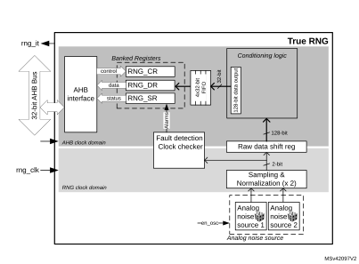
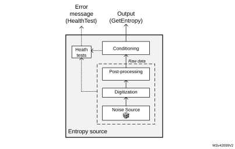
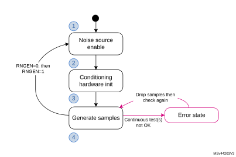
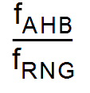

# 26 True random number generator (RNG)

## 26.1 Introduction

The RNG is a true random number generator that provides full entropy outputs to the application as 32-bit samples. It is composed of a live entropy source (analog) and an internal conditioning component.

The RNG can be used to construct a NIST compliant deterministic random bit generator (DRBG), acting as a live entropy source.

The RNG true random number generator has been tested using the German BSI statistical tests of AIS-31 (T0 to T8).

## 26.2 RNG main features

- The RNG delivers 32-bit true random numbers, produced by an analog entropy source processed by a high quality conditioning stage.
- In the NIST configuration, it produces four 32-bit random samples every 16x AHB clock cycles, if value is higher than 213 cycles (213 cycles otherwise).
- It allows embedded continuous basic health tests with associated error management
 - Includes too low sampling clock detection and repetition count tests.
- It can be disabled to reduce power consumption.
- It has an AMBA® AHB slave peripheral, accessible through 32-bit word single accesses only (else an AHB bus error is generated, and the write accesses are ignored).

## 26.3 RNG functional description

### 26.3.1 RNG block diagram

[Figure 179](#XREF_46322__Figure_1__RNG_block_diagram7) shows the RNG block diagram.

#### Figure 179. RNG block diagram 

### 26.3.2 RNG internal signals

[Table 208](#XREF_62301__Table_10__RNG_internal_input/output_signals7) describes a list of useful-to-know internal signals available at the RNG level, not at the STM32 product level (on pads).

 

<table class="TableTitle"><caption class="TableCap"><h4 class="TableCap" id="1028294">Table 208. <a id="signals7" name="XREF_62301__Table_10__RNG_internal_input_output_signals7">RNG internal input/output signals</a></h4></caption><col width="104.23px"/><col width="93.83px"/><col width="340.53px"/><thead><tr height="28.00px"><th>
Signal name
</th><th>
Signal type
</th><th>
Description
</th></tr></thead><tr height="22.67px"><td>
rng_it
</td><td>
Digital output
</td><td>
RNG global interrupt request
</td></tr><tr height="22.67px"><td>
rng_hclk
</td><td>
Digital input
</td><td>
AHB clock
</td></tr><tr height="22.67px"><td>
rng_clk
</td><td>
Digital input
</td><td>
RNG dedicated clock, asynchronous to rng_hclk
</td></tr><tr data-conditional="_rng1_dpa,_rng1_gen2_1,_rng1_gen3" height="66.67px" style="display: none"><td data-conditional="_rng1_dpa,_rng1_gen2_1,_rng1_gen3" style="display: none">
rng_itamp_out
</td><td data-conditional="_rng1_dpa,_rng1_gen2_1,_rng1_gen3" style="display: none">
digital output
</td><td data-conditional="_rng1_dpa,_rng1_gen2_1,_rng1_gen3" style="display: none">
RNG internal tamper event signal to TAMP (XORed), triggered when an unexpected hardware fault occurs. When this signal is triggered, RNG stops delivering random samples, requiring a reset and a new initialization to be usable again.
</td></tr></table>

### 26.3.3 Random number generation

The true random number generator (RNG) delivers truly random data through its AHB interface at deterministic intervals. Within its boundary the RNG implements the entropy source model pictured on [Figure 180](#XREF_65586__Figure_5__Entropy_source_model7).

It includes an analog noise source, a digitization stage with post-processing, a conditioning algorithm, a health monitoring block and two interfaces that are used to interact with the entropy source: GetEntropy and HealthTest.

#### Figure 180. Entropy source model

The components pictured above are detailed hereafter.

#### Noise source

The noise source is the component that contains the non-deterministic, entropy-providing activity that is ultimately responsible for the uncertainty associated with the bitstring output by the entropy source. It is composed of:

- Two analog noise sources, each based on three XORed free-running ring oscillator outputs. It is possible to disable those analog oscillators to save power, as described in [Section 26.3.8](#XREF_39357__1_4_RNG_low-power_modes7).
- A sampling stage of these outputs clocked by a dedicated clock input (rng\_clk), delivering a 2-bit raw data output.

This noise source sampling is independent to the AHB interface clock frequency (rng\_hclk).

**Note:**

In [Section 26.6](#XREF_36543__1_7_Entropy_source_validation7) the recommended RNG clock frequencies are given.

#### Post processing

The sample values obtained from a true random noise source consist of 2-bit bitstrings. Because this noise source output is biased, the RNG implements a post-processing component that reduces that bias to a tolerable level.

More specifically, for each of the two noise source bits the RNG takes half of the bits from the sampled noise source, and half of the bits from the inverted sampled noise source. Thus, if the source generates more ‘1’ than ‘0’ (or the opposite), it is filtered.

#### Conditioning

The conditioning component in the RNG is a deterministic function that increases the entropy rate of the resulting fixed-length bitstrings output (128-bit).

Also note that post-processing computations are triggered when at least 32 bits of raw datum is received and when output FIFO needs a refill. Thus, the RNG output entropy is maximum when the RNG 128-bit FIFO is emptied by application after 64 RNG clock cycles.

The times required between two random number generations, and between the RNG initialization and availability of first sample are described in [Section 26.5](#XREF_25583__1_6_Processing_time7).

The conditioning component is clocked by the faster AHB clock.

#### Output buffer

A data output buffer can store up to four 32-bit words, which have been output from the conditioning component. When four words have been read from the output FIFO through the RNG\_DR register, the content of the 128-bit conditioning output register is pushed into the output FIFO, and a new conditioning round is automatically started. Four new words are added to the conditioning output register 213 AHB clock cycles later.

Whenever a random number is available through the RNG\_DR register, the DRDY flag changes from 0 to 1. This flag remains high until the output buffer becomes empty after reading four words from the RNG\_DR register.

**Note:**

When interrupts are enabled an interrupt is generated when this data ready flag transitions from 0 to 1. Interrupt is then cleared automatically by the RNG as explained above.

#### Health checks

This component ensures that the entire entropy source (with its noise source) starts then operates as expected, obtaining assurance that failures are caught quickly and with a high probability and reliability.

The RNG implements the following health check features.

1. Continuous health tests, running indefinitely on the output of the noise source
 - Repetition count test, flagging an error when:
   a) One of the noise source has provided more than 64 consecutive bits at a constant value (“0” or “1”), or more than 32 consecutive occurrence of two bits patterns (“01” or “10”)
   b) Both noise sources have delivered more than 32 consecutive bits at a constant value (“0” or “1”), or more than 16 consecutive occurrence of two bits patterns (“01” or “10”)
2. Vendor specific continuous test
 - Real-time “too slow” sampling clock detector, flagging an error when one RNG clock cycle is smaller than AHB clock cycle divided by 32.

The CECS and SECS status bits in the RNG\_SR register indicate when an error condition is detected, as detailed in [Section 26.3.7](#XREF_86451__1_3_7_Entropy_source_validation7).

**Note:**

An interrupt can be generated when an error is detected.

### 26.3.4 RNG initialization

The RNG simplified state machine is pictured on [Figure 181](#XREF_12092__Figure_4__Random_samples_conditioning_process7).

After enabling the RNG (RNGEN = 1 in RNG\_CR), the following chain of events occurs:

1. The analog noise source is enabled, and logic immediately starts sampling the analog output, filling the 128-bit conditioning shift register.
2. The conditioning logic is enabled and the post-processing context is initialized using two 128 noise source bits.
3. The conditioning stage internal input data buffer is filled again with 128-bit and one conditioning round is performed. The output buffer is then filled with the post processing result.
4. The output buffer is refilled automatically according to the RNG usage.

The associated initialization time can be found in [Section 26.5](#XREF_25583__1_6_Processing_time7).

#### Figure 181. RNG initialization overview

### 26.3.5 RNG operation

#### Normal operation

To run the RNG using interrupts, the following steps are recommended:

1. Enable the interrupts by setting the IE bit in the RNG\_CR register. At the same time, enable the RNG by setting the bit RNGEN=1.
2. An interrupt is now generated when a random number is ready or when an error occurs. Therefore, at each interrupt, check that:
 - No error occurred. The SEIS and CEIS bits must be set to 0 in the RNG\_SR register.
 - A random number is ready. The DRDY bit must be set to 1 in the RNG\_SR register.
 - If the above two conditions are true the content of the RNG\_DR register can be read up to four consecutive times. If valid data is available in the conditioning output buffer, four additional words can be read by the application (in this case the DRDY bit is still high). If one or both of the above conditions are false, the RNG\_DR register must not be read. If an error occurred, the error recovery sequence described in [Section 26.3.7](#XREF_86451__1_3_7_Entropy_source_validation7) must be used.

To run the RNG in polling mode following steps are recommended:

1. Enable the random number generation by setting the RNGEN bit to “1” in the RNG\_CR register.
2. Read the RNG\_SR register and check that:
 - No error occurred (the SEIS and CEIS bits must be set to 0)
 - A random number is ready (the DRDY bit must be set to 1)
3. If above conditions are true read the content of the RNG\_DR register up to four consecutive times. If valid data is available in the conditioning output buffer four additional words can be read by the application (in this case the DRDY bit is still high). If one or both of the above conditions are false, the RNG\_DR register must not be read. If an error occurred, the error recovery sequence described in [Section 26.3.7](#XREF_86451__1_3_7_Entropy_source_validation7) must be used.

Note:  
When data is not ready (DRDY = 0) RNG\_DR returns zero.It is recommended to always verify that RNG\_DR is different from zero. Because when it is the case a seed error occurred between RNG\_SR polling and RND\_DR output reading (rare event).

#### Low-power operation

If the power consumption is a concern to the application, low-power strategies can be used, as described in [Section 26.3.8](#XREF_39357__1_4_RNG_low-power_modes7).

#### Software post-processing

If a NIST approved DRBG with 128 bits of security strength is required an approved random generator software must be built around the RNG true random number generator.

Built-in health check functions are described in [Section 26.3.3: Random number generation](#XREF_50147__1_3_3_Random_number_generation7).

### 26.3.6 RNG clocking

The RNG runs on two different clocks: the AHB bus clock and a dedicated RNG clock.

The AHB clock is used to clock the AHB banked registers and conditioning component. The RNG clock is used for noise source sampling. Recommended clock configurations are detailed in [Section 26.6: RNG entropy source validation](#XREF_36543__1_7_Entropy_source_validation7).

**Note:**

When the CED bit in the RNG\_CR register is set to 0, the RNG clock frequency the  must be higher than the AHB clock frequency divided by 32, otherwise the clock checker always flags a clock error (CECS = 1 in the RNG\_SR register).

See [Section 26.3.1: RNG block diagram](#XREF_80929__1_3_1_RNG_block_diagram7) for details (AHB and RNG clock domains).

### 26.3.7 Error management

In parallel to random number generation a health check block verifies the correct noise source behavior and the frequency of the RNG source clock as detailed in this section. Associated error state is also described.

#### Clock error detection

When the clock error detection is enabled (CED = 0) and if the RNG clock frequency is too low, the RNG sets to 1 both the CEIS and CECS bits to indicate that a clock error occurred. In this case, the application must check that the RNG clock is configured correctly (see [Section 26.3.6: RNG clocking](#XREF_49730__1_3_5_RNG_clocking7)) and then it must clear the CEIS bit interrupt flag. The CECS bit is automatically cleared when the clocking condition is normal.

**Note:**

The clock error has no impact on generated random numbers that is the application can still read the RNG\_DR register.

CEIS is set only when CECS is set to 1 by RNG.

#### Noise source error detection

When a noise source (or seed) error occurs, the RNG stops generating random numbers and sets to 1 both SEIS and SECS bits to indicate that a seed error occurred. If a value is available in the RNG\_DR register, it must not be used as it may not have enough entropy. If the error was detected during the initialization phase the whole initialization sequence is automatically restarted by the RNG.

The following sequence must be used to fully recover from a seed error after the RNG initialization:

1. Clear the SEIS bit by writing it to “0”.
2. Read out 12 words from the RNG\_DR register, and discard each of them in order to clean the pipeline.
3. Confirm that SEIS is still cleared. Random number generation is back to normal.

### 26.3.8  RNG low-power use

If power consumption is a concern, the RNG can be disabled as soon as the DRDY bit is set to 1 by setting the RNGEN bit to 0 in the RNG\_CR register. As the post-processing logic and the output buffer remain operational while RNGEN = 0 following features are available to the software:

- If there are valid words in the output buffer four random numbers can still be read from the RNG\_DR register.
- If there are valid bits in the conditioning output internal register four additional random numbers can be still be read from the RNG\_DR register. If it is not the case the RNG must be re-enabled by the application until at least 32 new bits are collected from the noise source and a complete conditioning round is done. It corresponds to 16 RNG clock cycles to sample new bits, and 216 AHB clock cycles to run a conditioning round.

When disabling the RNG the user deactivates all the analog seed generators, whose power consumption is given in the datasheet electrical characteristics section. The user also gates all the logic clocked by the RNG clock. Note that this strategy is adding latency before a random sample is available on the RNG\_DR register, because of the RNG initialization time.

If the RNG block is disabled during initialization (that is well before the DRDY bit rises for the first time), the initialization sequence resumes from where it was stopped when RNGEN bit is set to 1.

## 26.4 RNG interrupts

In the RNG an interrupt can be produced on the following events:

- Data ready flag
- Seed error, see [Section 26.3.7: Error management](#XREF_56654__34_3_3_Error_management7)
- Clock error, see [Section 26.3.7: Error management](#XREF_56654__34_3_3_Error_management7)

Dedicated interrupt enable control bits are available as shown in [Table 209](#XREF_45686__Table_9__Processing_time_(in_AHB_clock_cycles)7).

 

<table class="TableTitle"><caption class="TableCap"><h4 class="TableCap" id="1028662">Table 209. <a id="cycles)7" name="XREF_45686__Table_9__Processing_time_(in_AHB_clock_cycles)7">RNG interrupt requests</a></h4></caption><col width="117.03px"/><col width="103.81px"/><col width="71.59px"/><col width="121.79px"/><col width="199.96px"/><thead><tr height="28.00px"><th>
Interrupt acronym
</th><th>
Interrupt event
</th><th>
Event flag
</th><th>
Enable control bit
</th><th>
Interrupt clear method
</th></tr></thead><tr height="22.67px"><td rowspan="3">
RNG
</td><td>
Data ready flag
</td><td>
DRDY
</td><td>
IE
</td><td>
None (automatic)
</td></tr><tr height="22.67px"><td>
Seed error flag
</td><td>
SEIS
</td><td>
IE
</td><td>
Write 0 to SEIS.
</td></tr><tr height="22.67px"><td>
Clock error flag
</td><td>
CEIS
</td><td>
IE
</td><td>
Write 0 to CEIS
</td></tr></table>

The user can enable or disable the above interrupt sources individually by changing the mask bits or the general interrupt control bit IE in the RNG\_CR register. The status of the individual interrupt sources can be read from the RNG\_SR register.

**Note:**

Interrupts are generated only when RNG is enabled.

## 26.5 RNG processing time

The conditioning stage can produce four 32-bit random numbers every 16x clock cycles, if the value is higher than 213 cycles (213 cycles otherwise).   
More time is needed for the first set of random numbers after the device exits reset (see [Section 26.3.4: RNG initialization](#XREF_96127__1_3_4_RNG_initialization7)). Indeed, after enabling the RNG for the first time, random data is first available after either:

- 128 RNG clock cycles + 426 AHB cycles, if fAHB < fthreshold
- 192 RNG clock cycles + 213 AHB cycles, if fAHB ≥ fthreshold

With fthreshold = (213 x fRNG)/ 64

## 26.6 RNG entropy source validation

### 26.6.1 Introduction

In order to assess the amount of entropy available from the RNG, STMicroelectronics has tested the peripheral using the German BSI AIS-31 statistical tests (T0 to T8). The results can be provided on demand or the customer can reproduce the tests.

### 26.6.2 Validation conditions

STMicroelectronics has tested the RNG true random number generator in the following conditions:

- RNG clock rng\_clk= 48 MHz (CED bit = ‘0’ in RNG\_CR register) and rng\_clk = 400 kHz (CED bit = ‘1’ in RNG\_CR register).

 

<table class="TableTitle"><caption class="TableCap"><h4 class="TableCap" id="27155874">Table 210. <a id="configurations%117" name="XREF_73994__Table_214__RNG_configurations%117">RNG configurations</a></h4></caption><col width="88.55px"/><col width="45.70px"/><col width="69.86px"/><col width="55.94px"/><col width="71.19px"/><col width="71.19px"/><col width="37.07px"/><col width="54.71px"/><col width="64.67px"/><col width="55.29px"/><thead data-conditional="nonuser"><tr height="28.00px"><th rowspan="2">
Configuration
</th><th colspan="6">
RNG_CR bits
</th><th rowspan="2">
Loop number (N)
</th><th rowspan="2">
RNG_ HTCR register
</th><th rowspan="2">
RNG_ NSCR register
</th></tr><tr height="57.33px"><th>
NISTC bit
</th><th>
RNG_ CONFIG1 [5:0]
</th><th>
CLKDIV [3:0]
</th><th>
RNG_ CONFIG2 [2:0]<a href="#c7amba%20rng1%20UserSpec_c7amba%20rng1%20UserSpec_FTH_1">1</a>
</th><th>
RNG_ CONFIG3 [3:0]<a href="#c7amba%20rng1%20UserSpec_c7amba%20rng1%20UserSpec_FTH_2">2</a>
</th><th>
CED bit
</th></tr><tr data-conditional="Nonuser" height="48.00px" style="display: none"><th data-conditional="nonuser" style="border-left-width:0.299988pt;border-left-style:solid;border-left-color:#000000;border-bottom-width:0.299988pt;border-bottom-style:solid;border-bottom-color:#000000;border-right-width:0.299988pt;border-right-style:solid;border-right-color:#000000;border-top-width:0.299988pt;border-top-style:solid;border-top-color:#000000;background-color:#7fffff;display: none"></th><th data-conditional="nonuser" style="border-left-width:0.299988pt;border-left-style:solid;border-left-color:#000000;border-bottom-width:0.299988pt;border-bottom-style:solid;border-bottom-color:#000000;border-right-width:0.299988pt;border-right-style:solid;border-right-color:#000000;border-top-width:0.299988pt;border-top-style:solid;border-top-color:#000000;background-color:#7fffff;display: none"></th><th data-conditional="nonuser" style="border-left-width:0.299988pt;border-left-style:solid;border-left-color:#000000;border-bottom-width:0.299988pt;border-bottom-style:solid;border-bottom-color:#000000;border-right-width:0.299988pt;border-right-style:solid;border-right-color:#000000;border-top-width:0.299988pt;border-top-style:solid;border-top-color:#000000;background-color:#7fffff;display: none"></th><th data-conditional="nonuser" style="border-left-width:0.299988pt;border-left-style:solid;border-left-color:#000000;border-bottom-width:0.299988pt;border-bottom-style:solid;border-bottom-color:#000000;border-right-width:0.299988pt;border-right-style:solid;border-right-color:#000000;border-top-width:0.299988pt;border-top-style:solid;border-top-color:#000000;background-color:#7fffff;display: none"></th><th data-conditional="nonuser" style="border-left-width:0.299988pt;border-left-style:solid;border-left-color:#000000;border-bottom-width:0.299988pt;border-bottom-style:solid;border-bottom-color:#000000;border-right-width:0.299988pt;border-right-style:solid;border-right-color:#000000;border-top-width:0.299988pt;border-top-style:solid;border-top-color:#000000;background-color:#7fffff;display: none"></th><th data-conditional="nonuser" style="border-left-width:0.299988pt;border-left-style:solid;border-left-color:#000000;border-bottom-width:0.299988pt;border-bottom-style:solid;border-bottom-color:#000000;border-right-width:0.299988pt;border-right-style:solid;border-right-color:#000000;border-top-width:0.299988pt;border-top-style:solid;border-top-color:#000000;background-color:#7fffff;display: none"></th><th data-conditional="nonuser" style="border-left-width:0.299988pt;border-left-style:solid;border-left-color:#000000;border-bottom-width:0.299988pt;border-bottom-style:solid;border-bottom-color:#000000;border-right-width:0.299988pt;border-right-style:solid;border-right-color:#000000;border-top-width:0.299988pt;border-top-style:solid;border-top-color:#000000;background-color:#7fffff;display: none"></th><th colspan="3" data-conditional="nonuser" style="border-left-width:0.299988pt;border-left-style:solid;border-left-color:#000000;border-bottom-width:0.299988pt;border-bottom-style:solid;border-bottom-color:#000000;border-right-width:0.299988pt;border-right-style:solid;border-right-color:#000000;border-top-width:0.299988pt;border-top-style:solid;border-top-color:#000000;background-color:#7fffff;display: none"></th></tr></thead><tr data-conditional="nonuser" height="37.33px" style="display: none"><td data-conditional="nonuser" style="display: none"></td><td data-conditional="nonuser" style="display: none"></td><td data-conditional="nonuser" style="display: none"></td><td data-conditional="nonuser" style="display: none"></td><td data-conditional="nonuser" style="display: none"></td><td data-conditional="nonuser" style="display: none"></td><td data-conditional="nonuser" style="display: none"></td><td data-conditional="nonuser" style="display: none"></td><td data-conditional="nonuser" style="display: none"></td><td data-conditional="nonuser" style="display: none"></td></tr><tr height="66.67px"><td>
A
</td><td colspan="9">
Refer to NIST compliant RNG configuration table in AN4230 available from www.st.com.  This application note also indicates if this configuration is part of an existing NIST SP800-90B Entropy Certificate listed on https://csrc.nist.gov/projects/cryptographic-module-validation-program.
</td></tr><tr height="22.67px"><td>
B
</td><td>
1
</td><td>
0x18
</td><td rowspan="2">
0x0<a href="#c7amba%20rng1%20UserSpec_c7amba%20rng1%20UserSpec_FTH_3">3</a>
</td><td>
0x0
</td><td>
0x0
</td><td>
0
</td><td>
1
</td><td rowspan="2">
0x0000 NA<a href="#c7amba%20rng1%20UserSpec_c7amba%20rng1%20UserSpec_FTH_4">4</a>
</td><td>
default
</td></tr><tr height="22.67px"><td>
C
</td><td>
0
</td><td>
0x0F
</td><td>
0x0
</td><td>
0xD
</td><td>
0
</td><td>
2
</td><td>
default
</td></tr></table>

<a href="#c7amba%20rng1%20UserSpec_c7amba%20rng1%20UserSpec_FTB_1">1.</a>0x1 value is recommended instead of 0x0 for RNG_CONFIG2[2:0], when RNG power consumption is critical. See the end of <a href="#XREF_39357__1_4_RNG_low-power_modes7" style="font-family : Arial ; font-weight:normal;font-style:Italic;font-size : 8.00pt;font-kerning:normal;font-stretch:normal;color:#0000ff;background-color:transparent;letter-spacing : 0.00em;">Section 26.3.8</a> for details.

<a href="#c7amba%20rng1%20UserSpec_c7amba%20rng1%20UserSpec_FTB_2">2.</a>RNG_CONFIG3[1:0] defines the loop number N: 0x0 corresponds to N=1, 0x1 to N=2, 0x2 to N=3, 0x3 to N=4

<a href="#c7amba%20rng1%20UserSpec_c7amba%20rng1%20UserSpec_FTB_3">3.</a>The noise source sampling must be NA or less. Hence, if the RNG clock is different from NA, this value of CLKDIV must be adapted. See the CLKDIV bitfield description in <a href="#XREF_23042__21_4_1_RNG_control_register_(RNG_CR)7" style="font-family : Arial ; font-weight:normal;font-style:Italic;font-size : 8.00pt;font-kerning:normal;font-stretch:normal;color:#0000ff;background-color:transparent;letter-spacing : 0.00em;">Section 26.7.1</a> for details.

<a href="#c7amba%20rng1%20UserSpec_c7amba%20rng1%20UserSpec_FTB_4">4.</a>This value can be fixed in the RNG driver (it does not depend upon the STM32 product).

### 26.6.3 Data collection

In order to run statistical tests, it is required to collect samples from the entropy source at the raw data level as well as at the output of the entropy source.For details on data collection and the running of statistical test suites refer to AN4230 “STM32 microcontrollers random number generation validation using NIST statistical test suite” available from www.st.com.

In bypass mode the bits [31:30] of the fourth word are always stuck at 0. Hence the continuous capture of samples is started from the fifth word.

## 26.7 RNG registers

The RNG is associated with a control register, a data register and a status register.

### 26.7.1 RNG control register (RNG\_CR)

Address offset: 0x000

Reset value: 0x0000 0000

 

<table class="RegBitMap"><col width="38.12px"/><col width="38.12px"/><col width="38.12px"/><col width="38.12px"/><col width="38.12px"/><col width="38.12px"/><col width="38.12px"/><col width="38.12px"/><col width="38.12px"/><col width="38.12px"/><col width="38.12px"/><col width="38.12px"/><col width="38.59px"/><col width="41.00px"/><col width="38.59px"/><col width="38.59px"/><tr data-conditional="_rng1_gen3" height="17.33px" style="display: none"><td data-conditional="_rng1_gen3" style="border-left-width:0;border-left-style:hidden;border-left-color:0;border-right-width:0;border-right-style:hidden;border-right-color:0;border-top-width:0;border-top-style:hidden;border-top-color:0;display: none">
31
</td><td data-conditional="_rng1_gen3" style="border-left-width:0;border-left-style:hidden;border-left-color:0;border-right-width:0;border-right-style:hidden;border-right-color:0;border-top-width:0;border-top-style:hidden;border-top-color:0;display: none">
30
</td><td data-conditional="_rng1_gen3" style="border-left-width:0;border-left-style:hidden;border-left-color:0;border-right-width:0;border-right-style:hidden;border-right-color:0;border-top-width:0;border-top-style:hidden;border-top-color:0;display: none">
29
</td><td data-conditional="_rng1_gen3" style="border-left-width:0;border-left-style:hidden;border-left-color:0;border-right-width:0;border-right-style:hidden;border-right-color:0;border-top-width:0;border-top-style:hidden;border-top-color:0;display: none">
28
</td><td data-conditional="_rng1_gen3" style="border-left-width:0;border-left-style:hidden;border-left-color:0;border-right-width:0;border-right-style:hidden;border-right-color:0;border-top-width:0;border-top-style:hidden;border-top-color:0;display: none">
27
</td><td data-conditional="_rng1_gen3" style="border-left-width:0;border-left-style:hidden;border-left-color:0;border-right-width:0;border-right-style:hidden;border-right-color:0;border-top-width:0;border-top-style:hidden;border-top-color:0;display: none">
26
</td><td data-conditional="_rng1_gen3" style="border-left-width:0;border-left-style:hidden;border-left-color:0;border-right-width:0;border-right-style:hidden;border-right-color:0;border-top-width:0;border-top-style:hidden;border-top-color:0;display: none">
25
</td><td data-conditional="_rng1_gen3" style="border-left-width:0;border-left-style:hidden;border-left-color:0;border-right-width:0;border-right-style:hidden;border-right-color:0;border-top-width:0;border-top-style:hidden;border-top-color:0;display: none">
24
</td><td data-conditional="_rng1_gen3" style="border-left-width:0;border-left-style:hidden;border-left-color:0;border-right-width:0;border-right-style:hidden;border-right-color:0;border-top-width:0;border-top-style:hidden;border-top-color:0;display: none">
23
</td><td data-conditional="_rng1_gen3" style="border-left-width:0;border-left-style:hidden;border-left-color:0;border-right-width:0;border-right-style:hidden;border-right-color:0;border-top-width:0;border-top-style:hidden;border-top-color:0;display: none">
22
</td><td data-conditional="_rng1_gen3" style="border-left-width:0;border-left-style:hidden;border-left-color:0;border-right-width:0;border-right-style:hidden;border-right-color:0;border-top-width:0;border-top-style:hidden;border-top-color:0;display: none">
21
</td><td data-conditional="_rng1_gen3" style="border-left-width:0;border-left-style:hidden;border-left-color:0;border-right-width:0;border-right-style:hidden;border-right-color:0;border-top-width:0;border-top-style:hidden;border-top-color:0;display: none">
20
</td><td data-conditional="_rng1_gen3" style="border-left-width:0;border-left-style:hidden;border-left-color:0;border-right-width:0;border-right-style:hidden;border-right-color:0;border-top-width:0;border-top-style:hidden;border-top-color:0;display: none">
19
</td><td data-conditional="_rng1_gen3" style="border-left-width:0;border-left-style:hidden;border-left-color:0;border-right-width:0;border-right-style:hidden;border-right-color:0;border-top-width:0;border-top-style:hidden;border-top-color:0;display: none">
18
</td><td data-conditional="_rng1_gen3" style="border-left-width:0;border-left-style:hidden;border-left-color:0;border-right-width:0;border-right-style:hidden;border-right-color:0;border-top-width:0;border-top-style:hidden;border-top-color:0;display: none">
17
</td><td data-conditional="_rng1_gen3" style="border-left-width:0;border-left-style:hidden;border-left-color:0;border-right-width:0;border-right-style:hidden;border-right-color:0;border-top-width:0;border-top-style:hidden;border-top-color:0;display: none">
16
</td></tr><tr data-conditional="_rng1_gen3" height="28.00px" style="display: none"><td data-conditional="_rng1_gen3" style="border-left-width:0.299988pt;border-left-style:solid;border-left-color:#000000;border-bottom-width:0.299988pt;border-bottom-style:solid;border-bottom-color:#000000;border-right-width:0.299988pt;border-right-style:solid;border-right-color:#000000;border-top-width:0.299988pt;border-top-style:solid;border-top-color:#000000;display: none">
CONFI GLOCK
</td><td data-conditional="_rng1_gen3" style="border-left-width:0.5pt;border-left-style:solid;border-left-color:#000000;border-bottom-width:0.5pt;border-bottom-style:solid;border-bottom-color:#000000;border-right-width:0.5pt;border-right-style:solid;border-right-color:#000000;border-top-width:0.5pt;border-top-style:solid;border-top-color:#000000;display: none">
CONDRST
</td><td data-conditional="_rng1_gen3" style="border-left-width:0.299988pt;border-left-style:solid;border-left-color:#000000;border-bottom-width:0.299988pt;border-bottom-style:solid;border-bottom-color:#000000;border-right-width:0.299988pt;border-right-style:solid;border-right-color:#000000;border-top-width:0.299988pt;border-top-style:solid;border-top-color:#000000;display: none">
Res.
</td><td data-conditional="_rng1_gen3" style="border-left-width:0.5pt;border-left-style:solid;border-left-color:#000000;border-bottom-width:0.5pt;border-bottom-style:solid;border-bottom-color:#000000;border-right-width:0.5pt;border-right-style:solid;border-right-color:#000000;border-top-width:0.5pt;border-top-style:solid;border-top-color:#000000;display: none">
Res.
</td><td data-conditional="_rng1_gen3" style="border-left-width:0.5pt;border-left-style:solid;border-left-color:#000000;border-bottom-width:0.5pt;border-bottom-style:solid;border-bottom-color:#000000;border-right-width:0.5pt;border-right-style:solid;border-right-color:#000000;border-top-width:0.5pt;border-top-style:solid;border-top-color:#000000;display: none">
Res.
</td><td data-conditional="_rng1_gen3" style="border-left-width:0.5pt;border-left-style:solid;border-left-color:#000000;border-bottom-width:0.5pt;border-bottom-style:solid;border-bottom-color:#000000;border-right-width:0.5pt;border-right-style:solid;border-right-color:#000000;border-top-width:0.5pt;border-top-style:solid;border-top-color:#000000;display: none">
Res.
</td><td colspan="6" data-conditional="_rng1_gen3" style="border-left-width:0.5pt;border-left-style:solid;border-left-color:#000000;border-bottom-width:0.5pt;border-bottom-style:solid;border-bottom-color:#000000;border-right-width:0.5pt;border-right-style:solid;border-right-color:#000000;border-top-width:0.5pt;border-top-style:solid;border-top-color:#000000;display: none">
RNG_CONFIG1[5:0]
</td><td colspan="4" data-conditional="_rng1_gen3" style="border-left-width:0.5pt;border-left-style:solid;border-left-color:#000000;border-bottom-width:0.5pt;border-bottom-style:solid;border-bottom-color:#000000;border-right-width:0.5pt;border-right-style:solid;border-right-color:#000000;border-top-width:0.5pt;border-top-style:solid;border-top-color:#000000;display: none">
CLKDIV[3:0]
</td></tr><tr data-conditional="_rng1_gen3" height="17.33px" style="display: none"><td data-conditional="_rng1_gen3" style="border-left-width:0.299988pt;border-left-style:solid;border-left-color:#000000;border-bottom-width:0.299988pt;border-bottom-style:solid;border-bottom-color:#000000;border-right-width:0.299988pt;border-right-style:solid;border-right-color:#000000;border-top-width:0.299988pt;border-top-style:solid;border-top-color:#000000;display: none">
rs
</td><td data-conditional="_rng1_gen3" style="border-left-width:0.5pt;border-left-style:solid;border-left-color:#000000;border-bottom-width:0.5pt;border-bottom-style:solid;border-bottom-color:#000000;border-right-width:0.5pt;border-right-style:solid;border-right-color:#000000;border-top-width:0.5pt;border-top-style:solid;border-top-color:#000000;display: none">
rw
</td><td data-conditional="_rng1_gen3" style="border-left-width:0.299988pt;border-left-style:solid;border-left-color:#000000;border-bottom-width:0.299988pt;border-bottom-style:solid;border-bottom-color:#000000;border-right-width:0.299988pt;border-right-style:solid;border-right-color:#000000;border-top-width:0.299988pt;border-top-style:solid;border-top-color:#000000;display: none"></td><td data-conditional="_rng1_gen3" style="border-left-width:0.299988pt;border-left-style:solid;border-left-color:#000000;border-bottom-width:0.299988pt;border-bottom-style:solid;border-bottom-color:#000000;border-right-width:0.299988pt;border-right-style:solid;border-right-color:#000000;border-top-width:0.299988pt;border-top-style:solid;border-top-color:#000000;display: none"></td><td data-conditional="_rng1_gen3" style="border-left-width:0.299988pt;border-left-style:solid;border-left-color:#000000;border-bottom-width:0.299988pt;border-bottom-style:solid;border-bottom-color:#000000;border-right-width:0.299988pt;border-right-style:solid;border-right-color:#000000;border-top-width:0.299988pt;border-top-style:solid;border-top-color:#000000;display: none"></td><td data-conditional="_rng1_gen3" style="border-left-width:0.299988pt;border-left-style:solid;border-left-color:#000000;border-bottom-width:0.299988pt;border-bottom-style:solid;border-bottom-color:#000000;border-right-width:0.299988pt;border-right-style:solid;border-right-color:#000000;border-top-width:0.299988pt;border-top-style:solid;border-top-color:#000000;display: none"></td><td data-conditional="_rng1_gen3" style="border-left-width:0.299988pt;border-left-style:solid;border-left-color:#000000;border-bottom-width:0.299988pt;border-bottom-style:solid;border-bottom-color:#000000;border-right-width:0.299988pt;border-right-style:solid;border-right-color:#000000;border-top-width:0.299988pt;border-top-style:solid;border-top-color:#000000;display: none">
rw
</td><td data-conditional="_rng1_gen3" style="border-left-width:0.5pt;border-left-style:solid;border-left-color:#000000;border-bottom-width:0.5pt;border-bottom-style:solid;border-bottom-color:#000000;border-right-width:0.5pt;border-right-style:solid;border-right-color:#000000;border-top-width:0.5pt;border-top-style:solid;border-top-color:#000000;display: none">
rw
</td><td data-conditional="_rng1_gen3" style="border-left-width:0.299988pt;border-left-style:solid;border-left-color:#000000;border-bottom-width:0.299988pt;border-bottom-style:solid;border-bottom-color:#000000;border-right-width:0.299988pt;border-right-style:solid;border-right-color:#000000;border-top-width:0.299988pt;border-top-style:solid;border-top-color:#000000;display: none">
rw
</td><td data-conditional="_rng1_gen3" style="border-left-width:0.299988pt;border-left-style:solid;border-left-color:#000000;border-bottom-width:0.299988pt;border-bottom-style:solid;border-bottom-color:#000000;border-right-width:0.299988pt;border-right-style:solid;border-right-color:#000000;border-top-width:0.299988pt;border-top-style:solid;border-top-color:#000000;display: none">
rw
</td><td data-conditional="_rng1_gen3" style="border-left-width:0.299988pt;border-left-style:solid;border-left-color:#000000;border-bottom-width:0.299988pt;border-bottom-style:solid;border-bottom-color:#000000;border-right-width:0.299988pt;border-right-style:solid;border-right-color:#000000;border-top-width:0.299988pt;border-top-style:solid;border-top-color:#000000;display: none">
rw
</td><td data-conditional="_rng1_gen3" style="border-left-width:0.299988pt;border-left-style:solid;border-left-color:#000000;border-bottom-width:0.299988pt;border-bottom-style:solid;border-bottom-color:#000000;border-right-width:0.299988pt;border-right-style:solid;border-right-color:#000000;border-top-width:0.299988pt;border-top-style:solid;border-top-color:#000000;display: none">
rw
</td><td data-conditional="_rng1_gen3" style="border-left-width:0.299988pt;border-left-style:solid;border-left-color:#000000;border-bottom-width:0.299988pt;border-bottom-style:solid;border-bottom-color:#000000;border-right-width:0.299988pt;border-right-style:solid;border-right-color:#000000;border-top-width:0.299988pt;border-top-style:solid;border-top-color:#000000;display: none">
rw
</td><td data-conditional="_rng1_gen3" style="border-left-width:0.299988pt;border-left-style:solid;border-left-color:#000000;border-bottom-width:0.299988pt;border-bottom-style:solid;border-bottom-color:#000000;border-right-width:0.299988pt;border-right-style:solid;border-right-color:#000000;border-top-width:0.299988pt;border-top-style:solid;border-top-color:#000000;display: none">
rw
</td><td data-conditional="_rng1_gen3" style="border-left-width:0.299988pt;border-left-style:solid;border-left-color:#000000;border-bottom-width:0.299988pt;border-bottom-style:solid;border-bottom-color:#000000;border-right-width:0.299988pt;border-right-style:solid;border-right-color:#000000;border-top-width:0.299988pt;border-top-style:solid;border-top-color:#000000;display: none">
rw
</td><td data-conditional="_rng1_gen3" style="border-left-width:0.5pt;border-left-style:solid;border-left-color:#000000;border-bottom-width:0.5pt;border-bottom-style:solid;border-bottom-color:#000000;border-right-width:0.5pt;border-right-style:solid;border-right-color:#000000;border-top-width:0.5pt;border-top-style:solid;border-top-color:#000000;display: none">
rw
</td></tr><tr data-conditional="_rng1_gen3" height="17.33px" style="display: none"><td data-conditional="_rng1_gen3" style="border-left-width:0;border-left-style:hidden;border-left-color:0;border-right-width:0;border-right-style:hidden;border-right-color:0;border-top-width:0;border-top-style:hidden;border-top-color:0;display: none">
15
</td><td data-conditional="_rng1_gen3" style="border-left-width:0;border-left-style:hidden;border-left-color:0;border-right-width:0;border-right-style:hidden;border-right-color:0;border-top-width:0;border-top-style:hidden;border-top-color:0;display: none">
14
</td><td data-conditional="_rng1_gen3" style="border-left-width:0;border-left-style:hidden;border-left-color:0;border-right-width:0;border-right-style:hidden;border-right-color:0;border-top-width:0;border-top-style:hidden;border-top-color:0;display: none">
13
</td><td data-conditional="_rng1_gen3" style="border-left-width:0;border-left-style:hidden;border-left-color:0;border-right-width:0;border-right-style:hidden;border-right-color:0;border-top-width:0;border-top-style:hidden;border-top-color:0;display: none">
12
</td><td data-conditional="_rng1_gen3" style="border-left-width:0;border-left-style:hidden;border-left-color:0;border-right-width:0;border-right-style:hidden;border-right-color:0;border-top-width:0;border-top-style:hidden;border-top-color:0;display: none">
11
</td><td data-conditional="_rng1_gen3" style="border-left-width:0;border-left-style:hidden;border-left-color:0;border-right-width:0;border-right-style:hidden;border-right-color:0;border-top-width:0;border-top-style:hidden;border-top-color:0;display: none">
10
</td><td data-conditional="_rng1_gen3" style="border-left-width:0;border-left-style:hidden;border-left-color:0;border-right-width:0;border-right-style:hidden;border-right-color:0;border-top-width:0;border-top-style:hidden;border-top-color:0;display: none">
9
</td><td data-conditional="_rng1_gen3" style="border-left-width:0;border-left-style:hidden;border-left-color:0;border-right-width:0;border-right-style:hidden;border-right-color:0;border-top-width:0;border-top-style:hidden;border-top-color:0;display: none">
8
</td><td data-conditional="_rng1_gen3" style="border-left-width:0;border-left-style:hidden;border-left-color:0;border-right-width:0;border-right-style:hidden;border-right-color:0;border-top-width:0;border-top-style:hidden;border-top-color:0;display: none">
7
</td><td data-conditional="_rng1_gen3" style="border-left-width:0;border-left-style:hidden;border-left-color:0;border-right-width:0;border-right-style:hidden;border-right-color:0;border-top-width:0;border-top-style:hidden;border-top-color:0;display: none">
6
</td><td data-conditional="_rng1_gen3" style="border-left-width:0;border-left-style:hidden;border-left-color:0;border-right-width:0;border-right-style:hidden;border-right-color:0;border-top-width:0;border-top-style:hidden;border-top-color:0;display: none">
5
</td><td data-conditional="_rng1_gen3" style="border-left-width:0;border-left-style:hidden;border-left-color:0;border-right-width:0;border-right-style:hidden;border-right-color:0;border-top-width:0;border-top-style:hidden;border-top-color:0;display: none">
4
</td><td data-conditional="_rng1_gen3" style="border-left-width:0;border-left-style:hidden;border-left-color:0;border-right-width:0;border-right-style:hidden;border-right-color:0;border-top-width:0;border-top-style:hidden;border-top-color:0;display: none">
3
</td><td data-conditional="_rng1_gen3" style="border-left-width:0;border-left-style:hidden;border-left-color:0;border-right-width:0;border-right-style:hidden;border-right-color:0;border-top-width:0;border-top-style:hidden;border-top-color:0;display: none">
2
</td><td data-conditional="_rng1_gen3" style="border-left-width:0;border-left-style:hidden;border-left-color:0;border-right-width:0;border-right-style:hidden;border-right-color:0;border-top-width:0;border-top-style:hidden;border-top-color:0;display: none">
1
</td><td data-conditional="_rng1_gen3" style="border-left-width:0;border-left-style:hidden;border-left-color:0;border-right-width:0;border-right-style:hidden;border-right-color:0;border-top-width:0;border-top-style:hidden;border-top-color:0;display: none">
0
</td></tr><tr data-conditional="_rng1_gen3" height="28.00px" style="display: none"><td colspan="3" data-conditional="_rng1_gen3" style="border-left-width:0.5pt;border-left-style:solid;border-left-color:#000000;border-bottom-width:0.5pt;border-bottom-style:solid;border-bottom-color:#000000;border-right-width:0.5pt;border-right-style:solid;border-right-color:#000000;border-top-width:0.5pt;border-top-style:solid;border-top-color:#000000;display: none">
RNG_CONFIG2[2:0]
</td><td data-conditional="_rng1_gen3" style="border-left-width:0.5pt;border-left-style:solid;border-left-color:#000000;border-bottom-width:0.5pt;border-bottom-style:solid;border-bottom-color:#000000;border-right-width:0.5pt;border-right-style:solid;border-right-color:#000000;border-top-width:0.5pt;border-top-style:solid;border-top-color:#000000;display: none">
NISTC
</td><td colspan="4" data-conditional="_rng1_gen3" style="border-left-width:0.5pt;border-left-style:solid;border-left-color:#000000;border-bottom-width:0.5pt;border-bottom-style:solid;border-bottom-color:#000000;border-right-width:0.5pt;border-right-style:solid;border-right-color:#000000;border-top-width:0.5pt;border-top-style:solid;border-top-color:#000000;display: none">
RNG_CONFIG3[3:0]
</td><td data-conditional="_rng1_gen3" style="border-left-width:0.5pt;border-left-style:solid;border-left-color:#000000;border-bottom-width:0.5pt;border-bottom-style:solid;border-bottom-color:#000000;border-right-width:0.5pt;border-right-style:solid;border-right-color:#000000;border-top-width:0.5pt;border-top-style:solid;border-top-color:#000000;display: none"></td><td data-conditional="_rng1_gen3" style="border-left-width:0.5pt;border-left-style:solid;border-left-color:#000000;border-bottom-width:0.5pt;border-bottom-style:solid;border-bottom-color:#000000;border-right-width:0.5pt;border-right-style:solid;border-right-color:#000000;border-top-width:0.5pt;border-top-style:solid;border-top-color:#000000;display: none">
Res.
</td><td data-conditional="_rng1_gen3" style="border-left-width:0.5pt;border-left-style:solid;border-left-color:#000000;border-bottom-width:0.5pt;border-bottom-style:solid;border-bottom-color:#000000;border-right-width:0.5pt;border-right-style:solid;border-right-color:#000000;border-top-width:0.5pt;border-top-style:solid;border-top-color:#000000;display: none">
CED
</td><td data-conditional="_rng1_gen3" style="border-left-width:0.5pt;border-left-style:solid;border-left-color:#000000;border-bottom-width:0.5pt;border-bottom-style:solid;border-bottom-color:#000000;border-right-width:0.5pt;border-right-style:solid;border-right-color:#000000;border-top-width:0.5pt;border-top-style:solid;border-top-color:#000000;display: none">
Res.
</td><td data-conditional="_rng1_gen3" style="border-left-width:0.5pt;border-left-style:solid;border-left-color:#000000;border-bottom-width:0.5pt;border-bottom-style:solid;border-bottom-color:#000000;border-right-width:0.5pt;border-right-style:solid;border-right-color:#000000;border-top-width:0.5pt;border-top-style:solid;border-top-color:#000000;display: none">
IE
</td><td data-conditional="_rng1_gen3" style="border-left-width:0.5pt;border-left-style:solid;border-left-color:#000000;border-bottom-width:0.5pt;border-bottom-style:solid;border-bottom-color:#000000;border-right-width:0.5pt;border-right-style:solid;border-right-color:#000000;border-top-width:0.5pt;border-top-style:solid;border-top-color:#000000;display: none">
RNGEN
</td><td data-conditional="_rng1_gen3" style="border-left-width:0.5pt;border-left-style:solid;border-left-color:#000000;border-bottom-width:0.5pt;border-bottom-style:solid;border-bottom-color:#000000;border-right-width:0.5pt;border-right-style:solid;border-right-color:#000000;border-top-width:0.5pt;border-top-style:solid;border-top-color:#000000;display: none">
Res.
</td><td data-conditional="_rng1_gen3" style="border-left-width:0.5pt;border-left-style:solid;border-left-color:#000000;border-bottom-width:0.5pt;border-bottom-style:solid;border-bottom-color:#000000;border-right-width:0.5pt;border-right-style:solid;border-right-color:#000000;border-top-width:0.5pt;border-top-style:solid;border-top-color:#000000;display: none">
Res.
</td></tr><tr data-conditional="_rng1_gen3" height="17.33px" style="display: none"><td data-conditional="_rng1_gen3" style="border-left-width:0.299988pt;border-left-style:solid;border-left-color:#000000;border-bottom-width:0.299988pt;border-bottom-style:solid;border-bottom-color:#000000;border-right-width:0.299988pt;border-right-style:solid;border-right-color:#000000;border-top-width:0.299988pt;border-top-style:solid;border-top-color:#000000;display: none">
rw
</td><td data-conditional="_rng1_gen3" style="border-left-width:0.299988pt;border-left-style:solid;border-left-color:#000000;border-bottom-width:0.299988pt;border-bottom-style:solid;border-bottom-color:#000000;border-right-width:0.299988pt;border-right-style:solid;border-right-color:#000000;border-top-width:0.299988pt;border-top-style:solid;border-top-color:#000000;display: none">
rw
</td><td data-conditional="_rng1_gen3" style="border-left-width:0.299988pt;border-left-style:solid;border-left-color:#000000;border-bottom-width:0.299988pt;border-bottom-style:solid;border-bottom-color:#000000;border-right-width:0.299988pt;border-right-style:solid;border-right-color:#000000;border-top-width:0.299988pt;border-top-style:solid;border-top-color:#000000;display: none">
rw
</td><td data-conditional="_rng1_gen3" style="border-left-width:0.5pt;border-left-style:solid;border-left-color:#000000;border-bottom-width:0.5pt;border-bottom-style:solid;border-bottom-color:#000000;border-right-width:0.5pt;border-right-style:solid;border-right-color:#000000;border-top-width:0.5pt;border-top-style:solid;border-top-color:#000000;display: none">
rw
</td><td data-conditional="_rng1_gen3" style="border-left-width:0.299988pt;border-left-style:solid;border-left-color:#000000;border-bottom-width:0.299988pt;border-bottom-style:solid;border-bottom-color:#000000;border-right-width:0.299988pt;border-right-style:solid;border-right-color:#000000;border-top-width:0.299988pt;border-top-style:solid;border-top-color:#000000;display: none">
rw
</td><td data-conditional="_rng1_gen3" style="border-left-width:0.299988pt;border-left-style:solid;border-left-color:#000000;border-bottom-width:0.299988pt;border-bottom-style:solid;border-bottom-color:#000000;border-right-width:0.299988pt;border-right-style:solid;border-right-color:#000000;border-top-width:0.299988pt;border-top-style:solid;border-top-color:#000000;display: none">
rw
</td><td data-conditional="_rng1_gen3" style="border-left-width:0.299988pt;border-left-style:solid;border-left-color:#000000;border-bottom-width:0.299988pt;border-bottom-style:solid;border-bottom-color:#000000;border-right-width:0.299988pt;border-right-style:solid;border-right-color:#000000;border-top-width:0.299988pt;border-top-style:solid;border-top-color:#000000;display: none">
rw
</td><td data-conditional="_rng1_gen3" style="border-left-width:0.299988pt;border-left-style:solid;border-left-color:#000000;border-bottom-width:0.299988pt;border-bottom-style:solid;border-bottom-color:#000000;border-right-width:0.299988pt;border-right-style:solid;border-right-color:#000000;border-top-width:0.299988pt;border-top-style:solid;border-top-color:#000000;display: none">
rw
</td><td data-conditional="_rng1_gen3" style="border-left-width:0.299988pt;border-left-style:solid;border-left-color:#000000;border-bottom-width:0.299988pt;border-bottom-style:solid;border-bottom-color:#000000;border-right-width:0.299988pt;border-right-style:solid;border-right-color:#000000;border-top-width:0.299988pt;border-top-style:solid;border-top-color:#000000;display: none"></td><td data-conditional="_rng1_gen3" style="border-left-width:0.299988pt;border-left-style:solid;border-left-color:#000000;border-bottom-width:0.299988pt;border-bottom-style:solid;border-bottom-color:#000000;border-right-width:0.299988pt;border-right-style:solid;border-right-color:#000000;border-top-width:0.299988pt;border-top-style:solid;border-top-color:#000000;display: none"></td><td data-conditional="_rng1_gen3" style="border-left-width:0.299988pt;border-left-style:solid;border-left-color:#000000;border-bottom-width:0.299988pt;border-bottom-style:solid;border-bottom-color:#000000;border-right-width:0.299988pt;border-right-style:solid;border-right-color:#000000;border-top-width:0.299988pt;border-top-style:solid;border-top-color:#000000;display: none">
rw
</td><td data-conditional="_rng1_gen3" style="border-left-width:0.299988pt;border-left-style:solid;border-left-color:#000000;border-bottom-width:0.299988pt;border-bottom-style:solid;border-bottom-color:#000000;border-right-width:0.299988pt;border-right-style:solid;border-right-color:#000000;border-top-width:0.299988pt;border-top-style:solid;border-top-color:#000000;display: none"></td><td data-conditional="_rng1_gen3" style="border-left-width:0.5pt;border-left-style:solid;border-left-color:#000000;border-bottom-width:0.5pt;border-bottom-style:solid;border-bottom-color:#000000;border-right-width:0.5pt;border-right-style:solid;border-right-color:#000000;border-top-width:0.5pt;border-top-style:solid;border-top-color:#000000;display: none">
rw
</td><td data-conditional="_rng1_gen3" style="border-left-width:0.5pt;border-left-style:solid;border-left-color:#000000;border-bottom-width:0.5pt;border-bottom-style:solid;border-bottom-color:#000000;border-right-width:0.5pt;border-right-style:solid;border-right-color:#000000;border-top-width:0.5pt;border-top-style:solid;border-top-color:#000000;display: none">
rw
</td><td data-conditional="_rng1_gen3" style="border-left-width:0.299988pt;border-left-style:solid;border-left-color:#000000;border-bottom-width:0.299988pt;border-bottom-style:solid;border-bottom-color:#000000;border-right-width:0.299988pt;border-right-style:solid;border-right-color:#000000;border-top-width:0.299988pt;border-top-style:solid;border-top-color:#000000;display: none"></td><td data-conditional="_rng1_gen3" style="border-left-width:0.299988pt;border-left-style:solid;border-left-color:#000000;border-bottom-width:0.299988pt;border-bottom-style:solid;border-bottom-color:#000000;border-right-width:0.299988pt;border-right-style:solid;border-right-color:#000000;border-top-width:0.299988pt;border-top-style:solid;border-top-color:#000000;display: none"></td></tr><tr data-conditional="_rng1_gen1,_rng1_gen2_0,_rng1_gen2_1" height="17.33px"><td data-conditional="_rng1_gen1,_rng1_gen2_0,_rng1_gen2_1" style="border-left-width:0;border-left-style:hidden;border-left-color:0;border-right-width:0;border-right-style:hidden;border-right-color:0;border-top-width:0;border-top-style:hidden;border-top-color:0;">
31
</td><td data-conditional="_rng1_gen1,_rng1_gen2_0,_rng1_gen2_1" style="border-left-width:0;border-left-style:hidden;border-left-color:0;border-right-width:0;border-right-style:hidden;border-right-color:0;border-top-width:0;border-top-style:hidden;border-top-color:0;">
30
</td><td data-conditional="_rng1_gen1,_rng1_gen2_0,_rng1_gen2_1" style="border-left-width:0;border-left-style:hidden;border-left-color:0;border-right-width:0;border-right-style:hidden;border-right-color:0;border-top-width:0;border-top-style:hidden;border-top-color:0;">
29
</td><td data-conditional="_rng1_gen1,_rng1_gen2_0,_rng1_gen2_1" style="border-left-width:0;border-left-style:hidden;border-left-color:0;border-right-width:0;border-right-style:hidden;border-right-color:0;border-top-width:0;border-top-style:hidden;border-top-color:0;">
28
</td><td data-conditional="_rng1_gen1,_rng1_gen2_0,_rng1_gen2_1" style="border-left-width:0;border-left-style:hidden;border-left-color:0;border-right-width:0;border-right-style:hidden;border-right-color:0;border-top-width:0;border-top-style:hidden;border-top-color:0;">
27
</td><td data-conditional="_rng1_gen1,_rng1_gen2_0,_rng1_gen2_1" style="border-left-width:0;border-left-style:hidden;border-left-color:0;border-right-width:0;border-right-style:hidden;border-right-color:0;border-top-width:0;border-top-style:hidden;border-top-color:0;">
26
</td><td data-conditional="_rng1_gen1,_rng1_gen2_0,_rng1_gen2_1" style="border-left-width:0;border-left-style:hidden;border-left-color:0;border-right-width:0;border-right-style:hidden;border-right-color:0;border-top-width:0;border-top-style:hidden;border-top-color:0;">
25
</td><td data-conditional="_rng1_gen1,_rng1_gen2_0,_rng1_gen2_1" style="border-left-width:0;border-left-style:hidden;border-left-color:0;border-right-width:0;border-right-style:hidden;border-right-color:0;border-top-width:0;border-top-style:hidden;border-top-color:0;">
24
</td><td data-conditional="_rng1_gen1,_rng1_gen2_0,_rng1_gen2_1" style="border-left-width:0;border-left-style:hidden;border-left-color:0;border-right-width:0;border-right-style:hidden;border-right-color:0;border-top-width:0;border-top-style:hidden;border-top-color:0;">
23
</td><td data-conditional="_rng1_gen1,_rng1_gen2_0,_rng1_gen2_1" style="border-left-width:0;border-left-style:hidden;border-left-color:0;border-right-width:0;border-right-style:hidden;border-right-color:0;border-top-width:0;border-top-style:hidden;border-top-color:0;">
22
</td><td data-conditional="_rng1_gen1,_rng1_gen2_0,_rng1_gen2_1" style="border-left-width:0;border-left-style:hidden;border-left-color:0;border-right-width:0;border-right-style:hidden;border-right-color:0;border-top-width:0;border-top-style:hidden;border-top-color:0;">
21
</td><td data-conditional="_rng1_gen1,_rng1_gen2_0,_rng1_gen2_1" style="border-left-width:0;border-left-style:hidden;border-left-color:0;border-right-width:0;border-right-style:hidden;border-right-color:0;border-top-width:0;border-top-style:hidden;border-top-color:0;">
20
</td><td data-conditional="_rng1_gen1,_rng1_gen2_0,_rng1_gen2_1" style="border-left-width:0;border-left-style:hidden;border-left-color:0;border-right-width:0;border-right-style:hidden;border-right-color:0;border-top-width:0;border-top-style:hidden;border-top-color:0;">
19
</td><td data-conditional="_rng1_gen1,_rng1_gen2_0,_rng1_gen2_1" style="border-left-width:0;border-left-style:hidden;border-left-color:0;border-right-width:0;border-right-style:hidden;border-right-color:0;border-top-width:0;border-top-style:hidden;border-top-color:0;">
18
</td><td data-conditional="_rng1_gen1,_rng1_gen2_0,_rng1_gen2_1" style="border-left-width:0;border-left-style:hidden;border-left-color:0;border-right-width:0;border-right-style:hidden;border-right-color:0;border-top-width:0;border-top-style:hidden;border-top-color:0;">
17
</td><td data-conditional="_rng1_gen1,_rng1_gen2_0,_rng1_gen2_1" style="border-left-width:0;border-left-style:hidden;border-left-color:0;border-right-width:0;border-right-style:hidden;border-right-color:0;border-top-width:0;border-top-style:hidden;border-top-color:0;">
16
</td></tr><tr data-conditional="_rng1_gen1,_rng1_gen2_0,_rng1_gen2_1" height="17.33px"><td data-conditional="_rng1_gen1,_rng1_gen2_0,_rng1_gen2_1" style="border-left-width:0.299988pt;border-left-style:solid;border-left-color:#000000;border-bottom-width:0.299988pt;border-bottom-style:solid;border-bottom-color:#000000;border-right-width:0.299988pt;border-right-style:solid;border-right-color:#000000;border-top-width:0.299988pt;border-top-style:solid;border-top-color:#000000;">
Res.
</td><td data-conditional="_rng1_gen1,_rng1_gen2_0,_rng1_gen2_1" style="border-left-width:0.299988pt;border-left-style:solid;border-left-color:#000000;border-bottom-width:0.299988pt;border-bottom-style:solid;border-bottom-color:#000000;border-right-width:0.299988pt;border-right-style:solid;border-right-color:#000000;border-top-width:0.299988pt;border-top-style:solid;border-top-color:#000000;">
Res.
</td><td data-conditional="_rng1_gen1,_rng1_gen2_0,_rng1_gen2_1" style="border-left-width:0.299988pt;border-left-style:solid;border-left-color:#000000;border-bottom-width:0.299988pt;border-bottom-style:solid;border-bottom-color:#000000;border-right-width:0.299988pt;border-right-style:solid;border-right-color:#000000;border-top-width:0.299988pt;border-top-style:solid;border-top-color:#000000;">
Res.
</td><td data-conditional="_rng1_gen1,_rng1_gen2_0,_rng1_gen2_1" style="border-left-width:0.5pt;border-left-style:solid;border-left-color:#000000;border-bottom-width:0.5pt;border-bottom-style:solid;border-bottom-color:#000000;border-right-width:0.5pt;border-right-style:solid;border-right-color:#000000;border-top-width:0.5pt;border-top-style:solid;border-top-color:#000000;">
Res.
</td><td data-conditional="_rng1_gen1,_rng1_gen2_0,_rng1_gen2_1" style="border-left-width:0.5pt;border-left-style:solid;border-left-color:#000000;border-bottom-width:0.5pt;border-bottom-style:solid;border-bottom-color:#000000;border-right-width:0.5pt;border-right-style:solid;border-right-color:#000000;border-top-width:0.5pt;border-top-style:solid;border-top-color:#000000;">
Res.
</td><td data-conditional="_rng1_gen1,_rng1_gen2_0,_rng1_gen2_1" style="border-left-width:0.5pt;border-left-style:solid;border-left-color:#000000;border-bottom-width:0.5pt;border-bottom-style:solid;border-bottom-color:#000000;border-right-width:0.5pt;border-right-style:solid;border-right-color:#000000;border-top-width:0.5pt;border-top-style:solid;border-top-color:#000000;">
Res.
</td><td data-conditional="_rng1_gen1,_rng1_gen2_0,_rng1_gen2_1" style="border-left-width:0.5pt;border-left-style:solid;border-left-color:#000000;border-bottom-width:0.5pt;border-bottom-style:solid;border-bottom-color:#000000;border-right-width:0.5pt;border-right-style:solid;border-right-color:#000000;border-top-width:0.5pt;border-top-style:solid;border-top-color:#000000;">
Res.
</td><td data-conditional="_rng1_gen1,_rng1_gen2_0,_rng1_gen2_1" style="border-left-width:0.5pt;border-left-style:solid;border-left-color:#000000;border-bottom-width:0.5pt;border-bottom-style:solid;border-bottom-color:#000000;border-right-width:0.5pt;border-right-style:solid;border-right-color:#000000;border-top-width:0.5pt;border-top-style:solid;border-top-color:#000000;">
Res.
</td><td data-conditional="_rng1_gen1,_rng1_gen2_0,_rng1_gen2_1" style="border-left-width:0.5pt;border-left-style:solid;border-left-color:#000000;border-bottom-width:0.5pt;border-bottom-style:solid;border-bottom-color:#000000;border-right-width:0.5pt;border-right-style:solid;border-right-color:#000000;border-top-width:0.5pt;border-top-style:solid;border-top-color:#000000;">
Res.
</td><td data-conditional="_rng1_gen1,_rng1_gen2_0,_rng1_gen2_1" style="border-left-width:0.5pt;border-left-style:solid;border-left-color:#000000;border-bottom-width:0.5pt;border-bottom-style:solid;border-bottom-color:#000000;border-right-width:0.5pt;border-right-style:solid;border-right-color:#000000;border-top-width:0.5pt;border-top-style:solid;border-top-color:#000000;">
Res.
</td><td data-conditional="_rng1_gen1,_rng1_gen2_0,_rng1_gen2_1" style="border-left-width:0.5pt;border-left-style:solid;border-left-color:#000000;border-bottom-width:0.5pt;border-bottom-style:solid;border-bottom-color:#000000;border-right-width:0.5pt;border-right-style:solid;border-right-color:#000000;border-top-width:0.5pt;border-top-style:solid;border-top-color:#000000;">
Res.
</td><td data-conditional="_rng1_gen1,_rng1_gen2_0,_rng1_gen2_1" style="border-left-width:0.5pt;border-left-style:solid;border-left-color:#000000;border-bottom-width:0.5pt;border-bottom-style:solid;border-bottom-color:#000000;border-right-width:0.5pt;border-right-style:solid;border-right-color:#000000;border-top-width:0.5pt;border-top-style:solid;border-top-color:#000000;">
Res.
</td><td data-conditional="_rng1_gen1,_rng1_gen2_0,_rng1_gen2_1" style="border-left-width:0.5pt;border-left-style:solid;border-left-color:#000000;border-bottom-width:0.5pt;border-bottom-style:solid;border-bottom-color:#000000;border-right-width:0.5pt;border-right-style:solid;border-right-color:#000000;border-top-width:0.5pt;border-top-style:solid;border-top-color:#000000;">
Res.
</td><td data-conditional="_rng1_gen1,_rng1_gen2_0,_rng1_gen2_1" style="border-left-width:0.5pt;border-left-style:solid;border-left-color:#000000;border-bottom-width:0.5pt;border-bottom-style:solid;border-bottom-color:#000000;border-right-width:0.5pt;border-right-style:solid;border-right-color:#000000;border-top-width:0.5pt;border-top-style:solid;border-top-color:#000000;">
Res.
</td><td data-conditional="_rng1_gen1,_rng1_gen2_0,_rng1_gen2_1" style="border-left-width:0.5pt;border-left-style:solid;border-left-color:#000000;border-bottom-width:0.5pt;border-bottom-style:solid;border-bottom-color:#000000;border-right-width:0.5pt;border-right-style:solid;border-right-color:#000000;border-top-width:0.5pt;border-top-style:solid;border-top-color:#000000;">
Res.
</td><td data-conditional="_rng1_gen1,_rng1_gen2_0,_rng1_gen2_1" style="border-left-width:0.5pt;border-left-style:solid;border-left-color:#000000;border-bottom-width:0.5pt;border-bottom-style:solid;border-bottom-color:#000000;border-right-width:0.5pt;border-right-style:solid;border-right-color:#000000;border-top-width:0.5pt;border-top-style:solid;border-top-color:#000000;">
Res.
</td></tr><tr data-conditional="_rng1_gen1,_rng1_gen2_0,_rng1_gen2_1" height="17.33px"><td data-conditional="_rng1_gen1,_rng1_gen2_0,_rng1_gen2_1" style="border-left-width:0.299988pt;border-left-style:solid;border-left-color:#000000;border-bottom-width:0.299988pt;border-bottom-style:solid;border-bottom-color:#000000;border-right-width:0.299988pt;border-right-style:solid;border-right-color:#000000;border-top-width:0.299988pt;border-top-style:solid;border-top-color:#000000;"></td><td data-conditional="_rng1_gen1,_rng1_gen2_0,_rng1_gen2_1" style="border-left-width:0.299988pt;border-left-style:solid;border-left-color:#000000;border-bottom-width:0.299988pt;border-bottom-style:solid;border-bottom-color:#000000;border-right-width:0.299988pt;border-right-style:solid;border-right-color:#000000;border-top-width:0.299988pt;border-top-style:solid;border-top-color:#000000;"></td><td data-conditional="_rng1_gen1,_rng1_gen2_0,_rng1_gen2_1" style="border-left-width:0.299988pt;border-left-style:solid;border-left-color:#000000;border-bottom-width:0.299988pt;border-bottom-style:solid;border-bottom-color:#000000;border-right-width:0.299988pt;border-right-style:solid;border-right-color:#000000;border-top-width:0.299988pt;border-top-style:solid;border-top-color:#000000;"></td><td data-conditional="_rng1_gen1,_rng1_gen2_0,_rng1_gen2_1" style="border-left-width:0.299988pt;border-left-style:solid;border-left-color:#000000;border-bottom-width:0.299988pt;border-bottom-style:solid;border-bottom-color:#000000;border-right-width:0.299988pt;border-right-style:solid;border-right-color:#000000;border-top-width:0.299988pt;border-top-style:solid;border-top-color:#000000;"></td><td data-conditional="_rng1_gen1,_rng1_gen2_0,_rng1_gen2_1" style="border-left-width:0.299988pt;border-left-style:solid;border-left-color:#000000;border-bottom-width:0.299988pt;border-bottom-style:solid;border-bottom-color:#000000;border-right-width:0.299988pt;border-right-style:solid;border-right-color:#000000;border-top-width:0.299988pt;border-top-style:solid;border-top-color:#000000;"></td><td data-conditional="_rng1_gen1,_rng1_gen2_0,_rng1_gen2_1" style="border-left-width:0.299988pt;border-left-style:solid;border-left-color:#000000;border-bottom-width:0.299988pt;border-bottom-style:solid;border-bottom-color:#000000;border-right-width:0.299988pt;border-right-style:solid;border-right-color:#000000;border-top-width:0.299988pt;border-top-style:solid;border-top-color:#000000;"></td><td data-conditional="_rng1_gen1,_rng1_gen2_0,_rng1_gen2_1" style="border-left-width:0.299988pt;border-left-style:solid;border-left-color:#000000;border-bottom-width:0.299988pt;border-bottom-style:solid;border-bottom-color:#000000;border-right-width:0.299988pt;border-right-style:solid;border-right-color:#000000;border-top-width:0.299988pt;border-top-style:solid;border-top-color:#000000;"></td><td data-conditional="_rng1_gen1,_rng1_gen2_0,_rng1_gen2_1" style="border-left-width:0.299988pt;border-left-style:solid;border-left-color:#000000;border-bottom-width:0.299988pt;border-bottom-style:solid;border-bottom-color:#000000;border-right-width:0.299988pt;border-right-style:solid;border-right-color:#000000;border-top-width:0.299988pt;border-top-style:solid;border-top-color:#000000;"></td><td data-conditional="_rng1_gen1,_rng1_gen2_0,_rng1_gen2_1" style="border-left-width:0.299988pt;border-left-style:solid;border-left-color:#000000;border-bottom-width:0.299988pt;border-bottom-style:solid;border-bottom-color:#000000;border-right-width:0.299988pt;border-right-style:solid;border-right-color:#000000;border-top-width:0.299988pt;border-top-style:solid;border-top-color:#000000;"></td><td data-conditional="_rng1_gen1,_rng1_gen2_0,_rng1_gen2_1" style="border-left-width:0.299988pt;border-left-style:solid;border-left-color:#000000;border-bottom-width:0.299988pt;border-bottom-style:solid;border-bottom-color:#000000;border-right-width:0.299988pt;border-right-style:solid;border-right-color:#000000;border-top-width:0.299988pt;border-top-style:solid;border-top-color:#000000;"></td><td data-conditional="_rng1_gen1,_rng1_gen2_0,_rng1_gen2_1" style="border-left-width:0.299988pt;border-left-style:solid;border-left-color:#000000;border-bottom-width:0.299988pt;border-bottom-style:solid;border-bottom-color:#000000;border-right-width:0.299988pt;border-right-style:solid;border-right-color:#000000;border-top-width:0.299988pt;border-top-style:solid;border-top-color:#000000;"></td><td data-conditional="_rng1_gen1,_rng1_gen2_0,_rng1_gen2_1" style="border-left-width:0.299988pt;border-left-style:solid;border-left-color:#000000;border-bottom-width:0.299988pt;border-bottom-style:solid;border-bottom-color:#000000;border-right-width:0.299988pt;border-right-style:solid;border-right-color:#000000;border-top-width:0.299988pt;border-top-style:solid;border-top-color:#000000;"></td><td data-conditional="_rng1_gen1,_rng1_gen2_0,_rng1_gen2_1" style="border-left-width:0.299988pt;border-left-style:solid;border-left-color:#000000;border-bottom-width:0.299988pt;border-bottom-style:solid;border-bottom-color:#000000;border-right-width:0.299988pt;border-right-style:solid;border-right-color:#000000;border-top-width:0.299988pt;border-top-style:solid;border-top-color:#000000;"></td><td data-conditional="_rng1_gen1,_rng1_gen2_0,_rng1_gen2_1" style="border-left-width:0.299988pt;border-left-style:solid;border-left-color:#000000;border-bottom-width:0.299988pt;border-bottom-style:solid;border-bottom-color:#000000;border-right-width:0.299988pt;border-right-style:solid;border-right-color:#000000;border-top-width:0.299988pt;border-top-style:solid;border-top-color:#000000;"></td><td data-conditional="_rng1_gen1,_rng1_gen2_0,_rng1_gen2_1" style="border-left-width:0.299988pt;border-left-style:solid;border-left-color:#000000;border-bottom-width:0.299988pt;border-bottom-style:solid;border-bottom-color:#000000;border-right-width:0.299988pt;border-right-style:solid;border-right-color:#000000;border-top-width:0.299988pt;border-top-style:solid;border-top-color:#000000;"></td><td data-conditional="_rng1_gen1,_rng1_gen2_0,_rng1_gen2_1" style="border-left-width:0.299988pt;border-left-style:solid;border-left-color:#000000;border-bottom-width:0.299988pt;border-bottom-style:solid;border-bottom-color:#000000;border-right-width:0.299988pt;border-right-style:solid;border-right-color:#000000;border-top-width:0.299988pt;border-top-style:solid;border-top-color:#000000;"></td></tr><tr data-conditional="_rng1_gen1,_rng1_gen2_0,_rng1_gen2_1" height="17.33px"><td data-conditional="_rng1_gen1,_rng1_gen2_0,_rng1_gen2_1" style="border-left-width:0;border-left-style:hidden;border-left-color:0;border-right-width:0;border-right-style:hidden;border-right-color:0;border-top-width:0;border-top-style:hidden;border-top-color:0;">
15
</td><td data-conditional="_rng1_gen1,_rng1_gen2_0,_rng1_gen2_1" style="border-left-width:0;border-left-style:hidden;border-left-color:0;border-right-width:0;border-right-style:hidden;border-right-color:0;border-top-width:0;border-top-style:hidden;border-top-color:0;">
14
</td><td data-conditional="_rng1_gen1,_rng1_gen2_0,_rng1_gen2_1" style="border-left-width:0;border-left-style:hidden;border-left-color:0;border-right-width:0;border-right-style:hidden;border-right-color:0;border-top-width:0;border-top-style:hidden;border-top-color:0;">
13
</td><td data-conditional="_rng1_gen1,_rng1_gen2_0,_rng1_gen2_1" style="border-left-width:0;border-left-style:hidden;border-left-color:0;border-right-width:0;border-right-style:hidden;border-right-color:0;border-top-width:0;border-top-style:hidden;border-top-color:0;">
12
</td><td data-conditional="_rng1_gen1,_rng1_gen2_0,_rng1_gen2_1" style="border-left-width:0;border-left-style:hidden;border-left-color:0;border-right-width:0;border-right-style:hidden;border-right-color:0;border-top-width:0;border-top-style:hidden;border-top-color:0;">
11
</td><td data-conditional="_rng1_gen1,_rng1_gen2_0,_rng1_gen2_1" style="border-left-width:0;border-left-style:hidden;border-left-color:0;border-right-width:0;border-right-style:hidden;border-right-color:0;border-top-width:0;border-top-style:hidden;border-top-color:0;">
10
</td><td data-conditional="_rng1_gen1,_rng1_gen2_0,_rng1_gen2_1" style="border-left-width:0;border-left-style:hidden;border-left-color:0;border-right-width:0;border-right-style:hidden;border-right-color:0;border-top-width:0;border-top-style:hidden;border-top-color:0;">
9
</td><td data-conditional="_rng1_gen1,_rng1_gen2_0,_rng1_gen2_1" style="border-left-width:0;border-left-style:hidden;border-left-color:0;border-right-width:0;border-right-style:hidden;border-right-color:0;border-top-width:0;border-top-style:hidden;border-top-color:0;">
8
</td><td data-conditional="_rng1_gen1,_rng1_gen2_0,_rng1_gen2_1" style="border-left-width:0;border-left-style:hidden;border-left-color:0;border-right-width:0;border-right-style:hidden;border-right-color:0;border-top-width:0;border-top-style:hidden;border-top-color:0;">
7
</td><td data-conditional="_rng1_gen1,_rng1_gen2_0,_rng1_gen2_1" style="border-left-width:0;border-left-style:hidden;border-left-color:0;border-right-width:0;border-right-style:hidden;border-right-color:0;border-top-width:0;border-top-style:hidden;border-top-color:0;">
6
</td><td data-conditional="_rng1_gen1,_rng1_gen2_0,_rng1_gen2_1" style="border-left-width:0;border-left-style:hidden;border-left-color:0;border-right-width:0;border-right-style:hidden;border-right-color:0;border-top-width:0;border-top-style:hidden;border-top-color:0;">
5
</td><td data-conditional="_rng1_gen1,_rng1_gen2_0,_rng1_gen2_1" style="border-left-width:0;border-left-style:hidden;border-left-color:0;border-right-width:0;border-right-style:hidden;border-right-color:0;border-top-width:0;border-top-style:hidden;border-top-color:0;">
4
</td><td data-conditional="_rng1_gen1,_rng1_gen2_0,_rng1_gen2_1" style="border-left-width:0;border-left-style:hidden;border-left-color:0;border-right-width:0;border-right-style:hidden;border-right-color:0;border-top-width:0;border-top-style:hidden;border-top-color:0;">
3
</td><td data-conditional="_rng1_gen1,_rng1_gen2_0,_rng1_gen2_1" style="border-left-width:0;border-left-style:hidden;border-left-color:0;border-right-width:0;border-right-style:hidden;border-right-color:0;border-top-width:0;border-top-style:hidden;border-top-color:0;">
2
</td><td data-conditional="_rng1_gen1,_rng1_gen2_0,_rng1_gen2_1" style="border-left-width:0;border-left-style:hidden;border-left-color:0;border-right-width:0;border-right-style:hidden;border-right-color:0;border-top-width:0;border-top-style:hidden;border-top-color:0;">
1
</td><td data-conditional="_rng1_gen1,_rng1_gen2_0,_rng1_gen2_1" style="border-left-width:0;border-left-style:hidden;border-left-color:0;border-right-width:0;border-right-style:hidden;border-right-color:0;border-top-width:0;border-top-style:hidden;border-top-color:0;">
0
</td></tr><tr data-conditional="_rng1_gen1,_rng1_gen2_0,_rng1_gen2_1" height="17.33px"><td data-conditional="_rng1_gen1,_rng1_gen2_0,_rng1_gen2_1" style="border-left-width:0.5pt;border-left-style:solid;border-left-color:#000000;border-bottom-width:0.5pt;border-bottom-style:solid;border-bottom-color:#000000;border-right-width:0.5pt;border-right-style:solid;border-right-color:#000000;border-top-width:0.5pt;border-top-style:solid;border-top-color:#000000;">
Res.
</td><td data-conditional="_rng1_gen1,_rng1_gen2_0,_rng1_gen2_1" style="border-left-width:0.5pt;border-left-style:solid;border-left-color:#000000;border-bottom-width:0.5pt;border-bottom-style:solid;border-bottom-color:#000000;border-right-width:0.5pt;border-right-style:solid;border-right-color:#000000;border-top-width:0.5pt;border-top-style:solid;border-top-color:#000000;">
Res.
</td><td data-conditional="_rng1_gen1,_rng1_gen2_0,_rng1_gen2_1" style="border-left-width:0.5pt;border-left-style:solid;border-left-color:#000000;border-bottom-width:0.5pt;border-bottom-style:solid;border-bottom-color:#000000;border-right-width:0.5pt;border-right-style:solid;border-right-color:#000000;border-top-width:0.5pt;border-top-style:solid;border-top-color:#000000;">
Res.
</td><td data-conditional="_rng1_gen1,_rng1_gen2_0,_rng1_gen2_1" style="border-left-width:0.5pt;border-left-style:solid;border-left-color:#000000;border-bottom-width:0.5pt;border-bottom-style:solid;border-bottom-color:#000000;border-right-width:0.5pt;border-right-style:solid;border-right-color:#000000;border-top-width:0.5pt;border-top-style:solid;border-top-color:#000000;">
Res.
</td><td data-conditional="_rng1_gen1,_rng1_gen2_0,_rng1_gen2_1" style="border-left-width:0.5pt;border-left-style:solid;border-left-color:#000000;border-bottom-width:0.5pt;border-bottom-style:solid;border-bottom-color:#000000;border-right-width:0.5pt;border-right-style:solid;border-right-color:#000000;border-top-width:0.5pt;border-top-style:solid;border-top-color:#000000;">
Res.
</td><td data-conditional="_rng1_gen1,_rng1_gen2_0,_rng1_gen2_1" style="border-left-width:0.5pt;border-left-style:solid;border-left-color:#000000;border-bottom-width:0.5pt;border-bottom-style:solid;border-bottom-color:#000000;border-right-width:0.5pt;border-right-style:solid;border-right-color:#000000;border-top-width:0.5pt;border-top-style:solid;border-top-color:#000000;">
Res.
</td><td data-conditional="_rng1_gen1,_rng1_gen2_0,_rng1_gen2_1" style="border-left-width:0.5pt;border-left-style:solid;border-left-color:#000000;border-bottom-width:0.5pt;border-bottom-style:solid;border-bottom-color:#000000;border-right-width:0.5pt;border-right-style:solid;border-right-color:#000000;border-top-width:0.5pt;border-top-style:solid;border-top-color:#000000;">
Res.
</td><td data-conditional="_rng1_gen1,_rng1_gen2_0,_rng1_gen2_1" style="border-left-width:0.5pt;border-left-style:solid;border-left-color:#000000;border-bottom-width:0.5pt;border-bottom-style:solid;border-bottom-color:#000000;border-right-width:0.5pt;border-right-style:solid;border-right-color:#000000;border-top-width:0.5pt;border-top-style:solid;border-top-color:#000000;">
Res.
</td><td data-conditional="_rng1_gen1,_rng1_gen2_0,_rng1_gen2_1" style="border-left-width:0.5pt;border-left-style:solid;border-left-color:#000000;border-bottom-width:0.5pt;border-bottom-style:solid;border-bottom-color:#000000;border-right-width:0.5pt;border-right-style:solid;border-right-color:#000000;border-top-width:0.5pt;border-top-style:solid;border-top-color:#000000;">
Res.
</td><td data-conditional="_rng1_gen1,_rng1_gen2_0,_rng1_gen2_1" style="border-left-width:0.5pt;border-left-style:solid;border-left-color:#000000;border-bottom-width:0.5pt;border-bottom-style:solid;border-bottom-color:#000000;border-right-width:0.5pt;border-right-style:solid;border-right-color:#000000;border-top-width:0.5pt;border-top-style:solid;border-top-color:#000000;">
Res.
</td><td data-conditional="_rng1_gen1,_rng1_gen2_0,_rng1_gen2_1" style="border-left-width:0.5pt;border-left-style:solid;border-left-color:#000000;border-bottom-width:0.5pt;border-bottom-style:solid;border-bottom-color:#000000;border-right-width:0.5pt;border-right-style:solid;border-right-color:#000000;border-top-width:0.5pt;border-top-style:solid;border-top-color:#000000;">
CED
</td><td data-conditional="_rng1_gen1,_rng1_gen2_0,_rng1_gen2_1" style="border-left-width:0.5pt;border-left-style:solid;border-left-color:#000000;border-bottom-width:0.5pt;border-bottom-style:solid;border-bottom-color:#000000;border-right-width:0.5pt;border-right-style:solid;border-right-color:#000000;border-top-width:0.5pt;border-top-style:solid;border-top-color:#000000;">
Res.
</td><td data-conditional="_rng1_gen1,_rng1_gen2_0,_rng1_gen2_1" style="border-left-width:0.5pt;border-left-style:solid;border-left-color:#000000;border-bottom-width:0.5pt;border-bottom-style:solid;border-bottom-color:#000000;border-right-width:0.5pt;border-right-style:solid;border-right-color:#000000;border-top-width:0.5pt;border-top-style:solid;border-top-color:#000000;">
IE
</td><td data-conditional="_rng1_gen1,_rng1_gen2_0,_rng1_gen2_1" style="border-left-width:0.5pt;border-left-style:solid;border-left-color:#000000;border-bottom-width:0.5pt;border-bottom-style:solid;border-bottom-color:#000000;border-right-width:0.5pt;border-right-style:solid;border-right-color:#000000;border-top-width:0.5pt;border-top-style:solid;border-top-color:#000000;">
RNGEN
</td><td data-conditional="_rng1_gen1,_rng1_gen2_0,_rng1_gen2_1" style="border-left-width:0.5pt;border-left-style:solid;border-left-color:#000000;border-bottom-width:0.5pt;border-bottom-style:solid;border-bottom-color:#000000;border-right-width:0.5pt;border-right-style:solid;border-right-color:#000000;border-top-width:0.5pt;border-top-style:solid;border-top-color:#000000;">
Res.
</td><td data-conditional="_rng1_gen1,_rng1_gen2_0,_rng1_gen2_1" style="border-left-width:0.5pt;border-left-style:solid;border-left-color:#000000;border-bottom-width:0.5pt;border-bottom-style:solid;border-bottom-color:#000000;border-right-width:0.5pt;border-right-style:solid;border-right-color:#000000;border-top-width:0.5pt;border-top-style:solid;border-top-color:#000000;">
Res.
</td></tr><tr data-conditional="_rng1_gen1,_rng1_gen2_0,_rng1_gen2_1" height="17.33px"><td data-conditional="_rng1_gen1,_rng1_gen2_0,_rng1_gen2_1" style="border-left-width:0.299988pt;border-left-style:solid;border-left-color:#000000;border-bottom-width:0.299988pt;border-bottom-style:solid;border-bottom-color:#000000;border-right-width:0.299988pt;border-right-style:solid;border-right-color:#000000;border-top-width:0.299988pt;border-top-style:solid;border-top-color:#000000;"></td><td data-conditional="_rng1_gen1,_rng1_gen2_0,_rng1_gen2_1" style="border-left-width:0.299988pt;border-left-style:solid;border-left-color:#000000;border-bottom-width:0.299988pt;border-bottom-style:solid;border-bottom-color:#000000;border-right-width:0.299988pt;border-right-style:solid;border-right-color:#000000;border-top-width:0.299988pt;border-top-style:solid;border-top-color:#000000;"></td><td data-conditional="_rng1_gen1,_rng1_gen2_0,_rng1_gen2_1" style="border-left-width:0.299988pt;border-left-style:solid;border-left-color:#000000;border-bottom-width:0.299988pt;border-bottom-style:solid;border-bottom-color:#000000;border-right-width:0.299988pt;border-right-style:solid;border-right-color:#000000;border-top-width:0.299988pt;border-top-style:solid;border-top-color:#000000;"></td><td data-conditional="_rng1_gen1,_rng1_gen2_0,_rng1_gen2_1" style="border-left-width:0.299988pt;border-left-style:solid;border-left-color:#000000;border-bottom-width:0.299988pt;border-bottom-style:solid;border-bottom-color:#000000;border-right-width:0.299988pt;border-right-style:solid;border-right-color:#000000;border-top-width:0.299988pt;border-top-style:solid;border-top-color:#000000;"></td><td data-conditional="_rng1_gen1,_rng1_gen2_0,_rng1_gen2_1" style="border-left-width:0.299988pt;border-left-style:solid;border-left-color:#000000;border-bottom-width:0.299988pt;border-bottom-style:solid;border-bottom-color:#000000;border-right-width:0.299988pt;border-right-style:solid;border-right-color:#000000;border-top-width:0.299988pt;border-top-style:solid;border-top-color:#000000;"></td><td data-conditional="_rng1_gen1,_rng1_gen2_0,_rng1_gen2_1" style="border-left-width:0.299988pt;border-left-style:solid;border-left-color:#000000;border-bottom-width:0.299988pt;border-bottom-style:solid;border-bottom-color:#000000;border-right-width:0.299988pt;border-right-style:solid;border-right-color:#000000;border-top-width:0.299988pt;border-top-style:solid;border-top-color:#000000;"></td><td data-conditional="_rng1_gen1,_rng1_gen2_0,_rng1_gen2_1" style="border-left-width:0.299988pt;border-left-style:solid;border-left-color:#000000;border-bottom-width:0.299988pt;border-bottom-style:solid;border-bottom-color:#000000;border-right-width:0.299988pt;border-right-style:solid;border-right-color:#000000;border-top-width:0.299988pt;border-top-style:solid;border-top-color:#000000;"></td><td data-conditional="_rng1_gen1,_rng1_gen2_0,_rng1_gen2_1" style="border-left-width:0.299988pt;border-left-style:solid;border-left-color:#000000;border-bottom-width:0.299988pt;border-bottom-style:solid;border-bottom-color:#000000;border-right-width:0.299988pt;border-right-style:solid;border-right-color:#000000;border-top-width:0.299988pt;border-top-style:solid;border-top-color:#000000;"></td><td data-conditional="_rng1_gen1,_rng1_gen2_0,_rng1_gen2_1" style="border-left-width:0.299988pt;border-left-style:solid;border-left-color:#000000;border-bottom-width:0.299988pt;border-bottom-style:solid;border-bottom-color:#000000;border-right-width:0.299988pt;border-right-style:solid;border-right-color:#000000;border-top-width:0.299988pt;border-top-style:solid;border-top-color:#000000;"></td><td data-conditional="_rng1_gen1,_rng1_gen2_0,_rng1_gen2_1" style="border-left-width:0.299988pt;border-left-style:solid;border-left-color:#000000;border-bottom-width:0.299988pt;border-bottom-style:solid;border-bottom-color:#000000;border-right-width:0.299988pt;border-right-style:solid;border-right-color:#000000;border-top-width:0.299988pt;border-top-style:solid;border-top-color:#000000;"></td><td data-conditional="_rng1_gen1,_rng1_gen2_0,_rng1_gen2_1" style="border-left-width:0.299988pt;border-left-style:solid;border-left-color:#000000;border-bottom-width:0.299988pt;border-bottom-style:solid;border-bottom-color:#000000;border-right-width:0.299988pt;border-right-style:solid;border-right-color:#000000;border-top-width:0.299988pt;border-top-style:solid;border-top-color:#000000;">
rw
</td><td data-conditional="_rng1_gen1,_rng1_gen2_0,_rng1_gen2_1" style="border-left-width:0.299988pt;border-left-style:solid;border-left-color:#000000;border-bottom-width:0.299988pt;border-bottom-style:solid;border-bottom-color:#000000;border-right-width:0.299988pt;border-right-style:solid;border-right-color:#000000;border-top-width:0.299988pt;border-top-style:solid;border-top-color:#000000;"></td><td data-conditional="_rng1_gen1,_rng1_gen2_0,_rng1_gen2_1" style="border-left-width:0.299988pt;border-left-style:solid;border-left-color:#000000;border-bottom-width:0.299988pt;border-bottom-style:solid;border-bottom-color:#000000;border-right-width:0.299988pt;border-right-style:solid;border-right-color:#000000;border-top-width:0.299988pt;border-top-style:solid;border-top-color:#000000;">
rw
</td><td data-conditional="_rng1_gen1,_rng1_gen2_0,_rng1_gen2_1" style="border-left-width:0.299988pt;border-left-style:solid;border-left-color:#000000;border-bottom-width:0.299988pt;border-bottom-style:solid;border-bottom-color:#000000;border-right-width:0.299988pt;border-right-style:solid;border-right-color:#000000;border-top-width:0.299988pt;border-top-style:solid;border-top-color:#000000;">
rw
</td><td data-conditional="_rng1_gen1,_rng1_gen2_0,_rng1_gen2_1" style="border-left-width:0.299988pt;border-left-style:solid;border-left-color:#000000;border-bottom-width:0.299988pt;border-bottom-style:solid;border-bottom-color:#000000;border-right-width:0.299988pt;border-right-style:solid;border-right-color:#000000;border-top-width:0.299988pt;border-top-style:solid;border-top-color:#000000;"></td><td data-conditional="_rng1_gen1,_rng1_gen2_0,_rng1_gen2_1" style="border-left-width:0.299988pt;border-left-style:solid;border-left-color:#000000;border-bottom-width:0.299988pt;border-bottom-style:solid;border-bottom-color:#000000;border-right-width:0.299988pt;border-right-style:solid;border-right-color:#000000;border-top-width:0.299988pt;border-top-style:solid;border-top-color:#000000;"></td></tr></table>

 

<table class="RegBitDef"><col width="116.12px"/><col width="498.06px"/><tr data-conditional="_rng1_gen1,_rng1_gen2_0,_rng1_gen2_1" height="22.67px"><td data-conditional="_rng1_gen1,_rng1_gen2_0,_rng1_gen2_1">
Bits 31:6
</td><td data-conditional="_rng1_gen1,_rng1_gen2_0,_rng1_gen2_1">
Reserved, must be kept at reset value.
</td></tr><tr data-conditional="_rng1_gen3" height="101.33px" style="display: none"><td data-conditional="_rng1_gen3" style="display: none"></td><td data-conditional="_rng1_gen3" style="display: none"></td></tr><tr data-conditional="_rng1_gen3" height="145.33px" style="display: none"><td data-conditional="_rng1_gen3" style="display: none"></td><td data-conditional="_rng1_gen3" style="display: none"></td></tr><tr data-conditional="nonuser" height="122.67px" style="display: none"><td data-conditional="nonuser" style="display: none"></td><td data-conditional="nonuser" style="display: none"></td></tr><tr data-conditional="nonuser" height="108.00px" style="display: none"><td data-conditional="nonuser" style="display: none"></td><td data-conditional="nonuser" style="display: none"></td></tr><tr data-conditional="_rng1_gen3" height="22.67px" style="display: none"><td data-conditional="_rng1_gen3" style="display: none"></td><td data-conditional="_rng1_gen3" style="display: none"></td></tr><tr data-conditional="_rng1_gen3" height="100.00px" style="display: none"><td data-conditional="_rng1_gen3" style="display: none"></td><td data-conditional="_rng1_gen3" style="display: none"></td></tr><tr data-conditional="_rng1_gen3" height="180.00px" style="display: none"><td data-conditional="_rng1_gen3" style="display: none"></td><td data-conditional="_rng1_gen3" style="display: none"></td></tr><tr data-conditional="_rng1_gen3" height="69.33px" style="display: none"><td data-conditional="_rng1_gen3" style="display: none"></td><td data-conditional="_rng1_gen3" style="display: none"></td></tr><tr data-conditional="_rng1_gen3" height="117.33px" style="display: none"><td data-conditional="_rng1_gen3" style="display: none"></td><td data-conditional="_rng1_gen3" style="display: none"></td></tr><tr data-conditional="_rng1_gen3" height="70.67px" style="display: none"><td data-conditional="_rng1_gen3" style="display: none"></td><td data-conditional="_rng1_gen3" style="display: none"></td></tr><tr data-conditional="_rng1_gen4" height="133.33px" style="display: none"><td data-conditional="_rng1_gen4" style="display: none"></td><td data-conditional="_rng1_gen4" style="display: none"></td></tr><tr data-conditional="_norng1_gen4" height="22.67px" style="display: none"><td data-conditional="_norng1_gen4" style="display: none"></td><td data-conditional="_norng1_gen4" style="display: none"></td></tr><tr data-conditional="_rng1_gen3" height="22.67px" style="display: none"><td data-conditional="_rng1_gen3" style="display: none"></td><td data-conditional="_rng1_gen3" style="display: none"></td></tr><tr height="86.67px"><td>
Bit 5
</td><td>
CED: Clock error detection 

0: Clock error detection enabled

1: Clock error detection is disabled

The clock error detection cannot be enabled nor disabled on-the-fly when the RNG is enabled, that is to enable or disable CED, the RNG must be disabled.
</td></tr><tr height="22.67px"><td>
Bit 4
</td><td>
Reserved, must be kept at reset value.
</td></tr><tr height="69.33px"><td>
Bit 3
</td><td>
IE: Interrupt enable

0: RNG interrupt is disabled 1: RNG interrupt is enabled. An interrupt is pending as soon as the DRDY, SEIS, or CEIS is set in the RNG_SR register.
</td></tr><tr height="69.33px"><td>
Bit 2
</td><td>
RNGEN: True random number generator enable

0: True random number generator is disabled. Analog noise sources are powered off and logic clocked by the RNG clock is gated. 1: True random number generator is enabled.
</td></tr><tr height="22.67px"><td>
Bits 1:0
</td><td>
Reserved, must be kept at reset value.
</td></tr></table>

### 26.7.2 RNG status register (RNG\_SR)

Address offset: 0x004

Reset value: 0x0000 0000

 

<table class="RegBitMap"><col width="38.39px"/><col width="38.39px"/><col width="38.39px"/><col width="38.39px"/><col width="38.39px"/><col width="38.39px"/><col width="38.39px"/><col width="38.39px"/><col width="38.39px"/><col width="38.39px"/><col width="38.39px"/><col width="38.39px"/><col width="38.39px"/><col width="38.39px"/><col width="38.39px"/><col width="38.39px"/><tr height="17.33px"><td style="border-left-width:0;border-left-style:hidden;border-left-color:0;border-right-width:0;border-right-style:hidden;border-right-color:0;border-top-width:0;border-top-style:hidden;border-top-color:0;">
31
</td><td style="border-left-width:0;border-left-style:hidden;border-left-color:0;border-right-width:0;border-right-style:hidden;border-right-color:0;border-top-width:0;border-top-style:hidden;border-top-color:0;">
30
</td><td style="border-left-width:0;border-left-style:hidden;border-left-color:0;border-right-width:0;border-right-style:hidden;border-right-color:0;border-top-width:0;border-top-style:hidden;border-top-color:0;">
29
</td><td style="border-left-width:0;border-left-style:hidden;border-left-color:0;border-right-width:0;border-right-style:hidden;border-right-color:0;border-top-width:0;border-top-style:hidden;border-top-color:0;">
28
</td><td style="border-left-width:0;border-left-style:hidden;border-left-color:0;border-right-width:0;border-right-style:hidden;border-right-color:0;border-top-width:0;border-top-style:hidden;border-top-color:0;">
27
</td><td style="border-left-width:0;border-left-style:hidden;border-left-color:0;border-right-width:0;border-right-style:hidden;border-right-color:0;border-top-width:0;border-top-style:hidden;border-top-color:0;">
26
</td><td style="border-left-width:0;border-left-style:hidden;border-left-color:0;border-right-width:0;border-right-style:hidden;border-right-color:0;border-top-width:0;border-top-style:hidden;border-top-color:0;">
25
</td><td style="border-left-width:0;border-left-style:hidden;border-left-color:0;border-right-width:0;border-right-style:hidden;border-right-color:0;border-top-width:0;border-top-style:hidden;border-top-color:0;">
24
</td><td style="border-left-width:0;border-left-style:hidden;border-left-color:0;border-right-width:0;border-right-style:hidden;border-right-color:0;border-top-width:0;border-top-style:hidden;border-top-color:0;">
23
</td><td style="border-left-width:0;border-left-style:hidden;border-left-color:0;border-right-width:0;border-right-style:hidden;border-right-color:0;border-top-width:0;border-top-style:hidden;border-top-color:0;">
22
</td><td style="border-left-width:0;border-left-style:hidden;border-left-color:0;border-right-width:0;border-right-style:hidden;border-right-color:0;border-top-width:0;border-top-style:hidden;border-top-color:0;">
21
</td><td style="border-left-width:0;border-left-style:hidden;border-left-color:0;border-right-width:0;border-right-style:hidden;border-right-color:0;border-top-width:0;border-top-style:hidden;border-top-color:0;">
20
</td><td style="border-left-width:0;border-left-style:hidden;border-left-color:0;border-right-width:0;border-right-style:hidden;border-right-color:0;border-top-width:0;border-top-style:hidden;border-top-color:0;">
19
</td><td style="border-left-width:0;border-left-style:hidden;border-left-color:0;border-right-width:0;border-right-style:hidden;border-right-color:0;border-top-width:0;border-top-style:hidden;border-top-color:0;">
18
</td><td style="border-left-width:0;border-left-style:hidden;border-left-color:0;border-right-width:0;border-right-style:hidden;border-right-color:0;border-top-width:0;border-top-style:hidden;border-top-color:0;">
17
</td><td style="border-left-width:0;border-left-style:hidden;border-left-color:0;border-right-width:0;border-right-style:hidden;border-right-color:0;border-top-width:0;border-top-style:hidden;border-top-color:0;">
16
</td></tr><tr height="17.33px"><td style="border-left-width:0.5pt;border-left-style:solid;border-left-color:#000000;border-bottom-width:0.5pt;border-bottom-style:solid;border-bottom-color:#000000;border-right-width:0.5pt;border-right-style:solid;border-right-color:#000000;border-top-width:0.5pt;border-top-style:solid;border-top-color:#000000;">
Res.
</td><td style="border-left-width:0.5pt;border-left-style:solid;border-left-color:#000000;border-bottom-width:0.5pt;border-bottom-style:solid;border-bottom-color:#000000;border-right-width:0.5pt;border-right-style:solid;border-right-color:#000000;border-top-width:0.5pt;border-top-style:solid;border-top-color:#000000;">
Res.
</td><td style="border-left-width:0.5pt;border-left-style:solid;border-left-color:#000000;border-bottom-width:0.5pt;border-bottom-style:solid;border-bottom-color:#000000;border-right-width:0.5pt;border-right-style:solid;border-right-color:#000000;border-top-width:0.5pt;border-top-style:solid;border-top-color:#000000;">
Res.
</td><td style="border-left-width:0.5pt;border-left-style:solid;border-left-color:#000000;border-bottom-width:0.5pt;border-bottom-style:solid;border-bottom-color:#000000;border-right-width:0.5pt;border-right-style:solid;border-right-color:#000000;border-top-width:0.5pt;border-top-style:solid;border-top-color:#000000;">
Res.
</td><td style="border-left-width:0.5pt;border-left-style:solid;border-left-color:#000000;border-bottom-width:0.5pt;border-bottom-style:solid;border-bottom-color:#000000;border-right-width:0.5pt;border-right-style:solid;border-right-color:#000000;border-top-width:0.5pt;border-top-style:solid;border-top-color:#000000;">
Res.
</td><td style="border-left-width:0.5pt;border-left-style:solid;border-left-color:#000000;border-bottom-width:0.5pt;border-bottom-style:solid;border-bottom-color:#000000;border-right-width:0.5pt;border-right-style:solid;border-right-color:#000000;border-top-width:0.5pt;border-top-style:solid;border-top-color:#000000;">
Res.
</td><td style="border-left-width:0.5pt;border-left-style:solid;border-left-color:#000000;border-bottom-width:0.5pt;border-bottom-style:solid;border-bottom-color:#000000;border-right-width:0.5pt;border-right-style:solid;border-right-color:#000000;border-top-width:0.5pt;border-top-style:solid;border-top-color:#000000;">
Res.
</td><td style="border-left-width:0.5pt;border-left-style:solid;border-left-color:#000000;border-bottom-width:0.5pt;border-bottom-style:solid;border-bottom-color:#000000;border-right-width:0.5pt;border-right-style:solid;border-right-color:#000000;border-top-width:0.5pt;border-top-style:solid;border-top-color:#000000;">
Res.
</td><td style="border-left-width:0.5pt;border-left-style:solid;border-left-color:#000000;border-bottom-width:0.5pt;border-bottom-style:solid;border-bottom-color:#000000;border-right-width:0.5pt;border-right-style:solid;border-right-color:#000000;border-top-width:0.5pt;border-top-style:solid;border-top-color:#000000;">
Res.
</td><td style="border-left-width:0.5pt;border-left-style:solid;border-left-color:#000000;border-bottom-width:0.5pt;border-bottom-style:solid;border-bottom-color:#000000;border-right-width:0.5pt;border-right-style:solid;border-right-color:#000000;border-top-width:0.5pt;border-top-style:solid;border-top-color:#000000;">
Res.
</td><td style="border-left-width:0.5pt;border-left-style:solid;border-left-color:#000000;border-bottom-width:0.5pt;border-bottom-style:solid;border-bottom-color:#000000;border-right-width:0.5pt;border-right-style:solid;border-right-color:#000000;border-top-width:0.5pt;border-top-style:solid;border-top-color:#000000;">
Res.
</td><td style="border-left-width:0.5pt;border-left-style:solid;border-left-color:#000000;border-bottom-width:0.5pt;border-bottom-style:solid;border-bottom-color:#000000;border-right-width:0.5pt;border-right-style:solid;border-right-color:#000000;border-top-width:0.5pt;border-top-style:solid;border-top-color:#000000;">
Res.
</td><td style="border-left-width:0.5pt;border-left-style:solid;border-left-color:#000000;border-bottom-width:0.5pt;border-bottom-style:solid;border-bottom-color:#000000;border-right-width:0.5pt;border-right-style:solid;border-right-color:#000000;border-top-width:0.5pt;border-top-style:solid;border-top-color:#000000;">
Res.
</td><td style="border-left-width:0.5pt;border-left-style:solid;border-left-color:#000000;border-bottom-width:0.5pt;border-bottom-style:solid;border-bottom-color:#000000;border-right-width:0.5pt;border-right-style:solid;border-right-color:#000000;border-top-width:0.5pt;border-top-style:solid;border-top-color:#000000;">
Res.
</td><td style="border-left-width:0.5pt;border-left-style:solid;border-left-color:#000000;border-bottom-width:0.5pt;border-bottom-style:solid;border-bottom-color:#000000;border-right-width:0.5pt;border-right-style:solid;border-right-color:#000000;border-top-width:0.5pt;border-top-style:solid;border-top-color:#000000;">
Res.
</td><td style="border-left-width:0.5pt;border-left-style:solid;border-left-color:#000000;border-bottom-width:0.5pt;border-bottom-style:solid;border-bottom-color:#000000;border-right-width:0.5pt;border-right-style:solid;border-right-color:#000000;border-top-width:0.5pt;border-top-style:solid;border-top-color:#000000;">
Res.
</td></tr><tr height="17.33px"><td style="border-left-width:0.5pt;border-left-style:solid;border-left-color:#000000;border-bottom-width:0.5pt;border-bottom-style:solid;border-bottom-color:#000000;border-right-width:0.5pt;border-right-style:solid;border-right-color:#000000;border-top-width:0.5pt;border-top-style:solid;border-top-color:#000000;"></td><td style="border-left-width:0.5pt;border-left-style:solid;border-left-color:#000000;border-bottom-width:0.5pt;border-bottom-style:solid;border-bottom-color:#000000;border-right-width:0.5pt;border-right-style:solid;border-right-color:#000000;border-top-width:0.5pt;border-top-style:solid;border-top-color:#000000;"></td><td style="border-left-width:0.5pt;border-left-style:solid;border-left-color:#000000;border-bottom-width:0.5pt;border-bottom-style:solid;border-bottom-color:#000000;border-right-width:0.5pt;border-right-style:solid;border-right-color:#000000;border-top-width:0.5pt;border-top-style:solid;border-top-color:#000000;"></td><td style="border-left-width:0.5pt;border-left-style:solid;border-left-color:#000000;border-bottom-width:0.5pt;border-bottom-style:solid;border-bottom-color:#000000;border-right-width:0.5pt;border-right-style:solid;border-right-color:#000000;border-top-width:0.5pt;border-top-style:solid;border-top-color:#000000;"></td><td style="border-left-width:0.5pt;border-left-style:solid;border-left-color:#000000;border-bottom-width:0.5pt;border-bottom-style:solid;border-bottom-color:#000000;border-right-width:0.5pt;border-right-style:solid;border-right-color:#000000;border-top-width:0.5pt;border-top-style:solid;border-top-color:#000000;"></td><td style="border-left-width:0.5pt;border-left-style:solid;border-left-color:#000000;border-bottom-width:0.5pt;border-bottom-style:solid;border-bottom-color:#000000;border-right-width:0.5pt;border-right-style:solid;border-right-color:#000000;border-top-width:0.5pt;border-top-style:solid;border-top-color:#000000;"></td><td style="border-left-width:0.5pt;border-left-style:solid;border-left-color:#000000;border-bottom-width:0.5pt;border-bottom-style:solid;border-bottom-color:#000000;border-right-width:0.5pt;border-right-style:solid;border-right-color:#000000;border-top-width:0.5pt;border-top-style:solid;border-top-color:#000000;"></td><td style="border-left-width:0.5pt;border-left-style:solid;border-left-color:#000000;border-bottom-width:0.5pt;border-bottom-style:solid;border-bottom-color:#000000;border-right-width:0.5pt;border-right-style:solid;border-right-color:#000000;border-top-width:0.5pt;border-top-style:solid;border-top-color:#000000;"></td><td style="border-left-width:0.5pt;border-left-style:solid;border-left-color:#000000;border-bottom-width:0.5pt;border-bottom-style:solid;border-bottom-color:#000000;border-right-width:0.5pt;border-right-style:solid;border-right-color:#000000;border-top-width:0.5pt;border-top-style:solid;border-top-color:#000000;"></td><td style="border-left-width:0.5pt;border-left-style:solid;border-left-color:#000000;border-bottom-width:0.5pt;border-bottom-style:solid;border-bottom-color:#000000;border-right-width:0.5pt;border-right-style:solid;border-right-color:#000000;border-top-width:0.5pt;border-top-style:solid;border-top-color:#000000;"></td><td style="border-left-width:0.5pt;border-left-style:solid;border-left-color:#000000;border-bottom-width:0.5pt;border-bottom-style:solid;border-bottom-color:#000000;border-right-width:0.5pt;border-right-style:solid;border-right-color:#000000;border-top-width:0.5pt;border-top-style:solid;border-top-color:#000000;"></td><td style="border-left-width:0.5pt;border-left-style:solid;border-left-color:#000000;border-bottom-width:0.5pt;border-bottom-style:solid;border-bottom-color:#000000;border-right-width:0.5pt;border-right-style:solid;border-right-color:#000000;border-top-width:0.5pt;border-top-style:solid;border-top-color:#000000;"></td><td style="border-left-width:0.5pt;border-left-style:solid;border-left-color:#000000;border-bottom-width:0.5pt;border-bottom-style:solid;border-bottom-color:#000000;border-right-width:0.5pt;border-right-style:solid;border-right-color:#000000;border-top-width:0.5pt;border-top-style:solid;border-top-color:#000000;"></td><td style="border-left-width:0.5pt;border-left-style:solid;border-left-color:#000000;border-bottom-width:0.5pt;border-bottom-style:solid;border-bottom-color:#000000;border-right-width:0.5pt;border-right-style:solid;border-right-color:#000000;border-top-width:0.5pt;border-top-style:solid;border-top-color:#000000;"></td><td style="border-left-width:0.5pt;border-left-style:solid;border-left-color:#000000;border-bottom-width:0.5pt;border-bottom-style:solid;border-bottom-color:#000000;border-right-width:0.5pt;border-right-style:solid;border-right-color:#000000;border-top-width:0.5pt;border-top-style:solid;border-top-color:#000000;"></td><td style="border-left-width:0.5pt;border-left-style:solid;border-left-color:#000000;border-bottom-width:0.5pt;border-bottom-style:solid;border-bottom-color:#000000;border-right-width:0.5pt;border-right-style:solid;border-right-color:#000000;border-top-width:0.5pt;border-top-style:solid;border-top-color:#000000;"></td></tr><tr height="17.33px"><td style="border-left-width:0;border-left-style:hidden;border-left-color:0;border-right-width:0;border-right-style:hidden;border-right-color:0;border-top-width:0;border-top-style:hidden;border-top-color:0;">
15
</td><td style="border-left-width:0;border-left-style:hidden;border-left-color:0;border-right-width:0;border-right-style:hidden;border-right-color:0;border-top-width:0;border-top-style:hidden;border-top-color:0;">
14
</td><td style="border-left-width:0;border-left-style:hidden;border-left-color:0;border-right-width:0;border-right-style:hidden;border-right-color:0;border-top-width:0;border-top-style:hidden;border-top-color:0;">
13
</td><td style="border-left-width:0;border-left-style:hidden;border-left-color:0;border-right-width:0;border-right-style:hidden;border-right-color:0;border-top-width:0;border-top-style:hidden;border-top-color:0;">
12
</td><td style="border-left-width:0;border-left-style:hidden;border-left-color:0;border-right-width:0;border-right-style:hidden;border-right-color:0;border-top-width:0;border-top-style:hidden;border-top-color:0;">
11
</td><td style="border-left-width:0;border-left-style:hidden;border-left-color:0;border-right-width:0;border-right-style:hidden;border-right-color:0;border-top-width:0;border-top-style:hidden;border-top-color:0;">
10
</td><td style="border-left-width:0;border-left-style:hidden;border-left-color:0;border-right-width:0;border-right-style:hidden;border-right-color:0;border-top-width:0;border-top-style:hidden;border-top-color:0;">
9
</td><td style="border-left-width:0;border-left-style:hidden;border-left-color:0;border-right-width:0;border-right-style:hidden;border-right-color:0;border-top-width:0;border-top-style:hidden;border-top-color:0;">
8
</td><td style="border-left-width:0;border-left-style:hidden;border-left-color:0;border-right-width:0;border-right-style:hidden;border-right-color:0;border-top-width:0;border-top-style:hidden;border-top-color:0;">
7
</td><td style="border-left-width:0;border-left-style:hidden;border-left-color:0;border-right-width:0;border-right-style:hidden;border-right-color:0;border-top-width:0;border-top-style:hidden;border-top-color:0;">
6
</td><td style="border-left-width:0;border-left-style:hidden;border-left-color:0;border-right-width:0;border-right-style:hidden;border-right-color:0;border-top-width:0;border-top-style:hidden;border-top-color:0;">
5
</td><td style="border-left-width:0;border-left-style:hidden;border-left-color:0;border-right-width:0;border-right-style:hidden;border-right-color:0;border-top-width:0;border-top-style:hidden;border-top-color:0;">
4
</td><td style="border-left-width:0;border-left-style:hidden;border-left-color:0;border-right-width:0;border-right-style:hidden;border-right-color:0;border-top-width:0;border-top-style:hidden;border-top-color:0;">
3
</td><td style="border-left-width:0;border-left-style:hidden;border-left-color:0;border-right-width:0;border-right-style:hidden;border-right-color:0;border-top-width:0;border-top-style:hidden;border-top-color:0;">
2
</td><td style="border-left-width:0;border-left-style:hidden;border-left-color:0;border-right-width:0;border-right-style:hidden;border-right-color:0;border-top-width:0;border-top-style:hidden;border-top-color:0;">
1
</td><td style="border-left-width:0;border-left-style:hidden;border-left-color:0;border-right-width:0;border-right-style:hidden;border-right-color:0;border-top-width:0;border-top-style:hidden;border-top-color:0;">
0
</td></tr><tr height="17.33px"><td style="border-left-width:0.5pt;border-left-style:solid;border-left-color:#000000;border-bottom-width:0.5pt;border-bottom-style:solid;border-bottom-color:#000000;border-right-width:0.5pt;border-right-style:solid;border-right-color:#000000;border-top-width:0.5pt;border-top-style:solid;border-top-color:#000000;">
Res.
</td><td style="border-left-width:0.5pt;border-left-style:solid;border-left-color:#000000;border-bottom-width:0.5pt;border-bottom-style:solid;border-bottom-color:#000000;border-right-width:0.5pt;border-right-style:solid;border-right-color:#000000;border-top-width:0.5pt;border-top-style:solid;border-top-color:#000000;">
Res.
</td><td style="border-left-width:0.5pt;border-left-style:solid;border-left-color:#000000;border-bottom-width:0.5pt;border-bottom-style:solid;border-bottom-color:#000000;border-right-width:0.5pt;border-right-style:solid;border-right-color:#000000;border-top-width:0.5pt;border-top-style:solid;border-top-color:#000000;">
Res.
</td><td style="border-left-width:0.5pt;border-left-style:solid;border-left-color:#000000;border-bottom-width:0.5pt;border-bottom-style:solid;border-bottom-color:#000000;border-right-width:0.5pt;border-right-style:solid;border-right-color:#000000;border-top-width:0.5pt;border-top-style:solid;border-top-color:#000000;">
Res.
</td><td style="border-left-width:0.5pt;border-left-style:solid;border-left-color:#000000;border-bottom-width:0.5pt;border-bottom-style:solid;border-bottom-color:#000000;border-right-width:0.5pt;border-right-style:solid;border-right-color:#000000;border-top-width:0.5pt;border-top-style:solid;border-top-color:#000000;">
Res.
</td><td style="border-left-width:0.5pt;border-left-style:solid;border-left-color:#000000;border-bottom-width:0.5pt;border-bottom-style:solid;border-bottom-color:#000000;border-right-width:0.5pt;border-right-style:solid;border-right-color:#000000;border-top-width:0.5pt;border-top-style:solid;border-top-color:#000000;">
Res.
</td><td style="border-left-width:0.5pt;border-left-style:solid;border-left-color:#000000;border-bottom-width:0.5pt;border-bottom-style:solid;border-bottom-color:#000000;border-right-width:0.5pt;border-right-style:solid;border-right-color:#000000;border-top-width:0.5pt;border-top-style:solid;border-top-color:#000000;">
Res.
</td><td style="border-left-width:0.5pt;border-left-style:solid;border-left-color:#000000;border-bottom-width:0.5pt;border-bottom-style:solid;border-bottom-color:#000000;border-right-width:0.5pt;border-right-style:solid;border-right-color:#000000;border-top-width:0.5pt;border-top-style:solid;border-top-color:#000000;">
Res.
</td><td style="border-left-width:0.5pt;border-left-style:solid;border-left-color:#000000;border-bottom-width:0.5pt;border-bottom-style:solid;border-bottom-color:#000000;border-right-width:0.5pt;border-right-style:solid;border-right-color:#000000;border-top-width:0.5pt;border-top-style:solid;border-top-color:#000000;">
Res.
</td><td style="border-left-width:0.5pt;border-left-style:solid;border-left-color:#000000;border-bottom-width:0.5pt;border-bottom-style:solid;border-bottom-color:#000000;border-right-width:0.5pt;border-right-style:solid;border-right-color:#000000;border-top-width:0.5pt;border-top-style:solid;border-top-color:#000000;">
SEIS
</td><td style="border-left-width:0.5pt;border-left-style:solid;border-left-color:#000000;border-bottom-width:0.5pt;border-bottom-style:solid;border-bottom-color:#000000;border-right-width:0.5pt;border-right-style:solid;border-right-color:#000000;border-top-width:0.5pt;border-top-style:solid;border-top-color:#000000;">
CEIS
</td><td style="border-left-width:0.5pt;border-left-style:solid;border-left-color:#000000;border-bottom-width:0.5pt;border-bottom-style:solid;border-bottom-color:#000000;border-right-width:0.5pt;border-right-style:solid;border-right-color:#000000;border-top-width:0.5pt;border-top-style:solid;border-top-color:#000000;">
Res.
</td><td style="border-left-width:0.5pt;border-left-style:solid;border-left-color:#000000;border-bottom-width:0.5pt;border-bottom-style:solid;border-bottom-color:#000000;border-right-width:0.5pt;border-right-style:solid;border-right-color:#000000;border-top-width:0.5pt;border-top-style:solid;border-top-color:#000000;">
Res.
</td><td style="border-left-width:0.5pt;border-left-style:solid;border-left-color:#000000;border-bottom-width:0.5pt;border-bottom-style:solid;border-bottom-color:#000000;border-right-width:0.5pt;border-right-style:solid;border-right-color:#000000;border-top-width:0.5pt;border-top-style:solid;border-top-color:#000000;">
SECS
</td><td style="border-left-width:0.5pt;border-left-style:solid;border-left-color:#000000;border-bottom-width:0.5pt;border-bottom-style:solid;border-bottom-color:#000000;border-right-width:0.5pt;border-right-style:solid;border-right-color:#000000;border-top-width:0.5pt;border-top-style:solid;border-top-color:#000000;">
CECS
</td><td style="border-left-width:0.5pt;border-left-style:solid;border-left-color:#000000;border-bottom-width:0.5pt;border-bottom-style:solid;border-bottom-color:#000000;border-right-width:0.5pt;border-right-style:solid;border-right-color:#000000;border-top-width:0.5pt;border-top-style:solid;border-top-color:#000000;">
DRDY
</td></tr><tr height="17.33px"><td style="border-left-width:0.5pt;border-left-style:solid;border-left-color:#000000;border-bottom-width:0.5pt;border-bottom-style:solid;border-bottom-color:#000000;border-right-width:0.5pt;border-right-style:solid;border-right-color:#000000;border-top-width:0.5pt;border-top-style:solid;border-top-color:#000000;"></td><td style="border-left-width:0.5pt;border-left-style:solid;border-left-color:#000000;border-bottom-width:0.5pt;border-bottom-style:solid;border-bottom-color:#000000;border-right-width:0.5pt;border-right-style:solid;border-right-color:#000000;border-top-width:0.5pt;border-top-style:solid;border-top-color:#000000;"></td><td style="border-left-width:0.5pt;border-left-style:solid;border-left-color:#000000;border-bottom-width:0.5pt;border-bottom-style:solid;border-bottom-color:#000000;border-right-width:0.5pt;border-right-style:solid;border-right-color:#000000;border-top-width:0.5pt;border-top-style:solid;border-top-color:#000000;"></td><td style="border-left-width:0.5pt;border-left-style:solid;border-left-color:#000000;border-bottom-width:0.5pt;border-bottom-style:solid;border-bottom-color:#000000;border-right-width:0.5pt;border-right-style:solid;border-right-color:#000000;border-top-width:0.5pt;border-top-style:solid;border-top-color:#000000;"></td><td style="border-left-width:0.5pt;border-left-style:solid;border-left-color:#000000;border-bottom-width:0.5pt;border-bottom-style:solid;border-bottom-color:#000000;border-right-width:0.5pt;border-right-style:solid;border-right-color:#000000;border-top-width:0.5pt;border-top-style:solid;border-top-color:#000000;"></td><td style="border-left-width:0.5pt;border-left-style:solid;border-left-color:#000000;border-bottom-width:0.5pt;border-bottom-style:solid;border-bottom-color:#000000;border-right-width:0.5pt;border-right-style:solid;border-right-color:#000000;border-top-width:0.5pt;border-top-style:solid;border-top-color:#000000;"></td><td style="border-left-width:0.5pt;border-left-style:solid;border-left-color:#000000;border-bottom-width:0.5pt;border-bottom-style:solid;border-bottom-color:#000000;border-right-width:0.5pt;border-right-style:solid;border-right-color:#000000;border-top-width:0.5pt;border-top-style:solid;border-top-color:#000000;"></td><td style="border-left-width:0.5pt;border-left-style:solid;border-left-color:#000000;border-bottom-width:0.5pt;border-bottom-style:solid;border-bottom-color:#000000;border-right-width:0.5pt;border-right-style:solid;border-right-color:#000000;border-top-width:0.5pt;border-top-style:solid;border-top-color:#000000;"></td><td style="border-left-width:0.5pt;border-left-style:solid;border-left-color:#000000;border-bottom-width:0.5pt;border-bottom-style:solid;border-bottom-color:#000000;border-right-width:0.5pt;border-right-style:solid;border-right-color:#000000;border-top-width:0.5pt;border-top-style:solid;border-top-color:#000000;"></td><td style="border-left-width:0.5pt;border-left-style:solid;border-left-color:#000000;border-bottom-width:0.5pt;border-bottom-style:solid;border-bottom-color:#000000;border-right-width:0.5pt;border-right-style:solid;border-right-color:#000000;border-top-width:0.5pt;border-top-style:solid;border-top-color:#000000;">
rc_w0
</td><td style="border-left-width:0.5pt;border-left-style:solid;border-left-color:#000000;border-bottom-width:0.5pt;border-bottom-style:solid;border-bottom-color:#000000;border-right-width:0.5pt;border-right-style:solid;border-right-color:#000000;border-top-width:0.5pt;border-top-style:solid;border-top-color:#000000;">
rc_w0
</td><td style="border-left-width:0.5pt;border-left-style:solid;border-left-color:#000000;border-bottom-width:0.5pt;border-bottom-style:solid;border-bottom-color:#000000;border-right-width:0.5pt;border-right-style:solid;border-right-color:#000000;border-top-width:0.5pt;border-top-style:solid;border-top-color:#000000;"></td><td style="border-left-width:0.5pt;border-left-style:solid;border-left-color:#000000;border-bottom-width:0.5pt;border-bottom-style:solid;border-bottom-color:#000000;border-right-width:0.5pt;border-right-style:solid;border-right-color:#000000;border-top-width:0.5pt;border-top-style:solid;border-top-color:#000000;"></td><td style="border-left-width:0.5pt;border-left-style:solid;border-left-color:#000000;border-bottom-width:0.5pt;border-bottom-style:solid;border-bottom-color:#000000;border-right-width:0.5pt;border-right-style:solid;border-right-color:#000000;border-top-width:0.5pt;border-top-style:solid;border-top-color:#000000;">
r
</td><td style="border-left-width:0.5pt;border-left-style:solid;border-left-color:#000000;border-bottom-width:0.5pt;border-bottom-style:solid;border-bottom-color:#000000;border-right-width:0.5pt;border-right-style:solid;border-right-color:#000000;border-top-width:0.5pt;border-top-style:solid;border-top-color:#000000;">
r
</td><td style="border-left-width:0.5pt;border-left-style:solid;border-left-color:#000000;border-bottom-width:0.5pt;border-bottom-style:solid;border-bottom-color:#000000;border-right-width:0.5pt;border-right-style:solid;border-right-color:#000000;border-top-width:0.5pt;border-top-style:solid;border-top-color:#000000;">
r
</td></tr></table>

 

<table class="RegBitDef"><col width="115.14px"/><col width="499.03px"/><tr height="22.67px"><td>
Bits 31:7
</td><td>
Reserved, must be kept at reset value.
</td></tr><tr height="86.67px"><td>
Bit 6
</td><td>
SEIS: Seed error interrupt status

This bit is set at the same time as SECS. It is cleared by writing 0. Writing 1 has no effect.

0: No faulty sequence detected 1: At least one faulty sequence is detected. See SECS bit description for details.

An interrupt is pending if IE = 1 in the RNG_CR register.
</td></tr><tr height="86.67px"><td>
Bit 5
</td><td>
CEIS: Clock error interrupt status

This bit is set at the same time as CECS. It is cleared by writing 0. Writing 1 has no effect.

0: The RNG clock is correct (fRNGCLK&gt; fHCLK/32) 1: The RNG is detected too slow (fRNGCLK&lt; fHCLK/32)

An interrupt is pending if IE = 1 in the RNG_CR register.
</td></tr><tr data-conditional="_rng1_gen2_0,_rng1_gen2_1,_rng1_gen3" height="22.67px"><td>
Bits 4:3
</td><td>
Reserved, must be kept at reset value.
</td></tr><tr data-conditional="_rng1_gen1,_rng1_gen2_0,_rng1_gen2_1,_rng1_gen3" height="85.33px" style="display: none"><td data-conditional="_rng1_gen1,_rng1_gen2_0,_rng1_gen2_1,_rng1_gen3" style="display: none"></td><td data-conditional="_rng1_gen1,_rng1_gen2_0,_rng1_gen2_1,_rng1_gen3" style="display: none"></td></tr><tr data-conditional="_rng1_gen2_0,_rng1_gen2_1,_rng1_gen3" height="164.00px"><td data-conditional="_rng1_gen2_0,_rng1_gen2_1,_rng1_gen3">
Bit 2
</td><td data-conditional="_rng1_gen2_0,_rng1_gen2_1,_rng1_gen3">
SECS: Seed error current status

0: No faulty sequence has currently been detected. If the SEIS bit is set, this means that a faulty sequence was detected and the situation has been recovered.

1: At least one of the following faulty sequences has been detected:

–​One of the noise sources has provided more than 64 consecutive bits at a constant value (“0” or “1”), or more than 32 consecutive occurrence of two bit patterns (“01” or “10”)

–​Both noise sources have delivered more than 32 consecutive bits at a constant value (“0” or “1”), or more than 16 consecutive occurrence of two bit patterns (“01” or “10”)
</td></tr><tr data-conditional="_rng1_gen2_0,_rng1_gen2_1,_rng1_gen3" height="152.00px" style="display: none"><td data-conditional="_rng1_gen2_0,_rng1_gen2_1,_rng1_gen3" style="display: none"></td><td data-conditional="_rng1_gen2_0,_rng1_gen2_1,_rng1_gen3" style="display: none">
–​

–​

–​
</td></tr><tr data-conditional="_rng1_gen2_0,_rng1_gen2_1,_rng1_gen3" height="86.67px"><td>
Bit 1
</td><td>
CECS: Clock error current status

0: The RNG clock is correct (fRNGCLK&gt; fHCLK/32). If the CEIS bit is set, this means that a slow clock was detected and the situation has been recovered. 1: The RNG clock is too slow (fRNGCLK&lt; fHCLK/32).

Note:​CECS bit is valid only if the CED bit in the RNG_CR register is set to 0.
</td></tr><tr data-conditional="_rng1_gen2_0,_rng1_gen2_1,_rng1_gen3" height="134.67px"><td>
Bit 0
</td><td>
DRDY: Data ready

0: The RNG_DR register is not yet valid, no random data is available. 1: The RNG_DR register contains valid random data.

Once the output buffer becomes empty (after reading the RNG_DR register), this bit returns to 0 until a new random value is generated.

Note:​The DRDY bit can rise when the peripheral is disabled (RNGEN = 0 in the RNG_CR register).

If IE=1 in the RNG_CR register, an interrupt is generated when DRDY = 1.
</td></tr></table>

### 26.7.3 RNG data register (RNG\_DR)

Address offset: 0x008

Reset value: 0x0000 0000

The RNG\_DR register is a read-only register that delivers a 32-bit random value when read. After being read, this register delivers a new random value after 216 periods of AHB clock if the output FIFO is empty.

The content of this register is valid when the DRDY = 1 and the value is not 0x0, even if RNGEN = 0.

 

<table class="RegBitMap"><col width="38.39px"/><col width="38.39px"/><col width="38.39px"/><col width="38.39px"/><col width="38.39px"/><col width="38.39px"/><col width="38.39px"/><col width="38.39px"/><col width="38.39px"/><col width="38.39px"/><col width="38.39px"/><col width="38.39px"/><col width="38.39px"/><col width="38.39px"/><col width="38.39px"/><col width="38.39px"/><tr height="17.33px"><td style="border-left-width:0;border-left-style:hidden;border-left-color:0;border-right-width:0;border-right-style:hidden;border-right-color:0;border-top-width:0;border-top-style:hidden;border-top-color:0;">
31
</td><td style="border-left-width:0;border-left-style:hidden;border-left-color:0;border-right-width:0;border-right-style:hidden;border-right-color:0;border-top-width:0;border-top-style:hidden;border-top-color:0;">
30
</td><td style="border-left-width:0;border-left-style:hidden;border-left-color:0;border-right-width:0;border-right-style:hidden;border-right-color:0;border-top-width:0;border-top-style:hidden;border-top-color:0;">
29
</td><td style="border-left-width:0;border-left-style:hidden;border-left-color:0;border-right-width:0;border-right-style:hidden;border-right-color:0;border-top-width:0;border-top-style:hidden;border-top-color:0;">
28
</td><td style="border-left-width:0;border-left-style:hidden;border-left-color:0;border-right-width:0;border-right-style:hidden;border-right-color:0;border-top-width:0;border-top-style:hidden;border-top-color:0;">
27
</td><td style="border-left-width:0;border-left-style:hidden;border-left-color:0;border-right-width:0;border-right-style:hidden;border-right-color:0;border-top-width:0;border-top-style:hidden;border-top-color:0;">
26
</td><td style="border-left-width:0;border-left-style:hidden;border-left-color:0;border-right-width:0;border-right-style:hidden;border-right-color:0;border-top-width:0;border-top-style:hidden;border-top-color:0;">
25
</td><td style="border-left-width:0;border-left-style:hidden;border-left-color:0;border-right-width:0;border-right-style:hidden;border-right-color:0;border-top-width:0;border-top-style:hidden;border-top-color:0;">
24
</td><td style="border-left-width:0;border-left-style:hidden;border-left-color:0;border-right-width:0;border-right-style:hidden;border-right-color:0;border-top-width:0;border-top-style:hidden;border-top-color:0;">
23
</td><td style="border-left-width:0;border-left-style:hidden;border-left-color:0;border-right-width:0;border-right-style:hidden;border-right-color:0;border-top-width:0;border-top-style:hidden;border-top-color:0;">
22
</td><td style="border-left-width:0;border-left-style:hidden;border-left-color:0;border-right-width:0;border-right-style:hidden;border-right-color:0;border-top-width:0;border-top-style:hidden;border-top-color:0;">
21
</td><td style="border-left-width:0;border-left-style:hidden;border-left-color:0;border-right-width:0;border-right-style:hidden;border-right-color:0;border-top-width:0;border-top-style:hidden;border-top-color:0;">
20
</td><td style="border-left-width:0;border-left-style:hidden;border-left-color:0;border-right-width:0;border-right-style:hidden;border-right-color:0;border-top-width:0;border-top-style:hidden;border-top-color:0;">
19
</td><td style="border-left-width:0;border-left-style:hidden;border-left-color:0;border-right-width:0;border-right-style:hidden;border-right-color:0;border-top-width:0;border-top-style:hidden;border-top-color:0;">
18
</td><td style="border-left-width:0;border-left-style:hidden;border-left-color:0;border-right-width:0;border-right-style:hidden;border-right-color:0;border-top-width:0;border-top-style:hidden;border-top-color:0;">
17
</td><td style="border-left-width:0;border-left-style:hidden;border-left-color:0;border-right-width:0;border-right-style:hidden;border-right-color:0;border-top-width:0;border-top-style:hidden;border-top-color:0;">
16
</td></tr><tr height="17.33px"><td colspan="16" style="border-left-width:0.5pt;border-left-style:solid;border-left-color:#000000;border-bottom-width:0.5pt;border-bottom-style:solid;border-bottom-color:#000000;border-right-width:0.5pt;border-right-style:solid;border-right-color:#000000;border-top-width:0.5pt;border-top-style:solid;border-top-color:#000000;">
RNDATA[31:16]
</td></tr><tr height="17.33px"><td style="border-left-width:0.5pt;border-left-style:solid;border-left-color:#000000;border-bottom-width:0.5pt;border-bottom-style:solid;border-bottom-color:#000000;border-right-width:0.5pt;border-right-style:solid;border-right-color:#000000;border-top-width:0.5pt;border-top-style:solid;border-top-color:#000000;">
r
</td><td style="border-left-width:0.5pt;border-left-style:solid;border-left-color:#000000;border-bottom-width:0.5pt;border-bottom-style:solid;border-bottom-color:#000000;border-right-width:0.5pt;border-right-style:solid;border-right-color:#000000;border-top-width:0.5pt;border-top-style:solid;border-top-color:#000000;">
r
</td><td style="border-left-width:0.5pt;border-left-style:solid;border-left-color:#000000;border-bottom-width:0.5pt;border-bottom-style:solid;border-bottom-color:#000000;border-right-width:0.5pt;border-right-style:solid;border-right-color:#000000;border-top-width:0.5pt;border-top-style:solid;border-top-color:#000000;">
r
</td><td style="border-left-width:0.5pt;border-left-style:solid;border-left-color:#000000;border-bottom-width:0.5pt;border-bottom-style:solid;border-bottom-color:#000000;border-right-width:0.5pt;border-right-style:solid;border-right-color:#000000;border-top-width:0.5pt;border-top-style:solid;border-top-color:#000000;">
r
</td><td style="border-left-width:0.5pt;border-left-style:solid;border-left-color:#000000;border-bottom-width:0.5pt;border-bottom-style:solid;border-bottom-color:#000000;border-right-width:0.5pt;border-right-style:solid;border-right-color:#000000;border-top-width:0.5pt;border-top-style:solid;border-top-color:#000000;">
r
</td><td style="border-left-width:0.5pt;border-left-style:solid;border-left-color:#000000;border-bottom-width:0.5pt;border-bottom-style:solid;border-bottom-color:#000000;border-right-width:0.5pt;border-right-style:solid;border-right-color:#000000;border-top-width:0.5pt;border-top-style:solid;border-top-color:#000000;">
r
</td><td style="border-left-width:0.5pt;border-left-style:solid;border-left-color:#000000;border-bottom-width:0.5pt;border-bottom-style:solid;border-bottom-color:#000000;border-right-width:0.5pt;border-right-style:solid;border-right-color:#000000;border-top-width:0.5pt;border-top-style:solid;border-top-color:#000000;">
r
</td><td style="border-left-width:0.5pt;border-left-style:solid;border-left-color:#000000;border-bottom-width:0.5pt;border-bottom-style:solid;border-bottom-color:#000000;border-right-width:0.5pt;border-right-style:solid;border-right-color:#000000;border-top-width:0.5pt;border-top-style:solid;border-top-color:#000000;">
r
</td><td style="border-left-width:0.5pt;border-left-style:solid;border-left-color:#000000;border-bottom-width:0.5pt;border-bottom-style:solid;border-bottom-color:#000000;border-right-width:0.5pt;border-right-style:solid;border-right-color:#000000;border-top-width:0.5pt;border-top-style:solid;border-top-color:#000000;">
r
</td><td style="border-left-width:0.5pt;border-left-style:solid;border-left-color:#000000;border-bottom-width:0.5pt;border-bottom-style:solid;border-bottom-color:#000000;border-right-width:0.5pt;border-right-style:solid;border-right-color:#000000;border-top-width:0.5pt;border-top-style:solid;border-top-color:#000000;">
r
</td><td style="border-left-width:0.5pt;border-left-style:solid;border-left-color:#000000;border-bottom-width:0.5pt;border-bottom-style:solid;border-bottom-color:#000000;border-right-width:0.5pt;border-right-style:solid;border-right-color:#000000;border-top-width:0.5pt;border-top-style:solid;border-top-color:#000000;">
r
</td><td style="border-left-width:0.5pt;border-left-style:solid;border-left-color:#000000;border-bottom-width:0.5pt;border-bottom-style:solid;border-bottom-color:#000000;border-right-width:0.5pt;border-right-style:solid;border-right-color:#000000;border-top-width:0.5pt;border-top-style:solid;border-top-color:#000000;">
r
</td><td style="border-left-width:0.5pt;border-left-style:solid;border-left-color:#000000;border-bottom-width:0.5pt;border-bottom-style:solid;border-bottom-color:#000000;border-right-width:0.5pt;border-right-style:solid;border-right-color:#000000;border-top-width:0.5pt;border-top-style:solid;border-top-color:#000000;">
r
</td><td style="border-left-width:0.5pt;border-left-style:solid;border-left-color:#000000;border-bottom-width:0.5pt;border-bottom-style:solid;border-bottom-color:#000000;border-right-width:0.5pt;border-right-style:solid;border-right-color:#000000;border-top-width:0.5pt;border-top-style:solid;border-top-color:#000000;">
r
</td><td style="border-left-width:0.5pt;border-left-style:solid;border-left-color:#000000;border-bottom-width:0.5pt;border-bottom-style:solid;border-bottom-color:#000000;border-right-width:0.5pt;border-right-style:solid;border-right-color:#000000;border-top-width:0.5pt;border-top-style:solid;border-top-color:#000000;">
r
</td><td style="border-left-width:0.5pt;border-left-style:solid;border-left-color:#000000;border-bottom-width:0.5pt;border-bottom-style:solid;border-bottom-color:#000000;border-right-width:0.5pt;border-right-style:solid;border-right-color:#000000;border-top-width:0.5pt;border-top-style:solid;border-top-color:#000000;">
r
</td></tr><tr height="17.33px"><td style="border-left-width:0;border-left-style:hidden;border-left-color:0;border-right-width:0;border-right-style:hidden;border-right-color:0;border-top-width:0;border-top-style:hidden;border-top-color:0;">
15
</td><td style="border-left-width:0;border-left-style:hidden;border-left-color:0;border-right-width:0;border-right-style:hidden;border-right-color:0;border-top-width:0;border-top-style:hidden;border-top-color:0;">
14
</td><td style="border-left-width:0;border-left-style:hidden;border-left-color:0;border-right-width:0;border-right-style:hidden;border-right-color:0;border-top-width:0;border-top-style:hidden;border-top-color:0;">
13
</td><td style="border-left-width:0;border-left-style:hidden;border-left-color:0;border-right-width:0;border-right-style:hidden;border-right-color:0;border-top-width:0;border-top-style:hidden;border-top-color:0;">
12
</td><td style="border-left-width:0;border-left-style:hidden;border-left-color:0;border-right-width:0;border-right-style:hidden;border-right-color:0;border-top-width:0;border-top-style:hidden;border-top-color:0;">
11
</td><td style="border-left-width:0;border-left-style:hidden;border-left-color:0;border-right-width:0;border-right-style:hidden;border-right-color:0;border-top-width:0;border-top-style:hidden;border-top-color:0;">
10
</td><td style="border-left-width:0;border-left-style:hidden;border-left-color:0;border-right-width:0;border-right-style:hidden;border-right-color:0;border-top-width:0;border-top-style:hidden;border-top-color:0;">
9
</td><td style="border-left-width:0;border-left-style:hidden;border-left-color:0;border-right-width:0;border-right-style:hidden;border-right-color:0;border-top-width:0;border-top-style:hidden;border-top-color:0;">
8
</td><td style="border-left-width:0;border-left-style:hidden;border-left-color:0;border-right-width:0;border-right-style:hidden;border-right-color:0;border-top-width:0;border-top-style:hidden;border-top-color:0;">
7
</td><td style="border-left-width:0;border-left-style:hidden;border-left-color:0;border-right-width:0;border-right-style:hidden;border-right-color:0;border-top-width:0;border-top-style:hidden;border-top-color:0;">
6
</td><td style="border-left-width:0;border-left-style:hidden;border-left-color:0;border-right-width:0;border-right-style:hidden;border-right-color:0;border-top-width:0;border-top-style:hidden;border-top-color:0;">
5
</td><td style="border-left-width:0;border-left-style:hidden;border-left-color:0;border-right-width:0;border-right-style:hidden;border-right-color:0;border-top-width:0;border-top-style:hidden;border-top-color:0;">
4
</td><td style="border-left-width:0;border-left-style:hidden;border-left-color:0;border-right-width:0;border-right-style:hidden;border-right-color:0;border-top-width:0;border-top-style:hidden;border-top-color:0;">
3
</td><td style="border-left-width:0;border-left-style:hidden;border-left-color:0;border-right-width:0;border-right-style:hidden;border-right-color:0;border-top-width:0;border-top-style:hidden;border-top-color:0;">
2
</td><td style="border-left-width:0;border-left-style:hidden;border-left-color:0;border-right-width:0;border-right-style:hidden;border-right-color:0;border-top-width:0;border-top-style:hidden;border-top-color:0;">
1
</td><td style="border-left-width:0;border-left-style:hidden;border-left-color:0;border-right-width:0;border-right-style:hidden;border-right-color:0;border-top-width:0;border-top-style:hidden;border-top-color:0;">
0
</td></tr><tr height="17.33px"><td colspan="16" style="border-left-width:0.5pt;border-left-style:solid;border-left-color:#000000;border-bottom-width:0.5pt;border-bottom-style:solid;border-bottom-color:#000000;border-right-width:0.5pt;border-right-style:solid;border-right-color:#000000;border-top-width:0.5pt;border-top-style:solid;border-top-color:#000000;">
RNDATA[15:0]
</td></tr><tr height="17.33px"><td style="border-left-width:0.5pt;border-left-style:solid;border-left-color:#000000;border-bottom-width:0.5pt;border-bottom-style:solid;border-bottom-color:#000000;border-right-width:0.5pt;border-right-style:solid;border-right-color:#000000;border-top-width:0.5pt;border-top-style:solid;border-top-color:#000000;">
r
</td><td style="border-left-width:0.5pt;border-left-style:solid;border-left-color:#000000;border-bottom-width:0.5pt;border-bottom-style:solid;border-bottom-color:#000000;border-right-width:0.5pt;border-right-style:solid;border-right-color:#000000;border-top-width:0.5pt;border-top-style:solid;border-top-color:#000000;">
r
</td><td style="border-left-width:0.5pt;border-left-style:solid;border-left-color:#000000;border-bottom-width:0.5pt;border-bottom-style:solid;border-bottom-color:#000000;border-right-width:0.5pt;border-right-style:solid;border-right-color:#000000;border-top-width:0.5pt;border-top-style:solid;border-top-color:#000000;">
r
</td><td style="border-left-width:0.5pt;border-left-style:solid;border-left-color:#000000;border-bottom-width:0.5pt;border-bottom-style:solid;border-bottom-color:#000000;border-right-width:0.5pt;border-right-style:solid;border-right-color:#000000;border-top-width:0.5pt;border-top-style:solid;border-top-color:#000000;">
r
</td><td style="border-left-width:0.5pt;border-left-style:solid;border-left-color:#000000;border-bottom-width:0.5pt;border-bottom-style:solid;border-bottom-color:#000000;border-right-width:0.5pt;border-right-style:solid;border-right-color:#000000;border-top-width:0.5pt;border-top-style:solid;border-top-color:#000000;">
r
</td><td style="border-left-width:0.5pt;border-left-style:solid;border-left-color:#000000;border-bottom-width:0.5pt;border-bottom-style:solid;border-bottom-color:#000000;border-right-width:0.5pt;border-right-style:solid;border-right-color:#000000;border-top-width:0.5pt;border-top-style:solid;border-top-color:#000000;">
r
</td><td style="border-left-width:0.5pt;border-left-style:solid;border-left-color:#000000;border-bottom-width:0.5pt;border-bottom-style:solid;border-bottom-color:#000000;border-right-width:0.5pt;border-right-style:solid;border-right-color:#000000;border-top-width:0.5pt;border-top-style:solid;border-top-color:#000000;">
r
</td><td style="border-left-width:0.5pt;border-left-style:solid;border-left-color:#000000;border-bottom-width:0.5pt;border-bottom-style:solid;border-bottom-color:#000000;border-right-width:0.5pt;border-right-style:solid;border-right-color:#000000;border-top-width:0.5pt;border-top-style:solid;border-top-color:#000000;">
r
</td><td style="border-left-width:0.5pt;border-left-style:solid;border-left-color:#000000;border-bottom-width:0.5pt;border-bottom-style:solid;border-bottom-color:#000000;border-right-width:0.5pt;border-right-style:solid;border-right-color:#000000;border-top-width:0.5pt;border-top-style:solid;border-top-color:#000000;">
r
</td><td style="border-left-width:0.5pt;border-left-style:solid;border-left-color:#000000;border-bottom-width:0.5pt;border-bottom-style:solid;border-bottom-color:#000000;border-right-width:0.5pt;border-right-style:solid;border-right-color:#000000;border-top-width:0.5pt;border-top-style:solid;border-top-color:#000000;">
r
</td><td style="border-left-width:0.5pt;border-left-style:solid;border-left-color:#000000;border-bottom-width:0.5pt;border-bottom-style:solid;border-bottom-color:#000000;border-right-width:0.5pt;border-right-style:solid;border-right-color:#000000;border-top-width:0.5pt;border-top-style:solid;border-top-color:#000000;">
r
</td><td style="border-left-width:0.5pt;border-left-style:solid;border-left-color:#000000;border-bottom-width:0.5pt;border-bottom-style:solid;border-bottom-color:#000000;border-right-width:0.5pt;border-right-style:solid;border-right-color:#000000;border-top-width:0.5pt;border-top-style:solid;border-top-color:#000000;">
r
</td><td style="border-left-width:0.5pt;border-left-style:solid;border-left-color:#000000;border-bottom-width:0.5pt;border-bottom-style:solid;border-bottom-color:#000000;border-right-width:0.5pt;border-right-style:solid;border-right-color:#000000;border-top-width:0.5pt;border-top-style:solid;border-top-color:#000000;">
r
</td><td style="border-left-width:0.5pt;border-left-style:solid;border-left-color:#000000;border-bottom-width:0.5pt;border-bottom-style:solid;border-bottom-color:#000000;border-right-width:0.5pt;border-right-style:solid;border-right-color:#000000;border-top-width:0.5pt;border-top-style:solid;border-top-color:#000000;">
r
</td><td style="border-left-width:0.5pt;border-left-style:solid;border-left-color:#000000;border-bottom-width:0.5pt;border-bottom-style:solid;border-bottom-color:#000000;border-right-width:0.5pt;border-right-style:solid;border-right-color:#000000;border-top-width:0.5pt;border-top-style:solid;border-top-color:#000000;">
r
</td><td style="border-left-width:0.5pt;border-left-style:solid;border-left-color:#000000;border-bottom-width:0.5pt;border-bottom-style:solid;border-bottom-color:#000000;border-right-width:0.5pt;border-right-style:solid;border-right-color:#000000;border-top-width:0.5pt;border-top-style:solid;border-top-color:#000000;">
r
</td></tr></table>

 

<table class="RegBitDef"><col width="121.33px"/><col width="492.85px"/><tr height="98.67px"><td>
Bits 31:0
</td><td>
RNDATA[31:0]: Random data

32-bit random data, which are valid when DRDY = 1. When DRDY = 0, the RNDATA value is zero.

When DRDY is set, it is recommended to always verify that RNG_DR is different from zero. The zero value means that a seed error occurred between RNG_SR polling and RND_DR output reading (a rare event).
</td></tr></table>

### 26.7.4 RNG register map

 

<table class="TableTitle" style="margin-bottom:10.00pt;"><caption class="TableCap"><h4 class="TableCap" id="8925700">Table 211. <a id="map7" name="XREF_61959__Table_2__RNG_regsiter_map_and_reset_map7">RNG register map and reset map</a></h4></caption><col width="47.32px"/><col width="85.00px"/><col width="15.01px"/><col width="15.01px"/><col width="15.01px"/><col width="15.01px"/><col width="15.01px"/><col width="15.01px"/><col width="15.01px"/><col width="15.01px"/><col width="15.01px"/><col width="15.01px"/><col width="15.01px"/><col width="15.01px"/><col width="15.01px"/><col width="15.01px"/><col width="15.01px"/><col width="15.01px"/><col width="15.56px"/><col width="15.56px"/><col width="15.56px"/><col width="15.01px"/><col width="15.01px"/><col width="15.01px"/><col width="15.01px"/><col width="15.01px"/><col width="15.01px"/><col width="15.01px"/><col width="15.01px"/><col width="15.01px"/><col width="15.01px"/><col width="15.01px"/><col width="15.01px"/><col width="15.01px"/><thead><tr height="37.80px"><th style="padding-left:1.00pt;padding-right:1.00pt;padding-top:2.00pt;padding-bottom:2.00pt;">
Offset
</th><th style="padding-left:1.00pt;padding-right:1.00pt;padding-top:2.00pt;padding-bottom:2.00pt;">
Register name
</th><th style="padding-left:1.00pt;padding-right:1.00pt;padding-top:2.00pt;padding-bottom:2.00pt;">
31
</th><th style="padding-left:1.00pt;padding-right:1.00pt;padding-top:2.00pt;padding-bottom:2.00pt;">
30
</th><th style="padding-left:1.00pt;padding-right:1.00pt;padding-top:2.00pt;padding-bottom:2.00pt;">
29
</th><th style="padding-left:1.00pt;padding-right:1.00pt;padding-top:2.00pt;padding-bottom:2.00pt;">
28
</th><th style="padding-left:1.00pt;padding-right:1.00pt;padding-top:2.00pt;padding-bottom:2.00pt;">
27
</th><th style="padding-left:1.00pt;padding-right:1.00pt;padding-top:2.00pt;padding-bottom:2.00pt;">
26
</th><th style="padding-left:1.00pt;padding-right:1.00pt;padding-top:2.00pt;padding-bottom:2.00pt;">
25
</th><th style="padding-left:1.00pt;padding-right:1.00pt;padding-top:2.00pt;padding-bottom:2.00pt;">
24
</th><th style="padding-left:1.00pt;padding-right:1.00pt;padding-top:2.00pt;padding-bottom:2.00pt;">
23
</th><th style="padding-left:1.00pt;padding-right:1.00pt;padding-top:2.00pt;padding-bottom:2.00pt;">
22
</th><th style="padding-left:1.00pt;padding-right:1.00pt;padding-top:2.00pt;padding-bottom:2.00pt;">
21
</th><th style="padding-left:1.00pt;padding-right:1.00pt;padding-top:2.00pt;padding-bottom:2.00pt;">
20
</th><th style="padding-left:1.00pt;padding-right:1.00pt;padding-top:2.00pt;padding-bottom:2.00pt;">
19
</th><th style="padding-left:1.00pt;padding-right:1.00pt;padding-top:2.00pt;padding-bottom:2.00pt;">
18
</th><th style="padding-left:1.00pt;padding-right:1.00pt;padding-top:2.00pt;padding-bottom:2.00pt;">
17
</th><th style="padding-left:1.00pt;padding-right:1.00pt;padding-top:2.00pt;padding-bottom:2.00pt;">
16
</th><th style="padding-left:1.00pt;padding-right:1.00pt;padding-top:2.00pt;padding-bottom:2.00pt;">
15
</th><th style="padding-left:1.00pt;padding-right:1.00pt;padding-top:2.00pt;padding-bottom:2.00pt;">
14
</th><th style="padding-left:1.00pt;padding-right:1.00pt;padding-top:2.00pt;padding-bottom:2.00pt;">
13
</th><th style="padding-left:1.00pt;padding-right:1.00pt;padding-top:2.00pt;padding-bottom:2.00pt;">
12
</th><th style="padding-left:1.00pt;padding-right:1.00pt;padding-top:2.00pt;padding-bottom:2.00pt;">
11
</th><th style="padding-left:1.00pt;padding-right:1.00pt;padding-top:2.00pt;padding-bottom:2.00pt;">
10
</th><th style="padding-left:1.00pt;padding-right:1.00pt;padding-top:2.00pt;padding-bottom:2.00pt;">
9
</th><th style="padding-left:1.00pt;padding-right:1.00pt;padding-top:2.00pt;padding-bottom:2.00pt;">
8
</th><th style="padding-left:1.00pt;padding-right:1.00pt;padding-top:2.00pt;padding-bottom:2.00pt;">
7
</th><th style="padding-left:1.00pt;padding-right:1.00pt;padding-top:2.00pt;padding-bottom:2.00pt;">
6
</th><th style="padding-left:1.00pt;padding-right:1.00pt;padding-top:2.00pt;padding-bottom:2.00pt;">
5
</th><th style="padding-left:1.00pt;padding-right:1.00pt;padding-top:2.00pt;padding-bottom:2.00pt;">
4
</th><th style="padding-left:1.00pt;padding-right:1.00pt;padding-top:2.00pt;padding-bottom:2.00pt;">
3
</th><th style="padding-left:1.00pt;padding-right:1.00pt;padding-top:2.00pt;padding-bottom:2.00pt;">
2
</th><th style="padding-left:1.00pt;padding-right:1.00pt;padding-top:2.00pt;padding-bottom:2.00pt;">
1
</th><th style="padding-left:1.00pt;padding-right:1.00pt;padding-top:2.00pt;padding-bottom:2.00pt;">
0
</th></tr></thead><tr data-conditional="_rng1_gen1,_rng1_gen2_0,_rng1_gen2_1,_rng1_gen3" height="37.33px"><td data-conditional="_rng1_gen1,_rng1_gen2_0,_rng1_gen2_1,_rng1_gen3" rowspan="2" style="padding-left:1.00pt;padding-right:1.00pt;padding-top:2.00pt;padding-bottom:2.00pt;">
0x000
</td><td data-conditional="_rng1_gen1,_rng1_gen2_0,_rng1_gen2_1,_rng1_gen3" style="padding-left:1.00pt;padding-right:1.00pt;padding-top:2.00pt;padding-bottom:2.00pt;">
RNG_CR
</td><td data-conditional="_rng1_gen1,_rng1_gen2_0,_rng1_gen2_1,_rng1_gen3" style="padding-left:1.00pt;padding-right:1.00pt;padding-top:2.00pt;padding-bottom:2.00pt;">
Res.
</td><td data-conditional="_rng1_gen1,_rng1_gen2_0,_rng1_gen2_1,_rng1_gen3" style="padding-left:1.00pt;padding-right:1.00pt;padding-top:2.00pt;padding-bottom:2.00pt;">
Res.
</td><td data-conditional="_rng1_gen1,_rng1_gen2_0,_rng1_gen2_1,_rng1_gen3" style="padding-left:1.00pt;padding-right:1.00pt;padding-top:2.00pt;padding-bottom:2.00pt;">
Res.
</td><td data-conditional="_rng1_gen1,_rng1_gen2_0,_rng1_gen2_1,_rng1_gen3" style="padding-left:1.00pt;padding-right:1.00pt;padding-top:2.00pt;padding-bottom:2.00pt;">
Res.
</td><td data-conditional="_rng1_gen1,_rng1_gen2_0,_rng1_gen2_1,_rng1_gen3" style="padding-left:1.00pt;padding-right:1.00pt;padding-top:2.00pt;padding-bottom:2.00pt;">
Res.
</td><td data-conditional="_rng1_gen1,_rng1_gen2_0,_rng1_gen2_1,_rng1_gen3" style="padding-left:1.00pt;padding-right:1.00pt;padding-top:2.00pt;padding-bottom:2.00pt;">
Res.
</td><td data-conditional="_rng1_gen1,_rng1_gen2_0,_rng1_gen2_1,_rng1_gen3" style="padding-left:1.00pt;padding-right:1.00pt;padding-top:2.00pt;padding-bottom:2.00pt;">
Res.
</td><td data-conditional="_rng1_gen1,_rng1_gen2_0,_rng1_gen2_1,_rng1_gen3" style="padding-left:1.00pt;padding-right:1.00pt;padding-top:2.00pt;padding-bottom:2.00pt;">
Res.
</td><td data-conditional="_rng1_gen1,_rng1_gen2_0,_rng1_gen2_1,_rng1_gen3" style="padding-left:1.00pt;padding-right:1.00pt;padding-top:2.00pt;padding-bottom:2.00pt;">
Res.
</td><td data-conditional="_rng1_gen1,_rng1_gen2_0,_rng1_gen2_1,_rng1_gen3" style="padding-left:1.00pt;padding-right:1.00pt;padding-top:2.00pt;padding-bottom:2.00pt;">
Res.
</td><td data-conditional="_rng1_gen1,_rng1_gen2_0,_rng1_gen2_1,_rng1_gen3" style="padding-left:1.00pt;padding-right:1.00pt;padding-top:2.00pt;padding-bottom:2.00pt;">
Res.
</td><td data-conditional="_rng1_gen1,_rng1_gen2_0,_rng1_gen2_1,_rng1_gen3" style="padding-left:1.00pt;padding-right:1.00pt;padding-top:2.00pt;padding-bottom:2.00pt;">
Res.
</td><td data-conditional="_rng1_gen1,_rng1_gen2_0,_rng1_gen2_1,_rng1_gen3" style="padding-left:1.00pt;padding-right:1.00pt;padding-top:2.00pt;padding-bottom:2.00pt;">
Res.
</td><td data-conditional="_rng1_gen1,_rng1_gen2_0,_rng1_gen2_1,_rng1_gen3" style="padding-left:1.00pt;padding-right:1.00pt;padding-top:2.00pt;padding-bottom:2.00pt;">
Res.
</td><td data-conditional="_rng1_gen1,_rng1_gen2_0,_rng1_gen2_1,_rng1_gen3" style="padding-left:1.00pt;padding-right:1.00pt;padding-top:2.00pt;padding-bottom:2.00pt;">
Res.
</td><td data-conditional="_rng1_gen1,_rng1_gen2_0,_rng1_gen2_1,_rng1_gen3" style="padding-left:1.00pt;padding-right:1.00pt;padding-top:2.00pt;padding-bottom:2.00pt;">
Res.
</td><td data-conditional="_rng1_gen1,_rng1_gen2_0,_rng1_gen2_1,_rng1_gen3" style="padding-left:1.00pt;padding-right:1.00pt;padding-top:2.00pt;padding-bottom:2.00pt;">
Res.
</td><td data-conditional="_rng1_gen1,_rng1_gen2_0,_rng1_gen2_1,_rng1_gen3" style="padding-left:1.00pt;padding-right:1.00pt;padding-top:2.00pt;padding-bottom:2.00pt;">
Res.
</td><td data-conditional="_rng1_gen1,_rng1_gen2_0,_rng1_gen2_1,_rng1_gen3" style="padding-left:1.00pt;padding-right:1.00pt;padding-top:2.00pt;padding-bottom:2.00pt;">
Res.
</td><td data-conditional="_rng1_gen1,_rng1_gen2_0,_rng1_gen2_1,_rng1_gen3" style="padding-left:1.00pt;padding-right:1.00pt;padding-top:2.00pt;padding-bottom:2.00pt;">
Res.
</td><td data-conditional="_rng1_gen1,_rng1_gen2_0,_rng1_gen2_1,_rng1_gen3" style="padding-left:1.00pt;padding-right:1.00pt;padding-top:2.00pt;padding-bottom:2.00pt;">
Res.
</td><td data-conditional="_rng1_gen1,_rng1_gen2_0,_rng1_gen2_1,_rng1_gen3" style="padding-left:1.00pt;padding-right:1.00pt;padding-top:2.00pt;padding-bottom:2.00pt;">
Res.
</td><td data-conditional="_rng1_gen1,_rng1_gen2_0,_rng1_gen2_1,_rng1_gen3" style="padding-left:1.00pt;padding-right:1.00pt;padding-top:2.00pt;padding-bottom:2.00pt;">
Res.
</td><td data-conditional="_rng1_gen1,_rng1_gen2_0,_rng1_gen2_1,_rng1_gen3" style="padding-left:1.00pt;padding-right:1.00pt;padding-top:2.00pt;padding-bottom:2.00pt;">
Res.
</td><td data-conditional="_rng1_gen1,_rng1_gen2_0,_rng1_gen2_1,_rng1_gen3" style="padding-left:1.00pt;padding-right:1.00pt;padding-top:2.00pt;padding-bottom:2.00pt;">
Res.
</td><td data-conditional="_rng1_gen1,_rng1_gen2_0,_rng1_gen2_1,_rng1_gen3" style="padding-left:1.00pt;padding-right:1.00pt;padding-top:2.00pt;padding-bottom:2.00pt;">
Res.
</td><td data-conditional="_rng1_gen1,_rng1_gen2_0,_rng1_gen2_1,_rng1_gen3" style="padding-left:1.00pt;padding-right:1.00pt;padding-top:2.00pt;padding-bottom:2.00pt;">
CED
</td><td data-conditional="_rng1_gen1,_rng1_gen2_0,_rng1_gen2_1,_rng1_gen3" style="padding-left:1.00pt;padding-right:1.00pt;padding-top:2.00pt;padding-bottom:2.00pt;">
Res.
</td><td data-conditional="_rng1_gen1,_rng1_gen2_0,_rng1_gen2_1,_rng1_gen3" style="padding-left:1.00pt;padding-right:1.00pt;padding-top:2.00pt;padding-bottom:2.00pt;">
IE
</td><td data-conditional="_rng1_gen1,_rng1_gen2_0,_rng1_gen2_1,_rng1_gen3" style="padding-left:1.00pt;padding-right:1.00pt;padding-top:2.00pt;padding-bottom:2.00pt;">
RNGEN
</td><td data-conditional="_rng1_gen1,_rng1_gen2_0,_rng1_gen2_1,_rng1_gen3" style="padding-left:1.00pt;padding-right:1.00pt;padding-top:2.00pt;padding-bottom:2.00pt;">
Res.
</td><td data-conditional="_rng1_gen1,_rng1_gen2_0,_rng1_gen2_1,_rng1_gen3" style="padding-left:1.00pt;padding-right:1.00pt;padding-top:2.00pt;padding-bottom:2.00pt;">
Res.
</td></tr><tr data-conditional="_rng1_gen1,_rng1_gen2_0,_rng1_gen2_1,_rng1_gen3" height="14.67px"><td data-conditional="_rng1_gen1,_rng1_gen2_0,_rng1_gen2_1,_rng1_gen3" style="padding-left:1.00pt;padding-right:1.00pt;padding-top:2.00pt;padding-bottom:2.00pt;">
Reset value
</td><td data-conditional="_rng1_gen1,_rng1_gen2_0,_rng1_gen2_1,_rng1_gen3" style="padding-left:1.00pt;padding-right:1.00pt;padding-top:2.00pt;padding-bottom:2.00pt;"></td><td data-conditional="_rng1_gen1,_rng1_gen2_0,_rng1_gen2_1,_rng1_gen3" style="padding-left:1.00pt;padding-right:1.00pt;padding-top:2.00pt;padding-bottom:2.00pt;"></td><td data-conditional="_rng1_gen1,_rng1_gen2_0,_rng1_gen2_1,_rng1_gen3" style="padding-left:1.00pt;padding-right:1.00pt;padding-top:2.00pt;padding-bottom:2.00pt;"></td><td data-conditional="_rng1_gen1,_rng1_gen2_0,_rng1_gen2_1,_rng1_gen3" style="padding-left:1.00pt;padding-right:1.00pt;padding-top:2.00pt;padding-bottom:2.00pt;"></td><td data-conditional="_rng1_gen1,_rng1_gen2_0,_rng1_gen2_1,_rng1_gen3" style="padding-left:1.00pt;padding-right:1.00pt;padding-top:2.00pt;padding-bottom:2.00pt;"></td><td data-conditional="_rng1_gen1,_rng1_gen2_0,_rng1_gen2_1,_rng1_gen3" style="padding-left:1.00pt;padding-right:1.00pt;padding-top:2.00pt;padding-bottom:2.00pt;"></td><td data-conditional="_rng1_gen1,_rng1_gen2_0,_rng1_gen2_1,_rng1_gen3" style="padding-left:1.00pt;padding-right:1.00pt;padding-top:2.00pt;padding-bottom:2.00pt;"></td><td data-conditional="_rng1_gen1,_rng1_gen2_0,_rng1_gen2_1,_rng1_gen3" style="padding-left:1.00pt;padding-right:1.00pt;padding-top:2.00pt;padding-bottom:2.00pt;"></td><td data-conditional="_rng1_gen1,_rng1_gen2_0,_rng1_gen2_1,_rng1_gen3" style="padding-left:1.00pt;padding-right:1.00pt;padding-top:2.00pt;padding-bottom:2.00pt;"></td><td data-conditional="_rng1_gen1,_rng1_gen2_0,_rng1_gen2_1,_rng1_gen3" style="padding-left:1.00pt;padding-right:1.00pt;padding-top:2.00pt;padding-bottom:2.00pt;"></td><td data-conditional="_rng1_gen1,_rng1_gen2_0,_rng1_gen2_1,_rng1_gen3" style="padding-left:1.00pt;padding-right:1.00pt;padding-top:2.00pt;padding-bottom:2.00pt;"></td><td data-conditional="_rng1_gen1,_rng1_gen2_0,_rng1_gen2_1,_rng1_gen3" style="padding-left:1.00pt;padding-right:1.00pt;padding-top:2.00pt;padding-bottom:2.00pt;"></td><td data-conditional="_rng1_gen1,_rng1_gen2_0,_rng1_gen2_1,_rng1_gen3" style="padding-left:1.00pt;padding-right:1.00pt;padding-top:2.00pt;padding-bottom:2.00pt;"></td><td data-conditional="_rng1_gen1,_rng1_gen2_0,_rng1_gen2_1,_rng1_gen3" style="padding-left:1.00pt;padding-right:1.00pt;padding-top:2.00pt;padding-bottom:2.00pt;"></td><td data-conditional="_rng1_gen1,_rng1_gen2_0,_rng1_gen2_1,_rng1_gen3" style="padding-left:1.00pt;padding-right:1.00pt;padding-top:2.00pt;padding-bottom:2.00pt;"></td><td data-conditional="_rng1_gen1,_rng1_gen2_0,_rng1_gen2_1,_rng1_gen3" style="padding-left:1.00pt;padding-right:1.00pt;padding-top:2.00pt;padding-bottom:2.00pt;"></td><td data-conditional="_rng1_gen1,_rng1_gen2_0,_rng1_gen2_1,_rng1_gen3" style="padding-left:1.00pt;padding-right:1.00pt;padding-top:2.00pt;padding-bottom:2.00pt;"></td><td data-conditional="_rng1_gen1,_rng1_gen2_0,_rng1_gen2_1,_rng1_gen3" style="padding-left:1.00pt;padding-right:1.00pt;padding-top:2.00pt;padding-bottom:2.00pt;"></td><td data-conditional="_rng1_gen1,_rng1_gen2_0,_rng1_gen2_1,_rng1_gen3" style="padding-left:1.00pt;padding-right:1.00pt;padding-top:2.00pt;padding-bottom:2.00pt;"></td><td data-conditional="_rng1_gen1,_rng1_gen2_0,_rng1_gen2_1,_rng1_gen3" style="padding-left:1.00pt;padding-right:1.00pt;padding-top:2.00pt;padding-bottom:2.00pt;"></td><td data-conditional="_rng1_gen1,_rng1_gen2_0,_rng1_gen2_1,_rng1_gen3" style="padding-left:1.00pt;padding-right:1.00pt;padding-top:2.00pt;padding-bottom:2.00pt;"></td><td data-conditional="_rng1_gen1,_rng1_gen2_0,_rng1_gen2_1,_rng1_gen3" style="padding-left:1.00pt;padding-right:1.00pt;padding-top:2.00pt;padding-bottom:2.00pt;"></td><td data-conditional="_rng1_gen1,_rng1_gen2_0,_rng1_gen2_1,_rng1_gen3" style="padding-left:1.00pt;padding-right:1.00pt;padding-top:2.00pt;padding-bottom:2.00pt;"></td><td data-conditional="_rng1_gen1,_rng1_gen2_0,_rng1_gen2_1,_rng1_gen3" style="padding-left:1.00pt;padding-right:1.00pt;padding-top:2.00pt;padding-bottom:2.00pt;"></td><td data-conditional="_rng1_gen1,_rng1_gen2_0,_rng1_gen2_1,_rng1_gen3" style="padding-left:1.00pt;padding-right:1.00pt;padding-top:2.00pt;padding-bottom:2.00pt;"></td><td data-conditional="_rng1_gen1,_rng1_gen2_0,_rng1_gen2_1,_rng1_gen3" style="padding-left:1.00pt;padding-right:1.00pt;padding-top:2.00pt;padding-bottom:2.00pt;"></td><td data-conditional="_rng1_gen1,_rng1_gen2_0,_rng1_gen2_1,_rng1_gen3" style="padding-left:1.00pt;padding-right:1.00pt;padding-top:2.00pt;padding-bottom:2.00pt;">
0
</td><td data-conditional="_rng1_gen1,_rng1_gen2_0,_rng1_gen2_1,_rng1_gen3" style="padding-left:1.00pt;padding-right:1.00pt;padding-top:2.00pt;padding-bottom:2.00pt;"></td><td data-conditional="_rng1_gen1,_rng1_gen2_0,_rng1_gen2_1,_rng1_gen3" style="padding-left:1.00pt;padding-right:1.00pt;padding-top:2.00pt;padding-bottom:2.00pt;">
0
</td><td data-conditional="_rng1_gen1,_rng1_gen2_0,_rng1_gen2_1,_rng1_gen3" style="padding-left:1.00pt;padding-right:1.00pt;padding-top:2.00pt;padding-bottom:2.00pt;">
0
</td><td data-conditional="_rng1_gen1,_rng1_gen2_0,_rng1_gen2_1,_rng1_gen3" style="padding-left:1.00pt;padding-right:1.00pt;padding-top:2.00pt;padding-bottom:2.00pt;"></td><td data-conditional="_rng1_gen1,_rng1_gen2_0,_rng1_gen2_1,_rng1_gen3" style="padding-left:1.00pt;padding-right:1.00pt;padding-top:2.00pt;padding-bottom:2.00pt;"></td></tr><tr data-conditional="_rng1_gen2_0,_rng1_gen2_1,_rng1_gen3" height="65.33px" style="display: none"><td data-conditional="_rng1_gen2_0,_rng1_gen2_1,_rng1_gen3" rowspan="2" style="padding-left:1.00pt;padding-right:1.00pt;padding-top:2.00pt;padding-bottom:2.00pt;display: none"></td><td data-conditional="_rng1_gen2_0,_rng1_gen2_1,_rng1_gen3" style="padding-left:1.00pt;padding-right:1.00pt;padding-top:2.00pt;padding-bottom:2.00pt;display: none"></td><td data-conditional="_rng1_gen2_0,_rng1_gen2_1,_rng1_gen3" style="padding-left:1.00pt;padding-right:1.00pt;padding-top:2.00pt;padding-bottom:2.00pt;display: none"></td><td data-conditional="_rng1_gen2_0,_rng1_gen2_1,_rng1_gen3" style="padding-left:1.00pt;padding-right:1.00pt;padding-top:2.00pt;padding-bottom:2.00pt;display: none"></td><td data-conditional="_rng1_gen2_0,_rng1_gen2_1,_rng1_gen3" style="padding-left:1.00pt;padding-right:1.00pt;padding-top:2.00pt;padding-bottom:2.00pt;display: none"></td><td data-conditional="_rng1_gen2_0,_rng1_gen2_1,_rng1_gen3" style="padding-left:1.00pt;padding-right:1.00pt;padding-top:2.00pt;padding-bottom:2.00pt;display: none"></td><td data-conditional="_rng1_gen2_0,_rng1_gen2_1,_rng1_gen3" style="padding-left:1.00pt;padding-right:1.00pt;padding-top:2.00pt;padding-bottom:2.00pt;display: none"></td><td data-conditional="_rng1_gen2_0,_rng1_gen2_1,_rng1_gen3" style="padding-left:1.00pt;padding-right:1.00pt;padding-top:2.00pt;padding-bottom:2.00pt;display: none"></td><td colspan="6" data-conditional="_rng1_gen2_0,_rng1_gen2_1,_rng1_gen3" style="padding-left:1.00pt;padding-right:1.00pt;padding-top:2.00pt;padding-bottom:2.00pt;display: none"></td><td colspan="4" data-conditional="_rng1_gen2_0,_rng1_gen2_1,_rng1_gen3" style="padding-left:1.00pt;padding-right:1.00pt;padding-top:2.00pt;padding-bottom:2.00pt;display: none"></td><td colspan="3" data-conditional="_rng1_gen2_0,_rng1_gen2_1,_rng1_gen3" style="padding-left:1.00pt;padding-right:1.00pt;padding-top:2.00pt;padding-bottom:2.00pt;display: none"></td><td data-conditional="_rng1_gen2_0,_rng1_gen2_1,_rng1_gen3" style="padding-left:1.00pt;padding-right:1.00pt;padding-top:2.00pt;padding-bottom:2.00pt;display: none"></td><td colspan="4" data-conditional="_rng1_gen2_0,_rng1_gen2_1,_rng1_gen3" style="padding-left:1.00pt;padding-right:1.00pt;padding-top:2.00pt;padding-bottom:2.00pt;display: none"></td><td data-conditional="_rng1_gen2_0,_rng1_gen2_1,_rng1_gen3" style="padding-left:1.00pt;padding-right:1.00pt;padding-top:2.00pt;padding-bottom:2.00pt;display: none"></td><td data-conditional="_rng1_gen2_0,_rng1_gen2_1,_rng1_gen3" style="padding-left:1.00pt;padding-right:1.00pt;padding-top:2.00pt;padding-bottom:2.00pt;display: none"></td><td data-conditional="_rng1_gen2_0,_rng1_gen2_1,_rng1_gen3" style="padding-left:1.00pt;padding-right:1.00pt;padding-top:2.00pt;padding-bottom:2.00pt;display: none"></td><td data-conditional="_rng1_gen2_0,_rng1_gen2_1,_rng1_gen3" style="padding-left:1.00pt;padding-right:1.00pt;padding-top:2.00pt;padding-bottom:2.00pt;display: none"></td><td data-conditional="_rng1_gen2_0,_rng1_gen2_1,_rng1_gen3" style="padding-left:1.00pt;padding-right:1.00pt;padding-top:2.00pt;padding-bottom:2.00pt;display: none"></td><td data-conditional="_rng1_gen2_0,_rng1_gen2_1,_rng1_gen3" style="padding-left:1.00pt;padding-right:1.00pt;padding-top:2.00pt;padding-bottom:2.00pt;display: none"></td><td data-conditional="_rng1_gen2_0,_rng1_gen2_1,_rng1_gen3" style="padding-left:1.00pt;padding-right:1.00pt;padding-top:2.00pt;padding-bottom:2.00pt;display: none"></td><td data-conditional="_rng1_gen2_0,_rng1_gen2_1,_rng1_gen3" style="padding-left:1.00pt;padding-right:1.00pt;padding-top:2.00pt;padding-bottom:2.00pt;display: none"></td></tr><tr data-conditional="_rng1_gen2_0,_rng1_gen2_1,_rng1_gen3" height="14.67px" style="display: none"><td data-conditional="_rng1_gen2_0,_rng1_gen2_1,_rng1_gen3" style="padding-left:1.00pt;padding-right:1.00pt;padding-top:2.00pt;padding-bottom:2.00pt;display: none"></td><td data-conditional="_rng1_gen2_0,_rng1_gen2_1,_rng1_gen3" style="padding-left:1.00pt;padding-right:1.00pt;padding-top:2.00pt;padding-bottom:2.00pt;display: none"></td><td data-conditional="_rng1_gen2_0,_rng1_gen2_1,_rng1_gen3" style="padding-left:1.00pt;padding-right:1.00pt;padding-top:2.00pt;padding-bottom:2.00pt;display: none"></td><td data-conditional="_rng1_gen2_0,_rng1_gen2_1,_rng1_gen3" style="padding-left:1.00pt;padding-right:1.00pt;padding-top:2.00pt;padding-bottom:2.00pt;display: none"></td><td data-conditional="_rng1_gen2_0,_rng1_gen2_1,_rng1_gen3" style="padding-left:1.00pt;padding-right:1.00pt;padding-top:2.00pt;padding-bottom:2.00pt;display: none"></td><td data-conditional="_rng1_gen2_0,_rng1_gen2_1,_rng1_gen3" style="padding-left:1.00pt;padding-right:1.00pt;padding-top:2.00pt;padding-bottom:2.00pt;display: none"></td><td data-conditional="_rng1_gen2_0,_rng1_gen2_1,_rng1_gen3" style="padding-left:1.00pt;padding-right:1.00pt;padding-top:2.00pt;padding-bottom:2.00pt;display: none"></td><td data-conditional="_rng1_gen2_0,_rng1_gen2_1,_rng1_gen3" style="padding-left:1.00pt;padding-right:1.00pt;padding-top:2.00pt;padding-bottom:2.00pt;display: none"></td><td data-conditional="_rng1_gen2_0,_rng1_gen2_1,_rng1_gen3" style="padding-left:1.00pt;padding-right:1.00pt;padding-top:2.00pt;padding-bottom:2.00pt;display: none"></td><td data-conditional="_rng1_gen2_0,_rng1_gen2_1,_rng1_gen3" style="padding-left:1.00pt;padding-right:1.00pt;padding-top:2.00pt;padding-bottom:2.00pt;display: none"></td><td data-conditional="_rng1_gen2_0,_rng1_gen2_1,_rng1_gen3" style="padding-left:1.00pt;padding-right:1.00pt;padding-top:2.00pt;padding-bottom:2.00pt;display: none"></td><td data-conditional="_rng1_gen2_0,_rng1_gen2_1,_rng1_gen3" style="padding-left:1.00pt;padding-right:1.00pt;padding-top:2.00pt;padding-bottom:2.00pt;display: none"></td><td data-conditional="_rng1_gen2_0,_rng1_gen2_1,_rng1_gen3" style="padding-left:1.00pt;padding-right:1.00pt;padding-top:2.00pt;padding-bottom:2.00pt;display: none"></td><td data-conditional="_rng1_gen2_0,_rng1_gen2_1,_rng1_gen3" style="padding-left:1.00pt;padding-right:1.00pt;padding-top:2.00pt;padding-bottom:2.00pt;display: none"></td><td data-conditional="_rng1_gen2_0,_rng1_gen2_1,_rng1_gen3" style="padding-left:1.00pt;padding-right:1.00pt;padding-top:2.00pt;padding-bottom:2.00pt;display: none"></td><td data-conditional="_rng1_gen2_0,_rng1_gen2_1,_rng1_gen3" style="padding-left:1.00pt;padding-right:1.00pt;padding-top:2.00pt;padding-bottom:2.00pt;display: none"></td><td data-conditional="_rng1_gen2_0,_rng1_gen2_1,_rng1_gen3" style="padding-left:1.00pt;padding-right:1.00pt;padding-top:2.00pt;padding-bottom:2.00pt;display: none"></td><td data-conditional="_rng1_gen2_0,_rng1_gen2_1,_rng1_gen3" style="padding-left:1.00pt;padding-right:1.00pt;padding-top:2.00pt;padding-bottom:2.00pt;display: none"></td><td data-conditional="_rng1_gen2_0,_rng1_gen2_1,_rng1_gen3" style="padding-left:1.00pt;padding-right:1.00pt;padding-top:2.00pt;padding-bottom:2.00pt;display: none"></td><td data-conditional="_rng1_gen2_0,_rng1_gen2_1,_rng1_gen3" style="padding-left:1.00pt;padding-right:1.00pt;padding-top:2.00pt;padding-bottom:2.00pt;display: none"></td><td data-conditional="_rng1_gen2_0,_rng1_gen2_1,_rng1_gen3" style="padding-left:1.00pt;padding-right:1.00pt;padding-top:2.00pt;padding-bottom:2.00pt;display: none"></td><td data-conditional="_rng1_gen2_0,_rng1_gen2_1,_rng1_gen3" style="padding-left:1.00pt;padding-right:1.00pt;padding-top:2.00pt;padding-bottom:2.00pt;display: none"></td><td data-conditional="_rng1_gen2_0,_rng1_gen2_1,_rng1_gen3" style="padding-left:1.00pt;padding-right:1.00pt;padding-top:2.00pt;padding-bottom:2.00pt;display: none"></td><td data-conditional="_rng1_gen2_0,_rng1_gen2_1,_rng1_gen3" style="padding-left:1.00pt;padding-right:1.00pt;padding-top:2.00pt;padding-bottom:2.00pt;display: none"></td><td data-conditional="_rng1_gen2_0,_rng1_gen2_1,_rng1_gen3" style="padding-left:1.00pt;padding-right:1.00pt;padding-top:2.00pt;padding-bottom:2.00pt;display: none"></td><td data-conditional="_rng1_gen2_0,_rng1_gen2_1,_rng1_gen3" style="padding-left:1.00pt;padding-right:1.00pt;padding-top:2.00pt;padding-bottom:2.00pt;display: none"></td><td data-conditional="_rng1_gen2_0,_rng1_gen2_1,_rng1_gen3" style="padding-left:1.00pt;padding-right:1.00pt;padding-top:2.00pt;padding-bottom:2.00pt;display: none"></td><td data-conditional="_rng1_gen2_0,_rng1_gen2_1,_rng1_gen3" style="padding-left:1.00pt;padding-right:1.00pt;padding-top:2.00pt;padding-bottom:2.00pt;display: none"></td><td data-conditional="_rng1_gen2_0,_rng1_gen2_1,_rng1_gen3" style="padding-left:1.00pt;padding-right:1.00pt;padding-top:2.00pt;padding-bottom:2.00pt;display: none"></td><td data-conditional="_rng1_gen2_0,_rng1_gen2_1,_rng1_gen3" style="padding-left:1.00pt;padding-right:1.00pt;padding-top:2.00pt;padding-bottom:2.00pt;display: none"></td><td data-conditional="_rng1_gen2_0,_rng1_gen2_1,_rng1_gen3" style="padding-left:1.00pt;padding-right:1.00pt;padding-top:2.00pt;padding-bottom:2.00pt;display: none"></td><td data-conditional="_rng1_gen2_0,_rng1_gen2_1,_rng1_gen3" style="padding-left:1.00pt;padding-right:1.00pt;padding-top:2.00pt;padding-bottom:2.00pt;display: none"></td><td data-conditional="_rng1_gen2_0,_rng1_gen2_1,_rng1_gen3" style="padding-left:1.00pt;padding-right:1.00pt;padding-top:2.00pt;padding-bottom:2.00pt;display: none"></td></tr><tr height="29.33px"><td rowspan="2" style="padding-left:1.00pt;padding-right:1.00pt;padding-top:2.00pt;padding-bottom:2.00pt;">
0x004
</td><td style="padding-left:1.00pt;padding-right:1.00pt;padding-top:2.00pt;padding-bottom:2.00pt;">
RNG_SR
</td><td style="padding-left:1.00pt;padding-right:1.00pt;padding-top:2.00pt;padding-bottom:2.00pt;">
Res.
</td><td style="padding-left:1.00pt;padding-right:1.00pt;padding-top:2.00pt;padding-bottom:2.00pt;">
Res.
</td><td style="padding-left:1.00pt;padding-right:1.00pt;padding-top:2.00pt;padding-bottom:2.00pt;">
Res.
</td><td style="padding-left:1.00pt;padding-right:1.00pt;padding-top:2.00pt;padding-bottom:2.00pt;">
Res.
</td><td style="padding-left:1.00pt;padding-right:1.00pt;padding-top:2.00pt;padding-bottom:2.00pt;">
Res.
</td><td style="padding-left:1.00pt;padding-right:1.00pt;padding-top:2.00pt;padding-bottom:2.00pt;">
Res.
</td><td style="padding-left:1.00pt;padding-right:1.00pt;padding-top:2.00pt;padding-bottom:2.00pt;">
Res.
</td><td style="padding-left:1.00pt;padding-right:1.00pt;padding-top:2.00pt;padding-bottom:2.00pt;">
Res.
</td><td style="padding-left:1.00pt;padding-right:1.00pt;padding-top:2.00pt;padding-bottom:2.00pt;">
Res.
</td><td style="padding-left:1.00pt;padding-right:1.00pt;padding-top:2.00pt;padding-bottom:2.00pt;">
Res.
</td><td style="padding-left:1.00pt;padding-right:1.00pt;padding-top:2.00pt;padding-bottom:2.00pt;">
Res.
</td><td style="padding-left:1.00pt;padding-right:1.00pt;padding-top:2.00pt;padding-bottom:2.00pt;">
Res.
</td><td style="padding-left:1.00pt;padding-right:1.00pt;padding-top:2.00pt;padding-bottom:2.00pt;">
Res.
</td><td style="padding-left:1.00pt;padding-right:1.00pt;padding-top:2.00pt;padding-bottom:2.00pt;">
Res.
</td><td style="padding-left:1.00pt;padding-right:1.00pt;padding-top:2.00pt;padding-bottom:2.00pt;">
Res.
</td><td style="padding-left:1.00pt;padding-right:1.00pt;padding-top:2.00pt;padding-bottom:2.00pt;">
Res.
</td><td style="padding-left:1.00pt;padding-right:1.00pt;padding-top:2.00pt;padding-bottom:2.00pt;">
Res.
</td><td style="padding-left:1.00pt;padding-right:1.00pt;padding-top:2.00pt;padding-bottom:2.00pt;">
Res.
</td><td style="padding-left:1.00pt;padding-right:1.00pt;padding-top:2.00pt;padding-bottom:2.00pt;">
Res.
</td><td style="padding-left:1.00pt;padding-right:1.00pt;padding-top:2.00pt;padding-bottom:2.00pt;">
Res.
</td><td style="padding-left:1.00pt;padding-right:1.00pt;padding-top:2.00pt;padding-bottom:2.00pt;">
Res.
</td><td style="padding-left:1.00pt;padding-right:1.00pt;padding-top:2.00pt;padding-bottom:2.00pt;">
Res.
</td><td style="padding-left:1.00pt;padding-right:1.00pt;padding-top:2.00pt;padding-bottom:2.00pt;">
Res.
</td><td style="padding-left:1.00pt;padding-right:1.00pt;padding-top:2.00pt;padding-bottom:2.00pt;">
Res.
</td><td style="padding-left:1.00pt;padding-right:1.00pt;padding-top:2.00pt;padding-bottom:2.00pt;">
Res.
</td><td style="padding-left:1.00pt;padding-right:1.00pt;padding-top:2.00pt;padding-bottom:2.00pt;">
SEIS
</td><td style="padding-left:1.00pt;padding-right:1.00pt;padding-top:2.00pt;padding-bottom:2.00pt;">
CEIS
</td><td style="padding-left:1.00pt;padding-right:1.00pt;padding-top:2.00pt;padding-bottom:2.00pt;">
Res.
</td><td style="padding-left:1.00pt;padding-right:1.00pt;padding-top:2.00pt;padding-bottom:2.00pt;">
Res.
</td><td style="padding-left:1.00pt;padding-right:1.00pt;padding-top:2.00pt;padding-bottom:2.00pt;">
SECS
</td><td style="padding-left:1.00pt;padding-right:1.00pt;padding-top:2.00pt;padding-bottom:2.00pt;">
CECS
</td><td style="padding-left:1.00pt;padding-right:1.00pt;padding-top:2.00pt;padding-bottom:2.00pt;">
DRDY
</td></tr><tr height="14.67px"><td style="padding-left:1.00pt;padding-right:1.00pt;padding-top:2.00pt;padding-bottom:2.00pt;">
Reset value
</td><td style="padding-left:1.00pt;padding-right:1.00pt;padding-top:2.00pt;padding-bottom:2.00pt;"></td><td style="padding-left:1.00pt;padding-right:1.00pt;padding-top:2.00pt;padding-bottom:2.00pt;"></td><td style="padding-left:1.00pt;padding-right:1.00pt;padding-top:2.00pt;padding-bottom:2.00pt;"></td><td style="padding-left:1.00pt;padding-right:1.00pt;padding-top:2.00pt;padding-bottom:2.00pt;"></td><td style="padding-left:1.00pt;padding-right:1.00pt;padding-top:2.00pt;padding-bottom:2.00pt;"></td><td style="padding-left:1.00pt;padding-right:1.00pt;padding-top:2.00pt;padding-bottom:2.00pt;"></td><td style="padding-left:1.00pt;padding-right:1.00pt;padding-top:2.00pt;padding-bottom:2.00pt;"></td><td style="padding-left:1.00pt;padding-right:1.00pt;padding-top:2.00pt;padding-bottom:2.00pt;"></td><td style="padding-left:1.00pt;padding-right:1.00pt;padding-top:2.00pt;padding-bottom:2.00pt;"></td><td style="padding-left:1.00pt;padding-right:1.00pt;padding-top:2.00pt;padding-bottom:2.00pt;"></td><td style="padding-left:1.00pt;padding-right:1.00pt;padding-top:2.00pt;padding-bottom:2.00pt;"></td><td style="padding-left:1.00pt;padding-right:1.00pt;padding-top:2.00pt;padding-bottom:2.00pt;"></td><td style="padding-left:1.00pt;padding-right:1.00pt;padding-top:2.00pt;padding-bottom:2.00pt;"></td><td style="padding-left:1.00pt;padding-right:1.00pt;padding-top:2.00pt;padding-bottom:2.00pt;"></td><td style="padding-left:1.00pt;padding-right:1.00pt;padding-top:2.00pt;padding-bottom:2.00pt;"></td><td style="padding-left:1.00pt;padding-right:1.00pt;padding-top:2.00pt;padding-bottom:2.00pt;"></td><td style="padding-left:1.00pt;padding-right:1.00pt;padding-top:2.00pt;padding-bottom:2.00pt;"></td><td style="padding-left:1.00pt;padding-right:1.00pt;padding-top:2.00pt;padding-bottom:2.00pt;"></td><td style="padding-left:1.00pt;padding-right:1.00pt;padding-top:2.00pt;padding-bottom:2.00pt;"></td><td style="padding-left:1.00pt;padding-right:1.00pt;padding-top:2.00pt;padding-bottom:2.00pt;"></td><td style="padding-left:1.00pt;padding-right:1.00pt;padding-top:2.00pt;padding-bottom:2.00pt;"></td><td style="padding-left:1.00pt;padding-right:1.00pt;padding-top:2.00pt;padding-bottom:2.00pt;"></td><td style="padding-left:1.00pt;padding-right:1.00pt;padding-top:2.00pt;padding-bottom:2.00pt;"></td><td style="padding-left:1.00pt;padding-right:1.00pt;padding-top:2.00pt;padding-bottom:2.00pt;"></td><td style="padding-left:1.00pt;padding-right:1.00pt;padding-top:2.00pt;padding-bottom:2.00pt;"></td><td style="padding-left:1.00pt;padding-right:1.00pt;padding-top:2.00pt;padding-bottom:2.00pt;">
0
</td><td style="padding-left:1.00pt;padding-right:1.00pt;padding-top:2.00pt;padding-bottom:2.00pt;">
0
</td><td style="padding-left:1.00pt;padding-right:1.00pt;padding-top:2.00pt;padding-bottom:2.00pt;"></td><td style="padding-left:1.00pt;padding-right:1.00pt;padding-top:2.00pt;padding-bottom:2.00pt;"></td><td style="padding-left:1.00pt;padding-right:1.00pt;padding-top:2.00pt;padding-bottom:2.00pt;">
0
</td><td style="padding-left:1.00pt;padding-right:1.00pt;padding-top:2.00pt;padding-bottom:2.00pt;">
0
</td><td style="padding-left:1.00pt;padding-right:1.00pt;padding-top:2.00pt;padding-bottom:2.00pt;">
0
</td></tr><tr height="14.67px"><td rowspan="2" style="padding-left:1.00pt;padding-right:1.00pt;padding-top:2.00pt;padding-bottom:2.00pt;">
0x008
</td><td style="padding-left:1.00pt;padding-right:1.00pt;padding-top:2.00pt;padding-bottom:2.00pt;">
RNG_DR
</td><td colspan="32" style="padding-left:1.00pt;padding-right:1.00pt;padding-top:2.00pt;padding-bottom:2.00pt;">
RNDATA[31:0]
</td></tr><tr height="14.67px"><td style="padding-left:1.00pt;padding-right:1.00pt;padding-top:2.00pt;padding-bottom:2.00pt;">
Reset value
</td><td style="padding-left:1.00pt;padding-right:1.00pt;padding-top:2.00pt;padding-bottom:2.00pt;">
0
</td><td style="padding-left:1.00pt;padding-right:1.00pt;padding-top:2.00pt;padding-bottom:2.00pt;">
0
</td><td style="padding-left:1.00pt;padding-right:1.00pt;padding-top:2.00pt;padding-bottom:2.00pt;">
0
</td><td style="padding-left:1.00pt;padding-right:1.00pt;padding-top:2.00pt;padding-bottom:2.00pt;">
0
</td><td style="padding-left:1.00pt;padding-right:1.00pt;padding-top:2.00pt;padding-bottom:2.00pt;">
0
</td><td style="padding-left:1.00pt;padding-right:1.00pt;padding-top:2.00pt;padding-bottom:2.00pt;">
0
</td><td style="padding-left:1.00pt;padding-right:1.00pt;padding-top:2.00pt;padding-bottom:2.00pt;">
0
</td><td style="padding-left:1.00pt;padding-right:1.00pt;padding-top:2.00pt;padding-bottom:2.00pt;">
0
</td><td style="padding-left:1.00pt;padding-right:1.00pt;padding-top:2.00pt;padding-bottom:2.00pt;">
0
</td><td style="padding-left:1.00pt;padding-right:1.00pt;padding-top:2.00pt;padding-bottom:2.00pt;">
0
</td><td style="padding-left:1.00pt;padding-right:1.00pt;padding-top:2.00pt;padding-bottom:2.00pt;">
0
</td><td style="padding-left:1.00pt;padding-right:1.00pt;padding-top:2.00pt;padding-bottom:2.00pt;">
0
</td><td style="padding-left:1.00pt;padding-right:1.00pt;padding-top:2.00pt;padding-bottom:2.00pt;">
0
</td><td style="padding-left:1.00pt;padding-right:1.00pt;padding-top:2.00pt;padding-bottom:2.00pt;">
0
</td><td style="padding-left:1.00pt;padding-right:1.00pt;padding-top:2.00pt;padding-bottom:2.00pt;">
0
</td><td style="padding-left:1.00pt;padding-right:1.00pt;padding-top:2.00pt;padding-bottom:2.00pt;">
0
</td><td style="padding-left:1.00pt;padding-right:1.00pt;padding-top:2.00pt;padding-bottom:2.00pt;">
0
</td><td style="padding-left:1.00pt;padding-right:1.00pt;padding-top:2.00pt;padding-bottom:2.00pt;">
0
</td><td style="padding-left:1.00pt;padding-right:1.00pt;padding-top:2.00pt;padding-bottom:2.00pt;">
0
</td><td style="padding-left:1.00pt;padding-right:1.00pt;padding-top:2.00pt;padding-bottom:2.00pt;">
0
</td><td style="padding-left:1.00pt;padding-right:1.00pt;padding-top:2.00pt;padding-bottom:2.00pt;">
0
</td><td style="padding-left:1.00pt;padding-right:1.00pt;padding-top:2.00pt;padding-bottom:2.00pt;">
0
</td><td style="padding-left:1.00pt;padding-right:1.00pt;padding-top:2.00pt;padding-bottom:2.00pt;">
0
</td><td style="padding-left:1.00pt;padding-right:1.00pt;padding-top:2.00pt;padding-bottom:2.00pt;">
0
</td><td style="padding-left:1.00pt;padding-right:1.00pt;padding-top:2.00pt;padding-bottom:2.00pt;">
0
</td><td style="padding-left:1.00pt;padding-right:1.00pt;padding-top:2.00pt;padding-bottom:2.00pt;">
0
</td><td style="padding-left:1.00pt;padding-right:1.00pt;padding-top:2.00pt;padding-bottom:2.00pt;">
0
</td><td style="padding-left:1.00pt;padding-right:1.00pt;padding-top:2.00pt;padding-bottom:2.00pt;">
0
</td><td style="padding-left:1.00pt;padding-right:1.00pt;padding-top:2.00pt;padding-bottom:2.00pt;">
0
</td><td style="padding-left:1.00pt;padding-right:1.00pt;padding-top:2.00pt;padding-bottom:2.00pt;">
0
</td><td style="padding-left:1.00pt;padding-right:1.00pt;padding-top:2.00pt;padding-bottom:2.00pt;">
0
</td><td style="padding-left:1.00pt;padding-right:1.00pt;padding-top:2.00pt;padding-bottom:2.00pt;">
0
</td></tr><tr data-conditional="_rng1_gen2_0,_rng1_gen2_1,_rng1_gen3,_rng1_nscr6" height="65.33px" style="display: none"><td data-conditional="_rng1_gen2_0,_rng1_gen2_1,_rng1_gen3,_rng1_nscr6" rowspan="2" style="padding-left:1.00pt;padding-right:1.00pt;padding-top:2.00pt;padding-bottom:2.00pt;display: none"></td><td data-conditional="_rng1_gen2_0,_rng1_gen2_1,_rng1_gen3,_rng1_nscr6" style="padding-left:1.00pt;padding-right:1.00pt;padding-top:2.00pt;padding-bottom:2.00pt;display: none"></td><td data-conditional="_rng1_gen2_0,_rng1_gen2_1,_rng1_gen3,_rng1_nscr6" style="padding-left:1.00pt;padding-right:1.00pt;padding-top:2.00pt;padding-bottom:2.00pt;display: none"></td><td data-conditional="_rng1_gen2_0,_rng1_gen2_1,_rng1_gen3,_rng1_nscr6" style="padding-left:1.00pt;padding-right:1.00pt;padding-top:2.00pt;padding-bottom:2.00pt;display: none"></td><td data-conditional="_rng1_gen2_0,_rng1_gen2_1,_rng1_gen3,_rng1_nscr6" style="padding-left:1.00pt;padding-right:1.00pt;padding-top:2.00pt;padding-bottom:2.00pt;display: none"></td><td data-conditional="_rng1_gen2_0,_rng1_gen2_1,_rng1_gen3,_rng1_nscr6" style="padding-left:1.00pt;padding-right:1.00pt;padding-top:2.00pt;padding-bottom:2.00pt;display: none"></td><td data-conditional="_rng1_gen2_0,_rng1_gen2_1,_rng1_gen3,_rng1_nscr6" style="padding-left:1.00pt;padding-right:1.00pt;padding-top:2.00pt;padding-bottom:2.00pt;display: none"></td><td data-conditional="_rng1_gen2_0,_rng1_gen2_1,_rng1_gen3,_rng1_nscr6" style="padding-left:1.00pt;padding-right:1.00pt;padding-top:2.00pt;padding-bottom:2.00pt;display: none"></td><td data-conditional="_rng1_gen2_0,_rng1_gen2_1,_rng1_gen3,_rng1_nscr6" style="padding-left:1.00pt;padding-right:1.00pt;padding-top:2.00pt;padding-bottom:2.00pt;display: none"></td><td data-conditional="_rng1_gen2_0,_rng1_gen2_1,_rng1_gen3,_rng1_nscr6" style="padding-left:1.00pt;padding-right:1.00pt;padding-top:2.00pt;padding-bottom:2.00pt;display: none"></td><td data-conditional="_rng1_gen2_0,_rng1_gen2_1,_rng1_gen3,_rng1_nscr6" style="padding-left:1.00pt;padding-right:1.00pt;padding-top:2.00pt;padding-bottom:2.00pt;display: none"></td><td data-conditional="_rng1_gen2_0,_rng1_gen2_1,_rng1_gen3,_rng1_nscr6" style="padding-left:1.00pt;padding-right:1.00pt;padding-top:2.00pt;padding-bottom:2.00pt;display: none"></td><td data-conditional="_rng1_gen2_0,_rng1_gen2_1,_rng1_gen3,_rng1_nscr6" style="padding-left:1.00pt;padding-right:1.00pt;padding-top:2.00pt;padding-bottom:2.00pt;display: none"></td><td data-conditional="_rng1_gen2_0,_rng1_gen2_1,_rng1_gen3,_rng1_nscr6" style="padding-left:1.00pt;padding-right:1.00pt;padding-top:2.00pt;padding-bottom:2.00pt;display: none"></td><td data-conditional="_rng1_gen2_0,_rng1_gen2_1,_rng1_gen3,_rng1_nscr6" style="padding-left:1.00pt;padding-right:1.00pt;padding-top:2.00pt;padding-bottom:2.00pt;display: none"></td><td data-conditional="_rng1_gen2_0,_rng1_gen2_1,_rng1_gen3,_rng1_nscr6" style="padding-left:1.00pt;padding-right:1.00pt;padding-top:2.00pt;padding-bottom:2.00pt;display: none"></td><td colspan="3" data-conditional="_rng1_gen2_0,_rng1_gen2_1,_rng1_gen3,_rng1_nscr6" style="padding-left:1.00pt;padding-right:1.00pt;padding-top:2.00pt;padding-bottom:2.00pt;display: none"></td><td colspan="3" data-conditional="_rng1_gen2_0,_rng1_gen2_1,_rng1_gen3,_rng1_nscr6" style="padding-left:1.00pt;padding-right:1.00pt;padding-top:2.00pt;padding-bottom:2.00pt;display: none"></td><td colspan="3" data-conditional="_rng1_gen2_0,_rng1_gen2_1,_rng1_gen3,_rng1_nscr6" style="padding-left:1.00pt;padding-right:1.00pt;padding-top:2.00pt;padding-bottom:2.00pt;display: none"></td><td colspan="3" data-conditional="_rng1_gen2_0,_rng1_gen2_1,_rng1_gen3,_rng1_nscr6" style="padding-left:1.00pt;padding-right:1.00pt;padding-top:2.00pt;padding-bottom:2.00pt;display: none"></td><td colspan="3" data-conditional="_rng1_gen2_0,_rng1_gen2_1,_rng1_gen3,_rng1_nscr6" style="padding-left:1.00pt;padding-right:1.00pt;padding-top:2.00pt;padding-bottom:2.00pt;display: none"></td><td colspan="3" data-conditional="_rng1_gen2_0,_rng1_gen2_1,_rng1_gen3,_rng1_nscr6" style="padding-left:1.00pt;padding-right:1.00pt;padding-top:2.00pt;padding-bottom:2.00pt;display: none"></td></tr><tr data-conditional="_rng1_gen2_0,_rng1_gen2_1,_rng1_gen3,_rng1_nscr6" height="14.67px" style="display: none"><td data-conditional="_rng1_gen2_0,_rng1_gen2_1,_rng1_gen3,_rng1_nscr6" style="padding-left:1.00pt;padding-right:1.00pt;padding-top:2.00pt;padding-bottom:2.00pt;display: none"></td><td data-conditional="_rng1_gen2_0,_rng1_gen2_1,_rng1_gen3,_rng1_nscr6" style="padding-left:1.00pt;padding-right:1.00pt;padding-top:2.00pt;padding-bottom:2.00pt;display: none"></td><td data-conditional="_rng1_gen2_0,_rng1_gen2_1,_rng1_gen3,_rng1_nscr6" style="padding-left:1.00pt;padding-right:1.00pt;padding-top:2.00pt;padding-bottom:2.00pt;display: none"></td><td data-conditional="_rng1_gen2_0,_rng1_gen2_1,_rng1_gen3,_rng1_nscr6" style="padding-left:1.00pt;padding-right:1.00pt;padding-top:2.00pt;padding-bottom:2.00pt;display: none"></td><td data-conditional="_rng1_gen2_0,_rng1_gen2_1,_rng1_gen3,_rng1_nscr6" style="padding-left:1.00pt;padding-right:1.00pt;padding-top:2.00pt;padding-bottom:2.00pt;display: none"></td><td data-conditional="_rng1_gen2_0,_rng1_gen2_1,_rng1_gen3,_rng1_nscr6" style="padding-left:1.00pt;padding-right:1.00pt;padding-top:2.00pt;padding-bottom:2.00pt;display: none"></td><td data-conditional="_rng1_gen2_0,_rng1_gen2_1,_rng1_gen3,_rng1_nscr6" style="padding-left:1.00pt;padding-right:1.00pt;padding-top:2.00pt;padding-bottom:2.00pt;display: none"></td><td data-conditional="_rng1_gen2_0,_rng1_gen2_1,_rng1_gen3,_rng1_nscr6" style="padding-left:1.00pt;padding-right:1.00pt;padding-top:2.00pt;padding-bottom:2.00pt;display: none"></td><td data-conditional="_rng1_gen2_0,_rng1_gen2_1,_rng1_gen3,_rng1_nscr6" style="padding-left:1.00pt;padding-right:1.00pt;padding-top:2.00pt;padding-bottom:2.00pt;display: none"></td><td data-conditional="_rng1_gen2_0,_rng1_gen2_1,_rng1_gen3,_rng1_nscr6" style="padding-left:1.00pt;padding-right:1.00pt;padding-top:2.00pt;padding-bottom:2.00pt;display: none"></td><td data-conditional="_rng1_gen2_0,_rng1_gen2_1,_rng1_gen3,_rng1_nscr6" style="padding-left:1.00pt;padding-right:1.00pt;padding-top:2.00pt;padding-bottom:2.00pt;display: none"></td><td data-conditional="_rng1_gen2_0,_rng1_gen2_1,_rng1_gen3,_rng1_nscr6" style="padding-left:1.00pt;padding-right:1.00pt;padding-top:2.00pt;padding-bottom:2.00pt;display: none"></td><td data-conditional="_rng1_gen2_0,_rng1_gen2_1,_rng1_gen3,_rng1_nscr6" style="padding-left:1.00pt;padding-right:1.00pt;padding-top:2.00pt;padding-bottom:2.00pt;display: none"></td><td data-conditional="_rng1_gen2_0,_rng1_gen2_1,_rng1_gen3,_rng1_nscr6" style="padding-left:1.00pt;padding-right:1.00pt;padding-top:2.00pt;padding-bottom:2.00pt;display: none"></td><td data-conditional="_rng1_gen2_0,_rng1_gen2_1,_rng1_gen3,_rng1_nscr6" style="padding-left:1.00pt;padding-right:1.00pt;padding-top:2.00pt;padding-bottom:2.00pt;display: none"></td><td data-conditional="_rng1_gen2_0,_rng1_gen2_1,_rng1_gen3,_rng1_nscr6" style="padding-left:1.00pt;padding-right:1.00pt;padding-top:2.00pt;padding-bottom:2.00pt;display: none"></td><td data-conditional="_rng1_gen2_0,_rng1_gen2_1,_rng1_gen3,_rng1_nscr6" style="padding-left:1.00pt;padding-right:1.00pt;padding-top:2.00pt;padding-bottom:2.00pt;display: none"></td><td data-conditional="_rng1_gen2_0,_rng1_gen2_1,_rng1_gen3,_rng1_nscr6" style="padding-left:1.00pt;padding-right:1.00pt;padding-top:2.00pt;padding-bottom:2.00pt;display: none"></td><td data-conditional="_rng1_gen2_0,_rng1_gen2_1,_rng1_gen3,_rng1_nscr6" style="padding-left:1.00pt;padding-right:1.00pt;padding-top:2.00pt;padding-bottom:2.00pt;display: none"></td><td data-conditional="_rng1_gen2_0,_rng1_gen2_1,_rng1_gen3,_rng1_nscr6" style="padding-left:1.00pt;padding-right:1.00pt;padding-top:2.00pt;padding-bottom:2.00pt;display: none"></td><td data-conditional="_rng1_gen2_0,_rng1_gen2_1,_rng1_gen3,_rng1_nscr6" style="padding-left:1.00pt;padding-right:1.00pt;padding-top:2.00pt;padding-bottom:2.00pt;display: none"></td><td data-conditional="_rng1_gen2_0,_rng1_gen2_1,_rng1_gen3,_rng1_nscr6" style="padding-left:1.00pt;padding-right:1.00pt;padding-top:2.00pt;padding-bottom:2.00pt;display: none"></td><td data-conditional="_rng1_gen2_0,_rng1_gen2_1,_rng1_gen3,_rng1_nscr6" style="padding-left:1.00pt;padding-right:1.00pt;padding-top:2.00pt;padding-bottom:2.00pt;display: none"></td><td data-conditional="_rng1_gen2_0,_rng1_gen2_1,_rng1_gen3,_rng1_nscr6" style="padding-left:1.00pt;padding-right:1.00pt;padding-top:2.00pt;padding-bottom:2.00pt;display: none"></td><td data-conditional="_rng1_gen2_0,_rng1_gen2_1,_rng1_gen3,_rng1_nscr6" style="padding-left:1.00pt;padding-right:1.00pt;padding-top:2.00pt;padding-bottom:2.00pt;display: none"></td><td data-conditional="_rng1_gen2_0,_rng1_gen2_1,_rng1_gen3,_rng1_nscr6" style="padding-left:1.00pt;padding-right:1.00pt;padding-top:2.00pt;padding-bottom:2.00pt;display: none"></td><td data-conditional="_rng1_gen2_0,_rng1_gen2_1,_rng1_gen3,_rng1_nscr6" style="padding-left:1.00pt;padding-right:1.00pt;padding-top:2.00pt;padding-bottom:2.00pt;display: none"></td><td data-conditional="_rng1_gen2_0,_rng1_gen2_1,_rng1_gen3,_rng1_nscr6" style="padding-left:1.00pt;padding-right:1.00pt;padding-top:2.00pt;padding-bottom:2.00pt;display: none"></td><td data-conditional="_rng1_gen2_0,_rng1_gen2_1,_rng1_gen3,_rng1_nscr6" style="padding-left:1.00pt;padding-right:1.00pt;padding-top:2.00pt;padding-bottom:2.00pt;display: none"></td><td data-conditional="_rng1_gen2_0,_rng1_gen2_1,_rng1_gen3,_rng1_nscr6" style="padding-left:1.00pt;padding-right:1.00pt;padding-top:2.00pt;padding-bottom:2.00pt;display: none"></td><td data-conditional="_rng1_gen2_0,_rng1_gen2_1,_rng1_gen3,_rng1_nscr6" style="padding-left:1.00pt;padding-right:1.00pt;padding-top:2.00pt;padding-bottom:2.00pt;display: none"></td><td data-conditional="_rng1_gen2_0,_rng1_gen2_1,_rng1_gen3,_rng1_nscr6" style="padding-left:1.00pt;padding-right:1.00pt;padding-top:2.00pt;padding-bottom:2.00pt;display: none"></td><td data-conditional="_rng1_gen2_0,_rng1_gen2_1,_rng1_gen3,_rng1_nscr6" style="padding-left:1.00pt;padding-right:1.00pt;padding-top:2.00pt;padding-bottom:2.00pt;display: none"></td></tr><tr data-conditional="_norng1_nscr6,_rng1_gen2_0,_rng1_gen2_1,_rng1_gen3" height="65.33px" style="display: none"><td data-conditional="_norng1_nscr6,_rng1_gen2_0,_rng1_gen2_1,_rng1_gen3" rowspan="2" style="padding-left:1.00pt;padding-right:1.00pt;padding-top:2.00pt;padding-bottom:2.00pt;display: none"></td><td data-conditional="_norng1_nscr6,_rng1_gen2_0,_rng1_gen2_1,_rng1_gen3" style="padding-left:1.00pt;padding-right:1.00pt;padding-top:2.00pt;padding-bottom:2.00pt;display: none"></td><td data-conditional="_norng1_nscr6,_rng1_gen2_0,_rng1_gen2_1,_rng1_gen3" style="padding-left:1.00pt;padding-right:1.00pt;padding-top:2.00pt;padding-bottom:2.00pt;display: none"></td><td data-conditional="_norng1_nscr6,_rng1_gen2_0,_rng1_gen2_1,_rng1_gen3" style="padding-left:1.00pt;padding-right:1.00pt;padding-top:2.00pt;padding-bottom:2.00pt;display: none"></td><td data-conditional="_norng1_nscr6,_rng1_gen2_0,_rng1_gen2_1,_rng1_gen3" style="padding-left:1.00pt;padding-right:1.00pt;padding-top:2.00pt;padding-bottom:2.00pt;display: none"></td><td data-conditional="_norng1_nscr6,_rng1_gen2_0,_rng1_gen2_1,_rng1_gen3" style="padding-left:1.00pt;padding-right:1.00pt;padding-top:2.00pt;padding-bottom:2.00pt;display: none"></td><td data-conditional="_norng1_nscr6,_rng1_gen2_0,_rng1_gen2_1,_rng1_gen3" style="padding-left:1.00pt;padding-right:1.00pt;padding-top:2.00pt;padding-bottom:2.00pt;display: none"></td><td data-conditional="_norng1_nscr6,_rng1_gen2_0,_rng1_gen2_1,_rng1_gen3" style="padding-left:1.00pt;padding-right:1.00pt;padding-top:2.00pt;padding-bottom:2.00pt;display: none"></td><td data-conditional="_norng1_nscr6,_rng1_gen2_0,_rng1_gen2_1,_rng1_gen3" style="padding-left:1.00pt;padding-right:1.00pt;padding-top:2.00pt;padding-bottom:2.00pt;display: none"></td><td data-conditional="_norng1_nscr6,_rng1_gen2_0,_rng1_gen2_1,_rng1_gen3" style="padding-left:1.00pt;padding-right:1.00pt;padding-top:2.00pt;padding-bottom:2.00pt;display: none"></td><td data-conditional="_norng1_nscr6,_rng1_gen2_0,_rng1_gen2_1,_rng1_gen3" style="padding-left:1.00pt;padding-right:1.00pt;padding-top:2.00pt;padding-bottom:2.00pt;display: none"></td><td data-conditional="_norng1_nscr6,_rng1_gen2_0,_rng1_gen2_1,_rng1_gen3" style="padding-left:1.00pt;padding-right:1.00pt;padding-top:2.00pt;padding-bottom:2.00pt;display: none"></td><td data-conditional="_norng1_nscr6,_rng1_gen2_0,_rng1_gen2_1,_rng1_gen3" style="padding-left:1.00pt;padding-right:1.00pt;padding-top:2.00pt;padding-bottom:2.00pt;display: none"></td><td data-conditional="_norng1_nscr6,_rng1_gen2_0,_rng1_gen2_1,_rng1_gen3" style="padding-left:1.00pt;padding-right:1.00pt;padding-top:2.00pt;padding-bottom:2.00pt;display: none"></td><td data-conditional="_norng1_nscr6,_rng1_gen2_0,_rng1_gen2_1,_rng1_gen3" style="padding-left:1.00pt;padding-right:1.00pt;padding-top:2.00pt;padding-bottom:2.00pt;display: none"></td><td data-conditional="_norng1_nscr6,_rng1_gen2_0,_rng1_gen2_1,_rng1_gen3" style="padding-left:1.00pt;padding-right:1.00pt;padding-top:2.00pt;padding-bottom:2.00pt;display: none"></td><td data-conditional="_norng1_nscr6,_rng1_gen2_0,_rng1_gen2_1,_rng1_gen3" style="padding-left:1.00pt;padding-right:1.00pt;padding-top:2.00pt;padding-bottom:2.00pt;display: none"></td><td data-conditional="_norng1_nscr6,_rng1_gen2_0,_rng1_gen2_1,_rng1_gen3" style="padding-left:1.00pt;padding-right:1.00pt;padding-top:2.00pt;padding-bottom:2.00pt;display: none"></td><td data-conditional="_norng1_nscr6,_rng1_gen2_0,_rng1_gen2_1,_rng1_gen3" style="padding-left:1.00pt;padding-right:1.00pt;padding-top:2.00pt;padding-bottom:2.00pt;display: none"></td><td data-conditional="_norng1_nscr6,_rng1_gen2_0,_rng1_gen2_1,_rng1_gen3" style="padding-left:1.00pt;padding-right:1.00pt;padding-top:2.00pt;padding-bottom:2.00pt;display: none"></td><td data-conditional="_norng1_nscr6,_rng1_gen2_0,_rng1_gen2_1,_rng1_gen3" style="padding-left:1.00pt;padding-right:1.00pt;padding-top:2.00pt;padding-bottom:2.00pt;display: none"></td><td data-conditional="_norng1_nscr6,_rng1_gen2_0,_rng1_gen2_1,_rng1_gen3" style="padding-left:1.00pt;padding-right:1.00pt;padding-top:2.00pt;padding-bottom:2.00pt;display: none"></td><td data-conditional="_norng1_nscr6,_rng1_gen2_0,_rng1_gen2_1,_rng1_gen3" style="padding-left:1.00pt;padding-right:1.00pt;padding-top:2.00pt;padding-bottom:2.00pt;display: none"></td><td data-conditional="_norng1_nscr6,_rng1_gen2_0,_rng1_gen2_1,_rng1_gen3" style="padding-left:1.00pt;padding-right:1.00pt;padding-top:2.00pt;padding-bottom:2.00pt;display: none"></td><td data-conditional="_norng1_nscr6,_rng1_gen2_0,_rng1_gen2_1,_rng1_gen3" style="padding-left:1.00pt;padding-right:1.00pt;padding-top:2.00pt;padding-bottom:2.00pt;display: none"></td><td data-conditional="_norng1_nscr6,_rng1_gen2_0,_rng1_gen2_1,_rng1_gen3" style="padding-left:1.00pt;padding-right:1.00pt;padding-top:2.00pt;padding-bottom:2.00pt;display: none"></td><td data-conditional="_norng1_nscr6,_rng1_gen2_0,_rng1_gen2_1,_rng1_gen3" style="padding-left:1.00pt;padding-right:1.00pt;padding-top:2.00pt;padding-bottom:2.00pt;display: none"></td><td data-conditional="_norng1_nscr6,_rng1_gen2_0,_rng1_gen2_1,_rng1_gen3" style="padding-left:1.00pt;padding-right:1.00pt;padding-top:2.00pt;padding-bottom:2.00pt;display: none"></td><td colspan="3" data-conditional="_norng1_nscr6,_rng1_gen2_0,_rng1_gen2_1,_rng1_gen3" style="padding-left:1.00pt;padding-right:1.00pt;padding-top:2.00pt;padding-bottom:2.00pt;display: none"></td><td colspan="3" data-conditional="_norng1_nscr6,_rng1_gen2_0,_rng1_gen2_1,_rng1_gen3" style="padding-left:1.00pt;padding-right:1.00pt;padding-top:2.00pt;padding-bottom:2.00pt;display: none"></td></tr><tr data-conditional="_norng1_nscr6,_rng1_gen2_0,_rng1_gen2_1,_rng1_gen3" height="14.67px" style="display: none"><td data-conditional="_norng1_nscr6,_rng1_gen2_0,_rng1_gen2_1,_rng1_gen3" style="padding-left:1.00pt;padding-right:1.00pt;padding-top:2.00pt;padding-bottom:2.00pt;display: none"></td><td data-conditional="_norng1_nscr6,_rng1_gen2_0,_rng1_gen2_1,_rng1_gen3" style="padding-left:1.00pt;padding-right:1.00pt;padding-top:2.00pt;padding-bottom:2.00pt;display: none"></td><td data-conditional="_norng1_nscr6,_rng1_gen2_0,_rng1_gen2_1,_rng1_gen3" style="padding-left:1.00pt;padding-right:1.00pt;padding-top:2.00pt;padding-bottom:2.00pt;display: none"></td><td data-conditional="_norng1_nscr6,_rng1_gen2_0,_rng1_gen2_1,_rng1_gen3" style="padding-left:1.00pt;padding-right:1.00pt;padding-top:2.00pt;padding-bottom:2.00pt;display: none"></td><td data-conditional="_norng1_nscr6,_rng1_gen2_0,_rng1_gen2_1,_rng1_gen3" style="padding-left:1.00pt;padding-right:1.00pt;padding-top:2.00pt;padding-bottom:2.00pt;display: none"></td><td data-conditional="_norng1_nscr6,_rng1_gen2_0,_rng1_gen2_1,_rng1_gen3" style="padding-left:1.00pt;padding-right:1.00pt;padding-top:2.00pt;padding-bottom:2.00pt;display: none"></td><td data-conditional="_norng1_nscr6,_rng1_gen2_0,_rng1_gen2_1,_rng1_gen3" style="padding-left:1.00pt;padding-right:1.00pt;padding-top:2.00pt;padding-bottom:2.00pt;display: none"></td><td data-conditional="_norng1_nscr6,_rng1_gen2_0,_rng1_gen2_1,_rng1_gen3" style="padding-left:1.00pt;padding-right:1.00pt;padding-top:2.00pt;padding-bottom:2.00pt;display: none"></td><td data-conditional="_norng1_nscr6,_rng1_gen2_0,_rng1_gen2_1,_rng1_gen3" style="padding-left:1.00pt;padding-right:1.00pt;padding-top:2.00pt;padding-bottom:2.00pt;display: none"></td><td data-conditional="_norng1_nscr6,_rng1_gen2_0,_rng1_gen2_1,_rng1_gen3" style="padding-left:1.00pt;padding-right:1.00pt;padding-top:2.00pt;padding-bottom:2.00pt;display: none"></td><td data-conditional="_norng1_nscr6,_rng1_gen2_0,_rng1_gen2_1,_rng1_gen3" style="padding-left:1.00pt;padding-right:1.00pt;padding-top:2.00pt;padding-bottom:2.00pt;display: none"></td><td data-conditional="_norng1_nscr6,_rng1_gen2_0,_rng1_gen2_1,_rng1_gen3" style="padding-left:1.00pt;padding-right:1.00pt;padding-top:2.00pt;padding-bottom:2.00pt;display: none"></td><td data-conditional="_norng1_nscr6,_rng1_gen2_0,_rng1_gen2_1,_rng1_gen3" style="padding-left:1.00pt;padding-right:1.00pt;padding-top:2.00pt;padding-bottom:2.00pt;display: none"></td><td data-conditional="_norng1_nscr6,_rng1_gen2_0,_rng1_gen2_1,_rng1_gen3" style="padding-left:1.00pt;padding-right:1.00pt;padding-top:2.00pt;padding-bottom:2.00pt;display: none"></td><td data-conditional="_norng1_nscr6,_rng1_gen2_0,_rng1_gen2_1,_rng1_gen3" style="padding-left:1.00pt;padding-right:1.00pt;padding-top:2.00pt;padding-bottom:2.00pt;display: none"></td><td data-conditional="_norng1_nscr6,_rng1_gen2_0,_rng1_gen2_1,_rng1_gen3" style="padding-left:1.00pt;padding-right:1.00pt;padding-top:2.00pt;padding-bottom:2.00pt;display: none"></td><td data-conditional="_norng1_nscr6,_rng1_gen2_0,_rng1_gen2_1,_rng1_gen3" style="padding-left:1.00pt;padding-right:1.00pt;padding-top:2.00pt;padding-bottom:2.00pt;display: none"></td><td data-conditional="_norng1_nscr6,_rng1_gen2_0,_rng1_gen2_1,_rng1_gen3" style="padding-left:1.00pt;padding-right:1.00pt;padding-top:2.00pt;padding-bottom:2.00pt;display: none"></td><td data-conditional="_norng1_nscr6,_rng1_gen2_0,_rng1_gen2_1,_rng1_gen3" style="padding-left:1.00pt;padding-right:1.00pt;padding-top:2.00pt;padding-bottom:2.00pt;display: none"></td><td data-conditional="_norng1_nscr6,_rng1_gen2_0,_rng1_gen2_1,_rng1_gen3" style="padding-left:1.00pt;padding-right:1.00pt;padding-top:2.00pt;padding-bottom:2.00pt;display: none"></td><td data-conditional="_norng1_nscr6,_rng1_gen2_0,_rng1_gen2_1,_rng1_gen3" style="padding-left:1.00pt;padding-right:1.00pt;padding-top:2.00pt;padding-bottom:2.00pt;display: none"></td><td data-conditional="_norng1_nscr6,_rng1_gen2_0,_rng1_gen2_1,_rng1_gen3" style="padding-left:1.00pt;padding-right:1.00pt;padding-top:2.00pt;padding-bottom:2.00pt;display: none"></td><td data-conditional="_norng1_nscr6,_rng1_gen2_0,_rng1_gen2_1,_rng1_gen3" style="padding-left:1.00pt;padding-right:1.00pt;padding-top:2.00pt;padding-bottom:2.00pt;display: none"></td><td data-conditional="_norng1_nscr6,_rng1_gen2_0,_rng1_gen2_1,_rng1_gen3" style="padding-left:1.00pt;padding-right:1.00pt;padding-top:2.00pt;padding-bottom:2.00pt;display: none"></td><td data-conditional="_norng1_nscr6,_rng1_gen2_0,_rng1_gen2_1,_rng1_gen3" style="padding-left:1.00pt;padding-right:1.00pt;padding-top:2.00pt;padding-bottom:2.00pt;display: none"></td><td data-conditional="_norng1_nscr6,_rng1_gen2_0,_rng1_gen2_1,_rng1_gen3" style="padding-left:1.00pt;padding-right:1.00pt;padding-top:2.00pt;padding-bottom:2.00pt;display: none"></td><td data-conditional="_norng1_nscr6,_rng1_gen2_0,_rng1_gen2_1,_rng1_gen3" style="padding-left:1.00pt;padding-right:1.00pt;padding-top:2.00pt;padding-bottom:2.00pt;display: none"></td><td data-conditional="_norng1_nscr6,_rng1_gen2_0,_rng1_gen2_1,_rng1_gen3" style="padding-left:1.00pt;padding-right:1.00pt;padding-top:2.00pt;padding-bottom:2.00pt;display: none"></td><td data-conditional="_norng1_nscr6,_rng1_gen2_0,_rng1_gen2_1,_rng1_gen3" style="padding-left:1.00pt;padding-right:1.00pt;padding-top:2.00pt;padding-bottom:2.00pt;display: none"></td><td data-conditional="_norng1_nscr6,_rng1_gen2_0,_rng1_gen2_1,_rng1_gen3" style="padding-left:1.00pt;padding-right:1.00pt;padding-top:2.00pt;padding-bottom:2.00pt;display: none"></td><td data-conditional="_norng1_nscr6,_rng1_gen2_0,_rng1_gen2_1,_rng1_gen3" style="padding-left:1.00pt;padding-right:1.00pt;padding-top:2.00pt;padding-bottom:2.00pt;display: none"></td><td data-conditional="_norng1_nscr6,_rng1_gen2_0,_rng1_gen2_1,_rng1_gen3" style="padding-left:1.00pt;padding-right:1.00pt;padding-top:2.00pt;padding-bottom:2.00pt;display: none"></td><td data-conditional="_norng1_nscr6,_rng1_gen2_0,_rng1_gen2_1,_rng1_gen3" style="padding-left:1.00pt;padding-right:1.00pt;padding-top:2.00pt;padding-bottom:2.00pt;display: none"></td></tr><tr data-conditional="_rng1_gen2_0,_rng1_gen2_1,_rng1_gen3,_rng1_htcrv30" height="14.67px" style="display: none"><td data-conditional="_rng1_gen2_0,_rng1_gen2_1,_rng1_gen3,_rng1_htcrv30" rowspan="2" style="padding-left:1.00pt;padding-right:1.00pt;padding-top:2.00pt;padding-bottom:2.00pt;display: none"></td><td data-conditional="_rng1_gen2_0,_rng1_gen2_1,_rng1_gen3,_rng1_htcrv30" style="padding-left:1.00pt;padding-right:1.00pt;padding-top:2.00pt;padding-bottom:2.00pt;display: none"></td><td colspan="32" data-conditional="_rng1_gen2_0,_rng1_gen2_1,_rng1_gen3,_rng1_htcrv30" style="padding-left:1.00pt;padding-right:1.00pt;padding-top:2.00pt;padding-bottom:2.00pt;display: none"></td></tr><tr data-conditional="_rng1_gen2_0,_rng1_gen2_1,_rng1_gen3,_rng1_htcrv30" height="14.67px" style="display: none"><td data-conditional="_rng1_gen2_0,_rng1_gen2_1,_rng1_gen3,_rng1_htcrv30" style="padding-left:1.00pt;padding-right:1.00pt;padding-top:2.00pt;padding-bottom:2.00pt;display: none"></td><td data-conditional="_rng1_gen2_0,_rng1_gen2_1,_rng1_gen3,_rng1_htcrv30" style="padding-left:1.00pt;padding-right:1.00pt;padding-top:2.00pt;padding-bottom:2.00pt;display: none"></td><td data-conditional="_rng1_gen2_0,_rng1_gen2_1,_rng1_gen3,_rng1_htcrv30" style="padding-left:1.00pt;padding-right:1.00pt;padding-top:2.00pt;padding-bottom:2.00pt;display: none"></td><td data-conditional="_rng1_gen2_0,_rng1_gen2_1,_rng1_gen3,_rng1_htcrv30" style="padding-left:1.00pt;padding-right:1.00pt;padding-top:2.00pt;padding-bottom:2.00pt;display: none"></td><td data-conditional="_rng1_gen2_0,_rng1_gen2_1,_rng1_gen3,_rng1_htcrv30" style="padding-left:1.00pt;padding-right:1.00pt;padding-top:2.00pt;padding-bottom:2.00pt;display: none"></td><td data-conditional="_rng1_gen2_0,_rng1_gen2_1,_rng1_gen3,_rng1_htcrv30" style="padding-left:1.00pt;padding-right:1.00pt;padding-top:2.00pt;padding-bottom:2.00pt;display: none"></td><td data-conditional="_rng1_gen2_0,_rng1_gen2_1,_rng1_gen3,_rng1_htcrv30" style="padding-left:1.00pt;padding-right:1.00pt;padding-top:2.00pt;padding-bottom:2.00pt;display: none"></td><td data-conditional="_rng1_gen2_0,_rng1_gen2_1,_rng1_gen3,_rng1_htcrv30" style="padding-left:1.00pt;padding-right:1.00pt;padding-top:2.00pt;padding-bottom:2.00pt;display: none"></td><td data-conditional="_rng1_gen2_0,_rng1_gen2_1,_rng1_gen3,_rng1_htcrv30" style="padding-left:1.00pt;padding-right:1.00pt;padding-top:2.00pt;padding-bottom:2.00pt;display: none"></td><td data-conditional="_rng1_gen2_0,_rng1_gen2_1,_rng1_gen3,_rng1_htcrv30" style="padding-left:1.00pt;padding-right:1.00pt;padding-top:2.00pt;padding-bottom:2.00pt;display: none"></td><td data-conditional="_rng1_gen2_0,_rng1_gen2_1,_rng1_gen3,_rng1_htcrv30" style="padding-left:1.00pt;padding-right:1.00pt;padding-top:2.00pt;padding-bottom:2.00pt;display: none"></td><td data-conditional="_rng1_gen2_0,_rng1_gen2_1,_rng1_gen3,_rng1_htcrv30" style="padding-left:1.00pt;padding-right:1.00pt;padding-top:2.00pt;padding-bottom:2.00pt;display: none"></td><td data-conditional="_rng1_gen2_0,_rng1_gen2_1,_rng1_gen3,_rng1_htcrv30" style="padding-left:1.00pt;padding-right:1.00pt;padding-top:2.00pt;padding-bottom:2.00pt;display: none"></td><td data-conditional="_rng1_gen2_0,_rng1_gen2_1,_rng1_gen3,_rng1_htcrv30" style="padding-left:1.00pt;padding-right:1.00pt;padding-top:2.00pt;padding-bottom:2.00pt;display: none"></td><td data-conditional="_rng1_gen2_0,_rng1_gen2_1,_rng1_gen3,_rng1_htcrv30" style="padding-left:1.00pt;padding-right:1.00pt;padding-top:2.00pt;padding-bottom:2.00pt;display: none"></td><td data-conditional="_rng1_gen2_0,_rng1_gen2_1,_rng1_gen3,_rng1_htcrv30" style="padding-left:1.00pt;padding-right:1.00pt;padding-top:2.00pt;padding-bottom:2.00pt;display: none"></td><td data-conditional="_rng1_gen2_0,_rng1_gen2_1,_rng1_gen3,_rng1_htcrv30" style="padding-left:1.00pt;padding-right:1.00pt;padding-top:2.00pt;padding-bottom:2.00pt;display: none"></td><td data-conditional="_rng1_gen2_0,_rng1_gen2_1,_rng1_gen3,_rng1_htcrv30" style="padding-left:1.00pt;padding-right:1.00pt;padding-top:2.00pt;padding-bottom:2.00pt;display: none"></td><td data-conditional="_rng1_gen2_0,_rng1_gen2_1,_rng1_gen3,_rng1_htcrv30" style="padding-left:1.00pt;padding-right:1.00pt;padding-top:2.00pt;padding-bottom:2.00pt;display: none"></td><td data-conditional="_rng1_gen2_0,_rng1_gen2_1,_rng1_gen3,_rng1_htcrv30" style="padding-left:1.00pt;padding-right:1.00pt;padding-top:2.00pt;padding-bottom:2.00pt;display: none"></td><td data-conditional="_rng1_gen2_0,_rng1_gen2_1,_rng1_gen3,_rng1_htcrv30" style="padding-left:1.00pt;padding-right:1.00pt;padding-top:2.00pt;padding-bottom:2.00pt;display: none"></td><td data-conditional="_rng1_gen2_0,_rng1_gen2_1,_rng1_gen3,_rng1_htcrv30" style="padding-left:1.00pt;padding-right:1.00pt;padding-top:2.00pt;padding-bottom:2.00pt;display: none"></td><td data-conditional="_rng1_gen2_0,_rng1_gen2_1,_rng1_gen3,_rng1_htcrv30" style="padding-left:1.00pt;padding-right:1.00pt;padding-top:2.00pt;padding-bottom:2.00pt;display: none"></td><td data-conditional="_rng1_gen2_0,_rng1_gen2_1,_rng1_gen3,_rng1_htcrv30" style="padding-left:1.00pt;padding-right:1.00pt;padding-top:2.00pt;padding-bottom:2.00pt;display: none"></td><td data-conditional="_rng1_gen2_0,_rng1_gen2_1,_rng1_gen3,_rng1_htcrv30" style="padding-left:1.00pt;padding-right:1.00pt;padding-top:2.00pt;padding-bottom:2.00pt;display: none"></td><td data-conditional="_rng1_gen2_0,_rng1_gen2_1,_rng1_gen3,_rng1_htcrv30" style="padding-left:1.00pt;padding-right:1.00pt;padding-top:2.00pt;padding-bottom:2.00pt;display: none"></td><td data-conditional="_rng1_gen2_0,_rng1_gen2_1,_rng1_gen3,_rng1_htcrv30" style="padding-left:1.00pt;padding-right:1.00pt;padding-top:2.00pt;padding-bottom:2.00pt;display: none"></td><td data-conditional="_rng1_gen2_0,_rng1_gen2_1,_rng1_gen3,_rng1_htcrv30" style="padding-left:1.00pt;padding-right:1.00pt;padding-top:2.00pt;padding-bottom:2.00pt;display: none"></td><td data-conditional="_rng1_gen2_0,_rng1_gen2_1,_rng1_gen3,_rng1_htcrv30" style="padding-left:1.00pt;padding-right:1.00pt;padding-top:2.00pt;padding-bottom:2.00pt;display: none"></td><td data-conditional="_rng1_gen2_0,_rng1_gen2_1,_rng1_gen3,_rng1_htcrv30" style="padding-left:1.00pt;padding-right:1.00pt;padding-top:2.00pt;padding-bottom:2.00pt;display: none"></td><td data-conditional="_rng1_gen2_0,_rng1_gen2_1,_rng1_gen3,_rng1_htcrv30" style="padding-left:1.00pt;padding-right:1.00pt;padding-top:2.00pt;padding-bottom:2.00pt;display: none"></td><td data-conditional="_rng1_gen2_0,_rng1_gen2_1,_rng1_gen3,_rng1_htcrv30" style="padding-left:1.00pt;padding-right:1.00pt;padding-top:2.00pt;padding-bottom:2.00pt;display: none"></td><td data-conditional="_rng1_gen2_0,_rng1_gen2_1,_rng1_gen3,_rng1_htcrv30" style="padding-left:1.00pt;padding-right:1.00pt;padding-top:2.00pt;padding-bottom:2.00pt;display: none"></td></tr><tr data-conditional="_rng1_gen2_0,_rng1_gen2_1,_rng1_gen3,_rng1_htcrv32" height="14.67px" style="display: none"><td data-conditional="_rng1_gen2_0,_rng1_gen2_1,_rng1_gen3,_rng1_htcrv32" rowspan="2" style="padding-left:1.00pt;padding-right:1.00pt;padding-top:2.00pt;padding-bottom:2.00pt;display: none"></td><td data-conditional="_rng1_gen2_0,_rng1_gen2_1,_rng1_gen3,_rng1_htcrv32" style="padding-left:1.00pt;padding-right:1.00pt;padding-top:2.00pt;padding-bottom:2.00pt;display: none"></td><td colspan="32" data-conditional="_rng1_gen2_0,_rng1_gen2_1,_rng1_gen3,_rng1_htcrv32" style="padding-left:1.00pt;padding-right:1.00pt;padding-top:2.00pt;padding-bottom:2.00pt;display: none"></td></tr><tr data-conditional="_rng1_gen2_0,_rng1_gen2_1,_rng1_gen3,_rng1_htcrv32" height="14.67px" style="display: none"><td data-conditional="_rng1_gen2_0,_rng1_gen2_1,_rng1_gen3,_rng1_htcrv32" style="padding-left:1.00pt;padding-right:1.00pt;padding-top:2.00pt;padding-bottom:2.00pt;display: none"></td><td data-conditional="_rng1_gen2_0,_rng1_gen2_1,_rng1_gen3,_rng1_htcrv32" style="padding-left:1.00pt;padding-right:1.00pt;padding-top:2.00pt;padding-bottom:2.00pt;display: none"></td><td data-conditional="_rng1_gen2_0,_rng1_gen2_1,_rng1_gen3,_rng1_htcrv32" style="padding-left:1.00pt;padding-right:1.00pt;padding-top:2.00pt;padding-bottom:2.00pt;display: none"></td><td data-conditional="_rng1_gen2_0,_rng1_gen2_1,_rng1_gen3,_rng1_htcrv32" style="padding-left:1.00pt;padding-right:1.00pt;padding-top:2.00pt;padding-bottom:2.00pt;display: none"></td><td data-conditional="_rng1_gen2_0,_rng1_gen2_1,_rng1_gen3,_rng1_htcrv32" style="padding-left:1.00pt;padding-right:1.00pt;padding-top:2.00pt;padding-bottom:2.00pt;display: none"></td><td data-conditional="_rng1_gen2_0,_rng1_gen2_1,_rng1_gen3,_rng1_htcrv32" style="padding-left:1.00pt;padding-right:1.00pt;padding-top:2.00pt;padding-bottom:2.00pt;display: none"></td><td data-conditional="_rng1_gen2_0,_rng1_gen2_1,_rng1_gen3,_rng1_htcrv32" style="padding-left:1.00pt;padding-right:1.00pt;padding-top:2.00pt;padding-bottom:2.00pt;display: none"></td><td data-conditional="_rng1_gen2_0,_rng1_gen2_1,_rng1_gen3,_rng1_htcrv32" style="padding-left:1.00pt;padding-right:1.00pt;padding-top:2.00pt;padding-bottom:2.00pt;display: none"></td><td data-conditional="_rng1_gen2_0,_rng1_gen2_1,_rng1_gen3,_rng1_htcrv32" style="padding-left:1.00pt;padding-right:1.00pt;padding-top:2.00pt;padding-bottom:2.00pt;display: none"></td><td data-conditional="_rng1_gen2_0,_rng1_gen2_1,_rng1_gen3,_rng1_htcrv32" style="padding-left:1.00pt;padding-right:1.00pt;padding-top:2.00pt;padding-bottom:2.00pt;display: none"></td><td data-conditional="_rng1_gen2_0,_rng1_gen2_1,_rng1_gen3,_rng1_htcrv32" style="padding-left:1.00pt;padding-right:1.00pt;padding-top:2.00pt;padding-bottom:2.00pt;display: none"></td><td data-conditional="_rng1_gen2_0,_rng1_gen2_1,_rng1_gen3,_rng1_htcrv32" style="padding-left:1.00pt;padding-right:1.00pt;padding-top:2.00pt;padding-bottom:2.00pt;display: none"></td><td data-conditional="_rng1_gen2_0,_rng1_gen2_1,_rng1_gen3,_rng1_htcrv32" style="padding-left:1.00pt;padding-right:1.00pt;padding-top:2.00pt;padding-bottom:2.00pt;display: none"></td><td data-conditional="_rng1_gen2_0,_rng1_gen2_1,_rng1_gen3,_rng1_htcrv32" style="padding-left:1.00pt;padding-right:1.00pt;padding-top:2.00pt;padding-bottom:2.00pt;display: none"></td><td data-conditional="_rng1_gen2_0,_rng1_gen2_1,_rng1_gen3,_rng1_htcrv32" style="padding-left:1.00pt;padding-right:1.00pt;padding-top:2.00pt;padding-bottom:2.00pt;display: none"></td><td data-conditional="_rng1_gen2_0,_rng1_gen2_1,_rng1_gen3,_rng1_htcrv32" style="padding-left:1.00pt;padding-right:1.00pt;padding-top:2.00pt;padding-bottom:2.00pt;display: none"></td><td data-conditional="_rng1_gen2_0,_rng1_gen2_1,_rng1_gen3,_rng1_htcrv32" style="padding-left:1.00pt;padding-right:1.00pt;padding-top:2.00pt;padding-bottom:2.00pt;display: none"></td><td data-conditional="_rng1_gen2_0,_rng1_gen2_1,_rng1_gen3,_rng1_htcrv32" style="padding-left:1.00pt;padding-right:1.00pt;padding-top:2.00pt;padding-bottom:2.00pt;display: none"></td><td data-conditional="_rng1_gen2_0,_rng1_gen2_1,_rng1_gen3,_rng1_htcrv32" style="padding-left:1.00pt;padding-right:1.00pt;padding-top:2.00pt;padding-bottom:2.00pt;display: none"></td><td data-conditional="_rng1_gen2_0,_rng1_gen2_1,_rng1_gen3,_rng1_htcrv32" style="padding-left:1.00pt;padding-right:1.00pt;padding-top:2.00pt;padding-bottom:2.00pt;display: none"></td><td data-conditional="_rng1_gen2_0,_rng1_gen2_1,_rng1_gen3,_rng1_htcrv32" style="padding-left:1.00pt;padding-right:1.00pt;padding-top:2.00pt;padding-bottom:2.00pt;display: none"></td><td data-conditional="_rng1_gen2_0,_rng1_gen2_1,_rng1_gen3,_rng1_htcrv32" style="padding-left:1.00pt;padding-right:1.00pt;padding-top:2.00pt;padding-bottom:2.00pt;display: none"></td><td data-conditional="_rng1_gen2_0,_rng1_gen2_1,_rng1_gen3,_rng1_htcrv32" style="padding-left:1.00pt;padding-right:1.00pt;padding-top:2.00pt;padding-bottom:2.00pt;display: none"></td><td data-conditional="_rng1_gen2_0,_rng1_gen2_1,_rng1_gen3,_rng1_htcrv32" style="padding-left:1.00pt;padding-right:1.00pt;padding-top:2.00pt;padding-bottom:2.00pt;display: none"></td><td data-conditional="_rng1_gen2_0,_rng1_gen2_1,_rng1_gen3,_rng1_htcrv32" style="padding-left:1.00pt;padding-right:1.00pt;padding-top:2.00pt;padding-bottom:2.00pt;display: none"></td><td data-conditional="_rng1_gen2_0,_rng1_gen2_1,_rng1_gen3,_rng1_htcrv32" style="padding-left:1.00pt;padding-right:1.00pt;padding-top:2.00pt;padding-bottom:2.00pt;display: none"></td><td data-conditional="_rng1_gen2_0,_rng1_gen2_1,_rng1_gen3,_rng1_htcrv32" style="padding-left:1.00pt;padding-right:1.00pt;padding-top:2.00pt;padding-bottom:2.00pt;display: none"></td><td data-conditional="_rng1_gen2_0,_rng1_gen2_1,_rng1_gen3,_rng1_htcrv32" style="padding-left:1.00pt;padding-right:1.00pt;padding-top:2.00pt;padding-bottom:2.00pt;display: none"></td><td data-conditional="_rng1_gen2_0,_rng1_gen2_1,_rng1_gen3,_rng1_htcrv32" style="padding-left:1.00pt;padding-right:1.00pt;padding-top:2.00pt;padding-bottom:2.00pt;display: none"></td><td data-conditional="_rng1_gen2_0,_rng1_gen2_1,_rng1_gen3,_rng1_htcrv32" style="padding-left:1.00pt;padding-right:1.00pt;padding-top:2.00pt;padding-bottom:2.00pt;display: none"></td><td data-conditional="_rng1_gen2_0,_rng1_gen2_1,_rng1_gen3,_rng1_htcrv32" style="padding-left:1.00pt;padding-right:1.00pt;padding-top:2.00pt;padding-bottom:2.00pt;display: none"></td><td data-conditional="_rng1_gen2_0,_rng1_gen2_1,_rng1_gen3,_rng1_htcrv32" style="padding-left:1.00pt;padding-right:1.00pt;padding-top:2.00pt;padding-bottom:2.00pt;display: none"></td><td data-conditional="_rng1_gen2_0,_rng1_gen2_1,_rng1_gen3,_rng1_htcrv32" style="padding-left:1.00pt;padding-right:1.00pt;padding-top:2.00pt;padding-bottom:2.00pt;display: none"></td></tr><tr data-conditional="_rng1_gen2_0,_rng1_gen2_1,_rng1_gen3,_rng1_htcrv40" height="14.67px" style="display: none"><td data-conditional="_rng1_gen2_0,_rng1_gen2_1,_rng1_gen3,_rng1_htcrv40" rowspan="2" style="padding-left:1.00pt;padding-right:1.00pt;padding-top:2.00pt;padding-bottom:2.00pt;display: none"></td><td data-conditional="_rng1_gen2_0,_rng1_gen2_1,_rng1_gen3,_rng1_htcrv40" style="padding-left:1.00pt;padding-right:1.00pt;padding-top:2.00pt;padding-bottom:2.00pt;display: none"></td><td colspan="32" data-conditional="_rng1_gen2_0,_rng1_gen2_1,_rng1_gen3,_rng1_htcrv40" style="padding-left:1.00pt;padding-right:1.00pt;padding-top:2.00pt;padding-bottom:2.00pt;display: none"></td></tr><tr data-conditional="_rng1_gen2_0,_rng1_gen2_1,_rng1_gen3,_rng1_htcrv40" height="14.67px" style="display: none"><td data-conditional="_rng1_gen2_0,_rng1_gen2_1,_rng1_gen3,_rng1_htcrv40" style="padding-left:1.00pt;padding-right:1.00pt;padding-top:2.00pt;padding-bottom:2.00pt;display: none"></td><td data-conditional="_rng1_gen2_0,_rng1_gen2_1,_rng1_gen3,_rng1_htcrv40" style="padding-left:1.00pt;padding-right:1.00pt;padding-top:2.00pt;padding-bottom:2.00pt;display: none"></td><td data-conditional="_rng1_gen2_0,_rng1_gen2_1,_rng1_gen3,_rng1_htcrv40" style="padding-left:1.00pt;padding-right:1.00pt;padding-top:2.00pt;padding-bottom:2.00pt;display: none"></td><td data-conditional="_rng1_gen2_0,_rng1_gen2_1,_rng1_gen3,_rng1_htcrv40" style="padding-left:1.00pt;padding-right:1.00pt;padding-top:2.00pt;padding-bottom:2.00pt;display: none"></td><td data-conditional="_rng1_gen2_0,_rng1_gen2_1,_rng1_gen3,_rng1_htcrv40" style="padding-left:1.00pt;padding-right:1.00pt;padding-top:2.00pt;padding-bottom:2.00pt;display: none"></td><td data-conditional="_rng1_gen2_0,_rng1_gen2_1,_rng1_gen3,_rng1_htcrv40" style="padding-left:1.00pt;padding-right:1.00pt;padding-top:2.00pt;padding-bottom:2.00pt;display: none"></td><td data-conditional="_rng1_gen2_0,_rng1_gen2_1,_rng1_gen3,_rng1_htcrv40" style="padding-left:1.00pt;padding-right:1.00pt;padding-top:2.00pt;padding-bottom:2.00pt;display: none"></td><td data-conditional="_rng1_gen2_0,_rng1_gen2_1,_rng1_gen3,_rng1_htcrv40" style="padding-left:1.00pt;padding-right:1.00pt;padding-top:2.00pt;padding-bottom:2.00pt;display: none"></td><td data-conditional="_rng1_gen2_0,_rng1_gen2_1,_rng1_gen3,_rng1_htcrv40" style="padding-left:1.00pt;padding-right:1.00pt;padding-top:2.00pt;padding-bottom:2.00pt;display: none"></td><td data-conditional="_rng1_gen2_0,_rng1_gen2_1,_rng1_gen3,_rng1_htcrv40" style="padding-left:1.00pt;padding-right:1.00pt;padding-top:2.00pt;padding-bottom:2.00pt;display: none"></td><td data-conditional="_rng1_gen2_0,_rng1_gen2_1,_rng1_gen3,_rng1_htcrv40" style="padding-left:1.00pt;padding-right:1.00pt;padding-top:2.00pt;padding-bottom:2.00pt;display: none"></td><td data-conditional="_rng1_gen2_0,_rng1_gen2_1,_rng1_gen3,_rng1_htcrv40" style="padding-left:1.00pt;padding-right:1.00pt;padding-top:2.00pt;padding-bottom:2.00pt;display: none"></td><td data-conditional="_rng1_gen2_0,_rng1_gen2_1,_rng1_gen3,_rng1_htcrv40" style="padding-left:1.00pt;padding-right:1.00pt;padding-top:2.00pt;padding-bottom:2.00pt;display: none"></td><td data-conditional="_rng1_gen2_0,_rng1_gen2_1,_rng1_gen3,_rng1_htcrv40" style="padding-left:1.00pt;padding-right:1.00pt;padding-top:2.00pt;padding-bottom:2.00pt;display: none"></td><td data-conditional="_rng1_gen2_0,_rng1_gen2_1,_rng1_gen3,_rng1_htcrv40" style="padding-left:1.00pt;padding-right:1.00pt;padding-top:2.00pt;padding-bottom:2.00pt;display: none"></td><td data-conditional="_rng1_gen2_0,_rng1_gen2_1,_rng1_gen3,_rng1_htcrv40" style="padding-left:1.00pt;padding-right:1.00pt;padding-top:2.00pt;padding-bottom:2.00pt;display: none"></td><td data-conditional="_rng1_gen2_0,_rng1_gen2_1,_rng1_gen3,_rng1_htcrv40" style="padding-left:1.00pt;padding-right:1.00pt;padding-top:2.00pt;padding-bottom:2.00pt;display: none"></td><td data-conditional="_rng1_gen2_0,_rng1_gen2_1,_rng1_gen3,_rng1_htcrv40" style="padding-left:1.00pt;padding-right:1.00pt;padding-top:2.00pt;padding-bottom:2.00pt;display: none"></td><td data-conditional="_rng1_gen2_0,_rng1_gen2_1,_rng1_gen3,_rng1_htcrv40" style="padding-left:1.00pt;padding-right:1.00pt;padding-top:2.00pt;padding-bottom:2.00pt;display: none"></td><td data-conditional="_rng1_gen2_0,_rng1_gen2_1,_rng1_gen3,_rng1_htcrv40" style="padding-left:1.00pt;padding-right:1.00pt;padding-top:2.00pt;padding-bottom:2.00pt;display: none"></td><td data-conditional="_rng1_gen2_0,_rng1_gen2_1,_rng1_gen3,_rng1_htcrv40" style="padding-left:1.00pt;padding-right:1.00pt;padding-top:2.00pt;padding-bottom:2.00pt;display: none"></td><td data-conditional="_rng1_gen2_0,_rng1_gen2_1,_rng1_gen3,_rng1_htcrv40" style="padding-left:1.00pt;padding-right:1.00pt;padding-top:2.00pt;padding-bottom:2.00pt;display: none"></td><td data-conditional="_rng1_gen2_0,_rng1_gen2_1,_rng1_gen3,_rng1_htcrv40" style="padding-left:1.00pt;padding-right:1.00pt;padding-top:2.00pt;padding-bottom:2.00pt;display: none"></td><td data-conditional="_rng1_gen2_0,_rng1_gen2_1,_rng1_gen3,_rng1_htcrv40" style="padding-left:1.00pt;padding-right:1.00pt;padding-top:2.00pt;padding-bottom:2.00pt;display: none"></td><td data-conditional="_rng1_gen2_0,_rng1_gen2_1,_rng1_gen3,_rng1_htcrv40" style="padding-left:1.00pt;padding-right:1.00pt;padding-top:2.00pt;padding-bottom:2.00pt;display: none"></td><td data-conditional="_rng1_gen2_0,_rng1_gen2_1,_rng1_gen3,_rng1_htcrv40" style="padding-left:1.00pt;padding-right:1.00pt;padding-top:2.00pt;padding-bottom:2.00pt;display: none"></td><td data-conditional="_rng1_gen2_0,_rng1_gen2_1,_rng1_gen3,_rng1_htcrv40" style="padding-left:1.00pt;padding-right:1.00pt;padding-top:2.00pt;padding-bottom:2.00pt;display: none"></td><td data-conditional="_rng1_gen2_0,_rng1_gen2_1,_rng1_gen3,_rng1_htcrv40" style="padding-left:1.00pt;padding-right:1.00pt;padding-top:2.00pt;padding-bottom:2.00pt;display: none"></td><td data-conditional="_rng1_gen2_0,_rng1_gen2_1,_rng1_gen3,_rng1_htcrv40" style="padding-left:1.00pt;padding-right:1.00pt;padding-top:2.00pt;padding-bottom:2.00pt;display: none"></td><td data-conditional="_rng1_gen2_0,_rng1_gen2_1,_rng1_gen3,_rng1_htcrv40" style="padding-left:1.00pt;padding-right:1.00pt;padding-top:2.00pt;padding-bottom:2.00pt;display: none"></td><td data-conditional="_rng1_gen2_0,_rng1_gen2_1,_rng1_gen3,_rng1_htcrv40" style="padding-left:1.00pt;padding-right:1.00pt;padding-top:2.00pt;padding-bottom:2.00pt;display: none"></td><td data-conditional="_rng1_gen2_0,_rng1_gen2_1,_rng1_gen3,_rng1_htcrv40" style="padding-left:1.00pt;padding-right:1.00pt;padding-top:2.00pt;padding-bottom:2.00pt;display: none"></td><td data-conditional="_rng1_gen2_0,_rng1_gen2_1,_rng1_gen3,_rng1_htcrv40" style="padding-left:1.00pt;padding-right:1.00pt;padding-top:2.00pt;padding-bottom:2.00pt;display: none"></td></tr><tr data-conditional="_rng1_gen2_0,_rng1_gen2_1,_rng1_gen3,_rng1_htcrv41" height="14.67px" style="display: none"><td data-conditional="_rng1_gen2_0,_rng1_gen2_1,_rng1_gen3,_rng1_htcrv41" rowspan="2" style="padding-left:1.00pt;padding-right:1.00pt;padding-top:2.00pt;padding-bottom:2.00pt;display: none"></td><td data-conditional="_rng1_gen2_0,_rng1_gen2_1,_rng1_gen3,_rng1_htcrv41" style="padding-left:1.00pt;padding-right:1.00pt;padding-top:2.00pt;padding-bottom:2.00pt;display: none"></td><td colspan="32" data-conditional="_rng1_gen2_0,_rng1_gen2_1,_rng1_gen3,_rng1_htcrv41" style="padding-left:1.00pt;padding-right:1.00pt;padding-top:2.00pt;padding-bottom:2.00pt;display: none"></td></tr><tr data-conditional="_rng1_gen2_0,_rng1_gen2_1,_rng1_gen3,_rng1_htcrv41" height="14.67px" style="display: none"><td data-conditional="_rng1_gen2_0,_rng1_gen2_1,_rng1_gen3,_rng1_htcrv41" style="padding-left:1.00pt;padding-right:1.00pt;padding-top:2.00pt;padding-bottom:2.00pt;display: none"></td><td data-conditional="_rng1_gen2_0,_rng1_gen2_1,_rng1_gen3,_rng1_htcrv41" style="padding-left:1.00pt;padding-right:1.00pt;padding-top:2.00pt;padding-bottom:2.00pt;display: none"></td><td data-conditional="_rng1_gen2_0,_rng1_gen2_1,_rng1_gen3,_rng1_htcrv41" style="padding-left:1.00pt;padding-right:1.00pt;padding-top:2.00pt;padding-bottom:2.00pt;display: none"></td><td data-conditional="_rng1_gen2_0,_rng1_gen2_1,_rng1_gen3,_rng1_htcrv41" style="padding-left:1.00pt;padding-right:1.00pt;padding-top:2.00pt;padding-bottom:2.00pt;display: none"></td><td data-conditional="_rng1_gen2_0,_rng1_gen2_1,_rng1_gen3,_rng1_htcrv41" style="padding-left:1.00pt;padding-right:1.00pt;padding-top:2.00pt;padding-bottom:2.00pt;display: none"></td><td data-conditional="_rng1_gen2_0,_rng1_gen2_1,_rng1_gen3,_rng1_htcrv41" style="padding-left:1.00pt;padding-right:1.00pt;padding-top:2.00pt;padding-bottom:2.00pt;display: none"></td><td data-conditional="_rng1_gen2_0,_rng1_gen2_1,_rng1_gen3,_rng1_htcrv41" style="padding-left:1.00pt;padding-right:1.00pt;padding-top:2.00pt;padding-bottom:2.00pt;display: none"></td><td data-conditional="_rng1_gen2_0,_rng1_gen2_1,_rng1_gen3,_rng1_htcrv41" style="padding-left:1.00pt;padding-right:1.00pt;padding-top:2.00pt;padding-bottom:2.00pt;display: none"></td><td data-conditional="_rng1_gen2_0,_rng1_gen2_1,_rng1_gen3,_rng1_htcrv41" style="padding-left:1.00pt;padding-right:1.00pt;padding-top:2.00pt;padding-bottom:2.00pt;display: none"></td><td data-conditional="_rng1_gen2_0,_rng1_gen2_1,_rng1_gen3,_rng1_htcrv41" style="padding-left:1.00pt;padding-right:1.00pt;padding-top:2.00pt;padding-bottom:2.00pt;display: none"></td><td data-conditional="_rng1_gen2_0,_rng1_gen2_1,_rng1_gen3,_rng1_htcrv41" style="padding-left:1.00pt;padding-right:1.00pt;padding-top:2.00pt;padding-bottom:2.00pt;display: none"></td><td data-conditional="_rng1_gen2_0,_rng1_gen2_1,_rng1_gen3,_rng1_htcrv41" style="padding-left:1.00pt;padding-right:1.00pt;padding-top:2.00pt;padding-bottom:2.00pt;display: none"></td><td data-conditional="_rng1_gen2_0,_rng1_gen2_1,_rng1_gen3,_rng1_htcrv41" style="padding-left:1.00pt;padding-right:1.00pt;padding-top:2.00pt;padding-bottom:2.00pt;display: none"></td><td data-conditional="_rng1_gen2_0,_rng1_gen2_1,_rng1_gen3,_rng1_htcrv41" style="padding-left:1.00pt;padding-right:1.00pt;padding-top:2.00pt;padding-bottom:2.00pt;display: none"></td><td data-conditional="_rng1_gen2_0,_rng1_gen2_1,_rng1_gen3,_rng1_htcrv41" style="padding-left:1.00pt;padding-right:1.00pt;padding-top:2.00pt;padding-bottom:2.00pt;display: none"></td><td data-conditional="_rng1_gen2_0,_rng1_gen2_1,_rng1_gen3,_rng1_htcrv41" style="padding-left:1.00pt;padding-right:1.00pt;padding-top:2.00pt;padding-bottom:2.00pt;display: none"></td><td data-conditional="_rng1_gen2_0,_rng1_gen2_1,_rng1_gen3,_rng1_htcrv41" style="padding-left:1.00pt;padding-right:1.00pt;padding-top:2.00pt;padding-bottom:2.00pt;display: none"></td><td data-conditional="_rng1_gen2_0,_rng1_gen2_1,_rng1_gen3,_rng1_htcrv41" style="padding-left:1.00pt;padding-right:1.00pt;padding-top:2.00pt;padding-bottom:2.00pt;display: none"></td><td data-conditional="_rng1_gen2_0,_rng1_gen2_1,_rng1_gen3,_rng1_htcrv41" style="padding-left:1.00pt;padding-right:1.00pt;padding-top:2.00pt;padding-bottom:2.00pt;display: none"></td><td data-conditional="_rng1_gen2_0,_rng1_gen2_1,_rng1_gen3,_rng1_htcrv41" style="padding-left:1.00pt;padding-right:1.00pt;padding-top:2.00pt;padding-bottom:2.00pt;display: none"></td><td data-conditional="_rng1_gen2_0,_rng1_gen2_1,_rng1_gen3,_rng1_htcrv41" style="padding-left:1.00pt;padding-right:1.00pt;padding-top:2.00pt;padding-bottom:2.00pt;display: none"></td><td data-conditional="_rng1_gen2_0,_rng1_gen2_1,_rng1_gen3,_rng1_htcrv41" style="padding-left:1.00pt;padding-right:1.00pt;padding-top:2.00pt;padding-bottom:2.00pt;display: none"></td><td data-conditional="_rng1_gen2_0,_rng1_gen2_1,_rng1_gen3,_rng1_htcrv41" style="padding-left:1.00pt;padding-right:1.00pt;padding-top:2.00pt;padding-bottom:2.00pt;display: none"></td><td data-conditional="_rng1_gen2_0,_rng1_gen2_1,_rng1_gen3,_rng1_htcrv41" style="padding-left:1.00pt;padding-right:1.00pt;padding-top:2.00pt;padding-bottom:2.00pt;display: none"></td><td data-conditional="_rng1_gen2_0,_rng1_gen2_1,_rng1_gen3,_rng1_htcrv41" style="padding-left:1.00pt;padding-right:1.00pt;padding-top:2.00pt;padding-bottom:2.00pt;display: none"></td><td data-conditional="_rng1_gen2_0,_rng1_gen2_1,_rng1_gen3,_rng1_htcrv41" style="padding-left:1.00pt;padding-right:1.00pt;padding-top:2.00pt;padding-bottom:2.00pt;display: none"></td><td data-conditional="_rng1_gen2_0,_rng1_gen2_1,_rng1_gen3,_rng1_htcrv41" style="padding-left:1.00pt;padding-right:1.00pt;padding-top:2.00pt;padding-bottom:2.00pt;display: none"></td><td data-conditional="_rng1_gen2_0,_rng1_gen2_1,_rng1_gen3,_rng1_htcrv41" style="padding-left:1.00pt;padding-right:1.00pt;padding-top:2.00pt;padding-bottom:2.00pt;display: none"></td><td data-conditional="_rng1_gen2_0,_rng1_gen2_1,_rng1_gen3,_rng1_htcrv41" style="padding-left:1.00pt;padding-right:1.00pt;padding-top:2.00pt;padding-bottom:2.00pt;display: none"></td><td data-conditional="_rng1_gen2_0,_rng1_gen2_1,_rng1_gen3,_rng1_htcrv41" style="padding-left:1.00pt;padding-right:1.00pt;padding-top:2.00pt;padding-bottom:2.00pt;display: none"></td><td data-conditional="_rng1_gen2_0,_rng1_gen2_1,_rng1_gen3,_rng1_htcrv41" style="padding-left:1.00pt;padding-right:1.00pt;padding-top:2.00pt;padding-bottom:2.00pt;display: none"></td><td data-conditional="_rng1_gen2_0,_rng1_gen2_1,_rng1_gen3,_rng1_htcrv41" style="padding-left:1.00pt;padding-right:1.00pt;padding-top:2.00pt;padding-bottom:2.00pt;display: none"></td><td data-conditional="_rng1_gen2_0,_rng1_gen2_1,_rng1_gen3,_rng1_htcrv41" style="padding-left:1.00pt;padding-right:1.00pt;padding-top:2.00pt;padding-bottom:2.00pt;display: none"></td></tr><tr data-conditional="_rng1_gen2_0,_rng1_gen2_1,_rng1_gen3,_rng1_idreg" height="25.33px" style="display: none"><td data-conditional="_rng1_gen2_0,_rng1_gen2_1,_rng1_gen3,_rng1_idreg" style="padding-left:1.00pt;padding-right:1.00pt;padding-top:2.00pt;padding-bottom:2.00pt;display: none"></td><td data-conditional="_rng1_gen2_0,_rng1_gen2_1,_rng1_gen3,_rng1_idreg" style="padding-left:1.00pt;padding-right:1.00pt;padding-top:2.00pt;padding-bottom:2.00pt;display: none"></td><td colspan="32" data-conditional="_rng1_gen2_0,_rng1_gen2_1,_rng1_gen3,_rng1_idreg" style="padding-left:1.00pt;padding-right:1.00pt;padding-top:2.00pt;padding-bottom:2.00pt;display: none"></td></tr><tr data-conditional="_rng1_gen2_0,_rng1_gen2_1,_rng1_gen3,_rng1_idreg" height="65.33px" style="display: none"><td data-conditional="_rng1_gen2_0,_rng1_gen2_1,_rng1_gen3,_rng1_idreg" rowspan="2" style="padding-left:1.00pt;padding-right:1.00pt;padding-top:2.00pt;padding-bottom:2.00pt;display: none"></td><td data-conditional="_rng1_gen2_0,_rng1_gen2_1,_rng1_gen3,_rng1_idreg" style="padding-left:1.00pt;padding-right:1.00pt;padding-top:2.00pt;padding-bottom:2.00pt;display: none"></td><td data-conditional="_rng1_gen2_0,_rng1_gen2_1,_rng1_gen3,_rng1_idreg" style="padding-left:1.00pt;padding-right:1.00pt;padding-top:2.00pt;padding-bottom:2.00pt;display: none"></td><td data-conditional="_rng1_gen2_0,_rng1_gen2_1,_rng1_gen3,_rng1_idreg" style="padding-left:1.00pt;padding-right:1.00pt;padding-top:2.00pt;padding-bottom:2.00pt;display: none"></td><td data-conditional="_rng1_gen2_0,_rng1_gen2_1,_rng1_gen3,_rng1_idreg" style="padding-left:1.00pt;padding-right:1.00pt;padding-top:2.00pt;padding-bottom:2.00pt;display: none"></td><td data-conditional="_rng1_gen2_0,_rng1_gen2_1,_rng1_gen3,_rng1_idreg" style="padding-left:1.00pt;padding-right:1.00pt;padding-top:2.00pt;padding-bottom:2.00pt;display: none"></td><td data-conditional="_rng1_gen2_0,_rng1_gen2_1,_rng1_gen3,_rng1_idreg" style="padding-left:1.00pt;padding-right:1.00pt;padding-top:2.00pt;padding-bottom:2.00pt;display: none"></td><td data-conditional="_rng1_gen2_0,_rng1_gen2_1,_rng1_gen3,_rng1_idreg" style="padding-left:1.00pt;padding-right:1.00pt;padding-top:2.00pt;padding-bottom:2.00pt;display: none"></td><td data-conditional="_rng1_gen2_0,_rng1_gen2_1,_rng1_gen3,_rng1_idreg" style="padding-left:1.00pt;padding-right:1.00pt;padding-top:2.00pt;padding-bottom:2.00pt;display: none"></td><td data-conditional="_rng1_gen2_0,_rng1_gen2_1,_rng1_gen3,_rng1_idreg" style="padding-left:1.00pt;padding-right:1.00pt;padding-top:2.00pt;padding-bottom:2.00pt;display: none"></td><td data-conditional="_rng1_gen2_0,_rng1_gen2_1,_rng1_gen3,_rng1_idreg" style="padding-left:1.00pt;padding-right:1.00pt;padding-top:2.00pt;padding-bottom:2.00pt;display: none"></td><td data-conditional="_rng1_gen2_0,_rng1_gen2_1,_rng1_gen3,_rng1_idreg" style="padding-left:1.00pt;padding-right:1.00pt;padding-top:2.00pt;padding-bottom:2.00pt;display: none"></td><td data-conditional="_rng1_gen2_0,_rng1_gen2_1,_rng1_gen3,_rng1_idreg" style="padding-left:1.00pt;padding-right:1.00pt;padding-top:2.00pt;padding-bottom:2.00pt;display: none"></td><td data-conditional="_rng1_gen2_0,_rng1_gen2_1,_rng1_gen3,_rng1_idreg" style="padding-left:1.00pt;padding-right:1.00pt;padding-top:2.00pt;padding-bottom:2.00pt;display: none"></td><td data-conditional="_rng1_gen2_0,_rng1_gen2_1,_rng1_gen3,_rng1_idreg" style="padding-left:1.00pt;padding-right:1.00pt;padding-top:2.00pt;padding-bottom:2.00pt;display: none"></td><td data-conditional="_rng1_gen2_0,_rng1_gen2_1,_rng1_gen3,_rng1_idreg" style="padding-left:1.00pt;padding-right:1.00pt;padding-top:2.00pt;padding-bottom:2.00pt;display: none"></td><td data-conditional="_rng1_gen2_0,_rng1_gen2_1,_rng1_gen3,_rng1_idreg" style="padding-left:1.00pt;padding-right:1.00pt;padding-top:2.00pt;padding-bottom:2.00pt;display: none"></td><td data-conditional="_rng1_gen2_0,_rng1_gen2_1,_rng1_gen3,_rng1_idreg" style="padding-left:1.00pt;padding-right:1.00pt;padding-top:2.00pt;padding-bottom:2.00pt;display: none"></td><td colspan="8" data-conditional="_rng1_gen2_0,_rng1_gen2_1,_rng1_gen3,_rng1_idreg" style="padding-left:1.00pt;padding-right:1.00pt;padding-top:2.00pt;padding-bottom:2.00pt;display: none"></td><td colspan="8" data-conditional="_rng1_gen2_0,_rng1_gen2_1,_rng1_gen3,_rng1_idreg" style="padding-left:1.00pt;padding-right:1.00pt;padding-top:2.00pt;padding-bottom:2.00pt;display: none"></td></tr><tr data-conditional="_rng1_gen2_0,_rng1_gen2_1,_rng1_gen3,_rng1_idreg" height="14.67px" style="display: none"><td data-conditional="_rng1_gen2_0,_rng1_gen2_1,_rng1_gen3,_rng1_idreg" style="padding-left:1.00pt;padding-right:1.00pt;padding-top:2.00pt;padding-bottom:2.00pt;display: none"></td><td data-conditional="_rng1_gen2_0,_rng1_gen2_1,_rng1_gen3,_rng1_idreg" style="padding-left:1.00pt;padding-right:1.00pt;padding-top:2.00pt;padding-bottom:2.00pt;display: none"></td><td data-conditional="_rng1_gen2_0,_rng1_gen2_1,_rng1_gen3,_rng1_idreg" style="padding-left:1.00pt;padding-right:1.00pt;padding-top:2.00pt;padding-bottom:2.00pt;display: none"></td><td data-conditional="_rng1_gen2_0,_rng1_gen2_1,_rng1_gen3,_rng1_idreg" style="padding-left:1.00pt;padding-right:1.00pt;padding-top:2.00pt;padding-bottom:2.00pt;display: none"></td><td data-conditional="_rng1_gen2_0,_rng1_gen2_1,_rng1_gen3,_rng1_idreg" style="padding-left:1.00pt;padding-right:1.00pt;padding-top:2.00pt;padding-bottom:2.00pt;display: none"></td><td data-conditional="_rng1_gen2_0,_rng1_gen2_1,_rng1_gen3,_rng1_idreg" style="padding-left:1.00pt;padding-right:1.00pt;padding-top:2.00pt;padding-bottom:2.00pt;display: none"></td><td data-conditional="_rng1_gen2_0,_rng1_gen2_1,_rng1_gen3,_rng1_idreg" style="padding-left:1.00pt;padding-right:1.00pt;padding-top:2.00pt;padding-bottom:2.00pt;display: none"></td><td data-conditional="_rng1_gen2_0,_rng1_gen2_1,_rng1_gen3,_rng1_idreg" style="padding-left:1.00pt;padding-right:1.00pt;padding-top:2.00pt;padding-bottom:2.00pt;display: none"></td><td data-conditional="_rng1_gen2_0,_rng1_gen2_1,_rng1_gen3,_rng1_idreg" style="padding-left:1.00pt;padding-right:1.00pt;padding-top:2.00pt;padding-bottom:2.00pt;display: none"></td><td data-conditional="_rng1_gen2_0,_rng1_gen2_1,_rng1_gen3,_rng1_idreg" style="padding-left:1.00pt;padding-right:1.00pt;padding-top:2.00pt;padding-bottom:2.00pt;display: none"></td><td data-conditional="_rng1_gen2_0,_rng1_gen2_1,_rng1_gen3,_rng1_idreg" style="padding-left:1.00pt;padding-right:1.00pt;padding-top:2.00pt;padding-bottom:2.00pt;display: none"></td><td data-conditional="_rng1_gen2_0,_rng1_gen2_1,_rng1_gen3,_rng1_idreg" style="padding-left:1.00pt;padding-right:1.00pt;padding-top:2.00pt;padding-bottom:2.00pt;display: none"></td><td data-conditional="_rng1_gen2_0,_rng1_gen2_1,_rng1_gen3,_rng1_idreg" style="padding-left:1.00pt;padding-right:1.00pt;padding-top:2.00pt;padding-bottom:2.00pt;display: none"></td><td data-conditional="_rng1_gen2_0,_rng1_gen2_1,_rng1_gen3,_rng1_idreg" style="padding-left:1.00pt;padding-right:1.00pt;padding-top:2.00pt;padding-bottom:2.00pt;display: none"></td><td data-conditional="_rng1_gen2_0,_rng1_gen2_1,_rng1_gen3,_rng1_idreg" style="padding-left:1.00pt;padding-right:1.00pt;padding-top:2.00pt;padding-bottom:2.00pt;display: none"></td><td data-conditional="_rng1_gen2_0,_rng1_gen2_1,_rng1_gen3,_rng1_idreg" style="padding-left:1.00pt;padding-right:1.00pt;padding-top:2.00pt;padding-bottom:2.00pt;display: none"></td><td data-conditional="_rng1_gen2_0,_rng1_gen2_1,_rng1_gen3,_rng1_idreg" style="padding-left:1.00pt;padding-right:1.00pt;padding-top:2.00pt;padding-bottom:2.00pt;display: none"></td><td data-conditional="_rng1_gen2_0,_rng1_gen2_1,_rng1_gen3,_rng1_idreg" style="padding-left:1.00pt;padding-right:1.00pt;padding-top:2.00pt;padding-bottom:2.00pt;display: none"></td><td data-conditional="_rng1_gen2_0,_rng1_gen2_1,_rng1_gen3,_rng1_idreg" style="padding-left:1.00pt;padding-right:1.00pt;padding-top:2.00pt;padding-bottom:2.00pt;display: none"></td><td data-conditional="_rng1_gen2_0,_rng1_gen2_1,_rng1_gen3,_rng1_idreg" style="padding-left:1.00pt;padding-right:1.00pt;padding-top:2.00pt;padding-bottom:2.00pt;display: none"></td><td data-conditional="_rng1_gen2_0,_rng1_gen2_1,_rng1_gen3,_rng1_idreg" style="padding-left:1.00pt;padding-right:1.00pt;padding-top:2.00pt;padding-bottom:2.00pt;display: none"></td><td data-conditional="_rng1_gen2_0,_rng1_gen2_1,_rng1_gen3,_rng1_idreg" style="padding-left:1.00pt;padding-right:1.00pt;padding-top:2.00pt;padding-bottom:2.00pt;display: none"></td><td data-conditional="_rng1_gen2_0,_rng1_gen2_1,_rng1_gen3,_rng1_idreg" style="padding-left:1.00pt;padding-right:1.00pt;padding-top:2.00pt;padding-bottom:2.00pt;display: none"></td><td data-conditional="_rng1_gen2_0,_rng1_gen2_1,_rng1_gen3,_rng1_idreg" style="padding-left:1.00pt;padding-right:1.00pt;padding-top:2.00pt;padding-bottom:2.00pt;display: none"></td><td data-conditional="_rng1_gen2_0,_rng1_gen2_1,_rng1_gen3,_rng1_idreg" style="padding-left:1.00pt;padding-right:1.00pt;padding-top:2.00pt;padding-bottom:2.00pt;display: none"></td><td data-conditional="_rng1_gen2_0,_rng1_gen2_1,_rng1_gen3,_rng1_idreg" style="padding-left:1.00pt;padding-right:1.00pt;padding-top:2.00pt;padding-bottom:2.00pt;display: none"></td><td data-conditional="_rng1_gen2_0,_rng1_gen2_1,_rng1_gen3,_rng1_idreg" style="padding-left:1.00pt;padding-right:1.00pt;padding-top:2.00pt;padding-bottom:2.00pt;display: none"></td><td data-conditional="_rng1_gen2_0,_rng1_gen2_1,_rng1_gen3,_rng1_idreg" style="padding-left:1.00pt;padding-right:1.00pt;padding-top:2.00pt;padding-bottom:2.00pt;display: none"></td><td data-conditional="_rng1_gen2_0,_rng1_gen2_1,_rng1_gen3,_rng1_idreg" style="padding-left:1.00pt;padding-right:1.00pt;padding-top:2.00pt;padding-bottom:2.00pt;display: none"></td><td data-conditional="_rng1_gen2_0,_rng1_gen2_1,_rng1_gen3,_rng1_idreg" style="padding-left:1.00pt;padding-right:1.00pt;padding-top:2.00pt;padding-bottom:2.00pt;display: none"></td><td data-conditional="_rng1_gen2_0,_rng1_gen2_1,_rng1_gen3,_rng1_idreg" style="padding-left:1.00pt;padding-right:1.00pt;padding-top:2.00pt;padding-bottom:2.00pt;display: none"></td><td data-conditional="_rng1_gen2_0,_rng1_gen2_1,_rng1_gen3,_rng1_idreg" style="padding-left:1.00pt;padding-right:1.00pt;padding-top:2.00pt;padding-bottom:2.00pt;display: none"></td><td data-conditional="_rng1_gen2_0,_rng1_gen2_1,_rng1_gen3,_rng1_idreg" style="padding-left:1.00pt;padding-right:1.00pt;padding-top:2.00pt;padding-bottom:2.00pt;display: none"></td></tr><tr data-conditional="_rng1_gen2_0,_rng1_gen2_1,_rng1_gen3,_rng1_idreg" height="25.33px" style="display: none"><td data-conditional="_rng1_gen2_0,_rng1_gen2_1,_rng1_gen3,_rng1_idreg" rowspan="2" style="padding-left:1.00pt;padding-right:1.00pt;padding-top:2.00pt;padding-bottom:2.00pt;display: none"></td><td data-conditional="_rng1_gen2_0,_rng1_gen2_1,_rng1_gen3,_rng1_idreg" style="padding-left:1.00pt;padding-right:1.00pt;padding-top:2.00pt;padding-bottom:2.00pt;display: none"></td><td data-conditional="_rng1_gen2_0,_rng1_gen2_1,_rng1_gen3,_rng1_idreg" style="padding-left:1.00pt;padding-right:1.00pt;padding-top:2.00pt;padding-bottom:2.00pt;display: none"></td><td data-conditional="_rng1_gen2_0,_rng1_gen2_1,_rng1_gen3,_rng1_idreg" style="padding-left:1.00pt;padding-right:1.00pt;padding-top:2.00pt;padding-bottom:2.00pt;display: none"></td><td data-conditional="_rng1_gen2_0,_rng1_gen2_1,_rng1_gen3,_rng1_idreg" style="padding-left:1.00pt;padding-right:1.00pt;padding-top:2.00pt;padding-bottom:2.00pt;display: none"></td><td data-conditional="_rng1_gen2_0,_rng1_gen2_1,_rng1_gen3,_rng1_idreg" style="padding-left:1.00pt;padding-right:1.00pt;padding-top:2.00pt;padding-bottom:2.00pt;display: none"></td><td data-conditional="_rng1_gen2_0,_rng1_gen2_1,_rng1_gen3,_rng1_idreg" style="padding-left:1.00pt;padding-right:1.00pt;padding-top:2.00pt;padding-bottom:2.00pt;display: none"></td><td data-conditional="_rng1_gen2_0,_rng1_gen2_1,_rng1_gen3,_rng1_idreg" style="padding-left:1.00pt;padding-right:1.00pt;padding-top:2.00pt;padding-bottom:2.00pt;display: none"></td><td data-conditional="_rng1_gen2_0,_rng1_gen2_1,_rng1_gen3,_rng1_idreg" style="padding-left:1.00pt;padding-right:1.00pt;padding-top:2.00pt;padding-bottom:2.00pt;display: none"></td><td data-conditional="_rng1_gen2_0,_rng1_gen2_1,_rng1_gen3,_rng1_idreg" style="padding-left:1.00pt;padding-right:1.00pt;padding-top:2.00pt;padding-bottom:2.00pt;display: none"></td><td data-conditional="_rng1_gen2_0,_rng1_gen2_1,_rng1_gen3,_rng1_idreg" style="padding-left:1.00pt;padding-right:1.00pt;padding-top:2.00pt;padding-bottom:2.00pt;display: none"></td><td data-conditional="_rng1_gen2_0,_rng1_gen2_1,_rng1_gen3,_rng1_idreg" style="padding-left:1.00pt;padding-right:1.00pt;padding-top:2.00pt;padding-bottom:2.00pt;display: none"></td><td data-conditional="_rng1_gen2_0,_rng1_gen2_1,_rng1_gen3,_rng1_idreg" style="padding-left:1.00pt;padding-right:1.00pt;padding-top:2.00pt;padding-bottom:2.00pt;display: none"></td><td data-conditional="_rng1_gen2_0,_rng1_gen2_1,_rng1_gen3,_rng1_idreg" style="padding-left:1.00pt;padding-right:1.00pt;padding-top:2.00pt;padding-bottom:2.00pt;display: none"></td><td data-conditional="_rng1_gen2_0,_rng1_gen2_1,_rng1_gen3,_rng1_idreg" style="padding-left:1.00pt;padding-right:1.00pt;padding-top:2.00pt;padding-bottom:2.00pt;display: none"></td><td data-conditional="_rng1_gen2_0,_rng1_gen2_1,_rng1_gen3,_rng1_idreg" style="padding-left:1.00pt;padding-right:1.00pt;padding-top:2.00pt;padding-bottom:2.00pt;display: none"></td><td data-conditional="_rng1_gen2_0,_rng1_gen2_1,_rng1_gen3,_rng1_idreg" style="padding-left:1.00pt;padding-right:1.00pt;padding-top:2.00pt;padding-bottom:2.00pt;display: none"></td><td data-conditional="_rng1_gen2_0,_rng1_gen2_1,_rng1_gen3,_rng1_idreg" style="padding-left:1.00pt;padding-right:1.00pt;padding-top:2.00pt;padding-bottom:2.00pt;display: none"></td><td data-conditional="_rng1_gen2_0,_rng1_gen2_1,_rng1_gen3,_rng1_idreg" style="padding-left:1.00pt;padding-right:1.00pt;padding-top:2.00pt;padding-bottom:2.00pt;display: none"></td><td data-conditional="_rng1_gen2_0,_rng1_gen2_1,_rng1_gen3,_rng1_idreg" style="padding-left:1.00pt;padding-right:1.00pt;padding-top:2.00pt;padding-bottom:2.00pt;display: none"></td><td data-conditional="_rng1_gen2_0,_rng1_gen2_1,_rng1_gen3,_rng1_idreg" style="padding-left:1.00pt;padding-right:1.00pt;padding-top:2.00pt;padding-bottom:2.00pt;display: none"></td><td data-conditional="_rng1_gen2_0,_rng1_gen2_1,_rng1_gen3,_rng1_idreg" style="padding-left:1.00pt;padding-right:1.00pt;padding-top:2.00pt;padding-bottom:2.00pt;display: none"></td><td data-conditional="_rng1_gen2_0,_rng1_gen2_1,_rng1_gen3,_rng1_idreg" style="padding-left:1.00pt;padding-right:1.00pt;padding-top:2.00pt;padding-bottom:2.00pt;display: none"></td><td data-conditional="_rng1_gen2_0,_rng1_gen2_1,_rng1_gen3,_rng1_idreg" style="padding-left:1.00pt;padding-right:1.00pt;padding-top:2.00pt;padding-bottom:2.00pt;display: none"></td><td data-conditional="_rng1_gen2_0,_rng1_gen2_1,_rng1_gen3,_rng1_idreg" style="padding-left:1.00pt;padding-right:1.00pt;padding-top:2.00pt;padding-bottom:2.00pt;display: none"></td><td data-conditional="_rng1_gen2_0,_rng1_gen2_1,_rng1_gen3,_rng1_idreg" style="padding-left:1.00pt;padding-right:1.00pt;padding-top:2.00pt;padding-bottom:2.00pt;display: none"></td><td colspan="4" data-conditional="_rng1_gen2_0,_rng1_gen2_1,_rng1_gen3,_rng1_idreg" style="padding-left:1.00pt;padding-right:1.00pt;padding-top:2.00pt;padding-bottom:2.00pt;display: none"></td><td colspan="4" data-conditional="_rng1_gen2_0,_rng1_gen2_1,_rng1_gen3,_rng1_idreg" style="padding-left:1.00pt;padding-right:1.00pt;padding-top:2.00pt;padding-bottom:2.00pt;display: none"></td></tr><tr data-conditional="_rng1_gen2_0,_rng1_gen2_1,_rng1_gen3,_rng1_idreg" height="14.67px" style="display: none"><td data-conditional="_rng1_gen2_0,_rng1_gen2_1,_rng1_gen3,_rng1_idreg" style="padding-left:1.00pt;padding-right:1.00pt;padding-top:2.00pt;padding-bottom:2.00pt;display: none"></td><td data-conditional="_rng1_gen2_0,_rng1_gen2_1,_rng1_gen3,_rng1_idreg" style="padding-left:1.00pt;padding-right:1.00pt;padding-top:2.00pt;padding-bottom:2.00pt;display: none"></td><td data-conditional="_rng1_gen2_0,_rng1_gen2_1,_rng1_gen3,_rng1_idreg" style="padding-left:1.00pt;padding-right:1.00pt;padding-top:2.00pt;padding-bottom:2.00pt;display: none"></td><td data-conditional="_rng1_gen2_0,_rng1_gen2_1,_rng1_gen3,_rng1_idreg" style="padding-left:1.00pt;padding-right:1.00pt;padding-top:2.00pt;padding-bottom:2.00pt;display: none"></td><td data-conditional="_rng1_gen2_0,_rng1_gen2_1,_rng1_gen3,_rng1_idreg" style="padding-left:1.00pt;padding-right:1.00pt;padding-top:2.00pt;padding-bottom:2.00pt;display: none"></td><td data-conditional="_rng1_gen2_0,_rng1_gen2_1,_rng1_gen3,_rng1_idreg" style="padding-left:1.00pt;padding-right:1.00pt;padding-top:2.00pt;padding-bottom:2.00pt;display: none"></td><td data-conditional="_rng1_gen2_0,_rng1_gen2_1,_rng1_gen3,_rng1_idreg" style="padding-left:1.00pt;padding-right:1.00pt;padding-top:2.00pt;padding-bottom:2.00pt;display: none"></td><td data-conditional="_rng1_gen2_0,_rng1_gen2_1,_rng1_gen3,_rng1_idreg" style="padding-left:1.00pt;padding-right:1.00pt;padding-top:2.00pt;padding-bottom:2.00pt;display: none"></td><td data-conditional="_rng1_gen2_0,_rng1_gen2_1,_rng1_gen3,_rng1_idreg" style="padding-left:1.00pt;padding-right:1.00pt;padding-top:2.00pt;padding-bottom:2.00pt;display: none"></td><td data-conditional="_rng1_gen2_0,_rng1_gen2_1,_rng1_gen3,_rng1_idreg" style="padding-left:1.00pt;padding-right:1.00pt;padding-top:2.00pt;padding-bottom:2.00pt;display: none"></td><td data-conditional="_rng1_gen2_0,_rng1_gen2_1,_rng1_gen3,_rng1_idreg" style="padding-left:1.00pt;padding-right:1.00pt;padding-top:2.00pt;padding-bottom:2.00pt;display: none"></td><td data-conditional="_rng1_gen2_0,_rng1_gen2_1,_rng1_gen3,_rng1_idreg" style="padding-left:1.00pt;padding-right:1.00pt;padding-top:2.00pt;padding-bottom:2.00pt;display: none"></td><td data-conditional="_rng1_gen2_0,_rng1_gen2_1,_rng1_gen3,_rng1_idreg" style="padding-left:1.00pt;padding-right:1.00pt;padding-top:2.00pt;padding-bottom:2.00pt;display: none"></td><td data-conditional="_rng1_gen2_0,_rng1_gen2_1,_rng1_gen3,_rng1_idreg" style="padding-left:1.00pt;padding-right:1.00pt;padding-top:2.00pt;padding-bottom:2.00pt;display: none"></td><td data-conditional="_rng1_gen2_0,_rng1_gen2_1,_rng1_gen3,_rng1_idreg" style="padding-left:1.00pt;padding-right:1.00pt;padding-top:2.00pt;padding-bottom:2.00pt;display: none"></td><td data-conditional="_rng1_gen2_0,_rng1_gen2_1,_rng1_gen3,_rng1_idreg" style="padding-left:1.00pt;padding-right:1.00pt;padding-top:2.00pt;padding-bottom:2.00pt;display: none"></td><td data-conditional="_rng1_gen2_0,_rng1_gen2_1,_rng1_gen3,_rng1_idreg" style="padding-left:1.00pt;padding-right:1.00pt;padding-top:2.00pt;padding-bottom:2.00pt;display: none"></td><td data-conditional="_rng1_gen2_0,_rng1_gen2_1,_rng1_gen3,_rng1_idreg" style="padding-left:1.00pt;padding-right:1.00pt;padding-top:2.00pt;padding-bottom:2.00pt;display: none"></td><td data-conditional="_rng1_gen2_0,_rng1_gen2_1,_rng1_gen3,_rng1_idreg" style="padding-left:1.00pt;padding-right:1.00pt;padding-top:2.00pt;padding-bottom:2.00pt;display: none"></td><td data-conditional="_rng1_gen2_0,_rng1_gen2_1,_rng1_gen3,_rng1_idreg" style="padding-left:1.00pt;padding-right:1.00pt;padding-top:2.00pt;padding-bottom:2.00pt;display: none"></td><td data-conditional="_rng1_gen2_0,_rng1_gen2_1,_rng1_gen3,_rng1_idreg" style="padding-left:1.00pt;padding-right:1.00pt;padding-top:2.00pt;padding-bottom:2.00pt;display: none"></td><td data-conditional="_rng1_gen2_0,_rng1_gen2_1,_rng1_gen3,_rng1_idreg" style="padding-left:1.00pt;padding-right:1.00pt;padding-top:2.00pt;padding-bottom:2.00pt;display: none"></td><td data-conditional="_rng1_gen2_0,_rng1_gen2_1,_rng1_gen3,_rng1_idreg" style="padding-left:1.00pt;padding-right:1.00pt;padding-top:2.00pt;padding-bottom:2.00pt;display: none"></td><td data-conditional="_rng1_gen2_0,_rng1_gen2_1,_rng1_gen3,_rng1_idreg" style="padding-left:1.00pt;padding-right:1.00pt;padding-top:2.00pt;padding-bottom:2.00pt;display: none"></td><td data-conditional="_rng1_gen2_0,_rng1_gen2_1,_rng1_gen3,_rng1_idreg" style="padding-left:1.00pt;padding-right:1.00pt;padding-top:2.00pt;padding-bottom:2.00pt;display: none"></td><td data-conditional="_rng1_gen2_0,_rng1_gen2_1,_rng1_gen3,_rng1_idreg" style="padding-left:1.00pt;padding-right:1.00pt;padding-top:2.00pt;padding-bottom:2.00pt;display: none"></td><td data-conditional="_rng1_gen2_0,_rng1_gen2_1,_rng1_gen3,_rng1_idreg" style="padding-left:1.00pt;padding-right:1.00pt;padding-top:2.00pt;padding-bottom:2.00pt;display: none"></td><td data-conditional="_rng1_gen2_0,_rng1_gen2_1,_rng1_gen3,_rng1_idreg" style="padding-left:1.00pt;padding-right:1.00pt;padding-top:2.00pt;padding-bottom:2.00pt;display: none"></td><td data-conditional="_rng1_gen2_0,_rng1_gen2_1,_rng1_gen3,_rng1_idreg" style="padding-left:1.00pt;padding-right:1.00pt;padding-top:2.00pt;padding-bottom:2.00pt;display: none"></td><td data-conditional="_rng1_gen2_0,_rng1_gen2_1,_rng1_gen3,_rng1_idreg" style="padding-left:1.00pt;padding-right:1.00pt;padding-top:2.00pt;padding-bottom:2.00pt;display: none"></td><td data-conditional="_rng1_gen2_0,_rng1_gen2_1,_rng1_gen3,_rng1_idreg" style="padding-left:1.00pt;padding-right:1.00pt;padding-top:2.00pt;padding-bottom:2.00pt;display: none"></td><td data-conditional="_rng1_gen2_0,_rng1_gen2_1,_rng1_gen3,_rng1_idreg" style="padding-left:1.00pt;padding-right:1.00pt;padding-top:2.00pt;padding-bottom:2.00pt;display: none"></td><td data-conditional="_rng1_gen2_0,_rng1_gen2_1,_rng1_gen3,_rng1_idreg" style="padding-left:1.00pt;padding-right:1.00pt;padding-top:2.00pt;padding-bottom:2.00pt;display: none"></td></tr><tr data-conditional="_rng1_gen2_0,_rng1_gen2_1,_rng1_gen3,_rng1_idreg" height="14.67px" style="display: none"><td data-conditional="_rng1_gen2_0,_rng1_gen2_1,_rng1_gen3,_rng1_idreg" rowspan="2" style="padding-left:1.00pt;padding-right:1.00pt;padding-top:2.00pt;padding-bottom:2.00pt;display: none"></td><td data-conditional="_rng1_gen2_0,_rng1_gen2_1,_rng1_gen3,_rng1_idreg" style="padding-left:1.00pt;padding-right:1.00pt;padding-top:2.00pt;padding-bottom:2.00pt;display: none"></td><td colspan="32" data-conditional="_rng1_gen2_0,_rng1_gen2_1,_rng1_gen3,_rng1_idreg" style="padding-left:1.00pt;padding-right:1.00pt;padding-top:2.00pt;padding-bottom:2.00pt;display: none"></td></tr><tr data-conditional="_rng1_gen2_0,_rng1_gen2_1,_rng1_gen3,_rng1_idreg" height="14.67px" style="display: none"><td data-conditional="_rng1_gen2_0,_rng1_gen2_1,_rng1_gen3,_rng1_idreg" style="padding-left:1.00pt;padding-right:1.00pt;padding-top:2.00pt;padding-bottom:2.00pt;display: none"></td><td data-conditional="_rng1_gen2_0,_rng1_gen2_1,_rng1_gen3,_rng1_idreg" style="padding-left:1.00pt;padding-right:1.00pt;padding-top:2.00pt;padding-bottom:2.00pt;display: none"></td><td data-conditional="_rng1_gen2_0,_rng1_gen2_1,_rng1_gen3,_rng1_idreg" style="padding-left:1.00pt;padding-right:1.00pt;padding-top:2.00pt;padding-bottom:2.00pt;display: none"></td><td data-conditional="_rng1_gen2_0,_rng1_gen2_1,_rng1_gen3,_rng1_idreg" style="padding-left:1.00pt;padding-right:1.00pt;padding-top:2.00pt;padding-bottom:2.00pt;display: none"></td><td data-conditional="_rng1_gen2_0,_rng1_gen2_1,_rng1_gen3,_rng1_idreg" style="padding-left:1.00pt;padding-right:1.00pt;padding-top:2.00pt;padding-bottom:2.00pt;display: none"></td><td data-conditional="_rng1_gen2_0,_rng1_gen2_1,_rng1_gen3,_rng1_idreg" style="padding-left:1.00pt;padding-right:1.00pt;padding-top:2.00pt;padding-bottom:2.00pt;display: none"></td><td data-conditional="_rng1_gen2_0,_rng1_gen2_1,_rng1_gen3,_rng1_idreg" style="padding-left:1.00pt;padding-right:1.00pt;padding-top:2.00pt;padding-bottom:2.00pt;display: none"></td><td data-conditional="_rng1_gen2_0,_rng1_gen2_1,_rng1_gen3,_rng1_idreg" style="padding-left:1.00pt;padding-right:1.00pt;padding-top:2.00pt;padding-bottom:2.00pt;display: none"></td><td data-conditional="_rng1_gen2_0,_rng1_gen2_1,_rng1_gen3,_rng1_idreg" style="padding-left:1.00pt;padding-right:1.00pt;padding-top:2.00pt;padding-bottom:2.00pt;display: none"></td><td data-conditional="_rng1_gen2_0,_rng1_gen2_1,_rng1_gen3,_rng1_idreg" style="padding-left:1.00pt;padding-right:1.00pt;padding-top:2.00pt;padding-bottom:2.00pt;display: none"></td><td data-conditional="_rng1_gen2_0,_rng1_gen2_1,_rng1_gen3,_rng1_idreg" style="padding-left:1.00pt;padding-right:1.00pt;padding-top:2.00pt;padding-bottom:2.00pt;display: none"></td><td data-conditional="_rng1_gen2_0,_rng1_gen2_1,_rng1_gen3,_rng1_idreg" style="padding-left:1.00pt;padding-right:1.00pt;padding-top:2.00pt;padding-bottom:2.00pt;display: none"></td><td data-conditional="_rng1_gen2_0,_rng1_gen2_1,_rng1_gen3,_rng1_idreg" style="padding-left:1.00pt;padding-right:1.00pt;padding-top:2.00pt;padding-bottom:2.00pt;display: none"></td><td data-conditional="_rng1_gen2_0,_rng1_gen2_1,_rng1_gen3,_rng1_idreg" style="padding-left:1.00pt;padding-right:1.00pt;padding-top:2.00pt;padding-bottom:2.00pt;display: none"></td><td data-conditional="_rng1_gen2_0,_rng1_gen2_1,_rng1_gen3,_rng1_idreg" style="padding-left:1.00pt;padding-right:1.00pt;padding-top:2.00pt;padding-bottom:2.00pt;display: none"></td><td data-conditional="_rng1_gen2_0,_rng1_gen2_1,_rng1_gen3,_rng1_idreg" style="padding-left:1.00pt;padding-right:1.00pt;padding-top:2.00pt;padding-bottom:2.00pt;display: none"></td><td data-conditional="_rng1_gen2_0,_rng1_gen2_1,_rng1_gen3,_rng1_idreg" style="padding-left:1.00pt;padding-right:1.00pt;padding-top:2.00pt;padding-bottom:2.00pt;display: none"></td><td data-conditional="_rng1_gen2_0,_rng1_gen2_1,_rng1_gen3,_rng1_idreg" style="padding-left:1.00pt;padding-right:1.00pt;padding-top:2.00pt;padding-bottom:2.00pt;display: none"></td><td data-conditional="_rng1_gen2_0,_rng1_gen2_1,_rng1_gen3,_rng1_idreg" style="padding-left:1.00pt;padding-right:1.00pt;padding-top:2.00pt;padding-bottom:2.00pt;display: none"></td><td data-conditional="_rng1_gen2_0,_rng1_gen2_1,_rng1_gen3,_rng1_idreg" style="padding-left:1.00pt;padding-right:1.00pt;padding-top:2.00pt;padding-bottom:2.00pt;display: none"></td><td data-conditional="_rng1_gen2_0,_rng1_gen2_1,_rng1_gen3,_rng1_idreg" style="padding-left:1.00pt;padding-right:1.00pt;padding-top:2.00pt;padding-bottom:2.00pt;display: none"></td><td data-conditional="_rng1_gen2_0,_rng1_gen2_1,_rng1_gen3,_rng1_idreg" style="padding-left:1.00pt;padding-right:1.00pt;padding-top:2.00pt;padding-bottom:2.00pt;display: none"></td><td data-conditional="_rng1_gen2_0,_rng1_gen2_1,_rng1_gen3,_rng1_idreg" style="padding-left:1.00pt;padding-right:1.00pt;padding-top:2.00pt;padding-bottom:2.00pt;display: none"></td><td data-conditional="_rng1_gen2_0,_rng1_gen2_1,_rng1_gen3,_rng1_idreg" style="padding-left:1.00pt;padding-right:1.00pt;padding-top:2.00pt;padding-bottom:2.00pt;display: none"></td><td data-conditional="_rng1_gen2_0,_rng1_gen2_1,_rng1_gen3,_rng1_idreg" style="padding-left:1.00pt;padding-right:1.00pt;padding-top:2.00pt;padding-bottom:2.00pt;display: none"></td><td data-conditional="_rng1_gen2_0,_rng1_gen2_1,_rng1_gen3,_rng1_idreg" style="padding-left:1.00pt;padding-right:1.00pt;padding-top:2.00pt;padding-bottom:2.00pt;display: none"></td><td data-conditional="_rng1_gen2_0,_rng1_gen2_1,_rng1_gen3,_rng1_idreg" style="padding-left:1.00pt;padding-right:1.00pt;padding-top:2.00pt;padding-bottom:2.00pt;display: none"></td><td data-conditional="_rng1_gen2_0,_rng1_gen2_1,_rng1_gen3,_rng1_idreg" style="padding-left:1.00pt;padding-right:1.00pt;padding-top:2.00pt;padding-bottom:2.00pt;display: none"></td><td data-conditional="_rng1_gen2_0,_rng1_gen2_1,_rng1_gen3,_rng1_idreg" style="padding-left:1.00pt;padding-right:1.00pt;padding-top:2.00pt;padding-bottom:2.00pt;display: none"></td><td data-conditional="_rng1_gen2_0,_rng1_gen2_1,_rng1_gen3,_rng1_idreg" style="padding-left:1.00pt;padding-right:1.00pt;padding-top:2.00pt;padding-bottom:2.00pt;display: none"></td><td data-conditional="_rng1_gen2_0,_rng1_gen2_1,_rng1_gen3,_rng1_idreg" style="padding-left:1.00pt;padding-right:1.00pt;padding-top:2.00pt;padding-bottom:2.00pt;display: none"></td><td data-conditional="_rng1_gen2_0,_rng1_gen2_1,_rng1_gen3,_rng1_idreg" style="padding-left:1.00pt;padding-right:1.00pt;padding-top:2.00pt;padding-bottom:2.00pt;display: none"></td><td data-conditional="_rng1_gen2_0,_rng1_gen2_1,_rng1_gen3,_rng1_idreg" style="padding-left:1.00pt;padding-right:1.00pt;padding-top:2.00pt;padding-bottom:2.00pt;display: none"></td></tr><tr data-conditional="_rng1_gen2_0,_rng1_gen2_1,_rng1_gen3,_rng1_idreg" height="14.67px" style="display: none"><td data-conditional="_rng1_gen2_0,_rng1_gen2_1,_rng1_gen3,_rng1_idreg" rowspan="2" style="padding-left:1.00pt;padding-right:1.00pt;padding-top:2.00pt;padding-bottom:2.00pt;display: none"></td><td data-conditional="_rng1_gen2_0,_rng1_gen2_1,_rng1_gen3,_rng1_idreg" style="padding-left:1.00pt;padding-right:1.00pt;padding-top:2.00pt;padding-bottom:2.00pt;display: none"></td><td colspan="32" data-conditional="_rng1_gen2_0,_rng1_gen2_1,_rng1_gen3,_rng1_idreg" style="padding-left:1.00pt;padding-right:1.00pt;padding-top:2.00pt;padding-bottom:2.00pt;display: none"></td></tr><tr data-conditional="_rng1_gen2_0,_rng1_gen2_1,_rng1_gen3,_rng1_idreg" height="14.67px" style="display: none"><td data-conditional="_rng1_gen2_0,_rng1_gen2_1,_rng1_gen3,_rng1_idreg" style="padding-left:1.00pt;padding-right:1.00pt;padding-top:2.00pt;padding-bottom:2.00pt;display: none"></td><td data-conditional="_rng1_gen2_0,_rng1_gen2_1,_rng1_gen3,_rng1_idreg" style="padding-left:1.00pt;padding-right:1.00pt;padding-top:2.00pt;padding-bottom:2.00pt;display: none"></td><td data-conditional="_rng1_gen2_0,_rng1_gen2_1,_rng1_gen3,_rng1_idreg" style="padding-left:1.00pt;padding-right:1.00pt;padding-top:2.00pt;padding-bottom:2.00pt;display: none"></td><td data-conditional="_rng1_gen2_0,_rng1_gen2_1,_rng1_gen3,_rng1_idreg" style="padding-left:1.00pt;padding-right:1.00pt;padding-top:2.00pt;padding-bottom:2.00pt;display: none"></td><td data-conditional="_rng1_gen2_0,_rng1_gen2_1,_rng1_gen3,_rng1_idreg" style="padding-left:1.00pt;padding-right:1.00pt;padding-top:2.00pt;padding-bottom:2.00pt;display: none"></td><td data-conditional="_rng1_gen2_0,_rng1_gen2_1,_rng1_gen3,_rng1_idreg" style="padding-left:1.00pt;padding-right:1.00pt;padding-top:2.00pt;padding-bottom:2.00pt;display: none"></td><td data-conditional="_rng1_gen2_0,_rng1_gen2_1,_rng1_gen3,_rng1_idreg" style="padding-left:1.00pt;padding-right:1.00pt;padding-top:2.00pt;padding-bottom:2.00pt;display: none"></td><td data-conditional="_rng1_gen2_0,_rng1_gen2_1,_rng1_gen3,_rng1_idreg" style="padding-left:1.00pt;padding-right:1.00pt;padding-top:2.00pt;padding-bottom:2.00pt;display: none"></td><td data-conditional="_rng1_gen2_0,_rng1_gen2_1,_rng1_gen3,_rng1_idreg" style="padding-left:1.00pt;padding-right:1.00pt;padding-top:2.00pt;padding-bottom:2.00pt;display: none"></td><td data-conditional="_rng1_gen2_0,_rng1_gen2_1,_rng1_gen3,_rng1_idreg" style="padding-left:1.00pt;padding-right:1.00pt;padding-top:2.00pt;padding-bottom:2.00pt;display: none"></td><td data-conditional="_rng1_gen2_0,_rng1_gen2_1,_rng1_gen3,_rng1_idreg" style="padding-left:1.00pt;padding-right:1.00pt;padding-top:2.00pt;padding-bottom:2.00pt;display: none"></td><td data-conditional="_rng1_gen2_0,_rng1_gen2_1,_rng1_gen3,_rng1_idreg" style="padding-left:1.00pt;padding-right:1.00pt;padding-top:2.00pt;padding-bottom:2.00pt;display: none"></td><td data-conditional="_rng1_gen2_0,_rng1_gen2_1,_rng1_gen3,_rng1_idreg" style="padding-left:1.00pt;padding-right:1.00pt;padding-top:2.00pt;padding-bottom:2.00pt;display: none"></td><td data-conditional="_rng1_gen2_0,_rng1_gen2_1,_rng1_gen3,_rng1_idreg" style="padding-left:1.00pt;padding-right:1.00pt;padding-top:2.00pt;padding-bottom:2.00pt;display: none"></td><td data-conditional="_rng1_gen2_0,_rng1_gen2_1,_rng1_gen3,_rng1_idreg" style="padding-left:1.00pt;padding-right:1.00pt;padding-top:2.00pt;padding-bottom:2.00pt;display: none"></td><td data-conditional="_rng1_gen2_0,_rng1_gen2_1,_rng1_gen3,_rng1_idreg" style="padding-left:1.00pt;padding-right:1.00pt;padding-top:2.00pt;padding-bottom:2.00pt;display: none"></td><td data-conditional="_rng1_gen2_0,_rng1_gen2_1,_rng1_gen3,_rng1_idreg" style="padding-left:1.00pt;padding-right:1.00pt;padding-top:2.00pt;padding-bottom:2.00pt;display: none"></td><td data-conditional="_rng1_gen2_0,_rng1_gen2_1,_rng1_gen3,_rng1_idreg" style="padding-left:1.00pt;padding-right:1.00pt;padding-top:2.00pt;padding-bottom:2.00pt;display: none"></td><td data-conditional="_rng1_gen2_0,_rng1_gen2_1,_rng1_gen3,_rng1_idreg" style="padding-left:1.00pt;padding-right:1.00pt;padding-top:2.00pt;padding-bottom:2.00pt;display: none"></td><td data-conditional="_rng1_gen2_0,_rng1_gen2_1,_rng1_gen3,_rng1_idreg" style="padding-left:1.00pt;padding-right:1.00pt;padding-top:2.00pt;padding-bottom:2.00pt;display: none"></td><td data-conditional="_rng1_gen2_0,_rng1_gen2_1,_rng1_gen3,_rng1_idreg" style="padding-left:1.00pt;padding-right:1.00pt;padding-top:2.00pt;padding-bottom:2.00pt;display: none"></td><td data-conditional="_rng1_gen2_0,_rng1_gen2_1,_rng1_gen3,_rng1_idreg" style="padding-left:1.00pt;padding-right:1.00pt;padding-top:2.00pt;padding-bottom:2.00pt;display: none"></td><td data-conditional="_rng1_gen2_0,_rng1_gen2_1,_rng1_gen3,_rng1_idreg" style="padding-left:1.00pt;padding-right:1.00pt;padding-top:2.00pt;padding-bottom:2.00pt;display: none"></td><td data-conditional="_rng1_gen2_0,_rng1_gen2_1,_rng1_gen3,_rng1_idreg" style="padding-left:1.00pt;padding-right:1.00pt;padding-top:2.00pt;padding-bottom:2.00pt;display: none"></td><td data-conditional="_rng1_gen2_0,_rng1_gen2_1,_rng1_gen3,_rng1_idreg" style="padding-left:1.00pt;padding-right:1.00pt;padding-top:2.00pt;padding-bottom:2.00pt;display: none"></td><td data-conditional="_rng1_gen2_0,_rng1_gen2_1,_rng1_gen3,_rng1_idreg" style="padding-left:1.00pt;padding-right:1.00pt;padding-top:2.00pt;padding-bottom:2.00pt;display: none"></td><td data-conditional="_rng1_gen2_0,_rng1_gen2_1,_rng1_gen3,_rng1_idreg" style="padding-left:1.00pt;padding-right:1.00pt;padding-top:2.00pt;padding-bottom:2.00pt;display: none"></td><td data-conditional="_rng1_gen2_0,_rng1_gen2_1,_rng1_gen3,_rng1_idreg" style="padding-left:1.00pt;padding-right:1.00pt;padding-top:2.00pt;padding-bottom:2.00pt;display: none"></td><td data-conditional="_rng1_gen2_0,_rng1_gen2_1,_rng1_gen3,_rng1_idreg" style="padding-left:1.00pt;padding-right:1.00pt;padding-top:2.00pt;padding-bottom:2.00pt;display: none"></td><td data-conditional="_rng1_gen2_0,_rng1_gen2_1,_rng1_gen3,_rng1_idreg" style="padding-left:1.00pt;padding-right:1.00pt;padding-top:2.00pt;padding-bottom:2.00pt;display: none"></td><td data-conditional="_rng1_gen2_0,_rng1_gen2_1,_rng1_gen3,_rng1_idreg" style="padding-left:1.00pt;padding-right:1.00pt;padding-top:2.00pt;padding-bottom:2.00pt;display: none"></td><td data-conditional="_rng1_gen2_0,_rng1_gen2_1,_rng1_gen3,_rng1_idreg" style="padding-left:1.00pt;padding-right:1.00pt;padding-top:2.00pt;padding-bottom:2.00pt;display: none"></td><td data-conditional="_rng1_gen2_0,_rng1_gen2_1,_rng1_gen3,_rng1_idreg" style="padding-left:1.00pt;padding-right:1.00pt;padding-top:2.00pt;padding-bottom:2.00pt;display: none"></td></tr></table>

Refer to [Section 2.2: Memory organization](MMAP_UserSpec.md#XREF_74896__2_2_Memory_organization4) for the register boundary addresses.