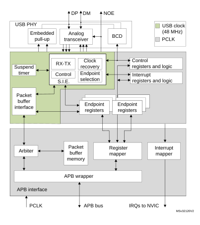

# 45 Universal serial bus full-speed device interface (USB)

## 45.1 Introduction

The USB peripheral implements an interface between a full-speed USB 2.0 bus and the APB1 bus.

USB suspend/resume are supported, which allows to stop the device clocks for low-power consumption.

## 45.2 USB main features

- USB specification version 2.0 full-speed compliant
- Configurable number of endpoints from 1 to 8
- Dedicated packet buffer memory (SRAM) of 1024 bytes
- Cyclic redundancy check (CRC) generation/checking, Non-return-to-zero Inverted (NRZI) encoding/decoding and bit-stuffing
- Isochronous transfers support
- Double-buffered bulk/isochronous endpoint support
- USB Suspend/Resume operations
- Frame locked clock pulse generation
- USB 2.0 Link Power Management support
- Battery Charging Specification Revision 1.2 support
- USB connect / disconnect capability (controllable embedded pull-up resistor on USB\_DP line)

## 45.3 USB implementation

[Table 422](#XREF_83401__Table_227__STM32WB55xx_USB_implementation%1135) describes the USB implementation in the devices.

<table class="TableTitle"><caption class="TableCap"><h4 class="TableCap" id="4517494">Table 422. STM32G4 series USB implementation</h4></caption><col width="376.62px"/><col width="161.29px"/><thead><tr height="28.00px"><th>
USB features<a href="#c7amba%20usb1%20UserSpec_c7amba%20usb1%20UserSpec_FTH_1">1</a>
</th><th>
USB
</th></tr></thead><tr height="22.67px"><td>
Number of endpoints
</td><td>
8
</td></tr><tr height="22.67px"><td>
Size of dedicated packet buffer memory SRAM
</td><td>
1024 bytes
</td></tr><tr data-conditional="dory,littledory,RM0440,stm32l0x2xx,stm32l0x3xx,stm32l43_44_45_46,stm32l5_beluga" height="22.67px"><td data-conditional="dory,littledory,RM0440,stm32l0x2xx,stm32l0x3xx,stm32l43_44_45_46,stm32l5_beluga">
Dedicated packet buffer memory SRAM access scheme
</td><td data-conditional="dory,littledory,RM0440,stm32l0x2xx,stm32l0x3xx,stm32l43_44_45_46,stm32l5_beluga">
2 x 16 bits / word
</td></tr><tr height="22.67px"><td>
USB 2.0 Link Power Management (LPM) support
</td><td>
X
</td></tr><tr height="22.67px"><td>
Battery Charging Detection (BCD) support
</td><td>
X
</td></tr><tr height="22.67px"><td>
Embedded pull-up resistor on USB_DP line
</td><td>
X
</td></tr></table>

<a href="#c7amba%20usb1%20UserSpec_c7amba%20usb1%20UserSpec_FTB_1">1.</a>X= supported

## 45.4 USB functional description

[Figure 673](#XREF_80255__Figure_322__USB_peripheral_block_diagram35) shows the block diagram of the USB peripheral.

#### Figure 673. USB peripheral block diagram

The USB peripheral provides an USB-compliant connection between the host PC and the function implemented by the microcontroller. Data transfer between the host PC and the system memory occurs through a dedicated packet buffer memory accessed directly by the USB peripheral. This dedicated memory size is 1024 bytes, and up to 16 mono-directional or 8 bidirectional endpoints can be used. The USB peripheral interfaces with the USB host, detecting token packets, handling data transmission/reception, and processing handshake packets as required by the USB standard. Transaction formatting is performed by the hardware, including CRC generation and checking.

Each endpoint is associated with a buffer description block indicating where the   
endpoint-related memory area is located, how large it is or how many bytes must be transmitted. When a token for a valid function/endpoint pair is recognized by the USB peripheral, the related data transfer (if required and if the endpoint is configured) takes place. The data buffered by the USB peripheral is loaded in an internal 16-bit register and memory access to the dedicated buffer is performed. When all the data has been transferred, if needed, the proper handshake packet over the USB is generated or expected according to the direction of the transfer.

At the end of the transaction, an endpoint-specific interrupt is generated, reading status registers and/or using different interrupt response routines. The microcontroller can determine:

- which endpoint has to be served,
- which type of transaction took place, if errors occurred (bit stuffing, format, CRC, protocol, missing ACK, over/underrun, etc.).

Special support is offered to isochronous transfers and high throughput bulk transfers, implementing a double buffer usage, which allows to always have an available buffer for the USB peripheral while the microcontroller uses the other one.

The unit can be placed in low-power mode (SUSPEND mode), by writing in the control register, whenever required. At this time, all static power dissipation is avoided, and the USB clock can be slowed down or stopped. The detection of activity at the USB inputs, while in low-power mode, wakes the device up asynchronously. A special interrupt source can be connected directly to a wake-up line to allow the system to immediately restart the normal clock generation and/or support direct clock start/stop.

### 45.4.1 Description of USB blocks

The USB peripheral implements all the features related to USB interfacing, which include the following blocks:

- USB Physical Interface (USB PHY): This block is maintaining the electrical interface to an external USB host. It contains the differential analog transceiver itself, controllable embedded pull-up resistor (connected to USB\_DP line) and support for Battery Charging Detection (BCD), multiplexed on same USB\_DP and USB\_DM lines. The output enable control signal of the analog transceiver (active low) is provided externally on USB\_NOE. It can be used to drive some activity LED or to provide information about the actual communication direction to some other circuitry.
- Serial Interface Engine (SIE): The functions of this block include: synchronization pattern recognition, bit-stuffing, CRC generation and checking, PID verification/generation, and handshake evaluation. It must interface with the USB transceivers and uses the virtual buffers provided by the packet buffer interface for local data storage. This unit also generates signals according to USB peripheral events, such as Start of Frame (SOF), USB\_Reset, Data errors etc. and to Endpoint related events like end of transmission or correct reception of a packet; these signals are then used to generate interrupts.
- Timer: This block generates a start-of-frame locked clock pulse and detects a global suspend (from the host) when no traffic has been received for 3 ms.
- Packet Buffer Interface: This block manages the local memory implementing a set of buffers in a flexible way, both for transmission and reception. It can choose the proper buffer according to requests coming from the SIE and locate them in the memory addresses pointed by the Endpoint registers. It increments the address after each exchanged byte until the end of packet, keeping track of the number of exchanged bytes and preventing the buffer to overrun the maximum capacity.
- Endpoint-Related Registers: Each endpoint has an associated register containing the endpoint type and its current status. For mono-directional/single-buffer endpoints, a single register can be used to implement two distinct endpoints. The number of registers is 8, allowing up to 16 mono-directional/single-buffer or up to 7 double-buffer endpoints in any combination. For example the USB peripheral can be programmed to have 4 double buffer endpoints and 8 single-buffer/mono-directional endpoints.
- Control Registers: These are the registers containing information about the status of the whole USB peripheral and used to force some USB events, such as resume and power-down.
- Interrupt Registers: These contain the Interrupt masks and a record of the events. They can be used to inquire an interrupt reason, the interrupt status or to clear the status of a pending interrupt.

**Note:**

\* Endpoint 0 is always used for control transfer in single-buffer mode.

The USB peripheral is connected to the APB1 bus through an APB1 interface, containing the following blocks:

- Packet Memory: This is the local memory that physically contains the Packet Buffers. It can be used by the Packet Buffer interface, which creates the data structure and can be accessed directly by the application software. The size of the Packet Memory is  1024 bytes, structured as 512 half-words of 16 bits.
- Arbiter: This block accepts memory requests coming from the APB1 bus and from the USB interface. It resolves the conflicts by giving priority to APB1 accesses, while always reserving half of the memory bandwidth to complete all USB transfers. This time-duplex scheme implements a virtual dual-port SRAM that allows memory access, while an USB transaction is happening. Multiword APB1 transfers of any length are also allowed by this scheme.
- Register Mapper: This block collects the various byte-wide and bit-wide registers of the USB peripheral in a structured 16-bit wide half-word set addressed by the APB1.
- APB1 Wrapper: This provides an interface to the APB1 for the memory and register. It also maps the whole USB peripheral in the APB1 address space.
- Interrupt Mapper: This block is used to select how the possible USB events can generate interrupts and map them to the NVIC.

## 45.5 Programming considerations

In the following sections, the expected interactions between the USB peripheral and the application program are described, in order to ease application software development.

### 45.5.1 Generic USB device programming

This part describes the main tasks required of the application software in order to obtain USB compliant behavior. The actions related to the most general USB events are taken into account and paragraphs are dedicated to the special cases of double-buffered endpoints and Isochronous transfers. Apart from system reset, action is always initiated by the USB peripheral, driven by one of the USB events described below.

### 45.5.2 System and power-on reset

Upon system and power-on reset, the first operation the application software should perform is to provide all required clock signals to the USB peripheral and subsequently de-assert its reset signal so to be able to access its registers. The whole initialization sequence is hereafter described.

As a first step application software needs to activate register macrocell clock and de-assert macrocell specific reset signal using related control bits provided by device clock management logic.

After that, the analog part of the device related to the USB transceiver must be switched on using the PDWN bit in CNTR register, which requires a special handling. This bit is intended to switch on the internal voltage references that supply the port transceiver. This circuit has a defined startup time (tSTARTUP specified in the datasheet) during which the behavior of the USB transceiver is not defined. It is thus necessary to wait this time, after setting the PDWN bit in the CNTR register, before removing the reset condition on the USB part (by clearing the FRES bit in the CNTR register). Clearing the ISTR register then removes any spurious pending interrupt before any other macrocell operation is enabled.

At system reset, the microcontroller must initialize all required registers and the packet buffer description table, to make the USB peripheral able to properly generate interrupts and data transfers. All registers not specific to any endpoint must be initialized according to the needs of application software (choice of enabled interrupts, chosen address of packet buffers, etc.). Then the process continues as for the USB reset case (see further paragraph).

#### USB reset (RESET interrupt)

When this event occurs, the USB peripheral is put in the same conditions it is left by the system reset after the initialization described in the previous paragraph: communication is disabled in all endpoint registers (the USB peripheral will not respond to any packet). As a response to the USB reset event, the USB function must be enabled, having as USB address 0, implementing only the default control endpoint (endpoint address is 0 too). This is accomplished by setting the Enable Function (EF) bit of the USB\_DADDR register and initializing the EP0R register and its related packet buffers accordingly. During USB enumeration process, the host assigns a unique address to this device, which must be written in the ADD[6:0] bits of the USB\_DADDR register, and configures any other necessary endpoint.

When a RESET interrupt is received, the application software is responsible to enable again the default endpoint of USB function 0 within 10 ms from the end of reset sequence which triggered the interrupt.

#### Structure and usage of packet buffers

Each bidirectional endpoint may receive or transmit data from/to the host. The received data is stored in a dedicated memory buffer reserved for that endpoint, while another memory buffer contains the data to be transmitted by the endpoint. Access to this memory is performed by the packet buffer interface block, which delivers a memory access request and waits for its acknowledgment. Since the packet buffer memory has to be accessed by the microcontroller also, an arbitration logic takes care of the access conflicts, using half APB1 cycle for microcontroller access and the remaining half for the USB peripheral access. In this way, both the agents can operate as if the packet memory is a dual-port SRAM, without being aware of any conflict even when the microcontroller is performing back-to-back accesses. The USB peripheral logic uses a dedicated clock. The frequency of this dedicated clock is fixed by the requirements of the USB standard at 48 MHz, and this can be different from the clock used for the interface to the APB1 bus. Different clock configurations are possible where the APB1 clock frequency can be higher or lower than the USB peripheral one.

**Note:**

For USB throughput and system performance reasons during USB active bus connection it is recommended to run APB1 clock no lower than 48 MHz.

Each endpoint is associated with two packet buffers (usually one for transmission and the other one for reception). Buffers can be placed anywhere inside the packet memory because their location and size is specified in a buffer description table, which is also located in the packet memory at the address indicated by the USB\_BTABLE register. Each table entry is associated to an endpoint register and it is composed of four 16-bit half-words so that table start address must always be aligned to an 8-byte boundary (the lowest three bits of USB\_BTABLE register are always “000”). Buffer descriptor table entries are described in the [Section 45.6.2: Buffer descriptor table](#XREF_61065__5_3_Buffer_descriptor_table35). If an endpoint is unidirectional and it is neither an Isochronous nor a double-buffered bulk, only one packet buffer is required (the one related to the supported transfer direction). Other table locations related to unsupported transfer directions or unused endpoints, are available to the user. Isochronous and double-buffered bulk endpoints have special handling of packet buffers (Refer to [Section 45.5.4: Isochronous transfers](#XREF_42300__5_2_Isochronous_Transfers35) and [Section 45.5.3: Double-buffered endpoints](#XREF_36402__6_2_Double-buffered_endpoints35) respectively). The relationship between buffer description table entries and packet buffer areas is depicted in [Figure 674](#XREF_36572__Figure_2__Packet_Buffer_Areas_and_Buffer_Description_Table_Locations35).

#### Figure 674. Packet buffer areas with examples of buffer description table locations

Each packet buffer is used either during reception or transmission starting from the bottom. The USB peripheral will never change the contents of memory locations adjacent to the allocated memory buffers; if a packet bigger than the allocated buffer length is received (buffer overrun condition) the data are copied to the memory only up to the last available location.

#### Endpoint initialization

The first step to initialize an endpoint is to write appropriate values to the ADDRn\_TX/ADDRn\_RX registers so that the USB peripheral finds the data to be transmitted already available and the data to be received can be buffered. The EP\_TYPE bits in the USB\_EPnR register must be set according to the endpoint type, eventually using the EP\_KIND bit to enable any special required feature. On the transmit side, the endpoint must be enabled using the STAT\_TX bits in the USB\_EPnR register and COUNTn\_TX must be initialized. For reception, STAT\_RX bits must be set to enable reception and COUNTn\_RX must be written with the allocated buffer size using the BL\_SIZE and NUM\_BLOCK fields. Unidirectional endpoints, except Isochronous and double-buffered bulk endpoints, need to initialize only bits and registers related to the supported direction. Once the transmission and/or reception are enabled, register USB\_EPnR and locations ADDRn\_TX/ADDRn\_RX, COUNTn\_TX/COUNTn\_RX (respectively), should not be modified by the application software, as the hardware can change their value on the fly. When the data transfer operation is completed, notified by a CTR interrupt event, they can be accessed again to re-enable a new operation.

#### IN packets (data transmission)

When receiving an IN token packet, if the received address matches a configured and valid endpoint, the USB peripheral accesses the contents of ADDRn\_TX and COUNTn\_TX locations inside the buffer descriptor table entry related to the addressed endpoint. The content of these locations is stored in its internal 16 bit registers ADDR and COUNT (not accessible by software). The packet memory is accessed again to read the first byte to be transmitted (Refer to [Structure and usage of packet buffers on page 2021](#XREF_10232__5_1_3_Structure_and_usage_of_DMA_buffers35)) and starts sending a DATA0 or DATA1 PID according to USB\_EPnR bit DTOG\_TX. When the PID is completed, the first byte, read from buffer memory, is loaded into the output shift register to be transmitted on the USB bus. After the last data byte is transmitted, the computed CRC is sent. If the addressed endpoint is not valid, a NAK or STALL handshake packet is sent instead of the data packet, according to STAT\_TX bits in the USB\_EPnR register.

The ADDR internal register is used as a pointer to the current buffer memory location while COUNT is used to count the number of remaining bytes to be transmitted. Each half-word read from the packet buffer memory is transmitted over the USB bus starting from the least significant byte. Transmission buffer memory is read starting from the address pointed by ADDRn\_TX for COUNTn\_TX/2 half-words. If a transmitted packet is composed of an odd number of bytes, only the lower half of the last half-word accessed is used.

On receiving the ACK receipt by the host, the USB\_EPnR register is updated in the following way: DTOG\_TX bit is toggled, the endpoint is made invalid by setting STAT\_TX=10 (NAK) and bit CTR\_TX is set. The application software must first identify the endpoint, which is requesting microcontroller attention by examining the EP\_ID and DIR bits in the USB\_ISTR register. Servicing of the CTR\_TX event starts clearing the interrupt bit; the application software then prepares another buffer full of data to be sent, updates the COUNTn\_TX table location with the number of byte to be transmitted during the next transfer, and finally sets STAT\_TX to ‘11 (VALID) to re-enable transmissions. While the STAT\_TX bits are equal to ‘10 (NAK), any IN request addressed to that endpoint is NAKed, indicating a flow control condition: the USB host will retry the transaction until it succeeds. It is mandatory to execute the sequence of operations in the above mentioned order to avoid losing the notification of a second IN transaction addressed to the same endpoint immediately following the one which triggered the CTR interrupt.

#### OUT and SETUP packets (data reception)

These two tokens are handled by the USB peripheral more or less in the same way; the differences in the handling of SETUP packets are detailed in the following paragraph about control transfers. When receiving an OUT/SETUP PID, if the address matches a valid endpoint, the USB peripheral accesses the contents of the ADDRn\_RX and COUNTn\_RX locations inside the buffer descriptor table entry related to the addressed endpoint. The content of the ADDRn\_RX is stored directly in its internal register ADDR. While COUNT is now reset and the values of BL\_SIZE and NUM\_BLOCK bit fields, which are read within COUNTn\_RX content are used to initialize BUF\_COUNT, an internal 16 bit counter, which is used to check the buffer overrun condition (all these internal registers are not accessible by software). Data bytes subsequently received by the USB peripheral are packed in half-words (the first byte received is stored as least significant byte) and then transferred to the packet buffer starting from the address contained in the internal ADDR register while BUF\_COUNT is decremented and COUNT is incremented at each byte transfer. When the end of DATA packet is detected, the correctness of the received CRC is tested and only if no errors occurred during the reception, an ACK handshake packet is sent back to the transmitting host.

In case of wrong CRC or other kinds of errors (bit-stuff violations, frame errors, etc.), data bytes are still copied in the packet memory buffer, at least until the error detection point, but ACK packet is not sent and the ERR bit in USB\_ISTR register is set. However, there is usually no software action required in this case: the USB peripheral recovers from reception errors and remains ready for the next transaction to come. If the addressed endpoint is not valid, a NAK or STALL handshake packet is sent instead of the ACK, according to bits STAT\_RX in the USB\_EPnR register and no data is written in the reception memory buffers.

Reception memory buffer locations are written starting from the address contained in the ADDRn\_RX for a number of bytes corresponding to the received data packet length, CRC included (i.e. data payload length + 2), or up to the last allocated memory location, as defined by BL\_SIZE and NUM\_BLOCK, whichever comes first. In this way, the USB peripheral never writes beyond the end of the allocated reception memory buffer area. If the length of the data packet payload (actual number of bytes used by the application) is greater than the allocated buffer, the USB peripheral detects a buffer overrun condition. in this case, a STALL handshake is sent instead of the usual ACK to notify the problem to the host, no interrupt is generated and the transaction is considered failed.

When the transaction is completed correctly, by sending the ACK handshake packet, the internal COUNT register is copied back in the COUNTn\_RX location inside the buffer description table entry, leaving unaffected BL\_SIZE and NUM\_BLOCK fields, which normally do not require to be re-written, and the USB\_EPnR register is updated in the following way: DTOG\_RX bit is toggled, the endpoint is made invalid by setting STAT\_RX = ‘10 (NAK) and bit CTR\_RX is set. If the transaction has failed due to errors or buffer overrun condition, none of the previously listed actions take place. The application software must first identify the endpoint, which is requesting microcontroller attention by examining the EP\_ID and DIR bits in the USB\_ISTR register. The CTR\_RX event is serviced by first determining the transaction type (SETUP bit in the USB\_EPnR register); the application software must clear the interrupt flag bit and get the number of received bytes reading the COUNTn\_RX location inside the buffer description table entry related to the endpoint being processed. After the received data is processed, the application software should set the STAT\_RX bits to ‘11 (Valid) in the USB\_EPnR, enabling further transactions. While the STAT\_RX bits are equal to ‘10 (NAK), any OUT request addressed to that endpoint is NAKed, indicating a flow control condition: the USB host will retry the transaction until it succeeds. It is mandatory to execute the sequence of operations in the above mentioned order to avoid losing the notification of a second OUT transaction addressed to the same endpoint following immediately the one which triggered the CTR interrupt.

#### Control transfers

Control transfers are made of a SETUP transaction, followed by zero or more data stages, all of the same direction, followed by a status stage (a zero-byte transfer in the opposite direction). SETUP transactions are handled by control endpoints only and are very similar to OUT ones (data reception) except that the values of DTOG\_TX and DTOG\_RX bits of the addressed endpoint registers are set to 1 and 0 respectively, to initialize the control transfer, and both STAT\_TX and STAT\_RX are set to ‘10 (NAK) to let software decide if subsequent transactions must be IN or OUT depending on the SETUP contents. A control endpoint must check SETUP bit in the USB\_EPnR register at each CTR\_RX event to distinguish normal OUT transactions from SETUP ones. A USB device can determine the number and direction of data stages by interpreting the data transferred in the SETUP stage, and is required to STALL the transaction in the case of errors. To do so, at all data stages before the last, the unused direction should be set to STALL, so that, if the host reverses the transfer direction too soon, it gets a STALL as a status stage.

While enabling the last data stage, the opposite direction should be set to NAK, so that, if the host reverses the transfer direction (to perform the status stage) immediately, it is kept waiting for the completion of the control operation. If the control operation completes successfully, the software will change NAK to VALID, otherwise to STALL. At the same time, if the status stage is an OUT, the STATUS\_OUT (EP\_KIND in the USB\_EPnR register) bit should be set, so that an error is generated if a status transaction is performed with not-zero data. When the status transaction is serviced, the application clears the STATUS\_OUT bit and sets STAT\_RX to VALID (to accept a new command) and STAT\_TX to NAK (to delay a possible status stage immediately following the next setup).

Since the USB specification states that a SETUP packet cannot be answered with a handshake different from ACK, eventually aborting a previously issued command to start the new one, the USB logic doesn’t allow a control endpoint to answer with a NAK or STALL packet to a SETUP token received from the host.

When the STAT\_RX bits are set to ‘01 (STALL) or ‘10 (NAK) and a SETUP token is received, the USB accepts the data, performing the required data transfers and sends back an ACK handshake. If that endpoint has a previously issued CTR\_RX request not yet acknowledged by the application (i.e. CTR\_RX bit is still set from a previously completed reception), the USB discards the SETUP transaction and does not answer with any handshake packet regardless of its state, simulating a reception error and forcing the host to send the SETUP token again. This is done to avoid losing the notification of a SETUP transaction addressed to the same endpoint immediately following the transaction, which triggered the CTR\_RX interrupt.

### 45.5.3 Double-buffered endpoints

All different endpoint types defined by the USB standard represent different traffic models, and describe the typical requirements of different kind of data transfer operations. When large portions of data are to be transferred between the host PC and the USB function, the bulk endpoint type is the most suited model. This is because the host schedules bulk transactions so as to fill all the available bandwidth in the frame, maximizing the actual transfer rate as long as the USB function is ready to handle a bulk transaction addressed to it. If the USB function is still busy with the previous transaction when the next one arrives, it will answer with a NAK handshake and the host PC will issue the same transaction again until the USB function is ready to handle it, reducing the actual transfer rate due to the bandwidth occupied by re-transmissions. For this reason, a dedicated feature called ‘double-buffering’ can be used with bulk endpoints.

When ‘double-buffering’ is activated, data toggle sequencing is used to select, which buffer is to be used by the USB peripheral to perform the required data transfers, using both ‘transmission’ and ‘reception’ packet memory areas to manage buffer swapping on each successful transaction in order to always have a complete buffer to be used by the application, while the USB peripheral fills the other one. For example, during an OUT transaction directed to a ‘reception’ double-buffered bulk endpoint, while one buffer is being filled with new data coming from the USB host, the other one is available for the microcontroller software usage (the same would happen with a ‘transmission’ double-buffered bulk endpoint and an IN transaction).

Since the swapped buffer management requires the usage of all 4 buffer description table locations hosting the address pointer and the length of the allocated memory buffers, the USB\_EPnR registers used to implement double-buffered bulk endpoints are forced to be used as unidirectional ones. Therefore, only one STAT bit pair must be set at a value different from ‘00 (Disabled): STAT\_RX if the double-buffered bulk endpoint is enabled for reception, STAT\_TX if the double-buffered bulk endpoint is enabled for transmission. In case it is required to have double-buffered bulk endpoints enabled both for reception and transmission, two USB\_EPnR registers must be used.

To exploit the double-buffering feature and reach the highest possible transfer rate, the endpoint flow control structure, described in previous chapters, has to be modified, in order to switch the endpoint status to NAK only when a buffer conflict occurs between the USB peripheral and application software, instead of doing it at the end of each successful transaction. The memory buffer which is currently being used by the USB peripheral is defined by the DTOG bit related to the endpoint direction: DTOG\_RX (bit 14 of USB\_EPnR register) for ‘reception’ double-buffered bulk endpoints or DTOG\_TX (bit 6 of USB\_EPnR register) for ‘transmission’ double-buffered bulk endpoints. To implement the new flow control scheme, the USB peripheral should know which packet buffer is currently in use by the application software, so to be aware of any conflict. Since in the USB\_EPnR register, there are two DTOG bits but only one is used by USB peripheral for data and buffer sequencing (due to the unidirectional constraint required by double-buffering feature) the other one can be used by the application software to show which buffer it is currently using. This new buffer flag is called SW\_BUF. In the following table the correspondence between USB\_EPnR register bits and DTOG/SW\_BUF definition is explained, for the cases of ‘transmission’ and ‘reception’ double-buffered bulk endpoints.

 

<table class="TableTitle"><caption class="Captiontable 1"><h4 class="TableCap" id="1017400">Table 423. <a id="Definition35" name="XREF_26871__Table_1__Double-Buffering_Buffer_Flag_Definition35">Double-buffering buffer flag definition</a></h4></caption><col width="150.09px"/><col width="193.59px"/><col width="193.59px"/><thead><tr height="28.00px"><th style="border-left-width:0.5pt;border-left-style:solid;border-left-color:#000000;border-bottom-width:1.5pt;border-bottom-style:solid;border-bottom-color:#000000;border-right-width:0.5pt;border-right-style:solid;border-right-color:#000000;border-top-width:0.5pt;border-top-style:solid;border-top-color:#000000;">
Buffer flag
</th><th style="border-left-width:0.5pt;border-left-style:solid;border-left-color:#000000;border-bottom-width:1.5pt;border-bottom-style:solid;border-bottom-color:#000000;border-right-width:0.5pt;border-right-style:solid;border-right-color:#000000;border-top-width:0.5pt;border-top-style:solid;border-top-color:#000000;">
‘Transmission’ endpoint
</th><th style="border-left-width:0.5pt;border-left-style:solid;border-left-color:#000000;border-bottom-width:1.5pt;border-bottom-style:solid;border-bottom-color:#000000;border-right-width:0.5pt;border-right-style:solid;border-right-color:#000000;border-top-width:0.5pt;border-top-style:solid;border-top-color:#000000;">
‘Reception’ endpoint
</th></tr></thead><tr height="22.67px"><td style="border-left-width:0.5pt;border-left-style:solid;border-left-color:#000000;border-bottom-width:0.5pt;border-bottom-style:solid;border-bottom-color:#000000;border-right-width:0.5pt;border-right-style:solid;border-right-color:#000000;border-top-width:1.5pt;border-top-style:solid;border-top-color:#000000;">
DTOG
</td><td style="border-left-width:0.5pt;border-left-style:solid;border-left-color:#000000;border-bottom-width:0.5pt;border-bottom-style:solid;border-bottom-color:#000000;border-right-width:0.5pt;border-right-style:solid;border-right-color:#000000;border-top-width:1.5pt;border-top-style:solid;border-top-color:#000000;">
DTOG_TX (USB_EPnR bit 6)
</td><td style="border-left-width:0.5pt;border-left-style:solid;border-left-color:#000000;border-bottom-width:0.5pt;border-bottom-style:solid;border-bottom-color:#000000;border-right-width:0.5pt;border-right-style:solid;border-right-color:#000000;border-top-width:1.5pt;border-top-style:solid;border-top-color:#000000;">
DTOG_RX (USB_EPnR bit 14)
</td></tr><tr height="22.67px"><td style="border-left-width:0.5pt;border-left-style:solid;border-left-color:#000000;border-bottom-width:0.5pt;border-bottom-style:solid;border-bottom-color:#000000;border-right-width:0.5pt;border-right-style:solid;border-right-color:#000000;border-top-width:0.5pt;border-top-style:solid;border-top-color:#000000;">
SW_BUF
</td><td style="border-left-width:0.5pt;border-left-style:solid;border-left-color:#000000;border-bottom-width:0.5pt;border-bottom-style:solid;border-bottom-color:#000000;border-right-width:0.5pt;border-right-style:solid;border-right-color:#000000;border-top-width:0.5pt;border-top-style:solid;border-top-color:#000000;">
USB_EPnR bit 14
</td><td style="border-left-width:0.5pt;border-left-style:solid;border-left-color:#000000;border-bottom-width:0.5pt;border-bottom-style:solid;border-bottom-color:#000000;border-right-width:0.5pt;border-right-style:solid;border-right-color:#000000;border-top-width:0.5pt;border-top-style:solid;border-top-color:#000000;">
USB_EPnR bit 6
</td></tr></table>

The memory buffer which is currently being used by the USB peripheral is defined by DTOG buffer flag, while the buffer currently in use by application software is identified by SW\_BUF buffer flag. The relationship between the buffer flag value and the used packet buffer is the same in both cases, and it is listed in the following table.

 

<table class="TableTitle"><caption class="~TableHeading"><h4 class="TableCap" id="1017428">Table 424. <a id="usage35" name="XREF_20752__Table_58__Bulk_double-buffering_memory_buffers_usage35">Bulk double-buffering memory buffers usage</a></h4></caption><col width="60.38px"/><col width="43.72px"/><col width="59.05px"/><col width="186.72px"/><col width="188.72px"/><thead><tr height="42.67px"><th>
Endpoint type
</th><th>
DTOG
</th><th>
SW_BUF
</th><th>
Packet buffer used by USB peripheral
</th><th>
Packet buffer used by Application Software
</th></tr></thead><tr height="40.00px"><td rowspan="4">
IN
</td><td>
0
</td><td>
1
</td><td>
ADDRn_TX_0 / COUNTn_TX_0

Buffer description table locations.
</td><td>
ADDRn_TX_1 / COUNTn_TX_1

Buffer description table locations.
</td></tr><tr height="40.00px"><td>
1
</td><td>
0
</td><td>
ADDRn_TX_1 / COUNTn_TX_1

Buffer description table locations
</td><td>
ADDRn_TX_0 / COUNTn_TX_0

Buffer description table locations.
</td></tr><tr height="40.00px"><td>
0
</td><td>
0
</td><td>
None <a href="#c7amba%20usb1%20UserSpec_c7amba%20usb1%20UserSpec_FTH_1">1</a>
</td><td>
ADDRn_TX_0 / COUNTn_TX_0

Buffer description table locations.
</td></tr><tr height="40.00px"><td>
1
</td><td>
1
</td><td>
None <a href="#XREF_61502__1__Endpoint_in_NAK_Status_35" style="font-family : Arial ; font-weight:normal;font-style:normal;font-size : 9.00pt;text-decoration:none;font-kerning:normal;text-transform:none;font-stretch:normal;color:#000000;background-color:transparent;letter-spacing : 0.00em;">(1)</a>
</td><td>
ADDRn_TX_1 / COUNTn_TX_1

Buffer description table locations.
</td></tr><tr height="40.00px"><td rowspan="4">
OUT
</td><td>
0
</td><td>
1
</td><td>
ADDRn_RX_0 / COUNTn_RX_0

Buffer description table locations.
</td><td>
ADDRn_RX_1 / COUNTn_RX_1

Buffer description table locations.
</td></tr><tr height="40.00px"><td>
1
</td><td>
0
</td><td>
ADDRn_RX_1 / COUNTn_RX_1

Buffer description table locations.
</td><td>
ADDRn_RX_0 / COUNTn_RX_0

Buffer description table locations.
</td></tr><tr height="40.00px"><td>
0
</td><td>
0
</td><td>
None <a href="#XREF_61502__1__Endpoint_in_NAK_Status_35" style="font-family : Arial ; font-weight:normal;font-style:normal;font-size : 9.00pt;text-decoration:none;font-kerning:normal;text-transform:none;font-stretch:normal;color:#000000;background-color:transparent;letter-spacing : 0.00em;">(1)</a>
</td><td>
ADDRn_RX_0 / COUNTn_RX_0

Buffer description table locations.
</td></tr><tr height="40.00px"><td>
1
</td><td>
1
</td><td>
None <a href="#XREF_61502__1__Endpoint_in_NAK_Status_35" style="font-family : Arial ; font-weight:normal;font-style:normal;font-size : 9.00pt;text-decoration:none;font-kerning:normal;text-transform:none;font-stretch:normal;color:#000000;background-color:transparent;letter-spacing : 0.00em;">(1)</a>
</td><td>
ADDRn_RX_1 / COUNTn_RX_1

Buffer description table locations.
</td></tr></table>

<a href="#c7amba%20usb1%20UserSpec_c7amba%20usb1%20UserSpec_FTB_1">1.</a><a id="35" name="XREF_61502__1__Endpoint_in_NAK_Status_35">Endpoint in NAK Status.</a>

Double-buffering feature for a bulk endpoint is activated by:

- Writing EP\_TYPE bit field at ‘00 in its USB\_EPnR register, to define the endpoint as a bulk, and
- Setting EP\_KIND bit at ‘1 (DBL\_BUF), in the same register.

The application software is responsible for DTOG and SW\_BUF bits initialization according to the first buffer to be used; this has to be done considering the special toggle-only property that these two bits have. The end of the first transaction occurring after having set DBL\_BUF, triggers the special flow control of double-buffered bulk endpoints, which is used for all other transactions addressed to this endpoint until DBL\_BUF remain set. At the end of each transaction the CTR\_RX or CTR\_TX bit of the addressed endpoint USB\_EPnR register is set, depending on the enabled direction. At the same time, the affected DTOG bit in the USB\_EPnR register is hardware toggled making the USB peripheral buffer swapping completely software independent. Unlike common transactions, and the first one after DBL\_BUF setting, STAT bit pair is not affected by the transaction termination and its value remains ‘11 (Valid). However, as the token packet of a new transaction is received, the actual endpoint status is masked as ‘10 (NAK) when a buffer conflict between the USB peripheral and the application software is detected (this condition is identified by DTOG and SW\_BUF having the same value, see [Table 424 on page 2027](#XREF_20752__Table_58__Bulk_double-buffering_memory_buffers_usage35)). The application software responds to the CTR event notification by clearing the interrupt flag and starting any required handling of the completed transaction. When the application packet buffer usage is over, the software toggles the SW\_BUF bit, writing ‘1 to it, to notify the USB peripheral about the availability of that buffer. In this way, the number of NAKed transactions is limited only by the application elaboration time of a transaction data: if the elaboration time is shorter than the time required to complete a transaction on the USB bus, no re-transmissions due to flow control will take place and the actual transfer rate is limited only by the host PC.

The application software can always override the special flow control implemented for double-buffered bulk endpoints, writing an explicit status different from ‘11 (Valid) into the STAT bit pair of the related USB\_EPnR register. In this case, the USB peripheral will always use the programmed endpoint status, regardless of the buffer usage condition.

### 45.5.4 Isochronous transfers

The USB standard supports full speed peripherals requiring a fixed and accurate data production/consume frequency, defining this kind of traffic as ‘Isochronous’. Typical examples of this data are: audio samples, compressed video streams, and in general any sort of sampled data having strict requirements for the accuracy of delivered frequency. When an endpoint is defined to be ‘isochronous’ during the enumeration phase, the host allocates in the frame the required bandwidth and delivers exactly one IN or OUT packet each frame, depending on endpoint direction. To limit the bandwidth requirements, no re-transmission of failed transactions is possible for Isochronous traffic; this leads to the fact that an isochronous transaction does not have a handshake phase and no ACK packet is expected or sent after the data packet. For the same reason, Isochronous transfers do not support data toggle sequencing and always use DATA0 PID to start any data packet.

The Isochronous behavior for an endpoint is selected by setting the EP\_TYPE bits at ‘10 in its USB\_EPnR register; since there is no handshake phase the only legal values for the STAT\_RX/STAT\_TX bit pairs are ‘00 (Disabled) and ‘11 (Valid), any other value will produce results not compliant to USB standard. Isochronous endpoints implement double-buffering to ease application software development, using both ‘transmission’ and ‘reception’ packet memory areas to manage buffer swapping on each successful transaction in order to have always a complete buffer to be used by the application, while the USB peripheral fills the other.

The memory buffer which is currently used by the USB peripheral is defined by the DTOG bit related to the endpoint direction (DTOG\_RX for ‘reception’ isochronous endpoints, DTOG\_TX for ‘transmission’ isochronous endpoints, both in the related USB\_EPnR register) according to [Table 425](#XREF_96303__Table_3__Isochronous_Memory_Buffers_Usage_35).

 

<table class="TableTitle"><caption class="Captiontable 1"><h4 class="TableCap" id="1017575">Table 425. <a id="35" name="XREF_96303__Table_3__Isochronous_Memory_Buffers_Usage_35">Isochronous memory buffers usage</a></h4></caption><col width="64.45px"/><col width="75.36px"/><col width="199.39px"/><col width="199.39px"/><thead><tr height="42.67px"><th>
Endpoint Type
</th><th>
DTOG bit value
</th><th>
Packet buffer used by the USB peripheral 
</th><th>
Packet buffer used by the application software
</th></tr></thead><tr height="52.00px"><td rowspan="2">
IN
</td><td>
0
</td><td>
ADDRn_TX_0 / COUNTn_TX_0 buffer description table locations.
</td><td>
ADDRn_TX_1 / COUNTn_TX_1 buffer description table locations.
</td></tr><tr height="52.00px"><td>
1
</td><td>
ADDRn_TX_1 / COUNTn_TX_1 buffer description table locations.
</td><td>
ADDRn_TX_0 / COUNTn_TX_0 buffer description table locations.
</td></tr><tr height="52.00px"><td rowspan="2">
OUT
</td><td>
0
</td><td>
ADDRn_RX_0 / COUNTn_RX_0 buffer description table locations.
</td><td>
ADDRn_RX_1 / COUNTn_RX_1 buffer description table locations.
</td></tr><tr height="52.00px"><td>
1
</td><td>
ADDRn_RX_1 / COUNTn_RX_1 buffer description table locations.
</td><td>
ADDRn_RX_0 / COUNTn_RX_0 buffer description table locations.
</td></tr></table>

As it happens with double-buffered bulk endpoints, the USB\_EPnR registers used to implement Isochronous endpoints are forced to be used as unidirectional ones. In case it is required to have Isochronous endpoints enabled both for reception and transmission, two USB\_EPnR registers must be used.

The application software is responsible for the DTOG bit initialization according to the first buffer to be used; this has to be done considering the special toggle-only property that these two bits have. At the end of each transaction, the CTR\_RX or CTR\_TX bit of the addressed endpoint USB\_EPnR register is set, depending on the enabled direction. At the same time, the affected DTOG bit in the USB\_EPnR register is hardware toggled making buffer swapping completely software independent. STAT bit pair is not affected by transaction completion; since no flow control is possible for Isochronous transfers due to the lack of handshake phase, the endpoint remains always ‘11 (Valid). CRC errors or buffer-overrun conditions occurring during Isochronous OUT transfers are anyway considered as correct transactions and they always trigger an CTR\_RX event. However, CRC errors will anyway set the ERR bit in the USB\_ISTR register to notify the software of the possible data corruption.

### 45.5.5 Suspend/Resume events

The USB standard defines a special peripheral state, called SUSPEND, in which the average current drawn from the USB bus must not be greater than 2.5 mA. This requirement is of fundamental importance for bus-powered devices, while self-powered devices are not required to comply to this strict power consumption constraint. In suspend mode, the host PC sends the notification by not sending any traffic on the USB bus for more than 3 ms: since a SOF packet must be sent every 1 ms during normal operations, the USB peripheral detects the lack of 3 consecutive SOF packets as a suspend request from the host PC and set the SUSP bit to ‘1 in USB\_ISTR register, causing an interrupt if enabled. Once the device is suspended, its normal operation can be restored by a so called RESUME sequence, which can be started from the host PC or directly from the peripheral itself, but it is always terminated by the host PC. The suspended USB peripheral must be anyway able to detect a RESET sequence, reacting to this event as a normal USB reset event.

The actual procedure used to suspend the USB peripheral is device dependent since according to the device composition, different actions may be required to reduce the total consumption.

A brief description of a typical suspend procedure is provided below, focused on the USB- related aspects of the application software routine responding to the SUSP notification of the USB peripheral:

1. Set the FSUSP bit in the USB\_CNTR register to 1. This action activates the suspend mode within the USB peripheral. As soon as the suspend mode is activated, the check on SOF reception is disabled to avoid any further SUSP interrupts being issued while the USB is suspended.
2. Remove or reduce any static power consumption in blocks different from the USB peripheral.
3. Set LP\_MODE bit in USB\_CNTR register to 1 to remove static power consumption in the analog USB transceivers but keeping them able to detect resume activity.
4. Optionally turn off external oscillator and device PLL to stop any activity inside the device.

When an USB event occurs while the device is in SUSPEND mode, the RESUME procedure must be invoked to restore nominal clocks and regain normal USB behavior. Particular care must be taken to insure that this process does not take more than 10 ms when the wakening event is an USB reset sequence (See “Universal Serial Bus Specification” for more details). The start of a resume or reset sequence, while the USB peripheral is suspended, clears the LP\_MODE bit in USB\_CNTR register asynchronously. The resume procedure should be run just after the end of the suspend one, so its code is immediately executed as soon as the system clock restarts. It is therefore never necessary to handle a WKUP event as an interrupt. If multiple events could have caused the system resume (via EXTI) it is recommended to restart the USB 48 MHz clock as soon as possible. Once this clock is active it is possible to confirm if the event source was the USB resume (i.e. WKUP bit). To prevent ESD discharges or any other kind of noise from waking-up the system (the exit from suspend mode is an asynchronous event), a suitable analog filter on data line status is activated during suspend; the filter width is about 70 ns.

The following is a list of actions a resume procedure should address:

1. Optionally turn on external oscillator and/or device PLL, and further wait for USB 48 MHz clock activation (this is required before making any USB register accesses).
2. Clear FSUSP bit of USB\_CNTR register, and further wait for USB 48 MHz clock activation (this is required before making any USB register access).
3. If the resume triggering event has to be identified, bits RXDP and RXDM in the USB\_FNR register can be used according to [Table 426](#XREF_34191__Table_8__Resume_event_detection35), which also lists the intended software action in all the cases. If required, the end of resume or reset sequence can be detected monitoring the status of the above mentioned bits by checking when they reach the “10” configuration, which represent the Idle bus state; moreover at the end of a reset sequence the RESET bit in USB\_ISTR register is set to 1, issuing an interrupt if enabled, which should be handled as usual.

 

<table class="TableTitle"><caption class="Captiontable 1"><h4 class="TableCap" id="1017648">Table 426. <a id="detection35" name="XREF_34191__Table_8__Resume_event_detection35">Resume event detection</a></h4></caption><col width="141.01px"/><col width="167.73px"/><col width="229.84px"/><thead><tr height="28.00px"><th>
[RXDP,RXDM] status
</th><th>
Wake-up event
</th><th>
Required resume software action
</th></tr></thead><tr height="22.67px"><td>
“00”
</td><td>
Root reset
</td><td>
None
</td></tr><tr height="22.67px"><td>
“10”
</td><td>
None (noise on bus)
</td><td>
Go back in Suspend mode
</td></tr><tr height="22.67px"><td>
“01”
</td><td>
Root resume
</td><td>
None
</td></tr><tr height="22.67px"><td>
“11”
</td><td>
Not allowed (noise on bus)
</td><td>
Go back in Suspend mode
</td></tr></table>

A device may require to exit from suspend mode as an answer to particular events not directly related to the USB protocol (e.g. a mouse movement wakes up the whole system). In this case, the resume sequence can be started by setting the RESUME bit in the USB\_CNTR register to ‘1 and resetting it to 0 after an interval between 1 ms and 15 ms (this interval can be timed using ESOF interrupts, occurring with a 1 ms period when the system clock is running at nominal frequency). Once the RESUME bit is clear, the resume sequence is completed by the host PC and its end can be monitored again using the RXDP and RXDM bits in the USB\_FNR register.

**Note:**

The RESUME bit must be anyway used only after the USB peripheral has been put in suspend mode, setting the FSUSP bit in USB\_CNTR register to 1.

If multiple events could have cause the system resume (via EXTI) it is recommended to re-start the USB 48 MHz clock as soon as possible. Once this clock is active it is possible to confirm if the event source was the USB resume (for instance WKUP bit).

## 45.6 USB and USB SRAM registers

The USB peripheral registers can be divided into the following groups:

- Common Registers: Interrupt and Control registers
- Endpoint Registers: Endpoint configuration and status

The USB SRAM registers cover:

- Buffer Descriptor Table: Location of packet memory used to locate data buffers (see [Section 2.2: Memory organization](MMAP_UserSpec.md#XREF_74896__2_2_Memory_organization4) to find USB SRAM base address).

All register addresses are expressed as offsets with respect to the USB peripheral registers base address, except the buffer descriptor table locations, which starts at the USB SRAM base address offset by the value specified in the USB\_BTABLE register.

Refer to [Section 1.2 on page 74](Documentation_conventions.md#XREF_82797__1_1_List_of_abbreviations_for_registers1) for a list of abbreviations used in register descriptions.

The peripheral registers can be accessed by half-words (16-bit) or words (32-bit).

### 45.6.1 Common registers

These registers affect the general behavior of the USB peripheral defining operating mode, interrupt handling, device address and giving access to the current frame number updated by the host PC.

#### USB control register (USB\_CNTR)

Address offset: 0x40

Reset value: 0x0003

 

<table class="RegBitMap"><col width="31.40px"/><col width="53.24px"/><col width="31.40px"/><col width="39.59px"/><col width="36.86px"/><col width="43.69px"/><col width="31.40px"/><col width="36.86px"/><col width="43.39px"/><col width="23.03px"/><col width="43.39px"/><col width="43.69px"/><col width="35.50px"/><col width="49.15px"/><col width="32.77px"/><col width="28.67px"/><tr height="17.33px"><td style="border-left-width:0;border-left-style:hidden;border-left-color:0;border-bottom-width:0;border-bottom-style:hidden;border-bottom-color:0;border-right-width:0;border-right-style:hidden;border-right-color:0;border-top-width:0;border-top-style:hidden;border-top-color:0;">
15
</td><td style="border-left-width:0;border-left-style:hidden;border-left-color:0;border-bottom-width:0;border-bottom-style:hidden;border-bottom-color:0;border-right-width:0;border-right-style:hidden;border-right-color:0;border-top-width:0;border-top-style:hidden;border-top-color:0;">
14
</td><td style="border-left-width:0;border-left-style:hidden;border-left-color:0;border-bottom-width:0;border-bottom-style:hidden;border-bottom-color:0;border-right-width:0;border-right-style:hidden;border-right-color:0;border-top-width:0;border-top-style:hidden;border-top-color:0;">
13
</td><td style="border-left-width:0;border-left-style:hidden;border-left-color:0;border-bottom-width:0;border-bottom-style:hidden;border-bottom-color:0;border-right-width:0;border-right-style:hidden;border-right-color:0;border-top-width:0;border-top-style:hidden;border-top-color:0;">
12
</td><td style="border-left-width:0;border-left-style:hidden;border-left-color:0;border-bottom-width:0;border-bottom-style:hidden;border-bottom-color:0;border-right-width:0;border-right-style:hidden;border-right-color:0;border-top-width:0;border-top-style:hidden;border-top-color:0;">
11
</td><td style="border-left-width:0;border-left-style:hidden;border-left-color:0;border-bottom-width:0;border-bottom-style:hidden;border-bottom-color:0;border-right-width:0;border-right-style:hidden;border-right-color:0;border-top-width:0;border-top-style:hidden;border-top-color:0;">
10
</td><td style="border-left-width:0;border-left-style:hidden;border-left-color:0;border-bottom-width:0;border-bottom-style:hidden;border-bottom-color:0;border-right-width:0;border-right-style:hidden;border-right-color:0;border-top-width:0;border-top-style:hidden;border-top-color:0;">
9
</td><td style="border-left-width:0;border-left-style:hidden;border-left-color:0;border-bottom-width:0;border-bottom-style:hidden;border-bottom-color:0;border-right-width:0;border-right-style:hidden;border-right-color:0;border-top-width:0;border-top-style:hidden;border-top-color:0;">
8
</td><td style="border-left-width:0;border-left-style:hidden;border-left-color:0;border-right-width:0;border-right-style:hidden;border-right-color:0;border-top-width:0;border-top-style:hidden;border-top-color:0;">
7
</td><td style="border-left-width:0;border-left-style:hidden;border-left-color:0;border-bottom-width:0;border-bottom-style:hidden;border-bottom-color:0;border-right-width:0;border-right-style:hidden;border-right-color:0;border-top-width:0;border-top-style:hidden;border-top-color:0;">
6
</td><td style="border-left-width:0;border-left-style:hidden;border-left-color:0;border-right-width:0;border-right-style:hidden;border-right-color:0;border-top-width:0;border-top-style:hidden;border-top-color:0;">
5
</td><td style="border-left-width:0;border-left-style:hidden;border-left-color:0;border-bottom-width:0;border-bottom-style:hidden;border-bottom-color:0;border-right-width:0;border-right-style:hidden;border-right-color:0;border-top-width:0;border-top-style:hidden;border-top-color:0;">
4
</td><td style="border-left-width:0;border-left-style:hidden;border-left-color:0;border-bottom-width:0;border-bottom-style:hidden;border-bottom-color:0;border-right-width:0;border-right-style:hidden;border-right-color:0;border-top-width:0;border-top-style:hidden;border-top-color:0;">
3
</td><td style="border-left-width:0;border-left-style:hidden;border-left-color:0;border-bottom-width:0;border-bottom-style:hidden;border-bottom-color:0;border-right-width:0;border-right-style:hidden;border-right-color:0;border-top-width:0;border-top-style:hidden;border-top-color:0;">
2
</td><td style="border-left-width:0;border-left-style:hidden;border-left-color:0;border-bottom-width:0;border-bottom-style:hidden;border-bottom-color:0;border-right-width:0;border-right-style:hidden;border-right-color:0;border-top-width:0;border-top-style:hidden;border-top-color:0;">
1
</td><td style="border-left-width:0;border-left-style:hidden;border-left-color:0;border-bottom-width:0;border-bottom-style:hidden;border-bottom-color:0;border-right-width:0;border-right-style:hidden;border-right-color:0;border-top-width:0;border-top-style:hidden;border-top-color:0;">
0
</td></tr><tr height="28.00px"><td style="border-left-width:0.5pt;border-left-style:solid;border-left-color:#000000;border-bottom-width:0.5pt;border-bottom-style:solid;border-bottom-color:#000000;border-right-width:0.5pt;border-right-style:solid;border-right-color:#000000;border-top-width:0.5pt;border-top-style:solid;border-top-color:#000000;background-color:#ffffff;">
CTRM
</td><td style="border-left-width:0.5pt;border-left-style:solid;border-left-color:#000000;border-bottom-width:0.5pt;border-bottom-style:solid;border-bottom-color:#000000;border-right-width:0.5pt;border-right-style:solid;border-right-color:#000000;border-top-width:0.5pt;border-top-style:solid;border-top-color:#000000;background-color:#ffffff;">
PMAOVRM
</td><td style="border-left-width:0.5pt;border-left-style:solid;border-left-color:#000000;border-bottom-width:0.5pt;border-bottom-style:solid;border-bottom-color:#000000;border-right-width:0.5pt;border-right-style:solid;border-right-color:#000000;border-top-width:0.5pt;border-top-style:solid;border-top-color:#000000;background-color:#ffffff;">
ERRM
</td><td style="border-left-width:0.5pt;border-left-style:solid;border-left-color:#000000;border-bottom-width:0.5pt;border-bottom-style:solid;border-bottom-color:#000000;border-right-width:0.5pt;border-right-style:solid;border-right-color:#000000;border-top-width:0.5pt;border-top-style:solid;border-top-color:#000000;background-color:#ffffff;">
WKUPM
</td><td style="border-left-width:0.5pt;border-left-style:solid;border-left-color:#000000;border-bottom-width:0.5pt;border-bottom-style:solid;border-bottom-color:#000000;border-right-width:0.5pt;border-right-style:solid;border-right-color:#000000;border-top-width:0.5pt;border-top-style:solid;border-top-color:#000000;background-color:#ffffff;">
SUSPM
</td><td style="border-left-width:0.5pt;border-left-style:solid;border-left-color:#000000;border-bottom-width:0.5pt;border-bottom-style:solid;border-bottom-color:#000000;border-right-width:0.5pt;border-right-style:solid;border-right-color:#000000;border-top-width:0.5pt;border-top-style:solid;border-top-color:#000000;background-color:#ffffff;">
RESETM
</td><td style="border-left-width:0.5pt;border-left-style:solid;border-left-color:#000000;border-bottom-width:0.5pt;border-bottom-style:solid;border-bottom-color:#000000;border-right-width:0.5pt;border-right-style:solid;border-right-color:#000000;border-top-width:0.5pt;border-top-style:solid;border-top-color:#000000;background-color:#ffffff;">
SOFM
</td><td style="border-left-width:0.5pt;border-left-style:solid;border-left-color:#000000;border-bottom-width:0.5pt;border-bottom-style:solid;border-bottom-color:#000000;border-right-width:0.5pt;border-right-style:solid;border-right-color:#000000;border-top-width:0.5pt;border-top-style:solid;border-top-color:#000000;background-color:#ffffff;">
ESOFM
</td><td style="border-left-width:0.5pt;border-left-style:solid;border-left-color:#000000;border-bottom-width:0.5pt;border-bottom-style:solid;border-bottom-color:#000000;border-right-width:0.5pt;border-right-style:solid;border-right-color:#000000;border-top-width:0.5pt;border-top-style:solid;border-top-color:#000000;">
L1REQM
</td><td style="border-left-width:0.5pt;border-left-style:solid;border-left-color:#000000;border-bottom-width:0.5pt;border-bottom-style:solid;border-bottom-color:#000000;border-right-width:0.5pt;border-right-style:solid;border-right-color:#000000;border-top-width:0.5pt;border-top-style:solid;border-top-color:#000000;">
Res.
</td><td style="border-left-width:0.5pt;border-left-style:solid;border-left-color:#000000;border-bottom-width:0.5pt;border-bottom-style:solid;border-bottom-color:#000000;border-right-width:0.5pt;border-right-style:solid;border-right-color:#000000;border-top-width:0.5pt;border-top-style:solid;border-top-color:#000000;">
L1RESUME
</td><td style="border-left-width:0.5pt;border-left-style:solid;border-left-color:#000000;border-bottom-width:0.5pt;border-bottom-style:solid;border-bottom-color:#000000;border-right-width:0.5pt;border-right-style:solid;border-right-color:#000000;border-top-width:0.5pt;border-top-style:solid;border-top-color:#000000;background-color:#ffffff;">
RE SUME
</td><td style="border-left-width:0.5pt;border-left-style:solid;border-left-color:#000000;border-bottom-width:0.5pt;border-bottom-style:solid;border-bottom-color:#000000;border-right-width:0.5pt;border-right-style:solid;border-right-color:#000000;border-top-width:0.5pt;border-top-style:solid;border-top-color:#000000;background-color:#ffffff;">
F SUSP
</td><td style="border-left-width:0.5pt;border-left-style:solid;border-left-color:#000000;border-bottom-width:0.5pt;border-bottom-style:solid;border-bottom-color:#000000;border-right-width:0.5pt;border-right-style:solid;border-right-color:#000000;border-top-width:0.5pt;border-top-style:solid;border-top-color:#000000;background-color:#ffffff;">
LP_ MODE
</td><td style="border-left-width:0.5pt;border-left-style:solid;border-left-color:#000000;border-bottom-width:0.5pt;border-bottom-style:solid;border-bottom-color:#000000;border-right-width:0.5pt;border-right-style:solid;border-right-color:#000000;border-top-width:0.5pt;border-top-style:solid;border-top-color:#000000;background-color:#ffffff;">
PDWN
</td><td style="border-left-width:0.5pt;border-left-style:solid;border-left-color:#000000;border-bottom-width:0.5pt;border-bottom-style:solid;border-bottom-color:#000000;border-right-width:0.5pt;border-right-style:solid;border-right-color:#000000;border-top-width:0.5pt;border-top-style:solid;border-top-color:#000000;background-color:#ffffff;">
F RES
</td></tr><tr height="17.33px"><td style="border-left-width:0.299988pt;border-left-style:solid;border-left-color:#000000;border-bottom-width:0.299988pt;border-bottom-style:solid;border-bottom-color:#000000;border-right-width:0.299988pt;border-right-style:solid;border-right-color:#000000;border-top-width:0.299988pt;border-top-style:solid;border-top-color:#000000;">
rw
</td><td style="border-left-width:0.299988pt;border-left-style:solid;border-left-color:#000000;border-bottom-width:0.299988pt;border-bottom-style:solid;border-bottom-color:#000000;border-right-width:0.299988pt;border-right-style:solid;border-right-color:#000000;border-top-width:0.299988pt;border-top-style:solid;border-top-color:#000000;">
rw
</td><td style="border-left-width:0.299988pt;border-left-style:solid;border-left-color:#000000;border-bottom-width:0.299988pt;border-bottom-style:solid;border-bottom-color:#000000;border-right-width:0.299988pt;border-right-style:solid;border-right-color:#000000;border-top-width:0.299988pt;border-top-style:solid;border-top-color:#000000;">
rw
</td><td style="border-left-width:0.299988pt;border-left-style:solid;border-left-color:#000000;border-bottom-width:0.299988pt;border-bottom-style:solid;border-bottom-color:#000000;border-right-width:0.299988pt;border-right-style:solid;border-right-color:#000000;border-top-width:0.299988pt;border-top-style:solid;border-top-color:#000000;">
rw
</td><td style="border-left-width:0.299988pt;border-left-style:solid;border-left-color:#000000;border-bottom-width:0.299988pt;border-bottom-style:solid;border-bottom-color:#000000;border-right-width:0.299988pt;border-right-style:solid;border-right-color:#000000;border-top-width:0.299988pt;border-top-style:solid;border-top-color:#000000;">
rw
</td><td style="border-left-width:0.299988pt;border-left-style:solid;border-left-color:#000000;border-bottom-width:0.299988pt;border-bottom-style:solid;border-bottom-color:#000000;border-right-width:0.299988pt;border-right-style:solid;border-right-color:#000000;border-top-width:0.299988pt;border-top-style:solid;border-top-color:#000000;">
rw
</td><td style="border-left-width:0.299988pt;border-left-style:solid;border-left-color:#000000;border-bottom-width:0.299988pt;border-bottom-style:solid;border-bottom-color:#000000;border-right-width:0.299988pt;border-right-style:solid;border-right-color:#000000;border-top-width:0.299988pt;border-top-style:solid;border-top-color:#000000;">
rw
</td><td style="border-left-width:0.299988pt;border-left-style:solid;border-left-color:#000000;border-bottom-width:0.299988pt;border-bottom-style:solid;border-bottom-color:#000000;border-right-width:0.299988pt;border-right-style:solid;border-right-color:#000000;border-top-width:0.299988pt;border-top-style:solid;border-top-color:#000000;">
rw
</td><td style="border-left-width:0.5pt;border-left-style:solid;border-left-color:#000000;border-bottom-width:0.5pt;border-bottom-style:solid;border-bottom-color:#000000;border-right-width:0.5pt;border-right-style:solid;border-right-color:#000000;border-top-width:0.5pt;border-top-style:solid;border-top-color:#000000;">
rw
</td><td style="border-left-width:0.5pt;border-left-style:solid;border-left-color:#000000;border-bottom-width:0.5pt;border-bottom-style:solid;border-bottom-color:#000000;border-right-width:0.5pt;border-right-style:solid;border-right-color:#000000;border-top-width:0.5pt;border-top-style:solid;border-top-color:#000000;"></td><td style="border-left-width:0.5pt;border-left-style:solid;border-left-color:#000000;border-bottom-width:0.5pt;border-bottom-style:solid;border-bottom-color:#000000;border-right-width:0.5pt;border-right-style:solid;border-right-color:#000000;border-top-width:0.5pt;border-top-style:solid;border-top-color:#000000;">
rw
</td><td style="border-left-width:0.299988pt;border-left-style:solid;border-left-color:#000000;border-bottom-width:0.299988pt;border-bottom-style:solid;border-bottom-color:#000000;border-right-width:0.299988pt;border-right-style:solid;border-right-color:#000000;border-top-width:0.299988pt;border-top-style:solid;border-top-color:#000000;">
rw
</td><td style="border-left-width:0.299988pt;border-left-style:solid;border-left-color:#000000;border-bottom-width:0.299988pt;border-bottom-style:solid;border-bottom-color:#000000;border-right-width:0.299988pt;border-right-style:solid;border-right-color:#000000;border-top-width:0.299988pt;border-top-style:solid;border-top-color:#000000;">
rw
</td><td style="border-left-width:0.299988pt;border-left-style:solid;border-left-color:#000000;border-bottom-width:0.299988pt;border-bottom-style:solid;border-bottom-color:#000000;border-right-width:0.299988pt;border-right-style:solid;border-right-color:#000000;border-top-width:0.299988pt;border-top-style:solid;border-top-color:#000000;">
rw
</td><td style="border-left-width:0.299988pt;border-left-style:solid;border-left-color:#000000;border-bottom-width:0.299988pt;border-bottom-style:solid;border-bottom-color:#000000;border-right-width:0.299988pt;border-right-style:solid;border-right-color:#000000;border-top-width:0.299988pt;border-top-style:solid;border-top-color:#000000;">
rw
</td><td style="border-left-width:0.299988pt;border-left-style:solid;border-left-color:#000000;border-bottom-width:0.299988pt;border-bottom-style:solid;border-bottom-color:#000000;border-right-width:0.299988pt;border-right-style:solid;border-right-color:#000000;border-top-width:0.299988pt;border-top-style:solid;border-top-color:#000000;">
rw
</td></tr></table>

 

<table class="RegBitDef"><col width="115.26px"/><col width="498.91px"/><tr height="69.33px"><td>
Bit 15
</td><td>
CTRM: Correct transfer interrupt mask

0: Correct Transfer (CTR) Interrupt disabled. 1: CTR Interrupt enabled, an interrupt request is generated when the corresponding bit in the USB_ISTR register is set.
</td></tr><tr height="69.33px"><td>
Bit 14
</td><td>
PMAOVRM: Packet memory area over / underrun interrupt mask

0: PMAOVR Interrupt disabled. 1: PMAOVR Interrupt enabled, an interrupt request is generated when the corresponding bit in the USB_ISTR register is set.
</td></tr><tr height="69.33px"><td>
Bit 13
</td><td>
ERRM: Error interrupt mask

0: ERR Interrupt disabled. 1: ERR Interrupt enabled, an interrupt request is generated when the corresponding bit in the USB_ISTR register is set.
</td></tr><tr height="69.33px"><td>
Bit 12
</td><td>
WKUPM: Wake-up interrupt mask

0: WKUP Interrupt disabled. 1: WKUP Interrupt enabled, an interrupt request is generated when the corresponding bit in the USB_ISTR register is set.
</td></tr><tr height="69.33px"><td>
Bit 11
</td><td>
SUSPM: Suspend mode interrupt mask

0: Suspend Mode Request (SUSP) Interrupt disabled. 1: SUSP Interrupt enabled, an interrupt request is generated when the corresponding bit in the USB_ISTR register is set.
</td></tr><tr height="69.33px"><td>
Bit 10
</td><td>
RESETM: USB reset interrupt mask

0: RESET Interrupt disabled. 1: RESET Interrupt enabled, an interrupt request is generated when the corresponding bit in the USB_ISTR register is set.
</td></tr><tr height="69.33px"><td>
Bit 9
</td><td>
SOFM: Start of frame interrupt mask

0: SOF Interrupt disabled. 1: SOF Interrupt enabled, an interrupt request is generated when the corresponding bit in the USB_ISTR register is set.
</td></tr><tr height="69.33px"><td>
Bit 8
</td><td>
ESOFM: Expected start of frame interrupt mask

0: Expected Start of Frame (ESOF) Interrupt disabled. 1: ESOF Interrupt enabled, an interrupt request is generated when the corresponding bit in the USB_ISTR register is set.
</td></tr><tr data-conditional="dory,littledory,mantaedge,RM0440,stingray,stingray_value,stm32f302,stm32l0x2xx,stm32l0x3xx,stm32l43_44_45_46,stm32l5_beluga" height="69.33px"><td data-conditional="dory,littledory,mantaedge,RM0440,stingray,stingray_value,stm32f302,stm32l0x2xx,stm32l0x3xx,stm32l43_44_45_46,stm32l5_beluga">
Bit 7
</td><td data-conditional="dory,littledory,mantaedge,RM0440,stingray,stingray_value,stm32f302,stm32l0x2xx,stm32l0x3xx,stm32l43_44_45_46,stm32l5_beluga">
L1REQM: LPM L1 state request interrupt mask

0: LPM L1 state request (L1REQ) Interrupt disabled. 1: L1REQ Interrupt enabled, an interrupt request is generated when the corresponding bit in the USB_ISTR register is set.
</td></tr><tr data-conditional="mantaedge,stm32f302" height="37.33px" style="display: none"><td data-conditional="mantaedge,stm32f302" style="display: none"></td><td data-conditional="mantaedge,stm32f302" style="display: none">
Note:​If LPM is not supported, this bit is not implemented and considered as reserved. Please refer to <a href="#XREF_87033__29_3_USB_implementation35" style="font-family : Arial ; font-weight:normal;font-style:Italic;font-size : 9.00pt;font-kerning:normal;font-stretch:normal;color:#0000ff;background-color:transparent;letter-spacing : 0.00em;">Section 45.3: USB implementation</a>.
</td></tr><tr data-conditional="dory,littledory,mantaedge,RM0440,stingray,stingray_value,stm32f302,stm32l0x2xx,stm32l0x3xx,stm32l43_44_45_46,stm32l5_beluga" height="22.67px"><td data-conditional="dory,littledory,mantaedge,RM0440,stingray,stingray_value,stm32f302,stm32l0x2xx,stm32l0x3xx,stm32l43_44_45_46,stm32l5_beluga">
Bit 6
</td><td data-conditional="dory,littledory,mantaedge,RM0440,stingray,stingray_value,stm32f302,stm32l0x2xx,stm32l0x3xx,stm32l43_44_45_46,stm32l5_beluga">
Reserved, must be kept at reset value.
</td></tr><tr data-conditional="goldfish" height="22.67px" style="display: none"><td data-conditional="goldfish" style="display: none">
Bits 7:5
</td><td data-conditional="goldfish" style="display: none">
Reserved, must be kept at reset value.
</td></tr><tr data-conditional="dory,littledory,mantaedge,RM0440,stingray,stingray_value,stm32f302,stm32l0x2xx,stm32l0x3xx,stm32l43_44_45_46,stm32l5_beluga" height="54.67px"><td data-conditional="dory,littledory,mantaedge,RM0440,stingray,stingray_value,stm32f302,stm32l0x2xx,stm32l0x3xx,stm32l43_44_45_46,stm32l5_beluga">
Bit 5
</td><td data-conditional="dory,littledory,mantaedge,RM0440,stingray,stingray_value,stm32f302,stm32l0x2xx,stm32l0x3xx,stm32l43_44_45_46,stm32l5_beluga">
L1RESUME: LPM L1 Resume request

The microcontroller can set this bit to send a LPM L1 Resume signal to the host. After the signaling ends, this bit is cleared by hardware.
</td></tr><tr data-conditional="mantaedge,stm32f302" height="37.33px" style="display: none"><td data-conditional="mantaedge,stm32f302" style="display: none"></td><td data-conditional="mantaedge,stm32f302" style="display: none">
Note:​If LPM is not supported, this bit is not implemented and considered as reserved. Please refer to <a href="#XREF_87033__29_3_USB_implementation35" style="font-family : Arial ; font-weight:normal;font-style:Italic;font-size : 9.00pt;font-kerning:normal;font-stretch:normal;color:#0000ff;background-color:transparent;letter-spacing : 0.00em;">Section 45.3: USB implementation</a>.
</td></tr><tr height="69.33px"><td>
Bit 4
</td><td>
RESUME: Resume request

The microcontroller can set this bit to send a Resume signal to the host. It must be activated, according to USB specifications, for no less than 1 ms and no more than 15 ms after which the Host PC is ready to drive the resume sequence up to its end.
</td></tr><tr height="113.33px"><td>
Bit 3
</td><td>
FSUSP: Force suspend

Software must set this bit when the SUSP interrupt is received, which is issued when no traffic is received by the USB peripheral for 3 ms. 0: No effect. 1: Enter suspend mode. Clocks and static power dissipation in the analog transceiver are left unaffected. If suspend power consumption is a requirement (bus-powered device), the application software should set the LP_MODE bit after FSUSP as explained below.
</td></tr><tr height="142.67px"><td>
Bit 2
</td><td>
LP_MODE: Low-power mode 

This mode is used when the suspend-mode power constraints require that all static power dissipation is avoided, except the one required to supply the external pull-up resistor. This condition should be entered when the application is ready to stop all system clocks, or reduce their frequency in order to meet the power consumption requirements of the USB suspend condition. The USB activity during the suspend mode (WKUP event) asynchronously resets this bit (it can also be reset by software).  0: No Low-power mode. 1: Enter Low-power mode.
</td></tr><tr height="98.67px"><td>
Bit 1
</td><td>
PDWN: Power down

This bit is used to completely switch off all USB-related analog parts if it is required to completely disable the USB peripheral for any reason. When this bit is set, the USB peripheral is disconnected from the transceivers and it cannot be used. 0: Exit Power Down. 1: Enter Power down mode.
</td></tr><tr height="84.00px"><td>
Bit 0
</td><td>
FRES: Force USB Reset

0: Clear USB reset. 1: Force a reset of the USB peripheral, exactly like a RESET signaling on the USB. The USB peripheral is held in RESET state until software clears this bit. A “USB-RESET” interrupt is generated, if enabled.
</td></tr></table>

#### USB interrupt status register (USB\_ISTR)

Address offset: 0x44

Reset value: 0x0000 0000

 

<table class="TableTitle"><col width="38.39px"/><col width="38.39px"/><col width="38.39px"/><col width="38.39px"/><col width="38.39px"/><col width="41.51px"/><col width="35.26px"/><col width="38.39px"/><col width="43.39px"/><col width="38.39px"/><col width="38.39px"/><col width="38.39px"/><col width="37.34px"/><col width="37.34px"/><col width="37.34px"/><col width="37.34px"/><tr height="20.00px"><td style="border-left-width:0;border-left-style:hidden;border-left-color:0;border-right-width:0;border-right-style:hidden;border-right-color:0;border-top-width:0;border-top-style:hidden;border-top-color:0;">
15
</td><td style="border-left-width:0;border-left-style:hidden;border-left-color:0;border-right-width:0;border-right-style:hidden;border-right-color:0;border-top-width:0;border-top-style:hidden;border-top-color:0;">
14
</td><td style="border-left-width:0;border-left-style:hidden;border-left-color:0;border-right-width:0;border-right-style:hidden;border-right-color:0;border-top-width:0;border-top-style:hidden;border-top-color:0;">
13
</td><td style="border-left-width:0;border-left-style:hidden;border-left-color:0;border-right-width:0;border-right-style:hidden;border-right-color:0;border-top-width:0;border-top-style:hidden;border-top-color:0;">
12
</td><td style="border-left-width:0;border-left-style:hidden;border-left-color:0;border-right-width:0;border-right-style:hidden;border-right-color:0;border-top-width:0;border-top-style:hidden;border-top-color:0;">
11
</td><td style="border-left-width:0;border-left-style:hidden;border-left-color:0;border-right-width:0;border-right-style:hidden;border-right-color:0;border-top-width:0;border-top-style:hidden;border-top-color:0;">
10
</td><td style="border-left-width:0;border-left-style:hidden;border-left-color:0;border-right-width:0;border-right-style:hidden;border-right-color:0;border-top-width:0;border-top-style:hidden;border-top-color:0;">
9
</td><td style="border-left-width:0;border-left-style:hidden;border-left-color:0;border-right-width:0;border-right-style:hidden;border-right-color:0;border-top-width:0;border-top-style:hidden;border-top-color:0;">
8
</td><td style="border-left-width:0;border-left-style:hidden;border-left-color:0;border-right-width:0;border-right-style:hidden;border-right-color:0;border-top-width:0;border-top-style:hidden;border-top-color:0;">
7
</td><td style="border-left-width:0;border-left-style:hidden;border-left-color:0;border-right-width:0;border-right-style:hidden;border-right-color:0;border-top-width:0;border-top-style:hidden;border-top-color:0;">
6
</td><td style="border-left-width:0;border-left-style:hidden;border-left-color:0;border-right-width:0;border-right-style:hidden;border-right-color:0;border-top-width:0;border-top-style:hidden;border-top-color:0;">
5
</td><td style="border-left-width:0;border-left-style:hidden;border-left-color:0;border-right-width:0;border-right-style:hidden;border-right-color:0;border-top-width:0;border-top-style:hidden;border-top-color:0;">
4
</td><td style="border-left-width:0;border-left-style:hidden;border-left-color:0;border-right-width:0;border-right-style:hidden;border-right-color:0;border-top-width:0;border-top-style:hidden;border-top-color:0;">
3
</td><td style="border-left-width:0;border-left-style:hidden;border-left-color:0;border-right-width:0;border-right-style:hidden;border-right-color:0;border-top-width:0;border-top-style:hidden;border-top-color:0;">
2
</td><td style="border-left-width:0;border-left-style:hidden;border-left-color:0;border-right-width:0;border-right-style:hidden;border-right-color:0;border-top-width:0;border-top-style:hidden;border-top-color:0;">
1
</td><td style="border-left-width:0;border-left-style:hidden;border-left-color:0;border-right-width:0;border-right-style:hidden;border-right-color:0;border-top-width:0;border-top-style:hidden;border-top-color:0;">
0
</td></tr><tr height="30.67px"><td style="border-left-width:0.5pt;border-left-style:solid;border-left-color:#000000;border-bottom-width:0.5pt;border-bottom-style:solid;border-bottom-color:#000000;border-right-width:0.5pt;border-right-style:solid;border-right-color:#000000;border-top-width:0.5pt;border-top-style:solid;border-top-color:#000000;">
CTR
</td><td style="border-left-width:0.5pt;border-left-style:solid;border-left-color:#000000;border-bottom-width:0.5pt;border-bottom-style:solid;border-bottom-color:#000000;border-right-width:0.5pt;border-right-style:solid;border-right-color:#000000;border-top-width:0.5pt;border-top-style:solid;border-top-color:#000000;">
PMA OVR
</td><td style="border-left-width:0.5pt;border-left-style:solid;border-left-color:#000000;border-bottom-width:0.5pt;border-bottom-style:solid;border-bottom-color:#000000;border-right-width:0.5pt;border-right-style:solid;border-right-color:#000000;border-top-width:0.5pt;border-top-style:solid;border-top-color:#000000;">
ERR
</td><td style="border-left-width:0.5pt;border-left-style:solid;border-left-color:#000000;border-bottom-width:0.5pt;border-bottom-style:solid;border-bottom-color:#000000;border-right-width:0.5pt;border-right-style:solid;border-right-color:#000000;border-top-width:0.5pt;border-top-style:solid;border-top-color:#000000;">
WKUP
</td><td style="border-left-width:0.5pt;border-left-style:solid;border-left-color:#000000;border-bottom-width:0.5pt;border-bottom-style:solid;border-bottom-color:#000000;border-right-width:0.5pt;border-right-style:solid;border-right-color:#000000;border-top-width:0.5pt;border-top-style:solid;border-top-color:#000000;">
SUSP
</td><td style="border-left-width:0.5pt;border-left-style:solid;border-left-color:#000000;border-bottom-width:0.5pt;border-bottom-style:solid;border-bottom-color:#000000;border-right-width:0.5pt;border-right-style:solid;border-right-color:#000000;border-top-width:0.5pt;border-top-style:solid;border-top-color:#000000;">
RESET
</td><td style="border-left-width:0.5pt;border-left-style:solid;border-left-color:#000000;border-bottom-width:0.5pt;border-bottom-style:solid;border-bottom-color:#000000;border-right-width:0.5pt;border-right-style:solid;border-right-color:#000000;border-top-width:0.5pt;border-top-style:solid;border-top-color:#000000;">
SOF
</td><td style="border-left-width:0.5pt;border-left-style:solid;border-left-color:#000000;border-bottom-width:0.5pt;border-bottom-style:solid;border-bottom-color:#000000;border-right-width:0.5pt;border-right-style:solid;border-right-color:#000000;border-top-width:0.5pt;border-top-style:solid;border-top-color:#000000;">
ESOF
</td><td style="border-left-width:0.5pt;border-left-style:solid;border-left-color:#000000;border-bottom-width:0.5pt;border-bottom-style:solid;border-bottom-color:#000000;border-right-width:0.5pt;border-right-style:solid;border-right-color:#000000;border-top-width:0.5pt;border-top-style:solid;border-top-color:#000000;">
L1REQ
</td><td style="border-left-width:0.5pt;border-left-style:solid;border-left-color:#000000;border-bottom-width:0.5pt;border-bottom-style:solid;border-bottom-color:#000000;border-right-width:0.5pt;border-right-style:solid;border-right-color:#000000;border-top-width:0.5pt;border-top-style:solid;border-top-color:#000000;">
Res.
</td><td style="border-left-width:0.5pt;border-left-style:solid;border-left-color:#000000;border-bottom-width:0.5pt;border-bottom-style:solid;border-bottom-color:#000000;border-right-width:0.5pt;border-right-style:solid;border-right-color:#000000;border-top-width:0.5pt;border-top-style:solid;border-top-color:#000000;">
Res.
</td><td style="border-left-width:0.5pt;border-left-style:solid;border-left-color:#000000;border-bottom-width:0.5pt;border-bottom-style:solid;border-bottom-color:#000000;border-right-width:0.5pt;border-right-style:solid;border-right-color:#000000;border-top-width:0.5pt;border-top-style:solid;border-top-color:#000000;">
DIR
</td><td colspan="4" style="border-left-width:0.5pt;border-left-style:solid;border-left-color:#000000;border-bottom-width:0.5pt;border-bottom-style:solid;border-bottom-color:#000000;border-right-width:0.5pt;border-right-style:solid;border-right-color:#000000;border-top-width:0.5pt;border-top-style:solid;border-top-color:#000000;">
EP_ID[3:0]
</td></tr><tr height="20.00px"><td style="border-left-width:0.299988pt;border-left-style:solid;border-left-color:#000000;border-bottom-width:0.299988pt;border-bottom-style:solid;border-bottom-color:#000000;border-right-width:0.299988pt;border-right-style:solid;border-right-color:#000000;border-top-width:0.299988pt;border-top-style:solid;border-top-color:#000000;">
r
</td><td style="border-left-width:0.299988pt;border-left-style:solid;border-left-color:#000000;border-bottom-width:0.299988pt;border-bottom-style:solid;border-bottom-color:#000000;border-right-width:0.299988pt;border-right-style:solid;border-right-color:#000000;border-top-width:0.299988pt;border-top-style:solid;border-top-color:#000000;">
rc_w0
</td><td style="border-left-width:0.299988pt;border-left-style:solid;border-left-color:#000000;border-bottom-width:0.299988pt;border-bottom-style:solid;border-bottom-color:#000000;border-right-width:0.299988pt;border-right-style:solid;border-right-color:#000000;border-top-width:0.299988pt;border-top-style:solid;border-top-color:#000000;">
rc_w0
</td><td style="border-left-width:0.299988pt;border-left-style:solid;border-left-color:#000000;border-bottom-width:0.299988pt;border-bottom-style:solid;border-bottom-color:#000000;border-right-width:0.299988pt;border-right-style:solid;border-right-color:#000000;border-top-width:0.299988pt;border-top-style:solid;border-top-color:#000000;">
rc_w0
</td><td style="border-left-width:0.299988pt;border-left-style:solid;border-left-color:#000000;border-bottom-width:0.299988pt;border-bottom-style:solid;border-bottom-color:#000000;border-right-width:0.299988pt;border-right-style:solid;border-right-color:#000000;border-top-width:0.299988pt;border-top-style:solid;border-top-color:#000000;">
rc_w0
</td><td style="border-left-width:0.299988pt;border-left-style:solid;border-left-color:#000000;border-bottom-width:0.299988pt;border-bottom-style:solid;border-bottom-color:#000000;border-right-width:0.299988pt;border-right-style:solid;border-right-color:#000000;border-top-width:0.299988pt;border-top-style:solid;border-top-color:#000000;">
rc_w0
</td><td style="border-left-width:0.299988pt;border-left-style:solid;border-left-color:#000000;border-bottom-width:0.299988pt;border-bottom-style:solid;border-bottom-color:#000000;border-right-width:0.299988pt;border-right-style:solid;border-right-color:#000000;border-top-width:0.299988pt;border-top-style:solid;border-top-color:#000000;">
rc_w0
</td><td style="border-left-width:0.299988pt;border-left-style:solid;border-left-color:#000000;border-bottom-width:0.299988pt;border-bottom-style:solid;border-bottom-color:#000000;border-right-width:0.299988pt;border-right-style:solid;border-right-color:#000000;border-top-width:0.299988pt;border-top-style:solid;border-top-color:#000000;">
rc_w0
</td><td style="border-left-width:0.5pt;border-left-style:solid;border-left-color:#000000;border-bottom-width:0.5pt;border-bottom-style:solid;border-bottom-color:#000000;border-right-width:0.5pt;border-right-style:solid;border-right-color:#000000;border-top-width:0.5pt;border-top-style:solid;border-top-color:#000000;">
rc_w0
</td><td style="border-left-width:0.5pt;border-left-style:solid;border-left-color:#000000;border-bottom-width:0.5pt;border-bottom-style:solid;border-bottom-color:#000000;border-right-width:0.5pt;border-right-style:solid;border-right-color:#000000;border-top-width:0.5pt;border-top-style:solid;border-top-color:#000000;"></td><td style="border-left-width:0.5pt;border-left-style:solid;border-left-color:#000000;border-bottom-width:0.5pt;border-bottom-style:solid;border-bottom-color:#000000;border-right-width:0.5pt;border-right-style:solid;border-right-color:#000000;border-top-width:0.5pt;border-top-style:solid;border-top-color:#000000;"></td><td style="border-left-width:0.299988pt;border-left-style:solid;border-left-color:#000000;border-bottom-width:0.299988pt;border-bottom-style:solid;border-bottom-color:#000000;border-right-width:0.299988pt;border-right-style:solid;border-right-color:#000000;border-top-width:0.299988pt;border-top-style:solid;border-top-color:#000000;">
r
</td><td style="border-left-width:0.299988pt;border-left-style:solid;border-left-color:#000000;border-bottom-width:0.299988pt;border-bottom-style:solid;border-bottom-color:#000000;border-right-width:0.299988pt;border-right-style:solid;border-right-color:#000000;border-top-width:0.299988pt;border-top-style:solid;border-top-color:#000000;">
r
</td><td style="border-left-width:0.299988pt;border-left-style:solid;border-left-color:#000000;border-bottom-width:0.299988pt;border-bottom-style:solid;border-bottom-color:#000000;border-right-width:0.299988pt;border-right-style:solid;border-right-color:#000000;border-top-width:0.299988pt;border-top-style:solid;border-top-color:#000000;">
r
</td><td style="border-left-width:0.299988pt;border-left-style:solid;border-left-color:#000000;border-bottom-width:0.299988pt;border-bottom-style:solid;border-bottom-color:#000000;border-right-width:0.299988pt;border-right-style:solid;border-right-color:#000000;border-top-width:0.299988pt;border-top-style:solid;border-top-color:#000000;">
r
</td><td style="border-left-width:0.299988pt;border-left-style:solid;border-left-color:#000000;border-bottom-width:0.299988pt;border-bottom-style:solid;border-bottom-color:#000000;border-right-width:0.299988pt;border-right-style:solid;border-right-color:#000000;border-top-width:0.299988pt;border-top-style:solid;border-top-color:#000000;">
r
</td></tr></table>

This register contains the status of all the interrupt sources allowing application software to determine, which events caused an interrupt request.

The upper part of this register contains single bits, each of them representing a specific event. These bits are set by the hardware when the related event occurs; if the corresponding bit in the USB\_CNTR register is set, a generic interrupt request is generated. The interrupt routine, examining each bit, will perform all necessary actions, and finally it will clear the serviced bits. If any of them is not cleared, the interrupt is considered to be still pending, and the interrupt line is kept high again. If several bits are set simultaneously, only a single interrupt is generated.

Endpoint transaction completion can be handled in a different way to reduce interrupt response latency. The CTR bit is set by the hardware as soon as an endpoint successfully completes a transaction, generating a generic interrupt request if the corresponding bit in USB\_CNTR is set. An endpoint dedicated interrupt condition is activated independently from the CTRM bit in the USB\_CNTR register. Both interrupt conditions remain active until software clears the pending bit in the corresponding USB\_EPnR register (the CTR bit is actually a read only bit). For endpoint-related interrupts, the software can use the Direction of Transaction (DIR) and EP\_ID read-only bits to identify, which endpoint made the last interrupt request and called the corresponding interrupt service routine.

The user can choose the relative priority of simultaneously pending USB\_ISTR events by specifying the order in which software checks USB\_ISTR bits in an interrupt service routine. Only the bits related to events, which are serviced, are cleared. At the end of the service routine, another interrupt is requested, to service the remaining conditions.

To avoid spurious clearing of some bits, it is recommended to clear them with a load instruction where all bits which must not be altered are written with 1, and all bits to be cleared are written with ‘0 (these bits can only be cleared by software). Read-modify-write cycles should be avoided because between the read and the write operations another bit could be set by the hardware and the next write will clear it before the microprocessor has the time to serve the event.

The following describes each bit in detail:

 

<table class="RegBitDef"><col width="113.40px"/><col width="500.77px"/><tr height="69.33px"><td>
Bit 15 
</td><td>
CTR: Correct transfer

This bit is set by the hardware to indicate that an endpoint has successfully completed a transaction; using DIR and EP_ID bits software can determine which endpoint requested the interrupt. This bit is read-only.
</td></tr><tr height="172.00px"><td>
Bit 14
</td><td>
PMAOVR: Packet memory area over / underrun

This bit is set if the microcontroller has not been able to respond in time to an USB memory request. The USB peripheral handles this event in the following way: During reception an ACK handshake packet is not sent, during transmission a bit-stuff error is forced on the transmitted stream; in both cases the host will retry the transaction. The PMAOVR interrupt should never occur during normal operations. Since the failed transaction is retried by the host, the application software has the chance to speed-up device operations during this interrupt handling, to be ready for the next transaction retry; however this does not happen during Isochronous transfers (no isochronous transaction is anyway retried) leading to a loss of data in this case. This bit is read/write but only ‘0 can be written and writing ‘1 has no effect.
</td></tr><tr height="230.67px"><td>
Bit 13
</td><td>
ERR: Error

This flag is set whenever one of the errors listed below has occurred:        NANS: No ANSwer. The timeout for a host response has expired. CRC: Cyclic Redundancy Check error. One of the received CRCs, either in the token or in the data, was wrong. BST: Bit Stuffing error. A bit stuffing error was detected anywhere in the PID, data, and/or CRC. FVIO: Framing format Violation. A non-standard frame was received (EOP not in the right place, wrong token sequence, etc.). The USB software can usually ignore errors, since the USB peripheral and the PC host manage retransmission in case of errors in a fully transparent way. This interrupt can be useful during the software development phase, or to monitor the quality of transmission over the USB bus, to flag possible problems to the user (e.g. loose connector, too noisy environment, broken conductor in the USB cable and so on). This bit is read/write but only ‘0 can be written and writing ‘1 has no effect.
</td></tr><tr height="98.67px"><td>
Bit 12
</td><td>
WKUP: Wake-up

This bit is set to 1 by the hardware when, during suspend mode, activity is detected that wakes up the USB peripheral. This event asynchronously clears the LP_MODE bit in the CTLR register and activates the USB_WAKEUP line, which can be used to notify the rest of the device (e.g. wake-up unit) about the start of the resume process. This bit is read/write but only ‘0 can be written and writing ‘1 has no effect.
</td></tr><tr height="98.67px"><td>
Bit 11
</td><td>
SUSP: Suspend mode request

This bit is set by the hardware when no traffic has been received for 3 ms, indicating a suspend mode request from the USB bus. The suspend condition check is enabled immediately after any USB reset and it is disabled by the hardware when the suspend mode is active (FSUSP=1) until the end of resume sequence. This bit is read/write but only ‘0 can be written and writing ‘1 has no effect.
</td></tr><tr height="157.33px"><td>
Bit 10 
</td><td>
RESET: USB reset request

Set when the USB peripheral detects an active USB RESET signal at its inputs. The USB peripheral, in response to a RESET, just resets its internal protocol state machine, generating an interrupt if RESETM enable bit in the USB_CNTR register is set. Reception and transmission are disabled until the RESET bit is cleared. All configuration registers do not reset: the microcontroller must explicitly clear these registers (this is to ensure that the RESET interrupt can be safely delivered, and any transaction immediately followed by a RESET can be completed). The function address and endpoint registers are reset by an USB reset event.  This bit is read/write but only ‘0 can be written and writing ‘1 has no effect.
</td></tr><tr height="98.67px"><td>
Bit 9
</td><td>
SOF: Start of frame

This bit signals the beginning of a new USB frame and it is set when a SOF packet arrives through the USB bus. The interrupt service routine may monitor the SOF events to have a 1 ms synchronization event to the USB host and to safely read the USB_FNR register which is updated at the SOF packet reception (this could be useful for isochronous applications). This bit is read/write but only ‘0 can be written and writing ‘1 has no effect.
</td></tr><tr height="128.00px"><td>
Bit 8 
</td><td>
ESOF: Expected start of frame

This bit is set by the hardware when an SOF packet is expected but not received. The host sends an SOF packet each 1 ms, but if the device does not receive it properly, the Suspend Timer issues this interrupt. If three consecutive ESOF interrupts are generated (i.e. three SOF packets are lost) without any traffic occurring in between, a SUSP interrupt is generated. This bit is set even when the missing SOF packets occur while the Suspend Timer is not yet locked. This bit is read/write but only ‘0 can be written and writing ‘1 has no effect.
</td></tr><tr data-conditional="dory,littledory,mantaedge,RM0440,stingray,stingray_value,stm32f302,stm32l0x2xx,stm32l0x3xx,stm32l43_44_45_46,stm32l5_beluga" height="69.33px"><td data-conditional="dory,littledory,mantaedge,RM0440,stingray,stingray_value,stm32f302,stm32l0x2xx,stm32l0x3xx,stm32l43_44_45_46,stm32l5_beluga">
Bit 7
</td><td data-conditional="dory,littledory,mantaedge,RM0440,stingray,stingray_value,stm32f302,stm32l0x2xx,stm32l0x3xx,stm32l43_44_45_46,stm32l5_beluga">
L1REQ: LPM L1 state request

This bit is set by the hardware when LPM command to enter the L1 state is successfully received and acknowledged. This bit is read/write but only ‘0 can be written and writing ‘1 has no effect.
</td></tr><tr data-conditional="mantaedge,stm32f302" height="37.33px" style="display: none"><td data-conditional="mantaedge,stm32f302" style="display: none"></td><td data-conditional="mantaedge,stm32f302" style="display: none">
Note:​If LPM is not supported, this bit is not implemented and considered as reserved. Refer to <a href="#XREF_87033__29_3_USB_implementation35" style="font-family : Arial ; font-weight:normal;font-style:Italic;font-size : 9.00pt;font-kerning:normal;font-stretch:normal;color:#0000ff;background-color:transparent;letter-spacing : 0.00em;">Section 45.3: USB implementation</a>.
</td></tr><tr data-conditional="dory,goldfish,littledory,mantaedge,RM0440,stingray,stingray_value,stm32f302,stm32l0x2xx,stm32l0x3xx,stm32l43_44_45_46,stm32l5_beluga" height="22.67px"><td data-conditional="dory,goldfish,littledory,mantaedge,RM0440,stingray,stingray_value,stm32f302,stm32l0x2xx,stm32l0x3xx,stm32l43_44_45_46,stm32l5_beluga">
Bits 6:5
</td><td data-conditional="dory,goldfish,littledory,mantaedge,RM0440,stingray,stingray_value,stm32f302,stm32l0x2xx,stm32l0x3xx,stm32l43_44_45_46,stm32l5_beluga">
Reserved, must be kept at reset value.
</td></tr><tr height="201.33px"><td>
Bit 4 
</td><td>
DIR: Direction of transaction

This bit is written by the hardware according to the direction of the successful transaction, which generated the interrupt request. If DIR bit=0, CTR_TX bit is set in the USB_EPnR register related to the interrupting endpoint. The interrupting transaction is of IN type (data transmitted by the USB peripheral to the host PC). If DIR bit=1, CTR_RX bit or both CTR_TX/CTR_RX are set in the USB_EPnR register related to the interrupting endpoint. The interrupting transaction is of OUT type (data received by the USB peripheral from the host PC) or two pending transactions are waiting to be processed. This information can be used by the application software to access the USB_EPnR bits related to the triggering transaction since it represents the direction having the interrupt pending. This bit is read-only.
</td></tr><tr height="172.00px"><td>
Bits 3:0
</td><td>
EP_ID[3:0]: Endpoint Identifier

These bits are written by the hardware according to the endpoint number, which generated the interrupt request. If several endpoint transactions are pending, the hardware writes the endpoint identifier related to the endpoint having the highest priority defined in the following way: Two endpoint sets are defined, in order of priority: Isochronous and double-buffered bulk endpoints are considered first and then the other endpoints are examined. If more than one endpoint from the same set is requesting an interrupt, the EP_ID bits in USB_ISTR register are assigned according to the lowest requesting endpoint register, EP0R having the highest priority followed by EP1R and so on. The application software can assign a register to each endpoint according to this priority scheme, so as to order the concurring endpoint requests in a suitable way. These bits are read only.
</td></tr></table>

#### USB frame number register (USB\_FNR)

Address offset: 0x48

Reset value: 0x0XXX where X is undefined

 

<table class="TableTitle"><col width="37.67px"/><col width="37.67px"/><col width="37.67px"/><col width="40.34px"/><col width="40.34px"/><col width="37.67px"/><col width="37.67px"/><col width="37.67px"/><col width="36.92px"/><col width="36.92px"/><col width="36.92px"/><col width="36.92px"/><col width="36.92px"/><col width="36.92px"/><col width="36.92px"/><col width="49.04px"/><tr height="20.00px"><td style="border-left-width:0;border-left-style:hidden;border-left-color:0;border-right-width:0;border-right-style:hidden;border-right-color:0;border-top-width:0;border-top-style:hidden;border-top-color:0;">
15
</td><td style="border-left-width:0;border-left-style:hidden;border-left-color:0;border-right-width:0;border-right-style:hidden;border-right-color:0;border-top-width:0;border-top-style:hidden;border-top-color:0;">
14
</td><td style="border-left-width:0;border-left-style:hidden;border-left-color:0;border-right-width:0;border-right-style:hidden;border-right-color:0;border-top-width:0;border-top-style:hidden;border-top-color:0;">
13
</td><td style="border-left-width:0;border-left-style:hidden;border-left-color:0;border-right-width:0;border-right-style:hidden;border-right-color:0;border-top-width:0;border-top-style:hidden;border-top-color:0;">
12
</td><td style="border-left-width:0;border-left-style:hidden;border-left-color:0;border-right-width:0;border-right-style:hidden;border-right-color:0;border-top-width:0;border-top-style:hidden;border-top-color:0;">
11
</td><td style="border-left-width:0;border-left-style:hidden;border-left-color:0;border-right-width:0;border-right-style:hidden;border-right-color:0;border-top-width:0;border-top-style:hidden;border-top-color:0;">
10
</td><td style="border-left-width:0;border-left-style:hidden;border-left-color:0;border-right-width:0;border-right-style:hidden;border-right-color:0;border-top-width:0;border-top-style:hidden;border-top-color:0;">
9
</td><td style="border-left-width:0;border-left-style:hidden;border-left-color:0;border-right-width:0;border-right-style:hidden;border-right-color:0;border-top-width:0;border-top-style:hidden;border-top-color:0;">
8
</td><td style="border-left-width:0;border-left-style:hidden;border-left-color:0;border-right-width:0;border-right-style:hidden;border-right-color:0;border-top-width:0;border-top-style:hidden;border-top-color:0;">
7
</td><td style="border-left-width:0;border-left-style:hidden;border-left-color:0;border-right-width:0;border-right-style:hidden;border-right-color:0;border-top-width:0;border-top-style:hidden;border-top-color:0;">
6
</td><td style="border-left-width:0;border-left-style:hidden;border-left-color:0;border-right-width:0;border-right-style:hidden;border-right-color:0;border-top-width:0;border-top-style:hidden;border-top-color:0;">
5
</td><td style="border-left-width:0;border-left-style:hidden;border-left-color:0;border-right-width:0;border-right-style:hidden;border-right-color:0;border-top-width:0;border-top-style:hidden;border-top-color:0;">
4
</td><td style="border-left-width:0;border-left-style:hidden;border-left-color:0;border-right-width:0;border-right-style:hidden;border-right-color:0;border-top-width:0;border-top-style:hidden;border-top-color:0;">
3
</td><td style="border-left-width:0;border-left-style:hidden;border-left-color:0;border-right-width:0;border-right-style:hidden;border-right-color:0;border-top-width:0;border-top-style:hidden;border-top-color:0;">
2
</td><td style="border-left-width:0;border-left-style:hidden;border-left-color:0;border-right-width:0;border-right-style:hidden;border-right-color:0;border-top-width:0;border-top-style:hidden;border-top-color:0;">
1
</td><td style="border-left-width:0;border-left-style:hidden;border-left-color:0;border-right-width:0;border-right-style:hidden;border-right-color:0;border-top-width:0;border-top-style:hidden;border-top-color:0;">
0
</td></tr><tr height="20.00px"><td style="border-left-width:0.299988pt;border-left-style:solid;border-left-color:#000000;border-bottom-width:0.299988pt;border-bottom-style:solid;border-bottom-color:#000000;border-right-width:0.299988pt;border-right-style:solid;border-right-color:#000000;border-top-width:0.299988pt;border-top-style:solid;border-top-color:#000000;">
RXDP
</td><td style="border-left-width:0.299988pt;border-left-style:solid;border-left-color:#000000;border-bottom-width:0.299988pt;border-bottom-style:solid;border-bottom-color:#000000;border-right-width:0.299988pt;border-right-style:solid;border-right-color:#000000;border-top-width:0.299988pt;border-top-style:solid;border-top-color:#000000;">
RXDM
</td><td style="border-left-width:0.299988pt;border-left-style:solid;border-left-color:#000000;border-bottom-width:0.299988pt;border-bottom-style:solid;border-bottom-color:#000000;border-right-width:0.299988pt;border-right-style:solid;border-right-color:#000000;border-top-width:0.299988pt;border-top-style:solid;border-top-color:#000000;">
LCK
</td><td colspan="2" style="border-left-width:0.299988pt;border-left-style:solid;border-left-color:#000000;border-bottom-width:0.299988pt;border-bottom-style:solid;border-bottom-color:#000000;border-right-width:0.299988pt;border-right-style:solid;border-right-color:#000000;border-top-width:0.299988pt;border-top-style:solid;border-top-color:#000000;">
LSOF[1:0]
</td><td colspan="11" style="border-left-width:0.5pt;border-left-style:solid;border-left-color:#000000;border-bottom-width:0.5pt;border-bottom-style:solid;border-bottom-color:#000000;border-right-width:0.5pt;border-right-style:solid;border-right-color:#000000;border-top-width:0.5pt;border-top-style:solid;border-top-color:#000000;">
FN[10:0]
</td></tr><tr height="20.00px"><td style="border-left-width:0.299988pt;border-left-style:solid;border-left-color:#000000;border-bottom-width:0.299988pt;border-bottom-style:solid;border-bottom-color:#000000;border-right-width:0.299988pt;border-right-style:solid;border-right-color:#000000;border-top-width:0.299988pt;border-top-style:solid;border-top-color:#000000;">
r
</td><td style="border-left-width:0.299988pt;border-left-style:solid;border-left-color:#000000;border-bottom-width:0.299988pt;border-bottom-style:solid;border-bottom-color:#000000;border-right-width:0.299988pt;border-right-style:solid;border-right-color:#000000;border-top-width:0.299988pt;border-top-style:solid;border-top-color:#000000;">
r
</td><td style="border-left-width:0.299988pt;border-left-style:solid;border-left-color:#000000;border-bottom-width:0.299988pt;border-bottom-style:solid;border-bottom-color:#000000;border-right-width:0.299988pt;border-right-style:solid;border-right-color:#000000;border-top-width:0.299988pt;border-top-style:solid;border-top-color:#000000;">
r
</td><td style="border-left-width:0.299988pt;border-left-style:solid;border-left-color:#000000;border-bottom-width:0.299988pt;border-bottom-style:solid;border-bottom-color:#000000;border-right-width:0.299988pt;border-right-style:solid;border-right-color:#000000;border-top-width:0.299988pt;border-top-style:solid;border-top-color:#000000;">
r
</td><td style="border-left-width:0.299988pt;border-left-style:solid;border-left-color:#000000;border-bottom-width:0.299988pt;border-bottom-style:solid;border-bottom-color:#000000;border-right-width:0.299988pt;border-right-style:solid;border-right-color:#000000;border-top-width:0.299988pt;border-top-style:solid;border-top-color:#000000;">
r
</td><td style="border-left-width:0.299988pt;border-left-style:solid;border-left-color:#000000;border-bottom-width:0.299988pt;border-bottom-style:solid;border-bottom-color:#000000;border-right-width:0.299988pt;border-right-style:solid;border-right-color:#000000;border-top-width:0.299988pt;border-top-style:solid;border-top-color:#000000;">
r
</td><td style="border-left-width:0.299988pt;border-left-style:solid;border-left-color:#000000;border-bottom-width:0.299988pt;border-bottom-style:solid;border-bottom-color:#000000;border-right-width:0.299988pt;border-right-style:solid;border-right-color:#000000;border-top-width:0.299988pt;border-top-style:solid;border-top-color:#000000;">
r
</td><td style="border-left-width:0.299988pt;border-left-style:solid;border-left-color:#000000;border-bottom-width:0.299988pt;border-bottom-style:solid;border-bottom-color:#000000;border-right-width:0.299988pt;border-right-style:solid;border-right-color:#000000;border-top-width:0.299988pt;border-top-style:solid;border-top-color:#000000;">
r
</td><td style="border-left-width:0.299988pt;border-left-style:solid;border-left-color:#000000;border-bottom-width:0.299988pt;border-bottom-style:solid;border-bottom-color:#000000;border-right-width:0.299988pt;border-right-style:solid;border-right-color:#000000;border-top-width:0.299988pt;border-top-style:solid;border-top-color:#000000;">
r
</td><td style="border-left-width:0.299988pt;border-left-style:solid;border-left-color:#000000;border-bottom-width:0.299988pt;border-bottom-style:solid;border-bottom-color:#000000;border-right-width:0.299988pt;border-right-style:solid;border-right-color:#000000;border-top-width:0.299988pt;border-top-style:solid;border-top-color:#000000;">
r
</td><td style="border-left-width:0.299988pt;border-left-style:solid;border-left-color:#000000;border-bottom-width:0.299988pt;border-bottom-style:solid;border-bottom-color:#000000;border-right-width:0.299988pt;border-right-style:solid;border-right-color:#000000;border-top-width:0.299988pt;border-top-style:solid;border-top-color:#000000;">
r
</td><td style="border-left-width:0.299988pt;border-left-style:solid;border-left-color:#000000;border-bottom-width:0.299988pt;border-bottom-style:solid;border-bottom-color:#000000;border-right-width:0.299988pt;border-right-style:solid;border-right-color:#000000;border-top-width:0.299988pt;border-top-style:solid;border-top-color:#000000;">
r
</td><td style="border-left-width:0.299988pt;border-left-style:solid;border-left-color:#000000;border-bottom-width:0.299988pt;border-bottom-style:solid;border-bottom-color:#000000;border-right-width:0.299988pt;border-right-style:solid;border-right-color:#000000;border-top-width:0.299988pt;border-top-style:solid;border-top-color:#000000;">
r
</td><td style="border-left-width:0.299988pt;border-left-style:solid;border-left-color:#000000;border-bottom-width:0.299988pt;border-bottom-style:solid;border-bottom-color:#000000;border-right-width:0.299988pt;border-right-style:solid;border-right-color:#000000;border-top-width:0.299988pt;border-top-style:solid;border-top-color:#000000;">
r
</td><td style="border-left-width:0.299988pt;border-left-style:solid;border-left-color:#000000;border-bottom-width:0.299988pt;border-bottom-style:solid;border-bottom-color:#000000;border-right-width:0.299988pt;border-right-style:solid;border-right-color:#000000;border-top-width:0.299988pt;border-top-style:solid;border-top-color:#000000;">
r
</td><td style="border-left-width:0.299988pt;border-left-style:solid;border-left-color:#000000;border-bottom-width:0.299988pt;border-bottom-style:solid;border-bottom-color:#000000;border-right-width:0.299988pt;border-right-style:solid;border-right-color:#000000;border-top-width:0.299988pt;border-top-style:solid;border-top-color:#000000;">
r
</td></tr></table>

 

<table class="RegBitDef"><col width="115.57px"/><col width="498.60px"/><tr height="54.67px"><td>
Bit 15
</td><td>
RXDP: Receive data + line status 

This bit can be used to observe the status of received data plus upstream port data line. It can be used during end-of-suspend routines to help determining the wake-up event.
</td></tr><tr height="54.67px"><td>
Bit 14
</td><td>
RXDM: Receive data - line status

This bit can be used to observe the status of received data minus upstream port data line. It can be used during end-of-suspend routines to help determining the wake-up event.
</td></tr><tr height="84.00px"><td>
Bit 13
</td><td>
LCK: Locked

This bit is set by the hardware when at least two consecutive SOF packets have been received after the end of an USB reset condition or after the end of an USB resume sequence. Once locked, the frame timer remains in this state until an USB reset or USB suspend event occurs.
</td></tr><tr height="69.33px"><td>
Bits 12:11
</td><td>
LSOF[1:0]: Lost SOF

These bits are written by the hardware when an ESOF interrupt is generated, counting the number of consecutive SOF packets lost. At the reception of an SOF packet, these bits are cleared.
</td></tr><tr height="69.33px"><td>
Bits 10:0
</td><td>
FN[10:0]: Frame number

This bit field contains the 11-bits frame number contained in the last received SOF packet. The frame number is incremented for every frame sent by the host and it is useful for Isochronous transfers. This bit field is updated on the generation of an SOF interrupt.
</td></tr></table>

#### USB device address (USB\_DADDR)

Address offset: 0x4C

Reset value: 0x0000

 

<table class="TableTitle"><col width="36.54px"/><col width="36.54px"/><col width="36.54px"/><col width="36.54px"/><col width="36.54px"/><col width="36.54px"/><col width="38.67px"/><col width="38.67px"/><col width="44.97px"/><col width="36.54px"/><col width="36.54px"/><col width="36.54px"/><col width="36.54px"/><col width="36.54px"/><col width="38.67px"/><col width="51.32px"/><tr height="20.00px"><td style="border-left-width:0;border-left-style:hidden;border-left-color:0;border-right-width:0;border-right-style:hidden;border-right-color:0;border-top-width:0;border-top-style:hidden;border-top-color:0;">
15
</td><td style="border-left-width:0;border-left-style:hidden;border-left-color:0;border-right-width:0;border-right-style:hidden;border-right-color:0;border-top-width:0;border-top-style:hidden;border-top-color:0;">
14
</td><td style="border-left-width:0;border-left-style:hidden;border-left-color:0;border-right-width:0;border-right-style:hidden;border-right-color:0;border-top-width:0;border-top-style:hidden;border-top-color:0;">
13
</td><td style="border-left-width:0;border-left-style:hidden;border-left-color:0;border-right-width:0;border-right-style:hidden;border-right-color:0;border-top-width:0;border-top-style:hidden;border-top-color:0;">
12
</td><td style="border-left-width:0;border-left-style:hidden;border-left-color:0;border-right-width:0;border-right-style:hidden;border-right-color:0;border-top-width:0;border-top-style:hidden;border-top-color:0;">
11
</td><td style="border-left-width:0;border-left-style:hidden;border-left-color:0;border-right-width:0;border-right-style:hidden;border-right-color:0;border-top-width:0;border-top-style:hidden;border-top-color:0;">
10
</td><td style="border-left-width:0;border-left-style:hidden;border-left-color:0;border-right-width:0;border-right-style:hidden;border-right-color:0;border-top-width:0;border-top-style:hidden;border-top-color:0;">
9
</td><td style="border-left-width:0;border-left-style:hidden;border-left-color:0;border-right-width:0;border-right-style:hidden;border-right-color:0;border-top-width:0;border-top-style:hidden;border-top-color:0;">
8
</td><td style="border-left-width:0;border-left-style:hidden;border-left-color:0;border-right-width:0;border-right-style:hidden;border-right-color:0;border-top-width:0;border-top-style:hidden;border-top-color:0;">
7
</td><td style="border-left-width:0;border-left-style:hidden;border-left-color:0;border-right-width:0;border-right-style:hidden;border-right-color:0;border-top-width:0;border-top-style:hidden;border-top-color:0;">
6
</td><td style="border-left-width:0;border-left-style:hidden;border-left-color:0;border-right-width:0;border-right-style:hidden;border-right-color:0;border-top-width:0;border-top-style:hidden;border-top-color:0;">
5
</td><td style="border-left-width:0;border-left-style:hidden;border-left-color:0;border-right-width:0;border-right-style:hidden;border-right-color:0;border-top-width:0;border-top-style:hidden;border-top-color:0;">
4
</td><td style="border-left-width:0;border-left-style:hidden;border-left-color:0;border-right-width:0;border-right-style:hidden;border-right-color:0;border-top-width:0;border-top-style:hidden;border-top-color:0;">
3
</td><td style="border-left-width:0;border-left-style:hidden;border-left-color:0;border-right-width:0;border-right-style:hidden;border-right-color:0;border-top-width:0;border-top-style:hidden;border-top-color:0;">
2
</td><td style="border-left-width:0;border-left-style:hidden;border-left-color:0;border-right-width:0;border-right-style:hidden;border-right-color:0;border-top-width:0;border-top-style:hidden;border-top-color:0;">
1
</td><td style="border-left-width:0;border-left-style:hidden;border-left-color:0;border-right-width:0;border-right-style:hidden;border-right-color:0;border-top-width:0;border-top-style:hidden;border-top-color:0;">
0
</td></tr><tr height="20.00px"><td style="border-left-width:0.5pt;border-left-style:solid;border-left-color:#000000;border-bottom-width:0.5pt;border-bottom-style:solid;border-bottom-color:#000000;border-right-width:0.5pt;border-right-style:solid;border-right-color:#000000;border-top-width:0.5pt;border-top-style:solid;border-top-color:#000000;">
Res.
</td><td style="border-left-width:0.5pt;border-left-style:solid;border-left-color:#000000;border-bottom-width:0.5pt;border-bottom-style:solid;border-bottom-color:#000000;border-right-width:0.5pt;border-right-style:solid;border-right-color:#000000;border-top-width:0.5pt;border-top-style:solid;border-top-color:#000000;">
Res.
</td><td style="border-left-width:0.299988pt;border-left-style:solid;border-left-color:#000000;border-bottom-width:0.299988pt;border-bottom-style:solid;border-bottom-color:#000000;border-right-width:0.299988pt;border-right-style:solid;border-right-color:#000000;border-top-width:0.299988pt;border-top-style:solid;border-top-color:#000000;">
Res.
</td><td style="border-left-width:0.299988pt;border-left-style:solid;border-left-color:#000000;border-bottom-width:0.299988pt;border-bottom-style:solid;border-bottom-color:#000000;border-right-width:0.299988pt;border-right-style:solid;border-right-color:#000000;border-top-width:0.299988pt;border-top-style:solid;border-top-color:#000000;">
Res.
</td><td style="border-left-width:0.5pt;border-left-style:solid;border-left-color:#000000;border-bottom-width:0.5pt;border-bottom-style:solid;border-bottom-color:#000000;border-right-width:0.5pt;border-right-style:solid;border-right-color:#000000;border-top-width:0.5pt;border-top-style:solid;border-top-color:#000000;">
Res.
</td><td style="border-left-width:0.5pt;border-left-style:solid;border-left-color:#000000;border-bottom-width:0.5pt;border-bottom-style:solid;border-bottom-color:#000000;border-right-width:0.5pt;border-right-style:solid;border-right-color:#000000;border-top-width:0.5pt;border-top-style:solid;border-top-color:#000000;">
Res.
</td><td style="border-left-width:0.5pt;border-left-style:solid;border-left-color:#000000;border-bottom-width:0.5pt;border-bottom-style:solid;border-bottom-color:#000000;border-right-width:0.5pt;border-right-style:solid;border-right-color:#000000;border-top-width:0.5pt;border-top-style:solid;border-top-color:#000000;">
Res.
</td><td style="border-left-width:0.5pt;border-left-style:solid;border-left-color:#000000;border-bottom-width:0.5pt;border-bottom-style:solid;border-bottom-color:#000000;border-right-width:0.5pt;border-right-style:solid;border-right-color:#000000;border-top-width:0.5pt;border-top-style:solid;border-top-color:#000000;">
Res.
</td><td style="border-left-width:0.5pt;border-left-style:solid;border-left-color:#000000;border-bottom-width:0.5pt;border-bottom-style:solid;border-bottom-color:#000000;border-right-width:0.5pt;border-right-style:solid;border-right-color:#000000;border-top-width:0.5pt;border-top-style:solid;border-top-color:#000000;background-color:#ffffff;">
EF
</td><td style="border-left-width:0.5pt;border-left-style:solid;border-left-color:#000000;border-bottom-width:0.5pt;border-bottom-style:solid;border-bottom-color:#000000;border-right-width:0.5pt;border-right-style:solid;border-right-color:#000000;border-top-width:0.5pt;border-top-style:solid;border-top-color:#000000;background-color:#ffffff;">
ADD6
</td><td style="border-left-width:0.5pt;border-left-style:solid;border-left-color:#000000;border-bottom-width:0.5pt;border-bottom-style:solid;border-bottom-color:#000000;border-right-width:0.5pt;border-right-style:solid;border-right-color:#000000;border-top-width:0.5pt;border-top-style:solid;border-top-color:#000000;background-color:#ffffff;">
ADD5
</td><td style="border-left-width:0.5pt;border-left-style:solid;border-left-color:#000000;border-bottom-width:0.5pt;border-bottom-style:solid;border-bottom-color:#000000;border-right-width:0.5pt;border-right-style:solid;border-right-color:#000000;border-top-width:0.5pt;border-top-style:solid;border-top-color:#000000;background-color:#ffffff;">
ADD4
</td><td style="border-left-width:0.5pt;border-left-style:solid;border-left-color:#000000;border-bottom-width:0.5pt;border-bottom-style:solid;border-bottom-color:#000000;border-right-width:0.5pt;border-right-style:solid;border-right-color:#000000;border-top-width:0.5pt;border-top-style:solid;border-top-color:#000000;background-color:#ffffff;">
ADD3
</td><td style="border-left-width:0.5pt;border-left-style:solid;border-left-color:#000000;border-bottom-width:0.5pt;border-bottom-style:solid;border-bottom-color:#000000;border-right-width:0.5pt;border-right-style:solid;border-right-color:#000000;border-top-width:0.5pt;border-top-style:solid;border-top-color:#000000;background-color:#ffffff;">
ADD2
</td><td style="border-left-width:0.5pt;border-left-style:solid;border-left-color:#000000;border-bottom-width:0.5pt;border-bottom-style:solid;border-bottom-color:#000000;border-right-width:0.5pt;border-right-style:solid;border-right-color:#000000;border-top-width:0.5pt;border-top-style:solid;border-top-color:#000000;background-color:#ffffff;">
ADD1
</td><td style="border-left-width:0.5pt;border-left-style:solid;border-left-color:#000000;border-bottom-width:0.5pt;border-bottom-style:solid;border-bottom-color:#000000;border-right-width:0.5pt;border-right-style:solid;border-right-color:#000000;border-top-width:0.5pt;border-top-style:solid;border-top-color:#000000;background-color:#ffffff;">
ADD0
</td></tr><tr height="20.00px"><td style="border-left-width:0.5pt;border-left-style:solid;border-left-color:#000000;border-bottom-width:0.5pt;border-bottom-style:solid;border-bottom-color:#000000;border-right-width:0.5pt;border-right-style:solid;border-right-color:#000000;border-top-width:0.5pt;border-top-style:solid;border-top-color:#000000;"></td><td style="border-left-width:0.5pt;border-left-style:solid;border-left-color:#000000;border-bottom-width:0.5pt;border-bottom-style:solid;border-bottom-color:#000000;border-right-width:0.5pt;border-right-style:solid;border-right-color:#000000;border-top-width:0.5pt;border-top-style:solid;border-top-color:#000000;"></td><td style="border-left-width:0.299988pt;border-left-style:solid;border-left-color:#000000;border-bottom-width:0.299988pt;border-bottom-style:solid;border-bottom-color:#000000;border-right-width:0.299988pt;border-right-style:solid;border-right-color:#000000;border-top-width:0.299988pt;border-top-style:solid;border-top-color:#000000;"></td><td style="border-left-width:0.299988pt;border-left-style:solid;border-left-color:#000000;border-bottom-width:0.299988pt;border-bottom-style:solid;border-bottom-color:#000000;border-right-width:0.299988pt;border-right-style:solid;border-right-color:#000000;border-top-width:0.299988pt;border-top-style:solid;border-top-color:#000000;"></td><td style="border-left-width:0.5pt;border-left-style:solid;border-left-color:#000000;border-bottom-width:0.5pt;border-bottom-style:solid;border-bottom-color:#000000;border-right-width:0.5pt;border-right-style:solid;border-right-color:#000000;border-top-width:0.5pt;border-top-style:solid;border-top-color:#000000;"></td><td style="border-left-width:0.5pt;border-left-style:solid;border-left-color:#000000;border-bottom-width:0.5pt;border-bottom-style:solid;border-bottom-color:#000000;border-right-width:0.5pt;border-right-style:solid;border-right-color:#000000;border-top-width:0.5pt;border-top-style:solid;border-top-color:#000000;"></td><td style="border-left-width:0.5pt;border-left-style:solid;border-left-color:#000000;border-bottom-width:0.5pt;border-bottom-style:solid;border-bottom-color:#000000;border-right-width:0.5pt;border-right-style:solid;border-right-color:#000000;border-top-width:0.5pt;border-top-style:solid;border-top-color:#000000;"></td><td style="border-left-width:0.5pt;border-left-style:solid;border-left-color:#000000;border-bottom-width:0.5pt;border-bottom-style:solid;border-bottom-color:#000000;border-right-width:0.5pt;border-right-style:solid;border-right-color:#000000;border-top-width:0.5pt;border-top-style:solid;border-top-color:#000000;"></td><td style="border-left-width:0.299988pt;border-left-style:solid;border-left-color:#000000;border-bottom-width:0.299988pt;border-bottom-style:solid;border-bottom-color:#000000;border-right-width:0.299988pt;border-right-style:solid;border-right-color:#000000;border-top-width:0.299988pt;border-top-style:solid;border-top-color:#000000;">
rw
</td><td style="border-left-width:0.299988pt;border-left-style:solid;border-left-color:#000000;border-bottom-width:0.299988pt;border-bottom-style:solid;border-bottom-color:#000000;border-right-width:0.299988pt;border-right-style:solid;border-right-color:#000000;border-top-width:0.299988pt;border-top-style:solid;border-top-color:#000000;">
rw
</td><td style="border-left-width:0.299988pt;border-left-style:solid;border-left-color:#000000;border-bottom-width:0.299988pt;border-bottom-style:solid;border-bottom-color:#000000;border-right-width:0.299988pt;border-right-style:solid;border-right-color:#000000;border-top-width:0.299988pt;border-top-style:solid;border-top-color:#000000;">
rw
</td><td style="border-left-width:0.299988pt;border-left-style:solid;border-left-color:#000000;border-bottom-width:0.299988pt;border-bottom-style:solid;border-bottom-color:#000000;border-right-width:0.299988pt;border-right-style:solid;border-right-color:#000000;border-top-width:0.299988pt;border-top-style:solid;border-top-color:#000000;">
rw
</td><td style="border-left-width:0.299988pt;border-left-style:solid;border-left-color:#000000;border-bottom-width:0.299988pt;border-bottom-style:solid;border-bottom-color:#000000;border-right-width:0.299988pt;border-right-style:solid;border-right-color:#000000;border-top-width:0.299988pt;border-top-style:solid;border-top-color:#000000;">
rw
</td><td style="border-left-width:0.299988pt;border-left-style:solid;border-left-color:#000000;border-bottom-width:0.299988pt;border-bottom-style:solid;border-bottom-color:#000000;border-right-width:0.299988pt;border-right-style:solid;border-right-color:#000000;border-top-width:0.299988pt;border-top-style:solid;border-top-color:#000000;">
rw
</td><td style="border-left-width:0.299988pt;border-left-style:solid;border-left-color:#000000;border-bottom-width:0.299988pt;border-bottom-style:solid;border-bottom-color:#000000;border-right-width:0.299988pt;border-right-style:solid;border-right-color:#000000;border-top-width:0.299988pt;border-top-style:solid;border-top-color:#000000;">
rw
</td><td style="border-left-width:0.299988pt;border-left-style:solid;border-left-color:#000000;border-bottom-width:0.299988pt;border-bottom-style:solid;border-bottom-color:#000000;border-right-width:0.299988pt;border-right-style:solid;border-right-color:#000000;border-top-width:0.299988pt;border-top-style:solid;border-top-color:#000000;">
rw
</td></tr></table>

 

<table class="RegBitDef"><col width="114.98px"/><col width="499.19px"/><tr height="22.67px"><td>
Bits 15:8
</td><td>
Reserved
</td></tr><tr height="69.33px"><td>
Bit 7 
</td><td>
EF: Enable function

This bit is set by the software to enable the USB device. The address of this device is contained in the following ADD[6:0] bits. If this bit is at ‘0 no transactions are handled, irrespective of the settings of USB_EPnR registers.
</td></tr><tr height="84.00px"><td>
Bits 6:0
</td><td>
ADD[6:0]: Device address

These bits contain the USB function address assigned by the host PC during the enumeration process. Both this field and the Endpoint Address (EA) field in the associated USB_EPnR register must match with the information contained in a USB token in order to handle a transaction to the required endpoint.
</td></tr></table>

#### Buffer table address (USB\_BTABLE)

Address offset: 0x50

Reset value: 0x0000

 

<table class="TableTitle"><col width="38.39px"/><col width="38.39px"/><col width="38.39px"/><col width="38.39px"/><col width="38.39px"/><col width="38.39px"/><col width="38.39px"/><col width="38.39px"/><col width="38.39px"/><col width="38.39px"/><col width="38.39px"/><col width="38.39px"/><col width="38.39px"/><col width="38.39px"/><col width="38.39px"/><col width="38.39px"/><tr height="20.00px"><td style="border-left-width:0;border-left-style:hidden;border-left-color:0;border-right-width:0;border-right-style:hidden;border-right-color:0;border-top-width:0;border-top-style:hidden;border-top-color:0;">
15
</td><td style="border-left-width:0;border-left-style:hidden;border-left-color:0;border-right-width:0;border-right-style:hidden;border-right-color:0;border-top-width:0;border-top-style:hidden;border-top-color:0;">
14
</td><td style="border-left-width:0;border-left-style:hidden;border-left-color:0;border-right-width:0;border-right-style:hidden;border-right-color:0;border-top-width:0;border-top-style:hidden;border-top-color:0;">
13
</td><td style="border-left-width:0;border-left-style:hidden;border-left-color:0;border-right-width:0;border-right-style:hidden;border-right-color:0;border-top-width:0;border-top-style:hidden;border-top-color:0;">
12
</td><td style="border-left-width:0;border-left-style:hidden;border-left-color:0;border-right-width:0;border-right-style:hidden;border-right-color:0;border-top-width:0;border-top-style:hidden;border-top-color:0;">
11
</td><td style="border-left-width:0;border-left-style:hidden;border-left-color:0;border-right-width:0;border-right-style:hidden;border-right-color:0;border-top-width:0;border-top-style:hidden;border-top-color:0;">
10
</td><td style="border-left-width:0;border-left-style:hidden;border-left-color:0;border-right-width:0;border-right-style:hidden;border-right-color:0;border-top-width:0;border-top-style:hidden;border-top-color:0;">
9
</td><td style="border-left-width:0;border-left-style:hidden;border-left-color:0;border-right-width:0;border-right-style:hidden;border-right-color:0;border-top-width:0;border-top-style:hidden;border-top-color:0;">
8
</td><td style="border-left-width:0;border-left-style:hidden;border-left-color:0;border-right-width:0;border-right-style:hidden;border-right-color:0;border-top-width:0;border-top-style:hidden;border-top-color:0;">
7
</td><td style="border-left-width:0;border-left-style:hidden;border-left-color:0;border-right-width:0;border-right-style:hidden;border-right-color:0;border-top-width:0;border-top-style:hidden;border-top-color:0;">
6
</td><td style="border-left-width:0;border-left-style:hidden;border-left-color:0;border-right-width:0;border-right-style:hidden;border-right-color:0;border-top-width:0;border-top-style:hidden;border-top-color:0;">
5
</td><td style="border-left-width:0;border-left-style:hidden;border-left-color:0;border-right-width:0;border-right-style:hidden;border-right-color:0;border-top-width:0;border-top-style:hidden;border-top-color:0;">
4
</td><td style="border-left-width:0;border-left-style:hidden;border-left-color:0;border-right-width:0;border-right-style:hidden;border-right-color:0;border-top-width:0;border-top-style:hidden;border-top-color:0;">
3
</td><td style="border-left-width:0;border-left-style:hidden;border-left-color:0;border-right-width:0;border-right-style:hidden;border-right-color:0;border-top-width:0;border-top-style:hidden;border-top-color:0;">
2
</td><td style="border-left-width:0;border-left-style:hidden;border-left-color:0;border-right-width:0;border-right-style:hidden;border-right-color:0;border-top-width:0;border-top-style:hidden;border-top-color:0;">
1
</td><td style="border-left-width:0;border-left-style:hidden;border-left-color:0;border-right-width:0;border-right-style:hidden;border-right-color:0;border-top-width:0;border-top-style:hidden;border-top-color:0;">
0
</td></tr><tr height="20.00px"><td colspan="13" style="border-left-width:0.5pt;border-left-style:solid;border-left-color:#000000;border-bottom-width:0.5pt;border-bottom-style:solid;border-bottom-color:#000000;border-right-width:0.5pt;border-right-style:solid;border-right-color:#000000;border-top-width:0.5pt;border-top-style:solid;border-top-color:#000000;">
BTABLE[15:3]
</td><td style="border-left-width:0.5pt;border-left-style:solid;border-left-color:#000000;border-bottom-width:0.5pt;border-bottom-style:solid;border-bottom-color:#000000;border-right-width:0.5pt;border-right-style:solid;border-right-color:#000000;border-top-width:0.5pt;border-top-style:solid;border-top-color:#000000;">
Res.
</td><td style="border-left-width:0.5pt;border-left-style:solid;border-left-color:#000000;border-bottom-width:0.5pt;border-bottom-style:solid;border-bottom-color:#000000;border-right-width:0.5pt;border-right-style:solid;border-right-color:#000000;border-top-width:0.5pt;border-top-style:solid;border-top-color:#000000;">
Res.
</td><td style="border-left-width:0.5pt;border-left-style:solid;border-left-color:#000000;border-bottom-width:0.5pt;border-bottom-style:solid;border-bottom-color:#000000;border-right-width:0.5pt;border-right-style:solid;border-right-color:#000000;border-top-width:0.5pt;border-top-style:solid;border-top-color:#000000;">
Res.
</td></tr><tr height="20.00px"><td style="border-left-width:0.299988pt;border-left-style:solid;border-left-color:#000000;border-bottom-width:0.299988pt;border-bottom-style:solid;border-bottom-color:#000000;border-right-width:0.299988pt;border-right-style:solid;border-right-color:#000000;border-top-width:0.299988pt;border-top-style:solid;border-top-color:#000000;">
rw
</td><td style="border-left-width:0.299988pt;border-left-style:solid;border-left-color:#000000;border-bottom-width:0.299988pt;border-bottom-style:solid;border-bottom-color:#000000;border-right-width:0.299988pt;border-right-style:solid;border-right-color:#000000;border-top-width:0.299988pt;border-top-style:solid;border-top-color:#000000;">
rw
</td><td style="border-left-width:0.299988pt;border-left-style:solid;border-left-color:#000000;border-bottom-width:0.299988pt;border-bottom-style:solid;border-bottom-color:#000000;border-right-width:0.299988pt;border-right-style:solid;border-right-color:#000000;border-top-width:0.299988pt;border-top-style:solid;border-top-color:#000000;">
rw
</td><td style="border-left-width:0.299988pt;border-left-style:solid;border-left-color:#000000;border-bottom-width:0.299988pt;border-bottom-style:solid;border-bottom-color:#000000;border-right-width:0.299988pt;border-right-style:solid;border-right-color:#000000;border-top-width:0.299988pt;border-top-style:solid;border-top-color:#000000;">
rw
</td><td style="border-left-width:0.299988pt;border-left-style:solid;border-left-color:#000000;border-bottom-width:0.299988pt;border-bottom-style:solid;border-bottom-color:#000000;border-right-width:0.299988pt;border-right-style:solid;border-right-color:#000000;border-top-width:0.299988pt;border-top-style:solid;border-top-color:#000000;">
rw
</td><td style="border-left-width:0.299988pt;border-left-style:solid;border-left-color:#000000;border-bottom-width:0.299988pt;border-bottom-style:solid;border-bottom-color:#000000;border-right-width:0.299988pt;border-right-style:solid;border-right-color:#000000;border-top-width:0.299988pt;border-top-style:solid;border-top-color:#000000;">
rw
</td><td style="border-left-width:0.299988pt;border-left-style:solid;border-left-color:#000000;border-bottom-width:0.299988pt;border-bottom-style:solid;border-bottom-color:#000000;border-right-width:0.299988pt;border-right-style:solid;border-right-color:#000000;border-top-width:0.299988pt;border-top-style:solid;border-top-color:#000000;">
rw
</td><td style="border-left-width:0.299988pt;border-left-style:solid;border-left-color:#000000;border-bottom-width:0.299988pt;border-bottom-style:solid;border-bottom-color:#000000;border-right-width:0.299988pt;border-right-style:solid;border-right-color:#000000;border-top-width:0.299988pt;border-top-style:solid;border-top-color:#000000;">
rw
</td><td style="border-left-width:0.299988pt;border-left-style:solid;border-left-color:#000000;border-bottom-width:0.299988pt;border-bottom-style:solid;border-bottom-color:#000000;border-right-width:0.299988pt;border-right-style:solid;border-right-color:#000000;border-top-width:0.299988pt;border-top-style:solid;border-top-color:#000000;">
rw
</td><td style="border-left-width:0.299988pt;border-left-style:solid;border-left-color:#000000;border-bottom-width:0.299988pt;border-bottom-style:solid;border-bottom-color:#000000;border-right-width:0.299988pt;border-right-style:solid;border-right-color:#000000;border-top-width:0.299988pt;border-top-style:solid;border-top-color:#000000;">
rw
</td><td style="border-left-width:0.299988pt;border-left-style:solid;border-left-color:#000000;border-bottom-width:0.299988pt;border-bottom-style:solid;border-bottom-color:#000000;border-right-width:0.299988pt;border-right-style:solid;border-right-color:#000000;border-top-width:0.299988pt;border-top-style:solid;border-top-color:#000000;">
rw
</td><td style="border-left-width:0.299988pt;border-left-style:solid;border-left-color:#000000;border-bottom-width:0.299988pt;border-bottom-style:solid;border-bottom-color:#000000;border-right-width:0.299988pt;border-right-style:solid;border-right-color:#000000;border-top-width:0.299988pt;border-top-style:solid;border-top-color:#000000;">
rw
</td><td style="border-left-width:0.299988pt;border-left-style:solid;border-left-color:#000000;border-bottom-width:0.299988pt;border-bottom-style:solid;border-bottom-color:#000000;border-right-width:0.299988pt;border-right-style:solid;border-right-color:#000000;border-top-width:0.299988pt;border-top-style:solid;border-top-color:#000000;">
rw
</td><td style="border-left-width:0.5pt;border-left-style:solid;border-left-color:#000000;border-bottom-width:0.5pt;border-bottom-style:solid;border-bottom-color:#000000;border-right-width:0.5pt;border-right-style:solid;border-right-color:#000000;border-top-width:0.5pt;border-top-style:solid;border-top-color:#000000;"></td><td style="border-left-width:0.5pt;border-left-style:solid;border-left-color:#000000;border-bottom-width:0.5pt;border-bottom-style:solid;border-bottom-color:#000000;border-right-width:0.5pt;border-right-style:solid;border-right-color:#000000;border-top-width:0.5pt;border-top-style:solid;border-top-color:#000000;"></td><td style="border-left-width:0.5pt;border-left-style:solid;border-left-color:#000000;border-bottom-width:0.5pt;border-bottom-style:solid;border-bottom-color:#000000;border-right-width:0.5pt;border-right-style:solid;border-right-color:#000000;border-top-width:0.5pt;border-top-style:solid;border-top-color:#000000;"></td></tr></table>

 

<table class="RegBitDef"><col width="115.17px"/><col width="499.01px"/><tr height="113.33px"><td>
Bits 15:3
</td><td>
BTABLE[15:3]: Buffer table

These bits contain the start address of the buffer allocation table inside the dedicated packet memory. This table describes each endpoint buffer location and size and it must be aligned to an 8 byte boundary (the 3 least significant bits are always ‘0). At the beginning of every transaction addressed to this device, the USB peripheral reads the element of this table related to the addressed endpoint, to get its buffer start location and the buffer size (Refer to <a href="#XREF_10232__5_1_3_Structure_and_usage_of_DMA_buffers35" style="font-family : Arial ; font-weight:normal;font-style:Italic;font-size : 9.00pt;font-kerning:normal;font-stretch:normal;color:#0000ff;background-color:transparent;letter-spacing : 0.00em;">Structure and usage of packet buffers on page 2021</a>).
</td></tr><tr height="22.67px"><td>
Bits 2:0
</td><td>
Reserved, forced by hardware to 0.
</td></tr></table>

#### LPM control and status register (USB\_LPMCSR)

Address offset: 0x54

Reset value: 0x0000

<table class="TableTitle"><col width="38.41px"/><col width="38.41px"/><col width="38.41px"/><col width="38.41px"/><col width="38.41px"/><col width="38.41px"/><col width="38.41px"/><col width="38.41px"/><col width="38.41px"/><col width="38.41px"/><col width="38.41px"/><col width="38.41px"/><col width="38.41px"/><col width="38.41px"/><col width="38.41px"/><col width="38.41px"/><tr height="20.00px"><td style="border-left-width:0;border-left-style:hidden;border-left-color:0;border-right-width:0;border-right-style:hidden;border-right-color:0;border-top-width:0;border-top-style:hidden;border-top-color:0;">
15
</td><td style="border-left-width:0;border-left-style:hidden;border-left-color:0;border-right-width:0;border-right-style:hidden;border-right-color:0;border-top-width:0;border-top-style:hidden;border-top-color:0;">
14
</td><td style="border-left-width:0;border-left-style:hidden;border-left-color:0;border-right-width:0;border-right-style:hidden;border-right-color:0;border-top-width:0;border-top-style:hidden;border-top-color:0;">
13
</td><td style="border-left-width:0;border-left-style:hidden;border-left-color:0;border-right-width:0;border-right-style:hidden;border-right-color:0;border-top-width:0;border-top-style:hidden;border-top-color:0;">
12
</td><td style="border-left-width:0;border-left-style:hidden;border-left-color:0;border-right-width:0;border-right-style:hidden;border-right-color:0;border-top-width:0;border-top-style:hidden;border-top-color:0;">
11
</td><td style="border-left-width:0;border-left-style:hidden;border-left-color:0;border-right-width:0;border-right-style:hidden;border-right-color:0;border-top-width:0;border-top-style:hidden;border-top-color:0;">
10
</td><td style="border-left-width:0;border-left-style:hidden;border-left-color:0;border-right-width:0;border-right-style:hidden;border-right-color:0;border-top-width:0;border-top-style:hidden;border-top-color:0;">
9
</td><td style="border-left-width:0;border-left-style:hidden;border-left-color:0;border-right-width:0;border-right-style:hidden;border-right-color:0;border-top-width:0;border-top-style:hidden;border-top-color:0;">
8
</td><td style="border-left-width:0;border-left-style:hidden;border-left-color:0;border-right-width:0;border-right-style:hidden;border-right-color:0;border-top-width:0;border-top-style:hidden;border-top-color:0;">
7
</td><td style="border-left-width:0;border-left-style:hidden;border-left-color:0;border-right-width:0;border-right-style:hidden;border-right-color:0;border-top-width:0;border-top-style:hidden;border-top-color:0;">
6
</td><td style="border-left-width:0;border-left-style:hidden;border-left-color:0;border-right-width:0;border-right-style:hidden;border-right-color:0;border-top-width:0;border-top-style:hidden;border-top-color:0;">
5
</td><td style="border-left-width:0;border-left-style:hidden;border-left-color:0;border-right-width:0;border-right-style:hidden;border-right-color:0;border-top-width:0;border-top-style:hidden;border-top-color:0;">
4
</td><td style="border-left-width:0;border-left-style:hidden;border-left-color:0;border-right-width:0;border-right-style:hidden;border-right-color:0;border-top-width:0;border-top-style:hidden;border-top-color:0;">
3
</td><td style="border-left-width:0;border-left-style:hidden;border-left-color:0;border-right-width:0;border-right-style:hidden;border-right-color:0;border-top-width:0;border-top-style:hidden;border-top-color:0;">
2
</td><td style="border-left-width:0;border-left-style:hidden;border-left-color:0;border-right-width:0;border-right-style:hidden;border-right-color:0;border-top-width:0;border-top-style:hidden;border-top-color:0;">
1
</td><td style="border-left-width:0;border-left-style:hidden;border-left-color:0;border-right-width:0;border-right-style:hidden;border-right-color:0;border-top-width:0;border-top-style:hidden;border-top-color:0;">
0
</td></tr><tr height="32.00px"><td style="border-left-width:0.299988pt;border-left-style:solid;border-left-color:#000000;border-bottom-width:0.299988pt;border-bottom-style:solid;border-bottom-color:#000000;border-right-width:0.299988pt;border-right-style:solid;border-right-color:#000000;border-top-width:0.299988pt;border-top-style:solid;border-top-color:#000000;">
Res.
</td><td style="border-left-width:0.299988pt;border-left-style:solid;border-left-color:#000000;border-bottom-width:0.299988pt;border-bottom-style:solid;border-bottom-color:#000000;border-right-width:0.299988pt;border-right-style:solid;border-right-color:#000000;border-top-width:0.299988pt;border-top-style:solid;border-top-color:#000000;">
Res.
</td><td style="border-left-width:0.299988pt;border-left-style:solid;border-left-color:#000000;border-bottom-width:0.299988pt;border-bottom-style:solid;border-bottom-color:#000000;border-right-width:0.299988pt;border-right-style:solid;border-right-color:#000000;border-top-width:0.299988pt;border-top-style:solid;border-top-color:#000000;">
Res.
</td><td style="border-left-width:0.299988pt;border-left-style:solid;border-left-color:#000000;border-bottom-width:0.299988pt;border-bottom-style:solid;border-bottom-color:#000000;border-right-width:0.299988pt;border-right-style:solid;border-right-color:#000000;border-top-width:0.299988pt;border-top-style:solid;border-top-color:#000000;">
Res.
</td><td style="border-left-width:0.299988pt;border-left-style:solid;border-left-color:#000000;border-bottom-width:0.299988pt;border-bottom-style:solid;border-bottom-color:#000000;border-right-width:0.299988pt;border-right-style:solid;border-right-color:#000000;border-top-width:0.299988pt;border-top-style:solid;border-top-color:#000000;">
Res.
</td><td style="border-left-width:0.299988pt;border-left-style:solid;border-left-color:#000000;border-bottom-width:0.299988pt;border-bottom-style:solid;border-bottom-color:#000000;border-right-width:0.299988pt;border-right-style:solid;border-right-color:#000000;border-top-width:0.299988pt;border-top-style:solid;border-top-color:#000000;">
Res.
</td><td style="border-left-width:0.299988pt;border-left-style:solid;border-left-color:#000000;border-bottom-width:0.299988pt;border-bottom-style:solid;border-bottom-color:#000000;border-right-width:0.299988pt;border-right-style:solid;border-right-color:#000000;border-top-width:0.299988pt;border-top-style:solid;border-top-color:#000000;">
Res.
</td><td style="border-left-width:0.299988pt;border-left-style:solid;border-left-color:#000000;border-bottom-width:0.299988pt;border-bottom-style:solid;border-bottom-color:#000000;border-right-width:0.299988pt;border-right-style:solid;border-right-color:#000000;border-top-width:0.299988pt;border-top-style:solid;border-top-color:#000000;">
Res.
</td><td colspan="4" style="border-left-width:0.5pt;border-left-style:solid;border-left-color:#000000;border-bottom-width:0.5pt;border-bottom-style:solid;border-bottom-color:#000000;border-right-width:0.5pt;border-right-style:solid;border-right-color:#000000;border-top-width:0.5pt;border-top-style:solid;border-top-color:#000000;background-color:#ffffff;">
BESL[3:0]
</td><td style="border-left-width:0.5pt;border-left-style:solid;border-left-color:#000000;border-bottom-width:0.5pt;border-bottom-style:solid;border-bottom-color:#000000;border-right-width:0.5pt;border-right-style:solid;border-right-color:#000000;border-top-width:0.5pt;border-top-style:solid;border-top-color:#000000;background-color:#ffffff;">
REM

WAKE
</td><td style="border-left-width:0.5pt;border-left-style:solid;border-left-color:#000000;border-bottom-width:0.5pt;border-bottom-style:solid;border-bottom-color:#000000;border-right-width:0.5pt;border-right-style:solid;border-right-color:#000000;border-top-width:0.5pt;border-top-style:solid;border-top-color:#000000;background-color:#ffffff;">
Res.
</td><td style="border-left-width:0.5pt;border-left-style:solid;border-left-color:#000000;border-bottom-width:0.5pt;border-bottom-style:solid;border-bottom-color:#000000;border-right-width:0.5pt;border-right-style:solid;border-right-color:#000000;border-top-width:0.5pt;border-top-style:solid;border-top-color:#000000;background-color:#ffffff;">
LPM

ACK
</td><td style="border-left-width:0.5pt;border-left-style:solid;border-left-color:#000000;border-bottom-width:0.5pt;border-bottom-style:solid;border-bottom-color:#000000;border-right-width:0.5pt;border-right-style:solid;border-right-color:#000000;border-top-width:0.5pt;border-top-style:solid;border-top-color:#000000;background-color:#ffffff;">
LPM

EN
</td></tr><tr height="20.00px"><td style="border-left-width:0.299988pt;border-left-style:solid;border-left-color:#000000;border-bottom-width:0.299988pt;border-bottom-style:solid;border-bottom-color:#000000;border-right-width:0.299988pt;border-right-style:solid;border-right-color:#000000;border-top-width:0.299988pt;border-top-style:solid;border-top-color:#000000;"></td><td style="border-left-width:0.299988pt;border-left-style:solid;border-left-color:#000000;border-bottom-width:0.299988pt;border-bottom-style:solid;border-bottom-color:#000000;border-right-width:0.299988pt;border-right-style:solid;border-right-color:#000000;border-top-width:0.299988pt;border-top-style:solid;border-top-color:#000000;"></td><td style="border-left-width:0.299988pt;border-left-style:solid;border-left-color:#000000;border-bottom-width:0.299988pt;border-bottom-style:solid;border-bottom-color:#000000;border-right-width:0.299988pt;border-right-style:solid;border-right-color:#000000;border-top-width:0.299988pt;border-top-style:solid;border-top-color:#000000;"></td><td style="border-left-width:0.299988pt;border-left-style:solid;border-left-color:#000000;border-bottom-width:0.299988pt;border-bottom-style:solid;border-bottom-color:#000000;border-right-width:0.299988pt;border-right-style:solid;border-right-color:#000000;border-top-width:0.299988pt;border-top-style:solid;border-top-color:#000000;"></td><td style="border-left-width:0.299988pt;border-left-style:solid;border-left-color:#000000;border-bottom-width:0.299988pt;border-bottom-style:solid;border-bottom-color:#000000;border-right-width:0.299988pt;border-right-style:solid;border-right-color:#000000;border-top-width:0.299988pt;border-top-style:solid;border-top-color:#000000;"></td><td style="border-left-width:0.299988pt;border-left-style:solid;border-left-color:#000000;border-bottom-width:0.299988pt;border-bottom-style:solid;border-bottom-color:#000000;border-right-width:0.299988pt;border-right-style:solid;border-right-color:#000000;border-top-width:0.299988pt;border-top-style:solid;border-top-color:#000000;"></td><td style="border-left-width:0.299988pt;border-left-style:solid;border-left-color:#000000;border-bottom-width:0.299988pt;border-bottom-style:solid;border-bottom-color:#000000;border-right-width:0.299988pt;border-right-style:solid;border-right-color:#000000;border-top-width:0.299988pt;border-top-style:solid;border-top-color:#000000;"></td><td style="border-left-width:0.299988pt;border-left-style:solid;border-left-color:#000000;border-bottom-width:0.299988pt;border-bottom-style:solid;border-bottom-color:#000000;border-right-width:0.299988pt;border-right-style:solid;border-right-color:#000000;border-top-width:0.299988pt;border-top-style:solid;border-top-color:#000000;"></td><td style="border-left-width:0.299988pt;border-left-style:solid;border-left-color:#000000;border-bottom-width:0.299988pt;border-bottom-style:solid;border-bottom-color:#000000;border-right-width:0.299988pt;border-right-style:solid;border-right-color:#000000;border-top-width:0.299988pt;border-top-style:solid;border-top-color:#000000;">
r
</td><td style="border-left-width:0.299988pt;border-left-style:solid;border-left-color:#000000;border-bottom-width:0.299988pt;border-bottom-style:solid;border-bottom-color:#000000;border-right-width:0.299988pt;border-right-style:solid;border-right-color:#000000;border-top-width:0.299988pt;border-top-style:solid;border-top-color:#000000;">
r
</td><td style="border-left-width:0.299988pt;border-left-style:solid;border-left-color:#000000;border-bottom-width:0.299988pt;border-bottom-style:solid;border-bottom-color:#000000;border-right-width:0.299988pt;border-right-style:solid;border-right-color:#000000;border-top-width:0.299988pt;border-top-style:solid;border-top-color:#000000;">
r
</td><td style="border-left-width:0.299988pt;border-left-style:solid;border-left-color:#000000;border-bottom-width:0.299988pt;border-bottom-style:solid;border-bottom-color:#000000;border-right-width:0.299988pt;border-right-style:solid;border-right-color:#000000;border-top-width:0.299988pt;border-top-style:solid;border-top-color:#000000;">
r
</td><td style="border-left-width:0.299988pt;border-left-style:solid;border-left-color:#000000;border-bottom-width:0.299988pt;border-bottom-style:solid;border-bottom-color:#000000;border-right-width:0.299988pt;border-right-style:solid;border-right-color:#000000;border-top-width:0.299988pt;border-top-style:solid;border-top-color:#000000;">
r
</td><td style="border-left-width:0.299988pt;border-left-style:solid;border-left-color:#000000;border-bottom-width:0.299988pt;border-bottom-style:solid;border-bottom-color:#000000;border-right-width:0.299988pt;border-right-style:solid;border-right-color:#000000;border-top-width:0.299988pt;border-top-style:solid;border-top-color:#000000;"></td><td style="border-left-width:0.299988pt;border-left-style:solid;border-left-color:#000000;border-bottom-width:0.299988pt;border-bottom-style:solid;border-bottom-color:#000000;border-right-width:0.299988pt;border-right-style:solid;border-right-color:#000000;border-top-width:0.299988pt;border-top-style:solid;border-top-color:#000000;">
rw
</td><td style="border-left-width:0.299988pt;border-left-style:solid;border-left-color:#000000;border-bottom-width:0.299988pt;border-bottom-style:solid;border-bottom-color:#000000;border-right-width:0.299988pt;border-right-style:solid;border-right-color:#000000;border-top-width:0.299988pt;border-top-style:solid;border-top-color:#000000;">
rw
</td></tr></table>

<table class="RegBitDef"><col width="115.17px"/><col width="499.01px"/><tr height="22.67px"><td>
Bits 15:8
</td><td>
Reserved, must be kept at reset value.
</td></tr><tr height="40.00px"><td>
Bits 7:4
</td><td>
BESL[3:0]: BESL value

These bits contain the BESL value received with last ACKed LPM Token
</td></tr><tr height="40.00px"><td>
Bit 3
</td><td>
REMWAKE: bRemoteWake value

This bit contains the bRemoteWake value received with last ACKed LPM Token
</td></tr><tr height="22.67px"><td>
Bit 2
</td><td>
Reserved
</td></tr><tr height="102.67px"><td>
Bit 1
</td><td>
LPMACK: LPM Token acknowledge enable

0: the valid LPM Token is NYET. 1: the valid LPM Token is ACK.

The NYET/ACK is returned only on a successful LPM transaction:

No errors in both the EXT token and the LPM token (else ERROR)

A valid bLinkState = 0001B (L1) is received (else STALL)
</td></tr><tr height="54.67px"><td>
Bit 0
</td><td>
LPMEN: LPM support enable

This bit is set by the software to enable the LPM support within the USB device. If this bit is at ‘0 no LPM transactions are handled.
</td></tr></table>

#### Battery charging detector (USB\_BCDR)

Address offset: 0x58

Reset value: 0x0000

<table class="TableTitle"><col width="38.39px"/><col width="38.39px"/><col width="38.39px"/><col width="38.39px"/><col width="38.39px"/><col width="38.39px"/><col width="38.39px"/><col width="38.39px"/><col width="38.39px"/><col width="38.39px"/><col width="38.39px"/><col width="38.39px"/><col width="38.39px"/><col width="38.39px"/><col width="38.39px"/><col width="38.39px"/><tr height="20.00px"><td style="border-left-width:0;border-left-style:hidden;border-left-color:0;border-right-width:0;border-right-style:hidden;border-right-color:0;border-top-width:0;border-top-style:hidden;border-top-color:0;">
15
</td><td style="border-left-width:0;border-left-style:hidden;border-left-color:0;border-right-width:0;border-right-style:hidden;border-right-color:0;border-top-width:0;border-top-style:hidden;border-top-color:0;">
14
</td><td style="border-left-width:0;border-left-style:hidden;border-left-color:0;border-right-width:0;border-right-style:hidden;border-right-color:0;border-top-width:0;border-top-style:hidden;border-top-color:0;">
13
</td><td style="border-left-width:0;border-left-style:hidden;border-left-color:0;border-right-width:0;border-right-style:hidden;border-right-color:0;border-top-width:0;border-top-style:hidden;border-top-color:0;">
12
</td><td style="border-left-width:0;border-left-style:hidden;border-left-color:0;border-right-width:0;border-right-style:hidden;border-right-color:0;border-top-width:0;border-top-style:hidden;border-top-color:0;">
11
</td><td style="border-left-width:0;border-left-style:hidden;border-left-color:0;border-right-width:0;border-right-style:hidden;border-right-color:0;border-top-width:0;border-top-style:hidden;border-top-color:0;">
10
</td><td style="border-left-width:0;border-left-style:hidden;border-left-color:0;border-right-width:0;border-right-style:hidden;border-right-color:0;border-top-width:0;border-top-style:hidden;border-top-color:0;">
9
</td><td style="border-left-width:0;border-left-style:hidden;border-left-color:0;border-right-width:0;border-right-style:hidden;border-right-color:0;border-top-width:0;border-top-style:hidden;border-top-color:0;">
8
</td><td style="border-left-width:0;border-left-style:hidden;border-left-color:0;border-right-width:0;border-right-style:hidden;border-right-color:0;border-top-width:0;border-top-style:hidden;border-top-color:0;">
7
</td><td style="border-left-width:0;border-left-style:hidden;border-left-color:0;border-right-width:0;border-right-style:hidden;border-right-color:0;border-top-width:0;border-top-style:hidden;border-top-color:0;">
6
</td><td style="border-left-width:0;border-left-style:hidden;border-left-color:0;border-right-width:0;border-right-style:hidden;border-right-color:0;border-top-width:0;border-top-style:hidden;border-top-color:0;">
5
</td><td style="border-left-width:0;border-left-style:hidden;border-left-color:0;border-right-width:0;border-right-style:hidden;border-right-color:0;border-top-width:0;border-top-style:hidden;border-top-color:0;">
4
</td><td style="border-left-width:0;border-left-style:hidden;border-left-color:0;border-right-width:0;border-right-style:hidden;border-right-color:0;border-top-width:0;border-top-style:hidden;border-top-color:0;">
3
</td><td style="border-left-width:0;border-left-style:hidden;border-left-color:0;border-right-width:0;border-right-style:hidden;border-right-color:0;border-top-width:0;border-top-style:hidden;border-top-color:0;">
2
</td><td style="border-left-width:0;border-left-style:hidden;border-left-color:0;border-right-width:0;border-right-style:hidden;border-right-color:0;border-top-width:0;border-top-style:hidden;border-top-color:0;">
1
</td><td style="border-left-width:0;border-left-style:hidden;border-left-color:0;border-right-width:0;border-right-style:hidden;border-right-color:0;border-top-width:0;border-top-style:hidden;border-top-color:0;">
0
</td></tr><tr height="30.67px"><td style="border-left-width:0.5pt;border-left-style:solid;border-left-color:#000000;border-bottom-width:0.5pt;border-bottom-style:solid;border-bottom-color:#000000;border-right-width:0.5pt;border-right-style:solid;border-right-color:#000000;border-top-width:0.5pt;border-top-style:solid;border-top-color:#000000;background-color:#ffffff;">
DPPU
</td><td style="border-left-width:0.299988pt;border-left-style:solid;border-left-color:#000000;border-bottom-width:0.299988pt;border-bottom-style:solid;border-bottom-color:#000000;border-right-width:0.299988pt;border-right-style:solid;border-right-color:#000000;border-top-width:0.299988pt;border-top-style:solid;border-top-color:#000000;">
Res.
</td><td style="border-left-width:0.299988pt;border-left-style:solid;border-left-color:#000000;border-bottom-width:0.299988pt;border-bottom-style:solid;border-bottom-color:#000000;border-right-width:0.299988pt;border-right-style:solid;border-right-color:#000000;border-top-width:0.299988pt;border-top-style:solid;border-top-color:#000000;">
Res.
</td><td style="border-left-width:0.299988pt;border-left-style:solid;border-left-color:#000000;border-bottom-width:0.299988pt;border-bottom-style:solid;border-bottom-color:#000000;border-right-width:0.299988pt;border-right-style:solid;border-right-color:#000000;border-top-width:0.299988pt;border-top-style:solid;border-top-color:#000000;">
Res.
</td><td style="border-left-width:0.299988pt;border-left-style:solid;border-left-color:#000000;border-bottom-width:0.299988pt;border-bottom-style:solid;border-bottom-color:#000000;border-right-width:0.299988pt;border-right-style:solid;border-right-color:#000000;border-top-width:0.299988pt;border-top-style:solid;border-top-color:#000000;">
Res.
</td><td style="border-left-width:0.299988pt;border-left-style:solid;border-left-color:#000000;border-bottom-width:0.299988pt;border-bottom-style:solid;border-bottom-color:#000000;border-right-width:0.299988pt;border-right-style:solid;border-right-color:#000000;border-top-width:0.299988pt;border-top-style:solid;border-top-color:#000000;">
Res.
</td><td style="border-left-width:0.299988pt;border-left-style:solid;border-left-color:#000000;border-bottom-width:0.299988pt;border-bottom-style:solid;border-bottom-color:#000000;border-right-width:0.299988pt;border-right-style:solid;border-right-color:#000000;border-top-width:0.299988pt;border-top-style:solid;border-top-color:#000000;">
Res.
</td><td style="border-left-width:0.299988pt;border-left-style:solid;border-left-color:#000000;border-bottom-width:0.299988pt;border-bottom-style:solid;border-bottom-color:#000000;border-right-width:0.299988pt;border-right-style:solid;border-right-color:#000000;border-top-width:0.299988pt;border-top-style:solid;border-top-color:#000000;">
Res.
</td><td style="border-left-width:0.5pt;border-left-style:solid;border-left-color:#000000;border-bottom-width:0.5pt;border-bottom-style:solid;border-bottom-color:#000000;border-right-width:0.5pt;border-right-style:solid;border-right-color:#000000;border-top-width:0.5pt;border-top-style:solid;border-top-color:#000000;background-color:#ffffff;">
PS2 DET
</td><td style="border-left-width:0.5pt;border-left-style:solid;border-left-color:#000000;border-bottom-width:0.5pt;border-bottom-style:solid;border-bottom-color:#000000;border-right-width:0.5pt;border-right-style:solid;border-right-color:#000000;border-top-width:0.5pt;border-top-style:solid;border-top-color:#000000;background-color:#ffffff;">
SDET
</td><td style="border-left-width:0.5pt;border-left-style:solid;border-left-color:#000000;border-bottom-width:0.5pt;border-bottom-style:solid;border-bottom-color:#000000;border-right-width:0.5pt;border-right-style:solid;border-right-color:#000000;border-top-width:0.5pt;border-top-style:solid;border-top-color:#000000;background-color:#ffffff;">
PDET
</td><td style="border-left-width:0.5pt;border-left-style:solid;border-left-color:#000000;border-bottom-width:0.5pt;border-bottom-style:solid;border-bottom-color:#000000;border-right-width:0.5pt;border-right-style:solid;border-right-color:#000000;border-top-width:0.5pt;border-top-style:solid;border-top-color:#000000;background-color:#ffffff;">
DC DET
</td><td style="border-left-width:0.5pt;border-left-style:solid;border-left-color:#000000;border-bottom-width:0.5pt;border-bottom-style:solid;border-bottom-color:#000000;border-right-width:0.5pt;border-right-style:solid;border-right-color:#000000;border-top-width:0.5pt;border-top-style:solid;border-top-color:#000000;background-color:#ffffff;">
SDEN
</td><td style="border-left-width:0.5pt;border-left-style:solid;border-left-color:#000000;border-bottom-width:0.5pt;border-bottom-style:solid;border-bottom-color:#000000;border-right-width:0.5pt;border-right-style:solid;border-right-color:#000000;border-top-width:0.5pt;border-top-style:solid;border-top-color:#000000;background-color:#ffffff;">
PDEN
</td><td style="border-left-width:0.5pt;border-left-style:solid;border-left-color:#000000;border-bottom-width:0.5pt;border-bottom-style:solid;border-bottom-color:#000000;border-right-width:0.5pt;border-right-style:solid;border-right-color:#000000;border-top-width:0.5pt;border-top-style:solid;border-top-color:#000000;background-color:#ffffff;">
DCD EN
</td><td style="border-left-width:0.5pt;border-left-style:solid;border-left-color:#000000;border-bottom-width:0.5pt;border-bottom-style:solid;border-bottom-color:#000000;border-right-width:0.5pt;border-right-style:solid;border-right-color:#000000;border-top-width:0.5pt;border-top-style:solid;border-top-color:#000000;background-color:#ffffff;">
BCD EN
</td></tr><tr height="20.00px"><td style="border-left-width:0.299988pt;border-left-style:solid;border-left-color:#000000;border-bottom-width:0.299988pt;border-bottom-style:solid;border-bottom-color:#000000;border-right-width:0.299988pt;border-right-style:solid;border-right-color:#000000;border-top-width:0.299988pt;border-top-style:solid;border-top-color:#000000;">
rw
</td><td style="border-left-width:0.299988pt;border-left-style:solid;border-left-color:#000000;border-bottom-width:0.299988pt;border-bottom-style:solid;border-bottom-color:#000000;border-right-width:0.299988pt;border-right-style:solid;border-right-color:#000000;border-top-width:0.299988pt;border-top-style:solid;border-top-color:#000000;"></td><td style="border-left-width:0.299988pt;border-left-style:solid;border-left-color:#000000;border-bottom-width:0.299988pt;border-bottom-style:solid;border-bottom-color:#000000;border-right-width:0.299988pt;border-right-style:solid;border-right-color:#000000;border-top-width:0.299988pt;border-top-style:solid;border-top-color:#000000;"></td><td style="border-left-width:0.299988pt;border-left-style:solid;border-left-color:#000000;border-bottom-width:0.299988pt;border-bottom-style:solid;border-bottom-color:#000000;border-right-width:0.299988pt;border-right-style:solid;border-right-color:#000000;border-top-width:0.299988pt;border-top-style:solid;border-top-color:#000000;"></td><td style="border-left-width:0.299988pt;border-left-style:solid;border-left-color:#000000;border-bottom-width:0.299988pt;border-bottom-style:solid;border-bottom-color:#000000;border-right-width:0.299988pt;border-right-style:solid;border-right-color:#000000;border-top-width:0.299988pt;border-top-style:solid;border-top-color:#000000;"></td><td style="border-left-width:0.299988pt;border-left-style:solid;border-left-color:#000000;border-bottom-width:0.299988pt;border-bottom-style:solid;border-bottom-color:#000000;border-right-width:0.299988pt;border-right-style:solid;border-right-color:#000000;border-top-width:0.299988pt;border-top-style:solid;border-top-color:#000000;"></td><td style="border-left-width:0.299988pt;border-left-style:solid;border-left-color:#000000;border-bottom-width:0.299988pt;border-bottom-style:solid;border-bottom-color:#000000;border-right-width:0.299988pt;border-right-style:solid;border-right-color:#000000;border-top-width:0.299988pt;border-top-style:solid;border-top-color:#000000;"></td><td style="border-left-width:0.299988pt;border-left-style:solid;border-left-color:#000000;border-bottom-width:0.299988pt;border-bottom-style:solid;border-bottom-color:#000000;border-right-width:0.299988pt;border-right-style:solid;border-right-color:#000000;border-top-width:0.299988pt;border-top-style:solid;border-top-color:#000000;"></td><td style="border-left-width:0.299988pt;border-left-style:solid;border-left-color:#000000;border-bottom-width:0.299988pt;border-bottom-style:solid;border-bottom-color:#000000;border-right-width:0.299988pt;border-right-style:solid;border-right-color:#000000;border-top-width:0.299988pt;border-top-style:solid;border-top-color:#000000;">
r
</td><td style="border-left-width:0.299988pt;border-left-style:solid;border-left-color:#000000;border-bottom-width:0.299988pt;border-bottom-style:solid;border-bottom-color:#000000;border-right-width:0.299988pt;border-right-style:solid;border-right-color:#000000;border-top-width:0.299988pt;border-top-style:solid;border-top-color:#000000;">
r
</td><td style="border-left-width:0.299988pt;border-left-style:solid;border-left-color:#000000;border-bottom-width:0.299988pt;border-bottom-style:solid;border-bottom-color:#000000;border-right-width:0.299988pt;border-right-style:solid;border-right-color:#000000;border-top-width:0.299988pt;border-top-style:solid;border-top-color:#000000;">
r
</td><td style="border-left-width:0.299988pt;border-left-style:solid;border-left-color:#000000;border-bottom-width:0.299988pt;border-bottom-style:solid;border-bottom-color:#000000;border-right-width:0.299988pt;border-right-style:solid;border-right-color:#000000;border-top-width:0.299988pt;border-top-style:solid;border-top-color:#000000;">
r
</td><td style="border-left-width:0.299988pt;border-left-style:solid;border-left-color:#000000;border-bottom-width:0.299988pt;border-bottom-style:solid;border-bottom-color:#000000;border-right-width:0.299988pt;border-right-style:solid;border-right-color:#000000;border-top-width:0.299988pt;border-top-style:solid;border-top-color:#000000;">
rw
</td><td style="border-left-width:0.299988pt;border-left-style:solid;border-left-color:#000000;border-bottom-width:0.299988pt;border-bottom-style:solid;border-bottom-color:#000000;border-right-width:0.299988pt;border-right-style:solid;border-right-color:#000000;border-top-width:0.299988pt;border-top-style:solid;border-top-color:#000000;">
rw
</td><td style="border-left-width:0.299988pt;border-left-style:solid;border-left-color:#000000;border-bottom-width:0.299988pt;border-bottom-style:solid;border-bottom-color:#000000;border-right-width:0.299988pt;border-right-style:solid;border-right-color:#000000;border-top-width:0.299988pt;border-top-style:solid;border-top-color:#000000;">
rw
</td><td style="border-left-width:0.299988pt;border-left-style:solid;border-left-color:#000000;border-bottom-width:0.299988pt;border-bottom-style:solid;border-bottom-color:#000000;border-right-width:0.299988pt;border-right-style:solid;border-right-color:#000000;border-top-width:0.299988pt;border-top-style:solid;border-top-color:#000000;">
rw
</td></tr></table>

<table class="RegBitDef"><col width="115.17px"/><col width="499.01px"/><tr height="54.67px"><td>
Bit 15
</td><td>
DPPU: DP pull-up control

This bit is set by software to enable the embedded pull-up on the DP line. Clearing it to ‘0’ can be used to signalize disconnect to the host when needed by the user software.
</td></tr><tr height="22.67px"><td>
Bits 14:8
</td><td>
Reserved, must be kept at reset value.
</td></tr><tr height="129.33px"><td>
Bit 7
</td><td>
PS2DET: DM pull-up detection status

This bit is active only during PD and gives the result of comparison between DM voltage level and VLGC threshold. In normal situation, the DM level should be below this threshold. If it is above, it means that the DM is externally pulled high. This can be caused by connection to a PS2 port (which pulls-up both DP and DM lines) or to some proprietary charger not following the BCD specification.

0: Normal port detected (connected to SDP, ACA, CDP or DCP). 1: PS2 port or proprietary charger detected.
</td></tr><tr height="70.67px"><td>
Bit 6
</td><td>
SDET: Secondary detection (SD) status

This bit gives the result of SD.

0: CDP detected. 1: DCP detected.
</td></tr><tr height="70.67px"><td>
Bit 5
</td><td>
PDET: Primary detection (PD) status

This bit gives the result of PD.

0: no BCD support detected (connected to SDP or proprietary device). 1: BCD support detected (connected to ACA, CDP or DCP).
</td></tr><tr height="73.33px"><td>
Bit 4
</td><td>
DCDET: Data contact detection (DCD) status

This bit gives the result of DCD.

0: data lines contact not detected.

1: data lines contact detected.
</td></tr><tr height="54.67px"><td>
Bit 3
</td><td>
SDEN: Secondary detection (SD) mode enable

This bit is set by the software to put the BCD into SD mode. Only one detection mode (DCD, PD, SD or OFF) should be selected to work correctly.
</td></tr><tr height="54.67px"><td>
Bit 2
</td><td>
PDEN: Primary detection (PD) mode enable

This bit is set by the software to put the BCD into PD mode. Only one detection mode (DCD, PD, SD or OFF) should be selected to work correctly.
</td></tr><tr height="54.67px"><td>
Bit 1
</td><td>
DCDEN: Data contact detection (DCD) mode enable

This bit is set by the software to put the BCD into DCD mode. Only one detection mode (DCD, PD, SD or OFF) should be selected to work correctly.
</td></tr><tr height="84.00px"><td>
Bit 0
</td><td>
BCDEN: Battery charging detector (BCD) enable

This bit is set by the software to enable the BCD support within the USB device. When enabled, the USB PHY is fully controlled by BCD and cannot be used for normal communication. Once the BCD discovery is finished, the BCD should be placed in OFF mode by clearing this bit to ‘0 in order to allow the normal USB operation.
</td></tr></table>

#### Endpoint-specific registers

The number of these registers varies according to the number of endpoints that the USB peripheral is designed to handle. The USB peripheral supports up to 8 bidirectional endpoints. Each USB device must support a control endpoint whose address (EA bits) must be set to 0. The USB peripheral behaves in an undefined way if multiple endpoints are enabled having the same endpoint number value. For each endpoint, an USB\_EPnR register is available to store the endpoint specific information.

#### USB endpoint n register (USB\_EPnR), n=[0..7]

Address offset: 0x00 to 0x1C

Reset value: 0x0000

 

<table class="TableTitle"><col width="38.39px"/><col width="38.39px"/><col width="38.39px"/><col width="38.39px"/><col width="40.53px"/><col width="36.24px"/><col width="38.39px"/><col width="38.39px"/><col width="38.39px"/><col width="40.53px"/><col width="36.24px"/><col width="38.39px"/><col width="38.39px"/><col width="38.39px"/><col width="38.39px"/><col width="38.39px"/><tr height="20.00px"><td style="border-left-width:0;border-left-style:hidden;border-left-color:0;border-right-width:0;border-right-style:hidden;border-right-color:0;border-top-width:0;border-top-style:hidden;border-top-color:0;">
15
</td><td style="border-left-width:0;border-left-style:hidden;border-left-color:0;border-right-width:0;border-right-style:hidden;border-right-color:0;border-top-width:0;border-top-style:hidden;border-top-color:0;">
14
</td><td style="border-left-width:0;border-left-style:hidden;border-left-color:0;border-right-width:0;border-right-style:hidden;border-right-color:0;border-top-width:0;border-top-style:hidden;border-top-color:0;">
13
</td><td style="border-left-width:0;border-left-style:hidden;border-left-color:0;border-right-width:0;border-right-style:hidden;border-right-color:0;border-top-width:0;border-top-style:hidden;border-top-color:0;">
12
</td><td style="border-left-width:0;border-left-style:hidden;border-left-color:0;border-right-width:0;border-right-style:hidden;border-right-color:0;border-top-width:0;border-top-style:hidden;border-top-color:0;">
11
</td><td style="border-left-width:0;border-left-style:hidden;border-left-color:0;border-right-width:0;border-right-style:hidden;border-right-color:0;border-top-width:0;border-top-style:hidden;border-top-color:0;">
10
</td><td style="border-left-width:0;border-left-style:hidden;border-left-color:0;border-right-width:0;border-right-style:hidden;border-right-color:0;border-top-width:0;border-top-style:hidden;border-top-color:0;">
9
</td><td style="border-left-width:0;border-left-style:hidden;border-left-color:0;border-right-width:0;border-right-style:hidden;border-right-color:0;border-top-width:0;border-top-style:hidden;border-top-color:0;">
8
</td><td style="border-left-width:0;border-left-style:hidden;border-left-color:0;border-right-width:0;border-right-style:hidden;border-right-color:0;border-top-width:0;border-top-style:hidden;border-top-color:0;">
7
</td><td style="border-left-width:0;border-left-style:hidden;border-left-color:0;border-right-width:0;border-right-style:hidden;border-right-color:0;border-top-width:0;border-top-style:hidden;border-top-color:0;">
6
</td><td style="border-left-width:0;border-left-style:hidden;border-left-color:0;border-right-width:0;border-right-style:hidden;border-right-color:0;border-top-width:0;border-top-style:hidden;border-top-color:0;">
5
</td><td style="border-left-width:0;border-left-style:hidden;border-left-color:0;border-right-width:0;border-right-style:hidden;border-right-color:0;border-top-width:0;border-top-style:hidden;border-top-color:0;">
4
</td><td style="border-left-width:0;border-left-style:hidden;border-left-color:0;border-right-width:0;border-right-style:hidden;border-right-color:0;border-top-width:0;border-top-style:hidden;border-top-color:0;">
3
</td><td style="border-left-width:0;border-left-style:hidden;border-left-color:0;border-right-width:0;border-right-style:hidden;border-right-color:0;border-top-width:0;border-top-style:hidden;border-top-color:0;">
2
</td><td style="border-left-width:0;border-left-style:hidden;border-left-color:0;border-right-width:0;border-right-style:hidden;border-right-color:0;border-top-width:0;border-top-style:hidden;border-top-color:0;">
1
</td><td style="border-left-width:0;border-left-style:hidden;border-left-color:0;border-right-width:0;border-right-style:hidden;border-right-color:0;border-top-width:0;border-top-style:hidden;border-top-color:0;">
0
</td></tr><tr height="32.00px"><td style="border-left-width:0.5pt;border-left-style:solid;border-left-color:#000000;border-bottom-width:0.5pt;border-bottom-style:solid;border-bottom-color:#000000;border-right-width:0.5pt;border-right-style:solid;border-right-color:#000000;border-top-width:0.5pt;border-top-style:solid;border-top-color:#000000;">
CTR_RX
</td><td style="border-left-width:0.5pt;border-left-style:solid;border-left-color:#000000;border-bottom-width:0.5pt;border-bottom-style:solid;border-bottom-color:#000000;border-right-width:0.5pt;border-right-style:solid;border-right-color:#000000;border-top-width:0.5pt;border-top-style:solid;border-top-color:#000000;">
DTOG_RX
</td><td colspan="2" style="border-left-width:0.5pt;border-left-style:solid;border-left-color:#000000;border-bottom-width:0.5pt;border-bottom-style:solid;border-bottom-color:#000000;border-right-width:0.5pt;border-right-style:solid;border-right-color:#000000;border-top-width:0.5pt;border-top-style:solid;border-top-color:#000000;">
STAT_RX[1:0]
</td><td style="border-left-width:0.5pt;border-left-style:solid;border-left-color:#000000;border-bottom-width:0.5pt;border-bottom-style:solid;border-bottom-color:#000000;border-right-width:0.5pt;border-right-style:solid;border-right-color:#000000;border-top-width:0.5pt;border-top-style:solid;border-top-color:#000000;">
SETUP
</td><td colspan="2" style="border-left-width:0.5pt;border-left-style:solid;border-left-color:#000000;border-bottom-width:0.5pt;border-bottom-style:solid;border-bottom-color:#000000;border-right-width:0.5pt;border-right-style:solid;border-right-color:#000000;border-top-width:0.5pt;border-top-style:solid;border-top-color:#000000;">
EP

TYPE[1:0]
</td><td style="border-left-width:0.5pt;border-left-style:solid;border-left-color:#000000;border-bottom-width:0.5pt;border-bottom-style:solid;border-bottom-color:#000000;border-right-width:0.5pt;border-right-style:solid;border-right-color:#000000;border-top-width:0.5pt;border-top-style:solid;border-top-color:#000000;">
EP_ KIND
</td><td style="border-left-width:0.5pt;border-left-style:solid;border-left-color:#000000;border-bottom-width:0.5pt;border-bottom-style:solid;border-bottom-color:#000000;border-right-width:0.5pt;border-right-style:solid;border-right-color:#000000;border-top-width:0.5pt;border-top-style:solid;border-top-color:#000000;">
CTR_ TX
</td><td style="border-left-width:0.5pt;border-left-style:solid;border-left-color:#000000;border-bottom-width:0.5pt;border-bottom-style:solid;border-bottom-color:#000000;border-right-width:0.5pt;border-right-style:solid;border-right-color:#000000;border-top-width:0.5pt;border-top-style:solid;border-top-color:#000000;">
DTOG_ TX
</td><td colspan="2" style="border-left-width:0.5pt;border-left-style:solid;border-left-color:#000000;border-bottom-width:0.5pt;border-bottom-style:solid;border-bottom-color:#000000;border-right-width:0.5pt;border-right-style:solid;border-right-color:#000000;border-top-width:0.5pt;border-top-style:solid;border-top-color:#000000;">
STAT_TX[1:0]
</td><td colspan="4" style="border-left-width:0.5pt;border-left-style:solid;border-left-color:#000000;border-bottom-width:0.5pt;border-bottom-style:solid;border-bottom-color:#000000;border-right-width:0.5pt;border-right-style:solid;border-right-color:#000000;border-top-width:0.5pt;border-top-style:solid;border-top-color:#000000;">
EA[3:0]
</td></tr><tr height="20.00px"><td style="border-left-width:0.299988pt;border-left-style:solid;border-left-color:#000000;border-bottom-width:0.299988pt;border-bottom-style:solid;border-bottom-color:#000000;border-right-width:0.299988pt;border-right-style:solid;border-right-color:#000000;border-top-width:0.299988pt;border-top-style:solid;border-top-color:#000000;">
rc_w0
</td><td style="border-left-width:0.299988pt;border-left-style:solid;border-left-color:#000000;border-bottom-width:0.299988pt;border-bottom-style:solid;border-bottom-color:#000000;border-right-width:0.299988pt;border-right-style:solid;border-right-color:#000000;border-top-width:0.299988pt;border-top-style:solid;border-top-color:#000000;">
t
</td><td style="border-left-width:0.299988pt;border-left-style:solid;border-left-color:#000000;border-bottom-width:0.299988pt;border-bottom-style:solid;border-bottom-color:#000000;border-right-width:0.299988pt;border-right-style:solid;border-right-color:#000000;border-top-width:0.299988pt;border-top-style:solid;border-top-color:#000000;">
t
</td><td style="border-left-width:0.299988pt;border-left-style:solid;border-left-color:#000000;border-bottom-width:0.299988pt;border-bottom-style:solid;border-bottom-color:#000000;border-right-width:0.299988pt;border-right-style:solid;border-right-color:#000000;border-top-width:0.299988pt;border-top-style:solid;border-top-color:#000000;">
t
</td><td style="border-left-width:0.299988pt;border-left-style:solid;border-left-color:#000000;border-bottom-width:0.299988pt;border-bottom-style:solid;border-bottom-color:#000000;border-right-width:0.299988pt;border-right-style:solid;border-right-color:#000000;border-top-width:0.299988pt;border-top-style:solid;border-top-color:#000000;">
r
</td><td style="border-left-width:0.299988pt;border-left-style:solid;border-left-color:#000000;border-bottom-width:0.299988pt;border-bottom-style:solid;border-bottom-color:#000000;border-right-width:0.299988pt;border-right-style:solid;border-right-color:#000000;border-top-width:0.299988pt;border-top-style:solid;border-top-color:#000000;">
rw
</td><td style="border-left-width:0.299988pt;border-left-style:solid;border-left-color:#000000;border-bottom-width:0.299988pt;border-bottom-style:solid;border-bottom-color:#000000;border-right-width:0.299988pt;border-right-style:solid;border-right-color:#000000;border-top-width:0.299988pt;border-top-style:solid;border-top-color:#000000;">
rw
</td><td style="border-left-width:0.299988pt;border-left-style:solid;border-left-color:#000000;border-bottom-width:0.299988pt;border-bottom-style:solid;border-bottom-color:#000000;border-right-width:0.299988pt;border-right-style:solid;border-right-color:#000000;border-top-width:0.299988pt;border-top-style:solid;border-top-color:#000000;">
rw
</td><td style="border-left-width:0.299988pt;border-left-style:solid;border-left-color:#000000;border-bottom-width:0.299988pt;border-bottom-style:solid;border-bottom-color:#000000;border-right-width:0.299988pt;border-right-style:solid;border-right-color:#000000;border-top-width:0.299988pt;border-top-style:solid;border-top-color:#000000;">
rc_w0
</td><td style="border-left-width:0.299988pt;border-left-style:solid;border-left-color:#000000;border-bottom-width:0.299988pt;border-bottom-style:solid;border-bottom-color:#000000;border-right-width:0.299988pt;border-right-style:solid;border-right-color:#000000;border-top-width:0.299988pt;border-top-style:solid;border-top-color:#000000;">
t
</td><td style="border-left-width:0.299988pt;border-left-style:solid;border-left-color:#000000;border-bottom-width:0.299988pt;border-bottom-style:solid;border-bottom-color:#000000;border-right-width:0.299988pt;border-right-style:solid;border-right-color:#000000;border-top-width:0.299988pt;border-top-style:solid;border-top-color:#000000;">
t
</td><td style="border-left-width:0.299988pt;border-left-style:solid;border-left-color:#000000;border-bottom-width:0.299988pt;border-bottom-style:solid;border-bottom-color:#000000;border-right-width:0.299988pt;border-right-style:solid;border-right-color:#000000;border-top-width:0.299988pt;border-top-style:solid;border-top-color:#000000;">
t
</td><td style="border-left-width:0.299988pt;border-left-style:solid;border-left-color:#000000;border-bottom-width:0.299988pt;border-bottom-style:solid;border-bottom-color:#000000;border-right-width:0.299988pt;border-right-style:solid;border-right-color:#000000;border-top-width:0.299988pt;border-top-style:solid;border-top-color:#000000;">
rw
</td><td style="border-left-width:0.299988pt;border-left-style:solid;border-left-color:#000000;border-bottom-width:0.299988pt;border-bottom-style:solid;border-bottom-color:#000000;border-right-width:0.299988pt;border-right-style:solid;border-right-color:#000000;border-top-width:0.299988pt;border-top-style:solid;border-top-color:#000000;">
rw
</td><td style="border-left-width:0.299988pt;border-left-style:solid;border-left-color:#000000;border-bottom-width:0.299988pt;border-bottom-style:solid;border-bottom-color:#000000;border-right-width:0.299988pt;border-right-style:solid;border-right-color:#000000;border-top-width:0.299988pt;border-top-style:solid;border-top-color:#000000;">
rw
</td><td style="border-left-width:0.299988pt;border-left-style:solid;border-left-color:#000000;border-bottom-width:0.299988pt;border-bottom-style:solid;border-bottom-color:#000000;border-right-width:0.299988pt;border-right-style:solid;border-right-color:#000000;border-top-width:0.299988pt;border-top-style:solid;border-top-color:#000000;">
rw
</td></tr></table>

They are also reset when an USB reset is received from the USB bus or forced through bit FRES in the CTLR register, except the CTR\_RX and CTR\_TX bits, which are kept unchanged to avoid missing a correct packet notification immediately followed by an USB reset event. Each endpoint has its USB\_EPnR register where n is the endpoint identifier.

Read-modify-write cycles on these registers should be avoided because between the read and the write operations some bits could be set by the hardware and the next write would modify them before the CPU has the time to detect the change. For this purpose, all bits affected by this problem have an ‘invariant’ value that must be used whenever their modification is not required. It is recommended to modify these registers with a load instruction where all the bits, which can be modified only by the hardware, are written with their ‘invariant’ value.

 

<table class="RegBitDef"><col width="117.15px"/><col width="497.02px"/><tr height="145.33px"><td>
Bit 15 
</td><td>
CTR_RX: Correct transfer for reception

This bit is set by the hardware when an OUT/SETUP transaction is successfully completed on this endpoint; the software can only clear this bit. If the CTRM bit in USB_CNTR register is set accordingly, a generic interrupt condition is generated together with the endpoint related interrupt condition, which is always activated. The type of occurred transaction, OUT or SETUP, can be determined from the SETUP bit described below. 

A transaction ended with a NAK or STALL handshake does not set this bit, since no data is actually transferred, as in the case of protocol errors or data toggle mismatches. 

This bit is read/write but only ‘0 can be written, writing 1 has no effect.
</td></tr><tr height="245.33px"><td>
Bit 14
</td><td>
DTOG_RX: Data toggle, for reception transfers

If the endpoint is not Isochronous, this bit contains the expected value of the data toggle bit (0=DATA0, 1=DATA1) for the next data packet to be received. Hardware toggles this bit, when the ACK handshake is sent to the USB host, following a data packet reception having a matching data PID value; if the endpoint is defined as a control one, hardware clears this bit at the reception of a SETUP PID addressed to this endpoint. If the endpoint is using the double-buffering feature this bit is used to support packet buffer swapping too (Refer to <a href="#XREF_36402__6_2_Double-buffered_endpoints35" style="font-family : Arial ; font-weight:normal;font-style:Italic;font-size : 9.00pt;font-kerning:normal;font-stretch:normal;color:#0000ff;background-color:transparent;letter-spacing : 0.00em;">Section 45.5.3: Double-buffered endpoints</a>). If the endpoint is Isochronous, this bit is used only to support packet buffer swapping since no data toggling is used for this sort of endpoints and only DATA0 packet are transmitted (Refer to <a href="#XREF_42300__5_2_Isochronous_Transfers35" style="font-family : Arial ; font-weight:normal;font-style:Italic;font-size : 9.00pt;font-kerning:normal;font-stretch:normal;color:#0000ff;background-color:transparent;letter-spacing : 0.00em;">Section 45.5.4: Isochronous transfers</a>). Hardware toggles this bit just after the end of data packet reception, since no handshake is used for isochronous transfers. This bit can also be toggled by the software to initialize its value (mandatory when the endpoint is not a control one) or to force specific data toggle/packet buffer usage. When the application software writes ‘0, the value of DTOG_RX remains unchanged, while writing ‘1 makes the bit value toggle. This bit is read/write but it can be only toggled by writing 1.
</td></tr><tr height="245.33px"><td>
Bits 13:12
</td><td>
STAT_RX [1:0]: Status bits, for reception transfers

These bits contain information about the endpoint status, which are listed in <a href="#XREF_69235__Table_1__Reception_status_encoding35" style="font-family : Arial ; font-weight:normal;font-style:Italic;font-size : 9.00pt;font-kerning:normal;font-stretch:normal;color:#0000ff;background-color:transparent;letter-spacing : 0.00em;">Table 427: Reception status encoding on page 2043</a>.These bits can be toggled by software to initialize their value. When the application software writes ‘0, the value remains unchanged, while writing ‘1 makes the bit value toggle. Hardware sets the STAT_RX bits to NAK when a correct transfer has occurred (CTR_RX=1) corresponding to a OUT or SETUP (control only) transaction addressed to this endpoint, so the software has the time to elaborate the received data before it acknowledge a new transaction Double-buffered bulk endpoints implement a special transaction flow control, which control the status based upon buffer availability condition (Refer to <a href="#XREF_36402__6_2_Double-buffered_endpoints35" style="font-family : Arial ; font-weight:normal;font-style:Italic;font-size : 9.00pt;font-kerning:normal;font-stretch:normal;color:#0000ff;background-color:transparent;letter-spacing : 0.00em;">Section 45.5.3: Double-buffered endpoints</a>). If the endpoint is defined as Isochronous, its status can be only “VALID” or “DISABLED”, so that the hardware cannot change the status of the endpoint after a successful transaction. If the software sets the STAT_RX bits to ‘STALL’ or ‘NAK’ for an Isochronous endpoint, the USB peripheral behavior is not defined. These bits are read/write but they can be only toggled by writing ‘1.
</td></tr><tr height="113.33px"><td>
Bit 11
</td><td>
SETUP: Setup transaction completed

This bit is read-only and it is set by the hardware when the last completed transaction is a SETUP. This bit changes its value only for control endpoints. It must be examined, in the case of a successful receive transaction (CTR_RX event), to determine the type of transaction occurred. To protect the interrupt service routine from the changes in SETUP bits due to next incoming tokens, this bit is kept frozen while CTR_RX bit is at 1; its state changes when CTR_RX is at 0. This bit is read-only.
</td></tr><tr height="230.67px"><td>
Bits 10:9 
</td><td>
EP_TYPE[1:0]: Endpoint type

These bits configure the behavior of this endpoint as described in <a href="#XREF_26277__Table_2__Endpoint_type_encoding35" style="font-family : Arial ; font-weight:normal;font-style:Italic;font-size : 9.00pt;font-kerning:normal;font-stretch:normal;color:#0000ff;background-color:transparent;letter-spacing : 0.00em;">Table 428: Endpoint type encoding on page 2043</a>. Endpoint 0 must always be a control endpoint and each USB function must have at least one control endpoint which has address 0, but there may be other control endpoints if required. Only control endpoints handle SETUP transactions, which are ignored by endpoints of other kinds. SETUP transactions cannot be answered with NAK or STALL. If a control endpoint is defined as NAK, the USB peripheral will not answer, simulating a receive error, in the receive direction when a SETUP transaction is received. If the control endpoint is defined as STALL in the receive direction, then the SETUP packet is accepted anyway, transferring data and issuing the CTR interrupt. The reception of OUT transactions is handled in the normal way, even if the endpoint is a control one. Bulk and interrupt endpoints have very similar behavior and they differ only in the special feature available using the EP_KIND configuration bit. The usage of Isochronous endpoints is explained in <a href="#XREF_42300__5_2_Isochronous_Transfers35" style="font-family : Arial ; font-weight:normal;font-style:Italic;font-size : 9.00pt;font-kerning:normal;font-stretch:normal;color:#0000ff;background-color:transparent;letter-spacing : 0.00em;">Section 45.5.4: Isochronous transfers</a>
</td></tr><tr height="188.00px"><td>
Bit 8
</td><td>
EP_KIND: Endpoint kind

The meaning of this bit depends on the endpoint type configured by the EP_TYPE bits. <a href="#XREF_93367__Table_7__Endpoint_Kind_Meaning35" style="font-family : Arial ; font-weight:normal;font-style:Italic;font-size : 9.00pt;font-kerning:normal;font-stretch:normal;color:#0000ff;background-color:transparent;letter-spacing : 0.00em;">Table 429</a> summarizes the different meanings.

DBL_BUF: This bit is set by the software to enable the double-buffering feature for this bulk endpoint. The usage of double-buffered bulk endpoints is explained in <a href="#XREF_36402__6_2_Double-buffered_endpoints35" style="font-family : Arial ; font-weight:normal;font-style:Italic;font-size : 9.00pt;font-kerning:normal;font-stretch:normal;color:#0000ff;background-color:transparent;letter-spacing : 0.00em;">Section 45.5.3: Double-buffered endpoints</a>. STATUS_OUT: This bit is set by the software to indicate that a status out transaction is expected: in this case all OUT transactions containing more than zero data bytes are answered ‘STALL’ instead of ‘ACK’. This bit may be used to improve the robustness of the application to protocol errors during control transfers and its usage is intended for control endpoints only. When STATUS_OUT is reset, OUT transactions can have any number of bytes, as required.
</td></tr><tr height="130.67px"><td>
Bit 7
</td><td>
CTR_TX: Correct Transfer for transmission

This bit is set by the hardware when an IN transaction is successfully completed on this endpoint; the software can only clear this bit. If the CTRM bit in the USB_CNTR register is set accordingly, a generic interrupt condition is generated together with the endpoint related interrupt condition, which is always activated. 

A transaction ended with a NAK or STALL handshake does not set this bit, since no data is actually transferred, as in the case of protocol errors or data toggle mismatches. 

This bit is read/write but only ‘0 can be written.
</td></tr><tr height="245.33px"><td>
Bit 6
</td><td>
DTOG_TX: Data Toggle, for transmission transfers

If the endpoint is non-isochronous, this bit contains the required value of the data toggle bit (0=DATA0, 1=DATA1) for the next data packet to be transmitted. Hardware toggles this bit when the ACK handshake is received from the USB host, following a data packet transmission. If the endpoint is defined as a control one, hardware sets this bit to 1 at the reception of a SETUP PID addressed to this endpoint. If the endpoint is using the double buffer feature, this bit is used to support packet buffer swapping too (Refer to <a href="#XREF_36402__6_2_Double-buffered_endpoints35" style="font-family : Arial ; font-weight:normal;font-style:Italic;font-size : 9.00pt;font-kerning:normal;font-stretch:normal;color:#0000ff;background-color:transparent;letter-spacing : 0.00em;">Section 45.5.3: Double-buffered endpoints</a>) If the endpoint is Isochronous, this bit is used to support packet buffer swapping since no data toggling is used for this sort of endpoints and only DATA0 packet are transmitted (Refer to <a href="#XREF_42300__5_2_Isochronous_Transfers35" style="font-family : Arial ; font-weight:normal;font-style:Italic;font-size : 9.00pt;font-kerning:normal;font-stretch:normal;color:#0000ff;background-color:transparent;letter-spacing : 0.00em;">Section 45.5.4: Isochronous transfers</a>). Hardware toggles this bit just after the end of data packet transmission, since no handshake is used for Isochronous transfers. This bit can also be toggled by the software to initialize its value (mandatory when the endpoint is not a control one) or to force a specific data toggle/packet buffer usage. When the application software writes ‘0, the value of DTOG_TX remains unchanged, while writing ‘1 makes the bit value toggle. This bit is read/write but it can only be toggled by writing 1.
</td></tr><tr height="230.67px"><td>
Bits 5:4
</td><td>
STAT_TX [1:0]: Status bits, for transmission transfers

These bits contain the information about the endpoint status, listed in <a href="#XREF_51876__Table_8__Transmission_Status_Encoding35" style="font-family : Arial ; font-weight:normal;font-style:Italic;font-size : 9.00pt;font-kerning:normal;font-stretch:normal;color:#0000ff;background-color:transparent;letter-spacing : 0.00em;">Table 430</a>. These bits can be toggled by the software to initialize their value. When the application software writes ‘0, the value remains unchanged, while writing ‘1 makes the bit value toggle. Hardware sets the STAT_TX bits to NAK, when a correct transfer has occurred (CTR_TX=1) corresponding to a IN or SETUP (control only) transaction addressed to this endpoint. It then waits for the software to prepare the next set of data to be transmitted. Double-buffered bulk endpoints implement a special transaction flow control, which controls the status based on buffer availability condition (Refer to <a href="#XREF_36402__6_2_Double-buffered_endpoints35" style="font-family : Arial ; font-weight:normal;font-style:Italic;font-size : 9.00pt;font-kerning:normal;font-stretch:normal;color:#0000ff;background-color:transparent;letter-spacing : 0.00em;">Section 45.5.3: Double-buffered endpoints</a>). If the endpoint is defined as Isochronous, its status can only be “VALID” or “DISABLED”. Therefore, the hardware cannot change the status of the endpoint after a successful transaction. If the software sets the STAT_TX bits to ‘STALL’ or ‘NAK’ for an Isochronous endpoint, the USB peripheral behavior is not defined. These bits are read/write but they can be only toggled by writing ‘1.
</td></tr><tr height="54.67px"><td>
Bits 3:0 
</td><td>
EA[3:0]: Endpoint address

Software must write in this field the 4-bit address used to identify the transactions directed to this endpoint. A value must be written before enabling the corresponding endpoint.
</td></tr></table>

 

<table class="TableTitle"><caption class="Captiontable 1"><h4 class="TableCap" id="1019153">Table 427. <a id="encoding35" name="XREF_69235__Table_1__Reception_status_encoding35">Reception status encoding</a></h4></caption><col width="82.39px"/><col width="455.87px"/><thead><tr height="28.00px"><th style="padding-left:1.00pt;padding-right:1.00pt;border-left-width:0.5pt;border-left-style:solid;border-left-color:#000000;border-bottom-width:1.5pt;border-bottom-style:solid;border-bottom-color:#000000;border-right-width:0.5pt;border-right-style:solid;border-right-color:#000000;border-top-width:0.5pt;border-top-style:solid;border-top-color:#000000;">
STAT_RX[1:0]
</th><th style="padding-left:1.00pt;padding-right:1.00pt;border-left-width:0.5pt;border-left-style:solid;border-left-color:#000000;border-bottom-width:1.5pt;border-bottom-style:solid;border-bottom-color:#000000;border-right-width:0.5pt;border-right-style:solid;border-right-color:#000000;border-top-width:0.5pt;border-top-style:solid;border-top-color:#000000;">
Meaning
</th></tr></thead><tr height="22.67px"><td style="padding-left:1.00pt;padding-right:1.00pt;border-left-width:0.5pt;border-left-style:solid;border-left-color:#000000;border-bottom-width:0.5pt;border-bottom-style:solid;border-bottom-color:#000000;border-right-width:0.5pt;border-right-style:solid;border-right-color:#000000;border-top-width:1.5pt;border-top-style:solid;border-top-color:#000000;">
00
</td><td style="padding-left:1.00pt;padding-right:1.00pt;border-left-width:0.5pt;border-left-style:solid;border-left-color:#000000;border-bottom-width:0.5pt;border-bottom-style:solid;border-bottom-color:#000000;border-right-width:0.5pt;border-right-style:solid;border-right-color:#000000;border-top-width:1.5pt;border-top-style:solid;border-top-color:#000000;">
DISABLED: all reception requests addressed to this endpoint are ignored.
</td></tr><tr height="37.33px"><td style="padding-left:1.00pt;padding-right:1.00pt;border-left-width:0.5pt;border-left-style:solid;border-left-color:#000000;border-bottom-width:0.5pt;border-bottom-style:solid;border-bottom-color:#000000;border-right-width:0.5pt;border-right-style:solid;border-right-color:#000000;border-top-width:0.5pt;border-top-style:solid;border-top-color:#000000;">
01
</td><td style="padding-left:1.00pt;padding-right:1.00pt;border-left-width:0.5pt;border-left-style:solid;border-left-color:#000000;border-bottom-width:0.5pt;border-bottom-style:solid;border-bottom-color:#000000;border-right-width:0.5pt;border-right-style:solid;border-right-color:#000000;border-top-width:0.5pt;border-top-style:solid;border-top-color:#000000;">
STALL: the endpoint is stalled and all reception requests result in a STALL handshake.
</td></tr><tr height="22.67px"><td style="padding-left:1.00pt;padding-right:1.00pt;border-left-width:0.5pt;border-left-style:solid;border-left-color:#000000;border-bottom-width:0.5pt;border-bottom-style:solid;border-bottom-color:#000000;border-right-width:0.5pt;border-right-style:solid;border-right-color:#000000;border-top-width:0.5pt;border-top-style:solid;border-top-color:#000000;">
10
</td><td style="padding-left:1.00pt;padding-right:1.00pt;border-left-width:0.5pt;border-left-style:solid;border-left-color:#000000;border-bottom-width:0.5pt;border-bottom-style:solid;border-bottom-color:#000000;border-right-width:0.5pt;border-right-style:solid;border-right-color:#000000;border-top-width:0.5pt;border-top-style:solid;border-top-color:#000000;">
NAK: the endpoint is naked and all reception requests result in a NAK handshake.
</td></tr><tr height="22.67px"><td style="padding-left:1.00pt;padding-right:1.00pt;border-left-width:0.5pt;border-left-style:solid;border-left-color:#000000;border-bottom-width:0.5pt;border-bottom-style:solid;border-bottom-color:#000000;border-right-width:0.5pt;border-right-style:solid;border-right-color:#000000;border-top-width:0.5pt;border-top-style:solid;border-top-color:#000000;">
11
</td><td style="padding-left:1.00pt;padding-right:1.00pt;border-left-width:0.5pt;border-left-style:solid;border-left-color:#000000;border-bottom-width:0.5pt;border-bottom-style:solid;border-bottom-color:#000000;border-right-width:0.5pt;border-right-style:solid;border-right-color:#000000;border-top-width:0.5pt;border-top-style:solid;border-top-color:#000000;">
VALID: this endpoint is enabled for reception.
</td></tr></table>

 

<table class="TableTitle"><caption class="Captiontable 1"><h4 class="TableCap" id="1019183">Table 428. <a id="encoding35" name="XREF_26277__Table_2__Endpoint_type_encoding35">Endpoint type encoding</a></h4></caption><col width="102.70px"/><col width="435.88px"/><thead><tr height="28.00px"><th>
EP_TYPE[1:0]
</th><th>
Meaning
</th></tr></thead><tr height="22.67px"><td>
00
</td><td>
BULK
</td></tr><tr height="22.67px"><td>
01
</td><td>
CONTROL
</td></tr><tr height="22.67px"><td>
10
</td><td>
ISO
</td></tr><tr height="22.67px"><td>
11
</td><td>
INTERRUPT
</td></tr></table>

 

<table class="TableTitle"><caption class="Captiontable 1"><h4 class="TableCap" id="1019210">Table 429. <a id="Meaning35" name="XREF_93367__Table_7__Endpoint_Kind_Meaning35">Endpoint kind meaning</a></h4></caption><col width="104.75px"/><col width="104.75px"/><col width="329.08px"/><thead><tr height="28.00px"><th colspan="2" style="border-left-width:0.5pt;border-left-style:solid;border-left-color:#000000;border-bottom-width:0.5pt;border-bottom-style:solid;border-bottom-color:#000000;border-right-width:0.5pt;border-right-style:solid;border-right-color:#000000;border-top-width:0.5pt;border-top-style:solid;border-top-color:#000000;">
EP_TYPE[1:0]
</th><th style="border-left-width:0.5pt;border-left-style:solid;border-left-color:#000000;border-bottom-width:0.5pt;border-bottom-style:solid;border-bottom-color:#000000;border-right-width:0.5pt;border-right-style:solid;border-right-color:#000000;border-top-width:0.5pt;border-top-style:solid;border-top-color:#000000;">
EP_KIND meaning
</th></tr></thead><tr height="22.67px"><td style="border-left-width:0.5pt;border-left-style:solid;border-left-color:#000000;border-bottom-width:0.5pt;border-bottom-style:solid;border-bottom-color:#000000;border-right-width:0.5pt;border-right-style:solid;border-right-color:#000000;border-top-width:1.5pt;border-top-style:solid;border-top-color:#000000;">
00
</td><td style="border-left-width:0.5pt;border-left-style:solid;border-left-color:#000000;border-bottom-width:0.5pt;border-bottom-style:solid;border-bottom-color:#000000;border-right-width:0.5pt;border-right-style:solid;border-right-color:#000000;border-top-width:1.5pt;border-top-style:solid;border-top-color:#000000;">
BULK
</td><td style="border-left-width:0.5pt;border-left-style:solid;border-left-color:#000000;border-bottom-width:0.5pt;border-bottom-style:solid;border-bottom-color:#000000;border-right-width:0.5pt;border-right-style:solid;border-right-color:#000000;border-top-width:1.5pt;border-top-style:solid;border-top-color:#000000;">
DBL_BUF
</td></tr><tr height="22.67px"><td style="border-left-width:0.5pt;border-left-style:solid;border-left-color:#000000;border-bottom-width:0.5pt;border-bottom-style:solid;border-bottom-color:#000000;border-right-width:0.5pt;border-right-style:solid;border-right-color:#000000;border-top-width:0.5pt;border-top-style:solid;border-top-color:#000000;">
01
</td><td style="border-left-width:0.5pt;border-left-style:solid;border-left-color:#000000;border-bottom-width:0.5pt;border-bottom-style:solid;border-bottom-color:#000000;border-right-width:0.5pt;border-right-style:solid;border-right-color:#000000;border-top-width:0.5pt;border-top-style:solid;border-top-color:#000000;">
CONTROL
</td><td style="border-left-width:0.5pt;border-left-style:solid;border-left-color:#000000;border-bottom-width:0.5pt;border-bottom-style:solid;border-bottom-color:#000000;border-right-width:0.5pt;border-right-style:solid;border-right-color:#000000;border-top-width:0.5pt;border-top-style:solid;border-top-color:#000000;">
STATUS_OUT
</td></tr><tr height="22.67px"><td style="border-left-width:0.5pt;border-left-style:solid;border-left-color:#000000;border-bottom-width:0.5pt;border-bottom-style:solid;border-bottom-color:#000000;border-right-width:0.5pt;border-right-style:solid;border-right-color:#000000;border-top-width:0.5pt;border-top-style:solid;border-top-color:#000000;">
10
</td><td style="border-left-width:0.5pt;border-left-style:solid;border-left-color:#000000;border-bottom-width:0.5pt;border-bottom-style:solid;border-bottom-color:#000000;border-right-width:0.5pt;border-right-style:solid;border-right-color:#000000;border-top-width:0.5pt;border-top-style:solid;border-top-color:#000000;">
ISO
</td><td style="border-left-width:0.5pt;border-left-style:solid;border-left-color:#000000;border-bottom-width:0.5pt;border-bottom-style:solid;border-bottom-color:#000000;border-right-width:0.5pt;border-right-style:solid;border-right-color:#000000;border-top-width:0.5pt;border-top-style:solid;border-top-color:#000000;">
Not used
</td></tr><tr height="22.67px"><td style="border-left-width:0.5pt;border-left-style:solid;border-left-color:#000000;border-bottom-width:0.5pt;border-bottom-style:solid;border-bottom-color:#000000;border-right-width:0.5pt;border-right-style:solid;border-right-color:#000000;border-top-width:0.5pt;border-top-style:solid;border-top-color:#000000;">
11
</td><td style="border-left-width:0.5pt;border-left-style:solid;border-left-color:#000000;border-bottom-width:0.5pt;border-bottom-style:solid;border-bottom-color:#000000;border-right-width:0.5pt;border-right-style:solid;border-right-color:#000000;border-top-width:0.5pt;border-top-style:solid;border-top-color:#000000;">
INTERRUPT
</td><td style="border-left-width:0.5pt;border-left-style:solid;border-left-color:#000000;border-bottom-width:0.5pt;border-bottom-style:solid;border-bottom-color:#000000;border-right-width:0.5pt;border-right-style:solid;border-right-color:#000000;border-top-width:0.5pt;border-top-style:solid;border-top-color:#000000;">
Not used
</td></tr></table>

 

<table class="TableTitle"><caption class="Captiontable 1"><h4 class="TableCap" id="1019249">Table 430. <a id="Encoding35" name="XREF_51876__Table_8__Transmission_Status_Encoding35">Transmission status encoding</a></h4></caption><col width="100.07px"/><col width="438.51px"/><thead><tr height="28.00px"><th style="border-left-width:0.5pt;border-left-style:solid;border-left-color:#000000;border-bottom-width:0.5pt;border-bottom-style:solid;border-bottom-color:#000000;border-right-width:0.5pt;border-right-style:solid;border-right-color:#000000;border-top-width:0.5pt;border-top-style:solid;border-top-color:#000000;">
STAT_TX[1:0]
</th><th style="border-left-width:0.5pt;border-left-style:solid;border-left-color:#000000;border-bottom-width:0.5pt;border-bottom-style:solid;border-bottom-color:#000000;border-right-width:0.5pt;border-right-style:solid;border-right-color:#000000;border-top-width:0.5pt;border-top-style:solid;border-top-color:#000000;">
Meaning
</th></tr></thead><tr height="22.67px"><td style="border-left-width:0.5pt;border-left-style:solid;border-left-color:#000000;border-bottom-width:0.5pt;border-bottom-style:solid;border-bottom-color:#000000;border-right-width:0.5pt;border-right-style:solid;border-right-color:#000000;border-top-width:1.5pt;border-top-style:solid;border-top-color:#000000;">
00
</td><td style="border-left-width:0.5pt;border-left-style:solid;border-left-color:#000000;border-bottom-width:0.5pt;border-bottom-style:solid;border-bottom-color:#000000;border-right-width:0.5pt;border-right-style:solid;border-right-color:#000000;border-top-width:1.5pt;border-top-style:solid;border-top-color:#000000;">
DISABLED: all transmission requests addressed to this endpoint are ignored.
</td></tr><tr height="37.33px"><td style="border-left-width:0.5pt;border-left-style:solid;border-left-color:#000000;border-bottom-width:0.5pt;border-bottom-style:solid;border-bottom-color:#000000;border-right-width:0.5pt;border-right-style:solid;border-right-color:#000000;border-top-width:0.5pt;border-top-style:solid;border-top-color:#000000;">
01
</td><td style="border-left-width:0.5pt;border-left-style:solid;border-left-color:#000000;border-bottom-width:0.5pt;border-bottom-style:solid;border-bottom-color:#000000;border-right-width:0.5pt;border-right-style:solid;border-right-color:#000000;border-top-width:0.5pt;border-top-style:solid;border-top-color:#000000;">
STALL: the endpoint is stalled and all transmission requests result in a STALL handshake.
</td></tr><tr height="37.33px"><td style="border-left-width:0.5pt;border-left-style:solid;border-left-color:#000000;border-bottom-width:0.5pt;border-bottom-style:solid;border-bottom-color:#000000;border-right-width:0.5pt;border-right-style:solid;border-right-color:#000000;border-top-width:0.5pt;border-top-style:solid;border-top-color:#000000;">
10
</td><td style="border-left-width:0.5pt;border-left-style:solid;border-left-color:#000000;border-bottom-width:0.5pt;border-bottom-style:solid;border-bottom-color:#000000;border-right-width:0.5pt;border-right-style:solid;border-right-color:#000000;border-top-width:0.5pt;border-top-style:solid;border-top-color:#000000;">
NAK: the endpoint is naked and all transmission requests result in a NAK handshake.
</td></tr><tr height="22.67px"><td style="border-left-width:0.5pt;border-left-style:solid;border-left-color:#000000;border-bottom-width:0.5pt;border-bottom-style:solid;border-bottom-color:#000000;border-right-width:0.5pt;border-right-style:solid;border-right-color:#000000;border-top-width:0.5pt;border-top-style:solid;border-top-color:#000000;">
11
</td><td style="border-left-width:0.5pt;border-left-style:solid;border-left-color:#000000;border-bottom-width:0.5pt;border-bottom-style:solid;border-bottom-color:#000000;border-right-width:0.5pt;border-right-style:solid;border-right-color:#000000;border-top-width:0.5pt;border-top-style:solid;border-top-color:#000000;">
VALID: this endpoint is enabled for transmission.
</td></tr></table>

### 45.6.2 Buffer descriptor table

**Note:**

The buffer descriptor table is located inside the packet buffer memory in the separate "USB SRAM" address space.

Although the buffer descriptor table is located inside the packet buffer memory ("USB SRAM" area), its entries can be considered as additional registers used to configure the location and size of the packet buffers used to exchange data between the USB macro cell and the device.

The first packet memory location is located at USB SRAM base address. The buffer descriptor table entry associated with the USB\_EPnR registers is described below. The packet memory should be accessed only by byte (8-bit) or half-word (16-bit) accesses. Word (32-bit) accesses are not allowed.

A thorough explanation of packet buffers and the buffer descriptor table usage can be found in [Structure and usage of packet buffers on page 2021](#XREF_10232__5_1_3_Structure_and_usage_of_DMA_buffers35).

#### Transmission buffer address n (USB\_ADDRn\_TX)

Address offset: [USB\_BTABLE] + n\*8

**Note:**

In case of double-buffered or isochronous endpoints in the IN direction, this address location is referred to as USB\_ADDRn\_TX\_0.

In case of double-buffered or isochronous endpoints in the OUT direction, this address location is used for USB\_ADDRn\_RX\_0.

 

<table class="TableTitle"><col width="40.18px"/><col width="36.85px"/><col width="36.85px"/><col width="36.85px"/><col width="36.85px"/><col width="36.85px"/><col width="39.00px"/><col width="39.00px"/><col width="36.85px"/><col width="36.85px"/><col width="36.85px"/><col width="36.85px"/><col width="36.85px"/><col width="36.85px"/><col width="39.00px"/><col width="51.64px"/><tr height="20.00px"><td style="border-left-width:0;border-left-style:hidden;border-left-color:0;border-right-width:0;border-right-style:hidden;border-right-color:0;border-top-width:0;border-top-style:hidden;border-top-color:0;">
15
</td><td style="border-left-width:0;border-left-style:hidden;border-left-color:0;border-right-width:0;border-right-style:hidden;border-right-color:0;border-top-width:0;border-top-style:hidden;border-top-color:0;">
14
</td><td style="border-left-width:0;border-left-style:hidden;border-left-color:0;border-right-width:0;border-right-style:hidden;border-right-color:0;border-top-width:0;border-top-style:hidden;border-top-color:0;">
13
</td><td style="border-left-width:0;border-left-style:hidden;border-left-color:0;border-right-width:0;border-right-style:hidden;border-right-color:0;border-top-width:0;border-top-style:hidden;border-top-color:0;">
12
</td><td style="border-left-width:0;border-left-style:hidden;border-left-color:0;border-right-width:0;border-right-style:hidden;border-right-color:0;border-top-width:0;border-top-style:hidden;border-top-color:0;">
11
</td><td style="border-left-width:0;border-left-style:hidden;border-left-color:0;border-right-width:0;border-right-style:hidden;border-right-color:0;border-top-width:0;border-top-style:hidden;border-top-color:0;">
10
</td><td style="border-left-width:0;border-left-style:hidden;border-left-color:0;border-right-width:0;border-right-style:hidden;border-right-color:0;border-top-width:0;border-top-style:hidden;border-top-color:0;">
9
</td><td style="border-left-width:0;border-left-style:hidden;border-left-color:0;border-right-width:0;border-right-style:hidden;border-right-color:0;border-top-width:0;border-top-style:hidden;border-top-color:0;">
8
</td><td style="border-left-width:0;border-left-style:hidden;border-left-color:0;border-right-width:0;border-right-style:hidden;border-right-color:0;border-top-width:0;border-top-style:hidden;border-top-color:0;">
7
</td><td style="border-left-width:0;border-left-style:hidden;border-left-color:0;border-right-width:0;border-right-style:hidden;border-right-color:0;border-top-width:0;border-top-style:hidden;border-top-color:0;">
6
</td><td style="border-left-width:0;border-left-style:hidden;border-left-color:0;border-right-width:0;border-right-style:hidden;border-right-color:0;border-top-width:0;border-top-style:hidden;border-top-color:0;">
5
</td><td style="border-left-width:0;border-left-style:hidden;border-left-color:0;border-right-width:0;border-right-style:hidden;border-right-color:0;border-top-width:0;border-top-style:hidden;border-top-color:0;">
4
</td><td style="border-left-width:0;border-left-style:hidden;border-left-color:0;border-right-width:0;border-right-style:hidden;border-right-color:0;border-top-width:0;border-top-style:hidden;border-top-color:0;">
3
</td><td style="border-left-width:0;border-left-style:hidden;border-left-color:0;border-right-width:0;border-right-style:hidden;border-right-color:0;border-top-width:0;border-top-style:hidden;border-top-color:0;">
2
</td><td style="border-left-width:0;border-left-style:hidden;border-left-color:0;border-right-width:0;border-right-style:hidden;border-right-color:0;border-top-width:0;border-top-style:hidden;border-top-color:0;">
1
</td><td style="border-left-width:0;border-left-style:hidden;border-left-color:0;border-right-width:0;border-right-style:hidden;border-right-color:0;border-top-width:0;border-top-style:hidden;border-top-color:0;">
0
</td></tr><tr height="20.00px"><td colspan="15" style="border-left-width:0.5pt;border-left-style:solid;border-left-color:#000000;border-bottom-width:0.5pt;border-bottom-style:solid;border-bottom-color:#000000;border-right-width:0.5pt;border-right-style:solid;border-right-color:#000000;border-top-width:0.5pt;border-top-style:solid;border-top-color:#000000;">
ADDRn_TX[15:1]
</td><td style="border-left-width:0.5pt;border-left-style:solid;border-left-color:#000000;border-bottom-width:0.5pt;border-bottom-style:solid;border-bottom-color:#000000;border-right-width:0.5pt;border-right-style:solid;border-right-color:#000000;border-top-width:0.5pt;border-top-style:solid;border-top-color:#000000;">
-
</td></tr><tr height="20.00px"><td style="border-left-width:0.299988pt;border-left-style:solid;border-left-color:#000000;border-bottom-width:0.299988pt;border-bottom-style:solid;border-bottom-color:#000000;border-right-width:0.299988pt;border-right-style:solid;border-right-color:#000000;border-top-width:0.299988pt;border-top-style:solid;border-top-color:#000000;">
rw
</td><td style="border-left-width:0.299988pt;border-left-style:solid;border-left-color:#000000;border-bottom-width:0.299988pt;border-bottom-style:solid;border-bottom-color:#000000;border-right-width:0.299988pt;border-right-style:solid;border-right-color:#000000;border-top-width:0.299988pt;border-top-style:solid;border-top-color:#000000;">
rw
</td><td style="border-left-width:0.299988pt;border-left-style:solid;border-left-color:#000000;border-bottom-width:0.299988pt;border-bottom-style:solid;border-bottom-color:#000000;border-right-width:0.299988pt;border-right-style:solid;border-right-color:#000000;border-top-width:0.299988pt;border-top-style:solid;border-top-color:#000000;">
rw
</td><td style="border-left-width:0.299988pt;border-left-style:solid;border-left-color:#000000;border-bottom-width:0.299988pt;border-bottom-style:solid;border-bottom-color:#000000;border-right-width:0.299988pt;border-right-style:solid;border-right-color:#000000;border-top-width:0.299988pt;border-top-style:solid;border-top-color:#000000;">
rw
</td><td style="border-left-width:0.299988pt;border-left-style:solid;border-left-color:#000000;border-bottom-width:0.299988pt;border-bottom-style:solid;border-bottom-color:#000000;border-right-width:0.299988pt;border-right-style:solid;border-right-color:#000000;border-top-width:0.299988pt;border-top-style:solid;border-top-color:#000000;">
rw
</td><td style="border-left-width:0.299988pt;border-left-style:solid;border-left-color:#000000;border-bottom-width:0.299988pt;border-bottom-style:solid;border-bottom-color:#000000;border-right-width:0.299988pt;border-right-style:solid;border-right-color:#000000;border-top-width:0.299988pt;border-top-style:solid;border-top-color:#000000;">
rw
</td><td style="border-left-width:0.299988pt;border-left-style:solid;border-left-color:#000000;border-bottom-width:0.299988pt;border-bottom-style:solid;border-bottom-color:#000000;border-right-width:0.299988pt;border-right-style:solid;border-right-color:#000000;border-top-width:0.299988pt;border-top-style:solid;border-top-color:#000000;">
rw
</td><td style="border-left-width:0.299988pt;border-left-style:solid;border-left-color:#000000;border-bottom-width:0.299988pt;border-bottom-style:solid;border-bottom-color:#000000;border-right-width:0.299988pt;border-right-style:solid;border-right-color:#000000;border-top-width:0.299988pt;border-top-style:solid;border-top-color:#000000;">
rw
</td><td style="border-left-width:0.299988pt;border-left-style:solid;border-left-color:#000000;border-bottom-width:0.299988pt;border-bottom-style:solid;border-bottom-color:#000000;border-right-width:0.299988pt;border-right-style:solid;border-right-color:#000000;border-top-width:0.299988pt;border-top-style:solid;border-top-color:#000000;">
rw
</td><td style="border-left-width:0.299988pt;border-left-style:solid;border-left-color:#000000;border-bottom-width:0.299988pt;border-bottom-style:solid;border-bottom-color:#000000;border-right-width:0.299988pt;border-right-style:solid;border-right-color:#000000;border-top-width:0.299988pt;border-top-style:solid;border-top-color:#000000;">
rw
</td><td style="border-left-width:0.299988pt;border-left-style:solid;border-left-color:#000000;border-bottom-width:0.299988pt;border-bottom-style:solid;border-bottom-color:#000000;border-right-width:0.299988pt;border-right-style:solid;border-right-color:#000000;border-top-width:0.299988pt;border-top-style:solid;border-top-color:#000000;">
rw
</td><td style="border-left-width:0.299988pt;border-left-style:solid;border-left-color:#000000;border-bottom-width:0.299988pt;border-bottom-style:solid;border-bottom-color:#000000;border-right-width:0.299988pt;border-right-style:solid;border-right-color:#000000;border-top-width:0.299988pt;border-top-style:solid;border-top-color:#000000;">
rw
</td><td style="border-left-width:0.299988pt;border-left-style:solid;border-left-color:#000000;border-bottom-width:0.299988pt;border-bottom-style:solid;border-bottom-color:#000000;border-right-width:0.299988pt;border-right-style:solid;border-right-color:#000000;border-top-width:0.299988pt;border-top-style:solid;border-top-color:#000000;">
rw
</td><td style="border-left-width:0.299988pt;border-left-style:solid;border-left-color:#000000;border-bottom-width:0.299988pt;border-bottom-style:solid;border-bottom-color:#000000;border-right-width:0.299988pt;border-right-style:solid;border-right-color:#000000;border-top-width:0.299988pt;border-top-style:solid;border-top-color:#000000;">
rw
</td><td style="border-left-width:0.299988pt;border-left-style:solid;border-left-color:#000000;border-bottom-width:0.299988pt;border-bottom-style:solid;border-bottom-color:#000000;border-right-width:0.299988pt;border-right-style:solid;border-right-color:#000000;border-top-width:0.299988pt;border-top-style:solid;border-top-color:#000000;">
rw
</td><td style="border-left-width:0.299988pt;border-left-style:solid;border-left-color:#000000;border-bottom-width:0.299988pt;border-bottom-style:solid;border-bottom-color:#000000;border-right-width:0.299988pt;border-right-style:solid;border-right-color:#000000;border-top-width:0.299988pt;border-top-style:solid;border-top-color:#000000;">
-
</td></tr></table>

 

<table class="RegBitDef"><col width="115.35px"/><col width="498.82px"/><tr height="54.67px"><td>
Bits 15:1
</td><td>
ADDRn_TX[15:1]: Transmission buffer address

These bits point to the starting address of the packet buffer containing data to be transmitted by the endpoint associated with the USB_EPnR register at the next IN token addressed to it.
</td></tr><tr height="37.33px"><td>
Bit 0
</td><td>
Must always be written as ‘0 since packet memory is half-word wide and all packet buffers must be half-word aligned.
</td></tr></table>

#### Transmission byte count n (USB\_COUNTn\_TX)

Address offset: [USB\_BTABLE] + n\*8 + 2

**Note:**

In case of double-buffered or isochronous endpoints in the IN direction, this address location is referred to as USB\_COUNTn\_TX\_0.

In case of double-buffered or isochronous endpoints in the OUT direction, this address location is used for USB\_COUNTn\_RX\_0.

 

<table class="TableTitle"><col width="37.61px"/><col width="37.61px"/><col width="37.61px"/><col width="37.61px"/><col width="37.61px"/><col width="37.61px"/><col width="37.61px"/><col width="37.61px"/><col width="37.61px"/><col width="37.61px"/><col width="37.61px"/><col width="37.61px"/><col width="37.61px"/><col width="37.61px"/><col width="37.61px"/><col width="49.96px"/><tr height="20.00px"><td style="border-left-width:0;border-left-style:hidden;border-left-color:0;border-right-width:0;border-right-style:hidden;border-right-color:0;border-top-width:0;border-top-style:hidden;border-top-color:0;">
15
</td><td style="border-left-width:0;border-left-style:hidden;border-left-color:0;border-right-width:0;border-right-style:hidden;border-right-color:0;border-top-width:0;border-top-style:hidden;border-top-color:0;">
14
</td><td style="border-left-width:0;border-left-style:hidden;border-left-color:0;border-right-width:0;border-right-style:hidden;border-right-color:0;border-top-width:0;border-top-style:hidden;border-top-color:0;">
13
</td><td style="border-left-width:0;border-left-style:hidden;border-left-color:0;border-right-width:0;border-right-style:hidden;border-right-color:0;border-top-width:0;border-top-style:hidden;border-top-color:0;">
12
</td><td style="border-left-width:0;border-left-style:hidden;border-left-color:0;border-right-width:0;border-right-style:hidden;border-right-color:0;border-top-width:0;border-top-style:hidden;border-top-color:0;">
11
</td><td style="border-left-width:0;border-left-style:hidden;border-left-color:0;border-right-width:0;border-right-style:hidden;border-right-color:0;border-top-width:0;border-top-style:hidden;border-top-color:0;">
10
</td><td style="border-left-width:0;border-left-style:hidden;border-left-color:0;border-right-width:0;border-right-style:hidden;border-right-color:0;border-top-width:0;border-top-style:hidden;border-top-color:0;">
9
</td><td style="border-left-width:0;border-left-style:hidden;border-left-color:0;border-right-width:0;border-right-style:hidden;border-right-color:0;border-top-width:0;border-top-style:hidden;border-top-color:0;">
8
</td><td style="border-left-width:0;border-left-style:hidden;border-left-color:0;border-right-width:0;border-right-style:hidden;border-right-color:0;border-top-width:0;border-top-style:hidden;border-top-color:0;">
7
</td><td style="border-left-width:0;border-left-style:hidden;border-left-color:0;border-right-width:0;border-right-style:hidden;border-right-color:0;border-top-width:0;border-top-style:hidden;border-top-color:0;">
6
</td><td style="border-left-width:0;border-left-style:hidden;border-left-color:0;border-right-width:0;border-right-style:hidden;border-right-color:0;border-top-width:0;border-top-style:hidden;border-top-color:0;">
5
</td><td style="border-left-width:0;border-left-style:hidden;border-left-color:0;border-right-width:0;border-right-style:hidden;border-right-color:0;border-top-width:0;border-top-style:hidden;border-top-color:0;">
4
</td><td style="border-left-width:0;border-left-style:hidden;border-left-color:0;border-right-width:0;border-right-style:hidden;border-right-color:0;border-top-width:0;border-top-style:hidden;border-top-color:0;">
3
</td><td style="border-left-width:0;border-left-style:hidden;border-left-color:0;border-right-width:0;border-right-style:hidden;border-right-color:0;border-top-width:0;border-top-style:hidden;border-top-color:0;">
2
</td><td style="border-left-width:0;border-left-style:hidden;border-left-color:0;border-right-width:0;border-right-style:hidden;border-right-color:0;border-top-width:0;border-top-style:hidden;border-top-color:0;">
1
</td><td style="border-left-width:0;border-left-style:hidden;border-left-color:0;border-right-width:0;border-right-style:hidden;border-right-color:0;border-top-width:0;border-top-style:hidden;border-top-color:0;">
0
</td></tr><tr height="20.00px"><td style="border-left-width:0.5pt;border-left-style:solid;border-left-color:#000000;border-bottom-width:0.5pt;border-bottom-style:solid;border-bottom-color:#000000;border-right-width:0.5pt;border-right-style:solid;border-right-color:#000000;border-top-width:0.5pt;border-top-style:solid;border-top-color:#000000;">
Res.
</td><td style="border-left-width:0.5pt;border-left-style:solid;border-left-color:#000000;border-bottom-width:0.5pt;border-bottom-style:solid;border-bottom-color:#000000;border-right-width:0.5pt;border-right-style:solid;border-right-color:#000000;border-top-width:0.5pt;border-top-style:solid;border-top-color:#000000;">
Res.
</td><td style="border-left-width:0.5pt;border-left-style:solid;border-left-color:#000000;border-bottom-width:0.5pt;border-bottom-style:solid;border-bottom-color:#000000;border-right-width:0.5pt;border-right-style:solid;border-right-color:#000000;border-top-width:0.5pt;border-top-style:solid;border-top-color:#000000;">
Res.
</td><td style="border-left-width:0.5pt;border-left-style:solid;border-left-color:#000000;border-bottom-width:0.5pt;border-bottom-style:solid;border-bottom-color:#000000;border-right-width:0.5pt;border-right-style:solid;border-right-color:#000000;border-top-width:0.5pt;border-top-style:solid;border-top-color:#000000;">
Res.
</td><td style="border-left-width:0.5pt;border-left-style:solid;border-left-color:#000000;border-bottom-width:0.5pt;border-bottom-style:solid;border-bottom-color:#000000;border-right-width:0.5pt;border-right-style:solid;border-right-color:#000000;border-top-width:0.5pt;border-top-style:solid;border-top-color:#000000;">
Res.
</td><td style="border-left-width:0.5pt;border-left-style:solid;border-left-color:#000000;border-bottom-width:0.5pt;border-bottom-style:solid;border-bottom-color:#000000;border-right-width:0.5pt;border-right-style:solid;border-right-color:#000000;border-top-width:0.5pt;border-top-style:solid;border-top-color:#000000;">
Res.
</td><td colspan="10" style="border-left-width:0.5pt;border-left-style:solid;border-left-color:#000000;border-bottom-width:0.5pt;border-bottom-style:solid;border-bottom-color:#000000;border-right-width:0.5pt;border-right-style:solid;border-right-color:#000000;border-top-width:0.5pt;border-top-style:solid;border-top-color:#000000;background-color:#ffffff;">
COUNTn_TX[9:0]
</td></tr><tr height="20.00px"><td style="border-left-width:0.5pt;border-left-style:solid;border-left-color:#000000;border-bottom-width:0.5pt;border-bottom-style:solid;border-bottom-color:#000000;border-right-width:0.5pt;border-right-style:solid;border-right-color:#000000;border-top-width:0.5pt;border-top-style:solid;border-top-color:#000000;"></td><td style="border-left-width:0.5pt;border-left-style:solid;border-left-color:#000000;border-bottom-width:0.5pt;border-bottom-style:solid;border-bottom-color:#000000;border-right-width:0.5pt;border-right-style:solid;border-right-color:#000000;border-top-width:0.5pt;border-top-style:solid;border-top-color:#000000;"></td><td style="border-left-width:0.5pt;border-left-style:solid;border-left-color:#000000;border-bottom-width:0.5pt;border-bottom-style:solid;border-bottom-color:#000000;border-right-width:0.5pt;border-right-style:solid;border-right-color:#000000;border-top-width:0.5pt;border-top-style:solid;border-top-color:#000000;"></td><td style="border-left-width:0.5pt;border-left-style:solid;border-left-color:#000000;border-bottom-width:0.5pt;border-bottom-style:solid;border-bottom-color:#000000;border-right-width:0.5pt;border-right-style:solid;border-right-color:#000000;border-top-width:0.5pt;border-top-style:solid;border-top-color:#000000;"></td><td style="border-left-width:0.5pt;border-left-style:solid;border-left-color:#000000;border-bottom-width:0.5pt;border-bottom-style:solid;border-bottom-color:#000000;border-right-width:0.5pt;border-right-style:solid;border-right-color:#000000;border-top-width:0.5pt;border-top-style:solid;border-top-color:#000000;"></td><td style="border-left-width:0.5pt;border-left-style:solid;border-left-color:#000000;border-bottom-width:0.5pt;border-bottom-style:solid;border-bottom-color:#000000;border-right-width:0.5pt;border-right-style:solid;border-right-color:#000000;border-top-width:0.5pt;border-top-style:solid;border-top-color:#000000;"></td><td style="border-left-width:0.299988pt;border-left-style:solid;border-left-color:#000000;border-bottom-width:0.299988pt;border-bottom-style:solid;border-bottom-color:#000000;border-right-width:0.299988pt;border-right-style:solid;border-right-color:#000000;border-top-width:0.299988pt;border-top-style:solid;border-top-color:#000000;">
rw
</td><td style="border-left-width:0.299988pt;border-left-style:solid;border-left-color:#000000;border-bottom-width:0.299988pt;border-bottom-style:solid;border-bottom-color:#000000;border-right-width:0.299988pt;border-right-style:solid;border-right-color:#000000;border-top-width:0.299988pt;border-top-style:solid;border-top-color:#000000;">
rw
</td><td style="border-left-width:0.299988pt;border-left-style:solid;border-left-color:#000000;border-bottom-width:0.299988pt;border-bottom-style:solid;border-bottom-color:#000000;border-right-width:0.299988pt;border-right-style:solid;border-right-color:#000000;border-top-width:0.299988pt;border-top-style:solid;border-top-color:#000000;">
rw
</td><td style="border-left-width:0.299988pt;border-left-style:solid;border-left-color:#000000;border-bottom-width:0.299988pt;border-bottom-style:solid;border-bottom-color:#000000;border-right-width:0.299988pt;border-right-style:solid;border-right-color:#000000;border-top-width:0.299988pt;border-top-style:solid;border-top-color:#000000;">
rw
</td><td style="border-left-width:0.299988pt;border-left-style:solid;border-left-color:#000000;border-bottom-width:0.299988pt;border-bottom-style:solid;border-bottom-color:#000000;border-right-width:0.299988pt;border-right-style:solid;border-right-color:#000000;border-top-width:0.299988pt;border-top-style:solid;border-top-color:#000000;">
rw
</td><td style="border-left-width:0.299988pt;border-left-style:solid;border-left-color:#000000;border-bottom-width:0.299988pt;border-bottom-style:solid;border-bottom-color:#000000;border-right-width:0.299988pt;border-right-style:solid;border-right-color:#000000;border-top-width:0.299988pt;border-top-style:solid;border-top-color:#000000;">
rw
</td><td style="border-left-width:0.299988pt;border-left-style:solid;border-left-color:#000000;border-bottom-width:0.299988pt;border-bottom-style:solid;border-bottom-color:#000000;border-right-width:0.299988pt;border-right-style:solid;border-right-color:#000000;border-top-width:0.299988pt;border-top-style:solid;border-top-color:#000000;">
rw
</td><td style="border-left-width:0.299988pt;border-left-style:solid;border-left-color:#000000;border-bottom-width:0.299988pt;border-bottom-style:solid;border-bottom-color:#000000;border-right-width:0.299988pt;border-right-style:solid;border-right-color:#000000;border-top-width:0.299988pt;border-top-style:solid;border-top-color:#000000;">
rw
</td><td style="border-left-width:0.299988pt;border-left-style:solid;border-left-color:#000000;border-bottom-width:0.299988pt;border-bottom-style:solid;border-bottom-color:#000000;border-right-width:0.299988pt;border-right-style:solid;border-right-color:#000000;border-top-width:0.299988pt;border-top-style:solid;border-top-color:#000000;">
rw
</td><td style="border-left-width:0.299988pt;border-left-style:solid;border-left-color:#000000;border-bottom-width:0.299988pt;border-bottom-style:solid;border-bottom-color:#000000;border-right-width:0.299988pt;border-right-style:solid;border-right-color:#000000;border-top-width:0.299988pt;border-top-style:solid;border-top-color:#000000;">
rw
</td></tr></table>

 

<table class="RegBitDef"><col width="116.95px"/><col width="497.22px"/><tr height="37.33px"><td>
Bits 15:10
</td><td>
These bits are not used since packet size is limited by USB specifications to 1023 bytes. Their value is not considered by the USB peripheral.
</td></tr><tr height="54.67px"><td>
Bits 9:0
</td><td>
COUNTn_TX[9:0]: Transmission byte count

These bits contain the number of bytes to be transmitted by the endpoint associated with the USB_EPnR register at the next IN token addressed to it.
</td></tr></table>

#### Reception buffer address n (USB\_ADDRn\_RX)

Address offset: [USB\_BTABLE] + n\*8 + 4

**Note:**

In case of double-buffered or isochronous endpoints in the OUT direction, this address location is referred to as USB\_ADDRn\_RX\_1.

In case of double-buffered or isochronous endpoints in the IN direction, this address location is used for USB\_ADDRn\_TX\_1.

 

<table class="TableTitle"><col width="38.39px"/><col width="38.39px"/><col width="38.39px"/><col width="38.39px"/><col width="38.39px"/><col width="38.39px"/><col width="38.39px"/><col width="38.39px"/><col width="38.39px"/><col width="38.39px"/><col width="38.39px"/><col width="38.39px"/><col width="38.39px"/><col width="38.39px"/><col width="38.39px"/><col width="38.39px"/><tr height="20.00px"><td style="border-left-width:0;border-left-style:hidden;border-left-color:0;border-right-width:0;border-right-style:hidden;border-right-color:0;border-top-width:0;border-top-style:hidden;border-top-color:0;">
15
</td><td style="border-left-width:0;border-left-style:hidden;border-left-color:0;border-right-width:0;border-right-style:hidden;border-right-color:0;border-top-width:0;border-top-style:hidden;border-top-color:0;">
14
</td><td style="border-left-width:0;border-left-style:hidden;border-left-color:0;border-right-width:0;border-right-style:hidden;border-right-color:0;border-top-width:0;border-top-style:hidden;border-top-color:0;">
13
</td><td style="border-left-width:0;border-left-style:hidden;border-left-color:0;border-right-width:0;border-right-style:hidden;border-right-color:0;border-top-width:0;border-top-style:hidden;border-top-color:0;">
12
</td><td style="border-left-width:0;border-left-style:hidden;border-left-color:0;border-right-width:0;border-right-style:hidden;border-right-color:0;border-top-width:0;border-top-style:hidden;border-top-color:0;">
11
</td><td style="border-left-width:0;border-left-style:hidden;border-left-color:0;border-right-width:0;border-right-style:hidden;border-right-color:0;border-top-width:0;border-top-style:hidden;border-top-color:0;">
10
</td><td style="border-left-width:0;border-left-style:hidden;border-left-color:0;border-right-width:0;border-right-style:hidden;border-right-color:0;border-top-width:0;border-top-style:hidden;border-top-color:0;">
9
</td><td style="border-left-width:0;border-left-style:hidden;border-left-color:0;border-right-width:0;border-right-style:hidden;border-right-color:0;border-top-width:0;border-top-style:hidden;border-top-color:0;">
8
</td><td style="border-left-width:0;border-left-style:hidden;border-left-color:0;border-right-width:0;border-right-style:hidden;border-right-color:0;border-top-width:0;border-top-style:hidden;border-top-color:0;">
7
</td><td style="border-left-width:0;border-left-style:hidden;border-left-color:0;border-right-width:0;border-right-style:hidden;border-right-color:0;border-top-width:0;border-top-style:hidden;border-top-color:0;">
6
</td><td style="border-left-width:0;border-left-style:hidden;border-left-color:0;border-right-width:0;border-right-style:hidden;border-right-color:0;border-top-width:0;border-top-style:hidden;border-top-color:0;">
5
</td><td style="border-left-width:0;border-left-style:hidden;border-left-color:0;border-right-width:0;border-right-style:hidden;border-right-color:0;border-top-width:0;border-top-style:hidden;border-top-color:0;">
4
</td><td style="border-left-width:0;border-left-style:hidden;border-left-color:0;border-right-width:0;border-right-style:hidden;border-right-color:0;border-top-width:0;border-top-style:hidden;border-top-color:0;">
3
</td><td style="border-left-width:0;border-left-style:hidden;border-left-color:0;border-right-width:0;border-right-style:hidden;border-right-color:0;border-top-width:0;border-top-style:hidden;border-top-color:0;">
2
</td><td style="border-left-width:0;border-left-style:hidden;border-left-color:0;border-right-width:0;border-right-style:hidden;border-right-color:0;border-top-width:0;border-top-style:hidden;border-top-color:0;">
1
</td><td style="border-left-width:0;border-left-style:hidden;border-left-color:0;border-right-width:0;border-right-style:hidden;border-right-color:0;border-top-width:0;border-top-style:hidden;border-top-color:0;">
0
</td></tr><tr height="20.00px"><td colspan="15" style="border-left-width:0.5pt;border-left-style:solid;border-left-color:#000000;border-bottom-width:0.5pt;border-bottom-style:solid;border-bottom-color:#000000;border-right-width:0.5pt;border-right-style:solid;border-right-color:#000000;border-top-width:0.5pt;border-top-style:solid;border-top-color:#000000;">
ADDRn_RX[15:1]
</td><td style="border-left-width:0.5pt;border-left-style:solid;border-left-color:#000000;border-bottom-width:0.5pt;border-bottom-style:solid;border-bottom-color:#000000;border-right-width:0.5pt;border-right-style:solid;border-right-color:#000000;border-top-width:0.5pt;border-top-style:solid;border-top-color:#000000;">
-
</td></tr><tr height="20.00px"><td style="border-left-width:0.5pt;border-left-style:solid;border-left-color:#000000;border-bottom-width:0.5pt;border-bottom-style:solid;border-bottom-color:#000000;border-right-width:0.5pt;border-right-style:solid;border-right-color:#000000;border-top-width:0.5pt;border-top-style:solid;border-top-color:#000000;background-color:#ffffff;">
rw
</td><td style="border-left-width:0.5pt;border-left-style:solid;border-left-color:#000000;border-bottom-width:0.5pt;border-bottom-style:solid;border-bottom-color:#000000;border-right-width:0.5pt;border-right-style:solid;border-right-color:#000000;border-top-width:0.5pt;border-top-style:solid;border-top-color:#000000;background-color:#ffffff;">
rw
</td><td style="border-left-width:0.5pt;border-left-style:solid;border-left-color:#000000;border-bottom-width:0.5pt;border-bottom-style:solid;border-bottom-color:#000000;border-right-width:0.5pt;border-right-style:solid;border-right-color:#000000;border-top-width:0.5pt;border-top-style:solid;border-top-color:#000000;background-color:#ffffff;">
rw
</td><td style="border-left-width:0.5pt;border-left-style:solid;border-left-color:#000000;border-bottom-width:0.5pt;border-bottom-style:solid;border-bottom-color:#000000;border-right-width:0.5pt;border-right-style:solid;border-right-color:#000000;border-top-width:0.5pt;border-top-style:solid;border-top-color:#000000;background-color:#ffffff;">
rw
</td><td style="border-left-width:0.5pt;border-left-style:solid;border-left-color:#000000;border-bottom-width:0.5pt;border-bottom-style:solid;border-bottom-color:#000000;border-right-width:0.5pt;border-right-style:solid;border-right-color:#000000;border-top-width:0.5pt;border-top-style:solid;border-top-color:#000000;background-color:#ffffff;">
rw
</td><td style="border-left-width:0.5pt;border-left-style:solid;border-left-color:#000000;border-bottom-width:0.5pt;border-bottom-style:solid;border-bottom-color:#000000;border-right-width:0.5pt;border-right-style:solid;border-right-color:#000000;border-top-width:0.5pt;border-top-style:solid;border-top-color:#000000;background-color:#ffffff;">
rw
</td><td style="border-left-width:0.5pt;border-left-style:solid;border-left-color:#000000;border-bottom-width:0.5pt;border-bottom-style:solid;border-bottom-color:#000000;border-right-width:0.5pt;border-right-style:solid;border-right-color:#000000;border-top-width:0.5pt;border-top-style:solid;border-top-color:#000000;background-color:#ffffff;">
rw
</td><td style="border-left-width:0.5pt;border-left-style:solid;border-left-color:#000000;border-bottom-width:0.5pt;border-bottom-style:solid;border-bottom-color:#000000;border-right-width:0.5pt;border-right-style:solid;border-right-color:#000000;border-top-width:0.5pt;border-top-style:solid;border-top-color:#000000;background-color:#ffffff;">
rw
</td><td style="border-left-width:0.5pt;border-left-style:solid;border-left-color:#000000;border-bottom-width:0.5pt;border-bottom-style:solid;border-bottom-color:#000000;border-right-width:0.5pt;border-right-style:solid;border-right-color:#000000;border-top-width:0.5pt;border-top-style:solid;border-top-color:#000000;background-color:#ffffff;">
rw
</td><td style="border-left-width:0.5pt;border-left-style:solid;border-left-color:#000000;border-bottom-width:0.5pt;border-bottom-style:solid;border-bottom-color:#000000;border-right-width:0.5pt;border-right-style:solid;border-right-color:#000000;border-top-width:0.5pt;border-top-style:solid;border-top-color:#000000;background-color:#ffffff;">
rw
</td><td style="border-left-width:0.5pt;border-left-style:solid;border-left-color:#000000;border-bottom-width:0.5pt;border-bottom-style:solid;border-bottom-color:#000000;border-right-width:0.5pt;border-right-style:solid;border-right-color:#000000;border-top-width:0.5pt;border-top-style:solid;border-top-color:#000000;background-color:#ffffff;">
rw
</td><td style="border-left-width:0.5pt;border-left-style:solid;border-left-color:#000000;border-bottom-width:0.5pt;border-bottom-style:solid;border-bottom-color:#000000;border-right-width:0.5pt;border-right-style:solid;border-right-color:#000000;border-top-width:0.5pt;border-top-style:solid;border-top-color:#000000;background-color:#ffffff;">
rw
</td><td style="border-left-width:0.5pt;border-left-style:solid;border-left-color:#000000;border-bottom-width:0.5pt;border-bottom-style:solid;border-bottom-color:#000000;border-right-width:0.5pt;border-right-style:solid;border-right-color:#000000;border-top-width:0.5pt;border-top-style:solid;border-top-color:#000000;background-color:#ffffff;">
rw
</td><td style="border-left-width:0.5pt;border-left-style:solid;border-left-color:#000000;border-bottom-width:0.5pt;border-bottom-style:solid;border-bottom-color:#000000;border-right-width:0.5pt;border-right-style:solid;border-right-color:#000000;border-top-width:0.5pt;border-top-style:solid;border-top-color:#000000;background-color:#ffffff;">
rw
</td><td style="border-left-width:0.5pt;border-left-style:solid;border-left-color:#000000;border-bottom-width:0.5pt;border-bottom-style:solid;border-bottom-color:#000000;border-right-width:0.5pt;border-right-style:solid;border-right-color:#000000;border-top-width:0.5pt;border-top-style:solid;border-top-color:#000000;background-color:#ffffff;">
rw
</td><td style="border-left-width:0.5pt;border-left-style:solid;border-left-color:#000000;border-bottom-width:0.5pt;border-bottom-style:solid;border-bottom-color:#000000;border-right-width:0.5pt;border-right-style:solid;border-right-color:#000000;border-top-width:0.5pt;border-top-style:solid;border-top-color:#000000;background-color:#ffffff;">
-
</td></tr></table>

 

<table class="RegBitDef"><col width="115.17px"/><col width="499.01px"/><tr height="69.33px"><td>
Bits 15:1 
</td><td>
ADDRn_RX[15:1]: Reception buffer address

These bits point to the starting address of the packet buffer, which will contain the data received by the endpoint associated with the USB_EPnR register at the next OUT/SETUP token addressed to it.
</td></tr><tr height="37.33px"><td>
Bit 0
</td><td>
This bit must always be written as ‘0 since packet memory is half-word wide and all packet buffers must be half-word aligned.
</td></tr></table>

#### Reception byte count n (USB\_COUNTn\_RX)

Address offset: [USB\_BTABLE] + n\*8 + 6

**Note:**

In case of double-buffered or isochronous endpoints in the OUT direction, this address location is referred to as USB\_COUNTn\_RX\_1.

In case of double-buffered or isochronous endpoints in the IN direction, this address location is used for USB\_COUNTn\_TX\_1.

 

<table class="TableTitle"><col width="41.23px"/><col width="34.09px"/><col width="37.66px"/><col width="37.66px"/><col width="37.66px"/><col width="37.66px"/><col width="37.66px"/><col width="37.66px"/><col width="37.66px"/><col width="37.66px"/><col width="37.66px"/><col width="37.66px"/><col width="37.66px"/><col width="37.66px"/><col width="37.66px"/><col width="49.26px"/><tr height="20.00px"><td style="border-left-width:0;border-left-style:hidden;border-left-color:0;border-right-width:0;border-right-style:hidden;border-right-color:0;border-top-width:0;border-top-style:hidden;border-top-color:0;">
15
</td><td style="border-left-width:0;border-left-style:hidden;border-left-color:0;border-right-width:0;border-right-style:hidden;border-right-color:0;border-top-width:0;border-top-style:hidden;border-top-color:0;">
14
</td><td style="border-left-width:0;border-left-style:hidden;border-left-color:0;border-right-width:0;border-right-style:hidden;border-right-color:0;border-top-width:0;border-top-style:hidden;border-top-color:0;">
13
</td><td style="border-left-width:0;border-left-style:hidden;border-left-color:0;border-right-width:0;border-right-style:hidden;border-right-color:0;border-top-width:0;border-top-style:hidden;border-top-color:0;">
12
</td><td style="border-left-width:0;border-left-style:hidden;border-left-color:0;border-right-width:0;border-right-style:hidden;border-right-color:0;border-top-width:0;border-top-style:hidden;border-top-color:0;">
11
</td><td style="border-left-width:0;border-left-style:hidden;border-left-color:0;border-right-width:0;border-right-style:hidden;border-right-color:0;border-top-width:0;border-top-style:hidden;border-top-color:0;">
10
</td><td style="border-left-width:0;border-left-style:hidden;border-left-color:0;border-right-width:0;border-right-style:hidden;border-right-color:0;border-top-width:0;border-top-style:hidden;border-top-color:0;">
9
</td><td style="border-left-width:0;border-left-style:hidden;border-left-color:0;border-right-width:0;border-right-style:hidden;border-right-color:0;border-top-width:0;border-top-style:hidden;border-top-color:0;">
8
</td><td style="border-left-width:0;border-left-style:hidden;border-left-color:0;border-right-width:0;border-right-style:hidden;border-right-color:0;border-top-width:0;border-top-style:hidden;border-top-color:0;">
7
</td><td style="border-left-width:0;border-left-style:hidden;border-left-color:0;border-right-width:0;border-right-style:hidden;border-right-color:0;border-top-width:0;border-top-style:hidden;border-top-color:0;">
6
</td><td style="border-left-width:0;border-left-style:hidden;border-left-color:0;border-right-width:0;border-right-style:hidden;border-right-color:0;border-top-width:0;border-top-style:hidden;border-top-color:0;">
5
</td><td style="border-left-width:0;border-left-style:hidden;border-left-color:0;border-right-width:0;border-right-style:hidden;border-right-color:0;border-top-width:0;border-top-style:hidden;border-top-color:0;">
4
</td><td style="border-left-width:0;border-left-style:hidden;border-left-color:0;border-right-width:0;border-right-style:hidden;border-right-color:0;border-top-width:0;border-top-style:hidden;border-top-color:0;">
3
</td><td style="border-left-width:0;border-left-style:hidden;border-left-color:0;border-right-width:0;border-right-style:hidden;border-right-color:0;border-top-width:0;border-top-style:hidden;border-top-color:0;">
2
</td><td style="border-left-width:0;border-left-style:hidden;border-left-color:0;border-right-width:0;border-right-style:hidden;border-right-color:0;border-top-width:0;border-top-style:hidden;border-top-color:0;">
1
</td><td style="border-left-width:0;border-left-style:hidden;border-left-color:0;border-right-width:0;border-right-style:hidden;border-right-color:0;border-top-width:0;border-top-style:hidden;border-top-color:0;">
0
</td></tr><tr height="26.46px"><td style="border-left-width:0.299988pt;border-left-style:solid;border-left-color:#000000;border-bottom-width:0.299988pt;border-bottom-style:solid;border-bottom-color:#000000;border-right-width:0.299988pt;border-right-style:solid;border-right-color:#000000;border-top-width:0.299988pt;border-top-style:solid;border-top-color:#000000;">
BLSIZE
</td><td colspan="5" style="border-left-width:0.299988pt;border-left-style:solid;border-left-color:#000000;border-bottom-width:0.299988pt;border-bottom-style:solid;border-bottom-color:#000000;border-right-width:0.299988pt;border-right-style:solid;border-right-color:#000000;border-top-width:0.299988pt;border-top-style:solid;border-top-color:#000000;">
NUM_BLOCK[4:0]
</td><td colspan="10" style="border-left-width:0.299988pt;border-left-style:solid;border-left-color:#000000;border-bottom-width:0.299988pt;border-bottom-style:solid;border-bottom-color:#000000;border-right-width:0.299988pt;border-right-style:solid;border-right-color:#000000;border-top-width:0.299988pt;border-top-style:solid;border-top-color:#000000;">
COUNTn_RX[9:0]
</td></tr><tr height="20.00px"><td style="border-left-width:0.299988pt;border-left-style:solid;border-left-color:#000000;border-bottom-width:0.299988pt;border-bottom-style:solid;border-bottom-color:#000000;border-right-width:0.299988pt;border-right-style:solid;border-right-color:#000000;border-top-width:0.299988pt;border-top-style:solid;border-top-color:#000000;">
rw
</td><td style="border-left-width:0.299988pt;border-left-style:solid;border-left-color:#000000;border-bottom-width:0.299988pt;border-bottom-style:solid;border-bottom-color:#000000;border-right-width:0.299988pt;border-right-style:solid;border-right-color:#000000;border-top-width:0.299988pt;border-top-style:solid;border-top-color:#000000;">
rw
</td><td style="border-left-width:0.299988pt;border-left-style:solid;border-left-color:#000000;border-bottom-width:0.299988pt;border-bottom-style:solid;border-bottom-color:#000000;border-right-width:0.299988pt;border-right-style:solid;border-right-color:#000000;border-top-width:0.299988pt;border-top-style:solid;border-top-color:#000000;">
rw
</td><td style="border-left-width:0.299988pt;border-left-style:solid;border-left-color:#000000;border-bottom-width:0.299988pt;border-bottom-style:solid;border-bottom-color:#000000;border-right-width:0.299988pt;border-right-style:solid;border-right-color:#000000;border-top-width:0.299988pt;border-top-style:solid;border-top-color:#000000;">
rw
</td><td style="border-left-width:0.299988pt;border-left-style:solid;border-left-color:#000000;border-bottom-width:0.299988pt;border-bottom-style:solid;border-bottom-color:#000000;border-right-width:0.299988pt;border-right-style:solid;border-right-color:#000000;border-top-width:0.299988pt;border-top-style:solid;border-top-color:#000000;">
rw
</td><td style="border-left-width:0.299988pt;border-left-style:solid;border-left-color:#000000;border-bottom-width:0.299988pt;border-bottom-style:solid;border-bottom-color:#000000;border-right-width:0.299988pt;border-right-style:solid;border-right-color:#000000;border-top-width:0.299988pt;border-top-style:solid;border-top-color:#000000;">
rw
</td><td style="border-left-width:0.299988pt;border-left-style:solid;border-left-color:#000000;border-bottom-width:0.299988pt;border-bottom-style:solid;border-bottom-color:#000000;border-right-width:0.299988pt;border-right-style:solid;border-right-color:#000000;border-top-width:0.299988pt;border-top-style:solid;border-top-color:#000000;">
r
</td><td style="border-left-width:0.299988pt;border-left-style:solid;border-left-color:#000000;border-bottom-width:0.299988pt;border-bottom-style:solid;border-bottom-color:#000000;border-right-width:0.299988pt;border-right-style:solid;border-right-color:#000000;border-top-width:0.299988pt;border-top-style:solid;border-top-color:#000000;">
r
</td><td style="border-left-width:0.299988pt;border-left-style:solid;border-left-color:#000000;border-bottom-width:0.299988pt;border-bottom-style:solid;border-bottom-color:#000000;border-right-width:0.299988pt;border-right-style:solid;border-right-color:#000000;border-top-width:0.299988pt;border-top-style:solid;border-top-color:#000000;">
r
</td><td style="border-left-width:0.299988pt;border-left-style:solid;border-left-color:#000000;border-bottom-width:0.299988pt;border-bottom-style:solid;border-bottom-color:#000000;border-right-width:0.299988pt;border-right-style:solid;border-right-color:#000000;border-top-width:0.299988pt;border-top-style:solid;border-top-color:#000000;">
r
</td><td style="border-left-width:0.299988pt;border-left-style:solid;border-left-color:#000000;border-bottom-width:0.299988pt;border-bottom-style:solid;border-bottom-color:#000000;border-right-width:0.299988pt;border-right-style:solid;border-right-color:#000000;border-top-width:0.299988pt;border-top-style:solid;border-top-color:#000000;">
r
</td><td style="border-left-width:0.299988pt;border-left-style:solid;border-left-color:#000000;border-bottom-width:0.299988pt;border-bottom-style:solid;border-bottom-color:#000000;border-right-width:0.299988pt;border-right-style:solid;border-right-color:#000000;border-top-width:0.299988pt;border-top-style:solid;border-top-color:#000000;">
r
</td><td style="border-left-width:0.299988pt;border-left-style:solid;border-left-color:#000000;border-bottom-width:0.299988pt;border-bottom-style:solid;border-bottom-color:#000000;border-right-width:0.299988pt;border-right-style:solid;border-right-color:#000000;border-top-width:0.299988pt;border-top-style:solid;border-top-color:#000000;">
r
</td><td style="border-left-width:0.299988pt;border-left-style:solid;border-left-color:#000000;border-bottom-width:0.299988pt;border-bottom-style:solid;border-bottom-color:#000000;border-right-width:0.299988pt;border-right-style:solid;border-right-color:#000000;border-top-width:0.299988pt;border-top-style:solid;border-top-color:#000000;">
r
</td><td style="border-left-width:0.299988pt;border-left-style:solid;border-left-color:#000000;border-bottom-width:0.299988pt;border-bottom-style:solid;border-bottom-color:#000000;border-right-width:0.299988pt;border-right-style:solid;border-right-color:#000000;border-top-width:0.299988pt;border-top-style:solid;border-top-color:#000000;">
r
</td><td style="border-left-width:0.299988pt;border-left-style:solid;border-left-color:#000000;border-bottom-width:0.299988pt;border-bottom-style:solid;border-bottom-color:#000000;border-right-width:0.299988pt;border-right-style:solid;border-right-color:#000000;border-top-width:0.299988pt;border-top-style:solid;border-top-color:#000000;">
r
</td></tr></table>

This table location is used to store two different values, both required during packet reception. The most significant bits contains the definition of allocated buffer size, to allow buffer overflow detection, while the least significant part of this location is written back by the USB peripheral at the end of reception to give the actual number of received bytes. Due to the restrictions on the number of available bits, buffer size is represented using the number of allocated memory blocks, where block size can be selected to choose the trade-off between fine-granularity/small-buffer and coarse-granularity/large-buffer. The size of allocated buffer is a part of the endpoint descriptor and it is normally defined during the enumeration process according to its maxPacketSize parameter value (See “Universal Serial Bus Specification”).

 

<table class="RegBitDef"><col width="114.51px"/><col width="499.66px"/><tr height="162.67px"><td>
Bit 15
</td><td>
BL_SIZE: Block size

This bit selects the size of memory block used to define the allocated buffer area.

–​If BL_SIZE=0, the memory block is 2-byte large, which is the minimum block allowed in a half-word wide memory. With this block size the allocated buffer size ranges from 2 to 62 bytes.

–​If BL_SIZE=1, the memory block is 32-byte large, which allows to reach the maximum packet length defined by USB specifications. With this block size the allocated buffer size theoretically ranges from 32 to 1024 bytes, which is the longest packet size allowed by USB standard specifications. However, the applicable size is limited by the available buffer memory.
</td></tr><tr height="54.67px"><td>
Bits 14:10
</td><td>
NUM_BLOCK[4:0]: Number of blocks

These bits define the number of memory blocks allocated to this packet buffer. The actual amount of allocated memory depends on the BL_SIZE value as illustrated in <a href="#XREF_81975__Table_9__Definition_of_Allocated_Buffer_Memory35" style="font-family : Arial ; font-weight:normal;font-style:Italic;font-size : 9.00pt;font-kerning:normal;font-stretch:normal;color:#0000ff;background-color:transparent;letter-spacing : 0.00em;">Table 431</a>.
</td></tr><tr height="54.67px"><td>
Bits 9:0
</td><td>
COUNTn_RX[9:0]: Reception byte count

These bits contain the number of bytes received by the endpoint associated with the USB_EPnR register during the last OUT/SETUP transaction addressed to it.
</td></tr></table>

 

<table class="TableTitle"><caption class="Captiontable 1"><h4 class="TableCap" id="1019776">Table 431. <a id="Memory35" name="XREF_81975__Table_9__Definition_of_Allocated_Buffer_Memory35">Definition of allocated buffer memory</a></h4></caption><col width="182.09px"/><col width="178.09px"/><col width="178.09px"/><thead><tr height="42.67px"><th>
Value of NUM_BLOCK[4:0]
</th><th>
Memory allocated when BL_SIZE=0
</th><th>
Memory allocated when BL_SIZE=1
</th></tr></thead><tr height="22.67px"><td>
0 (‘00000)
</td><td>
Not allowed
</td><td>
32 bytes
</td></tr><tr height="22.67px"><td>
1 (‘00001)
</td><td>
2 bytes
</td><td>
64 bytes
</td></tr><tr height="22.67px"><td>
2 (‘00010)
</td><td>
4 bytes
</td><td>
96 bytes
</td></tr><tr height="22.67px"><td>
3 (‘00011)
</td><td>
6 bytes
</td><td>
128 bytes
</td></tr><tr height="22.67px"><td>
...
</td><td>
...
</td><td>
...
</td></tr><tr height="22.67px"><td>
14 (‘01110)
</td><td>
28 bytes
</td><td>
480 bytes
</td></tr><tr height="22.67px"><td>
15 (‘01111)
</td><td>
30 bytes
</td><td></td></tr><tr height="22.67px"><td>
16 (‘10000)
</td><td>
32 bytes
</td><td></td></tr><tr height="22.67px"><td>
...
</td><td>
...
</td><td>
...
</td></tr><tr height="22.67px"><td>
29 (‘11101)
</td><td>
58 bytes
</td><td></td></tr><tr height="22.67px"><td>
30 (‘11110)
</td><td>
60 bytes
</td><td></td></tr><tr height="22.67px"><td>
31 (‘11111)
</td><td>
62 bytes
</td><td>
N/A
</td></tr></table>

### 45.6.3 USB register map

The table below provides the USB register map and reset values.

 

<table class="TableTitle"><caption class="TableCap"><h4 class="TableCap" id="1019868">Table 432. <a id="values%1135" name="XREF_54500__Table_395__USB_register_map_and_reset_values%1135">USB register map and reset values</a></h4></caption><col width="39.54px"/><col width="79.17px"/><col width="15.55px"/><col width="15.55px"/><col width="15.55px"/><col width="15.55px"/><col width="15.55px"/><col width="15.55px"/><col width="15.55px"/><col width="15.55px"/><col width="15.55px"/><col width="15.55px"/><col width="15.55px"/><col width="15.55px"/><col width="15.55px"/><col width="15.55px"/><col width="15.55px"/><col width="15.55px"/><col width="15.55px"/><col width="15.55px"/><col width="15.55px"/><col width="15.55px"/><col width="15.55px"/><col width="15.55px"/><col width="15.55px"/><col width="15.55px"/><col width="15.55px"/><col width="15.55px"/><col width="15.55px"/><col width="15.55px"/><col width="15.55px"/><col width="15.55px"/><col width="15.55px"/><col width="15.55px"/><thead><tr height="37.80px"><th style="padding-left:1.00pt;padding-right:1.00pt;padding-top:1.00pt;padding-bottom:1.00pt;">
Offset
</th><th style="padding-left:1.00pt;padding-right:1.00pt;padding-top:1.00pt;padding-bottom:1.00pt;">
Register
</th><th style="padding-left:1.00pt;padding-right:1.00pt;padding-top:1.00pt;padding-bottom:1.00pt;">
31
</th><th style="padding-left:1.00pt;padding-right:1.00pt;padding-top:1.00pt;padding-bottom:1.00pt;">
30
</th><th style="padding-left:1.00pt;padding-right:1.00pt;padding-top:1.00pt;padding-bottom:1.00pt;">
29
</th><th style="padding-left:1.00pt;padding-right:1.00pt;padding-top:1.00pt;padding-bottom:1.00pt;">
28
</th><th style="padding-left:1.00pt;padding-right:1.00pt;padding-top:1.00pt;padding-bottom:1.00pt;">
27
</th><th style="padding-left:1.00pt;padding-right:1.00pt;padding-top:1.00pt;padding-bottom:1.00pt;">
26
</th><th style="padding-left:1.00pt;padding-right:1.00pt;padding-top:1.00pt;padding-bottom:1.00pt;">
25
</th><th style="padding-left:1.00pt;padding-right:1.00pt;padding-top:1.00pt;padding-bottom:1.00pt;">
24
</th><th style="padding-left:1.00pt;padding-right:1.00pt;padding-top:1.00pt;padding-bottom:1.00pt;">
23
</th><th style="padding-left:1.00pt;padding-right:1.00pt;padding-top:1.00pt;padding-bottom:1.00pt;">
22
</th><th style="padding-left:1.00pt;padding-right:1.00pt;padding-top:1.00pt;padding-bottom:1.00pt;">
21
</th><th style="padding-left:1.00pt;padding-right:1.00pt;padding-top:1.00pt;padding-bottom:1.00pt;">
20
</th><th style="padding-left:1.00pt;padding-right:1.00pt;padding-top:1.00pt;padding-bottom:1.00pt;">
19
</th><th style="padding-left:1.00pt;padding-right:1.00pt;padding-top:1.00pt;padding-bottom:1.00pt;">
18
</th><th style="padding-left:1.00pt;padding-right:1.00pt;padding-top:1.00pt;padding-bottom:1.00pt;">
17
</th><th style="padding-left:1.00pt;padding-right:1.00pt;padding-top:1.00pt;padding-bottom:1.00pt;">
16
</th><th style="padding-left:1.00pt;padding-right:1.00pt;padding-top:1.00pt;padding-bottom:1.00pt;">
15
</th><th style="padding-left:1.00pt;padding-right:1.00pt;padding-top:1.00pt;padding-bottom:1.00pt;">
14
</th><th style="padding-left:1.00pt;padding-right:1.00pt;padding-top:1.00pt;padding-bottom:1.00pt;">
13
</th><th style="padding-left:1.00pt;padding-right:1.00pt;padding-top:1.00pt;padding-bottom:1.00pt;">
12
</th><th style="padding-left:1.00pt;padding-right:1.00pt;padding-top:1.00pt;padding-bottom:1.00pt;">
11
</th><th style="padding-left:1.00pt;padding-right:1.00pt;padding-top:1.00pt;padding-bottom:1.00pt;">
10
</th><th style="padding-left:1.00pt;padding-right:1.00pt;padding-top:1.00pt;padding-bottom:1.00pt;">
9
</th><th style="padding-left:1.00pt;padding-right:1.00pt;padding-top:1.00pt;padding-bottom:1.00pt;">
8
</th><th style="padding-left:1.00pt;padding-right:1.00pt;padding-top:1.00pt;padding-bottom:1.00pt;">
7
</th><th style="padding-left:1.00pt;padding-right:1.00pt;padding-top:1.00pt;padding-bottom:1.00pt;">
6
</th><th style="padding-left:1.00pt;padding-right:1.00pt;padding-top:1.00pt;padding-bottom:1.00pt;">
5
</th><th style="padding-left:1.00pt;padding-right:1.00pt;padding-top:1.00pt;padding-bottom:1.00pt;">
4
</th><th style="padding-left:1.00pt;padding-right:1.00pt;padding-top:1.00pt;padding-bottom:1.00pt;">
3
</th><th style="padding-left:1.00pt;padding-right:1.00pt;padding-top:1.00pt;padding-bottom:1.00pt;">
2
</th><th style="padding-left:1.00pt;padding-right:1.00pt;padding-top:1.00pt;padding-bottom:1.00pt;">
1
</th><th style="padding-left:1.00pt;padding-right:1.00pt;padding-top:1.00pt;padding-bottom:1.00pt;">
0
</th></tr></thead><tr height="48.00px"><td rowspan="2" style="padding-left:1.00pt;padding-right:1.00pt;padding-top:1.00pt;padding-bottom:1.00pt;">
0x00
</td><td style="padding-left:1.00pt;padding-right:1.00pt;padding-top:1.00pt;padding-bottom:1.00pt;">
USB_EP0R
</td><td style="padding-left:1.00pt;padding-right:1.00pt;padding-top:1.00pt;padding-bottom:1.00pt;">
Res.
</td><td style="padding-left:1.00pt;padding-right:1.00pt;padding-top:1.00pt;padding-bottom:1.00pt;">
Res.
</td><td style="padding-left:1.00pt;padding-right:1.00pt;padding-top:1.00pt;padding-bottom:1.00pt;">
Res.
</td><td style="padding-left:1.00pt;padding-right:1.00pt;padding-top:1.00pt;padding-bottom:1.00pt;">
Res.
</td><td style="padding-left:1.00pt;padding-right:1.00pt;padding-top:1.00pt;padding-bottom:1.00pt;">
Res.
</td><td style="padding-left:1.00pt;padding-right:1.00pt;padding-top:1.00pt;padding-bottom:1.00pt;">
Res.
</td><td style="padding-left:1.00pt;padding-right:1.00pt;padding-top:1.00pt;padding-bottom:1.00pt;">
Res.
</td><td style="padding-left:1.00pt;padding-right:1.00pt;padding-top:1.00pt;padding-bottom:1.00pt;">
Res.
</td><td style="padding-left:1.00pt;padding-right:1.00pt;padding-top:1.00pt;padding-bottom:1.00pt;">
Res.
</td><td style="padding-left:1.00pt;padding-right:1.00pt;padding-top:1.00pt;padding-bottom:1.00pt;">
Res.
</td><td style="padding-left:1.00pt;padding-right:1.00pt;padding-top:1.00pt;padding-bottom:1.00pt;">
Res.
</td><td style="padding-left:1.00pt;padding-right:1.00pt;padding-top:1.00pt;padding-bottom:1.00pt;">
Res.
</td><td style="padding-left:1.00pt;padding-right:1.00pt;padding-top:1.00pt;padding-bottom:1.00pt;">
Res.
</td><td style="padding-left:1.00pt;padding-right:1.00pt;padding-top:1.00pt;padding-bottom:1.00pt;">
Res.
</td><td style="padding-left:1.00pt;padding-right:1.00pt;padding-top:1.00pt;padding-bottom:1.00pt;">
Res.
</td><td style="padding-left:1.00pt;padding-right:1.00pt;padding-top:1.00pt;padding-bottom:1.00pt;">
Res.
</td><td style="padding-left:1.00pt;padding-right:1.00pt;padding-top:1.00pt;padding-bottom:1.00pt;">
CTR_RX
</td><td style="padding-left:1.00pt;padding-right:1.00pt;padding-top:1.00pt;padding-bottom:1.00pt;">
DTOG_RX
</td><td colspan="2" style="padding-left:1.00pt;padding-right:1.00pt;padding-top:1.00pt;padding-bottom:1.00pt;">
STAT_ RX [1:0]
</td><td style="padding-left:1.00pt;padding-right:1.00pt;padding-top:1.00pt;padding-bottom:1.00pt;">
SETUP
</td><td colspan="2" style="padding-left:1.00pt;padding-right:1.00pt;padding-top:1.00pt;padding-bottom:1.00pt;">
EP TYPE [1:0]
</td><td style="padding-left:1.00pt;padding-right:1.00pt;padding-top:1.00pt;padding-bottom:1.00pt;">
EP_KIND
</td><td style="padding-left:1.00pt;padding-right:1.00pt;padding-top:1.00pt;padding-bottom:1.00pt;">
CTR_TX
</td><td style="padding-left:1.00pt;padding-right:1.00pt;padding-top:1.00pt;padding-bottom:1.00pt;">
DTOG_TX
</td><td colspan="2" style="padding-left:1.00pt;padding-right:1.00pt;padding-top:1.00pt;padding-bottom:1.00pt;">
STAT_ TX [1:0]
</td><td colspan="4" style="padding-left:1.00pt;padding-right:1.00pt;padding-top:1.00pt;padding-bottom:1.00pt;">
EA[3:0]
</td></tr><tr height="12.00px"><td style="padding-left:1.00pt;padding-right:1.00pt;padding-top:1.00pt;padding-bottom:1.00pt;">
Reset value
</td><td style="padding-left:1.00pt;padding-right:1.00pt;padding-top:1.00pt;padding-bottom:1.00pt;"></td><td style="padding-left:1.00pt;padding-right:1.00pt;padding-top:1.00pt;padding-bottom:1.00pt;"></td><td style="padding-left:1.00pt;padding-right:1.00pt;padding-top:1.00pt;padding-bottom:1.00pt;"></td><td style="padding-left:1.00pt;padding-right:1.00pt;padding-top:1.00pt;padding-bottom:1.00pt;"></td><td style="padding-left:1.00pt;padding-right:1.00pt;padding-top:1.00pt;padding-bottom:1.00pt;"></td><td style="padding-left:1.00pt;padding-right:1.00pt;padding-top:1.00pt;padding-bottom:1.00pt;"></td><td style="padding-left:1.00pt;padding-right:1.00pt;padding-top:1.00pt;padding-bottom:1.00pt;"></td><td style="padding-left:1.00pt;padding-right:1.00pt;padding-top:1.00pt;padding-bottom:1.00pt;"></td><td style="padding-left:1.00pt;padding-right:1.00pt;padding-top:1.00pt;padding-bottom:1.00pt;"></td><td style="padding-left:1.00pt;padding-right:1.00pt;padding-top:1.00pt;padding-bottom:1.00pt;"></td><td style="padding-left:1.00pt;padding-right:1.00pt;padding-top:1.00pt;padding-bottom:1.00pt;"></td><td style="padding-left:1.00pt;padding-right:1.00pt;padding-top:1.00pt;padding-bottom:1.00pt;"></td><td style="padding-left:1.00pt;padding-right:1.00pt;padding-top:1.00pt;padding-bottom:1.00pt;"></td><td style="padding-left:1.00pt;padding-right:1.00pt;padding-top:1.00pt;padding-bottom:1.00pt;"></td><td style="padding-left:1.00pt;padding-right:1.00pt;padding-top:1.00pt;padding-bottom:1.00pt;"></td><td style="padding-left:1.00pt;padding-right:1.00pt;padding-top:1.00pt;padding-bottom:1.00pt;"></td><td style="padding-left:1.00pt;padding-right:1.00pt;padding-top:1.00pt;padding-bottom:1.00pt;">
0
</td><td style="padding-left:1.00pt;padding-right:1.00pt;padding-top:1.00pt;padding-bottom:1.00pt;">
0
</td><td style="padding-left:1.00pt;padding-right:1.00pt;padding-top:1.00pt;padding-bottom:1.00pt;">
0
</td><td style="padding-left:1.00pt;padding-right:1.00pt;padding-top:1.00pt;padding-bottom:1.00pt;">
0
</td><td style="padding-left:1.00pt;padding-right:1.00pt;padding-top:1.00pt;padding-bottom:1.00pt;">
0
</td><td style="padding-left:1.00pt;padding-right:1.00pt;padding-top:1.00pt;padding-bottom:1.00pt;">
0
</td><td style="padding-left:1.00pt;padding-right:1.00pt;padding-top:1.00pt;padding-bottom:1.00pt;">
0
</td><td style="padding-left:1.00pt;padding-right:1.00pt;padding-top:1.00pt;padding-bottom:1.00pt;">
0
</td><td style="padding-left:1.00pt;padding-right:1.00pt;padding-top:1.00pt;padding-bottom:1.00pt;">
0
</td><td style="padding-left:1.00pt;padding-right:1.00pt;padding-top:1.00pt;padding-bottom:1.00pt;">
0
</td><td style="padding-left:1.00pt;padding-right:1.00pt;padding-top:1.00pt;padding-bottom:1.00pt;">
0
</td><td style="padding-left:1.00pt;padding-right:1.00pt;padding-top:1.00pt;padding-bottom:1.00pt;">
0
</td><td style="padding-left:1.00pt;padding-right:1.00pt;padding-top:1.00pt;padding-bottom:1.00pt;">
0
</td><td style="padding-left:1.00pt;padding-right:1.00pt;padding-top:1.00pt;padding-bottom:1.00pt;">
0
</td><td style="padding-left:1.00pt;padding-right:1.00pt;padding-top:1.00pt;padding-bottom:1.00pt;">
0
</td><td style="padding-left:1.00pt;padding-right:1.00pt;padding-top:1.00pt;padding-bottom:1.00pt;">
0
</td></tr><tr height="48.00px"><td rowspan="2" style="padding-left:1.00pt;padding-right:1.00pt;padding-top:1.00pt;padding-bottom:1.00pt;">
0x04
</td><td style="padding-left:1.00pt;padding-right:1.00pt;padding-top:1.00pt;padding-bottom:1.00pt;">
USB_EP1R
</td><td style="padding-left:1.00pt;padding-right:1.00pt;padding-top:1.00pt;padding-bottom:1.00pt;">
Res.
</td><td style="padding-left:1.00pt;padding-right:1.00pt;padding-top:1.00pt;padding-bottom:1.00pt;">
Res.
</td><td style="padding-left:1.00pt;padding-right:1.00pt;padding-top:1.00pt;padding-bottom:1.00pt;">
Res.
</td><td style="padding-left:1.00pt;padding-right:1.00pt;padding-top:1.00pt;padding-bottom:1.00pt;">
Res.
</td><td style="padding-left:1.00pt;padding-right:1.00pt;padding-top:1.00pt;padding-bottom:1.00pt;">
Res.
</td><td style="padding-left:1.00pt;padding-right:1.00pt;padding-top:1.00pt;padding-bottom:1.00pt;">
Res.
</td><td style="padding-left:1.00pt;padding-right:1.00pt;padding-top:1.00pt;padding-bottom:1.00pt;">
Res.
</td><td style="padding-left:1.00pt;padding-right:1.00pt;padding-top:1.00pt;padding-bottom:1.00pt;">
Res.
</td><td style="padding-left:1.00pt;padding-right:1.00pt;padding-top:1.00pt;padding-bottom:1.00pt;">
Res.
</td><td style="padding-left:1.00pt;padding-right:1.00pt;padding-top:1.00pt;padding-bottom:1.00pt;">
Res.
</td><td style="padding-left:1.00pt;padding-right:1.00pt;padding-top:1.00pt;padding-bottom:1.00pt;">
Res.
</td><td style="padding-left:1.00pt;padding-right:1.00pt;padding-top:1.00pt;padding-bottom:1.00pt;">
Res.
</td><td style="padding-left:1.00pt;padding-right:1.00pt;padding-top:1.00pt;padding-bottom:1.00pt;">
Res.
</td><td style="padding-left:1.00pt;padding-right:1.00pt;padding-top:1.00pt;padding-bottom:1.00pt;">
Res.
</td><td style="padding-left:1.00pt;padding-right:1.00pt;padding-top:1.00pt;padding-bottom:1.00pt;">
Res.
</td><td style="padding-left:1.00pt;padding-right:1.00pt;padding-top:1.00pt;padding-bottom:1.00pt;">
Res.
</td><td style="padding-left:1.00pt;padding-right:1.00pt;padding-top:1.00pt;padding-bottom:1.00pt;">
CTR_RX
</td><td style="padding-left:1.00pt;padding-right:1.00pt;padding-top:1.00pt;padding-bottom:1.00pt;">
DTOG_RX
</td><td colspan="2" style="padding-left:1.00pt;padding-right:1.00pt;padding-top:1.00pt;padding-bottom:1.00pt;">
STAT_ RX [1:0]
</td><td style="padding-left:1.00pt;padding-right:1.00pt;padding-top:1.00pt;padding-bottom:1.00pt;">
SETUP
</td><td colspan="2" style="padding-left:1.00pt;padding-right:1.00pt;padding-top:1.00pt;padding-bottom:1.00pt;">
EP TYPE [1:0]
</td><td style="padding-left:1.00pt;padding-right:1.00pt;padding-top:1.00pt;padding-bottom:1.00pt;">
EP_KIND
</td><td style="padding-left:1.00pt;padding-right:1.00pt;padding-top:1.00pt;padding-bottom:1.00pt;">
CTR_TX
</td><td style="padding-left:1.00pt;padding-right:1.00pt;padding-top:1.00pt;padding-bottom:1.00pt;">
DTOG_TX
</td><td colspan="2" style="padding-left:1.00pt;padding-right:1.00pt;padding-top:1.00pt;padding-bottom:1.00pt;">
STAT_ TX [1:0]
</td><td colspan="4" style="padding-left:1.00pt;padding-right:1.00pt;padding-top:1.00pt;padding-bottom:1.00pt;">
EA[3:0]
</td></tr><tr height="12.00px"><td style="padding-left:1.00pt;padding-right:1.00pt;padding-top:1.00pt;padding-bottom:1.00pt;">
Reset value
</td><td style="padding-left:1.00pt;padding-right:1.00pt;padding-top:1.00pt;padding-bottom:1.00pt;"></td><td style="padding-left:1.00pt;padding-right:1.00pt;padding-top:1.00pt;padding-bottom:1.00pt;"></td><td style="padding-left:1.00pt;padding-right:1.00pt;padding-top:1.00pt;padding-bottom:1.00pt;"></td><td style="padding-left:1.00pt;padding-right:1.00pt;padding-top:1.00pt;padding-bottom:1.00pt;"></td><td style="padding-left:1.00pt;padding-right:1.00pt;padding-top:1.00pt;padding-bottom:1.00pt;"></td><td style="padding-left:1.00pt;padding-right:1.00pt;padding-top:1.00pt;padding-bottom:1.00pt;"></td><td style="padding-left:1.00pt;padding-right:1.00pt;padding-top:1.00pt;padding-bottom:1.00pt;"></td><td style="padding-left:1.00pt;padding-right:1.00pt;padding-top:1.00pt;padding-bottom:1.00pt;"></td><td style="padding-left:1.00pt;padding-right:1.00pt;padding-top:1.00pt;padding-bottom:1.00pt;"></td><td style="padding-left:1.00pt;padding-right:1.00pt;padding-top:1.00pt;padding-bottom:1.00pt;"></td><td style="padding-left:1.00pt;padding-right:1.00pt;padding-top:1.00pt;padding-bottom:1.00pt;"></td><td style="padding-left:1.00pt;padding-right:1.00pt;padding-top:1.00pt;padding-bottom:1.00pt;"></td><td style="padding-left:1.00pt;padding-right:1.00pt;padding-top:1.00pt;padding-bottom:1.00pt;"></td><td style="padding-left:1.00pt;padding-right:1.00pt;padding-top:1.00pt;padding-bottom:1.00pt;"></td><td style="padding-left:1.00pt;padding-right:1.00pt;padding-top:1.00pt;padding-bottom:1.00pt;"></td><td style="padding-left:1.00pt;padding-right:1.00pt;padding-top:1.00pt;padding-bottom:1.00pt;"></td><td style="padding-left:1.00pt;padding-right:1.00pt;padding-top:1.00pt;padding-bottom:1.00pt;">
0
</td><td style="padding-left:1.00pt;padding-right:1.00pt;padding-top:1.00pt;padding-bottom:1.00pt;">
0
</td><td style="padding-left:1.00pt;padding-right:1.00pt;padding-top:1.00pt;padding-bottom:1.00pt;">
0
</td><td style="padding-left:1.00pt;padding-right:1.00pt;padding-top:1.00pt;padding-bottom:1.00pt;">
0
</td><td style="padding-left:1.00pt;padding-right:1.00pt;padding-top:1.00pt;padding-bottom:1.00pt;">
0
</td><td style="padding-left:1.00pt;padding-right:1.00pt;padding-top:1.00pt;padding-bottom:1.00pt;">
0
</td><td style="padding-left:1.00pt;padding-right:1.00pt;padding-top:1.00pt;padding-bottom:1.00pt;">
0
</td><td style="padding-left:1.00pt;padding-right:1.00pt;padding-top:1.00pt;padding-bottom:1.00pt;">
0
</td><td style="padding-left:1.00pt;padding-right:1.00pt;padding-top:1.00pt;padding-bottom:1.00pt;">
0
</td><td style="padding-left:1.00pt;padding-right:1.00pt;padding-top:1.00pt;padding-bottom:1.00pt;">
0
</td><td style="padding-left:1.00pt;padding-right:1.00pt;padding-top:1.00pt;padding-bottom:1.00pt;">
0
</td><td style="padding-left:1.00pt;padding-right:1.00pt;padding-top:1.00pt;padding-bottom:1.00pt;">
0
</td><td style="padding-left:1.00pt;padding-right:1.00pt;padding-top:1.00pt;padding-bottom:1.00pt;">
0
</td><td style="padding-left:1.00pt;padding-right:1.00pt;padding-top:1.00pt;padding-bottom:1.00pt;">
0
</td><td style="padding-left:1.00pt;padding-right:1.00pt;padding-top:1.00pt;padding-bottom:1.00pt;">
0
</td><td style="padding-left:1.00pt;padding-right:1.00pt;padding-top:1.00pt;padding-bottom:1.00pt;">
0
</td></tr><tr height="48.00px"><td rowspan="2" style="padding-left:1.00pt;padding-right:1.00pt;padding-top:1.00pt;padding-bottom:1.00pt;">
0x08
</td><td style="padding-left:1.00pt;padding-right:1.00pt;padding-top:1.00pt;padding-bottom:1.00pt;">
USB_EP2R
</td><td style="padding-left:1.00pt;padding-right:1.00pt;padding-top:1.00pt;padding-bottom:1.00pt;">
Res.
</td><td style="padding-left:1.00pt;padding-right:1.00pt;padding-top:1.00pt;padding-bottom:1.00pt;">
Res.
</td><td style="padding-left:1.00pt;padding-right:1.00pt;padding-top:1.00pt;padding-bottom:1.00pt;">
Res.
</td><td style="padding-left:1.00pt;padding-right:1.00pt;padding-top:1.00pt;padding-bottom:1.00pt;">
Res.
</td><td style="padding-left:1.00pt;padding-right:1.00pt;padding-top:1.00pt;padding-bottom:1.00pt;">
Res.
</td><td style="padding-left:1.00pt;padding-right:1.00pt;padding-top:1.00pt;padding-bottom:1.00pt;">
Res.
</td><td style="padding-left:1.00pt;padding-right:1.00pt;padding-top:1.00pt;padding-bottom:1.00pt;">
Res.
</td><td style="padding-left:1.00pt;padding-right:1.00pt;padding-top:1.00pt;padding-bottom:1.00pt;">
Res.
</td><td style="padding-left:1.00pt;padding-right:1.00pt;padding-top:1.00pt;padding-bottom:1.00pt;">
Res.
</td><td style="padding-left:1.00pt;padding-right:1.00pt;padding-top:1.00pt;padding-bottom:1.00pt;">
Res.
</td><td style="padding-left:1.00pt;padding-right:1.00pt;padding-top:1.00pt;padding-bottom:1.00pt;">
Res.
</td><td style="padding-left:1.00pt;padding-right:1.00pt;padding-top:1.00pt;padding-bottom:1.00pt;">
Res.
</td><td style="padding-left:1.00pt;padding-right:1.00pt;padding-top:1.00pt;padding-bottom:1.00pt;">
Res.
</td><td style="padding-left:1.00pt;padding-right:1.00pt;padding-top:1.00pt;padding-bottom:1.00pt;">
Res.
</td><td style="padding-left:1.00pt;padding-right:1.00pt;padding-top:1.00pt;padding-bottom:1.00pt;">
Res.
</td><td style="padding-left:1.00pt;padding-right:1.00pt;padding-top:1.00pt;padding-bottom:1.00pt;">
Res.
</td><td style="padding-left:1.00pt;padding-right:1.00pt;padding-top:1.00pt;padding-bottom:1.00pt;">
CTR_RX
</td><td style="padding-left:1.00pt;padding-right:1.00pt;padding-top:1.00pt;padding-bottom:1.00pt;">
DTOG_RX
</td><td colspan="2" style="padding-left:1.00pt;padding-right:1.00pt;padding-top:1.00pt;padding-bottom:1.00pt;">
STAT_ RX [1:0]
</td><td style="padding-left:1.00pt;padding-right:1.00pt;padding-top:1.00pt;padding-bottom:1.00pt;">
SETUP
</td><td colspan="2" style="padding-left:1.00pt;padding-right:1.00pt;padding-top:1.00pt;padding-bottom:1.00pt;">
EP TYPE [1:0]
</td><td style="padding-left:1.00pt;padding-right:1.00pt;padding-top:1.00pt;padding-bottom:1.00pt;">
EP_KIND
</td><td style="padding-left:1.00pt;padding-right:1.00pt;padding-top:1.00pt;padding-bottom:1.00pt;">
CTR_TX
</td><td style="padding-left:1.00pt;padding-right:1.00pt;padding-top:1.00pt;padding-bottom:1.00pt;">
DTOG_TX
</td><td colspan="2" style="padding-left:1.00pt;padding-right:1.00pt;padding-top:1.00pt;padding-bottom:1.00pt;">
STAT_ TX [1:0]
</td><td colspan="4" style="padding-left:1.00pt;padding-right:1.00pt;padding-top:1.00pt;padding-bottom:1.00pt;">
EA[3:0]
</td></tr><tr height="12.00px"><td style="padding-left:1.00pt;padding-right:1.00pt;padding-top:1.00pt;padding-bottom:1.00pt;">
Reset value
</td><td style="padding-left:1.00pt;padding-right:1.00pt;padding-top:1.00pt;padding-bottom:1.00pt;"></td><td style="padding-left:1.00pt;padding-right:1.00pt;padding-top:1.00pt;padding-bottom:1.00pt;"></td><td style="padding-left:1.00pt;padding-right:1.00pt;padding-top:1.00pt;padding-bottom:1.00pt;"></td><td style="padding-left:1.00pt;padding-right:1.00pt;padding-top:1.00pt;padding-bottom:1.00pt;"></td><td style="padding-left:1.00pt;padding-right:1.00pt;padding-top:1.00pt;padding-bottom:1.00pt;"></td><td style="padding-left:1.00pt;padding-right:1.00pt;padding-top:1.00pt;padding-bottom:1.00pt;"></td><td style="padding-left:1.00pt;padding-right:1.00pt;padding-top:1.00pt;padding-bottom:1.00pt;"></td><td style="padding-left:1.00pt;padding-right:1.00pt;padding-top:1.00pt;padding-bottom:1.00pt;"></td><td style="padding-left:1.00pt;padding-right:1.00pt;padding-top:1.00pt;padding-bottom:1.00pt;"></td><td style="padding-left:1.00pt;padding-right:1.00pt;padding-top:1.00pt;padding-bottom:1.00pt;"></td><td style="padding-left:1.00pt;padding-right:1.00pt;padding-top:1.00pt;padding-bottom:1.00pt;"></td><td style="padding-left:1.00pt;padding-right:1.00pt;padding-top:1.00pt;padding-bottom:1.00pt;"></td><td style="padding-left:1.00pt;padding-right:1.00pt;padding-top:1.00pt;padding-bottom:1.00pt;"></td><td style="padding-left:1.00pt;padding-right:1.00pt;padding-top:1.00pt;padding-bottom:1.00pt;"></td><td style="padding-left:1.00pt;padding-right:1.00pt;padding-top:1.00pt;padding-bottom:1.00pt;"></td><td style="padding-left:1.00pt;padding-right:1.00pt;padding-top:1.00pt;padding-bottom:1.00pt;"></td><td style="padding-left:1.00pt;padding-right:1.00pt;padding-top:1.00pt;padding-bottom:1.00pt;">
0
</td><td style="padding-left:1.00pt;padding-right:1.00pt;padding-top:1.00pt;padding-bottom:1.00pt;">
0
</td><td style="padding-left:1.00pt;padding-right:1.00pt;padding-top:1.00pt;padding-bottom:1.00pt;">
0
</td><td style="padding-left:1.00pt;padding-right:1.00pt;padding-top:1.00pt;padding-bottom:1.00pt;">
0
</td><td style="padding-left:1.00pt;padding-right:1.00pt;padding-top:1.00pt;padding-bottom:1.00pt;">
0
</td><td style="padding-left:1.00pt;padding-right:1.00pt;padding-top:1.00pt;padding-bottom:1.00pt;">
0
</td><td style="padding-left:1.00pt;padding-right:1.00pt;padding-top:1.00pt;padding-bottom:1.00pt;">
0
</td><td style="padding-left:1.00pt;padding-right:1.00pt;padding-top:1.00pt;padding-bottom:1.00pt;">
0
</td><td style="padding-left:1.00pt;padding-right:1.00pt;padding-top:1.00pt;padding-bottom:1.00pt;">
0
</td><td style="padding-left:1.00pt;padding-right:1.00pt;padding-top:1.00pt;padding-bottom:1.00pt;">
0
</td><td style="padding-left:1.00pt;padding-right:1.00pt;padding-top:1.00pt;padding-bottom:1.00pt;">
0
</td><td style="padding-left:1.00pt;padding-right:1.00pt;padding-top:1.00pt;padding-bottom:1.00pt;">
0
</td><td style="padding-left:1.00pt;padding-right:1.00pt;padding-top:1.00pt;padding-bottom:1.00pt;">
0
</td><td style="padding-left:1.00pt;padding-right:1.00pt;padding-top:1.00pt;padding-bottom:1.00pt;">
0
</td><td style="padding-left:1.00pt;padding-right:1.00pt;padding-top:1.00pt;padding-bottom:1.00pt;">
0
</td><td style="padding-left:1.00pt;padding-right:1.00pt;padding-top:1.00pt;padding-bottom:1.00pt;">
0
</td></tr><tr height="48.00px"><td rowspan="2" style="padding-left:1.00pt;padding-right:1.00pt;padding-top:1.00pt;padding-bottom:1.00pt;">
0x0C
</td><td style="padding-left:1.00pt;padding-right:1.00pt;padding-top:1.00pt;padding-bottom:1.00pt;">
USB_EP3R
</td><td style="padding-left:1.00pt;padding-right:1.00pt;padding-top:1.00pt;padding-bottom:1.00pt;">
Res.
</td><td style="padding-left:1.00pt;padding-right:1.00pt;padding-top:1.00pt;padding-bottom:1.00pt;">
Res.
</td><td style="padding-left:1.00pt;padding-right:1.00pt;padding-top:1.00pt;padding-bottom:1.00pt;">
Res.
</td><td style="padding-left:1.00pt;padding-right:1.00pt;padding-top:1.00pt;padding-bottom:1.00pt;">
Res.
</td><td style="padding-left:1.00pt;padding-right:1.00pt;padding-top:1.00pt;padding-bottom:1.00pt;">
Res.
</td><td style="padding-left:1.00pt;padding-right:1.00pt;padding-top:1.00pt;padding-bottom:1.00pt;">
Res.
</td><td style="padding-left:1.00pt;padding-right:1.00pt;padding-top:1.00pt;padding-bottom:1.00pt;">
Res.
</td><td style="padding-left:1.00pt;padding-right:1.00pt;padding-top:1.00pt;padding-bottom:1.00pt;">
Res.
</td><td style="padding-left:1.00pt;padding-right:1.00pt;padding-top:1.00pt;padding-bottom:1.00pt;">
Res.
</td><td style="padding-left:1.00pt;padding-right:1.00pt;padding-top:1.00pt;padding-bottom:1.00pt;">
Res.
</td><td style="padding-left:1.00pt;padding-right:1.00pt;padding-top:1.00pt;padding-bottom:1.00pt;">
Res.
</td><td style="padding-left:1.00pt;padding-right:1.00pt;padding-top:1.00pt;padding-bottom:1.00pt;">
Res.
</td><td style="padding-left:1.00pt;padding-right:1.00pt;padding-top:1.00pt;padding-bottom:1.00pt;">
Res.
</td><td style="padding-left:1.00pt;padding-right:1.00pt;padding-top:1.00pt;padding-bottom:1.00pt;">
Res.
</td><td style="padding-left:1.00pt;padding-right:1.00pt;padding-top:1.00pt;padding-bottom:1.00pt;">
Res.
</td><td style="padding-left:1.00pt;padding-right:1.00pt;padding-top:1.00pt;padding-bottom:1.00pt;">
Res.
</td><td style="padding-left:1.00pt;padding-right:1.00pt;padding-top:1.00pt;padding-bottom:1.00pt;">
CTR_RX
</td><td style="padding-left:1.00pt;padding-right:1.00pt;padding-top:1.00pt;padding-bottom:1.00pt;">
DTOG_RX
</td><td colspan="2" style="padding-left:1.00pt;padding-right:1.00pt;padding-top:1.00pt;padding-bottom:1.00pt;">
STAT_ RX [1:0]
</td><td style="padding-left:1.00pt;padding-right:1.00pt;padding-top:1.00pt;padding-bottom:1.00pt;">
SETUP
</td><td colspan="2" style="padding-left:1.00pt;padding-right:1.00pt;padding-top:1.00pt;padding-bottom:1.00pt;">
EP TYPE [1:0]
</td><td style="padding-left:1.00pt;padding-right:1.00pt;padding-top:1.00pt;padding-bottom:1.00pt;">
EP_KIND
</td><td style="padding-left:1.00pt;padding-right:1.00pt;padding-top:1.00pt;padding-bottom:1.00pt;">
CTR_TX
</td><td style="padding-left:1.00pt;padding-right:1.00pt;padding-top:1.00pt;padding-bottom:1.00pt;">
DTOG_TX
</td><td colspan="2" style="padding-left:1.00pt;padding-right:1.00pt;padding-top:1.00pt;padding-bottom:1.00pt;">
STAT_ TX [1:0]
</td><td colspan="4" style="padding-left:1.00pt;padding-right:1.00pt;padding-top:1.00pt;padding-bottom:1.00pt;">
EA[3:0]
</td></tr><tr height="12.00px"><td style="padding-left:1.00pt;padding-right:1.00pt;padding-top:1.00pt;padding-bottom:1.00pt;">
Reset value
</td><td style="padding-left:1.00pt;padding-right:1.00pt;padding-top:1.00pt;padding-bottom:1.00pt;"></td><td style="padding-left:1.00pt;padding-right:1.00pt;padding-top:1.00pt;padding-bottom:1.00pt;"></td><td style="padding-left:1.00pt;padding-right:1.00pt;padding-top:1.00pt;padding-bottom:1.00pt;"></td><td style="padding-left:1.00pt;padding-right:1.00pt;padding-top:1.00pt;padding-bottom:1.00pt;"></td><td style="padding-left:1.00pt;padding-right:1.00pt;padding-top:1.00pt;padding-bottom:1.00pt;"></td><td style="padding-left:1.00pt;padding-right:1.00pt;padding-top:1.00pt;padding-bottom:1.00pt;"></td><td style="padding-left:1.00pt;padding-right:1.00pt;padding-top:1.00pt;padding-bottom:1.00pt;"></td><td style="padding-left:1.00pt;padding-right:1.00pt;padding-top:1.00pt;padding-bottom:1.00pt;"></td><td style="padding-left:1.00pt;padding-right:1.00pt;padding-top:1.00pt;padding-bottom:1.00pt;"></td><td style="padding-left:1.00pt;padding-right:1.00pt;padding-top:1.00pt;padding-bottom:1.00pt;"></td><td style="padding-left:1.00pt;padding-right:1.00pt;padding-top:1.00pt;padding-bottom:1.00pt;"></td><td style="padding-left:1.00pt;padding-right:1.00pt;padding-top:1.00pt;padding-bottom:1.00pt;"></td><td style="padding-left:1.00pt;padding-right:1.00pt;padding-top:1.00pt;padding-bottom:1.00pt;"></td><td style="padding-left:1.00pt;padding-right:1.00pt;padding-top:1.00pt;padding-bottom:1.00pt;"></td><td style="padding-left:1.00pt;padding-right:1.00pt;padding-top:1.00pt;padding-bottom:1.00pt;"></td><td style="padding-left:1.00pt;padding-right:1.00pt;padding-top:1.00pt;padding-bottom:1.00pt;"></td><td style="padding-left:1.00pt;padding-right:1.00pt;padding-top:1.00pt;padding-bottom:1.00pt;">
0
</td><td style="padding-left:1.00pt;padding-right:1.00pt;padding-top:1.00pt;padding-bottom:1.00pt;">
0
</td><td style="padding-left:1.00pt;padding-right:1.00pt;padding-top:1.00pt;padding-bottom:1.00pt;">
0
</td><td style="padding-left:1.00pt;padding-right:1.00pt;padding-top:1.00pt;padding-bottom:1.00pt;">
0
</td><td style="padding-left:1.00pt;padding-right:1.00pt;padding-top:1.00pt;padding-bottom:1.00pt;">
0
</td><td style="padding-left:1.00pt;padding-right:1.00pt;padding-top:1.00pt;padding-bottom:1.00pt;">
0
</td><td style="padding-left:1.00pt;padding-right:1.00pt;padding-top:1.00pt;padding-bottom:1.00pt;">
0
</td><td style="padding-left:1.00pt;padding-right:1.00pt;padding-top:1.00pt;padding-bottom:1.00pt;">
0
</td><td style="padding-left:1.00pt;padding-right:1.00pt;padding-top:1.00pt;padding-bottom:1.00pt;">
0
</td><td style="padding-left:1.00pt;padding-right:1.00pt;padding-top:1.00pt;padding-bottom:1.00pt;">
0
</td><td style="padding-left:1.00pt;padding-right:1.00pt;padding-top:1.00pt;padding-bottom:1.00pt;">
0
</td><td style="padding-left:1.00pt;padding-right:1.00pt;padding-top:1.00pt;padding-bottom:1.00pt;">
0
</td><td style="padding-left:1.00pt;padding-right:1.00pt;padding-top:1.00pt;padding-bottom:1.00pt;">
0
</td><td style="padding-left:1.00pt;padding-right:1.00pt;padding-top:1.00pt;padding-bottom:1.00pt;">
0
</td><td style="padding-left:1.00pt;padding-right:1.00pt;padding-top:1.00pt;padding-bottom:1.00pt;">
0
</td><td style="padding-left:1.00pt;padding-right:1.00pt;padding-top:1.00pt;padding-bottom:1.00pt;">
0
</td></tr><tr height="48.00px"><td rowspan="2" style="padding-left:1.00pt;padding-right:1.00pt;padding-top:1.00pt;padding-bottom:1.00pt;">
0x10
</td><td style="padding-left:1.00pt;padding-right:1.00pt;padding-top:1.00pt;padding-bottom:1.00pt;">
USB_EP4R
</td><td style="padding-left:1.00pt;padding-right:1.00pt;padding-top:1.00pt;padding-bottom:1.00pt;">
Res.
</td><td style="padding-left:1.00pt;padding-right:1.00pt;padding-top:1.00pt;padding-bottom:1.00pt;">
Res.
</td><td style="padding-left:1.00pt;padding-right:1.00pt;padding-top:1.00pt;padding-bottom:1.00pt;">
Res.
</td><td style="padding-left:1.00pt;padding-right:1.00pt;padding-top:1.00pt;padding-bottom:1.00pt;">
Res.
</td><td style="padding-left:1.00pt;padding-right:1.00pt;padding-top:1.00pt;padding-bottom:1.00pt;">
Res.
</td><td style="padding-left:1.00pt;padding-right:1.00pt;padding-top:1.00pt;padding-bottom:1.00pt;">
Res.
</td><td style="padding-left:1.00pt;padding-right:1.00pt;padding-top:1.00pt;padding-bottom:1.00pt;">
Res.
</td><td style="padding-left:1.00pt;padding-right:1.00pt;padding-top:1.00pt;padding-bottom:1.00pt;">
Res.
</td><td style="padding-left:1.00pt;padding-right:1.00pt;padding-top:1.00pt;padding-bottom:1.00pt;">
Res.
</td><td style="padding-left:1.00pt;padding-right:1.00pt;padding-top:1.00pt;padding-bottom:1.00pt;">
Res.
</td><td style="padding-left:1.00pt;padding-right:1.00pt;padding-top:1.00pt;padding-bottom:1.00pt;">
Res.
</td><td style="padding-left:1.00pt;padding-right:1.00pt;padding-top:1.00pt;padding-bottom:1.00pt;">
Res.
</td><td style="padding-left:1.00pt;padding-right:1.00pt;padding-top:1.00pt;padding-bottom:1.00pt;">
Res.
</td><td style="padding-left:1.00pt;padding-right:1.00pt;padding-top:1.00pt;padding-bottom:1.00pt;">
Res.
</td><td style="padding-left:1.00pt;padding-right:1.00pt;padding-top:1.00pt;padding-bottom:1.00pt;">
Res.
</td><td style="padding-left:1.00pt;padding-right:1.00pt;padding-top:1.00pt;padding-bottom:1.00pt;">
Res.
</td><td style="padding-left:1.00pt;padding-right:1.00pt;padding-top:1.00pt;padding-bottom:1.00pt;">
CTR_RX
</td><td style="padding-left:1.00pt;padding-right:1.00pt;padding-top:1.00pt;padding-bottom:1.00pt;">
DTOG_RX
</td><td colspan="2" style="padding-left:1.00pt;padding-right:1.00pt;padding-top:1.00pt;padding-bottom:1.00pt;">
STAT_ RX [1:0]
</td><td style="padding-left:1.00pt;padding-right:1.00pt;padding-top:1.00pt;padding-bottom:1.00pt;">
SETUP
</td><td colspan="2" style="padding-left:1.00pt;padding-right:1.00pt;padding-top:1.00pt;padding-bottom:1.00pt;">
EP TYPE [1:0]
</td><td style="padding-left:1.00pt;padding-right:1.00pt;padding-top:1.00pt;padding-bottom:1.00pt;">
EP_KIND
</td><td style="padding-left:1.00pt;padding-right:1.00pt;padding-top:1.00pt;padding-bottom:1.00pt;">
CTR_TX
</td><td style="padding-left:1.00pt;padding-right:1.00pt;padding-top:1.00pt;padding-bottom:1.00pt;">
DTOG_TX
</td><td colspan="2" style="padding-left:1.00pt;padding-right:1.00pt;padding-top:1.00pt;padding-bottom:1.00pt;">
STAT_ TX [1:0]
</td><td colspan="4" style="padding-left:1.00pt;padding-right:1.00pt;padding-top:1.00pt;padding-bottom:1.00pt;">
EA[3:0]
</td></tr><tr height="12.00px"><td style="padding-left:1.00pt;padding-right:1.00pt;padding-top:1.00pt;padding-bottom:1.00pt;">
Reset value
</td><td style="padding-left:1.00pt;padding-right:1.00pt;padding-top:1.00pt;padding-bottom:1.00pt;"></td><td style="padding-left:1.00pt;padding-right:1.00pt;padding-top:1.00pt;padding-bottom:1.00pt;"></td><td style="padding-left:1.00pt;padding-right:1.00pt;padding-top:1.00pt;padding-bottom:1.00pt;"></td><td style="padding-left:1.00pt;padding-right:1.00pt;padding-top:1.00pt;padding-bottom:1.00pt;"></td><td style="padding-left:1.00pt;padding-right:1.00pt;padding-top:1.00pt;padding-bottom:1.00pt;"></td><td style="padding-left:1.00pt;padding-right:1.00pt;padding-top:1.00pt;padding-bottom:1.00pt;"></td><td style="padding-left:1.00pt;padding-right:1.00pt;padding-top:1.00pt;padding-bottom:1.00pt;"></td><td style="padding-left:1.00pt;padding-right:1.00pt;padding-top:1.00pt;padding-bottom:1.00pt;"></td><td style="padding-left:1.00pt;padding-right:1.00pt;padding-top:1.00pt;padding-bottom:1.00pt;"></td><td style="padding-left:1.00pt;padding-right:1.00pt;padding-top:1.00pt;padding-bottom:1.00pt;"></td><td style="padding-left:1.00pt;padding-right:1.00pt;padding-top:1.00pt;padding-bottom:1.00pt;"></td><td style="padding-left:1.00pt;padding-right:1.00pt;padding-top:1.00pt;padding-bottom:1.00pt;"></td><td style="padding-left:1.00pt;padding-right:1.00pt;padding-top:1.00pt;padding-bottom:1.00pt;"></td><td style="padding-left:1.00pt;padding-right:1.00pt;padding-top:1.00pt;padding-bottom:1.00pt;"></td><td style="padding-left:1.00pt;padding-right:1.00pt;padding-top:1.00pt;padding-bottom:1.00pt;"></td><td style="padding-left:1.00pt;padding-right:1.00pt;padding-top:1.00pt;padding-bottom:1.00pt;"></td><td style="padding-left:1.00pt;padding-right:1.00pt;padding-top:1.00pt;padding-bottom:1.00pt;">
0
</td><td style="padding-left:1.00pt;padding-right:1.00pt;padding-top:1.00pt;padding-bottom:1.00pt;">
0
</td><td style="padding-left:1.00pt;padding-right:1.00pt;padding-top:1.00pt;padding-bottom:1.00pt;">
0
</td><td style="padding-left:1.00pt;padding-right:1.00pt;padding-top:1.00pt;padding-bottom:1.00pt;">
0
</td><td style="padding-left:1.00pt;padding-right:1.00pt;padding-top:1.00pt;padding-bottom:1.00pt;">
0
</td><td style="padding-left:1.00pt;padding-right:1.00pt;padding-top:1.00pt;padding-bottom:1.00pt;">
0
</td><td style="padding-left:1.00pt;padding-right:1.00pt;padding-top:1.00pt;padding-bottom:1.00pt;">
0
</td><td style="padding-left:1.00pt;padding-right:1.00pt;padding-top:1.00pt;padding-bottom:1.00pt;">
0
</td><td style="padding-left:1.00pt;padding-right:1.00pt;padding-top:1.00pt;padding-bottom:1.00pt;">
0
</td><td style="padding-left:1.00pt;padding-right:1.00pt;padding-top:1.00pt;padding-bottom:1.00pt;">
0
</td><td style="padding-left:1.00pt;padding-right:1.00pt;padding-top:1.00pt;padding-bottom:1.00pt;">
0
</td><td style="padding-left:1.00pt;padding-right:1.00pt;padding-top:1.00pt;padding-bottom:1.00pt;">
0
</td><td style="padding-left:1.00pt;padding-right:1.00pt;padding-top:1.00pt;padding-bottom:1.00pt;">
0
</td><td style="padding-left:1.00pt;padding-right:1.00pt;padding-top:1.00pt;padding-bottom:1.00pt;">
0
</td><td style="padding-left:1.00pt;padding-right:1.00pt;padding-top:1.00pt;padding-bottom:1.00pt;">
0
</td><td style="padding-left:1.00pt;padding-right:1.00pt;padding-top:1.00pt;padding-bottom:1.00pt;">
0
</td></tr><tr height="48.00px"><td rowspan="2" style="padding-left:1.00pt;padding-right:1.00pt;padding-top:1.00pt;padding-bottom:1.00pt;">
0x14
</td><td style="padding-left:1.00pt;padding-right:1.00pt;padding-top:1.00pt;padding-bottom:1.00pt;">
USB_EP5R
</td><td style="padding-left:1.00pt;padding-right:1.00pt;padding-top:1.00pt;padding-bottom:1.00pt;">
Res.
</td><td style="padding-left:1.00pt;padding-right:1.00pt;padding-top:1.00pt;padding-bottom:1.00pt;">
Res.
</td><td style="padding-left:1.00pt;padding-right:1.00pt;padding-top:1.00pt;padding-bottom:1.00pt;">
Res.
</td><td style="padding-left:1.00pt;padding-right:1.00pt;padding-top:1.00pt;padding-bottom:1.00pt;">
Res.
</td><td style="padding-left:1.00pt;padding-right:1.00pt;padding-top:1.00pt;padding-bottom:1.00pt;">
Res.
</td><td style="padding-left:1.00pt;padding-right:1.00pt;padding-top:1.00pt;padding-bottom:1.00pt;">
Res.
</td><td style="padding-left:1.00pt;padding-right:1.00pt;padding-top:1.00pt;padding-bottom:1.00pt;">
Res.
</td><td style="padding-left:1.00pt;padding-right:1.00pt;padding-top:1.00pt;padding-bottom:1.00pt;">
Res.
</td><td style="padding-left:1.00pt;padding-right:1.00pt;padding-top:1.00pt;padding-bottom:1.00pt;">
Res.
</td><td style="padding-left:1.00pt;padding-right:1.00pt;padding-top:1.00pt;padding-bottom:1.00pt;">
Res.
</td><td style="padding-left:1.00pt;padding-right:1.00pt;padding-top:1.00pt;padding-bottom:1.00pt;">
Res.
</td><td style="padding-left:1.00pt;padding-right:1.00pt;padding-top:1.00pt;padding-bottom:1.00pt;">
Res.
</td><td style="padding-left:1.00pt;padding-right:1.00pt;padding-top:1.00pt;padding-bottom:1.00pt;">
Res.
</td><td style="padding-left:1.00pt;padding-right:1.00pt;padding-top:1.00pt;padding-bottom:1.00pt;">
Res.
</td><td style="padding-left:1.00pt;padding-right:1.00pt;padding-top:1.00pt;padding-bottom:1.00pt;">
Res.
</td><td style="padding-left:1.00pt;padding-right:1.00pt;padding-top:1.00pt;padding-bottom:1.00pt;">
Res.
</td><td style="padding-left:1.00pt;padding-right:1.00pt;padding-top:1.00pt;padding-bottom:1.00pt;">
CTR_RX
</td><td style="padding-left:1.00pt;padding-right:1.00pt;padding-top:1.00pt;padding-bottom:1.00pt;">
DTOG_RX
</td><td colspan="2" style="padding-left:1.00pt;padding-right:1.00pt;padding-top:1.00pt;padding-bottom:1.00pt;">
STAT_ RX [1:0]
</td><td style="padding-left:1.00pt;padding-right:1.00pt;padding-top:1.00pt;padding-bottom:1.00pt;">
SETUP
</td><td colspan="2" style="padding-left:1.00pt;padding-right:1.00pt;padding-top:1.00pt;padding-bottom:1.00pt;">
EP TYPE [1:0]
</td><td style="padding-left:1.00pt;padding-right:1.00pt;padding-top:1.00pt;padding-bottom:1.00pt;">
EP_KIND
</td><td style="padding-left:1.00pt;padding-right:1.00pt;padding-top:1.00pt;padding-bottom:1.00pt;">
CTR_TX
</td><td style="padding-left:1.00pt;padding-right:1.00pt;padding-top:1.00pt;padding-bottom:1.00pt;">
DTOG_TX
</td><td colspan="2" style="padding-left:1.00pt;padding-right:1.00pt;padding-top:1.00pt;padding-bottom:1.00pt;">
STAT_ TX [1:0]
</td><td colspan="4" style="padding-left:1.00pt;padding-right:1.00pt;padding-top:1.00pt;padding-bottom:1.00pt;">
EA[3:0]
</td></tr><tr height="12.00px"><td style="padding-left:1.00pt;padding-right:1.00pt;padding-top:1.00pt;padding-bottom:1.00pt;">
Reset value
</td><td style="padding-left:1.00pt;padding-right:1.00pt;padding-top:1.00pt;padding-bottom:1.00pt;"></td><td style="padding-left:1.00pt;padding-right:1.00pt;padding-top:1.00pt;padding-bottom:1.00pt;"></td><td style="padding-left:1.00pt;padding-right:1.00pt;padding-top:1.00pt;padding-bottom:1.00pt;"></td><td style="padding-left:1.00pt;padding-right:1.00pt;padding-top:1.00pt;padding-bottom:1.00pt;"></td><td style="padding-left:1.00pt;padding-right:1.00pt;padding-top:1.00pt;padding-bottom:1.00pt;"></td><td style="padding-left:1.00pt;padding-right:1.00pt;padding-top:1.00pt;padding-bottom:1.00pt;"></td><td style="padding-left:1.00pt;padding-right:1.00pt;padding-top:1.00pt;padding-bottom:1.00pt;"></td><td style="padding-left:1.00pt;padding-right:1.00pt;padding-top:1.00pt;padding-bottom:1.00pt;"></td><td style="padding-left:1.00pt;padding-right:1.00pt;padding-top:1.00pt;padding-bottom:1.00pt;"></td><td style="padding-left:1.00pt;padding-right:1.00pt;padding-top:1.00pt;padding-bottom:1.00pt;"></td><td style="padding-left:1.00pt;padding-right:1.00pt;padding-top:1.00pt;padding-bottom:1.00pt;"></td><td style="padding-left:1.00pt;padding-right:1.00pt;padding-top:1.00pt;padding-bottom:1.00pt;"></td><td style="padding-left:1.00pt;padding-right:1.00pt;padding-top:1.00pt;padding-bottom:1.00pt;"></td><td style="padding-left:1.00pt;padding-right:1.00pt;padding-top:1.00pt;padding-bottom:1.00pt;"></td><td style="padding-left:1.00pt;padding-right:1.00pt;padding-top:1.00pt;padding-bottom:1.00pt;"></td><td style="padding-left:1.00pt;padding-right:1.00pt;padding-top:1.00pt;padding-bottom:1.00pt;"></td><td style="padding-left:1.00pt;padding-right:1.00pt;padding-top:1.00pt;padding-bottom:1.00pt;">
0
</td><td style="padding-left:1.00pt;padding-right:1.00pt;padding-top:1.00pt;padding-bottom:1.00pt;">
0
</td><td style="padding-left:1.00pt;padding-right:1.00pt;padding-top:1.00pt;padding-bottom:1.00pt;">
0
</td><td style="padding-left:1.00pt;padding-right:1.00pt;padding-top:1.00pt;padding-bottom:1.00pt;">
0
</td><td style="padding-left:1.00pt;padding-right:1.00pt;padding-top:1.00pt;padding-bottom:1.00pt;">
0
</td><td style="padding-left:1.00pt;padding-right:1.00pt;padding-top:1.00pt;padding-bottom:1.00pt;">
0
</td><td style="padding-left:1.00pt;padding-right:1.00pt;padding-top:1.00pt;padding-bottom:1.00pt;">
0
</td><td style="padding-left:1.00pt;padding-right:1.00pt;padding-top:1.00pt;padding-bottom:1.00pt;">
0
</td><td style="padding-left:1.00pt;padding-right:1.00pt;padding-top:1.00pt;padding-bottom:1.00pt;">
0
</td><td style="padding-left:1.00pt;padding-right:1.00pt;padding-top:1.00pt;padding-bottom:1.00pt;">
0
</td><td style="padding-left:1.00pt;padding-right:1.00pt;padding-top:1.00pt;padding-bottom:1.00pt;">
0
</td><td style="padding-left:1.00pt;padding-right:1.00pt;padding-top:1.00pt;padding-bottom:1.00pt;">
0
</td><td style="padding-left:1.00pt;padding-right:1.00pt;padding-top:1.00pt;padding-bottom:1.00pt;">
0
</td><td style="padding-left:1.00pt;padding-right:1.00pt;padding-top:1.00pt;padding-bottom:1.00pt;">
0
</td><td style="padding-left:1.00pt;padding-right:1.00pt;padding-top:1.00pt;padding-bottom:1.00pt;">
0
</td><td style="padding-left:1.00pt;padding-right:1.00pt;padding-top:1.00pt;padding-bottom:1.00pt;">
0
</td></tr><tr height="48.00px"><td rowspan="2" style="padding-left:1.00pt;padding-right:1.00pt;padding-top:1.00pt;padding-bottom:1.00pt;">
0x18
</td><td style="padding-left:1.00pt;padding-right:1.00pt;padding-top:1.00pt;padding-bottom:1.00pt;">
USB_EP6R
</td><td style="padding-left:1.00pt;padding-right:1.00pt;padding-top:1.00pt;padding-bottom:1.00pt;">
Res.
</td><td style="padding-left:1.00pt;padding-right:1.00pt;padding-top:1.00pt;padding-bottom:1.00pt;">
Res.
</td><td style="padding-left:1.00pt;padding-right:1.00pt;padding-top:1.00pt;padding-bottom:1.00pt;">
Res.
</td><td style="padding-left:1.00pt;padding-right:1.00pt;padding-top:1.00pt;padding-bottom:1.00pt;">
Res.
</td><td style="padding-left:1.00pt;padding-right:1.00pt;padding-top:1.00pt;padding-bottom:1.00pt;">
Res.
</td><td style="padding-left:1.00pt;padding-right:1.00pt;padding-top:1.00pt;padding-bottom:1.00pt;">
Res.
</td><td style="padding-left:1.00pt;padding-right:1.00pt;padding-top:1.00pt;padding-bottom:1.00pt;">
Res.
</td><td style="padding-left:1.00pt;padding-right:1.00pt;padding-top:1.00pt;padding-bottom:1.00pt;">
Res.
</td><td style="padding-left:1.00pt;padding-right:1.00pt;padding-top:1.00pt;padding-bottom:1.00pt;">
Res.
</td><td style="padding-left:1.00pt;padding-right:1.00pt;padding-top:1.00pt;padding-bottom:1.00pt;">
Res.
</td><td style="padding-left:1.00pt;padding-right:1.00pt;padding-top:1.00pt;padding-bottom:1.00pt;">
Res.
</td><td style="padding-left:1.00pt;padding-right:1.00pt;padding-top:1.00pt;padding-bottom:1.00pt;">
Res.
</td><td style="padding-left:1.00pt;padding-right:1.00pt;padding-top:1.00pt;padding-bottom:1.00pt;">
Res.
</td><td style="padding-left:1.00pt;padding-right:1.00pt;padding-top:1.00pt;padding-bottom:1.00pt;">
Res.
</td><td style="padding-left:1.00pt;padding-right:1.00pt;padding-top:1.00pt;padding-bottom:1.00pt;">
Res.
</td><td style="padding-left:1.00pt;padding-right:1.00pt;padding-top:1.00pt;padding-bottom:1.00pt;">
Res.
</td><td style="padding-left:1.00pt;padding-right:1.00pt;padding-top:1.00pt;padding-bottom:1.00pt;">
CTR_RX
</td><td style="padding-left:1.00pt;padding-right:1.00pt;padding-top:1.00pt;padding-bottom:1.00pt;">
DTOG_RX
</td><td colspan="2" style="padding-left:1.00pt;padding-right:1.00pt;padding-top:1.00pt;padding-bottom:1.00pt;">
STAT_ RX [1:0]
</td><td style="padding-left:1.00pt;padding-right:1.00pt;padding-top:1.00pt;padding-bottom:1.00pt;">
SETUP
</td><td colspan="2" style="padding-left:1.00pt;padding-right:1.00pt;padding-top:1.00pt;padding-bottom:1.00pt;">
EP TYPE [1:0]
</td><td style="padding-left:1.00pt;padding-right:1.00pt;padding-top:1.00pt;padding-bottom:1.00pt;">
EP_KIND
</td><td style="padding-left:1.00pt;padding-right:1.00pt;padding-top:1.00pt;padding-bottom:1.00pt;">
CTR_TX
</td><td style="padding-left:1.00pt;padding-right:1.00pt;padding-top:1.00pt;padding-bottom:1.00pt;">
DTOG_TX
</td><td colspan="2" style="padding-left:1.00pt;padding-right:1.00pt;padding-top:1.00pt;padding-bottom:1.00pt;">
STAT_ TX [1:0]
</td><td colspan="4" style="padding-left:1.00pt;padding-right:1.00pt;padding-top:1.00pt;padding-bottom:1.00pt;">
EA[3:0]
</td></tr><tr height="12.00px"><td style="padding-left:1.00pt;padding-right:1.00pt;padding-top:1.00pt;padding-bottom:1.00pt;">
Reset value
</td><td style="padding-left:1.00pt;padding-right:1.00pt;padding-top:1.00pt;padding-bottom:1.00pt;"></td><td style="padding-left:1.00pt;padding-right:1.00pt;padding-top:1.00pt;padding-bottom:1.00pt;"></td><td style="padding-left:1.00pt;padding-right:1.00pt;padding-top:1.00pt;padding-bottom:1.00pt;"></td><td style="padding-left:1.00pt;padding-right:1.00pt;padding-top:1.00pt;padding-bottom:1.00pt;"></td><td style="padding-left:1.00pt;padding-right:1.00pt;padding-top:1.00pt;padding-bottom:1.00pt;"></td><td style="padding-left:1.00pt;padding-right:1.00pt;padding-top:1.00pt;padding-bottom:1.00pt;"></td><td style="padding-left:1.00pt;padding-right:1.00pt;padding-top:1.00pt;padding-bottom:1.00pt;"></td><td style="padding-left:1.00pt;padding-right:1.00pt;padding-top:1.00pt;padding-bottom:1.00pt;"></td><td style="padding-left:1.00pt;padding-right:1.00pt;padding-top:1.00pt;padding-bottom:1.00pt;"></td><td style="padding-left:1.00pt;padding-right:1.00pt;padding-top:1.00pt;padding-bottom:1.00pt;"></td><td style="padding-left:1.00pt;padding-right:1.00pt;padding-top:1.00pt;padding-bottom:1.00pt;"></td><td style="padding-left:1.00pt;padding-right:1.00pt;padding-top:1.00pt;padding-bottom:1.00pt;"></td><td style="padding-left:1.00pt;padding-right:1.00pt;padding-top:1.00pt;padding-bottom:1.00pt;"></td><td style="padding-left:1.00pt;padding-right:1.00pt;padding-top:1.00pt;padding-bottom:1.00pt;"></td><td style="padding-left:1.00pt;padding-right:1.00pt;padding-top:1.00pt;padding-bottom:1.00pt;"></td><td style="padding-left:1.00pt;padding-right:1.00pt;padding-top:1.00pt;padding-bottom:1.00pt;"></td><td style="padding-left:1.00pt;padding-right:1.00pt;padding-top:1.00pt;padding-bottom:1.00pt;">
0
</td><td style="padding-left:1.00pt;padding-right:1.00pt;padding-top:1.00pt;padding-bottom:1.00pt;">
0
</td><td style="padding-left:1.00pt;padding-right:1.00pt;padding-top:1.00pt;padding-bottom:1.00pt;">
0
</td><td style="padding-left:1.00pt;padding-right:1.00pt;padding-top:1.00pt;padding-bottom:1.00pt;">
0
</td><td style="padding-left:1.00pt;padding-right:1.00pt;padding-top:1.00pt;padding-bottom:1.00pt;">
0
</td><td style="padding-left:1.00pt;padding-right:1.00pt;padding-top:1.00pt;padding-bottom:1.00pt;">
0
</td><td style="padding-left:1.00pt;padding-right:1.00pt;padding-top:1.00pt;padding-bottom:1.00pt;">
0
</td><td style="padding-left:1.00pt;padding-right:1.00pt;padding-top:1.00pt;padding-bottom:1.00pt;">
0
</td><td style="padding-left:1.00pt;padding-right:1.00pt;padding-top:1.00pt;padding-bottom:1.00pt;">
0
</td><td style="padding-left:1.00pt;padding-right:1.00pt;padding-top:1.00pt;padding-bottom:1.00pt;">
0
</td><td style="padding-left:1.00pt;padding-right:1.00pt;padding-top:1.00pt;padding-bottom:1.00pt;">
0
</td><td style="padding-left:1.00pt;padding-right:1.00pt;padding-top:1.00pt;padding-bottom:1.00pt;">
0
</td><td style="padding-left:1.00pt;padding-right:1.00pt;padding-top:1.00pt;padding-bottom:1.00pt;">
0
</td><td style="padding-left:1.00pt;padding-right:1.00pt;padding-top:1.00pt;padding-bottom:1.00pt;">
0
</td><td style="padding-left:1.00pt;padding-right:1.00pt;padding-top:1.00pt;padding-bottom:1.00pt;">
0
</td><td style="padding-left:1.00pt;padding-right:1.00pt;padding-top:1.00pt;padding-bottom:1.00pt;">
0
</td></tr><tr height="48.00px"><td rowspan="2" style="padding-left:1.00pt;padding-right:1.00pt;padding-top:1.00pt;padding-bottom:1.00pt;">
0x1C
</td><td style="padding-left:1.00pt;padding-right:1.00pt;padding-top:1.00pt;padding-bottom:1.00pt;">
USB_EP7R
</td><td style="padding-left:1.00pt;padding-right:1.00pt;padding-top:1.00pt;padding-bottom:1.00pt;">
Res.
</td><td style="padding-left:1.00pt;padding-right:1.00pt;padding-top:1.00pt;padding-bottom:1.00pt;">
Res.
</td><td style="padding-left:1.00pt;padding-right:1.00pt;padding-top:1.00pt;padding-bottom:1.00pt;">
Res.
</td><td style="padding-left:1.00pt;padding-right:1.00pt;padding-top:1.00pt;padding-bottom:1.00pt;">
Res.
</td><td style="padding-left:1.00pt;padding-right:1.00pt;padding-top:1.00pt;padding-bottom:1.00pt;">
Res.
</td><td style="padding-left:1.00pt;padding-right:1.00pt;padding-top:1.00pt;padding-bottom:1.00pt;">
Res.
</td><td style="padding-left:1.00pt;padding-right:1.00pt;padding-top:1.00pt;padding-bottom:1.00pt;">
Res.
</td><td style="padding-left:1.00pt;padding-right:1.00pt;padding-top:1.00pt;padding-bottom:1.00pt;">
Res.
</td><td style="padding-left:1.00pt;padding-right:1.00pt;padding-top:1.00pt;padding-bottom:1.00pt;">
Res.
</td><td style="padding-left:1.00pt;padding-right:1.00pt;padding-top:1.00pt;padding-bottom:1.00pt;">
Res.
</td><td style="padding-left:1.00pt;padding-right:1.00pt;padding-top:1.00pt;padding-bottom:1.00pt;">
Res.
</td><td style="padding-left:1.00pt;padding-right:1.00pt;padding-top:1.00pt;padding-bottom:1.00pt;">
Res.
</td><td style="padding-left:1.00pt;padding-right:1.00pt;padding-top:1.00pt;padding-bottom:1.00pt;">
Res.
</td><td style="padding-left:1.00pt;padding-right:1.00pt;padding-top:1.00pt;padding-bottom:1.00pt;">
Res.
</td><td style="padding-left:1.00pt;padding-right:1.00pt;padding-top:1.00pt;padding-bottom:1.00pt;">
Res.
</td><td style="padding-left:1.00pt;padding-right:1.00pt;padding-top:1.00pt;padding-bottom:1.00pt;">
Res.
</td><td style="padding-left:1.00pt;padding-right:1.00pt;padding-top:1.00pt;padding-bottom:1.00pt;">
CTR_RX
</td><td style="padding-left:1.00pt;padding-right:1.00pt;padding-top:1.00pt;padding-bottom:1.00pt;">
DTOG_RX
</td><td colspan="2" style="padding-left:1.00pt;padding-right:1.00pt;padding-top:1.00pt;padding-bottom:1.00pt;">
STAT_ RX [1:0]
</td><td style="padding-left:1.00pt;padding-right:1.00pt;padding-top:1.00pt;padding-bottom:1.00pt;">
SETUP
</td><td colspan="2" style="padding-left:1.00pt;padding-right:1.00pt;padding-top:1.00pt;padding-bottom:1.00pt;">
EP TYPE [1:0]
</td><td style="padding-left:1.00pt;padding-right:1.00pt;padding-top:1.00pt;padding-bottom:1.00pt;">
EP_KIND
</td><td style="padding-left:1.00pt;padding-right:1.00pt;padding-top:1.00pt;padding-bottom:1.00pt;">
CTR_TX
</td><td style="padding-left:1.00pt;padding-right:1.00pt;padding-top:1.00pt;padding-bottom:1.00pt;">
DTOG_TX
</td><td colspan="2" style="padding-left:1.00pt;padding-right:1.00pt;padding-top:1.00pt;padding-bottom:1.00pt;">
STAT_ TX [1:0]
</td><td colspan="4" style="padding-left:1.00pt;padding-right:1.00pt;padding-top:1.00pt;padding-bottom:1.00pt;">
EA[3:0]
</td></tr><tr height="12.00px"><td style="padding-left:1.00pt;padding-right:1.00pt;padding-top:1.00pt;padding-bottom:1.00pt;">
Reset value
</td><td style="padding-left:1.00pt;padding-right:1.00pt;padding-top:1.00pt;padding-bottom:1.00pt;"></td><td style="padding-left:1.00pt;padding-right:1.00pt;padding-top:1.00pt;padding-bottom:1.00pt;"></td><td style="padding-left:1.00pt;padding-right:1.00pt;padding-top:1.00pt;padding-bottom:1.00pt;"></td><td style="padding-left:1.00pt;padding-right:1.00pt;padding-top:1.00pt;padding-bottom:1.00pt;"></td><td style="padding-left:1.00pt;padding-right:1.00pt;padding-top:1.00pt;padding-bottom:1.00pt;"></td><td style="padding-left:1.00pt;padding-right:1.00pt;padding-top:1.00pt;padding-bottom:1.00pt;"></td><td style="padding-left:1.00pt;padding-right:1.00pt;padding-top:1.00pt;padding-bottom:1.00pt;"></td><td style="padding-left:1.00pt;padding-right:1.00pt;padding-top:1.00pt;padding-bottom:1.00pt;"></td><td style="padding-left:1.00pt;padding-right:1.00pt;padding-top:1.00pt;padding-bottom:1.00pt;"></td><td style="padding-left:1.00pt;padding-right:1.00pt;padding-top:1.00pt;padding-bottom:1.00pt;"></td><td style="padding-left:1.00pt;padding-right:1.00pt;padding-top:1.00pt;padding-bottom:1.00pt;"></td><td style="padding-left:1.00pt;padding-right:1.00pt;padding-top:1.00pt;padding-bottom:1.00pt;"></td><td style="padding-left:1.00pt;padding-right:1.00pt;padding-top:1.00pt;padding-bottom:1.00pt;"></td><td style="padding-left:1.00pt;padding-right:1.00pt;padding-top:1.00pt;padding-bottom:1.00pt;"></td><td style="padding-left:1.00pt;padding-right:1.00pt;padding-top:1.00pt;padding-bottom:1.00pt;"></td><td style="padding-left:1.00pt;padding-right:1.00pt;padding-top:1.00pt;padding-bottom:1.00pt;"></td><td style="padding-left:1.00pt;padding-right:1.00pt;padding-top:1.00pt;padding-bottom:1.00pt;">
0
</td><td style="padding-left:1.00pt;padding-right:1.00pt;padding-top:1.00pt;padding-bottom:1.00pt;">
0
</td><td style="padding-left:1.00pt;padding-right:1.00pt;padding-top:1.00pt;padding-bottom:1.00pt;">
0
</td><td style="padding-left:1.00pt;padding-right:1.00pt;padding-top:1.00pt;padding-bottom:1.00pt;">
0
</td><td style="padding-left:1.00pt;padding-right:1.00pt;padding-top:1.00pt;padding-bottom:1.00pt;">
0
</td><td style="padding-left:1.00pt;padding-right:1.00pt;padding-top:1.00pt;padding-bottom:1.00pt;">
0
</td><td style="padding-left:1.00pt;padding-right:1.00pt;padding-top:1.00pt;padding-bottom:1.00pt;">
0
</td><td style="padding-left:1.00pt;padding-right:1.00pt;padding-top:1.00pt;padding-bottom:1.00pt;">
0
</td><td style="padding-left:1.00pt;padding-right:1.00pt;padding-top:1.00pt;padding-bottom:1.00pt;">
0
</td><td style="padding-left:1.00pt;padding-right:1.00pt;padding-top:1.00pt;padding-bottom:1.00pt;">
0
</td><td style="padding-left:1.00pt;padding-right:1.00pt;padding-top:1.00pt;padding-bottom:1.00pt;">
0
</td><td style="padding-left:1.00pt;padding-right:1.00pt;padding-top:1.00pt;padding-bottom:1.00pt;">
0
</td><td style="padding-left:1.00pt;padding-right:1.00pt;padding-top:1.00pt;padding-bottom:1.00pt;">
0
</td><td style="padding-left:1.00pt;padding-right:1.00pt;padding-top:1.00pt;padding-bottom:1.00pt;">
0
</td><td style="padding-left:1.00pt;padding-right:1.00pt;padding-top:1.00pt;padding-bottom:1.00pt;">
0
</td><td style="padding-left:1.00pt;padding-right:1.00pt;padding-top:1.00pt;padding-bottom:1.00pt;">
0
</td></tr><tr height="22.67px"><td style="padding-left:1.00pt;padding-right:1.00pt;padding-top:1.00pt;padding-bottom:1.00pt;">
0x20-0x3F
</td><td colspan="33" style="padding-left:1.00pt;padding-right:1.00pt;padding-top:1.00pt;padding-bottom:1.00pt;">
Reserved
</td></tr><tr height="53.33px"><td rowspan="2" style="padding-left:1.00pt;padding-right:1.00pt;padding-top:1.00pt;padding-bottom:1.00pt;">
0x40
</td><td style="padding-left:1.00pt;padding-right:1.00pt;padding-top:1.00pt;padding-bottom:1.00pt;">
 USB_CNTR
</td><td style="padding-left:1.00pt;padding-right:1.00pt;padding-top:1.00pt;padding-bottom:1.00pt;">
Res.
</td><td style="padding-left:1.00pt;padding-right:1.00pt;padding-top:1.00pt;padding-bottom:1.00pt;">
Res.
</td><td style="padding-left:1.00pt;padding-right:1.00pt;padding-top:1.00pt;padding-bottom:1.00pt;">
Res.
</td><td style="padding-left:1.00pt;padding-right:1.00pt;padding-top:1.00pt;padding-bottom:1.00pt;">
Res.
</td><td style="padding-left:1.00pt;padding-right:1.00pt;padding-top:1.00pt;padding-bottom:1.00pt;">
Res.
</td><td style="padding-left:1.00pt;padding-right:1.00pt;padding-top:1.00pt;padding-bottom:1.00pt;">
Res.
</td><td style="padding-left:1.00pt;padding-right:1.00pt;padding-top:1.00pt;padding-bottom:1.00pt;">
Res.
</td><td style="padding-left:1.00pt;padding-right:1.00pt;padding-top:1.00pt;padding-bottom:1.00pt;">
Res.
</td><td style="padding-left:1.00pt;padding-right:1.00pt;padding-top:1.00pt;padding-bottom:1.00pt;">
Res.
</td><td style="padding-left:1.00pt;padding-right:1.00pt;padding-top:1.00pt;padding-bottom:1.00pt;">
Res.
</td><td style="padding-left:1.00pt;padding-right:1.00pt;padding-top:1.00pt;padding-bottom:1.00pt;">
Res.
</td><td style="padding-left:1.00pt;padding-right:1.00pt;padding-top:1.00pt;padding-bottom:1.00pt;">
Res.
</td><td style="padding-left:1.00pt;padding-right:1.00pt;padding-top:1.00pt;padding-bottom:1.00pt;">
Res.
</td><td style="padding-left:1.00pt;padding-right:1.00pt;padding-top:1.00pt;padding-bottom:1.00pt;">
Res.
</td><td style="padding-left:1.00pt;padding-right:1.00pt;padding-top:1.00pt;padding-bottom:1.00pt;">
Res.
</td><td style="padding-left:1.00pt;padding-right:1.00pt;padding-top:1.00pt;padding-bottom:1.00pt;">
Res.
</td><td style="padding-left:1.00pt;padding-right:1.00pt;padding-top:1.00pt;padding-bottom:1.00pt;">
CTRM
</td><td style="padding-left:1.00pt;padding-right:1.00pt;padding-top:1.00pt;padding-bottom:1.00pt;">
PMAOVRM
</td><td style="padding-left:1.00pt;padding-right:1.00pt;padding-top:1.00pt;padding-bottom:1.00pt;">
ERRM
</td><td style="padding-left:1.00pt;padding-right:1.00pt;padding-top:1.00pt;padding-bottom:1.00pt;">
WKUPM
</td><td style="padding-left:1.00pt;padding-right:1.00pt;padding-top:1.00pt;padding-bottom:1.00pt;">
SUSPM
</td><td style="padding-left:1.00pt;padding-right:1.00pt;padding-top:1.00pt;padding-bottom:1.00pt;">
RESETM
</td><td style="padding-left:1.00pt;padding-right:1.00pt;padding-top:1.00pt;padding-bottom:1.00pt;">
SOFM
</td><td style="padding-left:1.00pt;padding-right:1.00pt;padding-top:1.00pt;padding-bottom:1.00pt;">
ESOFM
</td><td style="padding-left:1.00pt;padding-right:1.00pt;padding-top:1.00pt;padding-bottom:1.00pt;">
L1REQM
</td><td style="padding-left:1.00pt;padding-right:1.00pt;padding-top:1.00pt;padding-bottom:1.00pt;">
Res.
</td><td style="padding-left:1.00pt;padding-right:1.00pt;padding-top:1.00pt;padding-bottom:1.00pt;">
L1RESUME
</td><td style="padding-left:1.00pt;padding-right:1.00pt;padding-top:1.00pt;padding-bottom:1.00pt;">
RESUME
</td><td style="padding-left:1.00pt;padding-right:1.00pt;padding-top:1.00pt;padding-bottom:1.00pt;">
FSUSP
</td><td style="padding-left:1.00pt;padding-right:1.00pt;padding-top:1.00pt;padding-bottom:1.00pt;">
LP_MODE
</td><td style="padding-left:1.00pt;padding-right:1.00pt;padding-top:1.00pt;padding-bottom:1.00pt;">
PDWN
</td><td style="padding-left:1.00pt;padding-right:1.00pt;padding-top:1.00pt;padding-bottom:1.00pt;">
FRES
</td></tr><tr height="12.00px"><td style="padding-left:1.00pt;padding-right:1.00pt;padding-top:1.00pt;padding-bottom:1.00pt;">
Reset value
</td><td style="padding-left:1.00pt;padding-right:1.00pt;padding-top:1.00pt;padding-bottom:1.00pt;"></td><td style="padding-left:1.00pt;padding-right:1.00pt;padding-top:1.00pt;padding-bottom:1.00pt;"></td><td style="padding-left:1.00pt;padding-right:1.00pt;padding-top:1.00pt;padding-bottom:1.00pt;"></td><td style="padding-left:1.00pt;padding-right:1.00pt;padding-top:1.00pt;padding-bottom:1.00pt;"></td><td style="padding-left:1.00pt;padding-right:1.00pt;padding-top:1.00pt;padding-bottom:1.00pt;"></td><td style="padding-left:1.00pt;padding-right:1.00pt;padding-top:1.00pt;padding-bottom:1.00pt;"></td><td style="padding-left:1.00pt;padding-right:1.00pt;padding-top:1.00pt;padding-bottom:1.00pt;"></td><td style="padding-left:1.00pt;padding-right:1.00pt;padding-top:1.00pt;padding-bottom:1.00pt;"></td><td style="padding-left:1.00pt;padding-right:1.00pt;padding-top:1.00pt;padding-bottom:1.00pt;"></td><td style="padding-left:1.00pt;padding-right:1.00pt;padding-top:1.00pt;padding-bottom:1.00pt;"></td><td style="padding-left:1.00pt;padding-right:1.00pt;padding-top:1.00pt;padding-bottom:1.00pt;"></td><td style="padding-left:1.00pt;padding-right:1.00pt;padding-top:1.00pt;padding-bottom:1.00pt;"></td><td style="padding-left:1.00pt;padding-right:1.00pt;padding-top:1.00pt;padding-bottom:1.00pt;"></td><td style="padding-left:1.00pt;padding-right:1.00pt;padding-top:1.00pt;padding-bottom:1.00pt;"></td><td style="padding-left:1.00pt;padding-right:1.00pt;padding-top:1.00pt;padding-bottom:1.00pt;"></td><td style="padding-left:1.00pt;padding-right:1.00pt;padding-top:1.00pt;padding-bottom:1.00pt;"></td><td style="padding-left:1.00pt;padding-right:1.00pt;padding-top:1.00pt;padding-bottom:1.00pt;">
0
</td><td style="padding-left:1.00pt;padding-right:1.00pt;padding-top:1.00pt;padding-bottom:1.00pt;">
0
</td><td style="padding-left:1.00pt;padding-right:1.00pt;padding-top:1.00pt;padding-bottom:1.00pt;">
0
</td><td style="padding-left:1.00pt;padding-right:1.00pt;padding-top:1.00pt;padding-bottom:1.00pt;">
0
</td><td style="padding-left:1.00pt;padding-right:1.00pt;padding-top:1.00pt;padding-bottom:1.00pt;">
0
</td><td style="padding-left:1.00pt;padding-right:1.00pt;padding-top:1.00pt;padding-bottom:1.00pt;">
0
</td><td style="padding-left:1.00pt;padding-right:1.00pt;padding-top:1.00pt;padding-bottom:1.00pt;">
0
</td><td style="padding-left:1.00pt;padding-right:1.00pt;padding-top:1.00pt;padding-bottom:1.00pt;">
0
</td><td style="padding-left:1.00pt;padding-right:1.00pt;padding-top:1.00pt;padding-bottom:1.00pt;">
0
</td><td style="padding-left:1.00pt;padding-right:1.00pt;padding-top:1.00pt;padding-bottom:1.00pt;"></td><td style="padding-left:1.00pt;padding-right:1.00pt;padding-top:1.00pt;padding-bottom:1.00pt;">
0
</td><td style="padding-left:1.00pt;padding-right:1.00pt;padding-top:1.00pt;padding-bottom:1.00pt;">
0
</td><td style="padding-left:1.00pt;padding-right:1.00pt;padding-top:1.00pt;padding-bottom:1.00pt;">
0
</td><td style="padding-left:1.00pt;padding-right:1.00pt;padding-top:1.00pt;padding-bottom:1.00pt;">
0
</td><td style="padding-left:1.00pt;padding-right:1.00pt;padding-top:1.00pt;padding-bottom:1.00pt;">
1
</td><td style="padding-left:1.00pt;padding-right:1.00pt;padding-top:1.00pt;padding-bottom:1.00pt;">
1
</td></tr><tr height="44.00px"><td rowspan="2" style="padding-left:1.00pt;padding-right:1.00pt;padding-top:1.00pt;padding-bottom:1.00pt;">
0x44
</td><td style="padding-left:1.00pt;padding-right:1.00pt;padding-top:1.00pt;padding-bottom:1.00pt;">
 USB_ISTR
</td><td style="padding-left:1.00pt;padding-right:1.00pt;padding-top:1.00pt;padding-bottom:1.00pt;">
Res.
</td><td style="padding-left:1.00pt;padding-right:1.00pt;padding-top:1.00pt;padding-bottom:1.00pt;">
Res.
</td><td style="padding-left:1.00pt;padding-right:1.00pt;padding-top:1.00pt;padding-bottom:1.00pt;">
Res.
</td><td style="padding-left:1.00pt;padding-right:1.00pt;padding-top:1.00pt;padding-bottom:1.00pt;">
Res.
</td><td style="padding-left:1.00pt;padding-right:1.00pt;padding-top:1.00pt;padding-bottom:1.00pt;">
Res.
</td><td style="padding-left:1.00pt;padding-right:1.00pt;padding-top:1.00pt;padding-bottom:1.00pt;">
Res.
</td><td style="padding-left:1.00pt;padding-right:1.00pt;padding-top:1.00pt;padding-bottom:1.00pt;">
Res.
</td><td style="padding-left:1.00pt;padding-right:1.00pt;padding-top:1.00pt;padding-bottom:1.00pt;">
Res.
</td><td style="padding-left:1.00pt;padding-right:1.00pt;padding-top:1.00pt;padding-bottom:1.00pt;">
Res.
</td><td style="padding-left:1.00pt;padding-right:1.00pt;padding-top:1.00pt;padding-bottom:1.00pt;">
Res.
</td><td style="padding-left:1.00pt;padding-right:1.00pt;padding-top:1.00pt;padding-bottom:1.00pt;">
Res.
</td><td style="padding-left:1.00pt;padding-right:1.00pt;padding-top:1.00pt;padding-bottom:1.00pt;">
Res.
</td><td style="padding-left:1.00pt;padding-right:1.00pt;padding-top:1.00pt;padding-bottom:1.00pt;">
Res.
</td><td style="padding-left:1.00pt;padding-right:1.00pt;padding-top:1.00pt;padding-bottom:1.00pt;">
Res.
</td><td style="padding-left:1.00pt;padding-right:1.00pt;padding-top:1.00pt;padding-bottom:1.00pt;">
Res.
</td><td style="padding-left:1.00pt;padding-right:1.00pt;padding-top:1.00pt;padding-bottom:1.00pt;">
Res.
</td><td style="padding-left:1.00pt;padding-right:1.00pt;padding-top:1.00pt;padding-bottom:1.00pt;">
CTR
</td><td style="padding-left:1.00pt;padding-right:1.00pt;padding-top:1.00pt;padding-bottom:1.00pt;">
PMAOVR
</td><td style="padding-left:1.00pt;padding-right:1.00pt;padding-top:1.00pt;padding-bottom:1.00pt;">
ERR
</td><td style="padding-left:1.00pt;padding-right:1.00pt;padding-top:1.00pt;padding-bottom:1.00pt;">
WKUP
</td><td style="padding-left:1.00pt;padding-right:1.00pt;padding-top:1.00pt;padding-bottom:1.00pt;">
SUSP
</td><td style="padding-left:1.00pt;padding-right:1.00pt;padding-top:1.00pt;padding-bottom:1.00pt;">
RESET
</td><td style="padding-left:1.00pt;padding-right:1.00pt;padding-top:1.00pt;padding-bottom:1.00pt;">
SOF
</td><td style="padding-left:1.00pt;padding-right:1.00pt;padding-top:1.00pt;padding-bottom:1.00pt;">
ESOF
</td><td style="padding-left:1.00pt;padding-right:1.00pt;padding-top:1.00pt;padding-bottom:1.00pt;">
L1REQ
</td><td style="padding-left:1.00pt;padding-right:1.00pt;padding-top:1.00pt;padding-bottom:1.00pt;">
Res.
</td><td style="padding-left:1.00pt;padding-right:1.00pt;padding-top:1.00pt;padding-bottom:1.00pt;">
Res.
</td><td style="padding-left:1.00pt;padding-right:1.00pt;padding-top:1.00pt;padding-bottom:1.00pt;">
DIR
</td><td colspan="4" style="padding-left:1.00pt;padding-right:1.00pt;padding-top:1.00pt;padding-bottom:1.00pt;">
EP_ID[3:0]
</td></tr><tr height="12.00px"><td style="padding-left:1.00pt;padding-right:1.00pt;padding-top:1.00pt;padding-bottom:1.00pt;">
Reset value
</td><td style="padding-left:1.00pt;padding-right:1.00pt;padding-top:1.00pt;padding-bottom:1.00pt;"></td><td style="padding-left:1.00pt;padding-right:1.00pt;padding-top:1.00pt;padding-bottom:1.00pt;"></td><td style="padding-left:1.00pt;padding-right:1.00pt;padding-top:1.00pt;padding-bottom:1.00pt;"></td><td style="padding-left:1.00pt;padding-right:1.00pt;padding-top:1.00pt;padding-bottom:1.00pt;"></td><td style="padding-left:1.00pt;padding-right:1.00pt;padding-top:1.00pt;padding-bottom:1.00pt;"></td><td style="padding-left:1.00pt;padding-right:1.00pt;padding-top:1.00pt;padding-bottom:1.00pt;"></td><td style="padding-left:1.00pt;padding-right:1.00pt;padding-top:1.00pt;padding-bottom:1.00pt;"></td><td style="padding-left:1.00pt;padding-right:1.00pt;padding-top:1.00pt;padding-bottom:1.00pt;"></td><td style="padding-left:1.00pt;padding-right:1.00pt;padding-top:1.00pt;padding-bottom:1.00pt;"></td><td style="padding-left:1.00pt;padding-right:1.00pt;padding-top:1.00pt;padding-bottom:1.00pt;"></td><td style="padding-left:1.00pt;padding-right:1.00pt;padding-top:1.00pt;padding-bottom:1.00pt;"></td><td style="padding-left:1.00pt;padding-right:1.00pt;padding-top:1.00pt;padding-bottom:1.00pt;"></td><td style="padding-left:1.00pt;padding-right:1.00pt;padding-top:1.00pt;padding-bottom:1.00pt;"></td><td style="padding-left:1.00pt;padding-right:1.00pt;padding-top:1.00pt;padding-bottom:1.00pt;"></td><td style="padding-left:1.00pt;padding-right:1.00pt;padding-top:1.00pt;padding-bottom:1.00pt;"></td><td style="padding-left:1.00pt;padding-right:1.00pt;padding-top:1.00pt;padding-bottom:1.00pt;"></td><td style="padding-left:1.00pt;padding-right:1.00pt;padding-top:1.00pt;padding-bottom:1.00pt;">
0
</td><td style="padding-left:1.00pt;padding-right:1.00pt;padding-top:1.00pt;padding-bottom:1.00pt;">
0
</td><td style="padding-left:1.00pt;padding-right:1.00pt;padding-top:1.00pt;padding-bottom:1.00pt;">
0
</td><td style="padding-left:1.00pt;padding-right:1.00pt;padding-top:1.00pt;padding-bottom:1.00pt;">
0
</td><td style="padding-left:1.00pt;padding-right:1.00pt;padding-top:1.00pt;padding-bottom:1.00pt;">
0
</td><td style="padding-left:1.00pt;padding-right:1.00pt;padding-top:1.00pt;padding-bottom:1.00pt;">
0
</td><td style="padding-left:1.00pt;padding-right:1.00pt;padding-top:1.00pt;padding-bottom:1.00pt;">
0
</td><td style="padding-left:1.00pt;padding-right:1.00pt;padding-top:1.00pt;padding-bottom:1.00pt;">
0
</td><td style="padding-left:1.00pt;padding-right:1.00pt;padding-top:1.00pt;padding-bottom:1.00pt;">
0
</td><td style="padding-left:1.00pt;padding-right:1.00pt;padding-top:1.00pt;padding-bottom:1.00pt;"></td><td style="padding-left:1.00pt;padding-right:1.00pt;padding-top:1.00pt;padding-bottom:1.00pt;"></td><td style="padding-left:1.00pt;padding-right:1.00pt;padding-top:1.00pt;padding-bottom:1.00pt;">
0
</td><td style="padding-left:1.00pt;padding-right:1.00pt;padding-top:1.00pt;padding-bottom:1.00pt;">
0
</td><td style="padding-left:1.00pt;padding-right:1.00pt;padding-top:1.00pt;padding-bottom:1.00pt;">
0
</td><td style="padding-left:1.00pt;padding-right:1.00pt;padding-top:1.00pt;padding-bottom:1.00pt;">
0
</td><td style="padding-left:1.00pt;padding-right:1.00pt;padding-top:1.00pt;padding-bottom:1.00pt;">
0
</td></tr><tr height="30.67px"><td rowspan="2" style="padding-left:1.00pt;padding-right:1.00pt;padding-top:1.00pt;padding-bottom:1.00pt;">
0x48
</td><td style="padding-left:1.00pt;padding-right:1.00pt;padding-top:1.00pt;padding-bottom:1.00pt;">
 USB_FNR
</td><td style="padding-left:1.00pt;padding-right:1.00pt;padding-top:1.00pt;padding-bottom:1.00pt;">
Res.
</td><td style="padding-left:1.00pt;padding-right:1.00pt;padding-top:1.00pt;padding-bottom:1.00pt;">
Res.
</td><td style="padding-left:1.00pt;padding-right:1.00pt;padding-top:1.00pt;padding-bottom:1.00pt;">
Res.
</td><td style="padding-left:1.00pt;padding-right:1.00pt;padding-top:1.00pt;padding-bottom:1.00pt;">
Res.
</td><td style="padding-left:1.00pt;padding-right:1.00pt;padding-top:1.00pt;padding-bottom:1.00pt;">
Res.
</td><td style="padding-left:1.00pt;padding-right:1.00pt;padding-top:1.00pt;padding-bottom:1.00pt;">
Res.
</td><td style="padding-left:1.00pt;padding-right:1.00pt;padding-top:1.00pt;padding-bottom:1.00pt;">
Res.
</td><td style="padding-left:1.00pt;padding-right:1.00pt;padding-top:1.00pt;padding-bottom:1.00pt;">
Res.
</td><td style="padding-left:1.00pt;padding-right:1.00pt;padding-top:1.00pt;padding-bottom:1.00pt;">
Res.
</td><td style="padding-left:1.00pt;padding-right:1.00pt;padding-top:1.00pt;padding-bottom:1.00pt;">
Res.
</td><td style="padding-left:1.00pt;padding-right:1.00pt;padding-top:1.00pt;padding-bottom:1.00pt;">
Res.
</td><td style="padding-left:1.00pt;padding-right:1.00pt;padding-top:1.00pt;padding-bottom:1.00pt;">
Res.
</td><td style="padding-left:1.00pt;padding-right:1.00pt;padding-top:1.00pt;padding-bottom:1.00pt;">
Res.
</td><td style="padding-left:1.00pt;padding-right:1.00pt;padding-top:1.00pt;padding-bottom:1.00pt;">
Res.
</td><td style="padding-left:1.00pt;padding-right:1.00pt;padding-top:1.00pt;padding-bottom:1.00pt;">
Res.
</td><td style="padding-left:1.00pt;padding-right:1.00pt;padding-top:1.00pt;padding-bottom:1.00pt;">
Res.
</td><td style="padding-left:1.00pt;padding-right:1.00pt;padding-top:1.00pt;padding-bottom:1.00pt;">
RXDP
</td><td style="padding-left:1.00pt;padding-right:1.00pt;padding-top:1.00pt;padding-bottom:1.00pt;">
RXDM
</td><td style="padding-left:1.00pt;padding-right:1.00pt;padding-top:1.00pt;padding-bottom:1.00pt;">
LCK
</td><td colspan="2" style="padding-left:1.00pt;padding-right:1.00pt;padding-top:1.00pt;padding-bottom:1.00pt;">
LSOF [1:0]
</td><td colspan="11" style="padding-left:1.00pt;padding-right:1.00pt;padding-top:1.00pt;padding-bottom:1.00pt;">
FN[10:0]
</td></tr><tr height="12.00px"><td style="padding-left:1.00pt;padding-right:1.00pt;padding-top:1.00pt;padding-bottom:1.00pt;">
Reset value
</td><td style="padding-left:1.00pt;padding-right:1.00pt;padding-top:1.00pt;padding-bottom:1.00pt;"></td><td style="padding-left:1.00pt;padding-right:1.00pt;padding-top:1.00pt;padding-bottom:1.00pt;"></td><td style="padding-left:1.00pt;padding-right:1.00pt;padding-top:1.00pt;padding-bottom:1.00pt;"></td><td style="padding-left:1.00pt;padding-right:1.00pt;padding-top:1.00pt;padding-bottom:1.00pt;"></td><td style="padding-left:1.00pt;padding-right:1.00pt;padding-top:1.00pt;padding-bottom:1.00pt;"></td><td style="padding-left:1.00pt;padding-right:1.00pt;padding-top:1.00pt;padding-bottom:1.00pt;"></td><td style="padding-left:1.00pt;padding-right:1.00pt;padding-top:1.00pt;padding-bottom:1.00pt;"></td><td style="padding-left:1.00pt;padding-right:1.00pt;padding-top:1.00pt;padding-bottom:1.00pt;"></td><td style="padding-left:1.00pt;padding-right:1.00pt;padding-top:1.00pt;padding-bottom:1.00pt;"></td><td style="padding-left:1.00pt;padding-right:1.00pt;padding-top:1.00pt;padding-bottom:1.00pt;"></td><td style="padding-left:1.00pt;padding-right:1.00pt;padding-top:1.00pt;padding-bottom:1.00pt;"></td><td style="padding-left:1.00pt;padding-right:1.00pt;padding-top:1.00pt;padding-bottom:1.00pt;"></td><td style="padding-left:1.00pt;padding-right:1.00pt;padding-top:1.00pt;padding-bottom:1.00pt;"></td><td style="padding-left:1.00pt;padding-right:1.00pt;padding-top:1.00pt;padding-bottom:1.00pt;"></td><td style="padding-left:1.00pt;padding-right:1.00pt;padding-top:1.00pt;padding-bottom:1.00pt;"></td><td style="padding-left:1.00pt;padding-right:1.00pt;padding-top:1.00pt;padding-bottom:1.00pt;"></td><td style="padding-left:1.00pt;padding-right:1.00pt;padding-top:1.00pt;padding-bottom:1.00pt;">
0
</td><td style="padding-left:1.00pt;padding-right:1.00pt;padding-top:1.00pt;padding-bottom:1.00pt;">
0
</td><td style="padding-left:1.00pt;padding-right:1.00pt;padding-top:1.00pt;padding-bottom:1.00pt;">
0
</td><td style="padding-left:1.00pt;padding-right:1.00pt;padding-top:1.00pt;padding-bottom:1.00pt;">
0
</td><td style="padding-left:1.00pt;padding-right:1.00pt;padding-top:1.00pt;padding-bottom:1.00pt;">
0
</td><td style="padding-left:1.00pt;padding-right:1.00pt;padding-top:1.00pt;padding-bottom:1.00pt;">
x
</td><td style="padding-left:1.00pt;padding-right:1.00pt;padding-top:1.00pt;padding-bottom:1.00pt;">
x
</td><td style="padding-left:1.00pt;padding-right:1.00pt;padding-top:1.00pt;padding-bottom:1.00pt;">
x
</td><td style="padding-left:1.00pt;padding-right:1.00pt;padding-top:1.00pt;padding-bottom:1.00pt;">
x
</td><td style="padding-left:1.00pt;padding-right:1.00pt;padding-top:1.00pt;padding-bottom:1.00pt;">
x
</td><td style="padding-left:1.00pt;padding-right:1.00pt;padding-top:1.00pt;padding-bottom:1.00pt;">
x
</td><td style="padding-left:1.00pt;padding-right:1.00pt;padding-top:1.00pt;padding-bottom:1.00pt;">
x
</td><td style="padding-left:1.00pt;padding-right:1.00pt;padding-top:1.00pt;padding-bottom:1.00pt;">
x
</td><td style="padding-left:1.00pt;padding-right:1.00pt;padding-top:1.00pt;padding-bottom:1.00pt;">
x
</td><td style="padding-left:1.00pt;padding-right:1.00pt;padding-top:1.00pt;padding-bottom:1.00pt;">
x
</td><td style="padding-left:1.00pt;padding-right:1.00pt;padding-top:1.00pt;padding-bottom:1.00pt;">
x
</td></tr><tr height="30.24px"><td rowspan="2" style="padding-left:1.00pt;padding-right:1.00pt;padding-top:1.00pt;padding-bottom:1.00pt;">
0x4C
</td><td style="padding-left:1.00pt;padding-right:1.00pt;padding-top:1.00pt;padding-bottom:1.00pt;">
 USB_DADDR
</td><td style="padding-left:1.00pt;padding-right:1.00pt;padding-top:1.00pt;padding-bottom:1.00pt;">
Res.
</td><td style="padding-left:1.00pt;padding-right:1.00pt;padding-top:1.00pt;padding-bottom:1.00pt;">
Res.
</td><td style="padding-left:1.00pt;padding-right:1.00pt;padding-top:1.00pt;padding-bottom:1.00pt;">
Res.
</td><td style="padding-left:1.00pt;padding-right:1.00pt;padding-top:1.00pt;padding-bottom:1.00pt;">
Res.
</td><td style="padding-left:1.00pt;padding-right:1.00pt;padding-top:1.00pt;padding-bottom:1.00pt;">
Res.
</td><td style="padding-left:1.00pt;padding-right:1.00pt;padding-top:1.00pt;padding-bottom:1.00pt;">
Res.
</td><td style="padding-left:1.00pt;padding-right:1.00pt;padding-top:1.00pt;padding-bottom:1.00pt;">
Res.
</td><td style="padding-left:1.00pt;padding-right:1.00pt;padding-top:1.00pt;padding-bottom:1.00pt;">
Res.
</td><td style="padding-left:1.00pt;padding-right:1.00pt;padding-top:1.00pt;padding-bottom:1.00pt;">
Res.
</td><td style="padding-left:1.00pt;padding-right:1.00pt;padding-top:1.00pt;padding-bottom:1.00pt;">
Res.
</td><td style="padding-left:1.00pt;padding-right:1.00pt;padding-top:1.00pt;padding-bottom:1.00pt;">
Res.
</td><td style="padding-left:1.00pt;padding-right:1.00pt;padding-top:1.00pt;padding-bottom:1.00pt;">
Res.
</td><td style="padding-left:1.00pt;padding-right:1.00pt;padding-top:1.00pt;padding-bottom:1.00pt;">
Res.
</td><td style="padding-left:1.00pt;padding-right:1.00pt;padding-top:1.00pt;padding-bottom:1.00pt;">
Res.
</td><td style="padding-left:1.00pt;padding-right:1.00pt;padding-top:1.00pt;padding-bottom:1.00pt;">
Res.
</td><td style="padding-left:1.00pt;padding-right:1.00pt;padding-top:1.00pt;padding-bottom:1.00pt;">
Res.
</td><td style="padding-left:1.00pt;padding-right:1.00pt;padding-top:1.00pt;padding-bottom:1.00pt;">
Res.
</td><td style="padding-left:1.00pt;padding-right:1.00pt;padding-top:1.00pt;padding-bottom:1.00pt;">
Res.
</td><td style="padding-left:1.00pt;padding-right:1.00pt;padding-top:1.00pt;padding-bottom:1.00pt;">
Res.
</td><td style="padding-left:1.00pt;padding-right:1.00pt;padding-top:1.00pt;padding-bottom:1.00pt;">
Res.
</td><td style="padding-left:1.00pt;padding-right:1.00pt;padding-top:1.00pt;padding-bottom:1.00pt;">
Res.
</td><td style="padding-left:1.00pt;padding-right:1.00pt;padding-top:1.00pt;padding-bottom:1.00pt;">
Res.
</td><td style="padding-left:1.00pt;padding-right:1.00pt;padding-top:1.00pt;padding-bottom:1.00pt;">
Res.
</td><td style="padding-left:1.00pt;padding-right:1.00pt;padding-top:1.00pt;padding-bottom:1.00pt;">
Res.
</td><td style="padding-left:1.00pt;padding-right:1.00pt;padding-top:1.00pt;padding-bottom:1.00pt;">
EF
</td><td colspan="7" style="padding-left:1.00pt;padding-right:1.00pt;padding-top:1.00pt;padding-bottom:1.00pt;">
ADD[6:0]
</td></tr><tr height="12.00px"><td style="padding-left:1.00pt;padding-right:1.00pt;padding-top:1.00pt;padding-bottom:1.00pt;">
Reset value
</td><td style="padding-left:1.00pt;padding-right:1.00pt;padding-top:1.00pt;padding-bottom:1.00pt;"></td><td style="padding-left:1.00pt;padding-right:1.00pt;padding-top:1.00pt;padding-bottom:1.00pt;"></td><td style="padding-left:1.00pt;padding-right:1.00pt;padding-top:1.00pt;padding-bottom:1.00pt;"></td><td style="padding-left:1.00pt;padding-right:1.00pt;padding-top:1.00pt;padding-bottom:1.00pt;"></td><td style="padding-left:1.00pt;padding-right:1.00pt;padding-top:1.00pt;padding-bottom:1.00pt;"></td><td style="padding-left:1.00pt;padding-right:1.00pt;padding-top:1.00pt;padding-bottom:1.00pt;"></td><td style="padding-left:1.00pt;padding-right:1.00pt;padding-top:1.00pt;padding-bottom:1.00pt;"></td><td style="padding-left:1.00pt;padding-right:1.00pt;padding-top:1.00pt;padding-bottom:1.00pt;"></td><td style="padding-left:1.00pt;padding-right:1.00pt;padding-top:1.00pt;padding-bottom:1.00pt;"></td><td style="padding-left:1.00pt;padding-right:1.00pt;padding-top:1.00pt;padding-bottom:1.00pt;"></td><td style="padding-left:1.00pt;padding-right:1.00pt;padding-top:1.00pt;padding-bottom:1.00pt;"></td><td style="padding-left:1.00pt;padding-right:1.00pt;padding-top:1.00pt;padding-bottom:1.00pt;"></td><td style="padding-left:1.00pt;padding-right:1.00pt;padding-top:1.00pt;padding-bottom:1.00pt;"></td><td style="padding-left:1.00pt;padding-right:1.00pt;padding-top:1.00pt;padding-bottom:1.00pt;"></td><td style="padding-left:1.00pt;padding-right:1.00pt;padding-top:1.00pt;padding-bottom:1.00pt;"></td><td style="padding-left:1.00pt;padding-right:1.00pt;padding-top:1.00pt;padding-bottom:1.00pt;"></td><td style="padding-left:1.00pt;padding-right:1.00pt;padding-top:1.00pt;padding-bottom:1.00pt;"></td><td style="padding-left:1.00pt;padding-right:1.00pt;padding-top:1.00pt;padding-bottom:1.00pt;"></td><td style="padding-left:1.00pt;padding-right:1.00pt;padding-top:1.00pt;padding-bottom:1.00pt;"></td><td style="padding-left:1.00pt;padding-right:1.00pt;padding-top:1.00pt;padding-bottom:1.00pt;"></td><td style="padding-left:1.00pt;padding-right:1.00pt;padding-top:1.00pt;padding-bottom:1.00pt;"></td><td style="padding-left:1.00pt;padding-right:1.00pt;padding-top:1.00pt;padding-bottom:1.00pt;"></td><td style="padding-left:1.00pt;padding-right:1.00pt;padding-top:1.00pt;padding-bottom:1.00pt;"></td><td style="padding-left:1.00pt;padding-right:1.00pt;padding-top:1.00pt;padding-bottom:1.00pt;"></td><td style="padding-left:1.00pt;padding-right:1.00pt;padding-top:1.00pt;padding-bottom:1.00pt;">
0
</td><td style="padding-left:1.00pt;padding-right:1.00pt;padding-top:1.00pt;padding-bottom:1.00pt;">
0
</td><td style="padding-left:1.00pt;padding-right:1.00pt;padding-top:1.00pt;padding-bottom:1.00pt;">
0
</td><td style="padding-left:1.00pt;padding-right:1.00pt;padding-top:1.00pt;padding-bottom:1.00pt;">
0
</td><td style="padding-left:1.00pt;padding-right:1.00pt;padding-top:1.00pt;padding-bottom:1.00pt;">
0
</td><td style="padding-left:1.00pt;padding-right:1.00pt;padding-top:1.00pt;padding-bottom:1.00pt;">
0
</td><td style="padding-left:1.00pt;padding-right:1.00pt;padding-top:1.00pt;padding-bottom:1.00pt;">
0
</td><td style="padding-left:1.00pt;padding-right:1.00pt;padding-top:1.00pt;padding-bottom:1.00pt;">
0
</td></tr><tr height="30.24px"><td rowspan="2" style="padding-left:1.00pt;padding-right:1.00pt;padding-top:1.00pt;padding-bottom:1.00pt;">
0x50
</td><td style="padding-left:1.00pt;padding-right:1.00pt;padding-top:1.00pt;padding-bottom:1.00pt;">
 USB_BTABLE
</td><td style="padding-left:1.00pt;padding-right:1.00pt;padding-top:1.00pt;padding-bottom:1.00pt;">
Res.
</td><td style="padding-left:1.00pt;padding-right:1.00pt;padding-top:1.00pt;padding-bottom:1.00pt;">
Res.
</td><td style="padding-left:1.00pt;padding-right:1.00pt;padding-top:1.00pt;padding-bottom:1.00pt;">
Res.
</td><td style="padding-left:1.00pt;padding-right:1.00pt;padding-top:1.00pt;padding-bottom:1.00pt;">
Res.
</td><td style="padding-left:1.00pt;padding-right:1.00pt;padding-top:1.00pt;padding-bottom:1.00pt;">
Res.
</td><td style="padding-left:1.00pt;padding-right:1.00pt;padding-top:1.00pt;padding-bottom:1.00pt;">
Res.
</td><td style="padding-left:1.00pt;padding-right:1.00pt;padding-top:1.00pt;padding-bottom:1.00pt;">
Res.
</td><td style="padding-left:1.00pt;padding-right:1.00pt;padding-top:1.00pt;padding-bottom:1.00pt;">
Res.
</td><td style="padding-left:1.00pt;padding-right:1.00pt;padding-top:1.00pt;padding-bottom:1.00pt;">
Res.
</td><td style="padding-left:1.00pt;padding-right:1.00pt;padding-top:1.00pt;padding-bottom:1.00pt;">
Res.
</td><td style="padding-left:1.00pt;padding-right:1.00pt;padding-top:1.00pt;padding-bottom:1.00pt;">
Res.
</td><td style="padding-left:1.00pt;padding-right:1.00pt;padding-top:1.00pt;padding-bottom:1.00pt;">
Res.
</td><td style="padding-left:1.00pt;padding-right:1.00pt;padding-top:1.00pt;padding-bottom:1.00pt;">
Res.
</td><td style="padding-left:1.00pt;padding-right:1.00pt;padding-top:1.00pt;padding-bottom:1.00pt;">
Res.
</td><td style="padding-left:1.00pt;padding-right:1.00pt;padding-top:1.00pt;padding-bottom:1.00pt;">
Res.
</td><td style="padding-left:1.00pt;padding-right:1.00pt;padding-top:1.00pt;padding-bottom:1.00pt;">
Res.
</td><td colspan="13" style="padding-left:1.00pt;padding-right:1.00pt;padding-top:1.00pt;padding-bottom:1.00pt;">
BTABLE[15:3]
</td><td style="padding-left:1.00pt;padding-right:1.00pt;padding-top:1.00pt;padding-bottom:1.00pt;">
Res.
</td><td style="padding-left:1.00pt;padding-right:1.00pt;padding-top:1.00pt;padding-bottom:1.00pt;">
Res.
</td><td style="padding-left:1.00pt;padding-right:1.00pt;padding-top:1.00pt;padding-bottom:1.00pt;">
Res.
</td></tr><tr height="14.67px"><td style="padding-left:1.00pt;padding-right:1.00pt;padding-top:1.00pt;padding-bottom:1.00pt;">
Reset value
</td><td style="padding-left:1.00pt;padding-right:1.00pt;padding-top:1.00pt;padding-bottom:1.00pt;"></td><td style="padding-left:1.00pt;padding-right:1.00pt;padding-top:1.00pt;padding-bottom:1.00pt;"></td><td style="padding-left:1.00pt;padding-right:1.00pt;padding-top:1.00pt;padding-bottom:1.00pt;"></td><td style="padding-left:1.00pt;padding-right:1.00pt;padding-top:1.00pt;padding-bottom:1.00pt;"></td><td style="padding-left:1.00pt;padding-right:1.00pt;padding-top:1.00pt;padding-bottom:1.00pt;"></td><td style="padding-left:1.00pt;padding-right:1.00pt;padding-top:1.00pt;padding-bottom:1.00pt;"></td><td style="padding-left:1.00pt;padding-right:1.00pt;padding-top:1.00pt;padding-bottom:1.00pt;"></td><td style="padding-left:1.00pt;padding-right:1.00pt;padding-top:1.00pt;padding-bottom:1.00pt;"></td><td style="padding-left:1.00pt;padding-right:1.00pt;padding-top:1.00pt;padding-bottom:1.00pt;"></td><td style="padding-left:1.00pt;padding-right:1.00pt;padding-top:1.00pt;padding-bottom:1.00pt;"></td><td style="padding-left:1.00pt;padding-right:1.00pt;padding-top:1.00pt;padding-bottom:1.00pt;"></td><td style="padding-left:1.00pt;padding-right:1.00pt;padding-top:1.00pt;padding-bottom:1.00pt;"></td><td style="padding-left:1.00pt;padding-right:1.00pt;padding-top:1.00pt;padding-bottom:1.00pt;"></td><td style="padding-left:1.00pt;padding-right:1.00pt;padding-top:1.00pt;padding-bottom:1.00pt;"></td><td style="padding-left:1.00pt;padding-right:1.00pt;padding-top:1.00pt;padding-bottom:1.00pt;"></td><td style="padding-left:1.00pt;padding-right:1.00pt;padding-top:1.00pt;padding-bottom:1.00pt;"></td><td style="padding-left:1.00pt;padding-right:1.00pt;padding-top:1.00pt;padding-bottom:1.00pt;">
0
</td><td style="padding-left:1.00pt;padding-right:1.00pt;padding-top:1.00pt;padding-bottom:1.00pt;">
0
</td><td style="padding-left:1.00pt;padding-right:1.00pt;padding-top:1.00pt;padding-bottom:1.00pt;">
0
</td><td style="padding-left:1.00pt;padding-right:1.00pt;padding-top:1.00pt;padding-bottom:1.00pt;">
0
</td><td style="padding-left:1.00pt;padding-right:1.00pt;padding-top:1.00pt;padding-bottom:1.00pt;">
0
</td><td style="padding-left:1.00pt;padding-right:1.00pt;padding-top:1.00pt;padding-bottom:1.00pt;">
0
</td><td style="padding-left:1.00pt;padding-right:1.00pt;padding-top:1.00pt;padding-bottom:1.00pt;">
0
</td><td style="padding-left:1.00pt;padding-right:1.00pt;padding-top:1.00pt;padding-bottom:1.00pt;">
0
</td><td style="padding-left:1.00pt;padding-right:1.00pt;padding-top:1.00pt;padding-bottom:1.00pt;">
0
</td><td style="padding-left:1.00pt;padding-right:1.00pt;padding-top:1.00pt;padding-bottom:1.00pt;">
0
</td><td style="padding-left:1.00pt;padding-right:1.00pt;padding-top:1.00pt;padding-bottom:1.00pt;">
0
</td><td style="padding-left:1.00pt;padding-right:1.00pt;padding-top:1.00pt;padding-bottom:1.00pt;">
0
</td><td style="padding-left:1.00pt;padding-right:1.00pt;padding-top:1.00pt;padding-bottom:1.00pt;">
0
</td><td style="padding-left:1.00pt;padding-right:1.00pt;padding-top:1.00pt;padding-bottom:1.00pt;"></td><td style="padding-left:1.00pt;padding-right:1.00pt;padding-top:1.00pt;padding-bottom:1.00pt;"></td><td style="padding-left:1.00pt;padding-right:1.00pt;padding-top:1.00pt;padding-bottom:1.00pt;"></td></tr><tr data-conditional="dory,littledory,mantaedge,RM0440,stingray,stingray_value,stm32f302,stm32l0x2xx,stm32l0x3xx,stm32l43_44_45_46,stm32l5_beluga" height="50.67px"><td data-conditional="dory,littledory,mantaedge,RM0440,stingray,stingray_value,stm32f302,stm32l0x2xx,stm32l0x3xx,stm32l43_44_45_46,stm32l5_beluga" rowspan="2" style="padding-left:1.00pt;padding-right:1.00pt;padding-top:1.00pt;padding-bottom:1.00pt;">
0x54
</td><td data-conditional="dory,littledory,mantaedge,RM0440,stingray,stingray_value,stm32f302,stm32l0x2xx,stm32l0x3xx,stm32l43_44_45_46,stm32l5_beluga" style="padding-left:1.00pt;padding-right:1.00pt;padding-top:1.00pt;padding-bottom:1.00pt;">
 USB_LPMCSR
</td><td data-conditional="dory,littledory,mantaedge,RM0440,stingray,stingray_value,stm32f302,stm32l0x2xx,stm32l0x3xx,stm32l43_44_45_46,stm32l5_beluga" style="padding-left:1.00pt;padding-right:1.00pt;padding-top:1.00pt;padding-bottom:1.00pt;">
Res.
</td><td data-conditional="dory,littledory,mantaedge,RM0440,stingray,stingray_value,stm32f302,stm32l0x2xx,stm32l0x3xx,stm32l43_44_45_46,stm32l5_beluga" style="padding-left:1.00pt;padding-right:1.00pt;padding-top:1.00pt;padding-bottom:1.00pt;">
Res.
</td><td data-conditional="dory,littledory,mantaedge,RM0440,stingray,stingray_value,stm32f302,stm32l0x2xx,stm32l0x3xx,stm32l43_44_45_46,stm32l5_beluga" style="padding-left:1.00pt;padding-right:1.00pt;padding-top:1.00pt;padding-bottom:1.00pt;">
Res.
</td><td data-conditional="dory,littledory,mantaedge,RM0440,stingray,stingray_value,stm32f302,stm32l0x2xx,stm32l0x3xx,stm32l43_44_45_46,stm32l5_beluga" style="padding-left:1.00pt;padding-right:1.00pt;padding-top:1.00pt;padding-bottom:1.00pt;">
Res.
</td><td data-conditional="dory,littledory,mantaedge,RM0440,stingray,stingray_value,stm32f302,stm32l0x2xx,stm32l0x3xx,stm32l43_44_45_46,stm32l5_beluga" style="padding-left:1.00pt;padding-right:1.00pt;padding-top:1.00pt;padding-bottom:1.00pt;">
Res.
</td><td data-conditional="dory,littledory,mantaedge,RM0440,stingray,stingray_value,stm32f302,stm32l0x2xx,stm32l0x3xx,stm32l43_44_45_46,stm32l5_beluga" style="padding-left:1.00pt;padding-right:1.00pt;padding-top:1.00pt;padding-bottom:1.00pt;">
Res.
</td><td data-conditional="dory,littledory,mantaedge,RM0440,stingray,stingray_value,stm32f302,stm32l0x2xx,stm32l0x3xx,stm32l43_44_45_46,stm32l5_beluga" style="padding-left:1.00pt;padding-right:1.00pt;padding-top:1.00pt;padding-bottom:1.00pt;">
Res.
</td><td data-conditional="dory,littledory,mantaedge,RM0440,stingray,stingray_value,stm32f302,stm32l0x2xx,stm32l0x3xx,stm32l43_44_45_46,stm32l5_beluga" style="padding-left:1.00pt;padding-right:1.00pt;padding-top:1.00pt;padding-bottom:1.00pt;">
Res.
</td><td data-conditional="dory,littledory,mantaedge,RM0440,stingray,stingray_value,stm32f302,stm32l0x2xx,stm32l0x3xx,stm32l43_44_45_46,stm32l5_beluga" style="padding-left:1.00pt;padding-right:1.00pt;padding-top:1.00pt;padding-bottom:1.00pt;">
Res.
</td><td data-conditional="dory,littledory,mantaedge,RM0440,stingray,stingray_value,stm32f302,stm32l0x2xx,stm32l0x3xx,stm32l43_44_45_46,stm32l5_beluga" style="padding-left:1.00pt;padding-right:1.00pt;padding-top:1.00pt;padding-bottom:1.00pt;">
Res.
</td><td data-conditional="dory,littledory,mantaedge,RM0440,stingray,stingray_value,stm32f302,stm32l0x2xx,stm32l0x3xx,stm32l43_44_45_46,stm32l5_beluga" style="padding-left:1.00pt;padding-right:1.00pt;padding-top:1.00pt;padding-bottom:1.00pt;">
Res.
</td><td data-conditional="dory,littledory,mantaedge,RM0440,stingray,stingray_value,stm32f302,stm32l0x2xx,stm32l0x3xx,stm32l43_44_45_46,stm32l5_beluga" style="padding-left:1.00pt;padding-right:1.00pt;padding-top:1.00pt;padding-bottom:1.00pt;">
Res.
</td><td data-conditional="dory,littledory,mantaedge,RM0440,stingray,stingray_value,stm32f302,stm32l0x2xx,stm32l0x3xx,stm32l43_44_45_46,stm32l5_beluga" style="padding-left:1.00pt;padding-right:1.00pt;padding-top:1.00pt;padding-bottom:1.00pt;">
Res.
</td><td data-conditional="dory,littledory,mantaedge,RM0440,stingray,stingray_value,stm32f302,stm32l0x2xx,stm32l0x3xx,stm32l43_44_45_46,stm32l5_beluga" style="padding-left:1.00pt;padding-right:1.00pt;padding-top:1.00pt;padding-bottom:1.00pt;">
Res.
</td><td data-conditional="dory,littledory,mantaedge,RM0440,stingray,stingray_value,stm32f302,stm32l0x2xx,stm32l0x3xx,stm32l43_44_45_46,stm32l5_beluga" style="padding-left:1.00pt;padding-right:1.00pt;padding-top:1.00pt;padding-bottom:1.00pt;">
Res.
</td><td data-conditional="dory,littledory,mantaedge,RM0440,stingray,stingray_value,stm32f302,stm32l0x2xx,stm32l0x3xx,stm32l43_44_45_46,stm32l5_beluga" style="padding-left:1.00pt;padding-right:1.00pt;padding-top:1.00pt;padding-bottom:1.00pt;">
Res.
</td><td data-conditional="dory,littledory,mantaedge,RM0440,stingray,stingray_value,stm32f302,stm32l0x2xx,stm32l0x3xx,stm32l43_44_45_46,stm32l5_beluga" style="padding-left:1.00pt;padding-right:1.00pt;padding-top:1.00pt;padding-bottom:1.00pt;">
Res.
</td><td data-conditional="dory,littledory,mantaedge,RM0440,stingray,stingray_value,stm32f302,stm32l0x2xx,stm32l0x3xx,stm32l43_44_45_46,stm32l5_beluga" style="padding-left:1.00pt;padding-right:1.00pt;padding-top:1.00pt;padding-bottom:1.00pt;">
Res.
</td><td data-conditional="dory,littledory,mantaedge,RM0440,stingray,stingray_value,stm32f302,stm32l0x2xx,stm32l0x3xx,stm32l43_44_45_46,stm32l5_beluga" style="padding-left:1.00pt;padding-right:1.00pt;padding-top:1.00pt;padding-bottom:1.00pt;">
Res.
</td><td data-conditional="dory,littledory,mantaedge,RM0440,stingray,stingray_value,stm32f302,stm32l0x2xx,stm32l0x3xx,stm32l43_44_45_46,stm32l5_beluga" style="padding-left:1.00pt;padding-right:1.00pt;padding-top:1.00pt;padding-bottom:1.00pt;">
Res.
</td><td data-conditional="dory,littledory,mantaedge,RM0440,stingray,stingray_value,stm32f302,stm32l0x2xx,stm32l0x3xx,stm32l43_44_45_46,stm32l5_beluga" style="padding-left:1.00pt;padding-right:1.00pt;padding-top:1.00pt;padding-bottom:1.00pt;">
Res.
</td><td data-conditional="dory,littledory,mantaedge,RM0440,stingray,stingray_value,stm32f302,stm32l0x2xx,stm32l0x3xx,stm32l43_44_45_46,stm32l5_beluga" style="padding-left:1.00pt;padding-right:1.00pt;padding-top:1.00pt;padding-bottom:1.00pt;">
Res.
</td><td data-conditional="dory,littledory,mantaedge,RM0440,stingray,stingray_value,stm32f302,stm32l0x2xx,stm32l0x3xx,stm32l43_44_45_46,stm32l5_beluga" style="padding-left:1.00pt;padding-right:1.00pt;padding-top:1.00pt;padding-bottom:1.00pt;">
Res.
</td><td data-conditional="dory,littledory,mantaedge,RM0440,stingray,stingray_value,stm32f302,stm32l0x2xx,stm32l0x3xx,stm32l43_44_45_46,stm32l5_beluga" style="padding-left:1.00pt;padding-right:1.00pt;padding-top:1.00pt;padding-bottom:1.00pt;">
Res.
</td><td colspan="4" data-conditional="dory,littledory,mantaedge,RM0440,stingray,stingray_value,stm32f302,stm32l0x2xx,stm32l0x3xx,stm32l43_44_45_46,stm32l5_beluga" style="padding-left:1.00pt;padding-right:1.00pt;padding-top:1.00pt;padding-bottom:1.00pt;">
BESL[3:0]
</td><td data-conditional="dory,littledory,mantaedge,RM0440,stingray,stingray_value,stm32f302,stm32l0x2xx,stm32l0x3xx,stm32l43_44_45_46,stm32l5_beluga" style="padding-left:1.00pt;padding-right:1.00pt;padding-top:1.00pt;padding-bottom:1.00pt;">
REMWAKE
</td><td data-conditional="dory,littledory,mantaedge,RM0440,stingray,stingray_value,stm32f302,stm32l0x2xx,stm32l0x3xx,stm32l43_44_45_46,stm32l5_beluga" style="padding-left:1.00pt;padding-right:1.00pt;padding-top:1.00pt;padding-bottom:1.00pt;">
Res.
</td><td data-conditional="dory,littledory,mantaedge,RM0440,stingray,stingray_value,stm32f302,stm32l0x2xx,stm32l0x3xx,stm32l43_44_45_46,stm32l5_beluga" style="padding-left:1.00pt;padding-right:1.00pt;padding-top:1.00pt;padding-bottom:1.00pt;">
LPMACK
</td><td data-conditional="dory,littledory,mantaedge,RM0440,stingray,stingray_value,stm32f302,stm32l0x2xx,stm32l0x3xx,stm32l43_44_45_46,stm32l5_beluga" style="padding-left:1.00pt;padding-right:1.00pt;padding-top:1.00pt;padding-bottom:1.00pt;">
LPMEN
</td></tr><tr data-conditional="dory,littledory,mantaedge,RM0440,stingray,stingray_value,stm32f302,stm32l0x2xx,stm32l0x3xx,stm32l43_44_45_46,stm32l5_beluga" height="12.00px"><td data-conditional="dory,littledory,mantaedge,RM0440,stingray,stingray_value,stm32f302,stm32l0x2xx,stm32l0x3xx,stm32l43_44_45_46,stm32l5_beluga" style="padding-left:1.00pt;padding-right:1.00pt;padding-top:1.00pt;padding-bottom:1.00pt;">
Reset value
</td><td data-conditional="dory,littledory,mantaedge,RM0440,stingray,stingray_value,stm32f302,stm32l0x2xx,stm32l0x3xx,stm32l43_44_45_46,stm32l5_beluga" style="padding-left:1.00pt;padding-right:1.00pt;padding-top:1.00pt;padding-bottom:1.00pt;"></td><td data-conditional="dory,littledory,mantaedge,RM0440,stingray,stingray_value,stm32f302,stm32l0x2xx,stm32l0x3xx,stm32l43_44_45_46,stm32l5_beluga" style="padding-left:1.00pt;padding-right:1.00pt;padding-top:1.00pt;padding-bottom:1.00pt;"></td><td data-conditional="dory,littledory,mantaedge,RM0440,stingray,stingray_value,stm32f302,stm32l0x2xx,stm32l0x3xx,stm32l43_44_45_46,stm32l5_beluga" style="padding-left:1.00pt;padding-right:1.00pt;padding-top:1.00pt;padding-bottom:1.00pt;"></td><td data-conditional="dory,littledory,mantaedge,RM0440,stingray,stingray_value,stm32f302,stm32l0x2xx,stm32l0x3xx,stm32l43_44_45_46,stm32l5_beluga" style="padding-left:1.00pt;padding-right:1.00pt;padding-top:1.00pt;padding-bottom:1.00pt;"></td><td data-conditional="dory,littledory,mantaedge,RM0440,stingray,stingray_value,stm32f302,stm32l0x2xx,stm32l0x3xx,stm32l43_44_45_46,stm32l5_beluga" style="padding-left:1.00pt;padding-right:1.00pt;padding-top:1.00pt;padding-bottom:1.00pt;"></td><td data-conditional="dory,littledory,mantaedge,RM0440,stingray,stingray_value,stm32f302,stm32l0x2xx,stm32l0x3xx,stm32l43_44_45_46,stm32l5_beluga" style="padding-left:1.00pt;padding-right:1.00pt;padding-top:1.00pt;padding-bottom:1.00pt;"></td><td data-conditional="dory,littledory,mantaedge,RM0440,stingray,stingray_value,stm32f302,stm32l0x2xx,stm32l0x3xx,stm32l43_44_45_46,stm32l5_beluga" style="padding-left:1.00pt;padding-right:1.00pt;padding-top:1.00pt;padding-bottom:1.00pt;"></td><td data-conditional="dory,littledory,mantaedge,RM0440,stingray,stingray_value,stm32f302,stm32l0x2xx,stm32l0x3xx,stm32l43_44_45_46,stm32l5_beluga" style="padding-left:1.00pt;padding-right:1.00pt;padding-top:1.00pt;padding-bottom:1.00pt;"></td><td data-conditional="dory,littledory,mantaedge,RM0440,stingray,stingray_value,stm32f302,stm32l0x2xx,stm32l0x3xx,stm32l43_44_45_46,stm32l5_beluga" style="padding-left:1.00pt;padding-right:1.00pt;padding-top:1.00pt;padding-bottom:1.00pt;"></td><td data-conditional="dory,littledory,mantaedge,RM0440,stingray,stingray_value,stm32f302,stm32l0x2xx,stm32l0x3xx,stm32l43_44_45_46,stm32l5_beluga" style="padding-left:1.00pt;padding-right:1.00pt;padding-top:1.00pt;padding-bottom:1.00pt;"></td><td data-conditional="dory,littledory,mantaedge,RM0440,stingray,stingray_value,stm32f302,stm32l0x2xx,stm32l0x3xx,stm32l43_44_45_46,stm32l5_beluga" style="padding-left:1.00pt;padding-right:1.00pt;padding-top:1.00pt;padding-bottom:1.00pt;"></td><td data-conditional="dory,littledory,mantaedge,RM0440,stingray,stingray_value,stm32f302,stm32l0x2xx,stm32l0x3xx,stm32l43_44_45_46,stm32l5_beluga" style="padding-left:1.00pt;padding-right:1.00pt;padding-top:1.00pt;padding-bottom:1.00pt;"></td><td data-conditional="dory,littledory,mantaedge,RM0440,stingray,stingray_value,stm32f302,stm32l0x2xx,stm32l0x3xx,stm32l43_44_45_46,stm32l5_beluga" style="padding-left:1.00pt;padding-right:1.00pt;padding-top:1.00pt;padding-bottom:1.00pt;"></td><td data-conditional="dory,littledory,mantaedge,RM0440,stingray,stingray_value,stm32f302,stm32l0x2xx,stm32l0x3xx,stm32l43_44_45_46,stm32l5_beluga" style="padding-left:1.00pt;padding-right:1.00pt;padding-top:1.00pt;padding-bottom:1.00pt;"></td><td data-conditional="dory,littledory,mantaedge,RM0440,stingray,stingray_value,stm32f302,stm32l0x2xx,stm32l0x3xx,stm32l43_44_45_46,stm32l5_beluga" style="padding-left:1.00pt;padding-right:1.00pt;padding-top:1.00pt;padding-bottom:1.00pt;"></td><td data-conditional="dory,littledory,mantaedge,RM0440,stingray,stingray_value,stm32f302,stm32l0x2xx,stm32l0x3xx,stm32l43_44_45_46,stm32l5_beluga" style="padding-left:1.00pt;padding-right:1.00pt;padding-top:1.00pt;padding-bottom:1.00pt;"></td><td data-conditional="dory,littledory,mantaedge,RM0440,stingray,stingray_value,stm32f302,stm32l0x2xx,stm32l0x3xx,stm32l43_44_45_46,stm32l5_beluga" style="padding-left:1.00pt;padding-right:1.00pt;padding-top:1.00pt;padding-bottom:1.00pt;"></td><td data-conditional="dory,littledory,mantaedge,RM0440,stingray,stingray_value,stm32f302,stm32l0x2xx,stm32l0x3xx,stm32l43_44_45_46,stm32l5_beluga" style="padding-left:1.00pt;padding-right:1.00pt;padding-top:1.00pt;padding-bottom:1.00pt;"></td><td data-conditional="dory,littledory,mantaedge,RM0440,stingray,stingray_value,stm32f302,stm32l0x2xx,stm32l0x3xx,stm32l43_44_45_46,stm32l5_beluga" style="padding-left:1.00pt;padding-right:1.00pt;padding-top:1.00pt;padding-bottom:1.00pt;"></td><td data-conditional="dory,littledory,mantaedge,RM0440,stingray,stingray_value,stm32f302,stm32l0x2xx,stm32l0x3xx,stm32l43_44_45_46,stm32l5_beluga" style="padding-left:1.00pt;padding-right:1.00pt;padding-top:1.00pt;padding-bottom:1.00pt;"></td><td data-conditional="dory,littledory,mantaedge,RM0440,stingray,stingray_value,stm32f302,stm32l0x2xx,stm32l0x3xx,stm32l43_44_45_46,stm32l5_beluga" style="padding-left:1.00pt;padding-right:1.00pt;padding-top:1.00pt;padding-bottom:1.00pt;"></td><td data-conditional="dory,littledory,mantaedge,RM0440,stingray,stingray_value,stm32f302,stm32l0x2xx,stm32l0x3xx,stm32l43_44_45_46,stm32l5_beluga" style="padding-left:1.00pt;padding-right:1.00pt;padding-top:1.00pt;padding-bottom:1.00pt;"></td><td data-conditional="dory,littledory,mantaedge,RM0440,stingray,stingray_value,stm32f302,stm32l0x2xx,stm32l0x3xx,stm32l43_44_45_46,stm32l5_beluga" style="padding-left:1.00pt;padding-right:1.00pt;padding-top:1.00pt;padding-bottom:1.00pt;"></td><td data-conditional="dory,littledory,mantaedge,RM0440,stingray,stingray_value,stm32f302,stm32l0x2xx,stm32l0x3xx,stm32l43_44_45_46,stm32l5_beluga" style="padding-left:1.00pt;padding-right:1.00pt;padding-top:1.00pt;padding-bottom:1.00pt;"></td><td data-conditional="dory,littledory,mantaedge,RM0440,stingray,stingray_value,stm32f302,stm32l0x2xx,stm32l0x3xx,stm32l43_44_45_46,stm32l5_beluga" style="padding-left:1.00pt;padding-right:1.00pt;padding-top:1.00pt;padding-bottom:1.00pt;">
0
</td><td data-conditional="dory,littledory,mantaedge,RM0440,stingray,stingray_value,stm32f302,stm32l0x2xx,stm32l0x3xx,stm32l43_44_45_46,stm32l5_beluga" style="padding-left:1.00pt;padding-right:1.00pt;padding-top:1.00pt;padding-bottom:1.00pt;">
0
</td><td data-conditional="dory,littledory,mantaedge,RM0440,stingray,stingray_value,stm32f302,stm32l0x2xx,stm32l0x3xx,stm32l43_44_45_46,stm32l5_beluga" style="padding-left:1.00pt;padding-right:1.00pt;padding-top:1.00pt;padding-bottom:1.00pt;">
0
</td><td data-conditional="dory,littledory,mantaedge,RM0440,stingray,stingray_value,stm32f302,stm32l0x2xx,stm32l0x3xx,stm32l43_44_45_46,stm32l5_beluga" style="padding-left:1.00pt;padding-right:1.00pt;padding-top:1.00pt;padding-bottom:1.00pt;">
0
</td><td data-conditional="dory,littledory,mantaedge,RM0440,stingray,stingray_value,stm32f302,stm32l0x2xx,stm32l0x3xx,stm32l43_44_45_46,stm32l5_beluga" style="padding-left:1.00pt;padding-right:1.00pt;padding-top:1.00pt;padding-bottom:1.00pt;">
0
</td><td data-conditional="dory,littledory,mantaedge,RM0440,stingray,stingray_value,stm32f302,stm32l0x2xx,stm32l0x3xx,stm32l43_44_45_46,stm32l5_beluga" style="padding-left:1.00pt;padding-right:1.00pt;padding-top:1.00pt;padding-bottom:1.00pt;"></td><td data-conditional="dory,littledory,mantaedge,RM0440,stingray,stingray_value,stm32f302,stm32l0x2xx,stm32l0x3xx,stm32l43_44_45_46,stm32l5_beluga" style="padding-left:1.00pt;padding-right:1.00pt;padding-top:1.00pt;padding-bottom:1.00pt;">
0
</td><td data-conditional="dory,littledory,mantaedge,RM0440,stingray,stingray_value,stm32f302,stm32l0x2xx,stm32l0x3xx,stm32l43_44_45_46,stm32l5_beluga" style="padding-left:1.00pt;padding-right:1.00pt;padding-top:1.00pt;padding-bottom:1.00pt;">
0
</td></tr><tr data-conditional="dory,littledory,RM0440,stingray,stingray_value,stm32l0x2xx,stm32l0x3xx,stm32l43_44_45_46,stm32l5_beluga" height="40.00px"><td data-conditional="dory,littledory,RM0440,stingray,stingray_value,stm32l0x2xx,stm32l0x3xx,stm32l43_44_45_46,stm32l5_beluga" rowspan="2" style="padding-left:1.00pt;padding-right:1.00pt;padding-top:1.00pt;padding-bottom:1.00pt;">
0x58
</td><td data-conditional="dory,littledory,RM0440,stingray,stingray_value,stm32l0x2xx,stm32l0x3xx,stm32l43_44_45_46,stm32l5_beluga" style="padding-left:1.00pt;padding-right:1.00pt;padding-top:1.00pt;padding-bottom:1.00pt;">
 USB_BCDR
</td><td data-conditional="dory,littledory,RM0440,stingray,stingray_value,stm32l0x2xx,stm32l0x3xx,stm32l43_44_45_46,stm32l5_beluga" style="padding-left:1.00pt;padding-right:1.00pt;padding-top:1.00pt;padding-bottom:1.00pt;">
Res.
</td><td data-conditional="dory,littledory,RM0440,stingray,stingray_value,stm32l0x2xx,stm32l0x3xx,stm32l43_44_45_46,stm32l5_beluga" style="padding-left:1.00pt;padding-right:1.00pt;padding-top:1.00pt;padding-bottom:1.00pt;">
Res.
</td><td data-conditional="dory,littledory,RM0440,stingray,stingray_value,stm32l0x2xx,stm32l0x3xx,stm32l43_44_45_46,stm32l5_beluga" style="padding-left:1.00pt;padding-right:1.00pt;padding-top:1.00pt;padding-bottom:1.00pt;">
Res.
</td><td data-conditional="dory,littledory,RM0440,stingray,stingray_value,stm32l0x2xx,stm32l0x3xx,stm32l43_44_45_46,stm32l5_beluga" style="padding-left:1.00pt;padding-right:1.00pt;padding-top:1.00pt;padding-bottom:1.00pt;">
Res.
</td><td data-conditional="dory,littledory,RM0440,stingray,stingray_value,stm32l0x2xx,stm32l0x3xx,stm32l43_44_45_46,stm32l5_beluga" style="padding-left:1.00pt;padding-right:1.00pt;padding-top:1.00pt;padding-bottom:1.00pt;">
Res.
</td><td data-conditional="dory,littledory,RM0440,stingray,stingray_value,stm32l0x2xx,stm32l0x3xx,stm32l43_44_45_46,stm32l5_beluga" style="padding-left:1.00pt;padding-right:1.00pt;padding-top:1.00pt;padding-bottom:1.00pt;">
Res.
</td><td data-conditional="dory,littledory,RM0440,stingray,stingray_value,stm32l0x2xx,stm32l0x3xx,stm32l43_44_45_46,stm32l5_beluga" style="padding-left:1.00pt;padding-right:1.00pt;padding-top:1.00pt;padding-bottom:1.00pt;">
Res.
</td><td data-conditional="dory,littledory,RM0440,stingray,stingray_value,stm32l0x2xx,stm32l0x3xx,stm32l43_44_45_46,stm32l5_beluga" style="padding-left:1.00pt;padding-right:1.00pt;padding-top:1.00pt;padding-bottom:1.00pt;">
Res.
</td><td data-conditional="dory,littledory,RM0440,stingray,stingray_value,stm32l0x2xx,stm32l0x3xx,stm32l43_44_45_46,stm32l5_beluga" style="padding-left:1.00pt;padding-right:1.00pt;padding-top:1.00pt;padding-bottom:1.00pt;">
Res.
</td><td data-conditional="dory,littledory,RM0440,stingray,stingray_value,stm32l0x2xx,stm32l0x3xx,stm32l43_44_45_46,stm32l5_beluga" style="padding-left:1.00pt;padding-right:1.00pt;padding-top:1.00pt;padding-bottom:1.00pt;">
Res.
</td><td data-conditional="dory,littledory,RM0440,stingray,stingray_value,stm32l0x2xx,stm32l0x3xx,stm32l43_44_45_46,stm32l5_beluga" style="padding-left:1.00pt;padding-right:1.00pt;padding-top:1.00pt;padding-bottom:1.00pt;">
Res.
</td><td data-conditional="dory,littledory,RM0440,stingray,stingray_value,stm32l0x2xx,stm32l0x3xx,stm32l43_44_45_46,stm32l5_beluga" style="padding-left:1.00pt;padding-right:1.00pt;padding-top:1.00pt;padding-bottom:1.00pt;">
Res.
</td><td data-conditional="dory,littledory,RM0440,stingray,stingray_value,stm32l0x2xx,stm32l0x3xx,stm32l43_44_45_46,stm32l5_beluga" style="padding-left:1.00pt;padding-right:1.00pt;padding-top:1.00pt;padding-bottom:1.00pt;">
Res.
</td><td data-conditional="dory,littledory,RM0440,stingray,stingray_value,stm32l0x2xx,stm32l0x3xx,stm32l43_44_45_46,stm32l5_beluga" style="padding-left:1.00pt;padding-right:1.00pt;padding-top:1.00pt;padding-bottom:1.00pt;">
Res.
</td><td data-conditional="dory,littledory,RM0440,stingray,stingray_value,stm32l0x2xx,stm32l0x3xx,stm32l43_44_45_46,stm32l5_beluga" style="padding-left:1.00pt;padding-right:1.00pt;padding-top:1.00pt;padding-bottom:1.00pt;">
Res.
</td><td data-conditional="dory,littledory,RM0440,stingray,stingray_value,stm32l0x2xx,stm32l0x3xx,stm32l43_44_45_46,stm32l5_beluga" style="padding-left:1.00pt;padding-right:1.00pt;padding-top:1.00pt;padding-bottom:1.00pt;">
Res.
</td><td data-conditional="dory,littledory,RM0440,stingray,stingray_value,stm32l0x2xx,stm32l0x3xx,stm32l43_44_45_46,stm32l5_beluga" style="padding-left:1.00pt;padding-right:1.00pt;padding-top:1.00pt;padding-bottom:1.00pt;">
DPPU
</td><td data-conditional="dory,littledory,RM0440,stingray,stingray_value,stm32l0x2xx,stm32l0x3xx,stm32l43_44_45_46,stm32l5_beluga" style="padding-left:1.00pt;padding-right:1.00pt;padding-top:1.00pt;padding-bottom:1.00pt;">
Res.
</td><td data-conditional="dory,littledory,RM0440,stingray,stingray_value,stm32l0x2xx,stm32l0x3xx,stm32l43_44_45_46,stm32l5_beluga" style="padding-left:1.00pt;padding-right:1.00pt;padding-top:1.00pt;padding-bottom:1.00pt;">
Res.
</td><td data-conditional="dory,littledory,RM0440,stingray,stingray_value,stm32l0x2xx,stm32l0x3xx,stm32l43_44_45_46,stm32l5_beluga" style="padding-left:1.00pt;padding-right:1.00pt;padding-top:1.00pt;padding-bottom:1.00pt;">
Res.
</td><td data-conditional="dory,littledory,RM0440,stingray,stingray_value,stm32l0x2xx,stm32l0x3xx,stm32l43_44_45_46,stm32l5_beluga" style="padding-left:1.00pt;padding-right:1.00pt;padding-top:1.00pt;padding-bottom:1.00pt;">
Res.
</td><td data-conditional="dory,littledory,RM0440,stingray,stingray_value,stm32l0x2xx,stm32l0x3xx,stm32l43_44_45_46,stm32l5_beluga" style="padding-left:1.00pt;padding-right:1.00pt;padding-top:1.00pt;padding-bottom:1.00pt;">
Res.
</td><td data-conditional="dory,littledory,RM0440,stingray,stingray_value,stm32l0x2xx,stm32l0x3xx,stm32l43_44_45_46,stm32l5_beluga" style="padding-left:1.00pt;padding-right:1.00pt;padding-top:1.00pt;padding-bottom:1.00pt;">
Res.
</td><td data-conditional="dory,littledory,RM0440,stingray,stingray_value,stm32l0x2xx,stm32l0x3xx,stm32l43_44_45_46,stm32l5_beluga" style="padding-left:1.00pt;padding-right:1.00pt;padding-top:1.00pt;padding-bottom:1.00pt;">
Res.
</td><td data-conditional="dory,littledory,RM0440,stingray,stingray_value,stm32l0x2xx,stm32l0x3xx,stm32l43_44_45_46,stm32l5_beluga" style="padding-left:1.00pt;padding-right:1.00pt;padding-top:1.00pt;padding-bottom:1.00pt;">
PS2DET
</td><td data-conditional="dory,littledory,RM0440,stingray,stingray_value,stm32l0x2xx,stm32l0x3xx,stm32l43_44_45_46,stm32l5_beluga" style="padding-left:1.00pt;padding-right:1.00pt;padding-top:1.00pt;padding-bottom:1.00pt;">
SDET
</td><td data-conditional="dory,littledory,RM0440,stingray,stingray_value,stm32l0x2xx,stm32l0x3xx,stm32l43_44_45_46,stm32l5_beluga" style="padding-left:1.00pt;padding-right:1.00pt;padding-top:1.00pt;padding-bottom:1.00pt;">
PDET
</td><td data-conditional="dory,littledory,RM0440,stingray,stingray_value,stm32l0x2xx,stm32l0x3xx,stm32l43_44_45_46,stm32l5_beluga" style="padding-left:1.00pt;padding-right:1.00pt;padding-top:1.00pt;padding-bottom:1.00pt;">
DCDET
</td><td data-conditional="dory,littledory,RM0440,stingray,stingray_value,stm32l0x2xx,stm32l0x3xx,stm32l43_44_45_46,stm32l5_beluga" style="padding-left:1.00pt;padding-right:1.00pt;padding-top:1.00pt;padding-bottom:1.00pt;">
SDEN
</td><td data-conditional="dory,littledory,RM0440,stingray,stingray_value,stm32l0x2xx,stm32l0x3xx,stm32l43_44_45_46,stm32l5_beluga" style="padding-left:1.00pt;padding-right:1.00pt;padding-top:1.00pt;padding-bottom:1.00pt;">
PDEN
</td><td data-conditional="dory,littledory,RM0440,stingray,stingray_value,stm32l0x2xx,stm32l0x3xx,stm32l43_44_45_46,stm32l5_beluga" style="padding-left:1.00pt;padding-right:1.00pt;padding-top:1.00pt;padding-bottom:1.00pt;">
DCDEN
</td><td data-conditional="dory,littledory,RM0440,stingray,stingray_value,stm32l0x2xx,stm32l0x3xx,stm32l43_44_45_46,stm32l5_beluga" style="padding-left:1.00pt;padding-right:1.00pt;padding-top:1.00pt;padding-bottom:1.00pt;">
BCDEN
</td></tr><tr data-conditional="dory,littledory,RM0440,stingray,stingray_value,stm32l0x2xx,stm32l0x3xx,stm32l43_44_45_46,stm32l5_beluga" height="12.00px"><td data-conditional="dory,littledory,RM0440,stingray,stingray_value,stm32l0x2xx,stm32l0x3xx,stm32l43_44_45_46,stm32l5_beluga" style="padding-left:1.00pt;padding-right:1.00pt;padding-top:1.00pt;padding-bottom:1.00pt;">
Reset value
</td><td data-conditional="dory,littledory,RM0440,stingray,stingray_value,stm32l0x2xx,stm32l0x3xx,stm32l43_44_45_46,stm32l5_beluga" style="padding-left:1.00pt;padding-right:1.00pt;padding-top:1.00pt;padding-bottom:1.00pt;"></td><td data-conditional="dory,littledory,RM0440,stingray,stingray_value,stm32l0x2xx,stm32l0x3xx,stm32l43_44_45_46,stm32l5_beluga" style="padding-left:1.00pt;padding-right:1.00pt;padding-top:1.00pt;padding-bottom:1.00pt;"></td><td data-conditional="dory,littledory,RM0440,stingray,stingray_value,stm32l0x2xx,stm32l0x3xx,stm32l43_44_45_46,stm32l5_beluga" style="padding-left:1.00pt;padding-right:1.00pt;padding-top:1.00pt;padding-bottom:1.00pt;"></td><td data-conditional="dory,littledory,RM0440,stingray,stingray_value,stm32l0x2xx,stm32l0x3xx,stm32l43_44_45_46,stm32l5_beluga" style="padding-left:1.00pt;padding-right:1.00pt;padding-top:1.00pt;padding-bottom:1.00pt;"></td><td data-conditional="dory,littledory,RM0440,stingray,stingray_value,stm32l0x2xx,stm32l0x3xx,stm32l43_44_45_46,stm32l5_beluga" style="padding-left:1.00pt;padding-right:1.00pt;padding-top:1.00pt;padding-bottom:1.00pt;"></td><td data-conditional="dory,littledory,RM0440,stingray,stingray_value,stm32l0x2xx,stm32l0x3xx,stm32l43_44_45_46,stm32l5_beluga" style="padding-left:1.00pt;padding-right:1.00pt;padding-top:1.00pt;padding-bottom:1.00pt;"></td><td data-conditional="dory,littledory,RM0440,stingray,stingray_value,stm32l0x2xx,stm32l0x3xx,stm32l43_44_45_46,stm32l5_beluga" style="padding-left:1.00pt;padding-right:1.00pt;padding-top:1.00pt;padding-bottom:1.00pt;"></td><td data-conditional="dory,littledory,RM0440,stingray,stingray_value,stm32l0x2xx,stm32l0x3xx,stm32l43_44_45_46,stm32l5_beluga" style="padding-left:1.00pt;padding-right:1.00pt;padding-top:1.00pt;padding-bottom:1.00pt;"></td><td data-conditional="dory,littledory,RM0440,stingray,stingray_value,stm32l0x2xx,stm32l0x3xx,stm32l43_44_45_46,stm32l5_beluga" style="padding-left:1.00pt;padding-right:1.00pt;padding-top:1.00pt;padding-bottom:1.00pt;"></td><td data-conditional="dory,littledory,RM0440,stingray,stingray_value,stm32l0x2xx,stm32l0x3xx,stm32l43_44_45_46,stm32l5_beluga" style="padding-left:1.00pt;padding-right:1.00pt;padding-top:1.00pt;padding-bottom:1.00pt;"></td><td data-conditional="dory,littledory,RM0440,stingray,stingray_value,stm32l0x2xx,stm32l0x3xx,stm32l43_44_45_46,stm32l5_beluga" style="padding-left:1.00pt;padding-right:1.00pt;padding-top:1.00pt;padding-bottom:1.00pt;"></td><td data-conditional="dory,littledory,RM0440,stingray,stingray_value,stm32l0x2xx,stm32l0x3xx,stm32l43_44_45_46,stm32l5_beluga" style="padding-left:1.00pt;padding-right:1.00pt;padding-top:1.00pt;padding-bottom:1.00pt;"></td><td data-conditional="dory,littledory,RM0440,stingray,stingray_value,stm32l0x2xx,stm32l0x3xx,stm32l43_44_45_46,stm32l5_beluga" style="padding-left:1.00pt;padding-right:1.00pt;padding-top:1.00pt;padding-bottom:1.00pt;"></td><td data-conditional="dory,littledory,RM0440,stingray,stingray_value,stm32l0x2xx,stm32l0x3xx,stm32l43_44_45_46,stm32l5_beluga" style="padding-left:1.00pt;padding-right:1.00pt;padding-top:1.00pt;padding-bottom:1.00pt;"></td><td data-conditional="dory,littledory,RM0440,stingray,stingray_value,stm32l0x2xx,stm32l0x3xx,stm32l43_44_45_46,stm32l5_beluga" style="padding-left:1.00pt;padding-right:1.00pt;padding-top:1.00pt;padding-bottom:1.00pt;"></td><td data-conditional="dory,littledory,RM0440,stingray,stingray_value,stm32l0x2xx,stm32l0x3xx,stm32l43_44_45_46,stm32l5_beluga" style="padding-left:1.00pt;padding-right:1.00pt;padding-top:1.00pt;padding-bottom:1.00pt;"></td><td data-conditional="dory,littledory,RM0440,stingray,stingray_value,stm32l0x2xx,stm32l0x3xx,stm32l43_44_45_46,stm32l5_beluga" style="padding-left:1.00pt;padding-right:1.00pt;padding-top:1.00pt;padding-bottom:1.00pt;">
0
</td><td data-conditional="dory,littledory,RM0440,stingray,stingray_value,stm32l0x2xx,stm32l0x3xx,stm32l43_44_45_46,stm32l5_beluga" style="padding-left:1.00pt;padding-right:1.00pt;padding-top:1.00pt;padding-bottom:1.00pt;"></td><td data-conditional="dory,littledory,RM0440,stingray,stingray_value,stm32l0x2xx,stm32l0x3xx,stm32l43_44_45_46,stm32l5_beluga" style="padding-left:1.00pt;padding-right:1.00pt;padding-top:1.00pt;padding-bottom:1.00pt;"></td><td data-conditional="dory,littledory,RM0440,stingray,stingray_value,stm32l0x2xx,stm32l0x3xx,stm32l43_44_45_46,stm32l5_beluga" style="padding-left:1.00pt;padding-right:1.00pt;padding-top:1.00pt;padding-bottom:1.00pt;"></td><td data-conditional="dory,littledory,RM0440,stingray,stingray_value,stm32l0x2xx,stm32l0x3xx,stm32l43_44_45_46,stm32l5_beluga" style="padding-left:1.00pt;padding-right:1.00pt;padding-top:1.00pt;padding-bottom:1.00pt;"></td><td data-conditional="dory,littledory,RM0440,stingray,stingray_value,stm32l0x2xx,stm32l0x3xx,stm32l43_44_45_46,stm32l5_beluga" style="padding-left:1.00pt;padding-right:1.00pt;padding-top:1.00pt;padding-bottom:1.00pt;"></td><td data-conditional="dory,littledory,RM0440,stingray,stingray_value,stm32l0x2xx,stm32l0x3xx,stm32l43_44_45_46,stm32l5_beluga" style="padding-left:1.00pt;padding-right:1.00pt;padding-top:1.00pt;padding-bottom:1.00pt;"></td><td data-conditional="dory,littledory,RM0440,stingray,stingray_value,stm32l0x2xx,stm32l0x3xx,stm32l43_44_45_46,stm32l5_beluga" style="padding-left:1.00pt;padding-right:1.00pt;padding-top:1.00pt;padding-bottom:1.00pt;"></td><td data-conditional="dory,littledory,RM0440,stingray,stingray_value,stm32l0x2xx,stm32l0x3xx,stm32l43_44_45_46,stm32l5_beluga" style="padding-left:1.00pt;padding-right:1.00pt;padding-top:1.00pt;padding-bottom:1.00pt;">
0
</td><td data-conditional="dory,littledory,RM0440,stingray,stingray_value,stm32l0x2xx,stm32l0x3xx,stm32l43_44_45_46,stm32l5_beluga" style="padding-left:1.00pt;padding-right:1.00pt;padding-top:1.00pt;padding-bottom:1.00pt;">
0
</td><td data-conditional="dory,littledory,RM0440,stingray,stingray_value,stm32l0x2xx,stm32l0x3xx,stm32l43_44_45_46,stm32l5_beluga" style="padding-left:1.00pt;padding-right:1.00pt;padding-top:1.00pt;padding-bottom:1.00pt;">
0
</td><td data-conditional="dory,littledory,RM0440,stingray,stingray_value,stm32l0x2xx,stm32l0x3xx,stm32l43_44_45_46,stm32l5_beluga" style="padding-left:1.00pt;padding-right:1.00pt;padding-top:1.00pt;padding-bottom:1.00pt;">
0
</td><td data-conditional="dory,littledory,RM0440,stingray,stingray_value,stm32l0x2xx,stm32l0x3xx,stm32l43_44_45_46,stm32l5_beluga" style="padding-left:1.00pt;padding-right:1.00pt;padding-top:1.00pt;padding-bottom:1.00pt;">
0
</td><td data-conditional="dory,littledory,RM0440,stingray,stingray_value,stm32l0x2xx,stm32l0x3xx,stm32l43_44_45_46,stm32l5_beluga" style="padding-left:1.00pt;padding-right:1.00pt;padding-top:1.00pt;padding-bottom:1.00pt;">
0
</td><td data-conditional="dory,littledory,RM0440,stingray,stingray_value,stm32l0x2xx,stm32l0x3xx,stm32l43_44_45_46,stm32l5_beluga" style="padding-left:1.00pt;padding-right:1.00pt;padding-top:1.00pt;padding-bottom:1.00pt;">
0
</td><td data-conditional="dory,littledory,RM0440,stingray,stingray_value,stm32l0x2xx,stm32l0x3xx,stm32l43_44_45_46,stm32l5_beluga" style="padding-left:1.00pt;padding-right:1.00pt;padding-top:1.00pt;padding-bottom:1.00pt;">
0
</td></tr><tr data-conditional="_usb1_idreg" height="22.67px" style="display: none"><td data-conditional="_usb1_idreg" rowspan="2" style="padding-left:1.00pt;padding-right:1.00pt;padding-top:1.00pt;padding-bottom:1.00pt;display: none">
0x3F4
</td><td data-conditional="_usb1_idreg" style="padding-left:1.00pt;padding-right:1.00pt;padding-top:1.00pt;padding-bottom:1.00pt;display: none">
USB_VERR
</td><td data-conditional="_usb1_idreg" style="padding-left:1.00pt;padding-right:1.00pt;padding-top:1.00pt;padding-bottom:1.00pt;display: none">
Res.
</td><td data-conditional="_usb1_idreg" style="padding-left:1.00pt;padding-right:1.00pt;padding-top:1.00pt;padding-bottom:1.00pt;display: none">
Res.
</td><td data-conditional="_usb1_idreg" style="padding-left:1.00pt;padding-right:1.00pt;padding-top:1.00pt;padding-bottom:1.00pt;display: none">
Res.
</td><td data-conditional="_usb1_idreg" style="padding-left:1.00pt;padding-right:1.00pt;padding-top:1.00pt;padding-bottom:1.00pt;display: none">
Res.
</td><td data-conditional="_usb1_idreg" style="padding-left:1.00pt;padding-right:1.00pt;padding-top:1.00pt;padding-bottom:1.00pt;display: none">
Res.
</td><td data-conditional="_usb1_idreg" style="padding-left:1.00pt;padding-right:1.00pt;padding-top:1.00pt;padding-bottom:1.00pt;display: none">
Res.
</td><td data-conditional="_usb1_idreg" style="padding-left:1.00pt;padding-right:1.00pt;padding-top:1.00pt;padding-bottom:1.00pt;display: none">
Res.
</td><td data-conditional="_usb1_idreg" style="padding-left:1.00pt;padding-right:1.00pt;padding-top:1.00pt;padding-bottom:1.00pt;display: none">
Res.
</td><td data-conditional="_usb1_idreg" style="padding-left:1.00pt;padding-right:1.00pt;padding-top:1.00pt;padding-bottom:1.00pt;display: none">
Res.
</td><td data-conditional="_usb1_idreg" style="padding-left:1.00pt;padding-right:1.00pt;padding-top:1.00pt;padding-bottom:1.00pt;display: none">
Res.
</td><td data-conditional="_usb1_idreg" style="padding-left:1.00pt;padding-right:1.00pt;padding-top:1.00pt;padding-bottom:1.00pt;display: none">
Res.
</td><td data-conditional="_usb1_idreg" style="padding-left:1.00pt;padding-right:1.00pt;padding-top:1.00pt;padding-bottom:1.00pt;display: none">
Res.
</td><td data-conditional="_usb1_idreg" style="padding-left:1.00pt;padding-right:1.00pt;padding-top:1.00pt;padding-bottom:1.00pt;display: none">
Res.
</td><td data-conditional="_usb1_idreg" style="padding-left:1.00pt;padding-right:1.00pt;padding-top:1.00pt;padding-bottom:1.00pt;display: none">
Res.
</td><td data-conditional="_usb1_idreg" style="padding-left:1.00pt;padding-right:1.00pt;padding-top:1.00pt;padding-bottom:1.00pt;display: none">
Res.
</td><td data-conditional="_usb1_idreg" style="padding-left:1.00pt;padding-right:1.00pt;padding-top:1.00pt;padding-bottom:1.00pt;display: none">
Res.
</td><td data-conditional="_usb1_idreg" style="padding-left:1.00pt;padding-right:1.00pt;padding-top:1.00pt;padding-bottom:1.00pt;display: none">
Res.
</td><td data-conditional="_usb1_idreg" style="padding-left:1.00pt;padding-right:1.00pt;padding-top:1.00pt;padding-bottom:1.00pt;display: none">
Res.
</td><td data-conditional="_usb1_idreg" style="padding-left:1.00pt;padding-right:1.00pt;padding-top:1.00pt;padding-bottom:1.00pt;display: none">
Res.
</td><td data-conditional="_usb1_idreg" style="padding-left:1.00pt;padding-right:1.00pt;padding-top:1.00pt;padding-bottom:1.00pt;display: none">
Res.
</td><td data-conditional="_usb1_idreg" style="padding-left:1.00pt;padding-right:1.00pt;padding-top:1.00pt;padding-bottom:1.00pt;display: none">
Res.
</td><td data-conditional="_usb1_idreg" style="padding-left:1.00pt;padding-right:1.00pt;padding-top:1.00pt;padding-bottom:1.00pt;display: none">
Res.
</td><td data-conditional="_usb1_idreg" style="padding-left:1.00pt;padding-right:1.00pt;padding-top:1.00pt;padding-bottom:1.00pt;display: none">
Res.
</td><td data-conditional="_usb1_idreg" style="padding-left:1.00pt;padding-right:1.00pt;padding-top:1.00pt;padding-bottom:1.00pt;display: none">
Res.
</td><td colspan="4" data-conditional="_usb1_idreg" style="padding-left:1.00pt;padding-right:1.00pt;padding-top:1.00pt;padding-bottom:1.00pt;display: none">
MAJREV [3:0]
</td><td colspan="4" data-conditional="_usb1_idreg" style="padding-left:1.00pt;padding-right:1.00pt;padding-top:1.00pt;padding-bottom:1.00pt;display: none">
MINREV [3:0]
</td></tr><tr data-conditional="_usb1_idreg" height="12.00px" style="display: none"><td data-conditional="_usb1_idreg" style="padding-left:1.00pt;padding-right:1.00pt;padding-top:1.00pt;padding-bottom:1.00pt;display: none">
Reset value
</td><td data-conditional="_usb1_idreg" style="padding-left:1.00pt;padding-right:1.00pt;padding-top:1.00pt;padding-bottom:1.00pt;display: none"></td><td data-conditional="_usb1_idreg" style="padding-left:1.00pt;padding-right:1.00pt;padding-top:1.00pt;padding-bottom:1.00pt;display: none"></td><td data-conditional="_usb1_idreg" style="padding-left:1.00pt;padding-right:1.00pt;padding-top:1.00pt;padding-bottom:1.00pt;display: none"></td><td data-conditional="_usb1_idreg" style="padding-left:1.00pt;padding-right:1.00pt;padding-top:1.00pt;padding-bottom:1.00pt;display: none"></td><td data-conditional="_usb1_idreg" style="padding-left:1.00pt;padding-right:1.00pt;padding-top:1.00pt;padding-bottom:1.00pt;display: none"></td><td data-conditional="_usb1_idreg" style="padding-left:1.00pt;padding-right:1.00pt;padding-top:1.00pt;padding-bottom:1.00pt;display: none"></td><td data-conditional="_usb1_idreg" style="padding-left:1.00pt;padding-right:1.00pt;padding-top:1.00pt;padding-bottom:1.00pt;display: none"></td><td data-conditional="_usb1_idreg" style="padding-left:1.00pt;padding-right:1.00pt;padding-top:1.00pt;padding-bottom:1.00pt;display: none"></td><td data-conditional="_usb1_idreg" style="padding-left:1.00pt;padding-right:1.00pt;padding-top:1.00pt;padding-bottom:1.00pt;display: none"></td><td data-conditional="_usb1_idreg" style="padding-left:1.00pt;padding-right:1.00pt;padding-top:1.00pt;padding-bottom:1.00pt;display: none"></td><td data-conditional="_usb1_idreg" style="padding-left:1.00pt;padding-right:1.00pt;padding-top:1.00pt;padding-bottom:1.00pt;display: none"></td><td data-conditional="_usb1_idreg" style="padding-left:1.00pt;padding-right:1.00pt;padding-top:1.00pt;padding-bottom:1.00pt;display: none"></td><td data-conditional="_usb1_idreg" style="padding-left:1.00pt;padding-right:1.00pt;padding-top:1.00pt;padding-bottom:1.00pt;display: none"></td><td data-conditional="_usb1_idreg" style="padding-left:1.00pt;padding-right:1.00pt;padding-top:1.00pt;padding-bottom:1.00pt;display: none"></td><td data-conditional="_usb1_idreg" style="padding-left:1.00pt;padding-right:1.00pt;padding-top:1.00pt;padding-bottom:1.00pt;display: none"></td><td data-conditional="_usb1_idreg" style="padding-left:1.00pt;padding-right:1.00pt;padding-top:1.00pt;padding-bottom:1.00pt;display: none"></td><td data-conditional="_usb1_idreg" style="padding-left:1.00pt;padding-right:1.00pt;padding-top:1.00pt;padding-bottom:1.00pt;display: none">
0
</td><td data-conditional="_usb1_idreg" style="padding-left:1.00pt;padding-right:1.00pt;padding-top:1.00pt;padding-bottom:1.00pt;display: none"></td><td data-conditional="_usb1_idreg" style="padding-left:1.00pt;padding-right:1.00pt;padding-top:1.00pt;padding-bottom:1.00pt;display: none"></td><td data-conditional="_usb1_idreg" style="padding-left:1.00pt;padding-right:1.00pt;padding-top:1.00pt;padding-bottom:1.00pt;display: none"></td><td data-conditional="_usb1_idreg" style="padding-left:1.00pt;padding-right:1.00pt;padding-top:1.00pt;padding-bottom:1.00pt;display: none"></td><td data-conditional="_usb1_idreg" style="padding-left:1.00pt;padding-right:1.00pt;padding-top:1.00pt;padding-bottom:1.00pt;display: none"></td><td data-conditional="_usb1_idreg" style="padding-left:1.00pt;padding-right:1.00pt;padding-top:1.00pt;padding-bottom:1.00pt;display: none"></td><td data-conditional="_usb1_idreg" style="padding-left:1.00pt;padding-right:1.00pt;padding-top:1.00pt;padding-bottom:1.00pt;display: none"></td><td data-conditional="_usb1_idreg" style="padding-left:1.00pt;padding-right:1.00pt;padding-top:1.00pt;padding-bottom:1.00pt;display: none">
0
</td><td data-conditional="_usb1_idreg" style="padding-left:1.00pt;padding-right:1.00pt;padding-top:1.00pt;padding-bottom:1.00pt;display: none">
0
</td><td data-conditional="_usb1_idreg" style="padding-left:1.00pt;padding-right:1.00pt;padding-top:1.00pt;padding-bottom:1.00pt;display: none">
1
</td><td data-conditional="_usb1_idreg" style="padding-left:1.00pt;padding-right:1.00pt;padding-top:1.00pt;padding-bottom:1.00pt;display: none">
0
</td><td data-conditional="_usb1_idreg" style="padding-left:1.00pt;padding-right:1.00pt;padding-top:1.00pt;padding-bottom:1.00pt;display: none">
0
</td><td data-conditional="_usb1_idreg" style="padding-left:1.00pt;padding-right:1.00pt;padding-top:1.00pt;padding-bottom:1.00pt;display: none">
0
</td><td data-conditional="_usb1_idreg" style="padding-left:1.00pt;padding-right:1.00pt;padding-top:1.00pt;padding-bottom:1.00pt;display: none">
1
</td><td data-conditional="_usb1_idreg" style="padding-left:1.00pt;padding-right:1.00pt;padding-top:1.00pt;padding-bottom:1.00pt;display: none">
0
</td></tr><tr data-conditional="_usb1_idreg" height="34.02px" style="display: none"><td data-conditional="_usb1_idreg" rowspan="2" style="padding-left:1.00pt;padding-right:1.00pt;padding-top:1.00pt;padding-bottom:1.00pt;display: none">
0x3F8
</td><td data-conditional="_usb1_idreg" style="padding-left:1.00pt;padding-right:1.00pt;padding-top:1.00pt;padding-bottom:1.00pt;display: none">
USB_IPIDR
</td><td colspan="32" data-conditional="_usb1_idreg" style="padding-left:1.00pt;padding-right:1.00pt;padding-top:1.00pt;padding-bottom:1.00pt;display: none">
ID[31:0]
</td></tr><tr data-conditional="_usb1_idreg" height="12.00px" style="display: none"><td data-conditional="_usb1_idreg" style="padding-left:1.00pt;padding-right:1.00pt;padding-top:1.00pt;padding-bottom:1.00pt;display: none">
Reset value
</td><td data-conditional="_usb1_idreg" style="padding-left:1.00pt;padding-right:1.00pt;padding-top:1.00pt;padding-bottom:1.00pt;display: none">
0
</td><td data-conditional="_usb1_idreg" style="padding-left:1.00pt;padding-right:1.00pt;padding-top:1.00pt;padding-bottom:1.00pt;display: none">
0
</td><td data-conditional="_usb1_idreg" style="padding-left:1.00pt;padding-right:1.00pt;padding-top:1.00pt;padding-bottom:1.00pt;display: none">
0
</td><td data-conditional="_usb1_idreg" style="padding-left:1.00pt;padding-right:1.00pt;padding-top:1.00pt;padding-bottom:1.00pt;display: none">
0
</td><td data-conditional="_usb1_idreg" style="padding-left:1.00pt;padding-right:1.00pt;padding-top:1.00pt;padding-bottom:1.00pt;display: none">
0
</td><td data-conditional="_usb1_idreg" style="padding-left:1.00pt;padding-right:1.00pt;padding-top:1.00pt;padding-bottom:1.00pt;display: none">
0
</td><td data-conditional="_usb1_idreg" style="padding-left:1.00pt;padding-right:1.00pt;padding-top:1.00pt;padding-bottom:1.00pt;display: none">
0
</td><td data-conditional="_usb1_idreg" style="padding-left:1.00pt;padding-right:1.00pt;padding-top:1.00pt;padding-bottom:1.00pt;display: none">
0
</td><td data-conditional="_usb1_idreg" style="padding-left:1.00pt;padding-right:1.00pt;padding-top:1.00pt;padding-bottom:1.00pt;display: none">
0
</td><td data-conditional="_usb1_idreg" style="padding-left:1.00pt;padding-right:1.00pt;padding-top:1.00pt;padding-bottom:1.00pt;display: none">
0
</td><td data-conditional="_usb1_idreg" style="padding-left:1.00pt;padding-right:1.00pt;padding-top:1.00pt;padding-bottom:1.00pt;display: none">
0
</td><td data-conditional="_usb1_idreg" style="padding-left:1.00pt;padding-right:1.00pt;padding-top:1.00pt;padding-bottom:1.00pt;display: none">
1
</td><td data-conditional="_usb1_idreg" style="padding-left:1.00pt;padding-right:1.00pt;padding-top:1.00pt;padding-bottom:1.00pt;display: none">
0
</td><td data-conditional="_usb1_idreg" style="padding-left:1.00pt;padding-right:1.00pt;padding-top:1.00pt;padding-bottom:1.00pt;display: none">
1
</td><td data-conditional="_usb1_idreg" style="padding-left:1.00pt;padding-right:1.00pt;padding-top:1.00pt;padding-bottom:1.00pt;display: none">
0
</td><td data-conditional="_usb1_idreg" style="padding-left:1.00pt;padding-right:1.00pt;padding-top:1.00pt;padding-bottom:1.00pt;display: none">
1
</td><td data-conditional="_usb1_idreg" style="padding-left:1.00pt;padding-right:1.00pt;padding-top:1.00pt;padding-bottom:1.00pt;display: none">
0
</td><td data-conditional="_usb1_idreg" style="padding-left:1.00pt;padding-right:1.00pt;padding-top:1.00pt;padding-bottom:1.00pt;display: none">
0
</td><td data-conditional="_usb1_idreg" style="padding-left:1.00pt;padding-right:1.00pt;padding-top:1.00pt;padding-bottom:1.00pt;display: none">
0
</td><td data-conditional="_usb1_idreg" style="padding-left:1.00pt;padding-right:1.00pt;padding-top:1.00pt;padding-bottom:1.00pt;display: none">
0
</td><td data-conditional="_usb1_idreg" style="padding-left:1.00pt;padding-right:1.00pt;padding-top:1.00pt;padding-bottom:1.00pt;display: none">
0
</td><td data-conditional="_usb1_idreg" style="padding-left:1.00pt;padding-right:1.00pt;padding-top:1.00pt;padding-bottom:1.00pt;display: none">
0
</td><td data-conditional="_usb1_idreg" style="padding-left:1.00pt;padding-right:1.00pt;padding-top:1.00pt;padding-bottom:1.00pt;display: none">
0
</td><td data-conditional="_usb1_idreg" style="padding-left:1.00pt;padding-right:1.00pt;padding-top:1.00pt;padding-bottom:1.00pt;display: none">
0
</td><td data-conditional="_usb1_idreg" style="padding-left:1.00pt;padding-right:1.00pt;padding-top:1.00pt;padding-bottom:1.00pt;display: none">
0
</td><td data-conditional="_usb1_idreg" style="padding-left:1.00pt;padding-right:1.00pt;padding-top:1.00pt;padding-bottom:1.00pt;display: none">
0
</td><td data-conditional="_usb1_idreg" style="padding-left:1.00pt;padding-right:1.00pt;padding-top:1.00pt;padding-bottom:1.00pt;display: none">
0
</td><td data-conditional="_usb1_idreg" style="padding-left:1.00pt;padding-right:1.00pt;padding-top:1.00pt;padding-bottom:1.00pt;display: none">
0
</td><td data-conditional="_usb1_idreg" style="padding-left:1.00pt;padding-right:1.00pt;padding-top:1.00pt;padding-bottom:1.00pt;display: none">
0
</td><td data-conditional="_usb1_idreg" style="padding-left:1.00pt;padding-right:1.00pt;padding-top:1.00pt;padding-bottom:1.00pt;display: none">
0
</td><td data-conditional="_usb1_idreg" style="padding-left:1.00pt;padding-right:1.00pt;padding-top:1.00pt;padding-bottom:1.00pt;display: none">
0
</td><td data-conditional="_usb1_idreg" style="padding-left:1.00pt;padding-right:1.00pt;padding-top:1.00pt;padding-bottom:1.00pt;display: none">
1
</td></tr><tr data-conditional="_usb1_idreg" height="34.02px" style="display: none"><td data-conditional="_usb1_idreg" rowspan="2" style="padding-left:1.00pt;padding-right:1.00pt;padding-top:1.00pt;padding-bottom:1.00pt;display: none">
0x3FC
</td><td data-conditional="_usb1_idreg" style="padding-left:1.00pt;padding-right:1.00pt;padding-top:1.00pt;padding-bottom:1.00pt;display: none">
USB_SIDR
</td><td colspan="32" data-conditional="_usb1_idreg" style="padding-left:1.00pt;padding-right:1.00pt;padding-top:1.00pt;padding-bottom:1.00pt;display: none">
SID[31:0]
</td></tr><tr data-conditional="_usb1_idreg" height="12.00px" style="display: none"><td data-conditional="_usb1_idreg" style="padding-left:1.00pt;padding-right:1.00pt;padding-top:1.00pt;padding-bottom:1.00pt;display: none">
Reset value
</td><td data-conditional="_usb1_idreg" style="padding-left:1.00pt;padding-right:1.00pt;padding-top:1.00pt;padding-bottom:1.00pt;display: none">
1
</td><td data-conditional="_usb1_idreg" style="padding-left:1.00pt;padding-right:1.00pt;padding-top:1.00pt;padding-bottom:1.00pt;display: none">
0
</td><td data-conditional="_usb1_idreg" style="padding-left:1.00pt;padding-right:1.00pt;padding-top:1.00pt;padding-bottom:1.00pt;display: none">
1
</td><td data-conditional="_usb1_idreg" style="padding-left:1.00pt;padding-right:1.00pt;padding-top:1.00pt;padding-bottom:1.00pt;display: none">
0
</td><td data-conditional="_usb1_idreg" style="padding-left:1.00pt;padding-right:1.00pt;padding-top:1.00pt;padding-bottom:1.00pt;display: none">
0
</td><td data-conditional="_usb1_idreg" style="padding-left:1.00pt;padding-right:1.00pt;padding-top:1.00pt;padding-bottom:1.00pt;display: none">
0
</td><td data-conditional="_usb1_idreg" style="padding-left:1.00pt;padding-right:1.00pt;padding-top:1.00pt;padding-bottom:1.00pt;display: none">
1
</td><td data-conditional="_usb1_idreg" style="padding-left:1.00pt;padding-right:1.00pt;padding-top:1.00pt;padding-bottom:1.00pt;display: none">
1
</td><td data-conditional="_usb1_idreg" style="padding-left:1.00pt;padding-right:1.00pt;padding-top:1.00pt;padding-bottom:1.00pt;display: none">
1
</td><td data-conditional="_usb1_idreg" style="padding-left:1.00pt;padding-right:1.00pt;padding-top:1.00pt;padding-bottom:1.00pt;display: none">
1
</td><td data-conditional="_usb1_idreg" style="padding-left:1.00pt;padding-right:1.00pt;padding-top:1.00pt;padding-bottom:1.00pt;display: none">
0
</td><td data-conditional="_usb1_idreg" style="padding-left:1.00pt;padding-right:1.00pt;padding-top:1.00pt;padding-bottom:1.00pt;display: none">
0
</td><td data-conditional="_usb1_idreg" style="padding-left:1.00pt;padding-right:1.00pt;padding-top:1.00pt;padding-bottom:1.00pt;display: none">
0
</td><td data-conditional="_usb1_idreg" style="padding-left:1.00pt;padding-right:1.00pt;padding-top:1.00pt;padding-bottom:1.00pt;display: none">
1
</td><td data-conditional="_usb1_idreg" style="padding-left:1.00pt;padding-right:1.00pt;padding-top:1.00pt;padding-bottom:1.00pt;display: none">
0
</td><td data-conditional="_usb1_idreg" style="padding-left:1.00pt;padding-right:1.00pt;padding-top:1.00pt;padding-bottom:1.00pt;display: none">
1
</td><td data-conditional="_usb1_idreg" style="padding-left:1.00pt;padding-right:1.00pt;padding-top:1.00pt;padding-bottom:1.00pt;display: none">
1
</td><td data-conditional="_usb1_idreg" style="padding-left:1.00pt;padding-right:1.00pt;padding-top:1.00pt;padding-bottom:1.00pt;display: none">
1
</td><td data-conditional="_usb1_idreg" style="padding-left:1.00pt;padding-right:1.00pt;padding-top:1.00pt;padding-bottom:1.00pt;display: none">
0
</td><td data-conditional="_usb1_idreg" style="padding-left:1.00pt;padding-right:1.00pt;padding-top:1.00pt;padding-bottom:1.00pt;display: none">
1
</td><td data-conditional="_usb1_idreg" style="padding-left:1.00pt;padding-right:1.00pt;padding-top:1.00pt;padding-bottom:1.00pt;display: none">
1
</td><td data-conditional="_usb1_idreg" style="padding-left:1.00pt;padding-right:1.00pt;padding-top:1.00pt;padding-bottom:1.00pt;display: none">
1
</td><td data-conditional="_usb1_idreg" style="padding-left:1.00pt;padding-right:1.00pt;padding-top:1.00pt;padding-bottom:1.00pt;display: none">
0
</td><td data-conditional="_usb1_idreg" style="padding-left:1.00pt;padding-right:1.00pt;padding-top:1.00pt;padding-bottom:1.00pt;display: none">
1
</td><td data-conditional="_usb1_idreg" style="padding-left:1.00pt;padding-right:1.00pt;padding-top:1.00pt;padding-bottom:1.00pt;display: none">
0
</td><td data-conditional="_usb1_idreg" style="padding-left:1.00pt;padding-right:1.00pt;padding-top:1.00pt;padding-bottom:1.00pt;display: none">
0
</td><td data-conditional="_usb1_idreg" style="padding-left:1.00pt;padding-right:1.00pt;padding-top:1.00pt;padding-bottom:1.00pt;display: none">
0
</td><td data-conditional="_usb1_idreg" style="padding-left:1.00pt;padding-right:1.00pt;padding-top:1.00pt;padding-bottom:1.00pt;display: none">
0
</td><td data-conditional="_usb1_idreg" style="padding-left:1.00pt;padding-right:1.00pt;padding-top:1.00pt;padding-bottom:1.00pt;display: none">
0
</td><td data-conditional="_usb1_idreg" style="padding-left:1.00pt;padding-right:1.00pt;padding-top:1.00pt;padding-bottom:1.00pt;display: none">
0
</td><td data-conditional="_usb1_idreg" style="padding-left:1.00pt;padding-right:1.00pt;padding-top:1.00pt;padding-bottom:1.00pt;display: none">
0
</td><td data-conditional="_usb1_idreg" style="padding-left:1.00pt;padding-right:1.00pt;padding-top:1.00pt;padding-bottom:1.00pt;display: none">
1
</td></tr></table>

Refer to [Section 2.2 on page 82](MMAP_UserSpec.md#XREF_74896__2_2_Memory_organization4) for the register boundary addresses.